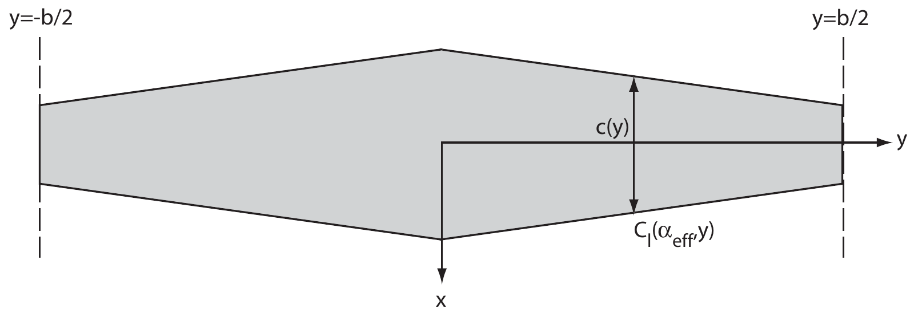
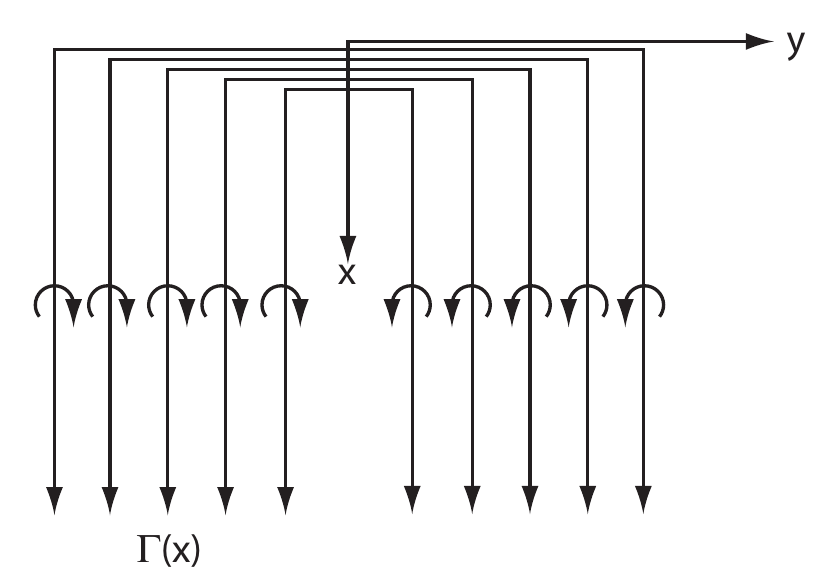

# 普朗特升力线理论入门

**原题：** Prandtl’s Lifting Line Introduction  
**来源：** 麻省理工学院（MIT），16.100《空气动力学》，第 17 讲。  
**年份：** 原讲义页脚标注为 **2002**；MIT OpenCourseWare 将其收录于 **2005 年秋季课程**。文件名采用原讲义年份 2002，来源简称采用 MIT。本文件是课程讲义，不属于期刊或会议论文。  
**课程教师：** David Darmofal 教授；PDF 元数据中的作者字段为 C. Gouldstone。  
**免费官方原文：** [MIT 官方 PDF（3 页）](https://ocw.mit.edu/courses/16-100-aerodynamics-fall-2005/7efba19790d0680afeeea1a01bb7b301_16100lectre17_cg.pdf)；[MIT 课程资源页](https://ocw.mit.edu/courses/16-100-aerodynamics-fall-2005/resources/16100lectre17_cg/)。已核对官方 PDF 与所提供文件的标题、页数、图示和公式内容。

> 阅读说明：以下按原文三页的顺序保留标题、要点、公式及两幅示意图的相对位置。原图保留，图下补充中文说明；“变量解释”“补充说明”及末尾符号表为本译文新增。原文公式未编号，译文亦不另加编号。原文使用字母下标 $a_o$、$y_o$ 和 $\alpha_{LO}$，其末位分别为小写字母 o、小写字母 o 和大写字母 O；它们的物理含义会逐一解释，不能把这些下标当作独立相乘的变量。

## 第 1 页：普朗特升力线理论入门

### 假设

- 三维定常势流，即无黏、无旋流动。
- 不可压缩。
- 大展弦比机翼。
- 后掠角较小。
- 沿翼展方向的横流较弱。

因此，只需对迎角 $\alpha$ 作适当修正，局部流动便可近似看作二维流动。

**变量解释：** $\alpha$ 是迎角，即翼型弦线与相应来流方向之间的夹角。这里“二维／三维”分别对应原文 2-D／3-D，D 表示 dimension（维），不是阻力变量。

### 可获得的结果

- 总升力与诱导阻力的估计值。
- 滚转力矩。
- 沿翼展的升力分布。
- 诱导阻力系数 $C_{D_i}$ 随升力系数 $C_L$ 及几何参数变化的基本尺度关系。

$$
\boxed{C_{D_i}=\frac{C_L^2}{\pi A e}}
\quad\Longrightarrow\quad
\text{主要受展弦比 }A\text{ 影响},
\qquad A=\frac{b^2}{S}.
$$

**变量解释：**

| 符号 | 含义 |
|---|---|
| $C_{D_i}$ | 整个机翼的诱导阻力系数，$C_{D_i}=D_i/(q_\infty S)$；无量纲。下标 D 表示 drag（阻力），i 表示 induced（诱导）。 |
| $C_L$ | 整个机翼的升力系数，$C_L=L/(q_\infty S)$；无量纲。 |
| $A$ | 展弦比，$A=b^2/S$；无量纲。它不是机翼面积，也不是后文的 Fourier 系数 $A_n$。 |
| $b$ | 机翼全翼展，即左右翼尖之间的距离；单位为米。 |
| $S$ | 机翼参考面积，通常取机翼平面投影面积；单位为平方米。 |
| $e$ | 展向效率因子，衡量升力沿翼展分布对诱导阻力的影响；无量纲。经典平面机翼模型中，椭圆升力分布对应 $e=1$。这里不是自然常数，也不能直接等同于包含其他阻力效应的整机 Oswald 效率因子。 |
| $\pi$ | 圆周率，约为 3.14159；数学常数。 |

将升力系数、诱导阻力系数和展弦比的定义代入：

$$
\frac{D_i}{q_\infty S}
=\frac{\left(\dfrac{L}{q_\infty S}\right)^2}
{\pi\left(\dfrac{b^2}{S}\right)e}.
$$

因此：

$$
D_i=\frac{L^2}{\pi b^2q_\infty e}
=\frac{1}{\pi q_\infty e}\left(\frac{L}{b}\right)^2.
$$

原文再次框出的关系为：

$$
\boxed{D_i=\frac{1}{\pi q_\infty e}\left(\frac{L}{b}\right)^2}.
$$

**变量解释：** $D_i$ 为诱导阻力，$L$ 为总升力，二者均为力，单位为牛顿；$q_\infty$ 为自由来流动压，单位为帕斯卡；$L/b$ 是单位翼展所承担的平均升力，单位为牛顿／米。

**补充定义：** 为便于理解后文，动压可写成 $q_\infty=\tfrac12\rho_\infty V_\infty^2$，其中 $\rho_\infty$ 是自由来流空气密度，$V_\infty$ 是自由来流速度大小。下标 $\infty$ 表示远离机翼扰动的自由来流状态，并不表示该数值为无穷大。

### 如何减小诱导阻力

在定常平飞中，$L=W$。因此，可以通过以下方式减小 $D_i$：

- **增大 $q_\infty$**，即提高巡航速度；但摩擦阻力会增加。
- **减小展向载荷 $W/b$**；但由于结构因素，重量 $W$ 与翼展 $b$ 相互耦合。
- **提高机翼效率 $e$**；但实际实现可能较困难。

**变量解释：** $W$ 为飞行器重量，是重力的大小，单位为牛顿，不是质量；$W/b$ 为单位翼展重量，也称展向载荷。它与翼载荷 $W/S$ 不同：前者除以翼展，后者除以面积。原文中的“$W$ 与 $b$ 耦合”意味着增大翼展可能需要增加结构重量，二者不能总是独立改变。

## 第 2 页：升力线的几何与基本定义

*原图 1（译文为便于引用加的图号）：机翼几何与局部截面定义。$y$ 沿翼展方向，$x$ 沿弦向／流向；左右翼尖分别位于 $y=-b/2$ 和 $y=b/2$。图中的 $c(y)$ 是相应位置的局部弦长，$C_l(\alpha_{eff},y)$ 是该位置在有效迎角下的局部升力系数。*

- **弦长随展向位置变化：**

$$
c=c(y).
$$

- **迎角随展向位置变化，且由两部分组成：**

$$
\underbrace{\alpha(y)}_{\text{局部几何迎角}}
=\underbrace{\alpha_\infty}_{\text{自由来流参考迎角}}
+\underbrace{\alpha_g(y)}_{\text{几何扭转角}}.
$$

**变量解释：** $y$ 为从机翼中部起算的展向位置，单位为米；$c(y)$ 为该处翼型前缘到后缘的弦长，单位为米；$\alpha(y)$ 为该处局部弦线相对于未受诱导影响来流的几何迎角；$\alpha_\infty$ 为相对于选定参考弦线的自由来流迎角；$\alpha_g(y)$ 为该截面相对参考弦线的几何扭转角，下标 g 表示 geometric（几何）。角度代入本讲义的线性关系式时统一采用弧度。

- **尾涡产生的下洗会改变有效迎角：**

$$
\alpha_{eff}(y)=\alpha(y)-\underbrace{\alpha_i(y)}_{\text{诱导迎角}}.
$$

**注意：** 对于下洗，$\alpha_i>0$。

**变量解释：** $\alpha_{eff}(y)$ 为局部有效迎角，即截面弦线与受诱导速度影响后的局部来流之间的夹角，下标 eff 表示 effective（有效）；$\alpha_i(y)$ 为诱导迎角，也称下洗角。这里正的下洗角会减小有效迎角。

- **局部升力系数与有效迎角呈线性关系：**

$$
C_l=a_o(y)\left[\alpha_{eff}(y)-\alpha_{LO}(y)\right].
$$

**变量解释：**

| 符号 | 含义 |
|---|---|
| $C_l$ | 该展向截面的二维／局部升力系数；无量纲。下标是小写 l，区别于整翼升力系数 $C_L$ 的大写 L。 |
| $a_o(y)$ | 该截面二维翼型的升力曲线斜率，即 $\mathrm dC_l/\mathrm d\alpha_{eff}$；通常以“每弧度”表示。原文下标为字母 o，常见教材也写为 $a_0$。它不是零升迎角。 |
| $\alpha_{LO}(y)$ | 该截面翼型的零升迎角，即使 $C_l=0$ 的有效迎角。原文下标为 LO，物理含义是“零升力”，常写作 $\alpha_{L=0}$ 或 $\alpha_{L0}$；不是 L 与 O 相乘。 |

**补充说明：** 上式是局部线性升力关系，不能直接作为失速后翼型升力模型。不同展向位置的翼型可以不同，所以 $a_o$ 与 $\alpha_{LO}$ 都可以是 $y$ 的函数。

### 升力线基本方程

基本模型由以下关系建立：

- 假设局部满足 **Kutta–Joukowski（库塔—茹科夫斯基）升力定理**，得到单位翼展升力 $L'$：

$$
L'(y)=\rho_\infty V_\infty\Gamma(y).
$$

因此：

$$
C_l(y)=\frac{L'(y)}{q_\infty c(y)}
=\frac{2\Gamma(y)}{V_\infty c(y)}.
$$

**变量解释：**

- $L'(y)$：位置 $y$ 处的单位翼展升力，单位为牛顿／米；上标撇号表示分布载荷，可理解为 $\mathrm dL/\mathrm dy$，不是对时间求导。
- $\rho_\infty$：自由来流空气密度，单位为千克／立方米，希腊字母 rho。
- $V_\infty$：自由来流速度大小，单位为米／秒。
- $\Gamma(y)$：机翼在展向位置 $y$ 处的束缚涡环量，单位为平方米／秒，希腊大写字母 Gamma。环量是绕截面闭合曲线对速度作线积分得到的量；在本讲义的符号约定下，正升力对应正环量。
- $C_l(y)$：该截面局部升力系数；除以 $q_\infty c(y)$，而非整翼系数使用的 $q_\infty S$。

## 第 3 页：用马蹄涡与 Fourier 级数求解

沿机翼的 **四分之一弦长线（$c/4$ 线）**分布无限多个马蹄涡，以模拟诱导流动：

*原图 2（译文为便于引用加的图号）：沿翼展分布的马蹄涡。$x$ 为流向坐标，$y$ 为展向坐标；各马蹄涡向下游延伸，合起来产生诱导流动。原图下方标为 $\Gamma(x)$，但正文和推导始终采用展向环量 $\Gamma(y)$；此处保留原图，并提示这一记号不一致。*

**补充解释：** $c/4$ 表示从各截面前缘沿弦向量取局部弦长的四分之一处，连接这些点形成四分之一弦长线；这里没有新增独立变量。“无限多个”描述连续涡系模型，实际采用有限项级数进行近似求解。

将局部线性升力关系与局部升力定理相结合：

$$
C_l=a_o(y)\left[\alpha_{eff}(y)-\alpha_{LO}(y)\right]
=\frac{2\Gamma(y)}{V_\infty c(y)}.
$$

再代入 $\alpha_{eff}(y)=\alpha(y)-\alpha_i(y)$：

$$
a_o(y)\left[\alpha(y)-\alpha_i(y)-\alpha_{LO}(y)\right]
=\frac{2\Gamma(y)}{V_\infty c(y)}.
$$

整理得到：

$$
\boxed{
\alpha(y)=\frac{2\Gamma(y)}{a_o(y)V_\infty c(y)}
+\alpha_{LO}(y)+\alpha_i(y)
}.
$$

其中：

$$
\boxed{
\alpha_i(y)=-\frac{w(y)}{V_\infty}
=\frac{1}{4\pi V_\infty}
\int_{-b/2}^{b/2}
\frac{\dfrac{\mathrm d\Gamma}{\mathrm dy}(y_o)}{y-y_o}\,\mathrm dy_o
}.
$$

**变量解释：**

| 符号或写法 | 含义 |
|---|---|
| $w(y)$ | 在被考察展向位置 $y$ 处，由尾涡诱导的垂向速度；单位为米／秒。根据讲义的 $\alpha_i=-w/V_\infty$ 约定，下洗对应 $w<0$、$\alpha_i>0$。原图未另画垂向坐标轴。 |
| $y$ | 当前要计算下洗或升力的“观察位置”，计算某一点时保持固定。 |
| $y_o$ | 积分所遍历的“源位置”，表示产生诱导作用的展向位置；从左翼尖 $-b/2$ 到右翼尖 $b/2$ 变化。原文下标为字母 o，常也写为 $y_0$；它不是固定的零位置。 |
| $\dfrac{\mathrm d\Gamma}{\mathrm dy}(y_o)$ | 环量沿翼展的变化率，在源位置 $y_o$ 处取值；单位为米／秒。它体现展向环量变化与尾涡分布的关系。 |
| $y-y_o$ | 观察位置与源位置之间带符号的展向距离，单位为米。 |
| $\mathrm dy_o$ | 对源位置进行积分的微小展向长度，单位为米；d 是微分符号，不是新的物理变量。 |

**补充说明：** $\alpha_i=-w/V_\infty$ 使用了小角度近似，因此角度按弧度计。积分核在 $y_o=y$ 处具有奇异性，数学上应按柯西主值积分理解；原讲义没有显式写出主值标记。

**注意：唯一未知的是 $\Gamma(y)$！**

这里是指：给定机翼几何、翼型特性和自由来流条件后，$\alpha_i$ 可以由 $\Gamma$ 的积分求得，因此不需要把它作为另一个独立未知函数。

### 用 Fourier 级数求解

我们使用 Fourier（傅里叶）级数来求解：

$$
\Gamma=2bV_\infty\sum_{n=1}^{N}A_n\sin(n\theta),
\qquad\text{其中}\qquad y=-\frac{b}{2}\cos\theta.
$$

**变量解释：**

| 符号 | 含义 |
|---|---|
| $\theta$ | 将展向位置 $y$ 映射至 $0\le\theta\le\pi$ 的辅助角参数，单位为弧度；不是迎角，也不是几何扭转角。 |
| $n$ | Fourier 正弦级数的项序号／阶次，依次为 $1,2,\ldots,N$；无量纲正整数。 |
| $N$ | 级数截断后保留的总项数；无量纲正整数。有限 $N$ 对应数值近似，不是原文所说的无限马蹄涡数量。 |
| $A_n$ | 第 $n$ 个 Fourier 正弦项的系数；无量纲，是实际求解的未知数。$A_1,A_2,\ldots,A_N$ 一起确定整条环量分布。 |
| $\sum_{n=1}^{N}$ | 对 $n=1$ 到 $N$ 的所有项求和；$\sum$ 是求和符号，不是一个变量。 |
| $\sin(n\theta)$、$\cos\theta$ | 正弦、余弦函数；sin、cos 是数学函数名，不是由多个字母变量相乘。 |

根据坐标映射，$\theta=0$ 对应 $y=-b/2$ 的翼尖，$\theta=\pi/2$ 对应 $y=0$ 的中部，$\theta=\pi$ 对应 $y=b/2$ 的另一翼尖。在端点处各正弦项为零，因而该展开形式满足翼尖环量为零。

### 控制方程

由此，控制方程为：

$$
\boxed{
\alpha(\theta)
=\frac{4b}{a_o(\theta)c(\theta)}
\sum_{n=1}^{N}A_n\sin(n\theta)
+\alpha_{LO}(\theta)
+\underbrace{\sum_{n=1}^{N}nA_n\frac{\sin(n\theta)}{\sin\theta}}_{\alpha_i(\theta)}
}.
$$

**各项含义：** 左边 $\alpha(\theta)$ 是已知的局部几何迎角；右边第一项为 $C_l/a_o$，即产生局部升力所需的、相对于零升迎角的有效迎角增量；第二项 $\alpha_{LO}(\theta)$ 为局部零升迎角；最后一项为诱导迎角 $\alpha_i(\theta)$。

同一个物理量写成 $c(y)$ 或 $c(\theta)$，只是在使用不同坐标，不代表两种弦长；$a_o$、$\alpha$、$\alpha_{LO}$ 和 $\alpha_i$ 的写法同理。最终式中求和项的乘数是小写 **$nA_n$**，不是 $NA_n$。

**补充说明：** 理论上的未知函数 $\Gamma(y)$ 被转化为有限个未知系数 $A_n$；在选定的展向位置要求控制方程成立，即可求解这些系数。最后一项在 $\theta=0,\pi$ 处写成分式时不能直接把分母代为零，实际求解需用相应极限或避开端点布点。

## 附：全文字母变量与下标速查表

下表覆盖原讲义的全部物理变量、级数索引和相关字母下标。补充定义中引入的密度、动压关系也已在正文解释。

| 字母／符号 | 中文含义 | 常用单位或类型 | 重要区别 |
|---|---|---|---|
| $A$ | 机翼展弦比，$b^2/S$ | 无量纲 | 不等于面积 $S$，也不等于 $A_n$。 |
| $A_n$ | 第 $n$ 项 Fourier 系数 | 无量纲 | 下标 n 表示项序号；系数为未知数。 |
| $a_o(y),a_o(\theta)$ | 局部二维翼型升力曲线斜率 | 每弧度 | 常写 $a_0$；不是迎角。 |
| $b$ | 全翼展 | 米 | $b/2$ 为半翼展。 |
| $c,c(y),c(\theta)$ | 局部弦长 | 米 | 与大写 $C$ 的气动系数记号不同。 |
| $C_{D_i}$ | 整翼诱导阻力系数 | 无量纲 | D 表示阻力，i 表示诱导。 |
| $C_L$ | 整翼升力系数 | 无量纲 | 用 $q_\infty S$ 归一化。 |
| $C_l,C_l(y),C_l(\alpha_{eff},y)$ | 局部截面升力系数 | 无量纲 | 小写 l；用 $q_\infty c(y)$ 归一化。 |
| $D_i$ | 诱导阻力 | 牛顿 | 是力，不是阻力系数。 |
| $e$ | 展向效率因子 | 无量纲 | 不是自然常数；此处对应诱导阻力。 |
| $L$ | 整翼总升力 | 牛顿 | 与下标 L 的标签作用不同。 |
| $L'(y)$ | 单位翼展升力 | 牛顿／米 | 撇号表示分布载荷。 |
| $N$ | 保留的 Fourier 项数 | 正整数 | 此处不是力的单位牛顿；单位名称在表中用中文写出。 |
| $n$ | Fourier 项序号 | 正整数 | 不等于总项数 $N$。 |
| $q_\infty$ | 自由来流动压 | 帕斯卡 | 不是俯仰角速度；等于 $\tfrac12\rho_\infty V_\infty^2$。 |
| $S$ | 机翼参考面积 | 平方米 | 不是翼展。 |
| $V_\infty$ | 自由来流速度大小 | 米／秒 | 大写 V。 |
| $W$ | 飞行器重量 | 牛顿 | 不是质量。 |
| $w(y)$ | 尾涡诱导的垂向速度 | 米／秒 | 小写 w；下洗时按本讲义约定为负。 |
| $x$ | 弦向／流向坐标 | 米 | 出现在两幅原图的坐标轴中。 |
| $y$ | 展向观察位置坐标 | 米 | 中部为零，范围为 $[-b/2,b/2]$。 |
| $y_o$ | 积分中的展向源位置 | 米 | 下标 o；是遍历整个翼展的积分变量。 |
| $\alpha,\alpha(y),\alpha(\theta)$ | 局部几何迎角 | 弧度 | 等于有效迎角加诱导迎角。 |
| $\alpha_\infty$ | 自由来流参考迎角 | 弧度 | 与局部几何扭转合成 $\alpha(y)$。 |
| $\alpha_g(y)$ | 局部几何扭转角 | 弧度 | g＝geometric。 |
| $\alpha_{eff}(y)$ | 局部有效迎角 | 弧度 | eff＝effective。 |
| $\alpha_i(y),\alpha_i(\theta)$ | 诱导迎角／下洗角 | 弧度 | i＝induced；下洗时为正。 |
| $\alpha_{LO}(y),\alpha_{LO}(\theta)$ | 局部零升迎角 | 弧度 | LO 是“零升力”标签，不是两个变量。 |
| $\Gamma,\Gamma(y)$ | 束缚涡环量及其展向分布 | 平方米／秒 | 希腊大写 Gamma；不是小写 gamma。 |
| $\Gamma(x)$ | 原图 2 中的环量标注 | 平方米／秒 | 与正文展向记号不一致，按上下文应理解为展向分布 $\Gamma(y)$。 |
| $\rho_\infty$ | 自由来流密度 | 千克／立方米 | 希腊小写 rho。 |
| $\theta$ | 展向坐标变换的辅助角 | 弧度 | 希腊小写 theta；不是迎角。 |
| $\pi$ | 圆周率 | 数学常数 | 不是待求参数。 |

### 下标、运算符和组合量

| 写法 | 含义 |
|---|---|
| 下标 $\infty$ | 自由来流状态标记。 |
| 下标 i | induced，表示诱导效应；本讲义中不是离散点编号。 |
| 下标 g | geometric，表示几何扭转。 |
| 下标 eff | effective，表示有效量。 |
| 下标 L／l | 在气动系数中区分整翼升力与局部截面升力；并非一概表示独立变量。 |
| 下标 D | drag，表示阻力。 |
| 下标 o／LO | 需按具体符号理解：$a_o$ 的翼型斜率记号、$y_o$ 的源位置标记、$\alpha_{LO}$ 的零升力标记；不是一个共同的物理变量。 |
| $C$ | 在 $C_L$、$C_l$、$C_{D_i}$ 中构成系数名称，本讲义没有另定义一个独立的 $C$。 |
| $L/b$、$W/b$ | 单位翼展平均升力、单位翼展重量，单位为牛顿／米。 |
| $L=W$ | 定常平飞时，升力大小等于重量。 |
| $\mathrm d\Gamma/\mathrm dy$ | 环量对展向坐标的导数；d 为微分运算符。 |
| $\int$、$\sum$ | 分别为积分与求和符号，不是字母变量。 |
| $\sin$、$\cos$ | 正弦与余弦函数名，不是独立变量。 |
| $\Rightarrow$、$\Leftarrow$ | 原文用于表达推导、结论或伴随限制的箭头，不代表物理量。 |

### 两个容易混淆的区别

1. **几何迎角、有效迎角、零升迎角不同。** $\alpha(y)$ 由飞机姿态及机翼扭转决定，$\alpha_{eff}(y)=\alpha(y)-\alpha_i(y)$ 计入下洗，而 $\alpha_{LO}(y)$ 是截面翼型本身的零升力特性。决定局部线性升力的角度差为 $\alpha_{eff}-\alpha_{LO}$。
2. **环量与升力系数不同。** $\Gamma(y)$ 有量纲，$C_l(y)$ 无量纲，二者通过 $C_l=2\Gamma/(V_\infty c)$ 联系；再沿翼展积分单位翼展升力 $L'(y)$，才得到整翼升力 $L$。
