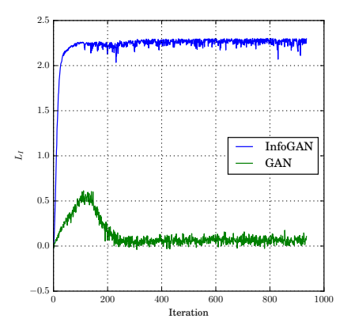
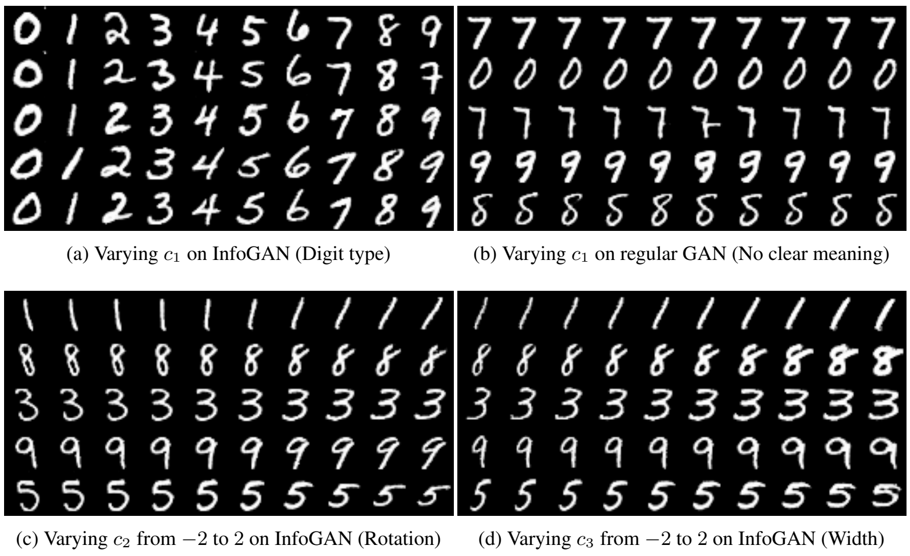
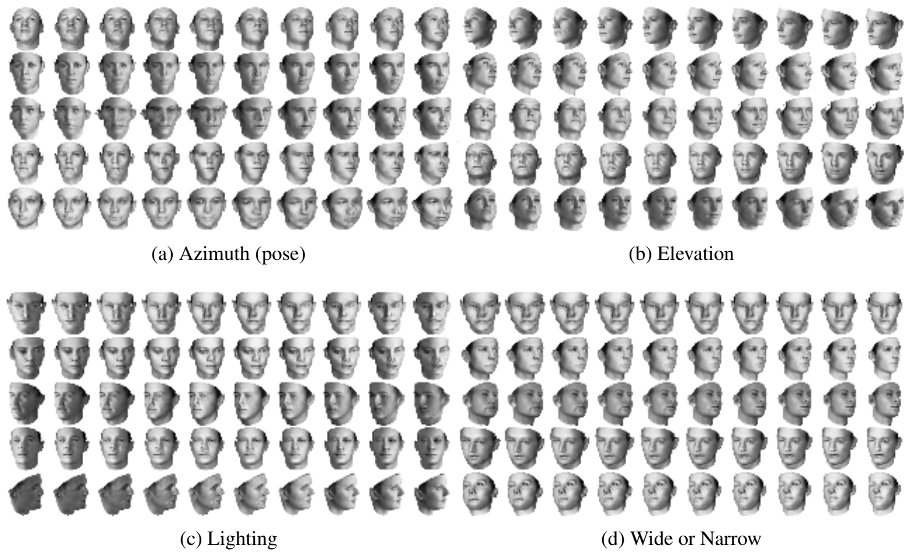
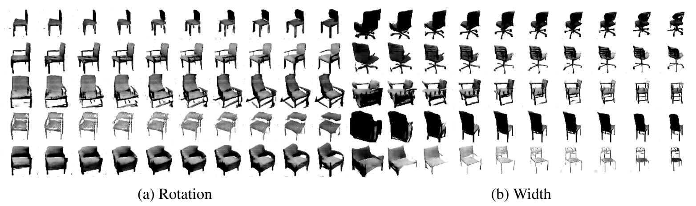
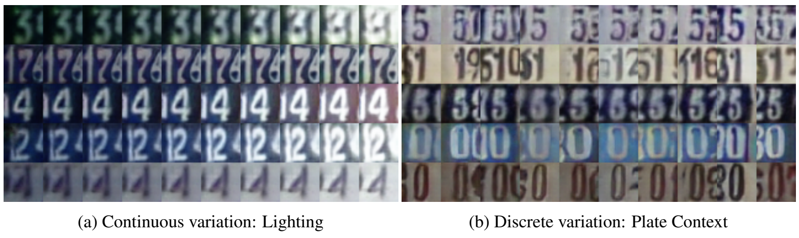
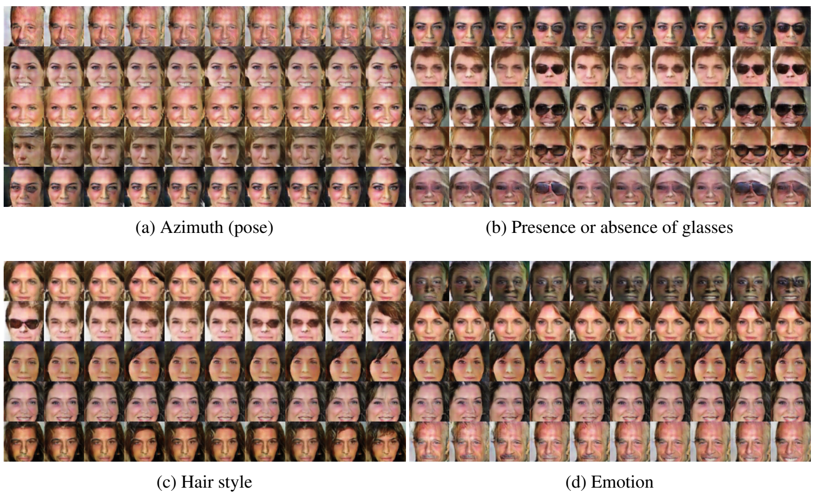

# InfoGAN：通过信息最大化生成对抗网络学习可解释表示

**原题：** InfoGAN: Interpretable Representation Learning by Information Maximizing Generative Adversarial Nets  
**作者：** Xi Chen†‡、Yan Duan†‡、Rein Houthooft†‡、John Schulman†‡、Ilya Sutskever‡、Pieter Abbeel†‡  
**单位：** † 加利福尼亚大学伯克利分校，电气工程与计算机科学系；‡ OpenAI。  
**正式发表信息：** *Advances in Neural Information Processing Systems 29*，NIPS 2016；[会议论文页面](https://papers.nips.cc/paper_files/paper/2016/hash/7c9d0b1f96aebd7b5eca8c3edaa19ebb-Abstract.html)。  
**本译稿依据版本：** 用户提供的 arXiv:1606.03657v1，2016 年 6 月 12 日；翻译内容依据这份原稿。

> **翻译范围：** 本译稿仅翻译用户提供的 PDF 第 1–8 页，第 9–14 页不翻译。源 PDF 未修改。保留本范围内的原文章节、公式编号、插图和引文编号，图注译为中文，参考文献不翻译。

## 摘要

本文介绍 InfoGAN，它是生成对抗网络的一种信息论扩展，能够以完全无监督的方式学习解耦表示。InfoGAN 在生成对抗网络的基础上，还最大化一小部分潜在变量与观测之间的互信息。我们推导了互信息目标的一个下界，并能够高效地对其进行优化。具体而言，InfoGAN 在 MNIST 数据集上成功地将书写风格与数字形状解耦，在三维渲染图像中将姿态与光照解耦，并在 SVHN 数据集上将背景数字与中心数字解耦。它还在 CelebA 人脸数据集上发现了发型、是否佩戴眼镜以及情绪等视觉概念。实验表明，InfoGAN 学到的可解释表示，能够与现有监督方法学到的表示相媲美。

## 1. 引言

无监督学习可以描述为这样一个一般性问题：从大量存在的无标签数据中提取价值。表示学习 [1, 2] 是无监督学习中一个流行的框架，其目标是利用无标签数据学习一种表示，将重要的语义特征呈现为易于解码的因素。能够学习此类表示的方法很可能存在 [2]，并能用于许多下游任务，包括分类、回归、可视化，以及强化学习中的策略学习。

由于训练时并不知道相关的下游任务，无监督学习是一个不适定问题。然而，一种能够显式表示数据实例显著属性的解耦表示，应当有助于处理那些相关但未知的任务。例如，对于一个人脸数据集，有用的解耦表示可以为以下每种属性分别分配一组维度：面部表情、眼睛颜色、发型、是否佩戴眼镜，以及对应人物的身份。解耦表示能够帮助解决那些需要了解数据显著属性的自然任务，包括人脸识别和物体识别。但对于非自然的监督任务则并非如此，例如任务目标可能是判断一幅图像中红色像素的数量为偶数还是奇数。因此，要发挥作用，无监督学习算法实际上必须在没有直接接触下游分类任务的情况下，正确猜测可能出现的这组任务。

无监督学习研究中有相当一部分由生成建模推动。这源于一种看法：能够合成或“创造”所观测数据的能力，意味着某种形式的理解。研究者因此希望，一个好的生成模型能够自动学习到解耦表示，尽管构造一个生成效果完美、表示却可以任意差的生成模型其实很容易。最突出的生成模型是变分自编码器（VAE）[3] 和生成对抗网络（GAN）[4]。

本文对生成对抗网络的目标作出一种简单修改，促使它学习可解释且有意义的表示。我们通过最大化 GAN 噪声变量中一个固定小子集与观测之间的互信息来实现这一点，而这实际上相对容易做到。尽管方法很简单，我们发现它的效果出人意料地好：它能够在多个图像数据集上发现具有高度语义性且有意义的隐藏表示，包括数字（MNIST）、人脸（CelebA）和门牌号码（SVHN）。我们以无监督方式学习的解耦表示，其质量与以往使用监督标签信息的工作 [5–9] 相当。这些结果表明，在生成建模中加入互信息代价项，可能是一种有效的解耦表示学习途径。

在本文余下部分，我们首先回顾相关工作，并指出以往解耦表示学习方法所需要的监督信息。随后回顾 GAN，它是 InfoGAN 的基础。我们说明最大化互信息如何得到可解释表示，并推导一种简单、高效的实现算法。最后，在实验部分，我们先在相对干净的数据集上比较 InfoGAN 与以往方法，随后展示 InfoGAN 能够在复杂数据集上学习可解释表示；据我们所知，此前还没有无监督方法能在这些复杂数据集上学习到质量相当的表示。

## 2. 相关工作

无监督表示学习已有大量研究。早期方法基于堆叠自编码器，通常为去噪自编码器，或受限玻尔兹曼机 [10–13]。近期许多有前景的工作源自 Skip-gram 模型 [14]，它启发了 skip-thought 向量 [15]，以及若干用于图像无监督特征学习的技术 [16]。

另一条引人关注的研究路线是阶梯网络（ladder network）[17]，它在 MNIST 数据集的半监督变体上取得了出色结果。最近，一种基于 VAE 的模型在 MNIST 上取得了更好的半监督学习结果 [18]。Radford 等人 [19] 利用 GAN [4] 学习图像表示，支持在编码空间中执行基本的线性代数运算。Lake 等人 [20] 通过对贝叶斯程序进行概率推断来学习表示，在 OMNI 数据集上取得了令人信服的单样本学习结果。

此外，以往研究还尝试利用带监督信息的数据学习解耦表示。其中一类方法通过监督学习，使表示的一个子集与给定标签匹配：双线性模型 [21] 分离风格与内容；多视角感知机 [22] 分离人脸身份与观察视角；Yang 等人 [23] 开发了一种循环变体，生成一系列潜在因素变换。类似地，已有工作表明，VAE [5] 和对抗自编码器 [9] 能够学习将类别标签与其他变化分离的表示。

最近，研究者开发了几种弱监督方法，以免显式标注各种变化。disBM [24] 是一种高阶玻尔兹曼机：对于一对已知仅在一个变化因素上不同、在其余因素上都相同的数据点，它通过“钳制”部分隐藏单元来学习解耦表示。DC-IGN [7] 将这种“钳制”思路扩展到 VAE，成功学习到能够表示三维渲染图像中姿态和光照的图形编码。这条研究路线取得了令人印象深刻的结果，但依赖于以监督信息对数据进行分组，而这样的分组通常并不可得。Whitney 等人 [8] 提出从连续图像帧中学习，以时间连续性作为监督信号，从而减轻对分组的要求。

与上述致力于学习解耦表示的既有工作不同，InfoGAN 不需要任何形式的监督。据我们所知，另一种能够学习解耦表示的无监督方法只有 hossRBM [13]，它是 spike-and-slab 受限玻尔兹曼机的高阶扩展，能够在 Toronto Face Dataset [25] 上将情绪与身份解耦。然而，hossRBM 只能解耦离散潜在因素，其计算成本随因素数量呈指数增长。InfoGAN 则可以同时解耦离散和连续潜在因素，扩展到复杂数据集，而且通常不需要比普通 GAN 更长的训练时间。

## 3. 背景：生成对抗网络

Goodfellow 等人 [4] 提出了生成对抗网络（GAN），这是一个通过极小极大博弈训练深度生成模型的框架。其目标是学习与真实数据分布 $P_{\mathrm{data}}(x)$ 相匹配的生成器分布 $P_G(x)$。GAN 不尝试显式地为数据分布中的每一个 $x$ 分配概率，而是学习一个生成器网络 $G$，将噪声变量 $z\sim P_{\mathrm{noise}}(z)$ 转换为样本 $G(z)$，从而生成服从生成器分布 $P_G$ 的样本。这个生成器通过与一个对抗性的判别器网络 $D$ 进行博弈来训练，后者试图区分来自真实数据分布 $P_{\mathrm{data}}$ 和生成器分布 $P_G$ 的样本。因此，对于一个给定生成器，最优判别器为 $D(x)=P_{\mathrm{data}}(x)/(P_{\mathrm{data}}(x)+P_G(x))$。更正式地，极小极大博弈由下式给出：

$$
\min_G\max_D V(D,G)
=\mathbb E_{x\sim P_{\mathrm{data}}}[\log D(x)]
+\mathbb E_{z\sim\mathrm{noise}}[\log(1-D(G(z)))].
\tag{1}
$$

## 4. 用互信息诱导潜在编码

GAN 的形式采用一个简单的、可分解的连续输入噪声向量 $z$，但不限制生成器如何使用这一噪声。因此，生成器可能以高度纠缠的方式使用噪声，使 $z$ 的各个维度不能对应数据的语义特征。

然而，许多领域可以自然地分解为一组具有语义意义的变化因素。例如，在生成 MNIST 数据集中的图像时，理想情况是模型自动选择一个离散随机变量来表示数字的类别身份，即 0–9，并额外选择两个连续变量来表示数字的倾斜角度和笔画粗细。这些属性既相互独立又十分显著。如果我们只需指定：一个 MNIST 数字由一个独立的十选一变量和两个独立连续变量生成，就能够在没有任何监督的情况下恢复这些概念，那将十分有用。

本文不再使用单一的非结构化噪声向量，而是提出将输入噪声向量分为两部分：（i）$z$，将其视为不可压缩噪声的来源；（ii）$c$，我们将其称为潜在编码，用来针对数据分布中显著的、具有结构的语义特征。从数学上说，我们将结构化潜在变量集合记作 $c_1,c_2,\ldots,c_L$。在最简单的形式下，可以假设分布可分解，即 $P(c_1,c_2,\ldots,c_L)=\prod_{i=1}^{L}P(c_i)$。为简化记号，我们用潜在编码 $c$ 表示所有潜在变量 $c_i$ 拼接而成的向量。

我们现在提出一种以无监督方式发现这些潜在因素的方法：同时向生成器网络输入不可压缩噪声 $z$ 和潜在编码 $c$，使生成器的形式变为 $G(z,c)$。然而，在标准 GAN 中，生成器可以通过找到一个满足 $P_G(x\mid c)=P_G(x)$ 的解，自由地忽略额外的潜在编码 $c$。为解决编码退化为无作用编码的问题，我们提出一种信息论正则化：潜在编码 $c$ 与生成器分布 $G(z,c)$ 之间应当具有较高的互信息。因此，$I(c;G(z,c))$ 应当较高。

在信息论中，$X$ 和 $Y$ 之间的互信息 $I(X;Y)$ 衡量：在知道随机变量 $Y$ 后，能够了解另一个随机变量 $X$ 的“信息量”。互信息可以表示为两个熵项之差：

$$
I(X;Y)=H(X)-H(X\mid Y)=H(Y)-H(Y\mid X).
\tag{2}
$$

这一定义有一个直观解释：$I(X;Y)$ 是在观测到 $Y$ 后，$X$ 的不确定性减少了多少。如果 $X$ 与 $Y$ 独立，那么 $I(X;Y)=0$，因为知道一个变量不会揭示任何关于另一个变量的信息；相反，如果 $X$ 与 $Y$ 通过一个确定的、可逆的函数联系起来，那么互信息就达到最大值。这一解释使代价函数容易构造：对于任意 $x\sim P_G(x)$，我们希望 $P_G(c\mid x)$ 的熵较小。换言之，潜在编码 $c$ 中的信息不应在生成过程中丢失。此前在聚类背景下，也曾考虑过类似的、受互信息启发的目标 [26–28]。因此，我们提出求解以下带信息正则化的极小极大博弈：

$$
\min_G\max_D V_I(D,G)=V(D,G)-\lambda I(c;G(z,c)).
\tag{3}
$$

## 5. 变分互信息最大化

在实际应用中，互信息项 $I(c;G(z,c))$ 很难直接最大化，因为这需要获得后验分布 $P(c\mid x)$。幸运的是，我们可以定义一个辅助分布 $Q(c\mid x)$ 来近似 $P(c\mid x)$，从而得到互信息的一个下界：

$$
\begin{aligned}
I(c;G(z,c))
&=H(c)-H(c\mid G(z,c))\\
&=\mathbb{E}_{x\sim G(z,c)}
\!\left[\mathbb{E}_{c'\sim P(c\mid x)}[\log P(c'\mid x)]\right]+H(c)\\
&=\mathbb{E}_{x\sim G(z,c)}
\!\left[
\underbrace{D_{\mathrm{KL}}\!\left(P(\cdot\mid x)\,\Vert\,Q(\cdot\mid x)\right)}_{\geq0}
+\mathbb{E}_{c'\sim P(c\mid x)}[\log Q(c'\mid x)]
\right]+H(c)\\
&\geq\mathbb{E}_{x\sim G(z,c)}
\!\left[\mathbb{E}_{c'\sim P(c\mid x)}[\log Q(c'\mid x)]\right]+H(c).
\end{aligned}
\tag{4}
$$

这种为互信息构造下界的技术称为**变分信息最大化**（Variational Information Maximization）[29]。此外，对于常见分布，潜在编码的熵 $H(c)$ 具有简单的解析形式，因此也可以将其作为优化对象。不过，为了简化处理，本文固定潜在编码的分布，并将 $H(c)$ 视为常量。到目前为止，我们通过这一下界，绕过了显式计算后验分布 $P(c\mid x)$ 的问题，但内层期望仍然要求能够从后验分布中采样。下面给出一个简单引理，其证明放在附录中；该引理使我们无需从后验分布中采样。

**引理 5.1。** 对于随机变量 $X$、$Y$ 和函数 $f(x,y)$，在适当的正则条件下，有：

$$
\mathbb{E}_{x\sim X,\,y\sim Y\mid x}[f(x,y)]
=\mathbb{E}_{x\sim X,\,y\sim Y\mid x,\,x'\sim X\mid y}[f(x',y)].
$$

利用引理 A.1，我们可以为互信息 $I(c;G(z,c))$ 定义一个变分下界 $L_I(G,Q)$：

> 译注：上一句按照原文引用“引理 A.1”；本页此前给出的引理编号为“引理 5.1”，该处编号引用与前文不一致。

$$
\begin{aligned}
L_I(G,Q)
&=\mathbb{E}_{c\sim P(c),\,x\sim G(z,c)}[\log Q(c\mid x)]+H(c)\\
&=\mathbb{E}_{x\sim G(z,c)}
\!\left[\mathbb{E}_{c'\sim P(c\mid x)}[\log Q(c'\mid x)]\right]+H(c)\\
&\leq I(c;G(z,c)).
\end{aligned}
\tag{5}
$$

需要指出的是，$L_I(G,Q)$ 很容易通过蒙特卡洛模拟近似计算。具体而言，可以直接针对 $Q$ 最大化 $L_I$，也可以通过重参数化技巧针对 $G$ 最大化它。因此，可以将 $L_I(G,Q)$ 加入 GAN 的目标函数，而无需改变 GAN 的训练流程。我们将得到的算法称为**信息最大化生成对抗网络**（Information Maximizing Generative Adversarial Networks，InfoGAN）。

式（4）表明，当辅助分布 $Q$ 接近真实后验分布，即 $\mathbb{E}_x[D_{\mathrm{KL}}(P(\cdot\mid x)\Vert Q(\cdot\mid x))]\to0$ 时，该下界会成为紧下界。此外，对于离散潜在编码，当变分下界达到其最大值 $L_I(G,Q)=H(c)$ 时，下界同样成为紧下界，并且互信息达到最大值。在附录中，我们指出了如何将 InfoGAN 与 Wake-Sleep 算法 [30] 联系起来，从而提供另一种解释。

因此，InfoGAN 定义为以下极小极大博弈，其中包含互信息的变分正则化项和一个超参数 $\lambda$：

$$
\min_{G,Q}\max_D\;
V_{\mathrm{InfoGAN}}(D,G,Q)
=V(D,G)-\lambda L_I(G,Q).
\tag{6}
$$

## 6. 实现

在实际应用中，我们用神经网络对辅助分布 $Q$ 进行参数化。在大多数实验中，$Q$ 和 $D$ 共享所有卷积层，并通过最后一个全连接层输出条件分布 $Q(c\mid x)$ 的参数。这意味着，相比 GAN，InfoGAN 只增加了可忽略的计算成本。我们还观察到，$L_I(G,Q)$ 的收敛速度总是快于普通 GAN 目标函数，因此，InfoGAN 基本上能够在 GAN 的基础上以几乎没有额外代价的方式实现。

对于类别潜在编码 $c_i$，我们采用自然的选择，即使用 softmax 非线性函数表示 $Q(c_i\mid x)$。对于连续潜在编码 $c_j$，则有更多选择，具体取决于真实后验分布 $P(c_j\mid x)$ 的形式。在实验中，我们发现，只需将 $Q(c_j\mid x)$ 视为因子化高斯分布就已足够。

虽然 InfoGAN 引入了额外的超参数 $\lambda$，但它很容易调节：对于离散潜在编码，简单地设为 1 就足够了。当潜在编码中包含连续变量时，通常采用较小的 $\lambda$，以确保此时涉及微分熵的 $\lambda L_I(G,Q)$ 与 GAN 目标函数处于同一量级。

由于 GAN 的训练困难是众所周知的，我们基于 DC-GAN [19] 提出的已有技术设计实验。这些技术已经足以稳定 InfoGAN 的训练，无需引入新的技巧。详细实验设置见附录。

## 7. 实验

实验的第一个目标是研究能否高效地最大化互信息。第二个目标是评价 InfoGAN 能否学习到解耦且可解释的表示。为此，我们利用生成器每次只改变一个潜在因子，以考察改变该因子是否只会使生成图像产生一种语义上的变化。DC-IGN [7] 也使用这种方法评价其在三维图像数据集上学到的表示。我们同样在这些数据集上应用 InfoGAN，以进行直接比较。

### 7.1 互信息最大化

为了评价所提出的方法能否高效地最大化潜在编码 $c$ 与生成图像 $G(z,c)$ 之间的互信息，我们在 MNIST 数据集上训练 InfoGAN，并为潜在编码采用均匀的类别分布 $c\sim\operatorname{Cat}(K=10,p=0.1)$。如图 1 所示，下界 $L_I(G,Q)$ 很快被最大化至 $H(c)\approx2.30$，这意味着下界（4）是紧的，并且达到了最大的互信息。

**图 1. 训练迭代过程中的下界 $L_I$。**

作为基线，我们还训练了一个带辅助分布 $Q$ 的普通 GAN，但不显式鼓励生成器最大化其与潜在编码之间的互信息。由于我们采用表达能力较强的神经网络对 $Q$ 进行参数化，可以假设 $Q$ 能够合理地逼近真实后验分布 $P(c\mid x)$，因而普通 GAN 的潜在编码与生成图像之间几乎没有互信息。需要指出，采用不同的神经网络架构时，潜在编码与生成图像之间可能具有更高的互信息，尽管我们在实验中未观察到这种情况。这项比较旨在说明：在普通 GAN 中，无法保证生成器会利用潜在编码。

### 7.2 解耦表示

为了在 MNIST 上将数字形状与风格解耦，我们选择使用一个类别编码 $c_1\sim\operatorname{Cat}(K=10,p=0.1)$，以及两个连续编码 $c_2,c_3\sim\operatorname{Unif}(-1,1)$ 来建模潜在编码。前者可以建模数据中的不连续变化，后两者则可以捕捉本质上连续的变化。

图 2 表明，离散编码 $c_1$ 捕捉到了形状上的显著变化。在大多数情况下，改变类别编码 $c_1$ 会使生成结果在不同数字之间切换。事实上，即使完全不使用标签训练 InfoGAN，只要将 $c_1$ 的各个类别与一种数字类型匹配，便可以将 $c_1$ 用作分类器，在 MNIST 数字分类上达到 5% 的错误率。在图 2a 的第二行中，可以观察到一个数字 7 被分类为 9。

连续编码 $c_2,c_3$ 捕捉到了风格上的连续变化：$c_2$ 建模数字的旋转，$c_3$ 控制数字的宽度。值得注意的是，在这两种情况下，生成器都不是简单地拉伸或旋转数字，而是会调整粗细、笔画风格等其他细节，以确保生成的图像看起来自然。为了检验 InfoGAN 所学习潜在表示的泛化能力，我们以夸张的方式操纵潜在编码：不再绘制潜在编码从 $-1$ 到 $1$ 变化的结果，而是将范围扩展为 $-2$ 到 $2$，覆盖网络从未接受训练的一大片区域。即使如此，我们仍然得到了有意义的泛化结果。

**图 2. 在 MNIST 上操纵潜在编码。** 在所有展示潜在编码操纵的图中，我们采用如下约定：在每个子图中，一个潜在编码从左向右变化，其他潜在编码与噪声保持固定。不同行对应固定潜在编码与噪声的不同随机样本。例如，在（a）中，一列包含来自 $c_1$ 同一类别的五个样本；一行则展示固定其他噪声时，$c_1$ 的 10 个可能类别所对应的生成图像。在（a）中，$c_1$ 的每个类别大体对应一种数字类型；在（b）中，在未使用信息正则化训练的 GAN 上改变 $c_1$，会产生不可解释的变化；在（c）中，较小的 $c_2$ 值表示数字向左倾斜，较大的值则对应向右倾斜；在（d）中，$c_3$ 平滑地控制宽度。由于类别编码本身没有顺序，我们为便于可视化对（a）进行了重新排序。

子图标签：（a）在 InfoGAN 上改变 $c_1$：数字类型；（b）在普通 GAN 上改变 $c_1$：没有明确含义；（c）在 InfoGAN 上将 $c_2$ 从 $-2$ 变为 $2$：旋转；（d）在 InfoGAN 上将 $c_3$ 从 $-2$ 变为 $2$：宽度。

接下来，我们在两个三维图像数据集——人脸 [31] 和椅子 [32]——上评价 InfoGAN。已有研究表明，DC-IGN 能够在这些数据集上学习高度可解释的图形学编码。

在人脸数据集上，DC-IGN 利用监督信息，将方位角（姿态）、仰角和光照等潜在因子表示为连续潜在变量。在同一个数据集上，我们展示了 InfoGAN 能够学习到恢复方位角（姿态）、仰角和光照的解耦表示。本实验中，我们选择五个连续编码对潜在编码进行建模，即 $c_i\sim\operatorname{Unif}(-1,1)$，其中 $1\leq i\leq5$。

由于 DC-IGN 需要监督信息，以往无法为未标注的变化学习潜在编码，因此也就无法自动从数据中发现显著的潜在变化因子。相比之下，InfoGAN 能够自主发现这类变化：例如，在图 3d 中，它学到了一个使人脸从宽到窄平滑变化的潜在编码，而以往研究既没有显式生成这种变化，也没有为其提供标注。

**图 3. 在三维人脸上操纵潜在编码。** 图中展示了所学习的连续潜在因子在取值从 $-1$ 变化至 $1$ 时，对输出产生的影响。在（a）中，一个连续潜在编码能够在不同人脸形状之间一致地捕捉人脸方位角；在（b）中，连续编码捕捉仰角；在（c）中，连续编码捕捉光照方向；最后，在（d）中，连续编码学会了在保留其他视觉特征的同时，在宽脸与窄脸之间进行插值。为便于直接比较，对于每个因子，我们从五次随机运行中选取了与以往有监督结果 [7] 最为接近的表示。

子图标签：（a）方位角（姿态）；（b）仰角；（c）光照；（d）宽或窄。

在椅子数据集上，DC-IGN 能够学习表示旋转的连续编码。InfoGAN 同样能够将这一概念学习为连续编码，见图 4a。我们还进一步展示，InfoGAN 可以利用单个连续编码，在宽度不同但类型相近的椅子之间进行连续插值，见图 4b。本实验中，我们选择四个类别编码 $c_1,c_2,c_3,c_4\sim\operatorname{Cat}(K=20,p=0.05)$，以及一个连续编码 $c_5\sim\operatorname{Unif}(-1,1)$，对潜在因子进行建模。

**图 4. 在三维椅子上操纵潜在编码。** 在（a）中，连续编码能够在保留椅子形状的同时捕捉其姿态，尽管学到的姿态映射会因椅子类型不同而有所变化；在（b）中，连续编码也可以转而学习捕捉不同椅子类型的宽度，并在它们之间平滑插值。为便于直接比较，对于每个因子，我们从五次随机运行中选取了与以往有监督结果 [7] 最为接近的表示。

子图标签：（a）旋转；（b）宽度。

接下来，我们在街景门牌号码（SVHN）数据集上评价 InfoGAN。在这一数据集上学习可解释表示要困难得多，因为它包含噪声、分辨率不一的图像以及起干扰作用的数字，并且不包含同一对象的多种变化。本实验中，我们使用四个 10 维类别变量和两个均匀分布的连续变量作为潜在编码。图 5 展示了其中两个学到的潜在因子。

**图 5. 在 SVHN 上操纵潜在编码。** 在（a）中，一个连续编码捕捉到了光照变化，尽管数据集中的每个数字仅在一种光照条件下出现；在（b）中，一个类别编码能够控制中心数字的上下文。例如，在第二列中，数字 9 部分出现在右侧，而第三列中出现的则是数字 0。这表明 InfoGAN 已经学会将中心数字与其上下文分离。

子图标签：（a）连续变化：光照；（b）离散变化：门牌上下文。

最后，图 6 展示了 InfoGAN 能够在另一个具有挑战性的数据集 CelebA [33] 上学习多种视觉概念。该数据集包含 200,000 张名人图像，具有较大的姿态变化和杂乱的背景。在这一数据集中，我们将潜在变化建模为 10 个均匀分布的类别变量，每个变量的维数均为 10。令人惊讶的是，即使面对如此复杂的数据集，InfoGAN 也能够像处理三维图像时一样恢复方位角，尽管数据集中没有同一张人脸在多个姿态下出现。此外，InfoGAN 还能够解耦是否佩戴眼镜、发型和情绪等具有较强语义的变化，表明它在没有任何监督信息的情况下获得了一定程度的视觉理解能力。

**图 6. 在 CelebA 上操纵潜在编码。** （a）表明，类别编码可以通过离散化这种本质上连续的变化，捕捉人脸方位角；在（b）中，类别编码的一部分专门用于表示是否佩戴眼镜；（c）展示发型变化，大致按头发从少到多排列；（d）展示情绪变化，大致按从严肃到快乐排列。

子图标签：（a）方位角（姿态）；（b）是否佩戴眼镜；（c）发型；（d）情绪。

## 8. 结论

本文提出了一种表示学习算法，称为信息最大化生成对抗网络（InfoGAN）。与需要监督信息的以往方法不同，InfoGAN 完全无监督，并能在具有挑战性的数据集上学习可解释且解耦的表示。此外，在 GAN 的基础上，InfoGAN 仅增加了可以忽略不计的计算开销，而且易于训练。利用互信息来引导表示学习这一核心思想，也可以用于 VAE [3] 等其他方法，这是一个很有前景的未来研究方向。其他可能的扩展包括：学习层次化潜在表示，利用更好的编码改善半监督学习 [34]，以及将 InfoGAN 用作高维数据的探索工具。

## References（仅原文第 8 页所列条目）

[1] Y. Bengio, “Learning deep architectures for ai,” Foundations and trends in Machine Learning, vol. 2, no. 1, pp. 1–127, 2009.

[2] Y. Bengio, A. Courville, and P. Vincent, “Representation learning: A review and new perspectives,” Pattern Analysis and Machine Intelligence, IEEE Transactions on, vol. 35, no. 8, pp. 1798–1828, 2013.

[3] D. P. Kingma and M. Welling, “Auto-encoding variational bayes,” ArXiv preprint arXiv:1312.6114, 2013.

[4] I. Goodfellow, J. Pouget-Abadie, M. Mirza, B. Xu, D. Warde-Farley, S. Ozair, A. Courville, and Y. Bengio, “Generative adversarial nets,” in NIPS, 2014, pp. 2672–2680.
