# 基于 Bézier 生成对抗网络的翼型设计参数化与优化

**原题：** Airfoil Design Parameterization and Optimization using Bézier Generative Adversarial Networks  
**作者：** Wei Chen\*、Kevin Chiu†、Mark D. Fuge‡  
**单位：** 马里兰大学，美国马里兰州大学公园市，20742。  
**发表期刊：** *AIAA Journal*，2020 年，58(11)：4723–4735。  
**正式发表信息：** [作者实验室论文页面](https://ideal.umd.edu/papers/paper/aiaaj-beziergan)；[DOI：10.2514/1.J059317](https://doi.org/10.2514/1.J059317)。

**作者脚注与会议先行论文信息：**

- 本文曾以论文编号 2019-2351，在 2019 年 1 月 7–11 日于美国加利福尼亚州圣迭戈举行的 AIAA Scitech 2019 Forum 上报告。
- \* Wei Chen：机械工程系，研究助理、博士候选人；电子邮箱：wchen459@umd.edu。
- † Kevin Chiu：机械工程系，研究助理、博士研究生。
- ‡ Mark D. Fuge：机械工程系，助理教授。

> 译注：本译稿依据用户提供的 30 页作者稿，保留原文章节、插图、图注、公式及引文编号，参考文献保留英文原文。插图中的英文标注保留原图。原文中个别表述不一致之处，在相应位置添加译注。

## 摘要

由于设计空间维数较高，气动外形的全局优化通常需要进行大量昂贵的计算流体力学模拟。解决这一问题的一种方法，是通过获得新的表示来降低设计空间维数。这要求有一个参数函数，能够以紧凑且充分的方式描述形状中有用的变化。

我们提出一种深度生成模型 **Bézier-GAN**，通过学习现有数据库中的形状变化，对气动设计进行参数化。由此得到的新参数化方法，能够在保持足够表征能力的同时提高表征紧凑性，从而加快设计优化的收敛。我们以翼型设计为例说明这一思路，并分析 Bézier-GAN 的表征能力与紧凑性。结果表明，Bézier-GAN：（1）能够针对广泛的翼型学习到平滑且真实的形状表示；（2）与先进的参数化方法相比，实验表明其优化收敛速度至少达到这些方法的两倍。

## 符号说明

| 符号 | 含义 |
|---|---|
| $\mathbf c$ | 潜在编码 |
| $\mathbf c^\dagger$ | 第一阶段优化得到的近最优潜在编码解 |
| $\mathbf c^*$ | 最优潜在编码 |
| $C_D$ | 阻力系数 |
| $C_L$ | 升力系数 |
| $d$ | 潜在空间维数 |
| $d'$ | 噪声空间维数 |
| $D$ | 判别器 |
| $G$ | 生成器 |
| $Ma$ | 马赫数 |
| $n$ | Bézier 曲线的次数 |
| $\mathbf P$ | 有理 Bézier 曲线的控制点 |
| $P_{\mathbf c}$ | 潜在编码的先验分布 |
| $P_{\mathrm{data}}$ | 数据分布 |
| $P_G$ | 生成分布 |
| $P_{\mathbf z}$ | 噪声变量的先验分布 |
| $Q$ | 辅助分布 |
| $Re$ | 雷诺数 |
| $\mathbf t$ | 有理 Bézier 曲线的参数变量 |
| $\mathbf w$ | 有理 Bézier 曲线的权重 |
| $\mathbf x$ | 设计变量 |
| $\mathbf x^*$ | 最优设计 |
| $\mathbf z$ | 噪声变量 |
| $\mathbf z^*$ | 最优噪声变量 |
| $\alpha$ | 迎角 |
| $\lambda_0,\lambda_1,\lambda_2,\lambda_3,\lambda_4$ | Bézier-GAN 的正则化系数 |

## I. 引言

气动外形优化是设计飞机机翼以及螺旋桨、旋翼和涡轮叶片等部件的必要步骤。对于大多数高保真气动外形优化，瓶颈在于执行计算成本高昂的计算流体力学（CFD）模拟。在全局优化中，我们需要在设计空间内寻找全局最优解，对 CFD 评估的需求会随着设计变量数量，即设计空间维数的增加而增加。目前先进的方法可以利用伴随法等基于梯度的技术，计算形状导数并有效引导搜索，但这类方法并非总是可行。例如，在混沌流动中，伴随问题在数值上可能变得病态 [1]；有些求解器则不计算伴随量。在这些情况下，实践者会转而采用无梯度方法。然而，由于维数灾难 [2, 3]，无梯度方法所需的 CFD 评估次数可能随设计空间维数呈指数增长。即使采用先进技术来平衡设计空间的探索与利用 [4–8]，对于复杂几何形状，优化仍可能难以求解。

为应对维数灾难，以往研究开发了降维（dimensionality reduction，DR）技术，以更紧凑地表示原始设计空间。这些技术仅保留影响最终设计性能的维度 [9–13]，或保留能够捕捉主要形状变化的维度 [14–21]，从而加快探索。然而，这些降维模型未必能够充分或紧凑地捕捉现实设计中观察到的真实变化，也就是说，它们所需的维数可能高于实际必要的维数。此外，与有效设计相对应的降维后设计变量分布通常未知，因此很难高效探索这一低维空间，或者为其确定边界。

与此同时，机器学习研究者利用变分自编码器（VAE）[22] 和生成对抗网络（GAN）[23] 等深度神经网络，开展了大量降维研究，为来自复杂高维分布的数据学习低维表示。与传统降维方法相比，这些深度学习框架能够学习由神经网络参数化的任意设计数据分布。因此，它们可以利用一组服从已知先验分布的紧凑变量，对高度复杂的设计变化进行建模。

本文利用 GAN 学习一个可解释的低维空间，即**潜在空间**，对气动设计的主要形状变化进行编码。潜在空间未捕捉到的变化，即次要特征，可以通过**噪声空间**编码。将主要特征与次要特征分离，可以在保持表征能力的同时快速探索设计空间；这里，保持表征能力是指在降低设计维数时仍保留几何信息。然而，我们不能直接采用标准 GAN 来合成气动设计，因为它们原本用于生成图像、文本等离散表示，无法保持对气动外形至关重要的连续性。因此，我们扩展了 GAN 的概念，提出用于合成平滑气动设计的 Bézier-GAN。

本文的具体科学贡献如下：

1. 提出一种适用于平滑几何形状，例如通过样条或 Bézier 曲线表达的几何形状的新型生成模型 Bézier-GAN。与传统 GAN 相比，它提高了设计合成质量和收敛速度。它还支持一种两层形状参数化方式，分别控制主要和次要形状变形。
2. 提出一种两阶段优化方法，通过优先优化主要形状特征来加快收敛。
3. 比较多种相互竞争的参数化方法所得到的最优解和收敛速度，包括采用不同配置的 Bézier-GAN、遗传模态设计变量（GMDV）[24]、奇异值分解（SVD）[20]，以及 Bézier 曲面自由形变（FFD）[25, 26]。我们讨论了每种参数化方法的表征能力与紧凑性。

## II. 背景

本节介绍气动设计优化中常用算法的已有工作（第 II.A 节）、参数化技术（第 II.B 节），以及降低设计空间维数的方法（第 II.C 节）。

### A. 气动设计优化

气动设计在很大程度上是一个优化问题。一个典型例子是寻找设计变量，使阻力系数 $C_D$ 最小，同时最大化升力系数 $C_L$，或对其施加约束 [11, 13, 15]。本节将优化方法分为基于梯度的方法和无梯度方法两类，并介绍各类方法当前的发展水平。

#### 1. 基于梯度的方法

基于梯度的方法根据目标函数的梯度寻找最优解。当目标由 CFD 模拟确定时，可以利用自动微分（AD）或伴随法计算梯度。这些方法能够相对快速且精确地计算数值梯度，其计算成本可以与设计变量数量无关，并且在一次前向模拟计算成本的一个数量级范围内。因此，以往工作 [27–33] 已采用这些方法进行梯度计算。与序列二次规划（SQP）[31, 32]、最速下降法 [30]、牛顿法和拟牛顿法 [27, 28, 33] 等优化算法相结合，这些方法可以显著加快优化过程中的梯度计算 [27, 32, 33]。

然而，在使用大涡模拟等仿真技术时，伴随法可能在数值上变得不适定 [1]。此外，AD 或伴随法需要在原始前向计算之外进行额外模拟，才能计算每个设计处的梯度；根据具体实现方式，这可能增加可观的计算成本。在内存方面，与有限差分法等方法相比，AD 或伴随法的开销也可能很大。另外，作为梯度计算方法，AD 或伴随法仍然会继承基于梯度的算法的一些缺点，例如在非凸问题中收敛到局部极小值。为缓解这一问题，Berguin 等人 [12] 将基于代理模型的优化所得解用作 AD 方法的初始点，希望找到较好的局部最优解。

#### 2. 无梯度方法

如前所述，某些优化问题可能是病态的，或者无法获得目标函数的梯度。无梯度方法可以绕过这一问题，并提高找到全局最优解的可能性 [34]。两类方法被广泛用于无梯度气动外形优化：基于种群的优化（population-based optimization，PBO）和基于代理模型的优化（surrogate-based optimization，SBO）。

气动外形优化中一种常用的 PBO 方法是遗传算法（GA）[14, 17, 35, 36]。它通过不同设计的变异、重组和繁殖，模拟生物进化过程。已有工作还将蜜蜂算法 [37] 和自适应变异率 [38] 引入 GA，以提高优化精度和／或加快收敛。其他用于气动优化的 PBO 方法包括差分进化 [39] 和粒子群优化 [34, 40]。然而，每次迭代构建种群都需要大量 CFD 评估，因此 PBO 方法的计算成本往往高得难以承受，尤其是当每次评估都需要高保真 CFD 模拟时 [36]。

基于代理模型的优化使用廉价的代理模型，近似昂贵的 CFD 评估。贝叶斯优化（BO）是一种常用的 SBO 方法，由两个部分组成：采样策略，例如最大期望改进 [41] 或最大置信上界 [42]；以及代理建模方法，例如高斯过程回归，也称为克里金法 [43]。在每次迭代中，采样策略提出设计空间中的一个点进行评估，随后利用该评估结果更新代理模型。与 GA 等方法相比，基于代理模型的优化能够减少气动外形优化所需的昂贵 CFD 评估次数 [9, 11, 14, 16, 44]。然而，对于高维设计空间，由于维数灾难，评估次数仍不可避免地很高。这就产生了对形状参数化方法或设计空间降维技术的需求，以减少优化中的设计变量数量。

除了上述两类方法，还存在其他无梯度方法，例如模拟退火 [45, 46]，但它们在气动外形优化中的应用不如前两类普遍。感兴趣的读者可参阅文献 [36]，其中对这些方法进行了全面综述。

### B. 形状参数化

参数化通过一个参数函数，将一组参数映射为平滑曲线或曲面上的点。常见的气动外形参数化方法包括样条，例如 B 样条和 Bézier 曲线 [47–49]；自由形变（FFD）[25, 26]；类形函数变换（CST）[50, 51]；PARSEC [52, 53]；以及 Bézier-PARSEC [54]。在设计优化过程中，通常通过对参数进行采样来生成候选设计 [44]。

优化这些传统参数化方法中的参数时，存在两个主要问题：（1）必须猜测参数的上下限，构成优化运行所在的边界框；（2）设计空间的维数通常高于表示足够形状变化所需的内在维数 [55]，即为了捕捉足够的形状变化，人工设计的形状参数化方法所需的维数高于严格必要的维数。相比之下，本文表明，学习得到的参数化通常能够在不损失表征质量或优化性能的情况下，实现高得多的紧凑性。

### C. 设计空间降维

在上述形状参数空间中搜索最优解通常会造成浪费，因为有效设计只占这些空间的一小部分，大多数 CFD 评估因而被用于无效设计。以往工作研究了通过降维获得更紧凑表示的方法。因子筛选方法 [56, 57] 可以为设计问题选出最相关的设计变量，并在优化过程中将其余变量固定为常数。这些方法未考虑设计变量之间的相关性。针对这一点，研究者探索了能够识别响应变化重要方向的低维子空间，其中响应是指关注量（quantity of interest，QoI）或性能指标 [9–13]。

这种基于响应的降维通常存在几个问题：（1）收集响应梯度样本时需要进行大量模拟；（2）梯度的变化只能捕捉非线性，而不能捕捉响应的变化程度，因此需要额外的启发式方法来选择能够捕捉陡峭线性响应变化的潜在维度；（3）所学到的潜在空间无法复用于其他设计空间探索或优化任务，即采用不同响应的任务；（4）以往工作采用的线性降维技术，可能无法很好地建模偏导数之间存在非线性相关性的响应。

直接对设计变量进行降维，而不将其与响应关联，可以避免前三个问题。这样做的假设是：如果设计变化可以忽略，那么响应变化也可以忽略。在气动设计领域，研究者采用主成分分析（PCA）[16–18] 或奇异值分解（SVD）[19, 20, 58] 等线性模型，降低设计变量的维数。尽管这些线性模型为线性降维问题提供了最优解，但当数据是非线性的时，它们的线性本质使其无法得到最紧凑的表示，也就是无法用最少的维数保留数据中相近程度的方差；而非线性恰恰是现实数据中最常见的情况。

生成拓扑映射 [14, 15] 等非线性模型能够在一定程度上解决这一问题，但仍受限于数据服从高斯混合分布这一假设，而这一假设对于大多数现实情况而言过于严格。除这些数据驱动方法外，遗传模态设计变量（GMDV）[24] 通过正交模态生成翼型，这些模态由三阶差分矩阵的约化奇异矩阵得到。上述降维方法都没有促进降维后形状表示的紧凑性，即尽量减小潜在空间中映射到无效设计域的区域体积。

其他领域，例如计算机视觉和计算机图形学 [59, 60]，也开展了相关降维工作，用于生成图像或三维形状。VAE 和 GAN 等深度生成网络已被广泛用于这些领域，学习数据的潜在表示。这些方法以能够从复杂高维数据分布中学习紧凑潜在表示而著称，其中潜在表示服从简单的已知分布，例如正态分布或均匀分布。我们的工作通过考虑平滑几何形状的生成，扩展了这类技术，例如生成基于样条的表示所需的平滑几何形状。

需要注意，我们假设已经拥有一个分布合理的数据集，并且目标设计位于数据分布的覆盖范围内，或者至少距离该范围不远。所有数据驱动方法都存在这一假设。例如，给定一个翼型数据库，数据驱动方法可能有助于求解翼型设计问题，但未必能够为水翼设计问题提供良好的解。

由于降维模型将潜在变量映射为形状，我们可以分别将潜在变量和该映射视为参数与参数函数。因此，从广义上说，本文也将这些方法称为参数化。不过，它们不同于以往的参数化工作，因为它们直接从数据中推断得到，而不是预先固定。

## III. 学习紧凑且解耦的表示

本节介绍两种深度生成模型：GAN [23] 及其变体 InfoGAN [61]。我们提出的 Bézier-GAN 正是以二者为基础。给定一组已有气动设计，例如 UIUC 数据库中的翼型，GAN 这样的深度生成模型能够学习从已知分布到已有设计的未知分布的映射。我们将这组已有设计称为**训练数据**。在 GAN 中，通常将已知分布设为正态分布或均匀分布，从这一分布中抽取的样本称为**噪声**。噪声维数通常远低于设计空间维数，因此，可以将噪声看作设计的一种降维表示。

GAN 包含两个组成部分：生成器 $G$ 和判别器 $D$，如图 1 所示。生成器从某个已知先验分布 $P_z$ 接收随机噪声 $z$，并生成数据 $\tilde{x}=G(z)$。判别器接收一个样本，该样本来自训练数据或由生成器合成，并预测它来自训练数据的概率。生成器试图使生成分布 $P_G$ 接近数据分布 $P_{\mathrm{data}}$，以欺骗判别器；判别器则试图避免被欺骗。GAN 通过求解以下极小极大问题实现这一过程：

$$
\min_G\max_D V(D,G)
=\mathbb{E}_{x\sim P_{\mathrm{data}}}[\log D(x)]
+\mathbb{E}_{z\sim P_z}[\log(1-D(G(z)))].
\tag{1}
$$

$D$ 和 $G$ 都通过训练不断改进，直至判别器无法区分真实输入，即数据，与虚假输入，即合成样本。这意味着生成分布已经接近数据分布。关于 GAN 的更详细说明，可参阅文献 [23]。

标准 GAN 没有对潜在表示，即噪声，进行正则化的机制，因此，最终得到的噪声可能不具备可解释性。这样一来，噪声的变化就不能反映直观的设计变化，从而妨碍设计空间探索。为弥补这一不足，InfoGAN 通过最大化**潜在编码** $c$ 与生成样本 $\tilde{x}$ 之间的互信息，鼓励得到可解释且解耦的潜在表示。因此，InfoGAN 的生成器将 $c$ 作为额外输入，即 $\tilde{x}=G(c,z)$，如图 1 所示。遗憾的是，直接最大化互信息 $I(c;G(c,z))$ 很困难，因此，InfoGAN 改为最大化一个下界，以近似求解。互信息下界 $L_I$ 为：

$$
L_I(G,Q)
=\mathbb{E}_{x\sim P_G}
\!\left[\mathbb{E}_{c'\sim P(c\mid x)}[\log Q(c'\mid x)]\right]
+H(c).
\tag{2}
$$

其中，$H(c)$ 为潜在编码的熵，$Q$ 是用于近似 $P(c\mid x)$ 的辅助分布。关于 $L_I$ 的推导，可参阅文献 [61]。InfoGAN 的损失函数将 $L_I$ 与标准 GAN 的损失相结合：

$$
\begin{aligned}
\min_{G,Q}\max_D\;&
\mathbb{E}_{x\sim P_{\mathrm{data}}}[\log D(x)]\\
&+\mathbb{E}_{c\sim P_c,\,z\sim P_z}[\log(1-D(G(c,z)))]
-\lambda L_I(G,Q).
\end{aligned}
\tag{3}
$$

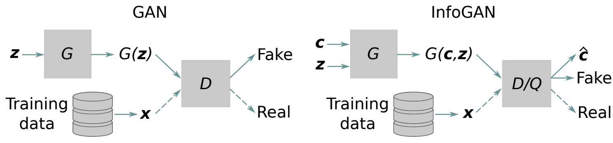

**图 1. GAN 和 InfoGAN 的架构。**

其中，$P_c$ 为潜在编码的先验分布，$\lambda$ 为权重参数。在实际应用中，如果 $c$ 的分布固定，则将 $H(c)$ 视为常量。辅助分布 $Q$ 同样由神经网络学习；具体做法是让其与 $D$ 共享所有卷积层，并为 $D$ 添加一个额外的全连接层，以预测条件分布 $Q(c\mid x)$。因此，如图 1 所示，判别器同时尝试预测数据来源和潜在编码。¹

需要注意的是，虽然 InfoGAN 鼓励得到解耦的潜在表示，但它并不像 PCA 或 SVD 那样保证潜在变量正交。相反，当每个变量都独立采样时，它保证潜在变量或噪声变量之间的统计独立性。这在概念上类似于独立成分分析（ICA）[62] 在线性降维中的作用。我们在 InfoGAN 的基础上，将其扩展到基于样条的几何表示。

¹ 原文脚注：这里使用判别器 $D$ 同时表示 $Q$ 和 $D$，因为二者共享神经网络权重。

## IV. Bézier-GAN：基于样条的形状合成

生成式形状模型的典型方法，例如 GAN，通常将形状表示为离散样本的集合，如像素或体素，这是因为这些方法最初由计算机视觉领域发展而来。例如，合成翼型等气动外形的一种直接方法，是让生成器直接生成这种**离散表示**，例如生成沿翼型表面曲线采样的固定数量坐标，见图 6 左侧。然而，在实际应用中，气动外形通常具有较高的光滑性与连续性，并且通常采用样条、Bézier 曲线或 NURBS 曲面等参数化曲线族来表示。让生成器预测离散曲线的直接 GAN 表示方法，通常会：（1）产生含噪声、光滑性较差的曲线；（2）与等价的曲线表示，例如 Bézier 曲线相比，其参数化输出更难供人理解，也更难在标准 CAD 软件中使用。这会带来问题，在气动外形合成中尤其如此。

为解决这一问题，我们修改了 InfoGAN 的生成器，使其只生成符合 Bézier 曲线形式的光滑形状。我们将这一生成对抗网络称为 **Bézier-GAN** [63]。

### A. 架构

如图 3 所示，整体架构由 InfoGAN 改进而来。不过，生成器不再直接输出沿曲线分布的离散坐标，而是合成有理 Bézier 曲线的控制点 $\{P_i\mid i=0,\ldots,n\}$、权重 $\{w_i\geq0\mid i=0,\ldots,n\}$，以及参数变量 $\{0\leq t_j\leq1\mid j=0,\ldots,m\}$。其中，$n$ 为 Bézier 曲线的次数，用于表示曲线的表面点数量为 $m+1$。生成器的最后一层，即 Bézier 层，将这种有理 Bézier 曲线表示转换为离散表示 $x$：

$$
x_j=
\frac{\displaystyle\sum_{i=0}^{n}\binom{n}{i}t_j^i(1-t_j)^{n-i}P_iw_i}
{\displaystyle\sum_{i=0}^{n}\binom{n}{i}t_j^i(1-t_j)^{n-i}w_i},
\qquad j=0,\ldots,m.
\tag{4}
$$

由于 $x_j$ 对 $\{P_i\}$、$\{w_i\}$ 和 $\{t_j\}$ 均可微，因此能够使用反向传播训练网络。为提高数值稳定性，我们通过自然对数计算 Bernstein 多项式：

$$
\begin{aligned}
B_i^n(t)
&=\binom{n}{i}t^i(1-t)^{n-i}\\
&=\exp\!\Bigl(\log\Gamma(n+1)-\log\Gamma(i+1)
-\log\Gamma(n-i+1)\\
&\hspace{4.5em}+i\log t+(n-i)\log(1-t)\Bigr).
\end{aligned}
\tag{5}
$$

其中，$\Gamma$ 表示伽马函数。

特别地，如图 2 所示，气动表面，这里以翼型为例，可以表示为一个有序点序列。因此，参数变量必须满足 $0=t_0<t_{j-1}<t_j<t_m=1$，其中 $j=2,\ldots,m-1$。我们不直接生成 $\{t_j\mid j=0,\ldots,m\}$，而是使用 softmax 激活函数生成间隔 $\{\delta_j=t_j-t_{j-1}\mid j=1,\ldots,m\}$，然后对 $\{\delta_j\}$ 进行累加，得到 $\{t_j\}$。

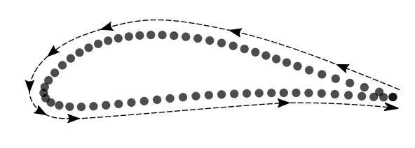

**图 2. 翼型表示中的点序。**

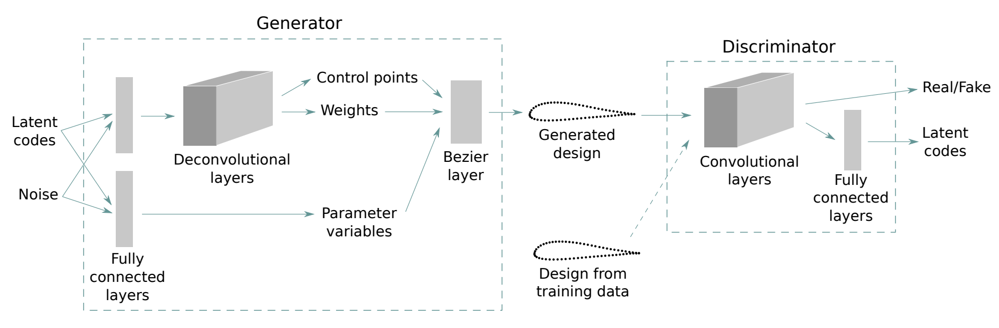

**图 3. Bézier-GAN 的模型架构。**

### B. 正则化

对于一个点序列，其有理 Bézier 表示，即 $P$、$w$ 和 $t$ 的选择，并不唯一。例如，我们观察到生成的控制点可能分散且无序。对于远离表面点的控制点，其权重趋于零，而参数变量则不得不变得高度不均匀，以适应这些状态不良的控制点。为防止 Bézier-GAN 收敛到不良最优解，我们对这些 Bézier 参数施加正则化。

#### 1. 控制点

控制点可能分散且无序，进而导致权重和参数变量也出现异常行为。因此，对控制点进行正则化的一种方法，是使它们彼此保持接近。我们将相邻两个控制点之间欧氏距离的平均值和最大值用作正则化项：

$$
R_1(G)=\frac{1}{Nn}\sum_{s=1}^{N}\sum_{i=1}^{n}
\left\lVert P_i^{(s)}-P_{i-1}^{(s)}\right\rVert.
\tag{6}
$$

其中，$N$ 为样本数量。

> 译注：本段原文同时提到距离的“平均值和最大值”，但式（6）实际仅给出了平均距离项，没有最大值项。此处保留原文表述与公式。

#### 2. 权重

为消除冗余控制点的影响并避免曲线迂回缠绕，我们对除首尾控制点以外的控制点权重进行正则化：

$$
R_2(G)=\frac{1}{Nn}\sum_{s=1}^{N}\sum_{i=1}^{n-1}
\left|w_i^{(s)}\right|.
\tag{7}
$$

#### 3. 边缘对齐

如图 2 所示，我们用从后缘出发、最终回到后缘的二维点序列表示气动表面曲线。因此，首尾控制点 $P_0$ 和 $P_n$ 应在后缘处重合，使表面曲线闭合。为施加这一约束，我们向损失函数添加以下正则化项：

$$
R_3(G)=\frac{1}{N}\sum_{s=1}^{N}
\left\lVert P_0^{(s)}-P_n^{(s)}\right\rVert.
\tag{8}
$$

此外，我们使用以下正则化项，保证表面曲线在后缘附近不会发生自相交：

$$
R_4(G)=\frac{1}{N}\sum_{s=1}^{N}
\max\left\{0,-10\left(P_{0y}^{(s)}-P_{ny}^{(s)}\right)\right\}.
\tag{9}
$$

其中，$P_{iy}^{(s)}$ 表示第 $j$ 个翼型样本中第 $i$ 个控制点的 $y$ 坐标。

> 译注：上一句原文写作“第 $j$ 个翼型样本”，但公式用上标 $s$ 标识样本，因此此处的 $j$ 应为 $s$。本译稿保留原文的下标说明并指出这一不一致。

加入上述正则化项后，Bézier-GAN 的损失函数变为：

$$
\min_{G,Q}\max_D\;
V(D,G)-\lambda_0L_I(G,Q)+\sum_{r=1}^{4}\lambda_rR_r(G).
\tag{10}
$$

其中，$\lambda_i$ 控制相应正则化项的权重。

## V. 基于 Bézier-GAN 参数化的两阶段优化

对于一般的参数化方法 $F$，例如自由形式变形（FFD），可以通过给定参数 $p$ 合成翼型设计 $x$，即表面点的笛卡尔坐标。例如，在 FFD 中，$p$ 是控制点坐标。这个合成过程可以表示为 $x=F(p)$。CFD 仿真器同样是一个函数 $f$，它将设计 $x$ 映射为性能指标 $y$，例如阻力系数。我们可以将该过程写作 $y=f(x)=f(F(p))$。相应优化问题可以表示为：

$$
\min_p\quad y=f(F(p)).
$$

如果将 Bézier-GAN 的生成器 $G$ 用作参数化方法，就有两组必须优化的参数：潜在编码 $c$ 和噪声变量 $z$。合成过程可以写作 $x=G(c,z)$。因此，优化问题变为：

$$
\min_{c,z}\quad y=f(G(c,z)).
$$

不过，我们没有同时优化 $c$ 和 $z$，而是提出了一种两阶段优化（two-stage optimization，TSO），专门利用 Bézier-GAN 的两级参数化结构，以更快地收敛至较好的解，见算法 1。

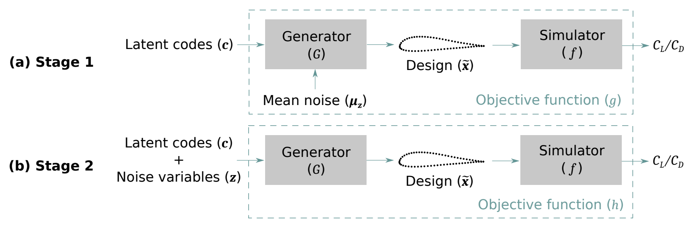

**图 4. 两阶段优化（TSO）中两个阶段的目标函数。**

由于我们最大化潜在编码与生成设计之间互信息的下界，潜在编码 $c$ 将捕捉主要的形状变化，而较小的变化则由噪声 $z$ 控制。第 VI 节将进一步说明这一点。这种两级表示使我们能够更高效地探索设计空间。具体而言，首先固定 $z$，仅优化 $c$，以快速找到一个近似最优解 $c^\dagger$：

$$
c^\dagger=\underset{c}{\arg\min}\;g(c),
\tag{11}
$$

其中，$g(c)=f(G(c,\mu_z))$，$\mu_z=\mathbb{E}_{z\sim P_z}[z]$，如图 4（a）所示。当 $P_z$ 为以零为中心的正态分布时，有 $\mu_z=0$。

**算法 1. 两阶段优化（TSO）**

1. 给定潜在维数 $d$、噪声维数 $d'$、平均噪声 $\mu_z$、训练好的生成器 $G$、CFD 仿真器 $f$，以及评估预算 $T$。
2. 开始过程 $\operatorname{TSO}(d,d',G,f,T)$。
3. 令 $T_1\leftarrow Td/(d+d')$，$T_2\leftarrow T-T_1$。——为每个阶段分配预算。
4. 对 $t=1,\ldots,T_1$，求解 $\min_c g(c)=f(G(c,\mu_z))$。——第一阶段优化。
5. 令 $c^\dagger\leftarrow\arg\min_c g(c)$。
6. 对 $t=1,\ldots,T_2$，以 $(c^\dagger,\mu_z)$ 为热启动，求解 $\min_{c,z}h(c,z)=f(G(c,z))$。——第二阶段优化。
7. 令 $(c^*,z^*)\leftarrow\arg\min_{c,z}h(c,z)$。
8. 令 $x^*\leftarrow G(c^*,z^*)$。——合成最优设计。
9. 返回 $x^*$。
10. 结束过程。

随后，以 $(c^\dagger,\mu_z)$ 作为热启动，同时优化 $c$ 和 $z$，进一步改进这一近似最优解：

$$
c^*,z^*=\underset{c,z}{\arg\min}\;h(c,z),
\tag{12}
$$

其中，$h(c,z)=f(G(c,z))$，如图 4（b）所示。然后即可合成最优形状 $x^*=G(c^*,z^*)$。

对于**第一阶段优化**，即优化 $c$，我们希望快速找到一个接近真实最优解的较好解 $c^\dagger$。本文采用一种称为高效全局优化（Efficient Global Optimization，EGO）[41] 的代理模型优化（SBO）方法。该方法仅在期望改进（expected improvement，EI）[41] 最大的位置进行评估，从而尽量减少函数评估次数。EI 的值由高斯过程（GP）回归器 [43] 估计。在 EGO 的每次迭代中，我们希望找到一个预计最有可能改进当前最优解的潜在编码，然后在该点进行评估。由于某些潜在编码也可能对应无效设计，因此这是一个带约束的 SBO 问题。受文献 [64] 和 [65] 启发，我们在每次迭代中求解以下约束优化问题：

$$
\begin{aligned}
\max_c\quad &\mathrm{EI}(c)\Pr(C(c))\\
\text{约束：}\quad &\Pr(C(c))\geq0.5.
\end{aligned}
\tag{13}
$$

其中，$C(c)$ 是 $c$ 处可行性的指示量，即判断约束是否满足，或目标函数在该处是否有定义。实际应用中，我们使用 GP 分类器 [43] 估计 $\Pr(C(c))$，其中 $C(c)=0$ 表示与 $c$ 对应的形状存在自相交，或仿真未能成功。在每次迭代 $t$ 中，我们求出式（13）的解 $c^{(t)}$，并在 $c^{(t)}$ 处进行评估。GP 回归器和 GP 分类器的超参数都通过最大化对数边际似然（log marginal likelihood，LML）来优化。关于 GP 回归器与分类器的实现，以及使用 LML 优化超参数的细节，可参阅文献 [43]。

第一阶段优化的最后一次迭代给出潜在编码 $c^\dagger$，大致确定最优设计的主要特征。真正的最优潜在编码很可能位于 $c^\dagger$ 附近。**第二阶段优化**通过联合优化 $c\in\mathbb{R}^d$ 和 $z\in\mathbb{R}^{d'}$，进一步改进这一解。我们设定 $z\sim P_z=\mathcal{N}(\mu_z,\Sigma_z)$，这意味着，为合成真实可行的设计，需要在 $\mu_z$ 附近对 $z$ 采样。因此，在第二阶段，我们从 $(c^\dagger,\mu_z)$ 出发，使用遗传算法（GA）搜索进一步改进的解。

## VI. 实验：翼型合成与外形优化

本节从两个方面检验将 Bézier-GAN 用作参数化方法的性能：（1）**表征能力**，即覆盖设计空间的能力；（2）**表征紧凑性**，即以尽可能少的参数覆盖足够大的设计空间，同时使参数空间中的每一点都映射为有效设计的能力。

### A. 数据集与预处理

我们采用 [UIUC 翼型数据库](http://m-selig.ae.illinois.edu/ads/coord_database.html)作为 Bézier-GAN 的训练数据。该数据库提供了约 1,600 个真实翼型设计的几何形状，其应用范围从无人机和航模所用的低雷诺数翼型，到喷气运输机和风力机翼型。每个设计均用沿上下表面分布的离散二维坐标表示。我们从数据集中剔除了外观不合理的异常样本。由于数据库中各翼型的坐标点数不一致，我们采用 B 样条插值获得统一的形状表示。具体而言，我们在每个翼型上插值得到 192 个点，并依据曲率确定这些点沿 B 样条曲线的分布密度 [47]。预处理后的数据如图 5 上部所示。我们已公开预处理数据及复现实验结果所需的代码，见 [Bézier-GAN 代码仓库](https://github.com/IDEALLab/bezier-gan)。

### B. Bézier-GAN 参数化

我们将潜在编码与噪声拼接后输入生成器。生成器具有两个分支：一个通过全连接层和反卷积层 [66] 生成控制点与权重；另一个仅通过全连接层生成参数变量。Bézier 层将两个分支的输出组合起来，合成沿表面曲线分布的二维点坐标。判别器接收这些坐标，并通过全连接层和卷积层预测输入的来源及潜在编码。每个中间层均采用批归一化和 Leaky ReLU 激活函数。训练步数为 10,000，批大小为 32。我们设定 $P_c=\operatorname{Unif}(0,1)$，$P_z=\mathcal{N}(0,0.5I)$。Bézier-GAN 的详细实现可参见我们的代码。对于式（10）所示的损失函数，我们采用 $\lambda_0=1$，$\lambda_1=\lambda_2=\lambda_3=\lambda_4=10$。我们在一块 NVIDIA Titan X GPU 上使用 Adam 优化器 [67] 训练 Bézier-GAN。实际训练用时约 1 小时，推断用时不到 15 秒。

图 5 展示了使用训练好的 Bézier-GAN，在潜在空间和噪声空间中对点进行线性插值后合成的翼型。三维潜在空间捕捉到了厚度、弯度/弦线曲率等特征方面的较大形状变化。这些都是翼型几何的主要特征。相比之下，在固定潜在编码时，噪声空间中的形状仅表现出较小的变化。这表明噪声空间捕捉到了次要特征。

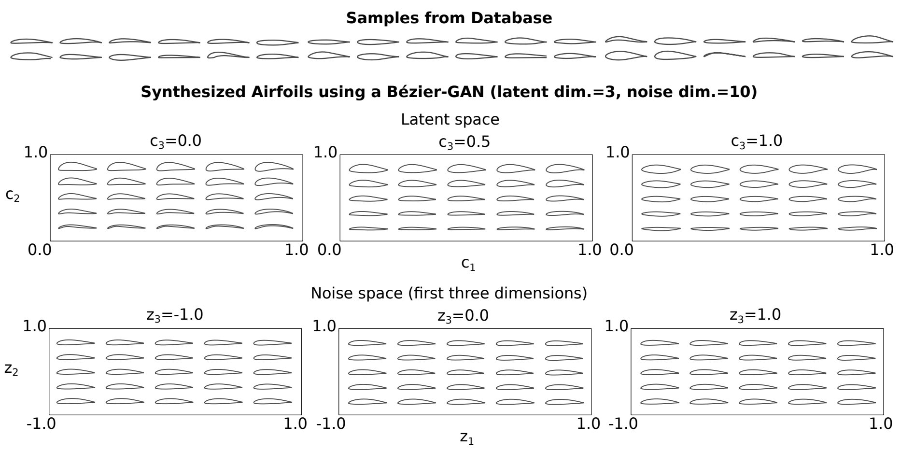

**图 5. 翼型数据库中的样本，以及潜在空间和噪声空间中的合成翼型形状。** 通过多个二维空间的均匀切片进行可视化。

图 6 比较了 Bézier-GAN 和 InfoGAN 在训练过程中合成的形状。可以看出，与 InfoGAN 相比，Bézier-GAN 只需少得多的训练样本，就能收敛到光滑且逼真的翼型形状。

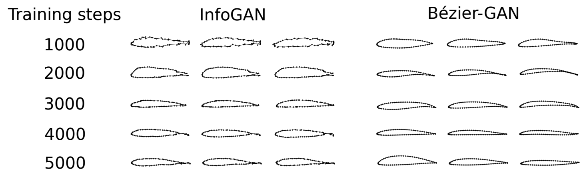

**图 6. InfoGAN（左）与 Bézier-GAN（右）在训练过程中合成的形状。**

Bézier-GAN 相对于 InfoGAN 或 SVD 等其他离散参数化方法 [20] 的另一项优势在于：它通过 Bézier 层合成连续的 Bézier 曲线，而不是直接生成离散表面点表示。这意味着生成的形状始终具有连续曲率。这项保证有利于气动性能，因为既有研究表明，气动性能在很大程度上取决于形状的曲率连续性 [68–70]。如图 7 所示，合成翼型具有光滑的曲率分布。我们通过下式计算表面点 $(x(t),y(t))$ 处的曲率：

$$
\kappa(t)=\frac{\dot{x}\ddot{y}-\ddot{x}\dot{y}}{\left(\dot{x}^{2}+\dot{y}^{2}\right)^{3/2}}.
\tag{14}
$$

给定生成器中间层输出的控制点 $P_1,\ldots,P_n$ 和权重 $w_1,\ldots,w_n$，可以由式（4）获得 $x$、$y$ 及其导数。图 7 还可视化了控制点与权重。如果需要约束曲率，例如为了改善气动性能、降低仿真复杂度，或满足制造公差要求，可以在式（10）的 Bézier-GAN 损失函数中再加入一项包含 $\kappa(t)$ 的正则项。不过，这超出了本研究的范围，我们将其留待未来研究。

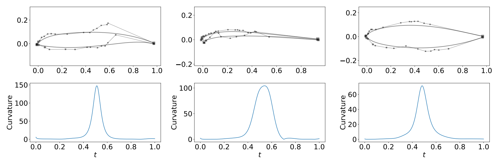

**图 7. 三个随机合成翼型的控制点与曲率。** 方形标记的大小表示权重 $w$ 的大小。

为了研究潜在维数和噪声维数对 Bézier-GAN 参数化及优化性能的影响，我们采用不同的潜在维数（$d=2,4,6,8,10$）与噪声维数（$d'=0,10,20$）组合，训练了多个 Bézier-GAN。我们采用核最大均值差异（MMD）[71] 评价生成设计的质量。MMD 指标度量生成器对真实数据分布的逼近程度：

$$
\begin{aligned}
\operatorname{MMD}^{2}(P_{\mathrm{data}},P_G)
={}&\mathbb{E}_{x_d,x'_d\sim P_{\mathrm{data}};\,x_g,x'_g\sim P_G}
\left[k(x_d,x'_d)-2k(x_d,x_g)+k(x_g,x'_g)\right].
\end{aligned}
\tag{15}
$$

其中，$k(x,x')=\exp\!\left(-\lVert x-x'\rVert^2/(2\sigma^2)\right)$ 是高斯核，$\sigma$ 是核长度尺度，本文将其设为 1.0。MMD 越低，说明生成器越擅长生成逼真的设计。图 8 所示结果来自每种潜在维数和噪声维数组合各运行十次所得的数据。结果表明，潜在维数对改善生成器起着关键作用。此外，潜在维数达到 8 后，没有出现显著改善，说明使用 8 个潜在变量就足以编码翼型几何的主要特征。理想情况下，由于噪声可以编码潜在编码未捕捉到的次要特征，人们会预期噪声维数越大，MMD 越低。但在我们的结果中，这一现象仅在潜在维数为 2 时成立。一种解释是：潜在编码在捕捉形状变化方面的优先级高于噪声变量，因此增加潜在维数，会减少噪声变量用于控制有意义形状变化的余地。因而，潜在维数较高时，噪声变量的作用会减弱。

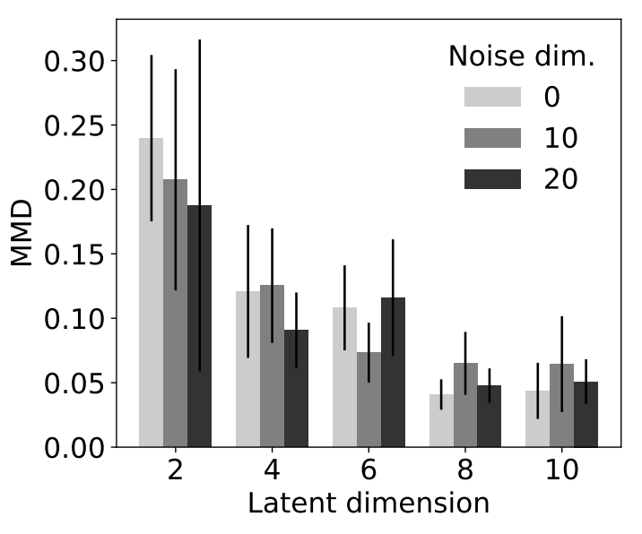

**图 8. 已训练 Bézier-GAN 的最大均值差异（MMD）指标。** 误差条表示 95% 置信区间。

我们将 Bézier-GAN 与三种先进的参数化方法进行基准比较，即 GMDV [24]、SVD [20] 和 FFD [8,25]。我们还开展拟合试验，评价参数化方法重构多种现有翼型设计的能力。具体而言，我们在不同参数化方法和设计变量数量下，通过最小二乘拟合，使合成翼型与 UIUC 翼型相匹配。结果如图 9 所示，其中 Bézier-GAN 的噪声维数设为 10。均方误差（MSE）越低，表明对 UIUC 数据的覆盖越好。需要注意的是，拟合性能对 SVD 和 GMDV 有利，并不完全取决于设计空间覆盖程度。这是因为 SVD 和 GMDV 的最小二乘问题都有解析解，而 Bézier-GAN 的解是近似的。对于 Bézier-GAN，拟合问题既没有解析解，也不是凸问题，需要使用迭代方法寻找可能为次优的最小二乘拟合解。尽管这会限制 Bézier-GAN 在训练数据上的拟合性能，但正如下节所示，它未必会影响设计优化中的性能。拟合结果表明，随着变量数量增加，所有受测方法都会趋于平台。如图 9a 所示，SVD 的 MSE 最低，这是合理的，因为它使用 UIUC 翼型作为训练数据，而且可以获得最小二乘问题的精确最优解。固定噪声时，Bézier-GAN 的结果与 GMDV 相近。图 9b 展示了两种情况：（1）在最小二乘拟合过程中仅优化潜在编码，并固定噪声变量；（2）同时优化潜在变量和噪声变量。图中表明，随着潜在维数增加，优化噪声变量对降低 MSE 的贡献减小，即其对形状变化的控制作用减弱。该结果可以作为判断何时采用两阶段优化会有益的一项依据或检验方法。

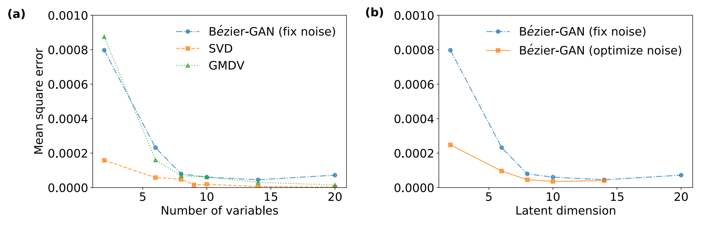

**图 9. 展示重构 UIUC 翼型性能的拟合试验结果。** 注意：拟合性能对 SVD 和 GMDV 有利，并不完全取决于设计空间覆盖程度，因为 SVD 和 GMDV 的最小二乘问题都有解析解，而 Bézier-GAN 的解是近似的。

图 9 的拐点，即增加设计变量数量时，相应拟合误差的下降幅度开始变得较小的位置，可以指示合理覆盖原始设计空间所需的最少变量数量。对于 Bézier-GAN，拐点对应的潜在维数为 8。SVD 和 GMDV 的拐点分别位于 8 和 9。因此，在其余实验中，我们将依据这些数值设置 SVD 和 GMDV 的模态数量。

除了研究设计空间的覆盖程度，我们还比较了 Bézier-GAN、SVD、GMDV 和 FFD 对性能空间的覆盖程度，即合成翼型如何覆盖 $C_L$ 和 $C_D$ 空间，见图 10。对于 FFD，我们依据文献 [8]，采用一组 $3\times4$ 控制点并固定其 $x$ 坐标。结果显示，Bézier-GAN 翼型的性能分布与 UIUC 数据库最为吻合。SVD 的性能覆盖范围与数据相近，但包含很大比例的无效性能，对应的形状发生自相交，或导致仿真失败。GMDV 和 FFD 的性能空间覆盖范围都大于输入数据。由于 GMDV 和 FFD 并未显式地在输入数据上训练，其参数化方法很容易采样到远超原始设计空间的设计，因此这一结果符合预期。

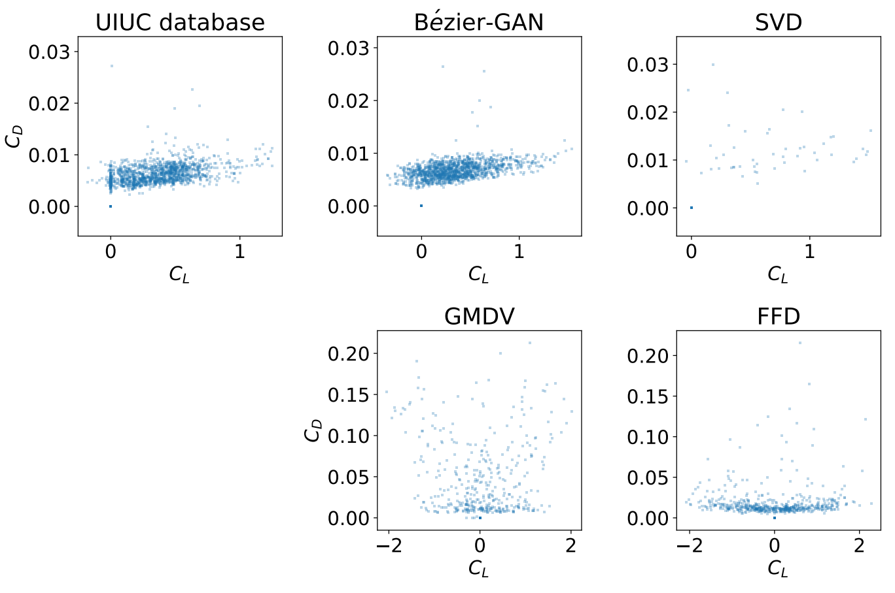

**图 10. 随机采样下各参数化方法的性能空间比较。** 原点处的点表示因形状自相交或仿真失败而无法计算的性能，本文称之为无效性能。注意，各图采用了不同尺度。

设计空间与性能空间的覆盖程度反映了表征能力的水平。参数化方法的另一个关键性质是表征紧凑性，它反映设计空间中有用设计所占的比例。图 11 展示了通过在不同参数化方法下随机采样点，即对设计空间进行随机采样，而合成的翼型。具体而言，Bézier-GAN 翼型使用分别从其各自分布中抽取的潜在编码和噪声变量合成，相应分布已在第 VI.B 节说明。已知与有效设计对应的设计变量，即有效设计变量的分布，有助于探索设计空间。对于另外三种参数化方法，有效设计变量的分布未知，因此我们在特定边界内均匀随机抽取设计变量，以合成翼型。对于 GMDV，我们依据文献 [24] 设置边界，更多细节可参见代码。对于 SVD，我们将边界设为数据库中各翼型所对应设计变量的最小包围盒。对于 FFD，我们将边界设为对 NACA 0012 翼型施加 $\pm0.2$ 的扰动。Bézier-GAN 合成的全部设计看起来都很逼真，而其他参数化方法包含较大比例的无效设计，例如自相交设计。这表明 Bézier-GAN 的表征紧凑性高于其他参数化方法。这一结果也符合预期，因为 Bézier-GAN 的目标函数迫使潜在空间或噪声空间中的每一点都映射为与训练数据相似的设计。

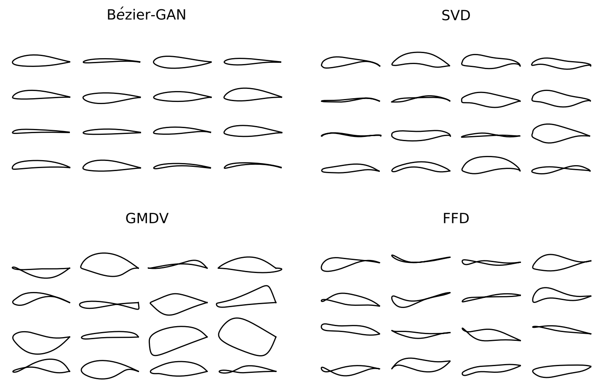

**图 11. 各参数化方法随机合成的翼型。**

### C. 优化

在第 VI.B 节中，我们通过设计空间与性能空间的覆盖程度，展示了 Bézier-GAN 的表征能力。我们还通过随机合成的设计来可视化设计空间，从而为表征紧凑性提供了直观依据。那么，这两种性质为什么重要？本节通过一项气动优化任务，展示这些性质对加速优化的益处。全局优化的性能与参数化方法的表征能力和表征紧凑性密切相关。表征能力较低，可能导致次优解，因为更好的解无法通过该参数化方法表示。同时，表征紧凑性较低，会使优化器遭遇维数灾难，并可能评价大量无效设计，从而导致收敛缓慢，浪费评价预算。

下面的优化任务仅用于评估各参数化方法的表征能力和表征紧凑性所产生的影响。为了使其他研究者能够方便、快速地复现和评价下述实验，我们使用 XFOIL [72] 计算候选翼型的升力系数 $C_L$ 和阻力系数 $C_D$。不过，我们的方法并不限于 XFOIL。我们的技术可以用于任何 CFD 或性能分析程序，包括雷诺平均 Navier–Stokes 仿真或大涡模拟（LES）。下文采用哪一种具体 CFD 仿真方法，并非评价本文主要贡献的核心问题；不过，研究更好的参数化方法对成本更高、更先进的流动仿真的影响，是未来值得探索的方向。

具体而言，下述实验的优化目标是最大化升阻比，即 $f(x)=C_L/C_D$。工作条件设置如下：雷诺数 $Re=1.8\times10^6$，马赫数 $Ma=0.01$，迎角 $\alpha=0^\circ$。

> 译注：第 V 节采用最小化形式陈述一般优化问题，本节具体算例则以最大化升阻比为目标，均按原文保留。

对于每种潜在维数和噪声维数组合，我们均训练十个 Bézier-GAN。对每种配置，我们分别以这十个 Bézier-GAN 作为参数化模型，各获得一个优化结果，并研究这些结果的统计特性，例如优化历程的均值和标准差。因此，与其他参数化方法不同，Bézier-GAN 优化结果的方差还取决于训练所得 Bézier-GAN 模型的随机性。在阶段一优化中，每个潜在编码的范围限定为 $[-0.2,1.2]$。获得近似最优潜在编码 $c^\dagger$ 后，我们进行阶段二优化，将各潜在编码的范围限定为 $[c_i^\dagger-0.1,c_i^\dagger+0.1]$，$i=1,\ldots,d$，并将每个噪声变量的范围限定为 $[-1.0,1.0]$。

图 12 比较了两阶段优化（TSO）与单阶段优化（OSO）的性能；后者将全部预算用于仅优化潜在编码。单阶段优化采用 EGO。图 12a 表明，在潜在维数较小时，就最终最优 $C_L/C_D$ 而言，TSO 比 OSO 更有效。图 12b 表明，潜在维数越低，在整个优化历程中，TSO 相对于 OSO 的 $C_L/C_D$ 改善量 $\Delta(C_L/C_D)$ 就越显著。这些结果是合理的：正如 MMD 值（图 8）和拟合误差（图 9b）所表明的，增加潜在维数会减少噪声变量控制形状变化的余地，因此在阶段二优化噪声变量的作用会减弱。

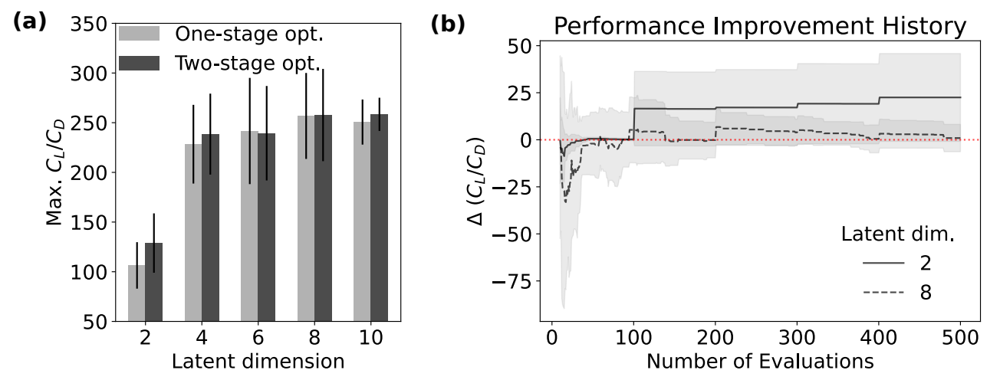

**图 12. Bézier-GAN 参数化在细化噪声变量（即两阶段优化，TSO）和不细化噪声变量（即单阶段优化，OSO）情况下的优化结果。** 噪声维数设为 10。图（a）展示不同潜在维数下最终的最优 $C_L/C_D$；图（b）展示 TSO 相对于 OSO 的性能改善历程 $\Delta(C_L/C_D)$。水平点线表示 $\Delta(C_L/C_D)=0$，即 TSO 与 OSO 的性能完全相同。

优化性能同时受到参数化方法的表征能力和表征紧凑性的影响。表征能力较低可能导致解的性能受到限制，而表征紧凑性较低可能使优化搜索进入更大范围的无效设计区域，因而更慢地找到最优解。在一定程度上，我们可以通过比较相应的优化历程来评价参数化方法。如图 13 所示，当潜在维数从 2 增至 8 时，优化性能得到改善；但继续增加潜在维数，会降低收敛速度。这一结果与前述 MMD 值（图 8）和拟合误差（图 9）一致。我们的全部结果都表明，对于本研究的特定优化问题，8 维潜在空间在表征能力方面已经足够。

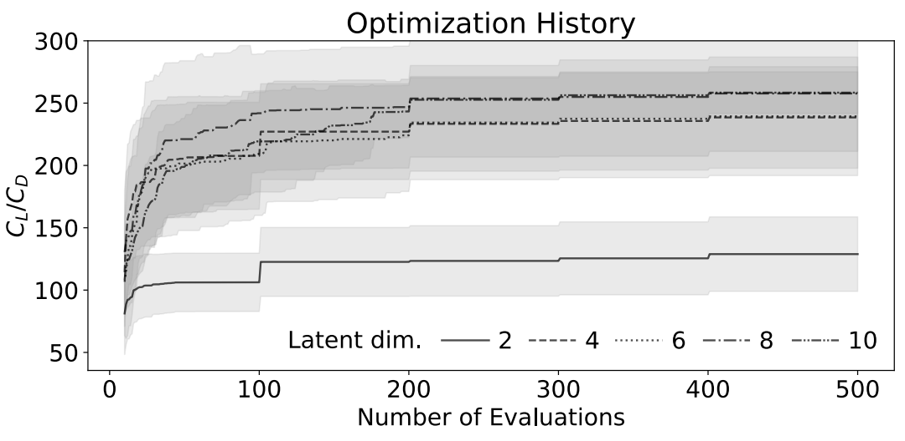

**图 13. 不同潜在维数下，采用 Bézier-GAN 参数化的优化历程。** 噪声维数固定为 10。

图 14 表明，尽管噪声维数对优化性能的影响不及潜在维数显著，但引入噪声变量仍然优于不引入噪声变量。需要注意，随着噪声维数增加，表征能力会提高；例如，噪声维数为 10 时，最终最优解优于噪声维数为 0 时的结果。但由于表征紧凑性降低以及维数灾难，优化收敛可能变慢；例如，噪声维数为 20 时的收敛速度慢于噪声维数为 10 时。

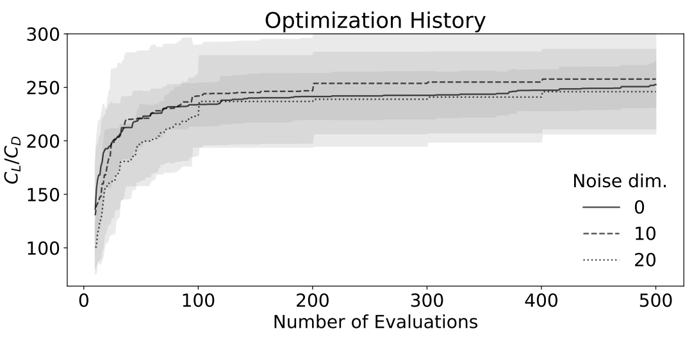

**图 14. 不同噪声维数下，采用 Bézier-GAN 参数化的优化历程。** 潜在维数固定为 8。

我们还将本方法与若干先进的参数化方法进行了比较，见图 15。Bézier-GAN 的潜在维数和噪声维数分别设为 8 和 10。对于 GMDV 和 SVD，我们依据拟合试验结果（图 9）中的拐点，将设计变量数量分别设为 8 和 9。依据文献 [8]，我们为 FFD 采用 $3\times4$ 个控制点。GMDV 的设计变量边界依据文献 [24] 设置。对于 SVD，我们将设计变量边界设为数据库中各翼型所对应设计变量的最小包围盒。对于 FFD，设计变量边界为对 NACA 0012 翼型施加 $\pm0.2$ 的扰动。运行 GA 时，种群大小为 100，变异概率，即某个个体参数发生变异的概率，为 0.1。每一代中，我们选择最优的 30 个个体及随机抽取的 10 个个体进行交叉，并为每一对生成 5 个子代。感兴趣的读者可参见我们的代码，了解更多具体实现细节。除了上述参数化方法，我们还检验了非均匀有理 B 样条（NURBS）[73] 和 PARSEC [52] 的优化性能。不过，由于它们的性能均差于 SVD、GMDV、FFD 和 Bézier-GAN 参数化方法，因此图中没有展示其结果。感兴趣的读者可参见文献 [21] 中的相关结果。每条优化历程均为十次运行的平均结果。

> 译注：原文在第 VI.B 节将 SVD、GMDV 的拟合拐点分别写为 8 和 9，此处却将 GMDV、SVD 的设计变量数量分别写为 8 和 9，两处对应关系不一致，译文均按原文保留。

结果表明，Bézier-GAN 在 200 次评价中达到的平均 $C_L/C_D$，其他方法至少需要 500 次评价才能达到。这说明 Bézier-GAN 参数化具有高得多的紧凑性，因此在探索无效区域和性能较差区域时浪费的资源更少。图 16 展示了不同参数化方法得到的最优翼型。值得注意的是，与其他参数化方法不同，Bézier-GAN 结果的方差不仅来自优化过程，也来自训练所得的 Bézier-GAN 模型，因为训练过程具有随机性。

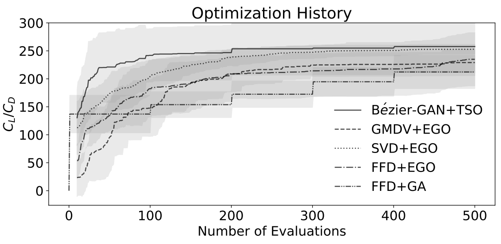

**图 15. Bézier-GAN 与其他参数化方法的优化历程。** Bézier-GAN+TSO 在 200 次评价中达到的性能，次优方法需要 500 次评价才能达到。

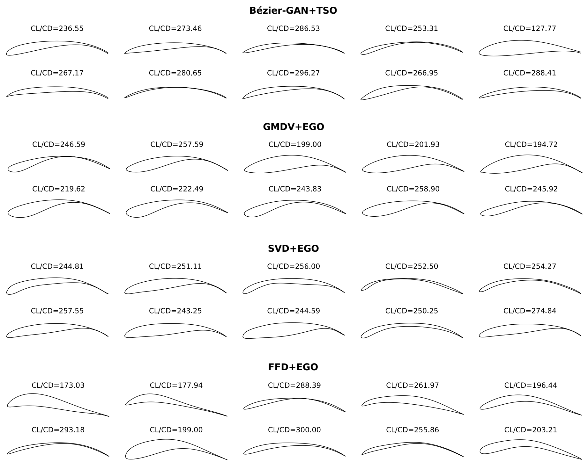

**图 16. 不同参数化方法得到的最优翼型。**

## VII. 结论与讨论

我们将 Bézier-GAN 用作一种新的气动设计参数化方法，它具有较高的表征紧凑性和足够的表征能力。潜在编码和噪声变量分别编码主要与次要的形状变化。随后，我们提出将这种参数化方法用于两阶段设计优化。结果表明，Bézier-GAN 能够加快收敛，并找到比其他先进参数化方法所得设计性能更高的最优设计。

我们认为，这一现象源于参数化方法的表征能力和表征紧凑性，与用于评价翼型的具体 CFD 方法无关。也就是说，一个能够更好地描述翼型变化的空间，即使并非专门为优化任务设计，也应当对优化有所帮助。不过，我们也承认，本文的仿真环境较为简单，而且我们确实假设：采用不同的性能评价器，例如更先进的 CFD，也能看到相似的优化改善。同样，我们仅针对二维翼型进行了展示，并未在三维曲面或更大的机翼段上明确检验这一假设。我们预期，在设计自由度更大的三维问题中，紧凑性和覆盖程度更好的表征将更加重要。不过，我们尚未对此进行检验。我们认为，这将是一个很有价值的未来研究方向。

一般而言，能够将主要与次要形状变形分离的参数化方法，有利于设计优化。对几何影响较大的参数可以在优化中获得更高的优先级，从而首先确定主要特征，而这些特征通常是性能变化的主要原因。尽管本文将设计参数划分为两类，但在理想情况下，应当根据各参数对几何的重要程度，对全部参数进行排序。SVD 等一些线性降维方法能够学习具有顺序的表征。已有研究尝试将这一能力扩展至非线性方法 [74]。但据我们所知，深度生成模型中迄今尚无对应方法。与此相关，还需要一种新的全局优化方法，以高效优化具有这种顺序的参数。未来研究可以填补这些空白。

尽管本文仅展示了 Bézier-GAN 对翼型进行参数化的能力，我们也可以训练这一新的生成模型，用于合成其他光滑几何形状，例如水动力外形。

本文分别在阶段一和阶段二优化中采用 EGO 和 GA。还存在其他方法，可以在保持快速收敛的同时改善最优解。例如，本方法获得的最优解，可以作为基于梯度的优化方法的良好初始点，类似于 Berguin 等人 [12] 的做法。在未来研究中，我们可以将训练好的 Bézier-GAN 生成器与自动微分求解器连接起来，直接获得性能相对于各潜在编码和噪声变量的梯度。这样，梯度便可以传播到降维表征中，帮助在紧凑的降维空间中求解基于梯度的优化问题。

总体而言，我们希望本文能够突出学习所得几何参数化方法在更广泛的外形与设计优化中所具有的潜力，并说明这些技术的未来研究如何与优化领域采用的传统优化方法相互补充。

## 资助来源

本研究得到美国国防高级研究计划局（DARPA）资助，项目编号为 16-63-YFA-FP-059 和 HR00111820009。本文所包含的观点、意见和/或研究结果属于作者本人，不应被解释为代表美国国防高级研究计划局或美国国防部明示或暗示的官方观点或政策。

## References

[1] Larsson, J., and Wang, Q., “The prospect of using large eddy and detached eddy simulations in engineering design, and the research required to get there,” Phil. Trans. R. Soc. A, Vol. 372, No. 2022, 2014, p. 20130329. doi: 10.1098/rsta.2013.0329, URL https://doi.org/10.1098/rsta.2013.0329.

[2] Bellman, R., “Dynamic Programming,” Science, Vol. 153, No. 3731, 1966, pp. 34–37. doi: 10.1126/science.153.3731.34, URL https://science.sciencemag.org/content/153/3731/34.

[3] Regier, J. C., and Stark, P. B., “Mini-minimax uncertainty quantification for emulators,” SIAM/ASA Journal on Uncertainty Quantification, Vol. 3, No. 1, 2015, pp. 686–708. doi: 10.1137/130917909, URL https://epubs.siam.org/doi/10.1137/130917909.

[4] Koziel, S., and Leifsson, L., “Multi-level surrogate-based airfoil shape optimization,” 51st AIAA Aerospace Sciences Meeting including the New Horizons Forum and Aerospace Exposition, 2013, p. 778. doi: 10.1016/j.procs.2013.05.254, URL https://doi.org/10.1016/j.procs.2013.05.254.

[5] Anderson, G. R., Nemec, M., and Aftosmis, M. J., “Aerodynamic shape optimization benchmarks with error control and automatic parameterization,” 53rd AIAA Aerospace Sciences Meeting, 2015, p. 1719. doi: 10.2514/6.2015-1719, URL https://doi.org/10.2514/6.2015-1719.

[6] Fusi, F., Quaranta, G., Guardone, A., and Congedo, P. M., “Drag minimization of an isolated airfoil in transonic inviscid flow by means of genetic algorithms,” 53rd AIAA Aerospace Sciences Meeting, 2015, p. 1722. doi: 10.2514/6.2015-1722, URL https://doi.org/10.2514/6.2015-1722.

[7] Amrit, A., Leifsson, L. T., Koziel, S., and Tesfahunegn, Y. A., “Efficient Multi-Objective Aerodynamic Optimization by Design Space Dimension Reduction and Co-Kriging,” 17th AIAA/ISSMO Multidisciplinary Analysis and Optimization Conference, 2016, p. 3515. doi: 10.2514/6.2016-3515, URL https://doi.org/10.2514/6.2016-3515.

[8] Masters, D. A., Taylor, N. J., Rendall, T., Allen, C. B., and Poole, D. J., “Geometric Comparison of Aerofoil Shape Parameterization Methods,” AIAA Journal, 2017, pp. 1575–1589. doi: 10.2514/1.J054943, URL https://doi.org/10.2514/1.J054943.

[9] Lukaczyk, T. W., Constantine, P., Palacios, F., and Alonso, J. J., “Active subspaces for shape optimization,” 10th AIAA Multidisciplinary Design Optimization Conference, 2014, p. 1171. doi: 10.2514/6.2014-1171, URL https://doi.org/10.2514/6.2014-1171.

[10] Berguin, S. H., and Mavris, D. N., “Dimensional Design Space Exploration of Expensive Functions with Access to Gradient,” 15th AIAA/ISSMO Multidisciplinary Analysis and Optimization Conference, 2014, p. 2174. doi: 10.2514/6.2014-2174, URL https://doi.org/10.2514/6.2014-2174.

[11] Berguin, S. H., and Mavris, D. N., “Dimensionality Reduction In Aerodynamic Design Using Principal Component Analysis With Gradient Information,” 10th AIAA Multidisciplinary Design Optimization Conference, 2014, p. 0112. doi: 10.2514/6.2014-0112, URL https://doi.org/10.2514/6.2014-0112.

[12] Berguin, S. H., Rancourt, D., and Mavris, D. N., “Method to Facilitate High-Dimensional Design Space Exploration Using Computationally Expensive Analyses,” AIAA Journal, Vol. 53, No. 12, 2015, pp. 3752–3765. doi: 10.2514/1.J054035, URL https://doi.org/10.2514/1.J054035.

[13] Grey, Z. J., and Constantine, P. G., “Active subspaces of airfoil shape parameterizations,” AIAA Journal, Vol. 56, No. 5, 2018, pp. 2003–2017. doi: 10.2514/1.J056054, URL https://doi.org/10.2514/1.J056054.

[14] Viswanath, A., J. Forrester, A., and Keane, A., “Dimension reduction for aerodynamic design optimization,” AIAA Journal, Vol. 49, No. 6, 2011, pp. 1256–1266. doi: 10.2514/1.J050717, URL https://doi.org/10.2514/1.J050717.

[15] Viswanath, A., Forrester, A., and Keane, A., “Constrained Design Optimization Using Generative Topographic Mapping,” AIAA Journal, Vol. 52, No. 5, 2014, pp. 1010–1023. doi: 10.2514/1.J052414, URL https://doi.org/10.2514/1.J052414.

[16] Cinquegrana, D., and Iuliano, E., “Efficient Global Optimization of a Transonic Wing with Geometric Data Reduction,” 35th AIAA Applied Aerodynamics Conference, 2017, p. 3057. doi: 10.2514/6.2017-3057, URL https://doi.org/10.2514/6.2017-3057.

[17] Cinquegrana, D., and Iuliano, E., “Investigation of adaptive design variables bounds in dimensionality reduction for aerodynamic shape optimization,” Computers & Fluids, Vol. 174, 2018, pp. 89–109. doi: 10.1016/j.compfluid.2018.07.012, URL https://doi.org/10.1016/j.compfluid.2018.07.012.

[18] Yasong, Q., Junqiang, B., Nan, L., and Chen, W., “Global aerodynamic design optimization based on data dimensionality reduction,” Chinese Journal of Aeronautics, Vol. 31, No. 4, 2018, pp. 643–659. doi: 10.1016/j.cja.2018.02.005, URL https://doi.org/10.1016/j.cja.2018.02.005.

[19] Li, J., Bouhlel, M. A., and Martins, J., “A data-based approach for fast airfoil analysis and optimization,” 2018 AIAA/ASCE/AHS/ASC Structures, Structural Dynamics, and Materials Conference, 2018, p. 1383. doi: 10.2514/1.J057129, URL https://doi.org/10.2514/1.J057129.

[20] Poole, D. J., Allen, C. B., and Rendall, T., “Efficient Aero-Structural Wing Optimization Using Compact Aerofoil Decomposition,” AIAA Scitech 2019 Forum, 2019, p. 1701. doi: 10.2514/6.2019-1701, URL https://doi.org/10.2514/6.2019-1701.

[21] Chen, W., Chiu, K., and Fuge, M., “Aerodynamic Design Optimization and Shape Exploration using Generative Adversarial Networks,” AIAA Scitech 2019 Forum, 2019, p. 2351. doi: 10.2514/6.2019-2351, URL https://doi.org/10.2514/6.2019-2351.

[22] Kingma, D. P., and Welling, M., “Auto-encoding variational Bayes,” arXiv preprint arXiv:1312.6114, 2013. URL https://arxiv.org/pdf/1312.6114.pdf.

[23] Goodfellow, I., Pouget-Abadie, J., Mirza, M., Xu, B., Warde-Farley, D., Ozair, S., Courville, A., and Bengio, Y., “Generative Adversarial Nets,” Advances in Neural Information Processing Systems 27, edited by Z. Ghahramani, M. Welling, C. Cortes, N. D. Lawrence, and K. Q. Weinberger, Curran Associates, Inc., 2014, pp. 2672–2680. doi: 10.5555/2969033.2969125, URL https://dl.acm.org/doi/10.5555/2969033.2969125.

[24] Kedward, L., Allen, C. B., and Rendall, T., “Towards Generic Modal Design Variables for Aerodynamic Shape Optimisation,” AIAA Scitech 2020 Forum, 2020, p. 0543. doi: 10.2514/6.2020-0543, URL https://doi.org/10.2514/6.2020-0543.

[25] Sederberg, T. W., and Parry, S. R., “Free-form deformation of solid geometric models,” ACM SIGGRAPH computer graphics, Vol. 20, No. 4, 1986, pp. 151–160. doi: 10.1145/15886.15903, URL https://doi.org/10.1145/15886.15903.

[26] Kenway, G. K., and Martins, J. R., “Buffet-Onset Constraint Formulation for Aerodynamic Shape Optimization,” AIAA Journal, Vol. 55, No. 6, 2017, pp. 1930–1947. doi: 10.2514/1.J055172, URL https://doi.org/10.2514/1.J055172.

[27] Mani, K., Lockwood, B., and Mavriplis, D., “Adjoint-based unsteady airfoil design optimization with application to dynamic stall,” Annual Forum Proceedings - AHS International, Vol. 3, 2012, pp. 1940–1952. URL http://scientific-sims.com/cfdlab/Dimitri_Mavriplis/HOME/assets/papers/AHS.2012.paper.pdf.

[28] Kenway, G. K. W., Kennedy, G. J., and Martins, J. R. R. A., “Scalable parallel approach for high-fidelity steady-state aeroelastic analysis and adjoint derivative computations,” AIAA Journal, Vol. 52, 2014, p. 935–951. doi: 10.2514/1.J052255, URL https://doi.org/10.2514/1.J052255.

[29] Tesfahunegn, Y. A., Koziel, S., Leifsson, L., and Bekasiewicz, A., “Surrogate-based Airfoil Design with Space Mapping and Adjoint Sensitivity,” Procedia Computer Science, Vol. 51, 2015, pp. 795 – 804. doi: https://doi.org/10.1016/j.procs.2015.05. 201, URL http://www.sciencedirect.com/science/article/pii/S1877050915010091, international Conference On Computational Science, ICCS 2015.

[30] Schramm, M., Stoevesandt, B., and Peinke, J., “Simulation and Optimization of an Airfoil with Leading Edge Slat,” Journal of Physics: Conference Series, Vol. 753, No. 2, 2016, p. 022052. doi: 10.1088/1742-6596/753/2/022052, URL https://doi.org/10.1088%2F1742-6596%2F753%2F2%2F022052.

[31] Dhert, T., Ashuri, T., and Martins, J. R. R. A., “Aerodynamic Shape Optimization of Wind Turbine Blades Using a Reynolds-Averaged Navier–Stokes Model and an Adjoint Method,” Wind Energy, Vol. 20, 2017, pp. 909–926. doi: 10.1002/we.2070, URL https://doi.org/10.1002/we.2070.

[32] Wang, K., Yu, S., and Liu, T., “Airfoil Optimization Based on Isogeometric Discontinuous Galerkin,” Proceedings of the 2018 2Nd International Conference on Algorithms, Computing and Systems, ACM, New York, NY, USA, 2018, pp. 227–231. doi: 10.1145/3242840.3242856, URL http://doi.acm.org/10.1145/3242840.3242856.

[33] Schramm, M., Stoevesandt, B., and Peinke, J., “Optimization of Airfoils Using the Adjoint Approach and the Influence of Adjoint Turbulent Viscosity,” Computation, Vol. 6, No. 1, 2018, p. 5. doi: 10.3390/computation6010005, URL http://dx.doi.org/10.3390/computation6010005.

[34] Venter, G., and Sobieszczanski-Sobieski, J., “Particle swarm optimization,” AIAA Journal, Vol. 41, No. 8, 2003, pp. 1583–1589. doi: 10.2514/2.2111, URL https://doi.org/10.2514/2.2111.

[35] Jeong, J.-H., and Kim, S.-H., “Optimization of thick wind turbine airfoils using a genetic algorithm,” Journal of Mechanical Science and Technology, Vol. 32, No. 7, 2018, pp. 3191–3199. doi: 10.1007/s12206-018-0622-x, URL https://doi.org/10.1007/s12206-018-0622-x.

[36] Skinner, S., and Zare-Behtash, H., “State-of-the-art in aerodynamic shape optimisation methods,” Applied Soft Computing, Vol. 62, 2018, pp. 933 – 962. doi: https://doi.org/10.1016/j.asoc.2017.09.030, URL http://www.sciencedirect.com/science/article/pii/S1568494617305690.

[37] Tandis, E., and Assareh, E., “Inverse design of airfoils via an intelligent hybrid optimization technique,” Engineering with Computers, Vol. 33, No. 3, 2017, pp. 361–374. doi: 10.1007/s00366-016-0478-6, URL https://doi.org/10.1007/s00366-016-0478-6.

[38] Jahangirian, A. R., and Ebrahimi, M., “Airfoil Shape Optimization with Adaptive Mutation Genetic Algorithm,” Journal of Aerospace Science and Technology, Vol. 11, No. 1, 2017, pp. –. URL http://jast.ias.ir/article_51638.html.

[39] LIU, Z., LIU, X., and CAI, X., “A new hybrid aerodynamic optimization framework based on differential evolution and invasive weed optimization,” Chinese Journal of Aeronautics, Vol. 31, No. 7, 2018, pp. 1437 – 1448. doi: 10.1016/j.cja.2018.05.002, URL https://doi.org/10.1016/j.cja.2018.05.002.

[40] Ray, T., and Tsai, H., “Swarm algorithm for single-and multiobjective airfoil design optimization,” AIAA ournal, Vol. 42, No. 2, 2004, pp. 366–373. doi: 10.2514/1.9099, URL https://doi.org/10.2514/1.9099.

[41] Jones, D. R., Schonlau, M., and Welch, W. J., “Efficient global optimization of expensive black-box functions,” Journal of Global optimization, Vol. 13, No. 4, 1998, pp. 455–492. doi: 10.1023/A:1008306431147, URL https://doi.org/10.1023/A:1008306431147.

[42] Srinivas, N., Krause, A., Kakade, S., and Seeger, M., “Gaussian Process Optimization in the Bandit Setting: No Regret and Experimental Design,” Proceedings of the 27th International Conference on International Conference on Machine Learning, Omnipress, Madison, WI, USA, 2010, p. 1015–1022. doi: 10.5555/3104322.3104451, URL https://dl.acm.org/doi/10.5555/3104322.3104451.

[43] Rasmussen, C. E., “Gaussian processes in machine learning,” Advanced lectures on machine learning, Springer, 2004, pp. 63–71. doi: 10.1007/978-3-540-28650-9_4, URL https://doi.org/10.1007/978-3-540-28650-9_4.

[44] Han, Z.-H., Chen, J., Zhang, K.-S., Xu, Z.-M., Zhu, Z., and Song, W.-P., “Aerodynamic Shape Optimization of Natural-Laminar-Flow Wing Using Surrogate-Based Approach,” AIAA Journal, Vol. 56, No. 7, 2018, pp. 2579–2593. doi: 10.2514/1.J056661, URL https://doi.org/10.2514/1.J056661.

[45] Wang, X., and Damodaran, M., “Aerodynamic shape optimization using computational fluid dynamics and parallel simulated annealing algorithms,” AIAA journal, Vol. 39, No. 8, 2001, pp. 1500–1508. doi: 10.2514/2.1474, URL https://doi.org/10.2514/2.1474.

[46] Manzo, J. E., Leylek, E. A., and Garcia, E., “Drawing insight from nature: a bat wing for morphing aircraft,” ASME 2008 Conference on Smart Materials, Adaptive Structures and Intelligent Systems, American Society of Mechanical Engineers Digital Collection, 2008, pp. 671–678. doi: 10.1115/SMASIS2008-613, URL https://doi.org/10.1115/SMASIS2008-613.

[47] Lepine, J., Guibault, F., Trepanier, J.-Y., and Pepin, F., “Optimized Nonuniform Rational B-Spline Geometrical Representation for Aerodynamic Design of Wings,” AIAA Journal, Vol. 39, No. 11, 2001, pp. 2033–2041. doi: 10.2514/2.1206, URL https://doi.org/10.2514/2.1206.

[48] Venkataraman, P., “A new procedure for airfoil definition,” 13th Applied Aerodynamics Conference, 1995, p. 1875. doi: 10.2514/6.1995-1875, URL https://doi.org/10.2514/6.1995-1875.

[49] Rogalsky, T., Kocabiyik, S., and Derksen, R., “Differential evolution in aerodynamic optimization,” Canadian Aeronautics and Space Journal, Vol. 46, No. 4, 2000, pp. 183–190. doi: 10.1016/j.cja.2018.05.002, URL https://doi.org/10.1016/j.cja.2018.05.002.

[50] Nadarajah, S., Castonguay, P., and Mousavi, A., “Survey of shape parameterization techniques and its effect on three-dimensional aerodynamic shape optimization,” 18th AIAA computational fluid dynamics conference, 2007, p. 3837. doi: 10.2514/6.2007-3837, URL https://doi.org/10.2514/6.2007-3837.

[51] Kulfan, B. M., “Universal parametric geometry representation method,” Journal of Aircraft, Vol. 45, No. 1, 2008, pp. 142–158. doi: 10.2514/1.29958, URL https://doi.org/10.2514/1.29958.

[52] Li, P., Seebass, R., and Sobieczky, H., “Manual aerodynamic optimization of an oblique flying wing,” 36th AIAA Aerospace Sciences Meeting and Exhibit, 1998, p. 598. doi: 10.2514/2.2547, URL https://doi.org/10.2514/2.2547.

[53] Sobieczky, H., Parametric Airfoils and Wings, Vieweg+Teubner Verlag, Wiesbaden, 1999, pp. 71–87. doi: 10.1007/978-3-322-89952-1_4, URL https://doi.org/10.1007/978-3-322-89952-1_4.

[54] Derksen, R., and Rogalsky, T., “Bezier-PARSEC: An optimized aerofoil parameterization for design,” Advances in engineering software, Vol. 41, No. 7-8, 2010, pp. 923–930. doi: 10.1016/j.advengsoft.2010.05.002, URL https://doi.org/10.1016/j.advengsoft.2010.05.002.

[55] Chen, W., Fuge, M., and Chazan, N., “Design Manifolds Capture the Intrinsic Complexity and Dimension of Design Spaces,” Journal of Mechanical Design, Vol. 139, No. 5, 2017, pp. 051102–051102–10. doi: 10.1115/1.4036134, URL https://doi.org/10.1115/1.4036134.

[56] Welch, W. J., Buck, R. J., Sacks, J., Wynn, H. P., Mitchell, T. J., and Morris, M. D., “Screening, predicting, and computer experiments,” Technometrics, Vol. 34, No. 1, 1992, pp. 15–25. doi: 10.2307/1269548, URL https://doi.org/10.2307/1269548.

[57] Myers, R. H., and Montgomery, D. C., Response Surface Methodology: Process and Product in Optimization Using Designed Experiments, 1st ed., John Wiley & Sons, Inc., USA, 1995. doi: 10.5555/546074, URL https://dl.acm.org/doi/book/10.5555/546074.

[58] Allen, C. B., Poole, D. J., and Rendall, T. C., “Wing aerodynamic optimization using efficient mathematically-extracted modal design variables,” Optimization and Engineering, Vol. 19, No. 2, 2018, pp. 453–477. doi: 10.1007/s11081-018-9376-7, URL https://doi.org/10.1007/s11081-018-9376-7.

[59] Lee, J. A., and Verleysen, M., Nonlinear dimensionality reduction, Springer Science & Business Media, 2007. doi: 10.1007/978-0-387-39351-3, URL https://www.springer.com/gp/book/9780387393506.

[60] Goodfellow, I., Bengio, Y., Courville, A., and Bengio, Y., Deep learning, Vol. 1, MIT press Cambridge, 2016. URL http://www.deeplearningbook.org.

[61] Chen, X., Duan, Y., Houthooft, R., Schulman, J., Sutskever, I., and Abbeel, P., “Infogan: Interpretable representation learning by information maximizing generative adversarial nets,” Advances in Neural Information Processing Systems, 2016, pp. 2172–2180. doi: 10.5555/3157096.3157340, URL https://dl.acm.org/doi/10.5555/3157096.3157340.

[62] Comon, P., “Independent component analysis, a new concept?” Signal processing, Vol. 36, No. 3, 1994, pp. 287–314. doi: 10.1016/0165-1684(94)90029-9, URL https://doi.org/10.1016/0165-1684(94)90029-9.

[63] Chen, W., and Fuge, M., “BézierGAN: Automatic Generation of Smooth Curves from Interpretable Low-Dimensional Parameters,” arXiv preprint arXiv:1808.08871, 2018. URL https://arxiv.org/abs/1808.08871.

[64] Basudhar, A., Dribusch, C., Lacaze, S., and Missoum, S., “Constrained efficient global optimization with support vector machines,” Structural and Multidisciplinary Optimization, Vol. 46, No. 2, 2012, pp. 201–221. doi: 10.1007/s00158-011-0745-5, URL https://doi.org/10.1007/s00158-011-0745-5.

[65] Gelbart, M. A., Snoek, J., and Adams, R. P., “Bayesian optimization with unknown constraints,” Proceedings of the Thirtieth Conference on Uncertainty in Artificial Intelligence, AUAI Press, 2014, pp. 250–259. doi: 10.5555/3020751.3020778, URL https://dl.acm.org/doi/10.5555/3020751.3020778.

[66] Zeiler, M. D., Krishnan, D., Taylor, G. W., and Fergus, R., “Deconvolutional networks,” Computer Vision and Pattern Recognition (CVPR), 2010 IEEE Conference on, IEEE, 2010, pp. 2528–2535. doi: 10.1109/CVPR.2010.5539957, URL https://doi.org/10.1109/CVPR.2010.5539957.

[67] Kingma, D. P., and Ba, J., “Adam: A method for stochastic optimization,” arXiv preprint arXiv:1412.6980, 2014. URL https://arxiv.org/pdf/1412.6980.pdf.

[68] Korakianitis, T., Rezaienia, M., Hamakhan, I., Avital, E., and Williams, J., “Aerodynamic improvements of wind-turbine airfoil geometries with the prescribed surface curvature distribution blade design (CIRCLE) method,” Journal of engineering for gas turbines and power, Vol. 134, No. 8, 2012. doi: 10.1115/1.4005969, URL https://doi.org/10.1115/1.4005969.

[69] Song, Y., Gu, C.-W., and Xiao, Y.-B., “Numerical and theoretical investigations concerning the continuous-surface-curvature effect in compressor blades,” Energies, Vol. 7, No. 12, 2014, pp. 8150–8177. doi: 10.3390/en7128150, URL https://doi.org/10.3390/en7128150.

[70] Shen, X., Avital, E., Paul, G., Rezaienia, M. A., Wen, P., and Korakianitis, T., “Experimental study of surface curvature effects on aerodynamic performance of a low Reynolds number airfoil for use in small wind turbines,” Journal of Renewable and Sustainable Energy, Vol. 8, No. 5, 2016, p. 053303. doi: 10.1063/1.4963236, URL https://doi.org/10.1063/1.4963236.

[71] Gretton, A., Borgwardt, K. M., Rasch, M. J., Schölkopf, B., and Smola, A., “A kernel two-sample test,” Journal of Machine Learning Research, Vol. 13, No. Mar, 2012, pp. 723–773. doi: 10.5555/2503308.2188410, URL https://dl.acm.org/doi/10.5555/2503308.2188410.

[72] Drela, M., “XFOIL: An Analysis and Design System for Low Reynolds Number Airfoils,” Low Reynolds Number Aerodynamics, edited by T. J. Mueller, Springer Berlin Heidelberg, Berlin, Heidelberg, 1989, pp. 1–12. doi: 10.1007/978-3-642-84010-4_1, URL https://link.springer.com/chapter/10.1007/978-3-642-84010-4_1.

[73] Lepine, J., Trepanier, J.-Y., and Pepin, F., “Wing aerodynamic design using an optimized NURBS geometrical representation,” 38th Aerospace Sciences Meeting and Exhibit, 2000, p. 669. doi: 10.2514/6.2000-669, URL https://doi.org/10.2514/6.2000-669.

[74] Rippel, O., Gelbart, M., and Adams, R., “Learning ordered representations with nested dropout,” International Conference on Machine Learning, 2014, pp. 1746–1754. doi: 10.5555/3044805.3045087, URL https://dl.acm.org/doi/10.5555/3044805.3045087.
