# 用于高效三维翼型参数化与生成的深度生成模型

**原题：** Deep Generative Model for Efficient 3D Airfoil Parameterization and Generation  
**作者：** Wei Chen[^author1]、Arun Ramamurthy[^author2]  
**单位：** 西门子企业技术部（Siemens Corporate Technology），美国新泽西州普林斯顿，08540  
**论文标识：** arXiv:2101.02744v1 [cs.LG]，2021 年 1 月 7 日

> 译文说明：保留原文章节层级、公式编号、图号、引用编号及图的相对位置。原图中的英文和符号予以保留，图下注释补充中文释义。Markdown 为流式排版，不复现 PDF 的固定分页。参考文献保留原始书目信息并附中文标题。

## 摘要

在气动外形优化中，设计空间的表示能力和紧凑性会显著影响收敛速度与计算成本。已有研究表明，利用深度生成模型对二维（2D）翼型进行参数化，可以获得较高的表示能力与紧凑性，从而显著改善外形优化。本文提出一种深度生成模型——自由变形生成对抗网络（Free-Form Deformation Generative Adversarial Networks，FFD-GAN），为飞机机翼、涡轮叶片、车身和船体等三维（3D）气动／水动力外形提供高效的参数化方法。训练得到的模型将一组紧凑的设计变量映射为表示外形的三维表面点。通过在生成模型中引入 FFD 层，我们确保所生成几何体的表面具有光滑性和连续性。

我们以机翼外形设计为例展示 FFD-GAN 的性能。结果表明，FFD-GAN 能够生成逼真的设计，并构成合理的参数化方法。通过检验其设计空间覆盖范围、设计空间可行率以及设计优化性能，我们进一步展示了 FFD-GAN 较高的表示紧凑性和表示能力。FFD-GAN 随机生成的机翼中，可行设计的比例超过 94%，而 FFD 和 B 样条参数化的这一比例均低于 31%。我们还表明，在机翼外形优化问题中，相较于 FFD 和 B 样条参数化，FFD-GAN 可使收敛速度提高一个数量级。

## I. 引言

翼型设计对飞机机翼、涡轮叶片等气动对象的性能至关重要。翼型设计问题旨在寻找一组能够最大化性能的设计变量。设计变量的数量（维数）对优化的收敛和计算成本具有重要影响。尤其是，无梯度优化方法（例如贝叶斯优化和群体优化）会受到维数灾难的影响 [1]，在设计变量维数较高时，其计算成本可能高到难以承受；采用高保真计算流体力学（CFD）仿真时更是如此。因此，研究人员提出了降维（dimensionality reduction，DR）方法，以获得更紧凑的翼型外形表示 [2–12]。大多数研究集中于减少二维翼型的设计变量。对于三维翼型，通常仅对二维翼型实施降维，再通过堆叠多个二维翼型构成三维几何体 [9]。本文研究如何为三维翼型整体构建紧凑表示。具体而言，我们提出深度生成模型 FFD-GAN，从三维翼型数据库中学习低维潜在空间。该模型具有以下优点：

1. 与常用的线性降维方法，如奇异值分解（SVD）[9] 和主成分分析（PCA）[13] 相比，FFD-GAN 能够建模数据中更复杂的非线性相关性，从而获得更高的表示紧凑性。同时，其 FFD 层利用自由变形（FFD）参数化，保证所生成翼型表面的光滑性和连续性。
2. FFD-GAN 通过学习现实设计样本的分布，被训练为仅生成逼真的设计；传统参数化方法，例如自由变形（FFD）[14]、B 样条曲面 [15]、类函数／形状函数变换（CST）[16]，以及不基于生成模型的降维技术，都不能防止无效设计的生成。

FFD-GAN 包含一个生成器，将潜在变量映射为三维外形（以表面点表示）。我们可以分别将潜在变量和这一映射视为设计参数和参数化函数。因此，从更广义的角度看，FFD-GAN 提供了一种从数据中推断出来的新参数化方法，而不是通常意义上预先固定的参数化方法。由此，我们可以使用 FFD-GAN：1）更高效地开展设计空间探索和设计优化；2）生成新设计，扩充三维翼型数据库，以提高 CFD 代理模型的精度。

本文详细介绍所提出的 FFD-GAN，并通过机翼设计实例展示其所学习表示的两个性质：1）**表示能力**，即设计空间的覆盖范围；2）**表示紧凑性**，即使用尽可能少的设计变量覆盖足够大的设计空间，同时排除无效（不真实）设计的能力。表示能力决定气动外形优化所能达到的最优性能的理论界限；更高的表示紧凑性则在实践中带来更低的计算成本和更快的收敛 [9–12]。高度紧凑的表示也有利于设计空间探索，并可用于生成新设计。我们通过检验表示的设计空间覆盖范围、可行率及其在外形优化中的效率，证明 FFD-GAN 同时具备这两个性质。

本文的主要贡献如下：

1. 提出一种基于深度生成模型的新型三维气动外形参数化方法 FFD-GAN，该方法从数据中学习参数化。
2. 设计一系列实验，如潜在空间遍历、拟合测试、可行率测试和外形优化，可用于比较不同参数化方法的表示能力与紧凑性。
3. 证明相较于 FFD 和 B 样条曲面等常用参数化方法，FFD-GAN 在具有相当表示能力的同时，显著提高了表示紧凑性。
4. 给出一种概率文法，用于自动生成包含 47,344 个设计的机翼外形数据集，以促进未来对数据驱动飞机机翼设计的研究。

[^author1]: 研究科学家；chen.wei@siemens.com。
[^author2]: 研究科学家。

## II. 背景

本节介绍气动设计空间降维（II.A 节）和基于深度学习的三维外形合成（II.B 节）方面的已有工作，并简要介绍本文所提出模型基于的深度生成模型（II.C 节）。

### A. 设计空间降维

在常规参数化方法（例如 FFD 和 B 样条曲面）的设计空间中寻找最优解通常会造成浪费，因为有效设计仅占这些空间的一小部分，因而大多数 CFD 评估都用于无效设计。已有工作研究了通过降维获得更紧凑表示的方法。

因子筛选方法 [17,18] 可以为设计问题选择最相关的设计变量，并在优化过程中将其余变量固定为常数。这些方法未能考虑设计变量之间的相关性。对此，研究人员探索了如何提取低维子空间，以识别与响应变化有关的重要方向；这里的响应指关注量（QoI）或性能指标 [19–23]。这种基于响应的降维通常存在几个问题：（1）收集响应梯度样本时需要进行大量仿真；（2）梯度的变化只能捕捉非线性，不能捕捉响应本身的变化，因此需要额外的启发式方法来选择能够捕捉响应陡峭线性变化的潜在维度；（3）所学习的潜在空间不能复用于不同的设计空间探索或优化任务，即使用不同响应的任务；（4）已有工作采用的线性降维技术，对于偏导数之间具有非线性相关性的响应，可能无法很好地建模。

直接对设计变量实施降维，而不将它们与响应关联起来，可以避免前三个问题。这一做法假定：如果设计的变化可以忽略，那么响应的变化也可以忽略。在气动设计领域，研究人员采用主成分分析（PCA）[5–7] 或奇异值分解（SVD）[8,9,24] 等线性模型来降低设计变量的维数。虽然这些线性模型能够为线性降维问题提供最优解，但当数据具有非线性时，它们的线性本质使其无法获得最紧凑的表示，即以最少的维数保留相近的数据方差；而非线性恰恰是现实数据最常见的情形。生成拓扑映射 [2,3] 等非线性模型能够在一定程度上解决这一问题，但仍受限于数据服从高斯混合分布的假设；这一假设对多数现实情形而言过于严格。

除这些数据驱动方法外，通用模态设计变量（GMDV）[25] 利用从三阶差分矩阵的约化奇异矩阵中提取的正交模态生成翼型。这些降维方法均未促进降维后外形表示的紧凑性，即未使潜在空间中映射至无效设计域的体积最小化。计算机视觉和计算机图形学等其他领域也开展了相关的降维研究 [26,27]，用于生成图像或三维外形。变分自编码器（VAE）[28] 和生成对抗网络（GAN）[29] 等深度生成网络已广泛应用于这些领域，以学习数据的潜在表示。这些方法能够从复杂的高维数据分布中学习紧凑的潜在表示，而且该潜在表示服从简单、已知的分布，例如正态分布或均匀分布。本文通过考虑光滑几何体的生成，对这一类技术加以拓展；基于样条的表示就需要这类光滑几何体。

> 术语注：原文此处将 GMDV 写为 “genetic modal design variables”，而其引用文献 [25] 的标题使用 “Generic Modal Design Variables”。此处按该引用所指的方法译为“通用模态设计变量”，保留缩写 GMDV。

### B. 学习三维外形合成

本文旨在学习一种模型，用于生成或参数化逼真的三维气动外形。已有研究采用了多种方法，通过学习外形数据库来合成三维对象。常见方法包括多层感知机（MLP）、VAE 和 GAN 等基于神经网络的模型 [30–39]。虽然这些模型能够生成视觉质量较高的逼真三维外形，但将它们直接用于创建气动外形存在问题：模型不能保证生成外形的表面光滑且连续，而这对气动性能十分重要。我们通过使用 FFD 层保证所生成外形的表面光滑性和连续性，从而解决这一问题。

FFD 层的概念已用于三维外形重建任务 [40,41]，其目标是预测与给定图像中的外形最为匹配的外形。在这些任务中，FFD 层用于使模板外形变形，以匹配输入图像。本文研究的是三维外形生成问题：学习三维翼型外形的分布，从而通过一组紧凑参数（即潜在变量）采样得到逼真的外形。这里使用 FFD 层，是出于对外形气动性能的考虑。

### C. 带梯度惩罚的 Wasserstein 生成对抗网络

本文提出的 FFD-GAN 通过生成对抗网络（GAN）[29] 学习三维翼型外形的分布。原始 GAN 包含两个组成部分：1）生成器 $G$，给定从先验分布 $P_{\mathbf z}$ 中抽取的任意噪声向量 $\mathbf z\in\mathbb R^{d_{\mathbf z}}$，生成样本 $\tilde{\mathbf X}\in\mathbb R^D$，即 $\tilde{\mathbf X}=G(\mathbf z)$；2）判别器 $D$，作为分类器，判断给定样本来自真实数据库（真实样本），还是由生成器生成（伪样本）。训练时，这两个部分通过极小极大优化共同改进：$D$ 最小化分类误差，而 $G$ 最大化生成样本被误判的概率。该目标可表示为：

$$
\min_G\max_D V(D,G)=\mathbb E_{\mathbf X\sim P_{\mathrm{data}}}[\log D(\mathbf X)]+\mathbb E_{\mathbf z\sim P_{\mathbf z}}[\log(1-D(G(\mathbf z)))]. \tag{1}
$$

其中，$P_{\mathrm{data}}$ 表示数据分布。

经过适当训练后，$G$ 能够将任意随机潜在向量 $\mathbf z\sim P_{\mathbf z}$ 转换为与数据库样本相似的新样本。因此，实际上可以把 $G$ 视为生成外形 $\tilde{\mathbf X}$ 的一种参数化方法，将潜在向量 $\mathbf z$ 用作外形参数或设计变量。同时，由于神经网络能够学习从 $\mathbf z$ 到 $\tilde{\mathbf X}$ 的复杂、高度非线性映射，我们可以使 $\mathbf z$ 所在的空间（潜在空间）尽可能紧凑，从而实现对原始设计变量的非线性降维，即使 $d_{\mathbf z}\ll D$。

实验中，我们发现原始 GAN 的训练过程不稳定。这可能是因为原始 GAN 所最小化的数据分布与生成器分布（即生成样本的分布）之间的散度，相对于生成器参数并不连续 [42]。因此，我们使用带梯度惩罚的 Wasserstein GAN（WGAN-GP）[43] 来避免这一问题。它采用数据分布与生成样本分布之间的推土机距离（Earth-Mover distance，即 Wasserstein-1 距离）。在较弱的假设下，推土机距离连续且几乎处处可微。目标变为：

$$
\min_G\max_{D\in\mathcal D}W(D,G)=\mathbb E_{\mathbf X\sim P_{\mathrm{data}}}[D(\mathbf X)]-\mathbb E_{\mathbf z\sim P_{\mathbf z}}[D(G(\mathbf z))]. \tag{2}
$$

其中，$\mathcal D$ 是所有 1-Lipschitz 函数组成的集合。为了对判别器施加 Lipschitz 约束，WGAN-GP 限制判别器输出相对于其输入的梯度范数。这通过向目标函数加入如下梯度惩罚项实现：

$$
R_1(D)=\mathbb E_{\hat{\mathbf X}\sim P_{\hat{\mathbf X}}}\left[\left(\left\|\nabla_{\hat{\mathbf X}}D(\hat{\mathbf X})\right\|_2-1\right)^2\right]. \tag{3}
$$

其中，$\hat{\mathbf X}$ 沿连接数据分布和生成器分布中所采样点对的直线段均匀采样。于是，WGAN-GP 的最终目标为：

$$
\min_G\max_D W(D,G)-\lambda_1R_1(D), \tag{4}
$$

其中，$\lambda_1$ 为梯度惩罚项的权重。

尽管 WGAN-GP 缓解了 GAN 的训练稳定性问题，但它没有任何机制约束生成外形的表面光滑性。我们提出的 FFD-GAN 对 WGAN-GP 模型进行了改造，并通过在生成器中使用 FFD 层进一步解决光滑曲面生成问题。

## III. FFD-GAN：基于深度生成模型的三维翼型参数化

本节详细介绍所提出 FFD-GAN 模型的架构和目标函数。

### A. 模型架构

FFD-GAN 的架构如图 1 所示。FFD-GAN 使用生成器产生参数，使基准外形变形为新的设计。基准外形可以通过对设计数据库中的所有外形求平均得到。我们可以计算与该基准外形对应的一组均匀分布的 FFD 控制点 $\mathbf P^{\mathrm{base}}$ [44,45]：

$$
\mathbf P^{\mathrm{base}}_{i,j,k}=\left(x^{\mathrm{base}}_{\min}+\frac{i}{l}(x^{\mathrm{base}}_{\max}-x^{\mathrm{base}}_{\min}),\ y^{\mathrm{base}}_{\min}+\frac{j}{m}(y^{\mathrm{base}}_{\max}-y^{\mathrm{base}}_{\min}),\ z^{\mathrm{base}}_{\min}+\frac{k}{n}(z^{\mathrm{base}}_{\max}-z^{\mathrm{base}}_{\min})\right), \tag{5}
$$

其中，$i=0,\ldots,l$，$j=0,\ldots,m$，$k=0,\ldots,n$。因此，沿 $x$、$y$、$z$ 轴分别有 $l+1$、$m+1$ 和 $n+1$ 个控制点。

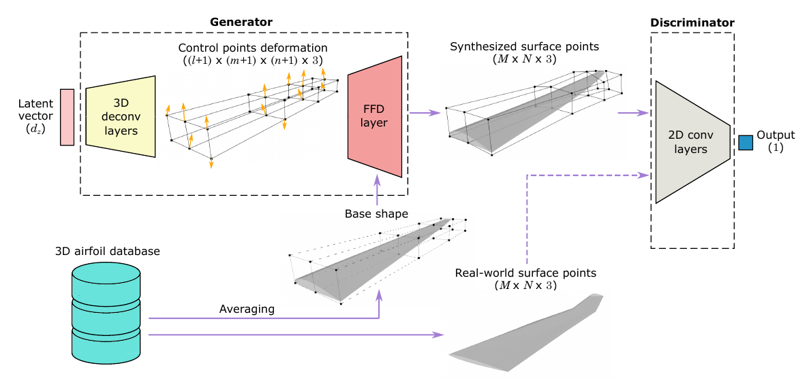

**图 1. FFD-GAN 的架构。** 图中：Generator＝生成器；Discriminator＝判别器；Latent vector＝潜在向量；3D deconv layers＝三维反卷积层；Control points deformation＝控制点变形；FFD layer＝FFD 层；Synthesized surface points＝合成表面点；2D conv layers＝二维卷积层；Output＝输出；Base shape＝基准外形；Averaging＝求平均；3D airfoil database＝三维翼型数据库；Real-world surface points＝真实设计表面点。

生成器由若干三维反卷积层和一个 FFD 层组成。这些三维反卷积层 [46] 将 $d_z$ 维潜在向量 $\mathbf z$ 转换为 $\Delta\mathbf P$，即一个形状为 $(l+1)\times(m+1)\times(n+1)\times3$ 的张量，用来表示 $(l+1)\times(m+1)\times(n+1)$ 个 FFD 控制点的变形。随后，将 $\Delta\mathbf P$ 和 $\mathbf P^{\mathrm{base}}$ 一起输入 FFD 层，生成 $M\times N$ 个三维翼型表面点。具体而言，首先将 $\Delta\mathbf P$ 与 $\mathbf P^{\mathrm{base}}$ 相加，得到变形后外形的控制点 $\mathbf P$，再按下式计算表面点 $\tilde{\mathbf X}$ [44,45]：

$$
\tilde{\mathbf X}(u,v,w)=\sum_{i=0}^{l}\sum_{j=0}^{m}\sum_{k=0}^{n}B_i^l(u)B_j^m(v)B_k^n(w)\mathbf P_{i,j,k}, \tag{6}
$$

其中，$0\le u\le1$、$0\le v\le1$、$0\le w\le1$ 为参数坐标，$l$ 次 Bernstein 多项式为 $B_i^l(u)=\binom li u^i(1-u)^{l-i}$。我们根据基准外形的表面点设置参数坐标：

$$
(\mathbf u,\mathbf v,\mathbf w)=\left(\frac{\mathbf x^{\mathrm{base}}-x^{\mathrm{base}}_{\min}}{x^{\mathrm{base}}_{\max}-x^{\mathrm{base}}_{\min}},\ \frac{\mathbf y^{\mathrm{base}}-y^{\mathrm{base}}_{\min}}{y^{\mathrm{base}}_{\max}-y^{\mathrm{base}}_{\min}},\ \frac{\mathbf z^{\mathrm{base}}-z^{\mathrm{base}}_{\min}}{z^{\mathrm{base}}_{\max}-z^{\mathrm{base}}_{\min}}\right). \tag{7}
$$

式（6）对 $\Delta\mathbf P$ 可微，因此允许梯度反向传播至前面的各层。

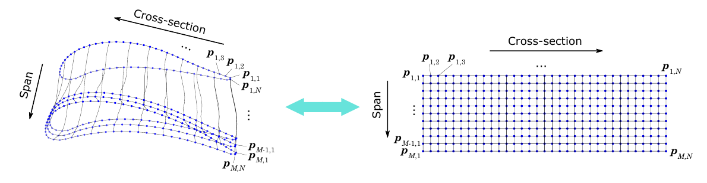

**图 2. 三维翼型表面点表示为一个 $M\times N\times3$ 张量。** 其中，$\mathbf p_{s,t}\in\mathbb R^3$ 表示第 $(s,t)$ 个表面点的三维坐标。图中：Cross-section＝横截面；Span＝展向。

判别器 $D$ 以表面点为输入，输出一个标量，再在式（4）中用该标量计算推土机距离和梯度惩罚。具体而言，如图 2 所示，表面点分布于 $M\times N$ 的网格上，其中 $M$ 是沿展向的横截面数，$N$ 是每个截面上的表面点数。因此，这些表面点的坐标表示为形状为 $M\times N\times3$ 的张量，相当于一幅分辨率为 $M\times N$ 的三通道图像。

训练后的生成器可以构成一个参数化模型，将任意 $d_z$ 维潜在向量 $\mathbf z$ 映射为表示光滑三维外形的一组表面点。注意，训练完成后，判别器将被丢弃，只有生成器用于外形参数化。式（4）中的 WGAN-GP 目标确保生成的三维外形来自与数据分布接近的分布。因此，低维潜在向量可以表示数据集中的外形变化。这为我们提供了一种新的紧凑参数化方法，具有足够的表示能力来覆盖训练数据集中的现有设计。

### B. 正则化

一组表面点的 FFD 表示，即 $\Delta\mathbf P$ 的选择，并不唯一。如图 3 所示，同一个外形可以具有不同的 FFD 参数化。为了限制 $\Delta\mathbf P$ 的可能解，并使生成器收敛至具有合理 FFD 表示的最优解，我们加入以下正则项：

$$
R_2(G)=\frac{1}{B(l+1)(m+1)(n+1)}\sum_{s=1}^{B}\sum_{i=0}^{l}\sum_{j=0}^{m}\sum_{k=0}^{n}\left\|\Delta\mathbf P^{(s)}_{i,j,k}\right\|^2, \tag{8}
$$

其中，$B$ 为批大小。

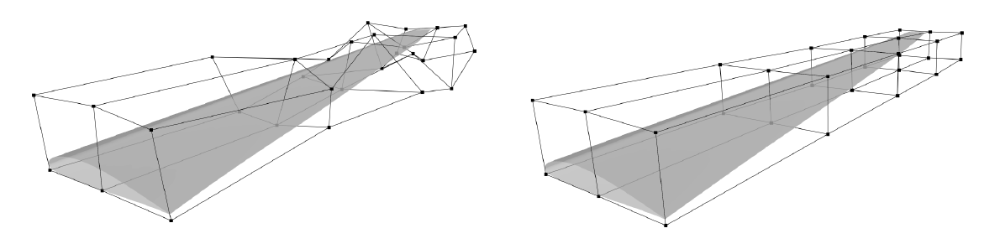

**图 3. 同一外形的不同 FFD 参数化。**

加入上述正则项后，FFD-GAN 的损失函数变为：

$$
\min_G\max_D W(D,G)-\gamma_1R_1(D)+\gamma_2R_2(G), \tag{9}
$$

其中，$\gamma_2$ 为正则项的权重。前两项 $W(D,G)$ 和 $R_1(D)$ 来自式（4）。

> 符号注：原文在式（4）中将梯度惩罚权重记为 $\lambda_1$，在式（9）及后续实验设置中记为 $\gamma_1$；译文保留原文符号。

## IV. 机翼设计实例的测试结果

本节以机翼设计为例，展示 FFD-GAN 作为新型参数化方法的性能，并与 FFD 和 B 样条曲面这两种常见参数化方法进行比较。

### A. 数据集创建与预处理

为了创建供 FFD-GAN 学习的数据集，我们从一个综合设计空间中采样机翼，该空间能够实现逼真的机翼外形变化。我们以概率文法 [47] 的形式表示整个设计空间，该文法描述所生成设计的本体结构。图 4 给出了一种表示飞机的文法示例，但该示例本身不是概率文法。其中，每架飞机由 1～3 个机身、一个机翼、0～2 个平尾、0 或 1 个垂尾，以及 0～2 个鸭翼组成。进一步地，机身由一个或多个截面参数化，每个截面由 4 个参数表示：周向半径（假设机身呈管状）和坐标偏移量。类似地，对称机翼由翼展和定义机翼轮廓的一组 4～8 个截面参数化。选择至少 4 个截面，是为了充分定义机翼；选择最多 8 个截面，则是因为观察发现，超过 8 个截面会导致机翼变化过于频繁，从而形成不真实的外形。每个截面进一步由其位置、弦长、扭转角以及定义该截面的翼型参数化。

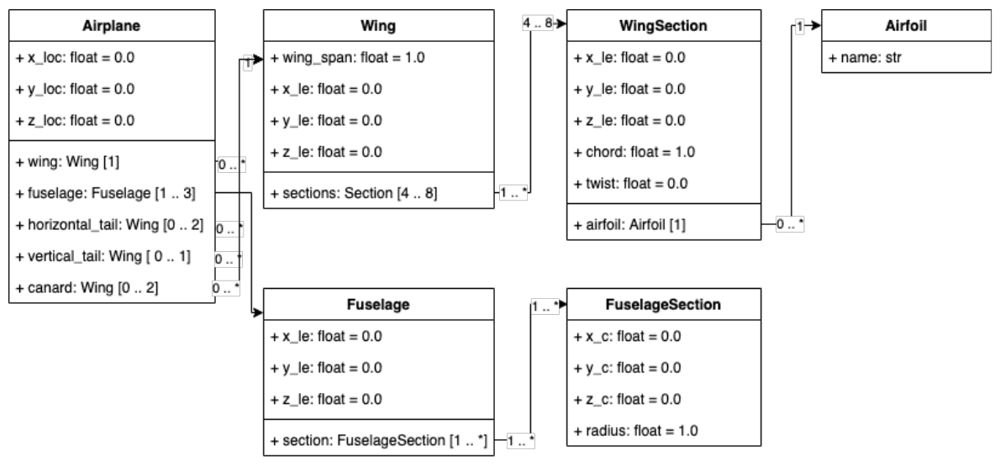

**图 4. 飞机文法示意图；机翼的概率文法由此生成。** 图中：Airplane＝飞机；Wing＝机翼；WingSection＝机翼截面；Airfoil＝翼型；Fuselage＝机身；FuselageSection＝机身截面；horizontal_tail＝平尾；vertical_tail＝垂尾；canard＝鸭翼；wing_span＝翼展；chord＝弦长；twist＝扭转角；radius＝半径；sections＝截面集合；name＝名称；`x/y/z_loc` 为位置坐标，`x/y/z_le` 为前缘坐标，`x/y/z_c` 为截面中心坐标。`float` 和 `str` 分别表示浮点数和字符串。

基于这种飞机参数化，构建图 5 所示的机翼概率文法。任一机翼截面的参数都基于前一个截面的参数进行采样。在数学上，若 $P_{\mathrm{wing}}$ 是表示机翼设计空间的概率文法，则可将 $w$ 表示为从该设计空间中采样得到的机翼实例，即 $w\sim P_{\mathrm{wing}}$。由于这一表示具有层次结构，我们可以使用图表示每个实例。该图记为 $G=(V,E,A)$，其中 $V$、$E$ 和 $A$ 分别为节点集合、边集合（即组成关系）和与节点关联的属性集合。因此，我们实现了一个程序化生成过程，依次执行：

- 截面数量 $\sim\mathcal U\{4,8\}$；
- 翼型［截面 $i$］$\sim\mathcal U\{\mathrm{UIUC\ Database}\}$；
- 属性［截面 $i$］$\sim\mathcal U(\mathrm{LB},\mathrm{UB}\mid\text{属性［截面 }(i-1)\text{］})$。

其中，LB 和 UB 分别表示属性的下界和上界。

这意味着每个机翼的截面数量在 4 到 8 之间均匀采样。我们在各截面之间对机翼坐标进行线性插值，以形成平滑过渡。

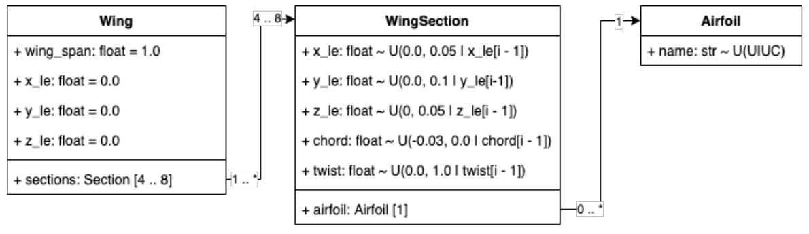

**图 5. 与数据合成过程相关的概率文法。** 图中：Wing＝机翼；WingSection＝机翼截面；Airfoil＝翼型；chord＝弦长；twist＝扭转角；`x_le`、`y_le`、`z_le` 分别表示前缘坐标；$\mathcal U$ 表示均匀分布；条件中的 `[i-1]` 指前一个截面的对应属性。图中分布参数和结构关系均按原图保留。

在每个截面处，弦长、截面扭转角和前缘位置（$x$ 与 $z$ 方向）均依据已知分布采样。各截面的轮廓从 UIUC 数据库中随机抽取；该数据库包含 1,550 个预定义翼型，从 2032c 到 ys930[^uiuc]。因此，整个机翼由一组 20～40 个参数进行参数化，具体数量取决于所选择的截面数。概率文法引入一组规则，以确保采样得到有效的机翼截面。例如，为保证前缘平滑过渡，采用增量式设计空间：截面 $i+1$ 的参数依赖于截面 $i$ 的参数。概率文法使用均匀分布对规则本身进行参数化，如图 5 所示。例如，弦长从翼根到翼尖必须单调变化，但并不规定其具体变化方式。对所有截面的各个参数设置此类规则后，采用蒙特卡洛采样生成新设计。

这一过程得到包含 47,344 个可行机翼设计的数据集。我们对这些外形进行插值，使每个外形都表示为一个 $21\times199\times3$ 张量，其中 21 为截面数，每个截面包含 199 个表面点。将 80% 的设计用作训练数据，其余用作测试数据。图 6 展示了训练数据中的一些示例。

在训练 FFD-GAN 之前，我们进行以下预处理，以对齐数据集中的机翼外形：

1. 平移机翼，使第一个截面的前缘位于原点。
2. 绕垂直于截面的轴旋转机翼，使第一个截面的弦线与向量 $(1,0,0)$ 对齐。
3. 沿 $y$ 轴缩放机翼，使半翼展为 1。

[^uiuc]: UIUC 翼型坐标数据库：[https://m-selig.ae.illinois.edu/ads/coord_database.html](https://m-selig.ae.illinois.edu/ads/coord_database.html)。

### B. 模型配置与实验设置

按照文献 [43]，我们设置 $\gamma_1=10$，并直接将 $\gamma_2$ 设为 1。生成器以 $d_z$ 维潜在向量为输入，包含两个全连接（FC）层，后接四个三维反卷积层。两个 FC 层分别有 1024 和 256 个单元。三维反卷积层的通道数依次为 `[128, 64, 32, 1]`，步幅依次为 `[(2,2,2), (2,2,1), (1,2,1), (1,1,1)]`，卷积核大小为 `(4,4,4)`。除最后一个反卷积层外，每个 FC 层和反卷积层之后都接批归一化和带泄漏的 ReLU（leaky ReLU）激活。

对于 FFD 层，取 $(l,m,n)=(3,7,1)$，即 $x$、$y$、$z$ 三个方向上的控制点数量分别为 4、8、2。由于数据集中经过预处理的机翼外形，其各截面的 $y$ 坐标固定，因此我们固定 $y$ 轴方向的变形，只学习另外两个轴方向的变形。注意，这一条件在其他情况下可能不成立，此时 FFD-GAN 可以学习所有轴方向的变形。基准外形通过对训练数据集中的外形求平均得到。

判别器以表面点坐标为输入，包含五个二维卷积层，后接两个 FC 层。卷积层的通道数为 `[32, 64, 128, 256, 512]`。所有卷积层使用相同的步幅 `(2,4)` 和卷积核大小 `(4,8)`。两个 FC 层分别有 1024 和 1 个单元。除最后一层外，判别器中的每一层之后均接 leaky ReLU 激活。训练时，生成器和判别器的学习率均设为 0.0002。生成器每迭代一次，判别器训练五次。我们执行 10,000 次生成器迭代，批大小为 64。

为评估 FFD-GAN 作为新型机翼外形参数化方法的性能，我们将其与 FFD 和 B 样条曲面这两种参数化方法比较。对于 FFD，使用 $(l'+1)\times(m'+1)\times(n'+1)$ 个控制点，并固定控制点在 $y$ 轴方向的变形，因此设计变量数量为 $2(l'+1)(m'+1)(n'+1)$。

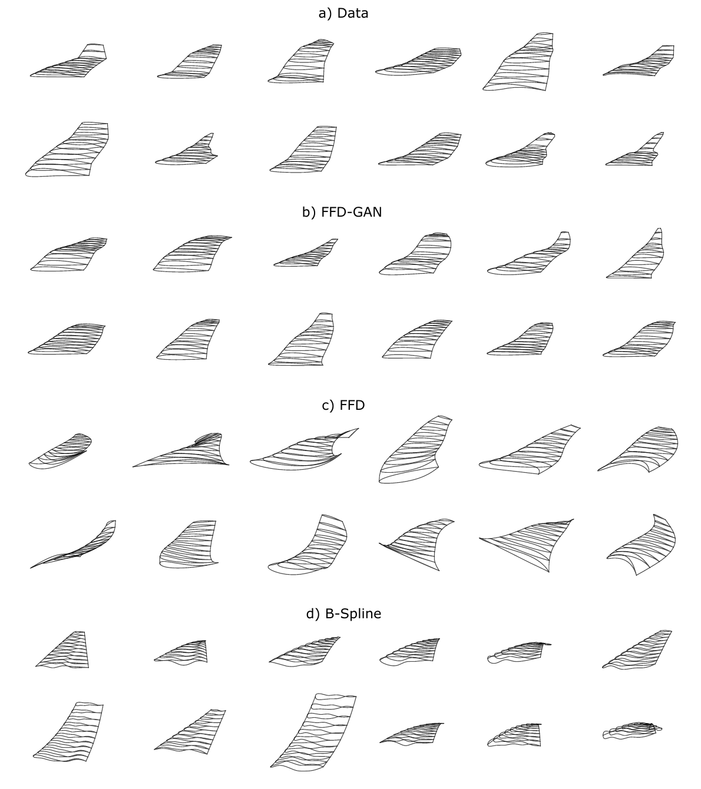

**图 6. 从以下来源随机采样或生成的机翼比较：a）数据库；b）$d_{\mathbf z}=15$ 的 FFD-GAN；c）具有 $3\times4\times2$ 个控制点的 FFD；d）具有 $4\times14$ 个控制点的 B 样条曲面。** 二维图展示了机翼截面在 $xz$ 视图中的形状。图中 Data＝数据；B-Spline＝B 样条。

与 FFD-GAN 一样，FFD 的基准外形也通过对训练数据集中的外形求平均得到。对于 B 样条曲面表示，我们使用 $(m''+1)\times(n''+1)$ 个控制点，两个方向的次数均为 3。为减少设计变量数量，我们固定控制点的 $y$ 坐标，并通过前缘和后缘后掠角约束其 $x$ 坐标 [48]。此外，令每个截面的起始控制点和终止控制点相同，以使各截面翼型在后缘闭合。由此得到的参数化方法具有 $2+(m''+1)n''$ 个设计变量。

我们开展了一系列实验，以展示这三种参数化方法，即 FFD-GAN、FFD 和 B 样条曲面的表示能力和紧凑性。特别地，为了能够在设计空间中采样和搜索，需要为各参数化方法的设计变量指定合理边界。对于 FFD-GAN，将设计空间定义为 $d_z$ 维潜在空间，每个潜在变量的范围为 $[-1,1]$。对于 FFD，其设计变量为 $2(l'+1)(m'+1)(n'+1)$ 维，表示控制点在 $x$、$z$ 轴方向的变形，范围为 $[-0.1,0.1]$。对于 B 样条曲面参数化，首先拟合训练数据的平均外形，得到一组 $2+(m''+1)n''$ 个基准设计变量。随后，将前缘和后缘后掠角限制为相对于基准设计允许变化 $\pm5^\circ$，其余设计变量允许变化 $\pm0.1$。

我们使用 Athena Vortex Lattice（AVL）[^avl] 评估生成机翼的气动性能。马赫数固定为 0.4（296.4 英里／小时），迎角在 $-5^\circ$ 至 $10^\circ$ 之间变化。

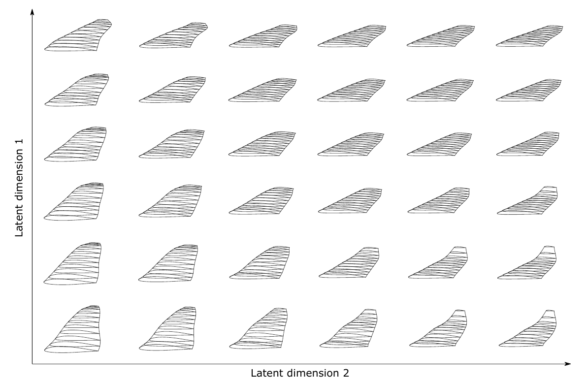

**图 7. 通过改变前两个潜在维度合成的机翼（$d_{\mathbf z}=15$）。** 图中：Latent dimension 1/2＝潜在维度 1／2。

[^avl]: Athena Vortex Lattice：[http://web.mit.edu/drela/Public/web/avl/](http://web.mit.edu/drela/Public/web/avl/)。

### C. 机翼外形生成

我们利用飞机机翼数据集，展示 FFD-GAN 所学习表示的紧凑性与能力。图 6 比较了从数据集中随机采样的机翼，以及 FFD-GAN、FFD 和 B 样条曲面随机生成的机翼，分别称为 FFD-GAN 机翼、FFD 机翼和 B 样条机翼。FFD-GAN 机翼与数据相似，而在随机生成的 FFD 或 B 样条机翼中，很难找到逼真的机翼。这说明 FFD-GAN 能够学习数据库样本的分布并排除无效设计，而 FFD 和 B 样条曲面等标准参数化方法无法做到这一点。对于需要从设计空间采样的设计空间探索和无梯度外形优化，这一优势至关重要。它大幅减少了重复采样与评估无效设计的计算成本。

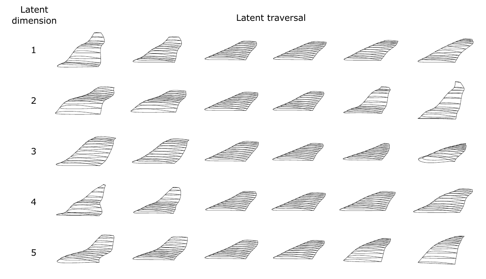

**图 8. 五维潜在空间的潜在遍历。每一行是对单个潜在维度的遍历。** 图中：Latent dimension＝潜在维度；Latent traversal＝潜在遍历。

图 7 展示了前两个潜在维度上的连续外形变化，说明潜在空间中的外形变换是连续的。图 8 展示了五维潜在空间的遍历：保持其他维度不变，仅改变一个潜在维度。这进一步说明，外形在每个维度上都连续变化，但不同维度引起的变化不同。

### D. 设计空间覆盖范围

我们测试 FFD-GAN、FFD 和 B 样条曲面的设计空间覆盖范围。具体而言，对每种参数化方法，我们通过最小二乘拟合，使合成外形与从测试数据集中随机抽取的样本（目标外形）相匹配。最小二乘拟合使用以下均方误差（MSE）作为目标：

$$
\epsilon=\frac{1}{MN}\sum_{s=1}^{M}\sum_{t=1}^{N}\left\|\tilde{\mathbf X}_{s,t}-\mathbf X^{\mathrm{tgt}}_{s,t}\right\|^2, \tag{10}
$$

其中，$\tilde{\mathbf X}$ 是由某一特定参数化方法合成的机翼表面点，$\mathbf X^{\mathrm{tgt}}$ 是目标机翼的表面点。求得最小二乘问题的解 $\tilde{\mathbf X}^{*}_{s,t}$（拟合外形）后，测量拟合外形与目标外形之间的 Hausdorff 距离：

$$
d_H(\tilde{\mathbf X}^{*},\mathbf X^{\mathrm{tgt}})=\max\left\{\sup_{\mathbf x\in\tilde{\mathbf X}^{*}}\inf_{\mathbf x'\in\mathbf X^{\mathrm{tgt}}}\|\mathbf x-\mathbf x'\|,\ \sup_{\mathbf x'\in\mathbf X^{\mathrm{tgt}}}\inf_{\mathbf x\in\tilde{\mathbf X}^{*}}\|\mathbf x-\mathbf x'\|\right\}. \tag{11}
$$

图 9 展示了拟合结果的统计量，我们使用从数据库中随机采样的 100 个目标机翼。Hausdorff 距离越小，说明设计空间覆盖得越好。结果表明，在设计变量较少（$\le20$）时，FFD-GAN 更善于重建数据中的设计。此外，具有 15 个设计变量（$d_{\mathbf z}=15$）的 FFD-GAN，与具有 24 个设计变量（$2\times3\times2$ 个控制点）的 FFD 达到了相近的设计空间覆盖范围。这说明，尽管 FFD-GAN 生成的是 FFD 参数，但它只需少得多的设计变量即可覆盖相近范围的设计空间，因此在保持相近表示能力的同时，其紧凑性远高于标准 FFD 表示。

这是因为，尽管潜在向量的维数较低，FFD 层的控制点数量仍可以足够大，从而获得较高的表示能力。生成器再学习从潜在向量到 FFD 参数的复杂非线性映射，使潜在向量保持紧凑。

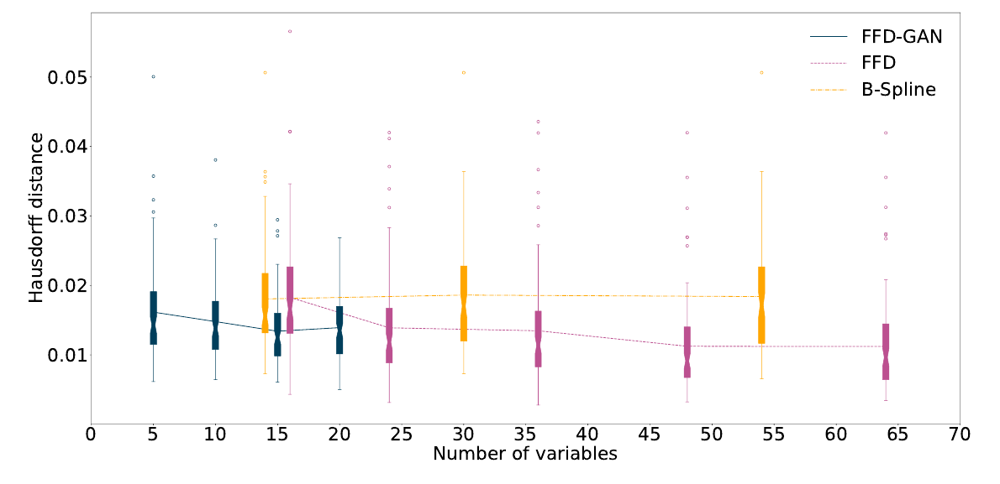

**图 9. 拟合测试结果，展示 FFD-GAN 和其他参数化方法在重建数据集方面的性能。各条线连接均值。** 横轴：设计变量数量（Number of variables）；纵轴：Hausdorff 距离（Hausdorff distance）。

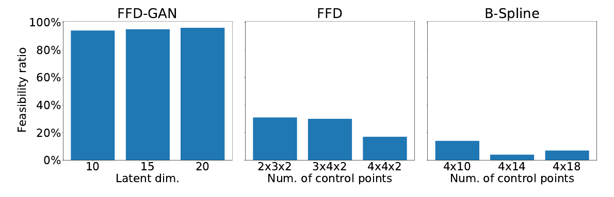

**图 10. 可行率，以随机生成样本中可行机翼设计的百分比表示。** 这里，可行是指机翼不自相交，且在 $2^\circ$ 迎角下升阻比 $C_L/C_D>0$。图中：Feasibility ratio＝可行率；Latent dim.＝潜在维数；Num. of control points＝控制点数量。

### E. 设计空间的可行率

表示紧凑性还与设计空间中包含有效设计的体积比例有关，即可行率。因此，我们采用蒙特卡洛采样，测量有界设计空间中可行设计的比例。可行性由两个标准定义：1）外形不自相交；2）在 $2^\circ$ 迎角下 $C_L/C_D>0$。如图 10 所示，FFD-GAN 的可行率超过 94%，而 FFD 和 B 样条曲面的可行率分别低于 31% 和 14%。这表明，FFD-GAN 构建了一个几乎处处包含可行设计的设计空间。

这一结果符合预期，因为 FFD-GAN 的生成器被训练为只生成与现有设计相似的设计，而这些设计很可能是可行的。它自动学习数据中隐含编码的约束，例如不自相交约束或气动性能约束，而非数据驱动参数化方法无法识别这些约束。因此，FFD 和 B 样条曲面等常用参数化方法会表示大量违反这些隐含约束的设计，其可行率远低于 FFD-GAN。

可行率与设计空间覆盖范围的结果共同证明了 FFD-GAN 较高的表示紧凑性：与另外两种参数化方法相比，它以少得多的维数达到相近或更好的设计空间覆盖范围，而且其设计空间中不太可能出现无效设计。

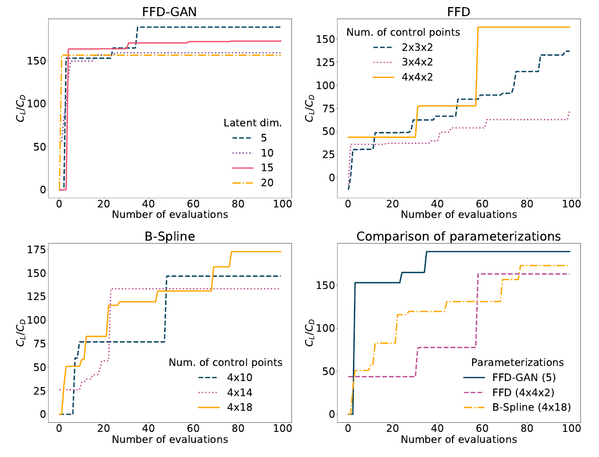

**图 11. 使用不同参数化方法时的优化历史。** 横轴：评估次数（Number of evaluations）；纵轴：升阻比 $C_L/C_D$。Latent dim.＝潜在维数；Num. of control points＝控制点数量；Comparison of parameterizations＝参数化方法比较；Parameterizations＝参数化方法。右下图比较 FFD-GAN（5 个潜在维度）、FFD（$4\times4\times2$ 个控制点）和 B 样条（$4\times18$ 个控制点）。

### F. 机翼外形优化

前几节的一系列测试表明，FFD-GAN 相较于 FFD 和 B 样条曲面参数化，在表示能力和紧凑性方面有所改进。本节展示这些性质的改进对气动外形优化的益处。表示能力和紧凑性都与优化性能密切相关：表示能力决定所表示设计的最优气动性能上界，表示紧凑性则影响收敛速度。当紧凑性较低时，要么由于维数灾难，需要评估更多样本才能达到全局最优；要么不得不将预算浪费在评估大量无效设计上。

在本实验中，我们以设计变量和迎角为优化变量，最大化升阻比 $C_L/C_D$，迎角范围为 $[-5^\circ,10^\circ]$。每次评估前，我们调整机翼几何体，使第一个截面的弦线在 $0^\circ$ 迎角时与向量 $(1,0,0)$ 对齐。我们使用贝叶斯优化作为全局优化方法，以尽量减少评估次数。首先通过拉丁超立方采样（LHS）[49] 生成 10 个初始评估点，随后使用高斯过程置信上界（GP-UCB）[50] 算法依次建议其余 90 个评估点。注意，本文的优化仅用于测试参数化效率。由于可以通过自动微分计算 FFD-GAN 参数化相对于其设计变量（即潜在向量）的梯度，因此所提出的 FFD-GAN 可以与任何下游优化方法集成，包括基于梯度的方法。

图 11 展示了三种参数化方法在不同设计变量设置下的优化历史。当潜在维数为 5～20 时，FFD-GAN 在最初的 10 次评估内便能找到 $C_L/C_D>150$ 的解，而 FFD 和 B 样条曲面参数化至少需要 60 次评估才能达到相同水平的升阻比。这种加快的收敛体现了 FFD-GAN 参数化的高度紧凑性。

从累积遗憾（cumulative regret）来看，采用 5 个潜在维度的 FFD-GAN、采用 $4\times4\times2$ 个控制点的 FFD，以及采用 $4\times18$ 个控制点的 B 样条，分别取得了各自最佳的优化性能。进一步比较这三种设置可见，FFD-GAN 不仅以少得多的评估次数发现高性能解，而且最终得到的解也更好。这些结果表明，FFD-GAN 较高的表示能力和紧凑性能够显著提高外形优化效率。

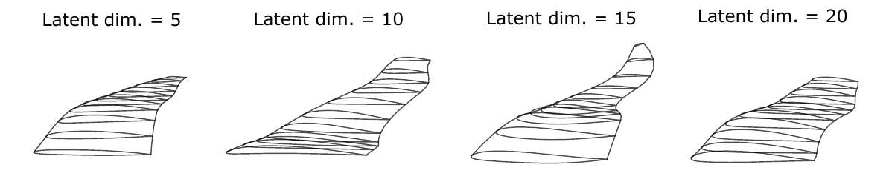

**图 12. 使用 FFD-GAN 作为参数化方法得到的优化机翼设计。** 从左到右的潜在维数（Latent dim.）分别为 5、10、15、20。

图 12 展示了使用 FFD-GAN 作为参数化方法得到的优化机翼几何形状。需要注意，作为涡格法程序，AVL 不预测流动分离 [51]，并忽略黏性的影响。因此，图 12 所示机翼可能并不反映现实中的最优解。不过，本文将 AVL 用作黑箱仿真器，以展示不同参数化方法的效率。下游任务使用的仿真器类型没有限制。实际应用中，可以使用任何更高保真的 CFD 仿真器评估气动外形的性能。

## V. 结论

我们提出一种新的深度生成模型 FFD-GAN，并将其用于三维翼型外形参数化。FFD-GAN 使用生成器，将一小组潜在变量映射为由表面点表示的三维外形。因此，生成器可以根据低维潜在向量合成三维几何体。我们将生成器视为参数化模型，将潜在变量视为外形参数或设计变量。为避免生成非光滑表面并影响气动性能的问题，我们在生成器末端加入 FFD 层，使其只生成光滑外形。为展示 FFD-GAN 作为新型参数化方法的效率，我们使用概率文法创建了机翼设计数据集，并开展一系列实验来测试 FFD-GAN 的表示能力与紧凑性。结果表明，与 FFD 和 B 样条曲面参数化相比，FFD-GAN 的表示紧凑性显著更高，表示能力则相当。

尽管我们通过飞机机翼设计实例展示了 FFD-GAN 的性能，但所提出的 FFD-GAN 也可用于其他光滑气动或水动力外形的参数化，例如涡轮动叶／静叶、车身和船体。研究 FFD-GAN 在这些用例中的性能，是一个值得探索的未来研究方向。

本研究未考察 FFD-GAN 潜在空间的可解释性与解耦性。理想情况下，一个可解释且解耦的潜在空间应使每个维度捕捉单一属性的变化，例如机翼扭转和上反角。这有助于设计者更好地理解参数化方法，并可能促进设计空间探索。未来，我们将探索 FFD-GAN 潜在空间的解耦方法 [52,53]，并研究潜在空间解耦对设计空间探索任务的影响。

## 参考文献

以下保留原文的作者、英文标题、出版信息及标识符，并为每项补充中文标题。

**[1] 中文标题：动态规划。**  
Bellman, R., “Dynamic Programming,” Science, Vol. 153, No. 3731, 1966, pp. 34–37. doi:10.1126/science.153.3731.34, URL https://science.sciencemag.org/content/153/3731/34.

**[2] 中文标题：气动设计优化的降维。**  
Viswanath, A., J. Forrester, A., and Keane, A., “Dimension reduction for aerodynamic design optimization,” AIAA Journal, Vol. 49, No. 6, 2011, pp. 1256–1266. doi:10.2514/1.J050717, URL https://doi.org/10.2514/1.J050717.

**[3] 中文标题：利用生成拓扑映射进行约束设计优化。**  
Viswanath, A., Forrester, A., and Keane, A., “Constrained Design Optimization Using Generative Topographic Mapping,” AIAA Journal, Vol. 52, No. 5, 2014, pp. 1010–1023. doi:10.2514/1.J052414, URL https://doi.org/10.2514/1.J052414.

**[4] 中文标题：基于度量的高效翼型设计变量数学推导。**  
Poole, D. J., Allen, C. B., and Rendall, T. C., “Metric-based mathematical derivation of efficient airfoil design variables,” AIAA Journal, Vol. 53, No. 5, 2015, pp. 1349–1361.

**[5] 中文标题：结合几何数据降维的跨声速机翼高效全局优化。**  
Cinquegrana, D., and Iuliano, E., “Efficient Global Optimization of a Transonic Wing with Geometric Data Reduction,” 35th AIAA Applied Aerodynamics Conference, 2017, p. 3057. doi:10.2514/6.2017-3057, URL https://doi.org/10.2514/6.2017-3057.

**[6] 中文标题：气动外形优化降维中自适应设计变量边界的研究。**  
Cinquegrana, D., and Iuliano, E., “Investigation of adaptive design variables bounds in dimensionality reduction for aerodynamic shape optimization,” Computers & Fluids, Vol. 174, 2018, pp. 89–109. doi:10.1016/j.compfluid.2018.07.012, URL https://doi.org/10.1016/j.compfluid.2018.07.012.

**[7] 中文标题：基于数据降维的全局气动设计优化。**  
Yasong, Q., Junqiang, B., Nan, L., and Chen, W., “Global aerodynamic design optimization based on data dimensionality reduction,” Chinese Journal of Aeronautics, Vol. 31, No. 4, 2018, pp. 643–659. doi:10.1016/j.cja.2018.02.005, URL https://doi.org/10.1016/j.cja.2018.02.005.

**[8] 中文标题：用于快速翼型分析与优化的数据驱动方法。**  
Li, J., Bouhlel, M. A., and Martins, J., “A data-based approach for fast airfoil analysis and optimization,” 2018 AIAA/ASCE/AHS/ASC Structures, Structural Dynamics, and Materials Conference, 2018, p. 1383. doi:10.2514/1.J057129, URL https://doi.org/10.2514/1.J057129.

**[9] 中文标题：利用紧凑翼型分解进行高效机翼气动结构优化。**  
Poole, D. J., Allen, C. B., and Rendall, T., “Efficient Aero-Structural Wing Optimization Using Compact Aerofoil Decomposition,” AIAA Scitech 2019 Forum, 2019, p. 1701. doi:10.2514/6.2019-1701, URL https://doi.org/10.2514/6.2019-1701.

**[10] 中文标题：利用生成对抗网络进行气动设计优化与外形探索。**  
Chen, W., Chiu, K., and Fuge, M., “Aerodynamic Design Optimization and Shape Exploration using Generative Adversarial Networks,” AIAA Scitech 2019 Forum, 2019, p. 2351. doi:10.2514/6.2019-2351, URL https://doi.org/10.2514/6.2019-2351.

**[11] 中文标题：利用 Bézier 生成对抗网络进行翼型设计参数化与优化。**  
Chen, W., Chiu, K., and Fuge, M. D., “Airfoil Design Parameterization and Optimization Using Bézier Generative Adversarial Networks,” AIAA Journal, Vol. 58, No. 11, 2020, pp. 4723–4735.

**[12] 中文标题：MO-PaDGAN：通过工程设计重参数化增强多目标优化。**  
Chen, W., and Ahmed, F., “MO-PaDGAN: Reparameterizing Engineering Designs for Augmented Multi-objective Optimization,” arXiv preprint arXiv:2009.07110, 2020.

**[13] 中文标题：对梯度应用主成分分析的降维方法。**  
Berguin, S. H., and Mavris, D. N., “Dimensionality reduction using principal component analysis applied to the gradient,” Aiaa Journal, Vol. 53, No. 4, 2015, pp. 1078–1090.

**[14] 中文标题：一种无需 CAD 的高保真气动结构优化方法。**  
Kenway, G., Kennedy, G., and Martins, J., “A CAD-free approach to high-fidelity aerostructural optimization,” 13th AIAA/ISSMO multidisciplinary analysis optimization conference, 2010, p. 9231.

**[15] 中文标题：集成几何参数化与网格移动的气动优化算法。**  
Hicken, J. E., and Zingg, D. W., “Aerodynamic optimization algorithm with integrated geometry parameterization and mesh movement,” AIAA journal, Vol. 48, No. 2, 2010, pp. 400–413.

**[16] 中文标题：通用参数化几何表示方法。**  
Kulfan, B. M., “Universal parametric geometry representation method,” Journal of Aircraft, Vol. 45, No. 1, 2008, pp. 142–158. doi:10.2514/1.29958, URL https://doi.org/10.2514/1.29958.

**[17] 中文标题：筛选、预测与计算机实验。**  
Welch, W. J., Buck, R. J., Sacks, J., Wynn, H. P., Mitchell, T. J., and Morris, M. D., “Screening, predicting, and computer experiments,” Technometrics, Vol. 34, No. 1, 1992, pp. 15–25. doi:10.2307/1269548, URL https://doi.org/10.2307/1269548.

**[18] 中文标题：响应面方法学：利用设计实验进行过程与产品优化。**  
Myers, R. H., and Montgomery, D. C., Response Surface Methodology: Process and Product in Optimization Using Designed Experiments, 1st ed., John Wiley & Sons, Inc., USA, 1995. doi:10.5555/546074, URL https://dl.acm.org/doi/book/10.5555/546074.

**[19] 中文标题：用于外形优化的主动子空间。**  
Lukaczyk, T. W., Constantine, P., Palacios, F., and Alonso, J. J., “Active subspaces for shape optimization,” 10th AIAA Multidisciplinary Design Optimization Conference, 2014, p. 1171. doi:10.2514/6.2014-1171, URL https://doi.org/10.2514/6.2014-1171.

**[20] 中文标题：在可获得梯度时对高成本函数进行降维设计空间探索。**  
Berguin, S. H., and Mavris, D. N., “Dimensional Design Space Exploration of Expensive Functions with Access to Gradient,” 15th AIAA/ISSMO Multidisciplinary Analysis and Optimization Conference, 2014, p. 2174. doi:10.2514/6.2014-2174, URL https://doi.org/10.2514/6.2014-2174.

**[21] 中文标题：利用含梯度信息的主成分分析进行气动设计降维。**  
Berguin, S. H., and Mavris, D. N., “Dimensionality Reduction In Aerodynamic Design Using Principal Component Analysis With Gradient Information,” 10th AIAA Multidisciplinary Design Optimization Conference, 2014, p. 0112. doi:10.2514/6.2014-0112, URL https://doi.org/10.2514/6.2014-0112.

**[22] 中文标题：利用高计算成本分析促进高维设计空间探索的方法。**  
Berguin, S. H., Rancourt, D., and Mavris, D. N., “Method to Facilitate High-Dimensional Design Space Exploration Using Computationally Expensive Analyses,” AIAA Journal, Vol. 53, No. 12, 2015, pp. 3752–3765. doi:10.2514/1.J054035, URL https://doi.org/10.2514/1.J054035.

**[23] 中文标题：翼型外形参数化的主动子空间。**  
Grey, Z. J., and Constantine, P. G., “Active subspaces of airfoil shape parameterizations,” AIAA Journal, Vol. 56, No. 5, 2018, pp. 2003–2017. doi:10.2514/1.J056054, URL https://doi.org/10.2514/1.J056054.

**[24] 中文标题：利用高效数学提取模态设计变量进行机翼气动优化。**  
Allen, C. B., Poole, D. J., and Rendall, T. C., “Wing aerodynamic optimization using efficient mathematically-extracted modal design variables,” Optimization and Engineering, Vol. 19, No. 2, 2018, pp. 453–477. doi:10.1007/s11081-018-9376-7, URL https://doi.org/10.1007/s11081-018-9376-7.

**[25] 中文标题：面向气动外形优化的通用模态设计变量。**  
Kedward, L., Allen, C. B., and Rendall, T., “Towards Generic Modal Design Variables for Aerodynamic Shape Optimisation,” AIAA Scitech 2020 Forum, 2020, p. 0543. doi:10.2514/6.2020-0543, URL https://doi.org/10.2514/6.2020-0543.

**[26] 中文标题：非线性降维。**  
Lee, J. A., and Verleysen, M., Nonlinear dimensionality reduction, Springer Science & Business Media, 2007. doi: 10.1007/978-0-387-39351-3, URL https://www.springer.com/gp/book/9780387393506.

**[27] 中文标题：深度学习。**  
Goodfellow, I., Bengio, Y., Courville, A., and Bengio, Y., Deep learning, Vol. 1, MIT press Cambridge, 2016. URL http://www.deeplearningbook.org.

**[28] 中文标题：自编码变分贝叶斯。**  
Kingma, D. P., and Welling, M., “Auto-encoding variational Bayes,” arXiv preprint arXiv:1312.6114, 2013. URL https: //arxiv.org/pdf/1312.6114.pdf.

**[29] 中文标题：生成对抗网络。**  
Goodfellow, I., Pouget-Abadie, J., Mirza, M., Xu, B., Warde-Farley, D., Ozair, S., Courville, A., and Bengio, Y., “Generative adversarial nets,” Advances in neural information processing systems, 2014, pp. 2672–2680.

**[30] 中文标题：通过三维生成对抗建模学习物体外形的概率潜在空间。**  
Wu, J., Zhang, C., Xue, T., Freeman, B., and Tenenbaum, J., “Learning a probabilistic latent space of object shapes via 3d generative-adversarial modeling,” Advances in neural information processing systems, 2016, pp. 82–90.

**[31] 中文标题：从全局到局部的三维外形生成模型。**  
Wang, H., Schor, N., Hu, R., Huang, H., Cohen-Or, D., and Huang, H., “Global-to-local generative model for 3d shapes,” ACM Transactions on Graphics (TOG), Vol. 37, No. 6, 2018, pp. 1–10.

**[32] 中文标题：Matryoshka 网络：通过嵌套外形层预测三维几何。**  
Richter, S. R., and Roth, S., “Matryoshka networks: Predicting 3d geometry via nested shape layers,” Proceedings of the IEEE conference on computer vision and pattern recognition, 2018, pp. 1936–1944.

**[33] 中文标题：八叉树生成网络：用于高分辨率三维输出的高效卷积架构。**  
Tatarchenko, M., Dosovitskiy, A., and Brox, T., “Octree generating networks: Efficient convolutional architectures for high-resolution 3d outputs,” Proceedings of the IEEE International Conference on Computer Vision, 2017, pp. 2088–2096.

**[34] 中文标题：学习三维点云的表示与生成模型。**  
Achlioptas, P., Diamanti, O., Mitliagkas, I., and Guibas, L., “Learning Representations and Generative Models for 3D Point Clouds,” International Conference on Machine Learning, 2018, pp. 40–49.

**[35] 中文标题：利用深度生成网络建模多视图深度图与轮廓以合成三维外形。**  
Arsalan Soltani, A., Huang, H., Wu, J., Kulkarni, T. D., and Tenenbaum, J. B., “Synthesizing 3d shapes via modeling multi-view depth maps and silhouettes with deep generative networks,” Proceedings of the IEEE conference on computer vision and pattern recognition, 2017, pp. 1511–1519.

**[36] 中文标题：多图册生成式曲面建模。**  
Ben-Hamu, H., Maron, H., Kezurer, I., Avineri, G., and Lipman, Y., “Multi-chart generative surface modeling,” ACM Transactions on Graphics (TOG), Vol. 37, No. 6, 2018, pp. 1–15.

**[37] 中文标题：SurfNet：利用深度残差网络生成三维外形表面。**  
Sinha, A., Unmesh, A., Huang, Q., and Ramani, K., “Surfnet: Generating 3d shape surfaces using deep residual networks,” Proceedings of the IEEE conference on computer vision and pattern recognition, 2017, pp. 6040–6049.

**[38] 中文标题：学习用于生成式外形建模的隐式场。**  
Chen, Z., and Zhang, H., “Learning implicit fields for generative shape modeling,” Proceedings of the IEEE Conference on Computer Vision and Pattern Recognition, 2019, pp. 5939–5948.

**[39] 中文标题：DeepSDF：学习用于外形表示的连续有符号距离函数。**  
Park, J. J., Florence, P., Straub, J., Newcombe, R., and Lovegrove, S., “Deepsdf: Learning continuous signed distance functions for shape representation,” Proceedings of the IEEE Conference on Computer Vision and Pattern Recognition, 2019, pp. 165–174.

**[40] 中文标题：学习用于三维物体重建的自由变形。**  
Jack, D., Pontes, J. K., Sridharan, S., Fookes, C., Shirazi, S., Maire, F., and Eriksson, A., “Learning free-form deformations for 3d object reconstruction,” Asian Conference on Computer Vision, Springer, 2018, pp. 317–333.

**[41] 中文标题：DeformNet：用于单幅图像三维外形重建的自由变形网络。**  
Kurenkov, A., Ji, J., Garg, A., Mehta, V., Gwak, J., Choy, C., and Savarese, S., “Deformnet: Free-form deformation network for 3d shape reconstruction from a single image,” 2018 IEEE Winter Conference on Applications of Computer Vision (WACV), IEEE, 2018, pp. 858–866.

**[42] 中文标题：Wasserstein GAN。**  
Arjovsky, M., Chintala, S., and Bottou, L., “Wasserstein gan,” arXiv preprint arXiv:1701.07875, 2017.

**[43] 中文标题：改进 Wasserstein GAN 的训练。**  
Gulrajani, I., Ahmed, F., Arjovsky, M., Dumoulin, V., and Courville, A. C., “Improved training of wasserstein gans,” Advances in neural information processing systems, 2017, pp. 5767–5777.

**[44] 中文标题：实体几何模型的自由变形。**  
Sederberg, T. W., and Parry, S. R., “Free-form deformation of solid geometric models,” ACM SIGGRAPH computer graphics, Vol. 20, No. 4, 1986, pp. 151–160. doi:10.1145/15886.15903, URL https://doi.org/10.1145/15886.15903.

**[45] 中文标题：翼型外形参数化方法的几何比较。**  
Masters, D. A., Taylor, N. J., Rendall, T., Allen, C. B., and Poole, D. J., “Geometric Comparison of Aerofoil Shape Parameterization Methods,” AIAA Journal, 2017, pp. 1575–1589. doi:10.2514/1.J054943, URL https://doi.org/10.2514/1.J054943.

**[46] 中文标题：3D-R2N2：单视图与多视图三维物体重建的统一方法。**  
Choy, C. B., Xu, D., Gwak, J., Chen, K., and Savarese, S., “3d-r2n2: A unified approach for single and multi-view 3d object reconstruction,” European conference on computer vision, Springer, 2016, pp. 628–644.

**[47] 中文标题：Meta-Sim：学习生成合成数据集。**  
Kar, A., Prakash, A., Liu, M.-Y., Cameracci, E., Yuan, J., Rusiniak, M., Acuna, D., Torralba, A., and Fidler, S., “Meta-Sim: Learning to Generate Synthetic Datasets,” ICCV, 2019.

**[48] 中文标题：采用 Newton–Krylov 方法、基于 Navier–Stokes 方程的阻力最小化。**  
Osusky, L., Buckley, H., Reist, T., and Zingg, D. W., “Drag minimization based on the Navier–Stokes equations using a Newton–Krylov approach,” AIAA Journal, Vol. 53, No. 6, 2015, pp. 1555–1577.

**[49] 中文标题：分析计算机程序输出时三种输入变量取值选择方法的比较。**  
McKay, M. D., Beckman, R. J., and Conover, W. J., “A comparison of three methods for selecting values of input variables in the analysis of output from a computer code,” Technometrics, Vol. 42, No. 1, 2000, pp. 55–61.

**[50] 中文标题：多臂老虎机设定下的高斯过程优化：无遗憾与实验设计。**  
Srinivas, N., Krause, A., Kakade, S., and Seeger, M., “Gaussian Process Optimization in the Bandit Setting: No Regret and Experimental Design,” Proceedings of the 27th International Conference on Machine Learning, Omnipress, 2010.

**[51] 中文标题：通用小型无人航空系统（SUAS）的气动研究。**  
Yang, H., Dudley, J., and Davis, J., “Aerodynamic Investigation of Generic SUAS,” 42nd AIAA Fluid Dynamics Conference and Exhibit, 2012, p. 2969.

**[52] 中文标题：InfoGAN：通过信息最大化生成对抗网络学习可解释表示。**  
Chen, X., Duan, Y., Houthooft, R., Schulman, J., Sutskever, I., and Abbeel, P., “Infogan: Interpretable representation learning by information maximizing generative adversarial nets,” Advances in Neural Information Processing Systems, 2016, pp. 2172–2180. doi:10.5555/3157096.3157340, URL https://dl.acm.org/doi/10.5555/3157096.3157340.

**[53] 中文标题：InfoGAN-CR 与 ModelCentrality：用于 GAN 解耦的自监督模型训练与选择。**  
Lin, Z., Thekumparampil, K., Fanti, G., and Oh, S., “Infogan-cr and modelcentrality: Self-supervised model training and selection for disentangling gans,” International Conference on Machine Learning, PMLR, 2020, pp. 6127–6139.

