# 一种用于小型无人机气动分析与深度学习建模的新型非线性升力线方法

**原题：** A new nonlinear lifting line method for aerodynamic analysis and deep learning modeling of small unmanned aerial vehicles  
**文章类型：** 原创研究论文（Original Article）  
**作者：** Hasan Karali¹、Gokhan Inalhan²、M Umut Demirezen³、M Adil Yukselen¹  
**作者单位：** ¹ 伊斯坦布尔技术大学航空航天学院，土耳其伊斯坦布尔；² 克兰菲尔德大学自主与信息物理系统中心，英国贝德福德；³ 伊斯坦布尔技术大学航空航天研究中心，土耳其伊斯坦布尔。  
**期刊：** International Journal of Micro Air Vehicles，2021 年，第 13 卷，第 1–24 页；本文文件名使用五字母简称 IJMAV。  
**DOI：** [10.1177/17568293211016817](https://doi.org/10.1177/17568293211016817)  
**收稿日期：** 2020 年 7 月 31 日；**修回日期：** 2020 年 12 月 19 日；**录用日期：** 2021 年 4 月 22 日。  
**通讯作者：** Gokhan Inalhan，克兰菲尔德大学航空航天、交通与制造学院，自主与信息物理系统中心，英国贝德福德 MK43 0AL；电子邮箱：inalhan@cranfield.ac.uk。  
**期刊主页：** [journals.sagepub.com/home/mav](https://journals.sagepub.com/home/mav)  
**版权与许可：** © 作者，2021。本文依照知识共享署名—非商业性使用 4.0 国际许可协议（[CC BY-NC 4.0](https://creativecommons.org/licenses/by-nc/4.0/)）发布。按 SAGE 与开放获取页面要求注明原作出处后，可在非商业用途下使用、复制和传播，无需另行许可。文章再利用指南：[sagepub.com/journals-permissions](https://sagepub.com/journals-permissions)；[SAGE 开放获取说明](https://us.sagepub.com/en-us/nam/open-access-at-sage)。

> 译文说明：保留原文章节层级、公式与图表编号、引用编号，以及图与正文的相对位置。原图中的英文标注和数据保留，并配中文图注或关键标注释义；Markdown 采用流式排版，不复现双栏和固定分页。专业术语参考中文原始研究文献核对：“非线性升力线”见[《空气动力学学报》相关研究](https://pubs.cstam.org.cn/article/doi/10.7638/kqdlxxb-2013.0025)，“代理模型”见[《航空学报》翼型优化研究](https://hkxb.buaa.edu.cn/CN/abstract/abstract14105.shtml)。原文个别符号、图注或表述存在不一致之处，保留原意并在必要时简要注明。

## 摘要

本文提出一种计算高效且精度较高的非线性气动构型分析方法，用于小型无人机的设计优化和数学建模。首先，我们开发了一种新型非线性升力线方法：（a）相较于试验和计算密集型工具，该方法对失速前、失速后气动行为的预测均吻合良好；（b）相较于计算流体力学（CFD）等计算密集型方法，获得这些结果所需的时间可缩短若干数量级。进一步将该方法扩展为包含基本机身几何影响的完整构型分析工具。

此外，利用新气动工具生成的数据，开发了基于深度学习的代理模型，以表征无人机的非线性气动性能。该模型最主要的创新在于，仅使用几何参数就能预测无人机构型的气动特性，不需要其他计算气动分析工具所需的特殊输入数据或预处理阶段。得到的黑箱函数能够在毫秒量级内计算无人机在宽迎角范围内的性能，而在类似计算环境下，CFD 求解需要数天或数周。即使对使用训练中未出现翼型的构型，气动模型预测值与数值数据也几乎一一重合。通过一个示范性的翼型设计实例，展示了该模型可作为设计优化研究中能力较强的气动求解器。

**关键词：** 非线性气动性能；无人机空气动力学；低雷诺数；深度学习；人工神经网络；代理模型。

## 引言

小型无人机（UAV）为货物投送、监视、侦察和跟踪等广泛军民应用提供了支持能力。微型、迷你型和小型无人机按北约标准归为 I 类无人航空系统 [1]，作为成本相对较低的系统 [2]，尤其在低速、低空任务中替代有人和无人战术单元。在这些低雷诺数飞行状态下，小型无人机在机动飞行 [3] 或恶劣天气飞行时，经常因偏离设计工况而发生性能变化。

然而，除计算成本较高的 CFD 分析工具外，专门针对小型无人机非线性黏性流动状态的气动分析工具数量有限。因此，需要一种计算高效且可靠的气动特性分析工具，既可用于这类小型无人航空系统的设计优化建模，也可用于其数学建模 [4]。为此，本文基于 Prandtl 经典升力线理论（LLT），设计了一种新的非线性升力线方法。该方法利用通过试验或数值计算获得的截面非线性二维升力曲线，确定机翼、尾翼等升力面的三维最大升力系数，以及失速前、失速后的气动行为。该方法还能直接给出诱导阻力，并利用基于风洞或飞行试验的二维翼型数据，获得黏性阻力和俯仰力矩系数。与半经验机身构型分析相结合后，整套方法成为一种快速、可靠的小型无人机气动分析工具。

总体而言，小型无人机设计需要在十分有限的尺寸和功率条件下，满足使用要求。因此，需要一种气动求解器，能够针对一定范围内的数千种无人机构型，迅速给出非线性气动性能图谱，以支持设计和设计优化。虽然常规气动求解器无法满足这类研究所需的效率，但可以采用近来广受关注的人工智能（AI）算法，为当前气动方法建立数字模型 [5]。

本文后半部分利用深度学习技术，设计了能够预测无人机构型非线性气动特性的神经网络模型。该模型在设计点之间具有较强的插值能力，而且除几何参数外不需要其他输入，因此适合作为优化问题的气动求解器。我们进一步通过小型无人机设计优化应用，展示代理模型的这些特定优势。如图 1 所示，所提出的方法为小型无人机提供了重要、明确的设计与综合工具。这些方法的输入—输出关系体现了工具的基本工作原理；这些工具也直接用于内部无人机设计研发项目，例如图 2 所示项目。

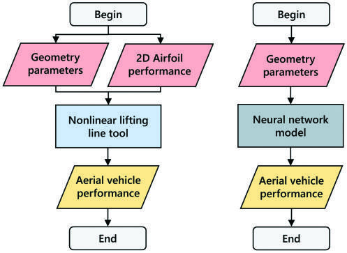

**图 1. 各方法的基本输入—输出关系。** Begin／End＝开始／结束；Geometry parameters＝几何参数；2D Airfoil performance＝二维翼型性能；Nonlinear lifting line tool＝非线性升力线工具；Neural network model＝神经网络模型；Aerial vehicle performance＝飞行器性能。 图中区分气动计算方法与神经网络代理模型：前者使用几何与截面气动数据，后者直接由几何参数预测气动性能。

对于这类小型无人机的气动分析，随着数学模型复杂程度增加，流动仿真更接近真实物理情况，分析误差随之减小。但高阶求解通常需要大量计算能力和时间 [7]，使其难以用于许多小型无人机设计问题。在飞机设计早期，作为设计优化的一部分，需要对不同几何在特定流动条件下开展数百次气动分析。因此，更适合采用低阶方法：与基于 Navier–Stokes 方程的 CFD 方法相比，其计算资源需求显著较低，处理时间也更短。

### 文献综述——计算气动模型

长期以来，人们开发了多种气动构型分析方法。早期方法主要面向手工计算，其中最常用的方法基于 Prandtl 经典升力线理论 [8,9]。这类方法的一些早期非线性应用，主要计算机翼失速前的性能 [10,11]。遗憾的是，这些方法通常局限于低、中迎角飞行条件下无后掠、无上反角的单一升力面。

升力线理论的一种离散应用称为数值升力线方法，始于 Weissinger 的研究 [12]。数值升力线方法依赖无旋、无黏流动假设 [13]。不过，以二维翼型数据 [14,15] 作为基本气动特性模型，也可构建该方法的非线性应用。

另一类气动构型分析方法，即升力面方法，始于 Falkner 的研究 [16]。这类方法忽略厚度，用中弧面近似任意升力面；自 20 世纪 70 年代以来，它们更常被称为涡格法。文献中也有此类方法的非线性应用 [17,18]。XFLR5 [19]、OpenVSP/VSPAero [20]、Tornado VLM [21,22] 和 MachUp [23] 等面向小型、迷你型无人机的常用计算气动程序，都采用这些基于势流理论的方法。对于整机非线性分析，这些研究的预测能力与可靠性仍然有限 [7,24]。有关现有计算气动分析工具的深入比较，参见文献 [7,24] 和表 4。

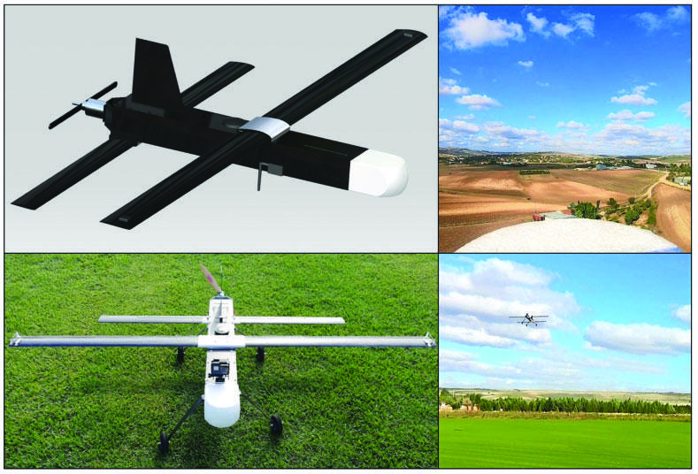

**图 2. ARC 无人机与飞行试验 [6]。**

### 研究现状与贡献——计算气动模型

采用基于势流理论的数学模型，可以获得机翼在低、中迎角下的升力、诱导阻力和力矩系数。但由于势流理论忽略流动黏性影响，低阶线性方法无法确定大迎角时升力曲线的非线性行为和机翼失速后的特性 [25–27]。此外，也无法计算最大升力和黏性阻力系数，而它们是设计、飞行控制与性能研究的重要参数 [28]。

不过，已有一些低阶方法研究加入了黏性效应修正。例如，在经典升力线方法的非线性应用中，采用迭代方法将二维截面的黏性效应反映至三维机翼特性 [11,29]。但对亚声速、无后掠和无上反角的机翼几何，直接应用这些方法，只能有限且不够精确地近似其非线性气动特性。

因此，本文提出的气动方法也使用迭代，但额外引入关键的升力曲线局部线性近似。采用新方法，对航空航天研究中心（ARC）无人机（见图 2）进行构型分析，并将升力系数与其他高阶、低阶工具比较，如图 3 所示。结果清楚表明，相较现有标准工具和方法，本方法在线性、非线性区域都具有良好精度。有关该分析及其他验证研究的详细信息见“气动模型”一节。该方法能够对广泛的无人机构型计算非线性气动性能，包括失速后飞行区域，为现有研究提供了新途径。

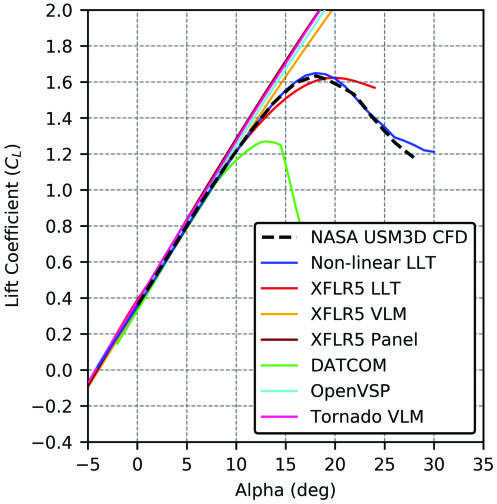

**图 3. ARC 无人机升力系数比较。** 横轴为迎角，纵轴为升力系数；图例保留各求解工具名称。

### 文献综述——基于 AI 的气动模型

聚焦设计和设计优化时，概念设计与初步设计阶段使用的传统工程工具，在预测任意新设计的总体性能方面，灵活性和能力有限 [30,31]。深度学习等机器学习方法能够满足这些需求：给定一组输入及相应输出，通过回归分析训练高度非线性的神经网络模型。已有多项研究使用机器学习和人工神经网络算法确定二维翼型性能 [32–34]。此类算法也被用于扩充特定飞机的数据库 [35–39]。

已有文献 [40–45] 中，模糊推理系统和神经网络等方法主要用于估计单一飞行条件下某一构型的性能，并未包含完整飞机的构型。此外，这些预测通常聚焦单个目标系数。因此，重点仍在函数近似，而非开发具有泛化能力的代理模型。

### 研究现状与贡献——基于 AI 的气动模型

本文研究完整飞机在广泛飞行条件下的构型气动特性，包括呈现完全非线性行为的大迎角区域。“人工神经网络”一节通过直接比较决定系数 $R^2$，进一步展示本文方法相较其他方法 [40,41,45] 的精度。

对于大规模设计优化，需要采用包含大量不同几何构型组合的海量数据训练模型。已有研究采用飞行试验、实验研究以及低阶与高阶计算方法的组合，生成面向具体设计问题、规模有限的数据集 [35]。通过飞行试验、实验研究和 CFD 等高阶计算方法建立大规模数据集，可能需要巨大计算开销，在实际中难以实现 [46]。因此，低阶计算气动方法成为成本低、速度快的选择。

但如前所述，这类方法通常没有考虑最关键的黏性效应，因此无法确定大迎角下升力曲线的非线性行为，以及飞行器失速前、失速后的特性。升力曲线的非线性行为尤其常见于低雷诺数条件，因此这一问题在小型无人机应用中尤为突出。

为解决这一问题，本文提出设计神经网络，预测广泛气动几何与构型组合的气动性能。为训练人工神经网络模型，利用新开发的计算高效非线性升力线方法，生成大规模数据集。由于该分析工具快速、可靠，即使在个人计算机上，也能在数分钟内生成并分析数万种构型。设计的人工神经网络模型无需二维翼型性能数据，就能计算各类无人机构型的气动性能，包括三维最大升力系数以及失速前、失速后的气动行为。

训练时，用最大弯度位置、弯度和厚度比等几何参数定义 NACA 四位数系列翼型 [47]。这样，模型只需尺寸参数作为输入，而不需要二维翼型性能数据。结果表明，即使构型使用训练中未出现的不同翼型，模型预测值与数值数据也几乎一一重合，体现了训练后模型的泛化能力。图 4 进一步展示，对常规无人机构型，神经网络升力系数预测与真实升力系数数据十分吻合。更多信息和算例见“代理模型的应用”小节。

本文部分结果源于本课题组的两项前期研究 [5,7]。具体而言，气动模型部分涵盖了 Karali 等 [7] 的部分研究；在此基础上，本文进一步开发原有算法，并通过将机身气动纳入分析工具，采用更系统的方法，使其能够对整机气动特性建模。此外，通过更新算法的迭代部分，减少达到最终环量分布所需的迭代次数。

本文第二部分的神经网络模型源于 Karali 等 [5] 的初步分析。通过向 AI 模型加入机身定义，将该方法扩展为完整无人机求解方案，并显著扩大了模型训练数据集。在这些改进基础上，采用新算法产生新的特征集，开发新的网络结构。这对于证明所提方法与模型的泛化能力十分关键。此外，本文通过一个简单的示范性设计优化实例展示模型能力。

本文其余部分安排如下：“气动模型”一节解释非线性升力线方法，介绍其数学基础和若干验证算例；“人工神经网络模型”一节详细介绍算法结构、数据集和测试算例；随后给出代理模型在小型无人机设计优化中的应用与结果；最后总结结论，说明未来研究拟实现的目标。

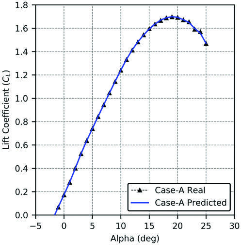

**图 4. 常规无人机升力系数的神经网络预测。** Real＝实际值；Predicted＝预测值。全文图表通用标注：Alpha (deg)＝迎角（度）；Lift／Drag／Pitching Moment Coefficient＝升力／阻力／俯仰力矩系数；Experimental＝实验结果；Non-linear LLT／NLLT＝非线性升力线方法；Inviscid＝无黏；Spanwise Distance＝展向距离；Semi-spanwise Distance＝半翼展方向距离；Leading Edge／Trailing Edge＝前缘／后缘；Running Time＝运行时间；Number of Configurations＝构型数量；Wing／Tail／Fuselage＝机翼／尾翼／机身；Chord＝弦长；Incidence＝安装角；Camber Ratio＝相对弯度；Tail Arm＝尾臂；x-Chord＝弦向坐标。

## 气动模型

本文气动构型分析以我们提出的非线性升力线方法 [7] 为基础。该方法修正了基于势流的 Prandtl 升力线理论，用于计算大迎角下的非线性特性。图 5 给出非线性升力线方法流程图。该方法主要特点为：对升力曲线进行局部线性近似，再通过迭代修正线性近似带来的误差。

计算从三维机翼几何的零升迎角开始，以适当迎角增量逐步推进。在每个迎角处，通过对展向环量分布进行迭代，修正由线性近似产生的升力系数误差。

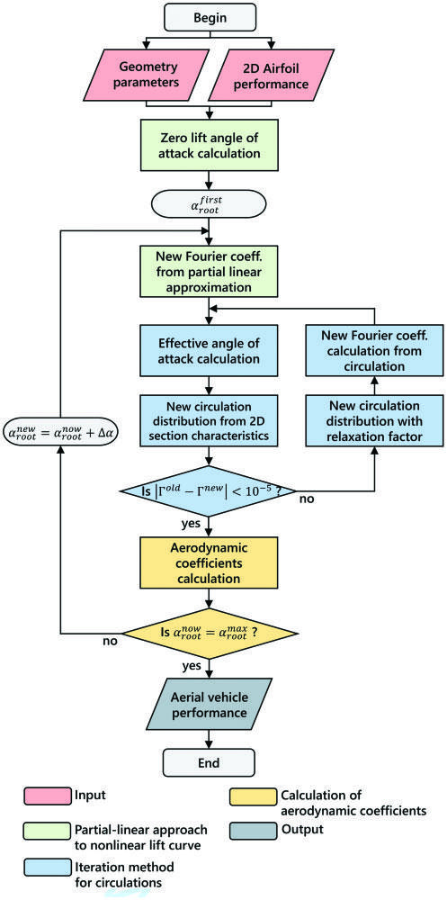

**图 5. 非线性升力线方法流程图。** 图内流程为：开始 → 输入几何参数与二维翼型性能 → 计算零升迎角 → 通过局部线性近似求新 Fourier 系数 → 计算有效迎角 → 由二维截面特性求新环量分布。若新旧环量差未小于 $10^{-5}$，则施加松弛因子、由环量重新计算 Fourier 系数并重复；收敛后计算气动系数。若未达到最大迎角，增加迎角并进入下一步；达到后输出飞行器性能，结束。颜色分别表示输入、局部线性近似、环量迭代、气动系数计算和输出。

### 经典升力线理论

在 Prandtl 升力线理论（又称经典升力线理论）中，有限翼绕流由均匀平行自由来流中的马蹄涡系模拟。马蹄涡的前缘涡丝均在机翼上重合，作为附着涡表示机翼的作用，而两侧涡丝反映尾涡的影响。有关这一数学模型的详细信息，可参阅任何空气动力学教材 [48,49]。

在该模型的一般应用中，附着涡强度沿流向的变化用正弦 Fourier 级数表示：

> 方向术语说明：原文此处写作“streamwise（流向）”；结合升力线理论中 $\Gamma(\theta)$ 的含义，这里描述的应为展向分布。正文保留原文用语，以便对照。

$$
\Gamma(\theta)=4sV_\infty\sum_{j=1}^{N}A_j\sin(j\theta).
\tag{1}
$$

升力面的气动参数由下式给出：

$$
C_L=\pi AR A_1.
\tag{2}
$$

$$
C_{D_i}=\frac{C_L^2}{\pi AR}(1+\delta),\qquad
\delta=\sum_{j=2}^{N}j\left(\frac{A_j}{A_1}\right)^2.
\tag{3}
$$

$$
\varepsilon=\sum_{j=1}^{N}\frac{jA_j\sin(j\theta)}{\sin\theta}.
\tag{4}
$$

Fourier 系数 $A_j$ 取决于机翼几何形状和迎角。经典方法利用二维翼型的线性升力曲线斜率，通过一步计算获得三维机翼的线性解。而本文对二维升力曲线采用一种新的局部线性近似。

### 非线性升力曲线的局部线性近似

在升力曲线的非线性区域，对于处于任意安装姿态的机翼展向站位 $i$，设 $\alpha_i^k$ 和 $c_{l_i}^k$ 分别为局部几何迎角和局部升力系数（见图 6）。假设在迎角增加一个小量 $\Delta\alpha$ 的过程中，升力曲线斜率保持不变。若将新的局部几何迎角定义为 $\alpha_i^{k+1}$，则新的升力系数为：

$$
c_{l_i}^{k+1}=c_{l_i}^{k}+a_i^k\left(\alpha_i^{k+1}-\alpha_i^k\right).
\tag{5}
$$

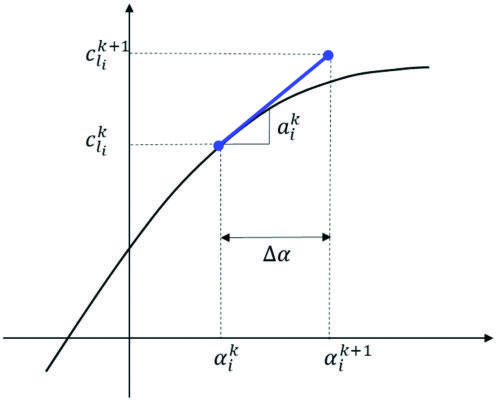

**图 6. 升力曲线的局部线性近似。** 图中 $\Delta\alpha$ 表示迎角步长，$a_i^k$ 为当前步的局部升力曲线斜率。

对于同一升力系数，可像经典升力线方法一样，从二维角度写出下式：

$$
c_{l_i}^{k+1}=c_{l_i}^{k}+a_{\infty i}^{k}\left(\alpha_{e_i}^{k+1}-\alpha_{e_i}^{k}\right).
\tag{6}
$$

其中，$\alpha_e$ 为有效迎角，$a_\infty$ 为二维升力曲线斜率；同样假设该斜率在迎角增量 $\Delta\alpha$ 内保持不变。局部几何迎角与有效迎角之差即为下洗角：

$$
\alpha_i^k-\alpha_{e_i}^k=\varepsilon_i^k,\qquad
\alpha_i^{k+1}-\alpha_{e_i}^{k+1}=\varepsilon_i^{k+1}.
\tag{7}
$$

将这些关系代入式（6），得到：

$$
c_{l_i}^{k+1}=c_{l_i}^{k}+a_{\infty i}^{k}
\left[\left(\alpha_i^{k+1}-\varepsilon_i^{k+1}\right)-\left(\alpha_i^k-\varepsilon_i^k\right)\right].
\tag{8}
$$

注意迎角变化量 $\Delta\alpha$ 为：

$$
\alpha_i^{k+1}-\alpha_i^k=\Delta\alpha.
\tag{9}
$$

于是得到：

$$
c_{l_i}^{k+1}=c_{l_i}^{k}+a_{\infty i}^{k}
\left[\Delta\alpha-\left(\varepsilon_i^{k+1}-\varepsilon_i^k\right)\right].
\tag{10}
$$

应用升力的 Kutta–Joukowski 定理，可将截面升力系数表示为环量的函数：

$$
L'=\rho_\infty V_\infty\Gamma
=c_l\frac{1}{2}\rho_\infty V_\infty^2c
\quad\Rightarrow\quad c_l=\frac{2\Gamma}{V_\infty c}.
\tag{11}
$$

将这一关系代入式（10），得到：

$$
\frac{2\Gamma^{k+1}}{V_\infty c_i}
=\frac{2\Gamma^k}{V_\infty c_i}
+a_{\infty i}^{k}\left[\Delta\alpha-\left(\varepsilon_i^{k+1}-\varepsilon_i^k\right)\right].
\tag{12}
$$

将以 Fourier 系数表示环量和下洗角的式（1）与式（4）代入式（12），整理得：

$$
\sum_{j=1}^{N}\left(\frac{1}{\mu_i^k}+\frac{j}{\sin\theta_i}\right)\sin(j\theta_i)A_j^{k+1}
=\sum_{j=1}^{N}\left(\frac{1}{\mu_i^k}+\frac{j}{\sin\theta_i}\right)\sin(j\theta_i)A_j^k+\Delta\alpha.
\tag{13}
$$

其中：

$$
\mu_i^k=\frac{8s}{a_{\infty i}^k c_i}.
\tag{14}
$$

由此建立展向环量分布与机翼几何之间的关系。将该式应用于沿翼展适当分布的 $N$ 个截面（称为站位），得到以下线性方程组：

$$
\sum_{j=1}^{N}D_{ij}^k A_j^{k+1}
=\sum_{j=1}^{N}D_{ij}^k A_j^k+\Delta\alpha,
\qquad i=1,\ldots,N.
\tag{15}
$$

其中：

$$
D_{ij}^k=\left(\frac{1}{\mu_i^k}+\frac{j}{\sin\theta_i}\right)\sin(j\theta_i).
\tag{16}
$$

该方程组可写成矩阵形式：

$$
\left[D_{ij}^k\right]\left\{A_j^{k+1}\right\}
=\left[D_{ij}^k\right]\left\{A_j^k\right\}+\left\{\Delta\alpha\right\}.
\tag{17}
$$

其中，$A_j^k$ 为前一迎角下的 Fourier 级数系数，假定其已知。该方程组的解为：

$$
\left\{A_j^{k+1}\right\}
=\left\{A_j^k\right\}+\left[D_{ij}^k\right]^{-1}\left\{\Delta\alpha\right\}.
\tag{18}
$$

利用所得 Fourier 系数 $A_j^{k+1}$，可计算新一步的机翼升力系数、诱导阻力系数和有效迎角等气动参数。应注意，在每个新迎角步，有效迎角和二维升力曲线斜率 $a_i^k$ 均会变化，因此 $D_{ij}^k$ 也随之变化。

考察式（18）可见，每一步计算都依赖前一步的解。因此，在开始使用式（18）前，必须确定求解起点。本文采用三维机翼的零升迎角作为求解起点，其计算过程见下一小节。

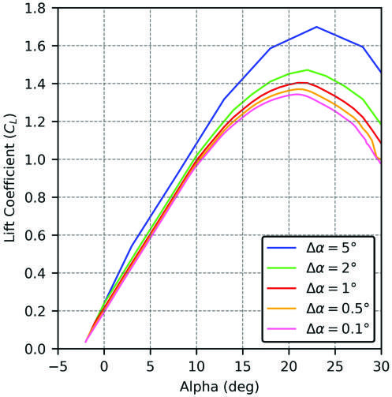

**图 7. 利用式（18）计算得到的不同步长下的升力曲线。** 横轴 Alpha (deg)＝迎角（度）；纵轴 Lift Coefficient (Cl)＝升力系数。图例中 $\Delta\alpha$ 为迎角步长。

此外，式（18）表明，局部线性近似的解取决于步长 $\Delta\alpha$。本文对采用 NACA 4415 截面、展弦比 $AR=10$ 的矩形机翼进行测试，结果如图 7 所示。显然，不同计算步长会导致不同的三维机翼性能结果。

图 7 中，随着步长减小，各解开始收敛到一条特定曲线。然而，采用极小步长分析并不实用。为解决这一问题，在每个计算步之后，对展向环量分布施加迭代过程。其详细说明见“环量的迭代方法”小节。在此之前，首先需要计算起点处的 Fourier 级数。

### 零升迎角的计算

考察三维机翼的升力曲线可知，零升迎角点通常位于一个较窄的线性区域内。利用经典升力线理论进行逆向求解，可以求得该迎角。为此，首先将线性方程组写成以下矩阵形式：

$$
[D_{ij}]\{A_j\}=\{\alpha_i-\alpha_{0i}\}.
\tag{19}
$$

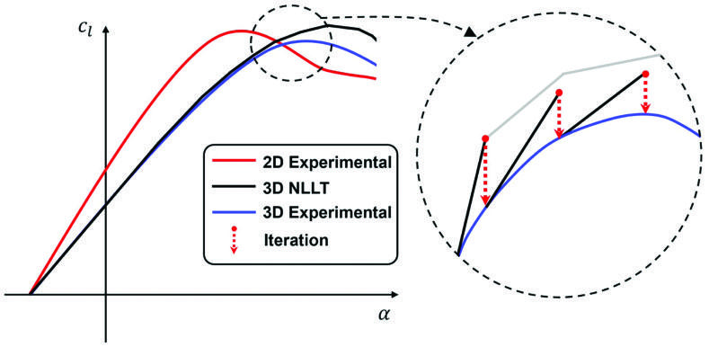

**图 8. 升力曲线上的迭代过程示意。** 图例：2D Experimental＝二维实验结果；3D NLLT＝三维非线性升力线理论结果；3D Experimental＝三维实验结果；Iteration＝迭代。

其中，$\alpha_{0i}$ 为沿展向第 $i$ 个截面的零升迎角，$D_{ij}$ 由前述式（16）给出。若机翼存在几何扭转，宜将局部几何迎角表示为翼根截面迎角 $\alpha_{root}$ 与局部扭转角 $\beta_i$ 之和：

$$
\alpha_i=\alpha_{root}+\beta_i.
\tag{20}
$$

采用这一定义，式（19）变为：

$$
[D_{ij}]\{A_j\}=\{\alpha_{root}\}+\{\beta_i-\alpha_{0i}\}.
\tag{21}
$$

由经典升力线理论可知，升力系数按式（2）取决于第一个 Fourier 系数 $A_1$；显然，升力为零时，$A_1$ 也为零。因此，将式（21）整理为以 $\alpha_{root}$ 代替 $A_1$ 作为未知量的形式，可得：

$$
\begin{bmatrix}
-1&D_{12}&\cdots&D_{1N}\\
-1&D_{22}&\cdots&D_{2N}\\
\vdots&\vdots&\ddots&\vdots\\
-1&D_N&\cdots&D_{NN}
\end{bmatrix}
\begin{Bmatrix}\alpha_{root}\\A_2\\\vdots\\A_N\end{Bmatrix}
=\begin{Bmatrix}\beta_1-\alpha_{01}\\\beta_2-\alpha_{0N2}\\\vdots\\\beta_N-\alpha_{0N}\end{Bmatrix}.
\tag{22}
$$

在这一矩阵系统中，右端向量由机翼几何特性确定，因而已知。系数 $D_{ij}$ 使用翼型零升迎角附近的二维升力曲线斜率 $a_\infty$ 计算。

### 环量的迭代方法

在局部线性近似所述的逐步求解过程中，任意新迎角下的 Fourier 系数都通过前一迎角下的二维升力曲线斜率计算。由于在单步计算中假定这些斜率仍与前一迎角相同，新迎角下的 Fourier 系数便具有与步长 $\Delta\alpha$ 有关的误差。通过图 8 中红色虚线表示的迭代过程，可将这一误差最小化。图 7 展示了若干步长对应的误差，可以看到步长越大，误差也越大。因此，每个迎角步都需要迭代来修正这一误差。

本研究使用的迭代方法，基于通过实验或数值方法获得的机翼截面二维升力系数，对展向环量分布进行修正。该过程以局部线性近似在新迎角下得到的机翼升力系数为起点。

迭代步骤如下：

（i）利用局部线性近似所得 Fourier 系数计算环量分布：

$$
\Gamma_i^{old}=4sV_\infty\sum_{j=1}^{N}A_j\sin(j\theta_i).
\tag{23}
$$

（ii）利用式（4）中的 Fourier 系数计算下洗角，并按下式计算有效迎角：

$$
\alpha_{e_i}=\alpha_i-\varepsilon_i.
\tag{24}
$$

（iii）对每个截面，利用有效迎角，从实验或数值方法获得的截面二维数据中确定局部升力系数。

（iv）由 Kutta–Joukowski 升力定律与升力系数定义得到下列关系，计算新的环量分布：

$$
\Gamma_i^{new}=\frac{1}{2}V_\infty c_i c_{l_i}.
\tag{25}
$$

（v）将这些环量与前一轮结果比较。如果差值小于 $10^{-5}$，退出迭代循环；否则按下式计算新的环量值：

$$
\Gamma_i=\Gamma_i^{old}+RF\left(\Gamma_i^{new}-\Gamma_i^{old}\right).
\tag{26}
$$

其中，$RF$ 为松弛因子，本文算例取值为 0.05。

（vi）将式（1）重写为线性方程组，得到：

$$
\begin{bmatrix}
\sin(1\theta_1)&\sin(3\theta_1)&\cdots&\sin(n\theta_1)\\
\sin(1\theta_2)&\sin(3\theta_2)&\cdots&\sin(n\theta_2)\\
\vdots&\vdots&\ddots&\vdots\\
\sin(1\theta_n)&\sin(3\theta_n)&\cdots&\sin(n\theta_n)
\end{bmatrix}
\begin{Bmatrix}A_1\\A_2\\\vdots\\A_n\end{Bmatrix}
=\begin{Bmatrix}\Gamma_1/(4sV_\infty)\\\Gamma_2/(4sV_\infty)\\\vdots\\\Gamma_n/(4SV_\infty)\end{Bmatrix}.
\tag{27}
$$

式（27）的系数矩阵由恒定的已知参数组成。由于前一步已获得环量分布，可利用系数矩阵的逆计算新的 Fourier 系数。

（vii）重复步骤（i）至（vi），直至收敛。

对前文生成图 7 所用机翼进行了该迭代过程的案例研究，结果与先前升力曲线一起示于图 9。采用 $\Delta\alpha=2^\circ$ 和 $\Delta\alpha=5^\circ$ 步长所得结果，展示了该迭代方法的能力。

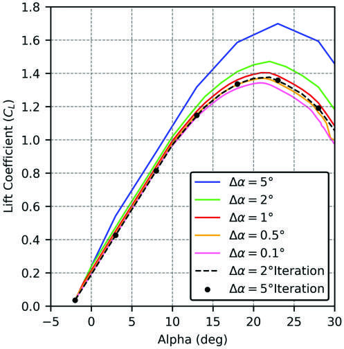

**图 9. 矩形机翼在不同步长下的升力曲线。** 横轴为迎角（度），纵轴为升力系数；Iteration 表示加入迭代修正的结果。

### 气动系数的计算

利用最终 Fourier 级数系数，可通过式（2）和式（3）计算升力系数和诱导阻力系数。然而，经典方法不能给出其他力或力矩参数的信息。不过，利用机翼截面的二维实验或数值数据，可以获得黏性阻力系数和俯仰力矩系数。为此，首先对二维数据进行插值，得到本方法在各展向站位给出的有效迎角所对应的数值。然后按式（28）和式（29）沿翼展进行数值积分：

$$
C_{D_v}=\frac{2}{S}\sum_{i=1}^{N}S_i\bar c_{D_{v_i}},\qquad
\bar c_{D_{v_i}}=\frac{c_{D_{v_i}}+c_{D_{v_{i+1}}}}{2}.
\tag{28}
$$

$$
C_{m_y}=\frac{2}{S\bar c}\sum_{i=1}^{N}S_i\bar c_i\bar c_{m_{y_i}},\qquad
\bar c_{m_{y_i}}=\frac{c_{m_{y_i}}+c_{m_{y_{i+1}}}}{2}.
\tag{29}
$$

其中：

$$
S_i=\frac{c_i+c_{i+1}}{2}(y_{i+1}-y_i),\qquad
\bar c_i=\frac{c_i+c_{i+1}}{2}.
\tag{30}
$$

与这些系数类似，流动分离点和压力系数也可使用机翼截面的二维数据计算。查询表中的数据按每个展向站位的有效迎角进行插值。

> 原式排印说明：以上保留了原文式（14）的 $\mu_i^k$ 定义、式（22）中 $D_N$ 与 $\alpha_{0N2}$ 的下标，以及式（27）中第二列的 $\sin(3\theta)$、系数 $A_2$ 和末项分母的大写 $S$。这些写法与相邻公式或通常记号存在不一致，译文未擅自修正。

## 气动模型的应用

本节给出新型非线性升力线方法的若干测试应用结果，以展示其适用性、局限、优点和缺点。本文使用 Visual Basic 编程语言开发了计算程序，其主要算法见表 1。

首先，采用实验数据验证该方法。

Ostowari 和 Naik 对 NACA 44XX 系列翼型所开展的实验研究，是适合用于验证的数据来源 [50]。这些研究既包含不同厚度比 NACA 44XX 翼型的二维实验数据，也包含不同展弦比矩形机翼在多个雷诺数下的三维实验结果。这些翼型广为人知，在航空领域应用十分普遍。特别是，若干无人机、微型飞行器和轻型飞机采用了这类四位数系列翼型。AAI RQ-7 Shadow 和 AAI RQ-2 Pioneer 等战术无人机，便是采用 NACA 4415 截面矩形机翼的实例。

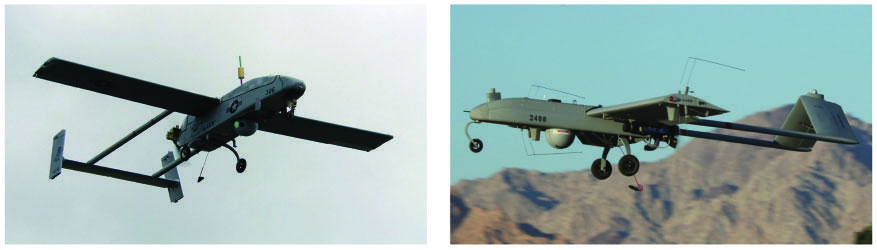

**图 10. 美国海军 RQ-2B Pioneer [51] 和 RQ-7B Shadow [52]。**

**表 1. 非线性升力线方法的算法。**

**N-LLT 程序算法**

输入：几何参数；二维翼型性能数据。

1. `for` $i=1$ 至 $N$，其中 $N$ 为站位数。
2. 计算几何参数 $\{c(i),y(i),\ldots\}$。
3. `end for`。
4. 求解 $[D_{ij}]\{A_j\}=\{\alpha_{root}\}+\{\beta_i-\alpha_{0i}\}$。
5. `while` $\alpha_{root}<\alpha_{max}$，其中 $\alpha_{max}$ 为最大迎角限制。
6. $\{A_j^{k+1}\}=\{A_j^k\}+[D_{ij}^{k}]^{-1}\{\Delta\alpha\}$。
7. $\Gamma_i^{old}=4sV_\infty\sum_{j=1}^{N}A_j\sin(j\theta_i)$。
8. `for` $iter=1$ 至 $maxiter$。
9. 使用 $\Gamma_i$ 计算 $A_j$。
10. $\varepsilon=\sum_{j=1}^{N}\dfrac{jA_j\sin(j\theta)}{\sin\theta}$，即下洗角。
11. $\alpha_{ei}=\alpha_i-\varepsilon_i$。
12. $\Gamma_i^{new}=\dfrac{1}{2}V_\infty c_i c_{li}$。
13. `if` $|\Gamma_i^{old}-\Gamma_i^{new}|<10^{-5}$。
14. `exit for`。
15. `end if`。
16. $\Gamma_i=\Gamma_i^{old}+RF(\Gamma_i^{new}-\Gamma_i^{old})$。
17. `end for`。
18. 计算 $C_L$、$C_D$、$C_m$。

输出：三维几何体的气动性能。

因此，第一个测试案例选取截面为 NACA 4415、展弦比为 9 的矩形机翼，见表 2。分别在 $0.25\times10^6$ 和 $0.50\times10^6$ 两个雷诺数下分析该机翼。后续图例使用 M 表示雷诺数的 $10^6$ 量级。

**表 2. 测试案例 I 的参数。**

| 截面翼型 | 平面形状 | 展弦比 AR | 雷诺数 Re |
|---|---|---:|---|
| NACA 4415 | 矩形 | 9 | $0.25\times10^6$～$0.50\times10^6$ |

图 11 将分析结果与实验数据一并展示。可以清楚地看到，无论在线性区还是非线性区，数值结果与实验数据几乎完全重合。两个雷诺数下计算得到的最大升力系数均与实验值接近相等。这说明，当 $Re=0.25\mathrm M$ 时，本方法能够精确计算线性区和非线性区内的升力系数，计算范围可延伸至失速点之后 $10^\circ$。但在 $Re=0.50\mathrm M$ 时，迎角超过 $25^\circ$ 后，两条升力曲线之间出现小幅偏差。此外，计算得到的总阻力和俯仰力矩曲线也取得了令人满意的结果。需要说明的是，由于俯仰力矩系数的实验数据存在一定波动，文献中的结果在此以平均曲线表示。

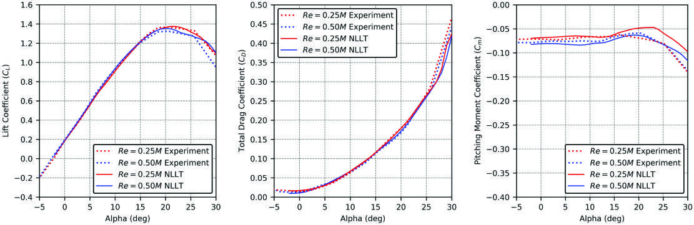

**图 11. 测试案例 I：升力系数、总阻力系数和俯仰力矩系数。** 横轴为迎角 Alpha（度）；Experiment＝实验，NLLT＝非线性升力线方法。

第二个测试案例采用截面为 NACA 4415、展弦比为 12 的矩形机翼，见表 3。与测试案例 I 相比，本例唯一的区别是展弦比略有增大。

**表 3. 测试案例 II 的参数。**

| 截面翼型 | 平面形状 | 展弦比 AR | 雷诺数 Re |
|---|---|---:|---|
| NACA 4415 | 矩形 | 12 | $0.25\times10^6$～$0.50\times10^6$ |

与前一测试案例相同，图 12 将数值结果与验证数据一并给出。本例实验升力曲线在迎角约为 $12^\circ$ 时开始出现非线性。与前例一样，该数值方法能够准确计算这一非线性区域，直至迎角达到 $25^\circ$。如图 12 所示，所开发的方法能够预测三维机翼失速后的气动行为。第二幅子图给出了从零升迎角至 $\alpha=30^\circ$ 范围内的总阻力系数计算结果，并与文献实验数据进行比较。结果清楚表明，本方法计算的总阻力系数十分接近实验值。第三幅子图中，俯仰力矩的数值结果相对实验数据存在一定偏移，但该方法仍能以较小误差估计力矩曲线的变化规律。

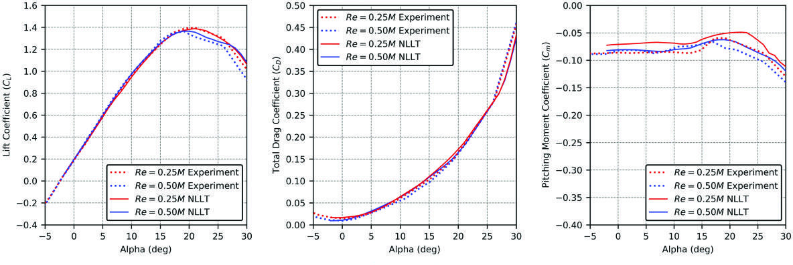

**图 12. 测试案例 II：升力系数、总阻力系数和俯仰力矩系数。** 横轴为迎角（度）。

下一项验证将所开发的工具与其他计算气动工具比较。文献中已有多种工具可分析升力面及其组合构型的气动性能。表 4 列出了本研究使用的工具及其运行时间。除 NASA TetrUSS USM3D [53] 外，表中其他工具均可免费下载。

**表 4. 计算气动分析工具及其求解时间。**

| 程序 | 方法 | 时间 |
|---|---|---|
| 本文开发的程序 | 非线性升力线方法 | 毫秒 |
| NASA USM3D | 计算流体力学 | 小时／天 |
| XFLR5 | 升力线方法 | 毫秒 |
| XFLR5 | 涡格法 | 秒 |
| XFLR5 | 面元法 | 秒 |
| Tornado | 涡格法 | 秒 |
| OpenVSP | 涡格法 | 秒 |
| DATCOM | 半经验方法 | 毫秒 |

本测试案例采用截面为 NACA 4415、展弦比 $AR=12$ 的矩形机翼。分析在以弦长为基准、雷诺数为 300 万的条件下进行。几何参数见表 5。本方法所需的二维数据取自文献数据库 [53]，该数据库采用 NASA USM3D 工具生成。

**表 5. 测试案例 III 的参数。**

| 截面翼型 | 平面形状 | 展弦比 AR | 雷诺数 Re |
|---|---|---:|---|
| NACA 4415 | 矩形 | 12 | $3.0\times10^6$ |

所有分析结果汇总于图 13。图中黑色虚线表示采用 NASA USM3D CFD 工具得到、并收录于文献数据库 [53] 的三维数据。XFLR5 VLM [19]、XFLR5 面元法 [19]、OpenVSP（VSPAero）VLM 和 Tornado VLM [22] 的数学模型以势流理论为基础，因此通过线性近似计算升力曲线。这些工具无法预测最大升力系数，也不能预测失速前后区域的非线性行为。另一方面，XFLR5 LLT（仅适用于单个升力面）和 DATCOM 会通过计算估计最大升力系数。但如图 13 所示，尤其是 DATCOM，其预测结果远不能令人满意。

**图 13. 测试案例 III：升力系数。** 横轴为迎角（度）；Non-linear LLT＝非线性升力线方法，Panel＝面元法，VLM＝涡格法。

仔细观察图 13 可见，所开发的方法对升力曲线的线性区和非线性区都能以很小的误差进行计算，所得最大升力系数也几乎等于验证值。

图 14 将本方法计算的截面升力系数与 CFD 结果比较。考虑到非线性行为从 $12^\circ$ 开始，失速前迎角 $\alpha=14^\circ$ 下的升力分布计算结果显得十分准确。需要注意，本方法采用的展向站位数量较少，因此连接这些点的线段完全呈直线。此外，非线性 LLT 在失速迎角下，也能以极小误差预测升力分布，图中用橙色曲线表示。它还能够正确计算失速后升力分布的总体特征。红色曲线表明，所开发的方法能够捕捉升力分布中的大幅波动，但程序忽略了展向站位之间的小幅波动。在普通个人计算机配置上，程序能够在 0.06 秒内计算完整迎角范围。

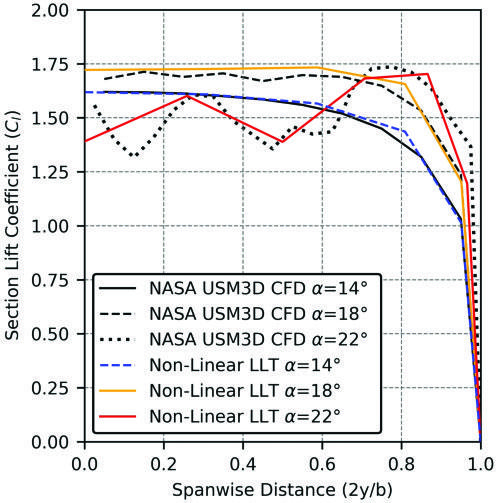

**图 14. 测试案例 III：截面升力系数分布。** 横轴为无量纲展向距离 $2y/b$，纵轴为截面升力系数；曲线对应 $14^\circ$、$18^\circ$ 和 $22^\circ$ 迎角。

流动分离线是本方法可计算的另一项特征，这里也将其与数据库结果比较。为此，采用 XFOIL 获取所需的二维流动分离输入。图 15 的结果以按比例绘制的半翼形式展示，图中各迎角采用与前图相同的颜色。根据图 13 的升力曲线，机翼在迎角 $18^\circ$ 时开始失速。通常，矩形机翼首先在翼根区域失速；数值分析和 CFD 结果中都能观察到这一现象。与升力分布类似，本方法也能够捕捉各展向站位流动分离点的大幅变化。对于低阶方法而言，这些结果相当成功。

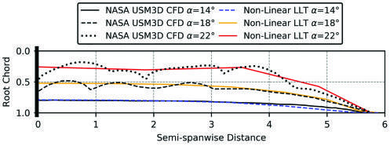

**图 15. 测试案例 III：流动分离点。** 横轴为半翼展方向距离，纵向展示从前缘到后缘的相对位置；Root＝翼根，Tip＝翼尖。

### 将该方法扩展至常规布局飞行器的气动分析

众所周知，Prandtl 经典升力线理论仅适用于单个升力面。本研究开发了一套方法，使升力面组合构型的求解成为可能。为此，需要计算机翼在尾翼处产生的下洗，再对后方升力面重复应用非线性方法。Phillips 等 [54] 建立了一个数学模型，用于估计无后掠机翼后方数个弦长或更远处的下洗。该模型将卷起的涡片视为单根马蹄形涡丝。数值计算采用傅里叶级数系数和机翼几何数据，因此可处理完全任意的展向变化。

采用迭代过程最终得到的机翼几何对应傅里叶系数，即可计算尾翼各站位处的下洗速度。式（31）中的 $k_b$、$k_p$ 和 $k_v$ 分别表示翼尖涡展向间距因子、尾翼位置因子及翼尖涡强度因子。无量纲参数 $k_v$ 和 $k_b$ 取决于机翼平面形状，$k_p$ 则同时取决于机翼平面形状以及尾翼相对机翼的位置：

$$
\varepsilon_i(\bar x,\bar y,\bar z)\simeq\frac{-V_z(\bar x,\bar y,\bar z)}{V_\infty}=\frac{k_vk_p}{k_b}\left(\frac{C_{Lw}}{AR_w}\right).
\tag{31}
$$

若已知尾翼位置处的下洗角及尾翼扭转角，则尾翼各站位的迎角为：

$$
\alpha_{tail_i}=\alpha_{root}+\beta_{tail_i}-\varepsilon_i.
\tag{32}
$$

利用这些信息，即可将新开发的非线性升力线方法应用于尾翼几何。这样，先前为机翼计算的所有参数也都可以为尾翼求得，从而实现机翼—尾翼组合构型的非线性分析。升力面组合构型的气动力系数按式（33）和（34）计算：

$$
C_{L_{total}}=C_{L_{wing}}+C_{L_{tail}}\frac{S_{tail}}{S_{ref}}.
\tag{33}
$$

$$
C_{D_{total}}=C_{D_{wing}}+C_{D_{tail}}\frac{S_{tail}}{S_{ref}}.
\tag{34}
$$

由此，可以计算包含黏性效应的机翼—尾翼组合构型总阻力。但众所周知，机身几何对完整构型有重要影响，尤其体现在寄生阻力方面。Sadraey 指出，飞机零升阻力 $C_{D0}$ 通常有 30%～50% 来自机身 [55]。如本文所用实例一样，无人机通常具有简单的机身几何，因此可以采用解析／经验方法计算阻力。

采用这些方法 [56]，机身几何的零升阻力系数可表示为：

$$
C_{D0_{fslg}}=R_{wf}C_f\left\{1+\frac{60}{(l_f/d_f)^3}+0.0025(l_f/d_f)\right\}\frac{S_{wet_{fslg}}}{S_{ref}}.
\tag{35}
$$

除该系数外，起落架、外挂物和挂架等其他部件的阻力也可以用这些解析／经验方法计算。根据上述信息，整机总阻力系数最终可按式（36）求得：

$$
C_{D_{total}}=C_{D_{wing}}+C_{D_{tail}}+C_{D_{fuselage}}+C_{D_{misc}}.
\tag{36}
$$

在简单无人机分析中，需要俯仰力矩来判断飞行器静稳定性。若采用部件叠加法计算该系数，可得式（37）：

$$
C_{m_{total}}=C_{m_{cg_{wing}}}+C_{m_{cg_{tail}}}+C_{m_{cg_{fuselage}}}.
\tag{37}
$$

机翼和尾翼对飞机静稳定性的贡献，可通过确定重心（CG）处总力矩的基本力—力矩方程计算。机身对俯仰力矩的贡献则可采用 Multhopp 方法计算 [57]：

$$
C_{m0_{fuselage}}=\frac{k_2-k_1}{36.5S\bar c}\sum_{x=0}^{x=l_f}w_f^2(\alpha_{0w}+i_f)\Delta x.
\tag{38}
$$

$$
C_{m\alpha_{fuselage}}=\frac{1}{36.5S\bar c}\sum_{x=0}^{x=l_f}w_f^2\frac{\partial\varepsilon_u}{\partial\alpha}\Delta x.
\tag{39}
$$

这些方程的详细信息和应用示例可参见文献 [56,57]。至此，完成了完整无人机分析所需的全部方程。

新开发的工具已用于 ARC 无人机的设计和数学建模，见图 16。具体而言，采用本文方法分析不同无人机构型的非线性性能，并将结果迅速传入动力学模型，用于仿真和飞行控制系统设计。关于这些模型在稳定性导数计算和飞控系统设计中的应用详情，可参见文献 [58–60]。

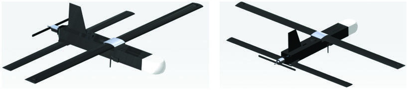

**图 16. ARC 无人机几何构型。**

本例将项目无人机的气动性能与多种分析工具比较，结果见图 17。观察升力曲线可知，本方法在线性区、非线性区以及失速行为方面，均与 CFD（ANSYS Fluent）结果吻合良好。在相同计算硬件配置下，Fluent CFD 对 15 个测试点进行 $C_L-\alpha$ 计算耗时 120 小时，而本方法对 30 个测试点进行同样的 $C_L-\alpha$ 计算仅需 0.01 秒。这体现出该方法在捕捉全部重要非线性效应的同时，能够获得显著计算优势。因此，本文方法有潜力成为适用于独立分析及多学科设计优化的快速构型分析工具。

图 17 的第二幅子图比较了总阻力系数曲线。与测试案例 III 相同，VLM 程序的诱导阻力结果与其黏性阻力模块的解相加。在本文方法中，则将机身对总阻力系数的贡献，加入直接由升力面得到的结果。

对于该构型，XFLR5 在黏性分析中能够收敛的迎角范围非常窄。本文方法在迎角不超过 $9^\circ$ 时，与 CFD 和 Tornado 的结果相当。有意思的是，超过这一迎角后，CFD 结果的增长速率有所降低。正如用户手册中的警告所述，DATCOM 的阻力结果并不十分可靠 [61]。图 17 显示其阻力曲线存在较大偏移。这也说明，使用 DATCOM 时必须考虑经验表格的适用范围并保持谨慎，尤其是在无人机尺寸和飞行状态下。

最后，图 17 比较了俯仰力矩曲线。如图所示，各计算工具的结果彼此一致。但蓝色曲线所示的本文方法，由于计算了具有完整非线性行为的俯仰力矩曲线，在高迎角状态下呈现明显不同的结果。识别这种行为，对于准确建立无人机敏捷飞行模型并实施控制至关重要。

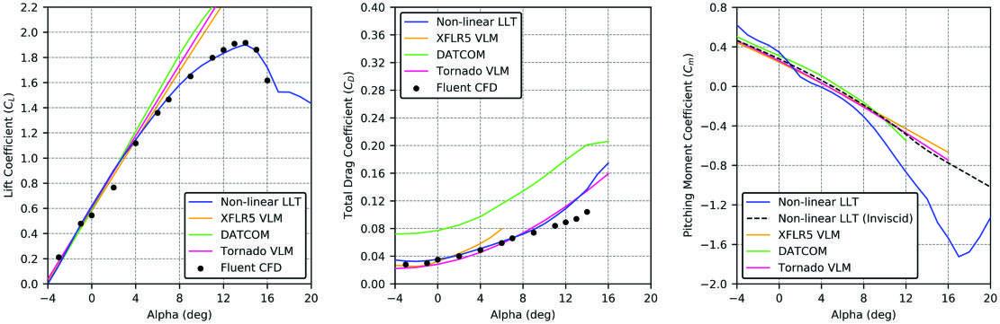

**图 17. 测试案例 IV：升力系数、总阻力系数和俯仰力矩系数。** 横轴为迎角（度）；Non-linear LLT（Inviscid）＝非线性升力线方法（无黏）；其余工具名称保留原文。

由于该图缺少 CFD 数据，本文采用另一种方式检验所开发方法计算结果的偏移。为说明这种行为差异源于升力曲线固有的非线性结构，我们使用线性、无黏的二维性能输入进行分析。该分析以黑色虚线表示，可以清楚看出，其结果与其他分析工具一致。由此可得，相较于其他工具，所开发方法表现出的差异主要来自黏性效应。下一节将重点构建高效的气动构型分析引擎，用于小型无人机的设计优化。

## 人工神经网络模型

小型无人机设计优化面临的关键挑战之一，是缺少能够纳入优化流程的快速、精确气动构型分析引擎。为此，本文利用深度学习技术构建黑箱函数，仅根据几何参数便可预测包含黏性效应的无人机构型气动特性。具体而言，我们设计人工神经网络架构，并使用上一节气动分析工具生成的数据集进行训练。

图 18 给出了人工神经网络方法的彩色流程图。在此前工作 [5] 的基础上，本文通过扩展数据集，将机身对总阻力系数和俯仰力矩系数的贡献纳入模型。此外，还改进了特征集和网络结构，使模型在设计空间内具有更广的泛化能力。随着训练数据规模增加，神经网络估计气动性能的精度提高。以下各小节从数据生成开始，依次介绍图 18 所示流程。为保证结果可复现，文中详细给出所有数据集、特征和训练配置。

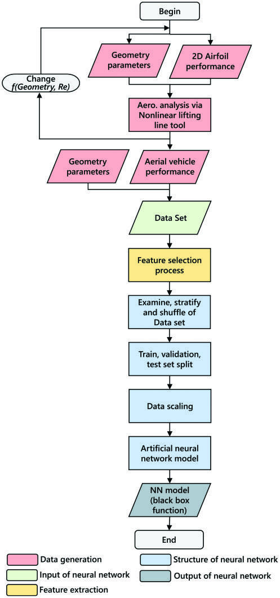

**图 18. 人工神经网络模型流程图。** 图中：Geometry parameters＝几何参数；2D Airfoil performance＝二维翼型性能；Aero. analysis via Nonlinear lifting line tool＝使用非线性升力线工具开展气动分析；Aerial vehicle performance＝飞行器性能；Data Set＝数据集；Feature selection process＝特征选择过程；Examine, stratify and shuffle of Data set＝数据集检查、分层与打乱；Train, validation, test set split＝训练集、验证集与测试集划分；Data scaling＝数据缩放；Artificial neural network model＝人工神经网络模型；NN model (black box function)＝神经网络模型（黑箱函数）。颜色分别表示数据生成、神经网络输入、特征提取、神经网络结构及神经网络输出。

### 数据生成

本文的非线性升力线方法为生成训练神经网络所需的气动数据提供了一种快速、可靠的途径。为构建基础几何—气动数据集，我们修改几何定义，并使用多个 XFOIL [62] 分析结果作为二维性能输入。每种构型约分析 30 个不同迎角。图 19 在双对数坐标下给出了计算时间与构型数量的关系，计算时间表现出很强的一阶（即 $n=1$）对数关系。还需说明，本研究以个人计算机作为主要计算环境。

本研究最终采用包含 94,500 种构型的数据集，但通过不同几何组合仍可增加这一数量。表 6 给出了构型数量和数据集总行数。

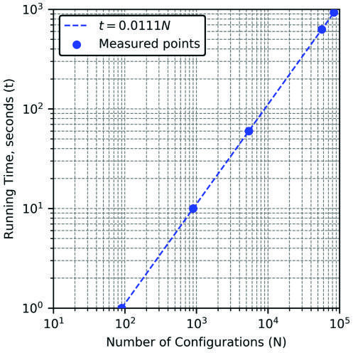

**图 19. 构型数量与计算时间的关系。** 横轴为构型数量 $N$，纵轴为运行时间（秒）；Measured points＝实测点；拟合关系为 $t=0.0111N$。

**表 6. 数据集规模与生成时间。**

| 构型数量 | 总行数 | 参数数量（列数） | 运行时间（分钟） |
|---:|---:|---:|---:|
| 94,500 | 2,835,000 | 25 | 17.5 |

表 7 汇总数据集中的全部 25 个参数，其中 21 个与几何有关，1 个与流动条件有关，3 个为性能输出。

**表 7. 数据集中的全部构型参数。**

| 参数类别 | 参数 |
|---|---|
| 机翼与尾翼参数 | 翼展 |
| 机翼与尾翼参数 | 翼根弦长 |
| 机翼与尾翼参数 | 翼尖弦长 |
| 机翼与尾翼参数 | 安装角 |
| 机翼与尾翼参数 | 翼型相对厚度 |
| 机翼与尾翼参数 | 翼型相对弯度 |
| 机翼与尾翼参数 | 翼型最大弯度位置 |
| 机翼与尾翼参数 | 二维性能输入文件名 |
| 机身 | 水力直径 |
| 机身 | 长度 |
| 位置 | $x$ 向距离 |
| 位置 | $y$ 向距离 |
| 位置 | $z$ 向距离 |
| 流动条件 | 迎角 $\alpha$ |
| 性能系数 | 升力系数 $C_L$ |
| 性能系数 | 阻力系数 $C_D$ |
| 性能系数 | 俯仰力矩系数 $C_m$ |

研究初期，为防止数据规模过度增长，我们规定了一定的几何范围。不过，如前所述，程序能在 0.01 秒内求解一种构型在 30 种流动条件下的性能，因此扩展这些组合并不困难。组合所用参数见表 8。

机翼截面采用不同相对弯度的翼型，而尾翼限定为对称的 NACA 0012 翼型。基于机翼平均气动弦长的雷诺数选为与小型无人机飞行状态相当的范围。根据机翼几何确定尾翼和机身的尺寸与位置，从而生成大量尺寸合理的不同构型。

**表 8. 数据集中的几何参数及其范围。**

| 翼面 | 翼型 | 弦长 | 展弦比 AR | 安装角 | $x$ 向位置 | 雷诺数 |
|---|---|---|---|---|---|---|
| 机翼 | NACA 2412、NACA 4412、NACA 6412 | 0.2～0.6 | 10～20 | -2～2 | — | $0.4\times10^6$～$1.2\times10^6$ |
| 尾翼 | NACA 0012 | $(0.5\text{～}1)\times c_{wing}$ | 4～8 | -2～2 | $(0.4\text{～}0.6)\times b_{wing}$ | $0.2\times10^6$～$1.2\times10^6$ |

### 特征提取

在特征提取过程中，首先检查由原始数据构成的初始数据集。为此，采用 Pearson 方法计算相关矩阵。图 20 中，特征之间的正相关以深蓝色表示，负相关以浅蓝色表示，颜色深浅与相关性数值成比例。

如图所示，迎角数据（alpha）与目标数据，即 $C_L$、$C_D$ 和 $C_M$ 系数，具有预期中的强关联。仅凭其余特征，尚不足以提高方法的泛化能力并覆盖设计空间。已有研究也指出，原始数据构成的初始数据集并不充分，尤其难以估计俯仰力矩曲线。为解决这一问题，我们采用自动特征工程与选择程序库 autofeat [63]。该程序库通过生成额外的非线性特征，提高回归模型的预测精度。借助该库，本文生成 12 个非线性特征，并加入初始特征集。

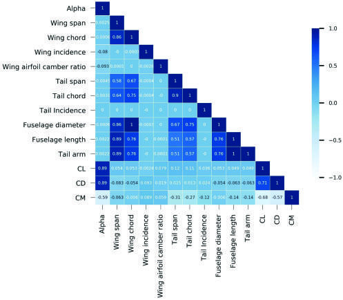

**图 20. 初始数据集的相关矩阵。**

### 人工神经网络结构

本小节逐步介绍人工神经网络结构及其数学基础。训练模型前，先对数据集进行预筛查，以识别并清除气动性能系数中的异常值。此时，对数据集准确分层并打乱十分重要，可保证合理训练并避免不期望的情况。此外，将数据分为测试、训练和验证三组：先将 95% 留作训练、5% 留作测试，再将训练集的 10% 用于验证。表 9 进一步给出了各组比例与数据量。

**表 9. 训练集、验证集和测试集。**

| 数据集 | 数据比例 | 数据条数 |
|---|---:|---:|
| 训练集 | 85.5% | 约 2,400,000 |
| 验证集 | 9.5% | 约 270,000 |
| 测试集 | 5% | 约 141,000 |

在建立网络结构前的最后一步，分别对训练集和测试集进行缩放，以避免输入量级差异造成的收敛问题。如式（40）所示，每条数据减去所在集合的最小值，再除以该集合的极差，得到缩放值。式中，$x_i^{sc}$ 表示缩放后的样本：

$$
x_i^{sc}=\frac{x_i-\min(x)}{\max(x)-\min(x)}.\tag{40}
$$

缩放后的数据作为特征集从输入层送入网络。模型由输入层、输出层和六个隐藏层组成，见图 21。

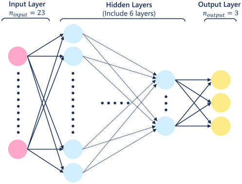

**图 21. 神经网络结构。（a）平均绝对误差随训练轮次的变化；（b）均方误差随训练轮次的变化。** 图中输入层 $n_{input}=23$，隐藏层共 6 层，输出层 $n_{output}=3$。

> 图注说明：原文图 21 的主体是网络结构图，但图注后附的（a）、（b）文字对应图 22 的学习曲线；此处保留原始图注信息。

各层输出可表示为：

$$
z_i^l=f\left(W^l x_i^{l,sc}+b^l\right).\tag{41}
$$

其中，$f$ 为激活函数，$W^l$ 为第 $l$ 层权重矩阵，$b^l$ 为该层偏置向量。在此算法中，激活函数决定哪些神经元被激活，也就是决定哪些信息传递至后续层。本文选用神经网络中最常见的激活函数之一——修正线性单元（ReLU）[64]。权重矩阵采用“He 正态初始化器”初始化 [65]，该初始化器从以零为中心的截断正态分布中抽取样本。

采用绝对误差作为损失函数，计算数据实际值与预测值之间的误差。式（42）中，$y_i$ 为实际输出，$\hat y_i$ 为神经网络预测输出：

$$
E(W,b)=\frac{1}{n}\sum_{i=1}^{n}|y_i-\hat y_i|.\tag{42}
$$

选择 Adam 方法作为优化器，通过更新权重与偏置使误差函数最小化 [66]。Adam 优化器计算代价函数的偏导数，并利用这些信息在每次迭代时更新矩向量。

最后，依据表 10 汇总的参数建立神经网络模型。

**表 10. 神经网络架构的超参数。**

| 参数 | 取值 |
|---|---|
| 隐藏层数量 | 6 |
| 第一隐藏层神经元数 | 512 |
| 第二隐藏层神经元数 | 256 |
| 第三隐藏层神经元数 | 128 |
| 第四隐藏层神经元数 | 64 |
| 第五隐藏层神经元数 | 32 |
| 第六隐藏层神经元数 | 16 |
| 激活函数 | ReLU |
| 优化器 | Adam |
| 初始化器 | He 正态初始化 |
| 损失函数 | MAE（平均绝对误差） |
| 批大小 | 512 |
| 训练轮数 | 250 |

下一步，利用上述网络结构与数据集训练模型，训练过程的学习曲线如图 22 所示。由图可见，损失在 250 轮训练后收敛至最小值。曲线行为与误差值表明，学习过程顺利完成，没有发生过拟合或欠拟合。

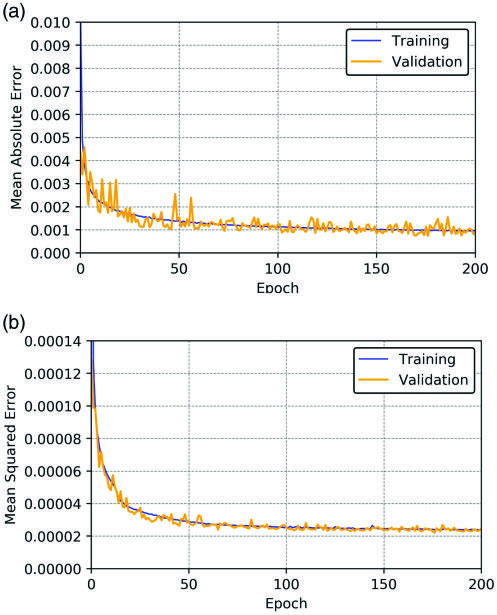

**图 22. 所开发模型的学习曲线。（a）预测升力系数与实际值；（b）预测阻力系数与实际值；（c）预测俯仰力矩系数与实际值。** 图中 Mean Absolute Error＝平均绝对误差；Mean Squared Error＝均方误差；Epoch＝训练轮次；Training＝训练；Validation＝验证。

> 图注说明：原文图 22 的主体为平均绝对误差、均方误差两幅学习曲线，但图注附带的（a）～（c）文字对应图 23 的系数预测对比；此处保留原始图注。图中横轴显示至 200 轮，而正文与表 10 写为 250 轮。

此外，表 11 给出训练阶段的误差值。误差水平令人满意，因此结束训练阶段。

**表 11. 训练与验证误差。**

| 数据集 | 平均绝对误差 | 均方误差 |
|---|---:|---:|
| 训练集 | 0.00116 | 0.000018 |
| 验证集 | 0.00124 | 0.000024 |

训练结束后，使用未参与训练的测试集验证模型。图 23 比较了测试集中不同构型的模型预测结果与实际值。由于测试数据超过 141,000 条，我们随机抽取 500 个点进行可视化比较。可以看出，大量不同目标值分布在很宽的范围内，但模型仍能够捕捉最极端的数值。

需说明，所有构型的俯仰力矩均以位于弦长 75% 处的重心（CG）作为参考点计算。

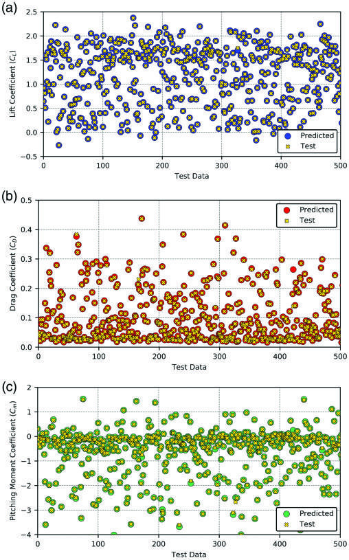

**图 23. 测试集在各目标系数上的表现。**

为评估模型在整个测试集上的效果，计算决定系数 $R^2$，结果如图 24 所示。横轴、纵轴分别表示实际值和预测值，各目标系数的 $R^2$ 均十分接近 1。图中也可观察到，约 141,000 条测试数据几乎全部位于回归线上，偏离回归线的数值数量很少，可以忽略。

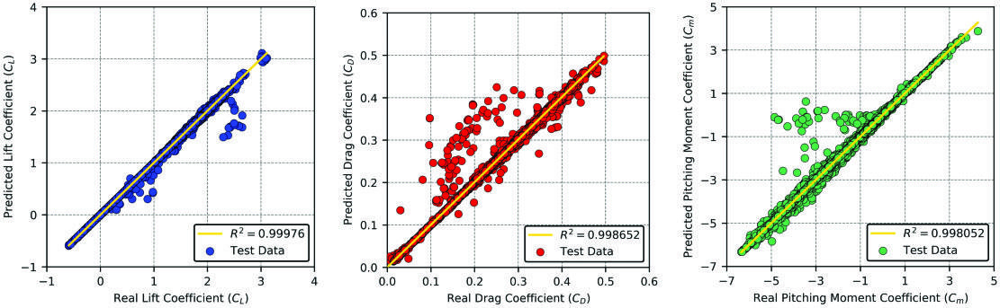

**图 24. 测试集（约 141,000 条数据）在各目标参数上的表现。**

本文方法取得的决定系数显著更高，达到 $R^2=0.99805\text{～}0.99976$，而其他方法 [40–45] 的范围为 $R^2=0.805\text{～}0.945$。这说明，即使在完全呈现非线性行为的大迎角区域，本文方法仍具有较高精度和较强学习能力。下一小节通过多种应用展示这些能力。

### 代理模型的应用

本小节给出代理模型的若干测试实例，以展示其泛化能力。如前所述，该模型仅以几何数据作为输入，便可预测无人机构型的非线性性能系数，见图 1。这使模型具有依赖实际流动动力学计算的气动分析工具尚未达到的实用性与计算速度。

测试算例 A 和 B 分别选取常规布局和串列翼布局无人机作为实例，其机翼翼型均曾用于模型训练。表 12 汇总了几何参数。

**表 12. 测试算例 A 和 B 的参数。**

| 参数 | 算例 A：机翼 | 算例 A：尾翼 | 算例 A：机身 | 算例 B：机翼 | 算例 B：尾翼 | 算例 B：机身 |
|---|---|---|---|---|---|---|
| 翼展 | 2.25 | 0.9 | — | 6 | 3 | — |
| 弦长 | 0.2 | 0.2 | — | 0.4 | 0.4 | — |
| 安装角 | 0 | 0 | — | 1 | 0 | — |
| 翼型 | 2412 | 0012 | — | 4412 | 0012 | — |
| 直径 | — | — | 0.2 | — | — | 0.4 |
| 长度 | — | — | 2 | — | — | 5 |
| 雷诺数 | 0.4 M | 0.4 M | — | 0.8 M | 0.8 M | — |
| 位置 | [0,0,0] | [1,0,0] | [-1,0,0] | [0,0,0] | [2.5,0,0] | [-2.5,0,0] |

由图 25 可见，预测结果几乎等于实际值。无论常规布局还是串列翼布局，神经网络模型均准确计算了升力系数的线性区与非线性区，包括失速后区域；也成功计算了阻力与俯仰力矩系数。此外，模型能够捕捉大迎角下由升力面非线性行为引起的俯仰力矩变化。

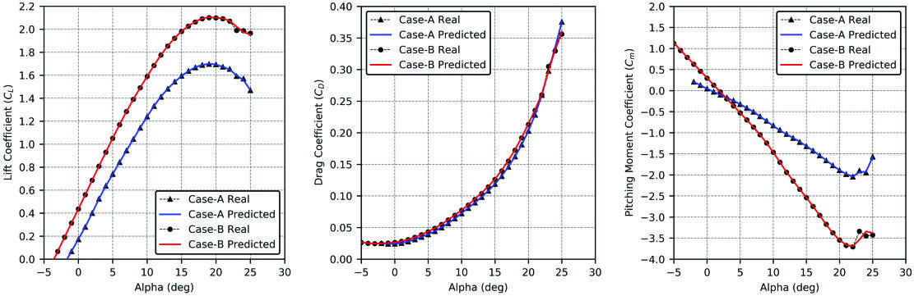

**图 25. 测试算例 A（常规布局）和 B（串列翼布局）的气动性能系数。**

测试算例 C 和 D 使用与前述实例相同的几何，但更换机翼翼型，分别采用 3412 和 5412，以检验模型泛化能力。这些通用翼型的相对弯度不同于训练所用翼型。不过，如前所述，翼型相对弯度是模型输入之一，因此所开发模型旨在计算 NACA 四位数系列中的其他翼型。测试所用翼型见表 13。

**表 13. 测试算例所用的 NACA 系列翼型。**

| 翼面 | 常规布局：算例 A | 常规布局：算例 C | 串列翼布局：算例 B | 串列翼布局：算例 D |
|---|---|---|---|---|
| 机翼 | 2412 | 3412 | 4412 | 5412 |
| 尾翼 | 0012 | 0012 | 0012 | 0012 |

图 26 给出了分析结果。结果表明，所开发的神经网络模型在线性区和非线性区都与实际值吻合。由此可以明确，模型即使在失速后区域也能计算升力曲线的非线性效应。阻力与俯仰力矩系数的预测准确程度也很高，预测与实际结果几乎一一对应。还需再次说明，这些翼型未用于模型训练；但人工神经网络借助翼型之间的插值能力，仍可计算它们对气动性能的影响。除上述测试外，还进行了数十次应用，表明模型能够覆盖设计空间，并十分准确地计算区间内的设计点。

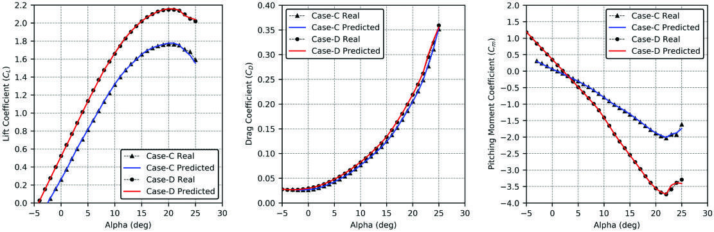

**图 26. 测试算例 C（常规布局）和 D（串列翼布局）的气动性能系数。**

为验证方法的可行性，本文将代理模型作为气动求解器，用于小型无人机优化研究。为此，将模型以函数形式移植到 MATLAB，并使用遗传算法工具箱建立一个简单的设计优化算例。

遗传算法首先在预定范围内选取设计变量，生成初始设计集合。对每个设计，利用代价函数计算适应度，并从当前设计集合中随机选择适应度较好的子集，再通过随机操作基于这些设计创建新设计。在该方法中，基因代表设计变量，染色体代表设计点。交叉与变异产生的新个体，其气动特性可由当前 AI 模型即时提供，进而计算适应度。

利用前述算例 A 构型，本文尝试最大化该飞行器的续航性能。为此，优化机翼翼型和升力面的安装角，使其满足静稳定性条件，且不超过最大阻力限制。本优化问题旨在获得满足所需稳定性及气动条件的最高效率构型，可定义为：

$$
\underset{\mathbf x}{\mathrm{maximize}}\quad f(\mathbf x)=\frac{L}{D},\tag{43}
$$

约束条件为：

$$
0.35<C_L<0.45,\tag{44}
$$

$$
C_{m0}>0,\tag{45}
$$

$$
C_{m\alpha}<0,\tag{46}
$$

$$
C_D<0.035.\tag{47}
$$

其中，$\mathbf x$ 包含巡航迎角、机翼翼型相对弯度、机翼安装角和尾翼安装角。第一项不等式约束涉及升力系数，其作用是在不大幅改变巡航速度的前提下平衡重量。$C_{m0}$ 的最小值设为零，因为它是纵向静稳定性的主要约束之一。此外，要保证纵向稳定飞行，固定操纵条件下的俯仰力矩曲线斜率必须为负。最后，总阻力系数限制在基准构型的水平，以保证推力与阻力平衡。

在此优化问题中，几何变量限定为巡航迎角、机翼截面相对弯度及升力面安装角，见表 14。目标是在保持主要几何尺寸的同时，通过较小翼型变化提高气动效率。不过，也可使用表 7 所示机翼、尾翼和机身组件相关的其余 14 个参数。

**表 14. 变量及其上下限。**

| 变量 | 符号 | 最小值 | 最大值 |
|---|---|---:|---:|
| 巡航迎角 | $\alpha_{cruise}$ | $0^\circ$ | $3^\circ$ |
| 机翼安装角 | $i_{wing}$ | $0^\circ$ | $2^\circ$ |
| 尾翼安装角 | $i_{tail}$ | $-2^\circ$ | $2^\circ$ |
| 机翼翼型相对弯度 | $\gamma_{wing}$ | 2% | 6% |

得益于代理模型的计算速度，包含数百次迭代的优化仅需 2～3 秒完成。变量的新值见表 15。

**表 15. 优化后的几何变量。**

| 构型 | $\gamma_{wing}$ | $i_{wing}$ | $i_{tail}$ |
|---|---:|---:|---:|
| 测试算例 A | 2.00% | $0.00^\circ$ | $0.00^\circ$ |
| 优化后 | 2.86% | $0.57^\circ$ | $0.04^\circ$ |

此外，图 27 比较了程序在 NACA 四位数系列翼型族内优化得到的新机翼翼型与原翼型。该实例直接体现了方法的设计灵活性。

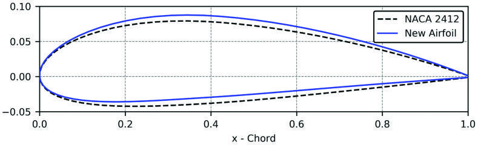

**图 27. NACA 2412 与优化后新翼型的几何形状。**

根据研究结果，气动效率提高了 5.18%。在类似优化中，也可方便地将机翼、尾翼和机身尺寸等其他几何参数作为变量。这些实例表明，该模型能够成为大规模飞行器设计优化研究的重要气动求解器。

## 结论

本文提出一种新的计算气动方法及其代理模型，用于预测小型无人机的非线性气动性能。所开发的非线性升力线工具在处理时间与算力需求方面十分高效。分析发现，运行 1 秒即可求解 90 种不同无人机构型在 30 个迎角下的性能。计算复杂度分析表明，该工具具有线性时间复杂度 $O(n)$。

然而，由于该方法基于 Prandtl 升力线理论，需要升力面截面翼型的二维性能输入。为消除这一不足，本文使用气动方法生成的 94,500 种无人机构型数据，训练了新的深度学习模型。借助由新特征集支持的复杂人工神经网络，模型平均绝对误差达到 $1\times10^{-3}$ 量级。所开发神经网络模型既提供独立分析工具，也为小型无人机双向设计优化奠定基础。此外，它为逆向工具提供了起点，可针对给定设计条件计算构型的几何参数，包括机翼或尾翼尺寸、截面翼型、安装角及迎角。本文最后开展了简单的遗传算法优化应用，在几秒内使通用无人机构型的气动效率提高 5.18%。因此，该模型为这类设计优化研究提供了能力较强的气动求解器。

不过，该方法也存在一些局限。由于以经典升力线理论为基础，它不适用于机翼具有大后掠角、大上反角或低展弦比的非常规几何。开发基于面元法的新型非线性工具，有望消除这一不足。此外，本研究采用 NACA 四位数系列翼型族的数学表达式训练 AI 模型；要扩大代理模型的适用范围，还需增强训练数据，覆盖不同翼型族。

目前，我们正研究扩展这一方法，以覆盖更广设计空间，并纳入更多对性能系数的影响因素。

## 利益冲突声明

作者声明，本文研究、署名和／或发表不存在任何潜在利益冲突。

## 资助

作者未就本文研究、署名和／或发表获得任何财务资助。

## ORCID 标识

Hasan Karali：[0000-0002-1756-9071](https://orcid.org/0000-0002-1756-9071)  
Gokhan Inalhan：[0000-0002-4490-8358](https://orcid.org/0000-0002-4490-8358)

## 参考文献

以下保留原始书目信息，并补充中文标题，以便对照检索。

**[1] 中文标题：无人航空系统（UAS）操作员培训指南。**  
NATO Standardization Agency (NSA). Guidance for the training of unmanned aircraft systems (UAS) operators. Nato Standard ATP-3.3.7, NATO/OTAN, 2014.

**[2] 中文标题：微型飞行器的诞生。**  
Mueller T. On the birth of micro air vehicles. Int J Micro Air Veh 2009; 1: 1–12.

**[3] 中文标题：无人作战飞行器自主控制：用于敏捷机动的多模态控制与飞行规划框架设计。**  
Ure NK and Inalhan G. Autonomous control of unmanned combat air vehicles: design of a multimodal control and flight planning framework for agile maneuvering. IEEE Control Syst Mag 2012; 32(5): 74–95.

**[4] 中文标题：利用集成设计工具开展小型无人机设计。**  
Kody F and Bramesfeld G. Small UAV design using an integrated design tool. Int J Micro Air Veh 2012; 4: 151–164.

**[5] 中文标题：基于深度学习的无人机非线性气动代理模型设计。**  
Karali H, Demirezen MU, Yukselen MA, et al. Design of a deep learning based nonlinear aerodynamic surrogate model for UAVs. In: AIAA Scitech 2020 forum, January 2020, Orlando, FL, p.1288. https://doi.org/10.2514/6.2020-1288

**[6] 中文标题：ARC 无人机飞行试验视频。**  
ARC UAV Flight Test Video, https://www.youtube.com/watch?v=Cy_ZwTixUuI (2018, accessed 15 December 2020).

**[7] 中文标题：用于机翼／构型气动特性三维分析的新型非线性升力线方法及其无人机应用。**  
Karali H, Yukselen MA and Inalhan G. A new non-linear lifting line method for 3D analysis of wing/configuration aerodynamic characteristics with application to UAVs. In: AIAA Scitech 2019 forum, January 2019, San Diego, CA, p.2119, https://doi.org/10.2514/6.2019-2119

**[8] 中文标题：机翼理论：第一篇。**  
Prandtl L. Tragflügeltheorie. I. Mitteilung. Nachrichten von der Gesellschaft der Wissenschaften zu Göttingen, Mathematisch-Physikalische Klasse 1918; 1918: 451–477.

**[9] 中文标题：现代流体动力学在航空学中的应用。**  
Prandtl L. Applications of modern hydrodynamics to aeronautics. NACA technical report 116, National Advisory Committee for Aeronautics, 1923.

**[10] 中文标题：计算单翼机机翼诱导速度的简便方法。**  
Tani I. A simple method of calculating the induced velocity of a monoplane wing. Report of the Aeronautical Research Institute, Tokyo Imperial University, Japan, 1934.

**[11] 中文标题：使用非线性截面升力数据、通过升力线理论计算机翼特性的方法。**  
Sivells JC and Neely RH. Method for calculating wing characteristics by lifting-line theory using nonlinear section life data 865. National Advisory Committee for Aeronautics, 1947.

**[12] 中文标题：后掠翼的升力分布。**  
Weissinger J. The lift distribution of swept-back wings [Uber die Auftriebsverteilung von Pfeilflugeln]. NACA technical report 1120, National Advisory Committee for Aeronautics, USA, 1947, https://ntrs.nasa.gov/search.jsp?R=20030064148

**[13] 中文标题：Prandtl 经典升力线理论的现代改进。**  
Phillips WF and Snyder DO. Modern adaptation of Prandtl’s classic lifting-line theory. J Aircraft 2000; 37: 662–670.

**[14] 中文标题：用于预测中等展弦比机翼失速不稳定性的非线性升力线理论。**  
Piszkin S and Levinsky E. Nonlinear lifting line theory for predicting stalling instabilities on wings of moderate aspect ratio. Defense Technical Information Center, 1976.

**[15] 中文标题：利用已知翼型特性进行全机设计的快速气动计算方法。**  
de Vargas LAT and de Oliveira PHIA. A fast aerodynamic procedure for a complete aircraft design using the know airfoil characteristics. SAE technical paper, 2006. https://doi.org/10.4271/2006-01-2818

**[16] 中文标题：任意形状表面气动载荷的计算。**  
Falkner VM. The calculation of aerodynamic loading on surfaces of any shape. Technical report, Aeronautical Research Council London, UK, 1943.

**[17] 中文标题：采用减弯度方法预测多升力面构型的失速后特性。**  
Mukherjee R and Gopalarathnam A. Poststall prediction of multiple-lifting-surface configurations using a decambering approach. J Aircraft 2006; 43: 660–668.

**[18] 中文标题：新型非线性涡格法及其机翼气动优化应用。**  
Sugar Gabor O, Koreanschi A and Botez R. A new nonlinear vortex lattice method: applications to wing aerodynamic optimizations. Chin J Aeronaut 2016; 29: 1178–1195.

**[19] 中文标题：XFLR5 对低雷诺数翼型与机翼的分析。**  
Deperrois A. Xflr5 analysis of foils and wings operating at low Reynolds numbers. Guidelines for XFLR5, 2009.

**[20] 中文标题：VSPAero／OpenVSP 集成。**  
Kinney D and McDonald R. VSPAero/OpenVSP integration, 2015.

**[21] 中文标题：Tornado：用于机翼线性气动计算的涡格法 MATLAB 实现。**  
Melin T. Tornado, a vortex lattice MATLAB implementation for linear aerodynamic wing applications. Master’s Thesis, KTH, Sweden, 2013.

**[22] 中文标题：Tornado：在 MATLAB 中实现的涡格法。**  
Melin T. Tornado: a vortex lattice method implemented in Matlab. Glenn Research Center, NASA, 2017.

**[23] 中文标题：采用马蹄涡片的数值升力线方法。**  
Hunsaker D. A numerical lifting-line method using horseshoe vortex sheets. In: Rocky Mountain Space Grant Consortium Meeting Proceedings, 2001, Logan, UT.

**[24] 中文标题：三维机翼气动特性的非线性分析（土耳其语）。**  
Karali H and Yukselen MA. Nonlinear analysis of 3D wing aerodynamic characteristics (in Turkish). In: VII. Ulusal Havacilik ve Uzay Konferansi, September 2018, Samsun, Turkey, http://www.uhuk.org.tr/bildiri.php?No=UHUK-2018-080

**[25] 中文标题：任意形状机翼的升力线理论。**  
Rasmussen ML and Smith DE. Lifting-line theory for arbitrarily shaped wings. J Aircraft 1999; 36: 340–348.

**[26] 中文标题：扭转机翼与负扭转优化机翼的升力线分析。**  
Phillips WF. Lifting-line analysis for twisted wings and washout-optimized wings. J Aircraft 2004; 41: 128–136.

**[27] 中文标题：使用扩展升力线分析进行变形机翼气动建模。**  
Wickenheiser AM and Garcia E. Aerodynamic modeling of morphing wings using an extended lifting-line analysis. J Aircraft 2007; 44: 10–16.

**[28] 中文标题：小型电动无人机的性能飞行试验。**  
Ostler J, Bowman W, Snyder D, et al. Performance flight testing of small, electric powered unmanned aerial vehicles. Int J Micro Air Veh 2009; 1: 155–171.

**[29] 中文标题：数值升力线理论在下垂前缘机翼失速前与失速后计算中的应用。**  
Anderson JD Jr, Corda S and Van Wie DM. Numerical lifting line theory applied to drooped leading-edge wings below and above stall. J Aircraft 1980; 17: 898–904.

**[30] 中文标题：迈向长航时微型飞行器。**  
Bronz M, Moschetta JM, Brisset P, et al. Towards a long endurance MAV. Int J Micro Air Veh 2009; 1: 241–254. DOI: 10.1260/175682909790291483

**[31] 中文标题：长航时微型无人机 Eternity 的研制。**  
Bronz M, Hattenberger G and Moschetta JM. Development of a long endurance mini-UAV: eternity. Int J Micro Air Veh 2013; 5: 261–272.

**[32] 中文标题：预测 ATR-42 缩比机翼模型气动系数的新型混合方法。**  
Ben Mosbah A, Botez R and Dao TM. A hybrid original approach for prediction of the aerodynamic coefficients of an atr-42 scaled wing model. Chin J Aeronaut 2016; 29: 41–52.

**[33] 中文标题：利用卷积神经网络预测翼型气动系数。**  
Zelong Y, Wang Y, Qiu Y, et al. Aerodynamic coefficient prediction of airfoils with convolutional neural network. In: Zhang X. (eds) The Proceedings of the 2018 Asia-Pacific International Symposium on Aerospace Technology (APISAT 2018), 2018, pp.34–46, https://doi.org/10.1007/978-981-13-3305-7_3

**[34] 中文标题：使用卷积神经网络预测翼型的多种气动系数。**  
Chen H, He L, Qian W, et al. Multiple aerodynamic coefficient prediction of airfoils using a convolutional neural network. Symmetry 2020; 12: 544.

**[35] 中文标题：用于预测气动系数的神经网络所需训练数据量。**  
Rajkumar T and Bardina J. Training data requirement for a neural network to predict aerodynamic coefficients. In: AeroSense 2003: SPIE’s 17th annual international symposium on aerospace/defense sensing, April 2003, Orlando, FL, https://doi.org/10.1117/12.486343

**[36] 中文标题：用于预测运输飞机气动系数的人工神经网络。**  
Secco N and Mattos B. Artificial neural networks to predict aerodynamic coefficients of transport airplanes. Aircraft Eng Aerosp Technol 2017; 89: 211–230.

**[37] 中文标题：利用支持向量机进行大迎角非定常气动建模。**  
Wang Q, Qian W and He K. Unsteady aerodynamic modeling at high angles of attack using support vector machines. Chin J Aeronaut 2015; 28: 659–668.

**[38] 中文标题：基于神经网络和遗传算法的飞机气动数据库改进。**  
Gomec F and Canibek M. Aerodynamic database improvement of aircraft based on neural networks and genetic algorithms. In: 7th European conference for aeronautics and space sciences, July 2017, Milan, Italy, https://doi.org/10.13009/EUCASS2017-226

**[39] 中文标题：利用神经网络预测运输飞机气动系数。**  
Wallach R, Mattos B, Girardi R, et al. Aerodynamic coefficient prediction of transport aircraft using neural network, 2012. https://arc.aiaa.org/doi/abs/10.2514/6.2006-658

**[40] 中文标题：使用 Mamdani 模糊推理网络进行 ATTAS 飞机气动建模。**  
Sharma AK, Singh DJ, Singh V, et al. Aerodynamic modeling of attas aircraft using Mamdani fuzzy inference network. IEEE Trans Aerosp Electron Syst 2020; 56: 3566–3576. DOI: 10.1109/TAES.2020.2975447

**[41] 中文标题：利用 Mamdani 模糊推理系统进行数据驱动气动建模。**  
Sharma AK, Singh D and Verma NK. Data driven aerodynamic modeling using mamdani fuzzy inference systems. In: 2018 International conference on sensing, diagnostics, prognostics, and control (SDPC), 2018, pp.359–364, https://doi.org/10.1109/SDPC.2018.8664870

**[42] 中文标题：ANFIS：基于自适应网络的模糊推理系统。**  
Jang JR. Anfis: adaptive-network-based fuzzy inference system. IEEE Trans Syst Man Cybern 1993; 23: 665–685.

**[43] 中文标题：系统的模糊辨识及其在建模与控制中的应用。**  
Takagi T and Sugeno M. Fuzzy identification of systems and its applications to modeling and control. IEEE Trans Syst Man Cybern 1985; SMC-15: 116–132.

**[44] 中文标题：利用神经网络估计飞机参数的两种新技术。**  
Raisinghani SC, Ghosh AK and Kalra PK. Two new techniques for aircraft parameter estimation using neural networks. Aeronaut J (1968) 1998; 102: 25–30.

**[45] 中文标题：利用径向基函数神经网络偏微分方法估计气动参数。**  
Sanwale J and Singh DJ. Aerodynamic parameters estimation using radial basis function neural partial differentiation method. Def Sci J 2018; 68: 241–250.

**[46] 中文标题：应用计算空气动力学：现代工程方法。**  
Cummings RM, Mason WH, Morton SA, et al. Applied computational aerodynamics: a modern engineering approach. Cambridge Aerospace Series. Cambridge: Cambridge University Press, 2015.

**[47] 中文标题：翼型数据汇编。**  
Abbott IH, Von Doenhoff AE and Stivers L Jr. Summary of airfoil data. Naca technical report 824, National Advisory Committee for Aeronautics, USA, 1945, https://ntrs.nasa.gov/search.jsp?R=19930090976

**[48] 中文标题：空气动力学基础。**  
Anderson JD Jr. Fundamentals of aerodynamics. Boston, MA: McGraw-Hill Education, 2010.

**[49] 中文标题：低速空气动力学。**  
Katz J and Plotkin A. Low-speed aerodynamics. 2nd ed. Cambridge Aerospace Series. Cambridge: Cambridge University Press, 2001.

**[50] 中文标题：NACA 44XX 系列翼型截面的失速后风洞数据。**  
Ostowari C and Naik D. Post-stall wind tunnel data for NACA 44XX series airfoil sections. Technical report, Texas A&M University, USA, 1985.

**[51] 中文标题：美国海军 RQ-2B Pioneer 无人机。**  
McLain DJ. A U.S. Navy RQ-2B pioneer unmanned aerial vehicle. Official Website of the United States Navy, 2005, https://www.navy.mil/view_image.asp?id=25689

**[52] 中文标题：美国海军陆战队 RQ-7B Shadow 无人机。**  
Tetreau RA. A U.S. Marine Corps RQ-7B shadow unmanned aerial vehicle. Official Website of the United States Navy, 2011, https://www.navy.mil/view_image.asp?id=100815

**[53] 中文标题：失速后迎角下翼型与机翼的 CFD 数据库。**  
Petrilli JL, Paul RC, Gopalarathnam A, et al. A CFD database for airfoils and wings at post-stall angles of attack. In: 31st AIAA applied aerodynamics conference, June 2013, p.2916, https://doi.org/10.2514/6.2013-2916

**[54] 中文标题：后置尾翼处低速下洗角的估计。**  
Phillips WF, Anderson EA, Jenkins JC, et al. Estimating the low-speed downwash angle on an aft tail. J Aircraft 2002; 39: 600–608.

**[55] 中文标题：飞机设计：系统工程方法。**  
Sadraey MH. Aircraft design: a systems engineering approach. Aerospace Series. Chichester: John Wiley and Sons, 2013.

**[56] 中文标题：飞机空气动力学与性能。**  
Roskam J and Lan CTE. Airplane aerodynamics and performance. Lawrence, KS: DARcorporation, 1997.

**[57] 中文标题：飞行稳定性与自动控制。**  
Nelson RC. Flight stability and automatic control. vol. 2. New York, NY: WCB/McGraw Hill, 1998.

**[58] 中文标题：固定翼垂直起降无人机的过渡飞行建模。**  
Yuksek B, Vuruskan A, Özdemir U, et al. Transition flight modeling of a fixed-wing VTOL UAV. J Intell Rob Syst 2016; 84: 83–105.

**[59] 中文标题：Turac 无人机容错航向控制系统设计。**  
Yuksek B, Ure NK, Caliskan F, et al. Fault tolerant heading control system design for Turac unmanned aerial vehicle. Trans Inst Meas Control 2017; 39: 267–276.

**[60] 中文标题：微型无人机建模与飞行控制系统设计。**  
Uzun S. Modelling and flight control system design of micro UAV. Undergraduate Thesis, Istanbul Technical University, Turkey, 2018.

**[61] 中文标题：美国空军稳定性与操纵性 DATCOM 数据汇编。**  
Finck RD. USAF (United States Air Force) stability and control DATCOM (Data Compendium). Final report AFWAL-TR-83-3048, McDonnell Douglas Corporation Douglas Aircraft Division, USA, 1978.

**[62] 中文标题：XFOIL：低雷诺数翼型的分析与设计系统。**  
Drela M. Xfoil: an analysis and design system for low Reynolds number airfoils. In: Low Reynolds number aerodynamics. New York, NY: Springer, 1989, pp.1–12.

**[63] 中文标题：用于自动特征工程与选择的 autofeat Python 程序库。**  
Horn F, Pack R and Rieger M. The autofeat python library for automated feature engineering and selection. preprint arXiv:190107329 2019, https://arxiv.org/abs/1901.07329

**[64] 中文标题：修正线性单元改进受限玻尔兹曼机。**  
Nair V and Hinton GE. Rectified linear units improve restricted Boltzmann machines. In: Proceedings of the 27th international conference on machine learning, ICML’10, Madison, WI: Omnipress. pp.807–814. https://dl.acm.org/doi/10.5555/3104322.3104425

**[65] 中文标题：深入研究整流单元：在 ImageNet 分类上超越人类水平。**  
He K, Zhang X, Ren S, et al. Delving deep into rectifiers: surpassing human-level performance on imagenet classification. CoRR, 2015, https://arxiv.org/abs/1502.01852

**[66] 中文标题：Adam：随机优化方法。**  
Kingma DP and Ba J. Adam: a method for stochastic optimization. In: 3rd International conference for learning representations, San Diego, CA, May 2015, https://arxiv.org/abs/1412.6980
