# 小型无人机气动分析与深度学习建模的新型非线性升力线方法

**英文题名：** A new nonlinear lifting line method for aerodynamic analysis and deep learning modeling of small unmanned aerial vehicles

**作者：** Hasan Karali、Gokhan Inalhan、M. Umut Demirezen、M. Adil Yukselen

**期刊：** *International Journal of Micro Air Vehicles*

**卷期与页码：** Volume 13: 1-24

**年份：** 2021

**DOI：** [10.1177/17568293211016817](https://doi.org/10.1177/17568293211016817)

**文章类型：** Original Article

**投稿信息：** 2020-07-31 收稿；2020-12-19 修回；2021-04-22 接收

**许可协议：** 本文以 Creative Commons Attribution-NonCommercial 4.0 License 发布，允许非商业性使用、复制和传播；使用时须按原文要求标明作者与来源。

> 译注：为保持原始图表信息完整，图片内部的英文坐标、图例和模块名称保持原样；图题、表题、表格内容及正文均译为中文。

## 作者单位与通讯信息

- Hasan Karali，土耳其伊斯坦布尔技术大学航空与航天学院，土耳其伊斯坦布尔。
- Gokhan Inalhan，英国克兰菲尔德大学自主与信息物理系统中心，英国贝德福德。
- M. Umut Demirezen，土耳其伊斯坦布尔技术大学航空航天研究中心，土耳其伊斯坦布尔。
- M. Adil Yukselen，土耳其伊斯坦布尔技术大学航空与航天学院，土耳其伊斯坦布尔。

**通讯作者：** Gokhan Inalhan，School of Aerospace, Transport and Manufacturing, Centre for Autonomous and Cyber-Physical Systems, Cranfield University, Bedford MK43 0AL, UK。电子邮箱：inalhan@cranfield.ac.uk。

## 摘要

本文提出一种计算高效、精度较高的非线性气动构型分析方法，可用于小型无人机的设计优化和数学建模。首先，作者开发了一种新的非线性升力线方法。该方法：(a) 与实验及计算量较大的工具相比，能够很好地匹配失速前和失速后的气动行为；(b) 与计算流体力学等计算密集型方法相比，生成相同结果所需的时间可缩短若干数量级。随后，该方法被扩展为完整的构型分析工具，并纳入基本机身几何形状的影响。此外，作者利用这种新气动工具生成的数据，建立了一个基于深度学习的代理模型，用于表征无人机的非线性气动性能。

该模型的主要创新点是：仅使用几何参数即可预测无人机构型的气动特性，不需要其他计算气动工具所依赖的特殊输入数据或预处理步骤。所得到的黑箱函数可在毫秒量级计算无人机在大迎角范围内的性能，而在类似计算环境下，计算流体力学求解通常需要数天至数周。即使测试构型采用了训练中未出现的不同翼型，模型预测结果仍与数值数据几乎一一重合。通过一个翼型设计示例，作者进一步证明该模型可作为设计优化研究中的高性能气动求解器。

**关键词：** 非线性气动性能；无人机气动；低雷诺数；深度学习；人工神经网络；代理模型

## 引言

小型无人机可为货物运输、侦察、监视和跟踪等广泛民用及军事任务提供关键能力。因此，按照北约标准被归类为 I 类无人航空系统的小型及微型无人机，凭借相对低廉的成本[2]，正在低速、低空任务中取代有人和无人战术单元。

在低雷诺数飞行状态下，小型无人机在机动[3]或恶劣天气飞行时，会因偏离设计工况而持续出现性能变化。然而，除计算代价高昂的计算流体力学（CFD）分析工具外，专门面向小型无人机非线性、黏性流动区域的气动分析工具仍然有限。因此，需要一种计算高效且可靠的气动表征工具，既能服务于设计优化，也能支持此类小型无人航空系统的数学建模[4]。

为此，本文提出一种新的非线性升力线方法，其基础是 Prandtl 经典升力线理论（lifting line theory，LLT）。该方法利用翼面剖面通过实验或数值方法得到的二维非线性升力曲线，计算翼面和尾翼等升力面的三维最大升力系数，以及失速前和失速后的气动行为。该方法还可直接给出诱导阻力，并基于风洞或飞行实验得到的二维翼型数据给出黏性阻力和俯仰力矩系数。与半经验机身构型分析结合后，该完整方法可为小型无人机提供快速、可靠的气动分析工具。

小型无人机通常需要在尺寸和功率限制非常严格的条件下形成满足指标的可执行设计。此时，需要一个气动求解器，能够在给定限制内快速给出数千种无人机构型的非线性气动性能图，以支持设计和设计优化。传统气动求解器无法提供这种研究所需的效率，但可借助近年来快速发展的人工智能（AI）算法为现有气动方法构建数字模型[5]。本文后半部分将设计一种神经网络模型，利用深度学习预测无人机构型的非线性气动特性。该模型在设计点之间表现出很强的插值能力，并且除几何参数外无需其他输入，因此可作为优化问题中的气动求解器。作者进一步通过小型无人机设计优化案例展示该代理模型的优势。

如图 1 所示，所提出的方法为小型无人机提供了一种关键而明确的设计与综合工具。图中输入-输出关系给出这些工具的基本工作原理，也可直接用于内部无人机设计与开发项目，例如图 2 所示的 ARC 无人机。

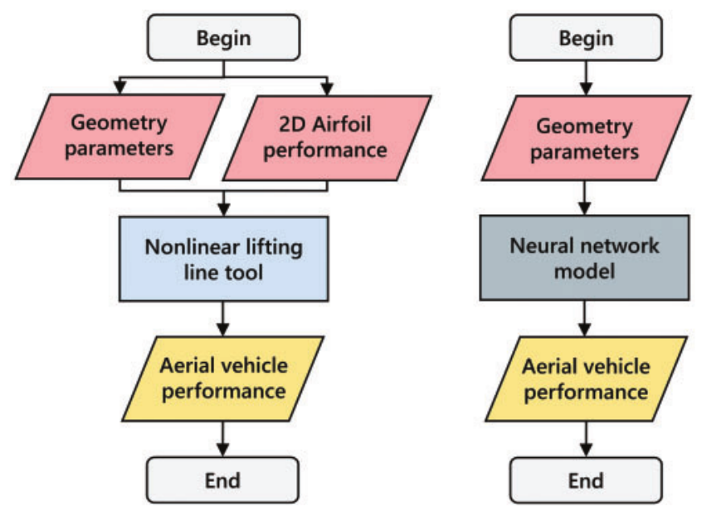

**图 1.** 各方法的基本输入-输出关系。

对于此类小型无人机的气动分析，随着数学模型复杂度增加，流动仿真会更接近真实物理条件，分析误差也会降低。然而，高阶求解通常需要大量计算资源和时间[7]，对许多小型无人机设计问题并不现实。飞机设计早期的优化研究往往需要对不同几何形状在特定流动条件下进行数百次气动分析。因此，更可取的是使用低阶方法；这类方法对计算能力的要求明显低于基于 Navier-Stokes 方程的 CFD 方法，处理时间也更短。

### 文献综述：计算气动模型

历史上已发展出多种气动构型分析方法。早期方法主要面向手工计算，其中最流行的是 Prandtl 经典升力线理论[8]、[9]。部分较早的非线性升力线应用关注机翼失速前性能计算[10]、[11]。但这些方法通常局限于无后掠、无上反角的单个升力面，且适用于低迎角和中迎角飞行区域。

Weissinger[12] 提出了升力线理论的离散形式，即数值升力线方法。数值升力线方法依赖无旋、无黏流动假设[13]，但也可利用二维翼型数据[14]、[15]作为基础气动特性模型来构建非线性应用。

另一类气动构型分析方法是升力面法，起源于 Falkner 的工作[16]。这类方法忽略厚度，将升力面近似为中弧面；自 20 世纪 70 年代以来，通常被视为涡格法的一种。文献中也有该方法的非线性应用[17]、[18]。XFLR5[19]、OpenVSP/VSPAero[20]、Tornado VLM[21]、[22]及 MachUp[23]等面向小型和微型无人机的常用气动程序均采用这类势流理论方法。然而，当需要分析完整飞机的非线性特性时，这些方法的估计效果和可靠性存在明显限制[7]、[24]。

### 研究现状与贡献：计算气动模型

利用基于势流理论的数学模型，可获得机翼在低迎角和中迎角下的升力、诱导阻力和力矩系数。然而，由于势流理论忽略流动中的黏性效应，低阶线性方法无法确定大迎角升力曲线的非线性行为及失速后机翼特性[25]-[27]。此外，最大升力系数和黏性阻力系数等对设计、飞控及性能研究十分重要的参数也无法直接计算[28]。

文献中已报道一些考虑黏性修正的低阶方法。例如，在经典升力线方法的非线性应用中，可通过迭代方法将二维剖面的黏性效应反映到三维机翼特性中[11]、[29]。但这些方法的直接应用，对无后掠、无上反角机翼在亚声速区域内的非线性气动特性仍只能给出有限且不精确的近似。

本文气动方法也采用迭代思路，但增加了一个关键的升力曲线局部线性近似。利用新方法，作者分析了航空航天研究中心（ARC）无人机（图 2）的构型，并将升力系数结果与其他高阶和低阶工具进行比较，如图 3 所示。结果表明，与现有标准工具和方法相比，本文方法在线性和非线性区域均具有较高精度。该方法的主要创新在于：能够计算广泛类别无人机构型在大迎角以及失速后飞行区域内的非线性气动性能。

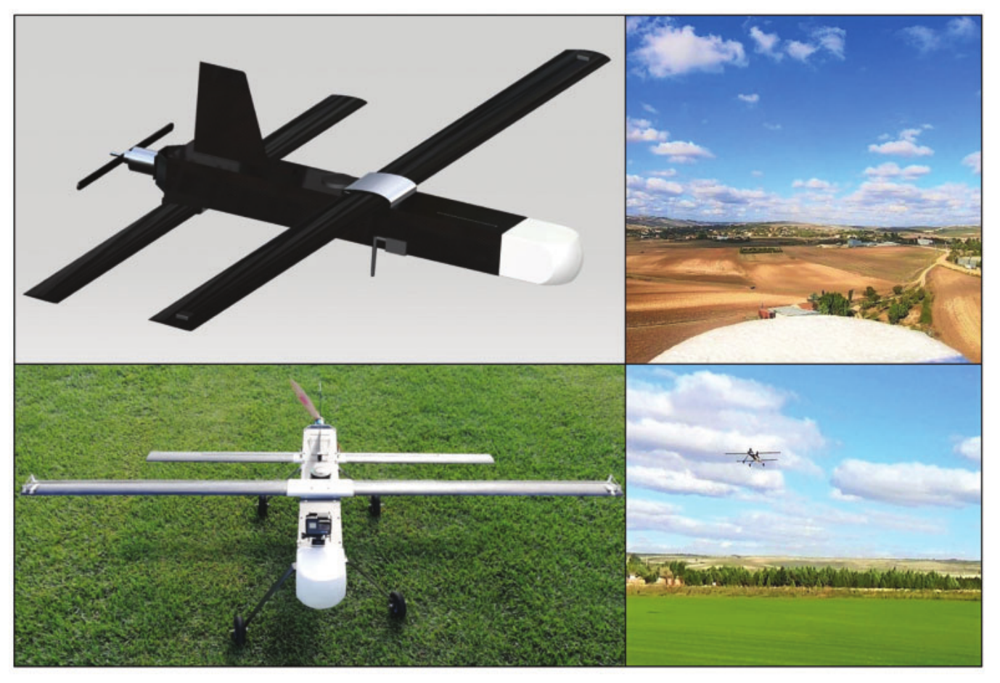

**图 2.** ARC 无人机及飞行试验[6]。

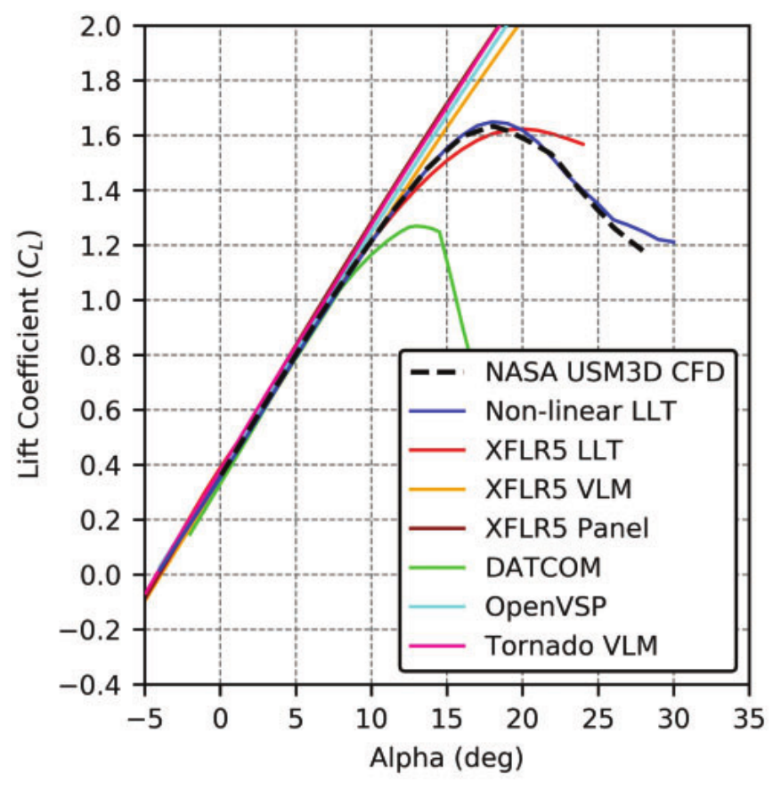

**图 3.** ARC 无人机升力系数比较。

### 文献综述：基于 AI 的气动模型

在概念设计和初步设计阶段，传统工程工具对任意新构型的一般性能估计能力有限[30]、[31]。深度学习等机器学习方法可通过给定输入及对应输出执行回归分析，训练强非线性神经网络模型，从而满足上述需求。已有研究使用机器学习和人工神经网络算法预测二维翼型性能[32]-[34]，也有研究利用这些算法扩展特定飞机的数据库[35]-[39]。

现有文献中的模糊推理系统和神经网络等方法[40]-[45]，主要用于估计单一构型、单一飞行条件下的性能，并不包含完整飞机构型；这些预测通常也只针对单个目标系数。因此，这类工作更接近函数近似，而不是具有泛化能力的代理模型。

### 研究现状与贡献：基于 AI 的气动模型

本文关注完整飞机构型在多种飞行条件下的表现，包括具有完全非线性行为的大迎角区域。作者通过直接比较决定系数 \(R^2\)，进一步展示该方法相对于其他方法[40]、[41]、[45]的精度。对于大规模设计优化问题，训练模型时必须使用包含大量不同几何构型组合的数据。已有文献通常通过飞行试验、实验研究以及低阶与高阶计算方法的组合来生成针对特定设计问题的受限数据集[35]。若完全依赖飞行试验、实验或 CFD 等高价计算方法生成大规模数据，则计算量可能过大，实际难以实施[46]。

低阶计算气动方法成本低、速度快，但通常未考虑最关键的黏性效应，因此无法确定大迎角下的非线性升力行为与失速特征。由于低雷诺数条件下非线性升力曲线尤为突出，这一问题在小型无人机应用中最为明显。

为解决这一问题，本文设计神经网络，以预测广泛气动几何及构型组合下的性能。训练数据由新开发的高效非线性升力线方法生成。由于该工具速度快、可靠性高，即使使用个人计算机，也可在数分钟内生成并分析数万种构型。所设计的神经网络可直接计算无人机构型的三维最大升力系数和失速前后气动性能，无需二维翼型性能数据。训练时，NACA 四位翼型由弯度位置、弯度及厚度比等几何参数定义[47]。因此，模型只需无量纲参数作为输入。测试结果表明，即使测试构型采用训练中未出现的翼型，模型预测仍与数值数据几乎一一重合，体现了泛化能力。图 4 显示，神经网络对常规无人机构型升力系数的预测与真实数据高度一致。

本文部分结果来自作者团队的前期工作[5]、[7]。其中，气动模型部分扩展了 Karali 等人的研究[7]；本文进一步发展原算法，将机身气动特性纳入分析，以建模完整无人机气动性能，并更新迭代部分，减少获得最终环量分布所需的迭代次数。神经网络模型则源于前期研究[5]；本文通过把机身定义加入 AI 模型，将方法扩展至完整无人机方案，并显著扩大训练数据集。基于这些改进，作者使用一种新算法构建特征集，并开发了新的网络结构；这些变化对实现所提方法的泛化能力至关重要。此外，本文通过一个简单示例展示模型在优化设计中的应用能力。

本文其余内容组织如下：“气动模型”部分说明非线性升力线方法、数学基础及若干测试案例；“人工神经网络模型”部分详细介绍算法结构、数据集和测试案例；随后介绍用于小型无人机设计优化的代理模型及结果；最后给出结论和未来研究目标。

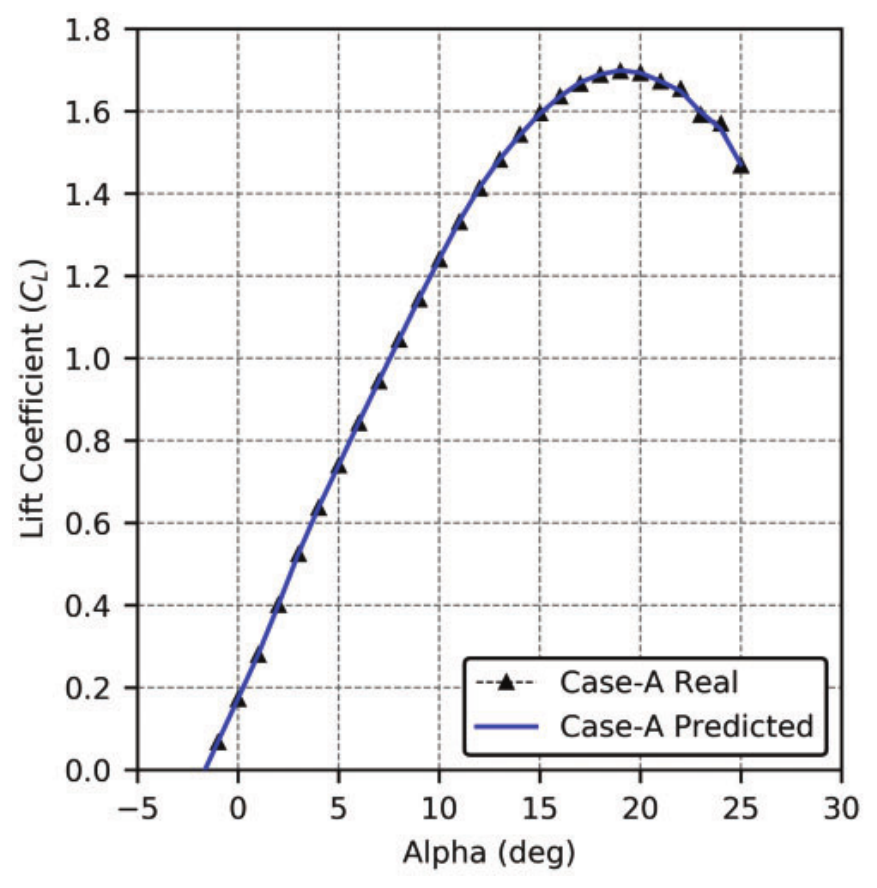

**图 4.** 神经网络对常规无人机升力系数的预测。

## 气动模型

本文构型分析的气动模型以作者先前提出的非线性升力线方法为基础[7]。该方法改进基于势流的 Prandtl 升力线理论，用于计算大迎角下的非线性特性。图 5 给出该方法的流程。其主要特点包括：对升力曲线进行局部线性近似，以及通过迭代过程修正线性近似引起的误差。

计算从三维机翼几何的零升迎角开始，并在每个迎角步长中逐步推进。对于每个迎角，利用展向环量分布迭代过程修正升力系数中由线性近似造成的误差。

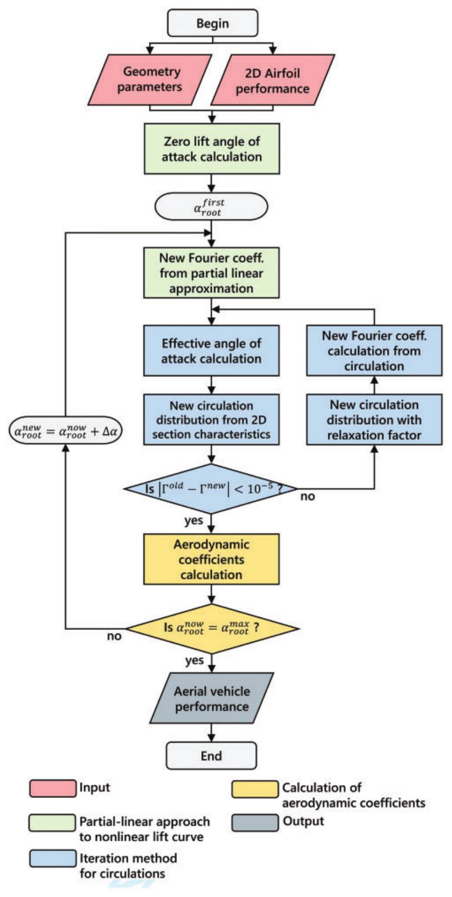

**图 5.** 非线性升力线方法流程图。

### 经典升力线理论

在 Prandtl 升力线理论中，有限翼周围的流动由均匀平行自由流中的马蹄涡系统模拟。每个马蹄涡的前缘线段在机翼上重合，形成附着涡，表示机翼效应；两侧线段对应尾涡的影响。该模型的详细数学说明可参见气动学教材[48]、[49]。

该模型的常用形式将附着涡强度的流向变化用正弦傅里叶级数表示：

\[
\Gamma(\theta)=4sV_\infty\sum_{j=1}^{N}A_j\sin(j\theta).
\tag{1}
\]

于是，升力面的气动参数可写为

\[
C_L=\pi\,AR\,A_1,
\tag{2}
\]

\[
C_{D_i}=
\frac{C_L^2}{\pi AR}(1+\delta),
\qquad
\delta=
\sum_{j=2}^{N}j\left(\frac{A_j}{A_1}\right)^2,
\tag{3}
\]

\[
\varepsilon=
\sum_{j=1}^{N}
\frac{jA_j\sin(j\theta)}{\sin\theta}.
\tag{4}
\]

傅里叶系数 \(A_j\) 取决于机翼几何和迎角。经典方法利用二维翼型升力曲线斜率进行一步线性计算，从而得到三维机翼的线性解。本文则采用新的局部线性方法处理二维升力曲线。

### 非线性升力曲线的局部线性方法

在升力曲线的非线性区域，设机翼展向站位 \(i\) 在某一入射角下的局部几何迎角为 \(\alpha_i^k\)，局部升力系数为 \(c_{l_i}^k\)，如图 6 所示。假设迎角发生小增量 \(\Delta\alpha\) 时，升力曲线斜率保持不变；若新的局部几何迎角为 \(\alpha_i^{k+1}\)，则新的升力系数为

\[
c_{l_i}^{k+1}
=
c_{l_i}^{k}
+a_{l_i}^{k}\left(\alpha_i^{k+1}-\alpha_i^k\right).
\tag{5}
\]

对于相同升力系数，沿用经典升力线方法的二维思路，可写出

\[
c_{l_i}^{k+1}
=
c_{l_i}^{k}
+a_{\infty i}^{k}
\left(\alpha_{e_i}^{k+1}-\alpha_{e_i}^{k}\right),
\tag{6}
\]

其中，\(\alpha_e\) 为有效迎角，\(a_{\infty}\) 为二维升力曲线斜率；在迎角增量 \(\Delta\alpha\) 内，该斜率也假定不变。局部几何迎角与有效迎角之差为下洗角：

\[
\alpha_i^k-\alpha_{e_i}^k=\varepsilon_i^k,
\qquad
\alpha_i^{k+1}-\alpha_{e_i}^{k+1}=\varepsilon_i^{k+1}.
\tag{7}
\]

将这些关系代入式 (6)，得到

\[
c_{l_i}^{k+1}
=
c_{l_i}^{k}
+a_{\infty i}^{k}
\left[
\left(\alpha_i^{k+1}-\varepsilon_i^{k+1}\right)
-
\left(\alpha_i^k-\varepsilon_i^k\right)
\right].
\tag{8}
\]

由于迎角变化量为

\[
\alpha_i^{k+1}-\alpha_i^k=\Delta\alpha,
\tag{9}
\]

可得

\[
c_{l_i}^{k+1}
=
c_{l_i}^{k}
+a_{\infty i}^{k}
\left[
\Delta\alpha-
\left(\varepsilon_i^{k+1}-\varepsilon_i^k\right)
\right].
\tag{10}
\]

若对升力应用 Kutta-Joukowski 定理，则剖面升力系数可用环量表示为

\[
L'
=
\rho_\infty V_\infty \Gamma
=
c_l\frac{1}{2}\rho_\infty V_\infty^2 c
\quad\Rightarrow\quad
c_l=\frac{2\Gamma}{V_\infty c}.
\tag{11}
\]

将其代入式 (10)，有

\[
\frac{2\Gamma_i^{k+1}}{V_\infty c_i}
=
\frac{2\Gamma_i^k}{V_\infty c_i}
+a_{\infty i}^{k}
\left[
\Delta\alpha-
\left(\varepsilon_i^{k+1}-\varepsilon_i^k\right)
\right].
\tag{12}
\]

将分别用傅里叶系数表示环量和下洗角的式 (1)、式 (4) 代入式 (12) 并整理，得到

\[
\sum_{j=1}^{N}
\left(
\frac{1}{\mu_i^k}
+\frac{j}{\sin\theta_i}
\right)
\sin(j\theta_i)A_j^{k+1}
=
\sum_{j=1}^{N}
\left(
\frac{1}{\mu_i^k}
+\frac{j}{\sin\theta_i}
\right)
\sin(j\theta_i)A_j^k
+\Delta\alpha,
\tag{13}
\]

其中

\[
\mu_i^k=\frac{8s}{a_{\infty,i}^{k}c_i}.
\tag{14}
\]

由此建立了展向环量分布与机翼几何之间的关系。将式 (13) 应用于沿翼展合理分布的 \(N\) 个站位，可得线性方程组

\[
\sum_{j=1}^{N}D_{ij}^k A_j^{k+1}
=
\sum_{j=1}^{N}D_{ij}^k A_j^k
+\Delta\alpha,
\qquad i=1,\ldots,N,
\tag{15}
\]

其中

\[
D_{ij}^k
=
\left(
\frac{1}{\mu_i^k}
+\frac{j}{\sin\theta_i}
\right)
\sin(j\theta_i).
\tag{16}
\]

该方程组可写成矩阵形式：

\[
\left[D_{ij}^k\right]\left\{A_j^{k+1}\right\}
=
\left[D_{ij}^k\right]\left\{A_j^k\right\}
+\left\{\Delta\alpha\right\}.
\tag{17}
\]

式中，\(A_j^k\) 为前一迎角对应的傅里叶级数系数，视为已知。该方程组的解为

\[
\left\{A_j^{k+1}\right\}
=
\left\{A_j^k\right\}
+\left[D_{ij}^k\right]^{-1}
\left\{\Delta\alpha\right\}.
\tag{18}
\]

利用求得的 \(A_j^{k+1}\)，可计算新迎角下的升力系数、诱导阻力系数和有效迎角等机翼气动参数。需要注意，在每个新的迎角步长中，有效迎角、二维升力曲线斜率 \(a_i^k\) 以及相应的 \(D_{ij}^k\) 都会变化。

由式 (18) 可见，每一步都依赖上一步解，因此必须确定求解起点。本文采用三维机翼的零升迎角作为起点，其计算过程见下一小节。

此外，式 (18) 的解依赖迎角步长 \(\Delta\alpha\)。作者采用 AR=10、NACA 4415 剖面的矩形机翼进行测试，结果见图 7。可以看到，不同步长会给出不同的三维机翼性能。步长减小时，解会逐渐收敛至同一条特定曲线，但使用极小步长进行实际分析并不现实。为此，在每个计算步之后，对展向环量分布应用迭代过程，具体见“环量迭代方法”一节。

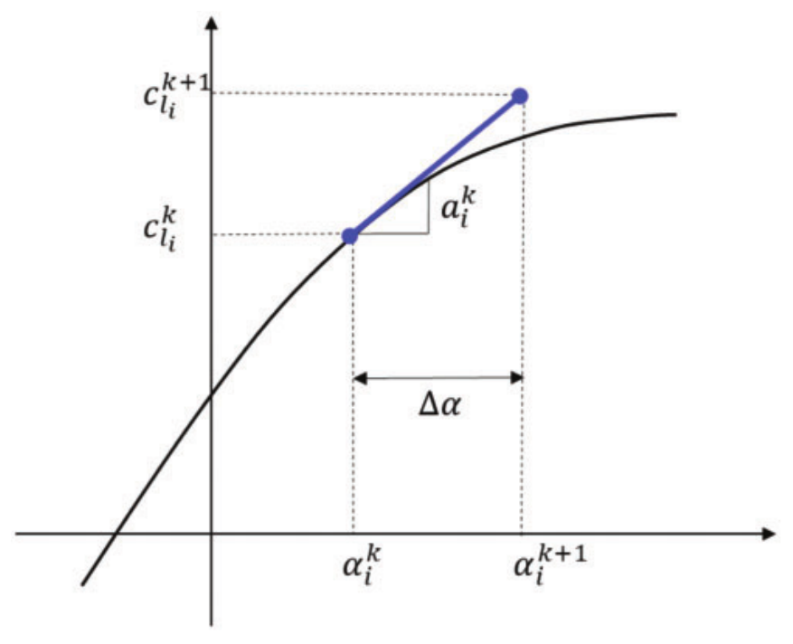

**图 6.** 升力曲线的局部线性处理方法。

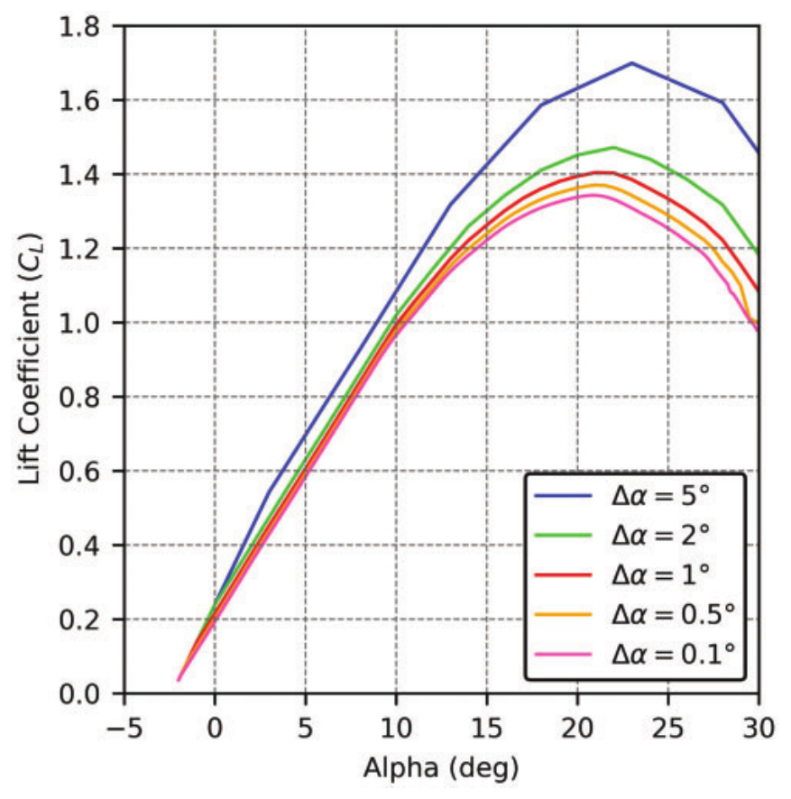

**图 7.** 使用式 (18) 和不同步长计算得到的升力曲线。

### 零升迎角计算

观察三维机翼升力曲线可知，零升迎角通常位于狭窄的线性区域内。可利用经典升力线理论进行反求。首先，将线性方程组整理为

\[
\left[D_{ij}\right]\{A_j\}
=
\{\alpha_i-\alpha_{0_i}\}.
\tag{19}
\]

其中，\(\alpha_{0_i}\) 是展向第 \(i\) 个剖面的零升迎角，\(D_{ij}\) 由式 (16) 给出。

若机翼存在几何扭转，可方便地利用根部迎角 \(\alpha_\mathrm{root}\) 和局部扭转角 \(\beta_i\) 表示局部几何迎角：

\[
\alpha_i=\alpha_\mathrm{root}+\beta_i.
\tag{20}
\]

于是，式 (19) 变为

\[
\left[D_{ij}\right]\{A_j\}
=
\{\alpha_\mathrm{root}\}
+\{\beta_i-\alpha_{0_i}\}.
\tag{21}
\]

由经典升力线理论可知，升力系数取决于第一个傅里叶系数 \(A_1\)，且升力为零时 \(A_1\) 也为零。因此，将式 (21) 中的未知量 \(A_1\) 替换为 \(\alpha_\mathrm{root}\)，可得

\[
\begin{bmatrix}
-1 & D_{12} & \cdots & D_{1N}\\
-1 & D_{22} & \cdots & D_{2N}\\
\vdots & \vdots & \ddots & \vdots\\
-1 & D_{N} & \cdots & D_{NN}
\end{bmatrix}
\begin{bmatrix}
\alpha_\mathrm{root}\\
A_2\\
\vdots\\
A_N
\end{bmatrix}
=
\begin{bmatrix}
\beta_1-\alpha_{0_1}\\
\beta_2-\alpha_{0_2}\\
\vdots\\
\beta_N-\alpha_{0_N}
\end{bmatrix}.
\tag{22}
\]

该矩阵方程的右端由机翼几何性质决定，\(D_{ij}\) 则由翼型在零升迎角附近的二维升力曲线斜率 \(a_\infty\) 计算得到。

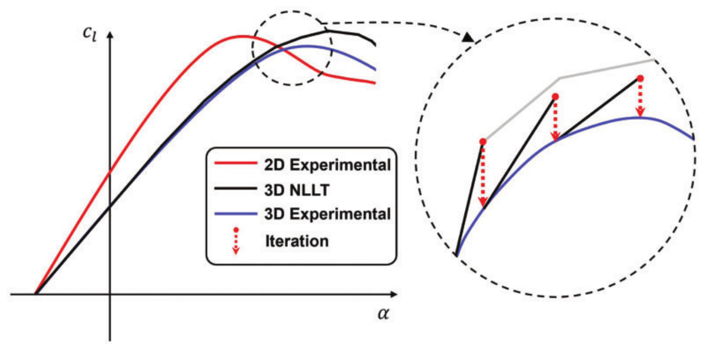

**图 8.** 升力曲线上的迭代过程示意。

### 环量迭代方法

在局部线性逐步计算过程中，任意新迎角下的傅里叶系数通过前一迎角下的二维升力曲线斜率计算。由于单步计算假定这些斜率保持不变，新迎角下求得的傅里叶系数会包含与步长 \(\Delta\alpha\) 有关的误差。通过图 8 中红色虚线所示的迭代过程，可减小该误差。图 7 表明，步长越大误差越大，因此每个迎角步之后都需要迭代修正。

当前迭代方法根据机翼剖面由实验或数值计算得到的二维升力系数，修正展向环量分布。迭代从一个利用局部线性方法得到的新迎角下的机翼升力系数开始，具体步骤如下。

1. 利用局部线性近似得到的傅里叶系数，计算环量分布：

\[
\Gamma_i^\mathrm{old}
=
4sV_\infty
\sum_{j=1}^{N}A_j\sin(j\theta_i).
\tag{23}
\]

2. 利用式 (4) 中的傅里叶系数计算下洗角，然后计算有效迎角：

\[
\alpha_{e_i}=\alpha_i-\varepsilon_i.
\tag{24}
\]

3. 对于每个剖面，根据实验或数值得到的剖面二维数据，利用有效迎角插值求局部升力系数。
4. 根据 Kutta-Joukowski 升力定律和升力系数定义，计算新的环量分布：

\[
\Gamma_i^\mathrm{new}
=
\frac{1}{2}V_\infty c_i c_{l_i}.
\tag{25}
\]

5. 将新环量与上一轮环量比较。若差值小于 \(10^{-5}\)，退出迭代；否则按松弛关系计算新的环量：

\[
\Gamma_i
=
\Gamma_i^\mathrm{old}
+RF\left(\Gamma_i^\mathrm{new}-\Gamma_i^\mathrm{old}\right),
\tag{26}
\]

其中，\(RF\) 为松弛因子，本文示例取 0.05。

6. 将式 (1) 改写为线性方程组，得到

\[
\begin{bmatrix}
\sin1\theta_1 & \sin3\theta_1 & \cdots & \sin n\theta_1\\
\sin1\theta_2 & \sin3\theta_2 & \cdots & \sin n\theta_2\\
\vdots & \vdots & \ddots & \vdots\\
\sin1\theta_n & \sin3\theta_n & \cdots & \sin n\theta_n
\end{bmatrix}
\begin{bmatrix}
A_1\\A_2\\\vdots\\A_n
\end{bmatrix}
=
\begin{bmatrix}
\Gamma_1/(4sV_\infty)\\
\Gamma_2/(4sV_\infty)\\
\vdots\\
\Gamma_n/(4SV_\infty)
\end{bmatrix}.
\tag{27}
\]

式 (27) 的系数矩阵由常量及已知参数组成。上一轮已获得环量分布，因此可通过矩阵逆求得新的傅里叶系数。

7. 重复步骤 1 至 6，直至收敛。

作者在生成图 7 的机翼上验证了该迭代过程，结果与之前的升力曲线一起示于图 9。\(\Delta\alpha=2^\circ\) 和 \(\Delta\alpha=5^\circ\) 两种步长的结果表明了迭代方法的有效性。

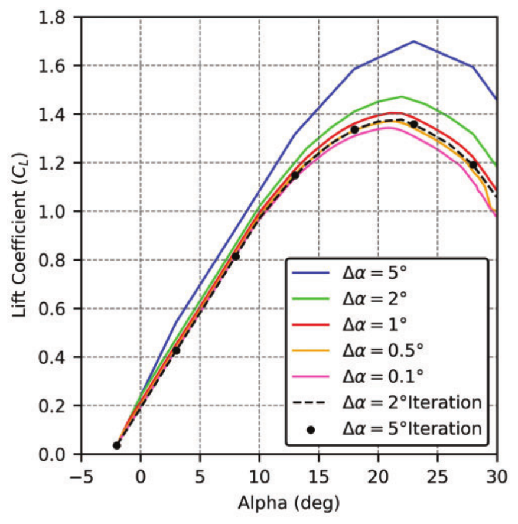

**图 9.** 矩形机翼在不同步长下的升力曲线。

### 气动系数计算

利用最终傅里叶系数，可通过式 (2)、式 (3) 计算升力系数和诱导阻力系数。但经典方法不提供其他力或力矩参数。黏性阻力系数和俯仰力矩系数则可由机翼剖面的二维实验或数值数据获得。为此，先对二维数据进行插值，得到各展向站位在计算有效迎角下的对应值，再沿翼展按式 (28)、式 (29) 进行数值积分：

\[
C_{D_v}
=
\frac{2}{S}
\sum_{i=1}^{N}S_i\bar c_{D_{v_i}},
\qquad
\bar c_{D_{v_i}}
=
\frac{c_{D_{v_i}}+c_{D_{v_{i+1}}}}{2},
\tag{28}
\]

\[
C_{m_y}
=
\frac{2}{S\bar c}
\sum_{i=1}^{N}
S_i\bar c_i\bar c_{m_{y_i}},
\qquad
\bar c_{m_{y_i}}
=
\frac{c_{m_{y_i}}+c_{m_{y_{i+1}}}}{2},
\tag{29}
\]

其中

\[
S_i
=
\frac{c_i+c_{i+1}}{2}(y_{i+1}-y_i),
\qquad
\bar c_i
=
\frac{c_i+c_{i+1}}{2}.
\tag{30}
\]

类似地，也可根据机翼剖面的二维数据计算流动分离点和压力系数。查表数据按各展向站位的有效迎角进行插值。

### 气动模型的应用

本节通过若干测试案例展示新型非线性升力线方法的适用性、限制、优点和缺点。作者使用 Visual Basic 开发程序，主要算法见表 1。

首先，利用实验数据验证方法。Ostowari 和 Naik 针对 NACA 44XX 翼型系列开展了实验研究[50]，数据包含不同厚度比 NACA 44XX 翼型的二维实验数据，以及不同展弦比的矩形机翼在多个雷诺数下的三维实验结果。这些翼型在航空领域十分常见，多种无人机、微型飞行器和轻型飞机均采用四位数翼型。即使是 AAI RQ-7 Shadow 和 AAI RQ-2 Pioneer 等战术无人机，也使用 NACA 4415 翼型的矩形机翼。

因此，测试案例 I 选择 NACA 4415 剖面的矩形机翼，展弦比为 9，见表 2。该机翼将在 \(Re=0.25\times10^6\) 和 \(0.50\times10^6\) 两个雷诺数下分析。

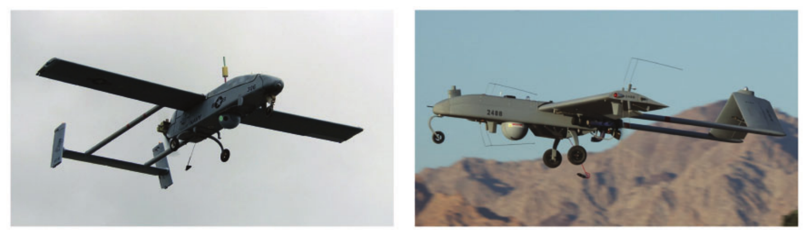

**图 10.** 美国海军 RQ-2B Pioneer[51] 与 RQ-7B Shadow[52]。

**表 1. 非线性升力线方法算法**

| N-LLT 程序算法 |
|---|
| 输入：几何参数；二维翼型性能数据 |
| 1: 对 \(i=1\) 到 \(N\)，\(N\) 为站位数量 |
| 2: 计算机翼几何参数 \(\{c(i),y(i),\ldots\}\) |
| 3: 结束循环 |
| 4: 求解 \([D_{ij}]\{A_j\}=\{\alpha_\mathrm{root}\}+\{\beta_i-\alpha_{0_i}\}\) |
| 5: 当 \(\alpha_\mathrm{root}<\alpha_{\max}\) 且未达到最大迎角限制时 |
| 6: \(\{A_j^{k+1}\}=\{A_j^k\}+[D_{ij}^k]^{-1}\{\Delta\alpha\}\) |
| 7: \(\Gamma_i^\mathrm{old}=4sV_\infty\sum_{j=1}^{N}A_j\sin(j\theta_i)\) |
| 8: 对 iter=1 到 maxiter |
| 9: 利用 \(\Gamma_i\) 计算 \(A_j\) |
| 10: \(\varepsilon=\sum_{j=1}^{N}jA_j\sin(j\theta)/\sin\theta\)，得到下洗角 |
| 11: \(\alpha_{e_i}=\alpha_i-\varepsilon_i\) |
| 12: \(\Gamma_i^\mathrm{new}=\frac{1}{2}V_\infty c_i c_{l_i}\) |
| 13: 若 \(|\Gamma_i^\mathrm{old}-\Gamma_i^\mathrm{new}|<10^{-5}\) |
| 14: 退出循环 |
| 15: 结束判断 |
| 16: \(\Gamma_i=\Gamma_i^\mathrm{old}+RF(\Gamma_i^\mathrm{new}-\Gamma_i^\mathrm{old})\) |
| 17: 结束迭代循环 |
| 18: 计算 \(C_L,C_D,C_m\) |
| 输出：三维几何的气动性能 |

**表 2. 测试案例 I 参数**

| 剖面 | 平面形状 | 展弦比 \(AR\) | 雷诺数 \(Re\) |
|---|---|---:|---:|
| NACA 4415 | 矩形 | 9 | \(0.25\times10^6\) 至 \(0.50\times10^6\) |

后文图例中的 “M” 表示 \(10^6\) 倍的雷诺数。分析结果与实验数据见图 11。数值结果在升力曲线线性和非线性区域均与实验数据几乎完全重合，两个雷诺数下的最大升力系数也接近实验值。结果表明，当 \(Re=0.25\times10^6\) 时，该方法可在失速点之后约 \(10^\circ\) 范围内精确计算线性和非线性升力系数。然而，在 \(25^\circ\) 迎角之后，\(Re=0.50\times10^6\) 的两个升力曲线存在小幅偏差。总阻力和俯仰力矩曲线也表现出令人满意的结果。由于文献实验中的俯仰力矩系数存在波动，图中使用的是平均值曲线。

测试案例 II 采用展弦比 12、NACA 4415 剖面的矩形机翼，见表 3。与案例 I 相比，唯一区别是展弦比略有增加。

数值结果与验证数据见图 12。在该案例中，实验升力曲线的非线性行为约从 \(12^\circ\) 迎角开始。与前一案例相同，数值方法可准确计算至 \(25^\circ\) 迎角；同时能够预测三维机翼的失速后气动行为。第二幅图给出从零升迎角至 \(\alpha=30^\circ\) 的总阻力系数计算结果，数值与文献实验值非常接近。第三幅图中，数值俯仰力矩结果相对实验数据存在偏置，但力矩曲线整体变化趋势的估计误差仍然较小。

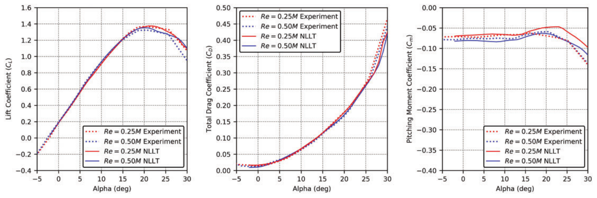

**图 11.** 测试案例 I：升力、总阻力和俯仰力矩系数。

**表 3. 测试案例 II 参数**

| 剖面 | 平面形状 | 展弦比 \(AR\) | 雷诺数 \(Re\) |
|---|---|---:|---:|
| NACA 4415 | 矩形 | 12 | \(0.25\times10^6\) 至 \(0.50\times10^6\) |

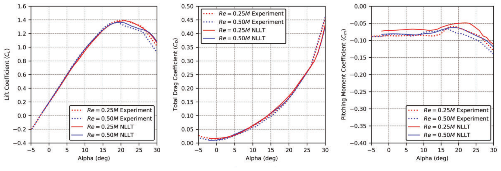

**图 12.** 测试案例 II：升力、总阻力和俯仰力矩系数。

下一项验证将本文工具与其他计算气动工具比较。文献中已有多种升力面和构型气动分析工具；本研究使用的工具及其运行时间见表 4。除 NASA TetrUSS USM3D[53] 外，其他工具均可免费下载。

本案例采用 \(AR=12\)、NACA 4415 剖面的矩形机翼，弦长雷诺数为 \(3\times10^6\)，参数见表 5。本文方法所需二维数据来自文献中使用 NASA USM3D 生成的数据库[53]。

所有分析结果见图 13。黑色虚线表示利用 NASA USM3D CFD 工具生成并收录于文献数据库的三维数据[53]。XFLR5 VLM[19]、XFLR5 Panel Method[19]、OpenVSP（VSPAero）VLM 以及 Tornado VLM[22] 的数学模型基于势流理论，因此只能给出线性升力曲线；它们无法预测最大升力系数及失速前后非线性行为。XFLR5 LLT（仅适用于单升力面）和 DATCOM 可估计最大升力系数，但 DATCOM 的预测结果明显不够理想。

图 13 显示，本文方法以较小误差计算了升力曲线的线性和非线性区域，最大升力系数也几乎等于验证值。

图 14 将本文方法计算的剖面升力系数与 CFD 结果进行比较。考虑到非线性行为从 \(12^\circ\) 开始，失速前 \(14^\circ\) 迎角下的升力分布具有很高精度。本文方法使用的站位数量较少，因此图中连接站位点的线呈直线。在失速迎角处，非线性 LLT 同样以很小误差预测升力分布，对应橙色曲线；在失速后区域，它也能正确计算升力分布的总体特征。红色曲线表明方法可捕捉较大的升力分布变化，但程序中忽略了展向站位之间的小尺度波动。在典型个人计算机配置下，程序可在 0.06 s 内计算全部迎角范围。

图 15 将本文方法计算的流动分离线与数据库结果进行比较。所需二维流动分离输入由 XFOIL 获得。图中显示按比例缩放的半翼；颜色与前述迎角一致。由图 13 的升力曲线可知，机翼在 \(18^\circ\) 迎角开始失速。对于矩形平面形机翼，通常翼根区域先失速；数值分析和 CFD 结果也体现了这一点。与升力分布类似，本文方法能够捕捉展向站位处流动分离点的大幅变化，对低阶方法而言结果相当成功。

**表 4. 计算气动分析工具及其求解时间**

| 程序 | 方法 | 时间 |
|---|---|---|
| 本文代码 | 非线性升力线方法 | 毫秒 |
| NASA USM3D | 计算流体力学 | 小时/天 |
| XFLR5 | 升力线方法 | 毫秒 |
| XFLR5 | 涡格法 | 秒 |
| XFLR5 | 面元法 | 秒 |
| Tornado | 涡格法 | 秒 |
| OpenVSP | 涡格法 | 秒 |
| DATCOM | 半经验方法 | 毫秒 |

**表 5. 测试案例 III 参数**

| 剖面 | 平面形状 | 展弦比 \(AR\) | 雷诺数 \(Re\) |
|---|---|---:|---:|
| NACA 4415 | 矩形 | 12 | \(3.0\times10^6\) |

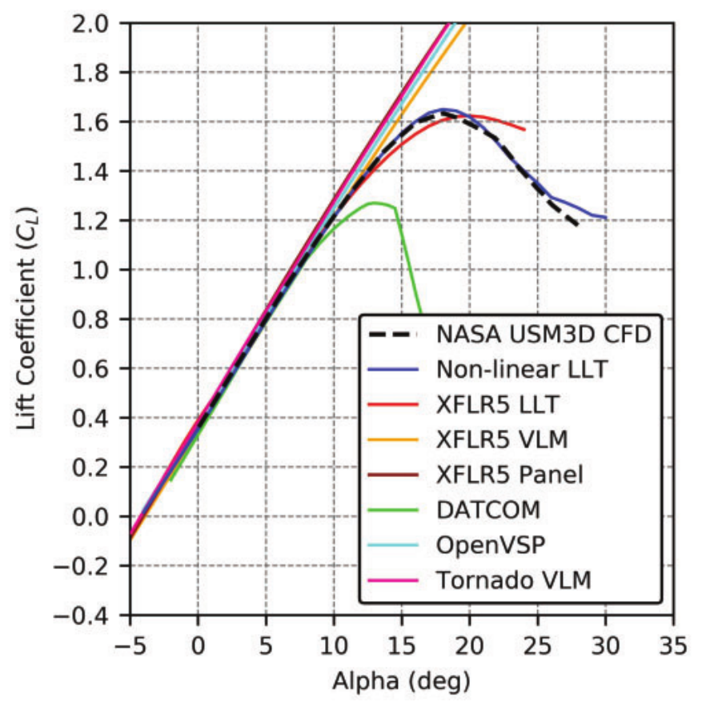

**图 13.** 测试案例 III：升力系数。

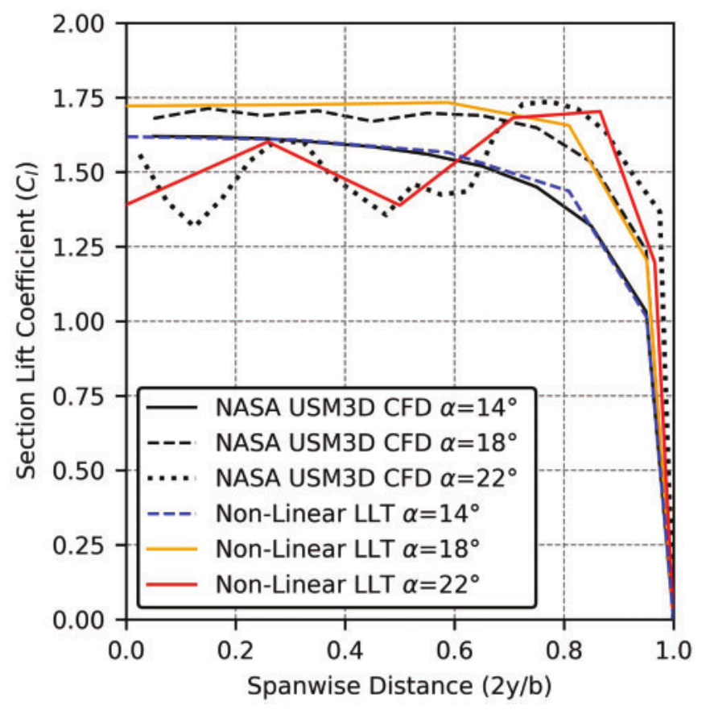

**图 14.** 测试案例 III：剖面升力系数分布。

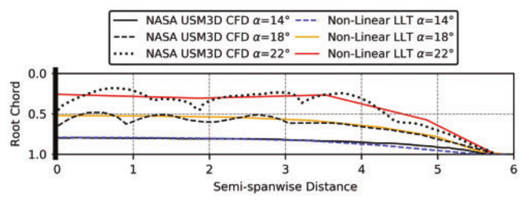

**图 15.** 测试案例 III：流动分离点。

### 将该方法扩展到常规飞行器气动分析

Prandtl 经典升力线理论只适用于单个升力面。本研究发展了一套方法，以求解升力面组合构型。为此，需要计算机翼在尾翼处的下洗。对后部升力面可重复非线性方法。Phillips 等人[54]建立了无后掠机翼后方若干弦长及以上距离处下洗的数学模型。该模型将卷起的涡片视为单根马蹄形涡丝，并利用傅里叶级数系数和机翼几何数据进行数值计算，因此可处理任意展向变化。

利用迭代结束时得到的机翼几何傅里叶系数，可计算尾翼站位处的下洗速度。式 (31) 中，\(k_b,k_p,k_v\) 分别表示翼尖涡跨度、尾翼位置和翼尖涡强度因子。无量纲参数 \(k_v,k_b\) 取决于机翼平面形状，\(k_p\) 则同时取决于机翼平面形状和尾翼相对机翼的位置：

\[
\varepsilon_i(\bar x,\bar y,\bar z)
\approx
\frac{-V_z(\bar x,\bar y,\bar z)}{V_\infty}
=
\frac{k_vk_p}{k_b}\left(\frac{C_{L_w}}{AR_w}\right).
\tag{31}
\]

若已知尾翼处的下洗角和尾翼扭转角，则每个尾翼站位的迎角为

\[
\alpha_{\mathrm{tail}_i}
=
\alpha_\mathrm{root}+\beta_{\mathrm{tail}_i}-\varepsilon_i.
\tag{32}
\]

据此，可将新发展的非线性升力线方法应用于尾翼几何。因此，与机翼有关的所有参数也可在尾翼上求得，从而可对机翼-尾翼构型进行非线性分析。升力面组合构型的气动力系数为

\[
C_{L_\mathrm{total}}
=
C_{L_\mathrm{wing}}
+C_{L_\mathrm{tail}}\frac{S_\mathrm{tail}}{S_\mathrm{ref}},
\tag{33}
\]

\[
C_{D_\mathrm{total}}
=
C_{D_\mathrm{wing}}
+C_{D_\mathrm{tail}}\frac{S_\mathrm{tail}}{S_\mathrm{ref}}.
\tag{34}
\]

由此可计算机翼-尾翼构型含黏性效应的总阻力。然而，对于完整构型，机身几何通常对寄生阻力影响很大。Sadraey 指出，飞机零升阻力 \(C_{D_0}\) 通常有 30%-50% 来自机身[55]。本文所用小型无人机通常具有简单机身，因此可用解析或经验方法计算阻力。

利用这些方法[56]，机身几何的零升阻力系数可写为

\[
C_{D_{0_\mathrm{fuselage}}}
=
R_{wf}C_f
\left\{
1+
\frac{60}{\left(l_f/d_f\right)^3}
+0.0025\frac{l_f}{d_f}
\right\}
\frac{S_{\mathrm{wet}_{\mathrm{fuselage}}}}{S_\mathrm{ref}}.
\tag{35}
\]

起落架、外挂物和挂架等其他部件也可通过类似的解析/经验方法计算。于是，飞机的总阻力系数为

\[
C_{D_\mathrm{total}}
=
C_{D_\mathrm{wing}}
+C_{D_\mathrm{tail}}
+C_{D_\mathrm{fuselage}}
+C_{D_\mathrm{misc}}.
\tag{36}
\]

简单无人机分析还需要俯仰力矩来确定飞行器静稳定性。若采用部件法，则

\[
C_{m_\mathrm{total}}
=
C_{m_{cg,\mathrm{wing}}}
+C_{m_{cg,\mathrm{tail}}}
+C_{m_{cg,\mathrm{fuselage}}}.
\tag{37}
\]

机翼和尾翼对飞机静稳定性的贡献，可由绕重心总力矩的基本力-力矩方程计算；机身对俯仰力矩的贡献可采用 Multhopp 方法[57]：

\[
C_{m_{0_\mathrm{fuselage}}}
=
\frac{k_2-k_1}{36.5S\bar c}
\sum_{x=0}^{x=l_f}
w_f^2(x)\left(\alpha_{0_w}+i_f\right)\Delta x,
\tag{38}
\]

\[
C_{m_{\alpha_\mathrm{fuselage}}}
=
\frac{1}{36.5S\bar c}
\sum_{x=0}^{x=l_f}
w_f^2(x)\frac{\partial\varepsilon_u}{\partial\alpha}\Delta x.
\tag{39}
\]

有关这些公式的详细信息和应用示例可参见文献[56]、[57]。至此，完整无人机分析所需的公式均已给出。

作者已将新工具用于 ARC 无人机的设计和数学建模，见图 16。具体而言，利用所提方法分析了多种无人机构型的非线性性能，并将结果快速传递到动力学模型中，以支持仿真和飞控系统设计。关于稳定性导数计算和飞控系统设计中如何使用这些模型的更多细节，可参见文献[58]-[60]。

在该示例中，项目无人机的气动性能与多种分析工具进行了比较，结果见图 17。升力曲线表明，该方法在包括失速行为在内的线性和非线性区域均与 CFD（ANSYS Fluent）结果吻合良好。在相同计算硬件配置下，Fluent CFD 对 15 个测试点完成 \(C_L-\alpha\) 计算耗时 120 h，而新方法对 30 个测试点完成同样计算仅耗时 0.01 s。这说明本文方法在捕捉重要非线性效应的同时具有显著计算优势，可作为快速构型分析工具，并用于多学科设计优化。

图 17 的第二幅图比较总阻力系数曲线。与测试案例 III 相同，VLM 程序的诱导阻力结果与黏性阻力模块结果相加；本文方法则在升力面直接计算结果上增加机身对总阻力系数的贡献。

对于该构型，XFLR5 黏性分析能够收敛的迎角范围非常窄。本文方法在 \(9^\circ\) 迎角之前与 CFD、Tornado 的结果具有可比性。值得注意的是，CFD 结果在该点之后的增长率下降。DATCOM 的阻力结果可靠性不高，这一点在其用户手册警告中也有说明[61]。图 17 显示其阻力曲线存在较大偏移，因此在小型无人机尺寸和飞行状态下使用 DATCOM 时必须谨慎对待经验表的适用边界。

最后，图 17 比较了俯仰力矩曲线。各计算工具的结果总体一致；但蓝色曲线所示的本文方法在大迎角区域给出明显不同结果，因为它以完全非线性方式计算俯仰力矩曲线。识别这一行为对于敏捷飞行中的无人机精确建模和控制十分关键。由于该图缺少对应的 CFD 数据，作者改用另一种方式检验偏移：采用线性无黏二维性能输入，以判断差异是否来自升力曲线固有的非线性结构。该分析用黑色虚线表示，结果与其他工具一致。由此可判断，黏性效应是本文方法与其他工具出现差异的主要原因。下一节将构建可用于小型无人机设计优化的高效气动构型分析引擎。

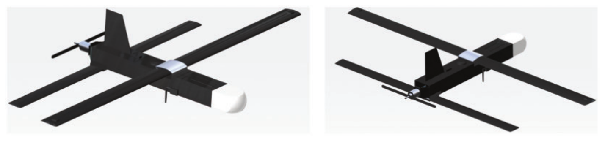

**图 16.** ARC 无人机几何。

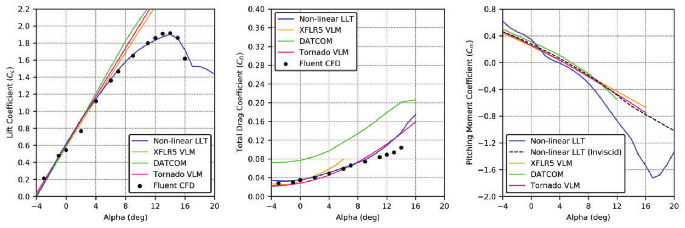

**图 17.** 测试案例 IV：升力、总阻力和俯仰力矩系数。

## 人工神经网络模型

小型无人机设计优化的一项关键挑战，是缺少可嵌入优化流程的快速、精确气动构型分析引擎。为此，本文利用深度学习生成一个黑箱函数，可预测包括黏性效应在内的无人机构型气动特性。具体而言，作者设计并训练了一种人工神经网络结构，训练数据由上一节的气动分析工具生成。

图 18 给出了人工神经网络方法的彩色流程图。在前人工作[5]基础上，本文将机身对总阻力和俯仰力矩系数的贡献纳入模型，并扩大数据集；同时改进了特征集和网络结构，从而提高了设计空间内的泛化能力。随着训练数据规模增加，神经网络估计气动性能的精度也随之提高。下面按照图 18 的流程逐步说明，从数据生成开始，并给出全部数据集、特征和训练配置，以保证结果可复现。

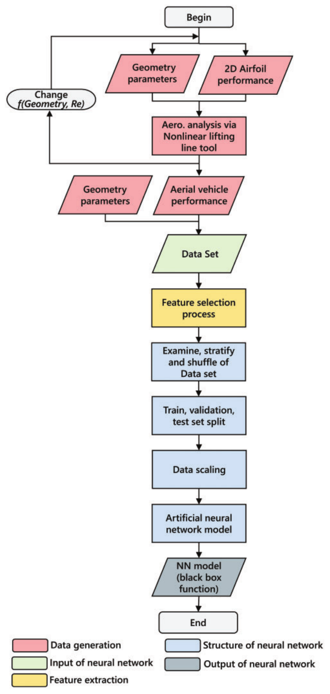

**图 18.** 人工神经网络模型流程图。

### 数据生成

非线性升力线方法能够快速、可靠地生成训练神经网络所需的气动数据。为构建基础几何-气动数据集，作者修改了几何定义，并以多个 XFOIL[62] 分析结果作为二维性能输入。每种构型约在 30 个不同迎角下分析。图 19 采用双对数坐标给计算时间与构型数量的关系；计算时间呈明显的一阶对数关系，即 \(n=1\)。需要说明，本研究的计算环境为个人计算机。

最终数据集包含 94,500 种构型。借助不同几何组合，该数量还可进一步增加。表 6 给出构型数量和数据表总行数。

表 7 汇总数据集中的 25 个参数。其中 21 个与几何有关，1 个与流动条件有关，3 个为性能输出。

研究第一阶段设置了一定几何范围，以避免数据规模过大。不过，正如前文所述，由于程序可在 0.01 s 内求解一个构型在 30 种流动条件下的性能，扩大组合数量并不困难。用于构型组合的参数列于表 8。

机翼剖面采用不同弯度比，尾翼剖面限定为对称 NACA 0012。根据机翼平均气动弦长确定的雷诺数与小型无人机飞行状态相对应。通过把尾翼和机身的几何尺寸及位置配置到机翼几何上，可生成大量尺寸合理且互不相同的构型。

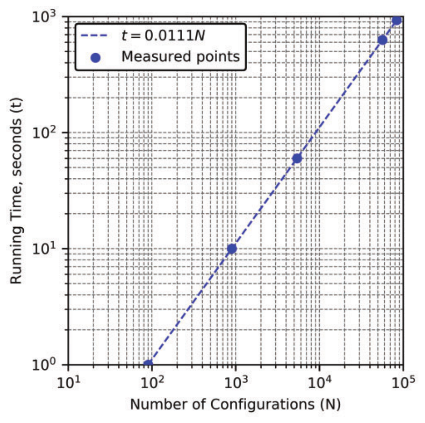

**图 19.** 构型数量与计算时间的关系。

**表 6. 数据集维度与生成时间**

| 构型数量 | 总行数 | 参数列数 | 运行时间（min） |
|---:|---:|---:|---:|
| 94,500 | 2,835,000 | 25 | 17.5 |

**表 7. 数据集中的全部构型参数**

| 类别 | 参数 |
|---|---|
| 机翼和尾翼参数 | 翼展 |
| 机翼和尾翼参数 | 根部弦长 |
| 机翼和尾翼参数 | 翼尖弦长 |
| 机翼和尾翼参数 | 安装角 |
| 机翼和尾翼参数 | 翼型厚度比 |
| 机翼和尾翼参数 | 翼型弯度比 |
| 机翼和尾翼参数 | 翼型最大弯度位置 |
| 机翼和尾翼参数 | 二维性能输入文件名 |
| 机身 | 水力直径 |
| 机身 | 长度 |
| 位置 | x 方向距离 |
| 位置 | y 方向距离 |
| 位置 | z 方向距离 |
| 流动条件 | 迎角 \(\alpha\) |
| 性能系数 | 升力系数 \(C_L\) |
| 性能系数 | 阻力系数 \(C_D\) |
| 性能系数 | 俯仰力矩系数 \(C_m\) |

### 特征提取

特征提取首先检查原始初始数据集。作者使用 Pearson 方法计算相关矩阵。图 20 中，正相关特征用深蓝色表示，负相关特征用浅蓝色表示，颜色密度与相关程度成正比。

如预期，迎角数据与目标数据 \(C_L\)、\(C_D\) 和 \(C_M\) 呈强相关。仅有其余原始特征，不足以提高方法的泛化能力并覆盖设计空间。正如已有研究所示，原始数据初始集对俯仰力矩曲线估计尤其不足。为此，作者使用自动特征工程与选择库 autofeat 解决该问题[63]。该库通过生成额外交互与非线性特征来提高回归模型预测精度，最终生成并加入 12 个非线性特征。

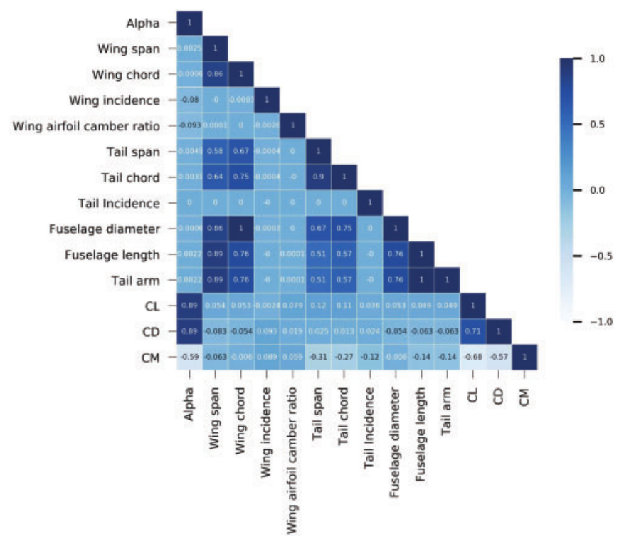

**图 20.** 初始数据集相关矩阵。

### 人工神经网络结构

本节逐步说明人工神经网络结构及数学基础。训练前，先筛查数据集，以检测并清除气动性能系数中的异常值。精确的数据分层与打乱对于保证正确训练、避免异常情况非常重要。数据集划分为测试集、训练集和验证集：首先保留 95% 数据用于训练、5% 用于测试；随后从训练集划出 10% 作为验证集。各组比例和样本量见表 9。

建立网络结构之前，训练集和测试集分别进行缩放，以避免输入量级差异造成收敛问题。式 (40) 通过从每个数据项中减去集合最小值，再除以集合极差进行缩放，其中 \(x_i^{sc}\) 表示缩放后的样本：

\[
x_i^{sc}
=
\frac{x_i-\min(x)}{\max(x)-\min(x)}.
\tag{40}
\]

缩放后的数据作为特征集，从输入层送入网络。模型由输入层、输出层和六个隐藏层组成，见图 21。

各层输出可写为

\[
z_i^l
=
f\left(W^l x_i^{l,sc}+b^l\right),
\tag{41}
\]

其中，\(f\) 为激活函数，\(W^l\) 为第 \(l\) 层权重矩阵，\(b^l\) 为该层偏置向量。激活函数决定哪些神经元被激活，即哪些信息传递到后续层。本文采用修正线性单元（ReLU），这是神经网络中最常用的激活函数之一[64]。权重矩阵采用 “He 正态初始化器”[65]，其样本来自以零为中心的截断正态分布。

损失函数采用绝对误差，用于度量数据真实值与预测值之间的差异。式 (42) 中，\(y_i\) 为真实输出，\(\hat y_i\) 为神经网络预测输出：

\[
E(W,b)
=
\frac{1}{n}
\sum_{i=1}^{n}
\left|y_i-\hat y_i\right|.
\tag{42}
\]

优化器采用 Adam[66]，通过更新权重和偏置最小化误差函数。Adam 计算代价函数的偏导数，并在每次迭代中更新矩向量。

最终网络参数汇总于表 10。随后使用该结构和数据集训练模型。图 22 给出训练过程的学习曲线。可以看到，损失在 250 个 epoch 后收敛到最小值。曲线行为和误差率表明训练成功完成，未出现过拟合或欠拟合。

训练阶段的误差值见表 11，数值令人满意。训练完成后，模型在一个未参与训练的测试集上验证。图 23 比较了不同测试构型的预测值与真实值。由于测试数据超过 141,000 项，图中从数据集中随机抽取 500 个点进行可视化。尽管大量不同目标值分布范围很宽，模型仍能捕捉极端值。

需要注意的是，俯仰力矩计算对所有构型均以 75% 弦长处为重心参考点。

为评价模型在整个测试集上的效果，作者计算决定系数 \(R^2\)，结果见图 24。图中横轴和纵轴分别为真实值和预测值；所有目标系数的 \(R^2\) 都接近 1。从图中还可见，约 141,000 项测试数据几乎全部落在回归曲线上，偏离回归线的数据极少，可以忽略。

本文方法的 \(R^2\) 达到 0.99805-0.99976，而文献中不同方法[40]-[45]的决定系数范围为 0.805-0.945。这说明，即使在大迎角、完全非线性行为明显的区域，所提方法仍具有较高精度和较强的学习能力。

**表 8. 数据集中的几何参数及范围**

| 表面 | 翼型 | 弦长 | 展弦比 \(AR\) | 安装角 | x 方向位置 | 雷诺数 |
|---|---|---|---:|---:|---:|---:|
| 机翼 | NACA 2412、NACA 4412、NACA 6412 | 0.2 至 0.6 | 10 至 20 | \(-2^\circ\) 至 \(2^\circ\) | - | \(0.4\times10^6\) 至 \(1.2\times10^6\) |
| 尾翼 | NACA 0012 | \((0.5\text{ 至 }1)c_\mathrm{wing}\) | 4 至 8 | \(-2^\circ\) 至 \(2^\circ\) | \((0.4\text{ 至 }0.6)b_\mathrm{wing}\) | \(0.2\times10^6\) 至 \(1.2\times10^6\) |

**表 9. 训练集、验证集和测试集**

| 数据集 | 数据比例 | 数据项数量 |
|---|---:|---:|
| 训练集 | 85.5% | 约 2,400,000 |
| 验证集 | 9.5% | 约 270,000 |
| 测试集 | 5% | 约 141,000 |

**表 10. 神经网络结构超参数**

| 参数 | 取值 |
|---|---|
| 隐藏层数量 | 6 |
| 第 1 层神经元数量 | 512 |
| 第 2 层神经元数量 | 256 |
| 第 3 层神经元数量 | 128 |
| 第 4 层神经元数量 | 64 |
| 第 5 层神经元数量 | 32 |
| 第 6 层神经元数量 | 16 |
| 激活函数 | ReLU |
| 优化器 | Adam |
| 初始化器 | He 正态初始化 |
| 损失函数 | MAE |
| 批大小 | 512 |
| epoch 数量 | 250 |

**表 11. 训练与验证误差**

| 数据集 | 平均绝对误差 | 均方误差 |
|---|---:|---:|
| 训练集 | 0.00116 | 0.000018 |
| 验证集 | 0.00124 | 0.000024 |

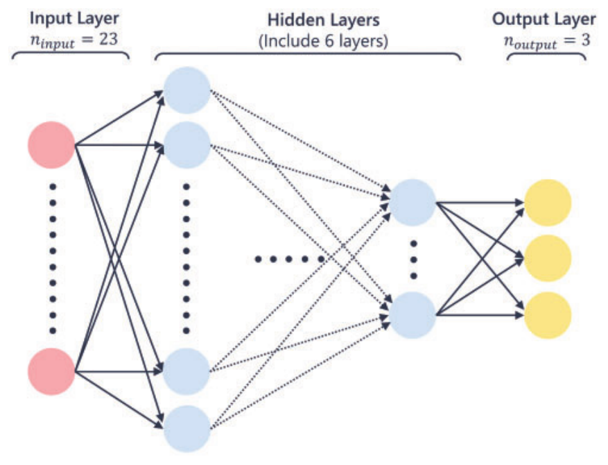

**图 21.** 神经网络结构。

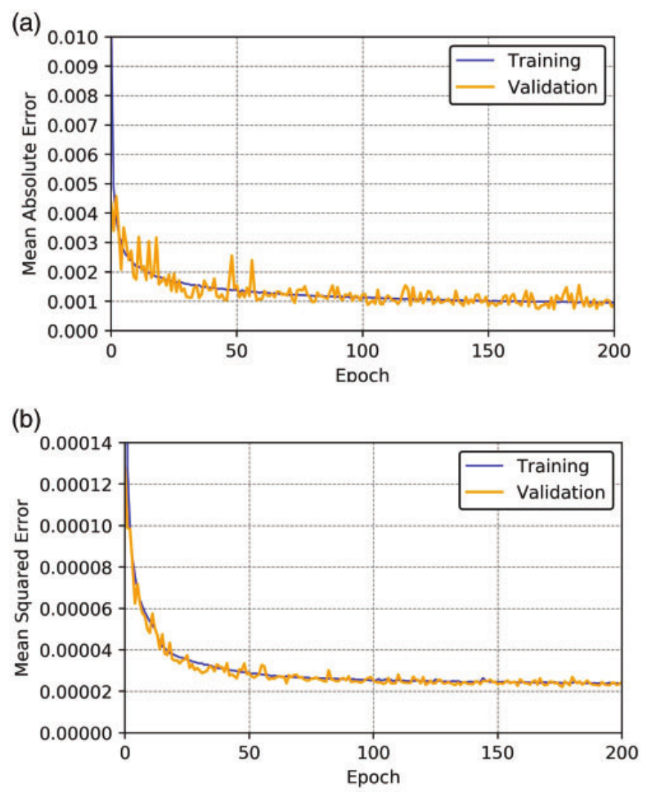

**图 22.** 所开发模型的学习曲线：(a) 预测升力系数与真实值；(b) 预测阻力系数与真实值；(c) 预测俯仰力矩系数与真实值。

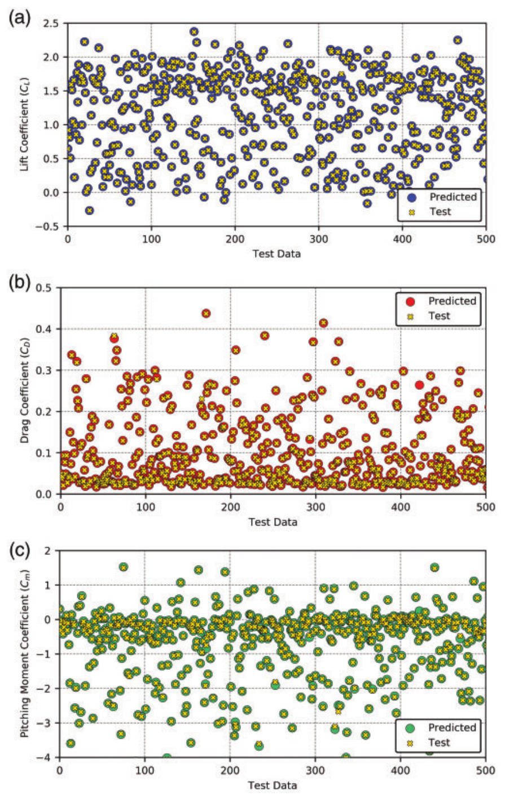

**图 23.** 测试集在目标系数上的表现。

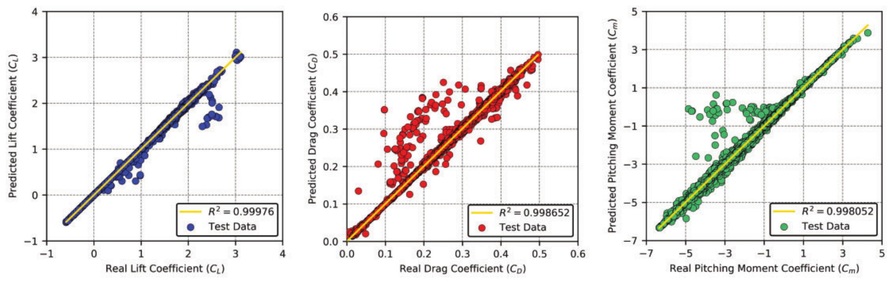

**图 24.** 约 141,000 项测试数据的目标参数性能。

### 代理模型的应用

本节通过若干测试案例展示当前代理模型的泛化能力。如前所述，模型仅以几何数据为输入即可预测无人机构型的非线性性能系数，见图 1。这使其具有传统气动分析工具难以达到的实用性和计算速度；传统工具通常需要实际计算流动动力学。

测试案例 A 和 B 分别选取常规布局与串列布局无人机，机翼剖面均属于训练阶段使用过的翼型。几何参数见表 12。

图 25 表明，预测结果几乎等于真实值。神经网络模型能够准确计算常规与串列构型在线性和非线性区域，包括失速后的升力系数；阻力和俯仰力矩系数同样计算成功。此外，模型还能捕捉由升力面非线性行为引起的大迎角俯仰力矩变化。

测试案例 C 和 D 采用与前述案例相同的几何，但改用未参与训练的翼型。此次选择 3412 和 5412 翼型检验模型泛化能力。这两种通用翼型的弯度比与训练翼型不同；不过，如前所述，翼型弯度比已作为模型输入，因此模型被设计用于计算 NACA 四位数系列中的其他翼型。测试翼型汇总于表 13。

分析结果见图 26。新神经网络模型在线性和非线性区域均与真实值一致，能够清晰预测包括失速后区域在内的非线性升力效应；阻力和俯仰力矩系数的预测成功率也很高，预测值与真实值几乎一一对应。需要再次强调，这些翼型未用于模型训练。人工神经网络之所以能够计算它们对气动性能的影响，是因为模型能够在翼型之间进行插值。除这些测试外，另外数十项应用也表明，模型通过覆盖设计空间，能够非常准确地计算区间内的设计点。

为验证该方法可行性，作者将代理模型作为小型无人机优化研究的气动求解器。模型以函数形式导入 MATLAB，并使用遗传算法工具箱建立简单设计优化。

在遗传算法中，首先在预定边界内生成初始设计集合。对每个设计，利用代价函数计算适应度，并从当前设计集合中随机选择适应度较高的一部分，通过随机操作生成新设计。该方法中，基因表示设计变量，染色体用于命名设计点。交叉和变异产生的新个体可由当前 AI 模型即时给出气动特性并计算适应度。

作者利用前述测试中的案例 A 构型，尝试最大化该飞行器的续航性能。为满足该目标，对升力面的翼型与安装角进行优化，要求保证静稳定性并避免超过最大阻力限制。该优化问题的目标是获得在满足稳定性和气动约束下效率最大的构型，可定义为

\[
\max_x f(x)=\frac{L}{D},
\tag{43}
\]

满足

\[
0.35<C_L<0.45,
\tag{44}
\]

\[
C_{m_0}>0,
\tag{45}
\]

\[
C_{m_\alpha}<0,
\tag{46}
\]

\[
C_D<0.035.
\tag{47}
\]

其中，\(x\) 包括巡航迎角、机翼翼型弯度比以及机翼和尾翼安装角。第一个不等式约束与升力系数有关，其作用是平衡重量，同时避免巡航速度发生剧烈变化。\(C_{m_0}\) 的最小值设为零，因为它是纵向静稳定性的主要约束之一；此外，固定操纵杆俯仰力矩斜率必须为负，才能保证纵向飞行稳定。最后一个不等式将总阻力系数限制在基本构型水平，以保证推力和阻力平衡。

本优化将几何变量限定为巡航迎角、机翼剖面弯度比和升力面安装角，见表 14，目标是在保持主要几何尺寸不变的前提下，通过小幅剖面变化提高气动效率。实际上，表 7 中与机翼、尾翼及机身部件相关的其他 14 个参数也都可以作为变量。

代理模型的速度使包含数百次迭代的优化过程在 2-3 s 内完成。优化后的变量见表 15。图 27 比较了程序在 NACA 四位数翼型族中优化得到的新翼型与原始翼型，直接体现了方法的设计灵活性。

本研究结果显示，优化后气动效率提高 5.18%。在类似优化研究中，机翼、尾翼和机身尺寸等多种几何参数都可方便地作为设计变量。这些示例表明，所开发模型能够成为大规模飞机设计优化研究中的重要气动求解器。

**表 12. 测试案例 A 和 B 的几何参数**

| 参数 | 案例 A 机翼 | 案例 A 尾翼 | 案例 A 机身 | 案例 B 机翼 | 案例 B 尾翼 | 案例 B 机身 |
|---|---:|---:|---:|---:|---:|---:|
| 翼展 | 2.25 | 0.9 | - | 6 | 3 | - |
| 弦长 | 0.2 | 0.2 | - | 0.4 | 0.4 | - |
| 安装角（°） | 0 | 0 | - | 1 | 0 | - |
| 翼型 | 2412 | 0012 | - | 4412 | 0012 | - |
| 直径 | - | - | 0.2 | - | - | 0.4 |
| 长度 | - | - | 2 | - | - | 5 |
| 雷诺数 | \(0.4\times10^6\) | \(0.4\times10^6\) | - | \(0.8\times10^6\) | \(0.8\times10^6\) | - |
| 位置 | [0,0,0] | [1,0,0] | [-1,0,0] | [0,0,0] | [2.5,0,0] | [-2.5,0,0] |

**表 13. 测试案例采用的 NACA 系列翼型**

| 表面 | 常规布局案例 A | 常规布局案例 C | 串列布局案例 B | 串列布局案例 D |
|---|---:|---:|---:|---:|
| 机翼 | 2412 | 3412 | 4412 | 5412 |
| 尾翼 | 0012 | 0012 | 0012 | 0012 |

**表 14. 优化变量的上下界**

| 变量 | 符号 | 最小值 | 最大值 |
|---|---|---:|---:|
| 巡航迎角 | \(\alpha_\mathrm{cruise}\) | \(0^\circ\) | \(3^\circ\) |
| 机翼安装角 | \(i_\mathrm{wing}\) | \(0^\circ\) | \(2^\circ\) |
| 尾翼安装角 | \(i_\mathrm{tail}\) | \(-2^\circ\) | \(2^\circ\) |
| 机翼翼型弯度比 | \(c_\mathrm{wing}\) | 2% | 6% |

**表 15. 优化后的几何变量**

| 构型 | \(c_\mathrm{wing}\) | \(i_\mathrm{wing}\) | \(i_\mathrm{tail}\) |
|---|---:|---:|---:|
| 测试案例 A | 2.00% | \(0.00^\circ\) | \(0.00^\circ\) |
| 优化结果 | 2.86% | \(0.57^\circ\) | \(0.04^\circ\) |

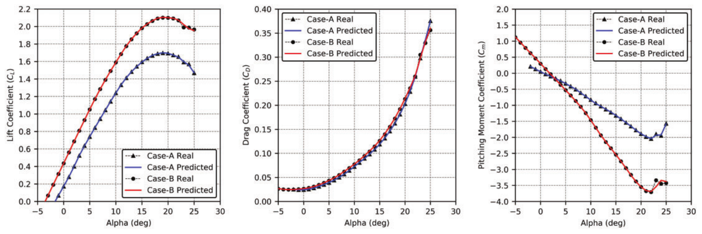

**图 25.** 测试案例 A（常规布局）与 B（串列布局）的气动性能系数。

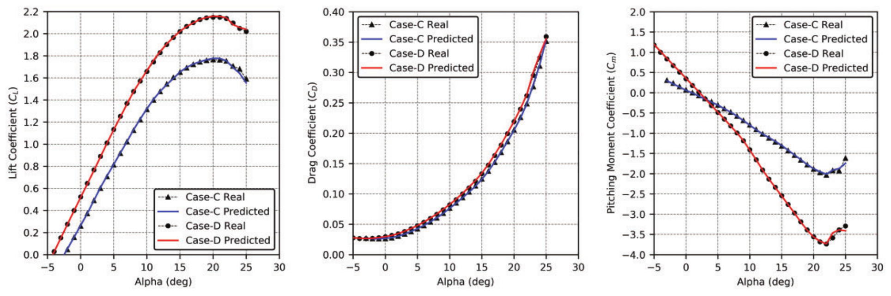

**图 26.** 测试案例 C（常规布局）与 D（串列布局）的气动性能系数。

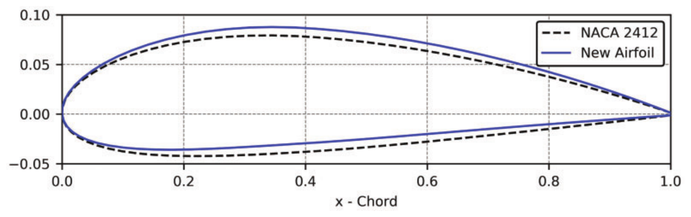

**图 27.** NACA 2412 与优化后新翼型的几何形状。

## 结论

本文提出了一种新的计算气动方法及其代理模型，用于预测小型无人机的非线性气动性能。所开发非线性升力线工具在处理时间和算力方面均能以极高效率计算无人机构型性能。分析表明，该方法可在 1 s 运行时间内求解 90 种不同无人机构型在 30 个不同迎角下的性能；计算复杂度分析表明其具有线性时间行为，即 \(O(n)\)。

然而，由于方法基于 Prandtl 升力线理论，需要升力面剖面翼型的二维性能输入。为消除这一不足，作者利用气动方法生成的 94,500 种无人机构型数据训练了一个新的深度学习模型。借助新特征集支持下的复杂人工神经网络，模型平均绝对误差约为 \(1\times10^{-3}\)。该神经网络模型可作为独立分析工具，并为小型无人机的双向设计优化提供基础。此外，它还可作为反向设计工具的起点：给定设计条件后，计算包括机翼或尾翼尺寸、剖面翼型、安装角和迎角在内的几何参数。

文章最后开展了一个简单的遗传算法优化应用，使某通用无人机构型的气动效率在数秒内提高 5.18%。因此，所开发模型可为此类设计优化研究提供性能很强的气动求解器。

该方法也存在一些限制。由于基于经典升力线理论，它不适用于具有大后掠角、大上反角和低展弦比机翼的非常规构型。可通过开发基于面元法的新型非线性工具来消除这一不足。此外，本文 AI 模型训练采用 NACA 四位数翼型族的数学表达；为提高代理模型适用性，后续仍需扩展训练数据，以覆盖不同翼型族。当前研究正在扩展所提方法，以覆盖更广泛的设计空间并纳入更多性能系数影响。

## 利益冲突声明

作者声明，不存在与本文研究、署名和/或发表相关的潜在利益冲突。

## 基金资助

作者声明，本研究、署名和/或发表未获得任何资金支持。

## ORCID

- Hasan Karali：https://orcid.org/0000-0002-1756-9071
- Gokhan Inalhan：https://orcid.org/0000-0002-4490-8358

## 参考文献

> 以下保留原文题名、作者、期刊、卷期和出版信息，以便准确检索与引用。

1. NATO Standardization Agency (NSA). Guidance for the training of unmanned aircraft systems (UAS) operators. NATO Standard ATP-3.3.7, NATO/OTAN, 2014.
2. Mueller T. On the birth of micro air vehicles. *International Journal of Micro Air Vehicles* 2009; 1: 1-12.
3. Ure NK and Inalhan G. Autonomous control of unmanned combat air vehicles: design of a multimodal control and flight planning framework for agile maneuvering. *IEEE Control Systems Magazine* 2012; 32(5): 74-95.
4. Kody F and Bramesfeld G. Small UAV design using an integrated design tool. *International Journal of Micro Air Vehicles* 2012; 4: 151-164.
5. Karali H, Demirezen MU, Yukselen MA, et al. Design of a deep learning based nonlinear aerodynamic surrogate model for UAVs. In: *AIAA Scitech 2020 Forum*, January 2020, Orlando, FL, p. 1288. DOI: 10.2514/6.2020-1288.
6. ARC UAV Flight Test Video. https://www.youtube.com/watch?v=Cy_ZwTixUuI (2018, accessed 15 December 2020).
7. Karali H, Yukselen MA and Inalhan G. A new nonlinear lifting line method for 3D analysis of wing/configuration aerodynamic characteristics with application to UAVs. In: *AIAA Scitech 2019 Forum*, January 2019, San Diego, CA, p. 2119. DOI: 10.2514/6.2019-2119.
8. Prandtl L. Tragflügeltheorie. I. Mitteilung. Nachrichten von der Gesellschaft der Wissenschaften zu Göttingen, Mathematisch-Physikalische Klasse 1918; 1918: 451-477.
9. Prandtl L. Applications of modern hydrodynamics to aeronautics. NACA Technical Report 116, National Advisory Committee for Aeronautics, 1923.
10. Tani I. A simple method of calculating the induced velocity of a monoplane wing. Report of the Aeronautical Research Institute, Tokyo Imperial University, Japan, 1934.
11. Sivells JC and Neely RH. Method for calculating wing characteristics by lifting-line theory using nonlinear section lift data 865. National Advisory Committee for Aeronautics, 1947.
12. Weissinger J. The lift distribution of swept-back wings [Über die Auftriebsverteilung von Pfeilflügeln]. NACA Technical Report 1120, National Advisory Committee for Aeronautics, USA, 1947. https://ntrs.nasa.gov/search.jsp?R=20030064148
13. Phillips WF and Snyder DO. Modern adaptation of Prandtl's classic lifting-line theory. *Journal of Aircraft* 2000; 37: 662-670.
14. Piszkin S and Levinsky E. Nonlinear lifting line theory for predicting stalling instabilities on wings of moderate aspect ratio. Defense Technical Information Center, 1976.
15. de Vargas LAT and de Oliveira PHIA. A fast aerodynamic procedure for a complete aircraft design using the known airfoil characteristics. SAE Technical Paper, 2006. DOI: 10.4271/2006-01-2818.
16. Falkner VM. The calculation of aerodynamic loading on surfaces of any shape. Technical Report, Aeronautical Research Council, London, UK, 1943.
17. Mukherjee R and Gopalarathnam A. Poststall prediction of multiple-lifting-surface configurations using a decambering approach. *Journal of Aircraft* 2006; 43: 660-668.
18. Sugar Gabor O, Koreanschi A and Botez R. A new nonlinear vortex lattice method: applications to wing aerodynamic optimizations. *Chinese Journal of Aeronautics* 2016; 29: 1178-1195.
19. Deperrois A. XFLR5 analysis of foils and wings operating at low Reynolds numbers. Guidelines for XFLR5, 2009.
20. Kinney D and McDonald R. VSPAero/OpenVSP integration, 2015.
21. Melin T. Tornado, a vortex lattice MATLAB implementation for linear aerodynamic wing applications. Master's Thesis, KTH, Sweden, 2013.
22. Melin T. Tornado: a vortex lattice method implemented in MATLAB. Glenn Research Center, NASA, 2017.
23. Hunsaker D. A numerical lifting-line method using horseshoe vortex sheets. In: *Rocky Mountain Space Grant Consortium Meeting Proceedings*, 2001, Logan, UT.
24. Karali H and Yukselen MA. Nonlinear analysis of 3D wing aerodynamic characteristics (in Turkish). In: *VII. Ulusal Havacılık ve Uzay Konferansı*, September 2018, Samsun, Turkey. http://www.uhuk.org.tr/bildiri.php?No=UHUK-2018-080
25. Rasmussen ML and Smith DE. Lifting-line theory for arbitrarily shaped wings. *Journal of Aircraft* 1999; 36: 340-348.
26. Phillips WF. Lifting-line analysis for twisted wings and washout-optimized wings. *Journal of Aircraft* 2004; 41: 128-136.
27. Wickenheiser AM and Garcia E. Aerodynamic modeling of morphing wings using an extended lifting-line analysis. *Journal of Aircraft* 2007; 44: 10-16.
28. Ostler J, Bowman W, Snyder D, et al. Performance flight testing of small, electric powered unmanned aerial vehicles. *International Journal of Micro Air Vehicles* 2009; 1: 155-171.
29. Anderson JD Jr, Corda S and Van Wie DM. Numerical lifting line theory applied to drooped leading-edge wings below and above stall. *Journal of Aircraft* 1980; 17: 898-904.
30. Bronz M, Moschetta JM, Brisset P, et al. Towards a long endurance MAV. *International Journal of Micro Air Vehicles* 2009; 1: 241-254. DOI: 10.1260/175682909790291483.
31. Bronz M, Hattenberger G and Moschetta JM. Development of a long endurance mini-UAV: Eternity. *International Journal of Micro Air Vehicles* 2013; 5: 261-272.
32. Ben Mosbah A, Botez R and Dao TM. A hybrid original approach for prediction of the aerodynamic coefficients of an ATR-42 scaled wing model. *Chinese Journal of Aeronautics* 2016; 29: 41-52.
33. Zelong Y, Wang Y, Qiu Y, et al. Aerodynamic coefficient prediction of airfoils with convolutional neural network. In: Zhang X (ed.) *Proceedings of the 2018 Asia-Pacific International Symposium on Aerospace Technology (APISAT 2018)*, 2018, pp. 34-46. DOI: 10.1007/978-981-13-3305-7_3.
34. Chen H, He L, Qian W, et al. Multiple aerodynamic coefficient prediction of airfoils using a convolutional neural network. *Symmetry* 2020; 12: 544.
35. Rajkumar T and Bardina J. Training data requirement for a neural network to predict aerodynamic coefficients. In: *AeroSense 2003: SPIE's 17th Annual International Symposium on Aerospace/Defense Sensing*, April 2003, Orlando, FL. DOI: 10.1117/12.486343.
36. Secco N and Mattos B. Artificial neural networks to predict aerodynamic coefficients of transport airplanes. *Aircraft Engineering and Aerospace Technology* 2017; 89: 211-230.
37. Wang Q, Qian W and He K. Unsteady aerodynamic modeling at high angles of attack using support vector machines. *Chinese Journal of Aeronautics* 2015; 28: 659-668.
38. Gomec F and Canibek M. Aerodynamic database improvement of aircraft based on neural networks and genetic algorithms. In: *7th European Conference for Aeronautics and Space Sciences*, July 2017, Milan, Italy. DOI: 10.13009/EUCASS2017-226.
39. Wallach R, Mattos B, Girardi R, et al. Aerodynamic coefficient prediction of transport aircraft using neural network, 2012. https://arc.aiaa.org/doi/abs/10.2514/6.2006-658
40. Sharma AK, Singh DJ, Singh V, et al. Aerodynamic modeling of ATAS aircraft using Mamdani fuzzy inference network. *IEEE Transactions on Aerospace and Electronic Systems* 2020; 56: 3566-3576. DOI: 10.1109/TAES.2020.2975447.
41. Sharma AK, Singh D and Verma NK. Data driven aerodynamic modeling using Mamdani fuzzy inference systems. In: *2018 International Conference on Sensing, Diagnostics, Prognostics, and Control (SDPC)*, 2018, pp. 359-364. DOI: 10.1109/SDPC.2018.8664870.
42. Jang JR. ANFIS: adaptive-network-based fuzzy inference system. *IEEE Transactions on Systems, Man, and Cybernetics* 1993; 23: 665-685.
43. Takagi T and Sugeno M. Fuzzy identification of systems and its applications to modeling and control. *IEEE Transactions on Systems, Man, and Cybernetics* 1985; SMC-15: 116-132.
44. Raisinghani SC, Ghosh AK and Kalra PK. Two new techniques for aircraft parameter estimation using neural networks. *Aeronautical Journal* 1998; 102: 25-30.
45. Sanwale J and Singh DJ. Aerodynamic parameters estimation using radial basis function neural partial differentiation method. *Defence Science Journal* 2018; 68: 241-250.
46. Cummings RM, Mason WH, Morton SA, et al. *Applied Computational Aerodynamics: A Modern Engineering Approach*. Cambridge Aerospace Series. Cambridge: Cambridge University Press, 2015.
47. Abbott IH, Von Doenhoff AE and Stivers L Jr. Summary of airfoil data. NACA Technical Report 824, National Advisory Committee for Aeronautics, USA, 1945. https://ntrs.nasa.gov/search.jsp?R=19930090976
48. Anderson JD Jr. *Fundamentals of Aerodynamics*. Boston, MA: McGraw-Hill Education, 2010.
49. Katz J and Plotkin A. *Low-Speed Aerodynamics*. 2nd ed. Cambridge Aerospace Series. Cambridge: Cambridge University Press, 2001.
50. Ostowari C and Naik D. Post-stall wind tunnel data for NACA 44XX series airfoil sections. Technical Report, Texas A&M University, USA, 1985.
51. McLain DJ. A U.S. Navy RQ-2B Pioneer unmanned aerial vehicle. Official Website of the United States Navy, 2005. https://www.navy.mil/view_image.asp?id=25689
52. Tetreau RA. A U.S. Marine Corps RQ-7B Shadow unmanned aerial vehicle. Official Website of the United States Navy, 2011. https://www.navy.mil/view_image.asp?id=100815
53. Petrilli JL, Paul RC, Gopalarathnam A, et al. A CFD database for airfoils and wings at post-stall angles of attack. In: *31st AIAA Applied Aerodynamics Conference*, June 2013, p. 2916. DOI: 10.2514/6.2013-2916.
54. Phillips WF, Anderson EA, Jenkins JC, et al. Estimating the low-speed downwash angle on an aft tail. *Journal of Aircraft* 2002; 39: 600-608.
55. Sadraey MH. *Aircraft Design: A Systems Engineering Approach*. Aerospace Series. Chichester: John Wiley and Sons, 2013.
56. Roskam J and Lan CTE. *Airplane Aerodynamics and Performance*. Lawrence, KS: DARcorporation, 1997.
57. Nelson RC. *Flight Stability and Automatic Control*. Vol. 2. New York, NY: WCB/McGraw Hill, 1998.
58. Yuksek B, Vuruskan A, Ozdemir U, et al. Transition flight modeling of a fixed-wing VTOL UAV. *Journal of Intelligent & Robotic Systems* 2016; 84: 83-105.
59. Yuksek B, Ure NK, Caliskan F, et al. Fault tolerant heading control system design for Turac unmanned aerial vehicle. *Transactions of the Institute of Measurement and Control* 2017; 39: 267-276.
60. Uzun S. Modelling and flight control system design of micro UAV. Undergraduate Thesis, Istanbul Technical University, Turkey, 2018.
61. Finck RD. USAF (United States Air Force) stability and control DATCOM (Data Compendium). Final Report AFWAL-TR-83-3048, McDonnell Douglas Corporation, Douglas Aircraft Division, USA, 1978.
62. Drela M. XFOIL: an analysis and design system for low Reynolds number airfoils. In: *Low Reynolds Number Aerodynamics*. New York, NY: Springer, 1989, pp. 1-12.
63. Horn F, Pack R and Rieger M. The autofeat Python library for automated feature engineering and selection. Preprint arXiv:1901.07329, 2019. https://arxiv.org/abs/1901.07329
64. Nair V and Hinton GE. Rectified linear units improve restricted Boltzmann machines. In: *Proceedings of the 27th International Conference on Machine Learning*, ICML'10, Madison, WI: Omnipress, pp. 807-814. https://dl.acm.org/doi/10.5555/3104322.3104425
65. He K, Zhang X, Ren S, et al. Delving deep into rectifiers: surpassing human-level performance on ImageNet classification. CoRR, 2015. https://arxiv.org/abs/1502.01852
66. Kingma DP and Ba J. Adam: a method for stochastic optimization. In: *3rd International Conference for Learning Representations*, San Diego, CA, May 2015. https://arxiv.org/abs/1412.6980
