# 面向压力分布特征的采样方法及超临界翼型气动性能统计分析

**原题：** Pressure distribution feature-oriented sampling for statistical analysis of supercritical airfoil aerodynamics  
**作者：** Runze LI、Yufei ZHANG、Haixin CHEN*  
**单位：** 清华大学航天航空学院，中国北京，100084。  
**通讯作者：** Haixin CHEN，chenhaixin@tsinghua.edu.cn。  
**期刊：** Chinese Journal of Aeronautics（CJA），2022，35(4)：134–147。  
**稿件日期：** 2020 年 12 月 29 日收稿，2021 年 4 月 22 日修订，2021 年 8 月 25 日接受，2021 年 11 月 24 日在线发表。  
**DOI：** [10.1016/j.cja.2021.10.028](https://doi.org/10.1016/j.cja.2021.10.028)  
**论文页面：** [ScienceDirect](https://www.sciencedirect.com/science/article/pii/S100093612100409X) · [SciOpen](https://www.sciopen.com/article/10.1016/j.cja.2021.10.028)

> 翻译说明：以用户提供的 `1-s2.0-S100093612100409X-main.pdf` 为正文依据，保留全部章节、24 幅原图、3 张表、算法 1 和式（1）—（20）；双栏转为 Markdown 单栏。图注译为中文，图内英文与原始曲线保留；参考文献不翻译。公式以 LaTeX 重排，原文中的明显符号或维数疑点以译注说明，不自行改写。`drag creep` 统一译为“阻力缓增”，首次及关键处保留英文。概率密度和样本密度按原文使用特殊字体的 $\wp$ 表示，以区别于压力 $p$。AI 辅助译文，非作者审定版。
>
> 原文版权声明：©2021 中国航空学会，Elsevier Ltd. 制作与托管。原文依据 [CC BY-NC-ND 4.0](https://creativecommons.org/licenses/by-nc-nd/4.0/) 开放获取，同行评审由 CJA 编辑委员会负责。

## 摘要

超临界机翼设计领域已通过理论与实验分析总结出多种原理和规律。与几何参数和性能之间的黑箱关系相比，压力分布与性能之间的定量物理规律更清晰，对设计者也更有帮助。随着计算流体力学和计算智能的发展，通过计算机上的统计分析发现新规律越来越有吸引力，成本也越来越可承受。

本文提出一种新采样方法，用于压力分布特征与性能之间的统计研究，以揭示新的物理规律。该方法采用自适应采样算法，采样准则基于 Kullback–Leibler 散度和欧氏距离构建。本文利用该方法生成翼型样本，研究超临界压力分布特征与阻力发散马赫数、阻力缓增特性之间的关系。

相比传统采样，该方法可在压力分布特征空间中高效布置样本，而非直接对翼型几何参数采样；通过带约束的搜索，找到对应几何参数，获得压力分布空间中分布良好的超临界翼型样本。这些样本使统计研究能够提炼更可靠、普适的气动规律，用于超临界翼型设计。

**关键词：** 自适应采样；输出空间；统计；压力分布特征；超临界翼型。

## 1 引言

超临界翼型在跨声速飞行中具有优越性能，包括更高巡航升阻比 $L/D$、推迟阻力发散的马赫数，以及用于结构与储油的较大内部容积。这些收益来自适当的压力分布：平衡激波带来的阻力代价与其对压力恢复的有利作用，在升力产生和激波前马赫数之间取得折中。压力分布的复杂性，源自翼面激波及其与边界层相互作用造成的跨声速气动非线性与敏感性。

过去 60 年，研究者从理论和实验上研究翼型性能与压力分布、表面分离等流动特征的关系，为飞机设计作出重要贡献 [1–3]。Korn 方程 [4] 描述激波随自由来流马赫数的增强，并揭示厚度、阻力发散马赫数和升力系数的关系。Oswatitsch 定理表明，激波前壁面马赫数可估算波阻 [5]，提高优化效率 [6]。Zhang 等 [7] 调整超临界自然层流翼型吸力平台的压力梯度，以控制层流区长度。Pearcey [8] 研究边界层即将出现逆流时的初始分离，发现激波达到某一强度时会发生初始分离。研究者还用激波诱导边界层分离的尺度预测抖振起始升力系数 [9]，并发现分离的展向位置影响抖振强度 [10]。这些研究揭示流动特征如何影响性能，说明“流动特征—性能”关系对飞机设计的重要性。

这些关系大多基于少量典型工况和样本的理论或实验研究。随着计算流体力学（CFD）发展，基于 CFD 的统计研究开始受到更多关注。机器学习、数据挖掘等新技术可帮助有效获取所需样本，供后续分析。目前，研究者已通过代理模型利用 CFD 数据进行气动优化 [11–13]。这些机器学习辅助方法，例如基于代理模型的优化 [14] 和数据驱动方法 [15]，通常利用数据，从机翼或翼型几何预测气动性能。

但超临界翼型的跨声速非线性复杂，细微几何变化就能显著改变压力分布及性能。几何—性能关系通常复杂、难以理解，只能用黑箱描述。因此，相比黑箱，关于压力分布的简明而全面的规律，例如 Oswatitsch 定理和 Pearcey 初始分离规律，对工程师更有价值。

为发现压力分布与性能的新关系，需要具有不同超临界压力分布的翼型样本。如图 1，流动特征，包括压力分布特征，从某一几何的 CFD 结果提取；性能则是这些流动特征的物理结果。几何参数用输入向量 $\mathbf{x}$ 表示，流动特征和性能分别用输出向量 $\mathbf{y}$ 与 $\mathbf{Y}$ 表示。

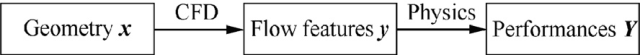

**图 1：几何、流动特征与性能。** 几何 $\mathbf{x}$ 经 CFD 得到流动特征 $\mathbf{y}$，再通过物理关系对应性能 $\mathbf{Y}$。

传统采样旨在输入空间中合理分布样本，或改进 $\mathbf{x}\to\mathbf{y}$（或 $\mathbf{Y}$）关系的近似 [16]。因此它们往往生成几何多样的样本，却不考虑压力分布。仅采样几何既不能保证超临界压力分布，也不能控制 $\mathbf{y}$ 输出空间的分布，这是传统方法未针对的新挑战。

本文提出新的**输出空间采样（Output Space Sampling，OSS）**方法，利用自适应采样生成具有不同压力分布特征的超临界翼型。通过生成特征分布良好的样本，统计研究激波与若干翼型性能之间的相关性。

本文结构如下：先讨论背景，再介绍 OSS 算法，提出用于改善输出空间填充和探索边界的采样准则，并用解析函数与其他方法比较；随后生成不同压力分布翼型，获得更多有效超临界样本，最后进行统计分析。结果表明，激波越靠上游，阻力发散马赫数越大；吸力峰过高则可能使阻力缓增特性恶化。

## 2 输出空间采样方法

采样是统计研究与数据挖掘的重要工具。传统方法通常在输入空间均匀填充，或按指定概率密度分布布点，使样本适合研究 $\mathbf{x}\to\mathbf{y}$。然而，研究图 1 中 $\mathbf{y}$ 与 $\mathbf{Y}$ 的关系时，关注的是 $\mathbf{y}$ 分布。

本节先说明输入和输出采样的区别，指出 OSS 需要新方法，并提出两项挑战：第一，衡量样本集多接近指定分布 $\wp_0$，第 2.2 节引入统计距离 $\widetilde D$ 解决；第二，开发自适应算法，在采样中最小化差异，第 2.3 节介绍。之后以解析函数测试、比较。为区别压力 $p$，概率密度和样本密度记为 $\wp$。

### 2.1 输入空间采样与输出空间采样的区别

采样大致分为静态采样和自适应采样 [16]。静态采样只关注输入空间，通常按均匀、高斯等常见分布生成样本。改进拉丁超立方采样（iLHS）是常用拉丁超立方静态采样的改进版，多数情况下能用均匀样本充分填充输入空间 [17]。对于其他分布，还可用拒绝采样，从任意指定概率分布生成样本 [18,19]。自适应方法则通常从固定方法生成的少量样本开始，依据准则依次增加样本 [20]，并用代理模型迭代寻找适当新点。许多准则旨在最高效改进代理模型，而非产生指定分布的样本 [21,22]。

这些方法都在可直接指定样本值的输入空间布点。即便能控制输入分布，输出分布也不受控制。例如标量函数 $y=x^2$，$x\in[0,1]$，同一组 $\{x,y\}$ 的输出密度与输入密度不同。图 2(a)、(b) 给出 2000 个样本的归一化直方图，表示输入或输出均匀布点时，两空间的密度分布。各柱高度表示落入相应区间的样本比例，按文中归一化使柱面积总和为 1。图示表明，要获得使 $y$ 服从某分布的 $\{x,y\}$，并不直接。

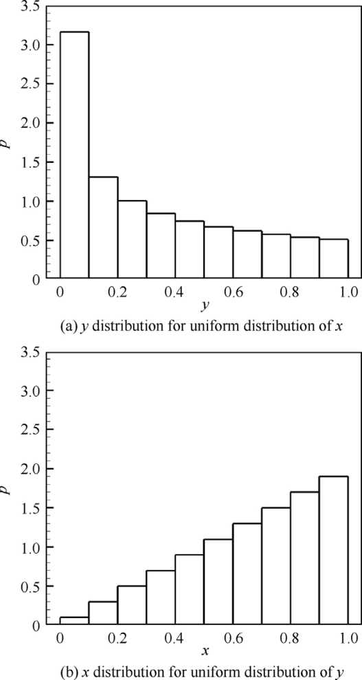

**图 2：输入与输出空间中的样本直方图。**（a）输入均匀分布时的输出分布；（b）输出均匀分布时的输入分布。

因此，当 $\mathbf{y}$ 由输入函数 $f(\mathbf{x})$ 计算时，在输出空间 $\mathbb D_y$ 设计样本集 $\mathcal Y=\{\mathbf y_i\}$，$i=1,2,\ldots,N$ 很困难；若要求符合指定密度 $\wp_0(\mathbf y)$，更是如此，其中 $\mathbb D_y\subseteq\mathbb R^{n_y}$，$n_y$ 是输出维数。虽可用拒绝采样从 $\wp_0$ 产生假想目标集 $\mathcal Y_t=\{\mathbf y_t\}$，但必须为每个目标找到对应输入 $\mathbf x_t$，否则不能保证其数学可实现性。即，对任意 $\mathbf y_t\in\mathbb D_y$，不一定能找到 $\mathbf x_t\in\mathbb D_x$，使 $\mathbf y_t=f(\mathbf x_t)$；其中 $\mathbb D_x\subseteq\mathbb R^{n_x}$，$n_x$ 为输入维数。因此输出采样更复杂。

直观办法是逆向求解 $\mathbf x=f^{-1}(\mathbf y)$，为每个目标找输入。但多数函数无法解析求逆，数值寻找每个对应输入也可能计算低效。因此需要直接方法，先找输入样本集 $\mathcal X=\{\mathbf x_i\}$，再用 $f$ 得到输出集。挑战一是衡量 $\mathcal Y$ 与 $\wp_0$ 的接近程度，挑战二是在采样过程中最小化差异。

### 2.2 输出空间中样本分布的度量

首要挑战是度量输出域 $\mathbb D_y$ 中的样本集 $\mathcal Y=\{\mathbf y_i\mid i=1,2,\ldots,N\}$ 与指定概率密度 $\wp_0$ 的接近程度。以 $\wp(\mathbf y)$ 表示样本分布，即假设 $\mathcal Y$ 从 $\wp$ 抽得，那么样本集与目标分布的差异可量化为 $\wp$ 与 $\wp_0$ 的差异。统计距离用于度量两分布或两样本集的距离。Kullback–Leibler（KL）散度 [23] 是描述概率分布差异的著名统计距离：

$$
D_{\mathrm{KL}}(P_0\Vert P)=\int_{\mathbb D_y}\wp_0\lg\left(\frac{\wp_0}{\wp}\right)\,d\mathbf y.\tag{1}
$$

$P$、$P_0$ 为连续概率分布，$\wp$、$\wp_0$ 分别为其密度。KL 散度总非负，且当且仅当两分布几乎处处相同才为零 [23]。根据蒙特卡洛积分 [18]，当 $m$ 很大时，可用式（2）估计式（1）。$E_{\wp_0}[\cdot]$ 表示按 $\wp_0$ 取期望，$\mathbf y_{t,j}$，$j=1,2,\ldots,m$，是按 $\wp_0$ 抽取的点。本文称其为**目标点**，因为 OSS 会以它们为目标，在附近生成样本。

$$
D_{\mathrm{KL}}(P_0\Vert P)
=E_{\wp_0}\left[\lg\left(\frac{\wp_0}{\wp}\right)\right]
\approx\frac{1}{m}\sum_{j=1}^{m}\lg\left[\frac{\wp_0(\mathbf y_{t,j})}{\wp(\mathbf y_{t,j})}\right].\tag{2}
$$

式（2）的 $\wp_0(\mathbf y_{t,j})$ 易求，而 $\wp(\mathbf y_{t,j})$ 不易求，因为 $\wp$ 是不可直接观测的潜在密度函数，只能根据样本数据用密度估计方法 [24] 得到。最基本的是图 2 的归一化直方图。

直方图用区间划分一维空间，用网格划分二维空间；高维空间划为子域 $U_k\subseteq\mathbb D_y$，满足 $\bigcup_kU_k=\mathbb D_y$，且 $U_k\cap U_{k'}=\varnothing$，$k\ne k'$。在目标点 $\mathbf y_{t,j}$，密度估计为

$$
\wp(\mathbf y_{t,j})\approx\frac{\int_{U_j}\wp(\mathbf y_{t,j})\,d\mathbf y}{V_j},
$$

其中 $U_j$ 为目标点邻域，体积为 $V_j$；$n_j=N\int_{U_j}\wp(\mathbf y_{t,j})\,d\mathbf y$ 为其中样本数。同样，$\wp_0(\mathbf y_{t,j})\approx\int_{U_j}\wp_0(\mathbf y_{t,j})\,d\mathbf y/V_j$，且 $m\int_{U_j}\wp_0(\mathbf y_{t,j})\,d\mathbf y=1$。

生成 $\mathcal Y$ 时，只需找子集 $\widehat{\mathcal Y}=\{\mathbf y_i\mid i=1,2,\ldots,M\}\subseteq\mathcal Y$，$M\le N$，使其密度 $\widehat\wp$ 足够接近 $\wp_0$。设 $M=Km$，$K$ 为非负整数，则式（2）的密度比可近似为：

$$
\frac{\wp_0}{\widehat\wp}
\approx\frac{\displaystyle\int_{U_j}\wp_0(\mathbf y_{t,j})\,d\mathbf y/V_j}
{\displaystyle\int_{U_j}\widehat\wp(\mathbf y_{t,j})\,d\mathbf y/V_j}
=\frac{1}{m}\cdot\frac{M}{\widehat n_j}
=\frac{K}{\widehat n_j}.\tag{3}
$$

其中 $Km=\sum_{j=1}^{m}\widehat n_j$，$\widehat n_j$ 是子集在 $U_j$ 内的样本数。子集 KL 散度估计记作 $\widetilde D_{\mathrm{KL}}$：

$$
\widetilde D_{\mathrm{KL}}
=\frac{1}{m}\sum_{j=1}^{m}\lg\left[\frac{K}{\widehat n_j}\right]
=\lg(K)-\frac{1}{m}\sum_{j=1}^{m}\lg(\widehat n_j).\tag{4}
$$

每个目标点都有 $\widehat n_j=K$ 时，散度为零。由算术—几何平均不等式，$\prod_{j=1}^{m}\widehat n_j\le[\sum_{j=1}^{m}\widehat n_j/m]^m=K^m$，可得：

$$
\widetilde D_{\mathrm{KL}}\ge0.\tag{5}
$$

等号当且仅当全部 $\widehat n_j=K$ 成立。式（4）只需统计目标点邻域内样本数，比其他密度估计更易实现。例如，多元核密度估计 [25] 虽可估计高维密度并计算式（2），但构建成本高，不利于开发 OSS。

不过，式（4）要求 $\widehat n_j>0$，而实际未必如此。它实质衡量每个目标点为中心的子域是否都有 $K$ 个样本。为避免零样本时的奇异性，定义统计距离：

$$
\widetilde D=1-\frac{1}{m}\sum_{j=1}^{m}\min\left(1,\frac{n_j}{K}\right).\tag{6}
$$

其值在 0–1 之间，若每个目标都有 $n_j\ge K$，则为零。按原文所述，它在 $n_j=K$ 处的左导数与式（4）相同。

与式（4）不同，式（6）不需 $\sum_{j=1}^{m}n_j=Km$ 就能保证非负，因此可直接用于全集 $\mathcal Y$，不必先找子集。此时 $n_j$ 表示全集在 $U_j$ 中的样本数。对任意高维目标点集，邻域不易定义；可将 $n_j$ 定义为“以该目标为最近目标的样本数”：

$$
d_{i,j}=\Vert\mathbf y_i-\mathbf y_{t,j}\Vert,
\quad i=1,\ldots,N,\quad j=1,\ldots,m.\tag{7}
$$

$$
j_i=\underset{j}{\operatorname{argmin}}\,(d_{i,j}).\tag{8}
$$

$$
n_j=\sum_{i=1}^{N}\delta_{j,j_i}.\tag{9}
$$

$d_{i,j}$ 是样本与目标的欧氏距离，$j_i$ 为最近目标的索引。Kronecker 符号 $\delta_{j,j_i}$ 在 $j=j_i$ 时为 1，否则为 0。

### 2.3 输出空间采样算法

式（6）度量样本与指定分布的接近程度，下一挑战是在采样过程中最小化差异。本文提出基于自适应算法的 OSS。自适应采样通常依赖代理模型，最常用的是 Kriging 和径向基函数（RBF）响应面。本文选用 RBF，因为其在成本和预测精度间平衡较好。OSS 准则，即代理模型上搜索的目标，被设计为逐步减小 $\widetilde D$。

在样本集 $\mathcal Z=\{(\mathbf x_i,\mathbf y_i)\}$，$i=1,\ldots,N$ 上构建 RBF，输入为 $\mathbf x=[x_1,\ldots,x_{n_x}]$。当 $n_y=1$ 时，输出估计为：

$$
s(\mathbf x)=\sum_{i=1}^{M}\beta_i\phi(\Vert\mathbf x-\mathbf x_i\Vert)+b(\mathbf x).\tag{10}
$$

这里采用加权、归一化欧氏距离 [26]：

$$
\Vert\mathbf x-\mathbf x_i\Vert
=\sqrt{\frac{1}{\sum_{j=1}^{n_x}w_j^2}\sum_{j=1}^{n_x}w_j^2(x_j-x_{i,j})^2},
$$

$w_j$ 为输入第 $j$ 个分量的权重。$\phi(\cdot)$ 为径向基函数，$b(\mathbf x)$ 是可选多项式，用于改善响应面质量。权重向量 $\boldsymbol\beta=[\beta_i]$ 由 $\mathbf y=\mathbf R\boldsymbol\beta$ 确定，其中 $\mathbf y=[f_i]$ 为输出向量，$\mathbf R=[\phi_{ij}]$，$\phi_{ij}=\phi(\Vert\mathbf x_i-\mathbf x_j\Vert)$。于是 $s(\mathbf x)=\mathbf r^{T}\boldsymbol\beta$，$r_i=\phi(\Vert\mathbf x-\mathbf x_i\Vert)$。还需优化 $w_j$ 和基函数参数以提高精度；本文使用留一交叉验证（LOOCV）的均方根误差，原文缩写为 RSME。

> 译注：式（10）的求和上限沿用原文的 $M$，其前文训练样本数写为 $N$；此处不擅自统一。

算法 1 先用 iLHS 等静态方法生成初始集，再在代理模型上优化，每次迭代产生 $N_{\mathrm{Add}}$ 个新位置，直到最大样本数 $N_{\max}$。初始数为 $N_0$。优化采用差分进化（DE）[6]，加入用户输入、输出约束 $\mathbf x\in\mathbb D_x$、$\mathbf y\in\mathbb D_y$；评估新样本后更新样本和代理模型。本质上，OSS 是多目标、多约束优化，用于搜索不同输出并改善模型质量。

**算法 1：输出空间采样方法。**

1. 生成初始样本集 $\{(\mathbf x_i,\mathbf y_i)\}_{i=1}^{N_0}$。
2. 令 $N=N_0$。
3. 对 $k=1,2,\ldots,(N_{\max}-N_0)/N_{\mathrm{Add}}$，重复：
   - 在 RBF 响应面上执行多目标优化；目标为自适应采样准则，约束为 $\mathbf x\in\mathbb D_x$、$\mathbf y\in\mathbb D_y$。
   - 评估新样本 $\{(\mathbf x_i,\mathbf y_i)\}_{i=1}^{N_{\mathrm{Add}}}$。
   - 更新样本集，$N\leftarrow N+N_{\mathrm{Add}}$。
   - 更新 RBF 响应面。
4. 结束。

要每次产生多个样本，即 $N_{\mathrm{Add}}>1$，通常以两项准则为目标，从最终解的 Pareto 前沿选择新样本。多目标优化的初始种群也可从已有样本中选择，比随机生成通常更高效。

自适应采样最重要的是适当准则。OSS 通常使用三类：改善代理模型；探索输入或输出空间中最缺乏探索的区域；生成符合指定分布的样本。

已有分离函数、拉普拉斯函数等 RBF 探索、改进准则 [26,27]；最小欧氏距离准则可用更低成本达到相近结果 [28,29]：

$$
d_x(\mathbf x)=\min_{1\le i\le N}\Vert\mathbf x-\mathbf x_i\Vert.\tag{11}
$$

类似地，最大化式（12）改善输出空间探索；最大化式（13）探索边界，其中 $\boldsymbol\mu$ 为 $\mathcal Z$ 中全部输出的均值向量：

$$
d_y(\mathbf y)=\min_{1\le i\le N}\Vert\mathbf y-\mathbf y_i\Vert.\tag{12}
$$

$$
d_{\mu}(\mathbf y)=\Vert\mathbf y-\boldsymbol\mu\Vert.\tag{13}
$$

为生成指定分布，提出**打靶（target shooting）准则**，利用输出目标 $\{\mathbf y_{t,j}\}_{j=1}^{m}$ 吸引样本到其附近，高效获得足够样本。按式（6），最小化 $\widetilde D$ 会提高找到符合目标分布子集的可能性。定义：

$$
\varphi(\mathbf y)=\max_j\left[(K-n_j)\gamma_j(\mathbf y)\right].\tag{14}
$$

最大化它可最小化 $\widetilde D$，同时控制以各目标为中心子域的样本分布。$n_j$ 由式（9）定义，式（15）使它们更好地分布于目标周围：

$$
\gamma_j(\mathbf y)=\sqrt{n_y}-\Vert\boldsymbol\mu_j-\mathbf y_{t,j}\Vert+\alpha\Vert\boldsymbol\sigma_j\Vert.\tag{15}
$$

$\boldsymbol\mu_j$ 为这 $n_j$ 个样本的均值，$\boldsymbol\sigma_j$ 各分量为相应输出标准差，常数比例 $\alpha$ 控制其分散程度。

综上，OSS 应对三项挑战：通过代理模型搜索相应输入，间接采样输出；生成目标并最大化 $\varphi$，在约束下逼近指定分布；在实际输出边界事先未知时，用 $d_{\mu}$ 探索边界，改善空间填充。

### 2.4 获取指定分布的解析测试

本节用三个标量输入—标量输出函数，以及一个标量输出函数，测试 OSS 在输出空间生成指定密度 $\wp_0$ 的能力。指定分布为不同均值 $\mu$、标准差 $\sigma$ 的高斯分布，见表 1。按高斯分布生成 20 个目标点，要求得到 100 个符合分布的样本。前三个算例从输入空间均匀布置的 20 个样本开始，第四个从 iLHS 生成的 20 个样本开始。每轮用式（11）、（14）的 $d_x$、$\varphi$ 添加两个样本。

**表 1：测试函数与指定分布。**

| 算例 | 测试函数 | 输出指定高斯分布 |
|---|---|---|
| 1 | $y=x^2$ | $\mu=0.50,\ \sigma=1/6$ |
| 2 | $y=\sin(\pi x)$ | $\mu=0.50,\ \sigma=1/6$ |
| 3 | $y=\sin(\pi x)$ | $\mu=0.75,\ \sigma=1/12$ |
| 4 | $y=\sin(\pi x_1x_2)$ | $\mu=0.50,\ \sigma=1/6$ |

采样时，并非所有样本都能组成指定分布，只有部分被选为所需 100 个有效样本。当有效样本与 $\wp_0$ 的统计距离 $\widetilde D$ 为零，即有效数达到 100 时停止。因此四例总采样数不同，分别为 **124、138、142、156**。相比之下，输入空间自适应采样需 **186、148、192、468** 个样本才使距离为零。该比较方法同样基于 RBF，准则为式（11）的 $d_x$ 和拉普拉斯函数 [28]。OSS 在输出布点方面效率更高，尤其是高维空间。

图 3—6 的样本密度用高斯核密度估计 [30]。黑实线为表 1 的指定分布；绿虚线为 100 个有效样本在输入、输出空间中的密度，表明有效样本确实遵循 $\wp_0$，验证 OSS 能力；绿实线为全部采样点密度，越接近有效样本分布，说明无效点越少、效率越高。图 6 的彩色云图为输出 $y$，等值线为二维输入空间中的有效样本密度，实心点为有效样本，空心点为无效样本。

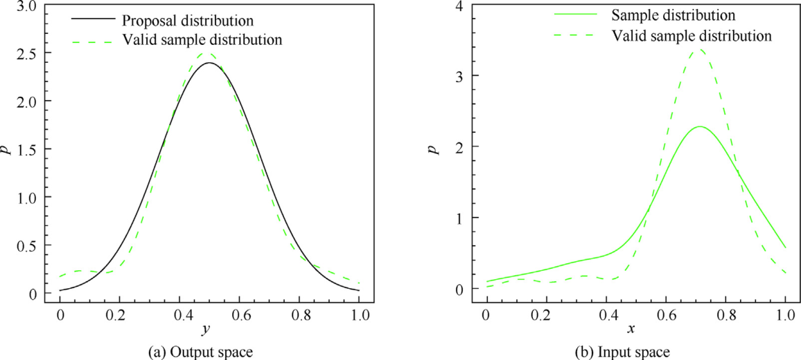

**图 3：$y=x^2$ 的样本分布。**（a）输出空间；（b）输入空间。

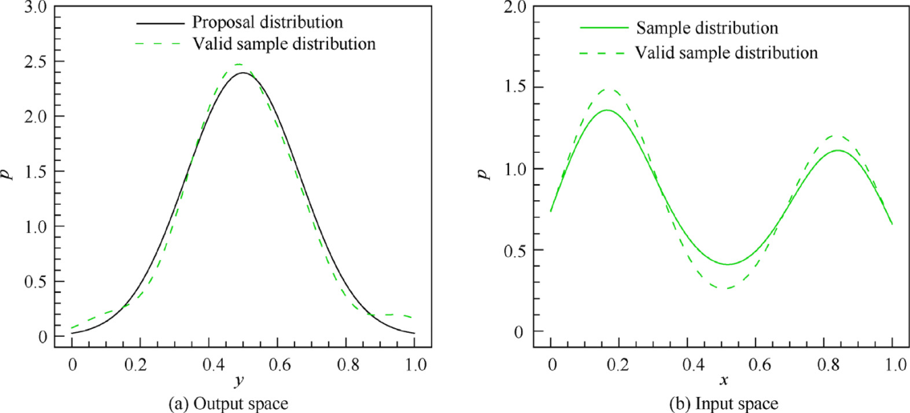

**图 4：$y=\sin(\pi x)$ 的样本分布。** 对应算例 2；（a）输出空间；（b）输入空间。

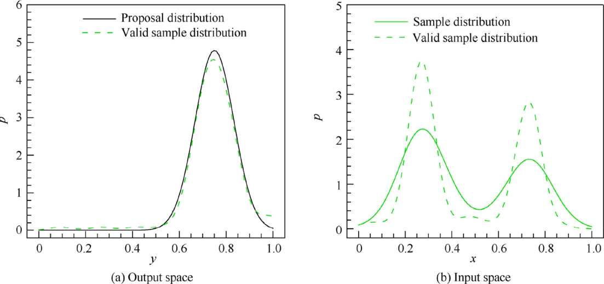

**图 5：$y=\sin(\pi x)$ 的样本分布。** 对应算例 3；（a）输出空间；（b）输入空间。

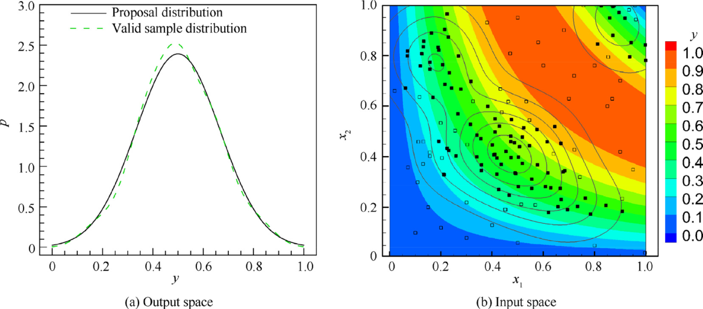

**图 6：$y=\sin(\pi x_1x_2)$ 的样本分布。**（a）输出空间；（b）输入空间。

后三例既表明 OSS 能获得指定输出分布，也表明当 $\mathbf x=f^{-1}(\mathbf y)$ 有多解时，使用 $d_x$ 和 $\varphi$ 的多目标优化能使输入样本多样化。

### 2.5 填充输出空间的解析测试

使用所提准则，OSS 可探索输出空间，而 iLHS 等静态方法只填充输入。本节以二维函数测试，并与其他静态、自适应方法比较：

$$
\begin{cases}
y_1=r\cos[\pi(2x_2-1)],\\
y_2=r\sin[\pi(2x_2-1)],\\
r=1-|2x_1-1|^{0.3},\quad\mathbf x\in[0,1]^2.
\end{cases}\tag{16}
$$

该函数将正方形输入域映射为圆形输出域。多数实际问题不知道输出域形状，为填充它，指定分布设为二维正方形 $\mathbf y\in[0,1]^2$ 内的均匀分布。

测试四种方法，均生成 400 个样本，见图 7。iLHS 为基线；用 $d_x$ 和拉普拉斯函数 [28] 的方法代表传统自适应采样；OSS-1 用式（11）、（12）的 $d_x$、$d_y$；OSS-2 用式（11）、（13）、（14）的 $d_x+d_{\mu}$ 与 $\varphi$。全部从同一组 iLHS 生成的 100 个样本出发，后三种每轮添加 4 个。针对指定均匀分布，在正方形输出域用 iLHS 生成 100 个目标点，供 OSS-1 和 OSS-2 使用。

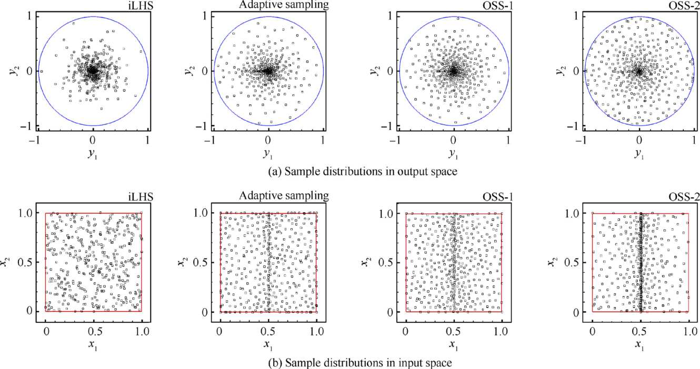

**图 7：四种方法的样本分布。**（a）输出空间；（b）输入空间。依次比较 iLHS、自适应采样、OSS-1、OSS-2。

统计距离历程及理论下界见图 8、表 2。实际输出为圆形、指定分布为正方形，因此只有圆内目标能达到 $n_j\ge K$，占正方形面积 $\pi/4\approx0.79$；其余目标只能为零样本。由式（6），理论下界为 $1-\pi/4\approx0.21$。

> 译注：式（16）的解析输出为 $[-1,1]^2$ 中的圆盘，后文却将指定输出正方形写作 $[0,1]^2$；原文未明确说明这里是否作了归一化，相关表述照录。

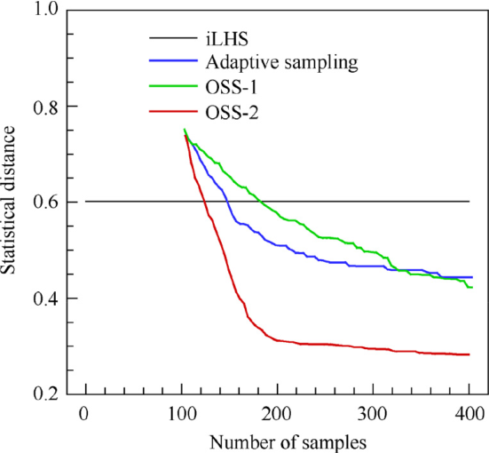

**图 8：统计距离的变化历程。** 横轴为样本数，纵轴为统计距离；比较四种方法与理论下界。

**表 2：四种方法的准则与统计距离。**

| 方法 | 准则 | $\widetilde D$ |
|---|---|---:|
| iLHS | — | 0.60 |
| 自适应采样 | $d_x(\mathbf x)$、拉普拉斯函数 [28] | 0.44 |
| OSS-1 | $d_x(\mathbf x)$、$d_y(\mathbf y)$ | 0.42 |
| OSS-2 | $d_x(\mathbf x)+d_{\mu}(\mathbf y)$、$\varphi(\mathbf y)$ | 0.29 |
| 理论下界 | — | 0.21 |

iLHS 输入均匀，却只覆盖部分输出域。传统自适应法可探索一定输出范围，但未充分探索边界。OSS 则可用不同准则填充空间并探索边界。OSS-1 探索输入、输出，效果类似传统自适应法；OSS-2 用 $d_{\mu}$ 探边界、用 $\varphi$ 填空间，得到最佳填充和更快收敛。

随后在式（17）的函数上比较 OSS 与 iLHS，$y_1$、$y_2$ 满足式（18）：

$$
\begin{cases}
y_1=\left(\dfrac{1+x_1}{2}\right)^2x_2^2,\\
y_2=y_1^2+0.1(x_2^2+x_3^2),\quad\mathbf x\in[0,1]^2.
\end{cases}\tag{17}
$$

$$
1.1y_1^2\le y_2\le2.6y_1^2+0.1.\tag{18}
$$

> 译注：式（17）出现 $x_3$，但输入域仍标为 $[0,1]^2$。式（17）、（18）均按原 PDF 重排，未擅自修正。

为研究 $y_1$ 与 $y_2$，OSS 指定 $y_1\in[0,1]$ 均匀分布。初始集为 iLHS 的 40 个样本，每轮增加 2 个，准则为 $d_x+d_{\mu}$ 与 $\varphi$；在 $y_1$ 域均布 20 个目标，要求 100 个有效样本，用于非线性回归。

OSS 共用 190 次采样得到 100 个有效样本，图 9 以绿方块表示。iLHS 同样在输入域生成 190 个，输出以黑三角表示。用六次多项式回归，虚线为拟合曲线。iLHS 不能覆盖整个 $y_1$ 域，导致局部范围过拟合；OSS 的有效点在 $y_1$ 中均匀分布，保障了回归精度。

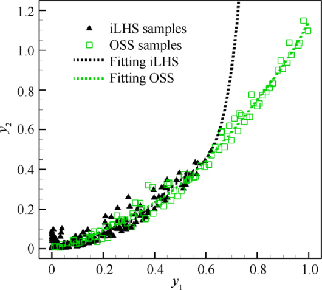

**图 9：iLHS 和 OSS 样本的非线性回归。**

综上，OSS 能按指定分布高效分布输出，探索输出边界，并为同一输出保留多样输入。因此样本更适合后续统计研究，降低采样偏差或过拟合风险。

## 3 超临界翼型的统计研究

Korn 方程揭示跨声速下阻力发散马赫数 $Ma_{\infty,\mathrm{DD}}$、升力系数 $C_L$ 和最大相对厚度 $(t/c)_{\max}$ 的联系：

$$
Ma_{\infty,\mathrm{DD}}+0.1C_L+(t/c)_{\max}=\kappa.
$$

$\kappa$ 代表不同翼型的技术水平。NASA 超临界翼型约为 0.95，在升力系数约 0.4–0.7 时估计较好 [4]。该式揭示简单线性关系，但参数 $\kappa$ 引出其他翼型特征如何影响性能的问题。跨声速超临界翼型显著受压力分布影响，因此需研究这些特征如何影响技术水平因子。

本节用 OSS 生成具有相同最大相对厚度、升力系数、激波强度及相近下表面的超临界翼型，考察激波位置和吸力峰的影响，同时研究阻力缓增特性。

### 3.1 翼型参数化与 CFD 方法

采用类函数—形函数变换（Class Shape function Transformation，CST）生成几何。CST 结合类函数与形函数描述任意几何，用较少设计变量保证光滑 [31]。形函数采用六次 Bernstein 多项式，即上下表面各用 7 个 CST 参数。

雷诺平均 Navier–Stokes（RANS）分析使用 C 型网格，求解器为著名开源 CFL3D。分别用 MUSCL、Roe、下—上对称 Gauss–Seidel 方法及 $k$–$\omega$ 剪切应力输运（SST）模型进行重构、空间离散、时间推进和湍流建模。CFL 数设为 2.0，计算 5000 步。

图 10 比较 RAE2822 翼型实验压力系数 $C_p$ 分布 [32] 与不同网格 CFD。用弱激波和较强激波两种工况验证：（a）自由来流 $Ma_\infty=0.725$，单位弦长雷诺数 $Re=6.5\times10^6$，迎角 $2.55^\circ$；（b）$Ma_\infty=0.73$，$Re=6.5\times10^6$，迎角 $3.19^\circ$。三套网格规模为 20,000、40,000、80,000，翼面网格点分别为 201、301、401，第一层 $\Delta y^+$ 始终小于 1。两工况下各网格均得到相近压力系数分布，本文采用中等网格。

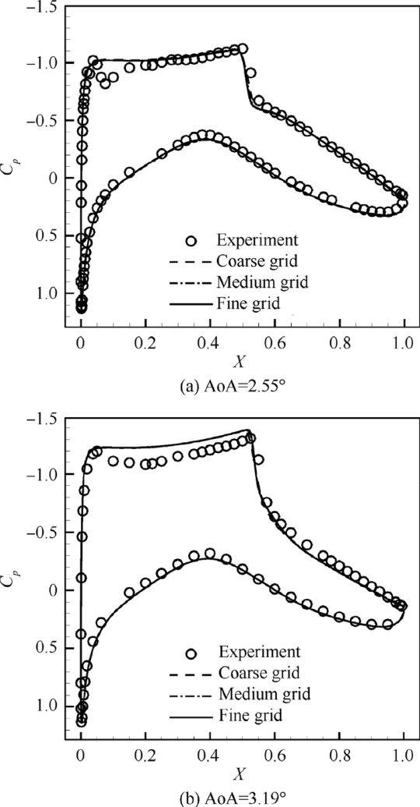

**图 10：$C_p$ 的网格收敛研究。**（a）$Ma_\infty=0.725$；（b）$Ma_\infty=0.73$。比较实验、粗、中、细网格。

### 3.2 关键压力分布特征

翼型性能与整体压力系数分布相关，也可用壁面马赫数分布描述。壁面马赫数 $Ma_w$ 根据翼面压力系数与自由来流马赫数，按等熵关系计算 [33]。图 11 定义以下关键参数。

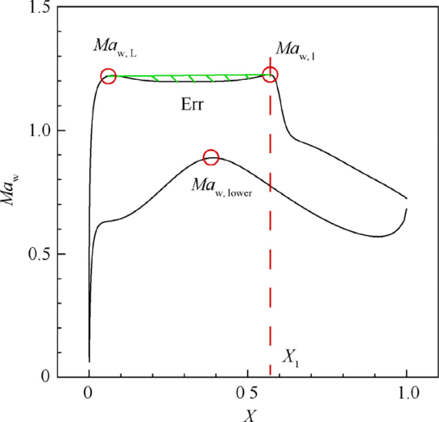

**图 11：壁面马赫数特征的定义。** 标出前缘吸力峰、激波前马赫数、激波位置和吸力平台平滑性。

1. **吸力峰壁面马赫数 $Ma_{w,L}$：** 上表面吸力峰的壁面马赫数，定义为前缘起 15% 弦长范围内的最大值。
2. **激波位置 $X_1$：** 先用上表面 $-dMa_w/dX$ 最大处 $\widetilde X$ 粗定位，再在其上游找 $-d^2Ma_w/dX^2$ 最大处作为 $X_1$。实际应用中，局部 $Ma_w$ 应大于 1，且最大的 $-dMa_w/dX$ 须超过预定义阈值，否则候选处不视为激波。阈值与上表面网格点数及来流马赫数有关，本文写为 $-1.0$；翼面网格点越多，阈值越小。
3. **激波前壁面马赫数 $Ma_{w,1}$：** $X_1$ 处的壁面马赫数。
4. **下表面最大壁面马赫数 $Ma_{w,\mathrm{lower}}$。**
5. **吸力平台平滑性 $Err$：** 定义为吸力峰与激波之间图中阴影区域面积，用于避免平台出现严重凹陷或波动。该函数既可按壁面马赫数，也可按压力系数分布定义，本文采用后者。

*激波判据的符号及阈值按原文保留。*

### 3.3 对几何参数进行翼型采样

输入向量 $\mathbf x$ 是几何参数，即 14 个 CST 系数。对其作 CFD 得到输出 $\mathbf y$，包含待研究流动特征，例如激波前马赫数 $Ma_{w,1}$ 和激波位置 $X_1$。其他特征，如 $Err$、$Ma_{w,L}$、$Ma_{w,\mathrm{lower}}$ 用作约束。图 1 的性能向量 $\mathbf Y$ 包含阻力系数 $C_D$、阻力发散马赫数等重要设计量。

超临界翼型具有若干典型特征，采样必须施加约束。本文要求前缘圆滑、只有一道激波，并满足：

$$
Err<0.02,\qquad Ma_{w,\mathrm{lower}}<0.9,\qquad Ma_{w,1}<1.18.\tag{19}
$$

将吸力平台波动保持较小，是为避免凹陷在较低 $Ma_\infty$ 时形成额外激波、增加阻力 [1]。下表面马赫数约束避免来流加速后下表面出现超声速区，是工业常见要求。限制激波前马赫数，是为聚焦实际可用翼型，因为激波过强会恶化巡航效率和非设计性能。这些约束保证几何符合飞机设计需求，使统计结果适用于实际。

采样在巡航工况进行：$Ma_\infty=0.76$，以 1.0 弦长为基准的 $Re=5\times10^6$。CFL3D 自动调整迎角，维持 $C_L=0.70$。

先进行三种传统采样：

- **算例 1：** iLHS 直接采样 CST 系数，上表面 $x_i\in[-0.50,1.00]$，$i=1,\ldots,7$；下表面 $x_i\in[-1.00,0.50]$，$i=8,\ldots,14$。
- **算例 2：** iLHS 采样基准 CST 系数的扰动，各系数扰动范围 $[-0.20,0.20]$。
- **算例 3：** 同样采样扰动，但范围缩小为 $[-0.05,0.05]$。

基准 CST 参数为：

$$
\begin{aligned}
\mathbf x_{\mathrm{base}}=\{&0.119,\ 0.083,\ 0.178,\ 0.063,\ 0.230,\ 0.161,\ 0.186,\\
&-0.087,\ -0.079,\ -0.131,\ -0.141,\ -0.160,\ 0.017,\ 0.204\}.
\end{aligned}
$$

基准翼型见图 12。三例各生成 500 个翼型并作 CFD；表 3 第一行统计收敛数，第二行统计满足式（19）的有效数。

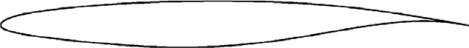

**图 12：基准翼型。**

**表 3：测试函数与指定分布。**

> 译注：表题照录原文；表内实际比较三种翼型几何采样的 CFD 收敛及可行样本数。

| 数量 | 算例 1：直接采样 CST 参数 | 算例 2：采样 CST 参数扰动 | 算例 3：采样 CST 参数扰动 |
|---|---:|---:|---:|
| CFD 结果收敛的翼型 | 11 | 59 | 431 |
| 可行翼型 | 1 | 5 | 24 |

图 13—15 给出典型样本。直接采样 CST 几乎无法产生 CFD 可收敛翼型，更不用说满足约束。围绕基准扰动能提高收敛比例，但可行比例仍低。算例 2 的几何甚至仍不像翼型；缩小扰动后，算例 3 更多收敛，但仅少量具有超临界壁面马赫数分布，见图 16。

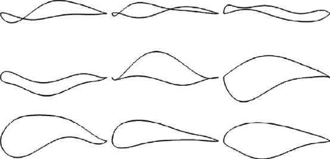

**图 13：直接采样 CST 参数得到的翼型（算例 1）。**

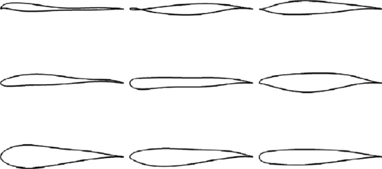

**图 14：采样 CST 参数扰动得到的翼型（算例 2）。**

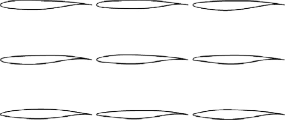

**图 15：采样 CST 参数扰动得到的翼型（算例 3）。**

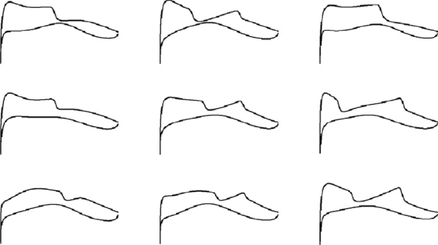

**图 16：图 15 翼型的壁面马赫数分布。**

图 17 给出算例 3 可行翼型在 $Ma_{w,1}$、$X_1$ 输出空间中的密度。可见输入采样无法控制压力特征空间分布，因此需 OSS 为进一步统计生成样本。

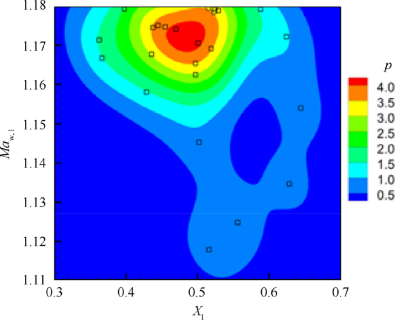

**图 17：$X_1$ 与 $Ma_{w,1}$ 输出空间中的密度分布（算例 3）。**

### 3.4 对激波位置进行翼型采样

为研究激波位置对阻力缓增和阻力发散的影响，需要激波位置在上表面均匀分布的样本。为减轻其他流动特征影响，控制下表面：其 7 个 CST 系数限定在基准值 $\pm0.05$ 内；全部翼型最大相对厚度保持 0.095。

在 $\{X_1,Ma_{w,1}\}$ 输出空间人工指定三组目标，每组 5 个，$X_1$ 分别为 0.3、0.4、0.5、0.6、0.7。三组 $Ma_{w,1}$ 分别为 1.125、1.145、1.165，以比较不同激波强度、控制研究位置时强度的影响。三组实际样本的 $Ma_{w,1}$ 分别限定在 $[1.12,1.13]$、$[1.14,1.15]$、$[1.16,1.17]$。

OSS 从第 3.3 节算例 3 中选取的 400 个翼型开始，每次生成 4 个，使用 $d_x+d_{\mu}$ 与 $\varphi$ 准则，共获得 **1200 个有效样本**。图 18 给出高斯核估计密度，估计前将 $X_1$、$Ma_{w,1}$ 缩放至 $[0,1]$。图 19 用灰线画全部壁面马赫数分布，彩线为激波位置不同的三个典型翼型。结果表明 OSS 能在约束下有效填充压力特征空间。图 20 给出对应几何，与图 13—15 相比，OSS 生成的翼型合理得多。

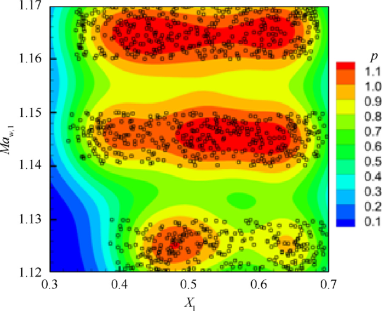

**图 18：$X_1$ 和 $Ma_{w,1}$ 输出空间中的密度分布（按翼型激波位置采样）。**

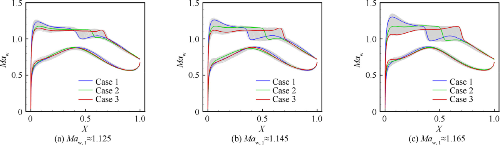

**图 19：有效翼型样本与典型翼型的壁面马赫数分布。** 三幅子图对应不同激波前马赫数组。

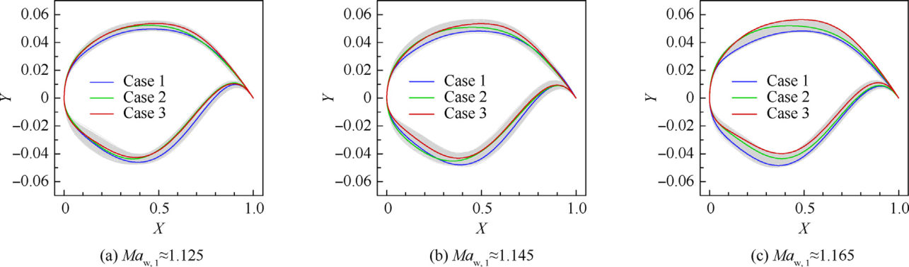

**图 20：有效翼型样本与典型翼型的几何外形。**

### 3.5 翼型性能的统计分析

在保持升力系数、雷诺数与巡航工况相同的条件下，以多个来流马赫数评估翼型。非设计来流马赫数为 0.700、0.720、0.740、0.750、0.770、0.775、0.780、0.785、0.790。图 21 给出图 19 三个典型翼型的 $C_D$–$Ma_\infty$ 曲线，表明激波位置与吸力峰显著影响阻力发散及阻力缓增。

位置影响随激波强度变化，激波越强越显著，例如图 21(c) 三条曲线差异比图 21(a) 更大。激波更靠上游时，位置影响也更大：翼型 1 与 2 的阻力曲线差异大于翼型 2 与 3。为揭示这些影响，下面针对不同流动特征，研究阻力发散马赫数，以及表征阻力缓增的阻力增量。

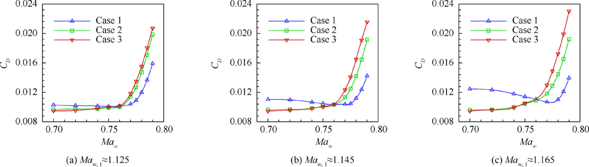

**图 21：典型翼型的阻力随马赫数变化曲线。**

对飞机或机翼，阻力发散马赫数可定义为固定 $C_L$ 时，$C_D$–$Ma_\infty$ 曲线斜率达到 0.1 的位置 [34]。二维翼型的临界斜率可用简单后掠理论估计 [34]。考虑后掠角 $33^\circ$ 的超临界机翼，有：

$$
k=\left(\frac{\partial C_D}{\partial Ma_\infty}\right)_{\!\mathrm{2D}}
=\frac{\left(\partial C_D/\partial Ma_\infty\right)_{\!\mathrm{3D}}}{\cos^4(33^\circ)}
\approx0.2.
$$

图 22 比较不同 $k$ 定义的阻力发散马赫数。对 $Ma_{w,1}\approx1.125$、1.145、1.165 三组，不同 $k$ 对 $X_1$–$Ma_{\infty,\mathrm{DD}}$ 关系影响较小，基本保持线性，因此后续用 $k=0.2$。

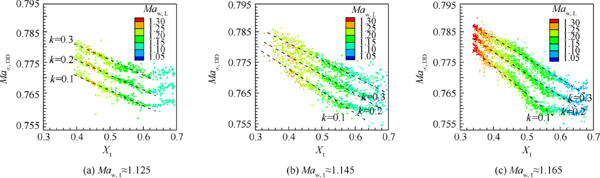

**图 22：临界斜率 $k$ 对 $X_1$ 与 $Ma_{\infty,\mathrm{DD}}$ 关系的影响。**

综合三组，图 23 表明 $Ma_{\infty,\mathrm{DD}}$ 与 $X_1$ 负线性相关，决定系数 $R^2=0.932$。所有样本升力系数、最大相对厚度相同，因此阻力发散马赫数的差异，反映压力特征对技术水平因子 $\kappa$ 的影响。可将其写为：

$$
\kappa=0.97-0.065X_1.\tag{20}
$$

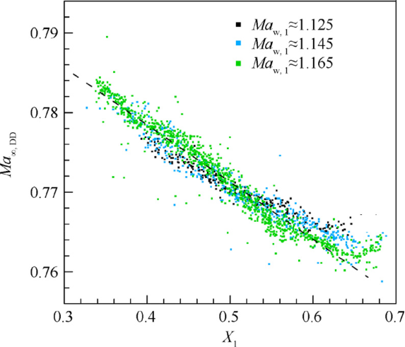

**图 23：$Ma_{\infty,\mathrm{DD}}$ 对 $X_1$ 的线性回归。**

相比之下，阻力缓增特性与 $X_1$ 或 $Ma_{w,L}$ 无线性关系。图 24 显示二者影响，以 $Ma_\infty=0.76$ 与 0.70 间的阻力系数增量表示缓增特性：

$$
\Delta C_{D,\mathrm{creep}}
=\left.C_D\right|_{Ma_\infty=0.76}-\left.C_D\right|_{Ma_\infty=0.70}.
$$

虽难以简单回归，图 24(b) 表明吸力峰壁面马赫数过高时，阻力系数迅速上升。因此，为避免不良阻力缓增，翼型应保持 $Ma_{w,L}<1.25$。

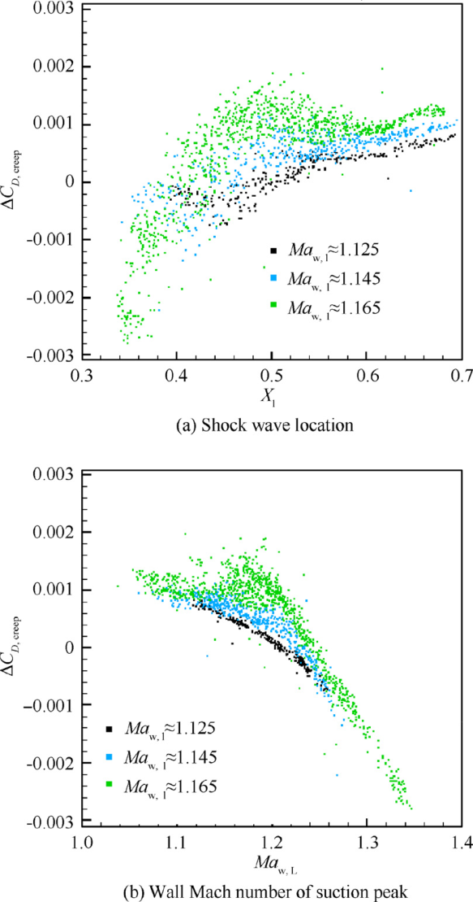

**图 24：流动特征对阻力缓增特性的影响。**（a）激波位置；（b）吸力峰壁面马赫数。纵轴为阻力系数增量。

## 4 结论

输出空间采样是研究流动特征与性能关系的统计气动学重要工具。本文提出样本密度与指定分布之间的统计距离度量，通过 OSS 增强空间填充和边界探索能力。验证表明，该方法能按指定输出分布生成样本，且有效样本占比高于传统方法。

将 OSS 用于不同压力分布翼型，可在各类约束下按指定分布高效得到样本，进一步保障统计研究的准确性和普适性。

对其生成的超临界翼型进行统计发现，激波越靠上游，阻力发散马赫数越大。Korn 方程可进一步表示为：

$$
Ma_{\infty,\mathrm{DD}}+0.1C_L+(t/c)_{\max}+0.065X_1=0.97.
$$

吸力峰超过 $Ma_{w,L}=1.25$ 时，阻力缓增特性恶化。这些关系与约束可指导优化和设计中激波位置的选择。进一步地，定量相关性，例如本文关系，以及激波诱导分离与飞机跨声速抖振起始的关系 [9]，可显著减少优化成本，因为这些非设计性能能够通过一次 CFD 计算估算，而不必进行一系列计算。

## 利益冲突声明

作者声明，不存在可能影响本文工作的已知竞争性经济利益或个人关系。

## 致谢

本工作获得国家自然科学基金资助，项目编号为 **91852108**、**11872230**。

## 参考文献

1. Li RZ, Zhang YF, Chen HX. Strategies and methods for multiobjective aerodynamic optimization design for supercritical wings. Acta Aeronaut Astronaut Sin 2020;41(5):623409 [Chinese].

2. Skinner N, Zare-Behtash H. State-of-the-art in aerodynamic shape optimisation methods. AIAA J 2018;62(9):933–62.

3. Zhang YF, Yan CY, Chen HX. An inverse design method for airfoils based on pressure gradient distribution. Energies 2020;13 (3):3400.

4. Mason W. Analytic models for technology integration in aircraft design. Aircraft design, systems and operations conference; 1990.

5. Inger GR. Application of Oswatitsch’s theorem to supercritical airfoil drag calculation. J. Aircraft 1993;30(3):415–6.

6. Li R, Deng K, Zhang Y, et al. Pressure distribution guided supercritical wing optimization. Chin J Aeronaut 2018;31 (9):1842–54.

7. Zhang Y, Fang X, Chen H, et al. Supercritical natural laminar flow airfoil optimization for regional aircraft wing design. Aerosp Sci Technol 2015;43:152–64.

8. Pearcey HH. Some effects of shock-induced separation of turbulent boundary layers in transonic flow past aerofoils. Oxford: HM Stationery Office; 1959.

9. Kenway K, Martins J. Aerodynamic shape optimization of the CRM configuration including buffet-onset conditions. 54th AIAA aerospace sciences meeting. Reston: AIAA; 2016.

10. Su J, Chow Y. Improvement of transonic wing buffet by geometric modification. J Aircraft 1995;32(4):901–3.

11. Queipo NV, Haftka RT, Shyy W, et al. Surrogate-based analysis and optimization. Prog Aerosp Sci 2005;41(1):1–28.

12. Xu Z, Saleh JH, Yang V. Optimization of supercritical airfoil design with buffet effect. AIAA J 2019;57(10):4343–53.

13. Yondo R, Andre ́ s E, Valero E. A review on design of experiments and surrogate models in aircraft real-time and many query aerodynamic analyses. Prog Aerosp Sci 2018;96:23–61.

14. Soilahoudine M, Gogu C, Bes C. Accelerated adaptive surrogatebased optimization through reduced-order modeling. AIAA J 2017;55(5):1681–94.

15. Li J, Bouhlel MA, Martins JRRA. Data-based approach for fast airfoil analysis and optimization. AIAA J 2019;57(2):581–96.

16. Wang G, Shan S. Review of metamodeling techniques in support of engineering design optimization. J Mech Des 2007;129 (4):370–80.

17. Beachkofski B, Ramana G. Improved distributed hypercube sampling. 43rd AIAA/ASME/ASCE/AHS/ASC structures, structural dynamics, and materials conference. Reston: AIAA; 2002.

18. Fishman GS, editor. Monte Carlo: concepts, algorithms, and applications. New York, NY: Springer New York; 1996.

19. Ho ̈ rmann W. Automatic nonuniform random variate generation. Berlin: Springer; 2011.

20. Bhosekar A, Ierapetritou M. Advances in surrogate-based modeling, feasibility analysis, and optimization: A review. Comput Chem Eng 2018;108(4):250–67.

21. Garud S, Karimi A, Kraft M. Smart sampling algorithm for surrogate model development. Comput Chem Eng 2017;96 (4):103–14.

22. Forrester AIJ, Keane AJ. Recent advances in surrogate-based optimization. Prog Aerosp Sci 2009;45(1-3):50–79.

23. Kullback S, Leibler RA. On information and sufficiency. Ann Mathemat Statist 1951;22(1):79–86.

24. Silverman W. Density estimation for statistics and data analysis. J Roy Statist Soc Ser C-Appl Statist 1986;37(1):120–1.

25. Simonoff S. Smoothing methods in statistics. Berlin: Springer; 1998.

26. Mackman TJ, Allen CB, Ghoreyshi M, et al. Comparison of adaptive sampling methods for generation of surrogate aerodynamic models. AIAA J 2013;51(4):797–808.

27. Regis RG, Shoemaker CA. Constrained global optimization of expensive black box functions using radial basis functions. J Global Optim 2005;31(1):153–71.

28. Mackman T, Allen C. Adaptive sampling for CFD data interpolation using radial basis functions. 27th AIAA applied aerodynamics conference. Reston: AIAA; 2009.

29. Fasshauer E. Meshfree approximation methods with MATLAB, Vol. 6. Singapore: World Scientific; 2007.

30. Scott D. Multivariate density estimation: theory, practice, and visualization. Technometrics 1993;35(4):451–2.

31. Kulfan BM. Universal parametric geometry representation method. J Aircraft 2008;45(1):142–58.

32. Cook H, Mcdonald A, Firmin P. Aerofoil RAE 2822—pressure distributions, and boundary layer and wake measurements. Paris: AGARD; 1979. Report No.: Advisory Report No. 138.

33. De ́ lery J, Marvin G, Reshotko E. Shock-wave boundary layer interactions. Paris: AGARD; 1986. Report No.: AGARD-AG-280.

34. Mason W. Configuration aerodynamics. Blacksburg: Virginia Polytechnic Institute and State University; 2006.
