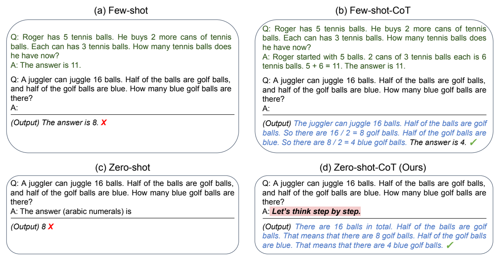
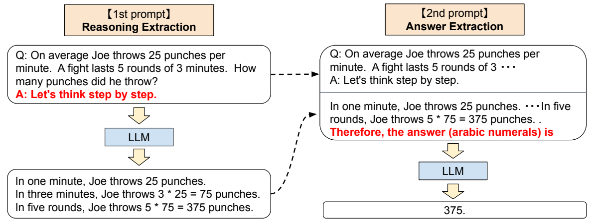
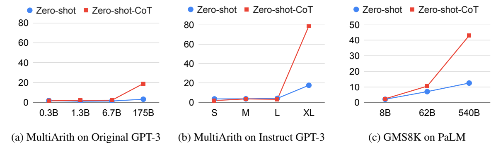

# 大型语言模型是零样本推理者

**Large Language Models are Zero-Shot Reasoners**

Takeshi Kojima¹、Shixiang Shane Gu²、Machel Reid²*、Yutaka Matsuo¹、Yusuke Iwasawa¹  
¹ 东京大学；² Google Research（Gu 所属团队为 Brain Team）  
联系邮箱：t.kojima@weblab.t.u-tokyo.ac.jp  
* Machel Reid 的相关工作在东京大学期间完成。

**发表信息：** 第 36 届神经信息处理系统大会（NeurIPS 2022）。  
**翻译底本：** 用户提供的 cot.pdf，42 页，arXiv:2205.11916v4，2023 年 1 月 29 日修订版。论文发表年份为 2022 年。  
**原文：** [arXiv](https://arxiv.org/abs/2205.11916)；[会议正式版](https://papers.nips.cc/paper/2022/file/8bb0d291acd4acf06ef112099c16f326-Paper-Conference.pdf)。  
**译文说明：** 保留原文章节、图表编号及参考文献。插图保留英文原图，图注译为中文；长篇示例表改为分条排版，保持原有次序。实验提示词保留关键英文。示例中不正确的推理、算式、答案和截断均按原文保留，✓/✗ 为原文判定，GT 为标准答案；它们不是译者给出的解答。

## 摘要

预训练大型语言模型（LLM）广泛应用于自然语言处理（NLP）的许多子领域，人们通常认为，在提供任务特定示例时，它们是出色的少样本学习器。尤其是近期提出的思维链（chain of thought，CoT）提示技术，通过逐步作答的示例引出复杂的多步推理，在算术和符号推理上取得了最先进的表现；这些困难的“系统 2”任务并不遵循 LLM 通常的规模定律。虽然这些成功往往被归因于 LLM 的少样本学习能力，但我们表明，只需在每次回答之前加入“Let's think step by step”（让我们一步一步地思考），LLM 就能成为表现良好的零样本推理者。

实验结果表明，我们的 Zero-shot-CoT 使用同一个提示模板，无需任何人工编写的少样本示例，就能在多种推理基准任务上显著超过 LLM 的普通零样本表现。这些任务包括算术（MultiArith、GSM8K、AQUA-RAT、SVAMP）、符号推理（Last Letter、Coin Flip）以及其他逻辑推理任务（Date Understanding、Tracking Shuffled Objects）。例如，使用大型 InstructGPT 模型 text-davinci-002，MultiArith 的准确率从 17.7% 提高到 78.7%，GSM8K 从 10.4% 提高到 40.7%；在另一个现成的大模型——5400 亿参数的 PaLM——上也获得了类似幅度的提升。

同一个提示在差异很大的推理任务间所表现出的通用性，暗示 LLM 存在尚未充分挖掘和研究的基础零样本能力，也表明简单提示可能提取出高层次、跨任务的广泛认知能力。我们希望，这项工作不仅能为富有挑战性的推理基准提供一个极简而强大的零样本基线，也能强调：在构建微调数据集或少样本示例之前，应仔细探索和分析 LLM 内部蕴藏的丰富零样本知识。

## 1 引言

扩大语言模型的规模，是近期自然语言处理革命的关键因素之一 [Vaswani et al., 2017; Devlin et al., 2019; Raffel et al., 2020; Brown et al., 2020; Thoppilan et al., 2022; Rae et al., 2021; Chowdhery et al., 2022]。大型语言模型的成功往往被归因于其（上下文内的）少样本或零样本学习能力。只需以少量示例（少样本）或描述任务的指令（零样本）为条件，模型就可以解决各种任务。这种为语言模型设置条件的方法称为“提示”（prompting）[Liu et al., 2021b]；手动 [Schick and Schütze, 2021; Reynolds and McDonell, 2021] 或自动 [Gao et al., 2021; Shin et al., 2020] 设计提示，已成为 NLP 的热门话题。



**图 1：** GPT-3 在以下方法下的输入和输出示例：(a) 标准 Few-shot [Brown et al., 2020]；(b) Few-shot-CoT [Wei et al., 2022]；(c) 标准 Zero-shot；(d) 本文方法 Zero-shot-CoT。与 Few-shot-CoT 类似，Zero-shot-CoT 促进多步推理（蓝色文字），并在标准提示失败时得出正确答案。Few-shot-CoT 为每种任务使用逐步推理示例，而我们的方法无需任何示例，对所有任务——算术、符号、常识及其他逻辑推理——都使用同一句提示“Let's think step by step”。

**图中文字译文：** 示例问题是“Roger 有 5 个网球，又买了 2 罐，每罐 3 个。他现在有多少个网球？”普通少样本示例直接回答“11”；思维链示例解释“2 罐共 6 个，5 + 6 = 11”。测试问题是“杂耍演员能抛接 16 个球，其中一半是高尔夫球，高尔夫球中一半是蓝色。有多少个蓝色高尔夫球？”普通 Few-shot 和 Zero-shot 输出错误答案 8；Few-shot-CoT 与 Zero-shot-CoT 依次计算 16 ÷ 2 = 8、8 ÷ 2 = 4，输出正确答案 4。

在直觉性、单步的“系统 1”任务 [Stanovich and West, 2000] 中，LLM 使用任务特定的少样本或零样本提示时表现出色 [Liu et al., 2021b]。相比之下，即使参数超过 1000 亿，语言模型在需要缓慢、多步推理的“系统 2”任务上仍然困难重重 [Rae et al., 2021]。为弥补这一不足，Wei et al. [2022] 和 Wang et al. [2022] 提出了思维链提示：给 LLM 输入逐步推理的示例，而不是标准的问答示例（见图 1a）。这样的思维链演示促使模型生成推理路径，把复杂推理拆解为多个较容易的步骤。值得注意的是，使用 CoT 后，推理表现更符合规模定律，并随语言模型规模增大而跃升。例如，结合 5400 亿参数的 PaLM [Chowdhery et al., 2022]，思维链提示在多个推理基准上显著超过普通少样本提示，例如 GSM8K 从 17.9% 提升到 58.1%。

CoT 提示 [Wei et al., 2022] 以及许多其他任务特定提示方法 [Gao et al., 2021; Schick and Schütze, 2021; Liu et al., 2021b] 的成功，通常被归因于 LLM 的少样本学习能力 [Brown et al., 2020]。但我们表明，只需加入简单提示“Let's think step by step”，让模型在回答每个问题前逐步思考，LLM 就能成为表现良好的零样本推理者（图 1）。尽管方法简单，Zero-shot-CoT 仍能以零样本方式成功生成合理的推理路径，并解决普通零样本方法无法正确回答的问题。

重要的是，Zero-shot-CoT 具有通用性，且与任务无关。这不同于大多数已有的、依靠示例（少样本）或模板（零样本）的任务特定提示工程 [Liu et al., 2021b]：无须按任务修改提示，就能促进各种推理任务的逐步作答，包括算术（MultiArith [Roy and Roth, 2015]、GSM8K [Cobbe et al., 2021]、AQUA-RAT [Ling et al., 2017]、SVAMP [Patel et al., 2021]）、符号推理（末字母拼接与硬币翻转）、常识推理（CommonsenseQA [Talmor et al., 2019] 和 StrategyQA [Geva et al., 2021]），以及其他逻辑推理任务（BIG-bench [Srivastava et al., 2022] 中的日期理解和打乱物体追踪）。

表 2 将 Zero-shot-CoT 与其他提示基线进行了实证比较。虽然它不及使用精心编写、任务特定的逐步示例的 Few-shot-CoT，但相对于零样本基线取得了巨大提升：使用大型 InstructGPT（text-davinci-002），MultiArith 从 17.7% 提升到 78.7%，GSM8K 从 10.4% 提升到 40.7%。在另一个现成的大模型——5400 亿参数的 PaLM——上，MultiArith 和 GSM8K 也取得了类似幅度的提升。

尤其是，使用这一固定提示后，零样本 LLM 的规模扩展曲线明显改善，可以媲美少样本 CoT 基线。我们还发现，Few-shot-CoT 不仅需要人为设计多步推理提示，而且当提示示例的问题类型与任务问题类型不匹配时，性能会下降，说明它对各任务的提示设计高度敏感。相较之下，单个提示在不同推理任务间的通用性，暗示 LLM 具有尚未被充分挖掘和研究的基础零样本能力，例如通用逻辑推理等更高层次的广泛认知能力 [Chollet, 2019]。LLM 这一蓬勃发展的领域以“出色的少样本学习器”为出发点 [Brown et al., 2020]；我们希望本研究鼓励更多工作去发掘其中隐藏的高层次、多任务零样本能力。

## 2 背景

我们简要回顾构成本研究基础的两个核心概念：大型语言模型与提示，以及用于多步推理的思维链提示。

**大型语言模型与提示。** 语言模型（LM）旨在估计文本上的概率分布。近年来，模型规模从数百万参数 [Merity et al., 2016] 扩大到数亿 [Devlin et al., 2019]，再到数千亿 [Brown et al., 2020]，配合更大规模的数据（例如网络文本语料 [Gao et al., 2020]），使预训练 LLM 在许多下游 NLP 任务上表现出色。除了经典的“预训练再微调”范式 [Liu et al., 2021b]，规模超过 1000 亿参数的模型还表现出有利于少样本学习的性质 [Brown et al., 2020]。通过上下文学习，可以用称为“提示”的文本或模板强有力地引导生成过程，输出目标任务的答案，由此开启了“预训练再提示”的时代 [Liu et al., 2021a]。本文将显式以少数任务示例为条件的提示称为少样本提示，而将其他只使用模板的提示称为零样本提示。

**思维链提示。** 多步算术和逻辑推理基准尤其挑战了大型语言模型的规模定律 [Rae et al., 2021]。思维链提示 [Wei et al., 2022] 属于少样本提示：它提出一个简单方案，将少样本示例中的答案改为逐步作答，从而在这些困难基准上取得显著提升，尤其是在与 PaLM 等超大型语言模型结合时 [Chowdhery et al., 2022]。图 1 上半部分对比了标准少样本提示与少样本 CoT 提示。值得注意的是，先前研究把少样本学习视为处理这些困难任务的理所当然的前提，原始论文甚至没有报告零样本基线表现 [Wei et al., 2022]。为与我们的方法区分，本文将 Wei et al. [2022] 的方法称为 Few-shot-CoT。

## 3 零样本思维链

我们提出 Zero-shot-CoT，一种用于思维链推理的零样本模板提示方法。它与原始思维链提示 [Wei et al., 2022] 的区别是无需逐步的少样本示例；它与大多数已有模板提示 [Liu et al., 2021b] 的区别是，本质上不依赖特定任务，只用一个模板就能在广泛任务上引出多跳推理。方法的核心思想很简单，如图 1 所示：加入“Let's think step by step”，或类似文字（表 4），以提取逐步推理。

### 3.1 两阶段提示

虽然概念简单，Zero-shot-CoT 实际使用两次提示，分别提取推理和答案，如图 2 所示。相比之下，零样本基线（图 1 左下）已经使用“The answer is”这样的提示，以提取格式正确的答案。普通或 CoT 少样本提示则通过显式设计示例答案，使其以所需格式结尾，从而无需额外的答案提取提示（图 1 上半部分）。总之，Few-shot-CoT [Wei et al., 2022] 需要人为精心设计少量示例，且为每种任务规定答案格式；Zero-shot-CoT 所需的工程设计更少，但需要对 LLM 提示两次。



**图 2：** 第 3 节所述的 Zero-shot-CoT 完整流程。首先使用第一个“推理”提示，从语言模型中提取完整推理路径，再使用第二个“答案”提示，从推理文本中提取格式正确的答案。图中问题为：“Joe 平均每分钟出拳 25 次。一场比赛有 5 轮，每轮 3 分钟。他一共出拳多少次？”第一阶段逐步得到每轮 75 次、五轮 375 次；第二阶段用“因此，答案（阿拉伯数字）是”提取 375。

**第一次提示：推理提取。** 首先使用简单模板 `Q: [X]. A: [T]`，将输入问题 $x$ 转换为提示 $x'$。`[X]` 是输入 $x$ 的位置，`[T]` 是人工编写的触发句 $t$ 的位置，用来提取回答 $x$ 所需的思维链。例如，若使用“Let's think step by step”作为触发句，则 $x'$ 为 `Q: [X]. A: Let's think step by step.`。更多触发句见表 4。然后把提示文本 $x'$ 输入语言模型，生成后续文本 $z$。任何解码策略都可以使用；为简单起见，本文始终使用贪心解码。

**第二次提示：答案提取。** 使用生成文本 $z$ 和提示文本 $x'$，从语言模型中提取最终答案。具体来说，把三个部分拼接为 `[X'] [Z] [A]`：`[X']` 为第一次提示 $x'$，`[Z]` 为第一步生成的文本 $z$，`[A]` 为答案提取触发句。因为提示包含同一语言模型自己生成的 $z$，这一步的提示是自增强的。

实验中，根据答案格式使用略有差异的触发句。例如，多选一问答使用“Therefore, among A through E, the answer is”（因此，在 A 到 E 中，答案是）；需要数值答案的数学题使用“Therefore, the answer (arabic numerals) is”（因此，答案〔阿拉伯数字〕是）。触发句清单见附录 A.5。最后，将该提示文本输入语言模型，生成文本 $\hat{y}$，并解析最终答案。解析器细节见第 4 节“答案清洗”。

## 4 实验

**任务与数据集。** 我们在四类推理任务的 12 个数据集上评估方法：算术、常识、符号和其他逻辑推理。各数据集的详细说明见附录 A.2。

算术推理使用六个数据集：(1) SingleEq [Koncel-Kedziorski et al., 2015]；(2) AddSub [Hosseini et al., 2014]；(3) MultiArith [Roy and Roth, 2015]；(4) AQUA-RAT [Ling et al., 2017]；(5) GSM8K [Cobbe et al., 2021]；(6) SVAMP [Patel et al., 2021]。前三者来自经典数学应用题资源库 [Koncel-Kedziorski et al., 2016]，后三者属于较新的基准。SingleEq 和 AddSub 的问题较容易，无需多步计算；MultiArith、AQUA-RAT、GSM8K 和 SVAMP 更具挑战性，需要多步推理。

常识推理采用 CommonsenseQA [Talmor et al., 2019] 和 StrategyQA [Geva et al., 2021]。CommonsenseQA 提出具有复杂语义的问题，通常要求基于先验知识进行推理；StrategyQA 要求模型通过隐含的多跳推理来回答问题。

符号推理采用 Last Letter Concatenation（末字母拼接）和 Coin Flip（硬币翻转）[Wei et al., 2022]。前者要求模型将各单词的最后一个字母拼接起来，每个样本使用四个随机选取的人名。后者要求判断：若若干人依次翻转或不翻转一枚硬币，最终是否仍正面朝上。我们生成了包含四次“翻转或不翻转”操作的样本。虽然这些任务对人类很容易，语言模型通常表现出平坦的规模扩展曲线。

其他逻辑推理任务选自 BIG-bench [Srivastava et al., 2022] 的两个评估集：Date Understanding（日期理解）[^2] 和 Tracking Shuffled Objects（打乱物体追踪）。日期理解要求从上下文中推断日期；物体追踪考察模型根据初始状态和一系列交换操作推断物体最终状态的能力。实验采用追踪三个物体的数据集。

**模型。** 共实验 17 个模型。主要实验使用 InstructGPT3 [Ouyang et al., 2022]（text-ada/babbage/curie/davinci-001 及 text-davinci-002）[^3]、原始 GPT-3 [Brown et al., 2020]（ada、babbage、curie、davinci）[^4] 和 PaLM [Chowdhery et al., 2022]（8B、62B、540B）。另外，规模研究使用 GPT-2 [Radford et al., 2019]、GPT-Neo [Black et al., 2021]、GPT-J [Wang and Komatsuzaki, 2021]、T0 [Sanh et al., 2022] 和 OPT [Zhang et al., 2022]。模型规模为 0.3B–540B（B 表示十亿参数），包括标准模型（如 GPT-3、OPT）及指令跟随变体（如 Instruct-GPT3、T0）。详情见附录 A.3。除非另有说明，实验均使用 text-davinci-002。

**基线。** 主要将 Zero-shot-CoT 与普通 Zero-shot 提示比较，以验证思维链推理的效果。Zero-shot 默认使用与 Zero-shot-CoT 类似的答案提示，详见附录 A.5。为更好评估 LLM 的零样本推理能力，还使用与 Wei et al. [2022] 相同的上下文示例，与 Few-shot、Few-shot-CoT 基线比较。

所有方法始终采用贪心解码，因此零样本方法的结果是确定的。对于少样本方法，由于上下文示例顺序可能影响结果 [Lu et al., 2022]，为公平比较，我们在所有方法和数据集中固定随机种子，每项实验仅运行一次。Wei et al. [2022] 表明，示例顺序没有在 CoT 实验中造成较大的方差。

**答案清洗。** 模型通过答案提取输出文本后（第 3 节及图 2），我们只取其中第一个符合答案格式的部分。例如，在算术任务中，如果输出“probably 375 and 376”，就提取第一个数字 375，作为模型预测。对于多选一题，取遇到的第一个大写字母。详见附录 A.6。标准 Zero-shot 采用相同思路。Few-shot 和 Few-shot-CoT 则遵循 Wang et al. [2022]：先提取模型输出中“The answer is”之后的答案文本，再用同样的清洗方法解析。如果输出中没有“The answer is”，则从文本末尾向前搜索，取第一个符合格式的内容作为预测。

[^2]: Wei et al. [2022] 将日期理解归为常识推理；本文将其归为逻辑推理，因为它对先验知识的需求较少，而更多依赖日期之间的逻辑推理。
[^3]: 本文的 Instruct GPT-3 实验同时包含 text-****-001 和 text-davinci-002。两者使用的微调数据随 API 收集时间范围而不同：text-davinci-002 使用截至 2021 年 6 月的数据，而 text-****-001 使用截至 2019 年 10 月的数据。原文引用：https://beta.openai.com/docs/engines/gpt-3 。
[^4]: GPT-3 系列的实验通过 OpenAI API 在 2022 年 4–5 月进行；表 4 中第 10–16 项在 2022 年 8 月进行。

### 4.1 结果

**Zero-shot-CoT 与 Zero-shot。** 表 1 汇总了两种方法在各数据集上的准确率。Zero-shot-CoT 在六项算术推理任务中的四项（MultiArith、GSM8K、AQUA、SVAMP）、全部符号推理任务及全部其他逻辑推理任务（来自 BIG-bench [Srivastava et al., 2022]）上显著优于普通零样本提示。例如，MultiArith 从 17.7% 提升到 78.7%，GSM8K 从 10.4% 提升到 40.7%。在其余两项算术任务 SingleEq 和 AddSub 上，两种方法表现相当，这符合预期，因为它们不需要多步推理。

**表 1：** Zero-shot-CoT 与 Zero-shot 在各任务上的准确率比较（%）。每格左侧数值使用第 3 节所述、与答案格式对应的提取提示；右侧数值来自额外实验，使用标准提示“The answer is”提取答案。具体设置见附录 A.5。

| 任务类别 | 数据集 | Zero-shot | Zero-shot-CoT |
|---|---|---:|---:|
| 算术 | SingleEq | 74.6 / 78.7 | 78.0 / 78.7 |
| 算术 | AddSub | 72.2 / 77.0 | 69.6 / 74.7 |
| 算术 | MultiArith | 17.7 / 22.7 | 78.7 / 79.3 |
| 算术 | GSM8K | 10.4 / 12.5 | 40.7 / 40.5 |
| 算术 | AQUA | 22.4 / 22.4 | 33.5 / 31.9 |
| 算术 | SVAMP | 58.8 / 58.7 | 62.1 / 63.7 |
| 常识 | CommonsenseQA | 68.8 / 72.6 | 64.6 / 64.0 |
| 常识 | StrategyQA | 12.7 / 54.3 | 54.8 / 52.3 |
| 其他逻辑推理 | Date Understanding | 49.3 / 33.6 | 67.5 / 61.8 |
| 其他逻辑推理 | Shuffled Objects | 31.3 / 29.7 | 52.4 / 52.9 |
| 符号推理 | Last Letter（4 个单词） | 0.2 / — | 57.6 / — |
| 符号推理 | Coin Flip（4 次） | 12.8 / 53.8 | 91.4 / 87.8 |

**表 2：** 在 MultiArith 和 GSM8K 上与基线方法的准确率比较（%）。未注明时使用 text-davinci-002。Few-shot 和 Few-shot-CoT 使用 Wei et al. [2022] 中相同的 8 个示例。(*1) 将 8 个示例拆成两组，报告两种 4-shot-CoT 结果，以考察示例变化造成的差异。(*2) 在 Few-shot-CoT 每个示例答案开头加入“Let's think step by step.”，测试性能提升。更多 PaLM 结果见附录 D。

| 方法 | MultiArith | GSM8K |
|---|---:|---:|
| Zero-shot | 17.7 | 10.4 |
| Few-shot（2 个示例） | 33.7 | 15.6 |
| Few-shot（8 个示例） | 33.8 | 15.6 |
| Zero-shot-CoT | 78.7 | 40.7 |
| Few-shot-CoT（2 个示例） | 84.8 | 41.3 |
| Few-shot-CoT（4 个示例：第一组）(*1) | 89.2 | — |
| Few-shot-CoT（4 个示例：第二组）(*1) | 90.5 | — |
| Few-shot-CoT（8 个示例） | 93.0 | 48.7 |
| Zero-Plus-Few-Shot-CoT（8 个示例）(*2) | 92.8 | 51.5 |
| 微调 GPT-3 175B [Wei et al., 2022] | — | 33 |
| 微调 GPT-3 175B + 验证器 [Wei et al., 2022] | — | 55 |
| PaLM 540B：Zero-shot | 25.5 | 12.5 |
| PaLM 540B：Zero-shot-CoT | 66.1 | 43.0 |
| PaLM 540B：Zero-shot-CoT + 自一致性 | 89.0 | 70.1 |
| PaLM 540B：Few-shot [Wei et al., 2022] | — | 17.9 |
| PaLM 540B：Few-shot-CoT [Wei et al., 2022] | — | 56.9 |
| PaLM 540B：Few-shot-CoT + 自一致性 [Wang et al., 2022] | — | 74.4 |

在常识推理任务中，Zero-shot-CoT 没有带来性能提升。这也符合预期：Wei et al. [2022] 报告，即使 Few-shot-CoT 在 LaMDA（135B）上也没有提升，但与更大的 PaLM（540B）结合时能改善 StrategyQA；我们的情况也可能类似。更重要的是，我们观察到，许多生成的思维链在逻辑上出人意料地正确，或者仅包含人类可以理解的错误（表 3）。这表明，即使任务指标没有直接反映，Zero-shot-CoT 仍确实引出了更好的常识推理。各数据集的生成样本见附录 B。



**图 3：** 不同类型模型的规模研究。(a) 原始 GPT-3 在 MultiArith 上；(b) Instruct GPT-3 在 MultiArith 上；(c) PaLM 在 GSM8K 上。S：text-ada-001；M：text-babbage-001；L：text-curie-001；XL：text-davinci-002。蓝色为 Zero-shot，红色为 Zero-shot-CoT。详情见附录 A.3 和 E。

**表 3：** Zero-shot-CoT 在 CommonsenseQA 上生成的错误分析示例。

| 内容 | 示例 1：推理正确 | 示例 2：模型无法只选择一个答案 |
|---|---|---|
| 问题 | 经常被玩的玩具汽车可能在哪里？(A) 儿童房间 (B) 男孩卧室 (C) 自己家中 (D) 玩具店 (E) 房屋 | 要让身体保持良好状态，需要什么？(A) 健康状况良好 (B) 锻炼 (C) 肌肉张力 (D) 出汗 (E) 感觉更好 |
| 输出 | 让我们一步一步地思考。玩具汽车可能在儿童房间里。儿童房间可能在房屋里。因此，玩具汽车可能在房屋里。因此，在 A 到 E 中，答案是 E。✗（GT：A；Zero-shot：A） | 让我们一步一步地思考。要保持良好体形，需要做到三件事：1. 经常锻炼；2. 健康饮食；3. 睡眠充足。若能做到这三点，就会朝着良好体形迈进！因此，在 A 到 E 中，答案是 B、C 和 D。（GT：B；Zero-shot：B） |

**与其他基线比较。** 表 2 对比了 Zero-shot-CoT 和其他基线在两个算术推理基准上的表现。普通提示（第一组）与思维链提示（第二组）之间的巨大差距说明，如果不引出多步推理，这些任务很困难。Instruct GPT-3（text-davinci-002）和 PaLM（540B，第四组）均取得了明显提升。虽然 Zero-shot-CoT 自然不及 Few-shot-CoT，但它显著超过普通 Few-shot，哪怕后者每项任务使用 8 个示例。在 GSM8K 上，使用 Instruct GPT-3 的 Zero-shot-CoT 也超过 Wei et al. [2022] 报告的微调 GPT-3，以及使用更大模型 PaLM 540B 的普通少样本提示（第三、第四组）。更多 PaLM 实验见附录 D。

**模型规模影响零样本推理吗？** 图 3 比较了不同语言模型在 MultiArith / GSM8K 上的表现。不使用思维链时，随着模型规模扩大，性能不变或只缓慢增加，曲线大体平坦。相反，在原始 GPT-3、Instruct GPT-3 和 PaLM 上，采用思维链后，性能随模型增大而大幅提高。模型较小时，思维链无效。这与 Wei et al. [2022] 的少样本实验一致。附录 E 给出包括 GPT-2、GPT-Neo、GPT-J、T0、OPT 在内的更广泛结果。我们还人工考察了思维链质量，大模型明显展现出更好的推理能力（各模型输出样例见附录 B）。

**错误分析。** 为更好理解 Zero-shot-CoT 的行为，我们人工检查了 Instruct-GPT3 使用该提示生成的随机样本。附录 C 给出了示例，观察包括：(1) 在 CommonsenseQA 中，即便最终预测错误，Zero-shot-CoT 也常产生灵活、合理的思维链。当难以缩小为一个选项时，模型常输出多个选项（表 3）。(2) 在 MultiArith 中，Zero-shot-CoT 与 Few-shot-CoT 的错误模式明显不同。前者容易在已经得到正确结果之后继续输出不必要的推理，进而把答案改错；有时也不开始推理，只改写输入问题。后者则更容易在生成的思维链涉及三元运算时出错，例如 $(3+2)\times4$。

**表 4：** 在 MultiArith 上使用 text-davinci-002，对提示模板的稳健性进行研究。(*1) Ahn et al. [2022] 用此模板，使语言模型根据高层指令生成用于控制机器人动作的分步行动。(*2) Reynolds and McDonell [2021] 使用了此模板，但未进行定量评估。

| 编号 | 类别 | 模板原文及中文释义 | 准确率（%） |
|---:|---|---|---:|
| 1 | 引导性 | Let's think step by step.／让我们一步一步地思考。 | 78.7 |
| 2 | 引导性 | First,／首先，(*1) | 77.3 |
| 3 | 引导性 | Let's think about this logically.／让我们从逻辑上思考这件事。 | 74.5 |
| 4 | 引导性 | Let's solve this problem by splitting it into steps.／让我们把问题拆成步骤来解决。(*2) | 72.2 |
| 5 | 引导性 | Let's be realistic and think step by step.／让我们实事求是，一步一步地思考。 | 70.8 |
| 6 | 引导性 | Let's think like a detective step by step.／让我们像侦探一样一步一步地思考。 | 70.3 |
| 7 | 引导性 | Let's think／让我们思考 | 57.5 |
| 8 | 引导性 | Before we dive into the answer,／在深入讨论答案之前， | 55.7 |
| 9 | 引导性 | The answer is after the proof.／答案在证明之后。 | 45.7 |
| 10 | 误导性 | Don't think. Just feel.／不要思考，只凭感觉。 | 18.8 |
| 11 | 误导性 | Let's think step by step but reach an incorrect answer.／让我们一步一步地思考，但得出错误答案。 | 18.7 |
| 12 | 误导性 | Let's count the number of "a" in the question.／让我们数一数问题中有多少个“a”。 | 16.7 |
| 13 | 误导性 | By using the fact that the earth is round,／利用地球是圆的这一事实， | 9.3 |
| 14 | 无关 | By the way, I found a good restaurant nearby.／顺便说一句，我在附近找到一家不错的餐馆。 | 17.5 |
| 15 | 无关 | Abrakadabra!／阿布拉卡达布拉！（魔法咒语） | 15.5 |
| 16 | 无关 | It's a beautiful day.／今天天气真好。 | 13.1 |
| — | 基线 | Zero-shot | 17.7 |

**提示选择如何影响 Zero-shot-CoT？** 我们检验其对输入提示的稳健性。表 4 汇总了三类共 16 个模板的结果。遵循 Webson and Pavlick [2022]，类别分别为：引导性（鼓励推理）、误导性（阻止推理，或以错误方式鼓励推理）、无关（与推理无关）。只要文字鼓励思维链推理，即属于引导性类别，性能就会改善，但不同句子之间的准确率差异显著。本实验中，“Let's think step by step.” 效果最佳。有趣的是，不同模板会促使模型以很不一样的方式表达推理（样例见附录 B）。误导性或无关模板则没有改善性能。如何自动生成更好的 Zero-shot-CoT 模板，仍是开放问题。

**提示选择如何影响 Few-shot-CoT？** 表 5 展示了使用不同数据集示例时的效果：将 CommonsenseQA 示例用于 AQUA-RAT，或用于 MultiArith。两者的领域都不同，但前者答案格式相同。令人惊讶的是，当领域不同（常识到算术）但答案格式相同（多选一）时，相对于 Zero-shot-CoT 或 Few-shot-CoT 所能带来的改进，跨领域思维链示例仍能显著超过 Zero-shot（AQUA-RAT）。相反，答案类型不同时（MultiArith），提升小得多。这与 Min et al. [2022] 的结论一致：LLM 主要利用少样本示例推断重复出现的格式，而不一定是在上下文中学习任务本身。不过，两种情形都不及 Zero-shot-CoT，进一步证实了 Few-shot-CoT 中任务特定示例设计的重要性。

**表 5：** Few-shot-CoT 对示例的稳健性。使用完全不同任务的示例时，性能通常变差；若答案格式匹配（CommonsenseQA 到 AQUA-RAT，均为多选一），下降相对较小。† 表示使用 CommonsenseQA 示例。

| 数据集 | Zero-shot | Few-shot-CoT† | Zero-shot-CoT | Few-shot-CoT |
|---|---:|---:|---:|---:|
| AQUA-RAT | 22.4 | 31.9 | 33.5 | 39.0 |
| MultiArith | 17.7 | 27.0 | 78.7 | 88.2 |

## 5 讨论与相关工作

**表 6：** 算术与常识推理相关工作汇总。“类别”表示训练策略；CoT 表示是否输出思维链；“任务”列出相应论文开展的任务。AR：算术推理；CR：常识推理。

| 方法 | 类别 | CoT | 任务 | 模型 |
|---|---|---|---|---|
| Rajani et al. [2019] | 微调 | ✓ | CR | GPT |
| Cobbe et al. [2021] | 微调 | ✓ | AR | GPT-3 |
| Zelikman et al. [2022] | 微调 | ✓ | AR、CR | GPT-3 等 |
| Nye et al. [2022] | 微调[^5] | ✓ | AR | Transformer（解码器） |
| Brown et al. [2020] | 少样本／零样本 | — | CR | GPT-3 |
| Smith et al. [2022] | 少样本／零样本 | — | AR、CR | MT-NLG |
| Rae et al. [2021] | 少样本 | — | AR、CR | Gopher |
| Wei et al. [2022] | 少样本 | ✓ | AR、CR | PaLM、LaMDA、GPT-3 |
| Wang et al. [2022] | 少样本 | ✓ | AR、CR | PaLM 等 |
| Chowdhery et al. [2022] | 少样本 | ✓ | AR、CR | PaLM |
| Shwartz et al. [2020] | 零样本 | ✓ | CR | GPT-2 等 |
| Reynolds and McDonell [2021] | 零样本 | ✓ | AR | GPT-3 |
| Zero-shot-CoT（本文） | 零样本 | ✓ | AR、CR | PaLM、Instruct-GPT3、GPT-3 等 |

**LLM 的推理能力。** 多项研究表明，预训练模型通常不擅长推理 [Brown et al., 2020; Smith et al., 2022; Rae et al., 2021]，但通过微调 [Rajani et al., 2019; Cobbe et al., 2021; Zelikman et al., 2022; Nye et al., 2022] 或少样本提示 [Wei et al., 2022; Wang et al., 2022; Chowdhery et al., 2022] 让它们生成逐步推理，可以大幅提升能力（表 6）。不同于大多数既有工作，我们关注零样本提示，并表明单个固定触发提示就能显著改善 LLM 在各种复杂多跳任务上的零样本推理（表 1），特别是在模型扩大时（图 3）。它还能在多样任务中生成合理、可理解的思维链（附录 B），即使最终预测错误也如此（附录 C）。

与本研究类似，Reynolds and McDonell [2021] 展示过“Let's solve this problem by splitting it into steps”可以促进简单算术题的多步推理，但他们将其视为任务特定的示例，没有在多种推理任务上对照基线进行定量评估。Shwartz et al. [2020] 提出，把常识问题分解成一系列信息搜寻问题，例如“[X] 的定义是什么”。该方法不要求演示，但每种推理任务都需要大量人工提示工程。我们的结果强烈表明，LLM 是表现良好的零样本推理者，而此前工作 [Wei et al., 2022] 往往仅强调少样本学习及任务特定的上下文学习，例如不报告零样本基线。我们的方法不需要耗时微调或昂贵的示例设计，可以与任何预训练 LLM 结合，为各类推理任务提供强大的零样本基线。

[^5]: Nye et al. [2022] 也评估了少样本设置，但其研究领域中的少样本表现差于微调结果。

**LLM 的零样本能力。** Radford et al. [2019] 表明，LLM 在阅读理解、翻译和摘要等许多系统 1 任务上具有出色的零样本能力。Sanh et al. [2022] 和 Ouyang et al. [2022] 表明，通过显式微调使模型遵循指令，可以进一步提升这些能力。虽然上述研究都关注零样本表现，我们关注的却是超越系统 1 的诸多系统 2 任务；由于规模扩展曲线平坦，它们一直被视为 LLM 的重大挑战。此外，Zero-shot-CoT 与指令微调相互独立：它能提升 Instruct GPT3、原始 GPT3 和 PaLM 的零样本表现（图 3）。

**从狭窄的任务特定提示，走向广泛的多任务提示。** 大多数提示都针对特定任务。少样本提示因使用任务特定的上下文示例而天然如此 [Brown et al., 2020; Wei et al., 2022]；大多数零样本提示也聚焦于逐任务设计模板 [Liu et al., 2021b; Reynolds and McDonell, 2021]。借用 Chollet [2019] 基于层次智能模型 [McGrew, 2005; Johnson and Bouchard Jr, 2005] 的术语，这些提示可以说是在引出 LLM 的“狭窄泛化”或任务特定技能。相反，我们的方法是一种多任务提示，引出的则是“广泛泛化”或广泛认知能力，例如逻辑推理乃至系统 2 本身。我们希望本研究不仅加速基于 LLM 的逻辑推理研究，也有助于发现 LLM 中其他广泛的认知能力。

**训练数据集细节。** 本研究的一项限制是，LLM 训练数据的公开细节不足，例如 GPT 模型 001 与 002 的区别、原始 GPT3 与 Instruct-GPT [Ouyang et al., 2022] 的区别，以及 PaLM 的训练数据 [Chowdhery et al., 2022]。不过，近期各大型模型（InstructGPT 001/002、原始 GPT3、PaLM）从 Zero-shot 到 Zero-shot-CoT 均大幅提升，且算术与非算术任务都有一致改善，说明它们不太可能只是记忆，而更可能掌握了用于通用问题求解、与任务无关的多步推理能力。大部分结果基于 InstructGPT，因为它是当时表现最好的开放访问 LLM，但主要结果也在 PaLM 上复现；InstructGPT 数据集的细节（Ouyang et al. [2022] 的附录 A、B、F）也证实，它并非专门为多步推理设计。

**局限性与社会影响。** 本研究基于大型语言模型提示。LLM 在来自网络多种来源的大规模语料上训练（亦见上文“训练数据集细节”），已被证明会捕获并放大训练数据中的偏见。提示旨在利用模型学到的、适合不同任务的模式，因此具有相同缺陷。尽管如此，我们的方法能更直接地探测预训练 LLM 中的复杂推理，去掉了以往少样本方法中上下文学习这一混杂因素，因而可能帮助人们以更少干扰研究 LLM 的偏见。

## 6 结论

我们提出了 Zero-shot-CoT：用单个零样本提示，在多种推理任务中引出大型语言模型的思维链。这不同于以往少样本（上下文）方法，后者要求为每种任务手工构造少量示例。我们的方法简单，为长期不符合 LLM 规模定律的困难、多步系统 2 推理任务提供了极简而强大的零样本基线，同时鼓励研究社区继续寻找类似的多任务提示，以引出广泛认知能力，而不只是狭窄的任务特定技能。

## 致谢

本研究得到东京大学面向沙特—日本愿景 2030 的穆罕默德·本·萨勒曼未来科学与技术中心（MbSC2030）支持。除 PaLM 之外的实验使用了日本产业技术综合研究所（AIST）提供的 AI Bridging Cloud Infrastructure（ABCI）计算资源。感谢 Jason Wei 和 Denny Zhou 的讨论以及对 PaLM 实验的支持，也感谢 Sharan Narang 和 Aakanksha Chowdhery 对 PaLM 基础设施提供的支持。

## References

Michael Ahn, Anthony Brohan, Noah Brown, Yevgen Chebotar, Omar Cortes, Byron David, Chelsea Finn, Keerthana Gopalakrishnan, Karol Hausman, Alex Herzog, Daniel Ho, Jasmine Hsu, Julian Ibarz, Brian Ichter, Alex Irpan, Eric Jang, Rosario Jauregui Ruano, Kyle Jeffrey, Sally Jesmonth, Nikhil J Joshi, Ryan Julian, Dmitry Kalashnikov, Yuheng Kuang, Kuang-Huei Lee, Sergey Levine, Yao Lu, Linda Luu, Carolina Parada, Peter Pastor, Jornell Quiambao, Kanishka Rao, Jarek Rettinghouse, Diego Reyes, Pierre Sermanet, Nicolas Sievers, Clayton Tan, Alexander Toshev, Vincent Vanhoucke, Fei Xia, Ted Xiao, Peng Xu, Sichun Xu, and Mengyuan Yan. Do as i can, not as i say: Grounding language in robotic affordances, 2022. URL https://arxiv.org/abs/2204.01691.

Sid Black, Leo Gao, Phil Wang, Connor Leahy, and Stella Biderman. GPT-Neo: Large Scale Autoregressive Language Modeling with Mesh-Tensorflow, March 2021. URL https://doi.org/10.5281/zenodo.5297715.

Tom Brown, Benjamin Mann, Nick Ryder, Melanie Subbiah, Jared D Kaplan, Prafulla Dhariwal, Arvind Neelakantan, Pranav Shyam, Girish Sastry, Amanda Askell, Sandhini Agarwal, Ariel Herbert-Voss, Gretchen Krueger, Tom Henighan, Rewon Child, Aditya Ramesh, Daniel Ziegler, Jeffrey Wu, Clemens Winter, Chris Hesse, Mark Chen, Eric Sigler, Mateusz Litwin, Scott Gray, Benjamin Chess, Jack Clark, Christopher Berner, Sam McCandlish, Alec Radford, Ilya Sutskever, and Dario Amodei. Language models are few-shot learners. In H. Larochelle, M. Ranzato, R. Hadsell, M.F. Balcan, and H. Lin, editors, Advances in NeurIPS, volume 33, pages 1877–1901. Curran Associates, Inc., 2020. URL https://proceedings.neurips.cc/paper/2020/file/1457c0d6bfcb4967418bfb8ac142f64a-Paper.pdf.

François Chollet. On the measure of intelligence. arXiv preprint arXiv:1911.01547, 2019. URL https://arxiv.org/abs/1911.01547.

Aakanksha Chowdhery, Sharan Narang, Jacob Devlin, Maarten Bosma, Gaurav Mishra, Adam Roberts, Paul Barham, Hyung Won Chung, Charles Sutton, Sebastian Gehrmann, Parker Schuh, Kensen Shi, Sasha Tsvyashchenko, Joshua Maynez, Abhishek Rao, Parker Barnes, Yi Tay, Noam Shazeer, Vinodkumar Prabhakaran, Emily Reif, Nan Du, Ben Hutchinson, Reiner Pope, James Bradbury, Jacob Austin, Michael Isard, Guy Gur-Ari, Pengcheng Yin, Toju Duke, Anselm Levskaya, Sanjay Ghemawat, Sunipa Dev, Henryk Michalewski, Xavier Garcia, Vedant Misra, Kevin Robinson, Liam Fedus, Denny Zhou, Daphne Ippolito, David Luan, Hyeontaek Lim, Barret Zoph, Alexander Spiridonov, Ryan Sepassi, David Dohan, Shivani Agrawal, Mark Omernick, Andrew M. Dai, Thanumalayan Sankaranarayana Pillai, Marie Pellat, Aitor Lewkowycz, Erica Moreira, Rewon Child, Oleksandr Polozov, Katherine Lee, Zongwei Zhou, Xuezhi Wang, Brennan Saeta, Mark Diaz, Orhan Firat, Michele Catasta, Jason Wei, Kathy Meier-Hellstern, Douglas Eck, Jeff Dean, Slav Petrov, and Noah Fiedel. Palm: Scaling language modeling with pathways, 2022. URL https://arxiv.org/abs/2204.02311.

Karl Cobbe, Vineet Kosaraju, Mohammad Bavarian, Mark Chen, Heewoo Jun, Lukasz Kaiser, Matthias Plappert, Jerry Tworek, Jacob Hilton, Reiichiro Nakano, Christopher Hesse, and John Schulman. Training verifiers to solve math word problems, 2021. URL https://arxiv.org/abs/2110.14168.

Jacob Devlin, Ming-Wei Chang, Kenton Lee, and Kristina Toutanova. BERT: Pre-training of deep bidirectional transformers for language understanding. In Proceedings of NAACL, pages 4171–4186, 2019. URL https://aclanthology.org/N19-1423.

Leo Gao, Stella Biderman, Sid Black, Laurence Golding, Travis Hoppe, Charles Foster, Jason Phang, Horace He, Anish Thite, Noa Nabeshima, Shawn Presser, and Connor Leahy. The pile: An 800gb dataset of diverse text for language modeling. arXiv preprint arXiv: Arxiv-2101.00027 , 2020.

Tianyu Gao, Adam Fisch, and Danqi Chen. Making pre-trained language models better few-shot learners. In Proceedings of ACL-IJCNLP, pages 3816–3830, 2021. URL https://aclanthology.org/2021.acl-long.295.

Mor Geva, Daniel Khashabi, Elad Segal, Tushar Khot, Dan Roth, and Jonathan Berant. Did aristotle use a laptop? a question answering benchmark with implicit reasoning strategies.TACL, 9:346–361, 2021. URL https://aclanthology.org/2021.tacl-1.21/.

Mohammad Javad Hosseini, Hannaneh Hajishirzi, Oren Etzioni, and Nate Kushman. Learning to solve arithmetic word problems with verb categorization. In EMNLP, volume 523533. Citeseer, 2014. URL https://aclanthology.org/D14-1058/.

Wendy Johnson and Thomas J Bouchard Jr. The structure of human intelligence: It is verbal, perceptual, and image rotation (vpr), not fluid and crystallized. Intelligence, 33(4):393–416, 2005.

Rik Koncel-Kedziorski, Hannaneh Hajishirzi, Ashish Sabharwal, Oren Etzioni, and Siena Dumas Ang. Parsing algebraic word problems into equations. TACL, 3:585–597, 2015. URL https://aclanthology.org/Q15-1042.

Rik Koncel-Kedziorski, Subhro Roy, Aida Amini, Nate Kushman, and Hannaneh Hajishirzi. MAWPS: A math word problem repository. In Proceedings of NAACL , pages 1152–1157, 2016. URL https://aclanthology.org/N16-1136.

Wang Ling, Dani Yogatama, Chris Dyer, and Phil Blunsom. Program induction by rationale generation: Learning to solve and explain algebraic word problems. In Proceedings of ACL, pages 158–167, 2017. URL https://aclanthology.org/P17-1015.

Jiachang Liu, Dinghan Shen, Yizhe Zhang, Bill Dolan, Lawrence Carin, and Weizhu Chen. What makes good in-context examples for gpt- 3? arXiv preprint arXiv:2101.06804 , 2021a. URL https://arxiv.org/abs/2101.06804.

Pengfei Liu, Weizhe Yuan, Jinlan Fu, Zhengbao Jiang, Hiroaki Hayashi, and Graham Neubig. Pre-train, prompt, and predict: A systematic survey of prompting methods in natural language processing. arXiv preprint arXiv:2107.13586 , 2021b. URL https://arxiv.org/abs/2107.13586.

Yao Lu, Max Bartolo, Alastair Moore, Sebastian Riedel, and Pontus Stenetorp. Fantastically ordered prompts and where to find them: Overcoming few-shot prompt order sensitivity. In Proceedings of ACL, pages 8086–8098, 2022. URL https://aclanthology.org/2022.acl-long.556.

Kevin S McGrew. The cattell-horn-carroll theory of cognitive abilities: Past, present, and future. 2005.

Stephen Merity, Caiming Xiong, James Bradbury, and Richard Socher. Pointer sentinel mixture models. arXiv preprint arXiv: Arxiv-1609.07843 , 2016. URL https://arxiv.org/abs/1609.07843.

Sewon Min, Xinxi Lyu, Ari Holtzman, Mikel Artetxe, Mike Lewis, Hannaneh Hajishirzi, and Luke Zettlemoyer. Rethinking the role of demonstrations: What makes in-context learning work? arXiv preprint arXiv:2202.12837, 2022. URL https://arxiv.org/pdf/2202.12837.pdf.

Maxwell Nye, Anders Johan Andreassen, Guy Gur-Ari, Henryk Michalewski, Jacob Austin, David Bieber, David Dohan, Aitor Lewkowycz, Maarten Bosma, David Luan, Charles Sutton, and Augustus Odena. Show your work: Scratchpads for intermediate computation with language models. In Deep Learning for Code Workshop , 2022. URL https://openreview.net/forum?id=HBlx2idbkbq.

Long Ouyang, Jeff Wu, Xu Jiang, Diogo Almeida, Carroll L. Wainwright, Pamela Mishkin, Chong Zhang, Sandhini Agarwal, Katarina Slama, Alex Ray, John Schulman, Jacob Hilton, Fraser Kelton, Luke Miller, Maddie Simens, Amanda Askell, Peter Welinder, Paul Christiano, Jan Leike, and Ryan Lowe. Training language models to follow instructions with human feedback, 2022. URL https://arxiv.org/abs/2203.02155.

Adam Paszke, Sam Gross, Francisco Massa, Adam Lerer, James Bradbury, Gregory Chanan, Trevor Killeen, Zeming Lin, Natalia Gimelshein, Luca Antiga, et al. Pytorch: An imperative style, high-performance deep learning library. Advances in NeurIPS, 32:8026–8037, 2019. URL https://papers.nips.cc/paper/2019/hash/bdbca288fee7f92f2bfa9f7012727740-Abstract.html.

Arkil Patel, Satwik Bhattamishra, and Navin Goyal. Are NLP models really able to solve simple math word problems? In Proceedings of NAACL , pages 2080–2094, 2021. URL https://aclanthology.org/2021.naacl-main.168.

Alec Radford, Jeffrey Wu, Rewon Child, David Luan, Dario Amodei, Ilya Sutskever, et al. Language models are unsupervised multitask learners. OpenAI blog, page 9, 2019. URL http://www.persagen.com/files/misc/radford2019language.pdf.

Jack W. Rae, Sebastian Borgeaud, Trevor Cai, Katie Millican, Jordan Hoffmann, Francis Song, John Aslanides, Sarah Henderson, Roman Ring, Susannah Young, Eliza Rutherford, Tom Hennigan, Jacob Menick, Albin Cassirer, Richard Powell, George van den Driessche, Lisa Anne Hendricks, Maribeth Rauh, Po-Sen Huang, Amelia Glaese, Johannes Welbl, Sumanth Dathathri, Saffron Huang, Jonathan Uesato, John Mellor, Irina Higgins, Antonia Creswell, Nat McAleese, Amy Wu, Erich Elsen, Siddhant Jayakumar, Elena Buchatskaya, David Budden, Esme Sutherland, Karen Simonyan, Michela Paganini, Laurent Sifre, Lena Martens, Xiang Lorraine Li, Adhiguna Kuncoro, Aida Nematzadeh, Elena Gribovskaya, Domenic Donato, Angeliki Lazaridou, Arthur Mensch, Jean-Baptiste Lespiau, Maria Tsimpoukelli, Nikolai Grigorev, Doug Fritz, Thibault Sottiaux, Mantas Pajarskas, Toby Pohlen, Zhitao Gong, Daniel Toyama, Cyprien de Masson d’Autume, Yujia Li, Tayfun Terzi, Vladimir Mikulik, Igor Babuschkin, Aidan Clark, Diego de Las Casas, Aurelia Guy, Chris Jones, James Bradbury, Matthew Johnson, Blake Hechtman, Laura Weidinger, Iason Gabriel, William Isaac, Ed Lockhart, Simon Osindero, Laura Rimell, Chris Dyer, Oriol Vinyals, Kareem Ayoub, Jeff Stanway, Lorrayne Bennett, Demis Hassabis, Koray Kavukcuoglu, and Geoffrey Irving. Scaling language models: Methods, analysis & insights from training gopher, 2021. URL https://arxiv.org/abs/2112.11446.

Colin Raffel, Noam Shazeer, Adam Roberts, Katherine Lee, Sharan Narang, Michael Matena, Yanqi Zhou, Wei Li, and Peter J. Liu. Exploring the limits of transfer learning with a unified text-to-text transformer. JMLR, 21(140):1–67, 2020. URL http://jmlr.org/papers/v21/20-074.html.

Nazneen Fatema Rajani, Bryan McCann, Caiming Xiong, and Richard Socher. Explain yourself! leveraging language models for commonsense reasoning. In Proceedings of ACL, pages 4932–4942, 2019. URL https://aclanthology.org/P19-1487.

Laria Reynolds and Kyle McDonell. Prompt programming for large language models: Beyond the few-shot paradigm. In Extended Abstracts of the 2021 CHI Conference on Human Factors in Computing Systems, pages 1–7, 2021. URL https://arxiv.org/pdf/2102.07350.pdf.

Subhro Roy and Dan Roth. Solving general arithmetic word problems. In Proceedings of EMNLP, pages 1743–1752, 2015. URL https://aclanthology.org/D15-1202.

Victor Sanh, Albert Webson, Colin Raffel, Stephen Bach, Lintang Sutawika, Zaid Alyafeai, Antoine Chaffin, Arnaud Stiegler, Arun Raja, Manan Dey, M Saiful Bari, Canwen Xu, Urmish Thakker, Shanya Sharma Sharma, Eliza Szczechla, Taewoon Kim, Gunjan Chhablani, Nihal Nayak, Debajyoti Datta, Jonathan Chang, Mike Tian-Jian Jiang, Han Wang, Matteo Manica, Sheng Shen, Zheng Xin Yong, Harshit Pandey, Rachel Bawden, Thomas Wang, Trishala Neeraj, Jos Rozen, Abheesht Sharma, Andrea Santilli, Thibault Fevry, Jason Alan Fries, Ryan Teehan, Teven Le Scao, Stella Biderman, Leo Gao, Thomas Wolf, and Alexander M Rush. Multitask prompted training enables zero-shot task generalization. In ICLR, 2022. URL https://openreview.net/forum?id=9Vrb9D0WI4.

Timo Schick and Hinrich Schütze. It’s not just size that matters: Small language models are also few-shot learners. In Proceedings of NAACL, pages 2339–2352, 2021. URL https://aclanthology.org/2021.naacl-main.185.

Taylor Shin, Yasaman Razeghi, Robert L. Logan IV , Eric Wallace, and Sameer Singh. Auto-Prompt: Eliciting Knowledge from Language Models with Automatically Generated Prompts. In Proceedings of EMNLP, pages 4222–4235, 2020. URL https://aclanthology.org/2020.emnlp-main.346.

Vered Shwartz, Peter West, Ronan Le Bras, Chandra Bhagavatula, and Yejin Choi. Unsupervised commonsense question answering with self-talk. In Proceedings of EMNLP, pages 4615–4629, 2020. URL https://aclanthology.org/2020.emnlp-main.373.

Shaden Smith, Mostofa Patwary, Brandon Norick, Patrick LeGresley, Samyam Rajbhandari, Jared Casper, Zhun Liu, Shrimai Prabhumoye, George Zerveas, Vijay Korthikanti, Elton Zhang, Rewon Child, Reza Yazdani Aminabadi, Julie Bernauer, Xia Song, Mohammad Shoeybi, Yuxiong He, Michael Houston, Saurabh Tiwary, and Bryan Catanzaro. Using deepspeed and megatron to train megatron-turing nlg 530b, a large-scale generative language model, 2022. URL https://arxiv.org/abs/2201.11990.

Aarohi Srivastava, Abhinav Rastogi, Abhishek Rao, Abu Awal Md Shoeb, Abubakar Abid, Adam Fisch, Adam R Brown, Adam Santoro, Aditya Gupta, Adrià Garriga-Alonso, et al. Beyond the imitation game: Quantifying and extrapolating the capabilities of language models. arXiv preprint arXiv:2206.04615, 2022. URL https://arxiv.org/abs/2206.04615.

Keith E Stanovich and Richard F West. Individual differences in reasoning: Implications for the rationality debate? Behavioral and brain sciences, 23(5):645–665, 2000.

Alon Talmor, Jonathan Herzig, Nicholas Lourie, and Jonathan Berant. Commonsenseqa: A question answering challenge targeting commonsense knowledge. In Proceedings of NAACL-HLT, pages 4149–4158, 2019. URL https://aclanthology.org/N19-1421/.

Romal Thoppilan, Daniel De Freitas, Jamie Hall, Noam Shazeer, Apoorv Kulshreshtha, Heng-Tze Cheng, Alicia Jin, Taylor Bos, Leslie Baker, Yu Du, YaGuang Li, Hongrae Lee, Huaixiu Steven Zheng, Amin Ghafouri, Marcelo Menegali, Yanping Huang, Maxim Krikun, Dmitry Lepikhin, James Qin, Dehao Chen, Yuanzhong Xu, Zhifeng Chen, Adam Roberts, Maarten Bosma, Vincent Zhao, Yanqi Zhou, Chung-Ching Chang, Igor Krivokon, Will Rusch, Marc Pickett, Pranesh Srinivasan, Laichee Man, Kathleen Meier-Hellstern, Meredith Ringel Morris, Tulsee Doshi, Renelito Delos Santos, Toju Duke, Johnny Soraker, Ben Zevenbergen, Vinodkumar Prabhakaran, Mark Diaz, Ben Hutchinson, Kristen Olson, Alejandra Molina, Erin Hoffman-John, Josh Lee, Lora Aroyo, Ravi Rajakumar, Alena Butryna, Matthew Lamm, Viktoriya Kuzmina, Joe Fenton, Aaron Cohen, Rachel Bernstein, Ray Kurzweil, Blaise Aguera-Arcas, Claire Cui, Marian Croak, Ed Chi, and Quoc Le. Lamda: Language models for dialog applications, 2022. URL https://arxiv.org/abs/2201.08239.

Ashish Vaswani, Noam Shazeer, Niki Parmar, Jakob Uszkoreit, Llion Jones, Aidan N Gomez, Łukasz Kaiser, and Illia Polosukhin. Attention is all you need. In I. Guyon, U. Von Luxburg, S. Bengio, H. Wallach, R. Fergus, S. Vishwanathan, and R. Garnett, editors, Advances in NeurIPS , 2017. URL https://proceedings.neurips.cc/paper/2017/file/3f5ee243547dee91fbd053c1c4a845aa-Paper.pdf.

Ben Wang and Aran Komatsuzaki. GPT-J-6B: A 6 Billion Parameter Autoregressive Language Model. https://github.com/kingoflolz/mesh-transformer-jax, May 2021.

Xuezhi Wang, Jason Wei, Dale Schuurmans, Quoc Le, Ed Chi, and Denny Zhou. Self-consistency improves chain of thought reasoning in language models. arXiv preprint arXiv:2203.11171, 2022. URL https://arxiv.org/abs/2203.11171.

Albert Webson and Ellie Pavlick. Do prompt-based models really understand the meaning of their prompts? In Proceedings of the 2022 Conference of the North American Chapter of the Association for Computational Linguistics: Human Language Technologies , pages 2300–2344. Association for Computational Linguistics, July 2022. URL https://aclanthology.org/2022.naacl-main.167.

Jason Wei, Xuezhi Wang, Dale Schuurmans, Maarten Bosma, Ed Chi, Quoc Le, and Denny Zhou. Chain of thought prompting elicits reasoning in large language models, 2022. URL https://arxiv.org/abs/2201.11903.

Thomas Wolf, Lysandre Debut, Victor Sanh, Julien Chaumond, Clement Delangue, Anthony Moi, Pierric Cistac, Tim Rault, Remi Louf, Morgan Funtowicz, Joe Davison, Sam Shleifer, Patrick von Platen, Clara Ma, Yacine Jernite, Julien Plu, Canwen Xu, Teven Le Scao, Sylvain Gugger, Mariama Drame, Quentin Lhoest, and Alexander Rush. Transformers: State-of-the-art natural language processing. In Proceedings of EMNLP , 2020. URL https://aclanthology.org/2020.emnlp-demos.6.

Eric Zelikman, Yuhuai Wu, and Noah D. Goodman. Star: Bootstrapping reasoning with reasoning, 2022. URL https://arxiv.org/abs/2203.14465.

Susan Zhang, Stephen Roller, Naman Goyal, Mikel Artetxe, Moya Chen, Shuohui Chen, Christopher Dewan, Mona Diab, Xian Li, Xi Victoria Lin, et al. Opt: Open pre-trained transformer language models. arXiv preprint arXiv:2205.01068, 2022. URL https://arxiv.org/abs/2205.01068.

## 检查清单

1. 对所有作者：
   - (a) 摘要和引言中的主要论断是否准确反映贡献与范围？[是]
   - (b) 是否描述研究局限？[是]
   - (c) 是否讨论潜在的负面社会影响？[是]
   - (d) 是否阅读伦理审查指南并确保论文符合要求？[是]
2. 如果包含理论结果：
   - (a) 是否完整说明所有理论结果的假设？[不适用]
   - (b) 是否提供所有理论结果的完整证明？[不适用]
3. 如果开展实验：
   - (a) 是否提供复现主要结果所需的代码、数据和说明（补充材料或网址）？[是]
   - (b) 是否说明所有训练细节，例如数据划分、超参数及其选择方式？[是]
   - (c) 是否报告误差条，例如不同随机种子多次实验的差异？[否] 本文主要使用 GPT-3 API 和贪心解码，实验没有随机性。
   - (d) 是否提供总计算量和资源类型，例如 GPU 类型、内部集群或云提供商？[是]
4. 如果使用已有资源（代码、数据、模型等），或整理／发布新资源：
   - (a) 是否引用已有资源的创建者？[是]
   - (b) 是否说明资源的许可证？[是]
   - (c) 是否以补充材料或网址形式提供新资源？[是]
   - (d) 是否讨论所用／整理数据的相关人员是否同意，以及如何取得同意？[是]
   - (e) 是否讨论数据中是否含个人身份信息或冒犯性内容？[是]
5. 如果使用众包或开展人类受试者研究：
   - (a) 是否提供给参与者的完整说明和适用的截图？[不适用]
   - (b) 是否描述潜在风险，并在适用时链接机构审查委员会（IRB）批准？[不适用]
   - (c) 是否提供参与者估算时薪及报酬总额？[不适用]

## A 实验设置细节

### A.1 代码

代码地址：https://github.com/kojima-takeshi188/zero_shot_cot 。

### A.2 数据集

#### A.2.1 数据集说明

表 7 汇总了实验所用数据集。

**表 7：** 数据集说明。除 Last Letters 和 Coin Flip 外，实验均使用公开数据；这两个数据集由作者创建，见 A.2.2。(*1) N：数字；M：从多个选项中选一个；Y：回答 Yes 或 No；F：自由格式。(*2) 问题文本的平均单词数。

| 数据集 | 答案格式(*1) | 样本数 | 平均词数(*2) | 实验所用数据划分（文件名） | 许可证 |
|---|---|---:|---:|---|---|
| SingleEq | N | 508 | 27.4 | questions.json | 无许可证 |
| AddSub | N | 395 | 31.5 | AddSub.json | 未说明 |
| MultiArith | N | 600 | 31.8 | MultiArith.json | 未说明 |
| GSM8K | N | 1319 | 46.9 | test.jsonl | MIT License |
| AQUA-RAT | M | 254 | 51.9 | test.jsonl | Apache-2.0 |
| SVAMP | N | 1000 | 31.8 | SVAMP.json | MIT License |
| CommonsenseQA | M | 1221 | 27.8 | dev_rand_split.jsonl | 未说明 |
| StrategyQA | Y | 2290 | 9.6 | task.json | Apache-2.0 |
| Date Understanding | M | 369 | 35.0 | task.json | Apache-2.0 |
| Shuffled Objects | M | 750 | 91.1 | three_objects/task.json | Apache-2.0 |
| Last Letters | F | 500 | 15.0 | — | — |
| Coin Flip | Y | 500 | 37.0 | — | — |

#### A.2.2 数据集构建

Last Letter Concatenation 和 Coin Flip 数据集未公开，因此我们遵循 Wei et al. [2022] 构建数据，并略微改写问题模板。

具体而言，末字母拼接使用以下模板。从 [names-dataset 库](https://pypi.org/project/names-dataset/) 随机选取人名，填入 `{Name1}` 至 `{Name4}`。

> `Take the last letters of each words in "{Name1} {Name2} {Name3} {Name4}" and concatenate them.`  
> 取“{Name1} {Name2} {Name3} {Name4}”中每个单词的最后一个字母，并拼接起来。

硬币翻转同样从 names-dataset 随机选人名填入四个位置，并为每个操作位置随机选择“flips”（翻转）或“does not flip”（不翻转）：

> `A coin is heads up. {Name1} {flips | does not flip} the coin. {Name2} {flips | does not flip} the coin. {Name3} {flips | does not flip} the coin. {Name4} {flips | does not flip} the coin. Is the coin still heads up? Note that "flip" here means "reverse".`  
> 一枚硬币正面朝上。{Name1} 翻转／不翻转硬币；{Name2} 翻转／不翻转；{Name3} 翻转／不翻转；{Name4} 翻转／不翻转。硬币是否仍正面朝上？注意这里的“flip”表示翻到另一面。

### A.3 语言模型

实验使用的多个语言模型见表 8。

**表 8：** 语言模型说明。(*1) 原始 GPT-3 的参数规模依据 https://blog.eleuther.ai/gpt3-model-sizes/ 和 https://beta.openai.com/docs/model-index-for-researchers 。(*2) Instruct GPT3 的规模没有官方信息；我们根据 API 名称推测，其规模顺序与原始 GPT3 相同。

| 语言模型 | 参数量 | 库／API | 库／API 中的模型名称 | 许可证 |
|---|---|---|---|---|
| PaLM | 540B | — | — | 未说明 |
| PaLM | 62B | — | — | 未说明 |
| PaLM | 8B | — | — | 未说明 |
| 原始 GPT3 | 175B (*1) | OpenAI API | davinci | 未说明 |
| 原始 GPT3 | 6.7B (*1) | OpenAI API | curie | 未说明 |
| 原始 GPT3 | 1.3B (*1) | OpenAI API | babbage | 未说明 |
| 原始 GPT3 | 0.3B (*1) | OpenAI API | ada | 未说明 |
| Instruct GPT3 | — (*2) | OpenAI API | text-davinci-002 | 未说明 |
| Instruct GPT3 | — (*2) | OpenAI API | text-davinci-001 | 未说明 |
| Instruct GPT3 | — (*2) | OpenAI API | text-curie-001 | 未说明 |
| Instruct GPT3 | — (*2) | OpenAI API | text-babbage-001 | 未说明 |
| Instruct GPT3 | — (*2) | OpenAI API | text-ada-001 | 未说明 |
| OPT | 13B | Hugging Face Library | opt-13b | Apache-2.0 |
| T0 | 11B | Hugging Face Library | T0pp | Apache-2.0 |
| GPT-J | 6B | Hugging Face Library | gptj | Apache-2.0 |
| GPT-Neo | 2.7B | Hugging Face Library | gpt-neo | Apache-2.0 |
| GPT-2 | 1.5B | Hugging Face Library | gpt2-xl | Apache-2.0 |

### A.4 实现细节

原始 GPT-3 和 Instruct-GPT3 使用 OpenAI API；OPT、T0、GPT-J、GPT-Neo、GPT-2 使用 Hugging Face Transformers 库 [Wolf et al., 2020]。除 PaLM 外，所有方法和模型设置 `max_tokens = 128`，采用贪心解码（OpenAI API 中为 `temperature = 0`）。PaLM 设置 `TopK = 1` 实现确定性贪心解码，`max_tokens = 256`。

除 Instruct-GPT3 外，所有模型都以 `Q:` 为自定义停止序列，防止模型自行反复生成问答。GPT-3 实验运行于云端 V100 实例但不使用 GPU；T0 和 OPT 运行于云端 A100×8 GPU（60GB）实例；GPT-J、GPT-Neo、GPT-2 使用云端 A100×1 GPU（60GB）实例。实现基于 PyTorch [Paszke et al., 2019]。（译注：资源规格依原文保留。）

### A.5 答案提取提示

表 9、10 汇总表 1 使用的答案提取提示。所有实验默认采用 Zero-shot（左侧）和 Zero-shot-CoT（左侧）对应提示。

**表 9：** 表 1 的 Zero-shot 实验使用的答案提取提示。C.S.QA：CommonsenseQA；D.U.：Date Understanding；S.O.：Tracking Shuffled Objects。为精确保留实验设置，表内提示保留英文。

| 编号 | 任务 | Zero-shot（左侧） | Zero-shot（右侧） |
|---:|---|---|---|
| 1 | SingleEq | The answer (arabic numerals) is | The answer is |
| 2 | AddSub | The answer (arabic numerals) is | The answer is |
| 3 | MultiArith | The answer (arabic numerals) is | The answer is |
| 4 | GSM8K | The answer (arabic numerals) is | The answer is |
| 5 | AQUA-RAT | Among A through E, the answer is | The answer is |
| 6 | SVAMP | The answer (arabic numerals) is | The answer is |
| 7 | C.S.QA | Among A through E, the answer is | The answer is |
| 8 | StrategyQA | The answer (Yes or No) is | The answer is |
| 9 | D.U. | Among A through F, the answer is | The answer is |
| 10 | S.O. | Among A through C, the answer is | The answer is |
| 11 | Last Letters | The answer is | The answer is |
| 12 | Coin Flip | The answer (Yes or No) is | The answer is |

**表 10：** 表 1 的 Zero-shot-CoT 实验使用的答案提取提示。缩写同表 9。

| 编号 | 任务 | Zero-shot-CoT（左侧） | Zero-shot-CoT（右侧） |
|---:|---|---|---|
| 1 | SingleEq | Therefore, the answer (arabic numerals) is | Therefore, the answer is |
| 2 | AddSub | Therefore, the answer (arabic numerals) is | Therefore, the answer is |
| 3 | MultiArith | Therefore, the answer (arabic numerals) is | Therefore, the answer is |
| 4 | GSM8K | Therefore, the answer (arabic numerals) is | Therefore, the answer is |
| 5 | AQUA-RAT | Therefore, among A through E, the answer is | Therefore, the answer is |
| 6 | SVAMP | Therefore, the answer (arabic numerals) is | Therefore, the answer is |
| 7 | C.S.QA | Therefore, among A through E, the answer is | Therefore, the answer is |
| 8 | StrategyQA | Therefore, the answer (Yes or No) is | Therefore, the answer is |
| 9 | D.U. | Therefore, among A through F, the answer is | Therefore, the answer is |
| 10 | S.O. | Therefore, among A through C, the answer is | Therefore, the answer is |
| 11 | Last Letters | Therefore, the answer is | Therefore, the answer is |
| 12 | Coin Flip | Therefore, the answer (Yes or No) is | Therefore, the answer is |

**提示译文：** “The answer is”为“答案是”；“The answer (arabic numerals) is”为“答案（阿拉伯数字）是”；“Among A through E/F/C, the answer is”为“在 A 到 E/F/C 中，答案是”；“The answer (Yes or No) is”为“答案（是或否）是”。“Therefore”表示“因此”。

### A.6 答案清洗

表 11 汇总了所有实验使用的答案清洗方法。

**表 11：** 答案清洗细节。数据集与答案格式的对应见表 7。原文将伪代码示例标为“Pytorch 3.8”；以下保留 Python 风格实现，整理了 PDF 的换行与空格符表示。

| 答案格式 | 清洗方法 |
|---|---|
| 数字 | 取文本中遇到的第一个数字。 |
| 多选一 | 取文本中遇到的第一个符合选项范围的大写字母。 |
| 是／否 | 去除不必要字符后，取第一个 yes 或 no。 |
| 自由格式 | 仅去除句点等不必要字符。 |

```python
# 数字
pred = pred.replace(",", "")
pred = [s for s in re.findall(r'-?\d+\.?\d*', pred)]
pred = pred[0]

# 多选一：原表示例使用 A–E
pred = re.findall(r'A|B|C|D|E', pred)
pred = pred[0]

# 是／否：原文用可见空格符表示分隔空格
pred = pred.lower()
pred = re.sub(r"\"|\'|\n|\.|\s|\:|\,", " ", pred)
pred = pred.split(" ")
pred = [i for i in pred if i in ("yes", "no")]
pred = pred[0]

# 自由格式
pred = re.sub(r"\"|\'|\n|\.|\s", "", pred)
```

## B 补充实验结果

本节汇总更多实验中由模型生成的文本。为便于阅读，原文已对所有文本增删了一些换行。除非另有说明，均使用 Instruct-GPT3（text-davinci-002）。

- 表 12：各数据集的 Zero-shot-CoT 输出（对应表 1）。
- 表 13：各推理提取模板的 Zero-shot-CoT 输出（对应表 4）。
- 表 14、15：各语言模型的 Zero-shot-CoT 输出（对应表 26）。
- 表 16：Few-shot 输出示例。
- 表 17：Few-shot-CoT 输出示例。
- 表 18：使用不同任务示例的 Few-shot-CoT 输出（示例来自 CommonsenseQA，任务来自 MultiArith）。
- 表 19：Zero-Plus-Few-Shot-CoT 输出示例。
- 表 20：PaLM（540B）的 Zero-shot 和 Zero-shot-CoT 输出，比较不同结果组合。

### 表 12：Zero-shot-CoT 在各数据集上的输出示例

#### SingleEq

**问题 1：** 一艘飞船从地球到 X 星球飞行了 0.5 光年，又从 X 星球到 Y 星球飞行 0.1 光年，最后从 Y 星球返回地球飞行 0.1 光年。总共飞行了多少光年？

**回答：** 让我们一步一步地思考。飞船从地球到 X 星球飞行 0.5 光年，然后从 X 到 Y 飞行 0.1 光年，最后从 Y 返回地球飞行 0.1 光年。因此总距离为 $0.5+0.1+0.1=0.7$ 光年。因此，答案（阿拉伯数字）是：0.7 光年。✓

**问题 2：** Victor 为烘焙义卖制作甜点，用了 0.625 勺红糖和 0.25 勺白糖。他多用了多少红糖？

**回答：** 让我们一步一步地思考。0.625 勺红糖与 0.25 勺白糖相同。这意味着 Victor 使用的红糖和白糖一样多。因此，答案（阿拉伯数字）是 0。✗（GT：0.375）

#### AddSub

**问题 1：** Sandy 种了 6 根胡萝卜，Sam 种了 3 根。他们一共种了多少根？

**回答：** 让我们一步一步地思考。Sandy 种了 6 根，Sam 种了 3 根。这意味着共种了 9 根。因此，答案（阿拉伯数字）是 9。✓

**问题 2：** Melanie 花 6.95 美元买了蝙蝠侠游戏，花 7.90 美元买了策略游戏，花 7.73 美元买了超人游戏。她已经有 4 款游戏。她这次在电子游戏上花了多少钱？

**回答：** 让我们一步一步地思考。Melanie 买蝙蝠侠游戏花了 6.95 美元，所以电子游戏支出为 6.95 美元。又花 7.90 美元买策略游戏，支出变为 14.85 美元。再花 7.73 美元买超人游戏，支出变为 22.58 美元。她已经有 4 款游戏，所以在电子游戏上花了 18.58 美元。因此，Melanie 总共花了 18.58 美元。因此，答案（阿拉伯数字）是：18.58。✗（GT：22.58）

#### MultiArith

**问题 1：** Adam 买了 2 盒巧克力糖和 5 盒焦糖，每盒 4 颗。他一共有多少颗糖？

**回答：** 让我们一步一步地思考。Adam 买了 2 盒巧克力糖和 5 盒焦糖。我们知道每盒有 4 颗。因此可以用 2 乘 4，求得巧克力糖数量，得到 8；也可以用 5 乘 4，求得焦糖数量，得到 20。现在把 8 和 20 相加，求出糖果总数。$8+20=28$。Adam 买了 28 颗糖，在〔原文于此截断〕。因此，答案（阿拉伯数字）是 28。✓

**问题 2：** Billy 把棒球卡片放入收集册，每页放 5 张。他有 3 张新卡和 42 张旧卡，一共需要多少页？

**回答：** 让我们一步一步地思考。Billy 有 42 张旧卡，每页放 5 张旧卡，意味着旧卡要用 9 页。他有 3 张新卡，每页能放 5 张新卡，意味着新卡要用 1 页。因此共用 10 页。因此，答案（阿拉伯数字）是 10。✗（GT：9）

#### GSM8K

**问题 1：** James 买了一架飞机，价格为 150,000 美元。他每月花 5,000 美元租机库，每月燃料支出是机库租金的两倍。购机并维持第一年的总成本是多少？

**回答：** 让我们一步一步地思考。买飞机花 150,000 美元。机库租金每月 5,000 美元，每年 60,000 美元。每月燃料费用是其两倍，每年 120,000 美元。所以第一年总成本为 $150000+60000+120000=330000$ 美元。因此，答案（阿拉伯数字）是 330,000。✓

**问题 2：** James 清点宝可梦卡片：火属性 30 张、草属性 20 张、水属性 40 张。若丢失 8 张水属性卡，买入 14 张草属性卡，随机抽到水属性卡的百分比概率是多少（四舍五入到整数）？

**回答：** 让我们一步一步地思考。有 30 张火属性、20 张草属性和 40 张水属性卡。若丢失 8 张水属性卡，他总共剩 32 张。若买入 14 张草属性卡，总共就有 46 张，其中水属性卡为 32 张。随机抽到水属性卡的百分比概率为 $\frac{32}{46}\times100\%=\boxed{70}\%$。因此，答案（阿拉伯数字）是 70。✗（GT：33）

#### AQUA-RAT

**问题 1：** 尺寸为 8 米 × 6 米 × 2.5 米的水箱，其容量是多少？(A) 120 升 (B) 1200 升 (C) 12000 升 (D) 120000 升 (E) 以上都不是。

**回答：** 让我们一步一步地思考。首先计算体积：$8\times6\times2.5=120\ \mathrm{m}^3$。然后换算成升：$1\ \mathrm{m}^3=1000$ 升，$120\ \mathrm{m}^3=120000$ 升。因此水箱容量为 120,000 升。因此，在 A 到 E 中，答案是 D。✓

**问题 2：** 一排孩子中，Neha 从左数第 12，Radha 从右数第 6。Radha 向左移动 2 个位置，Neha 向右移动 2 个位置之后，两人之间有 6 个孩子。这一排有多少个孩子？(A) 23 (B) 27 (C) 26 (D) 28 (E) 29。

**回答：** 让我们一步一步地思考。Neha 左边有 12 个孩子，所以一排至少有 12 个。Radha 右边有 6 个，因此至少有 18 个。两人之间有 6 个，所以至少有 24 个。答案必须在 24 到 27 之间，唯一符合的答案是 26。答案是 26。因此，在 A 到 E 中，答案是 C。✗（GT：D）

#### SVAMP

**问题 1：** 有 7 篮桃子，每篮有 10 个红桃和 2 个青桃。总共有多少个青桃？

**回答：** 让我们一步一步地思考。有 7 个篮子，每篮有 10 个红桃和 2 个青桃，所以每篮有 2 个青桃。因为有 7 篮，需要做乘法。2 乘 7 是 14，所以篮子里总共有 14 个青桃。因此，答案（阿拉伯数字）是 14。✓

**问题 2：** Mary 烤蛋糕，配方需要 12 杯面粉、14 杯糖和 7 杯盐。她已经放了 2 杯面粉。现在还要加的面粉比盐多多少杯？

**回答：** 让我们一步一步地思考。Mary 已经放了 2 杯面粉。配方一共需要 12 杯，所以还要加 10 杯面粉。配方需要 7 杯盐，这意味着还要加 5 杯盐。因此，她需要加的面粉比盐多 10 杯。因此，答案（阿拉伯数字）是 10。✗（GT：3）

#### CommonsenseQA

**问题 1：** 如果池塘周围有树，它可能在哪里？(A) 地面 (B) 浴室 (C) 森林 (D) 乡下 (E) 农村地区。

**回答：** 让我们一步一步地思考。池塘可能位于树木附近，因为树木需要水才能存活。因此，四周有树的池塘最可能位于森林。因此，在 A 到 E 中，答案是 C。✓

**问题 2：** David 度假时用双筒望远镜观察一些筑巢的鸟，他可能在哪里？(A) 天空 (B) 度假 (C) 森林 (D) 乡下 (E) 屋顶。

**回答：** 让我们一步一步地思考。首先需要理解“双筒望远镜”：它由两个连接在一起的望远镜组成，能让人看到远处的东西。接着考虑在哪里使用：可能用来看远处天空中的东西，也可能看远处地面上的东西。因此答案可能是 (A) 天空或 (D) 乡下。因此，在 A 到 E 中，答案是 (A) 或 (D)。✗（GT：C）

#### StrategyQA

**问题 1：** JPEG 是保存达·芬奇《维特鲁威人》图像的好格式吗？

**回答：** 让我们一步一步地思考。JPEG 是有损压缩格式，压缩时会丢失部分图像数据。《维特鲁威人》是一幅细节非常丰富的图像，包含许多微小细节。因此用 JPEG 压缩会丢失其中一些细节，使图像不如原图锐利清晰。所以 JPEG 不是保存这幅图像的最佳格式。因此，答案（是或否）是 No。✓

**问题 2：** 假设米老鼠可以购物，他不太可能在 Zazzle 购买商品吗？

**回答：** 让我们一步一步地思考。首先考虑 Zazzle 是什么：这是供人们创建和出售定制商品的网站，包括 T 恤、杯子、手机壳等。然后考虑米老鼠是什么：他是沃尔特·迪士尼创造的卡通人物，一只穿红短裤、大黄鞋和白手套的老鼠。现在考虑他是否可能在 Zazzle 购物。米老鼠不太可能在 Z〔原文截断〕购买。因此，答案（是或否）是 No。✗（GT：Yes）

#### Date Understanding

**问题 1：** 今天是 3 月 5 日，这是 Jane 在 1973 年第二次看流星雨。一个月前的日期是什么？格式为 MM/DD/YYYY。(A) 03/05/2007 (B) 01/02/1973 (C) 03/08/1983 (D) 03/05/1973 (E) 02/05/1973 (F) 04/05/1973。

**回答：** 让我们一步一步地思考。问题要求的是 03/05/1973 之前一个月的日期，即 02/05/1973。因此，在 A 到 F 中，答案是 E。✓

**问题 2：** 截止日期是 2021 年 6 月 1 日，距离现在还有 2 天。24 小时后的日期是什么？格式为 MM/DD/YYYY。(A) 06/02/2021 (B) 05/31/2021 (C) 06/16/2021 (D) 05/31/1966 (E) 08/18/2021 (F) 05/31/1941。

**回答：** 让我们一步一步地思考。截止日期是 2021 年 6 月 1 日，距离现在还有 2 天。24 小时之后就是 2021 年 6 月 2 日。因此，在 A 到 F 中，答案是 A。✗（GT：B）

#### Shuffled Objects

**问题 1：** Alice、Bob 和 Claire 玩游戏。开始时 Alice 拿绿球，Bob 拿紫球，Claire 拿蓝球。先由 Bob 和 Alice 交换，再由 Claire 和 Bob 交换，最后 Bob 和 Alice 交换。游戏结束时 Bob 拿什么球？(A) 绿球 (B) 紫球 (C) 蓝球。

**回答：** 让我们一步一步地思考。首先 Bob 和 Alice 交换，所以 Alice 拿紫球，Bob 拿绿球。然后 Claire 和 Bob 交换，所以 Claire 拿绿球，Bob 拿蓝球。最后 Bob 和 Alice 交换，所以 Alice 拿蓝球，Bob 拿紫球。游戏结束时 Bob 拿紫球。因此，在 A 到 C 中，答案是 B。✓

**问题 2：** Alice、Bob 和 Claire 跳方块舞。一首歌开始时，Alice 与 Sam 搭档，Bob 与 Helga 搭档，Claire 与 Karl 搭档。先由 Claire 与 Alice 交换舞伴，再由 Bob 与 Alice 交换，最后 Claire 与 Bob 交换。舞曲结束时 Alice 与谁跳舞？(A) Sam (B) Helga (C) Karl。

**回答：** 让我们一步一步地思考。首先 Claire 与 Alice 交换舞伴，所以 Alice 与 Karl 跳舞，Claire 与 Sam 跳舞。然后 Bob 与 Alice 交换，所以 Alice 与 Helga 跳舞，Bob 与 Karl 跳舞。最后 Claire 与 Bob 交换，所以 Claire 与 Helga 跳舞，Bob 与 Sam 跳舞。舞曲结束时 Alice 与 Sam 跳舞。因此，在 A 到 C 中，答案是 A。✗（GT：B）

#### Last Letters

**问题 1：** 取“Vinny Landon Miguel Caitlyn”中各单词的最后一个字母并拼接。

**回答：** 让我们一步一步地思考。Vinny 的最后一个字母是 y；Landon 的最后一个字母是 n；Miguel 的最后一个字母是 l；Caitlyn 的最后一个字母是 n。因此最终答案是“ynln”。因此，答案是“ynln”。✓

**问题 2：** 取“Lamont Frederick Lance Esperanza”中各单词的最后一个字母并拼接。

**回答：** 让我们一步一步地思考。Lamont 的最后一个字母是 t；Frederick 的最后一个字母是 k；Lance 的最后一个字母是 e；Esperanza 的最后一个字母是 a。所以最终答案是“tkaea”。因此，答案是“tkaea”。✗（GT：tkea）

#### Coin Flip

**问题 1：** 一枚硬币正面朝上。Jeff 不翻转，Jen 翻转，Giselle 翻转，Noel 不翻转。它是否仍正面朝上？“翻转”指翻到另一面。

**回答：** 让我们一步一步地思考。Jeff 不翻，所以仍正面朝上。Jen 翻转，所以变成反面朝上。Giselle 翻转，所以再次正面朝上。Noel 不翻，所以仍正面朝上。因此最终答案是硬币正面朝上。因此，答案（是或否）是 Yes。✓

**问题 2：** 一枚硬币正面朝上。Caroline 翻转，Demetrius 翻转，Fidel 不翻转，Solomon 翻转。它是否仍正面朝上？“翻转”指翻到另一面。

**回答：** 让我们一步一步地思考。Caroline 翻转，硬币现在反面朝上。Demetrius 翻转，硬币现在正面朝上。Fidel 不翻，硬币保持反面朝上。Solomon 翻转，硬币现在正面朝上。所以答案是肯定的，仍正面朝上。因此，答案（是或否）是 Yes。✗（GT：No）
### 表 13：用于模板稳健性研究的 Zero-shot 与 Zero-shot-CoT 输出示例

括号中的编号对应表 4。

**问题：** 万圣节时，Megan 从邻居处收到 11 颗糖，从姐姐处收到 5 颗糖。如果每天只吃 8 颗，这些糖够吃多久？

**Zero-shot：** 答案（阿拉伯数字）是 3 天。✗

**Zero-shot-CoT（1）：** 让我们一步一步地思考。Megan 从邻居处收到 11 颗糖，从姐姐处收到 5 颗，所以总共有 16 颗。如果每天只吃 8 颗，就需要把糖分到两天里。这意味着第 1 天有 8 颗，第 2 天也有 8 颗。因此，答案（阿拉伯数字）是 2。✓

**Zero-shot-CoT（2）：** 首先，需要求 Megan 一共有多少颗糖。邻居给了 11 颗，姐姐给了 5 颗，所以总数是 16。每天只吃 8 颗，就需要 2 天吃完。因此，答案（阿拉伯数字）是 2。✓

**Zero-shot-CoT（3）：** 让我们从逻辑上思考这件事。共有 $11+5=16$ 颗糖。每天 8 颗意味着可以吃 2 天。$16/8=2$。因此，答案（阿拉伯数字）是 2。✓

**Zero-shot-CoT（4）：** 让我们把问题拆成步骤来解决。步骤 1：Megan 从邻居处收到 11 颗糖。步骤 2：Megan 从姐姐处收到 5 颗糖。步骤 3：如果每天只吃 8 颗，糖够吃多久？要回答步骤 3，需要把邻居和姐姐给的糖加起来，这叫求和。11 与 5 的和是 16，所以她总共有 16 颗糖。如果 Megan 每天只吃 8 颗糖，〔原文截断〕因此，答案（阿拉伯数字）是 2 天。✓

**Zero-shot-CoT（5）：** 让我们实事求是，一步一步地思考。Megan 从邻居处收到 11 颗糖，从姐姐处收到 5 颗，共 16 颗。每天 8 颗意味着能吃 2 天。所以这些糖够她吃 2 天。因此，答案（阿拉伯数字）是 2。✓

**Zero-shot-CoT（6）：** 让我们像侦探一样一步一步地思考。Megan 从邻居处收到 11 颗糖，从姐姐处收到 5 颗，共 16 颗。如果每天只吃 8 颗，就要把糖分到 2 天里，而且会剩下 8 颗。因此够吃 2 天。因此，答案（阿拉伯数字）是 2。✓

**Zero-shot-CoT（7）：** 让我们从天数角度思考。Megan 会收到 16 天的糖。因此，答案（阿拉伯数字）是 16。✗

**Zero-shot-CoT（8）：** 在深入讨论答案之前，需要想想问题究竟问什么。它问的是：如果 Megan 每天吃 8 颗糖，需要多久才能吃完。总共有 16 颗。如果每天吃 8 颗，就需要 2 天吃完。因此，答案（阿拉伯数字）是 2。✓

**Zero-shot-CoT（9）：** 答案在证明之后。$11+5=16$；$16\div8=2$；2 天。因此，答案（阿拉伯数字）是 2。✓

**Zero-shot-CoT（10）：** 不要思考，只凭感觉。这些糖够她吃 8 天。因此，答案（阿拉伯数字）是 8。✗

**Zero-shot-CoT（11）：** 让我们一步一步地思考，但得出错误答案。Megan 从邻居处收到 11 颗糖，从姐姐处收到 5 颗。如果每天只吃 8 颗，每天就会剩下 3 颗，所以需要 3 天吃完。然而这个答案不正确，正确答案是 Megan 需要 4 天吃完。因此，答案（阿拉伯数字）是 4。✗

**Zero-shot-CoT（12）：** 让我们数数问题中的“a”。共有 11 个 a，所以答案是 11 天。因此，答案（阿拉伯数字）是 11 天。✗

**Zero-shot-CoT（13）：** 利用地球是圆的这一事实，可以看出这些糖够她吃 8 天。因此，答案（阿拉伯数字）是 8。✗

**Zero-shot-CoT（14）：** 顺便说一句，我在附近找到一家不错的餐馆。回答：这些糖够 Megan 吃 2.2 天。因此，答案（阿拉伯数字）是 2。✓（推理错误。）

**Zero-shot-CoT（15）：** 阿布拉卡达布拉！这些糖够她吃 2.75 天。因此，答案（阿拉伯数字）是 2。✓（推理错误。）

**Zero-shot-CoT（16）：** 今天天气真好。因此，答案（阿拉伯数字）是 8。✗

### 表 14：不同 GPT-3 模型使用 Zero-shot-CoT 的输出示例

**问题：** Adam 买了 2 盒巧克力糖和 5 盒焦糖，每盒 4 颗。他一共有多少颗糖？（GT：28）

**Instruct GPT-3（text-ada-001）：** 让我们一步一步地思考。如果每盒有 4 颗，Adam 就会有 4 颗糖在里面。因此，答案（阿拉伯数字）是：5。✗

**Instruct GPT-3（text-babbage-001）：** 让我们一步一步地思考。Adam 买了 2 盒糖和 5 盒焦糖，每盒 4 颗。所以他会有 18 颗糖。因此，答案（阿拉伯数字）是 18。✗

**Instruct GPT-3（text-curie-001）：** 让我们一步一步地思考。Adam 买了 2 盒巧克力糖和 5 盒焦糖，每盒 4 颗。所以 Adam 买了 10 颗糖。因此，答案（阿拉伯数字）是 60。✗

**Instruct GPT-3（text-davinci-002）：** 让我们一步一步地思考。Adam 买了 2 盒巧克力糖和 5 盒焦糖。我们知道每盒 4 颗，因此用 2 乘 4 求巧克力糖数量，得到 8；再用 5 乘 4 求焦糖数量，得到 20。现在把 8 与 20 相加，就得到糖果总数。$8+20=28$。Adam 买了 28 颗糖，在〔原文截断〕。因此，答案（阿拉伯数字）是 28。✓

**原始 GPT-3（0.3B，ada）：** 让我们一步一步地思考。1. Adam 买了 2 盒巧克力糖和 5 盒焦糖。如果每盒 4 颗，他一共有多少颗糖？2. Adam 买了 2 盒巧克力糖和 5 盒焦糖。如果每盒 4 颗，他一共有多少颗糖？3. Adam 买了 2 盒巧克力糖和 5 盒焦糖。如果每盒 4 颗，他一共有多少颗糖？4. Adam 买了 2 盒巧克力糖和 5 盒焦糖。如果每盒 4 颗，〔原文截断〕因此，答案（阿拉伯数字）是：5. Adam 买了 2 盒巧克力糖和 5 盒焦糖。如果每盒 4 颗，他有多少〔原文截断〕。✗

**原始 GPT-3（1.3B，babbage）：** 让我们一步一步地思考。因此，答案（阿拉伯数字）是：〔未生成答案〕✗

**原始 GPT-3（6.7B，curie）：** 让我们一步一步地思考。首先求盒子里的糖果总数。先看巧克力糖：每盒有 4 颗，所以总数是 $4\times4=16$。再求焦糖数量：每盒 5 颗，所以总数为 $5\times5=25$。现在可以求全部糖果数量。巧克力糖的总数是 $16+25=41$。因此，答案（阿拉伯数字）是 41。✗

**原始 GPT-3（175B，davinci）：** 让我们一步一步地思考。首先需要知道 Adam 有多少颗糖。2 盒巧克力糖 + 5 盒焦糖 = 7 盒糖。7 盒糖 = $7\times4$ 颗糖。$7\times4=28$ 颗糖。所以 Adam 有 28 颗糖。因此，答案（阿拉伯数字）是 28。✓

### 表 15：GPT-3 之外的不同语言模型使用 Zero-shot-CoT 的输出示例

**问题：** Megan 为学校烘焙义卖烤了 68 个纸杯蛋糕。弟弟 Todd 吃了 32 个。如果每包放 6 个，她能装多少包？（GT：6）

**GPT-2（1.5B）：** 让我们一步一步地思考。Todd 的兄弟 Todd 吃了 32 个纸杯蛋糕。Todd 的兄弟 Todd 吃了 32 个纸杯蛋糕。Todd 的兄弟 Todd 吃了 32 个纸杯蛋糕。Todd 的兄弟 Todd 吃了 32 个纸杯蛋糕。Todd 的兄弟 Todd 吃了 32 个纸杯蛋糕。Todd 的兄弟 Todd 吃了 32 个纸杯蛋糕。Todd 的兄弟 Todd 吃了 32 个纸杯蛋糕。Todd 的兄弟 Todd 吃了 32 个纸杯蛋糕。Todd 的兄弟 Todd 吃了 32 个纸杯蛋糕。Todd 的兄弟 Todd 吃了 32 个纸杯蛋糕。Todd 的兄弟 Todd 吃了 32 个纸杯蛋糕。Todd 的兄弟 Todd 吃了〔原文截断〕。因此，答案（阿拉伯数字）是：因此，答案（阿拉伯数字）是：6,8,12,16,20,24,28,32,36,40,44,48,52,56,60,64。✗

**GPT-Neo（2.7B）：** 让我们一步一步地思考。步骤 1：她烤了 68 个纸杯蛋糕。步骤 2：她把其中 32 个放进一个盒子。步骤 3：她在每盒放 6 个。步骤 4：把盒子放进冰箱。步骤 5：从冰箱取出盒子。步骤 6：从冰箱取出盒子。步骤 7：从冰箱取出盒子。步骤 8：从冰箱取出盒子。步骤 9：从冰箱取出盒子。步骤 10：从冰箱取出盒子。步骤〔原文截断〕。因此，答案（阿拉伯数字）是：步骤 1：她烤了 68 个纸杯蛋糕。步骤 2：她把其中 32 个放进盒子。步骤 3：她放了 6 个纸杯〔原文截断〕。✗

**GPT-J（6B）：** 让我们一步一步地思考。步骤 1：步骤 2：步骤 3：步骤 4：步骤 5：步骤 6：步骤 7：步骤 8：步骤 9：步骤 10：步骤 11：步骤 12：步骤 13：步骤 14：步骤 15：步骤 16：步骤 17：步骤 18：步骤 19：步骤 20：步骤 21：步骤 22：步骤 23：步骤 24：步骤 25：步骤〔原文截断〕。因此，答案（阿拉伯数字）是：回答：答案是：$68\times6=408$。步骤 1：第一步是数〔原文截断〕。✗

**T0（11B）：** 让我们一步一步地思考。12。因此，答案（阿拉伯数字）是 12。✗

**OPT（13B）：** 让我们一步一步地思考。Megan 烤了 68 个纸杯蛋糕。她用 68 除以 6 得到 17，再用 17 除以 32 得到 6。若每包装 6 个，她能装 6 包。因此，答案（阿拉伯数字）是：〔未生成答案〕✗

### 表 16：Few-shot 输出示例

上下文包含 8 个示例，引用自 Wei et al. [2022]，顺序随机打乱。

**上下文示例开始**

**问：** Jason 原有 20 根棒棒糖，给了 Denny 一些之后剩下 12 根。他给了 Denny 多少根？

**答：** 答案是 8。

**问：** Michael 原有 58 个高尔夫球，星期二丢了 23 个，星期三又丢了 2 个。星期三结束时还剩多少个？

**答：** 答案是 33。

**问：** 停车场原有 3 辆车，又来了 2 辆，现在一共有多少辆？

**答：** 答案是 5。

**问：** 服务器房间原有 9 台电脑，从星期一到星期四每天安装 5 台。现在共有多少台？

**答：** 答案是 29。

**问：** Olivia 有 23 美元，买了 5 个贝果，每个 3 美元。还剩多少钱？

**答：** 答案是 8。

**问：** 树林里原有 15 棵树，工人今天种树后将有 21 棵。今天种了多少棵？

**答：** 答案是 6。

**问：** Shawn 有 5 个玩具，圣诞节又从妈妈和爸爸那里各收到 2 个。现在共有多少个？

**答：** 答案是 9。

**问：** Leah 有 32 块巧克力，姐姐有 42 块。她们吃了 35 块，一共还剩多少块？

**答：** 答案是 39。

**上下文示例结束**

**测试问题：** 万圣节时，Megan 从邻居处收到 11 颗糖，从姐姐处收到 5 颗。如果每天只吃 8 颗，够吃多久？

**输出：** 答案是 3 天。✗（GT：2）

### 表 17：Few-shot-CoT 输出示例

上下文包含 8 个示例，引用自 Wei et al. [2022]，顺序随机打乱。

**上下文示例开始**

**问：** Jason 原有 20 根棒棒糖，给了 Denny 一些之后剩下 12 根。他给了 Denny 多少根？

**答：** Jason 原有 20 根棒棒糖，给 Denny 一些后剩下 12 根，所以给了 Denny 20 - 12 = 8 根。答案是 8。

**问：** Michael 原有 58 个高尔夫球，星期二丢了 23 个，星期三又丢了 2 个。星期三结束时还剩多少个？

**答：** Michael 原有 58 个高尔夫球，星期二丢了 23 个后剩 58 - 23 = 35 个；又丢了 2 个后剩 35 - 2 = 33 个。答案是 33。

**问：** 停车场原有 3 辆车，又来了 2 辆，现在一共有多少辆？

**答：** 原来有 3 辆车，又来了 2 辆。3 + 2 = 5。答案是 5。

**问：** 服务器房间原有 9 台电脑，从星期一到星期四每天安装 5 台。现在共有多少台？

**答：** 原来有 9 台电脑，4 天中每天增加 5 台，共增加 5 × 4 = 20 台。9 + 20 是 29。答案是 29。

**问：** Olivia 有 23 美元，买了 5 个贝果，每个 3 美元。还剩多少钱？

**答：** Olivia 有 23 美元，5 个贝果每个 3 美元，总共 5 × 3 = 15 美元，所以还剩 23 - 15 美元。23 - 15 是 8。答案是 8。

**问：** 树林里原有 15 棵树，工人今天种树后将有 21 棵。今天种了多少棵？

**答：** 原来有 15 棵树，再种一些后有 21 棵，所以一定种了 21 - 15 = 6 棵。答案是 6。

**问：** Shawn 有 5 个玩具，圣诞节又从妈妈和爸爸那里各收到 2 个。现在共有多少个？

**答：** Shawn 原有 5 个玩具，从妈妈和爸爸那里各收到 2 个，就增加 4 个。5 + 4 = 9。答案是 9。

**问：** Leah 有 32 块巧克力，姐姐有 42 块。她们吃了 35 块，一共还剩多少块？

**答：** Leah 原有 32 块巧克力，姐姐有 42 块，共 32 + 42 = 74 块。吃了 35 块后剩 74 - 35 = 39 块。答案是 39。

**上下文示例结束**

**测试问题：** 万圣节时，Megan 从邻居处收到 11 颗糖，从姐姐处收到 5 颗。如果每天只吃 8 颗，够吃多久？

**输出：** Megan 从邻居处收到 11 颗糖，从姐姐处收到 5 颗，共 11 + 5 = 16 颗。如果每天吃 8 颗，就有 16 / 8 = 2 天的糖。答案是 2。✓

### 表 18：使用完全不同任务示例的 Few-shot-CoT 输出

上下文含 7 个来自 Wei et al. [2022] 且随机打乱的示例。示例是 CommonsenseQA（多选一问题），目标任务是 MultiArith（数值问题）。

**上下文示例开始**

**问：** Sammy 想去有人群的地方，他可能去哪里？(A) 人口密集地区 (B) 赛道 (C) 沙漠 (D) 公寓 (E) 路障。

**答：** 答案必须是有很多人的地方。上述选项中只有人口密集地区有很多人。答案是 A。

**问：** 在离婚前，承担了所有工作的妻子感到什么？(A) 更艰难 (B) 极度痛苦 (C) 怨恨 (D) 眼泪 (E) 悲伤。

**答：** 答案应是一个即将离婚、承担所有工作之人的感受。上述选项中最贴近的感受是怨恨。答案是 C。

**问：** Google Maps 以及其他公路、街道 GPS 服务替代了什么？(A) 美国 (B) 墨西哥 (C) 乡下 (D) 地图册。

**答：** 答案必须是过去能完成 Google Maps 和 GPS 服务所做之事的东西，也就是指路。上述选项中只有地图册用于指路。答案是 D。

**问：** 狐狸从城市走进森林，它在寻找什么？(A) 漂亮花朵 (B) 鸡舍 (C) 自然栖息地 (D) 故事书。

**答：** 答案必须是森林里的东西。上述选项中只有自然栖息地在森林里。答案是 B。〔译注：原文如此，理由与字母不一致。〕

**问：** 人们用什么吸走钢笔多余的墨水？(A) 衬衫口袋 (B) 书法家的手 (C) 墨水瓶 (D) 书桌抽屉 (E) 吸墨纸。

**答：** 答案必须是能吸墨的物品。上述选项中只有吸墨纸用于吸收墨水。答案是 E。

**问：** 结账前把葡萄放在哪里？(A) 嘴里 (B) 购物车 (C) 超市 (D) 水果篮 (E) 水果市场。

**答：** 答案应是结账前放购物商品的地方。上述选项中，用购物车装商品最合理。答案是 B。

**问：** 什么家庭娱乐设备需要电缆？(A) Radio Shack (B) 变电站 (C) 电视 (D) 橱柜。

**答：** 答案必须需要电缆。上述选项中只有电视需要电缆。答案是 C。

**上下文示例结束**

**测试问题：** Paige 和朋友们为班级回收废纸，每回收 4 磅得到 1 分。Paige 回收 14 磅，朋友们回收 2 磅，一共得到多少分？

**输出：** Paige 和朋友们回收废纸会得到 3 分。✗（GT：4）

### 表 19：Zero-Plus-Few-Shot-CoT 输出示例

上下文包含 8 个示例，引用自 Wei et al. [2022]，顺序随机打乱。

**上下文示例开始**

**问：** Jason 原有 20 根棒棒糖，给了 Denny 一些之后剩下 12 根。他给了 Denny 多少根？

**答：** 让我们一步一步地思考。Jason 原有 20 根棒棒糖，给 Denny 一些后剩下 12 根，所以给了 Denny 20 - 12 = 8 根。答案是 8。

**问：** Michael 原有 58 个高尔夫球，星期二丢了 23 个，星期三又丢了 2 个。星期三结束时还剩多少个？

**答：** 让我们一步一步地思考。Michael 原有 58 个高尔夫球，星期二丢了 23 个后剩 58 - 23 = 35 个；又丢了 2 个后剩 35 - 2 = 33 个。答案是 33。

**问：** 停车场原有 3 辆车，又来了 2 辆，现在一共有多少辆？

**答：** 让我们一步一步地思考。原来有 3 辆车，又来了 2 辆。3 + 2 = 5。答案是 5。

**问：** 服务器房间原有 9 台电脑，从星期一到星期四每天安装 5 台。现在共有多少台？

**答：** 让我们一步一步地思考。原来有 9 台电脑，4 天中每天增加 5 台，共增加 5 × 4 = 20 台。9 + 20 是 29。答案是 29。

**问：** Olivia 有 23 美元，买了 5 个贝果，每个 3 美元。还剩多少钱？

**答：** 让我们一步一步地思考。Olivia 有 23 美元，5 个贝果每个 3 美元，总共 5 × 3 = 15 美元，所以还剩 23 - 15 美元。23 - 15 是 8。答案是 8。

**问：** 树林里原有 15 棵树，工人今天种树后将有 21 棵。今天种了多少棵？

**答：** 让我们一步一步地思考。原来有 15 棵树，再种一些后有 21 棵，所以一定种了 21 - 15 = 6 棵。答案是 6。

**问：** Shawn 有 5 个玩具，圣诞节又从妈妈和爸爸那里各收到 2 个。现在共有多少个？

**答：** 让我们一步一步地思考。Shawn 原有 5 个玩具，从妈妈和爸爸那里各收到 2 个，就增加 4 个。5 + 4 = 9。答案是 9。

**问：** Leah 有 32 块巧克力，姐姐有 42 块。她们吃了 35 块，一共还剩多少块？

**答：** 让我们一步一步地思考。Leah 原有 32 块巧克力，姐姐有 42 块，共 32 + 42 = 74 块。吃了 35 块后剩 74 - 35 = 39 块。答案是 39。

**上下文示例结束**

**测试问题：** 万圣节时，Megan 从邻居处收到 11 颗糖，从姐姐处收到 5 颗。如果每天只吃 8 颗，够吃多久？

**输出：** 让我们一步一步地思考。Megan 从邻居处收到 11 颗糖，从姐姐处收到 5 颗，总共 11 + 5 = 16 颗。如果每天吃 8 颗，够吃 16 / 8 = 2 天。答案是 2。✓

### 表 20：PaLM（540B）在 GSM8K 上的 Zero-shot 与 Zero-shot-CoT 输出

比较不同的正确／错误组合。

#### 两者均正确（占数据集的 7.7%）

**问题：** Tracy 用一根 4 英尺长的铁丝支撑花园里的番茄植株，把铁丝切成每段 6 英寸。共得到多少段？

**Zero-shot-CoT：** 让我们一步一步地思考。首先需要知道 4 英尺等于多少英寸。1 英尺有 12 英寸，所以 4 英尺有 48 英寸。现在要知道从 48 英寸中能切出多少段 6 英寸，可以用 48 除以 6，得到 8。Tracy 得到 8 段铁丝。因此，答案（阿拉伯数字）是 8。✓

**Zero-shot：** 答案（阿拉伯数字）是 8。✓

#### Zero-shot-CoT 正确、Zero-shot 错误（占 35.3%）

**问题：** Toula 去面包店买了各种糕点：3 打甜甜圈，每打 68 美元；2 打迷你纸杯蛋糕，每打 80 美元；6 打迷你芝士蛋糕，每打 55 美元。总价是多少？

**Zero-shot-CoT：** 让我们一步一步地思考。首先求甜甜圈价格：3 打，每打 68 美元，所以价格是 3 乘 68，等于 204 美元，甜甜圈共 204 美元。接着求迷你纸杯蛋糕价格：2 打，每打 80 美元，所以是 2 乘 80，等于 160 美元，迷你纸杯蛋糕共 160 美元。最后求迷你芝士蛋糕价格：6 打，每打 55 美元，所以是 6 乘 55，等于 330 美元，迷你芝士蛋糕共 330 美元。现在把甜甜圈、纸杯蛋糕、芝士蛋糕价格相加。204 加 160 加 330 等于 694 美元，总价为 694 美元。因此，答案（阿拉伯数字）是 694。✓

**Zero-shot：** 答案（阿拉伯数字）是 1000。✗（GT：694）

#### Zero-shot-CoT 错误、Zero-shot 正确（占 4.8%）[^6]

**问题：** Marissa 徒步一条 12 英里的路线。她用 1 小时走完前 4 英里，又用 1 小时走完接下来的 2 英里。若想全程平均速度达到每小时 4 英里，剩余路程应以多快速度行走？

**Zero-shot-CoT：** 让我们一步一步地思考。首先，她 1 小时走了 4 英里，速度是每小时 4 英里。然后 1 小时走了 2 英里，速度是每小时 2 英里。所以平均速度为 $(4+2)/2=3$ 英里每小时。全程 12 英里，已走 6 英里，还剩 6 英里。她希望平均速度为每小时 4 英里，所以可计算剩余 6 英里的行走时间：$6/4=1.5$ 小时。因此，她有 1.5 小时走 6 英里。用距离除以时间可得速度：$6/1.5=4$ 英里每小时。因此，剩余 6 英里应以每小时 4 英里的速度行走。因此，答案（阿拉伯数字）是 4。✗（GT：6）

**Zero-shot：** 答案（阿拉伯数字）是 6。✓

[^6]: 一部分此类错误来自 PaLM 的不稳定性：仅加入“Let's think step by step”就可能让模型连续输出换行符。

#### 两者均错误（占 52.1%）

**问题 1：** Josh 决定翻修房屋后转售。他花 80,000 美元买房，又花 50,000 美元维修，房屋价值因此增加 150%。他赚了多少利润？

**Zero-shot-CoT：** 让我们一步一步地思考。首先求维修后的房屋价值。价值增加 150%，所以把原价值乘 1.5。$80000\times1.5=120000$，维修后价值为 120,000 美元。现在求利润，即维修后价值与总成本的差。总成本等于购房价格加维修成本，$80000+50000=130000$。利润为 $120000-130000=-10000$。Josh 损失了 10,000 美元。因此，答案（阿拉伯数字）是 10,000。✗（GT：70000）

**Zero-shot：** 答案（阿拉伯数字）是 100,000。✗（GT：70000）

**问题 2：** Wendi 每天给每只鸡喂 3 杯混合饲料，包含种子、面包虫和蔬菜，以保持健康。一天分三餐喂。早晨给鸡群 15 杯，下午再给 25 杯。如果共养 20 只鸡，最后一餐还应喂多少杯？

**Zero-shot-CoT：** 让我们一步一步地思考。首先求 Wendi 已经喂了多少杯：早晨 15 杯，下午 25 杯，所以已喂 40 杯。现在求最后一餐还要喂多少。共 20 只鸡，每只需要 3 杯，所以全部 20 只需要 60 杯。已经喂了 40 杯，所以还要喂 20 杯。下面是一个需要使用分配律的问题示例：因此，答案（阿拉伯数字）是 12。✗（GT：20）

**Zero-shot：** 答案（阿拉伯数字）是 $15+25+20=60$。✗（GT：20）

## C 样本研究

为验证思维链的正确性，我们分析了 Zero-shot-CoT 在 CommonsenseQA 和 MultiArith 上生成的文本。分析使用 Instruct-GPT3（text-davinci-002）。

### C.1 CommonsenseQA

**表 21：** Zero-shot-CoT 在 CommonsenseQA 上生成的思维链分类结果。

| 预测结果 | CoT 类别 | Zero-shot-CoT（%） |
|---|---|---:|
| 正确 | 思维链正确 | 78.0 |
| 正确 | 思维链错误 | 22.0 |
| 错误 | 常识错误 | 62.0 |
| 错误 | 事实错误 | 0.0 |
| 错误 | 逻辑错误 | 28.0 |
| 错误 | 其他 | 10.0 |

表 21 汇总生成文本的分类结果。我们随机选取 50 个预测正确和 50 个预测错误的样本，按思维链类型分类。各类别的部分样例见表 22。

首先，预测正确的样本中存在一定比例的错误思维链。主要倾向是：Zero-shot-CoT 无法从多个选项中缩小为一个答案，于是输出多个预测，恰好第一个输出正确。参见表 22“预测正确—思维链错误”部分。

其次，在预测错误的样本中，常识错误最常见。观察生成文本可发现，即使最终预测错误，Zero-shot-CoT 也常生成灵活、合理的思维链——逻辑上正确，但缺乏常识。参见表 22“常识错误”部分。

### 表 22：Zero-shot-CoT 在 CommonsenseQA 上的预测示例

#### 预测正确，思维链正确

**问题 1：** 如果池塘周围有树，它可能在哪里？(A) 地面 (B) 浴室 (C) 森林 (D) 乡下 (E) 农村地区。

**回答：** 让我们一步一步地思考。池塘可能位于树木附近，因为树木需要水才能存活。因此，周围有树的池塘最可能位于森林。因此，在 A 到 E 中，答案是 C。✓

**问题 2：** 人类从什么印刷品中了解时事？(A) 质疑权威 (B) 融化 (C) 阅读报纸 (D) 行动 (E) 字典。

**回答：** 让我们一步一步地思考。人类如何学习？通过观察和倾听别人，也通过阅读。因此，人类最可能通过阅读报纸了解时事。因此，在 A 到 E 中，答案是 C。✓

**问题 3：** 艺术家静坐沉思，突然开始作画，是什么触动了他？(A) 悲伤 (B) 焦虑 (C) 灵感 (D) 不适 (E) 洞见。

**回答：** 让我们一步一步地思考。首先，艺术家静坐沉思，意味着他在深入思考某事，很可能想得到一个点子。接着他突然开始画画，说明他被想到的某件事启发。最可能的解释是他产生了洞见或突然领悟，促使他开始画画。因此，在 A 到 E 中，答案最可能是 (C)，灵感。✓

#### 预测正确，思维链错误

**问题 1：** 什么可能满足一个人的好奇心？(A) 听新闻 (B) 读书 (C) 看喜欢的节目 (D) 喜剧表演 (E) 去某个地方。

**回答：** 让我们一步一步地思考。要满足好奇心，首先要想知道更多事情。因此 (A) 听新闻和 (B) 读书都是好答案，因为能提供他可能好奇的信息。(C) 看喜欢的节目也可能有效，因为他可能对节目好奇，想进一步了解。(D) 喜剧表演也可能满足好奇心，比如他好奇喜剧演员的生活或本人是什么样。(E) 去某地也可能有效，如果他对某个地方好奇并想了解更多〔原文截断〕。因此，在 A 到 E 中，答案是 A、B、C、D 或 E。✓（模型无法只选一个；GT：A；Zero-shot：E）

**问题 2：** 要让身体保持良好状态，需要什么？(A) 健康状况良好 (B) 锻炼 (C) 肌肉张力 (D) 出汗 (E) 感觉更好。

**回答：** 让我们一步一步地思考。要保持良好体形，需要做到三件事：1. 经常锻炼；2. 健康饮食；3. 睡眠充足。如果都能做到，就会朝着良好体形迈进！因此，在 A 到 E 中，答案是 B、C 和 D。✓（模型无法只选一个；GT：B；Zero-shot：B）

**问题 3：** 这个男人怕生病，所以从不拜访属于哪一类的朋友？(A) 病人 (B) 医院 (C) 老人 (D) 墓地 (E) 医生诊所。

**回答：** 让我们一步一步地思考。这个男人害怕生病，所以会避开任何让他接近病人的情况。这包括治疗病人的医院以及病人就诊的医生诊所。老人比年轻人更可能生病，所以也会避开老人。墓地埋葬着因病去世的人，所以他也会避开。答案是 A，病人。因此，在 A 到 E 中，答案是 A。✓（模型在思维链中无法将选项缩小到一个；GT：A；Zero-shot：A）

#### 常识错误

**问题 1：** 经常被玩的玩具汽车可能在哪里？(A) 儿童房间 (B) 男孩卧室 (C) 自己家中 (D) 玩具店 (E) 房屋。

**回答：** 让我们一步一步地思考。玩具汽车可能在儿童房间里，儿童房间可能在房屋里，因此玩具汽车可能在房屋里。因此，在 A 到 E 中，答案是 E。✗（GT：A；Zero-shot：A）

**问题 2：** 如果自己没有钢琴，可以去附近哪里弹钢琴？(A) 音乐学校 (B) 乐器店 (C) 邻居家 (D) 午餐 (E) 客厅。

**回答：** 让我们一步一步地思考。自己没有钢琴，就不能用自己的。可以去音乐学校，但那里似乎是上课，而不只是用钢琴。乐器店可能有可用的钢琴，但很可能得买点东西。可以去邻居家，但似乎要求过多。可以去午餐，但不合理。可以去客厅，但也不合理。答案一定是 (B) 乐器店。因此，在 A 到 E 中，答案是 B。✗（GT：C；Zero-shot：C）

**问题 3：** David 度假时用双筒望远镜看筑巢的鸟，他可能在哪里？(A) 天空 (B) 度假 (C) 森林 (D) 乡下 (E) 屋顶。

**回答：** 让我们一步一步地思考。首先理解“双筒望远镜”：它是连接在一起的两个望远镜，让人看到远处的东西。接着考虑在哪里使用。人们可以用它看远处天空中的东西，也可以看远处地面上的东西，所以答案可能是 (A) 天空或 (D) 乡下。因此，在 A 到 E 中，答案是 (A) 或 (D)。✗（GT：C；Zero-shot：D）

**问题 4：** 早晨起床后、开始工作之前应该做什么？(A) 求职 (B) 睡觉 (C) 集中注意力 (D) 淋浴 (E) 直接做。

**回答：** 让我们一步一步地思考。醒来后首先大概应该伸伸懒腰、打个哈欠，让身体活动起来。然后应该刷牙洗脸，为一天做准备。之后可能要吃早饭，补充能量。一切准备好后，就可以开始一天的工作。因此，在 A 到 E 中，答案是 C。✗（GT：D；Zero-shot：C）

**问题 5：** 一个人静静坐着，眼睛在移动，可能在做什么？(A) 阅读 (B) 冥想 (C) 入睡 (D) 卧铺／睡觉 (E) 思考。

**回答：** 让我们一步一步地思考。静静坐着意味着没有到处走动，眼睛在动则很可能没有睡着，所以大概不是 (C) 或 (D)。如果在阅读，就应该看着书，而不是眼睛四处移动，所以大概不是 (A)，剩下 (B) 和 (E)。更可能是在思考，所以 (E) 最好。因此，在 A 到 E 中，答案是 E。✗（GT：A；Zero-shot：E）

#### 逻辑错误

**问题：** 如果很想吃一颗葡萄，会去哪里找？(A) 酒庄 (B) 水果摊 (C) 田野 (D) 厨房 (E) 食物。

**回答：** 让我们一步一步地思考。想吃葡萄，首先可能想到水果摊。如果水果摊没有，下一步最好去杂货店。如果杂货店没有，可以试试葡萄园或酒庄。如果那里也没有，最后的办法就是自己种葡萄。因此，在 A 到 E 中，答案是 E。✗（GT：B；Zero-shot：B）

### C.2 MultiArith

**表 23：** MultiArith 生成思维链的分类结果。(*1) 这些类别引自 Wei et al. [2022]。逻辑错误的细分类比例以括号列出。

| 预测结果 | CoT 类别 | Zero-shot-CoT（%） | Few-shot-CoT（%） |
|---|---|---:|---:|
| 正确 | 思维链正确 | 94.0 | 98.0 |
| 正确 | 思维链错误 | 6.0 | 2.0 |
| 错误 | 常识错误 | 10.0 | 23.8 |
| 错误 | 事实错误 | 2.0 | 0.0 |
| 错误 | 逻辑错误 | 68.0 | 73.8 |
| 错误 | — 计算错误 (*1) | (8.0) | (26.2) |
| 错误 | — 符号映射错误 (*1) | (4.0) | (2.4) |
| 错误 | — 缺少一个步骤 (*1) | (6.0) | (7.1) |
| 错误 | — 多出一个不必要步骤 | (10.0) | (2.4) |
| 错误 | — 更复杂的错误 | (40.0) | (35.7) |
| 错误 | 其他 | 20.0 | 2.4 |

表 23 汇总 Zero-shot-CoT 和 Few-shot-CoT 在 MultiArith 上生成文本的分类。我们比较二者，以突出思维链的差别。具体而言，从每种方法中随机选取 50 个正确样本和 50 个错误样本，按类型分类；例外是 Few-shot-CoT 在 MultiArith 上总共只有 42 个错误样本。

对于正确样本，检查生成的思维链是否符合逻辑，以及是否与正确预测一致。结果显示几乎所有思维链都正确，但 Zero-shot-CoT 的推理错误略多于 Few-shot-CoT。

对于错误样本，Zero-shot-CoT 倾向于在得到正确预测后继续输出不必要的步骤，导致把答案改错；有时也不开始推理，只改写问题。相反，Few-shot-CoT 在思维链涉及三元运算（如 $(3+2)\times4$）时容易失败。另一个发现是，两种方法都存在一定数量的、理解问题时发生的常识错误。部分例子见表 24。

### 表 24：MultiArith 上 Zero-shot-CoT 与 Few-shot-CoT 的逐例比较

#### 示例 1

**问题：** Adam 在游乐场买了 13 张票，坐完摩天轮后剩下 4 张，每张 9 美元。他乘坐摩天轮花了多少钱？

**Zero-shot-CoT（多出一个不必要步骤）：** 让我们一步一步地思考。Adam 买了 13 张票，意味着花了 $13\times9=117$ 美元。坐完摩天轮还剩 4 张，意味着用了 9 张，所以坐摩天轮花了 $9\times9=81$ 美元。所以答案是 $117-81=36$ 美元。因此，答案（阿拉伯数字）是 36。✗

**Few-shot-CoT：** Adam 原有 13 张票，坐摩天轮后剩 4 张，所以用了 $13-4=9$ 张。每张 9 美元，9 张共 $9\times9=81$。答案是 81。✓

#### 示例 2

**问题：** 餐馆每份成人餐 5 美元，儿童免费。一行 15 人，其中 8 人是孩子，总餐费是多少？

**Zero-shot-CoT（多出一个不必要步骤）：** 让我们一步一步地思考。有 8 个孩子，所以有 7 个成人。每份成人餐 5 美元，7 人共 $5\times7=35$ 美元。现在只需把两个数字相加，$35+8=43$。因此总餐费为 43 美元。因此，答案（阿拉伯数字）是 43。✗

**Few-shot-CoT：** 8 人是孩子，所以成人有 $15-8=7$ 人，每份成人餐 5 美元，共 $7\times5=35$。答案是 35。✓

#### 示例 3

**问题：** April 折扣花店促销，每朵花 6 美元。Katie 买了 5 朵玫瑰和 5 朵雏菊，花了多少钱？

**Zero-shot-CoT：** 让我们一步一步地思考。首先求每种花的价格。5 朵玫瑰，每朵 6 美元，共 $5\times6=30$ 美元；5 朵雏菊，每朵 6 美元，共 $5\times6=30$ 美元。然后求总价，即玫瑰加雏菊，$30+30=60$ 美元。因此，答案（阿拉伯数字）是 60。✓

**Few-shot-CoT（计算错误）：** 每朵 6 美元，Katie 买了 5 朵玫瑰和 5 朵雏菊，所以花了 $5\times6+5\times6=60+30=90$。答案是 90。✗

#### 示例 4

**问题：** Faye 网上购买音乐，买了 2 张乡村专辑和 3 张流行专辑。每张附歌词纸，含 6 首歌。一共买了多少首？

**Zero-shot-CoT：** 让我们一步一步地思考。2 张乡村专辑每张 6 首，共 $2\times6=12$ 首；3 张流行专辑每张 6 首，共 $3\times6=18$ 首。总共 $12+18=30$ 首。因此，答案（阿拉伯数字）是 30。✓

**Few-shot-CoT（计算错误）：** Faye 买了 2 张乡村专辑和 3 张流行专辑，每张 6 首，所以买了 $2\times6+3\times6=24$ 首。答案是 24。✗

#### 示例 5

**问题：** Jerry 帮食堂收餐盘，每次只能搬 8 个。一张桌上有 9 个，另一张桌上有 7 个，需要搬几趟？

**Zero-shot-CoT（常识错误）：** 让我们一步一步地思考。Jerry 每次搬 8 个。第一桌有 9 个，所以需要去第一桌 2 趟。第二桌有 7 个，所以需要去第二桌 1 趟。一共要搬 3 趟。因此，答案（阿拉伯数字）是 3。✗

**Few-shot-CoT：** Jerry 每次搬 8 个，要从一张桌收 9 个、另一张桌收 7 个，需要搬 2 趟。答案是 2。✓

#### 示例 6

**问题：** Kaleb 买了 14 盒巧克力糖，给弟弟 5 盒。每盒 6 颗，还剩多少颗？

**Zero-shot-CoT：** 让我们一步一步地思考。Kaleb 买了 14 盒巧克力糖，意味着有 84 颗。给弟弟 5 盒，意味着给了 30 颗，还剩 54 颗。因此，答案（阿拉伯数字）是 54。✓

**Few-shot-CoT（常识错误）：** Kaleb 买了 14 盒，每盒 6 颗，共 $14\times6=84$ 颗。他给弟弟 5 颗，所以还剩 $84-5=79$ 颗。答案是 79。✗

#### 示例 7

**问题：** 游乐场有 12 人排队坐碰碰车，10 人等得不耐烦离开了，又来了 15 人排队，现在队里有多少人？

**Zero-shot-CoT（其他；未开始推理）：** 让我们一步一步地思考。原来有 12 人排队，10 人等得不耐烦离开，又来了 15 人。这意味着现在有 15 人排队坐碰碰车。因此，答案（阿拉伯数字）是 15。✗

**Few-shot-CoT：** 原来 12 人，10 人离开后剩 $12-10=2$ 人，又来了 15 人，共 $2+15=17$ 人。答案是 17。✓

#### 示例 8

**问题：** Luke 剪草坪赚了 9 美元，除草赚了 18 美元。如果每周只花 3 美元，这些钱够用多久？

**Zero-shot-CoT（其他；问题理解错误）：** 让我们一步一步地思考。Luke 每周赚多少？每周花多少？一周结束剩多少？攒到 54 美元要多久？Luke 每周赚 27 美元，花 3 美元，一周结束剩 24 美元。攒到 54 美元需要 2 周。因此，答案（阿拉伯数字）是 2。✗

**Few-shot-CoT：** Luke 剪草坪赚 9 美元、除草赚 18 美元，共 $9+18=27$ 美元。如果每周花 3 美元，则每月花 $3\times4=12$ 美元，所以钱够用 $27/12=2.25$ 个月。答案是 2.25 个月。✗（GT：9 周）

#### 示例 9

**问题：** 一盒巧克力棒每根 3 美元，共 9 根。Wendy 只留下 3 根，其余全部卖掉，她能赚多少钱？

**Zero-shot-CoT（其他；达到文本长度上限）：** 让我们一步一步地思考。每根巧克力棒 3 美元，一盒共 9 根，Wendy 卖掉了除 3 根之外的所有巧克力。她会赚多少钱？可以用代数解决。先创建一个变量代表卖掉的根数，称为“x”。如果卖了 x 根，盒子里就剩 9 - x 根。每根 3 美元，所以卖掉的巧克力棒总价〔原文截断〕。因此，答案（阿拉伯数字）是：Wendy 会赚 12 美元。✗

**Few-shot-CoT：** 每根 3 美元。如果只剩 3 根，说明卖了 $9-3=6$ 根。$6\times3=18$。答案是 18。✓

## D PaLM 540B 的进一步零样本实验

我们进一步在 PaLM 540B 上评估 Zero-shot-CoT，分别不使用和使用自一致性（self-consistency）[Wang et al., 2022]。自一致性通过随机采样策略生成 $N$ 条推理路径，再以多数投票决定最终预测。

**表 25：** PaLM（540B）的进一步实验结果，评价指标为准确率（%）。

| 方法 | AQUA-RAT | SVAMP | GSM8K | MultiArith |
|---|---:|---:|---:|---:|
| Zero-shot | 23.4 | 63.1 | 12.5 | 25.5 |
| Zero-shot-CoT | 36.1 | 63.1 | 43.0 | 66.1 |
| Zero-shot-CoT + 自一致性（40 条路径） | 46.5 | 80.5 | 70.1 | 89.0 |
| Few-shot-CoT [Wei et al., 2022] | 35.8 | 79.0 | 56.9 | — |
| Few-shot-CoT + 自一致性（40 条路径）[Wang et al., 2022] | 48.3 | 86.6 | 74.4 | — |

## E 模型规模研究的详细实验结果

本节给出模型规模研究的详细结果。图 3 的曲线使用表 26 和表 27 中的数值。

**表 26：** 模型规模研究。评价指标为 MultiArith 准确率（%）。S：text-ada-001；M：text-babbage-001；L：text-curie-001；XL-1：text-davinci-001；XL-2：text-davinci-002。结果验证，大模型（例如 Instruct GPT-3 的 text-davinci-001/002 和原始 GPT-3 的 175B davinci）使用 CoT 有效。对 davinci 和 text-davinci-002，本实验中性能由低到高的顺序为：Zero-shot、Few-shot（8 个样本）、Zero-shot-CoT、Few-shot-CoT（8 个样本）。

| 方法 | 原始 GPT-3（0.3B / 1.3B / 6.7B / 175B） | Instruct GPT-3（S / M / L / XL-1 / XL-2） |
|---|---|---|
| Zero-shot | 2.0 / 1.3 / 1.5 / 3.3 | 3.7 / 3.8 / 4.3 / 8.0 / 17.7 |
| Few-shot | 5.2 / 5.2 / 4.0 / 8.1 | 3.0 / 2.2 / 4.8 / 14.0 / 33.7 |
| Zero-shot-CoT | 1.7 / 2.2 / 2.3 / 19.0 | 2.0 / 3.7 / 3.3 / 47.8 / 78.7 |
| Few-shot-CoT | 4.3 / 1.8 / 6.3 / 44.3 | 2.5 / 2.5 / 3.8 / 36.8 / 93.0 |

| 方法 | GPT-2（1.5B） | GPT-Neo（2.7B） | GPT-J（6B） | T0（11B） | OPT（13B） |
|---|---:|---:|---:|---:|---:|
| Zero-shot | 3.2 | 3.0 | 2.7 | 2.8 | 3.7 |
| Zero-shot-CoT | 2.2 | 1.3 | 2.5 | 3.2 | 2.2 |

**表 27：** PaLM 的模型规模研究，指标为 GSM8K 准确率（%）。

| 方法 | PaLM（8B / 62B / 540B） |
|---|---|
| Zero-shot | 2.1 / 7.0 / 12.5 |
| Zero-shot-CoT | 2.4 / 10.5 / 43.0 |
