# 基于径向基函数的 GAN 流场重建

**英文题名：** Flow Field Reconstructions With GANs Based on Radial Basis Functions

**作者：** Liwei Hu（胡立伟）、Wenyong Wang（王永勇）、Yu Xiang（项宇）、Jun Zhang（张俊）

**期刊：** *IEEE Transactions on Aerospace and Electronic Systems*

**卷期与页码：** Vol. 58, No. 4, pp. 3460-3476

**年份：** 2022

**DOI：** [10.1109/TAES.2022.3152706](https://doi.org/10.1109/TAES.2022.3152706)

**开放获取底稿：** arXiv:2009.02285v1

> 译注：正式期刊的题名、作者、卷期和 DOI 已按 Crossref/IEEE 书目信息核对。正文与图件依据 arXiv 绿色开放版本翻译；为保留原始图表信息，图片内部英文坐标、图例和模块名称保持原样，图题、表题、表格内容和正文均译为中文。

## 摘要

非线性稀疏数据的回归与生成长期具有挑战性，流场重建就是一个典型例子。计算流体力学（CFD）的高昂计算成本使大规模 CFD 数据生产代价过高，因此需要成本更低的替代方法。传统降阶模型（ROM）具有潜力，但无法生成大量全域流场数据（full domain flow field data，FFD），难以实现高精度流场重建。针对现有方法的问题，并受生成对抗网络（GAN）在计算机视觉领域取得成功的启发，本文证明了一个最优判别器定理：在处理非线性稀疏 FFD 的回归与生成时，GAN 的最优判别器是径向基函数神经网络（RBFNN）。

基于该定理，作者提出两种用于回归和生成任务的径向基函数 GAN，即 RBF-GAN 和 RBFC-GAN，并使用三个不同数据集验证模型可行性。结果表明，无论采用均方误差（MSE）还是均方百分比误差（MSPE），RBF-GAN 和 RBFC-GAN 的性能都优于 GAN 和 cGAN。此外，与 GAN/cGAN 相比，RBF-GAN 与 RBFC-GAN 的稳定性分别提高 34.62% 和 72.31%。因此，所提模型能够从有限、稀疏的数据中生成全域 FFD，满足高精度流场重建需求。

**关键词：** 生成对抗网络；径向基函数神经网络；深度学习；气动流场重建；最优判别器定理

## I. 引言

流场重建[1]反映气流在空间域或时间域中的变化，在形状优化、逆向设计以及飞行仿真等领域具有基础性作用[2]-[4]。“重建”一词同时表示从给定数据集对全域流场数据进行回归和生成[5]。一般而言，受数据生产成本或现有方法能力限制，流场数据集包含的数据量有限[6]，但高度、马赫数、迎角、雷诺数等设计参数范围可能很大，因此流场数据集呈现出明显的稀疏性。此外，设计参数与响应参数（例如力和力矩）之间的映射高度非线性。流场数据的稀疏性和非线性使精确重建十分困难[7]。

在气动领域，流场重建主要有两类方法：全阶模型（FOM）与降阶模型（ROM）[8]。

以 CFD 为代表的 FOM 具有高保真数值仿真能力[9]。基于 CFD 的系统是计算高保真气动 FFD 的主要手段，但大多数控制方程为非线性偏微分方程（PDE），没有解析解，因此无法计算所有流态和气动外形下的气动响应[10]。此外，CFD 系统在时间和硬件资源上的开销往往超出研究者承受范围。

FOM 的不足推动了 ROM 的发展。ROM 可以从由全阶 CFD 系统计算的有限训练数据中学习气动设计参数与响应参数之间的非线性映射[11]、[12]。与 FOM 相比，ROM 采用不同的收敛策略或模型，在保持较高精度的前提下减少计算时间；同时能够处理线性和非线性 FFD。对于线性 FFD，可采用带外生输入的自回归模型等线性 ROM[12]；对于非线性 FFD，则需要 Kriging 模型[13]、[14]、支持向量机[15]、神经网络[16]、[17]和分块 Wiener 模型[18]等非线性 ROM。然而，在处理非线性 FFD 时，为保证 ROM 精度，需要 CFD 系统提供大量训练数据。更不利的是，ROM 只能输出给定流态下的响应值，无法生成满足控制方程的全域 FFD。

神经网络属于 ROM 的一类，近年来在气动领域受到广泛关注[10]、[19]。传统方法基于全连接网络（FCN），在给定流态下输出响应参数[1]、[20]。然而，流态必须由研究者预先指定，FCN 模型不能自动生成流态，因此这些研究属于回归而非生成。生成对抗网络（GAN）作为新型生成模型，可从随机噪声生成全域流场 FFD，为解决上述问题提供了一条可行路径。

GAN 由生成器 \(G\) 和判别器 \(D\) 两个对抗子模型组成。\(D\) 的目标是训练函数 \(D(x)\)，区分真实数据分布 \(P_r(x)\) 与生成数据分布 \(P_g(x)\)；\(G\) 的目标是训练函数 \(G(z)\)，从简单分布 \(P_z(z)\) 生成伪数据。\(D\) 与 \(G\) 交替训练，直至 \(D\) 无法区分真实数据和生成数据。GAN 已在图像生成[21]、[22]、图像转换[23]、特征分析[24]和机器翻译[25]等领域取得成功，表明其能够捕捉数据分布并进一步将输入映射到输出空间，这为流场重建带来了新思路。近年已有研究利用 GAN 重建流场，并使其成为先进方法之一[26]。

现有流场重建研究可分为基于图像和非图像两类。在基于图像的重建中，非定常流动预测中的递归 CNN-GAN[27]、分析时间连续性的 RNN-GAN[28]，以及生成高分辨率流场图像的 tempoGAN[29]等模型表现突出。这些方法均以流场图像作为输入训练基于 CNN 的 GAN，输出仍为图像。虽然 CNN-GAN 能生成高分辨率流场图像来表现气流变化，但非图像流场重建可以省去 FFD 与图像之间的转换，同时保持较高精度。Farimani 等[30]直接以原始 FFD 作为训练集，采用条件 GAN（cGAN）研究流场重建，结果显示生成 FFD 的 MAE 低于传统 ROM；然而，该非图像模型稳定性不足，训练过程中误差会快速波动。

针对现有方法的问题，并受 GAN 对抗学习机制启发，本文证明：当处理来自连续函数的非线性稀疏数据时，RBFNN 是 GAN 的最优判别器。基于该定理，作者提出两种新型数据驱动模型：径向基函数 GAN（RBF-GAN）和径向基函数聚类 GAN（RBFC-GAN），用于实现非线性稀疏 FFD 的回归与生成[^1]。与上述基于 GAN 的模型相比，本文模型具有以下优势：

1. 同时具备回归与生成能力，可根据流场变化快速生成全域 FFD；
2. 属于基于数据的插值模型，不需要完整的气动学知识，可显著降低生成数据误差，提高 GAN 稳定性；
3. RBF-GAN 和 RBFC-GAN 的训练集是非线性稀疏 FFD，而不是由 FFD 转换得到的图像。

随后，本文使用三个不同数据集验证模型的有效性与可行性。结果表明：

1. 与基于全连接网络的 GAN 相比，RBF-GAN/RBFC-GAN 生成数据的 MSE 和 MSPE 更低；
2. 与现有 cGAN 相比，RBF-GAN 与 RBFC-GAN 的稳定性分别提高 34.62% 和 72.31%。

本文主要贡献如下：

1. 证明在处理非线性稀疏数据时，RBFNN 是 GAN 的最优判别器；
2. 基于该定理提出兼具生成与回归能力的 RBF-GAN，从有限非线性稀疏数据生成全域 FFD；
3. 在 RBF-GAN 基础上提出 RBFC-GAN，进一步提高生成的非线性稀疏全域 FFD 的保真度，并增强 GAN 收敛后的稳定性。

本文结构如下：第 II 节介绍 RBFNN 与 GAN 的基础，以及它们在气动响应预测和流场重建中的研究现状；第 III 节给出非线性稀疏数据生成的最优判别器定理，并说明 RBF-GAN 与 RBFC-GAN 的机制；第 IV 节使用三个不同场景的数据集验证所提模型；第 V 节给出结论。

[^1]: RBF-GAN 与 RBFC-GAN 的源代码见：https://github.com/huliwei123/RBF-GANs.git。

## II. 相关工作

本节介绍 RBFNN 和 GAN 的基础及其在 FFD 处理中的应用。

### A. RBFNN

#### 1) RBFNN 基础

RBFNN 是一类回归模型，是由一个输入层、一个隐藏层和一个输出层组成的三层前馈神经网络[31]，结构见图 1。考虑到 RBFNN 与 GAN 的结合，图中输出神经元数量设为 1。FCN 通常采用 sigmoid 或 ReLU 激活函数，而 RBFNN 采用径向基函数[32]。最常用的径向基函数是高斯核：

\[
g_1(x_i,v_j,\sigma_j)
=
\exp\left(
-\frac{\lVert x_i-v_j\rVert^2}{2\sigma_j^2}
\right),
\]

其中，\(\lVert\cdot\rVert\) 表示函数空间中的范数，\(x_i\) 是训练集第 \(i\) 个样本，\(v_j\) 和 \(\sigma_j\) 分别是第 \(j\) 个隐藏神经元的中心和宽度。RBFNN 的输出为

\[
y_i
=
w_0+\sum_{j=1}^{q}w_j g_1(x_i,v_j,\sigma_j),
\]

其中，\(q\) 是隐藏神经元数量，\(w_j\) 是某个隐藏神经元与输出神经元之间的权重，\(w_0\) 是唯一输出神经元的偏置。

理论上，在隐藏神经元数量相同时，RBFNN 比 FCN 收敛更快。考虑输入 \(x\) 及两个隐藏神经元 \(n_1,n_2\)，其参数分别为 \(v_1\gg v_2=x\)、\(\sigma_1=\sigma_2=1\)。根据上式，\(n_1\) 的输出接近 0，\(n_2\) 的输出接近 1。因此，\(n_1\) 产生的梯度为 0，导致 \(v_1,\sigma_1\) 保持不变，即发生梯度消失[33]；相反，只有 \(n_2\) 的 \(v_2,\sigma_2\) 能够更新。这种仅更新部分参数的方式称为局部更新机制，可以解释为什么同等结构的 RBFNN 比 FCN 收敛更快。

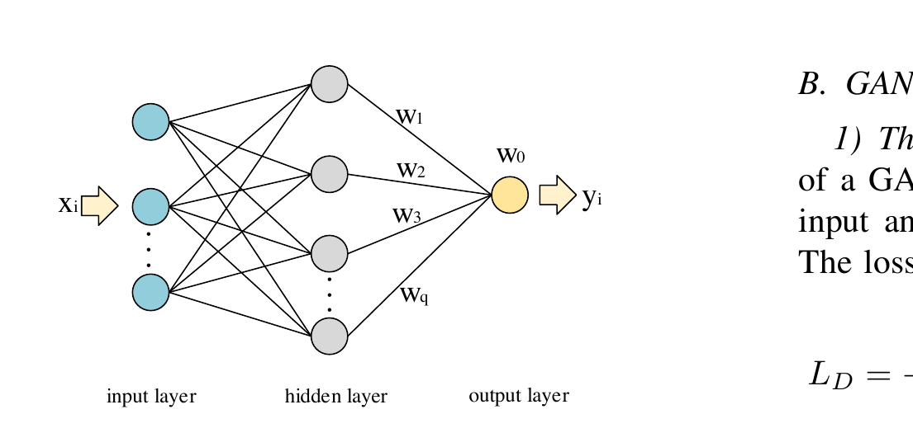

**图 1.** RBFNN 的结构。RBF 的中心 \(v_j\) 是与输入 \(x_i\) 同维的向量，而宽度 \(\sigma_j\) 是标量。

#### 2) 基于 RBFNN 的气动 ROM

基于 RBFNN 的气动 ROM 因具有强大的非线性输入-输出映射能力，被广泛用于预测气动响应参数。按核函数即径向基函数的数量，现有研究可分为单核 RBFNN 与多核 RBFNN 两类。

单核 RBFNN 是气动响应预测中最常用的模型。2005 年，Hočevar 等人首次采用高斯核 RBFNN 预测翼型后方湍流尾迹中被动示踪剂浓度的波动[34]。2010 年以后，RBFNN 在气动数据建模中的应用快速增加[35]。Ghoreyshi 采用单核 RBFNN 研究低速流动条件下的非定常气动建模[36]。与 Ghoreyshi 不同，Zhang 将整个流场划分为近壁区、尾迹区和远场区，分别建立三个单核 RBFNN 预测涡速度[37]、[38]。上述模型均使用高斯核。

多核 RBFNN 指包含多个径向基函数的 RBFNN，是近期研究重点。Kou 等人提出多核 RBFNN，并用于非定常气动建模[8]。该模型采用文献[39]中高斯核函数与小波核函数的线性组合。实验结果表明，在固定马赫数和变马赫数两类测试中，多核神经网络误差均低于单核 RBFNN。

上述 RBFNN 并未用于流场重建，因为 RBFNN 属于插值模型，无法生成大量全域 FFD，难以实现快速、精细的流场管理。

### B. GAN

#### 1) GAN 基础

图 2 展示了经典 GAN 的结构。GAN 以服从特定分布的噪声为输入，输出 0 到 1 之间的变量。\(D\) 和 \(G\) 的损失函数为

\[
L_D
=
-\mathbb E_{x\sim p_r(x)}[\log D(x)]
-
\mathbb E_{z\sim p_z(z)}[\log(1-D(G(z)))],
\tag{1}
\]

\[
L_G
=
\mathbb E_{z\sim p_z(z)}[\log(1-D(G(z)))],
\tag{2}
\]

其中，\(x\) 表示服从分布密度 \(p_r(x)\) 的真实数据，\(z\) 表示服从分布密度 \(p_z(z)\) 的输入噪声。GAN 的训练目标是使上述两个公式达到最小值。

虽然 GAN 已在许多领域取得巨大成功，但仍存在模式坍塌[40]、[41]、收敛性[42]、梯度消失[43]、应用问题和训练不稳定[10]等问题。为解决这些问题，研究者提出了新的模型、算法和损失函数[44]。Wasserstein-GAN 与推土机距离[43]从本质上解决了收敛问题，并缓解模式坍塌；Dual-GAN[45]和 DC-GAN[46]拓展了 GAN 在计算机视觉领域的应用[47]；条件 GAN（cGAN）[48]和 Info-GAN[49]能够根据特定条件生成期望数据。现有研究仍将模式坍塌与不稳定视为 GAN 的主要问题。本文所提模型分别缓解了模式坍塌和不稳定问题，详见第 IV-B-1 与 IV-B-3 节。

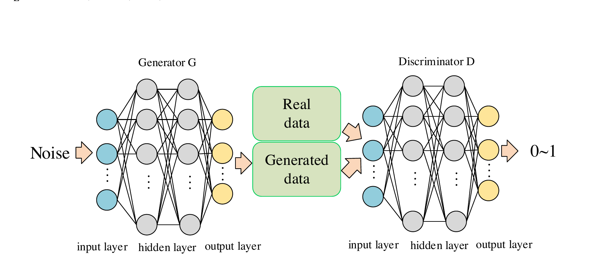

**图 2.** 经典 GAN 的结构。

#### 2) 面向非线性稀疏 FFD 回归与生成的 GAN-ROM

本节只讨论非图像研究。现有方法通常采用 cGAN，而非经典 GAN。原因在于大多数控制方程（如 Navier-Stokes 方程）是偏微分方程且没有数值解，难以利用控制方程直接评估基于 GAN 的模型误差。

Farimani 采用兼具回归和生成能力的 cGAN 学习气动传输现象[30]。结果表明，生成数据的 MAE 小于 0.01，但未讨论 cGAN 的稳定性。Hu 等人采用 cGAN 预测 Burgers 方程中的速度 \(u\) 和 Navier-Stokes 方程中的压力系数 \(C_p\)[10]。通过比较不同结构的 cGAN，作者强调了稳定性问题：模型收敛后，训练过程中的误差会在较大范围内快速波动，导致：

1. 模型设计者无法依据经验判断何时停止训练；
2. 模型无法生成高保真全域 FFD。

因此，现有非图像模型不适合以非线性稀疏 FFD 作为数据集，因为生成 FFD 的误差较大或训练不稳定。

为克服现有流场重建模型的不足并考虑 FFD 特点，本文在下一节证明：RBFNN 是 GAN 的最优判别器。基于该证明，将 RBFNN 引入 GAN，自然形成 RBF-GAN 与 RBFC-GAN 两种新型 GAN。与现有方法[45]、[50]、[51]相比，这两个模型更准确、更稳定。

## III. 方法

### A. 面向非线性稀疏数据生成的 GAN 最优判别器

#### 1) 最佳逼近问题

Goodfellow 等人证明[52]，当 \(P_r(x)=P_g(x)\)，即 \(D(x)=0.5\) 时存在最优判别器；但 GAN 最优判别器的具体形式仍未解决。本节首先引入最佳逼近理论，说明神经网络逼近给定连续函数的本质，随后证明在处理由这些函数产生的非线性稀疏数据时，RBFNN 是最优判别器。

神经网络的最佳逼近问题可表述如下。

**定义 III.1.** 给定属于函数空间 \(\Phi\) 的连续函数 \(F(X)\) 及子集 \(A\subseteq\Phi\)，寻找一个连续依赖 \(W\in\mathbb R^n\) 和 \(X\) 的函数 \(f(W,X)\in A\)，使得

\[
d(F(X),A)
\equiv
\inf_{f\in A}\lVert F(X)-f(W,X)\rVert,
\tag{3}
\]

其中，\(d(F(X),A)\) 表示 \(F(X)\) 到子集 \(A\) 的距离。若 \(\lVert F(X)-f(W,X)\rVert\) 的下确界对 \(A\) 中某个函数 \(f(W^*,X)\) 取得，则称 \(f(W^*,X)\) 是 \(F(X)\) 的最佳逼近。

神经网络的逼近问题，是利用有限数据构建输入与输出之间的光滑映射 \(f(W,X)\)。光滑映射意味着输入的微小变化只会导致输出发生微小变化。与之矛盾的是，非线性稀疏数据集所含信息不足以反映这些微小变化。例如，与计算机视觉中数万级样本不同，普通气动数据集的样本数通常少于 1000，且难以扩充[6]、[11]、[41]；气动数据的高度非线性也进一步增加了逼近难度。因此，最佳逼近是突破这一困境的唯一途径。式 (3) 描述光滑映射 \(f(W,X)\)，其最小值可通过下一节的 Euler-Lagrange 方程计算。

已有研究表明，FCN 不具备对任意连续函数的最优逼近性质，而 RBFNN 具备该性质[53]。因此，下面将证明：处理非线性稀疏数据时，RBFNN 是 GAN 的最优判别器。

#### 2) 最优判别器

**定理 III.1.** 设 \(\mathcal D=\{(z_i,x_i)\in\mathbb R^n\mid i=1,\ldots,N\}\) 是非线性稀疏数据集，其中 \(x_i\) 表示真实数据，\(z_i\) 表示服从特定分布的噪声，则 GAN 的最优判别器是 RBFNN。

**证明.** 为证明定理 III.1，先引入正则化理论[53]：

\[
\sum_i\left(f(x_i)-d_i\right)^2
+\lambda\left\lVert Pf(x)\right\rVert^2,
\tag{4}
\]

其中，\(\sum_i(f(x_i)-d_i)^2\) 是神经网络原始损失，用于度量生成数据 \(f(x_i)\) 与真实数据 \(d_i\) 之间的距离；\(\lVert Pf(x)\rVert^2\) 嵌入关于函数 \(f(x)\) 的先验信息，\(P\) 为微分约束算子[54]，\(\lambda\) 为正则项系数。

根据式 (4)，可将式 (1) 改写为

\[
L_D
=
-\mathbb E_{x\sim p_r(x)}[\log D(x)]
-
\mathbb E_{z\sim p_z(z)}[\log(1-D(G(z)))]
+\lambda\lVert PD(x)\rVert^2.
\tag{5}
\]

式 (5) 描述 \(D(x)\) 的损失函数，并可写成泛函形式：

\[
\begin{aligned}
H[D(x)]
={}&
-\mathbb E_{x\sim p_r(x)}[\log D(x)]\\
&-\mathbb E_{z\sim p_z(z)}[\log(1-D(G(z)))]
+\lambda\lVert PD(x)\rVert^2.
\end{aligned}
\tag{6}
\]

文献[52]证明，判别器损失在 \(D(x)=0.5\) 时达到最小值，因此式 (6) 的最小值确实存在。于是，GAN 最优判别器问题转化为求使式 (6) 最小的函数 \(D(x)\)。本文将利用 Euler-Lagrange 方程计算 \(H[D(x)]\) 的最小值，以实现定理 III.1 定义的最优逼近。

式 (6) 可展开为离散形式：

\[
\begin{aligned}
H[D(x)]
={}&
-\sum_{i=1}^{N}\left\{
p_r(x_i)\log D(x_i)
+p_g(x_i)\log[1-D(x_i)]
\right\}\\
&+\lambda\lVert PD(x)\rVert^2.
\end{aligned}
\tag{7}
\]

为最小化泛函 \(H[D(x)]\)，引入 Euler-Lagrange 方程[55]：

\[
\frac{\partial L}{\partial f(x)}
-
\frac{d}{dx}
\left(\frac{\partial L}{\partial f'(x)}\right)
\equiv 0,
\tag{8}
\]

其中，\(L\) 是 \(x,f(x),f'(x)\) 的泛函。类似地，式 (7) 中的 \(H[\cdot]\) 是 \(x,D(x),D'(x)\) 的泛函，即 \(H[x,D(x),D'(x)]\)。不过，式 (7) 不包含 \(D'(x)\)，因此泛函 \(H[\cdot]\) 可写为

\[
\begin{aligned}
H[x,D(x),D'(x)]
={}&H(x,D(x))\\
={}&-\sum_{i=1}^{N}\left\{
p_r(x_i)\log D(x_i)
+p_g(x_i)\log[1-D(x_i)]
\right\}\\
&+\lambda\lVert PD(x)\rVert^2.
\end{aligned}
\tag{9}
\]

由式 (9) 可得

\[
\begin{cases}
\displaystyle
\frac{\partial H}{\partial D(x)}
=-\sum_{i=1}^{N}
\left[
p_r(x_i)\frac{1}{D(x_i)}
-p_g(x_i)\frac{1}{1-D(x_i)}
\right]
+2\lambda\hat P P D(x),\\[10pt]
\displaystyle
\frac{d}{dx}
\left(\frac{\partial H}{\partial D'(x)}\right)\equiv0,
\end{cases}
\tag{10}
\]

其中，\(\hat P\) 是微分约束算子 \(P\) 的伴随算子。结合式 (8) 与式 (10)，有

\[
-\sum_{i=1}^{N}
\left[
p_r(x_i)\frac{1}{D(x_i)}
-p_g(x_i)\frac{1}{1-D(x_i)}
\right]
+2\lambda\hat P P D(x)=0.
\tag{11}
\]

因此，

\[
\hat P P D(x)
=
\frac{1}{2\lambda}
\sum_{i=1}^{N}
\left[
p_r(x_i)\frac{1}{D(x_i)}
-p_g(x_i)\frac{1}{1-D(x_i)}
\right].
\tag{12}
\]

式 (12) 右侧的求和项表示真实数据分布与生成数据分布之间的距离，与 GAN 的训练机制一致；\(\hat P P D(x)\) 表示受微分约束算子 \(P\) 约束的最优判别器。

由于训练集中的 FFD 通常有限且稀疏，很难捕捉输入或输出的微小变化。因此，应充分利用每个 FFD 中包含的信息，以获得比现有 GAN 更准确的逼近。基于式 (12)，引入常用于空间或时间离散分布（稀疏数据）密度问题的 Dirac 函数[56]，得到

\[
\hat P P D(x)
=
\frac{1}{2\lambda}\sum_{i=1}^{N}
\left[
p_r(x_i)\frac{1}{D(x_i)}
-p_g(x_i)\frac{1}{1-D(x_i)}
\right]
\delta(x-x_i),
\tag{13}
\]

其中，\(\delta(x-x_i)\) 是 Dirac 函数，表示只有当 \(x=x_i\) 时 \(D(x)\) 才会被激活，而 \(x\ne x_i\) 时不激活。为简化式 (13)，引入满足如下分布恒等式的 Green 函数 \(R(x;y)\)[53]：

\[
\hat P P R(x;y)=\delta(x-y).
\tag{14}
\]

用式 (14) 替换式 (13) 中的 Dirac 函数，得到

\[
\hat P P D(x)
=
\frac{1}{2\lambda}\sum_{i=1}^{N}
\left[
p_r(x_i)\frac{1}{D(x_i)}
-p_g(x_i)\frac{1}{1-D(x_i)}
\right]
\hat P P R(x;x_i).
\tag{15}
\]

由式 (15) 可推导出

\[
D(x)
=
\frac{1}{2\lambda}\sum_{i=1}^{N}
\left[
p_r(x_i)\frac{1}{D(x_i)}
-p_g(x_i)\frac{1}{1-D(x_i)}
\right]
R(x;x_i),
\tag{16}
\]

其中，\(p_r(x_i)/D(x_i)-p_g(x_i)/[1-D(x_i)]\) 表示真实数据与生成数据之间的距离。令

\[
w_i
=
p_r(x_i)\frac{1}{D(x_i)}
-p_g(x_i)\frac{1}{1-D(x_i)},
\]

其表示判别器需要学习的权重。于是函数 \(D(x)\) 可写为

\[
D(x)
=
\frac{1}{2\lambda}\sum_{i=1}^{N}w_iR(x;x_i).
\tag{17}
\]

实际应用中，微分约束操作 \(P\) 具有旋转和平移不变性[54]，因此式 (17) 中的 \(R\) 只依赖参数之差，即

\[
R(x;x_i)=R(\lVert x-x_i\rVert).
\]

最终得到

\[
D(x)
=
\frac{1}{2\lambda}
\sum_{i=1}^{N}
w_iR(\lVert x-x_i\rVert),
\tag{18}
\]

其中，\(R(\cdot)\) 可替换为任意径向基函数。例如采用高斯核并引入宽度 \(\sigma\)，可得基于高斯核函数的 RBFNN：

\[
D(x)
=
\frac{1}{2\lambda}
\sum_{i=1}^{N}
w_i g_1(x_i,v,\sigma).
\tag{19}
\]

因此，判别器损失可被推导成 RBFNN 的形式。这使基于 RBF 的判别器能够关注非线性稀疏数据，并确保模型在训练集上损失最小，即更充分地利用训练集中的超曲面信息。受该定理启发，RBFNN 可在处理非线性稀疏数据时充当 GAN 判别器，因此下一小节引入基于 RBFNN 的 GAN，即 RBF-GAN 和 RBFC-GAN。

### B. RBF-GAN 与 RBFC-GAN

#### 1) 总体结构

基于定理 III.1，本文提出用于非线性稀疏数据回归与生成的 RBF-GAN 和 RBFC-GAN。二者同样由生成器 \(G\) 和判别器 \(D\) 构成：\(G\) 是包含多个隐藏层的 FCN；\(D\) 是仅包含一个隐藏层的 RBFNN。RBF-GAN 的判别器称为 RBF-D，RBFC-GAN 的判别器称为 RBFC-D。

#### 2) RBF-GAN

将多个高斯核函数引入式 (19)，得到新的 RBF-D：

\[
D(X)
=
w_0
+\frac{1}{2\lambda}
\sum_{i=1}^{N}
\sum_{j=1}^{q}
w_{ij}g_1(x_i,v_j,\sigma_j),
\tag{20}
\]

其中，\(X\) 表示输入矩阵，\(q\) 表示高斯核函数数量，也等于 RBF-D 隐藏神经元数量；\(N\) 表示输入数据 \(X\) 的数量；\(w_{ij}\) 表示处理第 \(i\) 个数据时第 \(j\) 个隐藏神经元的权重；\(w_0\) 是唯一输出神经元的偏置。省略系数 \(1/(2\lambda)\)，并聚焦于具体输入向量 \(x_i\)，式 (20) 可写为

\[
D(x_i)
=
w_0
+\sum_{j=1}^{q}
w_jg_1(x_i,v_j,\sigma_j),
\tag{21}
\]

其中，\(w_j\) 表示某个隐藏神经元与唯一输出神经元之间的权重。该式表明，基于 RBF 的判别器由三层组成：一个输入层 \(x_i\)、一个隐藏层 \(\sum_{j=1}^{q}w_jg_1(x_i,v_j,\sigma_j)\) 和一个输出层 \(D(x_i)\)。

图 3 给出 RBF-GAN 的结构。其中，\(Z\) 是服从分布 \(P_z\) 的噪声；“Real data” 表示服从分布 \(P_r(x)\) 的真实数据；“Generated data” 表示由 \(G\) 生成、服从分布 \(P_g(x)\) 的数据。RBF-D 的输出为 0 到 1 之间的变量，表示生成数据为真实数据的概率。

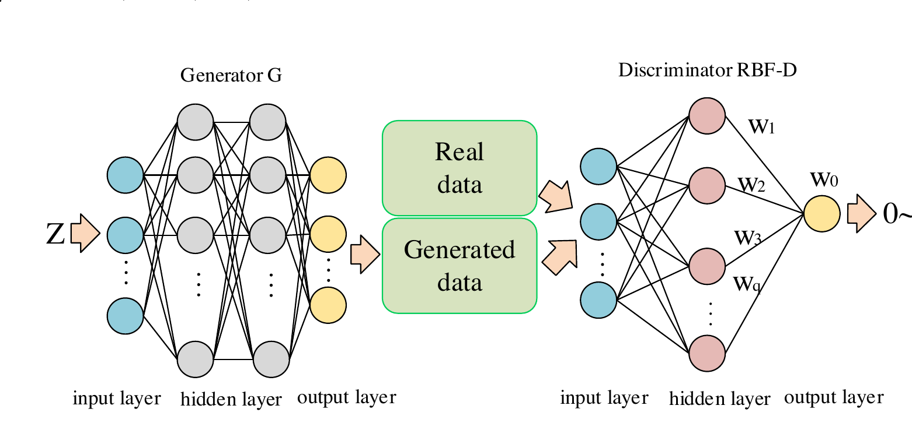

**图 3.** RBF-GAN 的结构。判别器 \(D\) 的隐藏层中，粉色神经元表示径向基函数；本文采用高斯核函数实现基于 RBF 的判别器 \(D\)。

#### 3) RBFC-GAN

将式 (21) 中的高斯核替换为多种径向基函数，可得到

\[
D(x_i)
=
\lambda_0
+\sum_{z=1}^{m}
\lambda_z
\sum_{j=1}^{q}
w_{z,j}g_z(x_i,v_j,\sigma_j),
\tag{22}
\]

其中，\(m\) 表示径向基函数数量，即 RBFNN 数量；\(q\) 表示每个 RBFNN 的隐藏神经元数量；\(w_{z,j}\) 表示第 \(z\) 个 RBFNN 中第 \(j\) 个隐藏神经元的权重；\(\lambda_z\) 表示第 \(z\) 个 RBFNN 的系数。

式 (22) 描述 RBFC-D 的结构，包括一个输入层 \(x_i\)、一个隐藏层 \(\sum_{z=1}^{m}\lambda_z\sum_{j=1}^{q}w_{z,j}g_z(x_i,v_j,\sigma_j)\) 和一个输出层 \(D(x_i)\)。与 RBF-D 不同，RBFC-D 的隐藏层由多个 RBFNN 聚类构成。本文将 \(\sum_{j=1}^{q}w_{z,j}g_z(x_i,v_j,\sigma_j)\) 称为一个聚类。因此，图 4 展示的是式 (22) 取 \(m=3\) 时的结构，即 RBFC-D 由三个不同聚类（RBFNN）组成。每个聚类中的径向基函数为

\[
\begin{cases}
\displaystyle
g_1(x_i,v_{j,1},\sigma_{j,1})
=\exp\left(
-\frac{\lVert x_i-v_{j,1}\rVert^2}{2\sigma_{j,1}^2}
\right),\\[8pt]
\displaystyle
g_2(x_i,v_{j,2},\sigma_{j,2})
=\exp\left(
-\frac{\lVert x_i-v_{j,2}\rVert}{\sigma_{j,2}}
\right),\\[8pt]
\displaystyle
g_3(x_i,v_{j,3},\sigma_{j,3})
=\frac{1}{\sqrt{\lVert x_i-v_{j,3}\rVert^2+\sigma_{j,3}^2}},
\end{cases}
\tag{23}
\]

其中，\(g_1,g_2,g_3\) 分别表示高斯核、Laplace 核和逆多二次核；\(v_{j,z},\sigma_{j,z}\)（\(z=1,2,3\)）分别表示第 \(z\) 个 RBFNN 中第 \(j\) 个径向基函数的中心和宽度。

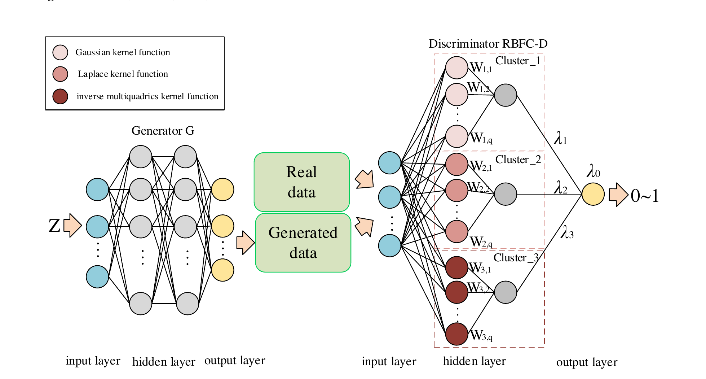

**图 4.** RBFC-GAN 的结构。与 RBF-D 不同，RBFC-D 由多个采用不同核函数的 RBFNN 构成；RBFC-GAN 通过将不同 RBFNN 线性组合实现。

## IV. 实验与结果分析

### A. 数据集

为验证 RBF-GAN 和 RBFC-GAN 的有效性与可行性，本文采用三个不同数据集：Burgers 数据集、圆柱层流数据集以及 ONERA M6 数据集。

#### 1) Burgers 数据集

Burgers 方程是一维偏微分方程，用于描述激波在管内的运动：

\[
\frac{\partial u}{\partial t}
+u\frac{\partial u}{\partial x}
=
\nu\frac{\partial^2u}{\partial x^2},
\]

其中，\(u\) 表示流体速度，即激波速度；\(t\) 表示时间；\(x\) 表示位移；\(\nu\) 表示黏性系数。设计参数 \((t,x,\nu)\) 的变化范围为 0.2 至 4.8，步长为 0.2。因此，该数据集包含 13,824 个样本。图 5 展示 \(\nu=2.0\) 时速度 \(u\) 随时间和位移的变化，左下角红色区域对应高速流动变化。因此，该数据集包含有限的高速非线性数据，可用于验证模型是否会发生模式坍塌。

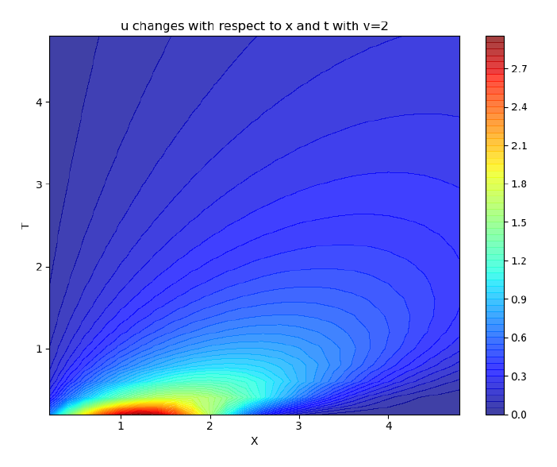

**图 5.** Burgers 方程数据的可视化结果。横坐标表示位移 \(x\)，纵坐标表示时间 \(t\)。

#### 2) 圆柱层流数据集

圆柱层流数据集是 Navier-Stokes 方程的二维应用，模拟流体绕过圆柱时圆柱表面的压力变化。Navier-Stokes 方程为

\[
\rho\left[
\frac{\partial V}{\partial t}
+(V\cdot\nabla)V
\right]
=
-\nabla P+\rho g+\nu\nabla^2V,
\]

其中，\(P,V,t,\rho,\nu\) 分别表示压力、速度、时间、密度和黏性系数。本文使用 SU2 计算 6,000 个样本点[57]。该数据集的设计参数格式与变化范围见表 I，响应参数格式见表 II。图 6 展示 \(\nu=2.0\) 时圆柱周围压力系数 \(C_p\) 的分布。

**表 I. 圆柱层流数据集设计参数的格式和变化范围**

| 变量 | \(x\) | \(y\) | \(Ma\) |
|---|---|---|---|
| 含义 | x 坐标 | y 坐标 | 马赫数 |
| 起点 | 0.1 | -0.5 | 0.1 |
| 终点 | 1 | 0.5 | 0.24 |
| 步长 | 0.005 | 0.0078 | 0.01 |

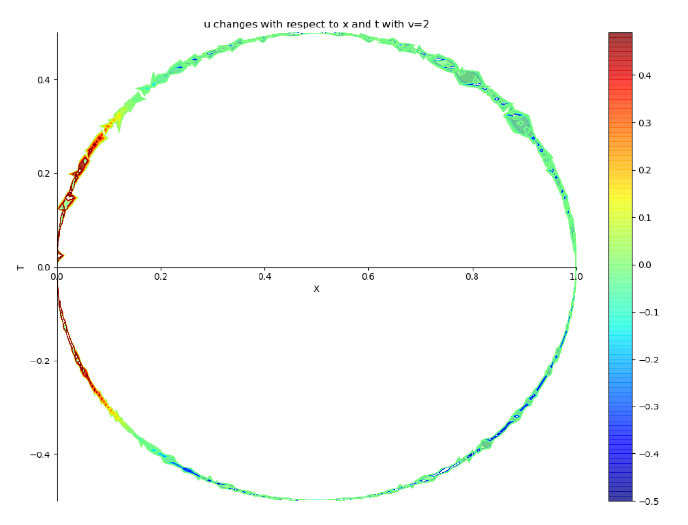

**图 6.** 圆柱层流数据集的可视化结果。横坐标表示位移 \(x\)，纵坐标表示时间 \(t\)。

#### 3) ONERA M6 数据集

ONERA M6 数据集用于描述固定 ONERA M6 翼型在不同流动状态下的气动特性[58]。本文在翼型表面与远场设计 770,000 个网格（图 8），并使用 SU2 计算 755 个样本点。该数据集的设计参数格式与变化范围见表 III，响应参数格式见表 IV。

**表 II. 圆柱层流测试案例响应参数的格式**

| 变量 | 含义 |
|---|---|
| \(P\) | 压力 |
| \(C_p\) | 压力系数 |
| \(F_x\) | x 方向摩擦力 |
| \(F_y\) | y 方向摩擦力 |

**表 III. M6 测试案例设计参数的格式和变化范围**

| 变量 | \(Ma\) | 迎角 \(\alpha\) | \(Re\) |
|---|---|---|---|
| 含义 | 马赫数 | 迎角 | 雷诺数 |
| 起点 | 0.8045 | \(1.06^\circ\) | 8,030,000 |
| 终点 | 0.8395 | \(4.81^\circ\) | 13,000,000 |
| 步长 | 0.005 | \(1.25^\circ\) | 250,000 |

**表 IV. ONERA M6 数据集响应参数的格式**

| 变量 | 含义 | 变量 | 含义 |
|---|---|---|---|
| \(C_L\) | 升力系数 | \(C_D\) | 阻力系数 |
| \(C_F\) | 摩擦系数 | \(C_{M_x}\) | 滚转力矩系数 |
| \(C_{M_y}\) | 俯仰力矩系数 | \(C_{M_z}\) | 偏航力矩系数 |
| \(C_{F_x}\) | x 方向摩擦系数 | \(C_{F_y}\) | y 方向摩擦系数 |
| \(C_{F_z}\) | z 方向摩擦系数 |  |  |

从表 III 可见，迎角在 \(1.06^\circ\) 至 \(4.81^\circ\) 之间变化，但数据集只包含四个不同取值，因此 ONERA M6 数据集属于有限、非线性和稀疏数据集。图 7 展示 \(Ma=0.8\)、\(Re=8,220,000\) 时阻力系数 \(C_D\)、俯仰力矩系数 \(C_{M_y}\)、x 方向摩擦系数 \(C_{F_x}\) 和偏航力矩系数 \(C_{M_z}\) 随迎角 \(\alpha\) 的变化。

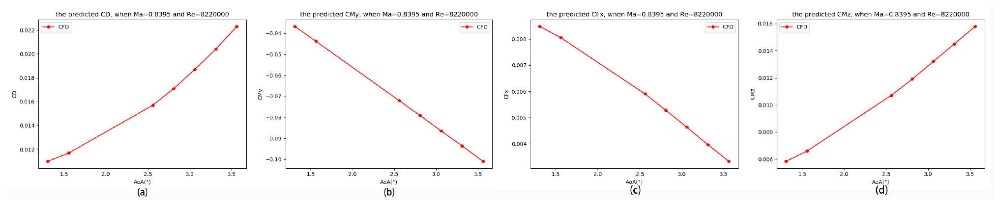

**图 7.** \(Ma=0.8\)、\(Re=8,220,000\) 时，阻力系数 \(C_D\)(a)、俯仰力矩系数 \(C_{M_y}\)(b)、x 方向摩擦系数 \(C_{F_x}\)(c) 和偏航力矩系数 \(C_{M_z}\)(d) 随迎角 \(\alpha\) 的变化。

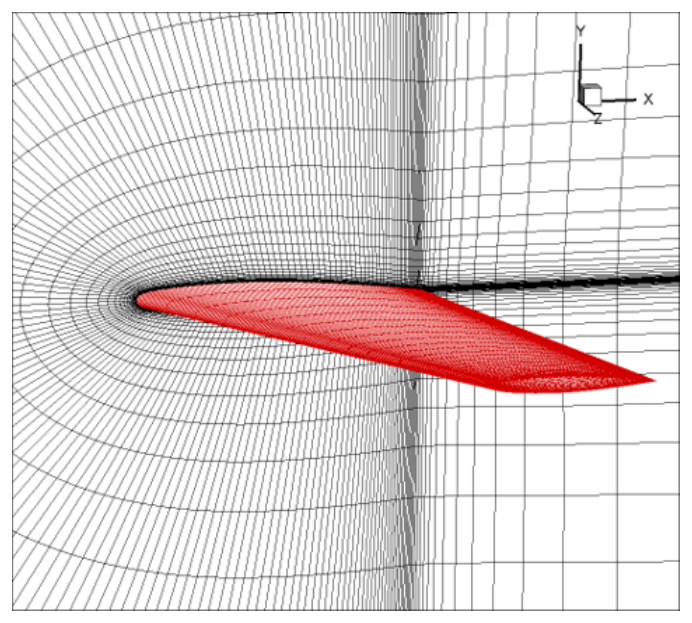

**图 8.** M6 机翼及其表面和远场网格。

### B. 实验结果

本文比较五种神经网络：FCN[32]、ClusterNet[11]、GAN/cGAN[30]、RBF-GAN 和 RBFC-GAN。其中后三种是本文重点关注的生成模型。所有模型学习率均为 0.0001，批大小为 128，迭代次数为 2000。生成模型的 \(G\) 接收一个服从均匀分布 \(U(0,1)\) 的 62 维噪声作为输入。RBF-GAN 或 RBFC-GAN 隐藏神经元的中心和宽度分别按均匀分布 \(U(0,1)\) 与正态分布 \(N(0.5,0.2)\) 初始化。

五种模型均基于 TensorFlow 实现，运行于四块 Tesla K80 GPU。模型误差采用 MSE 和 MSPE 评价：

\[
\begin{cases}
\displaystyle
MSE=\frac{1}{n}\sum_{i=1}^{n}\left(f(x_i)-y_i\right)^2,\\[8pt]
\displaystyle
MSPE=\frac{1}{n}\sum_{i=1}^{n}
\frac{\left\lVert f(x_i)-y_i\right\rVert_2}{\left\lVert y_i\right\rVert_2}
\times100\%,
\end{cases}
\]

其中，\(y_i\) 表示真实响应值，\(f(x_i)\) 表示相同设计参数下的生成响应值。

#### 1) Burgers 数据集

Burgers 方程具有数值解，因此使用方程本身而非验证集或测试集评价模型误差，也就是说无需将整个数据集划分为训练集、验证集和测试集。表 V 给出上述模型在 Burgers 数据集上的比较结果。

可以看到，RBF-GAN 比 GAN 更准确，但不如 FCN 和 ClusterNet；RBFC-GAN 的 MSE 和 MSPE 在所有模型中最低。

为比较三种生成模型生成 Burgers 数据的能力，图 9 和图 10 展示了表 V 中 GAN、RBF-GAN 和 RBFC-GAN 生成的速度 \(u\)。由图 9 可见，GAN 生成的 \(u<2.0\)，说明 GAN 只能生成低速数据，即发生模式坍塌[59]。与 GAN 相比，RBF-GAN 能够生成 \(u>2.0\) 的数据，说明其缓解了模式坍塌。RBFC-GAN 比 RBF-GAN 更准确，但仍存在一定模式坍塌。

图 10 反映了相同结论。子图 (c) 左下角红色区域与子图 (a) 接近，说明 RBF-GAN 能够生成高速 Burgers 数据。比较图 10 的子图 (b) 与 (c)，子图 (d) 的等值线变化更平滑，并接近子图 (a)。

**表 V. FCN、ClusterNet、GAN、RBF-GAN 与 RBFC-GAN 在 Burgers 数据集上的测试 MSE 和 MSPE**

| 模型 | 结构 | MSE | MSPE |
|---|---|---:|---:|
| FCN | 5,32 | \(5.26\times10^{-4}\) | 5.92% |
| ClusterNet | 4;1,1;4,5 | \(4.31\times10^{-4}\) | 5.36% |
| GAN | G(62,64*1,4) D(4,64*1,1) | \(2.07\times10^{-3}\) | 299.19% |
| RBF-GAN | G(62,1024*1,4) D(4,1024*1,1) | \(9.87\times10^{-4}\) | 10.86% |
| RBFC-GAN | G(62,128*2,4) D(4,(42,43,43),1) | \(8.21\times10^{-5}\) | 2.96% |

表中，“5,32”表示最优 FCN 有 5 个隐藏层，每层 32 个神经元；“4;1,1;4,5”表示最优 ClusterNet 包含 4 个聚类，每个聚类由上下文网络和功能网络组成，上下文网络有 1 个隐藏层且仅含 1 个神经元，功能网络有 4 个隐藏层且每层 5 个节点。“G(62,128*2,4)”表示基于 FCN 的生成器共有 4 层，输入层和输出层分别为 62 和 4 个神经元，“128*2”表示生成器有两个各含 128 个神经元的隐藏层。“D(4,(42,43,43),1)”表示基于 RBF 聚类的判别器有三层，输入层和输出层分别为 4 和 1 个神经元，42、43、43 分别表示高斯核 RBFNN、Laplace 核 RBFNN 和逆多二次核 RBFNN 的隐藏神经元数量。

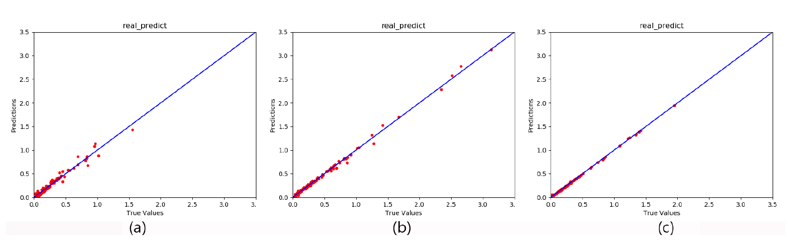

**图 9.** Burgers 数据集中由 GAN(a)、RBF-GAN(b) 和 RBFC-GAN(c) 生成的速度 \(u\)。

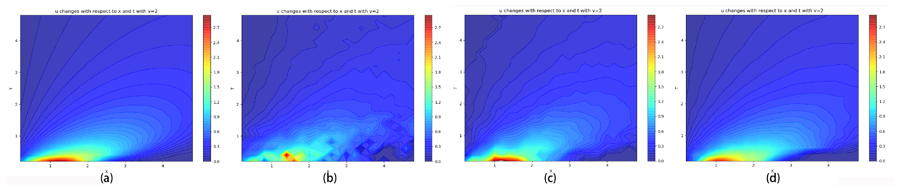

**图 10.** 由 CFD(a)、经典 GAN(b)、RBF-GAN(c) 和 RBFC-GAN(d) 生成的速度 \(u\) 可视化结果。

#### 2) 圆柱层流数据集

在圆柱层流实验中，测试与 Burgers 实验相同的神经网络。与 Burgers 数据集不同，Navier-Stokes 方程更复杂，利用该方程直接计算 MSE 和 MSPE 并不现实。因此，将整个数据集按 8:1:1 划分为训练集、验证集和测试集。考虑到普通 GAN 无法在特定流态下生成数据，本文采用 cGAN 简化 MSE 和 MSPE 的计算。表 VI 给出五种神经网络在圆柱层流数据集上的测试误差。

可以看到，RBF-cGAN 和 RBFC-cGAN 比 cGAN 更准确，并与 FCN、ClusterNet 接近。

图 11 和图 12 分别展示表 VI 中 cGAN、RBF-cGAN 与 RBFC-cGAN 生成的压力 \(P\) 和 x 方向摩擦力 \(F_x\)。cGAN 生成的 \(P\) 与 \(F_x\) 精度低于 RBF-cGAN 和 RBFC-cGAN。

图 13 展示由 CFD、cGAN、RBF-cGAN 和 RBFC-cGAN 得到的压力系数 \(C_p\) 可视化结果。四个子图相似，说明 cGAN、RBF-cGAN 和 RBFC-cGAN 均能学习圆柱层流数据集的压力系数分布。

**表 VI. FCN、ClusterNet、cGAN、RBF-cGAN 与 RBFC-cGAN 在圆柱层流数据集上的测试 MSE 和 MSPE**

| 模型 | 结构 | MSE | MSPE |
|---|---|---:|---:|
| FCN | 5,64 | \(2.48\times10^{-4}\) | 1.72% |
| ClusterNet | 4;1,5;3,64 | \(6.49\times10^{-4}\) | 4.73% |
| cGAN | G(62,512*1,4) D(7,512*1,1) | \(3.98\times10^{-3}\) | 6.40% |
| RBF-cGAN | G(62,512*2,4) D(7,512*1,1) | \(2.60\times10^{-4}\) | 2.05% |
| RBFC-cGAN | G(62,128*3,4) D(7,(42,43,43),1) | \(4.06\times10^{-4}\) | 4.42% |

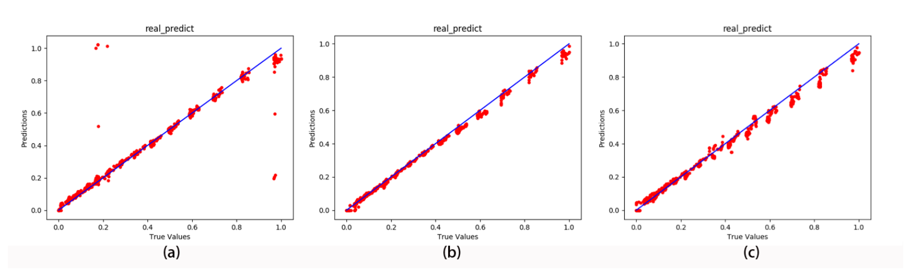

**图 11.** 由 cGAN(a)、RBF-cGAN(b) 和 RBFC-cGAN(c) 生成的压力 \(P\)。

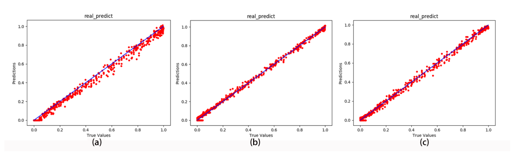

**图 12.** 由 cGAN(a)、RBF-cGAN(b) 和 RBFC-cGAN(c) 生成的 x 方向摩擦力 \(F_x\)。

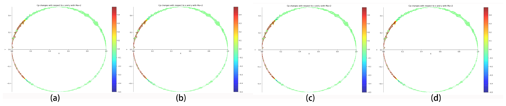

**图 13.** 由 CFD(a)、经典 GAN(b)、RBF-GAN(c) 和 RBFC-GAN(d) 生成的压力系数 \(C_p\) 可视化结果。

#### 3) ONERA M6 数据集

与圆柱层流数据集类似，整个 ONERA M6 数据集按 8:1:1 划分为训练集、验证集和测试集。该实验同样采用 cGAN，重点讨论模型精度、稳定性和计算成本。

精度仍采用 MSE 和 MSPE 评价。表 VII 给出不同模型生成 ONERA M6 数据的平均误差。RBF-cGAN 和 RBFC-cGAN 比 cGAN 更准确，并与 FCN、ClusterNet 接近；RBFC-cGAN 也比 RBF-cGAN 和 ClusterNet 更准确。

图 14 和图 15 分别展示 cGAN、RBF-cGAN 和 RBFC-cGAN 生成的 \(C_D\) 与 \(C_{M_y}\)。cGAN 生成的数据没有紧密围绕 45 度对角线，而另外两个模型生成的数据紧贴 45 度对角线。其余响应参数的可视化结果类似。

图 16 给出 \(Ma=0.8395\)、\(Re=8,220,000\) 时 \(C_D\)、\(C_{M_y}\)、\(C_{F_x}\) 和 \(C_{M_z}\) 随迎角的变化。与 CFD 相比，cGAN 生成的数据始终存在较大误差；RBF-cGAN 和 RBFC-cGAN 生成的数据更准确，其中 RBFC-cGAN 比 RBF-cGAN 更准确。

稳定性方面，图 17 比较三种生成模型训练过程中的验证 MSE。三种模型收敛后（epoch > 750），RBF-cGAN 和 RBFC-cGAN 的验证 MSE 均低于 cGAN，且 RBFC-cGAN 低于 RBF-cGAN。此外，RBF-cGAN 收敛更快。根据验证 MSE 的变化，将整个迭代过程划分为 \([0,125)\)、\([125,750)\) 和 \([750,2000]\) 三个区间。表 VIII 给出三个模型验证 MSE 的标准差。

模型收敛后的稳定性提升率按下式计算：

\[
\eta=
\frac{\lVert\hat\sigma-\sigma\rVert}{\lVert\sigma\rVert}\times100\%,
\]

其中，\(\hat\sigma\) 和 \(\sigma\) 分别表示两个不同模型标准差。与 cGAN 相比，RBF-cGAN 与 RBFC-cGAN 的稳定性分别提高 34.62% 和 72.31%。不过，RBFC-cGAN 的稳定性提升以更长的收敛时间为代价。

计算成本方面，由于 SU2 无法在 GPU 上运行，所有方法均在 CPU 上比较生成一个 ONERA M6 数据的平均开销，见表 IX。按平均时间计算，SU2 计算一个数据耗时最长，其余模型均能在 0.05 s 内输出一个数据；其中 FCN 最快，cGAN 最慢。RBF-cGAN 和 RBFC-cGAN 比 cGAN 快，但慢于 FCN。硬件资源方面，SU2 的 CPU 与内存占用最高，其次是 ClusterNet 和 RBF-cGAN；RBFC-cGAN、cGAN 和 FCN 占用最低。

**表 VII. 经典 cGAN 与 RBF-cGAN 在 M6 数据集上的测试 MSE 和 MSPE**

| 方法 | 结构 | MSE | MSPE |
|---|---|---:|---:|
| FCN | 5 10 | \(2.07\times10^{-6}\) | 0.23% |
| ClusterNet | 4; 1 16; 3 32 | \(8.29\times10^{-6}\) | 0.36% |
| cGAN | G(62,512,9) D(12,512,1) | \(5.48\times10^{-5}\) | 122.25% |
| RBF-cGAN | G(62,512,9) D(12,512,1) | \(1.90\times10^{-5}\) | 0.72% |
| RBFC-cGAN | G(62,128,9) D(12,(42,43,43),1) | \(1.24\times10^{-5}\) | 0.28% |

**表 VIII. 按训练 epoch 划分的三个区间内验证误差标准差**

| 模型 | \([0,125)\) | \([125,750)\) | \([750,2000]\) | \(\eta\) |
|---|---:|---:|---:|---:|
| cGAN | 0.16 | 0.027 | 0.0013 | - |
| RBF-cGAN | 0.082 | 0.048 | 0.00085 | 34.62% |
| RBFC-cGAN | 0.082 | 0.074 | 0.00036 | 72.31% |

表中 \(\eta\) 按稳定性提升公式计算，表示模型收敛后相对于 cGAN 的稳定性提升。

**表 IX. 各方法使用 ONERA M6 数据集输出一个数据的平均计算成本**

| 方法 | 平均时间（s） | CPU 占用（%） | 内存占用（MB） |
|---|---:|---:|---:|
| SU2 | 6600 | 89 | 15194.33 |
| FCN | 0.0048 | 41.56 | 174.23 |
| ClusterNet | 0.0085 | 86.32 | 212.45 |
| cGAN | 0.024 | 53.00 | 176.82 |
| RBF-cGAN | 0.0206 | 76.21 | 186.98 |
| RBFC-cGAN | 0.0065 | 58.79 | 188.58 |

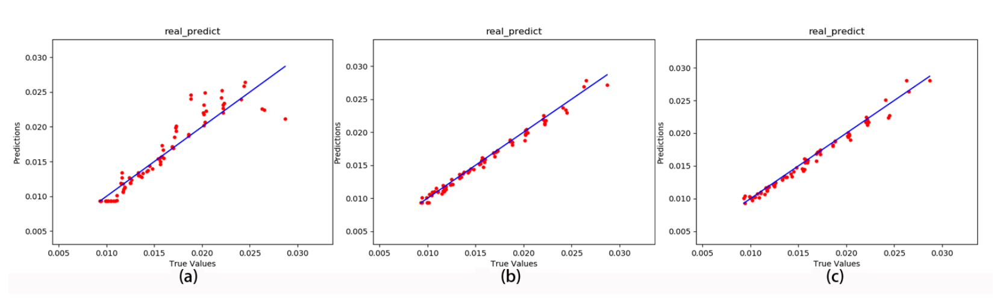

**图 14.** 由 cGAN(a)、RBF-cGAN(b) 和 RBFC-cGAN(c) 生成的 \(C_D\)。

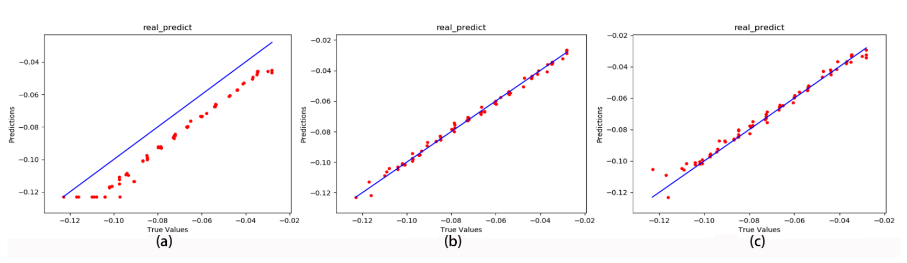

**图 15.** 由 cGAN(a)、RBF-cGAN(b) 和 RBFC-cGAN(c) 生成的 \(C_{M_y}\)。

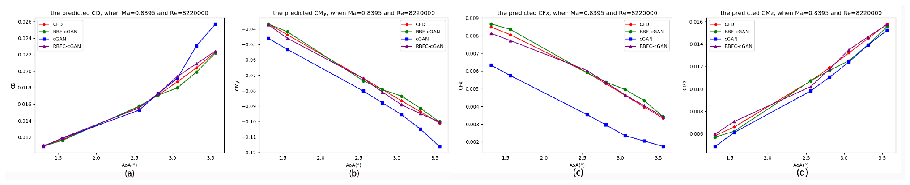

**图 16.** \(Ma=0.8395\)、\(Re=8,220,000\) 时，阻力系数 \(C_D\)(a)、俯仰力矩系数 \(C_{M_y}\)(b)、x 方向摩擦系数 \(C_{F_x}\)(c) 和偏航力矩系数 \(C_{M_z}\)(d) 随迎角的变化。

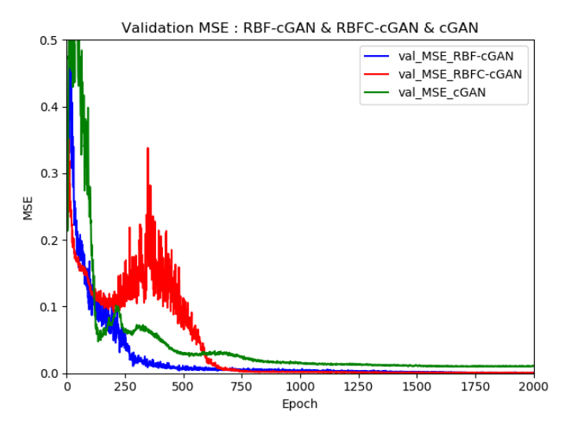

**图 17.** 三种生成模型训练过程中的验证 MSE。

### C. 结果分析

#### 1) 误差来源

考虑 \(\sigma=1\) 的简单高斯核函数：

\[
\begin{aligned}
K(x,v)
&=\exp\left(-(x-v)^2\right)\\
&=\exp(-x^2)\exp(-v^2)\exp(2xv),
\end{aligned}
\tag{24}
\]

其中，\(x\) 和 \(v\) 分别表示输入和 \(K(x,v)\) 的中心。对 \(\exp(2xv)\) 进行 Taylor 展开：

\[
\begin{aligned}
K(x,v)
&=
\exp(-x^2)\exp(-v^2)
\sum_{i=0}^{\infty}\frac{(2xv)^i}{i!}\\
&=
\sum_{i=0}^{\infty}
\exp(-x^2)\exp(-v^2)
\frac{\sqrt{2^i}}{\sqrt{i!}}x^i
\frac{\sqrt{2^i}}{\sqrt{i!}}v^i.
\end{aligned}
\tag{25}
\]

令

\[
\Phi(x)
=
\exp(-x^2)
\left(
1,
\sqrt{\frac{2}{1!}}x,
\sqrt{\frac{2^2}{2!}}x^2,
\ldots
\right)^T,
\]

则

\[
K(x,v)=\Phi(x)\cdot\Phi(v).
\]

可见，\(\Phi(x)\) 是无限维向量，说明高斯核函数将低维数据映射到更高维空间。在低维输入空间中相近的两个分布，其距离会在高维隐藏空间中被放大。因此，RBF-D 提高了区分真实数据与生成数据的能力，并直接改善相应生成器所生成数据的质量。

在 RBFC-GAN 中，三种不同径向基函数线性组合为更复杂的多核径向基函数[8]。这意味着低维输入可映射到比 RBF-GAN 更高的空间；在神经元数量相同时，可进一步降低预测误差[11]。

#### 2) 稳定性

仍考虑 \(\sigma=1\) 的 \(K(x,v)\)：

\[
K(x,v)
=
\exp\left(-(x-v)^2\right)
=
\begin{cases}
1,&x=v,\\
0,&\lvert x-v\rvert\gg0.
\end{cases}
\tag{26}
\]

对于任意给定输入 \(x\)，只有中心 \(v\) 接近 \(x\) 的隐藏神经元会被激活，因此 \(D(x)\) 的变化较小；相反，FCN 的隐藏神经元全部激活，导致 \(D(x)\) 变化较大。因此，RBF-GAN 比基于 FCN 的 GAN 更稳定。

在神经元数量相同时，RBFNN 的聚类形式可以进一步提高 RBFC-GAN 稳定性。RBFC-GAN 同时使用不同径向基函数来克服梯度波动。其权重梯度为

\[
\frac{\partial L_D}{\partial W_{zj}}
=
\frac{\partial L_D}{\partial D(x)}
\frac{\partial D(x)}{\partial W_{zj}}
=
\frac{\partial L_D}{\partial D(x)}
\lambda_z g_z(x_i,v_j,\sigma_j),
\tag{27}
\]

其中，\(L_D\) 为式 (5) 中 RBFC-D 的损失函数，\(W_{zj}\) 为 RBFC-D 的权重。由于三种径向基函数的加权使 RBFC-GAN 收敛后的 \(D(x)\) 和 \(L_D\) 更稳定，其权重梯度不会发生剧烈波动。

#### 3) 计算成本

从生成一个 M6 数据的平均时间看，RBFNN 的局部更新策略加速了收敛过程，因此 RBF-GAN 与 RBFC-GAN 均快于基于 FCN 的 GAN。此外，RBFC-GAN 的各聚类互不干扰，且每个聚类规模较小，因此 RBFC-GAN 快于 RBF-GAN。

在硬件资源方面，GAN 中的矩阵乘法被 RBF 替代，而 RBF 是更复杂的算子。因此，RBF-GAN 与 RBFC-GAN 的硬件资源占用高于 FCN 和基于 FCN 的 GAN。

## V. 结论

本文提出了基于 GAN 的非线性全域 FFD 生成与回归方法。首先证明：在处理非线性稀疏数据时，RBFNN 是 GAN 的最优判别器；随后提出 RBF-GAN 与 RBFC-GAN。与现有模型相比，二者不仅降低了生成 FFD 的 MSE 和 MSPE，还提高了 GAN 的稳定性。最后，使用三个不同数据集验证模型可行性，主要结论如下：

1. 证明了在处理非线性稀疏数据时，RBFNN 是 GAN 的最优判别器；
2. 在流场重建领域，RBF-GAN 比 GAN/cGAN 更准确、更稳定；
3. 在流场重建领域，RBFC-GAN 比 GAN/cGAN 和 RBF-GAN 更准确、更稳定；
4. 与 cGAN 相比，RBF-cGAN 和 RBFC-cGAN 的稳定性分别提高 34.62% 和 72.31%。

作者还认为，所提出的 RBF-GAN 与 RBFC-GAN 不仅适用于流场重建，也可用于气动性能预测和优化设计等气动领域的其他任务。GAN 的最优生成器仍未解决，这将是后续工作之一。

## 致谢

本工作受国家数值风洞工程 No.13RH19ZT6B1 和 No.13RH19ZT62B 资助。作者感谢西北工业大学航空学院韩忠华教授和徐晨洲在 SU2 技术方面提供的支持。

## 参考文献

> 以下保留原文题名、作者、期刊、卷期和出版信息，以便准确检索与引用。

[1] J. Yu and J. S. Hesthaven, “Flowfield reconstruction method using artificial neural network,” *AIAA Journal*, vol. 57, no. 2, pp. 482-498, 2019.

[2] J. Liu, W.-P. Song, Z.-H. Han, and Y. Zhang, “Efficient aerodynamic shape optimization of transonic wings using a parallel infilling strategy and surrogate models,” *Structural and Multidisciplinary Optimization*, vol. 55, no. 3, pp. 925-943, 2017.

[3] Y. Duan, Q. Zheng, and B. Jiang, “Use of computational fluid dynamics to implement an aerodynamic inverse design method based on exact Riemann solution and moving wall boundary,” *Engineering Applications of Computational Fluid Mechanics*, vol. 14, no. 1, pp. 284-298, 2020.

[4] Z. Wang and J. Li, “3D simulation of flight control system for quad tilt rotor UAV based on FlightGear,” *IOP Conference Series: Earth and Environmental Science*, vol. 440, no. 5, p. 052056, 2020.

[5] L. Sun and J.-X. Wang, “Physics-constrained Bayesian neural network for fluid flow reconstruction with sparse and noisy data,” *arXiv preprint arXiv:2001.05542*, 2020.

[6] Y. Zhang, W. J. Sung, and D. N. Mavris, “Application of convolutional neural network to predict airfoil lift coefficient,” in *2018 AIAA/ASCE/AHS/ASC Structures, Structural Dynamics, and Materials Conference*, 2018, p. 1903.

[7] C. Lu, B. Jayaraman, J. Whitman, and G. Chowdhary, “Sparse convolution-based Markov models for nonlinear fluid flows,” *arXiv preprint arXiv:1803.08222*, 2018.

[8] J. Kou and W. Zhang, “Multi-kernel neural networks for nonlinear unsteady aerodynamic reduced-order modeling,” *Aerospace Science and Technology*, vol. 67, pp. 309-326, 2017.

[9] V. Kumar, G. Singhal, V. K. Singh, and H. Srivastava, “Computational flow analysis of bubble formation dynamics in a liquid column subjected to high centrifugal force,” in *IOP Conference Series: Materials Science and Engineering*, vol. 691, no. 1. IOP Publishing, 2019, p. 012049.

[10] L. Hu, J. Zhang, Y. Xiang, and W. Wang, “Neural networks-based aerodynamic data modeling: A comprehensive review,” *IEEE Access*, vol. 8, pp. 90805-90823, 2020.

[11] C. White, D. Ushizima, and C. Farhat, “Fast neural network predictions from constrained aerodynamics datasets,” in *AIAA Scitech 2020 Forum*, 2020, p. 0364.

[12] D. Su, W. Zhang, and Z. Ye, “A reduced order model for uncoupled and coupled cascade flutter analysis,” *Journal of Fluids and Structures*, vol. 61, pp. 410-430, 2016.

[13] B. Glaz, L. Liu, and P. P. Friedmann, “Reduced-order nonlinear unsteady aerodynamic modeling using a surrogate-based recurrence framework,” *AIAA Journal*, vol. 48, no. 10, pp. 2418-2429, 2010.

[14] A. Da Ronch, M. Ghoreyshi, and K. Badcock, “On the generation of flight dynamics aerodynamic tables by computational fluid dynamics,” *Progress in Aerospace Sciences*, vol. 47, no. 8, pp. 597-620, 2011.

[15] G. Chen, Y. Zuo, J. Sun, and Y. Li, “Support-vector-machine-based reduced-order model for limit cycle oscillation prediction of nonlinear aeroelastic system,” *Mathematical Problems in Engineering*, vol. 2012, 2012.

[16] A. Mannarino and P. Mantegazza, “Nonlinear aeroelastic reduced order modeling by recurrent neural networks,” *Journal of Fluids and Structures*, vol. 48, pp. 103-121, 2014.

[17] D. I. Ignatyev and A. N. Khrabrov, “Neural network modeling of unsteady aerodynamic characteristics at high angles of attack,” *Aerospace Science and Technology*, vol. 41, pp. 106-115, 2015.

[18] J. Kou, W. Zhang, and M. Yin, “Novel Wiener models with a time-delayed nonlinear block and their identification,” *Nonlinear Dynamics*, vol. 85, no. 4, pp. 2389-2404, 2016.

[19] H. Chen, L. He, W. Qian, and S. Wang, “Multiple aerodynamic coefficient prediction of airfoils using a convolutional neural network,” *Symmetry*, vol. 12, no. 4, p. 544, 2020.

[20] M. Milano and P. Koumoutsakos, “Neural network modeling for near wall turbulent flow,” *Journal of Computational Physics*, vol. 182, no. 1, pp. 1-26, 2002.

[21] D. Volkhonskiy, I. Nazarov, and E. Burnaev, “Steganographic generative adversarial networks,” in *Twelfth International Conference on Machine Vision (ICMV 2019)*, vol. 11433. International Society for Optics and Photonics, 2020, p. 114333M.

[22] O. Tasar, S. Happy, Y. Tarabalka, and P. Alliez, “ColorMapGAN: Unsupervised domain adaptation for semantic segmentation using color mapping generative adversarial networks,” *IEEE Transactions on Geoscience and Remote Sensing*, 2020.

[23] W. Lira, J. Merz, D. Ritchie, D. Cohen-Or, and H. Zhang, “GANhopper: Multi-hop GAN for unsupervised image-to-image translation,” *arXiv preprint arXiv:2002.10102*, 2020.

[24] Y. Zhang, I. W. Tsang, Y. Luo, C.-H. Hu, X. Lu, and X. Yu, “Copy and paste GAN: Face hallucination from shaded thumbnails,” in *Proceedings of the IEEE/CVF Conference on Computer Vision and Pattern Recognition*, 2020, pp. 7355-7364.

[25] L. Wu, Y. Xia, F. Tian, L. Zhao, T. Qin, J. Lai, and T.-Y. Liu, “Adversarial neural machine translation,” in *Asian Conference on Machine Learning*, 2018, pp. 534-549.

[26] B. Siddani, S. Balachandar, W. Moore, Y. Yang, and R. Fang, “Machine learning for physics-informed generation of dispersed multiphase flow using generative adversarial networks,” *arXiv preprint arXiv:2005.05363*, 2020.

[27] S. Lee and D. You, “Data-driven prediction of unsteady flow over a circular cylinder using deep learning,” *Journal of Fluid Mechanics*, vol. 879, pp. 217-254, 2019.

[28] J. Kim and C. Lee, “Deep unsupervised learning of turbulence for inflow generation at various Reynolds numbers,” *Journal of Computational Physics*, p. 109216, 2020.

[29] Y. Xie, E. Franz, M. Chu, and N. Thuerey, “tempoGAN: A temporally coherent, volumetric GAN for super-resolution fluid flow,” *ACM Transactions on Graphics*, vol. 37, no. 4, pp. 1-15, 2018.

[30] A. B. Farimani, J. Gomes, and V. S. Pande, “Deep learning the physics of transport phenomena,” *arXiv preprint arXiv:1709.02432*, 2017.

[31] J. Moody and C. J. Darken, “Fast learning in networks of locally-tuned processing units,” *Neural Computation*, vol. 1, no. 2, pp. 281-294, 1989.

[32] A. S. Tenney, M. N. Glauser, and J. Lewalle, “A deep learning approach to jet noise prediction,” in *2018 AIAA Aerospace Sciences Meeting*, 2018, p. 1736.

[33] H. H. Tan and K. H. Lim, “Vanishing gradient mitigation with deep learning neural network optimization,” in *2019 7th International Conference on Smart Computing & Communications (ICSCC)*. IEEE, 2019, pp. 1-4.

[34] M. Hočevar, B. Širok, and I. Grabec, “A turbulent-wake estimation using radial basis function neural networks,” *Flow, Turbulence and Combustion*, vol. 74, no. 3, pp. 291-308, 2005.

[35] K. Duraisamy, P. R. Spalart, and C. L. Rumsey, “Status, emerging ideas and future directions of turbulence modeling research in aeronautics,” 2017.

[36] M. Ghoreyshi, A. Jirásek, and R. M. Cummings, “Computational approximation of nonlinear unsteady aerodynamics using an aerodynamic model hierarchy,” *Aerospace Science and Technology*, vol. 28, no. 1, pp. 133-144, 2013.

[37] W. Zhang, L. Zhu, Y. Liu, and J. Kou, “Machine learning methods for turbulence modeling in subsonic flows over airfoils,” *arXiv preprint arXiv:1806.05904*, 2018.

[38] W. Zhang, B. Wang, and Z. Ye, “High efficient numerical method for limit cycle flutter analysis based on nonlinear aerodynamic reduced order model,” in *51st AIAA/ASME/ASCE/AHS/ASC Structures, Structural Dynamics, and Materials Conference*, 2010, p. 2723.

[39] L. Zhang, W. Zhou, and L. Jiao, “Wavelet support vector machine,” *IEEE Transactions on Systems, Man, and Cybernetics, Part B (Cybernetics)*, vol. 34, no. 1, pp. 34-39, 2004.

[40] G. Mordido, H. Yang, and C. Meinel, “MicroBatchGAN: Stimulating diversity with multi-adversarial discrimination,” *arXiv preprint arXiv:2001.03376*, 2020.

[41] J. Li, M. Zhang, J. R. Martins, and C. Shu, “Efficient aerodynamic shape optimization with deep-learning-based geometric filtering,” *AIAA Journal*, pp. 1-17, 2020.

[42] M. Arjovsky and L. Bottou, “Towards principled methods for training generative adversarial networks,” *arXiv preprint arXiv:1701.04862*, 2017.

[43] M. Arjovsky, S. Chintala, and L. Bottou, “Wasserstein GAN,” *arXiv preprint arXiv:1701.07875*, 2017.

[44] A. Creswell, T. White, V. Dumoulin, K. Arulkumaran, B. Sengupta, and A. A. Bharath, “Generative adversarial networks: An overview,” *IEEE Signal Processing Magazine*, vol. 35, no. 1, pp. 53-65, 2018.

[45] J. Zhao, L. Xiong, P. K. Jayashree, J. Li, F. Zhao, Z. Wang, P. S. Pranata, P. S. Shen, S. Yan, and J. Feng, “Dual-agent GANs for photorealistic and identity preserving profile face synthesis,” in *Advances in Neural Information Processing Systems*, 2017, pp. 66-76.

[46] J. Li, J. Jia, and D. Xu, “Unsupervised representation learning of image-based plant disease with deep convolutional generative adversarial networks,” in *2018 37th Chinese Control Conference (CCC)*. IEEE, 2018, pp. 9159-9163.

[47] H. Yang, D. Huang, Y. Wang, and A. K. Jain, “Learning face age progression: A pyramid architecture of GANs,” in *Proceedings of the IEEE Conference on Computer Vision and Pattern Recognition*, 2018, pp. 31-39.

[48] H. Ye, L. Liang, G. Y. Li, and B.-H. Juang, “Deep learning based end-to-end wireless communication systems with conditional GAN as unknown channel,” *IEEE Transactions on Wireless Communications*, 2020.

[49] X. Chen, Y. Duan, R. Houthooft, J. Schulman, I. Sutskever, and P. Abbeel, “InfoGAN: Interpretable representation learning by information maximizing generative adversarial nets,” in *Advances in Neural Information Processing Systems*, 2016, pp. 2172-2180.

[50] Y. Pan, M. Jin, S. Zhang, and Y. Deng, “TEC map completion using DCGAN and Poisson blending,” *Space Weather*, vol. 18, no. 5, p. e2019SW002390, 2020.

[51] K. Wang and X. Wan, “SentIGAN: Generating sentimental texts via mixture adversarial networks,” in *IJCAI*, 2018, pp. 4446-4452.

[52] I. Goodfellow, J. Pouget-Abadie, M. Mirza, B. Xu, D. Warde-Farley, S. Ozair, A. Courville, and Y. Bengio, “Generative adversarial nets,” in *Advances in Neural Information Processing Systems*, 2014, pp. 2672-2680.

[53] F. Girosi and T. Poggio, “Networks and the best approximation property,” *Biological Cybernetics*, vol. 63, no. 3, pp. 169-176, 1990.

[54] T. Poggio and F. Girosi, “Networks for approximation and learning,” *Proceedings of the IEEE*, vol. 78, no. 9, pp. 1481-1497, 1990.

[55] R. Courant and D. Hilbert, *Methods of Mathematical Physics*, vol. 2. New York: Interscience, 1962, p. 35.

[56] V. A. Yerokhin and A. V. Maiorova, “Calculations of QED effects with the Dirac Green function,” *Symmetry*, vol. 12, no. 5, p. 800, 2020.

[57] S. Vitale, M. Pini, and P. Colonna, “Multistage turbomachinery design using the discrete adjoint method within the open-source software SU2,” *Journal of Propulsion and Power*, vol. 36, no. 3, pp. 465-478, 2020.

[58] A. Balan, M. A. Park, W. K. Anderson, D. S. Kamenetskiy, J. A. Krakos, T. Michal, and F. Alauzet, “Verification of anisotropic mesh adaptation for turbulent simulations over ONERA M6 wing,” *AIAA Journal*, vol. 58, no. 4, pp. 1550-1565, 2020.

[59] D. Bang and H. Shim, “MGAN: Solving mode collapse using manifold guided training,” *arXiv preprint arXiv:1804.04391*, 2018.

## 作者简介

**Liwei Hu（胡立伟）**于 2014 年获得河北师范大学软件学院软件工程专业学士学位，2018 年获得电子科技大学（UESTC）计算机技术专业硕士学位，学校位于中国四川成都。目前正在电子科技大学计算机科学与工程学院攻读计算机科学与技术博士学位。研究领域包括气动数据建模、深度学习和模式识别。

**Wenyong Wang（王永勇）**于 1988 年获得北京航空航天大学计算机科学学士学位，并于 1991 年和 2011 年分别获得电子科技大学（UESTC）硕士和博士学位，学校位于中国成都。自 2006 年起，他在电子科技大学担任计算机科学与工程专业教授，同时是澳门科技大学特聘教授。他是中国计算机学会高级会员、中国教育和科研计算机网（CERNET）专家委员会成员以及中国下一代互联网专家委员会成员。主要研究兴趣包括下一代互联网、软件定义网络和软件工程。

**Yu Xiang（项宇）**于 1995 年、1998 年和 2003 年分别获得电子科技大学（UESTC）学士、硕士和博士学位，学校位于中国四川成都。他于 2003 年加入电子科技大学，并于 2006 年成为副教授。2014 年至 2015 年，他在澳大利亚墨尔本大学担任访问学者。目前的研究兴趣包括计算机网络、智能交通系统和深度学习。

**Jun Zhang（张俊）**于 1995 年和 1998 年分别获得电子科技大学电子工程专业学士和硕士学位。1998 年至 2008 年，他在 CERNET 担任高级研究员和工程师。目前是电子科技大学计算机科学与工程学院讲师。研究兴趣包括软件定义网络、机器学习在网络流量工程中的应用以及气动学。
