# 气动外形优化中的机器学习

**原题：** Machine Learning in Aerodynamic Shape Optimization  
**作者：** Jichao Liᵃ、Xiaosong Duᵇ、Joaquim R. R. A. Martinsᵇ（通信作者）  
**单位：** ᵃ 新加坡国立大学机械工程系；ᵇ 美国密歇根大学航空航天工程系。  
**发表期刊：** *Progress in Aerospace Sciences*，2022 年，第 134 卷，100849  
**正式发表版本：** [期刊页面](https://www.sciencedirect.com/science/article/pii/S0376042122000410)；[DOI：10.1016/j.paerosci.2022.100849](https://doi.org/10.1016/j.paerosci.2022.100849)  
**本译稿依据版本：** 用户提供的 arXiv:2202.07141v2，版本日期 2022 年 12 月 2 日；PDF 首页标注的预印本日期为 2022 年 12 月 5 日。

> 译注：保留原文章节、图表、公式编号及引文编号。插图保留原图，图注译为中文，参考文献保持原文。目录所列页码是英文原稿页码，用于对照原文。文中对研究现状与未来方向的判断均属于论文发表时的观点。

## 摘要

得益于气动数据的积累与深度学习的持续发展，机器学习（ML）正越来越多地用于辅助气动外形优化（ASO）。本文回顾迄今机器学习在 ASO 中的应用，并讨论技术现状与未来方向。

首先介绍传统 ASO 及其面临的挑战，随后介绍机器学习基础，详述已成功应用于 ASO 的算法。接着，从紧凑几何设计空间、快速气动分析和高效优化架构三个方面，回顾机器学习在 ASO 中的应用。除了全面总结已有研究，本文还评价所开发方法的实用性与有效性，说明前沿机器学习如何使 ASO 受益，并满足交互式设计优化等具有挑战性的需求。

由于机器学习训练成本较高，实际大规模设计优化仍然困难。建议进一步研究将机器学习模型构建与已有经验、知识结合的方法，例如物理信息机器学习，以解决大规模 ASO 问题。

## 目录

| 章节 | 标题 | 原文页码 |
|---|---|---:|
| 1 | 引言 | 3 |
| 2 | 气动外形优化 | 4 |
| 2.1 | 一般流程 | 4 |
| 2.2 | 现有挑战 | 6 |
| 3 | 机器学习方法 | 7 |
| 3.1 | 监督学习 | 8 |
| 3.1.1 | k 近邻 | 8 |
| 3.1.2 | 支持向量机 | 9 |
| 3.1.3 | 决策树与随机森林 | 11 |
| 3.1.4 | 传统代理模型 | 13 |
| 3.2 | 无监督学习 | 17 |
| 3.2.1 | k 均值 | 18 |
| 3.2.2 | 高斯混合模型 | 20 |
| 3.2.3 | 主成分分析 | 21 |
| 3.2.4 | 非线性流形学习 | 23 |
| 3.2.5 | 动态模态分解 | 25 |
| 3.3 | 半监督学习 | 26 |
| 3.4 | 强化学习 | 28 |
| 3.4.1 | 强化学习基础 | 28 |
| 3.4.2 | 深度强化学习 | 30 |
| 3.5 | 人工神经网络 | 32 |
| 3.5.1 | 基本设置 | 32 |
| 3.5.2 | 模型训练 | 33 |
| 3.5.3 | 卷积神经网络 | 34 |
| 3.5.4 | 循环神经网络 | 35 |
| 3.5.5 | 自编码器 | 36 |
| 3.5.6 | 生成对抗网络 | 38 |
| 3.5.7 | 自组织映射 | 40 |
| 3.5.8 | 物理信息神经网络 | 40 |
| 4 | 机器学习在气动外形优化中的应用 | 41 |
| 4.1 | 几何设计空间 | 41 |
| 4.1.1 | 模态参数化 | 43 |
| 4.1.2 | 几何筛选 | 46 |
| 4.2 | 气动评估 | 47 |
| 4.2.1 | 气动系数建模 | 48 |
| 4.2.2 | 流场建模 | 52 |
| 4.2.3 | 数值仿真加速 | 56 |
| 4.2.4 | 实际约束构造 | 57 |
| 4.3 | 优化架构 | 58 |
| 4.3.1 | 基于代理模型的优化 | 59 |
| 4.3.2 | 交互式设计优化 | 61 |
| 4.3.3 | 基于强化学习的优化 | 63 |
| 4.3.4 | 生成式逆向设计 | 66 |
| 5 | 结论与展望 | 68 |
| 6 | 参考文献 | 69 |

## 符号说明

### 缩略语

| 缩略语 | 含义 |
|---|---|
| AD | 算法微分 |
| ANN | 人工神经网络 |
| ASM | 主动子空间方法 |
| ASO | 气动外形优化 |
| BGD | 批量梯度下降 |
| CFD | 计算流体力学 |
| CNN | 卷积神经网络 |
| CRM | 通用研究模型，NASA 开发的一种飞机模型 |
| DBN | 深度置信网络 |
| DMD | 动态模态分解 |
| DNN | 深度神经网络 |
| DRL | 深度强化学习 |
| EGO | 高效全局优化 |
| FFD | 自由形变 |
| GAN | 生成对抗网络 |
| GEK | 梯度增强克里金 |
| GMM | 高斯混合模型 |
| GTM | 生成拓扑映射 |
| Isomap | 等距（特征）映射 |
| KNN | k 近邻 |
| LSTM | 长短期记忆 |
| MCMC | 马尔可夫链蒙特卡洛 |
| ME | 混合专家模型 |
| MGD | 小批量梯度下降 |
| ML | 机器学习 |
| PCA | 主成分分析 |
| PINN | 物理信息神经网络 |
| POD | 本征正交分解 |
| RBL | 受限玻尔兹曼机（原文符号表如此，正文使用 RBM） |
| RL | 强化学习 |
| RNN | 循环神经网络 |
| SGD | 随机梯度下降 |
| SVD | 奇异值分解 |
| SVM | 支持向量机 |
| VAE | 变分自编码器 |
| XDSM | 扩展设计结构矩阵 |

### 符号

| 符号 | 含义 |
|---|---|
| $\alpha$ | 迎角 |
| $C_D$ | 阻力系数 |
| $C_L$ | 升力系数 |
| $C_M$ | 力矩系数 |
| $M$ | 马赫数 |
| $Re$ | 雷诺数 |

## 1. 引言

气动外形优化（ASO）现已成为气动设计人员探索升力面及其他升力、阻力重要装置设计的一种方法。尤其与计算流体力学（CFD）结合后，ASO 有望成为现代飞机设计及其他 CFD 设计应用的重要程序。借助强大的高性能计算（HPC）资源，基于 CFD 的 ASO 推进了机翼 [1–4]、尾翼 [5–9]、发动机短舱 [10–14] 和其他部件 [15–20] 的设计，显著缩短飞机开发周期并提高设计性能。

ASO 的一项重要突破是基于梯度的设计优化，气动导数通过伴随方法计算 [21,22]。梯度信息有助于在高维设计空间内高效、有效地搜索。Lyu et al. [23] 指出，随着设计变量维度增加，无梯度方法，例如遗传算法 [24] 和粒子群算法 [25]，所需函数评估次数倾向于以平方乃至立方速度增长；相比之下，基于梯度的方法更接近线性增长 [26]。

伴随方法能够以不依赖设计变量数量的成本准确计算气动导数 [22]。得益于这些进展，基于梯度的优化已在实际工程应用中占据主导 [27]。然而，优化步骤中仍需迭代执行高成本仿真评估，因此 ASO 还无法有效满足快速交互式设计优化等实际需求。

另一方面，机器学习通过从数据中学习，成为求解物理问题的工具 [28,29]。训练完成的模型通常无需求解物理控制方程，因此计算效率高。若数据充足且训练良好，机器学习模型能够准确、普适地预测和描述底层物理规律。

克里金等传统机器学习方法 [30–33] 已成功应用于多个工程领域 [34–37]。与此同时，深度学习的发展 [38–41] 推动了计算机视觉 [42–44]、医学图像分析 [45–49]、计算力学 [50–53] 和航空航天工程 [54–58] 等领域的大规模实际任务。

利用机器学习的关键在于数据。幸运的是，已有一些气动数据可以用于训练。虽然数量有限，但在实际应用中被证明性能良好的历史与现有设计，包含值得机器学习汲取的宝贵知识。此外，还可按需通过 CFD 仿真产生新数据。机器学习有望借助这些数据加速 ASO。

一种流行方法是构建数据驱动代理模型，又称元模型，替代高成本仿真 [34]。另一个新兴代理建模方向，则是训练遵守给定物理定律的神经网络 [59]，即物理信息神经网络（PINN）[60]，相关综述见 [61–63]。

不过，用于设计时，训练数据必须充分代表设计空间。更具体地说，最好具有足够多、沿所有维度（设计变量）良好分布的样本，以填充设计空间。这会带来很高的数据需求，使机器学习难以应用于大规模、高维 ASO。机器学习在实际 ASO 中的成功应用，通常需要深入分析具体困难，并与伴随等传统方法结合。

机器学习、尤其深度学习的近期发展，已拓展 ASO 的范围与有效性。有必要全面回顾这些进展，联系不同方法并置于相应背景下考察。本文即为此而作：总结机器学习方法及其 ASO 应用，评估有效性并评论前景，以促进该领域进一步发展。

下文安排如下：第 2 节回顾先进 ASO 技术及现有挑战；第 3 节介绍常用且已成功引入 ASO 的机器学习技术与算法，熟悉这些方法的读者可以跳过；第 4 节从几何设计空间、气动评估和优化架构三方面全面回顾应用；第 5 节给出结论与展望。

## 2. 气动外形优化

本节介绍一般 ASO 流程，并讨论促使人们采用机器学习的现有挑战。涉及显著构型变化的气动设计问题 [64]，例如改变翼展与后掠角 [65,66]，属于多学科优化，涉及结构设计、稳定性与操纵等其他学科 [27,67]。本文仅讨论固定构型的气动设计，重点是局部截面形状设计。

### 2.1. 一般流程

典型 ASO 问题具有明确定义的目标函数、约束和设计变量。目标可以是在一个或多个飞行条件下最小化的气动指标，例如阻力系数 $C_D$，或最大化的指标，例如升阻比。飞行条件通常由马赫数和雷诺数定义。

ASO 主要有两类约束：厚度、面积和体积等几何约束，以及在特定飞行条件下的升力系数 $C_L$、力矩系数 $C_M$ 等气动约束。设计变量主要由形状参数化方法定义，也可包括各飞行条件下的迎角，以满足升力约束。

气动外形参数化方法多种多样。常见翼型参数化包括 NACA 翼型定义、PARSEC [68]、Hicks–Henne 鼓包函数 [69]、类形状变换（CST）[70]、自由形变（FFD）[71,72] 和 Bézier 曲线。其中许多方法已被证明是 B 样条曲线的特例 [73]。

NACA 与 PARSEC 始终能产生合理翼型，但由于设计变量有限，几何自由度不足。CST 和 FFD 等则可通过增加设计变量提高自由度。从航空公司角度看，获得最佳气动性能是首要目标，因此大量设计变量已成为 ASO 的必要条件。研究表明，二维翼型需要数十个设计变量 [74]，三维机翼需要数百个形状设计变量 [1]。

气动分析计算成本高与几何设计空间维度高，是两项叠加挑战。基于梯度的优化擅长搜索高维设计空间，因此最适合这类问题，但需要气动函数相对于全部设计变量的导数。过去几十年，ASO 研究重点之一便是高效、准确地计算这些导数 [21,22,75–77]。

随着伴随方法发展，尤其是利用源代码变换算法微分实现无显式雅可比矩阵的算法 [22]，借助伴随梯度优化的 CFD-ASO 已成为飞机设计中的常见选择 [1,3,11,78,79]。下面以开源 MACH-Aero 框架 [77] 为例介绍，其总体流程与其他 CFD-ASO 框架相似。

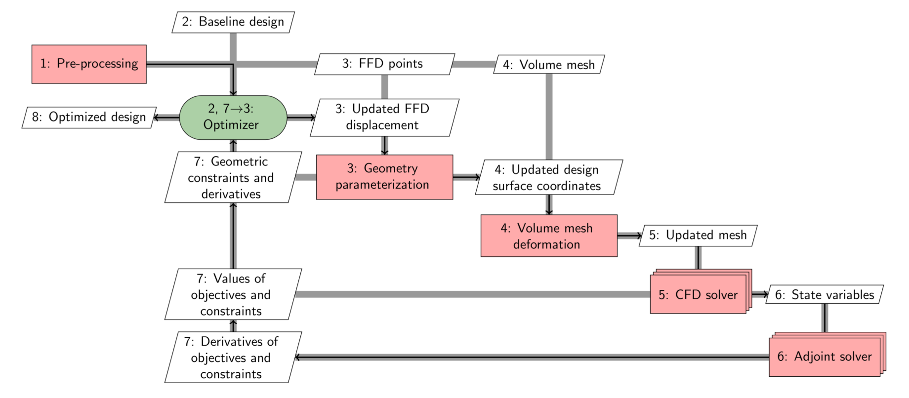

**图 1.** MACH-Aero 框架 [77] 的工作流程，具有基于 CFD 的 ASO 的代表性。数据依赖和流程采用 XDSM [80] 表示。对角节点为处理组件，非对角节点为组件之间传递的数据；粗灰线表示数据流，黑线表示过程流。

如图 1，对角组件表示 CFD 优化的主要程序。预处理中，建立基准外形的 CFD 网格与初始几何参数化，例如 FFD 控制框。随后，通过 Python 接口在优化器中定义目标函数、约束和设计变量边界，再迭代求解最优气动外形。

每次迭代中，梯度优化器确定如何更新设计变量；根据更新后的几何变量改变外形，评估几何约束及导数；使体网格形变，进行新外形的 CFD 分析，并由伴随求解器计算气动导数；优化器根据目标与约束的函数值和导数确定搜索方向与步长，产生下一次迭代的设计变量。

MACH-Aero 全部组件通过 Python 接口封装，便于模块化使用。SLSQP [81]、SNOPT [82] 等梯度优化器由 pyOptSparse [83] 提供。几何参数化可用 pyGeo 中的 FFD [84] 或 OpenVSP [85]；体网格形变采用 IDWarp [86] 提供的反距离方法；ADflow [87] 和 DAFoam [88] 可进行气动评估，两者均包含高效伴随求解器 [22,89] 计算气动导数。

其他 CFD-ASO 框架具有类似流程。例如 SU2 [78] 也通过 Python 脚本封装各组件，默认采用 SciPy 的 SLSQP 优化器。SU2_GEO 提供 FFD 参数化，并评估几何约束值和导数；SU2_CFD 进行直接与伴随计算，SU2_DOT 进一步计算气动导数；设计变量更新后，由 SU2_DEF 使 CFD 网格形变。Müller [90–93]、Nadarajah [94–98] 和 Zingg [99–103] 等团队也开发了类似框架。

**原文脚注链接：** [MACH-Aero](https://github.com/mdolab/MACH-Aero)、[pyGeo](https://github.com/mdolab/pygeo)、[IDWarp](https://github.com/mdolab/idwarp)、[ADflow](https://github.com/mdolab/adflow)、[DAFoam](https://github.com/mdolab/dafoam)、[SU2](https://su2code.github.io/)。

### 2.2. 现有挑战

借助高效伴随方法，高保真 CFD-ASO 已应用于翼型 [74,99,104]、机翼 [1,93,95,105–107]、翼身尾组合体 [5,108,109] 等广泛问题，但仍有一些挑战需要先进方案解决。

**第一，气动形状参数化效率不足。** 多数方法形成高维设计空间，其中存在大量异常形状区域，给 ASO 带来不必要困难。传统参数化需要很多形状变量，以确保收敛到真实最优设计；变量增加时，设计空间也会包含更多波浪形翼面等异常外形，优化中间步骤常需评估这些形状。它们使 CFD 收敛耗时，甚至无法收敛，导致优化失败。尽管近似 Newton–Krylov 算法 [110] 等改善了对各种外形的收敛能力，异常中间设计仍不理想 [74,111]。理想方案是以更少变量参数化，并将异常外形排除在设计空间之外。

**第二，多目标 CFD 设计优化通常过于昂贵。** 气动设计往往关注多个指标 [104,112]，但尚无高效算法求解高维多目标问题。常见做法是将其转化为一系列单目标问题并逐一求解，非常耗时 [26，第 9 章]，通常只能找到 Pareto 前沿上的少量点，且无法保证均匀分布。除少数例外 [115,116]，多数多目标研究只考虑翼型 [113]、机翼平面形状 [114] 等低维问题。

**第三，多数 CFD 优化仍是确定性的。** 它们忽略运行条件、磨损和制造误差引起的几何变化中的随机不确定性 [117]，实际中可能导致意外性能下降。要提高目标指标鲁棒性和约束可靠性，应合理考虑不确定性，可增加设计点 [118,119] 或采用随机指标 [120]，但两者都会显著增加计算成本。因此，鲁棒设计 [121]、可靠性设计 [122] 研究多限于二维翼型 [123,124]，或仅考虑马赫数、升力系数等少量运行参数不确定性的三维构型设计 [125–129]，距离工业需求仍远。

**第四，缺乏有效综合利用不同气动数据与模型的技术。** ASO 已有求解 Euler 方程和雷诺平均 Navier–Stokes（RANS）方程等不同保真度 CFD 模型，也可通过粗化高保真 CFD 网格构造低保真模型 [130,131]。实验气动设备的发展还带来越来越多实验数据。理想情况是用实验数据结合多保真数值仿真指导优化。

**第五，不连续 ASO 问题难以由现有梯度框架处理。** 例如，层流向湍流的转捩主导低雷诺数外形优化中的气动性能。为捕捉转捩，仿真模型包含导数不连续的函数，增加伴随实现难度 [132–134]。气动导数评估问题造成优化困难，高维设计空间又加剧这一问题。不连续气动目标函数也不适合梯度优化。

**最后，希望实现近乎即时气动评估的交互式设计优化。** 这使设计者能快速评估变量、约束和需求的影响，但高保真仿真成本使交互周期过慢，无法真正交互。

机器学习有助于应对这些需求，尤其是开发更紧凑几何参数化、更快速气动评估和更高效优化架构。本文其余部分将介绍并回顾这些方法与应用。

## 3. 机器学习方法

机器学习使计算机能够从数据中学习。Mitchell [135] 将其定义为：如果计算机程序在任务 $T$ 上、以性能度量 $P$ 衡量的表现，会随经验 $E$ 增加而改善，就称该程序针对任务 $T$ 和性能度量 $P$ 从经验 $E$ 中学习。

由于相对传统编程具有潜在优势，机器学习已成为现代生活中的前沿工具 [136]。对于需要大量规则才能求解的问题，机器学习往往能够简化代码并表现更好。在建立检测规则或策略后，它还能适应更新的数据集，并发现复杂问题中隐含的数据模式，帮助用户获得更深入理解。

机器学习可按多个标准分类：是直接比较新数据与训练数据，还是构建训练数据规律的模型以预测；训练时有无人工监督；采用批量训练，还是在线增量学习。多数方法使用构建的模型预测，但 k 近邻等基于实例的方法也很流行。

本节重点介绍已成功应用于 ASO 的方法，具体包括监督、无监督、半监督与强化学习四大类。随后介绍神经网络基础，以及除航空航天以外也推进多个领域技术水平的若干近期 ANN 架构 [137]。本节为第 4 节涉及的方法提供便于阅读、自成体系的说明，熟悉相关内容的读者可以跳过。

### 3.1. 监督学习

监督学习使用同时包含输入与相应模型观测值的数据集训练；观测值也称“标签”或“目标”[138,139]。分类和回归是最常见任务。分类构建模型，将输入划为离散类别，例如人脸检测和手写识别；回归直接建立输入与连续观测值之间的映射，适用于股价预测、飞机性能预测等大量实际问题。本节关注已成功引入 ASO 的监督学习方法。

#### 3.1.1. k 近邻

KNN [140,141] 根据未评估样本与训练数据中 $k$ 个最近邻之间的距离分类或预测标签，见图 2。距离度量 [142] 包括欧氏、曼哈顿、闵可夫斯基和汉明距离。最常用的欧氏距离为：

$$
\delta=\sqrt{\sum_{i=1}^m(x_{1,i}-x_{2,i})^2},
\tag{1}
$$

其中，$\delta$ 为距离，$\mathbf x_1$、$\mathbf x_2$ 为两个任意数据点，$m$ 为输入维度。分类 KNN 分析邻居类别，通过多数投票确定查询数据类别；回归 KNN 根据邻居数值均值预测，见图 3。也可以按距离采用非均匀权重，使较近邻居贡献更大。因此，KNN 是基于实例的方法，无需构造并训练模型。

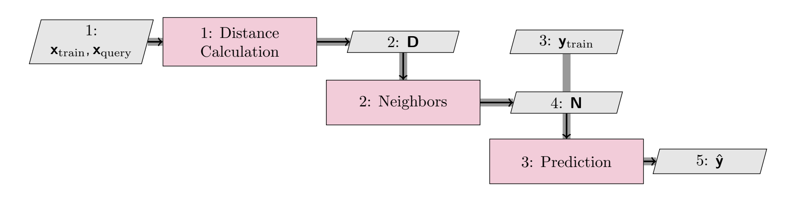

**图 2.** KNN 包含三个主要步骤：（1）计算查询数据 $\mathbf x_{\mathrm{query}}$ 与训练数据 $\mathbf x_{\mathrm{train}}$ 之间的距离 $D$；（2）按距离选择查询数据的 $k$ 个最近邻 $N$；（3）对这些邻居的标签 $\mathbf y_{\mathrm{train}}$ 投票，预测标签 $\hat y$。对角节点为过程组件，非对角节点为组件间传递的数据；粗灰线表示数据流，黑线表示过程流。

KNN 的优点是实现简单，灵活适用于分类和回归，在代表性数据充分时表现良好。主要挑战是确定邻居数量 $k$：较小的 $k$ 可能噪声较大，决策边界不稳定；较大的 $k$ 形成更平滑边界，但未必能良好表示输出空间。一个简单建议是 $k=\sqrt n$，其中 $n$ 为训练样本数，但仍不保证最佳。

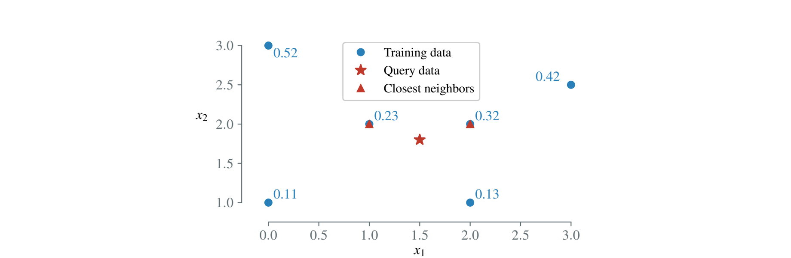

**图 3.** 以欧氏距离选择两个最近邻的 KNN 回归示例，预测标签为 $(0.23+0.32)/2=0.275$。

由于简单且总体性能良好，KNN 受到航空航天界关注。例如 Wang et al. [143] 收集足够旋翼无人机飞行数据，用 KNN 估计风速，并通过参数研究确定最佳 $k$，相对于实验结果的平均相对误差为 3.3%。

#### 3.1.2. 支持向量机

支持向量机（SVM）[144,145] 在模型响应空间中构造超平面，处理分类与回归。最优超平面分隔与任一类别中最近训练点的距离最大，因为间隔越大，分类泛化误差越低，见图 4。位于间隔边界的训练点称为支持向量，见图 5。

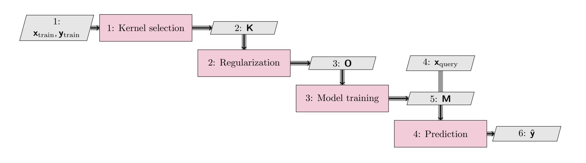

**图 4.** SVM 首先要求选择核函数 $K$，变换训练数据 $(\mathbf x_{\mathrm{train}},\mathbf y_{\mathrm{train}})$，以便在高维隐式特征空间中高效计算。随后选择目标函数 $O$ 的正则化项，确定对误分类样本的惩罚。训练寻找具有最优超平面的模型 $M$，之后即可预测查询样本 $\mathbf x_{\mathrm{query}}$ 的标签 $\hat y$。

用于分类的 SVM 称为支持向量分类器（SVC）[146,147]。给定 $n$ 个训练数据 $X\in\mathbb R^{n\times m}$ 和相应二分类类别 $Y\in[-1,1]$，目标是确定未知参数 $\mathbf w\in\mathbb R^m$、$b\in\mathbb R$，尽可能对多数样本正确预测 $\mathbf w^\top\phi(\mathbf x)+b$ 的符号。SVC 原始问题为：

$$
\begin{aligned}
\min_{\mathbf w,b,\boldsymbol\zeta}\quad&\frac12\mathbf w^\top\mathbf w+C\sum_{i=1}^n\zeta_i,\\
\text{约束为}\quad&y_i\big(\mathbf w^\top\phi(\mathbf x_i)+b\big)\ge1-\zeta_i,\\
&\zeta_i\ge0,\quad i=1,\ldots,n.
\end{aligned}
\tag{2}
$$

**图 5.** SVM 分类示例：最优超平面（图中二分类情形表现为一条直线）具有最大间隔；落在间隔边界上的数据为支持向量。

该表述通过最小化 $\mathbf w^\top\mathbf w$ 及惩罚项 $C\sum_{i=1}^n\zeta_i$ 最大化间隔。当第 $i$ 个样本进入间隔内或被误分类时，正值 $\zeta_i$ 向目标加入惩罚，常数 $C$ 控制惩罚强度。拉格朗日对偶原理 [148,149] 将原始问题简化为：

$$
\begin{aligned}
\min_{\boldsymbol\alpha}\quad&\frac12\boldsymbol\alpha^\top Q\boldsymbol\alpha-\mathbf e^\top\boldsymbol\alpha,\\
\text{约束为}\quad&\mathbf y^\top\boldsymbol\alpha=0,\\
&0\le\alpha_i\le C,\quad i=1,\ldots,n.
\end{aligned}
\tag{3}
$$

其中，$\mathbf e$ 为全 1 向量，$Q$ 为 $n\times n$ 半正定矩阵，$Q_{i,j}\equiv y_i y_jK(\mathbf x_i,\mathbf x_j)$，核函数 $K(\mathbf x_i,\mathbf x_j)=\phi(\mathbf x_i)^\top\phi(\mathbf x_j)$，$\boldsymbol\alpha$ 为受 $C$ 限制的对偶系数向量。对偶问题为带线性约束的二次函数，可通过二次规划高效求解。求得 SVC 后，对样本 $\mathbf x'$ 的分类预测为：

$$
y'=\sum_{i\in\mathrm{SV}}y_i\alpha_iK(\mathbf x_i,\mathbf x')+b.
\tag{4}
$$

$\mathrm{SV}$ 为支持向量集合。由于其他训练点的对偶系数均为零，只需求和支持向量。

用于回归的 SVM 称为支持向量回归（SVR）[150,151]。给定 $n$ 个输入 $\mathbf x_i\in\mathbb R^m$ 和相应连续目标 $y_i\in\mathbb R^p$，其原始优化问题为：

$$
\begin{aligned}
\min_{\mathbf w,b,\boldsymbol\zeta,\boldsymbol\zeta^*}\quad
&\frac12\mathbf w^\top\mathbf w+C\sum_{i=1}^n(\zeta_i+\zeta_i^*),\\
\text{约束为}\quad&y_i-\mathbf w^\top\phi(\mathbf x_i)-b\le\epsilon+\zeta_i,\\
&\mathbf w^\top\phi(\mathbf x_i)+b\le\epsilon+\zeta_i^*,\\
&\zeta_i,\zeta_i^*\ge0,\quad i=1,\ldots,n.
\end{aligned}
\tag{5}
$$

预测与真实目标偏差超过 $\epsilon$ 时，目标受到惩罚；预测位于 $\epsilon$ 管上方或下方，分别由 $\zeta_i$ 或 $\zeta_i^*$ 决定惩罚。类似地，对偶问题为：

$$
\begin{aligned}
\min_{\boldsymbol\alpha,\boldsymbol\alpha^*}\quad
&\frac12(\boldsymbol\alpha-\boldsymbol\alpha^*)^\top Q(\boldsymbol\alpha-\boldsymbol\alpha^*)
+\epsilon\mathbf e^\top(\boldsymbol\alpha+\boldsymbol\alpha^*)-\mathbf y^\top(\boldsymbol\alpha-\boldsymbol\alpha^*),\\
\text{约束为}\quad&\mathbf e^\top(\boldsymbol\alpha-\boldsymbol\alpha^*)=0,\\
&0\le\alpha_i,\alpha_i^*\le C,\quad i=1,\ldots,n.
\end{aligned}
\tag{6}
$$

SVR 在 $\mathbf x'$ 处的预测为：

$$
y'=\sum_{i\in\mathrm{SV}}(\alpha_i-\alpha_i^*)K(\mathbf x_i,\mathbf x')+b.
\tag{7}
$$

> 译注：式（5）第二条约束按原文保留；相对于通常的 SVR 表述，该条没有写出 $-y_i$。

SVM 的主要优缺点如下 [152]。它用途广泛，适合大量实际应用 [153,154]；仅考虑支持向量，因此对远离超平面的观测值较稳健且高效；即使训练样本较少，也可完成多类别分类。不同核函数可适应非线性分类边界，即使数据非线性可分也能求解。它能够提供唯一解，而非 ANN 中可能出现的局部极小值；仅依赖支持向量，也可能使其在不平衡数据分类中更好 [153]。

另一方面，尤其在大数据集上，SVM 的计算与内存开销可能很高。核函数选择也很棘手，随意选择可能降低性能 [155]。

SVM 已用于支持气动分析与优化。例如 Andrés-Pérez et al. [156] 将其作为代理模型估计目标函数（升阻比），结合进化算法求解 ASO。该代理处理了二维问题的 14 个输入参数和三维问题的 36 个输入参数，表明 SVM 是 ASO 中有竞争力的代理模型候选。

#### 3.1.3. 决策树与随机森林

决策树 [157,158] 可用于分类和回归，见图 6；随机森林 [159,160] 集成一系列决策树，从更广角度完成任务，见图 7。决策树通过反复提问划分数据。问题越有信息量，模型预测越好，因此问题设计非常关键。基尼不纯度 [161] 和熵 [162] 是量化划分质量的主要方法。

基尼不纯度表示：若根据已有标签分布随机决定标签，模型错误标记一个新样本的可能性 [163]。其定义为：

$$
\mathrm{GI}=\sum_{i=1}^{N_C}P(i)(1-P(i)),
\tag{8}
$$

其中，$N_C$ 为类别总数，$P(i)$ 为当前数据集中第 $i$ 类的概率。若仅有一类，不纯度为零；类别分布越均匀，不纯度越高。将各分支不纯度加权，可衡量划分质量：

$$
\mathrm{GI}_{\mathrm{split}}=\sum_{i=1}^{N_B}w_i\mathrm{GI}_i.
\tag{9}
$$

$N_B$ 为划分后的分支数，$\mathrm{GI}_i$ 为第 $i$ 分支不纯度，$w_i$ 为该分支训练样本数占总数的比例。基尼增益定义为 $\mathrm{GI}-\mathrm{GI}_{\mathrm{split}}$，越大表示划分越好。

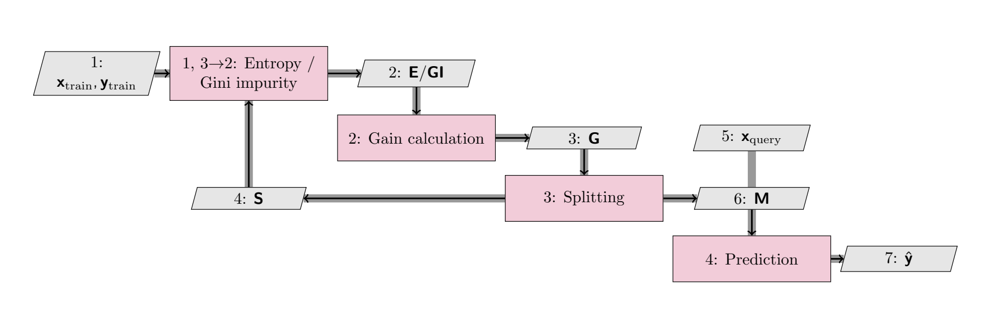

**图 6.** 决策树计算划分前及试探划分后的熵 $E$ 或基尼不纯度 $\mathrm{GI}$，得到信息增益或基尼增益 $G$。选择 $G$ 最大的划分 $S$，迭代该过程，直至全部属性被设置为树节点。之后即可使用模型 $M$，对查询数据 $\mathbf x_{\mathrm{query}}$ 完成分类或回归预测 $\hat y$。

熵度量数据集的随机性或不纯度 [163]；通常随机性越大，熵越高：

$$
E(\mathbf x)=-\sum_{k=1}^{N_F}P(\mathbf x=k)\log_2P(\mathbf x=k),
\tag{10}
$$

其中，$N_F$ 为特征总数，$P$ 为目标特征的概率。信息增益是划分前的熵与划分后按各分支样本数加权的熵之差。

基尼不纯度倾向较大的划分，易于实现；熵倾向取值明确的较小划分。这两种度量使决策树功能强、实现简单，并适用于连续、类别等混合数据。

但单棵树，尤其很深时，容易过拟合。因此通常集成多棵树改善性能，即随机森林。各树作为并行估计器：分类中根据多数投票决定最终结果，回归中取各树结果均值。

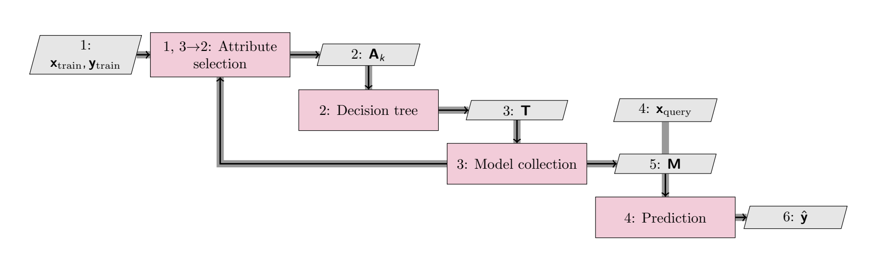

**图 7.** 随机森林从全部属性中随机选取 $k$ 个属性 $A_k$，按图 6 构造决策树 $T$。收集构造的树，迭代至达到预设数量。最终模型 $M$ 可预测任意查询数据 $\mathbf x_{\mathrm{query}}$ 的标签 $\hat y$。

随机森林比单棵树性能更好、过拟合风险更低，主要因为通过自助采样与特征随机性构造互不相关的树。自助采样指从数据源反复有放回抽样，以避免过拟合并提高稳定性；特征随机性指为每棵树随机选择特征。

随机森林扩展了决策树且表现突出，但对大规模输入维度的扩展性不足。Dasari et al. [164] 建立随机森林代理进行设计空间探索，并提取参数重要性，以深入理解设计空间。Dube and Hiravennavar [165] 比较克里金、决策树、线性回归、随机森林和 ANN 等汽车阻力预测方法，认为 ANN 表现最佳。

#### 3.1.4. 传统代理模型

代理模型又称元模型，是工程领域采用的一类特殊监督学习算法 [130,166,167]。本文将深度学习受到广泛关注以前、早期引入 ASO 的算法称为传统代理模型。它们通过多项式展开、基于相关性的预测等简单代数运算，准确近似仿真模型输出，在需要快速响应时替代高成本仿真。

下面介绍 ASO 中常用的克里金，即高斯过程回归 [30,168–171]。克里金将任意有限个模型响应建模为多元正态分布 [172,173]，即认为观测值是从高斯过程采样得到的点，这是其关键假设，见图 8。模型表示为：

$$
Y^{\mathrm{KR}}(\mathbf x)=\boldsymbol\beta\mathbf f(\mathbf x)+\sigma^2Z.
\tag{11}
$$

第一项为趋势函数，即高斯过程均值；$\mathbf f$ 是基函数向量，$\boldsymbol\beta$ 为待定系数，$\sigma^2$ 为高斯过程方差，$Z$ 是零均值、单位方差的平稳高斯过程。

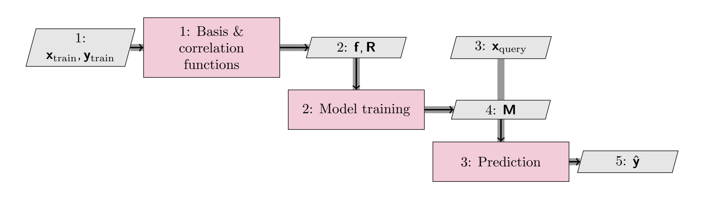

**图 8.** 克里金回归要求用户选择基函数 $\mathbf f$ 与相关函数 $R$。最常用训练方法是最大似然估计，通常假设残差服从高斯分布，选择与观测最一致的最优超参数。

预测基于预测值与训练响应服从联合高斯分布的假设：

$$
\begin{Bmatrix}\hat y(\mathbf x')\\\mathbf y\end{Bmatrix}
\sim\mathcal N_{N+1}\!\left(
\begin{Bmatrix}\mathbf f^\top(\mathbf x)\boldsymbol\beta\\F\boldsymbol\beta\end{Bmatrix},
\sigma^2\begin{bmatrix}1&\mathbf r^\top(\mathbf x)\\\mathbf r(\mathbf x)&R\end{bmatrix}
\right).
\tag{12}
$$

$\mathbf x'$ 为待预测点；$F$ 为基函数矩阵，$F_{i,j}=f_j(\mathbf x_i)$，$i=1,\ldots,N$、$j=1,\ldots,P$；$\mathbf r(\mathbf x)$ 为待预测点与训练数据的相关向量；$R$ 为训练数据相关矩阵，$R_{ij}=R(\mathbf x_i,\mathbf x_j;\boldsymbol\theta)$。预测均值与方差为：

$$
\mu(\mathbf x')=\mathbf f(\mathbf x')^\top\boldsymbol\beta
+\mathbf r(\mathbf x)^\top R^{-1}(\mathbf y-F\boldsymbol\beta),
\tag{13}
$$

$$
\sigma^2(\mathbf x')=\sigma^2\left[1-\mathbf r^\top(\mathbf x)R^{-1}\mathbf r(\mathbf x)
+\mathbf u^\top(\mathbf x)(F^\top R^{-1}F)^{-1}\mathbf u(\mathbf x)\right],
\tag{14}
$$

其中：

$$
\boldsymbol\beta=(F^\top R^{-1}F)^{-1}F^\top R^{-1}\mathbf y,
\tag{15}
$$

$$
\mathbf u(\mathbf x)=F^\top R^{-1}\mathbf r(\mathbf x)-\mathbf f(\mathbf x),
\tag{16}
$$

高斯相关函数定义为：

$$
R(\mathbf x,\mathbf x')=\exp\!\left[-\sum_{i=1}^P\left(\frac{x_i-x_i'}{\theta_i}\right)^2\right].
\tag{17}
$$

通过下式求解 $\boldsymbol\theta$ 的最大似然估计：

$$
\hat{\boldsymbol\theta}=\operatorname*{arg\,min}_{\boldsymbol\theta}
\left[\frac12\log\det(R)+\frac N2\log(2\pi\sigma^2)+\frac N2\right].
\tag{18}
$$

基于标准差的预测置信区间是克里金的一项重要性质，见图 9，使自适应采样和高效全局优化成为可能 [174,175]。

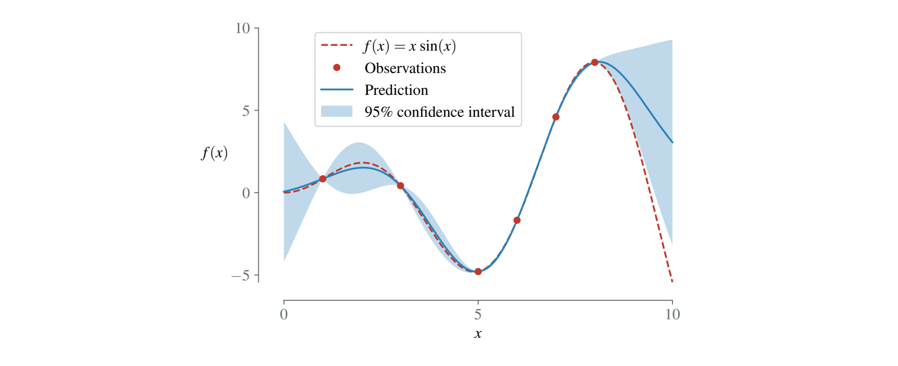

**图 9.** 克里金代理回归示例 [176]。真实函数为 $f(x)=x\sin x$；红点为训练样本与观测，蓝线为沿 $x$ 轴的预测均值，阴影为 95% 预测置信区间。训练观测处的区间较窄，未观测位置的区间较宽。

若梯度信息可用，梯度增强克里金（GEK）可将其融入，提高预测性能 [177,178]。GEK 有间接法（图 10）与直接法（图 11）。间接 GEK 用一阶 Taylor 近似在训练点周围生成新点：

$$
y(\mathbf x_i+\Delta x_j\mathbf e_j)=y(\mathbf x_i)+\frac{\partial y(\mathbf x_i)}{\partial x_j}\Delta x_j.
\tag{19}
$$

$\Delta x_j$ 是第 $j$ 个方向的步长，$\mathbf e_j$ 为 $P\times P$ 单位矩阵第 $j$ 行。间接 GEK 无需修改克里金模型，但相关矩阵从 $N\times N$ 快速增长至 $(N+P)\times(N+P)$，使高维问题难以处理。

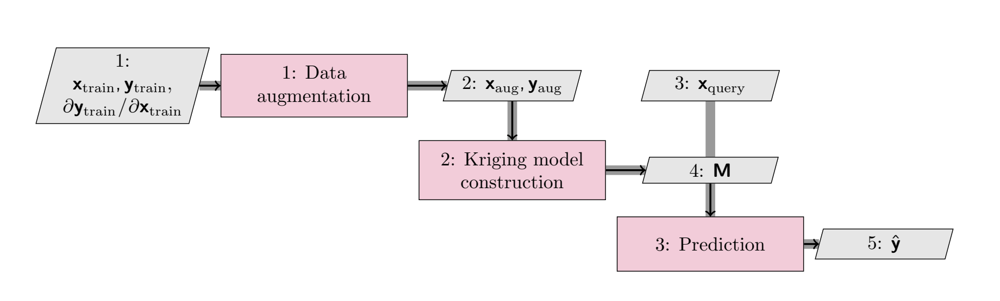

**图 10.** 间接 GEK 通过一阶 Taylor 近似增广数据，在已有数据附近生成新样本。包含已有与新生成数据的增广数据 $(\mathbf x_{\mathrm{aug}},\mathbf y_{\mathrm{aug}})$，用于按图 8 进行克里金建模与预测。

直接 GEK 将导数并入模型观测：

$$
\mathbf y=\left[y(\mathbf x_1),\ldots,y(\mathbf x_N),
\frac{\partial y(\mathbf x_1)}{\partial x_1},\ldots,
\frac{\partial y(\mathbf x_1)}{\partial x_P},\ldots,
\frac{\partial y(\mathbf x_N)}{\partial x_P}\right]^\top.
\tag{20}
$$

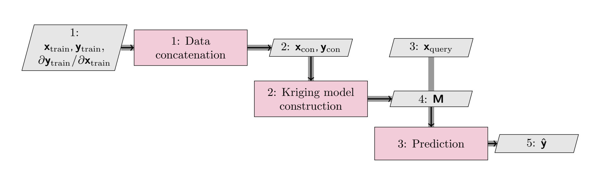

**图 11.** 直接 GEK 将已有数据与相应梯度直接拼接。拼接数据 $(\mathbf x_{\mathrm{con}},\mathbf y_{\mathrm{con}})$ 用于按图 8 进行克里金建模与预测。

相关矩阵包含四个主要块：训练数据之间、梯度之间、梯度与训练数据之间，以及训练数据与梯度之间的相关性。矩阵从 $N\times N$ 扩大至 $(N+P)\times(N+P)$，因此直接 GEK 也有类似问题。Bouhlel and Martins [178] 用偏最小二乘法大幅减少超参数数量，同时保持较高精度。

另一重要分支是协克里金（cokriging）：一种可融合不同精度、保真度模型信息的多变量克里金 [168]。它由低保真（LF）克里金模型乘缩放因子，再加上建模高保真（HF）与低保真差异的克里金模型组成，见图 12：

$$
Y^{\mathrm{CK}}(\mathbf x)=\rho Y_{\mathrm{LF}}^{\mathrm{KR}}(\mathbf x)+Y_{\mathrm{Diff}}^{\mathrm{KR}}(\mathbf x).
\tag{21}
$$

$\rho$ 通过最大似然优化确定，$Y_{\mathrm{LF}}^{\mathrm{KR}}$ 为 LF 代理，$Y_{\mathrm{Diff}}^{\mathrm{KR}}$ 为差异代理。融入多保真信息后，预测器具有广义克里金形式：

$$
\mu(\mathbf x')=\mathbf f_{\mathrm{CK}}(\mathbf x')^\top\boldsymbol\beta
+\mathbf r_{\mathrm{CK}}(\mathbf x)^\top R_{\mathrm{CK}}^{-1}
(\mathbf y_{\mathrm{CK}}-F_{\mathrm{CK}}\boldsymbol\beta_{\mathrm{CK}}).
\tag{22}
$$

趋势函数为 $\mathbf f_{\mathrm{CK}}^\top=[\rho\mathbf f_{\mathrm{LF}}^\top,\mathbf f_{\mathrm{HF}}^\top]$，且：

$$
\small
F_{\mathrm{CK}}=
\begin{bmatrix}
\mathbf f_{\mathrm{LF}}(\mathbf x_1)^\top&\cdots&\mathbf f_{\mathrm{LF}}(\mathbf x_{N_{\mathrm{LF}}})^\top&\rho\mathbf f_{\mathrm{HF}}(\mathbf x_1)^\top&\cdots&\rho\mathbf f_{\mathrm{HF}}(\mathbf x_{N_{\mathrm{HF}}})^\top\\
0&0&0&\mathbf f_{\mathrm{HF}}(\mathbf x_1)^\top&\cdots&\mathbf f_{\mathrm{HF}}(\mathbf x_{N_{\mathrm{HF}}})^\top
\end{bmatrix}^{\!\top}.
\tag{23}
$$

未评估点 $\mathbf x'$ 与训练数据的相关性为：

$$
\begin{aligned}
\mathbf r^\top=\Big[&\rho\sigma_{\mathrm{LF}}^2R_{\mathrm{LF}}(\mathbf x',X_{\mathrm{LF}};\boldsymbol\theta_{\mathrm{CK}}),\\
&\rho^2\sigma_{\mathrm{LF}}^2R_{\mathrm{LF}}(\mathbf x',X_{\mathrm{HF}};\boldsymbol\theta_{\mathrm{CK}})
+\sigma_{\mathrm{HF}}^2R_{\mathrm{HF}}(\mathbf x',X_{\mathrm{HF}};\boldsymbol\theta_{\mathrm{CK}})\Big].
\end{aligned}
\tag{24}
$$

HF 与 LF 训练数据之间的协方差矩阵为：

$$
\small
R_{\mathrm{CK}}=
\begin{bmatrix}
\sigma_{\mathrm{LF}}^2R_{\mathrm{LF}}(X_{\mathrm{LF}},X_{\mathrm{LF}};\boldsymbol\theta_{\mathrm{CK}})&
\rho\sigma_{\mathrm{LF}}^2R_{\mathrm{LF}}(X_{\mathrm{LF}},X_{\mathrm{HF}};\boldsymbol\theta_{\mathrm{CK}})\\[4pt]
\rho\sigma_{\mathrm{LF}}^2R_{\mathrm{LF}}(X_{\mathrm{HF}},X_{\mathrm{LF}};\boldsymbol\theta_{\mathrm{CK}})&
\begin{gathered}\rho^2\sigma_{\mathrm{LF}}^2R_{\mathrm{LF}}(X_{\mathrm{HF}},X_{\mathrm{HF}};\boldsymbol\theta_{\mathrm{CK}})\\+\sigma_{\mathrm{HF}}^2R_{\mathrm{HF}}(X_{\mathrm{HF}},X_{\mathrm{HF}};\boldsymbol\theta_{\mathrm{CK}})\end{gathered}
\end{bmatrix}.
\tag{25}
$$

$\boldsymbol\theta$ 通过最大似然方法，即式（18）估计。

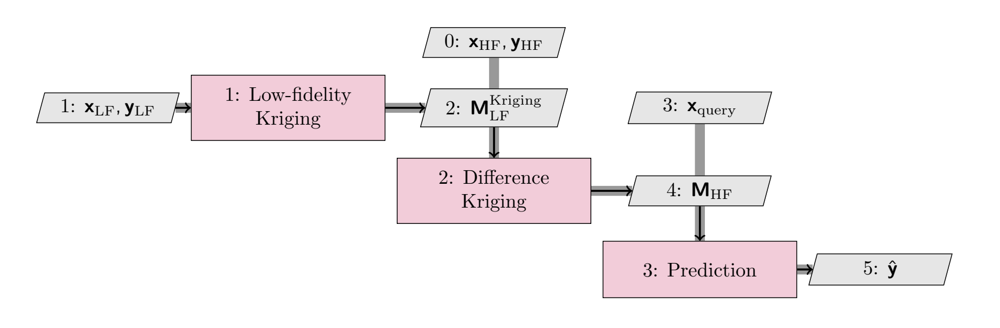

**图 12.** 协克里金构建两个图 8 所示克里金模型。第一个 $M_{\mathrm{LF}}^{\mathrm{Kriging}}$ 使用 LF 数据 $(\mathbf x_{\mathrm{LF}},\mathbf y_{\mathrm{LF}})$；第二个在 HF 观测 $\mathbf y_{\mathrm{HF}}$ 与 $\mathbf x_{\mathrm{HF}}$ 处乘缩放参数 $\rho$ 的 LF 观测之差上建模。若该处没有 LF 观测，可用第一个模型快速估计。

还有其他成功用于工程的代理方法。例如，基于正交基的多项式混沌展开（PCE）[179,180]，可提供模型观测的解析均值、标准差和敏感性分析所需 Sobol’ 指数 [181,182]。广义 PCE 为：

$$
Y(\mathbf x)=\sum_{i=1}^\infty\alpha_i\Phi_i(\mathbf x).
\tag{26}
$$

原文将 $\mathbf x\in\mathbb R^n$ 描述为 $m$ 维随机输入向量；$Y(X)$ 为 $X$ 的计算模型，$i$ 为多项式项序号，$\Phi_i$ 为多变量多项式基，$\alpha_i$ 为对应系数。实际采用截断 PCE：

$$
Y(\mathbf x)\approx Y^{\mathrm{PC}}(\mathbf x)=\sum_{i=1}^P\alpha_i\Phi_i(\mathbf x).
\tag{27}
$$

所需样本总数的参考值遵循阶乘公式 $(p+m)!/(p!m!)$，$p$ 为所需展开阶数。Blatman [183] 根据效应稀疏原则 [184]，用双曲截断减少交互项。截断预测加上残差，以匹配训练点 $X$ 的高保真观测：

$$
Y(X)\approx Y^{\mathrm{PC}}(X)+\epsilon_{\mathrm{PC}}
\equiv\boldsymbol\alpha^\top\boldsymbol\Phi(X)+\epsilon_{\mathrm{PC}}.
\tag{28}
$$

$\epsilon_{\mathrm{PC}}$ 为真实模型与 PCE 之间的残差，可用最小二乘法最小化：

$$
\hat{\boldsymbol\alpha}=\operatorname*{arg\,min}_{\boldsymbol\alpha}
\mathbb E[\boldsymbol\alpha^\top\boldsymbol\Phi(X)-Y(X)].
\tag{29}
$$

常加入 $L_1$ 正则化以偏向低秩解 [185]：

$$
\hat{\boldsymbol\alpha}=\operatorname*{arg\,min}_{\boldsymbol\alpha}
\left\{\mathbb E[\boldsymbol\alpha^\top\boldsymbol\Phi(X)-Y(X)]+\lambda\|\boldsymbol\alpha\|_1\right\}.
\tag{30}
$$

$\lambda$ 为惩罚因子，$\|\boldsymbol\alpha\|_1$ 为系数的 $L_1$ 范数。Sudret [181] 引入最小角回归（LARS）确定系数，并通过早停进一步减少基项。

> 译注：本节公式按原稿保留，包括式（11）的 $\sigma^2Z$、GEK 矩阵规模的 $(N+P)\times(N+P)$ 表述，以及式（29）、（30）中未写平方的期望表达式。

PCE 基于回归，按照输入概率分布选择正交基，见图 13，适合不确定性分析与设计 [186]。克里金则基于插值，保证训练样本处的预测精确匹配观测。研究者将两者结合，提出 PC-Kriging [187] 和 PC-Cokriging [188]。

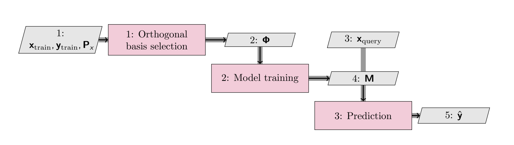

**图 13.** PCE 要求用户提供预定义或假定的输入概率分布 $P_x$，据此建立正交基，并用双曲基截断（又称 q 范数）[181] 稀疏选择低阶基 $\Phi$。普通最小二乘是最常用训练算法；Sudret [181] 介绍的 LARS 通过早停进一步减少基项，达到先进训练水平。最终模型 $M$ 对查询数据 $\mathbf x_{\mathrm{query}}$ 预测 $\hat y$。

PC-Kriging 用 PCE 趋势项捕捉总体形态，克里金近似则对训练点插值，见图 14。它将式（11）扩展为：

$$
Y^{\mathrm{PCK}}(X)=\boldsymbol\alpha^\top\boldsymbol\Phi(X)+\sigma^2Z(X).
\tag{31}
$$

右侧第一项为截断 PCE，作为泛克里金趋势；第二项中 $\sigma$ 与 $Z(X)$ 分别为常标准差以及零均值、单位方差平稳高斯过程，见式（11）。

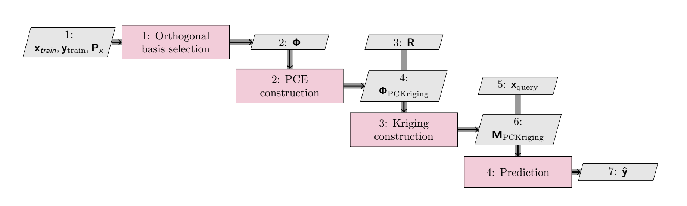

**图 14.** PC-Kriging 结合 PCE 与克里金构建过程。首先按图 13 建立 PCE，只使用双曲截断与 LARS 选出的基 $\Phi_{\mathrm{PCKriging}}$ 作为克里金基函数；其余与图 8 相同，通过设定相关函数 $R$ 训练。

PC-Cokriging 按协克里金扩展克里金的相同原理，将 PC-Kriging 推广到多保真架构，见图 15：

$$
Y^{\mathrm{PCCK}}(X)=\rho Y_{\mathrm{LF}}^{\mathrm{PCK}}(X)+Y_{\mathrm{Diff}}^{\mathrm{PCK}}(X).
\tag{32}
$$

$Y_{\mathrm{LF}}^{\mathrm{PCK}}$ 为 LF 数据的 PC-Kriging 近似，$Y_{\mathrm{Diff}}^{\mathrm{PCK}}$ 近似 HF 与 LF 输出的差异，两者均用 PC-Kriging 构造。Du and Leifsson [188] 开发该模型，在一系列解析例子（图 16）与工程案例中表现突出。

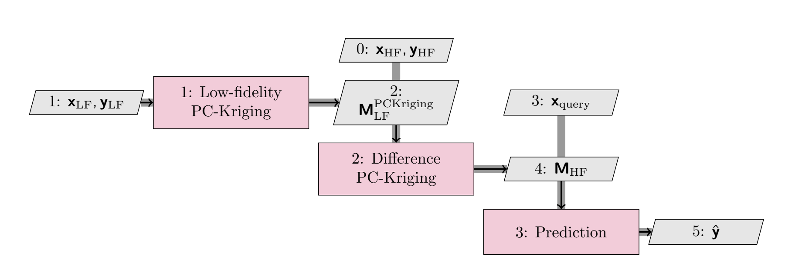

**图 15.** PC-Cokriging 类似协克里金（图 12），但 LF 模型与差异模型采用 PC-Kriging（图 14），而非克里金。

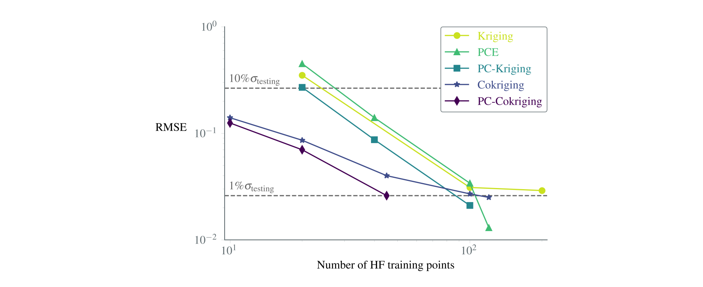

**图 16.** Du and Leifsson [188] 在 Currin 函数 [193] 及其 LF 版本 [194] 上比较多种算法。要使均方根误差（RMSE）降至测试标签标准差的 1%，PC-Cokriging 约需 50 个样本，而 PC-Kriging 和基于 LARS 的 PCE 约需 100 个；协克里金需超过 100 个，说明 LF 模型与 Currin 函数相关性不高，但 PC-Cokriging 仍能获得良好预测。

此外，流形映射等其他多保真代理方法 [130,189,190]，也能在多层级气动设计优化中准确预测标量与向量量 [191,192]。

### 3.2. 无监督学习

监督学习读取带标签训练数据，无监督学习则处理无标签数据，分析数据模式并自动建立学习规则 [195,196]。它已广泛用于异常检测 [197,198]、新颖性检测 [199,200]、聚类 [201,202] 和降维 [203,204]。本节重点介绍在 ASO 中应用较多的聚类与降维。

聚类自动将无标签数据分成不同组，同组具有相似特征，不同组差异较大 [201,202]。实际应用包括假新闻识别 [205–207]、垃圾邮件检测 [208–210]、市场与客户细分 [211–213]。在 ASO 中，聚类可划分设计空间，使每个相似特征子集分别建立监督回归模型。本节介绍 k 均值和高斯混合模型。

降维是在保留关键性质的同时，将高维数据转换成低维表示 [203]。若回归问题的高维输入高度相关，降低输入维度可缓解维度灾难。线性与非线性降维均常用于 ASO，下面分别说明。

#### 3.2.1. k 均值

k 均值在多维无标签数据中寻找用户指定数量的簇 [214,215]。它假设簇中心为簇内全部数据的算术均值，每个样本到所属簇中心的距离最近。中心位置显著影响结果，因此需要合理确定，可通过期望最大化（EM）迭代寻找“最优”位置，见图 17。

E 步计算每个点所属簇的期望，第 $i$ 簇为：

$$
C_i=\{\mathbf x_q:\|\mathbf x_q-\mathbf c_i\|_2\le\|\mathbf x_q-\mathbf c_j\|_2,
\ \forall j,\ 1\le j\le k\}.
\tag{33}
$$

$\mathbf x_q$ 为查询点，$\mathbf c_i$ 为簇中心。M 步最大化决定中心位置的适应度函数；最简单情况下，取簇内数据均值。“收敛”表示中心不再改变。

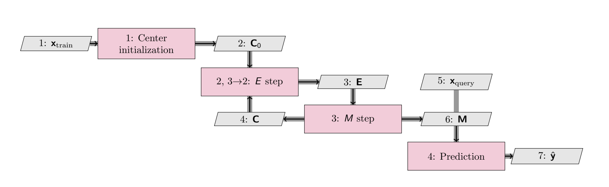

**图 17.** k 均值从簇中心初始猜测 $C_0$ 出发，在 E、M 步间循环，持续分配数据、计算位置均值 $E$ 并更新簇中心 $C$，直至中心不再变化。

该算法快速、稳健、易懂，适用于差异明显、彼此良好分离的样本，见图 18。但即使使用 EM，也可能无法得到全局最优。簇数必须预先指定，选择较困难 [216]；而且它局限于线性簇边界，多数聚类问题的边界却具有复杂几何形状。

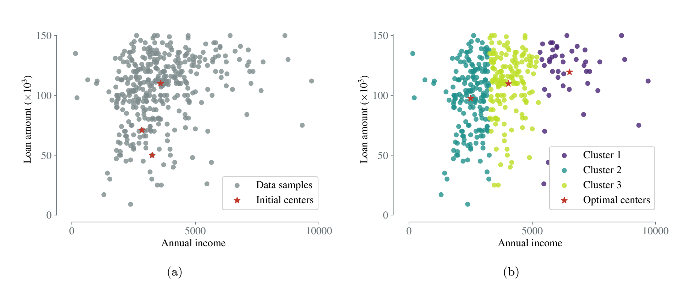

**图 18.** 批发客户数据集示例表明，即使初始中心彼此接近，k 均值仍较稳健。（a）随机初始中心与样本；（b）最优中心与聚类数据。同时可见，k 均值具有线性簇边界。

k 均值很少独立用于气动应用，通常作为聚类预处理以提高其他监督学习方法性能。Sanwale and Singh [217] 对气动力与力矩系数建立代理，进行气动参数估计。他们用 k 均值寻找径向基函数（RBF）神经网络中心，成功处理先进技术试验飞机系统项目的实时飞行数据。

#### 3.2.2. 高斯混合模型

GMM 假设数据由多个未知参数的高斯分布混合生成，每个分布对应一个簇 [218,219]。它在 k 均值基础上，不仅考虑均值，还考虑特征的协方差结构。对于有 $d$ 个特征的数据，GMM 含 $k$ 个多元高斯分布，各有均值和协方差：

$$
f(\mathbf x\mid\boldsymbol\mu,\Sigma)=\frac1{\sqrt{2\pi|\Sigma|}}
\exp\!\left[-\frac12(\mathbf x-\boldsymbol\mu)^\top\Sigma^{-1}(\mathbf x-\boldsymbol\mu)\right].
\tag{34}
$$

$\boldsymbol\mu$ 为长度 $d$ 的均值向量，$\Sigma$ 为 $d\times d$ 协方差矩阵。GMM 也通过 EM [218,220] 求解，见图 19：

1. 指定 $k$ 个初始中心，最好尽可能彼此远离。
2. 重复 E、M 步至收敛。E 步计算样本 $\mathbf x_i$ 属于各簇的概率：

$$
p_{i,c}=\frac{q_c\mathcal N(\mathbf x_i;\boldsymbol\mu_c,\Sigma_c)}
{\sum_{c'\in C}q_{c'}\mathcal N(\mathbf x_i;\boldsymbol\mu_{c'},\Sigma_{c'})}.
\tag{35}
$$

即属于簇 $c$ 的概率，除以属于全部簇的概率总和；分配正确时概率较高，否则较低。M 步按下式更新：

$$
q=\frac{N_c}{N},
\tag{36}
$$

$$
\boldsymbol\mu_c=\frac1{N_c}\sum_{i=1}^Np_{i,c}\mathbf x_i,
\tag{37}
$$

$$
\Sigma_c=\frac1{N_c}\sum_{i=1}^Np_{i,c}
(\mathbf x_i-\boldsymbol\mu_c)^\top(\mathbf x_i-\boldsymbol\mu_c).
\tag{38}
$$

$N_c$ 为分配到该簇的样本数，$N$ 为样本总数。

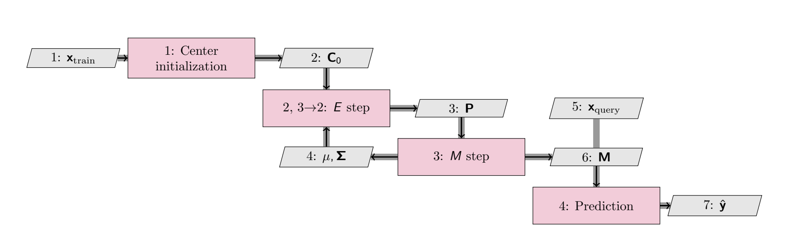

**图 19.** GMM 从中心初始猜测 $C_0$ 出发，在 E、M 步间循环。E 步计算样本属于各簇的概率 $P$；M 步更新各簇统计量，即均值 $\boldsymbol\mu$ 和协方差 $\Sigma$。

与 k 均值相比，GMM 仅最大化似然，不会将均值偏向零，也不会使簇大小偏向未必适合数据的特定结构 [176]，见图 20。但估计协方差的数据不足时会有问题。气动应用通常也更倾向 GMM。Liem et al. [221] 用 GMM 聚类气动数据，再按分而治之原则，建立结合多个 GEK 模型的混合专家方法，在常规与非常规飞机构型性能代理中成功验证。

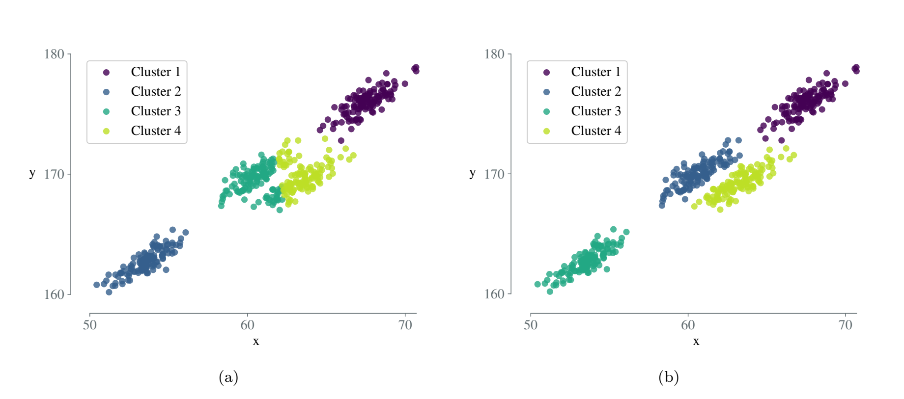

**图 20.** k 均值按圆形方式聚类，GMM 能捕捉椭圆形簇。（a）基于距离的 KM 形成圆形簇；（b）基于分布的 GMM 捕捉椭圆形簇。

#### 3.2.3. 主成分分析

PCA 在最大限度保留数据变化的同时，将高维数据转换到低维 [222,223]，简化可视化并改善预测建模。它寻找数据变化最大的方向，即主成分，使信息损失最小。寻找主成分可转化为奇异值与奇异向量问题，通过 SVD 求解。

SVD 将具有正交归一特征基的方阵特征分解推广到任意矩阵。任意 $m\times n$ 矩阵 $M$ 可写为：

$$
M=U\Sigma V^\top.
\tag{39}
$$

$U$ 为 $m\times m$ 酉矩阵，$\Sigma$ 为对角线上含非负实数的 $m\times n$ 矩形对角矩阵，$V$ 为 $n\times n$ 酉矩阵。$\Sigma$ 对角元素是奇异值；$U$ 的列是 $MM^\top$ 的特征向量，原文将 $V$ 的行描述为 $M^\top M$ 的特征向量。奇异值衡量各主成分保留的方差，较大奇异值对应的特征向量为主成分。图 21 为主要步骤。

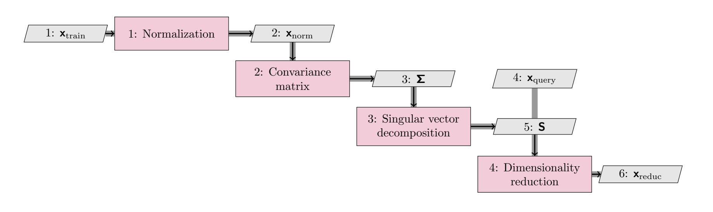

**图 21.** PCA 首先将原数据 $\mathbf x_{\mathrm{train}}$ 归一化到相同数量级，得到 $\mathbf x_{\mathrm{norm}}$，协方差矩阵 $\Sigma$ 揭示相关性。常用 SVD 确定特征向量，按所需保留物理信息选择主成分 $S$。将 $S$ 与查询数据 $\mathbf x_{\mathrm{query}}$ 作矩阵乘法，得到降维数据 $\mathbf x_{\mathrm{reduc}}$。

总之，PCA 通过少量正交线性组合降维，识别相关变量、消除噪声和冗余，从而发现隐藏模式，见图 22。

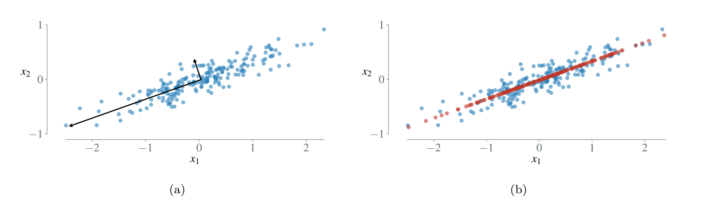

**图 22.** PCA 变换示例 [224]。（a）蓝点为原始样本，黑箭头为数据主轴，箭头长度衡量投影到该轴后的方差；（b）保留（a）中最长轴、去除短轴，红点为投影数据，原二维数据降为一维。

标准 PCA 为线性方法，适合线性可分数据，但有些结构不能由线性子空间良好表示。核 PCA 引入核函数度量距离，实现高效非线性降维 [225,226]。常用高斯核为 $\kappa(\mathbf x,\mathbf x')=\exp[-\|\mathbf x-\mathbf x'\|^2/(2\sigma^2)]$，$\sigma$ 可调。对于 $n$ 个训练点：

1. 构造核矩阵 $K_{i,j}=\kappa(\mathbf x_i,\mathbf x_j)$。
2. 计算 Gram 矩阵 $\tilde K=K-\mathbf1_nK-K\mathbf1_n+\mathbf1_nK\mathbf1_n$，保证投影特征零均值；$\mathbf1_n$ 为全部元素为 $1/n$ 的 $n\times n$ 矩阵。
3. 特征分解求解 $\tilde K\mathbf a_k=\lambda_kn\mathbf a_k$。

核主成分为 $y_k(\mathbf x)=\phi(\mathbf x)^\top\mathbf v_k=\sum_{i=1}^na_{k,i}\kappa(\mathbf x,\mathbf x_i)$。

两类 PCA 均已用于 ASO。Asouti et al. [227] 用标准 PCA 降低输入维度，使 RBF 网络更易训练、预测更可靠，再结合进化算法完成多个案例。Gaudrie et al. [228] 用核 PCA 揭示高维 CAD 参数中的低维流形，改善高斯过程代理，进一步用于贝叶斯优化。

#### 3.2.4. 非线性流形学习

流形学习是一类线性或非线性降维方法，从高维数据中学习固有低维结构 [229]。PCA 已介绍线性情形，本节关注同样广泛用于 ASO 的非线性方法。

流形是一种拓扑空间，每一点的局部邻域类似欧氏空间。例如 Grassmann 流形 $\operatorname{Gr}(k,\mathbb R^n)$ 描述 $\mathbb R^n$ 中所有 $k$ 维线性子空间，Stiefel 流形 $V_k(\mathbb R^n)$ 描述所有正交归一 $k$ 标架。流形学习假设高维数据位于低维流形上。

由于通常难以解析定义潜在流形，需要学习方法。等距特征映射（Isomap）[230] 是常用方案，图 23 展示从高维空间 $X$ 的 $N$ 个训练点进行学习的过程。它在经典多维尺度分析（MDS）中融入加权图上的测地距离。

具体而言，若点 $i$ 为点 $j$ 的 $k$ 近邻之一，便连接二者，边长设为 $d_{i,j}$，再计算点间最短路径。随后通过经典 MDS 得到低维嵌入：

$$
X=E_r\Lambda_r^{1/2}.
\tag{40}
$$

$r$ 为所需特征向量数，$E_r$ 为这些向量组成的矩阵；$\Lambda_r$ 的对角元素是下列矩阵的 $r$ 个特征值：

$$
B=-\frac12CDC,
\tag{41}
$$

$D$ 为元素 $d_{i,j}^2$ 的平方距离矩阵，中心化矩阵为：

$$
C=I-\frac1nJ_n,
\tag{42}
$$

$I$ 为单位矩阵，$J_n$ 为 $n\times n$ 全 1 矩阵。

Orsenigo and Vercellis [231] 在银行信用评级预测中比较 PCA 与 Isomap，多数情况下 Isomap 的低维表示取得最高分类精度。Ripepi et al. [232] 用 PCA、Isomap 降阶建模，在较低评估时间与存储开销下预测高保真 CFD 表面压力分布。多数情况下 Isomap 更准确，特别在激波附近。

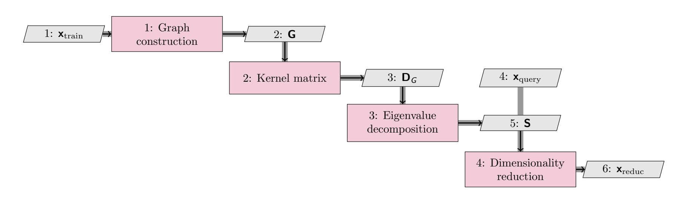

**图 23.** Isomap 用 KNN 构造邻接图 $G$，再根据训练样本之间的最短路径构造核矩阵 $D_G$。通常用 SVD 识别特征向量，并按希望保留的物理信息选择主成分 $S$。将 $S$ 与查询数据 $\mathbf x_{\mathrm{query}}$ 相乘，得到降维数据 $\mathbf x_{\mathrm{reduc}}$。

局部线性嵌入（LLE）[233] 总流程类似 Isomap，但构造核矩阵方式不同。其核矩阵对应从邻居最佳线性重建 $\mathbf x_i$ 的权重 $W_{ij}$，通过最小化以下代价求得：

$$
L=\sum_i(\mathbf x_i-W_{ij}\mathbf x_j)^2.
\tag{43}
$$

$W_{ij}$ 表示点 $\mathbf x_j$ 对重建 $\mathbf x_i$ 的贡献。若 $X_j$ 不属于 $X_i$ 的 $k$ 近邻，权重必须为零；权重矩阵每行和为 1，即 $\sum_jW_{ij}=1$。流形假设认为高维数据趋于位于低维流形附近，使高维空间中的局部距离度量可行 [234,235]。

因此，LLE 将原始 $D$ 维数据降至 $d\ll D$ 维。保持原空间求得的权重不变，通过改变低维点 $\mathbf y_i$ 的坐标最小化：

$$
L=\sum_i(\mathbf y_i-W_{ij}\mathbf y_j)^2.
\tag{44}
$$

相对于 Isomap，LLE 借助稀疏矩阵算法可更快优化，并在许多问题上结果更好 [233]。Decker et al. [236] 比较 PCA、Isomap、LLE 的解析与 CFD 案例，发现激波和不连续区域附近非线性方法更好，稳态预测则线性方法更好。他们还指出，非线性方法能够发现更低维表示，降低非线性降阶模型评估成本。

#### 3.2.5. 动态模态分解

DMD 是从高维时间序列中揭示时空特征的数据驱动分解方法，适用于非定常流场，见图 24。对于间隔 $\Delta t$ 的序列 $V_1^N=[\mathbf v_1,\mathbf v_2,\ldots,\mathbf v_N]$，假设线性映射 $A$ 连接相邻快照，即 $\mathbf v_{i+1}=A\mathbf v_i$。

于是 $AV_1^{N-1}=V_1^{N-1}S+\mathbf r\mathbf e_{N-1}^\top$，其中 $\mathbf r$ 为残差向量，$\mathbf e_{N-1}\in\mathbb R^{N-1}$ 为第 $N-1$ 个单位向量。$S$ 的特征值用于近似 $A$ 的特征值。为提高鲁棒性，采用与 $S$ 相似变换相关的“满”矩阵 $\hat S$ 做特征分解：

$$
\hat S=UV_2^NW\Sigma^{-1}.
\tag{45}
$$

$U,W,\Sigma$ 来自 $V_1^{N-1}=U\Sigma W^H$ 的 SVD。动态模态为 $\Phi_i=U\mathbf y_i$，$\mathbf y_i$ 为 $\hat S$ 的第 $i$ 个特征向量，即 $\hat S\mathbf y_i=\mu_i\mathbf y_i$。

模态频率由对应 DMD 特征值的对数映射获得：第 $i$ 模态的频率为 $f_i=\operatorname{Im}(\ln\mu_i)/(2\pi\Delta t)$，增长率为 $g_i=\operatorname{Re}(\ln\mu_i)/\Delta t$；原文随后又表示为 $f_i=\angle\mu_i/(2\pi\Delta t)$ 和 $f_i=|\mu_i|/\Delta t$ [237]。

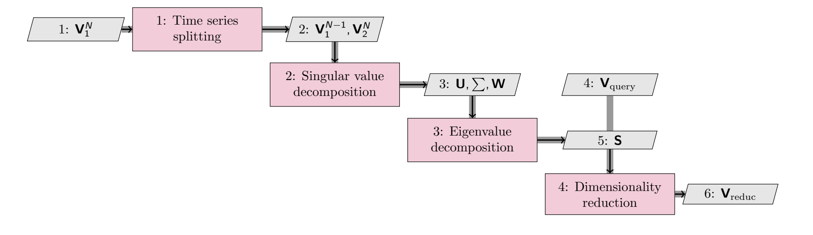

**图 24.** DMD 将时间序列 $V_1^N$ 分为 $V_1^{N-1}$ 和 $V_2^N$，对前者做 SVD，再计算矩阵 $U^\top V_2^NW\Sigma^{-1}$ 的特征值和特征向量。选出的模态 $S$ 用于降维。

> 译注：式（34）的高斯归一化系数、式（38）的协方差乘积顺序、式（43）和（44）的求和写法均按原文保留。式（45）中写 $U$，图 24 图注写 $U^\top$；DMD 段落末尾频率与增长率的符号和表达也存在不一致，均未改写。

Schmid [238] 用 DMD 提取流场动态信息，帮助理解流体动力学与输运过程。DMD 可只处理整个计算或实验域的子域，从而聚焦特定流动特征和不稳定机制，尤其适合包含多种不稳定机制或多物理现象的流动。

### 3.3. 半监督学习

监督学习使用带标签数据，无监督学习使用无标签数据；但实验气动数据等标签有时不完整，且获取昂贵，因此需要半监督学习。它结合少量带标签数据与大量无标签数据 [239,240]，利用已有标签和伪标签训练，见图 25。

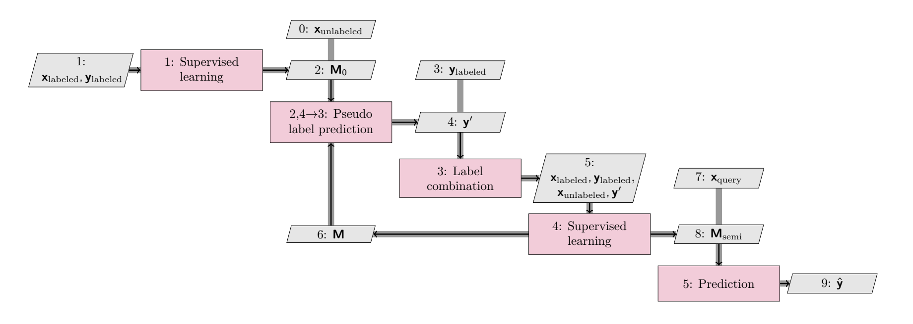

**图 25.** 先在带标签数据上训练初始监督模型 $M_0$，用它预测无标签数据的伪标签 $y'$；再将真实标签、伪标签及对应数据合并，训练另一个监督模型 $M$，继续预测伪标签。迭代至预测性能不再变化，得到 $M_{\mathrm{semi}}$，用于查询数据 $\mathbf x_{\mathrm{query}}$ 的后续回归。

ASO 中采用的一类半监督方法是深度置信网络（DBN），由多层受限玻尔兹曼机（RBM）堆叠而成。RBM 是具有生成能力的两层 ANN，可学习输入的概率分布 [241,242]，见图 26。“受限”指只存在可见层与隐藏层之间的连接：每个可见节点连接全部隐藏节点，同层节点互不连接，使实现简单、训练高效。

堆叠的 RBM 可通过梯度下降和反向传播微调为 DBN。前向传播时隐藏层激活，反向传播时可见层重建输入。RBM 为无向模型，不能直接用梯度下降和反向传播调整权重与偏置；可以用马尔可夫链蒙特卡洛（MCMC）近似梯度，但达到平衡需要很多步。

对比散度在 MCMC 第 $k$ 步截断，近似梯度以调整未知参数 [243,244]。$k$ 最小可取 1，构成一步对比散度训练，见图 27：

1. 随机初始化未知权重与隐藏层偏置。
2. 取训练样本 $\mathbf v$，计算隐藏单元概率，并采样隐藏激活向量 $\mathbf h$。
3. 计算 $\mathbf v$ 与 $\mathbf h$ 的外积，称为正梯度。
4. 由 $\mathbf h$ 采样重建可见向量 $\mathbf v'$，再由它采样隐藏向量 $\mathbf h'$，此过程也称 Gibbs 采样。
5. 计算 $\mathbf v'$ 与 $\mathbf h'$ 的外积，称为负梯度。
6. 更新权重矩阵：

$$
W\leftarrow W+\lambda(\mathbf v\mathbf h^\top-\mathbf v'\mathbf h'^\top),
\tag{46}
$$

$\lambda$ 为预设学习率。同样更新偏置：

$$
\mathbf a\leftarrow\mathbf a+\lambda(\mathbf v-\mathbf v'),
\tag{47}
$$

$$
\mathbf b\leftarrow\mathbf b+\lambda(\mathbf h-\mathbf h').
\tag{48}
$$

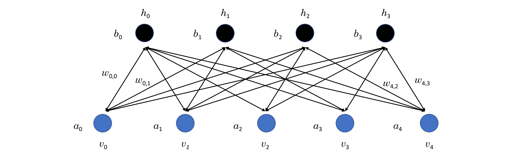

**图 26.** RBM 是浅层两层神经网络。第一层（蓝色）为可见层或输入层，含可见神经元 $v_0,\ldots,v_4$；第二层（黑色）为隐藏层，含 $h_0,\ldots,h_3$。$w_{i,j}$ 连接第 $i$ 个可见神经元与第 $j$ 个隐藏神经元，$a_i,b_j$ 分别为两层偏置。

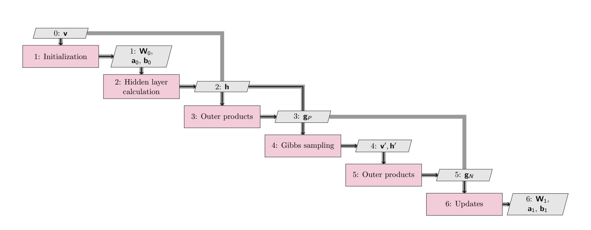

**图 27.** 基于对比散度的 RBM 一步训练展示权重与偏置更新。前向计算隐藏向量 $\mathbf h$，与 $\mathbf v$ 作外积得到正梯度 $g_P$；Gibbs 采样经一次反向传播产生 $\mathbf v'$，再一次前向传播产生 $\mathbf h'$，得到负梯度 $g_N$。最后按式（46）至（48）更新。

RBM 计算高效，由于同层连接受到限制，比传统玻尔兹曼机训练更快。隐藏激活可作为有用特征输入其他模型，改善性能。但即使用对比散度，训练仍有挑战。

DBN 逐层堆叠 RBM，以无监督方式顺序训练，再用监督学习微调 [245,246]，见图 28。更深的堆叠改善 RBM 性能。Mohamed et al. [247] 认为 DBN 是 GMM 的有竞争力替代方案，因为它可作为神经网络微调，包含多层非线性隐藏层，并以生成方式预训练。

原文指出，DBN 训练避免可能产生局部最优或梯度消失的反向传播；梯度消失指反向传播使梯度极小，实际上阻止权重变化。DBN 已在多保真鲁棒气动设计优化中作为低保真模型成功应用 [248]。

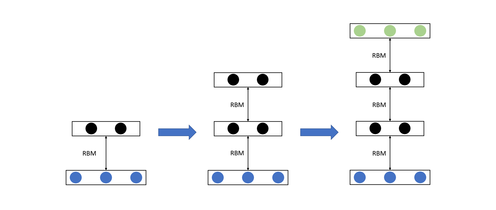

**图 28.** 顺序连接 RBM 构成 DBN。每个 RBM 训练至收敛后冻结，将其“输出层”结果输入下一个 RBM，继续训练至收敛，直至全网训练完成。蓝色为输入层，黑色为隐藏层，绿色为输出层。

### 3.4. 强化学习

强化学习（RL）[249,250] 旨在解决序贯决策问题，即学习最优策略，指导智能体在通常表述为马尔可夫决策过程的环境中行动。本节先介绍架构和术语，再介绍结合深度学习的深度强化学习。

#### 3.4.1. 强化学习基础

训练中，智能体通过与环境交互学习正确行动，见图 29。关键概念如下。

1. **智能体。** 根据环境观测决定行动，例如执行配送的无人机。
2. **环境。** 智能体活动所在，执行其动作，返回奖励与下一状态。例如配送环境根据无人机移动更新位置并输出奖励。
3. **状态。** $s\in S$，对环境的观测，用于决定动作。
4. **动作。** $a\in A$，每个时间步可采取的移动，例如无人机左转、右转、巡航或加速。
5. **轨迹。** 状态及影响这些状态的动作构成的序列。
6. **奖励。** $r\in R$，评价动作质量的反馈，可以即时或延迟。
7. **折扣因子。** $\gamma$ 通常小于 1，乘于未来奖励，使无限和有限；也表示未来奖励的重要性低于即时奖励。
8. **策略。** $\pi(s)$ 是智能体选择动作的核心算法，从状态空间映射到动作空间。给定测量状态 $s$，生成动作 $a$。可以是确定性映射 $\pi(s)=a$，或随机映射 $\pi(a\mid s)=P_\pi[A=a\mid S=s]$，后者表示遵循当前策略时在状态 $s$ 采取动作 $a$ 的概率。
9. **回报。** $G$ 为未来折扣奖励总和，从时刻 $t$ 开始为：

$$
G_t=R_{t+1}+\gamma R_{t+2}+\cdots=\sum_{k=0}^\infty\gamma^kR_{t+k+1}.
\tag{49}
$$

10. **状态价值。** $V_\pi(s)$ 预测当前策略下未来累积折扣奖励的期望，衡量一个状态有多好：

$$
V_\pi(s)=\mathbb E_\pi[G_t\mid S_t=s].
\tag{50}
$$

11. **Q 值。** $Q_\pi(s,a)$ 又称动作价值，表示从当前状态采取该动作、随后遵循策略的长期回报：

$$
Q_\pi(s,a)=\mathbb E_\pi[G_t\mid S_t=s,A_t=a].
\tag{51}
$$

状态价值与 Q 值的关系为：

$$
V_\pi(s)=\sum_{a\in A}Q_\pi(s,a)\pi(s,a).
\tag{52}
$$

**图 29.** RL 从初始环境观测 $s_0$ 出发，智能体据此采取动作 $a$。环境执行动作，返回更新状态 $s$，供后续决策；每次动作后计算奖励 $r$，指导策略修改。迭代至学得最优策略 $\pi^*$。

RL 主要分为基于模型与无模型两类。“模型”指转移概率函数 $P$ 和奖励函数 $R$。转移函数记录在状态 $s$ 采取动作 $a$、获得奖励 $r$ 并到达 $s'$ 的概率：

$$
P(s',r\mid s,a)=\mathbb P[S_{t+1}=s',R_{t+1}=r\mid S_t=s,A_t=a].
\tag{53}
$$

相应状态转移函数为：

$$
P_{ss'}^a=P(s'\mid s,a)
=\mathbb P[S_{t+1}=s'\mid S_t=s,A_t=a]
=\sum_{r\in R}P(s',r\mid s,a).
\tag{54}
$$

奖励函数预测动作触发的下一步期望奖励：

$$
R(s,a)=\mathbb E[R_{t+1}\mid S_t=s,A_t=a]
=\sum_{r\in R}r\sum_{s'\in S}P(s',r\mid s,a).
\tag{55}
$$

基于模型的 RL 依赖预测动作后果的模型学习最优策略；无模型 RL 则直接与环境交互，不构建模型 [249,251]。两者都希望训练智能体最大化总奖励。最优策略可能不唯一，统一记为 $\pi^*$；它们具有相同的最优状态价值：

$$
V_*\equiv\max_\pi V_\pi(s),\qquad s\in S.
\tag{56}
$$

类似地，最优动作价值为：

$$
Q_*(s,a)\equiv\max_\pi Q_\pi(s,a),\qquad s\in S,\ a\in A.
\tag{57}
$$

它表示在 $s$ 采取 $a$ 后遵循最优策略的期望回报，因此 [249]：

$$
Q_*(s,a)=\mathbb E[R_{t+1}+\gamma V_*(S_{t+1})\mid S_t=s,A_t=a].
\tag{58}
$$

监督、无监督和半监督学习从训练集学模式，再应用于新数据；RL 则根据持续反馈调整动作，动态学习以最大化累积奖励。它能求解传统方法难以处理的复杂问题，例如最优控制 [252]；用长期累积奖励训练，有利于长期性能；学习方式类似人类，具有很强能力。

另一方面，过多强化学习可能导致状态过载而降低效果；它需要大量数据和计算预算，在真实物理系统中受到维度灾难限制。与深度学习结合可缓解这些问题。

#### 3.4.2. 深度强化学习

深度 RL（DRL）使用 DNN 建模策略，使 RL 能处理大规模复杂问题。与监督 DNN 一样，训练迭代调整网络权重和偏置；区别是监督学习预先有真实标签，而 RL 要等待可能变化、延迟或受未知变量影响的环境奖励。按获取最优策略方式，DRL 分为基于价值与基于策略的方法 [251,253,254]。

价值方法用 DNN 近似价值函数，估计状态—动作对的期望奖励，并选择价值最高动作形成策略，通常适合离散动作空间。深度 Q 网络 [253] 是常见方法，见图 30，结构与基本 Q-learning 类似。Q-learning 跟踪不同状态—动作对的 Q 值 [253,255]；若中间状态太多，内存迅速膨胀而难以实用。深度 Q 网络用 DNN 估计 Q 函数：输入状态，预测所有可能状态—动作对的 Q 值。损失通常基于 Bellman 方程 [256]，最小化相对于环境反馈的预测误差。训练需充分探索环境，通常采用 $\epsilon$-贪婪策略。

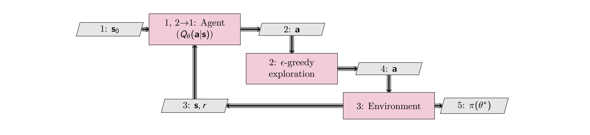

**图 30.** 深度 Q 网络作为价值型 RL，用 DNN 训练价值函数 $Q_\theta(a\mid s)$，评估策略 $\pi$。$\epsilon$-贪婪策略按用户指定概率选择最高价值动作或随机动作，确保适当探索。每次动作后可更新 DNN 参数 $\theta$（原文称“超参数”）。

策略方法直接用 DNN 建模动作策略，适合连续动作空间，见图 31。先运行一个回合，即初始状态到终止状态之间的全部状态，以最大化累积奖励，再提高高回报动作概率、降低低回报动作概率。

策略可为随机或确定性。近端策略优化（PPO）[257] 等随机策略建模给定状态的动作概率分布，最大化期望累积奖励，需要对状态和动作空间积分；训练通过采样策略分布探索。确定性策略梯度 [258] 等直接将状态映射到最优动作，仅对状态空间积分；训练可向动作加噪声探索，通常所需回合少于随机策略 [258]。

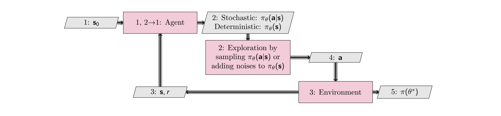

**图 31.** 策略型 RL 用 DNN 直接建模策略 $\pi$，可以随机或确定。通过采样随机策略或向确定性动作加噪声生成动作，确保充分探索。

Garnier et al. [251] 总结认为，策略方法比价值方法更快、更可靠地收敛到最优参数，但可能陷入局部最优。它也更适合高维动作空间，因为深度 Q 网络必须在所有时间步对全部可能动作打分。

DRL 使智能体无需手工设计状态空间，即可从非结构输入决策；深度学习能处理游戏画面像素等高维状态，并选择使游戏得分等目标最优的动作。其应用包括电子游戏 [259,260]、机器人 [261,262]、交通 [263,264] 和流动控制 [265,266]。DRL 也可模仿人类直觉求解 ASO，例如 Li et al. [267] 学习降低超临界翼型气动阻力的策略。

### 3.5. 人工神经网络

ANN 是深度学习的核心，能力强、可扩展，适合大规模、高复杂度任务 [268,269]，见图 32，已成为多领域最常见机器学习模型。近期 ASO 进展大多利用 ANN。本节先介绍基础，再介绍 CNN、RNN、自编码器、GAN、自组织映射和 PINN 等架构。

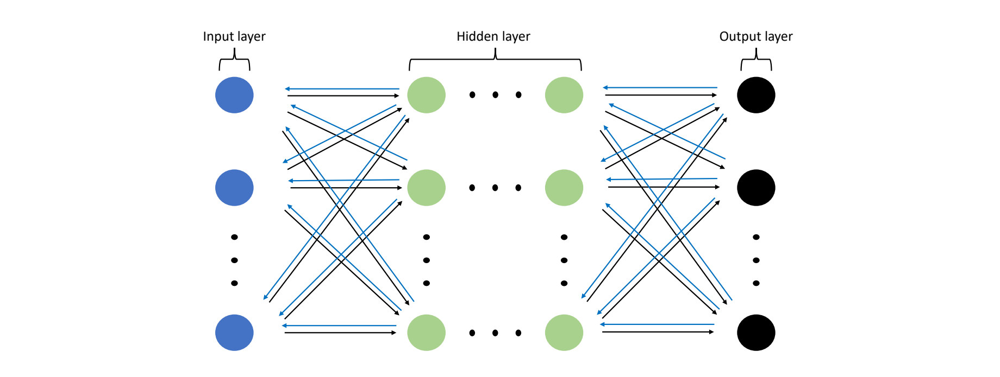

**图 32.** ANN 包括输入层（蓝点）、隐藏层（绿点）和输出层（黑点），各点称神经元。前向传播（黑箭头）通过乘加运算和隐藏神经元中的非线性激活，将输入映射为输出；反向传播（蓝箭头）跟踪输出对隐藏层及隐藏层对输入层的梯度。前向用于预测，反向用于训练未知权重和偏置。

#### 3.5.1. 基本设置

ANN 含一个输入层、一个或多个隐藏层和一个输出层，深层隐藏堆叠构成 DNN。输入层关联输入参数，输出层关联待预测量。每层含一个或多个神经元，单个神经元运算为：

$$
h=a(w_1x_1+\cdots+w_nx_n+b)=a(\mathbf x^\top\mathbf w+b).
\tag{59}
$$

$\mathbf x$ 为输入，$\mathbf w$ 为待定权重，$b$ 为未知偏置，激活函数 $a$ 引入非线性，输出 $h$ 作为下一层输入。典型激活函数包括 sigmoid：

$$
\sigma(z)=\frac1{1+e^{-z}},
\tag{60}
$$

其单调、可微，输出范围 $[0,1]$，导数不单调。双曲正切为：

$$
\tanh z=\frac{e^z-e^{-z}}{e^z+e^{-z}},
\tag{61}
$$

同样单调、可微，输出范围 $[-1,1]$，导数不单调。ReLU 为：

$$
R(z)=\max(0,z),
\tag{62}
$$

原文将其描述为单调、可微，输出范围 $[0,\infty]$，导数单调。Leaky ReLU 为：

$$
L(z)=\begin{cases}z,&z\ge0,\\\gamma z,&\text{其他情况},\end{cases}
\tag{63}
$$

$\gamma$ 为定义“泄漏”的小常数。原文也将其描述为单调、可微，输出范围 $[-\infty,\infty]$，导数单调。理解激活函数的单调性、值域和可微性，对于合理选用至关重要。

> 译注：ReLU 以及通常参数设置下的 Leaky ReLU 在 $z=0$ 处不可微，原文“可微”的描述未单独讨论这一拐点。

#### 3.5.2. 模型训练

训练的基本原理是最大似然估计，优化未知参数，使给定输入下观测到输出的概率最大 [26]。目标函数或损失函数可写为预测与真实观测的平方误差和：

$$
\min_{\boldsymbol\theta}\sum_{i=1}^N(\hat y_i(\boldsymbol\theta)-y_i)^2.
\tag{64}
$$

$\boldsymbol\theta$ 为未知参数，$y$ 为训练观测，$\hat y$ 为网络预测。权重与偏置通常随机初始化，再迭代调整以最小化损失。网络包含可微矩阵乘法与激活函数，且参数很多，因此通常采用梯度优化。

一种计算梯度的方式是逐神经元解析求导，但现代网络可含数千神经元，难以实际实现。有限差分也昂贵，并有步长选择等问题 [26，第 6.4 节]。ANN 通常输入多、输出少，结构由许多简单可微函数串联，因此适合反向模式算法微分 [26，第 6.6 节]，机器学习界称为反向传播，已内置于 TensorFlow [270] 等软件。

最流行训练算法是最速下降，即梯度下降；虽然最简单、一般也并非最高效，但适合机器学习。大型 ANN 的损失全局最小值很难找到，相比精确全局最优，更重要的是快速得到足够好的解。训练用预先选定的步长即学习率代替线搜索，提高效率；通常接近训练结束时逐渐降低学习率，避免错过极小值。

每步使用全部数据称批量梯度下降（BGD），用全数据平均梯度更新权重；对于凸或相对光滑误差流形，直接趋向局部或全局最优。配合衰减学习率，可保证吸引域内的极小值，但每步计算昂贵，也更易陷入局部最优。

随机梯度下降（SGD）每步随机选一个训练样本计算梯度 [271]，随机性帮助摆脱局部最优并加速。缺点是损失不单调下降，也不会稳定停在极小值。可逐渐减小学习率以稳定。小批量梯度下降（MGD）[272,273] 介于二者，每步随机选取数据子集。它通常比 BGD 更易摆脱局部极小值，能力不及 SGD，但收敛比 SGD 平滑。

#### 3.5.3. 卷积神经网络

CNN 是专为图像等大规模结构化数据设计的 DNN，架构使实现更高效、大幅减少参数 [274,275]，因而在计算机视觉中处于前沿。它主要包括卷积、池化和全连接层，见图 33。

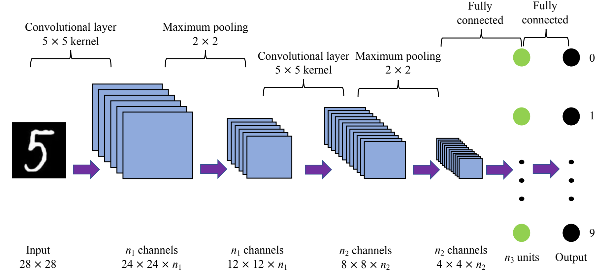

**图 33.** 以 $28\times28$ 分辨率的 MNIST 数字为例，卷积层用局部核将图像转换为多个通道，提取高级特征；池化进一步减少未知参数，再将通道转换为全连接层完成分类。

卷积层通过滤波器或卷积核捕捉输入全局与局部信息。卷积是将两个函数结合为第三个函数以融合信息的数学运算。CNN 在输入上进行卷积，产生特征图：

$$
\mathrm{ConvL}=(\mathbf w\cdot I)_{i,j}
=a\!\left(\sum_{m=0}^{l_1-s}\sum_{n=0}^{l_2-s}w_{m,n}I_{i+m,j+n}+b\right).
\tag{65}
$$

$I$ 为 $L_1\times L_2$ 二维输入，$\mathbf w$ 为 $l_1\times l_2$ 未知权重矩阵，$s$ 为步长，$b$ 为偏置，$a$ 为激活。原文将输出大小写为 $(L_1+2p-l_1+s)\times(L_2+2p-l_2+s)$，$p$ 为填充量。

池化通常位于卷积后，降低维度、避免过拟合 [276,277]。常用最大池化和平均池化：滤波器在卷积输出中滑动，分别取局部最大值或均值。全连接层则是多个神经元及其激活函数的堆叠。

处理大型结构化输入时，CNN 相比普通 ANN 有三项优势：（1）滤波器减少未知参数；（2）通过高层组合低层模式学习空间层次结构，更利于识别；（3）具有平移不变性，在某位置学得的模式可以通过复用权重在其他位置识别，原文也将移位或旋转列为例子。

但 CNN 通常需要大量数据，而且并非所有任务都能表示为结构化输入。一些气动预测将非结构数据转换为结构图像 [278,279]；虽然概念验证成功，对高保真建模未必理想。

#### 3.5.4. 循环神经网络

RNN 通过隐藏神经元回到自身的反馈回路构成循环结构 [280,281]，允许将前一步输出作为输入，同时保留隐藏状态，见图 34。它因此记住历史信息，适合时间序列。传统 RNN 为：

$$
\mathbf h_t=a_h(W_{xh}\mathbf x_t+W_{hh}\mathbf h_{t-1}+\mathbf b_h),
\tag{66}
$$

$$
\mathbf y_t=a_o(W_{ho}\mathbf h_t+\mathbf b_o).
\tag{67}
$$

$\mathbf x_t$ 为第 $t$ 步输入，$\mathbf h$ 为隐藏输出，$\mathbf y$ 为模型输出，$W$ 为权重矩阵，$a_h,a_o$ 为相应激活函数。

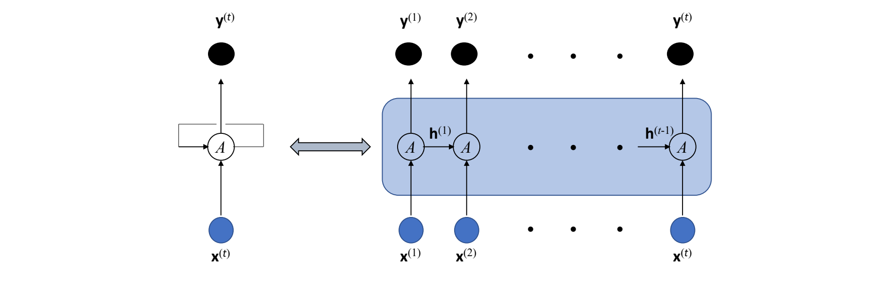

**图 34.** RNN 广泛用于时间相关任务，由一系列循环结构组成。每个结构输入当前步 $\mathbf x^{(t)}$ 和前一隐藏状态 $\mathbf h^{(t-1)}$，产生当前隐藏状态，用于预测并传向下一结构。

RNN 在许多工程应用中表现良好，但存在长期依赖问题。例如语言生成中，待预测词所需相关信息可能在很久以前出现。理论上 RNN 可以处理，实际却难以建立联系 [282]。长短期记忆（LSTM）通过增加遗忘门 $g_f$、更新门 $g_u$ 和输出门 $g_o$ 改善它 [283,284]，见图 35。

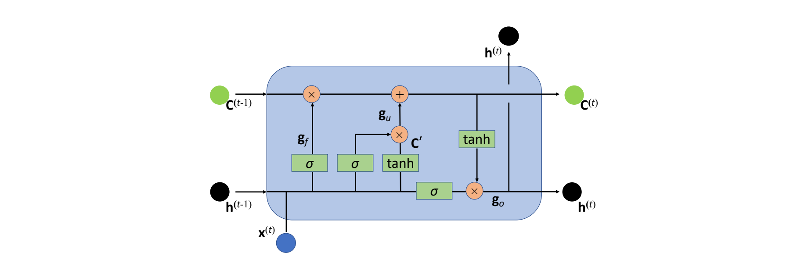

**图 35.** LSTM 单元输入当前 $\mathbf x^{(t)}$ 与前一步细胞状态 $C^{(t-1)}$、隐藏状态 $\mathbf h^{(t-1)}$，经三个门产生用于预测的 $\mathbf h_t$。当前细胞状态 $C_t$ 与 $\mathbf h_t$ 传入下一时间步；圆圈内符号表示逐元素运算。

LSTM 更新为：

$$
g_f=\sigma(\mathbf w_f\cdot[\mathbf h^{(t-1)},\mathbf x_t]+b_f),
\tag{68}
$$

$$
g_u=\sigma(\mathbf w_u\cdot[\mathbf h^{(t-1)},\mathbf x^{(t)}]+b_u),
\tag{69}
$$

$$
C'=\tanh(\mathbf w_C\cdot[\mathbf h^{(t-1)},\mathbf x^{(t)}]+b_C),
\tag{70}
$$

$$
C^{(t)}=g_f\cdot C^{(t-1)}+g_u\cdot C',
\tag{71}
$$

$$
g_o=\sigma(\mathbf w_o\cdot[\mathbf h^{(t-1)},\mathbf x^{(t)}]+b_o),
\tag{72}
$$

$$
\mathbf h^{(t)}=g_o\cdot\tanh(C^{(t)}).
\tag{73}
$$

$\mathbf w$ 为权重，下标对应变量。遗忘门经 sigmoid 将前隐藏状态和当前输入映射为 0 至 1，乘在前细胞状态各元素上；1 表示保留，0 表示遗忘。更新门同样用 sigmoid 决定用候选状态 $C'$ 更新多少，候选状态由输入和前隐藏状态经 tanh 产生。

前细胞状态乘遗忘门、候选状态乘更新门，相加得到当前细胞状态。一方面，它直接传入下一单元作为记忆；另一方面，经 tanh 后与输出门相乘得到隐藏状态。输出门也用 sigmoid 将相关输入缩放至 0 至 1。

增加门使 LSTM 能建模长期依赖，比基本 RNN 更能抵抗短记忆问题，但计算更复杂、内存更高。航空航天中主要用于非定常气动预测，充分利用记忆单元。Wang et al. [285] 的多变量 LSTM 对非定常气动标量和分布量表现良好。

#### 3.5.5. 自编码器

自编码器是学习无标签高维数据低维表示的 ANN，通过一个神经元少于输入层的层实现低维表示，该“窄层”又称瓶颈层，迫使网络压缩输入。

网络分为编码器与解码器，见图 36。编码器从输入到瓶颈，充当识别模型，可用全连接或卷积网络提取低维特征；解码器从瓶颈到输出，充当生成模型，可用全连接层或转置卷积将低维特征转回高维。

卷积常用于下采样，转置卷积用于上采样 [286]。后者先用零填充扩大输入图像高宽，再卷积，使输出维度高于输入。自编码器通过最小化输出 $\hat{\mathbf x}$ 相对于输入 $\mathbf x$ 的重建损失 $L(\hat{\mathbf x},\mathbf x)$ 训练。

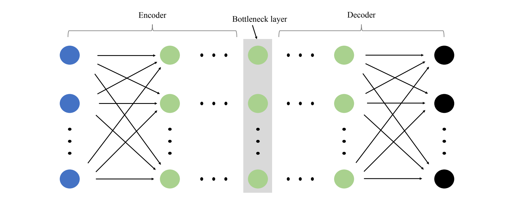

**图 36.** 编码器与解码器通过瓶颈连接。通过最小化输出层（黑）与输入层（蓝）的差异，以无监督方式将输入特征自动提取到通常维度远低于输入的瓶颈层。

变分自编码器（VAE）对潜变量引入各向同性高斯先验，以得到潜变量解耦的低维表示 [287]。具体是增加一个为每个潜变量提供均值和标准差的层，见图 37。其损失有两项：重建误差，以及鼓励学得分布接近真实先验的项，先验通常假定为单位高斯。详细介绍见 [288]。

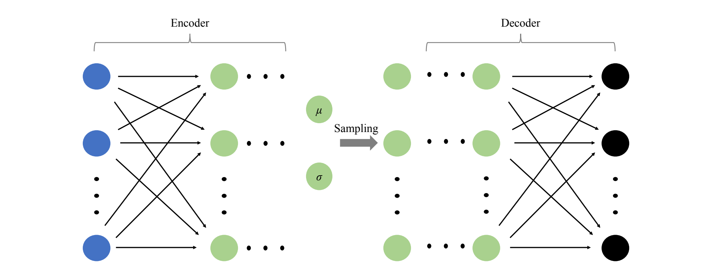

**图 37.** VAE 结构类似自编码器，但原文描述它不使用瓶颈层，而由编码器输出潜变量均值 $\mu$、标准差 $\sigma$，从相应高斯分布采样作为解码器输入。训练完成后，可利用该分布生成与输入相似的数据或形状。

虽然架构相似，VAE 属于变分贝叶斯方法 [289]。普通自编码器读取、压缩并重建原输入，用于无监督降维；VAE 假设源数据属于隐式概率分布，推断其参数，再生成相关新数据。

Rios et al. [290] 比较 PCA、核 PCA、自编码器对三维车辆设计空间的紧凑表示，发现自编码器比其他方法更能局部修改几何，并验证其改善优化性能。Wang et al. [291] 提取 VAE 变量表示超临界翼型流场，再用 ANN 建立翼型形状到 VAE 变量的映射。

#### 3.5.6. 生成对抗网络

GAN 包含相互竞争的生成器和判别器 [292]，见图 38，二者均可采用各种神经网络。生成器学习产生具有训练数据相似模式和性质的数据，判别器区分生成数据与训练数据。

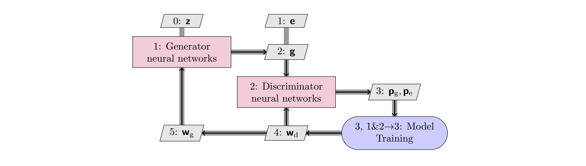

**图 38.** GAN 用判别网络与生成网络竞争，改进 VAE 等生成模型。生成器将通常服从用户指定均匀分布的随机变量 $\mathbf z$ 转为形状 $\mathbf g$。判别器区分现有数据 $\mathbf e$ 与 $\mathbf g$。训练判别器调整 $\mathbf w_d$，使生成数据为真的概率 $p_g$ 趋向 0、现有数据概率 $p_e$ 趋向 1；训练生成器调整 $\mathbf w_g$，使 $p_g$ 趋向 1。最终生成新颖而类似现有数据的形状。理想情况下，所有 $\mathbf z$ 的 $p_g,p_e$ 均接近 0.5，但很难实现。

生成器通常输入均匀分布随机变量。判别器对生成与训练数据输出其来自训练集的概率，通常分别标记为 0、1，构成极小极大问题 [292]：

$$
\min_{\mathbf w_g}\max_{\mathbf w_d}V(\mathbf w_g,\mathbf w_d)
=\mathbb E_{\mathbf z\sim P_z}[\log(1-p_g)]
+\mathbb E_{\mathbf e\sim P_{\mathrm{data}}}[\log p_e].
\tag{74}
$$

$\mathbf e$ 从训练分布 $P_{\mathrm{data}}$ 采样。

基于互信息的 InfoGAN [293] 在 GAN 基础上提取结构特征，例如 MNIST 数字的旋转和宽度，见图 39。互信息衡量随机变量相互依赖程度，即一个变量 $X$ 告诉我们多少有关 $Y$ 的信息，可用熵表示为：

$$
I(X;Y)=E(X)-E(X\mid Y)=E(Y)-E(Y\mid X).
\tag{75}
$$

InfoGAN 在保留原始 GAN 噪声变量的同时引入潜变量。训练最大化潜变量与生成数据的互信息，使结构特征根据预设概率分布自动对应到潜变量，见图 40。因此，目标改为：

$$
\min_{\mathbf w_g}\max_{\mathbf w_d}\left[V(\mathbf w_g,\mathbf w_d)-I(\mathbf c;\mathbf g)\right],
\tag{76}
$$

$\mathbf c$ 为潜变量，$\mathbf g$ 为生成形状。互信息难以直接获得，因此推导其下界 [293]：

$$
L(\mathbf w_g,\mathbf w_d)
=\mathbb E_{\mathbf g\sim P_G(\mathbf c,\mathbf z)}
\left[\mathbb E_{\mathbf c'\sim P(\mathbf c\mid\mathbf e)}[\log Q(\mathbf c'\mid\mathbf e)]\right]
+\mathrm{const}.
\tag{77}
$$

$P_G(\mathbf c,\mathbf z)$ 为生成翼型分布。训练目标变为：

$$
\min_{\mathbf w_g}\max_{\mathbf w_d}
\left[V(\mathbf w_g,\mathbf w_d)-L(\mathbf w_g,\mathbf w_d)\right].
\tag{78}
$$

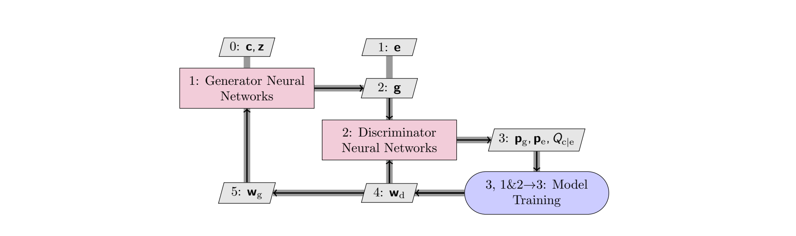

**图 39.** InfoGAN 输入潜变量 $\mathbf c$ 与噪声 $\mathbf z$。判别器除 $p_g,p_e$ 外，还输出给定现有样本 $\mathbf e$ 时 $\mathbf c$ 的近似分布 $Q_{\mathbf c\mid\mathbf e}$。近似真实分布可方便构造互信息下界，即变分互信息。训练类似 GAN，但损失还最大化 $\mathbf c$ 与 $\mathbf e$ 的互信息。数学细节见 Chen et al. [293]。

相比 VAE，引入判别器使 GAN 新样本与源数据更相关。GAN 不引入确定性偏差，而变分方法优化对数似然下界，会引入偏差。GAN 一次前向传播即可生成样本，不像玻尔兹曼机需要未知次数的马尔可夫链迭代。

但 GAN 很难训练到整个变量空间中生成样本真实性概率均为 0.5 的完美平衡 [294]。另一常见问题是模式坍塌：判别器困在局部极小值，生成器反复产生相同或少量输出，缺乏多样性。

常用 Wasserstein 损失帮助判别器摆脱梯度消失 [295]，使它不陷于局部极小值，并学会拒绝生成器固定产生的输出。但 Arjovsky et al. [295] 也指出，用权重裁剪施加 Lipschitz 约束非常不理想，可能导致训练不稳定或收敛缓慢。

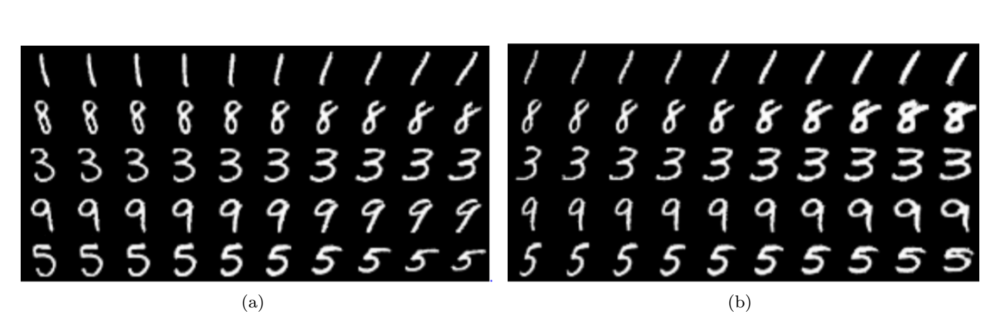

**图 40.** Chen et al. [293] 用 10 个类别潜变量和两个均匀潜变量处理 MNIST。训练后，每个类别变量自动捕捉数字种类，两个均匀变量分别控制（a）旋转和（b）宽度。

GAN、InfoGAN 与 Bézier、B 样条曲线拟合结合，已用于翼型和机翼截面参数化。训练后，不仅能生成光滑真实的翼型，还能在几乎不牺牲最优性能的情况下减少优化迭代 [296,297]。

#### 3.5.7. 自组织映射

SOM 是无监督方法，寻找保留高维输入拓扑结构的低维表示 [298]，见图 41。保拓扑意味着输入空间中的邻近观测，应投影到映射空间的邻近节点 [299]。由此可更清楚看到高维数据隐藏的聚类等结构，适用于分析和可视化 [300]。

SOM 不同于其他 ANN，由单层结构化神经元构成，全部连接输入。每个神经元表示低维图中的坐标，例如 $(i,j)$，通过欧氏距离保留高维拓扑。参数竞争更新，使相似高维数据映射得更近。

生成拓扑映射（GTM）是 SOM 的概率形式，在低维空间定义密度模型以建模高维分布 [301]。相比 SOM，GTM 借助类似 GMM 的 EM 算法保证收敛至局部最优，见第 3.2.2 节。

SOM 使数据易于解释理解，可处理多类分类问题并给出有价值的数据概括。但它对类别数据表现不佳，对混合类型更差；模型准备慢、训练困难。在 ASO 中，SOM 用于可视化多目标空间的 Pareto 解权衡。Obayashi and Sasaki [302] 利用 SOM 对设计变量聚类，揭示变量对改进和权衡的作用。

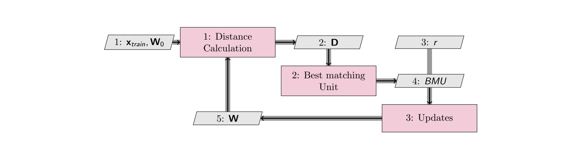

**图 41.** SOM 通过竞争学习训练，而非梯度反向传播等误差修正学习。随机选训练样本 $\mathbf x_{\mathrm{train}}$，计算它与各节点权重（初值 $W_0$）的欧氏距离 $D$。最近节点为最佳匹配单元 BMU，以其为中心画预设半径 $r$ 的圆。BMU 及邻居根据输入与权重之差乘缩放参数更新；邻居越远变化越小。达到迭代上限时停止。

#### 3.5.8. 物理信息神经网络

Raissi et al. [60] 提出 PINN：在完成监督任务时，遵守一般非线性偏微分方程描述的物理定律的神经网络 [303,304]。关键在于将相关偏微分方程融入训练损失，评估方程残差及残差导数：

$$
\min_{\boldsymbol\theta}\left[
\sum_{i=1}^{N_u}(\hat y_{u,i}(\boldsymbol\theta)-y_{u,i})^2
+\sum_{i=1}^{N_f}\hat r_{f,i}(\boldsymbol\theta)^2\right].
\tag{79}
$$

前项为物理量预测误差，后项为配点上预测残差 $\hat r$ 的惩罚，也称物理损失。

PINN 将物理原则融入机器学习，而非纯数据驱动，开辟新建模与计算范式：自然编码底层物理定律作为先验，用数学物理长期积累丰富深度学习。

但最初的 PINN 针对固定初始与边界条件建立，而设计优化每次迭代边界都可能改变，因此困难较大；当时尚未用于实际大规模 ASO。尽管如此，它能融入专家知识，仍备受关注。Mao et al. [305] 用 PINN 近似高速气动流动的 Euler 方程，在正向和逆向问题中表现良好。

## 4. 机器学习在气动外形优化中的应用

气动外形设计优化效率主要受三方面影响：几何设计空间维数、气动分析成本，以及优化算法收敛速度。先进机器学习已显示出高效参数化外形、低成本准确预测气动性能、创新 ASO 流程的潜力。本节回顾相关应用，并评论性能与贡献。

### 4.1. 几何设计空间

设计优化需要精细控制外形，以提升气动性能。传统参数化通常引入大量变量，确保设计空间包含最优解，但也包含导致 CFD 与优化收敛困难的异常候选。因此，希望排除异常形状、降低维度，机器学习是有力工具。

这里介绍两种有效途径：提高几何效率的模态参数化（第 4.1.1 节），以及缩小设计空间的几何筛选（第 4.1.2 节）。前者通过耦合设计变量，后者通过增加几何约束来缩小空间。

从 2000 年代到 2010 年代，模态参数化主要基于 PCA 等线性方法，聚焦翼型；随后用 GAN 等深度模型发展非线性模态，强调生成真实气动外形，并从二维翼型扩展到三维机翼。类似地，2010 年代以前的几何筛选主要依靠较简单工程知识；深度学习则能检测详细设计中的复杂异常。相关研究见表 1。

模态参数化和几何筛选都依赖显式设计者知识，或从历史设计学知识，因此人们合理地担忧：缩小后的空间能否包含超越既有经验的创新外形。

**表 1. 面向气动外形优化紧凑几何设计空间的研究**

| 描述 | 应用 | 文献 |
|---|---|---|
| 从超临界翼型提取正交模态进行参数化 | 翼型 | Robinson and Keane [306] |
| 用 PCA 和预优化翼型进行模态参数化 | 翼型 | Toal et al. [307] |
| 用 PCA 和 UIUC 翼型进行模态参数化 | 翼型 | Poole et al. [308,309]；Masters et al. [310]；Allen et al. [311]；Li et al. [312] |
| 用 GAN 和 UIUC 翼型进行模态参数化 | 翼型 | Chen et al. [297]；Du et al. [313]；Wang et al. [314] |
| 用 PCA 和预优化样本进行模态参数化 | 转子叶片 | Duan et al. [315] |
| 用 PCA 和基于深度学习的最优样本参数化 | 翼型与机翼 | Li and Zhang [316]；Li et al. [317] |
| 用 GAN 和概率语法机翼样本参数化 | 机翼 | Chen and Ramamurthy [318] |
| 用 ASM 和随机样本参数化 | 翼型与机翼 | Lukaczyk et al. [319]；Namura et al. [320]；Grey and Constantine [321]；Li et al. [322] |
| 用低保真模型进行几何筛选 | 机翼平面形状 | Giunta et al. [323] |
| 融入设计者工程判断进行几何筛选 | 短舱 | Sóbester and Keane [324] |
| 基于工程知识的几何筛选 | 二维进气道 | Li et al. [325] |
| 增加基于深度学习的有效性约束 | 翼型与机翼 | Li et al. [326]；Li and Zhang [111] |

#### 4.1.1. 模态参数化

模态参数化从系列样本中提取全局表示，以线性或非线性模态控制外形。它不同于 CST、Hicks–Henne 鼓包和 FFD 等使变量对应局部形变的传统方法，因有效性受到越来越多关注 [306–309,312,316,317,327]。

例如 Robinson and Keane [306] 从一族超临界翼型提取正交模态，仅少量模态即可近似原翼型气动行为。PCA 是常用选择，可由 SVD 求解，因此一些文献又称 SVD 或 POD 模态 [307–309]。

UIUC 翼型坐标数据库对模态参数化贡献很大。它公开包含约 1,600 种翼型，从低雷诺数到跨声速超临界翼型，覆盖无人机、风力机、喷气运输机等应用，蕴含宝贵历史知识。感谢 Michael Selig 领导的 UIUC 应用空气动力学团队和全部贡献者。

**原文脚注 7：** [UIUC 翼型坐标数据库](https://m-selig.ae.illinois.edu/ads/coord_database.html)。

PCA 翼型模态广泛用于翼型优化 [309,312] 和机翼优化 [311]，后者用翼型模态控制局部截面。多数模态直接从完整翼型坐标提取，同时包含弯度与厚度 [309]。Li et al. [312] 分别提取弯度线和厚度线模态，其表示效率与完整翼型模态相当，但更直观、实用。

Masters et al. [310] 比较多种参数化对超过 2,000 种翼型的几何恢复，展示 PCA 模态的高效率。原文称比较七种方案，列举 CST、Hicks–Henne 鼓包、B 样条、径向基函数域单元、Bézier 曲面和参数化截面方法。

Berguin and Mavris [328,329] 对伴随求得的气动导数做 PCA，寻找显著影响目标气动系数的低维模态，等价于主动子空间方法（ASM）[330]。不同于 PCA，ASM 追求输出变化最大，识别设计空间中对升力、阻力等目标最有影响的方向，以实现降维。

ASM 已用于机翼优化 [319,321,322] 和车辆气动外形分析 [331]。Lukaczyk et al. [319] 发现 ONERA M6 机翼升力与阻力主要分别依赖 1 个、2 个 ASM 模态。Li et al. [322] 将 ASM 与代理优化结合，相比使用 FFD 控制点，以较低成本获得更实用、阻力更低的机翼。

Namura et al. [320] 为避免求气动导数，用克里金估计 ASM，尤其适合黑箱。但跨声速、数百变量时，气动函数更非线性，代理梯度可能难以准确。Tripathy et al. [332] 将降维与高斯过程耦合，在 Stiefel 流形上通过两步最大似然优化寻找主动子空间基，不需梯度。Rajaram et al. [333] 类似地将基约束在 Grassmann 流形上，直接寻找子空间而非特定基。

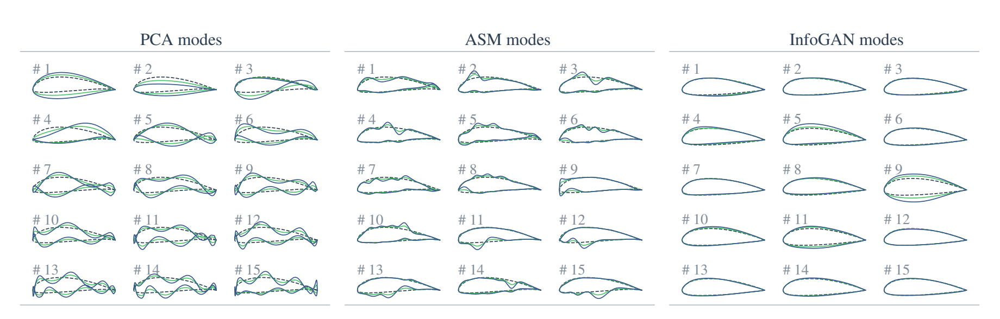

**图 42.** 不同模态引起的翼型形变。虚线为基准翼型，绿线、蓝线分别为模态系数取 1、2 时的形状。

除线性模态，也已有非线性模态。InfoGAN 的潜变量生成器提供现实可行的方案，见第 3.5.6 节。GAN [292] 通过学习低维潜变量分布生成真实高维数据。Li et al. [326] 发现，结合 CNN 与归一化的 GAN 无需预参数化即可生成光滑翼型；采用 Wasserstein 距离（WGAN）能准确捕捉训练分布、降低模式坍塌风险 [111]。

InfoGAN [293] 最大化潜变量与生成器分布互信息，使翼型厚度等模式由潜变量表示。Chen et al. [297] 将其用于翼型设计，发现基于 Bézier 曲线的 GAN 比普通 GAN、原始 InfoGAN 更能保持光滑形状控制。Du et al. [313] 加入 B 样条层，并严格研究参数，以保证拟合已有 UIUC 翼型的精度，使潜在最优设计包含在空间内。

VAE、GTM 和非线性流形等也可提取低维潜在空间。Wang et al. [314] 比较 VAE、VAEGAN 翼型模态与 PCA；Viswanath et al. [334,335] 将 GTM 引入翼型与机翼代理优化；Doronina et al. [336] 用 Grassmann 流形参数化风力机叶片截面。劳斯莱斯资助研究 [337] 用自编码器将涡轮机械叶片几何参数从 100 降至 15。

这些方法中，原文推荐 GAN 系列，因为判别器使其生成真实外形。非线性模态有潜力比线性模态更高效、所需变量更少，建议在 ASO 基准 [1,338] 中进一步验证。

图 42 展示从 UIUC 提取的 PCA、ASM、InfoGAN 三类模态。PCA 基于翼型坐标 [312]；ASM 基于 FFD 参数化，在 $M=0.75$ 下针对升力系数评估 [322]；InfoGAN 为 B 样条模型的潜变量 [313]。前两者线性，系数翻倍产生线性叠加；InfoGAN 使用非线性激活，潜变量整体改变厚度、弯度等，噪声变量则补充细微厚度变化。

进化或代理优化可直接通过 PCA 等降维提高效率。Asouti et al. [227] 将 PCA 用于超声速公务机初步设计、风力机叶片气动弹性设计、翼型气动设计。Tao et al. [339] 将 PCA-DBN 代理融入改进粒子群，实现鲁棒设计。Kapsoulis et al. [340] 用核 PCA 优化孤立翼型与 DrivAer 汽车，比原 PCA 更高效。

无论哪种模态方法，都需要真实外形数据库；否则模态可能不光滑，设计空间约束不足，仍包含异常翼型。与 UIUC 翼型不同，机翼等三维部件公开几何数据几乎没有，因此多数研究限于二维。

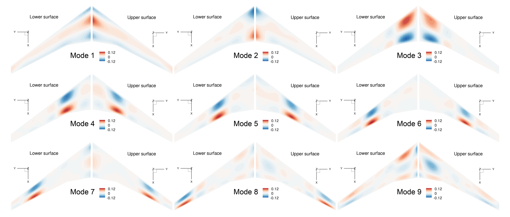

**图 43.** 从基于深度学习的最优采样方法生成的机翼样本中提取的 CRM 机翼 PCA 模态 [316,341]。

可以预优化收集合适高性能三维形状，类似 Toal et al. [307] 的翼型研究。Duan et al. [315] 从预优化搜索的 1,734 个 NASA Rotor 37 叶片样本中提取 8 个 PCA 模态，在 8 维空间再优化，使绝热效率进一步提升 0.25%。但预优化建库耗时，所得好设计也可能远离真正最优，缺少足够多样性。

Chen and Ramamurthy [318] 用概率语法规则创建 GAN 机翼数据库，例如要求根部到尖部弦长单调变化，再加入 FFD 层保证光滑。FFD-GAN 比直接 FFD 和 B 样条收敛更快。但样本生成有任意性，针对具体工业设计时，其设计空间仍可能过大。

为此，Li and Zhang [316] 提出结合指定几何约束的深度学习最优采样，用优化与几何有效性模型 [111,326] 寻找真实机翼。先由翼型 GAN 生成截面作为初始点，再最小化位移以保持样本稀疏性，同时施加 CNN 判别模型的有效性约束，见图 44。

这些样本填充高维空间中满足任务几何要求的一小块区域，导出有效机翼参数化 [316,341]，在降维时不排除潜在最优，图 43 展示 CRM 全局模态。紧凑空间使机翼无需伴随或梯度优化也能高效求解 [316]，尤其适合转捩主导性能、气动函数不连续的低雷诺数 ASO [317]。

#### 4.1.2. 几何筛选

固定变量边界的设计空间可能包含异常外形，因为变量间内在关系无法量化 [312,324]。这些区域无益于设计，却严重降低效率。飞行条件等低维、可解释空间可以由飞行力学专家确定合理区域 [342]，但高维几何空间难以手动划定。

设计空间筛选在 ASO 及其他设计问题中用于排除异常区域 [343,344]。它不减少变量数量，而是通过评价异常程度的约束函数缩小空间。

这种约束不同于距离 [345]、厚度、体积或曲率约束 [116,346]，没有已知控制方程，通常由数据模型构造。Giunta et al. [323] 先用 LF 模型探索 HSCT 机翼，排除无意义区域，再在小得多的区域做 HF 优化。Li et al. [325] 用进气口位置、管道曲率、干涉面积和总压标准差等惩罚训练 SVR 筛选模型，提高二维进气道优化效率。

Sóbester and Keane [324] 用 RBF 网络捕捉设计者几何与工程判断，排除短舱异常 CAD，例如风扇面前方样条过度蛇形或突变。Li et al. [312] 用反距离加权插值建立高阶翼型模态相对于主导模态的函数，在插值函数上增加、减去裕度作为筛选约束，排除异常区域；随后 Li et al. [312]、Bouhlel et al. [347] 得以训练精确的翼型分析模型。

Li et al. [326] 开发通用深度几何有效性模型，使用超过 10,000 个带标签真实、异常翼型。先训练 GAN 学习已有分布，生成真实合成翼型；再用拉丁超立方采样（LHS）随机扰动真实翼型的 FFD 控制点，生成异常样本。两类分别标记 $+1$、$-1$，训练 CNN 判别器快速评价任意翼型或机翼截面。

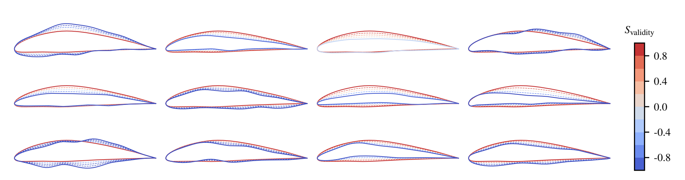

**图 44.** CNN 判别模型对不同翼型的几何有效性评分。从真实到异常外形，得分平滑、单调下降，说明有效性约束适用于梯度优化。

有效性模型缩小翼型、机翼设计空间 [316,326]，阻止异常样本加入训练集，从而提高代理精度和优化效率，也有利于建立交互设计所需的通用精确气动模型。

Li and Zhang [111] 完成 216 个翼型设计优化和若干常规翼身尾、翼身融合构型机翼优化，发现所研究跨声速区域中，将筛选下界约设为 0.7，不会排除使巡航效率最大的创新形状，支持通用深度几何筛选的实用性。

当前筛选主要基于经验或既有设计，存在根本局限。未来值得研究无先验的通用筛选，例如使用自适应高保真仿真样本。

### 4.2. 气动评估

在 CFD-ASO 中，气动目标、约束及其相对于设计变量的导数评估占据大部分成本，因此始终需要降低评估成本，机器学习提供了一条有效途径。

2010 年代以前，气动系数建模主要采用多项式响应面、克里金等传统代理，可调参数适中，通常用小空间内少量数据训练。随后，混合专家（ME）、ANN 等使大空间、大数据预测成为可能，有助于交互 ASO。CNN 显示出直接从几何坐标、不经形状参数化预测系数的潜力，但相对传统方法的优势仍待证明。

由于固有插值性质，模型可能无法保证外推精度，而设计空间越高维，发生外推的可能性越大，因此维度灾难仍是根本困难。通过缩小空间、增加数据，可减少空间内部的外推预测。未来加强外推能力，对高维 ASO 很有价值。

流场变量众多，建模通常先降维。早期主要使用 PCA 等线性方法，2010 年代后引入非线性流形并改善精度；近期 CNN 等深度模型提供新的非线性降维，还能将降维与预测网络联合训练。PINN 等物理信息方法使预测遵守物理规律，提高精度，并具有可能缓解维度灾难的外推能力。建议未来在 ASO 基准上明确验证。

与流场预测相比，数值仿真加速在流体与机器学习交叉领域受到的关注较少，却对高保真 ASO 很重要。CNN 等预测可加速仿真；数据驱动空间离散和闭合模型虽不直接加速原问题，也能在相同成本下提高保真度，可直接用于高保真 CFD 优化。

非设计点气动约束对 ASO 至关重要，但非定常仿真昂贵，评估耗时。直接针对几何参数建模也受到维度灾难限制，且比巡航系数建模更贵。可构建基于物理的替代模型：早期通过线性回归建立经验公式，如估算翼型阻力发散马赫数的 Korn 公式；近期则以更复杂数据模型处理高维物理信息，用大数据提高精度。物理意识带来良好泛化，仍需研究训练成本与精度的平衡。

#### 4.2.1. 气动系数建模

CFD 提供整个计算域的丰富流动信息，但 ASO 通常只依据升力、阻力等少量指标，因此气动系数建模很重要。通常用高保真分析生成数据，在外形变量与系数之间拟合简单预测函数，即代理或元模型，见第 3.1.4 节。常见模型见表 2，包括响应面、克里金与神经网络 [364,369,370]。

Viana et al. [371] 回顾指出，1990 年代计算机辅助气动设计初期，多项式响应面最受关注；随后克里金 [30] 因强拟合能力 [372] 和预测置信区间而流行，促成 EGO [174]。协克里金、层次克里金 [169] 等则利用多保真仿真。

**表 2. ASO 中用于气动系数的近似模型**

| 模型 | 气动外形 | 文献 |
|---|---|---|
| 多项式响应面 | 机翼平面形状 | Giunta et al. [323] |
| 多项式响应面 | 二维扩压器 | Madsen et al. [348] |
| 多项式响应面 | 翼型 | Ahn et al. [349] |
| 多项式响应面 | 汽车 | Sun et al. [350] |
| 支持向量回归 | 翼型 | Andrés-Pérez et al. [156] |
| 支持向量回归 | 机翼 | Andrés-Pérez et al. [351] |
| 克里金 | 短舱 | Song and Keane [10] |
| 克里金 | 翼型 | Han et al. [352] |
| 克里金 | 机翼 | Han et al. [353–355] |
| 克里金 | 风力机叶片 | Xu et al. [356] |
| 克里金 | 螺旋桨 | Mourousias et al. [357] |
| 混合专家 ME | 机翼 | Liem et al. [221] |
| 混合专家 ME | 翼型 | Li et al. [312] |
| 混合专家 ME | 飞机 | Zhang et al. [342] |
| PCE | 翼型 | Du and Leifsson [186] |
| PCE | 机翼 | Palar and Shimoyama [358] |
| PCE | 翼身融合飞行器 | Zuhal et al. [359] |
| PCE | 翼型 | Lin et al. [360]；Nagawkar and Leifsson [361] |
| ANN | 飞机 | Secco and de Mattos [362] |
| ANN | 翼型 | Bouhlel et al. [347]；Du et al. [363] |
| ANN | 机翼 | Li and Zhang [341]；Barnhart et al. [364] |
| ANN | 无人机 | Karali et al. [365] |
| ANN | 短舱 | Yao et al. [366] |
| ANN | 列车 | Zhang et al. [367] |
| CNN | 翼型 | Zhang et al. [279]；Yu et al. [368] |

传统代理处理高维问题的困难之一是训练耗时。Bouhlel et al. [170,373] 沿偏最小二乘确定的方向训练克里金超参数，在最高 100 维数值问题中显著加速，但精度仍随维度增加而下降。

稀疏基 PCE 是另一途径，其线性回归训练可由 OLS、LARS 求解，双曲截断选择低阶基并保留精度，LARS 早停进一步加速 [181]。Du and Leifsson [186] 结合 LARS-PCE 与效用理论进行跨声速鲁棒翼型设计，比常见加权和法更好。

Palar and Shimoyama [358] 的 PC-Kriging-EGO 在亚声速机翼实际设计和具有多项式趋势的问题中，比标准 EGO 更快收敛。Zuhal et al. [359] 将 GEK 思路用于 PC-Kriging，在翼型、翼身融合及机翼气动结构设计中，相比 GEK 和梯度增强 PCE 提高性能与鲁棒性。

Lin et al. [360] 推导 PC-Kriging 的解析统计矩估计，用于鲁棒翼型设计，比蒙特卡洛统计估计高效。它结合克里金置信区间与 PCE 解析统计的优势，使不确定性量化更有竞争力。

Nagawkar and Leifsson [361] 发现 Du and Leifsson [188] 的 PC-Cokriging 在鲁棒翼型设计中，总体优于 PCE、克里金、PC-Kriging 和协克里金；钻孔 [374] 与无损检测案例也更好。但气动系数精度差异较小，尤其 HF 数据增加时。LF、HF 模型相关性可能是因素，仍需研究。

传统代理另一问题是不善处理大数据。虽然气动训练数据常来自昂贵实验，规模通常有限，但交互设计所需通用精确模型 [312,341] 需要大量数据。

直观方案是 ME [375,376]，采用分而治之：先通过无监督聚类等划分局部域，再计算簇后验概率以确定混合比例，最后训练各局部专家并组合。Liem et al. [221] 用 GMM 建 ME，在常规与非常规飞机任务分析代理中表现较好；Zhang et al. [342] 构建多保真操纵品质代理；Li et al. [312] 的 k 均值 ME 处理超过 100,000 个翼型训练数据。

ME 的潜在缺点是专家边界可能不光滑。Hwang and Martins [377] 的正则化最小能量张量积样条（RMTS）及梯度增强版本，借助张量积样条可扩展到 $10^5$ 量级数据，但难以高效处理高维问题。

神经网络是处理大量数据的有前景方案，并显著促进交互优化。Secco and de Mattos [362] 用约 100,000 个包含黏性效应的全势模型数据，训练翼身构型升阻系数 ANN，考虑不同平面形状、翼型与飞行条件，升力、阻力平均绝对误差分别为 0.004、0.0005。

Bouhlel et al. [347] 用 ANN 预测任意翼型升力、阻力、力矩，优于混合克里金 [312]；优化所得翼型与 HF-CFD 相似，亚声速、跨声速阻力分别仅差 0.01、0.12 个计数。Du et al. [313,363] 建通用 ANN 翼型分析模型，也取得与 CFD 优化相比良好的设计；并用 RNN 预测基准与最优设计的压力系数分布，提供更丰富见解。

Li and Zhang [341] 用 135,108 个不同外形、速度、高度机翼样本训练 ANN，实现交互式机翼设计。在 47,967 个未见样本上，相对 HF-CFD 的阻力、升力和俯仰力矩平均相对误差均低于 0.4%。Karali et al. [365] 用 94,500 个经非线性升力线方法评估的无人机，训练含 21 个几何变量和迎角的 22 输入 ANN，验证集平均绝对误差为 12.4 个阻力计数，多数预测吻合良好。

随机森林也可处理大量数据，复杂度低于 ANN。Kumar and Ghosh [378] 对 DLR-ATTAS 飞机准失速区域估计 $C_L,C_D,C_M$，比含可调参数经验公式更准；输入为迎角、升降舵偏角、俯仰角速度和相对空速。但这是四维案例，高维 ASO 性能仍待研究，即使低维，相对 ANN 的精度优势也未获证明 [165]。

ANN 参数多，可能样本效率低，并因初始化差而陷入局部极小值。DBN 利用无监督预训练加监督微调，可用较少数据。Tao and Sun [248] 在翼型、机翼优化中近似几何变量到气动系数，变量数分别为 12、39，HF 数据分别为 1,600、750。但未与 ANN 或克里金比较，尚不能证明半监督优势，值得继续研究小数据情形。

代理输入通常是参数化变量，也可利用 CNN 的特征提取直接使用几何坐标。Zhang et al. [279] 在不同马赫数、雷诺数和迎角下，直接输入翼型坐标预测升力，无需形状参数化。Yu et al. [368] 的“特征增强图像”策略，将厚度放大 10 倍以突出细小变化，再将图像按三种亮度增广，扩大训练与测试数据。翻转、改色、旋转等数据增广 [379,380] 可减少过拟合，但这种直接建模相对常用“参数化加建模”的优势仍需证明。

虽然 ANN 可直接接优化器 [381,382]，贝叶斯优化或 EGO 可能更高效，因此需要预测置信区间。深度高斯过程提供了这种能力 [383]。Rajaram et al. [384] 在 42 个形状变量的翼型中，比传统 GP 更准确：$C_l$ 的 RMSE 降低 2%–45%，$C_d$ 降低 2%–19%；但训练约 400 秒，而传统 GP 仅 0.1–1 秒。也可采用 ANN-GP 混合 [385]。多数深 GP 研究未直接与 DNN 比精度 [383,384,386]，且训练更慢，但结合 DNN 预测能力与 GP 置信度值得继续研究。

除正向映射，网络也可建模逆向关系 [387]。Sun et al. [388] 建立气动系数到外形参数的 ANN，再优化得到满足性能的翼型、机翼。O’Leary-Roseberry et al. [389] 用设计需求（飞行条件和约束）到最优机翼形状的网络求 ASO。因每个样本都需一次 CFD 机翼优化，他们将高维输出投影到低维基，并采用残差网络；逐层自适应训练的投影网络约用 200 个样本达到 95% 相对精度，优于端到端和全空间模型。

通过指定巡航升阻比、最大升力等性能生成设计很有吸引力，但一个性能可能对应零个或多个形状，导致逆问题不适定。条件生成模型作为贝叶斯反演的数据驱动实现 [390]，可处理这一问题 [391]，第 4.3.4 节将回顾其优缺点。

#### 4.2.2. 流场建模

流场建模有助于基于压力分布的逆向设计、多学科优化，以及解释优化结果。流场维度与 CFD 网格点数成正比，通常先降维 [392]，常见技术见表 3。

本征正交分解（POD）[393,394] 等价于第 3.2.3 节 PCA，可有效降低翼型 [395,396]、机翼 [397–399] 和整机 [400–402] 流场维度。降维后，构建设计变量到 POD 系数等降阶变量的代理，即非侵入式降阶模型。代理可用克里金 [403]、RBF [404] 或 ANN [341,405–408]。

另一类侵入式降阶模型通过投影模型 [409,410] 求解降阶流动变量，通常需要更多计算与代码实现，例如用自动微分求偏导 [411]。

**表 3. 流场建模中常用的降维技术**

| 方法 | 气动外形 | 文献 |
|---|---|---|
| POD | 翼型 | LeGresley and Alonso [412]；Alonso et al. [395]；Bourguet et al. [396]；Wang et al. [405]；Renganathan et al. [408] |
| POD | 机翼 | Thomas et al. [397] |
| POD | 翼型 | Bryant et al. [398] |
| POD | 飞机 | Lieu et al. [400] |
| POD | 飞机与直升机旋翼 | Fossati [402] |
| POD | 汽车 | Bertram et al. [413] |
| POD | 飞机 | Amsallem and Farhat [401] |
| 流形学习 | 翼型与机翼 | Franz et al. [414] |
| 流形学习 | 飞机 | Ripepi et al. [232] |
| 流形学习 | 翼型 | Decker et al. [236] |
| 自编码器 | 圆柱、二维汽车与球体 | Guo et al. [415] |
| 自编码器 | 圆柱 | Jin et al. [416] |
| 自编码器 | 翼型 | Bhatnagar et al. [278]；Sekar et al. [417]；Thuerey et al. [418] |
| 自编码器 | 圆柱与翼型 | Eivazi et al. [419] |
| 自编码器 | 翼型 | Duru et al. [420]；An et al. [421] |
| GAN | 翼型 | Chen et al. [422]；Wu et al. [423]；Wang et al. [424] |

POD 降阶假定流动解位于低维线性子空间，难以预测激波等非线性现象。对流主导等 Kolmogorov n-宽度衰减缓慢的问题 [425]，必须显著增加线性维数才能获得可接受精度 [426]。已有多线性子空间 [427]、平移 POD 基 [428] 等改进。

Wang et al. [429] 自适应地在强非线性流动区域增补训练点，改善跨声速翼型流场预测。Dupuis et al. [430] 用 GMM 将跨声速区域划为子域，训练多个局部 POD 模型，改善 RAE2822 湍流预测。这些方法可能需要深入物理理解。

劳伦斯利弗莫尔国家实验室开发开源 [libROM](https://www.librom.net/)，提供多个 SVD 版本以提高数据收集效率，支持全局与局部 ROM；特色之一是基于物理的采样，在有限快照下控制预测误差 [431]（原文脚注 8）。

非线性降维可能更有优势。早期主要用 Isomap、LLE。Franz et al. [414] 用 Isomap 改善固定外形跨声速激波预测，激波处压力梯度更尖锐，比 POD 更贴近 CFD。Ripepi et al. [232] 在 DLR Digital-X 项目 [432] 用 Isomap 预测跨声速翼身运输机构型压力分布，比 POD 准确。Decker et al. [236] 同样发现 Isomap、LLE 在激波附近误差更小。

自编码器 [419,433]、GAN [423] 等 ANN 能高效学习流场非线性流形。Guo et al. [415] 用卷积自编码器快速预测二维、三维外形的非均匀定常层流。Bhatnagar et al. [278] 预测未见工况与翼型的速度、压力场，全场相对误差低于 10%。Eivazi et al. [419] 对圆柱和振荡翼型的非定常速度场表明，非线性自编码器比 POD 更有效地提取低维特征。

Thuerey et al. [418] 用 U-Net（自编码器特例）预测不同雷诺数、不同翼型的速度压力，未见翼型上的平均相对误差低于 3%。Tangsali et al. [434] 研究跨流动区域与几何变化的泛化，认为网络能从差异很大几何中提取相关特征，几何泛化的样本外精度优于改变流动区域的物理泛化，这对外形优化有利。Duru et al. [420] 在 $M=0.7$ 的较高亚声速下预测翼型压力场，未见形状精度为 88%，显示准确捕捉激波的潜力。

条件生成模型可建立形状参数与高维流场的非线性关系。Chen et al. [422] 用条件 GAN 预测不同形状、迎角 $\alpha\in[-22.5^\circ,22.5^\circ]$、雷诺数 $Re\in[5\times10^5,5\times10^6]$ 下的速度场。75 个未见 UIUC 翼型中，感兴趣区域 $x$、$y$ 速度分量平均相对误差为 8.13%、20.83%，低于卷积自编码器 [278] 和 U-Net [418]。

Wu et al. [423] 用含 CNN 生成器的条件 GAN 预测超临界翼型跨声速流场，外形由 14 个 Hicks–Henne 鼓包参数化，用 RAE2822 周围采样的 500 个翼型训练，能粗略预测未见翼型流场。Wang et al. [424] 用 GAN 预测不同形状和 $M,Re,\alpha$ 下的压力系数分布。

ANN 可在训练预测模型时同时得到降维非线性流形，不同于先降维、再建降阶变量代理的两步方法。这种融合可能提高精度。Kashefi et al. [435] 用 PointNet 学习任意空间位置到该处 CFD 量的端到端映射，针对不规则几何与非结构网格设计，并在含翼型的多种截面速度、压力场中验证泛化。

直接预测流场的潜在问题是等值线不保证光滑。An et al. [421] 将结构相似性与多尺度结构相似性融入损失，研究权重对精度和视觉质量的影响；相比 RMSE 损失，光滑性等视觉质量提高超过 40%，RMSE 代价低于 6%。

物理信息损失 [60] 可使 ANN 遵守 RANS 等控制方程，提高精度与泛化 [61]。Cai et al. [436] 从浓缩咖啡杯上方流动实验快照，推断完整连续三维速度压力场；Kissas et al. [437] 用 PINN 去噪、重建临床磁共振血流速度；Tay et al. [438] 比较 ANN 与 PINN 预测收缩—扩张喷管，PINN 误差更低。

许多研究表明，即使外推，PINN 也能借助先验或约束准确、物理一致地预测 [61–63,439]。但仍缺乏在 ASO 基准上证明其优于 POD 加克里金等传统方法的研究。嵌入物理带来的外推潜力，对 ASO 很有价值，可能改变气动代理架构；建议重点研究包含外形变化的预测，明确验证潜力。

与气动系数建模类似，高维几何空间中不同形状的流场也难建模。Xiao et al. [440] 指出，非侵入方法成本随设计变量数指数增长，因此多数应用仅改变工况或翼型 [417–420]、汽车截面 [415] 等二维形状。三维场建模可借助第 4.1 节模态参数化和几何筛选缩小空间。

低维基截断模型可能不保留全局积分量，评估气动函数时引入额外误差，因此即使能建模目标量，在 ASO 中也需谨慎。Xiao et al. [441] 在最大化进气道质量流量和滚流（表征油气混合能力）时，发现 POD 加克里金预测速度场，不如直接预测积分量。这解释了多数 ASO 直接预测气动系数而非流场。PINN 物理与外推能力可能改善这一问题，值得深入研究。

此外，还可建立状态变量到伴随变量的模型，在 CFD 后直接计算气动导数，无需求解伴随方程。Xu et al. [442] 用 ANN 近似流动变量与伴随向量关系，并在从 NACA0012 出发的减阻中概念验证。仍需检验能否泛化到更广 ASO 问题。

#### 4.2.3. 数值仿真加速

高保真 ASO 中，即使被认为很精确的代理也未必达到所需保真度，因此仍需高保真 CFD。机器学习也可直接加速这些仿真。

直观方法是用流场代理给出初始猜测，再由 CFD 精化 [443,444]。Obiols-Sales et al. [445] 用 CNN 预测速度、压力、涡黏性，在多种几何的定常层流、湍流中实现 1.9–7.4 倍加速。

Andersson [446] 不只提供初值，而是在中间迭代使用 DMD 将解修正得更接近稳态，加快收敛。Liu et al. [447] 的模态多重网格用 DMD 截断定常仿真全部高频部分，保持精度并加速 3–6 倍；Chen et al. [448] 用类似方法加快定常伴随方程。Liu et al. [449] 在每个物理时间步用 DMD 提供合适初解，提高非定常隐式双时间步效率。

流动成本随网格分辨率快速增加，因此也有减少网格而保留仿真分辨能力的研究。Bar-Sinai et al. [450] 的数据驱动离散，系统推导连续物理系统的空间导数离散，使一维非线性方程在比标准有限差分粗 4–8 倍的分辨率下仍能准确时间积分。Zhuang et al. [451] 在二维湍流中使用粗 4 倍网格仍保持精度。Kochkov et al. [452] 对二维湍流 DNS、LES 实现 40–80 倍加速。

机器学习湍流建模也受到广泛关注 [453]，通常用高保真数据拟合传统模型闭合项，使仿真保真度高于传统模型。虽非直接加速，却可能降低高保真 ASO 成本。

Tracey et al. [454] 训练 ANN 重现 Spalart–Allmaras 模型，在平板边界层和三维跨声速机翼中验证。Ling et al. [455] 从 DNS、充分解析 LES 学习 Reynolds 应力张量，用新架构将 Galilean 不变性嵌入各向异性张量预测，比普通网络更准，改善 RANS 对管道角涡和波浪壁面分离的预测。Wang et al. [456] 用 DNS 数据预测周期山丘流动 Reynolds 应力，提高 RANS 精度。综述见 Duraisamy et al. [453]。

这些方法在 ASO 中应用仍少。Zhang et al. [457] 利用数据驱动湍流闭合，对单形状变量的周期山丘进行 RANS–LES 两保真优化。未来有望提高飞机、风力机等工业外形优化的仿真保真度。

CFD 松弛参数等也可用机器学习调节，以保持稳定并加快收敛 [458]。Discacciati et al. [459] 用 ANN 估计间断 Galerkin 方法中的人工黏性，接入 Runge–Kutta 求解器，在光滑问题中保证最优收敛率，并独立于具体问题和参数准确检测不连续。

#### 4.2.4. 实际约束构造

最大升力系数 $C_L^{\max}$、抖振起始等实际约束限定飞行包线，因此对 ASO 必不可少。目标通常在定常巡航下计算，但约束可能涉及非定常仿真，成本高得多。

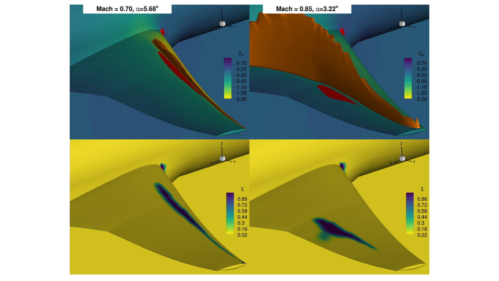

**图 45.** 两个实验抖振起始条件下的平滑分离传感器表面分布 [460]。它在高亚声速和跨声速条件下均能合理预测抖振起始，表明方法具有适当泛化能力。

若要求 $C_L^{\max}$ 不低于目标，其通常出现在失速前高迎角、大分离导致非定常流动的条件。Buckley et al. [99] 将迎角作为独立变量，对目标最大升力之差施加约束。所得翼型满足要求，比仅按巡航优化的形状更实用，但用定常 RANS 评估最大升力可能不够准确。

其他研究用代理或数据模型近似非定常气动 [461]，对固定形状的飞行仿真、控制律设计有效 [462,463]，也可用于少变量外形设计。Wang et al. [464] 用耦合 RANS、LES 的分离涡仿真训练代理，逆向设计三段翼型前缘位置，含 3 个几何参数；Raul and Leifsson [465] 用 URANS 代理，在 6 个变量翼型优化中延迟动态失速。但高维时受到维度灾难，成本过高，因此需要比巡航系数预测更先进的方法。

一种有前景途径是构造替代约束，可来自理论、实验，如压力分布判据 [466,467]，也可来自数据。翼型上表面后部压力梯度可限制后缘分离 [466,467]。Li et al. [468] 修改 Korn 公式，提高超临界翼型阻力发散马赫数预测；Li et al. [469] 对第一、第三厚度模态施加隐式约束，提高跨声速机翼低速最大升力。

跨声速抖振由激波诱导分离产生。Kenway and Martins [460] 建立基于分离传感器的起始约束，用实验对比确定 4% 上界，见图 45。虽然阈值仅据有限观测确定，该约束有效，已用于气动、气动结构优化 [65,470–472]，除 ADflow [87] 外也实现于 SU2 [473]。Garg et al. [474] 用类似方案约束水翼空化。

这些替代形式利用流动机理高效近似昂贵约束。若物理理解充分，数据模型未必需要大数据，可在可控成本下替代其他实际约束，但精度可能较低。

更复杂数据模型有望提高精度。Li et al. [475] 建立可泛化到翼型、机翼的物理数据驱动抖振模型，用混合 CNN 输入压力和摩擦分布，识别激波、分离等关键物理。以超过 10 万数据训练，在 14,886 个未见测试点上，抖振因子平均绝对误差为 $0.05^\circ$，比 Kenway–Martins 传感器更可靠。但训练需超过 $10^5$ 次 CFD，成本较高。建议继续研究其他非设计点约束，在精度和样本效率间取得平衡。

### 4.3. 优化架构

优化架构决定 ASO 工作流程，包括选择何种算法、如何利用高保真分析。第 2 节介绍传统 CFD 架构及局限，本节回顾机器学习促成的新架构。

1998 年提出的 EGO 等代理优化，根据预测置信区间引导迭代增补而逐渐精化模型，机器学习进一步提升其效率，主要贡献为：（1）ME、ANN 等更准确代理；（2）深度模态参数化等更紧凑几何空间；（3）更有效增补准则。应用从二维翼型逐步扩展到机翼、整机，有潜力解决三维多目标与鲁棒设计。

先进代理与紧凑空间也促成**交互式气动外形设计优化**：预先构建精确、通用的数据模型，再结合适当优化算法快速交互。代表是 2018 年部署的 [Webfoil](http://webfoil.engin.umich.edu)（原文脚注 9），用 $10^5$ 量级训练数据减少外推，但数据生成成本是广泛应用的重大障碍，需要更先进方法。

强化学习也能训练高效优化器。据报道，训练良好的 RL 不需求气动导数，就能达到梯度优化效率，但训练可能昂贵。以物理特征而非几何参数作为状态，有助泛化，类似非设计点约束建模。高训练成本，尤其高维时，以及难处理可调约束，可能成为实际 ASO 的关键缺点。

条件生成模型还带来快速**生成式逆向设计**，以概率方法处理病态逆问题。条件 GAN、条件 VAE 引起学术和工业关注，训练后可快速生成指定性能的设计。但由于精度与探索能力限制，结果可能明显偏离真正最优，可能更适合保真度要求较低的概念设计。

#### 4.3.1. 基于代理模型的优化

多数使用代理的气动优化依赖迭代模型精化 [476]，已应用于单点 [477,478]、多点 [354,479]、大规模多点 [119]、多目标 [112,480,481]、逆向 [192,482] 和鲁棒设计 [339,483–486]。机器学习提高了这些方法的效率。

代理优化通常有两阶段：首先进行试验设计（DoE），选择并评估初始样本，训练初始代理；随后迭代加入新样本精化模型。每次迭代通过基于增补准则的子优化确定新点 [34,476]。性能与代理建模效率、空间大小和增补有效性密切相关。

机器学习提高预测精度和数据效率，见第 4.2.1 节。Bartoli et al. [478] 的 SEGOMOE，将 SuperEGO [487]、PLS 克里金 [170,373,488] 和 ME [376] 结合，处理带约束气动优化 [478,489,490]，已用于机翼、短舱 [478,484,489] 及下一代飞机 AGILE 多学科优化项目 [491]。

Han [492] 开发 SurroOpt 通用工具，包含层次克里金 [169] 等多保真建模 [493,494]，用于多项气动和多学科优化 [131,354,495]。深高斯过程也提高了效率 [384,385]。相关研究见表 4。

**表 4. 基于代理模型的气动外形优化研究**

| 设计变量数 | 代理模型 | 外形 | 描述 | 文献 |
|---:|---|---|---|---|
| 2 | 克里金 | 建筑截面 | 最小化 $C_d$ 及 $C_l$ 变化 | Bernardini et al. [496] |
| 4 | 空间映射 | 翼型 | 最小化 $C_d$、最大化 $C_l$ | Leifsson et al. [112] |
| 5 | 克里金 | 机翼 | 最小化 $C_D$ | Li et al. [322] |
| 6 | 克里金 | 翼型 | 延迟动态失速 | Raul and Leifsson [465] |
| 8 | 流形映射 | 翼型与机翼 | 最小化 $\|C_p-C_p^*\|^2$ | Du et al. [192] |
| 8 | 流形映射 | 翼型 | 最小化 $C_d$ | Nagawkar et al. [479] |
| 8 | ANN | 翼型 | 最小化 $C_d$ | Renganathan et al. [385] |
| 10 | 克里金 | 翼型 | 最大化 $C_l/C_d$ | Jeong et al. [497] |
| 12 | 克里金 | 翼型 | 最小化 $C_d$、最大化 $C_m$ | Koziel et al. [480] |
| 17 | 克里金 | 机翼 | 最小化 $C_D$ | Bartoli et al. [477,478] |
| 30 | ANN | 机翼 | 最小化 $C_D$ | Zhang et al. [382] |
| 40 | ANN | 螺旋桨 | 最小化气动声学噪声 | Sun et al. [407] |
| 42 | 克里金 | 机翼 | 最小化 $C_D$ | Han et al. [354] |
| 48 | 克里金 | 机翼 | 最小化 $C_D$ | Li and Zhang [316] |
| 19／75 | 克里金 | 机翼 | 最小化 $C_D$ | Li et al. [498] |
| 80 | 克里金 | 机翼 | 最小化 $C_D$ | Han et al. [131,355] |
| 36／72／108 | 克里金 | 机翼 | 最小化 $\|C_p-C_p^*\|^2$ | Han et al. [353] |

虽然代理优化能处理超过 100 变量的机翼，收敛不一定有保证。Li et al. [498] 比较 19 与 75 变量：理论上变量多、自由度大应得更好设计，但同样 300 次 CFD 预算下，较少变量减阻更多，说明 75 变量远未收敛。Han et al. [353,355] 也有类似问题。多保真可降成本 [131]，但总体扩展性仍差，不适合高维问题。

模态参数化降维是另一重要贡献。CRM 案例 [316] 中，192 个 FFD 变量的代理优化进行了 1,000 次 CFD 仍未改善基准；从深度最优样本中提取 40 个 PCA 全局模态后，效率效果接近使用 192 FFD 变量的 CFD 梯度优化。若每次伴随算作 0.5 次 CFD，后者约需 500 次评估；40 模态代理优化含 DoE 训练，仅需 600–800 次即得到相似结果，阻力差 0.3 个计数，展现显著效率。

机器学习还可改善增补点选择。有效准则需平衡利用与探索，期望改进是成功准则之一，使 EGO 在黑箱工程优化中广泛使用 [34,476,478,499]。随后发展出最大改进概率、最小置信下界等 [500–503]。Liu et al. [501] 表明并行使用这些准则可提效。

但代理不准确时，仍可能加入无益、性能差的异常外形。机器学习可将增补搜索约束在合理区域，例如第 4.1.2 节的有效性函数 [111,326]；也可由气动数据近似模型识别区域。

Owoyele and Pal [504] 的 ActivO 使用“弱”“强”两个学习器，弱模型识别值得探索区域，强模型精确定位其中最优。在 9 变量发动机概念验证中，相比 PSO 等实现 4–5 倍加速。Shi et al. [505] 用特征空间模糊 c 均值与 SVM 识别有价值采样区域，改善地球观测卫星 MDO；后续又用 SVM 筛选感兴趣区域，引导顺序偏置采样，以更低成本获得比前项研究更好的可行卫星设计 [506]。

#### 4.3.2. 交互式设计优化

近乎即时完成 ASO 的交互设计深受飞机设计者关注。过去难以实现，是因为快速、准确、通用气动模型难以训练 [507]；先进模态参数化和数据建模已部分解决，应用于翼型 [312,313,347,363,508]、机翼 [341]，以及翼身运输机和无人机概念设计 [362,365]，见表 5。

**表 5. 基于通用数据模型的交互式气动外形优化研究。误差为阻力系数平均绝对误差；Li et al. [312]、Du et al. [313] 的两个值分别对应亚声速和跨声速。**

| 气动外形 | 模型保真度 | 训练样本数 | 设计变量数 | 误差（阻力计数） | 文献 |
|---|---|---:|---|---|---|
| 运输机 | 全势代码 | 100000 | 40 | 5.0 | Secco and de Mattos [362] |
| 无人机 | 非线性升力线法 | 94500 | 22 | 12.4 | Karali et al. [365] |
| 翼型 | RANS | 113400 | 16／10 | 0.1 和 0.8 | Li et al. [312] |
| 翼型 | RANS | 85201 | 28 | 1.4 和 5.0 | Du et al. [313] |
| 机翼 | RANS | 135108 | 60 | 0.9 | Li and Zhang [341] |

概念设计较易交互，因为 LF 气动模型快，能生成大量训练数据。Secco and de Mattos [362] 的 40 输入 ANN 考虑展弦比、梢根比、最大厚度和弯度等，用约 100,000 个含黏性修正的全势样本训练，平均误差 5 个阻力计数，比原代码加速 4,000 倍。Karali et al. [365] 用 94,500 个升力线评估无人机，训练 22 变量 ANN，仅几秒优化就提高气动效率 5%。

概念设计变量描述翼展、梢根比、后掠、扭转和最大厚度等整体量，而非详细翼型参数，内在关系更少，样本易有效，增加数据即可提精度。详细外形优化必须确保采样几何有效，否则异常形状使代理难训练 [508]。

翼型可只用 UIUC 真实形状避开问题 [279,417,418]。Zhang et al. [279] 的升力模型在若干验证翼型上误差多数低于 0.1；Sekar et al. [417] 用 1,343 个 UIUC 翼型，从固定雷诺数、迎角的压力分布恢复形状，相对误差低于 3%；Thuerey et al. [418] 用 1,505 个翼型预测压力速度，相对误差 3%。这些结果有潜力，但高保真设计要求更高精度和更多样本。

[Webfoil](http://webfoil.engin.umich.edu) 是可在计算机或移动设备浏览器中快速交互分析、优化翼型的在线工具（原文脚注 10）。Li et al. [312] 通过几何筛选与 RANS 建立超过 10 万翼型数据库。亚声速 $C_l,C_d,C_m$ 平均相对误差分别为 0.145%、0.255%、0.160%；跨声速分别为 0.404%、0.826%、0.966%。数据优化与 RANS 优化的最小阻力最大差异，亚声速为 0.04 个计数，跨声速为 2.5 个。

Du et al. [313,363] 延续研究，用具有 26 个独立形状变量的 B 样条 GAN 生成真实翼型，相比 PCA 不牺牲厚度精度，并通过依赖采样覆盖更广雷诺数、马赫数。除前馈网络预测标量，还用 RNN 预测压力分布。相关研究为高保真交互翼型分析与优化打开道路，见图 46。

Li and Zhang [316] 的最优采样同时施加深度有效性 [111,326] 与几何可行约束 [84]。基于此，他们用 135,108 个不同机翼、马赫数、高度的 RANS 样本，训练快速高保真 CRM 模型 [341]。47,967 个未见样本的 $C_L,C_D,C_M$ 平均相对误差均低于 0.4%，并经多个单点、多点、多目标设计验证，优化机翼类似 CFD 结果，阻力差 1–2 个计数，展示高维机翼交互设计可行性。

高保真交互设计精度至关重要，因为最优形状对目标、约束误差敏感。要接近 CFD 优化，系数相对误差应低于 1%，尤其要控制误差上界。上述研究通常需数万至数十万样本，传统克里金难处理（ME 除外），神经网络更合适。

Bouhlel et al. [347] 表明 ANN 优于混合 GEK；ANN 内置 AD 可准确提供导数，有助快速优化。Du et al. [313] 用 ANN、RNN 覆盖 $M=0.3$–0.7 和 $Re=10^4$–$10^{10}$。

最优性与收敛速度决定交互优化算法选择。梯度方法局部搜索，可能陷局部极小；某些无梯度方法全局搜索，但多项研究仍表明，实际 ASO 尤其高维快速设计更适合梯度算法 [1,312,338,341]，有两方面原因。

第一，多局部极小值并不特别普遍。不同初始翼型的梯度优化能收敛到同一结果 [74,469]，机翼也得到非常相似形状 [1,338,341]。文献多峰性常与无黏机翼等非物理流动有关 [509]。实际问题可能有若干极小值，但数量有限 [99,509,510]，多起点策略仍可寻找全局最小 [26，提示 4.8；511]。

第二，无梯度方法效率低，也未必收敛，成本随变量数急剧增加 [23]。Li and Zhang [341] 在 57 变量机翼中发现 GA、PSO 明显不及 SLSQP。单点优化 SLSQP 约 100 次迭代收敛，PSO 要 50 万次评估才获得类似解；双目标中，SLSQP 通过 15 次双点优化，约 2,000 次目标及导数分析得到 Pareto 前沿，NSGA-II 即使 100 万次也未得到相当结果。

即使数据评估便宜，无梯度低效率仍不适合交互设计，尤其带几何约束时，每次评估还需使表面网格形变。现有交互研究缺少机动性能、操稳评估所需的动力学与多学科效应建模，未来值得推进；PINN 等物理数据模型也有望提升高保真交互的数据效率、精度，促进飞机设计数字孪生 [512]。

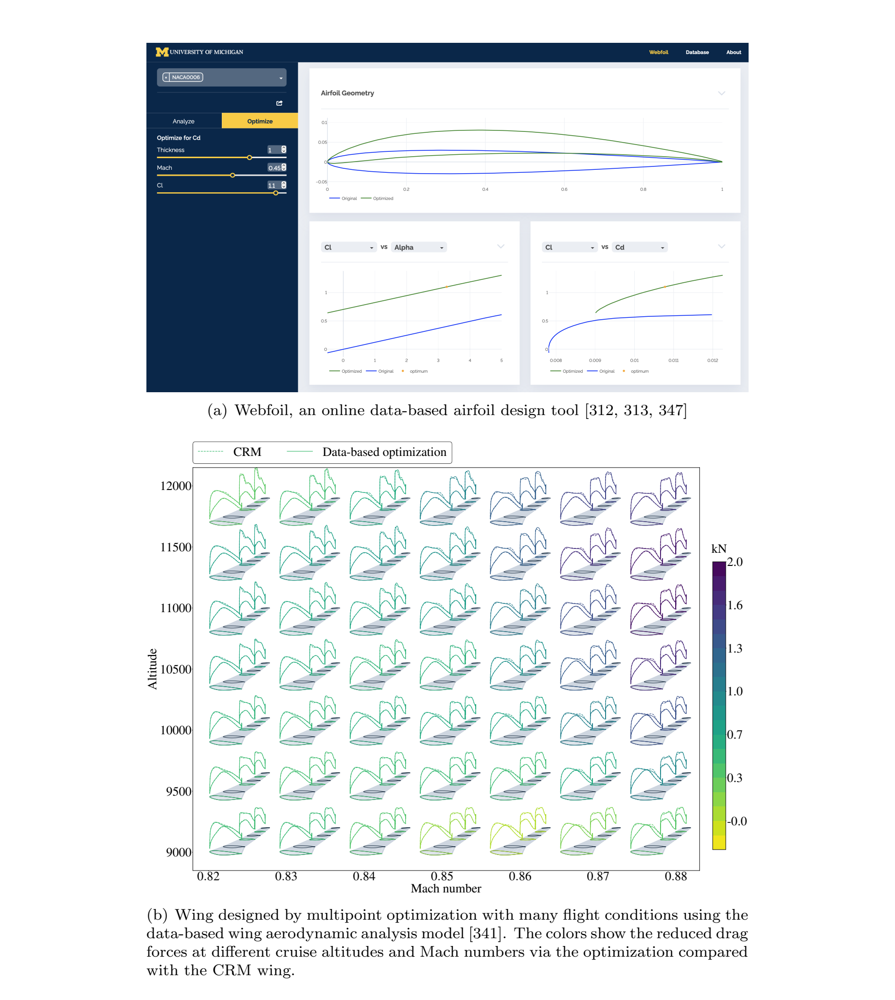

**图 46.** 交互式气动外形设计优化。（a）Webfoil，基于数据的在线翼型设计工具 [312,313,347]；（b）使用数据驱动机翼分析模型，在许多飞行条件下进行多点优化得到的机翼 [341]。颜色表示相对于 CRM 基准，在不同巡航高度和马赫数下优化减少的阻力。

#### 4.3.3. 基于强化学习的优化

RL 在气动外形设计中主要用于训练高效优化器。常见方式是将当前设计变量作为状态，将期望设计变量或增量作为动作。Yan et al. [513] 对 8 个变量的导弹操纵面训练 RL；Viquerat et al. [514] 在 $Re=200$ 下，以 3–12 个变量改变圆柱形状以最大化升阻比；Li et al. [515] 优化两变量高层建筑截面；Qin et al. [516] 用 10 个 Hicks–Henne 鼓包优化叶栅，减少总压损失、增加层流区域。

这些训练很可能主要让智能体记住达到最优设计的最佳路径，虽然后续不需额外 CFD 就能输出形状，却未必适用于其他马赫数、雷诺数。

为泛化，Li et al. [267] 用激波位置、吸力峰马赫数等物理特征作为状态，学习超临界翼型减阻策略。壁面马赫数指根据局部压力系数和自由流马赫数，通过等熵关系计算的等效马赫数。

优化通过添加一个受 3 个设计变量控制的 Hicks–Henne 鼓包进行。如图 47，主要减阻在前 5 步完成，与梯度优化一样快。值得注意的是，仅在 $M=0.76$、$Re=5\times10^6$ 训练的策略，能够用于 $M\in[0.72,0.76]$、$Re\in[5\times10^6,10^7]$ 的其他条件。值得研究变量更多时能否保留这种泛化。

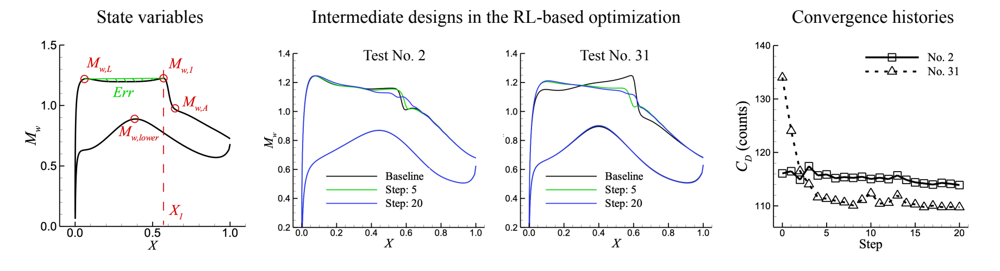

**图 47.** 以壁面马赫数分布的状态变量训练 RL 优化器，在超临界翼型设计中表现良好泛化 [267]。不需要气动导数，收敛速度仍与梯度优化相当。

RL 的一个缺点是对变量数扩展性差，总成本可能接近进化优化 [517]。已有研究通过 LF [513,515] 或代理 [267,516] 降成本，先用低成本模型训练初策略，再以其为起点，用 HF 训练。若不使用 LF 或代理，训练 RL 相对传统梯度、无梯度优化并无优势 [513,515]，因此更适合多次查询设计，而非单次任务。若无既便宜又足够准确的 LF，或高维代理难保证精度，就会有问题。

另一缺点是难以处理可调约束。训练要求明确定义目标与约束以评奖励；多数研究显式将约束作为奖励惩罚 [513,514]，或隐式施加在气动分析中，如升力约束 [267]，因此策略不能直接适应不同约束任务。

Kim et al. [518] 用加权 Chebyshev 方法使 RL 处理多目标，在 3 个几何参数翼型中验证。但即使简单案例也需 $10^5$–$10^6$ 个回合，训练成本很高；实际问题通常高维、多约束，可能难以实用。

#### 4.3.4. 生成式逆向设计

对于正向问题 $\mathbf y=F(\mathbf x)$，$\mathbf x$ 为设计变量，$\mathbf y$ 为阻力、升力等指标；逆向设计是在给定 $\mathbf y$ 时求 $\mathbf x$。ASO 中多数逆问题不适定，不同形状可能具有相同性能，因此确定性逆函数可能无法建立。

贝叶斯反演 [390] 将全部参数视为随机变量的实现，提供概率求解方式，关键是评估后验 $p(\mathbf x\mid\mathbf y)$。条件生成模型能从数据学习这一后验，因此受到关注。工业界通常简称生成式设计，Monolith AI、Altair Engineering 等将其作为人工智能应用展示，包括制造约束结构、车辆外形和涡轮叶片设计，并减少设计周期中的物理试验。

**表 6. 使用深度条件生成模型的翼型逆向设计。除注明离散类别外，性能指标均为连续条件。**

| 生成模型 | 条件 $\mathbf y$ | 设计变量 $\mathbf x$ | 噪声／潜变量维数 $\mathbf z$ | 训练数据 | 文献 |
|---|---|---|---|---|---|
| CGAN | 升阻比与翼型面积，4 类 | 40 个坐标 | 100 | 800 个 UIUC 翼型 | Achour et al. [519] |
| CGAN | 失速升力或迎角 | 40 个坐标 | — | 1550 个 UIUC 翼型 | Yilmaz and German [520] |
| CGAN | 阻力极曲线数据 | 40 个坐标 | — | 1550 个 UIUC 翼型 | Yilmaz and German [520] |
| CEGAN | $M,Re,C_l$ | 192 个 Bézier 点及迎角 $\alpha$ | 13 | 995 个优化翼型 | Chen et al. [391] |
| PCDGAN | 升阻比 | 192 个坐标 | — | 38802 个翼型 | Nobari et al. [521] |
| CWGAN-GP | $C_l$ | 248 个坐标 | 3／6 | 3709 个 NACA 四位数翼型 | Yonekura et al. [522] |
| CVAE | $C_l$ | 248 个坐标 | 2–86 | 3646 个 NACA 四位数翼型 | Yonekura and Suzuki [523] |
| CVAE | 流动出口角与气动损失系数 | 248 个坐标 | — | 50621 个翼型 | Yonekura and Suzuki [523] |
| CVAE-GAN | 10 个马赫数分布特征 | 255 个壁面马赫数 | 10 | 1500 个样本翼型 | Wang et al. [524] |

通常，模型学习训练分布后，输入条件 $\mathbf y$ 与噪声或潜变量 $\mathbf z$，生成设计 $\mathbf x$，可以指定巡航升阻比、最大升力等性能。

Achour et al. [519] 用 CGAN，根据升阻比和面积逆向设计；Yilmaz and German [520] 用期望失速条件、阻力极曲线等性能向量。Chen et al. [391] 提出条件熵 GAN（CEGAN），在最大化升阻比上优于 CGAN，训练翼型主要通过 SU2 在不同 $M,Re,C_l$ 下优化生成。

Yonekura et al. [522] 用带梯度惩罚的条件 Wasserstein GAN（CWGAN-GP），学习 NACA 四位数翼型与 $\alpha=5^\circ$ 时升力系数的分布，性能由 $Re=3\times10^6$ 的 Xfoil 评估。相较 CGAN，它生成更光滑形状，并通过避免模式坍塌保留更多变化。

条件 VAE 也受到研究 [524]。Yonekura and Suzuki [523] 在相同 NACA、升力条件下，认为适中潜在维数、不超过 16，可平衡条件匹配误差与形状变化。他们还对 Pak-B 涡轮叶型生成 50,621 个样本，以出口角和损失系数为条件训练 CVAE。出口角约 $62.9^\circ$ 时，生成样本平均绝对误差为 $0.609^\circ$，对粗略叶片设计可接受。

Yonekura et al. [525] 比较正态潜分布 N-CVAE 与 von Mises–Fisher 潜分布 S-CVAE。单类型翼型中，S-CVAE 更能在潜空间分离数据；多类型中，N-CVAE 更能组合不同特征生成新颖形状。

表 6 多数模型用于翼型，训练后可快速产生性能合理的设计，但模型误差使条件通常不能精确满足。Chen et al. [391] 表明生成设计虽合理，却仍明显不同于真正最优形状。实际还需其他几何、气动约束，因此需要在相同性能条件下生成多样设计的探索能力。

输入噪声或潜变量 $\mathbf z$ 承担这种作用。Yilmaz and German [520] 用 dropout 也能实现探索；PCDGAN [521] 等进一步增强多样性。但多样性带来选择最优设计的困难。Achour et al. [519] 为寻找升阻比 140、面积 0.10 的翼型，需要在 CGAN 噪声空间评估 4,000 次。若用 HF 分析，成本很高，因此详细外形设计中未必优于传统 ASO。

Chen et al. [391] 建议将生成逆向设计作为传统 CFD 优化初值，在多个翼型测试中可减少约一半迭代。

条件生成的另一用途是设计压力系数或壁面马赫数分布，而非直接设计形状。分布比升阻系数信息丰富，可揭示抖振、转捩等非设计点性能，有助超临界 [466] 和自然层流翼型 [526]。设计者难给最优目标分布，却容易描述吸力峰、激波位置等特征。

Wang et al. [524] 用 CVAE-GAN，依据吸力峰、激波、后部载荷等关键位置生成目标壁面马赫数分布。Lei et al. [527] 用 WGAN 学习跨声速物理压力分布，再以 GA 根据吸力峰、吸力平台压力梯度等选择分布。随后可通过代理 [524,527] 或伴随优化 [528] 找到对应外形。

## 5. 结论与展望

本文回顾机器学习在气动外形设计优化中的近期应用，并介绍常用模型的技术概念。新近深度学习具备强学习能力，能够从高维稀疏数据发现潜在特征，并使用大量数据训练精确预测器，有望解决高维、高计算成本或两者兼有的 ASO 难题。

围绕几何设计空间、气动评估与优化架构，主要结论如下：

- **几何设计空间。** 机器学习从设计者经验、历史设计或低保真优化学习，用更少变量或更严格边界参数化。训练良好的方法可排除异常形状，排除创新形状的概率较低，从而降低维数并显著减少优化成本。
- **气动评估。** 机器学习能处理更多训练数据，提高系数精度。流形、VAE、GAN 等非线性降维帮助预测高维流场，服务仿真加速、逆向设计和优化。多数模型偏向插值，外推可能失准；PINN 遵守物理，有外推潜力，值得研究。物理机制与机器学习结合，也已改善抖振起始等非设计点约束，相比经验公式更准确，有助得到实用设计。
- **优化架构。** 先进模型使代理优化更高效，有利于不连续气动函数、多目标和不确定性设计。大量仿真预训练的 ANN 已实现翼型、机翼、整机交互设计。RL 无需导数，但仅在少变量问题证明，仍需改善训练效率、可调约束处理。条件 GAN、VAE 提供快速逆向设计，在概念设计中有潜力。

这些应用说明机器学习能解决第 2.2 节的一些困难。但许多研究仅应用于较简单问题，且未与传统 ASO 比较。我们认为，其核心价值应是解决传统方法难以处理的问题，而非仅提供容易问题的另一解法。因此，更值得围绕实际 ASO 的未解难题开展研究，并与先进方法比较。

为满足工业需求，建议继续研究：

- **具有外推能力的预测模型。** 多数模型内在插值，需大量数据避免外推。除缩小空间外，PINN 可能解决这一限制，期待在 ASO 基准中验证。
- **高效采样。** HF 数据昂贵，交互式翼型、机翼数据已达 $10^5$ 量级，工业成本可能过高。除提升外推，也应通过先进采样提高数据效率。
- **多源数据融合。** 多数研究缺少实验与仿真等不同来源的耦合。缺乏实验支持的设计在工业上可能不够实用，但实验依赖专门设施，多数学术研究者难以获取，因此建议深化产学合作。

为加快进展，应使 ASO 学生和工程师熟悉机器学习发展。开放研讨会、在线短课已发挥重要作用；未来建议在本科、研究生课程中介绍模型及工程应用，并提供结合优化基础、机器学习与工程示例的教材 [26，第 10.5 节]。原稿此处另有一个未解析的引用标记“[?]”。

机器学习不应被视为替代基于梯度算法和伴随导数的 CFD 优化；后者能有效解决大规模高维 ASO。原文随后写道：若问题是确定性的，且“确实具有较多多峰性”（does exhibit much multimodality），传统 CFD 优化是合适选择。

> 译注：上述关于多峰性的措辞按原文保留，与第 4.3.2 节关于多峰性并不普遍的讨论存在表述不一致，未擅自补入否定词。

因此，跟进机器学习时，也应熟悉传统方法及局限。建议年轻研究者先在具体领域打好基础，再采用机器学习。未来研究应开源模型、开放数据；机器学习快速发展部分源于社区开源传统，随着更多 ASO 数据、模型和软件开放，可以期待令人振奋的新进展。

## 6. Bibliography

[1] Z. Lyu, G. K. W. Kenway, J. R. R. A. Martins, Aerodynamic shape optimization investigations of the Common Research Model wing benchmark, AIAA Journal 53 (2015) 968–985. doi:10.2514/1.J053318.

[2] S. T. LeDoux, J. C. Vassberg, D. P. Young, S. Fugal, D. Kamenetskiy, W. P. Huffman, R. G. Melvin, M. F. Smith, Study based on the AIAA aerodynamic design optimization discussion group test cases, AIAA Journal 53 (2015) 1910–1935. doi:10.2514/1.j053535.

[3] L. Osusky, H. Buckley, T. Reist, D. W. Zingg, Drag minimization based on the Navier–Stokes equations using a Newton–Krylov approach, AIAA Journal 53 (2015) 1555–1577. doi:10.2514/1.J053457.

[4] G. K. W. Kenway, J. R. R. A. Martins, Multipoint aerodynamic shape optimization investigations of the Common Research Model wing, AIAA Journal 54 (2016) 113–128. doi:10.2514/1.J054154.

[5] S. Chen, Z. Lyu, G. K. W. Kenway, J. R. R. A. Martins, Aerodynamic shape optimization of the Common Research Model wing-body-tail configuration, Journal of Aircraft 53 (2016) 276–293. doi:10.2514/1.C033328.

[6] V. Singh, S. K. Sharma, S. Vaibhav, Transport aircraft conceptual design optimization using real coded genetic algorithm, International Journal of Aerospace Engineering 2016 (2016). doi:10.1155/2016/2813541.

[7] Z. Hao, Z. Wang, J. Liu, Tail rudder optimization design and dynamics modeling for the small flexible membrane wing aircraft, in: 2018 10th International Conference on Modelling, Identification and Control (ICMIC), 2018, pp. 1–6. doi:10.1109/ICMIC.2018.8529853.

[8] A. Sanchez-Carmona, C. Cuerno-Rejado, Design process and environmental impact of unconventional tail airliners, Aerospace 8 (2021). doi:10.3390/aerospace8070175.

[9] P. Muralikrishna, U. K. Rao, R. Vijayakumar, Design optimization of rotor craft horizontal tail plane using fea, Aerospace 3 (2014).

[10] W. Song, A. J. Keane, Surrogate-based aerodynamic shape optimization of a civil aircraft engine nacelle, AIAA Journal 45 (2007) 2565–2574. doi:10.2514/1.30015.

[11] J. S. Gray, C. A. Mader, G. K. W. Kenway, J. R. R. A. Martins, Coupled aeropropulsive design optimization of a three-dimensional BLI propulsor considering inlet distortion, Journal of Aircraft 57 (2020) 1014–1025. doi:10.2514/1.C035845.

[12] J. Li, Z. Gao, J. Huang, K. Zhao, Aerodynamic design optimization of nacelle/pylon position on an aircraft, Chinese Journal of Aeronautics 26 (2013) 850–857. doi:10.1016/j.cja.2013.04.052.

[13] M. Albert, D. Bestle, Aerodynamic design optimization of nacelle and intake, volume Volume 2: Aircraft Engine; Coal, Biomass and Alternative Fuels; Cycle Innovations of Turbo Expo: Power for Land, Sea, and Air, 2013. doi:10.1115/GT2013-94857.

[14] D. Sasaki, K. Nakahashi, Aerodynamic optimization of an over-the-wing-nacelle-mount configuration, Modelling and Simulation in Engineering 2011 (2011). doi:10.1155/2011/293078.

[15] A. Abbas-Bayoumi, K. Becker, An industrial view on numerical simulation for aircraft aerodynamic design, Journal of Mathematics in Industry 1 (2011) 10. doi:10.1186/2190-5983-1-10.

[16] W. Stalewski, J. Żółtak, Optimisation of the helicopter fuselage with simulation of main and tail rotor influence, 2012.

[17] J. Welstead, B. Reitz, G. Crouse, Modeling fuselage aerodynamic effects in aircraft design optimization, 2012. doi:10.2514/6.2012-394.

[18] A. Hashimoto, S. Jeong, S. Obayashi, Aerodynamic optimization of near-future high-wing aircraft, Transactions of the Japan Society for Aeronautical and Space Sciences 58 (2015) 73–82. doi:10.2322/tjsass.58.73.

[19] A. S. Batrakov, A. Kusyumov, S. A. Mikhailov, G. N. Barakos, Aerodynamic optimization of helicopter rear fuselage, Aerospace Science and Technology (2018). doi:10.1016/J.AST.2018.03.046.

[20] Y. Liao, J. R. R. A. Martins, Y. L. Young, 3-D high-fidelity hydrostructural optimization of cavitation-free composite lifting surfaces, Composite Structures 268 (2021) 113937. doi:10.1016/j.compstruct.2021.113937.

[21] A. Jameson, Aerodynamic design via control theory, Journal of Scientific Computing 3 (1988) 233–260. doi:10.1007/BF01061285.

[22] G. K. W. Kenway, C. A. Mader, P. He, J. R. R. A. Martins, Effective adjoint approaches for computational fluid dynamics, Progress in Aerospace Sciences 110 (2019) 100542. doi:10.1016/j.paerosci.2019.05.002.

[23] Z. Lyu, Z. Xu, J. R. R. A. Martins, Benchmarking optimization algorithms for wing aerodynamic design optimization, in: Proceedings of the 8th International Conference on Computational Fluid Dynamics, Chengdu, Sichuan, China, 2014. ICCFD8-2014-0203.

[24] D. E. Goldberg, Genetic Algorithms in Search, Optimization and Machine Learning, Addison-Wesley Longman Publishing, Boston, MA, 1989.

[25] J. Kennedy, R. C. Eberhart, Particle swarm optimization, volume IV, Institute of Electrical and Electronics Engineers, 1995, pp. 1942–1948. doi:10.1007/978-0-387-30164-8_630.

[26] J. R. R. A. Martins, A. Ning, Engineering Design Optimization, Cambridge University Press, 2021. URL: https://mdobook.github.io. doi:10.1017/9781108980647.

[27] J. S. Gray, J. T. Hwang, J. R. R. A. Martins, K. T. Moore, B. A. Naylor, OpenMDAO: An open-source framework for multidisciplinary design, analysis, and optimization, Structural and Multidisciplinary Optimization 59 (2019) 1075–1104. doi:10.1007/s00158-019-02211-z.

[28] C. M. Bishop, Pattern Recognition and Machine Learning, Springer, 2006.

[29] S. Tieleman, G. Hinton, Lecture 6.5—RMSProp: Neural networks for machine learning, COURSERA Technical Report (2012).

[30] D. G. Krige, A Statistical Approach to Some Basic Mine Valuation Problems on the Witwatersrand, Journal of the Chemical, Metallurgical and Mining Society 52 (1951) 119–139.

[31] S. Jeong, M. Murayama, K. Yamamoto, Efficient optimization design method using kriging model, Journal of Aircraft 42 (2005). doi:10.2514/1.6386.

[32] D. Toal, A. Keane, Efficient multipoint aerodynamic design optimization via cokriging, Journal of Aircraft 48 (2011) 1685–1695. doi:10.2514/1.C031342.

[33] S. Koziel, Y. Tesfahunegn, L. Leifsson, Variable-fidelity cfd models and co-kriging for expedited multi-objective aerodynamic design optimization, Engineering Computations 33 (2016). doi:10.1108/EC-09-2015-0277.

[34] N. V. Queipo, R. T. Haftka, W. Shyy, T. Goel, R. Vaidyanathan, P. Kevin Tucker, Surrogate-based analysis and optimization, Progress in Aerospace Sciences 41 (2005) 1–28. doi:10.1016/j.paerosci.2005.02.001.

[35] L. Zhao, K. K. Choi, I. Lee, D. Gorsich, Conservative surrogate model using weighted kriging variance for sampling-based rbdo, Journal of Mechanical Design 135 (2013). doi:10.1115/1.4024731.

[36] Z. Hu, S. Mahadevan, A single-loop kriging surrogate modeling for time-dependent reliability analysis, Journal of Mechanical Design 138 (2016).

[37] M. M. Noack, K. G. Yager, M. Fukuto, G. S. Doerk, R. Li, J. A. Sethian, A kriging-based approach to autonomous experimentation with applications to x-ray scattering, Scientific Reports 9 (2019). doi:10.1038/s41598-019-48114-3.

[38] Y. LeCun, Y. Bengio, G. Hinton, Deep learning, Nature 521 (2015) 436–444. doi:10.1038/nature14539.

[39] W. Zhang, G. Yang, Y. Lin, C. Ji, M. Gupta, On definition of deep learning, 2018, pp. 232–236. doi:10.23919/WAC.2018.8430387.

[40] F. Emmert-Streib, Z. Yang, H. Feng, S. Tripathi, M. Dehmer, An introductory review of deep learning for prediction models with big data, Frontiers in Artificial Intelligence 3 (2020). doi:10.3389/frai.2020.00004.

[41] L. Alzubaidi, J. Zhang, A. J. Humaidi, A. Al-Dujaili, Y. Duan, O. Al-Shamma, J. Santamar´ıa, M. A. Fadhel, M. Al-Amidie, L. Farhan, Review of deep learning: Concepts, cnn architectures, challenges, applications, future directions, Journal of Big Data 8 (2021). doi:10.1186/s40537-021-00444-8.

[42] Q. Wu, Y. Liu, Q. Li, S. Jin, F. Li, The application of deep learning in computer vision, in: 2017 Chinese Automation Congress (CAC), 2017, pp. 6522–6527. doi:10.1109/CAC.2017.8243952.

[43] A. Voulodimos, N. Doulamis, A. Doulamis, E. Protopapadakis, Deep learning for computer vision: A brief review, Computational Intelligence and Neuroscience 2018 (2018). doi:10.1155/2018/7068349.

[44] N. O. Mahony, S. Campbell, A. Carvalho, S. Harapanahalli, G. A. Velasco-Hern´andez, L. Krpalkova, D. Riordan, J. Walsh, Deep learning vs. traditional computer vision, in: Advances in Computer Vision Proceedings of the 2019 Computer Vision Conference (CVC), 2019. doi:10.1007/978-3-030-17795-9_10.

[45] D. Shen, G. Wu, H.-I. Suk, Deep learning in medical image analysis, Annual Review of Biomedical Engineering 19 (2017) 221–248. doi:10.1146/annurev-bioeng-071516-044442.

[46] Special issue: Machine learning for engineering design, Journal of Mechanical Design 141 (2019). doi:10.1115/1.4044690.

[47] A. Maier, C. Syben, T. Lasser, C. Riess, A gentle introduction to deep learning in medical image processing, Zeitschrift fu¨r Medizinische Physik 29 (2019) 86–101. doi:10.1016/j.zemedi.2018.12.003, special Issue: Deep Learning in Medical Physics.

[48] X. Liu, K. Gao, B. Liu, C. Pan, K. Liang, L. Yan, J. Ma, F. He, S. Zhang, S. Pan, Y. Yu, Advances in deep learning-based medical image analysis, Advances in Deep Learning-Based Medical Image Analysis 2021 (2021). doi:10.34133/2021/8786793.

[49] M. Puttagunta, S. Ravi, Medical image analysis based on deep learning approach, Multimedia Tools and Applications 80 (2021) 24365–24398. doi:10.1007/s11042-021-10707-4.

[50] A. Oishi, G. Yagawa, Computational mechanics enhanced by deep learning, Computer Methods in Applied Mechanics and Engineering 327 (2017). doi:10.1016/j.cma.2017.08.040.

[51] S. L. Brunton, B. R. Noack, P. Koumoutsakos, Machine learning for fluid mechanics, Annual Review of Fluid Mechanics 52 (2020) 477–508. doi:10.1146/annurev-fluid-010719-060214.

[52] Y. Bahri, J. Kadmon, J. Pennington, S. S. Schoenholz, J. Sohl-Dickstein, S. Ganguli, Statistical mechanics of deep learning, Annual Review of Condensed Matter Physics 11 (2020) 501–528. doi:10.1146/annurev-conmatphys-031119-050745.

[53] D. Kunin, J. Sagastuy-Brena, S. Ganguli, D. L. K. Yamins, H. Tanaka, Neural mechanics: Symmetry and broken conservation laws in deep learning dynamics, 2021. arXiv:2012.04728.

[54] T. Armes, M. Refern, Using big data and predictive machine learning in aerospace test environments, in: 2013 IEEE AUTOTESTCON, 2013, pp. 1–5. doi:10.1109/AUTEST.2013.6645085.

[55] D. Rengasamy, H. P. Morvan, G. P. Figueredo, Deep learning approaches to aircraft maintenance, repair and overhaul: A review, in: 2018 21st International Conference on Intelligent Transportation Systems (ITSC), 2018, pp. 150–156. doi:10.1109/ITSC.2018.8569502.

[56] A. Podorozhniak, D. Hlavcheva, H. Kuchuk, V. Yaloveha, Application of Deep Learning in the Processing of the Aerospace System’s Multispectral Images, 2019, pp. 134 — 147. doi:10.4018/978-1-7998-1415-3.ch005.

[57] S. L. Brunton, J. N. Kutz, K. Manohar, A. Y. Aravkin, K. Morgansen, J. Klemisch, N. Goebel, J. Buttrick, J. Poskin, A. W. Blom-Schieber, T. Hogan, D. McDonald, Data-driven aerospace engineering: Reframing the industry with machine learning, AIAA Journal 59 (2021) 2820–2847. doi:10.2514/1.j060131.

[58] M. D. Dangut, Z. Skaf, I. K. Jennions, An integrated machine learning model for aircraft components rare failure prognostics with log-based dataset, ISA Transactions 113 (2021) 127– 139. doi:10.1016/j.isatra.2020.05.001.

[59] L. von Rueden, S. Mayer, K. Beckh, B. Georgiev, S. Giesselbach, R. Heese, B. Kirsch, M. Walczak, J. Pfrommer, A. Pick, R. Ramamurthy, J. Garcke, C. Bauckhage, J. Schuecker, Informed machine learning - a taxonomy and survey of integrating prior knowledge into learning systems, IEEE Transactions on Knowledge and Data Engineering (2021). doi:10.1109/tkde.2021.3079836.

[60] M. Raissi, P. Perdikaris, G. Karniadakis, Physics-informed neural networks: A deep learning framework for solving forward and inverse problems involving nonlinear partial differential equations, Journal of Computational Physics 378 (2019) 686–707. doi:10.1016/j.jcp.2018.10.045.

[61] G. E. Karniadakis, I. G. Kevrekidis, L. Lu, P. Perdikaris, S. Wang, L. Yang, Physics-informed machine learning, Nature Reviews Physics 3 (2021) 422–440. doi:10.1038/s42254-021-00314-5.

[62] S. Cai, Z. Mao, Z. Wang, M. Yin, G. E. Karniadakis, Physics-informed neural networks (PINNs) for fluid mechanics: a review, Acta Mechanica Sinica 37 (2021) 1727–1738. doi:10.1007/s10409-021-01148-1.

[63] F. A. C. Viana, A. K. Subramaniyan, A survey of bayesian calibration and physics-informed neural networks in scientific modeling, Archives of Computational Methods in Engineering volume 28 (2021) 3801–3830. doi:10.1007/s11831-021-09539-0.

[64] J. T. Hwang, J. R. R. A. Martins, GeoMACH: Geometry-centric MDAO of aircraft configurations with high fidelity, in: Proceedings of the 14th AIAA/ISSMO Multidisciplinary Analysis Optimization Conference, Indianapolis, IN, 2012. doi:10.2514/6.2012-5605, aIAA 2012-5605.

[65] T. R. Brooks, G. K. W. Kenway, J. R. R. A. Martins, Benchmark aerostructural models for the study of transonic aircraft wings, AIAA Journal 56 (2018) 2840–2855. doi:10.2514/1.J056603.

[66] N. P. Bons, J. R. R. A. Martins, Aerostructural design exploration of a wing in transonic flow, Aerospace 7 (2020) 118. doi:10.3390/aerospace7080118.

[67] J. R. R. A. Martins, A. B. Lambe, Multidisciplinary design optimization: A survey of architectures, AIAA Journal 51 (2013) 2049–2075. doi:10.2514/1.J051895.

[68] H. Sobieczky, Parametric airfoils and wings, in: Notes on Numerical Fluid Mechanics (NNFM), Vieweg+Teubner Verlag, 1999, pp. 71–87. doi:10.1007/978-3-322-89952-1_4.

[69] R. M. Hicks, P. A. Henne, Wing design by numerical optimization, Journal of Aircraft 15 (1978) 407–412.

[70] B. M. Kulfan, Universal parametric geometry representation method, Journal of Aircraft 45 (2008) 142–158. doi:10.2514/1.29958.

[71] T. W. Sederberg, S. R. Parry, Free-form deformation of solid geometric models, SIGGRAPH Comput. Graph. 20 (1986) 151–160. doi:10.1145/15886.15903.

[72] W. M. Hsu, J. F. Hughes, H. Kaufman, Direct manipulation of free-form deformations, ACM SIGGRAPH Computer Graphics 26 (1992) 177–184. doi:10.1145/142920.134036.

[73] D. Rajnarayan, A. Ning, J. A. Mehr, Universal airfoil parametrization using b-splines, in: Proceedings of the AIAA Aviation Forum, 2018. doi:10.2514/6.2018-3949.

[74] X. He, J. Li, C. A. Mader, A. Yildirim, J. R. R. A. Martins, Robust aerodynamic shape optimization—from a circle to an airfoil, Aerospace Science and Technology 87 (2019) 48–61. doi:10.1016/j.ast.2019.01.051.

[75] A. Jameson, Aerodynamic shape optimization using the adjoint method, Lecture Series, Von Karman Institute for Fluid Dynamics, Rode Saint Gen`ese, Belgium, 2003.

[76] J. E. V. Peter, R. P. Dwight, Numerical sensitivity analysis for aerodynamic optimization: A survey of approaches, Computers and Fluids 39 (2010) 373–391. doi:10.1016/j.compfluid.2009.09.013.

[77] J. R. R. A. Martins, Aerodynamic design optimization: Challenges and perspectives, Computers & Fluids 239 (2022) 105391. doi:10.1016/j.compfluid.2022.105391.

[78] T. D. Economon, F. Palacios, S. R. Copeland, T. W. Lukaczyk, J. J. Alonso, SU2: An open-source suite for multiphysics simulation and design, AIAA Journal 54 (2016) 828–846. doi:10.2514/1.j053813.

[79] A. Yildirim, J. S. Gray, C. A. Mader, J. R. R. A. Martins, Aeropropulsive design optimization of a boundary layer ingestion system, in: AIAA Aviation Forum, Dallas, TX, 2019. doi:10.2514/6.2019-3455.

[80] A. B. Lambe, J. R. R. A. Martins, Extensions to the design structure matrix for the description of multidisciplinary design, analysis, and optimization processes, Structural and Multidisciplinary Optimization 46 (2012) 273–284. doi:10.1007/s00158-012-0763-y.

[81] D. Kraft, A software package for sequential quadratic programming, DFVLR-FB 88-28, DLR German Aerospace Center–Institute for Flight Mechanics, Koln, Germany, 1988. URL: http://www.opengrey.eu/item/display/10068/147127.

[82] P. E. Gill, W. Murray, M. A. Saunders, SNOPT: An SQP algorithm for large-scale constrained optimization, SIAM Review 47 (2005) 99–131. doi:10.1137/S0036144504446096.

[83] N. Wu, G. Kenway, C. A. Mader, J. Jasa, J. R. R. A. Martins, pyOptSparse: a Python framework for large-scale constrained nonlinear optimization of sparse systems, Journal of Open Source Software 5 (2020) 2564. doi:10.21105/joss.02564.

[84] G. K. Kenway, G. J. Kennedy, J. R. R. A. Martins, A CAD-free approach to high-fidelity aerostructural optimization, in: Proceedings of the 13th AIAA/ISSMO Multidisciplinary Analysis Optimization Conference, AIAA 2010-9231, Fort Worth, TX, 2010. doi:10.2514/6.2010-9231.

[85] A. Hahn, Vehicle sketch pad: A parametric geometry modeler for conceptual aircraft design, in: 48th AIAA Aerospace Sciences Meeting Including the New Horizons Forum and Aerospace Exposition, Aerospace Sciences Meetings, American Institute of Aeronautics and Astronautics, 2010. doi:10.2514/6.2010-657.

[86] N. Secco, G. K. W. Kenway, P. He, C. A. Mader, J. R. R. A. Martins, Efficient mesh generation and deformation for aerodynamic shape optimization, AIAA Journal 59 (2021) 1151–1168. doi:10.2514/1.J059491.

[87] C. A. Mader, G. K. W. Kenway, A. Yildirim, J. R. R. A. Martins, ADflow: An open-source computational fluid dynamics solver for aerodynamic and multidisciplinary optimization, Journal of Aerospace Information Systems 17 (2020) 508–527. doi:10.2514/1.I010796.

[88] P. He, C. A. Mader, J. R. R. A. Martins, K. J. Maki, An aerodynamic design optimization framework using a discrete adjoint approach with OpenFOAM, Computers & Fluids 168 (2018) 285–303. doi:10.1016/j.compfluid.2018.04.012.

[89] P. He, C. A. Mader, J. R. R. A. Martins, K. J. Maki, DAFoam: An open-source adjoint framework for multidisciplinary design optimization with OpenFOAM, AIAA Journal 58 (2020). doi:10.2514/1.J058853.

[90] J.-D. Mu¨ller, P. Cusdin, On the performance of discrete adjoint CFD codes using automatic differentiation, International Journal for Numerical Methods in Fluids 47 (2005) 939–945.

[91] S. Xu, W. Jahn, J.-D. Mu¨ller, CAD-based shape optimisation with CFD using a discrete adjoint, International Journal for Numerical Methods in Fluids 74 (2014) 153–168. doi:10.1002/fld.3844.

[92] O. Mykhaskiv, P. Mohanamuraly, J.-D. Mueller, S. Xu, S. Timme, CAD-based shape optimisation of the NASA CRM wing-body intersection using differentiated CAD-kernel, in: 35th AIAA Applied Aerodynamics Conference, AIAA AVIATION Forum, American Institute of Aeronautics and Astronautics, 2017. doi:10.2514/6.2017-4080.

[93] S. Xu, S. Timme, O. Mykhaskiv, J.-D. Mu¨ller, Wing-body junction optimisation with CAD-based parametrisation including a moving intersection, Aerospace Science and Technology 68 (2017) 543–551. doi:10.1016/j.ast.2017.06.014.

[94] F. Bisson, Nadarajah, Adjoint-based aerodynamic optimization of benchmark problems, in: 53nd Aerospace Sciences Meeting, 2015. doi:10.2514/6.2015-1948.

[95] D. Shi-Dong, C.-H. Chen, S. Nadarajah, Adjoint-based aerodynamic optimization of benchmark CRM wing, in: 35th AIAA Applied Aerodynamics Conference, American Institute of Aeronautics and Astronautics, 2017. doi:10.2514/6.2017-3755.

[96] V. Poirier, S. Nadarajah, Efficient reduced-radial basis function-based mesh deformation within an adjoint-based aerodynamic optimization framework, Journal of Aircraft 53 (2016) 1905–1921. doi:10.2514/1.C033573.

[97] P. Khayatzadeh, S. Nadarajah, Aerodynamic shape optimization of natural laminar flow (NLF) airfoils, in: 50th AIAA Aerospace Sciences Meeting including the New Horizons Forum and Aerospace Exposition, 2012, pp. 1–15. doi:10.2514/6.2012-61.

[98] P. Castonguay, S. K. Nadarajah, Effect of shape parameterization on aerodynamic shape optimization, in: 45th AIAA Aerospace Sciences Meeting and Exhibit, Reno, Nevada, 2007. doi:10.2514/6.2007-59.

[99] H. P. Buckley, B. Y. Zhou, D. W. Zingg, Airfoil optimization using practical aerodynamic design requirements, Journal of Aircraft 47 (2010) 1707–1719. doi:10.2514/1.C000256.

[100] H. P. Buckley, D. W. Zingg, Approach to aerodynamic design through numerical optimization, AIAA Journal 51 (2013) 1972–1981. doi:10.2514/1.J052268.

[101] C. Lee, D. Koo, K. Telidetzki, H. Buckley, H. Gagnon, D. W. Zingg, Aerodynamic shape optimization of benchmark problems using jetstream, in: Proceedings of the 53rd AIAA Aerospace Sciences Meeting, American Institute of Aeronautics and Astronautics (AIAA), 2015. doi:10.2514/6.2015-0262.

[102] R. Rashad, D. W. Zingg, Aerodynamic shape optimization for natural laminar flow using a discrete-adjoint approach, AIAA Journal 54 (2016) 3321–3337. doi:10.2514/1.J054940.

[103] T. A. Reist, D. Koo, D. W. Zingg, P. Bochud, P. Castonguay, D. Leblond, Cross validation of aerodynamic shape optimization methodologies for aircraft wing-body optimization, AIAA Journal (2020). doi:10.2514/1.J059091.

[104] M. Nemec, D. W. Zingg, T. H. Pulliam, Multipoint and multi-objective aerodynamic shape optimization, AIAA Journal 42 (2004) 1057–1065. doi:10.2514/1.10415.

[105] A. Jameson, L. Martinelli, N. A. Pierce, Optimum aerodynamic design using the Navier–Stokes equations, Theoretical and Computational Fluid Dynamics 10 (1998) 213–237. doi:10.1007/s001620050060.

[106] R. P. Dwight, J. Brezillon, Efficient and robust algorithms for solution of the adjoint compressible Navier–Stokes equations with applications, International Journal for Numerical Methods in Fluids 60 (2009) 365–389. doi:10.1002/fld.1894.

[107] T. M. Leung, D. W. Zingg, Aerodynamic shape optimization of wings using a parallel newton-krylov approach, AIAA Journal 50 (2012) 540–550. doi:10.2514/1.j051192.

[108] M. M´eheut, A. Dumont, G. Carrier, J. E. Peter, Gradient-based optimization of CRM wing-alone and wing-body-tail configurations by RANS adjoint technique, in: 54th AIAA Aerospace Sciences Meeting, American Institute of Aeronautics and Astronautics, 2016. doi:10.2514/6.2016-1293.

[109] S. Shitrit, Adjoint-based aerodynamic drag minimisation with trim penalty, The Aeronautical Journal (2021) 1–25. doi:10.1017/aer.2021.78.

[110] A. Yildirim, G. K. W. Kenway, C. A. Mader, J. R. R. A. Martins, A Jacobian-free approximate Newton–Krylov startup strategy for RANS simulations, Journal of Computational Physics 397 (2019) 108741. doi:10.1016/j.jcp.2019.06.018.

[111] J. Li, M. Zhang, On deep-learning-based geometric filtering in aerodynamic shape optimization, Aerospace Science and Technology 112 (2021) 106603. doi:10.1016/j.ast.2021.106603.

[112] L. Leifsson, S. Koziel, Y. A. Tesfahunegn, Multiobjective aerodynamic optimization by variable-fidelity models and response surface surrogates, AIAA Journal 54 (2016) 531–541. doi:10.2514/1.J054128.

[113] M. Nemec, D. W. Zingg, T. H. Pulliam, Multipoint and multi-objective aerodynamic shape optimization, AIAA Journal 42 (2004) 1057–1065. doi:10.2514/1.10415.

[114] S. Obayashi, S. Jeong, K. Chiba, Multi-objective design exploration for aerodynamic configurations, in: 35th AIAA Fluid Dynamics Conference and Exhibit, American Institute of Aeronautics and Astronautics, 2005. doi:10.2514/6.2005-4666.

[115] G. K. W. Kenway, J. R. R. A. Martins, Multipoint high-fidelity aerostructural optimization of a transport aircraft configuration, Journal of Aircraft 51 (2014) 144–160. doi:10.2514/1.C032150.

[116] N. P. Bons, J. R. R. A. Martins, C. A. Mader, M. McMullen, M. Suen, High-fidelity aerostructural optimization studies of the Aerion AS2 supersonic business jet, in: Proceedings of the AIAA Aviation Forum, 2020. doi:10.2514/6.2020-3182.

[117] C. Schillings, S. Schmidt, V. Schulz, Efficient shape optimization for certain and uncertain aerodynamic design, Computers & Fluids 46 (2011) 78–87. doi:10.1016/j.compfluid.2010.12.007.

[118] X. Chai, X. Yu, Y. Wang, Multipoint optimization on fuel efficiency in conceptual design of wide-body aircraft, Chinese Journal of Aeronautics 31 (2018) 99–106. doi:10.1016/j.cja.2017.10.006.

[119] J. Li, J. Cai, Massively multipoint aerodynamic shape design via surrogate-assisted gradient-based optimization, AIAA Journal 58 (2020) 1949–1963. doi:10.2514/1.j058491.

[120] F. D. Ulker, A. Doostan, M. Drela, Stochastic gradient optimization of transonic airfoils, in: AIAA Scitech 2021 Forum, American Institute of Aeronautics and Astronautics, 2021. doi:10.2514/6.2021-1592.

[121] M. Panzeri, A. Savelyev, K. Anisimov, R. d’Ippolito, A. Mirzoyan, Uncertainty quantification and robust design optimization applied to aircraft propulsion systems, Transportation Research Procedia 29 (2018) 289–302. doi:10.1016/j.trpro.2018.02.026.

[122] D. Papadimitriou, V. Rosu, V. Naidu, D. Cruz, J. Skarakis, D. Panagiotopoulos, Z. Mourelatos, Reliability based aerodynamic shape optimization of a quadcopter, AIAA Scitech 2018 Forum (2018). doi:10.2514/6.2018-0664.

[123] L. Huyse, S. L. Padula, R. M. Lewis, W. Li, Probabilistic approach to free-form airfoil shape optimization under uncertainty, AIAA Journal 40 (2002) 1764–1772. doi:10.2514/2.1881.

[124] X. Wu, W. Zhang, S. Song, Robust aerodynamic shape design based on an adaptive stochastic optimization framework, Structural and Multidisciplinary Optimization 57 (2017) 639–651. doi:10.1007/s00158-017-1766-5.

[125] R. P. Liem, J. R. R. A. Martins, G. K. Kenway, Expected drag minimization for aerodynamic design optimization based on aircraft operational data, Aerospace Science and Technology 63 (2017) 344–362. doi:10.1016/j.ast.2017.01.006.

[126] L. B. Jacome, A. Elham, Wing aerostructural optimization under uncertain aircraft range and payload weight, Journal of Aircraft 54 (2017) 1109–1120. doi:10.2514/1.c034050.

[127] R. P. Liem, G. K. W. Kenway, J. R. R. A. Martins, Multimission aircraft fuel burn minimization via multipoint aerostructural optimization, AIAA Journal 53 (2015) 104–122. doi:10.2514/1.J052940.

[128] J. T. Hwang, J. Jasa, J. R. R. A. Martins, High-fidelity design-allocation optimization of a commercial aircraft maximizing airline profit, Journal of Aircraft 56 (2019) 1165–1178. doi:10.2514/1.C035082.

[129] Suprayitno, J. C. Yu, Aminnudin, R. Wulandari, Airfoil aerodynamics optimization under uncertain operating conditions, Journal of Physics: Conference Series 1446 (2020) 012014. doi:10.1088/1742-6596/1446/1/012014.

[130] B. Peherstorfer, K. Willcox, M. Gunzburger, Survey of multifidelity methods in uncertainty propagation, inference, and optimization, SIAM Review 60 (2018) 550–591. doi:10.1137/16M1082469.

[131] Z. Han, C. Xu, L. Zhang, Y. Zhang, K. Zhang, W. Song, Efficient aerodynamic shape optimization using variable-fidelity surrogate models and multilevel computational grids, Chinese Journal of Aeronautics 33 (2020) 31–47. doi:10.1016/j.cja.2019.05.001.

[132] Y. Shi, C. A. Mader, S. He, G. L. O. Halila, J. R. R. A. Martins, Natural laminar-flow airfoil optimization design using a discrete adjoint approach, AIAA Journal 58 (2020) 4702–4722. doi:10.2514/1.J058944.

[133] G. L. O. Halila, J. R. R. A. Martins, K. J. Fidkowski, Adjoint-based aerodynamic shape optimization including transition to turbulence effects, Aerospace Science and Technology (2020) 1–15. doi:10.1016/j.ast.2020.106243.

[134] G. L. O. Halila, A. Yildirim, C. A. Mader, K. J. Fidkowski, J. R. R. A. Martins, Linear stability-based smooth Reynolds-averaged Navier–Stokes transition model for aerodynamic flows, AIAA Journal 60 (2022) 1077–1090. doi:10.2514/1.J060481.

[135] T. Mitchell, Machine Learning, McGraw Hill, New York, 1997.

[136] A. Gron, Hands-On Machine Learning with Scikit-Learn and TensorFlow: Concepts, Tools, and Techniques to Build Intelligent Systems, 1st ed., O’Reilly Media, Inc., 2017.

[137] Y. LeCun, Y. Bengio, G. Hinton, Deep learning, Nature 521 (2015) 436–444.

[138] A. Singh, N. Thakur, A. Sharma, A review of supervised machine learning algorithms, 2016 3rd International Conference on Computing for Sustainable Global Development (INDIACom) (2016) 1310–1315.

[139] V. Nasteski, An overview of the supervised machine learning methods, HORIZONS 4 (2017) 51–62. doi:10.20544/HORIZONS.B.04.1.17.P05.

[140] P. Cunningham, S. J. Delany, k-nearest neighbour classifiers: 2nd edition (with python examples), 2020. arXiv:2004.04523.

[141] K. Taunk, S. De, S. Verma, A. Swetapadma, A brief review of nearest neighbor algorithm for learning and classification, in: 2019 International Conference on Intelligent Computing and Control Systems (ICCS), 2019, pp. 1255–1260. doi:10.1109/ICCS45141.2019.9065747.

[142] J. Walters-Williams, Y. Li, Comparative study of distance functions for nearest neighbors, in: K. Elleithy (Ed.), Advanced Techniques in Computing Sciences and Software Engineering, Springer Netherlands, Dordrecht, 2010, pp. 79–84.

[143] L. Wang, G. Misra, X. Bai, A k nearest neighborhood-based wind estimation for rotary-wing VTOL UAVs, Drones 3 (2019). doi:10.3390/drones3020031.

[144] M. Hearst, S. Dumais, E. Osuna, J. Platt, B. Scholkopf, Support vector machines, IEEE Intelligent Systems and their Applications 13 (1998) 18–28. doi:10.1109/5254.708428.

[145] N. Guenther, M. Schonlau, Support vector machines, The Stata Journal 16 (2016) 917–937. doi:10.1177/1536867X1601600407.

[146] S. Tong, D. Koller, Support vector machine active learning with application sto text classification, in: Proceedings of the Seventeenth International Conference on Machine Learning, ICML ’00, Morgan Kaufmann Publishers Inc., San Francisco, CA, USA, 2000, pp. 999–1006.

[147] J. Cervantes, F. Garcia-Lamont, L. Rodr´ıguez-Mazahua, A. Lopez, A comprehensive survey on support vector machine classification: Applications, challenges and trends, Neurocomputing 408 (2020) 189–215. doi:10.1016/j.neucom.2019.10.118.

[148] M. Rong, D. Zhang, N. Wang, A lagrangian dual-based theory-guided deep neural network, 2020. arXiv:2008.10159.

[149] W. W. Hager, S. K. Mitter, Lagrange duality theory for convex control problems, SIAM Journal on Control and Optimization 14 (1976) 843–856. doi:10.1137/0314054.

[150] R. Stoean, D. Dumitrescu, M. Preuss, C. Stoean, Evolutionary support vector regression machines, in: 2006 Eighth International Symposium on Symbolic and Numeric Algorithms for Scientific Computing, 2006, pp. 330–335. doi:10.1109/SYNASC.2006.39.

[151] D. Jap, M. St¨ottinger, S. Bhasin, Support vector regression: Exploiting machine learning techniques for leakage modeling, in: Proceedings of the Fourth Workshop on Hardware and Architectural Support for Security and Privacy, HASP ’15, Association for Computing Machinery, New York, NY, USA, 2015. doi:10.1145/2768566.2768568.

[152] L. Auria, R. A. Moro, Support Vector Machines (SVM) as a technique for solvency analysis, Technical Report 811, Deutsches Institut fu¨r Wirtschaftsforschung (DIW), Berlin, Germany, 2008.

[153] P. Attewell, D. Monaghan, Data Mining for the Social Sciences, University of California Press, 2015.

[154] H. Byun, S.-W. Lee, Applications of support vector machines for pattern recognition: A survey, in: International workshop on support vector machines, Springer, 2002, pp. 213–236.

[155] G. Horv´ath, Neural networks in measurement systems, Advances in learning theory: methods, models and applications (2003) 375–402.

[156] E. Andr´es-P´erez, L. Carro-Calvo, S. Salcedo-Sanz, M. J. Martin-Burgos, Aerodynamic shape design by evolutionary optimization and support vector machines, Springer Tracts in Mechanical Engineering. Springer, Cham (2016) 1–24. doi:10.1007/978-3-319-21506-8_1.

[157] L. Rokach, O. Maimon, Data Mining with Decision Trees, 2nd ed., WORLD SCIENTIFIC, 2014. doi:10.1142/9097. arXiv:https://www.worldscientific.com/doi/pdf/10.1142/9097.

[158] S. Safavian, D. Landgrebe, A survey of decision tree classifier methodology, IEEE Transactions on Systems, Man, and Cybernetics 21 (1991) 660–674. doi:10.1109/21.97458.

[159] L. B. Statistics, L. Breiman, Random forests, in: Machine Learning, 2001, pp. 5–32.

[160] K. Fawagreh, M. M. Gaber, E. Elyan, Random forests: from early developments to recent advancements, Systems Science & Control Engineering 2 (2014) 602–609. doi:10.1080/21642583.2014.956265.

[161] C. Gini, Measurement of inequality of incomes, The Economic Journal 31 (1921) 124–126. URL: http://www.jstor.org/stable/2223319.

[162] C. E. Shannon, A mathematical theory of communication, The Bell System Technical Journal 27 (1948) 379–423. doi:10.1002/j.1538-7305.1948.tb01338.x.

[163] D. Zimmermann, Asymmetric impurity functions, class weighting, and optimal splits for binary classification trees (2019). arXiv:1904.12465.

[164] S. K. Dasari, A. Cheddad, P. Andersson, Random forest surrogate models to support design space exploration in aerospace use-case, in: J. MacIntyre, I. Maglogiannis, L. Iliadis, E. Pimenidis (Eds.), Artificial Intelligence Applications and Innovations, Springer International Publishing, Cham, 2019, pp. 532–544.

[165] P. Dube, S. Hiravennavar, Machine learning approach to predict aerodynamic performance of underhood and underbody drag enablers, 2020. doi:10.4271/2020-01-0684.

[166] S. Koziel, D. E. Ciaurri, L. Leifsson, Surrogate-based methods, in: Computational Optimization, Methods and Algorithms, Springer Berlin Heidelberg, 2011, pp. 33–59. URL: https://doi.org/10.1007/978-3-642-20859-1_3. doi:10.1007/978-3-642-20859-1_3.

[167] S. Koziel, L. Leifsson (Eds.), Surrogate-Based Modeling and Optimization, Springer New York, 2013. URL: https://doi.org/10.1007/978-1-4614-7551-4. doi:10.1007/978-1-4614-7551-4.

[168] A. I. J. Forrester, A. S´obester, A. J. Keane, Multi-fidelity optimization via surrogate modelling, Proceedings of the Royal Society of London Series A 463 (2007) 3251–3269. doi:10.1098/rspa.2007.1900.

[169] Z.-H. Han, S. G¨ortz, Hierarchical kriging model for variable-fidelity surrogate modeling, AIAA Journal 50 (2012) 1885–1896. URL: https://doi.org/10.2514/1.j051354. doi:10.2514/1.j051354.

[170] M. A. Bouhlel, N. Bartoli, A. Otsmane, J. Morlier, Improving kriging surrogates of high-dimensional design models by partial least squares dimension reduction, Structural and Multidisciplinary Optimization 53 (2016) 935–952. doi:10.1007/s00158-015-1395-9.

[171] Q. Zhou, Y. Wu, Z. Guo, J. Hu, P. Jin, A generalized hierarchical co-kriging model for multi-fidelity data fusion, Structural and Multidisciplinary Optimization 62 (2020) 1885–1904. doi:10.1007/s00158-020-02583-7.

[172] W. van Beers, J. Kleijnen, Kriging interpolation in simulation: a survey, in: Proceedings of the 2004 Winter Simulation Conference, 2004., volume 1, 2004, p. 121. doi:10.1109/WSC.2004.1371308.

[173] M. A. OLIVER, R. WEBSTER, Kriging: a method of interpolation for geographical information systems, International Journal of Geographical Information Systems 4 (1990) 313–332. doi:10.1080/02693799008941549.

[174] D. R. Jones, M. Schonlau, W. J. Welch, Efficient global optimization of expensive black-box functions, Journal of Global Optimization 13 (1998) 455–492. doi:10.1023/A:1008306431147.

[175] N. Bartoli, M. Meliani, J. Morlier, T. Lefebvre, M.-A. Bouhlel, J. R. R. A. Martins, Multi-fidelity efficient global optimization: Methodology and application to airfoil shape design, in: AIAA Aviation Forum, 2019. doi:10.2514/6.2019-3236.

[176] F. Pedregosa, G. Varoquaux, A. Gramfort, V. Michel, B. Thirion, O. Grisel, M. Blondel, P. Rettenhofer, R. Weiss, V. Dubourg, J. Vanderplas, A. Passos, D. Cournapeau, M. Brucher, M. Perrot, E. Duchesnay, Scikit-learn: Machine learning in Python, Journal of Machine Learning Research 12 (2011) 2825–2830.

[177] S. Ulaganathan, I. Couckuyt, T. Dhaene, J. Degroote, E. Laermans, Performance study of gradient-enhanced kriging, Eng. with Comput. 32 (2016) 15–34. doi:10.1007/s00366-015-0397-y.

[178] M. A. Bouhlel, J. R. R. A. Martins, Gradient-enhanced kriging for high-dimensional problems, Engineering with Computers 1 (2019) 157–173. doi:10.1007/s00366-018-0590-x.

[179] N. Wiener, The homogeneous chaos, American Journal of Mathematics 60 (1938) 897. doi:10.2307/2371268.

[180] D. Xiu, Numerical Methods for Stochastic Computations: A Spectral Method Approach, Princeton University Press, 2010. URL: http://www.jstor.org/stable/j.ctv7h0skv.

[181] B. Sudret, Global sensitivity analysis using polynomial chaos expansions, Reliability Engineering & System Safety 93 (2008) 964–979. doi:10.1016/j.ress.2007.04.002.

[182] T. Crestaux, O. L. Maıˆtre, J.-M. Martinez, Polynomial chaos expansion for sensitivity analysis, Reliability Engineering & System Safety 94 (2009) 1161–1172. doi:10.1016/j.ress.2008.10.008.

[183] G. Blatman, Adaptive sparse polynomial chaos expansion for uncertainty propagation and sensitivity analysis, Ph.D. Thesis, Blaise Pascal University - Clermont II. 3, 8, 9 (2009).

[184] A. Baker, Simplicity, in: E. N. Zalta (Ed.), The Stanford Encyclopedia of Philosophy, Metaphysics Research Lab, Stanford University, 2016.

[185] M. Udell, C. Horn, R. Zadeh, S. Boyd, Generalized low rank models, generalized low rank models, Foundations of Trends in Machine Learning 9 (2016) 1–118. doi:10.1561/2200000055.

[186] X. Du, L. Leifsson, Optimum aerodynamic shape design under uncertainty by utility theory and metamodeling, Aerospace Science and Technology 95 (2019) 105464. doi:10.1016/j.ast.2019.105464.

[187] R. Schoebi, B. Sudret, J. Wiart, Polynomial-chaos-based kriging, 2015. arXiv:1502.03939.

[188] X. Du, L. T. Leifsson, Multifidelity modeling by polynomial chaos-based cokriging to enable efficient model-based reliability analysis of ndt systems, Journal of Nondestructive Evaluation 39 (2020) 1–15.

[189] M. Eldred, D. Dunlavy, Formulations for surrogate-based optimization with data fit, multifidelity, and reduced-order models, in: 48th AIAA/ASME/ASCE/AHS/ASC Structures, Structural Dynamics, and Materials Conference, Honolulu, HI, 2007. AIAA-2007-2144.

[190] A. Feldstein, D. Lazzara, N. Princen, K. Willcox, Multifidelity data fusion: Application to blended-wing-body multidisciplinary analysis under uncertainty, AIAA Journal 58 (2020) 889– 906.

[191] P. Hemker, D. Echeverr´ıa Ciaurri, Manifold Mapping for Multilevel Optimization, volume 11, 2007, pp. 325–330. doi:10.1007/978-3-540-71980-9_35.

[192] X. Du, J. Ren, L. Leifsson, Aerodynamic inverse design using multifidelity models and manifold mapping, Aerospace Science and Technology 85 (2019) 371–385. doi:10.1016/j.ast.2018.12.008.

[193] C. Currin, A bayesian approach to the design and analysis of computer experiments, 1988.

[194] S. Xiong, P. Z. G. Qian, C. F. J. Wu, Sequential design and analysis of high-accuracy and low-accuracy computer codes, Technometrics 55 (2013) 37–46. doi:10.1080/00401706.2012.723572.

[195] Z. Ghahramani, Unsupervised Learning, Springer Berlin Heidelberg, Berlin, Heidelberg, 2004, pp. 72–112. doi:10.1007/978-3-540-28650-9_5.

[196] M. Usama, J. Qadir, A. Raza, H. Arif, K.-l. A. Yau, Y. Elkhatib, A. Hussain, A. Al-Fuqaha, Unsupervised machine learning for networking: Techniques, applications and research challenges, IEEE Access 7 (2019) 65579–65615. doi:10.1109/ACCESS.2019.2916648.

[197] S. Thudumu, P. Branch, J. Jin, J. J. Singh, A comprehensive survey of anomaly detection techniques for high dimensional big data, Journal of Big Data 7 (2020) 1–30.

[198] G. Pang, C. Shen, L. Cao, A. V. D. Hengel, Deep learning for anomaly detection, ACM Computing Surveys 54 (2021) 1—38. doi:10.1145/3439950.

[199] M. A. Pimentel, D. A. Clifton, L. Clifton, L. Tarassenko, A review of novelty detection, Signal Processing 99 (2014) 215–249. doi:10.1016/j.sigpro.2013.12.026.

[200] A. Berg, J. Ahlberg, M. Felsberg, Unsupervised learning of anomaly detection from contaminated image data using simultaneous encoder training, 2019. arXiv:1905.11034.

[201] E. Min, X. Guo, Q. Liu, G. Zhang, J. Cui, J. Long, A survey of clustering with deep learning: From the perspective of network architecture, IEEE Access 6 (2018) 39501–39514. doi:10.1109/ACCESS.2018.2855437.

[202] M. Z. Rodriguez, C. H. Comin, D. Casanova, O. M. Bruno, D. R. Amancio, L. d. F. Costa, F. A. Rodrigues, Clustering algorithms: A comparative approach, PLOS ONE 14 (2019) 1–34. doi:10.1371/journal.pone.0210236.

[203] G. T. Reddy, M. P. K. Reddy, K. Lakshmanna, R. Kaluri, D. S. Rajput, G. Srivastava, T. Baker, Analysis of dimensionality reduction techniques on big data, IEEE Access 8 (2020) 54776–54788. doi:10.1109/ACCESS.2020.2980942.

[204] T. Howley, M. G. Madden, M.-L. O’Connell, A. G. Ryder, The effect of principal component analysis on machine learning accuracy with high dimensional spectral data, in: A. Macintosh, R. Ellis, T. Allen (Eds.), Applications and Innovations in Intelligent Systems XIII, Springer London, London, 2006, pp. 209–222.

[205] S. B. Parikh, P. K. Atrey, Media-rich fake news detection: A survey, in: 2018 IEEE Conference on Multimedia Information Processing and Retrieval (MIPR), 2018, pp. 436–441. doi:10.1109/MIPR.2018.00093.

[206] K. M. Yazdi, A. M. Yazdi, S. Khodayi, J. Hou, W. Zhou, S. Saedy, Improving fake news detection using k-means and support vector machine approaches, International Scholarly and Scientific Research & Innovation 14 (2020) 38–42. doi:10.5281/zenodo.3669286.

[207] N. R. de Oliveira, P. S. Pisa, M. A. Lopez, D. S. V. de Medeiros, D. M. F. Mattos, Identifying fake news on social networks based on natural language processing: Trends and challenges, Information 12 (2021). doi:10.3390/info12010038.

[208] M. Basavaraju, D. R. Prabhakar, A novel method of spam mail detection using text based clustering approach, International Journal of Computer Applications 5 (2010) 15–25. doi:10.5120/906-1283.

[209] D. Shah, V. Shah, P. Bhargesh, A survey of clustering approaches for spam email detection (2018) 468–471.

[210] F. J´an˜ez-Martino, E. Fidalgo, S. Gonz´alez-Mart´ınez, J. Velasco-Mata, Classification of spam emails through hierarchical clustering and supervised learning, 2020. arXiv:2005.08773.

[211] K. R. Kashwan, C. M. Velu, Customer segmentation using clustering and data mining techniques, International Journal of Computer Theory and Engineering 5 (2013) 856–861.

[212] T. Kansal, S. Bahuguna, V. Singh, T. Choudhury, Customer segmentation using k-means clustering, in: 2018 International Conference on Computational Techniques, Electronics and Mechanical Systems (CTEMS), 2018, pp. 135–139. doi:10.1109/CTEMS.2018.8769171.

[213] S. Janardhanan, R. Muthalagu, Market segmentation for profit maximization using machine learning algorithms, Journal of Physics: Conference Series 1706 (2020). doi:10.1088/1742-6596/1706/1/012160.

[214] D. Arthur, S. Vassilvitskii, K-means++: The advantages of careful seeding, in: Proceedings of the Eighteenth Annual ACM-SIAM Symposium on Discrete Algorithms, SODA ’07, Society for Industrial and Applied Mathematics, USA, 2007, pp. 1027–1035.

[215] S. Na, L. Xumin, G. Yong, Research on k-means clustering algorithm: An improved k-means clustering algorithm, in: 2010 Third International Symposium on Intelligent Information Technology and Security Informatics, IEEE, 2010. doi:10.1109/iitsi.2010.74.

[216] G. Hamerly, C. Elkan, Learning the k in k-means, in: Proceedings of the 16th International Conference on Neural Information Processing Systems, NIPS’03, MIT Press, Cambridge, MA, USA, 2003, pp. 281–288.

[217] J. Sanwale, D. Singh, Aerodynamic parameters estimation using radial basis function neural partial differentiation method, Defence Science Journal 68 (2018) 241–250. doi:10.14429/dsj.68.11843.

[218] D. Reynolds, Gaussian Mixture Models, Springer US, Boston, MA, 2009, pp. 659–663. doi:10.1007/978-0-387-73003-5_196.

[219] O. M. M. Mohamed, M. Ja¨ıdane-Sa¨ıdane, Generalized gaussian mixture model, in: 2009 17th European Signal Processing Conference, 2009, pp. 2273–2277.

[220] I. Naim, D. Gildea, Convergence of the em algorithm for gaussian mixtures with unbalanced mixing coefficients (2012). arXiv:1206.6427.

[221] R. P. Liem, C. A. Mader, J. R. R. A. Martins, Surrogate models and mixtures of experts in aerodynamic performance prediction for aircraft mission analysis, Aerospace Science and Technology 43 (2015) 126–151. doi:10.1016/j.ast.2015.02.019.

[222] I. T. Jolliffe, J. Cadima, Principal component analysis: a review and recent developments, Philosophical Transactions of the Royal Society A: Mathematical, Physical and Engineering Sciences 374 (2016).

[223] J. Shlens, A tutorial on principal component analysis (2014). arXiv:1404.1100.

[224] J. VanderPlas, Python Data Science Handbook: Essential Tools for Working with Data, 1st ed., O’Reilly Media, Inc., 2016.

[225] M. Tipping, Sparse kernel principal component analysis, in: Advances in Neural Information Processing Systems, volume 13, MIT Press, 2001.

[226] Q. Wang, Kernel principal component analysis and its applications in face recognition and active shape models (2014). arXiv:1207.3538.

[227] V. G. Asouti, S. A. Kyriacou, K. C. Giannakoglou, Pca-enhanced metamodel-assisted evolutionary algorithms for aerodynamic optimization (2016) 47–57. doi:10.1007/978-3-319-21506-8_3.

[228] D. Gaudrie, R. L. Riche, V. Picheny, B. Enaux, V. Herbert, Modeling and optimization with gaussian processes in reduced eigenbases, Structural and Multidisciplinary Optimization 61 (2020) 2343–2361. doi:10.1007/s00158-019-02458-6.

[229] A. J. Izenman, Introduction to manifold learning, WIREs Computational Statistics 4 (2012) 439–446. doi:10.1002/wics.1222.

[230] J. B. Tenenbaum, A global geometric framework for nonlinear dimensionality reduction, Science 290 (2000) 2319–2323. doi:10.1126/science.290.5500.2319.

[231] C. Orsenigo, C. Vercellis, Linear versus nonlinear dimensionality reduction for banks’ credit rating prediction, Knowledge-Based Systems 47 (2013) 14–22. doi:10.1016/j.knosys.2013.03.001.

[232] M. Ripepi, M. J. Verveld, N. W. Karcher, T. Franz, M. Abu-Zurayk, S. G¨ortz, T. M. Kier, Reduced-order models for aerodynamic applications, loads and MDO, CEAS Aeronautical Journal 9 (2018) 171–193. doi:10.1007/s13272-018-0283-6.

[233] S. T. Roweis, Nonlinear dimensionality reduction by locally linear embedding, Science 290 (2000) 2323–2326. doi:10.1126/science.290.5500.2323.

[234] H. Narayanan, S. Mitter, Sample complexity of testing the manifold hypothesis, in: J. Lafferty, C. Williams, J. Shawe-Taylor, R. Zemel, A. Culotta (Eds.), Advances in Neural Information Processing Systems, volume 23, Curran Associates, Inc., 2010.

[235] C. Fefferman, S. Mitter, H. Narayanan, Testing the manifold hypothesis, 2013. arXiv:1310.0425.

[236] K. Decker, H. D. Schwartz, D. Mavris, Dimensionality reduction techniques applied to the design of hypersonic aerial systems, American Institute of Aeronautics and Astronautics, 2020. doi:10.2514/6.2020-3003.

[237] K. Taira, M. S. Hemati, S. L. Brunton, Y. Sun, K. Duraisamy, S. Bagheri, S. T. M. Dawson, C.-A. Yeh, Modal analysis of fluid flows: Applications and outlook, AIAA Journal (2019) 1–25. doi:10.2514/1.j058462.

[238] P. J. Schmid, Dynamic mode decomposition of numerical and experimental data, Journal of Fluid Mechanics 656 (2010) 5–28. doi:10.1017/s0022112010001217.

[239] Y. Ouali, C. Hudelot, M. Tami, An overview of deep semi-supervised learning (2020). arXiv:2006.05278.

[240] X. Yang, Z. Song, I. King, Z. Xu, A survey on deep semi-supervised learning (2021). arXiv:2103.00550.

[241] G. Montufar, Restricted boltzmann machines: Introduction and review, 2018. arXiv:1806.07066.

[242] V. Upadhya, P. Sastry, An overview of restricted boltzmann machines, Journal of the Indian Institute of Science 99 (2019). doi:10.1007/s41745-019-0102-z.

[243] M. A. Carreira-Perpin˜a´n, G. Hinton, On contrastive divergence learning, in: R. G. Cowell, Z. Ghahramani (Eds.), Proceedings of the Tenth International Workshop on Artificial Intelligence and Statistics, volume R5 of Proceedings of Machine Learning Research, 2005, pp. 33–40.

[244] G. E. Hinton, Training products of experts by minimizing contrastive divergence, Neural Computation 14 (2002) 1771–1800. doi:10.1162/089976602760128018.

[245] G. E. Hinton, S. Osindero, Y.-W. Teh, A fast learning algorithm for deep belief nets, Neural Computation 18 (2006) 1527–1554. doi:10.1162/neco.2006.18.7.1527.

[246] G. E. Hinton, Deep belief networks, Scholarpedia 4 (2009) 5947.

[247] A.-R. Mohamed, G. Hinton, G. Penn, Understanding how deep belief networks perform acoustic modelling, in: 2012 IEEE International Conference on Acoustics, Speech and Signal Processing (ICASSP), 2012, pp. 4273–4276. doi:10.1109/ICASSP.2012.6288863.

[248] J. Tao, G. Sun, Application of deep learning based multi-fidelity surrogate model to robust aerodynamic design optimization, Aerospace Science and Technology 92 (2019). doi:10.1016/j.ast.2019.07.002.

[249] R. S. Sutton, A. G. Barto, Reinforcement Learning: An Introduction, A Bradford Book, Cambridge, MA, USA, 2018.

[250] L. P. Kaelbling, M. L. Littman, A. W. Moore, Reinforcement learning: A survey, Journal of Artificial Intelligence Research 4 (1996) 237–285.

[251] P. Garnier, J. Viquerat, J. Rabault, A. Larcher, A. Kuhnle, E. Hachem, A review on deep reinforcement learning for fluid mechanics, Computers & Fluids 225 (2021) 104973. doi:10.1016/j.compfluid.2021.104973.

[252] D. Bertsekas, Reinforcement Learning and Optimal Control, Athena Scientific Optimization and Computation Series, Athena Scientific, 2019. URL: https://books.google.com/books?id=ZlBIyQEACAAJ.

[253] V. Mnih, K. Kavukcuoglu, D. Silver, A. A. Rusu, J. Veness, M. G. Bellemare, A. Graves, M. Riedmiller, A. K. Fidjeland, G. Ostrovski, S. Petersen, C. Beattie, A. Sadik, I. Antonoglou, H. King, D. Kumaran, D. Wierstra, S. Legg, D. Hassabis, Human-level control through deep reinforcement learning, Nature 518 (2015) 529–533.

[254] V. Fran¸cois-Lavet, P. Henderson, R. Islam, M. G. Bellemare, J. Pineau, An introduction to deep ® reinforcement learning, Foundations and Trends in Machine Learning 11 (2018) 219—354. doi:10.1561/2200000071.

[255] H. van Hasselt, A. Guez, D. Silver, Deep reinforcement learning with double q-learning (2015). arXiv:1509.06461.

[256] R. E. Bellman, S. E. Dreyfus, Applied Dynamic Programming, Princeton University Press, 1962. doi:10.1515/9781400874651.

[257] J. Schulman, F. Wolski, P. Dhariwal, A. Radford, O. Klimov, Proximal policy optimization algorithms, arXiv preprint arXiv:1707.06347 (2017).

[258] D. Silver, G. Lever, N. Heess, T. Degris, D. Wierstra, M. Riedmiller, Deterministic policy gradient algorithms, in: International conference on machine learning, PMLR, 2014, pp. 387–395.

[259] R. R. Torrado, P. Bontrager, J. Togelius, J. Liu, D. Perez-Liebana, Deep reinforcement learning for general video game ai, in: 2018 IEEE Conference on Computational Intelligence and Games (CIG), 2018, pp. 1–8. doi:10.1109/CIG.2018.8490422.

[260] K. Shao, Z. Tang, Y. Zhu, N. Li, D. Zhao, A survey of deep reinforcement learning in video games, 2019. arXiv:1912.10944.

[261] S. Gu, E. Holly, T. Lillicrap, S. Levine, Deep reinforcement learning for robotic manipulation with asynchronous off-policy updates, 2016. arXiv:1610.00633.

[262] H. Nguyen, H. La, Review of deep reinforcement learning for robot manipulation, 2019, pp. 590–595. doi:10.1109/IRC.2019.00120.

[263] X.-Y. Liu, Z. Ding, S. Borst, A. Walid, Deep reinforcement learning for intelligent transportation systems, 2018. arXiv:1812.00979.

[264] N. Parvez Farazi, B. Zou, T. Ahamed, L. Barua, Deep reinforcement learning in transportation research: A review, Transportation Research Interdisciplinary Perspectives 11 (2021). doi:10.1016/j.trip.2021.100425.

[265] J. Rabault, M. Kuchta, A. Jensen, U. R´eglade, N. Cerardi, Artificial neural networks trained through deep reinforcement learning discover control strategies for active flow control, Journal of Fluid Mechanics 865 (2019) 281–302. doi:10.1017/jfm.2019.62.

[266] J. Li, M. Zhang, Reinforcement-learning-based control of confined cylinder wakes with stability analyses, Journal of Fluid Mechanics 932 (2021). doi:10.1017/jfm.2021.1045.

[267] R. Li, Y. Zhang, H. Chen, Learning the aerodynamic design of supercritical airfoils through deep reinforcement learning, AIAA Journal 59 (2021) 3988–4001. doi:10.2514/1.j060189.

[268] F. Emmert-Streib, Z. Yang, H. Feng, S. Tripathi, M. Dehmer, An introductory review of deep learning for prediction models with big data, Frontiers in Artificial Intelligence 3 (2020) 4. doi:10.3389/frai.2020.00004.

[269] D. Mocanu, E. Mocanu, P. Stone, P. H. Nguyen, M. Gibescu, A. Liotta, Scalable training of artificial neural networks with adaptive sparse connectivity inspired by network science, Nature Communications 9 (2018).

[270] M. Abadi, P. Barham, J. Chen, Z. Chen, A. Davis, J. Dean, M. Devin, S. Ghemawat, G. Irving, M. Isard, M. Kudlur, J. Levenberg, R. Monga, S. Moore, D. G. Murray, B. Steiner, P. Tucker, V. Vasudevan, P. Warden, M. Wicke, Y. Yu, X. Zheng, Tensorflow: A system for large-scale machine learning, in: 12th USENIX Symposium on Operating Systems Design and Implementation (OSDI 16), 2016, pp. 265–283. URL: https://www.usenix.org/system/files/conference/osdi16/osdi16-abadi.pdf.

[271] L. Bottou, Stochastic Gradient Descent Tricks, volume 7700 of Lecture Notes in Computer Science (LNCS), neural networks, tricks of the trade, reloaded ed., Springer, 2012, pp. 430–445.

[272] S. Khirirat, H. R. Feyzmahdavian, M. Johansson, Mini-batch gradient descent: Faster convergence under data sparsity, in: 2017 IEEE 56th Annual Conference on Decision and Control (CDC), 2017, pp. 2880–2887. doi:10.1109/CDC.2017.8264077.

[273] G. Hinton, N. Srivastava, K. Swersky, Neural networks for machine learning lecture 6a – overview of mini-batch gradient descent, COURSERA Technical Report (2012).

[274] A. Krizhevsky, I. Sutskever, G. E. Hinton, Imagenet classification with deep convolutional neural networks, Communications of the ACM 60 (2012) 84 – 90.

[275] S. Albawi, T. A. Mohammed, S. Al-Zawi, Understanding of a convolutional neural network, in: 2017 International Conference on Engineering and Technology (ICET), 2017, pp. 1–6. doi:10.1109/ICEngTechnol.2017.8308186.

[276] M. Rao, V. Prasad, P. Teja, M. Zindavali, O. Reddy, A survey on prevention of overfitting in convolution neural networks using machine learning techniques, International Journal of Engineering and Technology(UAE) 7 (2018) 177–180. doi:10.14419/ijet.v7i2.32.15399.

[277] M. Xiao, Y. Wu, G. Zuo, S. Fan, H. Yu, Z. A. Shaikh, Z. Wen, Addressing overfitting problem in deep learning-based solutions for next generation data-driven networks, Wireless Communications and Mobile Computing 2021 (2021). doi:10.1155/2021/8493795.

[278] S. Bhatnagar, Y. Afshar, S. Pan, K. Duraisamy, S. Kaushik, Prediction of aerodynamic flow fields using convolutional neural networks, Computational Mechanics 64 (2019) 525–545.

[279] Y. Zhang, W. J. Sung, D. N. Mavris, Application of convolutional neural network to predict airfoil lift coefficient, in: 2018 AIAA/ASCE/AHS/ASC Structures, Structural Dynamics, and Materials Conference, American Institute of Aeronautics and Astronautics, 2018. doi:10.2514/6.2018-1903.

[280] S. Li, W. Li, C. Cook, C. Zhu, Y. Gao, Independently recurrent neural network (indrnn): Building a longer and deeper rnn, in: Proceedings of the IEEE Conference on Computer Vision and Pattern Recognition (CVPR), 2018.

[281] A. Sherstinsky, Fundamentals of recurrent neural network (RNN) and long short-term memory (LSTM) network, Physica D: Nonlinear Phenomena 404 (2020) 132306. doi:10.1016/j.physd.2019.132306.

[282] Y. Bengio, P. Simard, P. Frasconi, Learning long-term dependencies with gradient descent is difficult, IEEE Transactions on Neural Networks 5 (1994) 157–166. doi:10.1109/72.279181.

[283] S. Hochreiter, J. Schmidhuber, Long Short-Term Memory, Neural Computation 9 (1997) 1735– 1780. doi:10.1162/neco.1997.9.8.1735.

[284] H. Sak, A. Senior, F. Beaufays, Long short-term memory based recurrent neural network architectures for large vocabulary speech recognition (2014). arXiv:1402.1128.

[285] Q. Wang, C. E. S. Cesnik, K. J. Fidkowski, Multivariate recurrent neural network models for scalar and distribution predictions in unsteady aerodynamics, 2020.

[286] V. Dumoulin, F. Visin, A guide to convolution arithmetic for deep learning, 2018. arXiv:1603.07285.

[287] D. P. Kingma, M. Welling, Auto-encoding variational bayes, arXiv preprint arXiv:1312.6114 (2013).

[288] D. P. Kingma, M. Welling, An introduction to variational autoencoders, arXiv preprint arXiv:1906.02691 (2019).

[289] M.-N. Tran, T.-N. Nguyen, V.-H. Dao, A practical tutorial on variational bayes, 2021. arXiv:2103.01327.

[290] T. Rios, B. van Stein, P. Wollstadt, T. B¨ack, B. Sendhoff, S. Menzel, Exploiting local geometric features in vehicle design optimization with 3d point cloud autoencoders, in: 2021 IEEE Congress on Evolutionary Computation (CEC), 2021, pp. 514–521. doi:10.1109/CEC45853.2021.9504746.

[291] J. Wang, C. He, R. Li, H. Chen, C. Zhai, Z. Miao, Flow field prediction of supercritical airfoils via variational autoencoder based deep learning framework, Physics of Fluids 33 (2021) 086108. doi:10.1063/5.0053979.

[292] I. Goodfellow, J. Pouget-Abadie, M. Mirza, B. Xu, D. Warde-Farley, S. Ozair, A. Courville, Y. Bengio, Generative adversarial nets, in: Z. Ghahramani, M. Welling, C. Cortes, N. D. Lawrence, K. Q. Weinberger (Eds.), Advances in Neural Information Processing Systems 27, Curran Associates, Inc., 2014, pp. 2672–2680.

[293] X. Chen, Y. Duan, R. Houthooft, J. Schulman, I. Sutskever, P. Abbeel, Infogan: Interpretable representation learning by information maximizing generative adversarial nets, arXiv:1606.03657 (2016).

[294] A. Borji, Pros and cons of gan evaluation measures: New developments, 2021. arXiv:2103.09396.

[295] M. Arjovsky, S. Chintala, L. Bottou, Wasserstein gan, arXiv preprint arXiv:1701.07875 (2017).

[296] W. Chen, M. Fuge, Beziergan: Auomatic generation of smooth curves from interpretable low-dimensional parameters, arXiv:1808.08871 (2018).

[297] W. Chen, K. Chiu, M. Fuge, Aerodynamic design optimization and shape exploration using generative adversarial networks, in: AIAA SciTech Forum, San Diego, USA, 2019.

[298] T. Kohonen, Self-organized formation of topologically correct feature maps, Biological Cybernetics 43 (1982) 59–69. doi:10.1007/bf00337288.

[299] T. Ho-Phuoc, A. Gu´erin-Dugu´e, A new adaptation of self-organizing map for dissimilarity data, in: F. Sandoval, A. Prieto, J. Cabestany, M. Gran˜a (Eds.), Computational and Ambient Intelligence, Springer Berlin Heidelberg, Berlin, Heidelberg, 2007, pp. 219–226.

[300] E. A. Uriarte, F. D. Mart´ın, Topology preservation in som, World Academy of Science, Engineering and Technology, International Journal of Computer, Electrical, Automation, Control and Information Engineering 2 (2008) 3192–3195.

[301] C. M. Bishop, M. Svens´en, C. K. I. Williams, GTM: The generative topographic mapping, Neural Computation 10 (1998) 215–234. doi:10.1162/089976698300017953.

[302] S. Obayashi, D. Sasaki, Visualization and data mining of pareto solutions using self-organizing map, in: C. M. Fonseca, P. J. Fleming, E. Zitzler, L. Thiele, K. Deb (Eds.), Evolutionary Multi-Criterion Optimization, Springer Berlin Heidelberg, Berlin, Heidelberg, 2003, pp. 796–809.

[303] M. Raissi, P. Perdikaris, G. E. Karniadakis, Physics informed deep learning (part i): Data-driven solutions of nonlinear partial differential equations, 2017. arXiv:1711.10561.

[304] M. Raissi, P. Perdikaris, G. E. Karniadakis, Physics informed deep learning (part ii): Data-driven discovery of nonlinear partial differential equations, 2017. arXiv:1711.10566.

[305] Z. Mao, A. D. Jagtap, G. E. Karniadakis, Physics-informed neural networks for high-speed flows, Computer Methods in Applied Mechanics and Engineering 360 (2020). doi:10.1016/j.cma.2019.112789.

[306] G. M. Robinson, A. J. Keane, Concise orthogonal representation of supercritical airfoils, Journal of Aircraft 38 (2001) 580–583. doi:10.2514/2.2803.

[307] D. J. J. Toal, N. W. Bressloff, A. J. Keane, C. M. E. Holden, Geometric filtration using proper orthogonal decomposition for aerodynamic design optimization, AIAA Journal 48 (2010) 916– 928. doi:10.2514/1.41420.

[308] D. J. Poole, C. B. Allen, T. Rendall, Aerofoil design variable extraction for aerodynamic optimization, in: 21st AIAA Computational Fluid Dynamics Conference, American Institute of Aeronautics and Astronautics, 2013. URL: https://doi.org/10.2514/6.2013-2705. doi:10.2514/6.2013-2705.

[309] D. J. Poole, C. B. Allen, T. C. S. Rendall, Metric-based mathematical derivation of efficient airfoil design variables, AIAA Journal 53 (2015) 1349–1361. doi:10.2514/1.j053427.

[310] D. A. Masters, N. J. Taylor, T. C. S. Rendall, C. B. Allen, D. J. Poole, Geometric comparison of aerofoil shape parameterization methods, AIAA Journal 55 (2017) 1575–1589. doi:10.2514/1.j054943.

[311] C. B. Allen, D. J. Poole, T. C. S. Rendall, Wing aerodynamic optimization using efficient mathematically-extracted modal design variables, Optimization and Engineering 19 (2018) 453– 477. doi:10.1007/s11081-018-9376-7.

[312] J. Li, M. A. Bouhlel, J. R. R. A. Martins, Data-based approach for fast airfoil analysis and optimization, AIAA Journal 57 (2019) 581–596. doi:10.2514/1.J057129.

[313] X. Du, P. He, J. R. R. A. Martins, Rapid airfoil design optimization via neural networks-based parameterization and surrogate modeling, Aerospace Science and Technology 113 (2021) 106701. doi:10.1016/j.ast.2021.106701.

[314] Y. Wang, K. Shimada, A. B. Farimani, Airfoil gan: Encoding and synthesizing airfoils for aerodynamic-aware shape optimization, arXiv preprint arXiv:2101.04757 (2021).

[315] Y. Duan, W. Wu, P. Zhang, F. Tong, Z. Fan, G. Zhou, J. Luo, Performance improvement of optimization solutions by POD-based data mining, Chinese Journal of Aeronautics 32 (2019) 826–838. doi:10.1016/j.cja.2019.01.014.

[316] J. Li, M. Zhang, Adjoint-free aerodynamic shape optimization of the common research model wing, AIAA Journal 59 (2021) 1990–2000. doi:10.2514/1.j059921.

[317] J. Li, M. Zhang, C. M. J. Tay, N. Liu, Y. Cui, S. C. Chew, B. C. Khoo, Low-reynolds-number airfoil design optimization using deep-learning-based tailored airfoil modes, Aerospace Science and Technology 121 (2022) 107309. doi:10.1016/j.ast.2021.107309.

[318] W. Chen, A. Ramamurthy, Deep generative model for efficient 3D airfoil parameterization and generation, AIAA Scitech 2021 Forum (2021). doi:10.2514/6.2021-1690.

[319] T. W. Lukaczyk, P. Constantine, F. Palacios, J. J. Alonso, Active subspaces for shape optimization, in: 10th AIAA Multidisciplinary Design Optimization Conference, American Institute of Aeronautics and Astronautics, 2014. doi:10.2514/6.2014-1171.

[320] N. Namura, K. Shimoyama, S. Obayashi, Kriging surrogate model with coordinate transformation based on likelihood and gradient, Journal of Global Optimization 68 (2017) 827–849. doi:10.1007/s10898-017-0516-y.

[321] Z. J. Grey, P. G. Constantine, Active subspaces of airfoil shape parameterizations, AIAA Journal 56 (2018) 2003–2017. doi:10.2514/1.j056054.

[322] J. Li, J. Cai, K. Qu, Surrogate-based aerodynamic shape optimization with the active subspace method, Structural and Multidisciplinary Optimization 59 (2019) 403–419. doi:10.1007/s00158-018-2073-5.

[323] A. Giunta, R. Narducci, S. Burgee, B. Grossman, W. Mason, L. Watson, R. Haftka, Variable-complexity response surface aerodynamic design of an HSCT wing, in: 13th Applied Aerodynamics Conference, American Institute of Aeronautics and Astronautics, 1995. doi:10.2514/6.1995-1886.

[324] A. S´obester, A. J. Keane, Supervised learning approach to parametric computer-aided design geometry repair, AIAA Journal 44 (2006) 282–289. doi:10.2514/1.17193.

[325] D. Li, A. S´obester, A. J. Keane, Physics- and engineering knowledge-based repair of computer-aided design parametric geometries, AIAA Journal 50 (2012) 1409–1414. doi:10.2514/1.j050761.

[326] J. Li, M. Zhang, J. R. R. A. Martins, C. Shu, Efficient aerodynamic shape optimization with deep-learning-based filtering, AIAA Journal 58 (2020) 4243–4259. doi:10.2514/1.J059254.

[327] S. Ghoman, Z. Wang, P. Chen, R. Kapania, A POD-based reduced order design scheme for shape optimization of air vehicles, in: 53rd AIAA/ASME/ASCE/AHS/ASC Structures, Structural Dynamics and Materials Conference, American Institute of Aeronautics and Astronautics, 2012. doi:10.2514/6.2012-1808.

[328] S. H. Berguin, D. N. Mavris, Dimensionality reduction in aerodynamic design using principal component analysis with gradient information, in: AIAA SCITECH 2014 FORUM, American Institute of Aeronautics and Astronautics, 2014. doi:10.2514/6.2014-0112.

[329] S. H. Berguin, D. N. Mavris, Dimensionality reduction using principal component analysis applied to the gradient, AIAA Journal 53 (2015) 1078–1090. doi:10.2514/1.j053372.

[330] P. G. Constantine, E. Dow, Q. Wang, Active subspace methods in theory and practice: Applications to kriging surfaces, SIAM Journal on Scientific Computing 36 (2014) A1500–A1524. doi:10.1137/130916138.

[331] C. Othmer, T. W. Lukaczyk, P. Constantine, J. J. Alonso, On active subspaces in car aerodynamics, in: 17th AIAA/ISSMO Multidisciplinary Analysis and Optimization Conference, American Institute of Aeronautics and Astronautics, 2016. doi:10.2514/6.2016-4294.

[332] R. Tripathy, I. Bilionis, M. Gonzalez, Gaussian processes with built-in dimensionality reduction: Applications to high-dimensional uncertainty propagation, Journal of Computational Physics 321 (2016) 191–223. doi:10.1016/j.jcp.2016.05.039.

[333] D. Rajaram, R. H. Gautier, C. Perron, O. J. Pinon-Fischer, D. Mavris, Non-intrusive parametric reduced order models with high-dimensional inputs via gradient-free active subspace, in: AIAA Aviation Forum, American Institute of Aeronautics and Astronautics, 2020. doi:10.2514/6.2020-3184.

[334] A. Viswanath, A. I. J. Forrester, A. J. Keane, Dimension reduction for aerodynamic design optimization, AIAA Journal 49 (2011) 1256–1266. doi:10.2514/1.j050717.

[335] A. Viswanath, A. I. J. Forrester, A. J. Keane, Constrained design optimization using generative topographic mapping, AIAA Journal 52 (2014) 1010–1023. doi:10.2514/1.j052414.

[336] O. A. Doronina, Z. J. Grey, A. Glaws, Grassmannian shape representations for aerodynamic applications, 2022. doi:10.48550/ARXIV.2201.04649.

[337] J. Pongetti, T. Kipouros, M. Emmanuelli, R. Ahlfeld, S. Shahpar, Using autoencoders and output consolidation to improve machine learning models for turbomachinery applications, volume Volume 2D: Turbomachinery — Multidisciplinary Design Approaches, Optimization, and Uncertainty Quantification; Radial Turbomachinery Aerodynamics; Unsteady Flows in Turbomachinery of Turbo Expo: Power for Land, Sea, and Air, American Society of Mechanical Engineers, 2021. doi:10.1115/gt2021-60158.

[338] Y. Yu, Z. Lyu, Z. Xu, J. R. R. A. Martins, On the influence of optimization algorithm and starting design on wing aerodynamic shape optimization, Aerospace Science and Technology 75 (2018) 183–199. doi:10.1016/j.ast.2018.01.016.

[339] J. Tao, G. Sun, L. Guo, X. Wang, Application of a PCA-DBN-based surrogate model to robust aerodynamic design optimization, Chinese Journal of Aeronautics 33 (2020) 1573–1588. doi:10.1016/j.cja.2020.01.015.

[340] D. Kapsoulis, K. Tsiakas, V. Asouti, K. Giannakoglou, The use of kernel PCA in evolutionary optimization for computationally demanding engineering applications, in: 2016 IEEE Symposium Series on Computational Intelligence (SSCI), IEEE, 2016. doi:10.1109/ssci.2016.7850203.

[341] J. Li, M. Zhang, Data-based approach for wing shape design optimization, Aerospace Science and Technology 112 (2021) 106639. doi:10.1016/j.ast.2021.106639.

[342] M. Zhang, N. Bartoli, A. Jungo, W. Lammen, E. Baalbergen, M. Voskuijl, Enhancing the handling qualities analysis by collaborative aerodynamics surrogate modelling and aero-data fusion, Progress in Aerospace Sciences 119 (2020) 100647. doi:10.1016/j.paerosci.2020.100647.

[343] A. G. Garriga, L. Mainini, S. S. Ponnusamy, A machine learning enabled multi-fidelity platform for the integrated design of aircraft systems, Journal of Mechanical Design 141 (2019). doi:10.1115/1.4044401.

[344] Y. Xiong, P. L. T. Duong, D. Wang, S.-I. Park, Q. Ge, N. Raghavan, D. W. Rosen, Data-driven design space exploration and exploitation for design for additive manufacturing, Journal of Mechanical Design 141 (2019). doi:10.1115/1.4043587.

[345] B. J. Brelje, J. Anibal, A. Yildirim, C. A. Mader, J. R. R. A. Martins, Flexible formulation of spatial integration constraints in aerodynamic shape optimization, AIAA Journal 58 (2020) 2571–2580. doi:10.2514/1.J058366.

[346] L. J. Kedward, C. B. Allen, T. C. S. Rendall, Gradient-limiting shape control for efficient aerodynamic optimization, AIAA Journal 58 (2020) 3748–3764. doi:10.2514/1.j058977.

[347] M. A. Bouhlel, S. He, J. R. R. A. Martins, Scalable gradient-enhanced artificial neural networks for airfoil shape design in the subsonic and transonic regimes, Structural and Multidisciplinary Optimization 61 (2020) 1363–1376. doi:10.1007/s00158-020-02488-5.

[348] J. I. Madsen, W. Shyy, R. T. Haftka, Response surface techniques for diffuser shape optimization 38 (2000) 1512–1518. doi:10.2514/2.1160.

[349] J. Ahn, H.-J. Kim, D.-H. Lee, O.-H. Rho, Response surface method for airfoil design in transonic flow 38 (2001) 231–238. doi:10.2514/2.2780.

[350] S. Sun, Y. ping Chang, Q. Fu, J. Zhao, L. Ma, S. Fan, B. Li, A. Shestopalov, P. Stewart, H. Friz, Aerodynamic shape optimization of an SUV in early development stage using a response surface method 7 (2014) 1252–1263. doi:10.4271/2014-01-2445.

[351] E. Andr´es-P´erez, D. Gonz´alez-Ju´arez, M. J. Martin-Burgos, L. Carro-Calvo, Constrained single-point aerodynamic shape optimization of the DPW-w1 wing through evolutionary programming and support vector machines, Springer International Publishing, 2018, pp. 35–48. doi:10.1007/978-3-319-89988-6_3.

[352] Z. Han, K. Zhang, W. Song, J. Liu, Surrogate-based aerodynamic shape optimization with application to wind turbine airfoils, American Institute of Aeronautics and Astronautics, 2013. doi:10.2514/6.2013-1108.

[353] Z.-H. Han, Y. Zhang, C.-X. Song, K.-S. Zhang, Weighted gradient-enhanced kriging for high-dimensional surrogate modeling and design optimization, AIAA Journal 55 (2017) 4330–4346. doi:10.2514/1.j055842.

[354] Z.-H. Han, J. Chen, K.-S. Zhang, Z.-M. Xu, Z. Zhu, W.-P. Song, Aerodynamic shape optimization of natural-laminar-flow wing using surrogate-based approach, AIAA Journal 56 (2018) 2579– 2593. doi:10.2514/1.J056661.

[355] Z.-H. Han, M. Abu-Zurayk, S. G¨ortz, C. Ilic, Surrogate-based aerodynamic shape optimization of a wing-body transport aircraft configuration, in: Notes on Numerical Fluid Mechanics and Multidisciplinary Design, Springer International Publishing, 2018, pp. 257–282. doi:10.1007/978-3-319-72020-3_16.

[356] J. Xu, Z. Han, X. Yan, W. Song, Aerodynamic design of megawatt wind turbine blades with NPU-WA airfoils 495 (2020) 012018. doi:10.1088/1755-1315/495/1/012018.

[357] N. Mourousias, A. Malim, B. G. Marinus, M. Runacres, Surrogate-based optimization of a high-altitude propeller, American Institute of Aeronautics and Astronautics, 2021. doi:10.2514/6.2021-2597.

[358] P. S. Palar, K. Shimoyama, Polynomial-chaos-kriging-assisted efficient global optimization, in: 2017 IEEE Symposium Series on Computational Intelligence (SSCI), 2017, pp. 1–8. doi:10.1109/SSCI.2017.8280831.

[359] L. R. Zuhal, K. Zakaria, P. S. Palar, K. Shimoyama, R. P. Liem, Polynomial-chaos–kriging with gradient information for surrogate modeling in aerodynamic design, AIAA Journal 59 (2021) 2950–2967. doi:10.2514/1.J059905.

[360] Q. Lin, C. Chen, F. Xiong, S. Chen, F. Wang, An Improved PC-Kriging Method for Efficient Robust Design Optimization, 2020, pp. 394–411. doi:10.1007/978-981-32-9941-2_33.

[361] J. Nagawkar, L. Leifsson, Applications of polynomial chaos-based cokriging to simulation-based analysis and design under uncertainty Volume 11B: 46th Design Automation Conference (DAC) (2020).

[362] N. R. Secco, B. S. de Mattos, Artificial neural networks to predict aerodynamic coefficients of transport airplanes, Aircraft Engineering and Aerospace Technology 89 (2017) 211–230. doi:10.1108/aeat-05-2014-0069.

[363] X. Du, P. He, J. R. R. A. Martins, A B-spline-based generative adversarial network model for fast interactive airfoil aerodynamic optimization, in: AIAA SciTech Forum, AIAA, Orlando, FL, 2020. doi:10.2514/6.2020-2128.

[364] S. A. Barnhart, B. Narayanan, S. Gunasekaran, Blown wing aerodynamic coefficient predictions using traditional machine learning and data science approaches, AIAA SciTech Forum (2021). doi:10.2514/6.2021-0616.

[365] H. Karali, G. Inalhan, M. U. Demirezen, M. A. Yukselen, A new nonlinear lifting line method for aerodynamic analysis and deep learning modeling of small unmanned aerial vehicles, International Journal of Micro Air Vehicles 13 (2021) 1–24. doi:10.1177/17568293211016817.

[366] Y. Yao, D. Ma, M. Yang, L. Zhang, Y. Guo, Adaptive-surrogate-based robust optimization of transonic natural laminar flow nacelle 34 (2021) 36–52. doi:10.1016/j.cja.2021.01.007.

[367] L. Zhang, T. Li, J. Zhang, Research on aerodynamic shape optimization of trains with different dimensional design variables, International Journal of Rail Transportation 9 (2021) 479–501. doi:10.1080/23248378.2020.1817803.

[368] B. Yu, L. Xie, F. Wang, An improved deep convolutional neural network to predict airfoil lift coefficient, in: Z. Jing (Ed.), Proceedings of the International Conference on Aerospace System Science and Engineering 2019, Springer Singapore, Singapore, 2020, pp. 275–286.

[369] R. Yondo, E. Andr´es, E. Valero, A review on design of experiments and surrogate models in aircraft real-time and many-query aerodynamic analyses, Progress in Aerospace Sciences 96 (2018) 23–61. doi:10.1016/j.paerosci.2017.11.003.

[370] E. Andr´es-P´erez, C. Paulete-Peri´an˜ez, On the application of surrogate regression models for aerodynamic coefficient prediction, Complex & Intelligent Systems (2021). doi:10.1007/s40747-021-00307-y.

[371] F. A. C. Viana, T. W. Simpson, V. Balabanov, V. Toropov, Metamodeling in multidisciplinary design optimization: How far have we really come?, AIAA Journal 52 (2014) 670–690. doi:10.2514/1.J052375.

[372] T. W. Simpson, T. M. Mauery, J. J. Korte, F. Mistree, Kriging models for global approximation in simulation-based multidisciplinary design optimization, AIAA Journal 39 (2001) 2233–2241. doi:10.2514/2.1234.

[373] M. A. Bouhlel, N. Bartoli, J. Morlier, A. Otsmane, An improved approach for estimating the hyperparameters of the kriging model for high-dimensional problems through the partial least squares method, Mathematical Problems in Engineering (2016). doi:10.1155/2016/6723410, article ID 6723410.

[374] W. V. Harper, S. K. Gupta, Sensitivity/uncertainty analysis of a borehole scenario comparing latin hypercube sampling and deterministic sensitivity approaches (1983).

[375] S. Masoudnia, R. Ebrahimpour, Mixture of experts: a literature survey, Artificial Intelligence Review 42 (2012) 275–293. doi:10.1007/s10462-012-9338-y.

[376] D. Bettebghor, N. Bartoli, S. Grihon, J. Morlier, M. Samuelides, Surrogate modeling approximation using a mixture of experts based on em joint estimation, Structural and Multidisciplinary Optimization 43 (2011) 243–259. 10.1007/s00158-010-0554-2.

[377] J. T. Hwang, J. R. R. A. Martins, A fast-prediction surrogate model for large datasets, Aerospace Science and Technology 75 (2018) 74–87. doi:10.1016/j.ast.2017.12.030.

[378] A. Kumar, A. K. Ghosh, Decision tree– and random forest–based novel unsteady aerodynamics modeling using flight data, Journal of Aircraft 56 (2019) 403–409. doi:10.2514/1.c035034.

[379] A. Mikolajczyk, M. Grochowski, Data augmentation for improving deep learning in image classification problem, in: 2018 International Interdisciplinary PhD Workshop (IIPhDW), 2018, pp. 117–122. doi:10.1109/IIPHDW.2018.8388338.

[380] C. Shorten, T. Khoshgoftaar, A survey on image data augmentation for deep learning, Journal of Big Data 6 (2019). doi:10.1186/s40537-019-0197-0.

[381] Y. Azabi, A. Savvaris, T. Kipouros, Artificial intelligence to enhance aerodynamic shape optimisation of the aegis UAV, Machine Learning and Knowledge Extraction 1 (2019) 552–574. doi:10.3390/make1020033.

[382] X. Zhang, F. Xie, T. Ji, Z. Zhu, Y. Zheng, Multi-fidelity deep neural network surrogate model for aerodynamic shape optimization, Computer Methods in Applied Mechanics and Engineering 373 (2021) 113485. doi:10.1016/j.cma.2020.113485.

[383] A. Damianou, N. D. Lawrence, Deep gaussian processes, in: Artificial intelligence and statistics, PMLR, 2013, pp. 207–215.

[384] D. Rajaram, T. G. Puranik, A. Renganathan, W. J. Sung, O. J. Pinon-Fischer, D. N. Mavris, A. Ramamurthy, Deep gaussian process enabled surrogate models for aerodynamic flows, in: AIAA Scitech 2020 Forum, American Institute of Aeronautics and Astronautics, 2020. doi:10.2514/6.2020-1640.

[385] S. A. Renganathan, R. Maulik, J. Ahuja, Enhanced data efficiency using deep neural networks and gaussian processes for aerodynamic design optimization, Aerospace Science and Technology 111 (2021) 106522. doi:10.1016/j.ast.2021.106522.

[386] K. Cutajar, M. Pullin, A. Damianou, N. Lawrence, J. Gonz´alez, Deep Gaussian processes for multi-fidelity modeling, in: Neur IPS 2018, 32nd Neural Information Processing Systems Conference, Montreal, Canada, 2018. URL: http://www.eurecom.fr/publication/5755.

[387] R. S. Sharma, S. Hosder, Investigation of mission-driven inverse aircraft design space exploration with machine learning, Journal of Aerospace Information Systems 18 (2021) 774–789. doi:10.2514/1.I010966.

[388] G. Sun, Y. Sun, S. Wang, Artificial neural network based inverse design: Airfoils and wings, Aerospace Science and Technology 42 (2015) 415–428. doi:10.1016/j.ast.2015.01.030.

[389] T. O’Leary-Roseberry, X. Du, A. Chaudhuri, J. R. R. A. Martins, K. Willcox, O. Ghattas, Adaptive projected residual networks for learning parametric maps from sparse data (2021). doi:10.48550/arXiv.2112.07096.

[390] S. Arridge, P. Maass, O. O¨ ktem, C.-B. Sch¨onlieb, Solving inverse problems using data-driven models, Acta Numerica 28 (2019) 1–174. doi:10.1017/s0962492919000059.

[391] Q. Chen, J. Wang, P. Pope, W. W. Chen, M. Fuge, Inverse design of 2d airfoils using conditional generative models and surrogate log-likelihoods, Journal of Mechanical Design (2021) 1–22. doi:10.1115/1.4052846.

[392] D. J. Lucia, P. S. Beran, W. A. Silva, Reduced-order modeling: new approaches for computational physics, Progress in Aerospace Sciences 40 (2004) 51–117. doi:10.1016/j.paerosci.2003.12.001.

[393] L. Sirovich, Turbulence and the dynamics of coherent structures. II. symmetries and transformations, Quarterly of Applied Mathematics 45 (1987) 573–582. doi:10.1090/qam/910463.

[394] K. Willcox, J. Peraire, Balanced model reduction via the proper orthogonal decomposition, AIAA Journal 40 (2002) 2323–2330.

[395] D. Alonso, J. M. Vega, A. Velazquez, Reduced-order model for viscous aerodynamic flow past an airfoil, AIAA Journal 48 (2010) 1946–1958. doi:10.2514/1.j050153.

[396] R. Bourguet, M. Braza, A. Dervieux, Reduced-order modeling of transonic flows around an airfoil submitted to small deformations, Journal of Computational Physics 230 (2011) 159–184. doi:10.1016/j.jcp.2010.09.019.

[397] J. P. Thomas, E. H. Dowell, K. C. Hall, Three-dimensional transonic aeroelasticity using proper orthogonal decomposition-based reduced-order models, Journal of Aircraft 40 (2003) 544–551. doi:10.2514/2.3128.

[398] M. Bryant, J. C. Gomez, E. Garcia, Reduced-order aerodynamic modeling of flapping wing energy harvesting at low reynolds number, AIAA Journal 51 (2013) 2771–2782. doi:10.2514/1.j052364.

[399] J. Li, J. Cai, K. Qu, Adjoint-based two-step optimization method using proper orthogonal decomposition and domain decomposition, AIAA Journal 56 (2018) 1133–1145. doi:10.2514/1.j055773.

[400] T. Lieu, C. Farhat, M. Lesoinne, Reduced-order fluid/structure modeling of a complete aircraft configuration, Computer Methods in Applied Mechanics and Engineering 195 (2006) 5730–5742. doi:10.1016/j.cma.2005.08.026.

[401] D. Amsallem, C. Farhat, Interpolation method for adapting reduced-order models and application to aeroelasticity, AIAA Journal 46 (2008) 1803–1813. doi:10.2514/1.35374.

[402] M. Fossati, Evaluation of aerodynamic loads via reduced-order methodology, AIAA Journal 53 (2015) 2389–2405. doi:10.2514/1.j053755.

[403] Y. Qiu, J. Bai, Stationary flow fields prediction of variable physical domain based on proper orthogonal decomposition and kriging surrogate model, Chinese Journal of Aeronautics 28 (2015) 44–56. doi:10.1016/j.cja.2014.12.017.

[404] M. Gu´enot, I. Lepot, C. Sainvitu, J. Goblet, R. F. Coelho, Adaptive sampling strategies for non-intrusive POD-based surrogates, Engineering Computations 30 (2013) 521–547. doi:10.1108/02644401311329352.

[405] Q. Wang, R. R. Medeiros, C. E. S. Cesnik, K. Fidkowski, J. Brezillon, H. M. Bleecke, Techniques for improving neural network-based aerodynamics reduced-order models, in: AIAA Scitech Forum, 2019. doi:10.2514/6.2019-1849.

[406] J. Yu, J. S. Hesthaven, Flowfield reconstruction method using artificial neural network, AIAA Journal 57 (2019) 482–498. doi:10.2514/1.j057108.

[407] Z. Sun, C. Wang, Y. Zheng, J. Bai, Z. Li, Q. Xia, Q. Fu, Non-intrusive reduced-order model for predicting transonic flow with varying geometries, Chinese Journal of Aeronautics 33 (2020) 508–519. doi:10.1016/j.cja.2019.12.014.

[408] S. A. Renganathan, R. Maulik, V. Rao, Machine learning for nonintrusive model order reduction of the parametric inviscid transonic flow past an airfoil, Physics of Fluids 32 (2020) 047110. doi:10.1063/1.5144661.

[409] P. Benner, S. Gugercin, K. Willcox, A survey of projection-based model reduction methods for parametric dynamical systems, SIAM Review 57 (2015) 483–531. doi:10.1137/130932715.

[410] G. Collins, K. Fidkowski, C. E. Cesnik, Petrov-galerkin projection-based model reduction with an optimized test space, in: AIAA Scitech 2020 Forum, American Institute of Aeronautics and Astronautics, 2020. doi:10.2514/6.2020-1562.

[411] P. He, R. Halder, K. J. Fidkowski, K. J. Maki, J. R. R. A. Martins, An efficient nonlinear reduced-order modeling approach for rapid aerodynamic analysis with OpenFOAM, in: Proceedings of the AIAA SciTech Forum, 2021. doi:10.2514/6.2021-1476.

[412] P. LeGresley, J. Alonso, Airfoil design optimization using reduced order models based on proper orthogonal decomposition, in: Fluids 2000 Conference and Exhibit, American Institute of Aeronautics and Astronautics, 2000. doi:10.2514/6.2000-2545.

[413] A. Bertram, C. Othmer, R. Zimmermann, Towards real-time vehicle aerodynamic design via multi-fidelity data-driven reduced order modeling, in: 2018 AIAA/ASCE/AHS/ASC Structures, Structural Dynamics, and Materials Conference, American Institute of Aeronautics and Astronautics, 2018. doi:10.2514/6.2018-0916.

[414] T. Franz, R. Zimmermann, S. G¨ortz, N. Karcher, Interpolation-based reduced-order modelling for steady transonic flows via manifold learning 28 (2014) 106–121. doi:10.1080/10618562.2014.918695.

[415] X. Guo, W. Li, F. Iorio, Convolutional neural networks for steady flow approximation, in: Proceedings of the 22nd ACM SIGKDD International Conference on Knowledge Discovery and Data Mining, ACM, 2016. doi:10.1145/2939672.2939738.

[416] X. Jin, P. Cheng, W.-L. Chen, H. Li, Prediction model of velocity field around circular cylinder over various reynolds numbers by fusion convolutional neural networks based on pressure on the cylinder, Physics of Fluids 30 (2018) 047105. doi:10.1063/1.5024595.

[417] V. Sekar, M. Zhang, C. Shu, B. C. Khoo, Inverse design of airfoil using a deep convolutional neural network, AIAA Journal 57 (2019) 993–1003. doi:10.2514/1.j057894.

[418] N. Thuerey, K. Weißenow, L. Prantl, X. Hu, Deep learning methods for reynolds-averaged navier–stokes simulations of airfoil flows, AIAA Journal 58 (2020) 25–36. doi:10.2514/1.j058291.

[419] H. Eivazi, H. Veisi, M. H. Naderi, V. Esfahanian, Deep neural networks for nonlinear model order reduction of unsteady flows, Physics of Fluids 32 (2020) 105104. doi:10.1063/5.0020526.

[420] C. Duru, H. Alemdar, O¨ zgu¨r U˘gra¸s Baran, CNNFOIL: convolutional encoder decoder modeling for pressure fields around airfoils, Neural Computing and Applications (2020). doi:10.1007/s00521-020-05461-x.

[421] Y. An, X. Du, J. R. R. A. Martins, A convolutional neural network model based on multiscale structural similarity for the prediction of flow fields, in: Proceedings of the AIAA Aviation Forum, 2021. doi:10.2514/6.2021-3061.

[422] D. Chen, X. Gao, C. Xu, S. Chen, J. Fang, Z. Wang, Z. Wang, FlowGAN: A conditional generative adversarial network for flow prediction in various conditions, in: 2020 IEEE 32nd International Conference on Tools with Artificial Intelligence (ICTAI), IEEE, 2020. doi:10.1109/ictai50040.2020.00057.

[423] H. Wu, X. Liu, W. An, S. Chen, H. Lyu, A deep learning approach for efficiently and accurately evaluating the flow field of supercritical airfoils, Computers & Fluids 198 (2020) 104393. doi:10.1016/j.compfluid.2019.104393.

[424] Y. Wang, L. Deng, Y. Wan, Z. Yang, W. Yang, C. Chen, D. Zhao, F. Wang, Y. Guo, An intelligent method for predicting the pressure coefficient curve of airfoil-based conditional generative adversarial networks, IEEE Transactions on Neural Networks and Learning Systems (2021) 1–15. doi:10.1109/tnnls.2021.3111911.

[425] A. Pinkus, N-widths in Approximation Theory, volume 7, Springer Science & Business Media, 2012.

[426] M. Ohlberger, S. Rave, Reduced basis methods: Success, limitations and future challenges, 2016. arXiv:1511.02021.

[427] D. Amsallem, M. J. Zahr, C. Farhat, Nonlinear model order reduction based on local reduced-order bases, International Journal for Numerical Methods in Engineering 92 (2012) 891–916. doi:10.1002/nme.4371.

[428] J. Reiss, P. Schulze, J. Sesterhenn, V. Mehrmann, The shifted proper orthogonal decomposition: A mode decomposition for multiple transport phenomena, SIAM Journal on Scientific Computing 40 (2018) A1322–A1344. doi:10.1137/17m1140571.

[429] J. Wang, X. Du, J. R. R. A. Martins, Novel adaptive sampling algorithm for POD-based non-intrusive reduced order model, in: Proceedings of the AIAA Aviation Forum, 2021. doi:10.2514/6.2021-3051.

[430] R. Dupuis, J.-C. Jouhaud, P. Sagaut, Surrogate modeling of aerodynamic simulations for multiple operating conditions using machine learning, AIAA Journal 56 (2018) 3622–3635. doi:10.2514/1.j056405.

[431] Y. Choi, G. Boncoraglio, S. Anderson, D. Amsallem, C. Farhat, Gradient-based constrained optimization using a database of linear reduced-order models, Journal of Computational Physics 423 (2020) 109787. doi:10.1016/j.jcp.2020.109787.

[432] N. Kroll, M. Abu-Zurayk, D. Dimitrov, T. Franz, T. Fu¨hrer, T. Gerhold, S. G¨ortz, R. Heinrich, C. Ilic, J. Jepsen, J. J¨agersku¨pper, M. Kruse, A. Krumbein, S. Langer, D. Liu, R. Liepelt, L. Reimer, M. Ritter, A. Schw¨oppe, J. Scherer, F. Spiering, R. Thormann, V. Togiti, D. Vollmer, J.-H. Wendisch, Dlr project digital-x: towards virtual aircraft design and flight testing based on high-fidelity methods, CEAS Aeronautical Journal 7 (2016) 3–27. URL: https://doi.org/10.1007/s13272-015-0179-7. doi:10.1007/s13272-015-0179-7.

[433] K. Lee, K. T. Carlberg, Model reduction of dynamical systems on nonlinear manifolds using deep convolutional autoencoders, Journal of Computational Physics 404 (2020) 108973. doi:10.1016/j.jcp.2019.108973.

[434] K. Tangsali, V. R. Krishnamurthy, Z. Hasnain, Generalizability of convolutional encoder–decoder networks for aerodynamic flow-field prediction across geometric and physical-fluidic variations, Journal of Mechanical Design 143 (2020). doi:10.1115/1.4048221.

[435] A. Kashefi, D. Rempe, L. J. Guibas, A point-cloud deep learning framework for prediction of fluid flow fields on irregular geometries, Physics of Fluids 33 (2021) 027104. doi:10.1063/5.0033376.

[436] S. Cai, Z. Wang, F. Fuest, Y. J. Jeon, C. Gray, G. E. Karniadakis, Flow over an espresso cup: inferring 3-d velocity and pressure fields from tomographic background oriented schlieren via physics-informed neural networks, Journal of Fluid Mechanics 915 (2021). doi:10.1017/jfm.2021.135.

[437] G. Kissas, Y. Yang, E. Hwuang, W. R. Witschey, J. A. Detre, P. Perdikaris, Machine learning in cardiovascular flows modeling: Predicting arterial blood pressure from non-invasive 4d flow MRI data using physics-informed neural networks, Computer Methods in Applied Mechanics and Engineering 358 (2020) 112623. doi:10.1016/j.cma.2019.112623.

[438] W.-B. Tay, M. Damodaran, Z.-D. Teh, R. Halder, Investigation of applying physics informed neural networks (PINN) and variants on 2d aerodynamics problems, volume Volume 3: Computational Fluid Dynamics; Micro and Nano Fluid Dynamics of Fluids Engineering Division Summer Meeting, American Society of Mechanical Engineers, 2020. doi:10.1115/fedsm2020-20184.

[439] L. Yang, X. Meng, G. E. Karniadakis, B-PINNs: Bayesian physics-informed neural networks for forward and inverse PDE problems with noisy data, Journal of Computational Physics 425 (2021) 109913. doi:10.1016/j.jcp.2020.109913.

[440] D. Xiao, F. Fang, A. Buchan, C. Pain, I. Navon, A. Muggeridge, Non-intrusive reduced order modelling of the navier–stokes equations, Computer Methods in Applied Mechanics and Engineering 293 (2015) 522–541. doi:10.1016/j.cma.2015.05.015.

[441] M. Xiao, P. Breitkopf, R. F. Coelho, C. Knopf-Lenoir, M. Sidorkiewicz, P. Villon, Model reduction by CPOD and kriging, Structural and Multidisciplinary Optimization 41 (2009) 555–574. doi:10.1007/s00158-009-0434-9.

[442] M. Xu, S. Song, X. Sun, W. Chen, W. Zhang, Machine learning for adjoint vector in aerodynamic shape optimization, arXiv preprint arXiv:2012.15730 (2020).

[443] D. Tromeur-Dervout, Y. Vassilevski, Choice of initial guess in iterative solution of series of systems arising in fluid flow simulations, Journal of Computational Physics 219 (2006) 210–227. doi:10.1016/j.jcp.2006.03.014.

[444] L. Grinberg, G. E. Karniadakis, Extrapolation-based acceleration of iterative solvers: Application to simulation of 3d flows, Communications in Computational Physics 9 (2011) 607–626. doi:10.4208/cicp.301109.080410s.

[445] O. Obiols-Sales, A. Vishnu, N. Malaya, A. Chandramowliswharan, CFDNet, in: Proceedings of the 34th ACM International Conference on Supercomputing, ACM, 2020. doi:10.1145/3392717.3392772.

[446] N. Andersson, A non-intrusive acceleration technique for compressible flow solvers based on dynamic mode decomposition, Computers & Fluids 133 (2016) 32–42. doi:10.1016/j.compfluid.2016.04.018.

[447] Y. Liu, W. Zhang, J. Kou, Mode multigrid - a novel convergence acceleration method, Aerospace Science and Technology 92 (2019) 605–619. doi:10.1016/j.ast.2019.06.001.

[448] W. Chen, W. Zhang, Y. Liu, J. Kou, Accelerating the convergence of steady adjoint equations by dynamic mode decomposition, Structural and Multidisciplinary Optimization 62 (2020) 747–756. doi:10.1007/s00158-020-02531-5.

[449] Y. Liu, G. Wang, Z. Ye, Dynamic mode extrapolation to improve the efficiency of dual time stepping method, Journal of Computational Physics 352 (2018) 190–212. doi:10.1016/j.jcp.2017.09.043.

[450] Y. Bar-Sinai, S. Hoyer, J. Hickey, M. P. Brenner, Learning data-driven discretizations for partial differential equations, Proceedings of the National Academy of Sciences 116 (2019) 15344–15349. doi:10.1073/pnas.1814058116.

[451] J. Zhuang, D. Kochkov, Y. Bar-Sinai, M. P. Brenner, S. Hoyer, Learned discretizations for passive scalar advection in a two-dimensional turbulent flow, Physical Review Fluids 6 (2021). doi:10.1103/physrevfluids.6.064605.

[452] D. Kochkov, J. A. Smith, A. Alieva, Q. Wang, M. P. Brenner, S. Hoyer, Machine learning–accelerated computational fluid dynamics, Proceedings of the National Academy of Sciences 118 (2021) e2101784118. doi:10.1073/pnas.2101784118.

[453] K. Duraisamy, G. Iaccarino, H. Xiao, Turbulence modeling in the age of data, Annual Review of Fluid Mechanics 51 (2019) 357–377. doi:10.1146/annurev-fluid-010518-040547.

[454] B. D. Tracey, K. Duraisamy, J. J. Alonso, A machine learning strategy to assist turbulence model development, in: 53rd AIAA Aerospace Sciences Meeting, American Institute of Aeronautics and Astronautics, 2015. doi:10.2514/6.2015-1287.

[455] J. Ling, A. Kurzawski, J. Templeton, Reynolds averaged turbulence modelling using deep neural networks with embedded invariance, Journal of Fluid Mechanics 807 (2016) 155–166. doi:10.1017/jfm.2016.615.

[456] J.-X. Wang, J.-L. Wu, H. Xiao, Physics-informed machine learning approach for reconstructing reynolds stress modeling discrepancies based on DNS data, Physical Review Fluids 2 (2017). doi:10.1103/physrevfluids.2.034603.

[457] Y. Zhang, R. P. Dwight, M. Schmelzer, J. F. G´omez, Z. hua Han, S. Hickel, Customized data-driven RANS closures for bi-fidelity LES–RANS optimization, Journal of Computational Physics 432 (2021) 110153. doi:10.1016/j.jcp.2021.110153.

[458] A. K. Runchal, M. M. Rao, CFD of the future: Year 2025 and beyond, in: 50 Years of CFD in Engineering Sciences, Springer Singapore, 2020, pp. 779–795. doi:10.1007/978-981-15-2670-1_22.

[459] N. Discacciati, J. S. Hesthaven, D. Ray, Controlling oscillations in high-order discontinuous galerkin schemes using artificial viscosity tuned by neural networks, Journal of Computational Physics 409 (2020) 109304. doi:10.1016/j.jcp.2020.109304.

[460] G. K. W. Kenway, J. R. R. A. Martins, Buffet-onset constraint formulation for aerodynamic shape optimization, AIAA Journal 55 (2017) 1930–1947. doi:10.2514/1.J055172.

[461] J. Kou, W. Zhang, Data-driven modeling for unsteady aerodynamics and aeroelasticity 125 (2021) 100725. doi:10.1016/j.paerosci.2021.100725.

[462] M. Ghoreyshi, A. Jir´asek, R. M. Cummings, Reduced order unsteady aerodynamic modeling for stability and control analysis using computational fluid dynamics, Progress in Aerospace Sciences 71 (2014) 167–217. doi:10.1016/j.paerosci.2014.09.001.

[463] Q. Wang, W. Qian, K. He, Unsteady aerodynamic modeling at high angles of attack using support vector machines, Chinese Journal of Aeronautics 28 (2015) 659–668. doi:10.1016/j.cja.2015.03.010.

[464] X. Wang, S. Wang, J. Tao, G. Sun, J. Mao, A PCA–ANN-based inverse design model of stall lift robustness for high-lift device, Aerospace Science and Technology 81 (2018) 272–283. doi:10.1016/j.ast.2018.08.019.

[465] V. Raul, L. Leifsson, Surrogate-based aerodynamic shape optimization for delaying airfoil dynamic stall using kriging regression and infill criteria, Aerospace Science and Technology 111 (2021) 106555. doi:10.1016/j.ast.2021.106555.

[466] T. Zhao, Y. Zhang, H. Chen, Y. Chen, M. Zhang, Supercritical wing design based on airfoil optimization and 2.75d transformation, Aerospace Science and Technology 56 (2016) 168–182. doi:10.1016/j.ast.2016.07.010.

[467] R. Li, K. Deng, Y. Zhang, H. Chen, Pressure distribution guided supercritical wing optimization, Chinese Journal of Aeronautics 31 (2018) 1842–1854. doi:10.1016/j.cja.2018.06.021.

[468] R. Li, Y. Zhang, H. Chen, Pressure distribution feature-oriented sampling for statistical analysis of supercritical airfoil aerodynamics, Chinese Journal of Aeronautics 35 (2021) 134–147. doi:10.1016/j.cja.2021.10.028.

[469] J. Li, S. He, J. R. R. A. Martins, Data-driven constraint approach to ensure low-speed performance in transonic aerodynamic shape optimization, Aerospace Science and Technology 92 (2019) 536–550. doi:10.1016/j.ast.2019.06.008.

[470] D. Burdette, G. K. W. Kenway, Z. Lyu, J. R. R. A. Martins, Aerostructural design optimization of an adaptive morphing trailing edge wing, in: Proceedings of the AIAA Science and Technology Forum and Exposition (SciTech), Kissimmee, FL, 2015. doi:10.2514/6.2016-1294.

[471] C. A. Mader, G. K. Kenway, J. R. R. A. Martins, A. Uranga, Aerostructural optimization of the D8 wing with varying cruise Mach numbers, in: 18th AIAA/ISSMO Multidisciplinary Analysis and Optimization Conference, American Institute of Aeronautics and Astronautics, 2017. doi:10.2514/6.2017-4436.

[472] N. P. Bons, C. A. Mader, J. R. R. A. Martins, A. P. C. Cuco, F. I. K. Odaguil, High-fidelity aerodynamic shape optimization of a full configuration regional jet, in: 2018 AIAA/ASCE/AHS/ASC Structures, Structural Dynamics, and Materials Conference, Kissimmee, FL, 2018. doi:10.2514/6.2018-0106.

[473] B. C. Mungu´ıa, J. Mukhopadhaya, J. J. Alonso, Shock-induced separation suppression using CFD-based active flow control optimization, in: AIAA Scitech 2019 Forum, American Institute of Aeronautics and Astronautics, 2019. doi:10.2514/6.2019-0695.

[474] N. Garg, G. K. W. Kenway, J. R. R. A. Martins, Y. L. Young, High-fidelity multipoint hydrostructural optimization of a 3-D hydrofoil, Journal of Fluids and Structures 71 (2017) 15–39. doi:10.1016/j.jfluidstructs.2017.02.001.

[475] J. Li, S. He, M. Zhang, J. R. R. A. Martins, B. C. Khoo, Physics-based data-driven buffet-onset constraint for aerodynamic shape optimization, AIAA Journal (2022) 1–14. doi:10.2514/1.j061519.

[476] A. I. Forrester, A. J. Keane, Recent advances in surrogate-based optimization, Progress in Aerospace Sciences 45 (2009) 50–79. doi:10.1016/j.paerosci.2008.11.001.

[477] N. Bartoli, T. Lefebvre, S. Dubreuil, R. Olivanti, N. Bons, J. R. R. A. Martins, M. A. Bouhlel, J. Morlier, An adaptive optimization strategy based on mixture of experts for wing aerodynamic design optimization, in: Proceedings of the 18th AIAA/ISSMO Multidisciplinary Analysis and Optimization Conference, Denver, CO, 2017. doi:10.2514/6.2017-4433.

[478] N. Bartoli, T. Lefebvre, S. Dubreuil, R. Olivanti, R. Priem, N. Bons, J. R. R. A. Martins, J. Morlier, Adaptive modeling strategy for constrained global optimization with application to aerodynamic wing design, Aerospace Science and Technology 90 (2019) 85–102. doi:10.1016/j.ast.2019.03.041.

[479] J. Nagawkar, J. Ren, X. Du, L. Leifsson, S. Koziel, Single- and multipoint aerodynamic shape optimization using multifidelity models and manifold mapping, Journal of Aircraft 58 (2021) 591–608. doi:10.2514/1.C035297.

[480] S. Koziel, Y. A. Tesfahunegn, L. Leifsson, Expedited constrained multi-objective aerodynamic shape optimization by means of physics-based surrogates, Applied Mathematical Modelling 40 (2016) 7204–7215. doi:10.1016/j.apm.2016.03.020.

[481] T. M. S. Jim, G. A. Faza, P. S. Palar, K. Shimoyama, Bayesian optimization of a low-boom supersonic wing planform, AIAA Journal (2021) 1–16. doi:10.2514/1.j060225.

[482] L. Leifsson, S. Koziel, S. Ogurtsov, Inverse design of transonic airfoils using variable-resolution modeling and pressure distribution alignment, Procedia Computer Science 4 (2011) 1234–1243. doi:10.1016/j.procs.2011.04.133.

[483] A. J. Keane, Cokriging for robust design optimization, AIAA Journal 50 (2012) 2351–2364. doi:10.2514/1.j051391.

[484] N. Bartoli, T. Lefebvre, S. Dubreuil, M. Panzeri, R. d’Ippolito, K. Anisimov, A. Savelyev, Robust nacelle optimization design investigated in the agile european project, in: 2018 Multidisciplinary Analysis and Optimization Conference, American Institute of Aeronautics and Astronautics, 2018. doi:10.2514/6.2018-3250.

[485] A. J. Keane, I. I. Voutchkov, Robust design optimization using surrogate models, Journal of Computational Design and Engineering 7 (2020) 44–55. doi:10.1093/jcde/qwaa005.

[486] Y. Zhang, S. Hosder, Robust design optimization under mixed uncertainties with stochastic expansions, Journal of Mechanical Design 135 (2013) 1–11. doi:10.1115/1.4024230.

[487] M. J. Sasena, P. Papalambros, P. Goovaerts, Exploration of metamodeling sampling criteria for constrained global optimization, Engineering Optimization 34 (2002) 263–278. doi:10.1080/03052150211751.

[488] M. A. Bouhlel, N. Bartoli, R. G. Regis, A. Otsmane, J. Morlier, Efficient global optimization for high-dimensional constrained problems by using the kriging models combined with the partial least squares method, Engineering Optimization 50 (2018) 2038–2053. doi:10.1080/0305215X.2017.1419344.

[489] N. Bartoli, M.-A. Bouhlel, I. Kurek, R. Lafage, T. Lefebvre, J. Morlier, R. Priem, V. Stilz, R. Regis, Improvement of efficient global optimization with application to aircraft wing design, in: 17th AIAA/ISSMO Multidisciplinary Analysis and Optimization Conference, American Institute of Aeronautics and Astronautics, 2016. doi:10.2514/6.2016-4001.

[490] T. Lefebvre, N. Bartoli, S. Dubreuil, M. Panzeri, R. Lombardi, P. D. Vecchia, L. Stingo, F. Nicolosi, A. D. Marco, P. Ciampa, K. Anisimov, A. Savelyev, A. Mirzoyan, A. Isyanov, Enhancing optimization capabilities using the AGILE collaborative MDO framework with application to wing and nacelle design, Progress in Aerospace Sciences 119 (2020) 100649. doi:10.1016/j.paerosci.2020.100649.

[491] T. Lefebvre, N. Bartoli, S. Dubreuil, M. Panzeri, R. Lombardi, R. D’Ippolito, P. D. Vecchia, F. Nicolosi, P. D. Ciampa, Methodological enhancements in MDO process investigated in the AGILE european project, in: 18th AIAA/ISSMO Multidisciplinary Analysis and Optimization Conference, American Institute of Aeronautics and Astronautics, 2017. doi:10.2514/6.2017-4140.

[492] Z.-H. Han, Surroopt: a generic surrogate-based optimization code for aerodynamic and multidisciplinary design, Proceedings of ICAS 2016 (2016) 2016–0281.

[493] Z.-H. Han, S. G¨ortz, R. Zimmermann, Improving variable-fidelity surrogate modeling via gradient-enhanced kriging and a generalized hybrid bridge function, Aerospace Science and Technology 25 (2013) 177–189. doi:10.1016/j.ast.2012.01.006.

[494] Z.-H. Han, Zimmermann, S. G¨ortz, Alternative cokriging method for variable-fidelity surrogate modeling, AIAA Journal 50 (2012) 1205–1210. doi:10.2514/1.j051243.

[495] K.-S. Zhang, Z.-H. Han, Z.-J. Gao, Y. Wang, Constraint aggregation for large number of constraints in wing surrogate-based optimization, Structural and Multidisciplinary Optimization 59 (2018) 421–438. doi:10.1007/s00158-018-2074-4.

[496] E. Bernardini, S. M. Spence, D. Wei, A. Kareem, Aerodynamic shape optimization of civil structures: A CFD-enabled kriging-based approach, Journal of Wind Engineering and Industrial Aerodynamics 144 (2015) 154–164. doi:10.1016/j.jweia.2015.03.011.

[497] S. Jeong, M. Murayama, K. Yamamoto, Efficient optimization design method using kriging model, Journal of Aircraft 42 (2005) 413–420. URL: https://doi.org/10.2514/1.6386. doi:10.2514/1.6386.

[498] J. Li, J. Cai, K. Qu, Drag reduction of transonic wings with surrogate-based optimization, in: Lecture Notes in Electrical Engineering, Springer Singapore, 2019, pp. 1065–1080. doi:10.1007/978-981-13-3305-7_85.

[499] B. Shahriari, K. Swersky, Z. Wang, R. P. Adams, N. de Freitas, Taking the human out of the loop: A review of bayesian optimization, Proceedings of the IEEE 104 (2016) 148–175. doi:10.1109/jproc.2015.2494218.

[500] J. M. Parr, A. J. Keane, A. I. Forrester, C. M. Holden, Infill sampling criteria for surrogate-based optimization with constraint handling, Engineering Optimization 44 (2012) 1147–1166. doi:10.1080/0305215x.2011.637556.

[501] J. Liu, W.-P. Song, Z.-H. Han, Y. Zhang, Efficient aerodynamic shape optimization of transonic wings using a parallel infilling strategy and surrogate models, Structural and Multidisciplinary Optimization 55 (2016) 925–943. doi:10.1007/s00158-016-1546-7.

[502] R. Shi, L. Liu, T. Long, Y. Wu, Y. Tang, Filter-based adaptive kriging method for black-box optimization problems with expensive objective and constraints, Computer Methods in Applied Mechanics and Engineering 347 (2019) 782–805. doi:10.1016/j.cma.2018.12.026.

[503] T. Long, Z. Wei, R. Shi, Y. Wu, Parallel adaptive kriging method with constraint aggregation for expensive black-box optimization problems, AIAA Journal (2021) 1–15. doi:10.2514/1.j059915.

[504] O. Owoyele, P. Pal, A novel machine learning-based optimization algorithm (ActivO) for accelerating simulation-driven engine design, Applied Energy 285 (2021) 116455. doi:10.1016/j.apenergy.2021.116455.

[505] R. Shi, L. Liu, T. Long, J. Liu, Sequential radial basis function using support vector machine for expensive design optimization, AIAA Journal 55 (2017) 214–227. doi:10.2514/1.j054832.

[506] R. Shi, L. Liu, T. Long, Y. Wu, Y. Tang, Filter-based sequential radial basis function method for spacecraft multidisciplinary design optimization, AIAA Journal 57 (2019) 1019–1031. doi:10.2514/1.j057403.

[507] J. Laurenceau, P. Sagaut, Building efficient response surfaces of aerodynamic functions with kriging and cokriging, AIAA Journal 46 (2008) 498–507. doi:10.2514/1.32308.

[508] J. Li, M. A. Bouhlel, J. R. R. A. Martins, A data-based approach for fast airfoil analysis and optimization, in: 2018 AIAA/ASCE/AHS/ASC Structures, Structural Dynamics, and Materials Conference, Kissimmee, FL, 2018. doi:10.2514/6.2018-1383.

[509] N. P. Bons, X. He, C. A. Mader, J. R. R. A. Martins, Multimodality in aerodynamic wing design optimization, AIAA Journal 57 (2019) 1004–1018. doi:10.2514/1.J057294.

[510] O. Chernukhin, D. W. Zingg, Multimodality and global optimization in aerodynamic design, AIAA Journal 51 (2013) 1342–1354. doi:10.2514/1.j051835.

[511] G. M. Streuber, D. W. Zingg, A parametric study of multimodality in aerodynamic shape optimization of wings, in: AIAA Aviation Forum, AIAA, Atlanta, GA, 2018.

[512] M. G. Kapteyn, J. V. R. Pretorius, K. E. Willcox, A probabilistic graphical model foundation for enabling predictive digital twins at scale, Nature Computational Science 1 (2021) 337–347. doi:10.1038/s43588-021-00069-0.

[513] X. Yan, J. Zhu, M. Kuang, X. Wang, Aerodynamic shape optimization using a novel optimizer based on machine learning techniques, Aerospace Science and Technology 86 (2019) 826–835. doi:10.1016/j.ast.2019.02.003.

[514] J. Viquerat, J. Rabault, A. Kuhnle, H. Ghraieb, A. Larcher, E. Hachem, Direct shape optimization through deep reinforcement learning, Journal of Computational Physics 428 (2021) 110080. doi:10.1016/j.jcp.2020.110080.

[515] S. Li, R. Snaiki, T. Wu, A knowledge-enhanced deep reinforcement learning-based shape optimizer for aerodynamic mitigation of wind-sensitive structures, Computer-Aided Civil and Infrastructure Engineering (2021). doi:10.1111/mice.12655.

[516] S. Qin, S. Wang, L. Wang, C. Wang, G. Sun, Y. Zhong, Multi-objective optimization of cascade blade profile based on reinforcement learning, Applied Sciences 11 (2020) 106. doi:10.3390/app11010106.

[517] M. Thiele, A. Staudenmaier, S. M. Venkata, M. Hornung, Development of a reinforcement learning inspired monte carlo tree search design optimization algorithm for fixed-wing VTOL UAV propellers, in: AIAA Scitech 2020 Forum, American Institute of Aeronautics and Astronautics, 2020. doi:10.2514/6.2020-1639.

[518] S. Kim, I. Kim, D. You, Multi-condition multi-objective optimization using deep reinforcement learning, Journal of Computational Physics 462 (2022) 111263. doi:10.1016/j.jcp.2022.111263.

[519] G. Achour, W. J. Sung, O. J. Pinon-Fischer, D. N. Mavris, Development of a conditional generative adversarial network for airfoil shape optimization, in: AIAA Scitech 2020 Forum, American Institute of Aeronautics and Astronautics, 2020. doi:10.2514/6.2020-2261.

[520] E. Yilmaz, B. German, Conditional generative adversarial network framework for airfoil inverse design, in: AIAA AVIATION 2020 FORUM, American Institute of Aeronautics and Astronautics, 2020. doi:10.2514/6.2020-3185.

[521] A. H. Nobari, W. Chen, F. Ahmed, PcDGAN, in: Proceedings of the 27th ACM SIGKDD Conference on Knowledge Discovery & Data Mining, ACM, 2021. doi:10.1145/3447548.3467414.

[522] K. Yonekura, N. Miyamoto, K. Suzuki, Inverse airfoil design method for generating varieties of smooth airfoils using conditional WGAN-gp, 2021. arXiv:2110.00212.

[523] K. Yonekura, K. Suzuki, Data-driven design exploration method using conditional variational autoencoder for airfoil design, Structural and Multidisciplinary Optimization (2021) 613–624. doi:10.1007/s00158-021-02851-0.

[524] J. Wang, R. Li, C. He, H. Chen, R. Cheng, C. Zhai, M. Zhang, An inverse design method for supercritical airfoil based on conditional generative models, Chinese Journal of Aeronautics (2021). doi:10.1016/j.cja.2021.03.006.

[525] K. Yonekura, K. Wada, K. Suzuki, Generating various airfoil shapes with required lift coefficient using conditional variational autoencoders, 2021. arXiv:2106.09901.

[526] Y. Zhang, X. Fang, H. Chen, S. Fu, Z. Duan, Y. Zhang, Supercritical natural laminar flow airfoil optimization for regional aircraft wing design, Aerospace Science and Technology 43 (2015) 152–164. doi:10.1016/j.ast.2015.02.024.

[527] R. Lei, J. Bai, H. Wang, B. Zhou, M. Zhang, Deep learning based multistage method for inverse design of supercritical airfoil, Aerospace Science and Technology 119 (2021) 107101. doi:10.1016/j.ast.2021.107101.

[528] Y. Zhang, C. Yan, H. Chen, An inverse design method for airfoils based on pressure gradient distribution, Energies 13 (2020) 3400. doi:10.3390/en13133400.
