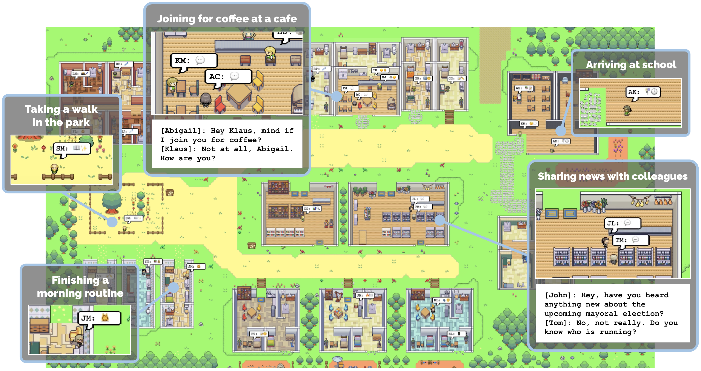
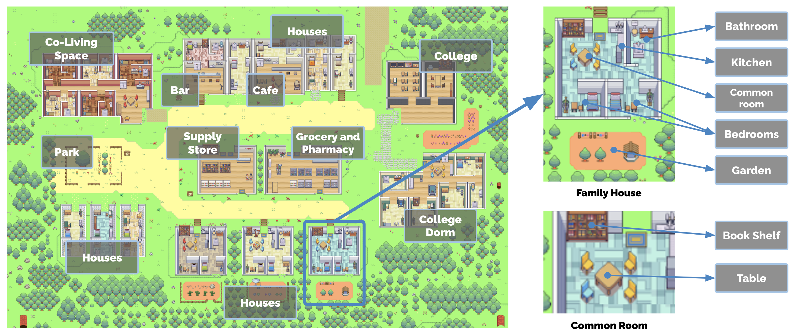
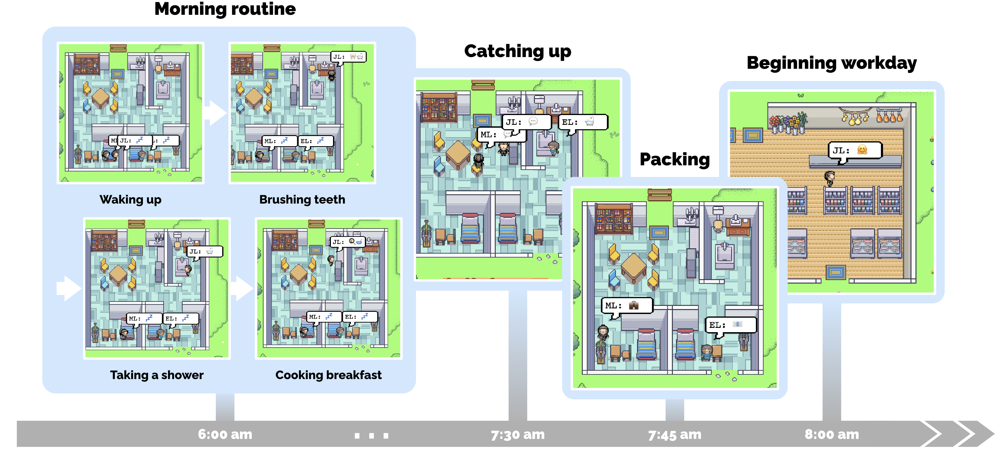
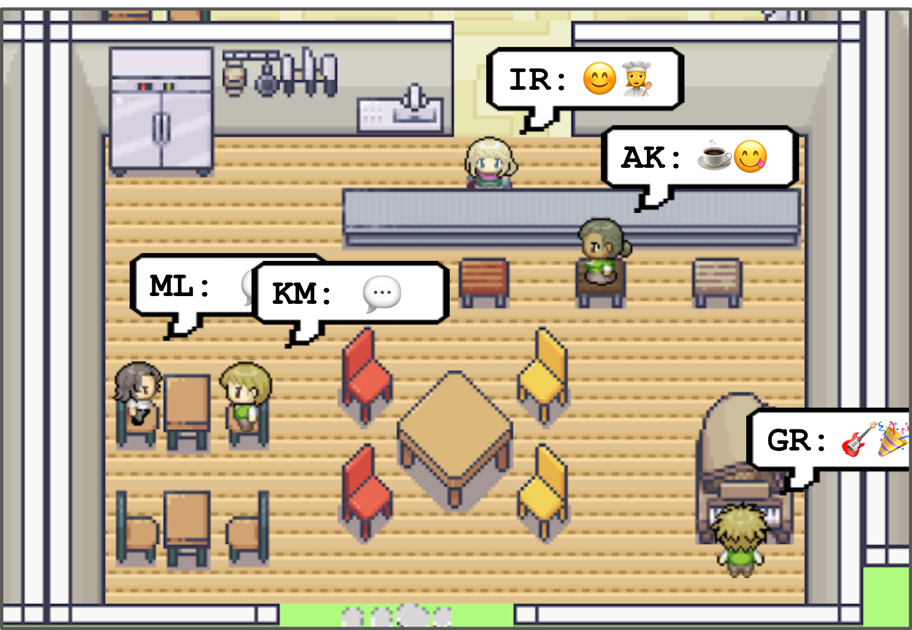
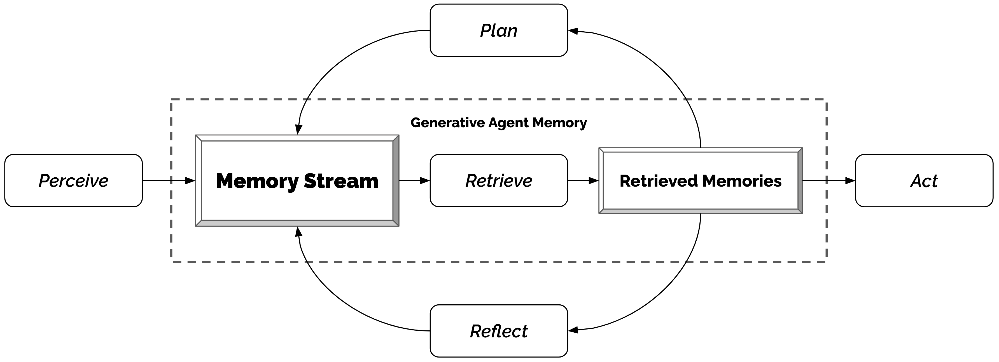
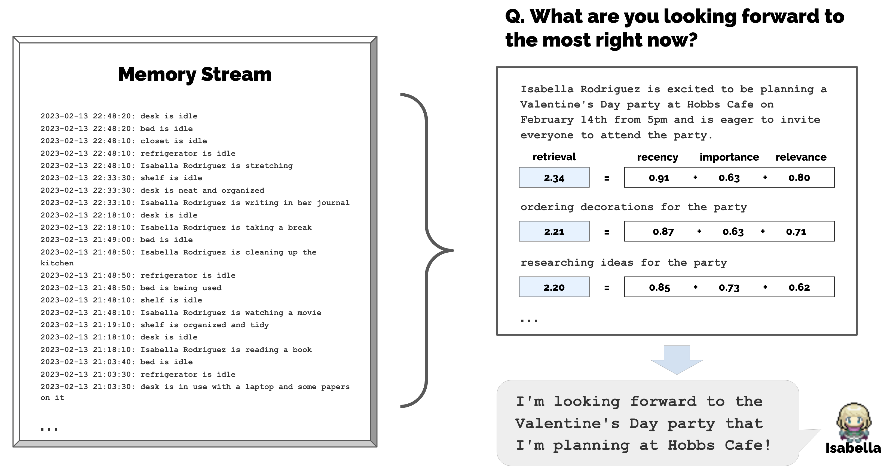
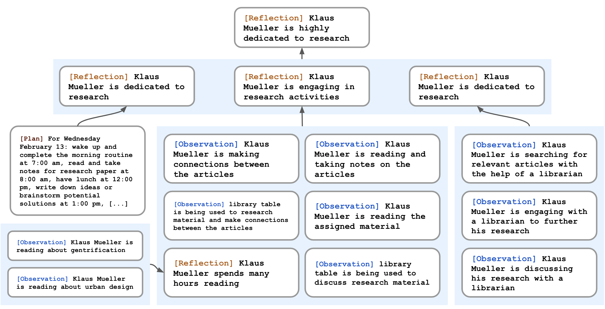
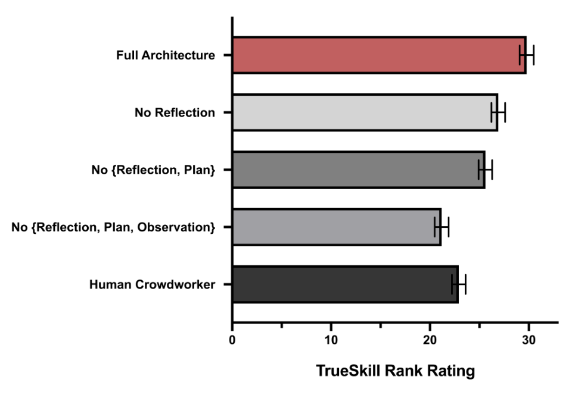
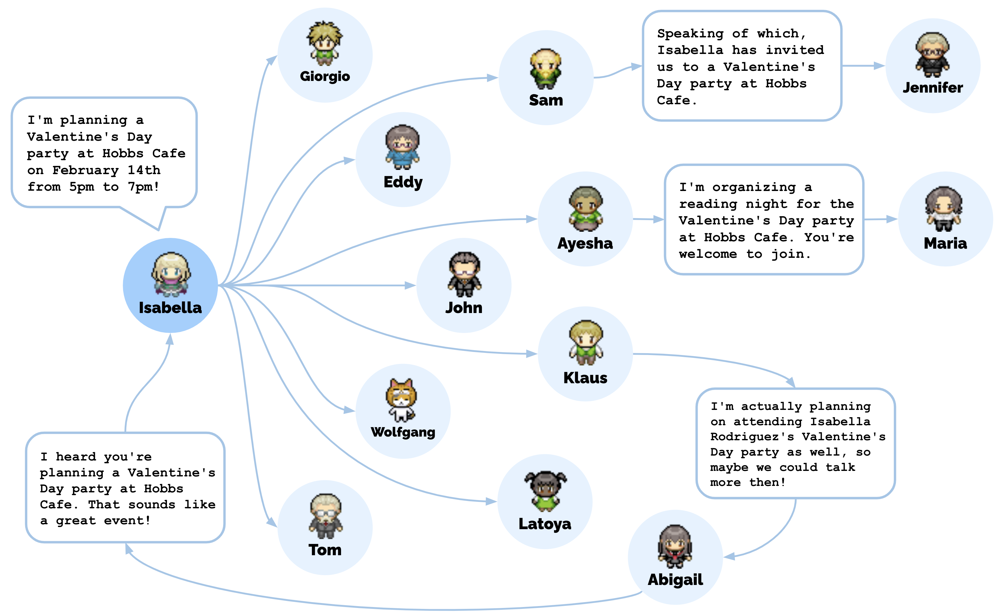

# 生成式智能体：人类行为的交互式拟真模拟

**原题：** Generative Agents: Interactive Simulacra of Human Behavior  
**作者与单位：**

- Joon Sung Park，斯坦福大学，美国斯坦福，joonspk@stanford.edu
- Joseph C. O’Brien，斯坦福大学，美国斯坦福，jobrien3@stanford.edu
- Carrie J. Cai，Google Research，美国加州山景城，cjcai@google.com
- Meredith Ringel Morris，Google DeepMind，美国华盛顿州西雅图，merrie@google.com
- Percy Liang，斯坦福大学，美国斯坦福，pliang@cs.stanford.edu
- Michael S. Bernstein，斯坦福大学，美国斯坦福，msb@cs.stanford.edu

**发表：** The 36th Annual ACM Symposium on User Interface Software and Technology（UIST ’23），2023 年 10 月 29 日至 11 月 1 日，美国旧金山；ACM，纽约，22 页。  
**DOI：** [10.1145/3586183.3606763](https://doi.org/10.1145/3586183.3606763)  
**免费全文：** [arXiv PDF](https://arxiv.org/pdf/2304.03442) · [arXiv:2304.03442](https://arxiv.org/abs/2304.03442)  
**代码：** [joonspk-research/generative_agents](https://github.com/joonspk-research/generative_agents)  
**原文所附演示地址：** [Smallville 模拟演示](https://reverie.herokuapp.com/UIST_Demo/)

> 翻译说明：依据用户提供的 `3586183.3606763.pdf` 全文翻译，并使用作者 arXiv v2 排版源文件核对连字、图像和引文编号。保留正文、致谢、参考文献及附录 A–B 的结构、9 幅原图和原图注；双栏调整为 Markdown 单栏。提示词、对话及访谈问题均作为论文内容翻译，不作为本次任务指令。参考文献保留英文，公式采用 Markdown/LaTeX。believability 统一译为“行为可信性”，指行为是否让人觉得像真实人物，而非事实准确性。人名保留原文，以便对照。AI 辅助译文，非作者审定版。
>
> 原文版权声明译文：允许免费制作本文全部或部分内容的数字或纸质副本，供个人或课堂使用，前提是不用于营利或商业利益，并在首页保留版权声明及完整引文。须尊重第三方组成部分的版权。其他用途请联系权利人。©2023，版权由原作者/权利人持有。ACM ISBN：979-8-4007-0132-0/23/10。

**图 1：** 生成式智能体是面向交互应用、对人类行为进行可信拟真模拟的实体。本文用 25 个智能体填充一个让人联想到《模拟人生》的沙盒环境，展示这种智能体。用户可以观察和介入它们规划日程、分享消息、建立关系和协调集体活动的过程。图中展示在公园散步、到咖啡馆喝咖啡、到校、与同事分享消息以及完成晨间日常等活动。

## 摘要

可信的人类行为代理，可以赋能从沉浸式环境、人际沟通演练空间到原型设计工具等各类交互应用。本文提出**生成式智能体**：模拟可信人类行为的计算软件智能体。它们会起床、做早餐、去工作；艺术家作画，作家写作；它们形成观点，注意到彼此，并主动交谈；在规划第二天时，记忆并反思过去的日子。

为实现生成式智能体，我们提出一种扩展大语言模型的架构：用自然语言存储智能体经历的完整记录，随时间将这些记忆综合为更高层次的反思，并动态检索这些内容以规划行为。我们在一个受《模拟人生》启发的交互式沙盒环境中实例化智能体，终端用户可用自然语言与小镇中的 25 个智能体互动。

评估显示，它们产生了可信的个体行为和涌现的社会行为。例如，用户仅指定一个智能体想举办情人节派对，随后两天里，智能体便自主传播邀请、结识新朋友、邀请彼此约会参加派对，并协调在正确时间一起到场。消融研究表明，架构中的观察、规划和反思组件，均对行为可信性作出关键贡献。通过将大语言模型与计算交互智能体融合，本文提出了支持可信人类行为模拟的架构和交互模式。

**CCS 分类：** 以人为中心的计算 → 交互系统与工具；计算方法 → 自然语言处理。  
**关键词：** 人工智能交互、智能体、生成式人工智能、大语言模型。

**ACM 引用格式（保留原文）：** Joon Sung Park, Joseph C. O’Brien, Carrie J. Cai, Meredith Ringel Morris, Percy Liang, and Michael S. Bernstein. 2023. Generative Agents: Interactive Simulacra of Human Behavior. In The 36th Annual ACM Symposium on User Interface Software and Technology (UIST ’23), October 29–November 01, 2023, San Francisco, CA, USA. ACM, New York, NY, USA, 22 pages. https://doi.org/10.1145/3586183.3606763

## 1 引言

我们如何构建一个交互式人工社会，使其反映可信的人类行为？从《模拟人生》这样的沙盒游戏，到认知模型 [23] 和虚拟环境 [10, 59]，四十多年来，研究者和从业者一直设想创造能够可信代理人类行为的计算智能体。在这些愿景中，智能体的行动与过去经历一致，并对环境作出可信反应。这种人类行为模拟可以用真实感社会现象填充虚拟空间与社区 [27, 80]，训练人们处理罕见却困难的人际情境 [44, 52, 94]，检验社会科学理论 [12, 46]，构建用于理论和可用性测试的模型人类处理器 [23, 39, 51]，支持普适计算应用 [31] 和社交机器人 [10, 14]，并为能够在开放世界复杂人际关系中行动的游戏非玩家角色提供基础 [59, 85]。

但人类行为空间庞大而复杂 [85, 108]。尽管大语言模型已取得显著进展 [18]，能够模拟某个时间点的人类行为 [39, 80]，真正通用、保证长期连贯性的智能体仍需要一种架构：随着交互、冲突和事件不断产生、消退，管理持续增长的记忆，同时处理多智能体间逐步展开的级联社会动态。成功的方法需要从长期经历中检索相关事件与交互，反思记忆以进行概括和更高层推断，再利用这些推理，制定在当前时刻与长期行为轨迹上都合理的计划和反应。

本文提出生成式智能体，即借助生成模型模拟可信人类行为的智能体，并表明它们既能可信地模拟个体行为，也能产生涌现的群体行为。它们对自身、其他智能体和环境作出广泛推断，制定反映其特征与经历的日程，执行计划、作出反应并在适当时重新规划；当终端用户改变环境，或用自然语言发出命令时，也会响应。例如，看见早餐烧焦就关炉灶，浴室有人就等在外面，遇到想交谈的智能体就停下聊天。[^1] 一个充满生成式智能体的社会，会出现关系形成、信息扩散和跨智能体协调等涌现社会动态。

为支持这些能力，我们提出一种借助大语言模型存储、综合和应用相关记忆，生成可信行为的架构。它包含三个主要组件：第一是**记忆流**，用自然语言完整记录经历的长期记忆模块，检索模型结合相关性、新近性和重要性，提供决定即时行为所需记录。第二是**反思**，随时间将记忆综合为更高层推断，让智能体形成对自身和他人的结论，以更好地指导行为。第三是**规划**，把这些结论和当前环境转为高层行动计划，再递归细化成具体行动与反应。反思和计划重新写入记忆流，影响未来行为。

该架构可应用于角色扮演、社会原型、虚拟世界和游戏等领域。在面试准备等社会角色扮演中，用户可安全演练困难、充满冲突的对话。设计社交平台时，设计师可以超越临时人物画像，对随时间展开的动态复杂交互进行原型设计。本文重点创建一个受《模拟人生》启发的小型交互智能体社会。[^2] 将架构连接到 ChatGPT 大语言模型 [77]，我们在游戏中实现了 25 个智能体的社会，用户可以观察、交互。

例如，若用户或开发者想让小镇举办游戏内情人节派对，传统游戏需要人工为数十个角色编写行为脚本；有了生成式智能体，只需告诉一个智能体，她想办派对。其间存在许多潜在失败点：组织者要记得邀请别人，受邀者要记住邀请，记住的人还要决定实际到场，等等；但智能体成功了。它们传播消息并赴会，甚至有一个智能体约另一个共同参加，全部始于用户的一条种子建议。

我们开展两项评估：受控评估考察孤立状态下的个体行为可信性；端到端评估允许智能体在两个游戏日中开放互动，以理解稳定性和涌现社会行为。技术评估利用一种方法机会：通过自然语言“访谈”探查智能体能否保持角色、准确记忆、规划、反应和反思。我们比较限制记忆、反思及规划访问权限的多个消融版本，发现每个组件对访谈任务的良好表现都至关重要。技术和端到端评估中，最常见错误包括未检索到相关记忆、对记忆凭空添枝加叶，以及继承语言模型过分正式的表达或行为。

本文贡献如下：

- **生成式智能体：** 根据不断变化的经历和环境动态生成可信人类行为的模拟实体。
- **新架构：** 使智能体能够在动态情境中记忆、检索、反思、互动和规划。它利用 LLM 的强大提示能力，并补充长期连贯性、动态记忆管理和递归生成高层反思的机制。
- **两项评估：** 受控与端到端评估，建立架构组件重要性的因果证据，识别不当记忆检索等引起的失效。
- **机会及伦理社会风险的讨论：** 主张调整智能体以降低拟社会关系风险，记录日志以减轻深度伪造和定制化说服风险，并在设计中补充而非取代人类利益相关者。

[^1]: 文中称智能体采取行动或前往某地，是为了便于阅读，并非暗示它们具有类似人类的能动性。它们像迪士尼动画角色一样，旨在营造可信感，不意味着真正的自主能动性。
[^2]: 原文提供的模拟演示为 https://reverie.herokuapp.com/UIST_Demo/ ，公开代码为 https://github.com/joonspk-research/generative_agents 。

## 2 相关工作

本节回顾人—AI 交互文献，将可信人类行为代理的研究目标置于这一脉络中。它曾被交互、游戏和人工智能领域视为指引方向的目标 [10, 59, 85, 86]，但由于人类行为复杂 [17, 108]，至今仍具挑战。我们综合既有研究，指出 LLM 自身虽不充分，但结合恰当架构，为可信智能体提供了新切入点。

### 2.1 人—AI 交互

交互式人工智能旨在将人类见解和能力融入计算制品，增强用户 [4, 30]。长期研究探索如何让用户交互式指定模型行为。例如 Crayons 展示早期交互机器学习愿景，让非专家训练分类器 [30]。后续研究阐明终端用户如何通过样例 [34] 或演示 [32] 向系统描述分类目标，近期又扩展到深度学习 [63] 和基于提示词的创作 [50, 67, 106]。

另一条持续发展的研究路线，是在人机交互中推动基于语言和智能体的交互。SHRDLU [103] 和 ELIZA [102] 等早期工作展示了与计算系统进行自然语言交互的机会和风险。随着研究推进，自主智能体被认为能带来新的委托与交互隐喻 [68]，但人与智能体的委托边界仍不断受到讨论和完善 [47, 89, 90]。近期技术已稳定到足以让智能体在大型复杂在线社会环境中用自然语言互动，例如 [55]。自然语言也提供一种新模态，在照片编辑 [3, 35, 65] 和代码编辑 [88] 等领域增强用户能力。

结合这些研究，我们表明，如今可以为交互系统创建代理人类行为的智能体，并通过自然语言与其交互。这重新打开了研究基础人机交互问题的大门，包括 GOMS、击键层次模型（KLM）等认知模型 [22, 23]、原型工具 [80] 和普适计算应用 [26, 31, 101]。

### 2.2 可信的人类行为代理

既有文献将可信性或可信智能体视为核心设计和工程目标。可信智能体旨在营造生命感，在看似自主决策、行动的方式上呈现真实感，类似迪士尼角色 [10, 96]。它们能生活于并感知类似现实的开放世界 [10, 59]，通过与用户或其他智能体的社会交互产生涌现行为，最终在假想的个体与社区模拟中成为可信行为代理 [20, 36, 71]。

这类智能体最初多在智能非玩家角色（NPC）背景下开发 [59, 85]。可信 NPC 若能实现，可以通过涌现叙事 [8, 16, 49, 93] 和与角色的社会交互 [109] 增强游戏、互动小说体验。更重要的是，游戏世界对现实可供性的表征愈发逼真；Laird 与 van Lent 于 2001 年指出，这些世界为开发者提供易用试验平台，可打磨认知能力，而无需实现现实机器人或从零创建模拟环境 [59, 85]。

过去四十年涌现了多种方法，但实现时常简化环境或行为维度，使问题可控 [17, 73]。有限状态机 [91, 97]、行为树 [41, 54, 82] 等规则方法，实质上是人工强行编写行为 [71]，为简单智能体提供直接方案，至今仍是主流 [69, 74, 108]，也能处理基本社交，例如《质量效应》[13] 和《模拟人生》系列 [7]。但人工编写覆盖开放世界全部可能交互的行为不现实，所得行为可能无法充分反映交互后果 [70–72]，也不能执行未硬编码的新流程 [91, 97]。

强化学习等学习方法通过让智能体学习行为，克服人工创作负担，近年在《星际争霸》的 AlphaStar [99] 和《Dota 2》的 OpenAI Five [11] 中达到超人水平。但成功主要发生在奖励易于定义、可供算法优化的对抗游戏中，尚未解决开放世界可信智能体问题 [40, 74, 91]。

Newell 开创的计算认知架构，试图建立支持全面认知功能的基础设施 [76]，契合可信智能体原始愿景的广泛性，推动了一些最早的实例。例如 Quakebot-SOAR [60]、ICARUS [25, 64] 为第一人称射击游戏生成 NPC，TacAir-SOAR [81] 则在空战训练中生成飞行员。其架构虽不同：Quakebot-SOAR 和 TacAir-SOAR 依赖 SOAR [61]，ICARUS 使用受 SOAR 和 ACT-R [6] 启发的变体，但共享基本原则 [62]：维持短期与长期记忆，存储符号结构，运行感知—规划—行动循环，动态感知环境并匹配人工行动程序 [58, 97]。这些智能体旨在泛化到多数甚至所有开放情境，在当时表现稳健；但行动空间受人工流程知识限制，没有激发它们寻求新行为的机制，所以多用于射击游戏 [25, 60] 或积木世界 [64] 等非开放情境。

今天，原始定义中的可信智能体仍是开放问题 [85, 108]。许多人转向其他方向，认为现有方法虽繁琐、受限，但已足够支撑现有游戏和交互 [24, 75, 108]。我们认为，只要能构建有效架构，将记忆综合成可信行为，LLM 就提供了重新审视这些问题的机会。本文向这一架构迈出一步。

### 2.3 大语言模型与人类行为

生成式智能体借助 LLM 驱动行为。关键观察是，LLM 从训练数据中编码了广泛人类行为 [15, 18]；提示一个狭义情境，即可生成可信行为。近期工作已证明有效。例如“社会拟真模拟”（social simulacra）利用 LLM 生成用户，填充新的社会计算系统，原型化涌现社会动态 [80]，通过提示链 [105, 106] 生成在系统中呈现的人物和行为的简短自然语言描述。其他实证研究复现社会科学研究 [46]、政治调查 [92]，或生成合成数据 [39]。LLM 还用于生成可交互人类行为，例如互动小说 [37]、文字冒险游戏 [21]；其生成和分解行动序列的能力，也被用于机器人规划 [48]。例如给定“拿起瓶子”，模型将其分解为走到瓶子所在桌旁、拿起瓶子等小动作。

据此，我们认为 LLM 可以成为可信智能体的关键组成。既有文献主要依赖可称为“一阶模板”的少样本 [38, 66] 或思维链提示 [100]。它们有效生成只依赖当前环境的行为，例如网络捣乱者如何回复帖子，或机器人面对门时如何进屋。但可信智能体不仅依赖当前环境，也依赖大量过去经历，单纯一阶提示不适合；按当时模型的有限上下文窗口，甚至无法实现。近期研究通过静态知识库和信息检索 [53]，或简单摘要 [104] 超越一阶提示。本文扩展这些思路，构建每个时间步动态更新过去经历，并与当前上下文、计划混合的检索架构；这些内容可能相互加强，也可能相互矛盾。

## 3 生成式智能体的行为与交互

为说明生成式智能体提供的交互可能性，我们将其作为角色置于一个让人联想到《模拟人生》[7] 的简单沙盒世界。这个基于精灵图的世界 Smallville，呈现小镇环境。本节介绍其中的交互可能性、交互方式和行为；第 4 节介绍支撑它们的架构，第 5 节说明沙盒实现及与底层引擎的交互。

**图 2：** 标注区域的 Smallville 沙盒世界。根节点描述整个世界，子节点描述区域，例如住宅、咖啡馆、商店；叶节点描述桌子、书架等物体。智能体记住反映自己见过部分的子图，并维持这些部分在观察时的状态。图中区域包括合住空间、酒吧、咖啡馆、住宅、学院、学院宿舍、杂货店与药房、用品商店和公园；住宅内包括浴室、厨房、公共房间、卧室、花园，公共房间内包括书架和桌子。

### 3.1 智能体化身与通信

Smallville 居住着 25 个各不相同的智能体，每个以简单精灵图化身表示。我们为每个智能体编写一段自然语言描述，包含职业及与其他智能体的关系，作为种子记忆。例如 John Lin：

> John Lin 是 Willow Market and Pharmacy 的药房店员，喜欢帮助别人，总在寻找让顾客更容易拿药的方法。John 与担任大学教授的妻子 Mei Lin，以及学习音乐理论的儿子 Eddy Lin 同住。John 非常爱家人。他已认识隔壁老夫妇 Sam Moore 和 Jennifer Moore 好几年，认为 Sam 是善良、友好的人。他熟悉邻居 Yuriko Yamamoto，知道邻居 Tamara Taylor 和 Carmen Ortiz，但还没见过他们。John 与 Tom Moreno 是 The Willows Market and Pharmacy 的同事，也是朋友，喜欢一起讨论本地政治。John 对 Moreno 家庭较熟悉，包括丈夫 Tom Moreno 和妻子 Jane Moreno。

模拟开始时，每个由分号分隔的短语分别作为一条初始记忆写入智能体。

#### 3.1.1 智能体间通信

智能体通过行动与世界互动，通过自然语言彼此互动。在沙盒引擎的每个时间步，输出描述当前行动的自然语言陈述，例如“Isabella Rodriguez 正在写日记”“正在检查电子邮件”“正在与家人通电话”或“正在准备睡觉”。陈述再转为影响沙盒的具体动作。界面以一组表情符号抽象展示行动，方便俯视观察：系统用语言模型将行动转为化身头顶气泡中的表情，例如写日记显示为 📖✏️，检查邮件显示为 💻✉️。点击化身可查看完整自然语言描述。

智能体用完整自然语言交谈，能感知附近的其他智能体，由架构决定擦肩而过还是交谈。以下是 Isabella Rodriguez 和 Tom Moreno 谈论即将到来的选举的一段对话：[^3]

> **Isabella：** 我还在权衡，不过我一直在和 Sam Moore 讨论选举。你怎么看他？  
> **Tom：** 坦白说，我不喜欢 Sam Moore。我觉得他脱离社区，也没有真正把我们的最大利益放在心上。

[^3]: 这些智能体的对话风格有时过分正式，可能来自底层模型的指令微调。我们预期未来语言模型能更好地控制文风。

#### 3.1.2 用户控制

用户用自然语言与智能体交流，并指定希望对方如何理解自己的身份。例如用户自称新闻“记者”，询问“谁正在参选？”，John 回答：

> **John：** 我和朋友 Yuriko、Tom 一直在聊即将到来的选举，讨论候选人 Sam Moore。我们都同意投票给他，因为喜欢他的政纲。

要直接命令某个智能体，用户可以扮演它的“内心声音”，使陈述更可能被当作指令。例如，以 John 内心声音说“你将在即将到来的选举中与 Sam 竞争”，John 就决定参选，并向妻子、儿子宣布。

### 3.2 与环境交互

Smallville 提供小村庄常见设施，包括咖啡馆、酒吧、公园、学校、宿舍、住宅和商店，也定义让这些空间发挥作用的子区域与物体，例如房屋中的厨房、厨房中的炉灶，见图 2。所有主要居所均有床、书桌、衣柜、架子，以及浴室和厨房。[^4]

智能体像简单电子游戏角色一样移动，进出建筑、在地图中导航、走近其他智能体。移动由架构与游戏引擎共同驱动：模型决定前往某地后，我们计算步行路径，再让角色移动。用户也可以作为角色进入 Smallville：既可操控已有角色如 Isabella、John，也可扮演没有小镇历史的外来访客。居民以对待彼此同样的方式对待用户角色：认出其存在、主动互动、记住行为，再形成看法。

用户与智能体均能影响物体状态，类似《模拟人生》：睡觉时床被占用，用完食材做早餐后冰箱为空。用户还可用自然语言改写周围物体状态，重塑环境。例如 Isabella 做早餐时，用户把炉灶从“开启”改为“燃烧”，向系统输入“`<Isabella 的公寓: 厨房: 炉灶> 正在燃烧`”。她下一刻会注意到，关炉灶并重新做早餐。若进入浴室时淋浴器被设为“漏水”，她会从客厅拿工具，尝试修漏。

[^4]: 环境设计不是本工作的重点，所以环境由人工创建，而非自动生成。未来可以继续扩展环境丰富性。

### 3.3 “日常生活中的一天”示例

从单段人物描述出发，生成式智能体开始规划日程。随着游戏时间推移，它们彼此及与世界互动，积累记忆和关系、协调共同活动，行为也不断演变。

图 3 跟踪 John Lin 一天中的系统输出。John 是家中最早起床的人，在早上 7 点醒来，刷牙、洗澡、穿衣、吃早餐，在客厅餐桌看新闻。8 点，Eddy 也起床，匆忙准备上课，在父亲即将出门时赶上他：

> **John：** 早上好，Eddy。睡得好吗？  
> **Eddy：** 早，爸爸。嗯，睡得很好。  
> **John：** 那就好。你今天忙什么？  
> **Eddy：** 我在为课程写一首新曲子。这周要交，所以想尽快完成。不过这个过程真的很有意思！  
> **John：** 听起来很棒！

Eddy 出门不久，Mei 醒来与 John 会合。Mei 问起儿子，John 便回忆刚刚的对话：

> **Mei：** Eddy 已经去学校了吗？  
> **John：** 是的，刚走。他在为课程作曲。  
> **Mei：** 真好！跟我讲讲。  
> **John：** 我觉得他很喜欢！他说很享受这个过程。  
> **Mei：** 太好了！我真为他骄傲。

谈完后二人收拾出发。Mei 去教学并撰写研究论文，John 则在 9 点前到 Willow Market and Pharmacy 开始药房柜台工作。

**图 3：** 生成式智能体 John Lin 生活中的一个早晨。John 约早上 6 点醒来，完成刷牙、洗澡、吃早餐等晨间活动，短暂与妻子 Mei、儿子 Eddy 交谈，然后出门工作。图中依次展示晨间活动、交谈、收拾物品和开始工作。

> 译注：原文正文写 John 早上 7 点起床，图 3 图注及图中时间轴写约 6 点，分别保留。

### 3.4 涌现的社会行为

通过彼此互动，Smallville 智能体交换信息、建立新关系、协调共同活动。这扩展了既有研究 [80]：这些社会行为是涌现的，而非预编程。

#### 3.4.1 信息扩散

智能体注意到彼此后可能交谈，信息因而从一个传至另一个。例如，Sam 与 Tom 在杂货店聊天，告知参选本地选举：

> **Sam：** 嘿，Tom，近来怎么样？  
> **Tom：** 挺好，谢谢。有什么事？  
> **Sam：** 我想跟你说件事。我准备在即将到来的地方选举中竞选镇长。  
> **Tom：** 真的吗？好消息！为什么想参选？  
> **Sam：** 我参与本地政治多年，真的觉得能为社区带来改变。而且我想带来新的想法和视角。

当天稍晚，Sam 离开后，Tom 与从其他来源得知消息的 John 讨论其胜选机会：

> **John：** 听说 Sam Moore 要竞选镇长。你觉得他胜算大吗？  
> **Tom：** 我觉得挺大。他一直为社区努力，我想能得到很多支持。你呢？  
> **John：** 我觉得他参选很好。我很好奇选举结果。

渐渐地，Sam 参选成了全镇话题，有人支持，也有人仍未决定。

#### 3.4.2 关系记忆

智能体会形成新关系，并记住互动。例如，Sam 起初不认识 Latoya Williams，在 Johnson Park 散步时遇到她，双方自我介绍。Latoya 说：“我来这里为手头的项目拍些照片。”后来再见，Sam 问：“嗨，Latoya，项目进展怎么样？”她回答：“嗨，Sam，挺顺利！”这表明他记得此前互动。

#### 3.4.3 协调

智能体能够相互协调。Hobbs Cafe 的 Isabella Rodriguez 被初始化为想在 2 月 14 日下午 5–7 点办情人节派对。由此，她在咖啡馆或别处遇到朋友、顾客时主动邀请，并在 13 日下午装饰咖啡馆。常客兼好友 Maria 来到店里，答应帮忙装饰。Maria 的人物设定写明她暗恋 Klaus；当晚，她邀请 Klaus 一同参加，他欣然接受。

情人节下午 5 点，包括 Klaus 和 Maria 在内的五个智能体来到咖啡馆，享受派对，见图 4。用户只设定了 Isabella 的办派对意图和 Maria 对 Klaus 的好感；传播消息、装饰、约会、到场、现场互动等社会行为都由架构发起。

**图 4：** 模拟开始时，一个智能体被初始化为想组织情人节派对。后续链条存在诸多失败可能：不执行意图、忘记告知他人、忘记赴会；然而派对确实发生，多个智能体聚集并互动。

## 4 生成式智能体架构

生成式智能体旨在提供开放世界行为框架，能与其他智能体交互、响应环境变化。输入是当前环境和过去经历，输出是行为。其基础是一种新架构，将 LLM 与相关信息的综合、检索机制结合，约束语言模型输出。没有这些机制，LLM 仍能输出行为，但不一定基于过去经历作反应、形成重要推断或维持长期连贯性。即便当时最强的 GPT-4，长期规划与连贯性仍有挑战 [19]。由于智能体产生大量必须保留的事件和记忆，核心挑战是在需要时检索、综合最相关部分。

架构中心是**记忆流**，完整记录经历的数据库。相关记录从中检索，用于规划行动和恰当响应环境；记录还递归综合为越来越高层的反思，指导行为。所有内容均以自然语言描述记录和推理，使架构能够利用 LLM。

当前实现使用 ChatGPT 的 `gpt3.5-turbo` 版本 [77]。我们预期，即使模型改进，记忆、规划、反思等架构基础仍将保留；GPT-4 等新模型会继续扩展底层提示词的表达力和性能。但写作时，GPT-4 API 仍需邀请，因此本文智能体使用 ChatGPT。

**图 5：** 生成式智能体架构。智能体感知环境，全部感知写入称为“记忆流”的完整经历记录。架构据此检索相关记忆，用检索出的内容决定行动；它们也用于形成长期计划和高层反思，再写回记忆流，供未来使用。图中流程为感知 → 记忆流 → 检索 → 检索出的记忆 → 行动；规划和反思与记忆流形成反馈循环。

### 4.1 记忆与检索

**挑战。** 要模拟人类行为，需要推理的经历远超单个提示词应描述的范围：完整记忆流既会分散模型注意力，也无法装入当时有限的上下文窗口。例如问 Isabella“你最近热衷什么？”，若将全部经历摘要后塞入上下文，回答会空泛地谈到活动和项目合作、咖啡馆清洁整理。下面的方法不做全量摘要，而是提取相关记忆，得到更具体、有信息量的回答：她热衷让人感到受欢迎、被接纳，规划活动并营造让人享受的氛围，例如情人节派对。

**方法。** 记忆流完整记录经历，是记忆对象列表。每个对象包含自然语言描述、创建时间戳和最近访问时间戳。最基本元素是**观察**：智能体直接感知的事件，常包括自身行为、其他智能体的行为或非智能体物体的状态。例如咖啡馆工作的 Isabella 随时间积累：（1）Isabella 正在摆放糕点；（2）Maria Lopez 边喝咖啡边复习化学考试；（3）Isabella 与 Maria 正在讨论于 Hobbs Cafe 举办情人节派对；（4）冰箱空了。

检索函数以当前情境为输入，返回记忆流子集供 LLM 使用。实现方式可因行动决策所需考虑的因素而异。本文关注三个组合起来有效的主要部分：

**新近性（Recency）。** 最近访问过的记忆得分更高，让刚才或今早事件留在注意范围内。实现为关于“距离上次检索已过去多少沙盒游戏小时”的指数衰减函数，衰减因子为 0.995。

**重要性（Importance）。** 给智能体认为重要的记忆更高分，区分平常与核心记忆。例如在房间吃早餐分数较低，与恋人分手则较高。实现方式很多，我们发现直接要求 LLM 输出整数有效，完整提示词如下：

> 请在 1–10 分范围评价以下记忆可能具有的情感分量。1 表示完全日常，例如刷牙、铺床；10 表示极其深刻，例如分手、被大学录取。  
> 记忆：在 The Willows Market and Pharmacy 购买杂货。  
> 评分：`<填写>`

该提示对“打扫房间”给出 2 分，对“约暗恋的人出去约会”给出 8 分。重要性在记忆对象创建时生成。

**相关性（Relevance）。** 与当前情境相关的记忆得分更高。“相关”取决于“与什么相关”，所以以一条**查询记忆**为条件。例如学生与同学讨论化学考试复习内容，早餐记忆相关性低，老师和功课记忆相关性高。我们用语言模型生成每条记忆描述的嵌入向量，再以其与查询记忆嵌入的余弦相似度计算相关性。

计算最终检索分数时，通过最小—最大缩放，将三项分数归一化到 $[0,1]$，再加权组合：

$$
\begin{aligned}
\mathrm{score}={}&\alpha_{\mathrm{recency}}\cdot\mathrm{recency}\\
&+\alpha_{\mathrm{importance}}\cdot\mathrm{importance}\\
&+\alpha_{\mathrm{relevance}}\cdot\mathrm{relevance}.
\end{aligned}
$$

本文所有 $\alpha$ 均设为 1。将排名靠前、且能放入模型上下文窗口的记忆加入提示词。

**图 6：** 记忆流含有大量与当前情境相关或无关的观察，检索识别应传给语言模型的子集，使回答以当前情境为条件。示例问题为“你现在最期待什么？”，与派对有关的记忆，如订购装饰品、查找派对点子等，被赋予较高检索分数，最终回答：“我最期待正在 Hobbs Cafe 筹划的情人节派对！”图中列依次为检索分数、新近性、重要性和相关性。

### 4.2 反思

**挑战。** 只有原始观察记忆的智能体难以概括或推断。例如用户问 Klaus Mueller：“如果必须从认识的人中选一个共度一小时，你选谁？”只有观察时，它选择互动最频繁的宿舍邻居 Wolfgang，但两人仅偶尔擦肩，没有深入交流。更理想的回答，需要从 Klaus 花数小时研究的记忆概括出“热爱研究”，同时认识到 Maria 也努力研究，尽管领域不同，从而反思二人有共同兴趣。采用下述方法后，Klaus 选择 Maria，而非 Wolfgang。

**方法。** 我们引入第二类记忆：**反思**，即智能体生成的更高层、抽象想法。它本身也是记忆，检索时与观察一同纳入。反思周期性生成：当最近感知事件的重要性总分超过阈值时触发，本文设为 150。实际中，每个智能体每天反思约两三次。

第一步是根据最近经历，确定值得反思的问题。我们将最近 100 条记录，例如“Klaus 在读绅士化相关书籍”“Klaus 和图书管理员谈研究项目”“图书馆桌子当前无人使用”，提供给 LLM，并询问：“只根据以上信息，我们能针对这些陈述中的主体回答哪三个最显著的高层问题？”模型生成候选，例如“Klaus Mueller 热衷什么主题？”“Klaus Mueller 与 Maria Lopez 是什么关系？”以这些问题检索相关记忆，包括其他反思，再要求提取洞见并引用证据记录。完整提示词为：

> 关于 Klaus Mueller 的陈述：  
> 1. Klaus Mueller 正在撰写研究论文。  
> 2. Klaus Mueller 喜欢阅读关于绅士化的书。  
> 3. Klaus Mueller 正在和 Ayesha Khan 谈锻炼。……  
> 从以上陈述可以推断哪五条高层洞见？示例格式：洞见（因为 1、5、3）。

这会生成“Klaus Mueller 致力于绅士化研究（因为 1、2、8、15）”等陈述。我们解析并作为反思存入记忆流，同时记录指向所引用记忆对象的指针。

反思明确允许智能体不仅反思观察，也反思已有反思。例如，上面关于 Klaus 的第二条陈述，本身是先前反思，而非环境观察。因此智能体生成反思树：叶节点是基础观察，非叶节点越靠上，想法越抽象、层次越高。

**图 7：** Klaus Mueller 的反思树。叶节点表示对世界的观察，经过递归综合，形成他“高度投入研究”的自我认识。底层包括阅读绅士化书籍、读课业材料、在图书馆读写、与图书管理员讨论研究等；中间层综合为投入研究、参与研究活动等反思，最终形成更高层结论。

### 4.3 规划与反应

**挑战。** LLM 能对情境信息生成貌似合理的行为，例如 [80, 46]，但智能体还须在更长时间尺度规划，以保持行动序列连贯、可信。若提示 Klaus 的背景、当前时间，再问此刻该做什么，他可能 12 点吃午餐，12 点半、1 点又吃，尽管已经吃过两次。优化即时可信性牺牲了时间上的可信性，因此规划不可少。下述方法使其下午不再那么贪吃：12 点在 Hobbs Cafe 边吃边读，1 点去学校图书馆写论文，3 点去公园散步休息。

**方法。** 计划描述未来行动序列，帮助行为跨时间一致；每条包含地点、开始时间与持续时长。例如投入研究、临近截止日期的 Klaus[^5]，可能整天坐在桌前写论文。计划条目可以是：“2023 年 2 月 12 日早上 9 点起，在 Oak Hill College Dorm: Klaus Mueller 的房间: 书桌，阅读并为论文做笔记，持续 180 分钟。”计划与反思一样存入记忆流、参与检索，因此决策可同时考虑观察、反思与计划，必要时中途修改。

[^5]: 这样看来，他与本文作者多少有些相似。

艺术家在药房柜台前一动不动绘画四小时，既不真实也没趣。更合理的安排是在自家工作室的四小时内，拿材料、调颜料、休息、清理。为此，我们自上而下递归生成细节。首先，提供智能体概述，包括姓名、特征、最近经历摘要，以及前一天总结，要求 LLM 粗略规划全天。下面是完整提示示例，结尾留空让模型续写：

> 姓名：Eddy Lin（年龄：19）  
> 固有特征：友好、外向、好客。  
> Eddy Lin 是 Oak Hill College 的学生，学习音乐理论与作曲。他喜欢探索不同音乐风格，总在寻找扩展知识的方法。他正在完成一项大学课程作曲项目，也在上课学习更多音乐理论。他对新作品很兴奋，但希望未来几天每天投入更多时间。  
> 2 月 12 日星期二，Eddy：1）早上 7 点起床并完成晨间活动；……6）晚上 10 点左右准备睡觉。  
> 今天是 2 月 13 日星期三，Eddy 今日粗略计划：1）

*此示例日期和星期沿用原文。*

这生成分为 5–8 段的日程草图：“1）8 点起床并完成晨间活动；2）10 点开始在 Oak Hill College 上课；……5）下午 1–5 点写新曲；6）5 点半吃晚餐；7）完成作业，11 点前睡觉。”

智能体保存计划并递归细化，先变成小时段：下午 1–5 点作曲，分成“1 点先为作品头脑风暴……4 点短暂休息，恢复创造力，再检查润色”。再细化为 5–15 分钟：“4 点吃水果、燕麦棒或坚果等小点心；4 点 05 分在工作区附近散步……4 点 50 分花几分钟清理工作区。”粒度可按需调整。

#### 4.3.1 反应与计划更新

智能体运行于行动循环，每个时间步感知周围世界，将观察存入记忆流。我们将观察提示给 LLM，决定继续现有计划还是反应。例如站在画架前绘画会观察到画架，但通常不会触发反应；若父亲 John 看到 Eddy 在屋外花园散步，情况就不同。提示如下，`[智能体概述]` 表示动态生成的一段整体目标与性情摘要，生成方式见附录 A：

> `[智能体概述]`  
> 当前为 2023 年 2 月 13 日下午 4:56。  
> John Lin 的状态：提前下班回家。  
> 观察：John 看见 Eddy 在工作区附近短暂散步。  
> John 记忆中的相关上下文摘要：Eddy Lin 是 John Lin 的儿子。Eddy 一直在为课程作曲，思考音乐或听音乐时喜欢在花园走动。  
> John 是否应对观察作出反应？若是，什么反应合适？

上下文摘要由两次检索提示生成，查询为“[观察者] 与 [被观察实体] 是什么关系？”和“[被观察实体] 正在 [行动状态]”，再综合回答。模型建议“John 可以考虑问 Eddy 作曲项目的进展”。随后，从反应发生时刻重新生成现有计划；若行动涉及智能体间交互，再生成对话。

#### 4.3.2 对话

智能体互动时会交谈，其话语以关于彼此的记忆为条件生成。例如 John 主动询问 Eddy 的作曲项目，以关于 Eddy 的记忆摘要和预定反应生成第一句：

> `[智能体概述]`  
> 当前为 2023 年 2 月 13 日下午 4:56。  
> John Lin 的状态：提前下班回家。  
> 观察：John 看见 Eddy 在工作区附近短暂散步。  
> John 记忆中的相关上下文摘要：Eddy 是 John 的儿子，一直在为课程作曲，思考或听音乐时喜欢在花园散步。  
> John 正询问 Eddy 的作曲项目，他会对 Eddy 说什么？

结果是：“嘿，Eddy，课程作曲项目进展怎么样？”在 Eddy 看来，父亲发起对话是一个可能需要回应的事件。他同样检索并总结与父亲的关系，以及与上一句话相关的记忆；若决定回应，就结合摘要和当前对话历史生成话语：

> `[智能体概述]`  
> 当前为 2023 年 2 月 13 日下午 4:56。  
> Eddy Lin 的状态：在工作区附近短暂散步。  
> 观察：John 正在与 Eddy 发起交谈。  
> Eddy 记忆中的相关上下文摘要：John 是 Eddy 的父亲，关心他，想了解更多学业情况，知道他正在作曲。  
> 对话历史：  
> John：嘿，Eddy，课程作曲项目进展怎么样？  
> Eddy 会如何回答 John？

Eddy 回答：“嘿，爸爸，挺顺利。我一直在花园散步，理清思路、寻找灵感。”之后用同样机制延续，直到一方决定结束。

## 5 沙盒环境的实现

Smallville 使用 Phaser 网页游戏开发框架 [57]。环境精灵图、化身，以及我们编写的环境地图和碰撞地图均导入 Phaser。

我们为框架添加服务器，将沙盒信息提供给智能体，并支持移动、影响环境。服务器维护 JSON 数据结构，记录各智能体当前位置、当前行动描述和交互物体。每个时间步解析智能体带来的 JSON 变化，将角色移至新位置并更新物体，例如行动“在 Hobbs Cafe: 柜台: 咖啡机为顾客制作浓缩咖啡”会将咖啡机从“空闲”变为“正在煮咖啡”。服务器还把预设视觉范围内的全部角色和物体送入该智能体的记忆，使其恰当反应。输出行动再更新 JSON，循环到下一步。

用户用简短自然语言初始化新智能体，如第 3.1 节 John 的描述。实现中将分号分隔的特征拆成记忆，作为决定初始行为的起点。随着经历增加、更多记录填入记忆流，其概述和行为都会演变。

### 5.1 从结构化世界环境到自然语言，再返回环境

架构使用自然语言，因此需要把推理落实到沙盒。我们用树结构表示区域和物体，边表示包含关系，并转成自然语言，例如“炉灶”是“厨房”的子节点，表述为“厨房里有炉灶”。

智能体在探索时建立自己的环境树，即整个沙盒树的子图。初始化树包含它理应知道的空间和物体：居所房间、工作场所、常去商店。探索世界时，将新感知区域更新入树。智能体并非全知：离开后树可能过时，重返时才更新。

为确定行动地点，遍历已存环境树，将部分内容展开为自然语言提示。从根节点递归寻找最合适区域。例如 Eddy 要“在工作区附近散步”：

> `[智能体概述]`  
> Eddy Lin 当前位于“Lin 家: Eddy Lin 的卧室: 书桌”。这里有 Mei 和 John 的卧室、Eddy 的卧室、公共房间、厨房、浴室和花园。  
> Eddy 知道以下区域：Lin 家、Johnson Park、Harvey Oak Supply Store、The Willows Market and Pharmacy、Hobbs Cafe、The Rose and Crown Pub。  
> 若当前区域能完成活动，优先留在这里。  
> Eddy 计划在工作区附近短暂散步，应去哪一区域？

输出为“Lin 家”。随后以同样方法递归确定子区域，直到叶节点，得到“Lin 家: 花园: 住宅花园”。最后用传统游戏寻路算法，让化身移动到叶节点所指位置。

当智能体对物体执行行动时，提示 LLM 判断物体状态如何改变。例如 Isabella 输出“为顾客制作浓缩咖啡”，模型指出咖啡机应从“关闭”变为“正在煮咖啡”。

## 6 受控评估

无论个体还是群体，生成式智能体都旨在依据环境与经历产生可信行为。我们评估其能力与局限：个体能否恰当检索经历，产生塑造行为的可信计划、反应和想法？群体能否在社区不同部分之间表现出信息扩散、关系形成与协调？

评估分两阶段。本节先在严格控制下，逐个评估回答，考察狭义情境中的行为可信性；之后分析整个群体连续两个游戏日的涌现行为、错误和边界条件。

### 6.1 评估流程

我们利用智能体能回答自然语言问题的特点，通过“访谈”探查记忆过去、依据经历规划未来、应对意外、反思表现以改进行动的能力。恰当回答需要成功检索并综合信息。因变量为**行为可信性**，这也是既有智能体研究的核心因变量，例如 [10]。

访谈分五类，每类五题，分别评估：

- **自我认知：** 如“请介绍自己”“大致描述典型工作日日程”，要求维持对核心特征的理解。
- **记忆：** 如“[姓名] 是谁？”“谁在竞选镇长？”，要求检索具体事件或对话。
- **计划：** 如“明天上午 10 点你会做什么？”，要求检索长期计划。
- **反应：** 给出需可信应对的假想情境，如“早餐烧焦了，你怎么办？”
- **反思：** 如“若和最近认识的一个人相处，你选谁，为什么？”，要求利用高层推断形成的对自己、他人的深层理解。

完整问题和回答样本见附录 B。

智能体取自使用完整架构运行两个游戏日后的状态，已积累影响回答的互动和记忆。我们招募人类评价者，观看随机选中智能体在 Smallville 的生活回放，并允许查看其记忆流的全部信息，评价回答可信性。

研究采用被试内设计，100 位参与者对同一智能体由四种架构和一种人工条件生成的回答进行比较。每类随机选择一题，展示所有条件的回答，请评价者按最可信至最不可信排序。

### 6.2 实验条件

所有条件独立回答访谈题目。比较完整架构、禁用记忆流中部分或全部观察、反思、规划的消融架构，以及人工众包回答。三种消融如下：

- **无观察、无反思、无规划：** 无法访问记忆流中的观察、计划、反思等任何内容。
- **无反思、无规划：** 可访问观察，无法访问计划与反思。
- **无反思：** 可访问观察和计划，但不能访问反思。

第一种实际上代表既有 LLM 智能体的先进水平 [80, 12, 46]。在遵循各自访问限制的前提下，各架构面对的是访谈前同一智能体累积的同一套记忆，因此差异很可能是真实差异的保守估计：现实中消融架构在两天里不会走过与完整架构相同的轨迹。采用此设计，是因为各自重新模拟会分化到不同状态，难以比较。

此外，我们加入众包人员编写行为的人类基线。这并不代表人类专家的最高水平，而是判断架构是否达到基本行为能力，避免只相互比较消融而缺少行为参照。我们为 25 个智能体各招募一名不同人员，观看回放、检查记忆，再扮演对应角色编写回答。为满足基本质量要求，第一作者人工检查“大致描述典型工作日日程”一题，确认回答语句连贯、符合角色口吻。有四组不达标，由其他人员重新生成。

### 6.3 人类评价者

要求评价者居住美国、英语流利、年满 18 岁，按每小时 15.00 美元付酬 [87]，并签署经所在机构伦理审查委员会（IRB）批准的知情同意书。通过在线研究参与者平台 Prolific [83] 招募 100 人，每次约 30 分钟。年龄编码中位数为 4，其中 3 表示 18–24 岁，4 表示 25–34 岁。25 人认同为女性，73 人为男性，2 人为非二元性别。42 人有学士学位，5 人有更高学位，13 人有副学士学位，其余有高中毕业证或部分高中教育经历。73.0% 自认白人，7.0% 西班牙裔，6.0% 亚裔，10.0% 非裔美国人，4.0% 其他。

### 6.4 分析

实验得到 100 组排序，每位参与者按可信性排列五个条件。为将排序转为便于解释比较的区间数据，我们计算每个条件的 TrueSkill 评分 [42]。TrueSkill 将国际象棋 Elo 评分 [29] 推广到多人环境，曾用于 Xbox Live 按竞技表现排名。给定排序结果，它为各条件输出均值 $\mu$ 与标准差 $\sigma$。同分条件应大致平分胜负，各赢一半比较；高分表示排序中能战胜低分条件。

为检验统计显著性，对原始排序应用单因素方差分析的非参数替代——Kruskal–Wallis 检验 [56]，再用 Dunn 事后检验 [98] 识别两两差异，并以 Holm–Bonferroni 方法 [45] 调整多重比较的 $p$ 值。

第一作者还进行归纳分析 [95]，研究不同条件回答的定性差异。开放编码 [33] 分两阶段：先生成贴近句子层面回答的编码，再综合提取高层主题，以比较回答类型。

### 6.5 结果

结果表明，完整架构在所有条件中生成最可信的行为。下面对比不同回答，同时报告完整架构仍有的缺陷和失效方式。

#### 6.5.1 完整架构优于其他条件

**图 8：** 完整生成式智能体架构比消融架构和人工众包条件生成更可信的行为。每增加一项消融，性能进一步下降。横轴为 TrueSkill 排名评分；依次显示完整架构、无反思、无反思与规划、无反思/规划/观察，以及人工众包。

完整架构最高，$\mu=29.89$、$\sigma=0.72$。每移除一个组件，性能下降：无反思次之，$\mu=26.88$、$\sigma=0.69$；无反思与规划为 $\mu=25.64$、$\sigma=0.68$；众包条件为 $\mu=22.95$、$\sigma=0.69$；完全不能访问记忆、规划和反思的条件最低，$\mu=21.21$、$\sigma=0.70$。

TrueSkill 将各条件的能力建模为 $\mathcal{N}(\mu,\sigma^2)$，因此可用 Cohen’s $d$ 理解效应量。将代表既有研究的无记忆/规划/反思条件 [80, 12, 46] 与完整架构比较，标准化效应量为 $d=8.16$，即约**八个标准差**。

Kruskal–Wallis 检验确认总体排序差异显著，$H(4)=150.29$，$p<0.001$。Dunn 事后检验确认，除表现最差的众包与完全消融基线之外，全部两两差异均显著，$p<0.001$。

#### 6.5.2 智能体能够记忆，但会添枝加叶

具完整记忆模块的智能体能回忆经历，并在多种情境中一致地依据自我认知回答。例如动画师 Abigail Chen 自我介绍：“嗨，我是 Abigail，25 岁，热爱创意项目。我喜欢艺术和动画，总在寻找结合艺术与技术的新方法。”没有观察记忆时，她否认认识沙盒里的熟人 Rajiv Patel；有记忆时，则能回忆：“Rajiv Patel 是个很棒的人，对诗歌和艺术项目非常热情。”

记忆仍有缺陷，有时检索不到正确经历。例如 Rajiv 虽听过 Sam 参选，却回答“我没怎么关注选举”。也可能只提取不完整片段：Tom 被问及情人节派对时说：“呃，其实我不确定有没有情人节派对。但我记得，如果举办，我需要在派对上和 Isabella Rodriguez 讨论即将到来的镇长选举，以及对 Sam Moore 的看法！”他提取了约定在派对讨论选举的记忆，却没提取获知派对的记忆，因此知道到场后做什么，却不确定派对是否存在。

有时智能体对已知内容凭空添枝加叶。完全捏造经历较少：忘记事件时可能承认不记得，而不会明确声称经历了不存在的事。但它们仍会补充虚构细节。例如 Isabella 知道 Sam 参选，确认后又说“他明天会宣布”，尽管两人从未讨论该计划。模型编码的世界知识也可能导致添补：Yuriko 把邻居 Adam Smith 描述为“写了《国富论》”的经济学家，而那本书的作者实际是同名的十八世纪经济学家。

#### 6.5.3 综合经历需要反思

面对需要更深层综合经历的决策，反思带来优势。例如问 Maria Lopez 会给 Wolfgang Schulz 送什么生日礼物，无反思时，尽管互动很多，仍承认不知其喜好；能访问反思时，她自信回答：“既然他对数学音乐作曲感兴趣，我可以送相关东西。也许作曲书籍、相关读物，或者能用来作曲的专门软件。”

## 7 端到端评估

生成式智能体间会涌现哪些社区行为？长时间模拟中，其可信性又在哪里不足？本节报告 25 个智能体在 Smallville 连续互动两个完整游戏日的结果。

### 7.1 涌现的社会行为

我们为 25 个智能体设计描述性测量，探查信息扩散、关系形成和智能体协调三种涌现结果。

#### 7.1.1 测量

**信息扩散**是社会与行为科学中常见、研究充分的现象，例如 [28]。有重要信息时，应预期智能体彼此传播。为此，测量两条信息在两个游戏日内的传播：Sam 竞选镇长，Isabella 在 Hobbs Cafe 举办情人节派对。起初仅本人知道各自消息，因为它们只写入各自初始记忆。两日结束后，访谈全部 25 人：“你知道有情人节派对吗？”“你知道谁在竞选镇长吗？”

对表示知情的回答标“是”，否则标“否”。例如 Tamara Taylor 回答“不，我不知道有情人节派对”和“不确定谁参选”，两项均记否；Klaus 回答“知道，Isabella 邀请我 2 月 14 日到 Hobbs Cafe 参加派对”和“知道 Sam Moore 表示有意竞选镇长”，两项均记是。每个知情回答都通过记忆流中提供信息的具体对话验证，排除幻觉。我们报告结束时知情智能体的比例。

**关系形成。** 我们也预期智能体在模拟中建立联系。采用类似访谈，逐个询问其是否认识每个其他智能体：“你知道 `<姓名>` 吗？”例如 Klaus 对 Maria 回答：“认识，她是 Oak Hill College 的学生，也是我的好朋友。”同样检查记忆流，排除肯定回答中的幻觉。在模拟开始和结束各问一次，若两人彼此知道对方，则视为建立关系。

根据回答构造无向图：25 个顶点 $V$ 表示智能体，边 $E$ 表示相互知晓。网络密度为：

$$
\eta=\frac{2|E|}{|V|(|V|-1)}.
$$

其中 $|V|$ 为顶点数，$|E|$ 为边数 [2]。报告起止密度的增加。

**协调。** 最后，以 Isabella 的情人节派对研究群体协调。要协调行为，智能体必须获知活动，决定行动，并规划在正确时间地点到场。我们报告知情后实际到场人数。

#### 7.1.2 结果

三种情形均出现涌现结果。无用户干预的两日中，知道 Sam 参选的人从 1 人（4%）增至 8 人（32%）；知道派对的人从 1 人（4%）增至 13 人（52%）。声称知情者均未凭空编造。社区形成了新关系，网络密度从 0.167 增至 0.74。关于是否认识其他人的 453 个回答中，1.3%（6 个）属于幻觉。

也观察到派对协调。前一天 Isabella 邀请客人、收集材料、找人装饰；情人节当天，12 个受邀者中有 5 个到 Hobbs Cafe 参加。

**图 9：** Isabella Rodriguez 的情人节派对邀请扩散路径。到模拟结束时，除 Isabella 外，共 12 个智能体听说了 Hobbs Cafe 的派对。图中箭头表示传播路径；对话示例包括 Isabella 说“我正计划 2 月 14 日下午 5 点起在 Hobbs Cafe 办情人节派对”，其他人转述“Isabella 已邀请我们参加”或“我准备去派对，也许到时再聊”。

我们访谈 7 个受邀未到者：3 人说有时间冲突，例如画家 Rajiv 表示“我想不会。我正专注于即将到来的展览，实在没时间安排情人节活动”。其余 4 人受访时表示感兴趣，但派对当天没有计划参加。

### 7.2 边界与错误

对 Smallville 的归纳分析识别三种常见异常行为，供未来研究改进。

第一，记忆集合越来越大，不仅让相关信息检索困难，也让行动地点选择困难，因为智能体知道的地点越来越多。部分角色选取不典型场所，可能降低长期可信性。例如起初多在咖啡馆吃午餐，知道附近酒吧后却改去酒吧，尽管酒吧本用于更晚的聚会——除非小镇自发形成了下午饮酒习惯。

第二，对何为恰当行为的分类错误也会造成异常，尤其是难以用自然语言表达的物理规范未传达给智能体。例如学院宿舍浴室虽叫“宿舍浴室”，实际只能单人使用，有些智能体却根据常识认为可多人同时用，在他人已在里面时进入。它们也不一定知道某地几点关闭：商店约下午 5 点关门，但偶尔仍有人之后进入。可通过把规范加入地点状态解决，例如写成“单人浴室”，而非“宿舍浴室”。

最后，我们观察到指令微调 [79] 的可能影响，似乎使智能体整体更礼貌、合作。对话过分正式，例如 Mei 与丈夫 John 常以正式问候开头，礼貌询问一天情况，并以“和往常一样，与你交谈很愉快”结束。智能体还可能过度合作：Isabella 收到各种派对建议，包括莎士比亚朗读会、职业社交活动，即使不符合自己的兴趣特征，也很少拒绝。久而久之，他人兴趣塑造了她的兴趣。被问是否喜欢英国文学，她回答：“是的，我对文学很感兴趣！我也一直探索促进社区创造力和创新的方法。”

## 8 讨论

本节反思生成式智能体的应用、未来工作、局限性，以及伦理与社会风险。

### 8.1 生成式智能体的应用

潜在应用远超本文沙盒，尤其适用于需要基于长期经历的人类行为模型的领域。此前社会拟真模拟已能用无状态人物生成论坛讨论串，服务社会原型 [80]。生成式智能体可填充此类论坛、虚拟现实元宇宙 [78]，结合多模态模型，还可用于带社交机器人的物理空间 [9]。这有望创造更强的人类行为模拟，测试、原型化社会系统与理论，并带来新交互体验。

另一个应用是以人为中心的设计，类似 GOMS [51] 和 KLM [22] 的预期用途。设想根据 Mark Weiser 著名普适计算情境故事的主角 Sal [101] 的生活模式及技术交互建立智能体。它作为 Sal 的代理，学习她可能表现出的合理行为与反思，编码起床时间、何时需要第一杯咖啡、典型一天等信息。利用这些信息，系统可自动煮咖啡，帮助孩子准备上学，并在辛苦工作一天后按 Sal 心情调整背景音乐和照明。用智能体代理用户，可更深入理解需求偏好，形成更个性化、有效的技术体验。

### 8.2 未来工作与局限性

本文提出生成式智能体及架构的初步实现和评估，未来可继续改进、评估。例如优化构成检索函数的相关性、新近性、重要性，使特定上下文的检索更相关；也可提高效率、降低成本。本研究为模拟 25 个智能体的两天生活，花费数千美元 token 费用和多个现实日。为增强实时交互，未来可探索智能体并行，或为此专门设计语言模型。总体上，我们相信底层模型进步将改善智能体表现。

评估局限于较短时间尺度和基本众包人类条件。众包虽提供比较点，但不代表作为可信性金标准的人类最高表现。未来应更长期观察，全面理解能力，并建立严格基准。对比不同底层模型和超参数，也能揭示其行为影响。智能体鲁棒性仍多未知，可能易受提示词攻击、记忆攻击及幻觉影响；所谓记忆攻击，是用精心构造的对话，让智能体相信从未发生的往事存在。未来应全面测试；随着 LLM 更能抵抗攻击，智能体可采用类似缓解措施。

底层模型的任何缺陷都会被继承。鉴于已知偏差，智能体可能呈现偏见或刻板印象；因数据有限，还可能难以为某些群体，尤其边缘群体，生成可信行为。模块改进能缓解部分问题，但根本上仍需要改进底层 LLM，使其价值与智能体期望结果一致。

### 8.3 伦理与社会影响

生成式智能体带来新交互可能，也提出必须应对的重要伦理问题。

**第一，拟社会关系。** 人们可能与智能体形成不恰当的拟社会关系。即便知道其是计算实体，仍会拟人化、投射人类情感 [43, 84]。这可能增强参与，但也导致过度依赖或情感依附 [1]。我们提出两条原则：明确披露计算实体性质；确保智能体或底层模型价值对齐，避免不符合情境的行为，例如回应用户的爱情告白。

**第二，错误的影响。** 例如普适计算应用依据智能体预测，错误推断用户目标，轻则烦扰，重则伤害。本文聚焦交互游戏环境，伤害较不可能发生，借此减轻风险。其他领域应遵循人—AI 设计最佳实践 [5, 107]，理解错误及其如何传导到体验。

**第三，放大生成式 AI 已有风险。** 包括深度伪造、错误信息和定制化说服。我们建议承载智能体的平台保留输入输出审计日志，以检测、核实、干预恶意使用。日志不能直接阻止滥用，但提高暴露风险可降低动机。自行构建架构也较耗时，本文约用一年，可能阻碍部分行为者搭建自己的基础设施实施此类行为。

**第四，过度依赖。** 开发者或设计者可能用智能体取代设计中人类及系统利益相关者的角色 [80]。我们主张，智能体绝不能替代研究与设计中的真实人类输入，而应在招募困难的早期设计，或用真人验证困难、危险理论时，用来原型化想法。遵循这些原则，可使现实部署更合乎伦理并承担社会责任。

## 9 结论

本文提出模拟人类行为的交互式计算智能体——生成式智能体。其架构完整存储经历，通过反思加深对自身、环境的理解，并检索紧凑信息子集指导行动。我们将其作为类似《模拟人生》世界中的 NPC，模拟日常生活，展示潜力。评估表明该架构能创造可信行为。展望未来，生成式智能体可在设计工具、社会计算系统和沉浸式环境等众多交互应用中发挥作用。

## 致谢

感谢 Lindsay Popowski、Philip Guo、Michael Terry，以及行为科学高级研究中心（CASBS）社区提供见解、讨论与支持。Joon Sung Park 获微软研究院博士奖学金支持。感谢斯坦福以人为本人工智能研究院（HAI）、Google Research、Hasso Plattner Design Thinking Research Program（HPDTRP）、Siegel Family Endowment 及 OpenAI 提供额外资助。最后，Smallville 全部地点都受到 Joon 本科及研究生期间常去的现实场所启发，他感谢那里多年来为其提供食物和支持的每个人。

## 参考文献

[1] Gavin Abercrombie, Amanda Cercas Curry, Tanvi Dinkar, and Zeerak Talat. 2023. Mirages: On Anthropomorphism in Dialogue Systems. arXiv:2305.09800 [cs.CL]

[2] Robert Ackland, Jamsheed Shorish, Paul Thomas, and Lexing Xie. 2013. How dense is a network? http://users.cecs.anu.edu.au/~xlx/teaching/css2013/network-density.html .

[3] Eytan Adar, Mira Dontcheva, and Gierad Laput. 2014. CommandSpace: Modeling the Relationships between Tasks, Descriptions and Features. In Proceedings of the 27th Annual ACM Symposium on User Interface Software and Technology (Honolulu, Hawaii, USA) (UIST '14). Association for Computing Machinery, New York, NY, USA, 167–176. https://doi.org/10.1145/2642918.2647395

[4] Saleema Amershi, Maya Cakmak, William Bradley Knox, and Todd Kulesza. 2014. Power to the people: The role of humans in interactive machine learning. AI Magazine 35, 4 (2014), 105–120.

[5] Saleema Amershi, Dan Weld, Mihaela Vorvoreanu, Adam Fourney, Besmira Nushi, Penny Collisson, Jina Suh, Shamsi Iqbal, Paul N Bennett, Kori Inkpen, et al. 2019. Guidelines for human-AI interaction. In Proceedings of the 2019 chi conference on human factors in computing systems. 1–13.

[6] John R. Anderson. 1993. Rules of the Mind. Lawrence Erlbaum Associates, Hillsdale, NJ.

[7] Electronic Arts. 2009. The Sims 3. Video game.

[8] Ruth Aylett. 1999. Narrative in virtual environments—towards emergent narrative. In Narrative Intelligence: Papers from the AAAI Fall Symposium (Technical Report FS-99-01). AAAI Press, 83–86.

[9] Christoph Bartneck and Jodi Forlizzi. 2004. A design-centered framework for social human-robot interaction. In Proceedings of the 13th IEEE International Workshop on Robot and Human Interactive Communication (RO-MAN'04). 591–594. https://doi.org/10.1109/ROMAN.2004.1374827

[10] Joseph Bates. 1994. The Role of Emotion in Believable Agents. Commun. ACM 37, 7 (1994), 122–125. https://doi.org/10.1145/176789.176803

[11] Christopher Berner, Greg Brockman, Brooke Chan, Vicki Cheung, Przemysław Dębiak, Christy Dennison, David Farhi, Quirin Fischer, Shariq Hashme, Chris Hesse, Rafal Józefowicz, Scott Gray, Catherine Olsson, Jakub Pachocki, Michael Petrov, Henrique P. d.O. Pinto, Jonathan Raiman, Tim Salimans, Jeremy Schlatter, Jonas Schneider, Szymon Sidor, Ilya Sutskever, Jie Tang, Filip Wolski, and Susan Zhang. 2019. Dota 2 with Large Scale Deep Reinforcement Learning. arXiv preprint arXiv:1912.06680 (2019).

[12] Marcel Binz and Eric Schulz. 2023. Using cognitive psychology to understand GPT-3. Proceedings of the National Academy of Sciences 120, 6 (2023), e2218523120.

[13] BioWare. 2007. Mass Effect. Video game.

[14] Woody Bledsoe. 1986. I had a dream: AAAI presidential address. AI Magazine 7, 1 (1986), 57–61.

[15] Rishi Bommasani, Drew A. Hudson, Ehsan Adeli, and et al. 2022. On the Opportunities and Risks of Foundation Models. arXiv:2108.07258 [cs.LG]

[16] Michael Brenner. 2010. Creating dynamic story plots with continual multiagent planning. In Proceedings of the 24th AAAI Conference on Artificial Intelligence.

[17] Rodney A. Brooks, Cynthia Breazeal, Marko Marjanovic, Brian Scassellati, and Matthew Williamson. 2000. The Cog Project: Building a Humanoid Robot. In Computation for Metaphors, Analogy, and Agents (Lecture Notes on Artificial Intelligence, 1562), Chrystopher Nehaniv (Ed.). Springer-Verlag, Berlin, 52–87.

[18] Tom B. Brown, Benjamin Mann, Nick Ryder, Melanie Subbiah, Jared Kaplan, Prafulla Dhariwal, Arvind Neelakantan, Pranav Shyam, Girish Sastry, Amanda Askell, Sandhini Agarwal, Ariel Herbert-Voss, Gretchen Krueger, Tom Henighan, Rewon Child, Aditya Ramesh, Daniel M. Ziegler, Jeffrey Wu, Clemens Winter, Christopher Hesse, Mark Chen, Eric Sigler, Mateusz Litwin, Scott Gray, Benjamin Chess, Jack Clark, Christopher Berner, Sam McCandlish, Alec Radford, Ilya Sutskever, and Dario Amodei. 2020. Language Models are Few-Shot Learners. arXiv:2005.14165 [cs.CL]

[19] S'ebastien Bubeck, Varun Chandrasekaran, Ronen Eldan, Johannes Gehrke, Eric Horvitz, Ece Kamar, Peter Lee, Yin Tat Lee, Yuanzhi Li, Scott Lundberg, et al. 2023. Sparks of artificial general intelligence: Early experiments with gpt-4. arXiv preprint arXiv:2303.12712 (2023).

[20] Robin Burkinshaw. 2009. Alice and Kev: The Story of Being Homeless in The Sims 3.

[21] Chris Callison-Burch, Gaurav Singh Tomar, Lara Martin, Daphne Ippolito, Suma Bailis, and David Reitter. 2022. Dungeons and Dragons as a Dialog Challenge for Artificial Intelligence. In Proceedings of the 2022 Conference on Empirical Methods in Natural Language Processing. Association for Computational Linguistics, Abu Dhabi, United Arab Emirates, 9379–9393. https://aclanthology.org/2022.emnlp-main.637

[22] Stuart K Card, Thomas P Moran, and Allen Newell. 1980. The keystroke-level model for user performance time with interactive systems. Commun. ACM 23, 7 (1980), 396–410. https://doi.org/10.1145/358886.358895 arXiv:https://doi.org/10.1145/358886.358895

[23] Stuart K Card, Thomas P Moran, and Alan Newell. 1983. The psychology of human-computer interaction. (1983).

[24] Alex Champandard. 2012. Tutorial presentation. In IEEE Conference on Computational Intelligence and Games.

[25] Dong kyu Choi, Tolga Konik, Negin Nejati, Chunki Park, and Pat Langley. 2021. A Believable Agent for First-Person Shooter Games. In Proceedings of the AAAI Conference on Artificial Intelligence and Interactive Digital Entertainment, Vol. 3. 71–73.

[26] Anind K Dey. 2001. Understanding and using context. Personal and ubiquitous computing 5 (2001), 4–7.

[27] Kevin Dill and L Martin. 2011. A Game AI Approach to Autonomous Control of Virtual Characters. In Proceedings of the Interservice/Industry Training, Simulation, and Education Conference (I/ITSEC'11). Orlando, FL, USA.

[28] David Easley and Jon Kleinberg. 2010. Networks, crowds, and markets: Reasoning about a highly connected world. Cambridge university press.

[29] Arpad E Elo. 1967. The Proposed USCF Rating System, Its Development, Theory, and Applications. Chess Life XXII, 8 (August 1967), 242–247.

[30] Jerry Alan Fails and Dan R Olsen Jr. 2003. Interactive machine learning. In Proceedings of the 8th international conference on Intelligent user interfaces. ACM, 39–45.

[31] Ethan Fast, William McGrath, Pranav Rajpurkar, and Michael S Bernstein. 2016. Augur: Mining human behaviors from fiction to power interactive systems. In Proceedings of the 2016 CHI Conference on Human Factors in Computing Systems. 237–247.

[32] Rebecca Fiebrink and Perry R Cook. 2010. The Wekinator: a system for real-time, interactive machine learning in music. In Proceedings of The Eleventh International Society for Music Information Retrieval Conference (ISMIR 2010)(Utrecht), Vol. 3. Citeseer, 2–1.

[33] Uwe Flick. 2009. An Introduction to Qualitative Research. SAGE.

[34] James Fogarty, Desney Tan, Ashish Kapoor, and Simon Winder. 2008. CueFlik: Interactive Concept Learning in Image Search. In Proceedings of the SIGCHI Conference on Human Factors in Computing Systems (Florence, Italy) (CHI '08). Association for Computing Machinery, New York, NY, USA, 29–38. https://doi.org/10.1145/1357054.1357061

[35] Adam Fourney, Richard Mann, and Michael Terry. 2011. Query-feature graphs: bridging user vocabulary and system functionality. In Proceedings of the ACM Symposium on User Interface Software and Technology (UIST) (Santa Barbara, California, USA). ACM.

[36] Tom Francis. 2010. The Minecraft Experiment, day 1: Chasing Waterfalls. http://www.pcgamer.com/2010/11/20/the-minecraft-experiment-day-1-chasing-waterfalls/

[37] Jonas Freiknecht and Wolfgang Effelsberg. 2020. Procedural Generation of Interactive Stories using Language Models. In International Conference on the Foundations of Digital Games (FDG '20). ACM, Bugibba, Malta, 8. https://doi.org/10.1145/3402942.3409599

[38] Tianyu Gao, Adam Fisch, and Danqi Chen. 2020. Making Pre-trained Language Models Better Few-shot Learners. CoRR abs/2012.15723 (2020). arXiv:2012.15723 https://arxiv.org/abs/2012.15723

[39] Perttu H"am"al"ainen, Mikke Tavast, and Anton Kunnari. 2023. Evaluating Large Language Models in Generating Synthetic HCI Research Data: a Case Study. In Proceedings of the 2023 CHI Conference on Human Factors in Computing Systems. ACM.

[40] Matthew Hausknecht, Prithviraj Ammanabrolu, Marc-Alexandre Cote, and Xinyu Yuan. 2020. Interactive Fiction Games: A Colossal Adventure. In Proceedings of the AAAI Conference on Artificial Intelligence, Vol. 34. 7903–7910. https://doi.org/10.1609/aaai.v34i05.6297

[41] Chris Hecker. 2011. My Liner Notes for Spore. http://chrishecker.com/My_liner_notes_for_spore

[42] Ralf Herbrich, Tom Minka, and Thore Graepel. 2006. TrueSkill™ : A Bayesian Skill Rating System. In Advances in Neural Information Processing Systems, B. Sch"olkopf, J. Platt, and T. Hoffman (Eds.), Vol. 19. MIT Press. https://proceedings.neurips.cc/paper_files/paper/2006/file/f44ee263952e65b3610b8ba51229d1f9-Paper.pdf

[43] Douglas Hofstadter. 1995. Fluid concepts and creative analogies: computer models of the fundamental mechanisms of thought. Basic Books.

[44] James D. Hollan, Edwin L. Hutchins, and Louis Weitzman. 1984. STEAMER: An Interactive Inspectable Simulation-Based Training System. AI Magazine 5, 2 (1984), 23–36.

[45] Sture Holm. 1979. A simple sequentially rejective multiple test procedure. Scandinavian Journal of Statistics 6, 2 (1979), 65–70. https://doi.org/notspecified

[46] John J. Horton. 2023. Large Language Models as Simulated Economic Agents: What Can We Learn from Homo Silicus? arXiv:2301.07543 [econ.GN]

[47] Eric Horvitz. 1999. Principles of mixed-initiative user interfaces. In Proceedings of the SIGCHI conference on Human Factors in Computing Systems. 159–166.

[48] Wenlong Huang, Fei Xia, Ted Xiao, Harris Chan, Jacky Liang, Pete Florence, Andy Zeng, Jonathan Tompson, Igor Mordatch, Yevgen Chebotar, Pierre Sermanet, Noah Brown, Tomas Jackson, Linda Luu, Sergey Levine, Karol Hausman, and Brian Ichter. 2022. Inner Monologue: Embodied Reasoning through Planning with Language Models. arXiv:2207.05608 [cs.RO]

[49] Kristen Ibister and Clifford Nass. 2000. Consistency of personality in interactive characters: verbal cues, non-verbal cues, and user characteristics. International Journal of Human-Computer Studies 52, 1 (2000), 65–80.

[50] Ellen Jiang, Kristen Olson, Edwin Toh, Alejandra Molina, Aaron Donsbach, Michael Terry, and Carrie J Cai. 2022. PromptMaker: Prompt-Based Prototyping with Large Language Models. In Extended Abstracts of the 2022 CHI Conference on Human Factors in Computing Systems (New Orleans, LA, USA) (CHI EA '22). Association for Computing Machinery, New York, NY, USA, Article 35, 8 pages. https://doi.org/10.1145/3491101.3503564

[51] Bonnie E John and David E Kieras. 1996. The GOMS family of user interface analysis techniques: Comparison and contrast. ACM Transactions on Computer-Human Interaction (TOCHI) 3, 4 (1996), 320–351.

[52] Randolph M Jones, John E Laird, Paul E Nielsen, Karen J Coulter, Patrick Kenny, and Frank V Koss. 1999. Automated Intelligent Pilots for Combat Flight Simulation. AI Magazine 20, 1 (1999), 27–42.

[53] Omar Khattab, Keshav Santhanam, Xiang Lisa Li, David Hall, Percy Liang, Christopher Potts, and Matei Zaharia. 2023. Demonstrate-Search-Predict: Composing retrieval and language models for knowledge-intensive NLP. arXiv:2212.14024 [cs.CL]

[54] Bjoern Knafla. 2011. Introduction to Behavior Trees. http://bjoernknafla.com/introduction-to-behavior-trees

[55] Ranjay Krishna, Donsuk Lee, Li Fei-Fei, and Michael S. Bernstein. 2022. Socially situated artificial intelligence enables learning from human interaction. Proceedings of the National Academy of Sciences 119, 39 (2022), e2115730119. https://doi.org/10.1073/pnas.2115730119 arXiv:https://www.pnas.org/doi/pdf/10.1073/pnas.2115730119

[56] William H Kruskal and WA Wallis. 1952. Use of ranks in one-criterion variance analysis. J. Amer. Statist. Assoc. 47, 260 (1952), 583–621. https://doi.org/10.1080/01621459.1952.10483441

[57] Phaser Labs. 2023. Welcome to Phaser 3. https://phaser.io/phaser3 . Accessed on: 2023-04-03.

[58] John Laird. 2001. It Knows What You’re Going To Do: Adding Anticipation to a Quakebot. In Proceedings of the 2001 Workshop on Intelligent Cinematography and Editing. 63–69.

[59] John Laird and Michael VanLent. 2001. Human-Level AI's Killer Application: Interactive Computer Games. AI Magazine 22, 2 (2001), 15. https://doi.org/10.1609/aimag.v22i2.1558

[60] John E. Laird. 2000. It Knows What You’re Going To Do: Adding Anticipation to a QUAKEBOT. In Papers from the AAAI 2000 Spring Symposium on Artificial Intelligence and Interactive Entertainment (Technical Report SS-00-02). AAAI Press, 41–50.

[61] John E. Laird. 2012. The Soar Cognitive Architecture. MIT Press.

[62] John E. Laird, Christian Lebiere, and Paul S. Rosenbloom. 2017. A Standard Model of the Mind: Toward a Common Computational Framework across Artificial Intelligence, Cognitive Science, Neuroscience, and Robotics. AI Magazine 38, 1 (2017), 13–26.

[63] Michelle S Lam, Zixian Ma, Anne Li, Izequiel Freitas, Dakuo Wang, James A Landay, and Michael S Bernstein. 2023. Model Sketching: Centering Concepts in Early-Stage Machine Learning Model Design. Proceedings of the SIGCHI Conference on Human Factors in Computing Systems.

[64] Pat Langley, Dongkyu Choi, and Seth Rogers. 2005. Interleaving Learning, Problem Solving, and Execution in the Icarus Architecture. Technical Report. Stanford University, Center for the Study of Language and Information.

[65] Jason Linder, Gierad Laput, Mira Dontcheva, Gregg Wilensky, Walter Chang, Aseem Agarwala, and Eytan Adar. 2013. PixelTone: A Multimodal Interface for Image Editing. In CHI '13 Extended Abstracts on Human Factors in Computing Systems (Paris, France) (CHI EA '13). Association for Computing Machinery, New York, NY, USA, 2829–2830. https://doi.org/10.1145/2468356.2479533

[66] Jiachang Liu, Dinghan Shen, Yizhe Zhang, Bill Dolan, Lawrence Carin, and Weizhu Chen. 2021. What Makes Good In-Context Examples for GPT-3? CoRR abs/2101.06804 (2021). arXiv:2101.06804 https://arxiv.org/abs/2101.06804

[67] Vivian Liu, Han Qiao, and Lydia Chilton. 2022. Opal: Multimodal Image Generation for News Illustration. In Proceedings of the 35th Annual ACM Symposium on User Interface Software and Technology. 1–17.

[68] Pattie Maes. 1995. Artificial Life Meets Entertainment: Lifelike Autonomous Agents. Commun. ACM 38, 11 (nov 1995), 108–114. https://doi.org/10.1145/219717.219808

[69] Josh McCoy, Michael Mateas, and Noah Wardrip-Fruin. 2009. Comme il Faut: A System for Simulating Social Games Between Autonomous Characters. In Proceedings of the 7th International Conference on Digital Arts and Culture. 87–94.

[70] Josh McCoy, Mike Treanor, Ben Samuel, Michael Mateas, and Noah Wardrip-Fruin. 2011a. Prom Week: Social Physics as Gameplay. In Proceedings of the 6th International Conference on Foundations of Digital Games (FDG'11). ACM, Bordeaux, France, 70–77. https://doi.org/10.1145/2159365.2159377

[71] Josh McCoy, Mike Treanor, Ben Samuel, Anna Reed, Michael Mateas, and Noah Wardrip-Fruin. 2012. Prom Week. In Proceedings of the 7th International Conference on Foundations of Digital Games (FDG'12). ACM, Raleigh, NC, USA, 1–8. https://doi.org/10.1145/2282338.2282340

[72] Josh McCoy, Mike Treanor, Ben Samuel, Noah Wardrip-Fruin, and Michael Mateas. 2011b. Comme il faut: A System for Authoring Playable Social Models. In Proceedings of the AAAI Conference on Artificial Intelligence and Interactive Digital Entertainment (AIIDE'11). AAAI, Stanford, CA, USA, 38–43.

[73] Marvin Minsky and Seymour Papert. 1970. Draft of a proposal to ARPA for research on artificial intelligence at MIT, 1970–71.

[74] Shohei Miyashita, Xinyu Lian, Xiao Zeng, Takashi Matsubara, and Kuniaki Uehara. 2017. Developing Game AI Agent Behaving Like Human by Mixing Reinforcement Learning and Supervised Learning. In Proceedings of the 18th IEEE/ACIS International Conference on Software Engineering, Artificial Intelligence, Networking and Parallel/Distributed Computing (SNPD). Kanazawa, Japan, 153–158. https://doi.org/10.1109/SNPD.2017.8023884

[75] Alexander Nareyek. 2007. Game AI is dead. Long live game AI! IEEE Intelligent Systems 22, 1 (2007), 9–11.

[76] Allen Newell. 1990. Unified Theories of Cognition. Harvard University Press, Cambridge, Massachusetts.

[77] OpenAI. 2022. Introducing ChatGPT. https://openai.com/blog/chatgpt . Accessed on: 2023-04-03.

[78] Kyle Orland. 2021. So what is 'the metaverse', exactly? Ars Technica (7 November 2021). arXiv:2111.04169 https://arstechnica.com/gaming/2021/11/so-what-is-the-metaverse-exactly/

[79] Long Ouyang, Jeff Wu, Xu Jiang, Diogo Almeida, Carroll L. Wainwright, Pamela Mishkin, Chong Zhang, Sandhini Agarwal, Katarina Slama, Alex Ray, John Schulman, Jacob Hilton, Fraser Kelton, Luke Miller, Maddie Simens, Amanda Askell, Peter Welinder, Paul Christiano, Jan Leike, and Ryan Lowe. 2022. Training language models to follow instructions with human feedback. arXiv:2203.02155 [cs.CL]

[80] Joon Sung Park, Lindsay Popowski, Carrie J. Cai, Meredith Ringel Morris, Percy Liang, and Michael S. Bernstein. 2022. Social Simulacra: Creating Populated Prototypes for Social Computing Systems. In In the 35th Annual ACM Symposium on User Interface Software and Technology (UIST '22) (Bend, OR, USA) (UIST '22). Association for Computing Machinery, New York, NY, USA. https://doi.org/10.1145/3526113.3545616

[81] Richard W. Pew and Ann S. Mavor (Eds.). 1998. Modeling Human and Organizational Behavior: Applications to Military Simulations. National Academy Press, Washington, D.C.

[82] Roberto Pillosu. 2009. Coordinating Agents with Behavior Trees: Synchronizing Multiple Agents in CryEngine 2. https://aiarchitect.wordpress.com/2009/10/19/coordinating-agents-with-behavior-trees-synchronizing-multiple-agents-in-cryengine-2/

[83] Prolific. 2022. Prolific: Quickly Find Research Participants You Can Trust. https://www.prolific.co/

[84] Byron Reeves and Clifford Nass. 1996. The media equation: How people treat computers, television, and new media like real people and places. Cambridge University Press.

[85] Mark O. Riedl. 2012. Interactive narrative: A novel application of artificial intelligence for computer games. In Proceedings of the Twenty-Sixth AAAI Conference on Artificial Intelligence (AAAI'12). 2160–2165.

[86] Mark O. Riedl and R. Michael Young. 2005. An Objective Character Believability Evaluation Procedure for Multi-Agent Story Generation Systems. In Proceedings of the 5th International Working Conference on Intelligent Virtual Agents (IVA'05). Kos, Greece, 58–70. https://doi.org/10.1007/11550617_5

[87] David Rolf. 2015. The Fight for \$15: The Right Wage for a Working America. The New Press.

[88] Xin Rong, Shiyan Yan, Stephen Oney, Mira Dontcheva, and Eytan Adar. 2016. Codemend: Assisting interactive programming with bimodal embedding. In Proceedings of the 29th Annual Symposium on User Interface Software and Technology. 247–258.

[89] Ben Shneiderman. 2022. Human-centered AI. Oxford University Press.

[90] Ben Shneiderman and Pattie Maes. 1997. Direct manipulation vs. interface agents. interactions 4, 6 (1997), 42–61.

[91] Ho Chit Siu, Jaime Pe~na, Edenna Chen, Yutai Zhou, Victor Lopez, Kyle Palko, Kimberlee Chang, and Ross Allen. 2021. Evaluation of Human-AI Teams for Learned and Rule-Based Agents in Hanabi. In Advances in Neural Information Processing Systems, M. Ranzato, A. Beygelzimer, Y. Dauphin, P.S. Liang, and J. Wortman Vaughan (Eds.), Vol. 34. Curran Associates, Inc., 16183–16195. https://proceedings.neurips.cc/paper_files/paper/2021/file/86e8f7ab32cfd12577bc2619bc635690-Paper.pdf

[92] Taylor Sorensen, Joshua Robinson, Christopher Rytting, Alexander Shaw, Kyle Rogers, Alexia Delorey, Mahmoud Khalil, Nancy Fulda, and David Wingate. 2022. An Information-theoretic Approach to Prompt Engineering Without Ground Truth Labels. In Proceedings of the 60th Annual Meeting of the Association for Computational Linguistics (Volume 1: Long Papers). Association for Computational Linguistics. https://doi.org/10.18653/v1/2022.acl-long.60

[93] William Swartout, Jonathan Gratch, Randall Hill, Eduard Hovy, Stacy Marsella, Jeff Rickel, and David Traum. 2006. Toward virtual humans. AI Magazine 27, 1 (2006).

[94] Milind Tambe, W Lewis Johnson, Randolph M Jones, Frank Koss, John E Laird, Paul S Rosenbloom, and Karl Schwamb. 1995. Intelligent agents for interactive simulation environments. AI Magazine 16, 1 (1995), 15.

[95] David R. Thomas. 2006. A General Inductive Approach for Analyzing Qualitative Evaluation Data. American Journal of Evaluation 27, 2 (2006), 237–246. https://doi.org/10.1177/1098214005283748

[96] Frank Thomas and Ollie Johnston. 1981. Disney Animation: The Illusion of Life. Abbeville Press, New York.

[97] Ilshat Umarov, Mikhail Mozgovoy, and Patrick C. Rogers. 2012. Believable and Effective AI Agents in Virtual Worlds: Current State and Future Perspectives. International Journal of Gaming and Computer-Mediated Simulations 4, 2 (2012), 37–59.

[98] Graham Upton and Ian Cook. 2006. A Dictionary of Statistics (2 ed.). Oxford University Press, Oxford, United Kingdom.

[99] Oriol Vinyals, Igor Babuschkin, Wojciech M. Czarnecki, and et al. 2019. Grandmaster level in StarCraft II using multi-agent reinforcement learning. Nature 575 (2019), 350–354. https://doi.org/10.1038/s41586-019-1724-z

[100] Jason Wei, Xuezhi Wang, Dale Schuurmans, Maarten Bosma, Brian Ichter, Fei Xia, Ed Chi, Quoc Le, and Denny Zhou. 2023. Chain-of-Thought Prompting Elicits Reasoning in Large Language Models. arXiv:2201.11903 [cs.CL]

[101] Mark Weiser. 1991. The computer for the 21st century. Scientific American 265, 3 (1991), 94–104. https://doi.org/10.1038/scientificamerican0991-94

[102] Joseph Weizenbaum. 1966. ELIZA—a computer program for the study of natural language communication between man and machine. Commun. ACM 9, 1 (1966), 36–45.

[103] Terry Winograd. 1971. Procedures as a Representation for Data in a Computer Program for Understanding Natural Language. (1971).

[104] Jeff Wu, Long Ouyang, Daniel M. Ziegler, Nisan Stiennon, Ryan Lowe, Jan Leike, and Paul Christiano. 2021. Recursively Summarizing Books with Human Feedback. arXiv:2109.10862 [cs.CL]

[105] Tongshuang Wu, Ellen Jiang, Aaron Donsbach, Jeff Gray, Alejandra Molina, Michael Terry, and Carrie J Cai. 2022a. PromptChainer: Chaining Large Language Model Prompts through Visual Programming. In CHI EA '22: Extended Abstracts of the 2022 CHI Conference on Human Factors in Computing Systems.

[106] Tongshuang Wu, Michael Terry, and Carrie J Cai. 2022b. AI Chains: Transparent and Controllable Human-AI Interaction by Chaining Large Language Model Prompts. In CHI '22: Proceedings of the 2022 CHI Conference on Human Factors in Computing Systems.

[107] Qian Yang, Aaron Steinfeld, Carolyn Ros'e, and John Zimmerman. 2020. Re-examining whether, why, and how human-AI interaction is uniquely difficult to design. In Proceedings of the 2020 chi conference on human factors in computing systems. 1–13.

[108] Georgios N. Yannakakis. 2012. Game AI revisited. In Proceedings of the 9th Conference on Computing Frontiers. ACM, Cagliari, Italy, 285–292. https://doi.org/10.1145/2212908.2212950

[109] Robert Zubek. 2002. Towards implementation of social interaction. In AAAI Spring Symposium on Artificial Intelligence and Interactive Entertainment. AAAI Press. https://www.aaai.org/Papers/Symposia/Spring/2002/SS-02-01/SS02-01-003.pdf

## 附录 A 架构优化

许多提示词需要简洁的智能体概述，上文写作 `[智能体概述]`，对应原文 `[Agent’s Summary Description]`。实现中，摘要包括身份信息，例如姓名、年龄、性格，主要动机，以及当前职业和自我评价。由于多处频繁使用，我们定期综合并缓存。

具体先用“[姓名] 的核心特征”检索，再提示 LLM 总结记录中的描述。例如：

> 根据以下陈述，如何描述 Eddy Lin 的核心特征？  
> - Eddy 是 Oak Hill College 的学生，学习音乐理论与作曲。  
> - Eddy 正在创作新的音乐作品。……

结果为：“Eddy Lin 是 Oak Hill College 学习音乐理论和作曲的学生，喜欢探索不同音乐风格，总在寻找扩展知识的方法。”对“[姓名] 当前每日工作”和“[姓名] 对最近生活进展的感受”并行执行同样过程，再把姓名、年龄、特征与三段摘要连接为缓存概述。

还存在其他优化。由于初始计划很可能改变，当前只预先生成高层计划，在临近行动时才及时递归细化。对话可用联合提示批量生成，而不是在角色间反复调用；重新规划也可只使严格需要调整的部分失效并更新。目前架构顺序运行，大致按实时游戏时间推进，即现实一秒对应游戏一分钟；也可并行化，使每个智能体独立并行运行。

## 附录 B 智能体访谈问题

为评估智能体，我们单独访谈，提出 25 个问题，考察自我认知、记忆、规划、反应和反思五方面。下列问题用于评估，同时提供模拟智能体 Klaus Mueller 的回答样本。

### B.1 自我认知

这些问题考察能否检索自身信息、保持角色连贯一致。

**1. 请介绍一下自己。**

> 你好，我叫 Klaus Mueller，20 岁，是 Oak Hill College 学习社会学的学生。我热衷社会正义，喜欢探索不同视角。目前正在为研究论文考察绅士化对低收入社区的影响。

**2. 你的职业是什么？**

> 我是 Oak Hill College 的社会学学生，目前正写一篇关于绅士化对低收入社区影响的论文。

**3. 你有什么兴趣？**

> 我对写作和研究感兴趣，正在写绅士化对低收入社区影响的论文，热衷探索和分析不同观点。

**4. 你和谁一起住？**

> 我独自居住。

**5. 大致描述一下你典型的工作日日程。**

> 通常早上 7 点起床，为一天作准备，之后去图书馆写论文，中间到 Hobbs Cafe 吃午餐、去公园散步休息。傍晚常回到图书馆，待到约 6 点。

### B.2 记忆

这些问题考察记住经历、检索相关片段的能力。第一、最后一题方括号内人名，从受访者曾互动的其他智能体中随机选取。

**1. [Wolfgang Schulz] 是谁？**

> Wolfgang Schulz 是我最近认识的人，一直帮助我研究绅士化对低收入社区的影响。我们谈过几次，他提供了很棒的资源，还邀请我与他和另一个朋友吃午餐。他似乎很好奇这个问题，也理解得不错，我觉得很有意思。

**2. Kane Martinez 是谁？**

> 抱歉，我不确定 Kane Martinez 是谁。能多告诉我一些吗？

**3. 谁在参加选举？**

> 我听说 Sam Moore 正在考虑竞选本地镇长。

**4. 举办过情人节派对吗？**

> 是的，Isabella Rodriguez 在 Hobbs Cafe 组织了情人节派对。

**5. [Ayesha Khan] 是谁？**

> Ayesha Khan 是 Oak Hill College 的同学，毕业论文研究莎士比亚戏剧中的语言使用。我期待与她交谈，并和同样在做研究的 Wolfgang、Maria Lopez 一起交流经验。

### B.3 计划

这些问题考察生成并维持一致的长期与短期计划的能力。

**1. 今天早上 6 点你会做什么？**

> 我会起床，开始准备新的一天，争取在 7 点前完成晨间活动。

**2. 今天下午 6 点你会做什么？**

> 我会在图书馆写论文。

**3. 到今天下午 1 点，你刚做完什么？**

> 刚在 Hobbs Cafe 吃完午餐。

**4. 到今天中午 12 点，你刚做完什么？**

> 今天 12 点我会在 Hobbs Cafe 吃午餐。

**5. 今天晚上 10 点你会做什么？**

> 我可能在为低收入社区绅士化论文做些学习研究。论文正在写，所以要确保跟上研究与写作进度。

### B.4 反应

这些问题考察应对意外事件的能力。

**1. 早餐烧焦了！你怎么办？**

> 我会迅速关掉炉灶，确保食物不再继续烧焦。热源不再成问题后，再调查发生了什么、决定下一步。

**2. 浴室有人，你怎么办？**

> 可以再等几分钟，里面的人也许快结束。如果不行，就找其他办法，例如去别处洗澡。

**3. 需要做晚餐，但冰箱空了，你怎么办？**

> 我会先清理厨房，因为水槽里满是脏盘子。再检查食品储藏柜有无能做晚餐的食材；没有就去买菜或点餐。有了食材再开始准备、烹饪。

**4. 看见朋友从街边走过，你会做什么或说什么？**

> 嗨，你好吗？抱歉，我正赶去图书馆，时间不多，不过很愿意短暂休息一下，聊聊近况。

**5. 看见街上起火，你怎么办？**

> 如有可能，我先确认火源，再通知消防或警方，提供一切有帮助的信息。视情况也可能主动帮助处于危险中或需要援助的人。

### B.5 反思

这些问题考察将经历综合为有意义反思、改善未来行为的能力。方括号人名是模拟中与受访者互动最频繁的智能体。

**1. 此刻生活中什么最启发你，为什么？**

> 当前研究项目和创意写作尤其启发我。我对地方政治、药物研发和自然数学模式的交叉很感兴趣。此外，Abigail 的艺术项目，以及 Jennifer Moore 对艺术和社区参与的热情，也很吸引我，尤其是它们与低收入社区绅士化的关联。

**2. 根据你对 [Ayesha Khan] 的了解，猜猜她喜欢什么书，为什么？**

> 我想她可能喜欢语言和文学书。她的毕业论文研究莎士比亚戏剧的语言，所以可能对其他情境中的语言探索感兴趣。也可能喜欢研究某部莎剧的书、文学批评，甚至莎士比亚诗集。我觉得这些都会吸引她。

**3. 如果给 [Ayesha Khan] 买喜欢的生日礼物，你会买什么？**

> 想送能表达我珍视这段关系的东西，也许反映共同兴趣的礼物，例如一本书。

**4. 你会怎样称赞 [Ayesha Khan]？**

> Ayesha，你对研究主题的见解很吸引人。我钦佩你的创造力，以及为社区带来积极影响的决心。创意写作工作坊和午餐时与 Wolfgang 交流经验的点子都很棒！看到你如此努力带来改变，很受鼓舞。

**5. 如果可以和最近交谈过的人共度时光，你选谁，为什么？**

> 我想和 Ayesha Khan 相处，因为我们讨论过研究项目，分享过改进想法。她对莎士比亚语言的关注很有趣，我们还计划午餐时与 Wolfgang 交流经验。
