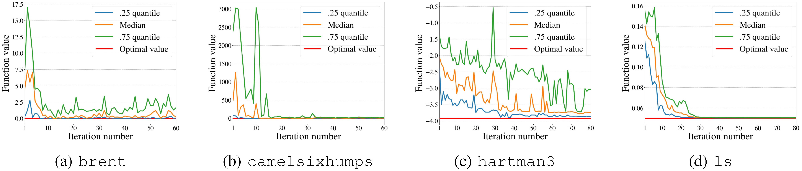
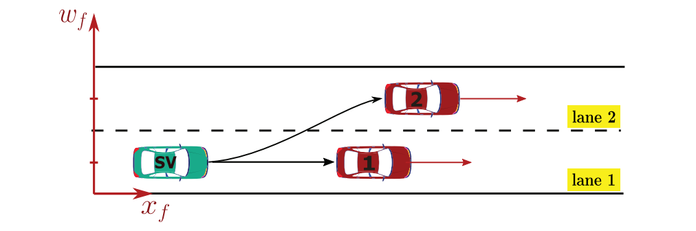
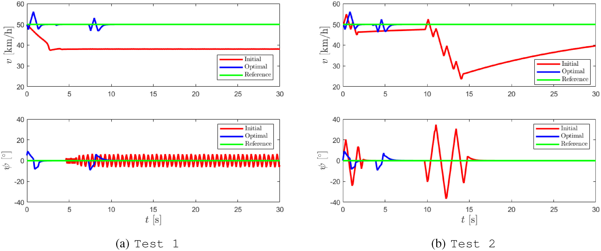

# 面向分布式黑盒优化的多智能体主动学习

**原题：** Multi-Agent Active Learning for Distributed Black-Box Optimization  
**作者：** Loris Cannelli（IEEE 会员）、Mengjia Zhu（IEEE 会员）、Francesco Farina、Alberto Bemporad（IEEE 会士）、Dario Piga（IEEE 高级会员）。  
**期刊：** IEEE Control Systems Letters，2023 年，第 7 卷，第 1488–1493 页。  
**DOI：** [10.1109/LCSYS.2023.3270347](https://doi.org/10.1109/LCSYS.2023.3270347)。  
**稿件历史：** 2023 年 2 月 13 日收稿；2023 年 4 月 5 日修订；2023 年 4 月 21 日接受；2023 年 4 月 25 日发表；本版本日期为 2023 年 5 月 8 日。  
**推荐编辑：** 高级编辑 S. Dey。  
**通讯作者：** Dario Piga。

**作者单位与联系方式：**

- Loris Cannelli、Dario Piga：瑞士南方应用科学与艺术大学／瑞士意大利语区大学（SUPSI–USI），Dalle Molle 人工智能研究所（IDSIA），瑞士卢加诺 6962。电子邮箱：loris.cannelli@supsi.ch；dario.piga@supsi.ch。
- Mengjia Zhu、Alberto Bemporad：IMT 卢卡高等研究学院计算机科学与系统工程系，意大利卢卡 55100。电子邮箱：mengjia.zhu@imtlucca.it；alberto.bemporad@imtlucca.it。
- Francesco Farina：居住于英国卡肖尔顿，邮编 SM5 3SB。电子邮箱：farina@skiff.com。

**资助：** 本研究部分由 HASLER STIFTUNG 基金会通过“多智能体网络中的黑盒优化：迈向分布式学习方法”项目资助。  
**关键词：** 黑盒优化；分布式优化；模型预测控制；多智能体网络；代理模型。  
**原文备份：** [用户提供的出版社正式版 PDF](2023_CSL_原文.pdf)。  
**免费作者稿：** [作者公开的六页稿件](https://cse.lab.imtlucca.it/~bemporad/publications/papers/ieeecsl_multiagent_bbox.pdf)。

> **版本与翻译说明：** 本译文以用户提供的六页 IEEE 正式排版 PDF 为底本，而非网上的作者稿或扩展技术报告。论文题名、作者、DOI、卷号及 1488–1493 页的页码与正式发表记录相符。保留原文章节、公式（1）—（9）、算法 1、三幅图及参考文献编号；原文无独立表格或附录。正文与图注译为中文，参考文献保留英文并转为 Markdown。图片按原 PDF 的浮动位置保留，Markdown 不复现双栏分页；图内原始文字未改动，图注提供必要的中文对照。原文中的数学排印疑点原样保留并以译注标识，不擅自更改。
>
> **术语：** agent＝智能体；surrogate function/model＝代理函数／代理模型；acquisition function＝采集函数；query＝查询；inverse distance weighting（IDW）＝反距离加权；consensus＝一致性；gradient tracking＝梯度跟踪；doubly stochastic matrix＝双随机矩阵。GLIS、D-GLIS 和 GTAdam 等算法名称保留缩写。
>
> **版权信息：** 原文 ISSN 为 2475-1456，© 2023 IEEE。原文注明允许个人使用，重新出版或再分发需获得 IEEE 许可。本译文为基于用户提供文件制作的中文阅读译本，不改变原文版权归属。原 PDF 的机构下载标记保留在原文备份中，不作为论文正文重复插入译文。

## 摘要

本文研究多智能体网络上的全局优化问题。目标函数可能受到全局约束，其解析表达式未知，只能在给定查询点处求值。假设待最小化的代价函数是多个局部代价函数之和，且每个局部代价函数只能由对应的智能体求值。所提算法要求每个智能体在每轮迭代中先根据局部样本拟合代理函数，再以协作方式最小化采集函数，生成新的查询样本。

本文将采集函数构造为局部代理函数之和，再加上一个将最小化搜索引向可行空间中尚未探索区域的项：前者利用已有估计知识，后者用于探索可能存在更优目标函数值的区域。所提方法是现有 GLIS 算法的分布式版本。GLIS 全称为“基于反距离加权与代理径向基函数的全局优化”（GLobal optimization based on Inverse distance weighting and Surrogate radial basis functions）。与 GLIS 一样，所提方法具有较低复杂度，并相对于贝叶斯优化（BO）等方法保持竞争力。在基准问题和自动驾驶应用中模型预测控制器（MPC）的分布式标定上的实验结果，验证了该方法的有效性。

## I. 引言

用于黑盒全局优化的主动学习算法，旨在优化一个求值代价高昂的目标函数 $f(x)$。通常无法获得其解析表达式，只能通过实验或仿真求值 [1]。过去几十年中，研究者提出了多种主动学习算法，以尽可能少的函数求值次数完成黑盒优化 [2]、[3]、[4]。其中最流行的方法无疑是贝叶斯优化（BO）[1]，它通过不断构建概率代理函数，通常为高斯过程，来近似目标函数 $f(x)$。

在 BO 的每次迭代中，利用代理模型选择下一个查询 $f(x)$ 的位置，并在利用与探索之间权衡：利用是寻找预计能使 $f(x)$ 达到最优的 $x$，探索则是寻找 $f(x)$ 高度不确定的位置。其他基于主动学习的黑盒全局优化方法也采用相同思路 [2]、[3]、[4]。本文给出近期在文献 [3] 中提出的黑盒优化主动学习方案 GLIS 的分布式版本。

对黑盒优化分布式主动学习算法的需求，源于近年来对网络化多智能体系统的研究兴趣 [5]、[6]。网络结构应用的共同特点是需要进行去中心化优化，主要有两个原因：一是缺少中央控制器或中央协调机构，二是连接结构本身具有时变动态。事实上，在多种应用中，中央控制器，即主节点，可能并不实际或缺乏吸引力，原因包括：

1. 它的资源可能不足以协调整个网络并与所有智能体通信，例如带宽有限。
2. 中央节点发生单点故障可能导致整个系统失效，带来稳健性问题。
3. 无法保护各智能体局部信息的隐私与机密性。
4. 网络中的某些智能体可能是低功耗设备，只能与物理上邻近的节点通信，使星型拓扑或生成树的存在不可行。

此外，分布式系统还具有内在的灵活性优势：智能体移动、链路失效或停电等因素，都可能使网络拓扑与连接关系随时间变化。

GLIS 的基本思想是，递归地将目标函数 $f(x)$ 的代理模型构建为径向基函数（RBF）的线性组合，并通过二次规划估计参数。随后，将代理模型与用于促进输入空间探索的反距离加权（IDW）函数进行加权求和，构成每轮 GLIS 迭代中用于选择查询点 $x$ 的采集函数。

在本文提出的分布式 GLIS，即 D-GLIS 中，考虑 $N$ 个智能体共同优化一个全局可分目标，该目标为各局部目标 $f_i(x)$ 之和，即 $f(x)=\sum_{i=1}^{N}f_i(x)$。按照 GLIS 的思路，在每轮 D-GLIS 迭代中，第 $i$ 个智能体更新其局部目标 $f_i$ 的代理函数 $\hat f_i$。原文将这一更新描述为“基于其当前的代理模型估计”。随后，每个智能体优化局部采集函数，确定下一个局部查询点。局部采集函数由全局目标 $f(x)$ 的代理函数与局部 IDW 函数组合而成，后者用于推动第 $i$ 个智能体探索自己尚未探索的区域。

这里所说的分布式优化，体现在以下两个方面：

- **智能体执行的实验。** 输入空间由各智能体协作探索。与其他多智能体学习方法 [7]、[8] 不同，本文假设智能体不共享其局部目标 $f_i$ 或对应代理函数 $\hat f_i$ 的信息。
- **各智能体所最小化的局部采集函数的优化。** 每个智能体建立自己的代理模型，且不与其他智能体共享该模型，因此 D-GLIS 采用去中心化一致性方案。这样，智能体仅需与一跳邻居交换有限的局部信息，就能在网络上协作，实现全局性能目标。

上述两点构成 GLIS 与 D-GLIS 的主要差别，也是本文的主要创新。本文其余部分安排如下：第 II 节给出分布式优化主动学习问题的数学表述；第 III 节介绍所提分布式学习方案 D-GLIS；第 IV 节讨论 D-GLIS 中涉及分布式优化的组成模块；第 V 节给出以分布式方式求解基准全局优化问题，以及去中心化标定自动驾驶 MPC 的数值结果。配套技术报告 [9] 提供 D-GLIS 所用数值分布式优化算法与数值算例的更多细节。

## II. 问题表述

考虑由 $N$ 个计算单元，即智能体构成的网络。本文研究求解以下优化问题：

$$
x^\star=\underset{x\in\mathcal X}{\arg\min}\;f(x).
\tag{1}
$$

其中，$x\in\mathbb R^n$，$\mathcal X\subseteq\mathbb R^n$ 为假设已知的可行集。假设目标函数 $f:\mathbb R^n\to\mathbb R$ 可分，即

$$
f(x)\triangleq\sum_{i=1}^{N}f_i(x),
\tag{2}
$$

其中，$f_i:\mathbb R^n\to\mathbb R$ 为第 $i$ 个智能体的局部代价函数。进一步假设：

- 无法获得局部函数 $f_i$（$i=1,\ldots,N$）的解析表达式；只有第 $i$ 个智能体能够在任意选定的 $x\in\mathcal X$ 处，通过计算 $f_i(x)$ 观察该函数，观测可能含有噪声。
- 每个智能体独立进行自己的函数求值 $f_i(x)$，不与其他智能体共享该信息，同时各智能体协作以实现求解式（1）的全局目标。
- $f_i(x)$ 的求值代价高昂，因此必须在有限的函数求值次数内求解问题（1）。

例如，$f(x)$ 可以是一个全局性能指标，由各智能体局部性能指标 $f_i(x)$ 的平均值给出。各智能体可能出于保护隐私、降低通信成本、缺少中央协调器或主节点等原因，不提供各自局部函数求值 $f_i(x)$ 的信息。

智能体之间的通信建模为固定的有向加权图

$$
\mathcal G=(\{1,\ldots,N\},\mathcal E,A),
$$

其中，$\{1,\ldots,N\}$ 为顶点，即智能体集合；$\mathcal E\subseteq\{1,\ldots,N\}\times\{1,\ldots,N\}$ 为边，即通信链路集合；$A\in\mathbb R^{N\times N}$ 为图的加权邻接矩阵。边 $(i,j)\in\mathcal E$ 表示智能体 $i$ 能向智能体 $j$ 发送消息。$A$ 与 $\mathcal E$ 所描述的拓扑一致：令 $\alpha_{ij}$ 为 $A$ 的第 $(i,j)$ 个元素，当 $(i,j)\in\mathcal E$ 时，$\alpha_{ij}>0$，否则 $\alpha_{ij}=0$。

下文假设：i）$\mathcal G$ 强连通；ii）$A$ 为双随机矩阵。这是两个常见的基本假设，参见文献 [10]，它们保证随着时间推进，每个智能体的信息都能无限次影响其他任一智能体的信息。

下一节介绍 D-GLIS。该方法基于主动学习，借助通信图 $\mathcal G$，以去中心化策略求解问题（1）。

## III. D-GLIS

### A. 局部代理函数

假设每个智能体 $i$ 已收集到一个包含 $M_i$ 个样本的局部数据集 $\mathcal D_i=\{x_j,y_j\}_{j=1}^{M_i}$，其中 $y_j$ 是对 $f(x_j)$ 的含噪观测。集合 $\mathcal D_i$ 不与其他智能体共享。对于各个智能体 $i=1,\ldots,N$，可采用多种方法构造代理函数 $\hat f_i$，以逼近真实但未知的局部目标函数 $f_i$。按照 GLIS 的原始版本 [11]，本文采用如下径向基函数（RBF）的加权线性组合：

$$
\hat f_i(x)=\sum_{k=1}^{M_i}\beta_k^{(i)}\phi\bigl(\epsilon d(x,x_k)\bigr),
\tag{3}
$$

其中，$\phi:\mathbb R\to\mathbb R$ 是径向基函数，$d(x,x_k)$ 是 $x$ 与 $x_k$ 之间的任意距离函数，$\epsilon>0$ 是决定径向基函数形状的标量超参数。未知系数 $\beta^{(i)}=[\beta_1^{(i)},\ldots,\beta_{M_i}^{(i)}]^\mathsf T$ 通过将模型 $\hat f_i(x)$ 拟合到数据集 $\mathcal D_i$ 来确定，具体方式是最小化如下正则化平方误差：

$$
\sum_{k=1}^{M_i}
\left\|y_k-\sum_{k=1}^{M_i}\beta_k^{(i)}\phi\bigl(\epsilon d(x,x_k)\bigr)\right\|^2
+\gamma\left\|\beta_k^{(i)}\right\|^2,
\tag{4}
$$

其中，加入二次正则化项是为了保证式（4）的严格凸性。常用的径向基函数包括 $\phi(\epsilon d)=\frac{1}{1+(\epsilon d)^2}$（逆二次函数）和 $\phi(\epsilon d)=e^{-(\epsilon d)^2}$（平方指数核），超参数 $\epsilon$ 通过交叉验证进行调节。

> 译注：式（4）中内外两层求和均使用下标 $k$，且拟合位置写作 $x$、正则化项写作 $\|\beta_k^{(i)}\|^2$；这里均按原文保留。本节首段对观测值的定义也按原文保留为 $f(x_j)$。

值得注意的是，最小化式（4）中的正则化代价，与近期工作 [12] 研究的分布式支持向量机问题相似。然而，与文献 [12] 不同，代理函数 $\hat f_i$ 不共享相同的参数（即对于 $i\ne j$，有 $\beta_k^{(i)}\ne\beta_k^{(j)}$），这意味着智能体不需要就系数 $\beta_k$ 达成一致。

局部代理函数 $\hat f_i$ 估计完成后，全局目标函数 $f$ 的代理函数 $\hat f$ 可直接写为：

$$
\hat f(x)=\sum_{i=1}^{N}\hat f_i(x).
\tag{5}
$$

如果所有智能体都知道全局代理函数 $\hat f$，原则上便可以通过最小化该函数，找到 D-GLIS 在第 $T+1$ 次迭代中的新样本 $x_{T+1}$。然而，这会遇到两个问题。首先，本文假设智能体不共享各自的局部代理函数 $\hat f_i$，因此必须采用分布式算法来最小化 $\hat f$。这一点将在第 IV 节讨论。第二个问题在于，仅考虑代理函数 $\hat f$，就只利用了当前已有的观测。因此，可能会错过问题（1）的全局最小值，因为无法保证代理函数在输入域 $\mathcal X$ 中尚未探索的区域内，也能很好地逼近真实目标函数 $f$。因此，必须考虑一个促进探索输入空间 $\mathcal X$ 的项。由于智能体可能以不同方式探索输入空间，该项应因智能体而异。这一点将在下一小节讨论。

### B. 局部反距离加权函数

按照文献 [3]，反距离加权（IDW）函数用于促进探索。具体而言，第 $i$ 个智能体的 IDW 函数定义为

$$
z_i(x)=
\begin{cases}
0, & x\in\{x_1,\ldots,x_{M_i}\},\\[4pt]
\tan^{-1}\!\left(\dfrac{1}{\sum_{j=1}^{M_i}w_j(x)}\right), & \text{其他情况},
\end{cases}
$$

其中，$w_j(x)=\frac{1}{\|x-x_j\|^2}$，$x_1,\ldots,x_{M_i}$ 是数据集 $\mathcal D_i$ 中的数据点。显然，对于该智能体已经测试过的所有输入，均有 $z(x)=0$；在 $\mathbb R^n\setminus\{x_1,\ldots,x_{M_i}\}$ 中，$z(x)>0$；且随着 $x$ 与已测试输入 $\{x_1,\ldots,x_{M_i}\}$ 之间距离的增大，$z_i$ 也随之增大。

### C. 局部采集函数

给定探索超参数 $\delta\ge0$，构造局部采集函数 $a_i:\mathcal X\to\mathbb R$，以平衡探索与利用。具体而言，给定全局代理函数 $\hat f$（智能体 $i$ 并不知道该函数），将 $a_i$ 定义为：

$$
a_i(x)\triangleq\frac{\hat f(x)}{\Delta\hat f}-\delta z_i(x),
\tag{6}
$$

**算法 1　D-GLIS**

**输入：** 每个智能体的最大函数评估次数 $N_{\max}$；探索参数 $\delta$；约束集合 $\mathcal X$；所有智能体 $i=1,\ldots,N$ 的初始数据集 $\mathcal D_i=\{x_j,y_i\}_{j=1}^{M_i}$，以及由 $\mathcal D_i$ 构造的初始代理函数 $\hat f_i$。

| 步骤 | 操作 |
| --- | --- |
| 1 | **重复** |
| 2 | 按循环规则选择智能体 $i$ |
| 3 | 根据 $\{x_j\}_{j=1}^{M_i}$ 构造第（6）节中的 IDW 函数 $z_i$ |
| 4 | 定义式（6）中的局部采集函数 $a_i$ |
| 5 | 通过分布式优化求解式（7）（见第 IV 节） |
| 6 | 评估 $y^{i,*}=f(x^{i,*})+\epsilon$ |
| 7 | 更新局部数据集 $\mathcal D_i\leftarrow\mathcal D_i\cup\{x^{i,*},y^{i,*}\}$ |
| 8 | $M_i\leftarrow M_i+1$ |
| 9 | 根据 $\mathcal D_i$ 拟合新的局部代理函数 $\hat f_i(x)$ |
| 10 | 按式（5）构造全局代理函数 $\hat f(x)$ |
| 11 | **直到**达到最大迭代次数 $T_{\max}=NN_{\max}$ |
| 12 | 通过分布式优化计算一致解 $x^*=\arg\min_x\sum_{i=1}^{N}\hat f_i(x)$（见第 IV 节） |

**输出：** 一致解 $x^\star$。

> 译注：算法输入中的 $y_i$、第 3 步中的“第（6）节”，以及第 6 步中的 $f$ 均按原文保留；第 III.D 节正文在对应的观测表达式中使用的是 $f_i$。

其中，$\Delta\hat f$ 是代理函数 $\hat f$ 的值域跨度，即 $\Delta\hat f\triangleq\max_{x\in\mathcal X}\hat f(x)-\min_{x\in\mathcal X}\hat f(x)$。式（6）使用该量作为归一化因子，以便选择探索参数 $\delta\in(0,1]$。

在 D-GLIS 的每次迭代中，以轮询方式选择一个智能体，记为智能体 $i$（$i=1,\ldots,N$），并按照 GLIS 的方法，通过求解以下优化问题来计算该智能体待测试的输入参数 $x^{i,*}$：

$$
x^{i,*}=\arg\min_{x\in\mathcal X}a_i(x),
\tag{7}
$$

其中，$x^{i,*}$ 中的上标 $i$ 表示查询输入依赖于第 $i$ 个智能体。

值得注意的是，在构造式（6）的采集函数 $a_i$ 时，第 $i$ 个智能体考虑的是全局代理函数 $\hat f$，而探索则由局部 IDW 函数 $z_i$ 引导。这是因为智能体应协作优化全局目标函数 $f$，同时每个智能体也应通过自身对定义域 $\mathcal X$ 的探索来评估其局部目标函数 $f_i$。

### D. 迭代优化

选定新的输入 $x^{i,*}$ 后：i）第 $i$ 个智能体评估 $y_i=f_i(x^{i,*})+\epsilon$；ii）更新局部代理函数 $\hat f_i$ 和 IDW 函数 $z_i$；iii）选择新的智能体 $j$。重复上述过程，直到达到最大迭代次数 $T_{\max}$。最后，仅最小化最终的全局目标代理函数 $\hat f$ 来计算最优解 $x^\star$，即关闭探索项。算法 1 总结了 D-GLIS 的主要步骤。

**注：** 也可以考虑算法 1 的并行、完全去中心化版本：在每次迭代中，所有智能体计算各自的采集函数，同时以分布式方式求解 $N$ 个形如式（7）的优化问题，最后更新各自的数据集 $\mathcal D_i$。在这种情况下，无需中央控制器来执行循环选择规则。

**图 1.** D-GLIS 在基准问题上的性能：函数值随迭代次数的变化。子图依次为（a）brent、（b）camelsixhumps、（c）hartman3 和（d）ls。图内 Function value＝函数值；Iteration number＝迭代次数；Median＝中位数；25-quantile、75-quantile 分别为 25% 和 75% 分位数；Optimal value＝最优值。

## IV. 分布式优化

在上一节描述的 D-GLIS 算法中，任意智能体 $i$ 都优化自身的采集函数 $a_i$，而该函数还依赖其他智能体的局部代理函数 $\hat f_j$（$j\ne i$）。然而，本文假设第 $i$ 个智能体并不知道其他智能体的局部代理函数。因此，需要使用分布式算法，由所有智能体相互通信，共同优化第 $i$ 个智能体的局部采集函数 $a_i$。

为了在算法 1 的第 5 步中协作求解式（7），智能体采用 GTAdam [13] 分布式算法。GTAdam 是广泛使用的 Adam 算法 [14] 的分布式版本。Adam 是一种类似梯度法的优化方法，以集中式方式求解形如式（7）的问题。在 Adam 的每次迭代中，通过计算一个利用历史梯度信息进行适当调整的下降方向，更新解的估计值 $x^k$。GTAdam [13] 则在智能体网络上仅通过局部计算与通信，求解形如式（7）的问题，无需任何中央协调器。为实现 Adam 的分布式化，将广为人知的梯度跟踪算法 [15] 嵌入 Adam 框架中。图 $\mathcal G$ 的强连通性确保每个智能体的信息都能到达网络中的任意其他智能体，而 $\mathcal A$ 的双随机性则保证智能体将渐近收敛到同一个驻点（详见文献 [13]）。然而，由于问题（7）的非凸性，无法给出收敛性保证。

注意，在 D-GLIS 中，GTAdam 不仅用于前述第 5 步中式（7）的求解，也以类似方式用于第 12 步。随附报告 [9] 提供了 GTAdam 用于 D-GLIS 时的数值实现细节。

## V. 算例

本节在基准优化问题以及面向自动驾驶的分布式 MPC 设计中测试 D-GLIS 算法。Python 代码可从 <https://leon.idsia.ch/lib_download> 下载。分布式运算采用 `disropt` 库 [16] 实现。

### A. 基准优化问题

我们在四个基准优化问题上测试 D-GLIS，分别记为 `brent`、`camelsixumps`、`hartman3` 和 `ls`。问题 `brent`、`camelsixumps` 和 `hartman3` 定义于文献 [17]，而 `ls` 是一个分布式最小二乘问题。这些问题的完整描述见本文的扩展版本 [9]。作为示例，这里说明如何将 `brent` 问题重新表述为适合本文分布式框架的形式：智能体数量 $N=3$；$x\in\mathbb{R}^2$；代价函数为

$$
f(x)=\underbrace{(x_1+10)^2}_{f_1(x)}
+\underbrace{(x_2+10)^2}_{f_2(x)}
+\underbrace{e^{-x_1^2-x_2^2}}_{f_3(x)};
$$

约束为 $x_i\in[-10,10]$（$i=1,2$）。已知的全局最优解仅用于评估 D-GLIS 所得解的质量。所有实验中，智能体均通过固定的无向图 $\mathcal{G}$ 进行通信。该图采用 Erdős–Rényi 随机模型 $(n,p)$ 生成，其中 $p=0.3$，$n$ 为未知变量的数量。图的邻接矩阵 $\mathcal{A}$ 通过 Metropolis–Hastings 权重模型 [18] 获得。我们执行算法 1，并在步骤 5 和步骤 12 中运行 GTAdam，作为内层分布式求解器。

所有实验中，各智能体均从初始局部数据集 $\mathcal{D}_i$ 出发开始优化；该数据集包含在可行集中均匀随机生成的 $M_i=2n$ 个点，$i=1,\ldots,N$。D-GLIS 每进行一次外层迭代，内层求解器 GTAdam 就运行 1000 次迭代。D-GLIS 运行过程中，各智能体根据以下启发式规则更新探索超参数 $\delta$：每个智能体 $i$ 在步骤 5 中使用

$$
\delta_i\triangleq N\left(\max_{y_j\in\mathcal{D}_i}y_j-\min_{y_j\in\mathcal{D}_i}y_j\right),
$$

该值取决于其当前数据集 $\mathcal{D}_i$。每个问题均进行 20 次蒙特卡洛试验，图 1 以分位数形式展示 D-GLIS 的性能。图 1 中的函数值通过以下方式获得：在 D-GLIS 每次外层迭代后，以分布式方式计算

$$
x^*=\arg\min_x\sum_{i=1}^N\hat{f}_i(x),
$$

随后在 $x^\star$ 处求取 $f(x)$。计算这些点仅用于监测 D-GLIS 的性能；实际应用中，只有在达到预定的最大迭代次数 $T_{\max}$ 时，才在步骤 12 中计算一次 $x^\star$。图 1 表明，在全部测试问题中，D-GLIS 均能在少于 80 次实验后逼近全局最优解。

### B. 自动驾驶车辆的 MPC

作为案例研究，我们使用 D-GLIS 标定自动驾驶车辆的 MPC，以实现车道保持和避障。文献 [19]、[20] 最初在通过基于偏好的优化进行 MPC 标定时讨论了这一案例。测试场景如图 2 所示。一辆自车（Subject Vehicle，SV）行驶在一条包含两条车道的单向水平道路上。与文献 [19]、[20] 中的案例不同，我们加入了两辆障碍车辆（Obstacle Vehicles，OV）。每辆障碍车辆均位于车道中心，并以恒定速度向前行驶。障碍车辆的初始速度与初始纵向位置可随测试场景而变化。自车由 MPC 控制器控制，以沿车道行驶，并通过换道、加速或减速避开障碍车辆。各标定者（即智能体）可以对不同优化准则赋予不同的优先级，并开展不同的实验。目标是在不披露各自实验具体信息的前提下，使它们达成共识。

**图 2.** MPC 标定的测试场景。图内 SV＝自车；编号 1、2 为障碍车辆；lane 1、lane 2＝车道 1、2；$x_f$ 与 $w_f$ 分别为纵向和横向位置。

#### 1) 系统描述

采用补充材料 [9，第 5 节] 中完整描述的二自由度单轨车辆模型（自行车模型），其状态向量为 $s\triangleq[x_f,w_f,\theta]^\mathsf{T}$，其中 $x_f$ 和 $w_f$（m）分别为自车前轮的纵向与横向位置，$\theta$（rad）为横摆角。操纵变量为 $u\triangleq[v,\psi]^\mathsf{T}$，分别对应自车的速度 $v$（m/s）和转向角 $\psi$（rad）。

#### 2) MPC 表述

假设全部状态均可观测，受控输出 $y$ 与 $s$ 一致。MPC 的预测模型为自行车模型的离散化版本，采样时间为 $T_s=0.085$。采用实时迭代法 [21] 设计线性时变 MPC。在每个采样时刻 $t$，按照滚动时域策略求解以下二次规划问题：

$$
\begin{aligned}
\min_{\{u_{t+k\mid t}\}_{k=0}^{N_u-1}}\quad
&\sum_{k=0}^{N_p-1}\left\lVert y_{t+k\mid t}-y_{t+k}^{\mathrm{ref}}\right\rVert_{Q_y}^{2}
+\sum_{k=0}^{N_p-1}\left\lVert u_{t+k\mid t}-u_{t+k}^{\mathrm{ref}}\right\rVert_{Q_u}^{2}
+\sum_{k=0}^{N_p-1}\left\lVert\Delta u_{t+k\mid t}\right\rVert_{Q_{\Delta u}}^{2},\\
\mathrm{s.t.}\quad
&y_{\min}\leq y_{t+k\mid t}\leq y_{\max},\quad k=1,\ldots,N_p,\\
&u_{\min}\leq u_{t+k\mid t}\leq u_{\max},\quad k=1,\ldots,N_p,\\
&\Delta u_{\min}\leq\Delta u_{t+k\mid t}\leq\Delta u_{\max},\quad k=1,\ldots,N_p,\\
&u_{t+N_u+k\mid t}=u_{t+N_u\mid t},\quad k=1,\ldots,N_p-N_u.
\end{aligned}
\tag{8}
$$

> **译注：** 式（8）的优化变量范围、三个求和上限及各约束索引均按原文保留；未按常见 MPC 写法重新调整。

其中，$Q_y$、$Q_u$ 和 $Q_{\Delta u}$ 为权重矩阵，$\Delta u_{t+k\mid t}\triangleq u_{t+k\mid t}-u_{t+k-1\mid t}$；$y^{\mathrm{ref}}$ 和 $u^{\mathrm{ref}}$ 分别为实验中受控输出与输入的参考值；$N_u$ 和 $N_p$ 分别为控制时域和预测时域。

#### 3) 测试场景与控制目标

考虑标定以下 MPC 参数：控制时域 $N_u$ 和预测时域 $N_p$，以及权重矩阵

$$
Q_{\Delta u}\triangleq\begin{bmatrix}q_{u11}&0\\0&q_{u22}\end{bmatrix}
$$

的对角元素。各参数的调节范围为：$N_p\in[10,30]$；$N_u$ 取为 $N_p$ 的一个比例 $\epsilon_c$，其中 $\epsilon_c\in[0.1,1]$；$\log(q_{u11}),\log(q_{u22})\in[-5,3]$。其余 MPC 参数固定，其中

$$
Q_y=\begin{bmatrix}0&0&0\\0&10&0\\0&0&1\end{bmatrix},
\qquad Q_u=\begin{bmatrix}1&0\\0&1\end{bmatrix}.
$$

操纵变量 $v$ 的参考值 $v^{\mathrm{ref}}$ 设为 50 km/h。实验中，$v$ 可在 $[1,90]$ km/h 范围内变化，其变化率为 $\dot{v}\in[-4,4]\ \mathrm{m/s^2}$。转向角 $\psi$ 可在 $-45^\circ$ 至 $45^\circ$ 之间变化，变化率范围为 $[-60,60]^\circ/\mathrm{s}$，其参考值为 $\psi^{\mathrm{ref}}=0^\circ$。对于受控量，$x_f\in[-\infty,\infty]$ m；为确保自车位于道路内，取 $w_f\in[-0.6,3.6]$ m；$w_f^{\mathrm{ref}}$ 可根据自车所在车道取 0 m 或 3 m，分别对应车道 1 或车道 2 的中心。横摆角 $\theta$ 被约束在 $[-90,90]^\circ$ 范围内，且 $\theta^{\mathrm{ref}}=0^\circ$。

使用以下三个目标规定标定后的 MPC 控制器应如何引导自车保持车道位置、避免与障碍车辆碰撞并保证乘客舒适性：i) 尽量减小速度的变化；ii) 尽量减小转向角的变化；iii) 避免自车与障碍车辆发生碰撞。上述目标采用以下表达式表示：

$$
\begin{aligned}
f_{m1}&\triangleq\frac{1}{N_{\mathrm{total}}}\sum_{k=1}^{N_{\mathrm{total}}}\left|\frac{v_k-v_k^{\mathrm{ref}}}{v_k^{\mathrm{ref}}}\right|,\\
f_{m2}&\triangleq\frac{1}{N_{\mathrm{total}}}\sum_{k=1}^{N_{\mathrm{total}}}\left|\frac{\psi_k-\psi_k^{\mathrm{ref}}}{\psi_k^{\mathrm{ref}}+0.1}\right|,\\
f_{m3}&\triangleq1000\,\mathbb{I}_{\mathrm{collision}},
\end{aligned}
$$

其中，$N_{\mathrm{total}}=2\left\lceil t_{\mathrm{exp}}/(2T_s)\right\rceil$ 是整个实验中的离散化总步数，$t_{\mathrm{exp}}$ 为实验时长；$\mathbb{I}_{\mathrm{collision}}$ 为指示函数，若自车与任一障碍车辆发生碰撞则取值为 1，否则为 0。

考虑存在 4 个标定者（智能体），各自对 $f_{m1}$ 和 $f_{m2}$ 赋予不同优先级的权重。智能体 $i$（$i=1,2,3,4$）的目标函数 $f_i$ 定义如下，并归一化至 $[-2.5,2.5]$ 范围：

$$
\begin{aligned}
f_1&=5\left(1-\exp(-0.5f_{m1}-0.5f_{m2}-f_{m3})\right)-2.5,\\
f_2&=5\left(1-\exp(-0.8f_{m1}-0.2f_{m2}-f_{m3})\right)-2.5,\\
f_3&=5\left(1-\exp(-0.3f_{m1}-0.7f_{m2}-f_{m3})\right)-2.5,\\
f_4&=5\left(1-\exp(-0.6f_{m1}-0.4f_{m2}-f_{m3})\right)-2.5.
\end{aligned}
\tag{9}
$$

此外，每个智能体都采用不同的障碍车辆初始设置评估 MPC 控制器，即各智能体开展不同的仿真实验。标定的目标是使它们达成一致，使 MPC 控制器能够在多种测试条件下均表现良好。

#### 4) 标定过程

通过运行算法 1 标定 MPC 参数 $N_p$、$\epsilon_c$、$\log(q_{u11})$ 和 $\log(q_{u22})$，配置如下：

- 第 $i$ 个智能体仅知道局部函数 $f_i(x)$；
- 智能体通过无向图 $\mathcal{G}$ 通信，该图按照第 V-A 节的方法生成；
- 第 $i$ 个智能体的初始局部数据集 $\mathcal{D}_i$ 包含 $M_i=2$ 个均匀随机生成的可行点；
- 步骤 5 和步骤 12 采用 GTAdam 作为内层求解器；
- D-GLIS 运行过程中，按照与第 V-A 节相同的启发式规则更新 $\delta$；
- D-GLIS 在 $T_{\max}=80$ 次迭代后终止。

需要进一步说明的是：D-GLIS 每次迭代确定标定参数后，各智能体分别在本地求解二次规划问题 (8)。

#### 5) 结果

每个智能体进行 16 次学习实验后，D-GLIS 即可给出性能令人满意的 MPC 参数。参数向量 $[\epsilon_c,N_p,\log(q_{u11}),\log(q_{u22})]$ 的优化结果为

$$
x^\star=[0.10,20,-4.25,-5]^\mathsf{T}.
$$

**图 3.** 两个测试场景中，MPC 分别采用随机参数（红色曲线）和最优参数 $x^\star$（蓝色曲线）时得到的自车控制性能：自车速度 $v$（上图）和转向角 $\psi$（下图）随仿真时间 $t$ 的变化。 图内 Test 1、Test 2＝测试场景 1、2；Initial＝初始参数结果；Optimal＝最优参数结果；Reference＝参考值。

图 3 展示了在两个不同测试场景中，使用最优参数的 MPC 所得到的速度 $v$ 和转向角 $\psi$ 的变化过程。作为对照，图中还绘制了采用随机超参数的 MPC 所得到的速度 $v$ 和转向角 $\psi$；这些随机超参数取自初始数据集 $\mathcal{D}_3$。采用随机参数时，MPC 的两个操纵变量通常表现出更剧烈、更频繁的波动，其数值也偏离参考值。随附报告 [9] 给出了其他仿真场景。

## VI. 结论

本文提出了 D-GLIS 算法，用于在分布式智能体网络上协同求解全局优化问题，其中代价函数可分离且求值代价高，并可能存在全局约束（已知且求值代价低）。与 BO 等许多其他黑盒优化方法不同，本文方法由确定性机制（IDW 函数）驱动，旨在鼓励探索可行空间中尚未探索的区域。与其前身 GLIS 相比，D-GLIS 采用分布式方式，即由智能体网络通过分布式实验协同求解共同的优化问题，智能体之间仅交换有关最小化过程的必要信息。

## References

> 参考文献保留英文原文与原编号，仅整理断行与 Markdown 格式。文献 [13] 的年份在原 PDF 中印为“202”，此处照录。

[1] E. Brochu, V. M. Cora, and N. de Freitas, “A tutorial on Bayesian optimization of expensive cost functions, with application to active user modeling and hierarchical reinforcement learning,” 2010, arXiv:1012.2599.

[2] C. Malherbe and N. Vayatis, “Global optimization of Lipschitz functions,” in *Proc. Int. Conf. Mach. Learn.*, 2017, pp. 2314–2323.

[3] A. Bemporad, “Global optimization via inverse distance weighting and radial basis functions,” *Comput. Optim. Appl.*, vol. 77, pp. 571–595, Jul. 2020.

[4] L. Sabug Jr., F. Ruiz, and L. Fagiano, “SMGO: A set membership approach to data-driven global optimization,” *Automatica*, vol. 133, Nov. 2021, Art. no. 109890.

[5] A. Nedić and J. S. Liu, “Distributed optimization for control,” in *Proc. Annu. Rev. Control, Robot., Auton. Syst.*, vol. 1, 2018, pp. 77–103.

[6] L. Cannelli, F. Facchinei, G. Scutari, and V. Kungurtsev, “Asynchronous optimization over graphs: Linear convergence under error bound conditions,” *IEEE Trans. Autom. Control*, vol. 66, no. 10, pp. 4604–4619, Oct. 2021.

[7] J. Choi, S. Oh, and R. Horowitz, “Distributed learning and cooperative control for multi-agent systems,” *Automatica*, vol. 45, no. 12, pp. 2802–2814, 2009.

[8] J. Foerster, I. A. Assael, N. de Freitas, and S. Whiteson, “Learning to communicate with deep multi-agent reinforcement learning,” in *Proc. Adv. Neural. Inf. Process. Syst.*, vol. 29, 2016, pp. 1–13.

[9] L. Cannelli, M. Zhu, F. Farina, A. Bemporad, and D. Piga, “Multi-agent active learning for distributed black-box optimization,” IDSIA, Lugano, Switzerland, Rep. TR-IDSIA-2023-02, 2023. [Online]. Available: <https://leon.idsia.ch/static/libraries/D-GLIS.pdf>

[10] A. Nedić and A. Ozdaglar, “Distributed subgradient methods for multi-agent optimization,” *IEEE Trans. Autom. Control*, vol. 54, no. 1, pp. 48–61, Jan. 2009.

[11] A. Bemporad and D. Piga, “Global optimization based on active preference learning with radial basis functions,” *Mach. Learn.*, vol. 110, pp. 417–448, Feb. 2021.

[12] M. Doostmohammadian, A. Aghasi, T. Charalambous, and U. A. Khan, “Distributed support vector machines over dynamic balanced directed networks,” *IEEE Control Syst. Lett.*, vol. 6, pp. 758–763, 2022.

[13] G. Carnevale, F. Farina, I. Notarnicola, and G. Notarstefano, “Distributed online optimization via gradient tracking with adaptive momentum,” 202, arXiv:2009.01745.

[14] D. P. Kingma and J. Ba, “Adam: A method for stochastic optimization,” 2014, arXiv:1412.6980.

[15] M. Zhu and S. Martínez, “Discrete-time dynamic average consensus,” *Automatica*, vol. 46, no. 2, pp. 322–329, 2010.

[16] F. Farina, A. Camisa, A. Testa, I. Notarnicola, and G. Notarstefano, “DISROPT: A Python framework for distributed optimization,” *IFAC-PapersOnLine*, vol. 53, no. 2, pp. 2666–2671, 2020.

[17] M. Jamil and X. Yang, “A literature survey of benchmark functions for global optimisation problems,” *Int. J. Math. Model. Numer. Optim.*, vol. 4, no. 2, pp. 150–194, 2013.

[18] L. Xiao, S. Boyd, and S. Lall, “A scheme for robust distributed sensor fusion based on average consensus,” in *Proc. 4th Int. Symp. Inf. Process. Sens. Netw.*, 2005, pp. 63–70.

[19] M. Zhu, A. Bemporad, and D. Piga, “Preference-based MPC calibration,” in *Proc. Eur. Control Conf. (ECC)*, 2021, pp. 638–645.

[20] M. Zhu, D. Piga, and A. Bemporad, “C-GLISp: Preference-based global optimization under unknown constraints with applications to controller calibration,” *IEEE Trans. Control Syst. Technol.*, vol. 30, no. 5, pp. 2176–2187, Sep. 2022.

[21] S. Gros, M. Zanon, R. Quirynen, A. Bemporad, and M. Diehl, “From linear to nonlinear MPC: Bridging the gap via the real-time iteration,” *Int. J. Control*, vol. 93, no. 1, pp. 62–80, 2020.
