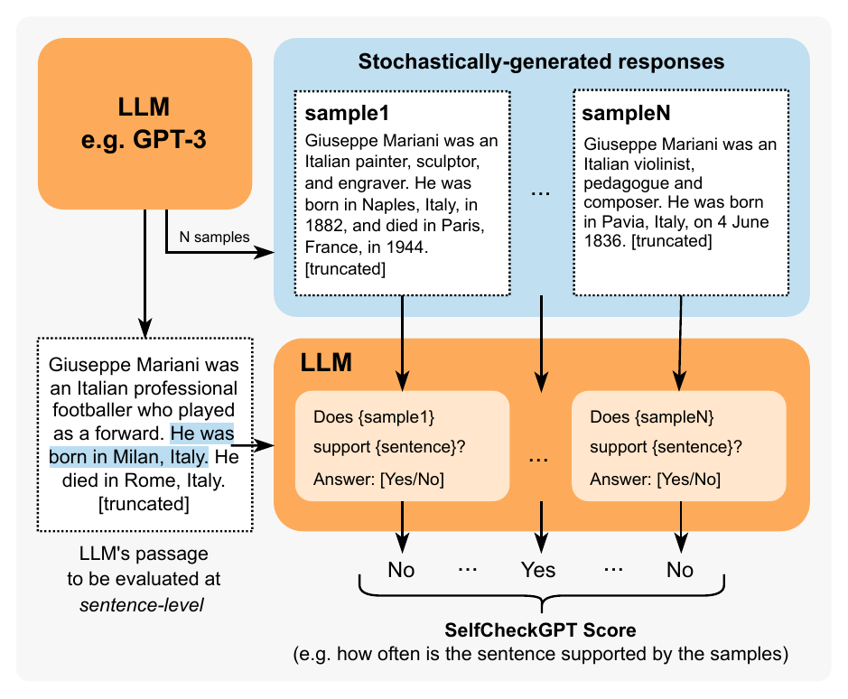
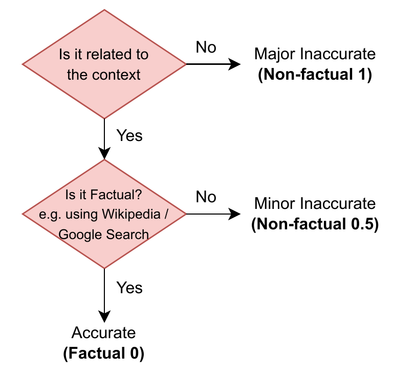
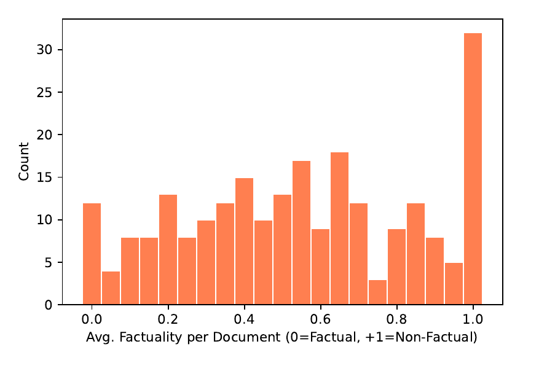
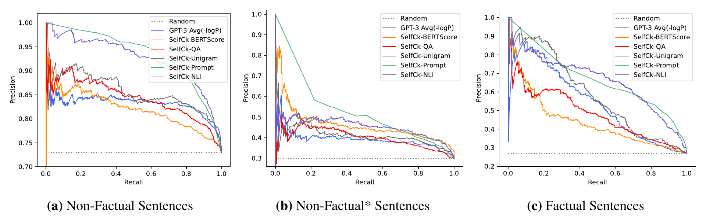
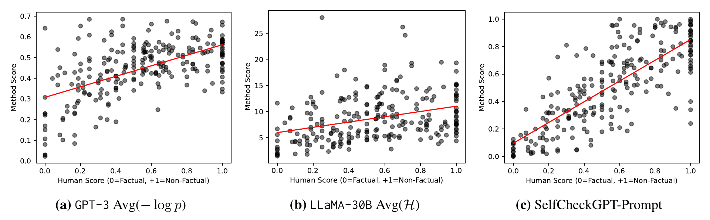
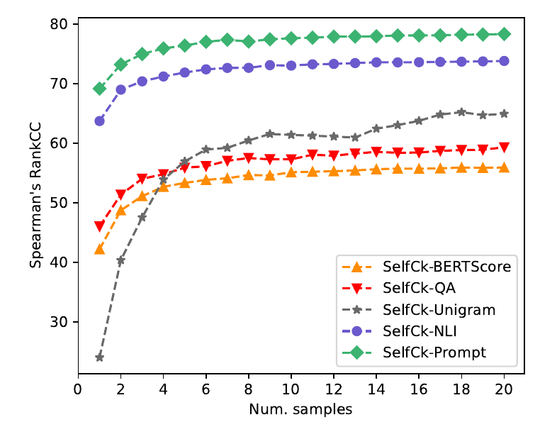
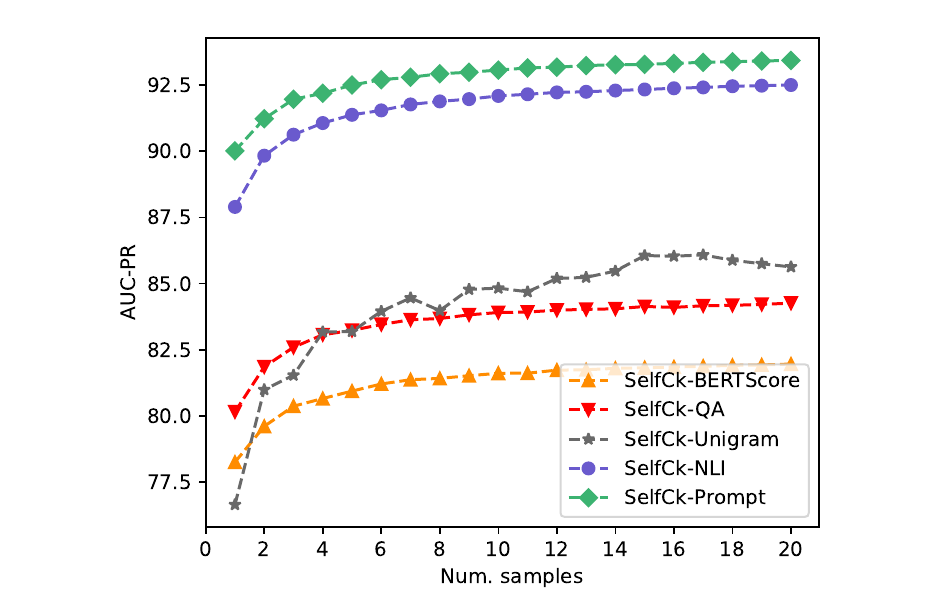
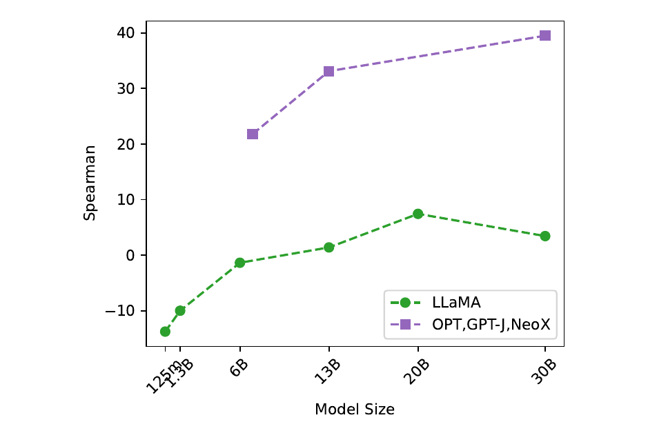
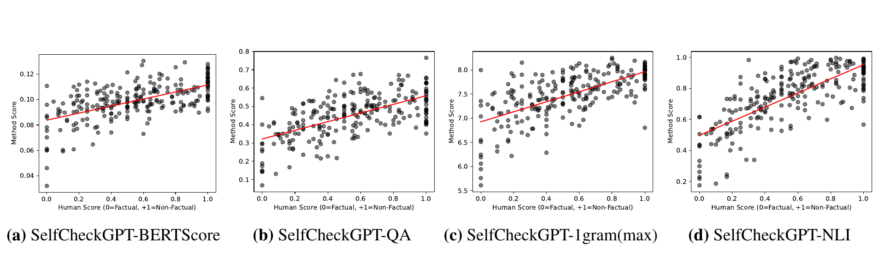

# SelfCheckGPT：生成式大语言模型的零资源黑盒幻觉检测

**原文题目：** SelfCheckGPT: Zero-Resource Black-Box Hallucination Detection for Generative Large Language Models  
**作者：** Potsawee Manakul、Adian Liusie、Mark J. F. Gales  
**单位：** 剑桥大学工程系 ALTA 研究所  
**电子邮箱：** pm574@cam.ac.uk；al826@cam.ac.uk；mjfg@eng.cam.ac.uk  
**会议：** 2023 Conference on Empirical Methods in Natural Language Processing（EMNLP 2023）  
**出版信息：** Association for Computational Linguistics，2023 年 12 月 6-10 日，新加坡，9004-9017 页（共 14 页）  
**DOI：** [10.18653/v1/2023.emnlp-main.557](https://doi.org/10.18653/v1/2023.emnlp-main.557)  
**免费正式版：** [ACL Anthology 论文页面](https://aclanthology.org/2023.emnlp-main.557/)；[全文 PDF](https://aclanthology.org/2023.emnlp-main.557.pdf)  
**代码与数据：** [项目仓库](https://github.com/potsawee/selfcheckgpt)

> 版本与翻译说明：本译文以 ACL Anthology 当前提供的 EMNLP 2023 正式发表 PDF 为底本，并核对了 [arXiv 最新 v3](https://arxiv.org/abs/2303.08896v3)（2023 年 10 月 11 日更新；截至 2026 年 11 月 2 日无更新版本）。除出版页眉页脚和公式符号的文本提取差异外，两版正文、实验结果与附录内容一致。保留原有章节、图表、公式编号和图片相对位置；图内文字使用原图，图题翻译为中文。参考文献和附录保留英文，并转为可编辑的 Markdown 文本、表格与公式。本文中涉及的模型名称、服务界面及价格均按 2023 年原文保留。
>
> 授权与改编：原文 ©2023 Association for Computational Linguistics，依据 [CC BY 4.0](https://creativecommons.org/licenses/by/4.0/) 许可使用（[ACL 授权说明](https://aclanthology.org/faq/copyright/)）。本文件为原文的中文翻译及 Markdown 格式改编，非作者官方译本。

## 摘要

GPT-3 等生成式大语言模型（large language models，LLM）能够针对各种用户提示生成高度流畅的回答。然而，LLM 会编造事实并作出非事实性陈述，这会削弱人们对其输出的信任。现有事实核查方法要么需要访问输出概率分布（ChatGPT 等系统可能不提供此类信息），要么需要通过独立且通常较复杂的模块接入外部数据库。

本文提出 SelfCheckGPT：一种基于采样的简单方法，可以在零资源条件下，即不依赖外部数据库，对黑盒模型的回答进行事实核查。SelfCheckGPT 基于一个简单想法：如果 LLM 掌握某个概念的相关知识，采样得到的回答往往相似，而且所包含的事实相互一致；而对于编造的事实，随机采样得到的回答则容易产生分歧、彼此矛盾。

我们使用 GPT-3 为 WikiBio 数据集中的人物生成介绍段落，并人工标注这些段落的事实性，以研究这一方法。结果表明，SelfCheckGPT 能够：（i）检测非事实性句子和事实性句子；（ii）按照事实性对段落进行排序。我们将其与多个基线进行比较，发现相较于灰盒方法，SelfCheckGPT 在句子级幻觉检测中取得了明显更高的精确率-召回率曲线下面积（AUC-PR），在段落级事实性评估中也取得了更高的相关性分数。[^1]



**图 1** 基于提示的 SelfCheckGPT。在不使用外部数据库的情况下，将 LLM 生成的每个句子与随机生成的回答进行比较。例如，可以像图中所示，使用 LLM 提示来完成比较。

## 1 引言

GPT-3（Brown et al., 2020）和 PaLM（Chowdhery et al., 2022）等大语言模型能够针对多种用户提示，生成流畅且逼真的回答。它们已被用于自动报告撰写工具、虚拟助手和摘要系统等多种应用。尽管 LLM 生成的文本具有说服力且看似真实，其编造事实的倾向仍日益令人担忧。人们普遍观察到，模型会以十分自信的语气生成虚构信息；而能够妥善识别 LLM 幻觉的现有方法却寥寥无几，甚至可能尚不存在。

幻觉检测的一种可能方法，是利用现有的内在不确定性指标，识别系统对输出序列中哪些部分最不确定（Yuan et al., 2021；Fu et al., 2023）。然而，词元概率或熵等不确定性指标需要访问词元级概率分布，而这类信息可能并不向用户开放，例如通过功能受限的外部 API 访问系统时。另一种方法是采用事实验证技术，从外部数据库检索证据，评估某项断言的真实性（Thorne et al., 2018；Guo et al., 2022）。但事实只能相对于数据库中已有的知识进行评估。此外，除纯粹的事实验证外，其他多种任务中也能观察到幻觉（Kryscinski et al., 2020；Maynez et al., 2020）。

本文提出 SelfCheckGPT，一种基于采样的方法，用于检测 LLM 生成的回答是存在幻觉还是符合事实。据我们所知，SelfCheckGPT 是首项分析 LLM 一般性回答中模型幻觉的研究，也是首个可用于黑盒系统的零资源幻觉检测方案。其出发点是：当 LLM 在训练中接触过某个概念时，采样得到的回答往往相似且包含一致的事实；而对于编造的事实，随机采样的回答容易产生分歧，甚至彼此矛盾。通过从 LLM 中采样多个回答，可以衡量不同回答之间的信息一致性，进而判断陈述符合事实还是存在幻觉。

由于 SelfCheckGPT 仅利用采样得到的回答，它还有两个优势：能够用于黑盒模型，无须外部数据库。我们考察了五种用于衡量信息一致性的 SelfCheckGPT 变体：BERTScore、问答、$n$ 元语法、自然语言推断（natural language inference，NLI）和 LLM 提示。通过分析人工标注的 GPT-3 生成文章，我们表明 SelfCheckGPT 是一种非常有效的幻觉检测方法，甚至能够优于灰盒方法，为 LLM 中这一日益重要的问题提供了有力的初始基线。

## 2 背景与相关工作

### 2.1 大语言模型的幻觉

现有研究已考察摘要生成（Huang et al., 2021）、对话生成（Shuster et al., 2021）以及其他多种自然语言生成任务中的幻觉（Ji et al., 2023）。自一致性解码已被证明能够改善思维链提示在复杂推理任务中的表现（Wang et al., 2023）。此外，Liu et al.（2022）提出了一个幻觉检测数据集，但其中的文本是通过扰动事实性文本得到的，因此可能无法反映真实的 LLM 幻觉。

最近，Azaria and Mitchell（2023）训练了一个多层感知机分类器，将 LLM 的隐藏表示作为输入，预测句子的真实性。不过，这是一种白盒方法，需要使用 LLM 的内部状态，而这些状态可能无法通过 API 调用获取；它还需要带标签的数据进行监督训练。另一种近期方法是自我评估（Kadavath et al., 2022），即通过提示让 LLM 评估先前的预测，例如预测其生成的回答或答案为真的概率。

### 2.2 序列级不确定性估计

词元概率已被用于反映模型的确定性。例如，OpenAI 的 GPT-3 网页界面允许用户显示词元概率（如图 2 所示）；对于自回归生成，人们还研究了基于随机不确定性和认知不确定性的其他估计方法（Xiao and Wang, 2021；Malinin and Gales, 2021）。此外，条件语言模型分数也被用于评估文本的性质（Yuan et al., 2021；Fu et al., 2023）。近期提出的语义不确定性方法，用于处理自由形式生成任务中的不确定性：它将概率赋予概念，而不是词元（Kuhn et al., 2023）。


**图 2** OpenAI 的 GPT-3 网页界面示例，其中显示了词元级输出概率。

### 2.3 事实验证

现有事实验证方法采用由断言检测、证据检索和判定预测构成的多阶段流程（Guo et al., 2022；Zhong et al., 2020）。不过，这类方法需要访问外部数据库，并可能带来较高的推理成本。

## 3 灰盒事实性评估

本节介绍在能够完全访问模型输出分布的情况下，如何在零资源条件下判断 LLM 回答的事实性。[^2]

本文用“具有事实性”（factual）表示陈述建立在有效信息之上，也就是避免了幻觉；用“零资源”（zero-resource）表示不使用外部数据库。

### 3.1 基于不确定性的评估

为了理解如何在零资源条件下确定生成回复的事实性，我们先考察大语言模型的预训练过程。预训练时，模型在海量文本语料上接受下一词预测训练。这使模型获得较强的语言理解能力（Jawahar et al., 2019；Raffel et al., 2020）、强大的上下文推理能力（Zhang et al., 2020），以及世界知识（Liusie et al., 2023）。考虑输入 `Lionel Messi is a _`（“莱昂内尔·梅西是一名_”）。由于梅西是世界知名运动员，可能在预训练数据中出现过多次，大语言模型很可能知道梅西是谁。因此，在给定上下文的情况下，词元 `footballer`（“足球运动员”）可能被赋予较高概率，而 `carpenter`（“木匠”）等其他职业则可能被认为不大可能。可是，对于另一种输入，例如 `John Smith is a _`（“约翰·史密斯是一名_”），系统可能无法确定如何续写，从而产生较平坦的概率分布。在推断时，这很可能导致生成不符合事实的词语。

这一认识有助于理解不确定性度量与事实性之间的联系。具有事实性的句子通常包含似然较高、熵较低的词元，而幻觉更可能来自概率分布平坦、不确定性较高的位置。

**词元级概率**

给定大语言模型的回复 $R$，令 $i$ 表示 $R$ 中的第 $i$ 个句子，$j$ 表示第 $i$ 个句子中的第 $j$ 个词元，$J$ 为该句子的词元数，$p_{ij}$ 为大语言模型在第 $i$ 个句子的第 $j$ 个词元位置生成相应词语的概率。本文采用两个概率指标：

$$
\begin{aligned}
\operatorname{Avg}(-\log p)&=-\frac{1}{J}\sum_j\log p_{ij},\\
\operatorname{Max}(-\log p)&=\max_j(-\log p_{ij}).
\end{aligned}
$$

$\operatorname{Max}(-\log p)$ 通过考察句子中概率最低的词元，衡量该句子的似然。

**熵**

输出分布的熵为：

$$
\mathcal H_{ij}=-\sum_{\tilde w\in\mathcal W}p_{ij}(\tilde w)\log p_{ij}(\tilde w),
$$

其中，$p_{ij}(\tilde w)$ 为在第 $i$ 个句子的第 $j$ 个词元位置生成词语 $\tilde w$ 的概率，$\mathcal W$ 为词表中所有可能词语的集合。与基于概率的指标类似，本文采用两个基于熵的指标：

$$
\operatorname{Avg}(\mathcal H)=\frac{1}{J}\sum_j\mathcal H_{ij};
\qquad
\operatorname{Max}(\mathcal H)=\max_j(\mathcal H_{ij}).
$$

## 4 黑盒事实性评估

灰盒方法的一个缺点是需要获取输出词元级概率。虽然这一要求看起来合理，但对于只能通过有限 API 调用访问的超大规模语言模型，用户可能无法获得这类词元级信息，例如 ChatGPT。因此，本文考虑即使只能获得文本回复也仍然适用的黑盒方法。

**代理大语言模型**

一种近似灰盒方法的简单做法，是使用代理大语言模型，也就是另一个我们能够完全访问的大语言模型，例如 LLaMA（Touvron et al., 2023）。代理大语言模型可用于近似生成该文本的黑盒大语言模型所给出的输出词元级概率。下一节提出的 SelfCheckGPT 同样属于黑盒方法。

## 5 SelfCheckGPT

SelfCheckGPT 是本文提出的一种黑盒、零资源幻觉检测方案，通过比较多次采样得到的回复并衡量其一致性来工作。

**符号说明：** 令 $R$ 表示针对给定用户查询生成的一条大语言模型回复。SelfCheckGPT 使用相同的查询，额外随机采样 $N$ 条大语言模型回复 $\{S^1,S^2,\ldots,S^n,\ldots,S^N\}$，随后衡量待评估回复与这些随机样本之间的一致性。我们设计 SelfCheckGPT 来预测第 $i$ 个句子的幻觉得分 $\mathcal S(i)$，使得 $\mathcal S(i)\in[0.0,1.0]$：如果第 $i$ 个句子建立在有效信息之上，则 $\mathcal S(i)\rightarrow0.0$；如果该句子存在幻觉，则 $\mathcal S(i)\rightarrow1.0$。[^3] 以下各小节将介绍 SelfCheckGPT 的不同变体。

### 5.1 基于 BERTScore 的 SelfCheckGPT

令 $\mathcal B(\cdot,\cdot)$ 表示两个句子之间的 BERTScore。基于 BERTScore 的 SelfCheckGPT 先在每个采样回复中，找出与第 $i$ 个句子最相似的句子，再计算这些 BERTScore 的平均值：

$$
\mathcal S_{\mathrm{BERT}}(i)
=1-\frac{1}{N}\sum_{n=1}^{N}\max_k\bigl(\mathcal B(r_i,s_k^n)\bigr).
\tag{1}
$$

其中，$r_i$ 表示 $R$ 中的第 $i$ 个句子，$s_k^n$ 表示第 $n$ 个采样回复 $S^n$ 中的第 $k$ 个句子。这样，如果某个句子中的信息出现在许多采样回复中，就可以认为该信息很可能符合事实；而如果这一陈述没有出现在任何其他样本中，则很可能属于幻觉。本文采用 RoBERTa-Large（Liu et al., 2019）作为 BERTScore 的骨干模型。

### 5.2 基于问答的 SelfCheckGPT

我们还考虑采用自动多项选择问答生成（multiple-choice question answering generation，MQAG）框架（Manakul et al., 2023），为 SelfCheckGPT 衡量一致性。MQAG 根据主要生成回复生成多项选择题，再由一个独立的回答系统，以其他采样回复为条件尝试作答，从而评估一致性。如果问题所涉及的信息是一致的，那么回答系统预期会给出相似答案。MQAG 包含两个阶段：问题生成 $\mathrm G$ 和问题回答 $\mathrm A$。对于回复 $R$ 中的句子 $r_i$，采样问题 $q$ 和选项 $\boldsymbol o$：

$$
q,\boldsymbol o\sim P_{\mathrm G}(q,\boldsymbol o\mid r_i,R).
\tag{2}
$$

回答阶段 $\mathrm A$ 选择答案：

$$
a_R=\operatorname*{argmax}_k\bigl[P_{\mathrm A}(o_k\mid q,R,\boldsymbol o)\bigr],
\tag{3}
$$

$$
a_{S^n}=\operatorname*{argmax}_k\bigl[P_{\mathrm A}(o_k\mid q,S^n,\boldsymbol o)\bigr].
\tag{4}
$$

对于 $\{S^1,\ldots,S^N\}$ 中的每个样本，比较 $a_R$ 与 $a_{S^n}$ 是否相等，得到匹配次数 $N_m$ 和不匹配次数 $N_n$。针对第 $i$ 个句子和问题 $q$，可根据匹配与不匹配次数定义一个简单的不一致性得分：$\mathcal S_{\mathrm{QA}}(i,q)=\frac{N_n}{N_m+N_n}$。为考虑生成问题的可回答性，我们在附录 B 中说明，可通过软计数修改不一致性得分，得到：

$$
\mathcal S_{\mathrm{QA}}(i,q)
=\frac{\gamma_2^{N'_n}}{\gamma_1^{N'_m}+\gamma_2^{N'_n}}.
\tag{5}
$$

其中，$N'_m$ 为有效匹配次数，$N'_n$ 为有效不匹配次数，$\gamma_1$ 和 $\gamma_2$ 的定义见附录 B.1。最终，基于问答的 SelfCheckGPT 得分为对问题 $q$ 的不一致性得分取平均：

$$
\mathcal S_{\mathrm{QA}}(i)=\mathbb E_q\bigl[\mathcal S_{\mathrm{QA}}(i,q)\bigr].
\tag{6}
$$

### 5.3 基于 n-gram 的 SelfCheckGPT

给定大语言模型生成的样本 $\{S^1,\ldots,S^N\}$，可以利用这些样本构建一个新的语言模型，来近似原大语言模型。当 $N$ 足够大时，在极限情况下，这个新语言模型将收敛至生成这些回复的大语言模型。因此，我们可以用新语言模型近似原大语言模型的词元概率。

在实际中，由于时间和／或成本约束，只能获得有限数量的样本 $N$。因此，我们使用样本 $\{S^1,\ldots,S^N\}$ 以及待评估的主要回复 $R$，训练一个简单的 n-gram 模型。需要指出，纳入 $R$ 可以视为一种平滑方法，即将 $R$ 中每个词元的计数增加 1。随后，计算回复 $R$ 中该句子的平均对数概率：

$$
\mathcal S_{\text{n-gram}}^{\mathrm{Avg}}(i)
=-\frac{1}{J}\sum_j\log\tilde p_{ij},
\tag{7}
$$

其中，$\tilde p_{ij}$ 是通过 n-gram 模型计算的概率，即第 $i$ 个句子的第 $j$ 个词元的概率。与灰盒方法类似，我们也可以使用负对数概率的最大值：

$$
\mathcal S_{\text{n-gram}}^{\mathrm{Max}}(i)
=\max_j(-\log\tilde p_{ij}).
\tag{8}
$$

### 5.4 基于 NLI 的 SelfCheckGPT

自然语言推断（Natural Language Inference，NLI）判断一个假设是否可由一个前提推出，并将其分为蕴含、中立或矛盾三类。NLI 度量已被用于衡量摘要的忠实性：Maynez et al.（2020）使用在 MNLI（Williams et al., 2018）上训练的文本蕴含分类器，判断摘要是否与上下文矛盾。受基于 NLI 的摘要评估启发，我们考虑将 NLI 矛盾得分用作 SelfCheckGPT 得分。

对于 SelfCheck-NLI，我们采用在 MNLI 上微调的 DeBERTa-v3-large（He et al., 2023）作为 NLI 模型。NLI 分类器的输入通常由前提与假设拼接而成；在我们的方法中，即将采样段落 $S^n$ 与待评估句子 $r_i$ 拼接。这里只考虑与“蕴含”和“矛盾”类别对应的 logits：

$$
P(\mathrm{contradict}\mid r_i,S^n)
=\frac{\exp(z_c)}{\exp(z_e)+\exp(z_c)},
\tag{9}
$$

其中，$z_e$ 和 $z_c$ 分别为“蕴含”和“矛盾”类别的 logits。这种归一化忽略中立类别，并确保概率位于 0.0 至 1.0 之间。基于 NLI 的 SelfCheckGPT 随后依据各样本 $S^n$ 的得分定义为：

$$
\mathcal S_{\mathrm{NLI}}(i)
=\frac{1}{N}\sum_{n=1}^{N}P(\mathrm{contradict}\mid r_i,S^n).
\tag{10}
$$

### 5.5 基于提示的 SelfCheckGPT

近期研究表明，大语言模型在零样本条件下能够有效评估文档与其摘要之间的信息一致性（Luo et al., 2023）。因此，我们使用以下提示，询问大语言模型第 $i$ 个句子是否得到样本 $S^n$（作为上下文）的支持。

原文提示词：

```text
Context: {}
Sentence: {}
Is the sentence supported by the context above?
Answer Yes or No:
```

中文译文：

```text
上下文：{}
句子：{}
该句子是否得到上述上下文的支持？
请回答 Yes 或 No：
```

初步研究表明，GPT-3（text-davinci-003）在 98% 的情况下会输出 Yes 或 No，其余输出则可设为 N/A。在将第 $i$ 个句子与样本 $S^n$ 比较时，通过映射 {Yes: 0.0, No: 1.0, N/A: 0.5}，将提示得到的输出转换为得分 $x_i^n$。最终不一致性得分计算为：

$$
\mathcal S_{\mathrm{Prompt}}(i)=\frac{1}{N}\sum_{n=1}^{N}x_i^n.
\tag{11}
$$

图 1 展示了 SelfCheckGPT-Prompt。需要指出，我们的初步研究发现，能力较弱的模型，例如 GPT-3（text-curie-001）或 LLaMA，无法通过这样的提示有效进行一致性评估。

## 6 数据与标注

由于目前尚无标准的幻觉检测数据集，我们通过以下步骤评估幻觉检测方法：（1）针对 WikiBio 数据集（Lebret et al., 2016）中的人物／概念，使用 GPT-3 生成合成的维基百科文章；（2）人工逐句标注所生成段落的事实性；（3）评估系统检测幻觉的能力。

WikiBio 数据集中的每条输入都包含关于特定概念的一篇维基百科文章的首段，以及相应的表格信息。我们按段落长度对 WikiBio 测试集排序，并从最长的前 20% 文章中随机采样 238 篇，以确保不会选到过于冷僻的概念。随后，使用提示 `This is a Wikipedia passage about {concept}:`（“这是一段关于 {concept} 的维基百科文字：”），让 GPT-3（text-davinci-003）生成关于相应概念的维基百科文章。表 1 给出了 GPT-3 生成段落的统计信息。

**表 1** WikiBio GPT-3 数据集的统计信息，其中词元数量基于 OpenAI GPT-2 分词器计算。

| 段落数 | 句子数 | 每段词元数 |
|---:|---:|---:|
| 238 | 1908 | $184.7\pm36.9$ |

随后，我们按照图 3 所示准则对生成段落中的句子进行标注，将每个句子分为以下三类之一：

- **严重不准确（Major Inaccurate；不符合事实，1）：** 句子完全属于幻觉，也就是与主题无关。
- **轻微不准确（Minor Inaccurate；不符合事实，0.5）：** 句子包含部分不符合事实的信息，但仍与主题相关。
- **准确（Accurate；符合事实，0）：** 句子中呈现的信息准确。

在 1908 个已标注句子中，761 个（39.9%）被标为严重不准确，631 个（33.1%）被标为轻微不准确，516 个（27.0%）被标为准确。数据集中有 201 个句子由两名不同标注者分别标注。为了为这部分句子获得单一标签，如果两名标注者意见一致，就采用该标签；如果意见不一致，则选择较差情况的标签，例如将 {轻微不准确，严重不准确} 映射为严重不准确。



**图 3：** 本文标注过程的流程图。

以 Cohen 的 $\kappa$（Cohen, 1960）衡量的标注者间一致性，在三分类和二分类情形下的 $\kappa$ 值分别为 0.595 和 0.748，分别表明中等程度和较高程度的一致性（Viera et al., 2005）。[^4]

此外，对每篇段落中的句子级标签取平均，得到段落级分数。图 4 展示了段落级分数的分布，可以观察到在 +1.0 处存在一个明显的峰值。我们将位于这一峰值的样本称为**完全幻觉**（total hallucination）：此时，回答中的信息与真实概念无关，完全由大语言模型编造。



**图 4：** 文档事实性分数的直方图。

## 7 实验

用于生成本文数据集段落的生成式大语言模型是 **GPT-3**（`text-davinci-003`），它在创建和标注数据集时是最先进的系统。为获得主要回答，我们将温度设为 0.0，并采用标准束搜索解码。对于随机生成的样本，我们将温度设为 1.0，生成 $N=20$ 个样本。对于代理大语言模型方法，我们采用 LLaMA（Touvron et al., 2023），它是当时表现最好的开源大语言模型之一。对于 SelfCheckGPT-Prompt，我们同时考虑 GPT-3（与生成段落所用的大语言模型相同）以及新发布的 ChatGPT（`gpt-3.5-turbo`）。关于 SelfCheckGPT 中各系统的更多细节，以及使用其他代理大语言模型的结果，见附录。

### 7.1 句子级幻觉检测

首先，我们研究所提出的幻觉检测方法能否识别句子的事实性。在检测非事实性句子时，将“严重不准确”和“轻微不准确”标签合并为“非事实性”（non-factual）类别，而“事实性”（factual）类别指准确的句子。此外，我们还考虑一个更有挑战性的任务：在不属于完全幻觉的段落中检测严重不准确的句子，将这一任务记为“非事实性*”（non-factual*）。[^5] 图 5 和表 2 展示了本文方法的性能，可以得到以下观察结果。

**1）大语言模型的概率 $p$ 与事实性具有良好的相关性。** 结果表明，概率度量（来自生成这些文本的大语言模型）是评估事实性的强基线。事实性句子识别的精确率-召回率曲线下面积（AUC-PR）达到 53.97，明显优于随机基线的 27.04；同时，幻觉检测的 AUC-PR 也从 72.96 提高到 83.21。这支持了以下假设：当大语言模型对生成的信息不确定时，生成词元通常也具有更高的不确定性，为幻觉检测方法提供了一条有前景的研究方向。此外，概率 $p$ 度量优于基于概率最高的五个词元所计算的熵 $\mathcal H$ 度量。

**2）代理大语言模型的表现明显弱于原大语言模型（GPT-3）。** 基于 LLaMA 的代理大语言模型结果表明，熵 $\mathcal H$ 度量优于概率度量。这说明，使用更丰富的不确定性信息可以改善事实性／幻觉检测的性能，而此前仅使用概率最高的五个词元的熵，很可能并不充分。此外，采用 GPT-NeoX 或 OPT-30B 等其他代理大语言模型时，其性能接近随机基线。我们认为，这种较差表现的原因是，不同大语言模型具有不同的生成模式；因此，当回答与代理大语言模型的生成风格不同时，即使是常见词元也可能具有较低的概率。我们指出，未来研究可以引入 BARTScore（Yuan et al., 2021）之类的加权条件语言模型分数。



**图 5：** 在 GPT-3 生成的 WikiBio 段落中检测非事实性和事实性句子的精确率-召回率曲线。（a）非事实性句子；（b）非事实性*句子；（c）事实性句子。

| 方法 | 句子级 AUC-PR：非事实性 | 句子级 AUC-PR：非事实性* | 句子级 AUC-PR：事实性 | 段落级相关性：Pearson | 段落级相关性：Spearman |
|---|---:|---:|---:|---:|---:|
| 随机 | 72.96 | 29.72 | 27.04 | - | - |
| **GPT-3（`text-davinci-003`）的概率（原大语言模型，灰盒）** | | | | | |
| $\operatorname{Avg}(-\log p)$ | 83.21 | 38.89 | 53.97 | 57.04 | 53.93 |
| $\operatorname{Avg}(\mathcal H)$† | 80.73 | 37.09 | 52.07 | 55.52 | 50.87 |
| $\operatorname{Max}(-\log p)$ | 87.51 | 35.88 | 50.46 | 57.83 | 55.69 |
| $\operatorname{Max}(\mathcal H)$† | 85.75 | 32.43 | 50.27 | 52.48 | 49.55 |
| **LLaMA-30B 的概率（代理大语言模型，黑盒）** | | | | | |
| $\operatorname{Avg}(-\log p)$ | 75.43 | 30.32 | 41.29 | 21.72 | 20.20 |
| $\operatorname{Avg}(\mathcal H)$ | 80.80 | 39.01 | 42.97 | 33.80 | 39.49 |
| $\operatorname{Max}(-\log p)$ | 74.01 | 27.14 | 31.08 | -22.83 | -22.71 |
| $\operatorname{Max}(\mathcal H)$ | 80.92 | 37.32 | 37.90 | 35.57 | 38.94 |
| **SelfCheckGPT（黑盒）** | | | | | |
| 使用 BERTScore | 81.96 | 45.96 | 44.23 | 58.18 | 55.90 |
| 使用 QA | 84.26 | 40.06 | 48.14 | 61.07 | 59.29 |
| 使用一元语法（max） | 85.63 | 41.04 | 58.47 | 64.71 | 64.91 |
| 使用 NLI | 92.50 | 45.17 | 66.08 | 74.14 | 73.78 |
| 使用 Prompt | **93.42** | **53.19** | **67.09** | **78.32** | **78.30** |

**表 2：** 句子级检测任务的 AUC-PR。段落级排序性能通过与人工判断之间的 Pearson 相关系数及 Spearman 秩相关系数衡量。除 LLaMA 以外，其他代理大语言模型的结果见附录。† GPT-3 API 返回概率最高的五个词元的概率，并用它们计算熵。

**3）SelfCheckGPT 优于灰盒方法。** 可以看出，SelfCheckGPT-Prompt 明显优于灰盒方法（包括利用 GPT-3 输出概率的方法），也优于其他黑盒方法。即使是 SelfCheckGPT 的其他变体，包括 BERTScore、QA 和 $n$ 元语法，在大多数设置下也优于灰盒方法。有意思的是，尽管 SelfCheckGPT 的一元语法（max）方法计算开销最低，但它在不同设置下均表现良好。本质上，这种方法在评估一个句子时，会找出给定全部样本后出现次数最少的词元。这说明，如果一个词元在生成样本（$N=20$）中只出现少数几次，或仅出现一次，它很可能属于非事实性内容。

**4）使用 $n$ 元语法的 SelfCheckGPT。** 考察从一元语法到五元语法的性能时，结果表明，直接寻找概率最低的词元／$n$ 元语法，比计算句子的平均 $n$ 元语法分数更有效，详见附录表 7。此外，随着 $n$ 增大，采用 $n$ 元语法（max）的 SelfCheckGPT 性能下降。

**5）使用 NLI 的 SelfCheckGPT。** 基于 NLI 的方法优于所有黑盒和灰盒基线，其性能接近 Prompt 方法。由于采用 Prompt 的 SelfCheckGPT 可能具有较高的计算开销，采用 NLI 的 SelfCheckGPT 可能是最实用的方法，因为它能够在性能与计算开销之间取得良好平衡。



**图 6：** 段落级分数的散点图，纵轴为方法分数，横轴为人工评分。相关系数见表 2。SelfCheckGPT 其他变体的散点图见附录图 10。（a）GPT-3 $\operatorname{Avg}(-\log p)$；（b）LLaMA-30B $\operatorname{Avg}(\mathcal H)$；（c）SelfCheckGPT-Prompt。

### 7.2 段落级事实性排序

此前结果表明，SelfCheckGPT 是一种有效的句子级事实性预测方法。还需要进一步考虑，SelfCheckGPT 能否用于判断段落的整体事实性。段落级事实性分数通过对全部句子的句子级分数取平均得到：

$$
\mathcal S_{\mathrm{passage}}=\frac{1}{|R|}\sum_i\mathcal S(i).
\tag{12}
$$

其中，$\mathcal S(i)$ 是句子级分数，$|R|$ 是段落中的句子数量。由于人工判断具有一定主观性，对句子级标签取平均可以得到噪声更小的真实值。注意，对于 $\operatorname{Avg}(-\log p)$ 和 $\operatorname{Avg}(\mathcal H)$，我们对一个段落中的所有词元取平均；而对于 $\operatorname{Max}(-\log p)$ 和 $\operatorname{Max}(\mathcal H)$，先在句子级对词元取最大值，再按照式（12）对所有句子取平均。

表 2 和图 6 的结果表明，所有 SelfCheckGPT 方法与人工判断的相关性，都远高于其他基线，包括灰盒概率和熵方法。SelfCheckGPT-Prompt 表现最好，获得最高的 Pearson 相关系数 78.32。与预期一致，代理大语言模型方法获得的相关系数再次明显偏低。

### 7.3 消融研究

**外部知识（替代自检查）**

如果可以获取外部知识，就可以衡量大语言模型回答与信息源之间的信息一致性。在这项实验中，我们使用 WikiBio 中各概念所提供的第一段文字。[^6]

| 方法 | 句子级 AUC-PR：非事实性 | 句子级 AUC-PR：非事实性* | 句子级 AUC-PR：事实性 | 段落级：Pearson | 段落级：Spearman |
|---|---:|---:|---:|---:|---:|
| SelfCk-BERT | 81.96 | 45.96 | 44.23 | 58.18 | 55.90 |
| WikiBio+BERT | 81.32 | 40.62 | 49.15 | 58.71 | 55.80 |
| SelfCk-QA | 84.26 | 40.06 | 48.14 | 61.07 | 59.29 |
| WikiBio+QA | 84.18 | 45.40 | 52.03 | 57.26 | 53.62 |
| SelfCk-1gm | 85.63 | 41.04 | 58.47 | 64.71 | 64.91 |
| WikiBio+1gm | 80.43 | 31.47 | 40.53 | 28.67 | 26.70 |
| SelfCk-NLI | 92.50 | 45.17 | 66.08 | 74.14 | 73.78 |
| WikiBio+NLI | 91.18 | 48.14 | 71.61 | 78.84 | 80.00 |
| SelfCk-Prompt | 93.42 | 53.19 | 67.09 | 78.32 | 78.30 |
| WikiBio+Prompt | 93.59 | 65.26 | 73.11 | 85.90 | 86.11 |

**表 3：** 使用 SelfCheckGPT 采样结果与使用外部存储知识时的性能比较。

表 3 的结果表明：首先，使用自身采样结果的 SelfCheckGPT-BERTScore／QA，可以达到与使用参考段落相当甚至更好的性能。其次，当以 WikiBio 段落替代自身采样结果时，采用 $n$ 元语法的 SelfCheckGPT 性能大幅下降。这一失败的原因是，仅靠 WikiBio 参考文本不足以训练一个 $n$ 元语法模型。第三，相比之下，当能够获取检索所得的信息时，采用 NLI／Prompt 的 SelfCheckGPT 可以明显受益。不过，在实践中，为大语言模型生成的每一种可能用例都准备外部数据库，是不可行的。

**样本数量的影响**

尽管基于采样的方法预计会随着采样数量增加而表现更好，但也会带来更高的计算开销。因此，我们研究了样本数量变化时的性能。图 7 的结果表明，随着样本数量增多，SelfCheckGPT 的性能平稳提高，但新增样本带来的收益逐渐减小。采用 $n$ 元语法的 SelfCheckGPT 需要最多的样本，其性能才会达到平台期。



**图 7：** SelfCheckGPT 各方法的段落排序性能（Spearman 秩相关系数）随样本数量的变化。

**SelfCheckGPT-Prompt 中大语言模型的选择**

我们研究生成文本的大语言模型能否检查它自己生成的文本。该消融实验使用较少的样本（$N=4$）。

| 文本生成模型 | SelfCk-Prompt 评估模型／比较方法 | $N$ | Pearson | Spearman |
|---|---|---:|---:|---:|
| GPT-3 | ChatGPT | 20 | 78.32 | 78.30 |
| GPT-3 | ChatGPT | 4 | 76.47 | 76.41 |
| GPT-3 | GPT-3 | 4 | 73.11 | 74.69 |
| - | † SelfCheck，一元语法（max） | 20 | 64.71 | 64.91 |
| - | † SelfCheck，NLI | 20 | 74.14 | 73.78 |

**表 4：** 在 SelfCheckGPT-Prompt 中，以 GPT-3（`text-davinci-003`）和 ChatGPT（`gpt-3.5.turbo`）作为基于提示的文本评估器时的比较。† 摘自表 2，用于比较。

表 4 的结果表明，GPT-3 能够检查自身生成的文本，即使仅使用四个样本，也优于一元语法方法。不过，在判断句子是否得到上下文支持时，ChatGPT 比 GPT-3 略有提升。更多细节见附录 C。

## 8 结论

本文首次研究面向通用大语言模型回答的幻觉检测任务。我们提出了 SelfCheckGPT，这是一种无须外部资源、可用于任意黑盒大语言模型的零资源方法，并验证了该方法的有效性。在句子级和段落级两个层面，SelfCheckGPT 均优于所考察的一系列灰盒与黑盒检测基线。此外，我们发布了一个带有句子级事实性标签的 GPT-3 幻觉检测标注数据集。

## 局限性

本研究中的 238 篇 GPT-3 生成文本，主要是关于 WikiBio 数据集中的人物的段落。为了进一步研究大语言模型幻觉的性质，可以将本研究扩展到更广泛的概念，例如生成关于地点和物体的文本。此外，本文在句子级考察事实性，但一个句子可能同时包含事实性和非事实性信息。例如，后续的 Min et al.（2023）通过将句子分解为原子事实，开展细粒度事实性评估。最后，采用 Prompt 的 SelfCheckGPT 虽然明显是表现最好的自检查方法，但计算开销较高。这可能使实际计算成本难以接受，未来工作可以对此加以改进，提高效率。

## 伦理声明

本文研究大语言模型的幻觉问题。我们指出，如果未能检测到幻觉内容，这些内容可能造成错误信息传播。

## 致谢

本研究得到剑桥大学出版社与考评院（Cambridge University Press & Assessment，CUP&A；剑桥大学法人团体 The Chancellor, Masters, and Scholars of the University of Cambridge 的一个部门）以及剑桥英联邦、欧洲与国际信托基金（Cambridge Commonwealth, European & International Trust）的支持。我们感谢匿名审稿人提出的有益意见。

## 参考文献（英文原文）

- Amos Azaria and Tom Mitchell. 2023. The internal state of an llm knows when its lying. arXiv preprint arXiv:2304.13734.

- Iz Beltagy, Matthew E. Peters, and Arman Cohan. 2020. Longformer: The long-document transformer.

- Sidney Black, Stella Biderman, Eric Hallahan, Quentin Anthony, Leo Gao, Laurence Golding, Horace He, Connor Leahy, Kyle McDonell, Jason Phang, Michael Pieler, Usvsn Sai Prashanth, Shivanshu Purohit, Laria Reynolds, Jonathan Tow, Ben Wang, and Samuel Weinbach. 2022. GPT-NeoX-20B: An open-source autoregressive language model. In Proceedings of BigScience Episode #5 – Workshop on Challenges & Perspectives in Creating Large Language Models, pages 95–136, virtual+Dublin. Association for Computational Linguistics.

- Tom Brown, Benjamin Mann, Nick Ryder, Melanie Subbiah, Jared D Kaplan, Prafulla Dhariwal, Arvind Neelakantan, Pranav Shyam, Girish Sastry, Amanda Askell, et al. 2020. Language models are few-shot learners. Advances in neural information processing systems, 33:1877–1901.

- Aakanksha Chowdhery, Sharan Narang, Jacob Devlin, Maarten Bosma, Gaurav Mishra, Adam Roberts, Paul Barham, Hyung Won Chung, Charles Sutton, Sebastian Gehrmann, et al. 2022. Palm: Scaling language modeling with pathways. arXiv preprint arXiv:2204.02311.

- Jacob Cohen. 1960. A coefficient of agreement for nominal scales. Educational and Psychological Measurement, 20:37 – 46.

- Jinlan Fu, See-Kiong Ng, Zhengbao Jiang, and Pengfei Liu. 2023. Gptscore: Evaluate as you desire.

- Zhijiang Guo, Michael Schlichtkrull, and Andreas Vlachos. 2022. A survey on automated fact-checking. Transactions of the Association for Computational Linguistics, 10:178–206.

- Pengcheng He, Jianfeng Gao, and Weizhu Chen. 2023. DeBERTav3: Improving deBERTa using ELECTRA-style pre-training with gradient-disentangled embedding sharing. In The Eleventh International Conference on Learning Representations.

- Yichong Huang, Xiachong Feng, Xiaocheng Feng, and Bing Qin. 2021. The factual inconsistency problem in abstractive text summarization: A survey.

- Ganesh Jawahar, Benoît Sagot, and Djamé Seddah. 2019. What does BERT learn about the structure of language? In Proceedings of the 57th Annual Meeting of the Association for Computational Linguistics, pages 3651–3657, Florence, Italy. Association for Computational Linguistics.

- Ziwei Ji, Nayeon Lee, Rita Frieske, Tiezheng Yu, Dan Su, Yan Xu, Etsuko Ishii, Ye Jin Bang, Andrea Madotto, and Pascale Fung. 2023. Survey of hallucination in natural language generation. ACM Comput. Surv., 55(12).

- Saurav Kadavath, Tom Conerly, Amanda Askell, Tom Henighan, Dawn Drain, Ethan Perez, Nicholas Schiefer, Zac Hatfield Dodds, Nova DasSarma, Eli Tran-Johnson, et al. 2022. Language models (mostly) know what they know. arXiv preprint arXiv:2207.05221.

- Wojciech Kryscinski, Bryan McCann, Caiming Xiong, and Richard Socher. 2020. Evaluating the factual consistency of abstractive text summarization. In Proceedings of the 2020 Conference on Empirical Methods in Natural Language Processing (EMNLP), pages 9332–9346, Online. Association for Computational Linguistics.

- Lorenz Kuhn, Yarin Gal, and Sebastian Farquhar. 2023. Semantic uncertainty: Linguistic invariances for uncertainty estimation in natural language generation. In The Eleventh International Conference on Learning Representations.

- Guokun Lai, Qizhe Xie, Hanxiao Liu, Yiming Yang, and Eduard Hovy. 2017. RACE: Large-scale ReAding comprehension dataset from examinations. In Proceedings of the 2017 Conference on Empirical Methods in Natural Language Processing, pages 785– 794, Copenhagen, Denmark. Association for Computational Linguistics.

- Rémi Lebret, David Grangier, and Michael Auli. 2016. Generating text from structured data with application to the biography domain. CoRR, abs/1603.07771.

- Tianyu Liu, Yizhe Zhang, Chris Brockett, Yi Mao, Zhifang Sui, Weizhu Chen, and Bill Dolan. 2022. A token-level reference-free hallucination detection benchmark for free-form text generation. In Proceedings of the 60th Annual Meeting of the Association for Computational Linguistics (Volume 1: Long Papers), pages 6723–6737, Dublin, Ireland. Association for Computational Linguistics.

- Yinhan Liu, Myle Ott, Naman Goyal, Jingfei Du, Mandar Joshi, Danqi Chen, Omer Levy, Mike Lewis, Luke Zettlemoyer, and Veselin Stoyanov. 2019. Roberta: A robustly optimized bert pretraining approach. arXiv preprint arXiv:1907.11692.

- Adian Liusie, Vatsal Raina, and Mark Gales. 2023. “world knowledge” in multiple choice reading comprehension. In Proceedings of the Sixth Fact Extraction and VERification Workshop (FEVER), pages 49–57, Dubrovnik, Croatia. Association for Computational Linguistics.

- Zheheng Luo, Qianqian Xie, and Sophia Ananiadou. 2023. Chatgpt as a factual inconsistency evaluator for abstractive text summarization. arXiv preprint arXiv:2303.15621.

- Andrey Malinin and Mark Gales. 2021. Uncertainty estimation in autoregressive structured prediction. In International Conference on Learning Representations.

- Potsawee Manakul, Adian Liusie, and Mark JF Gales. 2023. MQAG: Multiple-choice question answering and generation for assessing information consistency in summarization. arXiv preprint arXiv:2301.12307.

- Joshua Maynez, Shashi Narayan, Bernd Bohnet, and Ryan McDonald. 2020. On faithfulness and factuality in abstractive summarization. In Proceedings of the 58th Annual Meeting of the Association for Computational Linguistics, pages 1906–1919, Online. Association for Computational Linguistics.

- Sewon Min, Kalpesh Krishna, Xinxi Lyu, Mike Lewis, Wen-tau Yih, Pang Wei Koh, Mohit Iyyer, Luke Zettlemoyer, and Hannaneh Hajishirzi. 2023. Factscore: Fine-grained atomic evaluation of factual precision in long form text generation. arXiv preprint arXiv:2305.14251.

- Colin Raffel, Noam Shazeer, Adam Roberts, Katherine Lee, Sharan Narang, Michael Matena, Yanqi Zhou, Wei Li, and Peter J Liu. 2020. Exploring the limits of transfer learning with a unified text-to-text transformer. The Journal of Machine Learning Research, 21(1):5485–5551.

- Vatsal Raina and Mark Gales. 2022. Answer uncertainty and unanswerability in multiple-choice machine reading comprehension. In Findings of the Association for Computational Linguistics: ACL 2022, pages 1020–1034, Dublin, Ireland. Association for Computational Linguistics.

- Pranav Rajpurkar, Jian Zhang, Konstantin Lopyrev, and Percy Liang. 2016. SQuAD: 100,000+ questions for machine comprehension of text. In Proceedings of the 2016 Conference on Empirical Methods in Natural Language Processing, pages 2383–2392, Austin, Texas. Association for Computational Linguistics.

- Kurt Shuster, Spencer Poff, Moya Chen, Douwe Kiela, and Jason Weston. 2021. Retrieval augmentation reduces hallucination in conversation. In Findings of the Association for Computational Linguistics: EMNLP 2021, pages 3784–3803, Punta Cana, Dominican Republic. Association for Computational Linguistics.

- James Thorne, Andreas Vlachos, Oana Cocarascu, Christos Christodoulopoulos, and Arpit Mittal. 2018. The Fact Extraction and VERification (FEVER) shared task. In Proceedings of the First Workshop on Fact Extraction and VERification (FEVER).

- Hugo Touvron, Thibaut Lavril, Gautier Izacard, Xavier Martinet, Marie-Anne Lachaux, Timothée Lacroix, Baptiste Rozière, Naman Goyal, Eric Hambro, Faisal Azhar, et al. 2023. Llama: Open and efficient foundation language models. arXiv preprint arXiv:2302.13971.

- Anthony J Viera, Joanne M Garrett, et al. 2005. Understanding interobserver agreement: the kappa statistic. Fam med, 37(5):360–363.

- Ben Wang and Aran Komatsuzaki. 2021. GPT-J-6B: A 6 Billion Parameter Autoregressive Language Model. [https://github.com/kingoflolz/mesh-transformer-jax](https://github.com/kingoflolz/mesh-transformer-jax).

- Xuezhi Wang, Jason Wei, Dale Schuurmans, Quoc V Le, Ed H. Chi, Sharan Narang, Aakanksha Chowdhery, and Denny Zhou. 2023. Self-consistency improves chain of thought reasoning in language models. In The Eleventh International Conference on Learning Representations.

- Adina Williams, Nikita Nangia, and Samuel Bowman. 2018. A broad-coverage challenge corpus for sentence understanding through inference. In Proceedings of the 2018 Conference of the North American Chapter of the Association for Computational Linguistics: Human Language Technologies, Volume 1 (Long Papers), pages 1112–1122, New Orleans, Louisiana. Association for Computational Linguistics.

- Yijun Xiao and William Yang Wang. 2021. On hallucination and predictive uncertainty in conditional language generation. In Proceedings of the 16th Conference of the European Chapter of the Association for Computational Linguistics: Main Volume, pages 2734–2744, Online. Association for Computational Linguistics.

- Weizhe Yuan, Graham Neubig, and Pengfei Liu. 2021. Bartscore: Evaluating generated text as text generation. Advances in Neural Information Processing Systems, 34:27263–27277.

- Susan Zhang, Stephen Roller, Naman Goyal, Mikel Artetxe, Moya Chen, Shuohui Chen, Christopher Dewan, Mona Diab, Xian Li, Xi Victoria Lin, et al. 2022. Opt: Open pre-trained transformer language models. arXiv preprint arXiv:2205.01068.

- Zhuosheng Zhang, Yuwei Wu, Hai Zhao, Zuchao Li, Shuailiang Zhang, Xi Zhou, and Xiang Zhou. 2020. Semantics-aware bert for language understanding. In Proceedings of the AAAI Conference on Artificial Intelligence, volume 34, pages 9628–9635.

- Wanjun Zhong, Jingjing Xu, Duyu Tang, Zenan Xu, Nan Duan, Ming Zhou, Jiahai Wang, and Jian Yin. 2020. Reasoning over semantic-level graph for fact checking. In Proceedings of the 58th Annual Meeting of the Association for Computational Linguistics, pages 6170–6180, Online. Association for Computational Linguistics.

## 附录（英文原文）

## A Models and Implementation

### A.1 Entropy

The entropy of the output distribution is implemented as follows,

$$
\mathcal H_{ij}=2^{-\sum_{\tilde w\in\mathcal W}p_{ij}(\tilde w)\log_2 p_{ij}(\tilde w)}
\tag{13}
$$

where $\mathcal W$ is the set of all possible words in the vocabulary.

### A.2 Proxy LLMs

The proxy LLMs considered are LLaMA-{7B, 13B, 30B} (Touvron et al., 2023), OPT-{125m, 1.3B, 13B, 30B} (Zhang et al., 2022), GPT-J-6B (Wang and Komatsuzaki, 2021) and GPT-NeoX-20B (Black et al., 2022).

### A.3 SelfCheckGPT’s Systems

**Question Answering:** The generation systems G1 and G2 are T5-Large fine-tuned to SQuAD (Rajpurkar et al., 2016) and RACE (Lai et al., 2017), respectively. The answering system A is Longformer (Beltagy et al., 2020) fine-tuned to the RACE dataset. The answerability system U is also Longformer, but fine-tuned to SQuAD2.0.

**LLM for Prompting:** We consider two LLMs, GPT-3 (text-davinci-003) and ChatGPT (gpt-3.5-turbo) We note that during the data creation and annotation, GPT-3 (text-davinci-003) was the state-of-the-art LLM available; hence, GPT-3 was used as the main LLM generating WikiBio passages.

## B SelfCheckGPT with QA

Previous work showed that implementing question generation (in Equation 2) with two generators (G1 generates the question and associated answer, and G2 generates distractors) yields higher-quality distractors (Manakul et al., 2023). Thus, a two-stage generation is adopted in this work as follows:

$$
q,a\sim P_{G1}(q,a\mid r_i);\quad
\boldsymbol o_{\setminus a}\sim P_{G2}(\boldsymbol o_{\setminus a}\mid q,a,R)
\tag{14}
$$

where $\boldsymbol o=\{a,\boldsymbol o_{\setminus a}\}=\{o_1,\ldots,o_4\}$. In addition, to filter out bad (unanswerable) questions, we define an answerability score (Raina and Gales, 2022):

$$
\alpha=P_U(\mathrm{answerable}\mid q,\mathrm{context})
\tag{15}
$$

where the context is either the response $R$ or sampled passages $S^n$, and $\alpha\to0.0$ for unanswerable and $\alpha\to1.0$ for answerable. We use $\alpha$ to filter out unanswerable questions which have $\alpha$ lower than a threshold. Next, we derive how Bayes’ theorem can be applied to take into account the number of answerable/unanswerable questions.

### B.1 SelfCheckGPT-QA with Bayes

Let $P(\mathrm F)$ denote the probability of the $i$-th sentence being non-factual, and $P(\mathrm T)$ denote the probability of the $i$-th sentence being factual. For a question $q$, the probability of $i$-th sentence being non-factual given a set of matched answers $L_m$ and a set of not-matched answers $L_n$ is:

$$
\begin{aligned}
P(\mathrm F\mid L_m,L_n)
&=\frac{P(L_m,L_n\mid\mathrm F)P(\mathrm F)}
{P(L_m,L_n\mid\mathrm F)P(\mathrm F)+P(L_m,L_n\mid\mathrm T)P(\mathrm T)}\\
&=\frac{P(L_m,L_n\mid\mathrm F)}
{P(L_m,L_n\mid\mathrm F)+P(L_m,L_n\mid\mathrm T)}
\end{aligned}
\tag{16}
$$

where we assume the sentence is equally likely to be False or True, i.e. $P(\mathrm F)=P(\mathrm T)$. The probability of observing $L_m,L_n$ when the sentence is False (non-factual):

$$
\begin{aligned}
P(L_m,L_n\mid\mathrm F)
&=\prod_{a\in L_m}P(a=a_R\mid\mathrm F)
\prod_{a'\in L_n}P(a'\ne a_R\mid\mathrm F)\\
&=(1-\beta_1)^{N_m}(\beta_1)^{N_n}
\end{aligned}
\tag{17}
$$

and probability of observing $L_m,L_n$ when the sentence is True (factual):

$$
\begin{aligned}
P(L_m,L_n\mid\mathrm T)
&=\prod_{a\in L_m}P(a=a_r\mid\mathrm T)
\prod_{a'\in L_n}P(a'\ne a_r\mid\mathrm T)\\
&=(\beta_2)^{N_m}(1-\beta_2)^{N_n}
\end{aligned}
\tag{18}
$$

where $N_m$ and $N_n$ are the number of matched answers and the number of not-matched answers, respectively. Hence, we can simplify Equation 16:

$$
P(\mathrm F\mid L_m,L_n)=\frac{\gamma_2^{N_n}}{\gamma_1^{N_m}+\gamma_2^{N_n}}
\tag{19}
$$

where $\gamma_1=\frac{\beta_2}{1-\beta_1}$ and $\gamma_2=\frac{\beta_1}{1-\beta_2}$. Lastly, instead of rejecting samples having an answerability score below a threshold,[^scgpt-7] we find empirically that soft-counting (defined below) improves the detection performance. We set both $\beta_1$ and $\beta_2$ to 0.8.

$$
N'_m=\sum_{n\ \mathrm{s.t.}\ a_n\in L_m}\alpha_n;
\quad N'_n=\sum_{n\ \mathrm{s.t.}\ a_n\in L_n}\alpha_n
\tag{20}
$$

where $\alpha_n=P_U(\mathrm{answerable}\mid q,S^n)$. Therefore, the SelfCheckGPT with QA score, $\mathcal S_{\mathrm{QA}}$, is:

$$
\mathcal S_{\mathrm{QA}}=P(\mathrm F\mid L_m,L_n)
=\frac{\gamma_2^{N'_n}}{\gamma_1^{N'_m}+\gamma_2^{N'_n}}
\tag{21}
$$

In Table 5, we show empically that applying Bayes’ theorem and soft counting $\alpha$ (in Equation 20) improves the performance of the SelfCheckGPT with QA method.

| Varaint | Sentence-lvl: NoF | Sentence-lvl: NoF* | Sentence-lvl: Fact | Passage-lvl: PCC | Passage-lvl: SCC |
|---|---:|---:|---:|---:|---:|
| SimpleCount | 83.97 | 40.07 | 47.78 | 57.39 | 55.15 |
| + Bayes | 83.04 | 38.58 | 47.41 | 56.43 | 55.03 |
| + Bayes + $\alpha$ | 84.26 | 40.06 | 48.14 | 61.07 | 59.29 |

**Table 5:** Performance of SelfCheckGPT-QA’s variants.

## C SelfCheckGPT with Prompt

We use the prompt template provided in the main text (in Section 5.5) for both GPT-3 (text-davinci-003) and ChatGPT (gpt-3.5-turbo). For ChatGPT, a standard system message `You are a helpful assistant.` is used in setting up the system.

At the time of conducting experiments, the API costs per 1,000 tokens are \$0.020 for GPT-3 and \$0.002 for ChatGPT. The estimated costs for running the models to answer Yes/No on all 1908 sentences and 20 samples are around \$200 for GPT-3 and \$20 for ChatGPT. Given the cost, we conduct the experiments on 4 samples when performing the ablation about LLM choice for SelfCheckGPT-Prompt (Section 7.3). Table 6 shows the breakdown of predictions made by GPT-3 and ChatGPT.

| GPT-3 \ ChatGPT | Yes | No |
|---|---:|---:|
| Yes | 3179 | 1038 |
| No | 367 | 3048 |

**Table 6:** Breakdown of predictions made by GPT-3/ChatGPT when prompted to answer Yes(supported)/No(not-supported).

## D Additional Experimental Results

Here, we provide experimental results that are complementary to those presented in the main paper.

| $n$-gram | Sent-lvl AUC-PR: NoFac | Sent-lvl AUC-PR: NoFac* | Sent-lvl AUC-PR: Fact | Passage-lvl: Pear. | Passage-lvl: Spear. |
|---|---:|---:|---:|---:|---:|
| **Avg($-\log p$)** | | | | | |
| 1-gram | 81.52 | 40.33 | 41.76 | 40.68 | 39.22 |
| 2-gram | 82.94 | 44.38 | 52.81 | 58.84 | 58.11 |
| 3-gram | 83.56 | 44.64 | 53.99 | 62.21 | 63.00 |
| 4-gram | 83.80 | 43.55 | 54.25 | 61.98 | 63.64 |
| 5-gram | 83.45 | 42.31 | 53.98 | 60.68 | 62.96 |
| **Max($-\log p$)** | | | | | |
| 1-gram | 85.63 | 41.04 | 58.47 | 64.71 | 64.91 |
| 2-gram | 85.26 | 39.29 | 58.29 | 62.48 | 66.04 |
| 3-gram | 84.97 | 37.10 | 57.08 | 57.34 | 60.49 |
| 4-gram | 84.49 | 36.37 | 55.96 | 55.77 | 57.25 |
| 5-gram | 84.12 | 36.19 | 54.89 | 54.84 | 55.97 |

**Table 7:** The performance using different $n$-gram models in the SelfCheckGPT with $n$-gram method.



**Figure 8:** The performance of SelfCheckGPT methods on sentence-level non-factual detection (AUC-PR) versus the number of samples. This Figure extends the passage-level results in Figure 7.



**Figure 9:** Passage-level ranking performance of the Avg($\mathcal H$) method using proxy LLM where the sizes are: LLaMA={7B, 13B, 30B}, OPT={125m, 1.3B, 13B, 30B}, GPT-J=6B, NeoX=20B. The full results are provided in Table 8.



**Figure 10:** Scatter plot of passage-level scores where Y-axis = Method scores, X-axis = Human scores. Correlations are reported in Table 2. This figure provides results in addition to Figure 6. Subplots: (a) SelfCheckGPT-BERTScore; (b) SelfCheckGPT-QA; (c) SelfCheckGPT-1gram(max); (d) SelfCheckGPT-NLI.

| LLM | Size | Sentence-level (AUC-PR): NonFact | Sentence-level (AUC-PR): NonFact* | Sentence-level (AUC-PR): Factual | Passage-level (Corr.): Pearson | Passage-level (Corr.): Spearman |
|---|---|---:|---:|---:|---:|---:|
| Random | - | 72.96 | 29.72 | 27.04 | - | - |
| **Avg($-\log p$) Method** | | | | | | |
| LLaMA | 30B | 75.43 | 30.32 | 41.29 | 21.72 | 20.20 |
| LLaMA | 13B | 74.16 | 30.01 | 37.36 | 13.33 | 12.89 |
| LLaMA | 7B | 71.69 | 27.87 | 31.30 | -2.71 | -2.59 |
| OPT | 30B | 67.70 | 24.43 | 25.04 | -32.07 | -31.45 |
| NeoX | 20B | 69.00 | 24.38 | 26.18 | -31.79 | -34.15 |
| OPT | 13B | 67.46 | 24.39 | 25.20 | -33.05 | -32.79 |
| GPT-J | 6B | 67.51 | 24.28 | 24.26 | -38.80 | -40.05 |
| OPT | 1.3B | 66.19 | 24.47 | 23.47 | -35.20 | -38.95 |
| OPT | 125m | 66.63 | 25.31 | 23.07 | -30.38 | -37.54 |
| **Avg($\mathcal H$) Method** | | | | | | |
| LLaMA | 30B | 80.80 | 39.01 | 42.97 | 33.80 | 39.49 |
| LLaMA | 13B | 80.63 | 38.98 | 40.59 | 29.43 | 33.12 |
| LLaMA | 7B | 78.67 | 37.22 | 33.81 | 19.44 | 21.79 |
| OPT | 30B | 77.13 | 33.67 | 29.55 | -0.43 | 3.43 |
| NeoX | 20B | 77.40 | 32.78 | 30.13 | 5.41 | 7.43 |
| OPT | 13B | 76.93 | 33.71 | 29.68 | 0.25 | 1.39 |
| GPT-J | 6B | 76.15 | 33.29 | 28.30 | -2.50 | -1.37 |
| OPT | 1.3B | 74.05 | 31.91 | 26.33 | -10.59 | -10.00 |
| OPT | 125m | 71.51 | 30.88 | 25.36 | -14.16 | -13.76 |
| **Max($-\log p$) Method** | | | | | | |
| LLaMA | 30B | 74.01 | 27.14 | 31.08 | -22.83 | -22.71 |
| LLaMA | 13B | 71.12 | 26.78 | 28.82 | -34.93 | -31.70 |
| LLaMA | 7B | 69.57 | 25.91 | 26.54 | -42.57 | -38.24 |
| OPT | 30B | 67.32 | 24.40 | 24.32 | -49.51 | -45.50 |
| NeoX | 20B | 67.51 | 23.88 | 24.82 | -47.96 | -44.54 |
| OPT | 13B | 67.36 | 24.67 | 24.46 | -50.15 | -44.42 |
| GPT-J | 6B | 67.58 | 23.94 | 23.93 | -51.23 | -47.68 |
| OPT | 1.3B | 68.16 | 25.85 | 24.66 | -45.60 | -42.39 |
| OPT | 125m | 69.23 | 27.66 | 24.14 | -39.22 | -37.18 |
| **Max($\mathcal H$) Method** | | | | | | |
| LLaMA | 30B | 80.92 | 37.32 | 37.90 | 35.57 | 38.94 |
| LLaMA | 13B | 80.98 | 37.94 | 36.01 | 32.07 | 34.01 |
| LLaMA | 7B | 79.65 | 35.57 | 31.32 | 22.10 | 22.53 |
| OPT | 30B | 76.58 | 33.44 | 29.31 | 1.63 | 6.41 |
| NeoX | 20B | 76.98 | 31.96 | 29.13 | 5.97 | 9.31 |
| OPT | 13B | 76.26 | 32.81 | 29.25 | 1.42 | 2.82 |
| GPT-J | 6B | 75.30 | 32.51 | 28.13 | -2.14 | 1.41 |
| OPT | 1.3B | 73.79 | 31.42 | 26.38 | -9.84 | -9.80 |
| OPT | 125m | 71.32 | 31.65 | 25.36 | -18.05 | -17.37 |

**Table 8:** AUC-PR for Detecting Non-Factual and Factual Sentences in the GPT-3 generated WikiBio passages. Passage-level PCC and SCC with LLMs used to assess GPT-3 responses. This table is an extension to Table 2.

## 注释

[^1]: 代码和数据集可在[项目页面](https://github.com/potsawee/selfcheckgpt)获取。

[^2]: Azaria and Mitchell（2023）等其他白盒方法需要访问完整的内部状态，实用性较低，因此本文不予考虑。

[^3]: 基于 n-gram 的 SelfCheckGPT 是一个例外，因为 n-gram 语言模型的得分没有上述取值边界。

[^4]: 三分类指在“准确”“轻微不准确”“严重不准确”之间进行选择；二分类指将“轻微不准确”和“严重不准确”合并为一个标签。

[^5]: 非事实性*设置包含 206 篇段落（1632 个句子）。

[^6]: 此方法不再属于零资源方法，因为它需要从外部数据中检索相关知识。

[^scgpt-7]: $\alpha$ is between 0.0 (unanswerable) and 1.0 (answerable). Standard-counting $N_m$ and $N_n$ can be considered as a special case of soft-counting where $\alpha$ is set to 1.0 if $\alpha$ is greater than the answerability threshold and otherwise $\alpha$ is 0.0.
