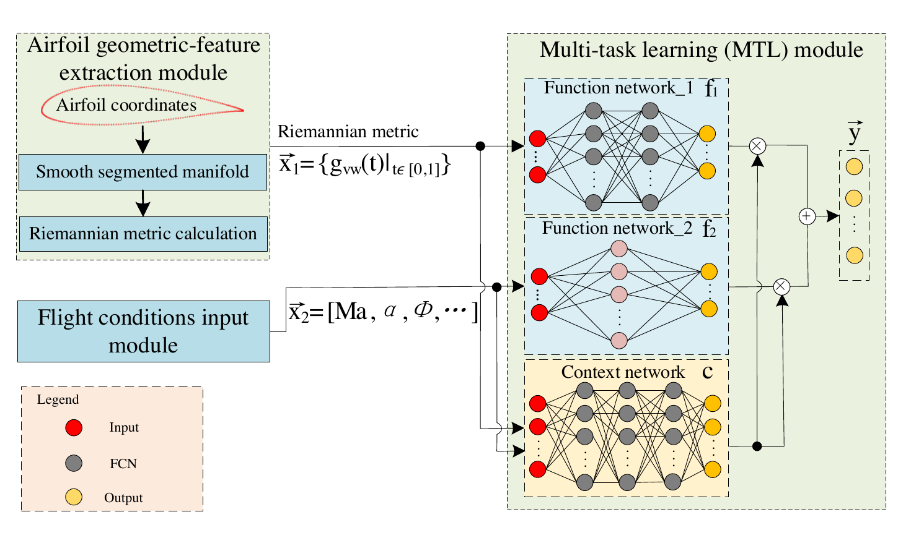
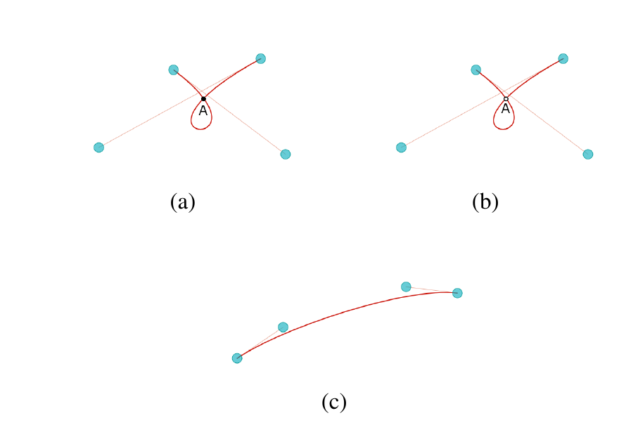
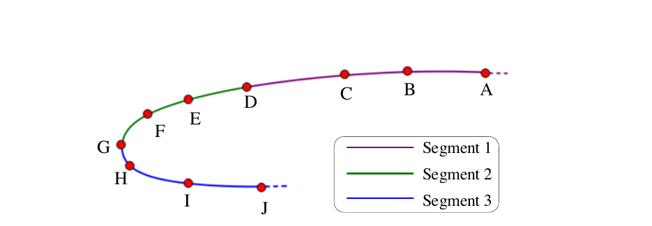
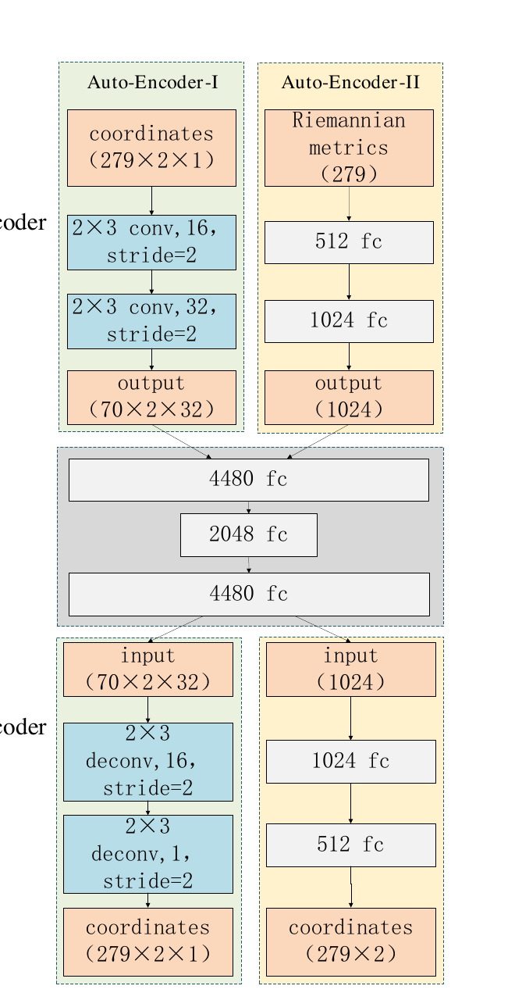
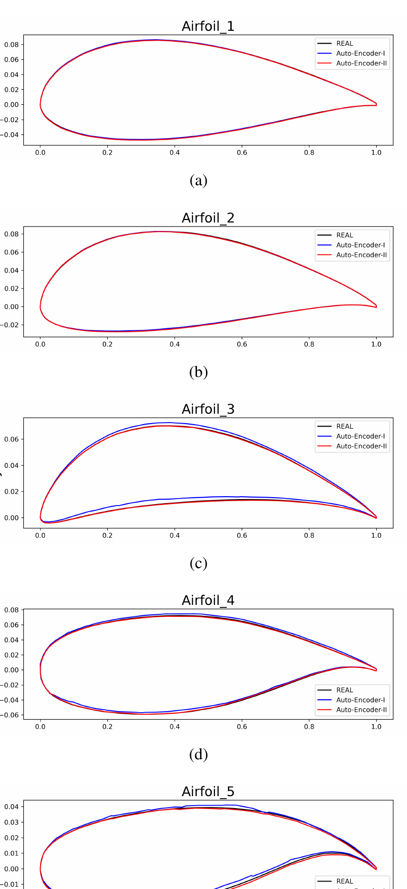
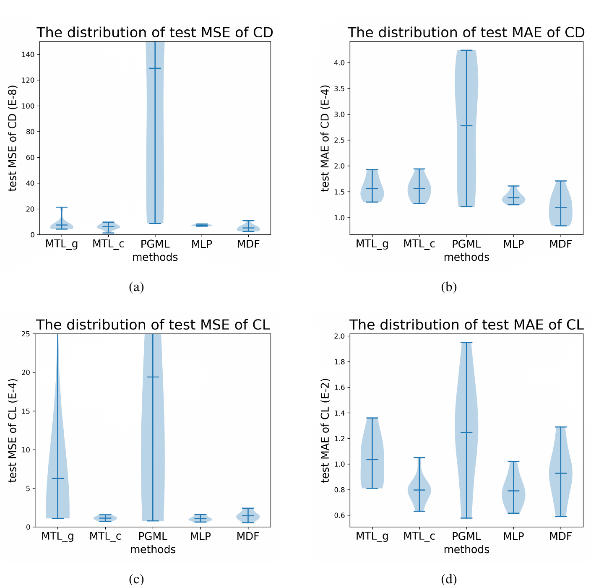
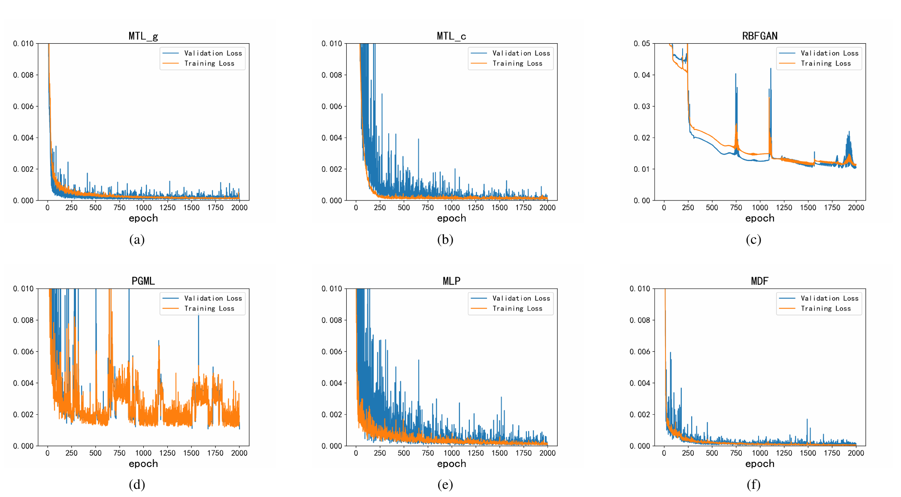
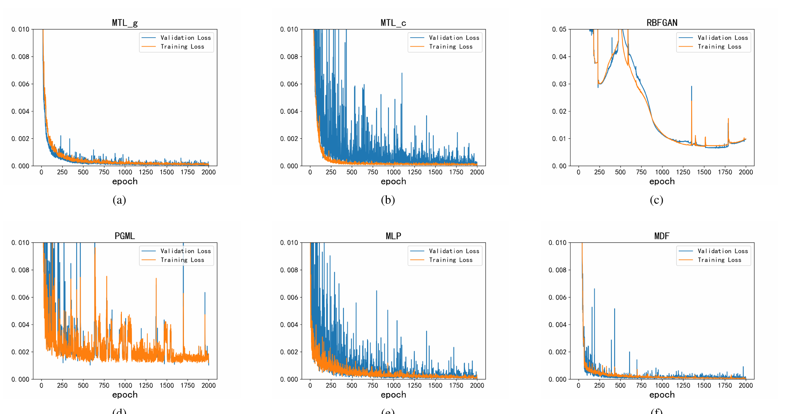
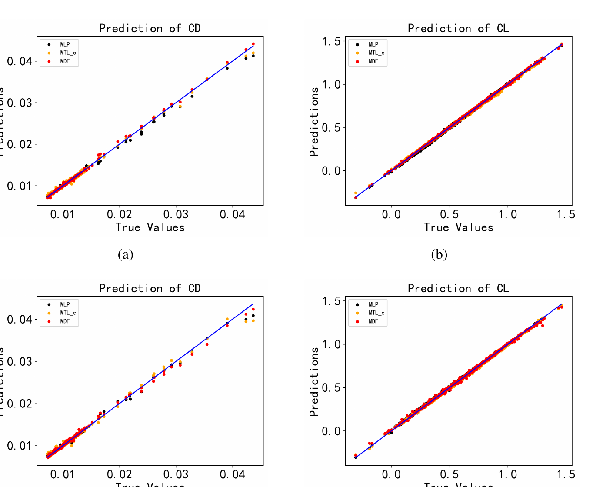
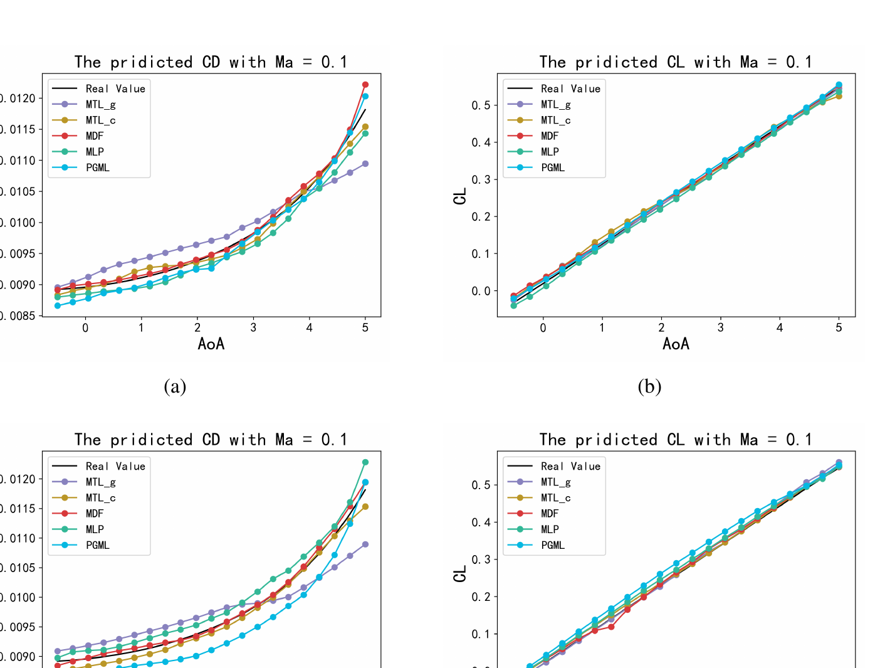

# 一种基于流形的翼型几何特征提取与差异数据融合学习方法

**英文题名：** A Manifold-Based Airfoil Geometric-Feature Extraction and Discrepant Data Fusion Learning Method

**作者：** 项宇（Yu Xiang）、张广博（Guangbo Zhang）、胡立伟（Liwei Hu）、张俊（Jun Zhang）、王永勇（Wenyong Wang，通讯作者）

**期刊：** IEEE Transactions on Aerospace and Electronic Systems

**年份：** 2023

**DOI：** [10.1109/TAES.2023.3276735](https://doi.org/10.1109/TAES.2023.3276735)

**原始版本：** arXiv:2206.12254v1，2022-06-23

> 译注：为保留原始图表细节，图片中的英文标签保持原样，全部图题、表题、表格内容及正文已译为中文。原文摘要中的“56.33%”与表 III、正文及结论中的“53.66%”不一致，译文保留各自原始数值并在此提示。

## 作者与基金信息

本工作受中央高校基本科研业务费项目 A030202063008039 资助。

- 项宇，副教授，电子科技大学计算机科学与工程学院，中国成都 611731，电子邮箱：jcxiang@uestc.edu.cn。
- 张广博，电子科技大学计算机科学与工程学院，中国成都 611731，电子邮箱：guangbozhang@uestc.edu.cn。
- 胡立伟，电子科技大学计算机科学与工程学院，中国成都 611731，电子邮箱：liweihu@std.uestc.edu.cn。
- 张俊，高级工程师，电子科技大学计算机科学与工程学院，中国成都 611731，电子邮箱：zhangjun@uestc.edu.cn。
- 王永勇，教授，通讯作者，电子科技大学计算机科学与工程学院，中国成都 611731，电子邮箱：wangwy@uestc.edu.cn；同时为澳门科技大学下一代互联网国际学院特聘教授，中国澳门 519020。

## 摘要

翼型的几何形状以及相应的飞行条件，是气动性能预测的关键因素。现有大多数方法，例如几何参数提取、多项式描述和深度学习方法，所获得的翼型几何特征都位于欧氏空间中。最新研究表明，翼型曲线或曲面在黎曼空间中构成流形。因此，现有方法提取的特征不足以充分反映翼型的几何特征。同时，飞行条件与几何特征的类型差异很大，必须评估并学习这两类因素对最终气动性能预测影响的相关知识，以提高预测精度。受流形理论和多任务学习优点的启发，本文提出一种基于流形的翼型几何特征提取与差异数据融合学习方法（manifold-based airfoil geometric-feature extraction and discrepant data fusion learning method，MDF），用于在黎曼空间中提取翼型几何特征，并将这些特征称为“流形特征”；随后进一步融合流形特征与飞行条件，以预测气动性能。实验结果表明，与现有方法相比，本文方法能够更准确地提取翼型几何特征，重建翼型的平均 MSE 降低 56.33%；在保持相同升力系数 \(C_L\) 预测精度水平的同时，MDF 预测的阻力系数 \(C_D\) 的 MSE 进一步降低 35.37%。

**关键词：** 翼型几何特征；流形；黎曼度量；多任务融合；气动性能预测

## I. 引言

翼型的几何形状对气动性能具有重要影响[1]-[3]。最常用的翼型几何描述方法是定义一组翼型几何参数，例如弦长、最大厚度、前缘半径等。这些参数虽然能够有效感知翼型几何结构的变化，但设计人员需要人工调整参数才能获得光滑连续的曲线，因此其应用范围受到限制[4]。多项式是另一类高效的翼型曲线近似数学方法，例如贝塞尔曲线[5]和 B 样条[6]等。这类方法通常利用高次多项式的线性组合来近似描述翼型结构的几何变化。然而，多项式方法只能给出翼型的近似表达式，难以从不同空间中深入挖掘翼型特征，因此难以全面描述一些现代复杂翼型[7]。

流形理论已借助流形映射方法应用于现代复杂翼型几何结构的优化[8]、[9]。Du 等人将高保真模型和低保真模型通过流形映射进行对齐，从而根据逆设计中的性能分布，即马赫数和压力系数，获得最优目标[10]。Raul 等人在基于代理模型的优化框架中使用流形映射进行气动外形优化，以缓解翼型动态失速[11]。上述研究主要关注翼型优化问题；据作者所知，利用流形理论提取翼型几何特征的研究仍然很少。

除翼型几何形状外，飞行条件是影响气动性能的另一类因素。当翼型几何形状固定时，不同飞行条件会显著影响其气动性能；而当翼型几何形状变化时，不同飞行条件下的影响会更加复杂。这两类数据对气动性能的影响被称为气动数据的差异性（discrepancy）。因此，很难定量评估几何形状和飞行条件对气动性能的差异影响，也导致二者难以有效融合。近年来，一些研究者已经认识到气动数据差异性的重要性[12]，并尝试根据输入数据类型，以分布式方式构建能够学习差异气动数据的新模型，例如 AeroCNN-I[13]、物理引导机器学习（physics guided machine learning，PGML）[14]、多层感知机（multi-layer perceptron，MLP）[15]以及多任务学习（multi-task learning，MTL）方案[16]、[17]。然而，上述研究均将翼型坐标或图像作为欧氏空间中翼型结构的表示。

近年来，深度学习在现代复杂翼型特征提取和差异气动数据融合方面取得了很大成功。例如，利用基于径向基函数的生成对抗网络（RBF-GAN）[1]、卷积神经网络（CNN）[13]和自编码器[18]，可以提取翼型特征图；利用 MTL[16]，可以有效融合差异气动数据。不过，这些方法仍存在两个问题：

1. 很少利用流形理论从黎曼空间中提取潜在几何特征；
2. 在差异气动数据融合方法中未考虑翼型的潜在几何特征。

受 MTL 和流形理论启发，本文提出一种基于流形的翼型几何特征提取与差异数据融合学习方法（MDF），用于提取黎曼空间中的潜在几何特征，即流形特征，并进一步将翼型流形特征与飞行条件融合，以预测气动性能，如图 1 所示。所提出的 MDF 包括三个模块：基于流形的翼型几何特征提取模块、飞行条件输入模块和多任务学习模块。在基于流形的翼型几何特征提取模块中，采用一组无自交贝塞尔曲线，从翼型坐标构建光滑分段流形；随后计算该流形的黎曼度量，作为一类流形特征。光滑分段流形与提取出的黎曼度量共同构成一个光滑黎曼流形。在飞行条件输入模块中，对翼型飞行条件进行归一化。多任务学习模块是一种差异数据融合学习方法，用于融合已提取的翼型几何特征和飞行条件，从而预测气动性能[16]。MTL 的输出是翼型气动性能参数，例如升力系数 \(C_L\) 和阻力系数 \(C_D\)，用于评价几何特征与飞行条件能否被精确融合并预测气动性能。

本文的主要贡献如下：

1. 证明一组首尾相连的无自交贝塞尔曲线构成一个光滑分段黎曼流形，可用于描述翼型几何形状；
2. 提出一种基于流形的翼型几何特征提取方法，利用上述黎曼流形计算流形度量；
3. 提出一种新的差异数据融合学习方法 MDF，将黎曼空间中翼型的黎曼流形特征与飞行条件融合，以预测气动性能，并取得优于现有方法的结果。

本文其余部分组织如下：第 II 节介绍翼型特征提取和差异气动数据融合的研究现状；第 III 节证明光滑分段流形的构造，并详细说明 MDF；第 IV 节使用公开的 UIUC 翼型数据集验证 MDF 的有效性，以及几何特征在预测 \(C_L\) 和 \(C_D\) 方面的可行性；第 V 节给出结论。

## II. 相关工作

本节介绍翼型特征提取和差异气动数据融合的当前研究现状。

### A. 翼型特征提取

贝塞尔曲线、B 样条和 NURBS 是用于推导翼型曲线方程的典型多项式形式[5]、[6]、[19]，可视为有效的翼型特征提取方法。其中，贝塞尔曲线是最基本、最常见的表达形式。翼型通常由多个控制点 \(\{x,y\}\) 组成，并由此形成多项式函数。通常选择一条连接 \(n+1\) 个控制点的 \(n\) 次贝塞尔曲线作为基函数，形成一条光滑曲线，用于近似翼型的局部函数；随后，翼型曲线函数可以表示为基函数的线性组合。上述多项式表达方式具有灵活性，可与其他参数化方法结合，从而更准确地描述翼型特征[6]。

基于多项式发展而来的类型函数/形状函数变换（class function/shape function transformation，CST）[20]，是翼型参数化领域的主流特征提取方法。CST 同时使用类型函数和形状函数控制翼型形状：类型函数用于生成翼型的基础形状，形状函数用于修正基础形状，以获得准确的翼型外形；类型函数和形状函数的系数则是 CST 中待确定的参数。

这些具有数学可解释性的多项式方法已被广泛用于翼型参数化。然而，一些前沿研究表明，翼型的曲线或曲面存在于流形空间中[10]、[8]。因此，现有多项式方法只能从欧氏空间捕捉几何特征，会遗漏一些潜在几何特征，例如流形特征。相反，流形理论可以从流形空间的角度提取几何特征，进一步丰富翼型特征。

### B. 差异气动数据融合

MTL 方案是一种有效的差异气动数据融合方法[21]、[16]。对于一般神经网络，除带 dropout 的神经网络外，所有神经元都会对每个输入样本激活，难以适应气动数据的差异。相反，MTL 是一种部分激活神经网络，可根据不同输入激活不同神经元。

MTL 的起源可以追溯到自然语言处理中的专家混合模型[22]，即使用若干专用神经网络作为专家。专家混合的思想是：根据输入词的词性标记，只激活一个特定专家网络来分析该词；最终结果由所有专家结果线性加权得到[23]。专家可以由不同模型实现，例如支持向量机（SVM）[24]、高斯过程[25]和神经网络[26]等。2019 年以后，神经元部分激活机制在气动领域以 MTL 的形式得到发展。

MTL 是一种新型神经网络，其不同任务被分配给不同子网络。White 等人于 2020 年提出 ClusterNet，这是 MTL 的前身，用于预测气流速度[21]。Zhang 等人采用基于 ClusterNet 的物理信息模型，通过近似群体模型的非线性动力学，预测群体的未来轨迹[27]。Hu、Zhang 等人在 ClusterNet 基础上，根据气动数据的差异将数据划分为不同子任务，并提出 MTL 方法进一步融合这些数据以预测气动性能[16]、[17]。

上述研究采用先进 MTL 方案，主要关注气动数据的差异，但仍将翼型坐标或图像作为欧氏空间中的翼型结构表示，没有考虑从黎曼空间提取翼型的潜在几何特征。

综上所述，本文提出的 MDF 同时区别于现有翼型特征提取方法和差异数据融合方法。现有特征提取方法的输出是带有一组系数的多项式，用于表示翼型结构；而在 MDF 中，带系数的多项式只是中间结果，最终输出为预测的性能参数。此外，现有差异数据融合方法的输入是欧氏空间中的差异数据，而 MDF 将黎曼空间中提取的流形特征与欧氏空间中的飞行条件融合，以预测翼型气动性能。

## III. 方法

### A. MDF 概述

图 1 给出了 MDF 的总体结构。MDF 主要由三个模块组成：基于流形的翼型几何特征提取模块、飞行条件输入模块和多任务学习模块。

**图 1.** MDF 的结构。

在基于流形的翼型几何特征提取模块中，首先选择一组首尾相连的无自交贝塞尔曲线，在翼型形状空间内构成光滑分段流形；随后，流形度量计算模块负责计算该流形上的黎曼度量，从而形成黎曼流形。黎曼度量由黎曼流形切空间中任意两个向量的内积计算得到，是黎曼流形其他流形特征的基础。通过黎曼度量，可以进一步计算黎曼流形的长度、体积、联络等流形特征[28]。因此，在翼型形状空间内，黎曼度量可以作为光滑分段黎曼流形切空间中流形特征的一种基础表示。

在飞行条件输入模块中，对翼型飞行条件进行归一化。在 MTL 模块中，计算得到的翼型黎曼度量 \(\vec{x}_1\) 作为一个输入送入函数网络 1，相应的飞行条件 \(\vec{x}_2\) 作为另一个输入送入函数网络 2。上下文网络的输入是翼型黎曼度量与飞行条件的向量化组合，即 \([\vec{x}_1,\vec{x}_2]\)。MTL 模块的输出是预测的气动性能 \(\vec{y}\)。本节将详细介绍基于流形的翼型几何特征提取模块和 MTL 模块。

### B. 基于流形的翼型几何特征提取模块

#### 1) 构建翼型光滑分段流形

本节首先证明无自交贝塞尔曲线构成光滑流形。

**定理 1.** 无自交贝塞尔曲线构成光滑流形。

**证明.** 给定二维翼型坐标集合

\[
D=\{P_i=(x_i,y_i)\mid i=1,2,\ldots,M\},
\]

其中 \(M\) 表示坐标点数量。可以构造贝塞尔曲线：

\[
r(D;t)=\sum_{i=0}^{n}P_iB_{i,n}(t),\qquad t\in[0,1],
\tag{1}
\]

其中，\(r(D;t)\) 是贝塞尔曲线函数，\(D\) 表示翼型坐标所在的样本空间，\(t\) 是该贝塞尔曲线的参数，\(n\) 是贝塞尔曲线的次数，\(B_{i,n}(t)\) 表示满足下式的系数：

\[
\begin{aligned}
B_{i,n}(t)
&=C_n^i\,t^i(1-t)^{n-i}\\
&=\frac{n!}{i!(n-i)!}\,t^i(1-t)^{n-i},
\qquad i=0,1,\ldots,n.
\end{aligned}
\tag{2}
\]

次数 \(n\ge 3\) 的贝塞尔曲线可能存在自交，如图 2(a) 所示，因此不能用于构造流形[29]。有两种方法可以避免自交，见图 2(b) 和 (c)。在图 2(b) 中删除自交点 \(A\)，剩余曲线构成流形；在图 2(c) 中，通过调整四个控制点的顺序或位置，使贝塞尔曲线不存在自交。无自交贝塞尔曲线是定理 1 成立的前提。

**图 2.** 带自交的三次贝塞尔曲线 (a)；删除自交后的三次贝塞尔曲线 (b)；无自交的三次贝塞尔曲线 (c)。原图图题中的“removed”在原始 PDF 中误排为“remored”。

下面引入关于截断函数的引理[30]、[31]。

**引理 1.** 设 \(M'\) 是非空豪斯多夫空间。若对于任意点 \(p\in M'\)，都存在点 \(p\) 的开邻域 \(U'\)，满足 \(U'\subset M'\)，且存在同胚映射 \(\varphi:U'\rightarrow\mathbb{R}^m\)，将 \(U'\) 映射到 \(m\) 维欧氏空间 \(\mathbb{R}^m\) 的开集，则称 \(M'\) 为 \(m\) 维拓扑流形。

假设 \(M'^*\) 是贝塞尔曲线 \(r(D;t)\) 所在的空间，且 \(M'^*\subset\mathbb{R}\)，则存在拓扑 \(T\)，使 \((r,T)\) 构成拓扑空间，即 \(M'^*\) 是非空豪斯多夫空间。为便于说明，令 \(M'^*=M'\)。

设包含 \(D=\{P_i=(x_i,y_i)\mid i=1,2,\ldots,M\}\) 的欧氏空间为 \(\mathbb{R}^2\)。由于 \(r(D;t)\) 光滑，对于任意 \(t_0\in r(D;t)\)，必存在开邻域 \(U'\)，使 \(t_0\in U'\)。对于任意 \(t_1,t_2\in U'\) 且 \(t_1\ne t_2\)，存在 \(P_1\in\mathbb{R}^2\)，使 \(r:t_1\rightarrow P_1\)；同时存在 \(P_2\in\mathbb{R}^2\)，使 \(r:t_2\rightarrow P_2\)。

若 \(P_1=P_2\)，则 \(P_1=r(D;t_1)\)、\(P_2=r(D;t_2)\)，因此 \(r(D;t_1)=r(D;t_2)\)。这与函数 \(r(D;t)\) 的性质矛盾，即 \(P_1\ne P_2\)。因此，\(r(D;t)\) 是从 \(U'\) 到 \(\mathbb{R}^2\) 的同胚映射。

根据引理 1，存在同胚映射 \(r(D;t):U'\rightarrow\mathbb{R}^2\)，使 \(M'\) 中所有元素构成的集合是二维拓扑流形。证毕。\(\square\)

对于简单翼型，使用一条贝塞尔曲线即可充分近似。然而，对于复杂翼型，随着贝塞尔曲线控制点数量增加，曲线次数也会增加，可能产生更大的误差[7]。因此，需要将翼型曲线划分为多个分段，并使用一组贝塞尔曲线近似复杂翼型。本文将多段贝塞尔曲线首尾相连，每一段由四个控制点确定，如图 3 所示。图中控制点 A、B、C、D 确定第 1 段，控制点 D、E、F、G 确定第 2 段，依此类推。多个光滑分段首尾相连，形成翼型的分段光滑曲线。

**图 3.** 基于三次贝塞尔曲线的拓扑流形构造。

下面证明：一组贝塞尔曲线首尾相连后能够构成光滑分段拓扑流形。

**定理 2.** 由一组贝塞尔曲线构造的多个光滑拓扑流形首尾相连，构成光滑分段流形。

**证明.** 为证明定理 2，从定义在 \(M'_i\) 上的任意光滑函数 \(r_i(D_i;t)\) 出发，其中 \(i=1,2,\ldots,N\)，\(N\) 表示分段数量。需要证明 \(r_i(D_i;t)\) 可以延拓到整体流形 \(M\)，且满足

\[
M=\bigcup_{i=1}^{N}M'_i.
\]

因此，定理 2 可改写为：设 \(U\) 是光滑流形 \(M\) 中的开集，且 \(r(D;t)\in C^1(U)\)。对于任意 \(P_i\in U\)，必存在邻域 \(W\)，满足 \(P_i\in W\subset M'\subset U\)，并存在函数 \(\tilde r_i(D;t)\in C^1(W)\)，使得

\[
\left.\tilde r_i(D;t)\right|_W
=
\left.r(D;t)\right|_W.
\]

为证明该结论，引入截断函数引理[30]、[31]。

**引理 2.** 设 \(V',V\) 是光滑拓扑流形 \(M\) 中两个开子集，\(\overline{V'}\) 是满足 \(\overline{V'}\subset V\) 的紧子集。则存在 \(f\in C^\infty(M)\)，使

\[
0\le f\le 1,\qquad
\left.f\right|_{V'}\equiv 1,\qquad
\left.f\right|_{M\setminus V}\equiv 0.
\]

引理 2 表明，定义在 \(M\) 上的任意函数都可以通过乘以 \(f\) 进行光滑截断：

\[
\begin{cases}
\left.(f\cdot r(D;t))\right|_{V'}\equiv r(D;t)|_{V'},\\
\left.(f\cdot r(D;t))\right|_{M'\setminus V}\equiv 0.
\end{cases}
\tag{3}
\]

对于任意 \(P_i\in U\)，取两个开邻域 \(W\) 和 \(V\)，使 \(\overline W\) 与 \(\overline V\) 均为紧集，且

\[
\overline W\subset V\subset\overline V\subset U.
\]

根据引理 2 和式 (3)，存在 \(f\in C^1(M)\)，使

\[
\left.f\right|_W\equiv 1,\qquad
\left.f\right|_{M\setminus V}\equiv 0.
\]

对于任意 \(P_j=r(D;t_j)\in M\)，定义

\[
\tilde r_i(D_i;t_j)=
\begin{cases}
r(D;t_j)f(P_j),&P_j\in U,\\
0,&P_j\notin U.
\end{cases}
\tag{4}
\]

因为 \(r(\cdot)f(\cdot)\) 在子集 \(U\) 上光滑，并且 \(r(D;t_j)f(P_j)\equiv 0\) 在 \(U\cap(M\setminus\overline V)\) 上成立，所以根据式 (4)，函数 \(\tilde r_i(D_i;t_j)\) 在子集 \(U\) 上光滑，并在 \(U\cap(M\setminus\overline V)\) 上满足 \(\tilde r_i(D_i;t_j)\equiv 0\)。由于 \(M=U\cup(M\setminus\overline V)\)，故 \(\tilde r_i(D_i;t)\) 是定义在 \(M\) 上的函数。

定理 1 表明一条贝塞尔曲线构成光滑流形；定理 2 说明一组贝塞尔曲线首尾相连后构成光滑分段流形。结合这两个定理可知，可以将现代复杂翼型曲线划分为多段，并使用一组低次贝塞尔曲线近似各分段。证毕。

#### 2) 黎曼度量计算

能够计算出一组黎曼度量的流形称为黎曼流形[30]、[32]、[33]。二维翼型欧氏空间

\[
\mathbb{R}^2=\{x_i\in\mathbb{R},\,y_i\in\mathbb{R}\}
\]

与带参数 \(t\) 的黎曼空间 \(M\) 之间，由黎曼流形上的度量建立联系。任意点 \(t\) 处的黎曼度量可按下式计算[34]：

\[
g_{vw}(t)=\partial_v r(D;t)\,\partial_w r(D;t),
\tag{5}
\]

其中，\(g_{vw}(t)\) 是翼型在点 \(t\) 处的黎曼度量，\(\partial_v=\partial_{t_v}\) 表示偏导数方向。由于 \(r(D;t)\) 是一维流形，因此 \(v=w\)：

\[
g_{vw}(t)=g_{vv}(t)
=\left(\partial_v r(D;t)\right)^2
=g_{ww}(t).
\tag{6}
\]

由式 (5) 可知，黎曼度量 \(g_{vw}(t)\) 是 \(r(D;t)\) 切空间 \(\{\partial_{t_v}\}\) 中任意两个向量的内积。构成该内积的两个向量可以延伸至所构建黎曼流形的整个切空间。换言之，黎曼度量表示翼型切空间中的一种几何基础，由此可以进一步测量和计算黎曼流形的多种流形特征。因此，可选择 \(g_{vw}(t)\) 作为表示翼型曲线几何特性的流形特征。

### C. 多任务学习模块

本节从结构和训练方法两个方面介绍 MTL 模块。

#### 1) 结构

如图 1 所示，MTL 模块由两个函数网络和一个上下文网络组成。每个函数网络分别学习一类差异数据：函数网络 1 学习黎曼度量 \(\vec{x}_1\)，函数网络 2 学习飞行条件 \(\vec{x}_2\)；上下文网络学习用于融合这两类差异数据 \([\vec{x}_1,\vec{x}_2]\) 的策略，即融合权重。

黎曼度量 \(\vec{x}_1\) 和飞行条件 \(\vec{x}_2\) 可写为

\[
\begin{cases}
\vec{x}_1=g_{vw}(t)|_{t\in[0,1]},\\
\vec{x}_2=[Ma,\alpha,\Phi,\ldots],
\end{cases}
\tag{7}
\]

其中，\(Ma\) 表示来流马赫数，\(\alpha\) 表示迎角，\(\Phi\) 表示气流滚转角。

MTL 的输出为气动性能：

\[
\begin{aligned}
\vec{y}
&=\{y_i\mid i=1,2,\ldots,K\}\\
&=\sum_{m=1}^{K}f_{1m}(\vec{x}_1)c_m([\vec{x}_1,\vec{x}_2])
+\sum_{n=1}^{K}f_{2n}(\vec{x}_2)c_{K+n}([\vec{x}_1,\vec{x}_2]),
\end{aligned}
\tag{8}
\]

其中，\(\vec{y}\) 表示输出向量；\(f_{1m}(\vec{x}_1)\) 表示函数网络 1 输出向量的第 \(m\) 个分量；\(f_{2n}(\vec{x}_2)\) 表示函数网络 2 输出向量的第 \(n\) 个分量；\(K\) 表示函数网络中的输出节点数；\(c_m([\vec{x}_1,\vec{x}_2])\) 表示上下文网络输出向量的第 \(m\) 个分量；\([\vec{x}_1,\vec{x}_2]\) 表示 \(\vec{x}_1\) 与 \(\vec{x}_2\) 的拼接。

#### 2) 训练方法

在 MTL 中，函数网络与上下文网络交替训练，具体步骤如下。

**步骤 1：前向传播。** MTL 的损失函数为

\[
E=\frac{1}{N}\sum_{z=1}^{N}
\frac{1}{K}\sum_{i=1}^{K}
\left(y_{zi}-\hat y_{zi}\right)^2,
\tag{9}
\]

其中，\(N\) 表示数据集中的样本数，\(y_{zi}\) 表示预测值，\(\hat y_{zi}\) 表示训练集中的真实值。

**步骤 2：函数网络更新。** 两个函数网络的参数按下式更新：

\[
\theta_f=\theta_f+\eta\frac{\partial E}{\partial\theta_f},
\tag{10}
\]

其中，\(\eta\) 表示 MTL 的学习率，\(\theta_f\) 表示函数网络的参数。

**步骤 3：上下文网络更新。** 上下文网络的参数按下式更新：

\[
\theta_c=\theta_c+\eta\frac{\partial E}{\partial\theta_c},
\tag{11}
\]

其中，\(\theta_c\) 表示上下文网络的参数。

**步骤 4：** 重复步骤 1 至步骤 3，直至 MTL 收敛。

## IV. 实验结果与分析

为验证所提出方法的可行性，本文基于 UIUC 翼型数据集开展了两个类别的实验。实验 I 用于比较不同方法的翼型几何特征提取结果；实验 II 用于比较采用不同方法融合差异数据进行气动性能预测时的误差。

### A. 数据集与预处理

UIUC 数据集提供了 1500 多个真实翼型，每个翼型均由二维坐标离散表示。UIUC 翼型数据的预处理步骤如下。

1. 删除只有上表面或只有下表面的翼型，确保数据集中剩余翼型完整。
2. 按后缘、上表面、前缘、下表面的顺序排列剩余翼型坐标，以避免产生自交。
3. 通过一组三次贝塞尔曲线对翼型坐标进行平滑，然后为每个翼型均匀重采样 281 个坐标。

由于实验中比较了翼型几何参数、坐标和流形特征等多种输入，下面说明这些输入的计算方式。计算翼型几何参数时，选择弦长、最大弯度、最大弯度位置、最大厚度、最大厚度位置、前缘半径和后缘厚度共 7 个变量，并使用 Profili 计算上述几何参数[35]。对于翼型流形特征，根据式 (5) 计算翼型在不同点 \(t\) 处的黎曼度量。相应翼型的飞行条件，即 \(Ma\) 和 \(\alpha\)，以及气动性能，即 \(C_L\) 和 \(C_D\)，可在 webfoil 平台上获得[36]。经过预处理后，UIUC 数据集中的输入数量汇总于表 I。

**表 I. 预处理后 UIUC 数据集中的输入数量**

| 数据类型 | 几何参数 | 流形特征 | 翼型坐标 | 飞行条件 |
|---|---:|---:|---:|---:|
| 变量数量 | 7 | 271 | \(281\times2\) | 2 |

### B. 实验 I：几何特征比较实验

在翼型特征提取领域，自编码器常被用于重建翼型，因为它能够从翼型几何形状中提取特征，并将翼型表示为潜在特征向量[37]、[38]。此外，自编码器通过计算重建翼型与真实翼型之间的相似度来反映所提取特征的准确性[39]、[40]。因此，本文将分别以坐标和流形特征作为输入的自编码器用于重建近似翼型，并进行比较。

本文设计了两种自编码器，见图 4。自编码器 I[40] 以翼型坐标作为输入，自编码器 II 以黎曼度量作为输入；二者的输出均为翼型坐标。

**图 4.** 自编码器 I 与自编码器 II 的结构。在自编码器 I 中，第一个卷积层包含 16 个 \(2\times3\) 卷积核，步长为 2，卷积层填充方式为 “SAME”；其余卷积层结构类似。

#### 1) 模型设置

实验中的超参数见表 II。本文比较的所有深度学习模型均基于 PyTorch 框架实现，并在四块 Tesla K80 GPU 上训练 2000 个 epoch[41]。

为执行 10 折交叉验证[42]，将整个数据集随机划分为 10 个子集。在 10 个子集中，选择 1 个子集作为测试集，其余 9 个子集用于训练过程。在 9 个子集中，再随机选择 1 个子集作为验证集，其余 8 个子集作为训练集。因此，训练集、验证集和测试集的比例为 8:1:1。所有子集互不交叉，并且每个子集被选为测试集的概率相同。本文报告的统计误差为 10 折结果的平均误差。

**表 II. 本文深度学习模型的超参数**

| 参数类型 | 参数名称 | 取值 |
|---|---|---|
| 硬件平台 | GPU | 四块 Tesla K80 GPU |
| 软件平台 | 编程语言 | Python 3.9.0 |
| 软件平台 | 深度学习框架 | PyTorch 1.11.0 |
| 模型超参数 | 优化算法 | Adam（Beta1=0.9，Beta2=0.999） |
| 模型超参数 | 数据归一化 | 最大-最小归一化 |
| 模型超参数 | 激活函数 | ReLU |
| 模型超参数 | 批归一化 | 是 |
| 模型超参数 | 批大小 | 128 |
| 模型超参数 | 学习率 | 0.001 |
| 模型超参数 | epoch | 2000 |
| 模型超参数 | 验证方式 | 10 折交叉验证 |
| 模型超参数 | 训练集:验证集:测试集 | 8:1:1 |

选择均方误差（MSE）作为上述自编码器的损失函数。自编码器 I 的损失函数为

\[
\mathcal L_{AE-I}
=\frac{1}{N}\sum_{z=1}^{N}
\left(AE_1(P_z)-P_z\right)^2,
\tag{12}
\]

其中，\(AE_1(\cdot)\) 表示自编码器 I，\(P_z=\bigcup_{i=1}^{M}P_i\) 表示第 \(z\) 个翼型坐标，是形状为 \(M\times2\) 的矩阵。

自编码器 II 的损失函数为

\[
\mathcal L_{AE-II}
=\frac{1}{N}\sum_{z=1}^{N}
\left(AE_2(\vec g_z)-P_z\right)^2,
\tag{13}
\]

其中，\(AE_2(\cdot)\) 表示自编码器 II，\(\vec g_z=\{\vec g^z_{vw}(t)\mid t\in[0,1]\}\) 表示第 \(z\) 个翼型的流形度量向量。

#### 2) 结果与分析

两种自编码器在五个典型翼型上的测试 MSE 见表 III。自编码器 II 相对自编码器 I 的 MSE 降低率 \(\eta\) 按下式计算：

\[
\eta=
\frac{\|\sigma_I-\sigma_{II}\|}{\|\sigma_I\|}\times100\%,
\]

其中，\(\sigma_I\) 表示自编码器 I 的测试 MSE，\(\sigma_{II}\) 表示自编码器 II 的测试 MSE。由表 III 可见，自编码器 II 的 MSE 始终小于自编码器 I；此外，与自编码器 I 相比，自编码器 II 的平均 MSE 降低了 53.66%。这表明，自编码器 II 重建的翼型比自编码器 I 更准确、更真实。

图 5 展示了两种自编码器重建的上述五个翼型。虽然使用十次贝塞尔曲线对所有重建翼型进行平滑，但由自编码器 I 重建的所有翼型仍不光滑，这意味着它们难以应用于翼型设计领域。相反，由自编码器 II 重建的翼型更接近真实翼型，并且更加光滑。实验 I 表明，作为一种流形特征，黎曼度量比坐标更能反映翼型的几何本质。

**图 5.** 由自编码器 I[40] 和自编码器 II 重建的翼型。

**表 III. 自编码器 I 与自编码器 II 重建五个典型翼型的测试 MSE**

| 翼型 | 自编码器 I[40] | 自编码器 II | \(\eta\) |
|---|---:|---:|---:|
| 翼型 1 | \(5.97\times10^{-4}\) | \(3.90\times10^{-4}\) | 34.67% |
| 翼型 2 | \(6.56\times10^{-4}\) | \(2.22\times10^{-4}\) | 66.16% |
| 翼型 3 | \(1.04\times10^{-3}\) | \(1.78\times10^{-4}\) | 82.88% |
| 翼型 4 | \(1.82\times10^{-3}\) | \(1.14\times10^{-3}\) | 37.36% |
| 翼型 5 | \(1.34\times10^{-3}\) | \(7.07\times10^{-4}\) | 47.24% |
| 平均值 | - | - | 53.66% |

### C. 实验 II：气动性能预测实验

本实验从差异数据融合和气动性能预测两方面比较多种方法，包括 MTL_g、MTL_c[16]、RBF-GAN[1]、PGML[14]、MLP[15] 和 MDF。

#### 1) 模型设置

本实验中的所有方法均重复 10 轮，每轮均使用 10 折交叉验证，即每种方法重复 100 次。实验 II 的超参数与实验 I 相同，见表 II。

上述方法的最优结构见表 IV。MTL_g 以几何参数和飞行条件（\(Ma\) 与 \(\alpha\)）为输入。几何参数构成形状为 \(1\times7\) 的向量，因此 MTL_g 中函数网络 1 的结构设为 “FCN: 32\*3”，表示基于全连接网络的函数网络 1 共 3 层，每层含 32 个神经元；函数网络 2 的结构设为 “FCN: 8\*3”，上下文网络的结构设为 “FCN: 32\*3”。

MTL_c 以坐标和飞行条件为输入。翼型坐标组织为形状 \(281\times2\) 的矩阵，因此 MTL_c 中函数网络 1 设计为 CNN。该 CNN 包含三层卷积和一层最大池化。三层卷积核尺寸分别为 \(2\times2\times16\)、\(2\times2\times32\) 和 \(2\times2\times64\)；最大池化核尺寸设为 \(2\times2\times64\)；所有卷积核和池化核的步长均为 2。此外，函数网络 2 的结构设为 “FCN: 16\*3”，上下文网络的结构设为 “FCN: 512\*3”。

RBF-GAN 的 RBF 判别器已被证明是判别器的最优近似，能够捕捉更精确的流场细节，并进一步预测流场变化[1]。因此，选择 RBF-GAN 作为比较方法，同时输入几何特征和飞行条件以预测气动性能。由于 RBF-GAN 的判别器为 RBFNN，将形状为 \(281\times2\) 的坐标矩阵展开为形状 \(562\times1\) 的向量。RBF 判别器的输入为展开坐标向量与飞行条件向量的组合，其结构设为 “RBF: 512\*1”。根据文献[1]，相应生成器的结构设为 “FCN: 1024\*3”。

PGML 在文献[14]中用于融合翼型坐标和飞行条件。PGML 由两个基于 FCN 的子网络组成：第一个子网络以翼型坐标为输入，结构设为 “FCN: 1024\*3”；第二个子网络以飞行条件为输入，结构设为 “FCN: 1024\*1”。两个子网络的最后一层通过 FCN 拼接，从而实现翼型坐标与飞行条件的融合。

MLP 是一个完整的 FCN，其输入为翼型坐标与飞行条件的组合。MLP 是最直观的融合方法，直接以翼型坐标与飞行条件的组合作为输入。选择 MLP 作为比较方法，是为了将这种直观融合方式与 MDF 进行比较。MLP 的结构设为 “FCN: 1024\*3”。

MDF 以流形特征和飞行条件为输入。输入流形特征组织为形状 \(1\times271\) 的向量，因此 MDF 中函数网络 1 设计为 FCN，其结构设为 “FCN: 1024\*3”。此外，函数网络 2 的结构设为 “FCN: 16\*3”，上下文网络的结构设为 “FCN: 512\*3”。

选择 MSE 和平均绝对误差（MAE）作为气动性能预测的评价指标：

\[
\begin{cases}
\displaystyle
MSE=\frac{1}{N}\sum_{z=1}^{N}
\left(\frac{1}{K}\sum_{i=1}^{K}(y_{zi}-\hat y_{zi})^2\right),\\[8pt]
\displaystyle
MAE=\frac{1}{N}\sum_{z=1}^{N}
\left(\frac{1}{K}\sum_{i=1}^{K}|y_{zi}-\hat y_{zi}|\right),
\end{cases}
\]

其中，\(y_{zi}\) 表示第 \(z\) 个输入对应性能的预测值，\(\hat y_{zi}\) 表示测试集中第 \(z\) 个输入对应性能的真实值。

**表 IV. 实验 II 中比较方法的详细信息**

| 方法 | \(\vec{x}_1\) | \(\vec{x}_2\) | 网络 1（\(f_1\)）结构 | 网络 2（\(f_2\)）结构 | 上下文网络 \(c\) 结构 |
|---|---|---|---|---|---|
| MTL_g | 几何参数（1\*7） | 飞行条件（\(Ma\) 和 \(\alpha\)） | FCN: 32\*3 | FCN: 8\*3 | FCN: 32\*3 |
| MTL_c | 坐标（281\*2） | 飞行条件（\(Ma\) 和 \(\alpha\)） | conv 1：kernel=2\*2\*16，stride=2 conv 2：kernel=2\*2\*32，stride=2 conv 3：kernel=2\*2\*64，stride=2 max pooling：kernel=2\*2\*64，stride=2 | FCN: 16\*3 | FCN: 512\*3 |
| RBF-GAN | 坐标（281\*2） | 飞行条件（\(Ma\) 和 \(\alpha\)） | 生成器 FCN: 1024\*3 | 判别器 RBF: 512\*1 | - |
| PGML | 坐标（281\*2） | 飞行条件（\(Ma\) 和 \(\alpha\)） | FCN: 1024\*3 | FCN: 1024\*1 | - |
| MLP | 坐标（281\*2） | 飞行条件（\(Ma\) 和 \(\alpha\)） | FCN: 1024\*3 | - | - |
| MDF（本文方法） | 流形特征（1\*271） | 飞行条件（\(Ma\) 和 \(\alpha\)） | FCN: 1024\*3 | FCN: 16\*3 | FCN: 512\*3 |

#### 2) 结果与分析

在气动领域，飞机的 \(C_D\) 数量级通常小于 \(C_L\)，这导致 \(C_D\) 预测较为困难[43]-[46]。因此，本文特别关注 \(C_D\) 的预测。

表 V 给出 MTL_g、MTL_c、RBF-GAN、PGML、MLP 和 MDF 在 10 轮实验中的平均预测误差。各列中的粗体数字表示最小平均测试误差。就 \(C_D\) 而言，MDF 的测试 MSE 和 MAE 均为所有方法中最小，而 RBF-GAN 的测试 MSE 和 MAE 均为最大。就 \(C_L\) 而言，MLP 的测试 MSE 和 MAE 最小，MDF 的测试 MSE 和 MAE 与 MLP 处于同一数量级。

比较 MDF 与 MLP 可见：

1. MDF 预测的 \(C_D\) 平均 MSE 降低 35.37%；
2. MDF 预测的 \(C_D\) 平均 MAE 降低 19.05%；
3. MDF 预测的 \(C_L\) 平均 MSE 增加 13.08%；
4. MDF 预测的 \(C_L\) 平均 MAE 增加 9.11%。

表 V 表明，由基于流形的翼型几何特征提取模块获得的流形特征，可以通过 MDF 与飞行条件融合，在保持 \(C_L\) 预测误差与 MLP 同一数量级的同时降低 \(C_D\) 的预测误差。

图 6 展示了 MTL_g、MTL_c、PGML、MLP 和 MDF 在 10 轮实验中预测 \(C_D\) 和 \(C_L\) 的 MSE、MAE 分布。由于 RBF-GAN 的预测误差过大，其误差分布未显示在该图中。每个子图中的上端蓝线表示最大值，中间蓝线表示平均值，下端蓝线表示最小值；浅蓝色阴影表示误差的分布密度或强度。

在子图 (a) 中，MDF 预测 \(C_D\) 的平均 MSE 最小。在子图 (b) 中，MDF 预测 \(C_D\) 的最小 MAE 和平均 MAE 均小于其他方法。在子图 (c) 中，MTL_c、MLP 和 MDF 预测 \(C_L\) 的最大 MSE、最小 MSE 和平均 MSE 均相近。在子图 (d) 中，MDF 预测 \(C_L\) 的平均 MAE 与 MTL_c、MLP 相近。这些结果说明，MDF 可以在保持 \(C_L\) 预测误差与 MTL_c、MLP 相近的同时降低 \(C_D\) 的预测误差。

**图 6.** MTL_g、MTL_c、PGML、MLP 和 MDF 在 10 轮实验中预测的 \(C_D\) 与 \(C_L\) 的 MSE、MAE 分布。

**表 V. MTL_g、MTL_c、RBF-GAN、PGML、MLP 和 MDF 的平均 MSE 与 MAE**

| 模型 | \(C_D\) 的 MSE | \(C_D\) 的 MAE | \(C_L\) 的 MSE | \(C_L\) 的 MAE |
|---|---:|---:|---:|---:|
| MTL_g | \(7.41\times10^{-8}\) | \(1.57\times10^{-4}\) | \(6.27\times10^{-4}\) | \(1.03\times10^{-2}\) |
| MTL_c[16] | \(6.77\times10^{-8}\) | \(1.56\times10^{-4}\) | \(1.13\times10^{-4}\) | \(8.15\times10^{-3}\) |
| RBF-GAN[1] | \(1.30\times10^{-5}\) | \(1.96\times10^{-3}\) | \(3.42\times10^{-2}\) | \(9.34\times10^{-2}\) |
| PGML[14] | \(1.29\times10^{-6}\) | \(2.78\times10^{-4}\) | \(1.67\times10^{-3}\) | \(1.35\times10^{-2}\) |
| MLP[15] | \(7.29\times10^{-8}\) | \(1.38\times10^{-4}\) | **\(1.07\times10^{-4}\)** | **\(7.90\times10^{-3}\)** |
| MDF（本文方法） | **\(3.80\times10^{-8}\)** | **\(1.02\times10^{-4}\)** | \(1.21\times10^{-4}\) | \(8.62\times10^{-3}\) |
| 误差降低率（MDF 相对于 MLP） | 35.37% | 19.05% | -13.08% | -9.11% |

图 7 和图 8 分别给出上述方法在两个不同轮次中的训练损失和验证损失。图 7 的子图 (a) 至 (f) 分别为 MTL_g、MTL_c、RBF-GAN、PGML、MLP 和 MDF 在第 2 轮的损失变化；图 8 的子图 (a) 至 (f) 为相同方法在第 9 轮的损失变化。可以看到，已收敛 MDF（epoch \(\ge 1500\)）的训练损失和验证损失波动均小于其他方法。此外，在整个训练过程中，MDF 验证损失的波动始终小于 MTL_c、PGML 和 MLP。

通过比较损失变化可以推断，MDF 将流形特征与飞行条件融合是合理的，这种融合有利于提高训练过程的稳定性。

**图 7.** 实验 II 所比较方法在第 2 轮中的训练损失和验证损失。

**图 8.** 实验 II 所比较方法在第 9 轮中的训练损失和验证损失。

图 9 展示了 MLP、MTL_c 和 MDF 在相同两轮实验中预测的 \(C_D\) 和 \(C_L\)，这三种方法在表 V 中表现最优。子图 (a) 和 (b) 分别给出第 2 轮预测的 \(C_D\) 和 \(C_L\)，子图 (c) 和 (d) 分别给出第 9 轮预测的 \(C_D\) 和 \(C_L\)。MDF 预测的 \(C_D\) 紧密聚集在对角线附近；相反，当 \(C_D>0.03\) 时，MLP 和 MTL_c 预测的 \(C_D\) 明显偏离对角线。此外，三种方法预测的 \(C_L\) 较为相似。

**图 9.** MLP、MTL_c 和 MDF 在两个不同轮次实验中预测的 \(C_D\) 与 \(C_L\)。

相同两轮实验中预测 \(C_D\)、\(C_L\) 随迎角 \(\alpha\) 的变化见图 10。由于 RBF-GAN 的预测误差最大，图中未显示其预测的 \(C_D\) 和 \(C_L\)。子图 (a) 和 (b) 分别显示第 2 轮中 \(C_D\)、\(C_L\) 随 \(\alpha\) 的变化，子图 (c) 和 (d) 分别显示第 9 轮中的变化。由子图 (a) 和 (c) 可见，MDF 预测的 \(C_D\) 更接近真实值；由子图 (b) 和 (d) 可见，所有方法预测的 \(C_L\) 较为相似，且均接近真实值。

**图 10.** 当 \(Ma=0.1\) 时，\(C_L\) 和 \(C_D\) 随 \(\alpha\) 即迎角的变化，对应两个不同轮次的实验。

综上，实验 I 表明，由基于流形的翼型几何特征提取模块提取的流形特征确实反映了翼型的几何形状，并且可以依据其几何本质重建翼型。实验 II 表明，MDF 能够融合流形特征和飞行条件，在保持相同 \(C_L\) 预测精度水平的同时降低 \(C_D\) 的预测误差。

## V. 结论

本文结论如下：

1. 翼型几何形状可以借助一组首尾相连的无自交贝塞尔曲线近似表示为分段光滑黎曼流形；
2. 黎曼度量作为一种流形特征，可用于重建光滑的近似翼型；与自编码器相比，重建翼型的 MSE 降低 53.66%；
3. 与 MLP 相比，在保持相同 \(C_L\) 预测精度水平的同时，MDF 预测的 \(C_D\) 的 MSE 降低 35.37%。

上述实验结果表明，MDF 仅融合一种流形特征，即黎曼度量，与飞行条件，就能显著降低 \(C_D\) 的预测误差。未来将进一步定义并提取由翼型曲线构建的分段光滑流形的更多潜在流形特征，例如曲率、挠率和黎曼联络。作者认为：

1. 多种流形特征能够进一步反映翼型的几何本质；
2. 将多种流形特征与飞行条件融合，可以获得更准确的翼型性能预测结果。

## 致谢

作者感谢电子科技大学王正文（Wenzheng Wang）研究员对本项目提出的宝贵建议，也感谢中国空气动力研究与发展中心程艳青（Yanqing Cheng）副研究员和钱伟琪（Weiqi Qian）研究员对本文提出的宝贵建议。

## 参考文献

> 以下保留文献原文题名、作者、期刊和出版信息，以便准确检索与引用。

[1] L. Hu, W. Wang, Y. Xiang, and J. Zhang, "Flow field reconstructions with GANs based on radial basis functions," *IEEE Transactions on Aerospace and Electronic Systems*, 2022.

[2] Y. Wang, K. Shimada, and A. B. Farimani, "Airfoil GAN: Encoding and synthesizing airfoils for aerodynamic-aware shape optimization," *arXiv preprint arXiv:2101.04757*, 2021.

[3] L. Hu, J. Zhang, Y. Xiang, and W. Wang, "Neural networks-based aerodynamic data modeling: A comprehensive review," *IEEE Access*, vol. 8, pp. 90805-90823, 2020.

[4] M. Shelton, B. Gregory, S. Lamson, H. Moses, R. Doughty, and T. Kiss, "Optimization of a transonic turbine airfoil using artificial intelligence, CFD and cascade testing," in *Turbo Expo: Power for Land, Sea, and Air*, vol. 78903. American Society of Mechanical Engineers, 1993, p. V03AT15A012.

[5] R. Derksen and T. Rogalsky, "Bezier-PARSEC: An optimized aerofoil parameterization for design," *Advances in Engineering Software*, vol. 41, no. 7-8, pp. 923-930, 2010.

[6] G. Farin, *Curves and Surfaces for Computer-Aided Geometric Design: A Practical Guide*. San Diego: Elsevier, 2014.

[7] F. Zhu and N. Qin, "Intuitive class/shape function parameterization for airfoils," *AIAA Journal*, vol. 52, no. 1, pp. 17-25, 2014.

[8] J. Nagawkar, J. Ren, X. Du, L. Leifsson, and S. Koziel, "Single- and multipoint aerodynamic shape optimization using multifidelity models and manifold mapping," *Journal of Aircraft*, vol. 58, no. 3, pp. 591-608, 2021.

[9] J. Li, X. Du, and J. R. Martins, "Machine learning in aerodynamic shape optimization," *arXiv preprint arXiv:2202.07141*, 2022.

[10] X. Du, J. Ren, and L. Leifsson, "Aerodynamic inverse design using multifidelity models and manifold mapping," *Aerospace Science and Technology*, vol. 85, pp. 371-385, 2019.

[11] V. Raul and L. Leifsson, "Multifidelity modeling similarity conditions for airfoil dynamic stall prediction with manifold mapping," *Engineering Computations*, 2021.

[12] S. P. Dakua, "Performance divergence with data discrepancy: A review," *Artificial Intelligence Review*, vol. 40, no. 4, pp. 429-455, 2013.

[13] Y. Zhang, W. J. Sung, and D. N. Mavris, "Application of convolutional neural network to predict airfoil lift coefficient," in *2018 AIAA/ASCE/AHS/ASC Structures, Structural Dynamics, and Materials Conference*, 2018, p. 1903.

[14] S. Pawar, O. San, B. Aksoylu, A. Rasheed, and T. Kvamsdal, "Physics guided machine learning using simplified theories," *Physics of Fluids*, vol. 33, no. 1, p. 011701, 2021.

[15] D. Xin, J. Zeng, and K. Xue, "Surrogate drag model of non-spherical fragments based on artificial neural networks," *Powder Technology*, vol. 404, p. 117412, 2022.

[16] L. Hu, Y. Xiang, J. Zhang, Z. Shi, and W. Wang, "Aerodynamic data predictions based on multi-task learning," *Applied Soft Computing*, vol. 116, p. 108369, 2022.

[17] Z. Jun, Z. Guangbo, C. Yanqing, H. Liwei, X. Yu, and W. Wenyong, "A multi-task learning method for large discrepant aerodynamic data," *Acta Aerodynamica Sinica* (in Chinese), vol. 39, no. s, pp. 1-10, 2021.

[18] K. Yonekura and H. Hattori, "Framework for design optimization using deep reinforcement learning," *Structural and Multidisciplinary Optimization*, vol. 60, no. 4, pp. 1709-1713, 2019.

[19] D. Zhang, Z. Wang, H. Ling, and X. Zhu, "Kriging-based shape optimization framework for blended-wing-body underwater glider with NURBS-based parametrization," *Ocean Engineering*, vol. 219, p. 108212, 2021.

[20] B. Kulfan, "Modification of CST airfoil representation methodology," 2009.

[21] C. White, D. Ushizima, and C. Farhat, "Fast neural network predictions from constrained aerodynamics datasets," in *AIAA Scitech 2020 Forum*, 2020, p. 0364.

[22] R. A. Jacobs, M. I. Jordan, S. J. Nowlan, and G. E. Hinton, "Adaptive mixtures of local experts," *Neural Computation*, vol. 3, no. 1, pp. 79-87, 1991.

[23] N. Shazeer, A. Mirhoseini, K. Maziarz, A. Davis, Q. Le, G. Hinton, and J. Dean, "Outrageously large neural networks: The sparsely-gated mixture-of-experts layer," *arXiv preprint arXiv:1701.06538*, 2017.

[24] A. Rajaei, H. Shayegh, and N. M. Charkari, "Human detection in semi-dense scenes using HOG descriptor and mixture of SVMs," in *ICCKE 2013*. IEEE, 2013, pp. 229-234.

[25] M. Deisenroth and J. W. Ng, "Distributed Gaussian processes," in *International Conference on Machine Learning*, 2015, pp. 1481-1490.

[26] L. Zhang, S. Huang, W. Liu, and D. Tao, "Learning a mixture of granularity-specific experts for fine-grained categorization," in *Proceedings of the IEEE International Conference on Computer Vision*, 2019, pp. 8331-8340.

[27] J. Zhang, Y. Thadimari, V. V. Velpula, and J. Bhargav, "Learning interactions and dynamics of swarms," 2020.

[28] J. Delso, "On gravitomagnetic tensor derived from energy momentum 1-form in a Riemann-Cartan space with a metric connection," *OSP Journal of Physics and Astronomy*, vol. 3, 2022.

[29] S. A. A. A. Said Mad Zain, M. Y. Misro, K. T. Miura et al., "Generalized fractional Bezier curve with shape parameters," *Mathematics*, vol. 9, no. 17, p. 2141, 2021.

[30] Z. Tang, "Metric," in *Fundamentals of Riemannian Geometry in Chinese*, 1st ed., C. Yue, Ed. Beijing: Beijing Normal University Publishing House, 2011, pp. 29-33.

[31] W. Chen, "Riemannian metric," in *Introduction to Riemann Geometry in Chinese*, 1st ed., J. Zhang, Ed. Beijing: Beijing Normal University Publishing House, 2004, pp. 83-90.

[32] S. Sommer and A. M. Bronstein, "Horizontal flows and manifold stochastics in geometric deep learning," *IEEE Transactions on Pattern Analysis and Machine Intelligence*, 2020.

[33] P. Hansen, B. Eltzner, and S. Sommer, "Diffusion means and heat kernel on manifolds," in *International Conference on Geometric Science of Information*. Springer, 2021, pp. 111-118.

[34] S. Alexakis, T. Balehowsky, and A. Nachman, "Determining a Riemannian metric from minimal areas," *Advances in Mathematics*, vol. 366, p. 107025, 2020.

[35] Z. Li and D. Wang, "Analysis and experimental study on different airfoils in heavy unmanned aerial vehicle," *Aerospace Systems*, vol. 4, no. 1, pp. 37-48, 2021.

[36] X. Du, P. He, and J. R. Martins, "A B-spline-based generative adversarial network model for fast interactive airfoil aerodynamic optimization," in *AIAA Scitech 2020 Forum*, 2020, p. 2128.

[37] K. Yonekura, K. Wada, and K. Suzuki, "Generating various airfoils with required lift coefficients by combining NACA and Joukowski airfoils using conditional variational autoencoders," *Engineering Applications of Artificial Intelligence*, vol. 108, p. 104560, 2022.

[38] K. Yonekura and K. Suzuki, "Data-driven design exploration method using conditional variational autoencoder for airfoil design," *Structural and Multidisciplinary Optimization*, vol. 64, no. 2, pp. 613-624, 2021.

[39] R. Li, Y. Zhang, and H. Chen, "Physically interpretable feature learning and inverse design of supercritical airfoils," *arXiv preprint arXiv:2204.07815*, 2022.

[40] M. Morimoto, K. Fukami, K. Zhang, A. G. Nair, and K. Fukagata, "Convolutional neural networks for fluid flow analysis: Toward effective metamodeling and low dimensionalization," *Theoretical and Computational Fluid Dynamics*, vol. 35, no. 5, pp. 633-658, 2021.

[41] Y. Zhou, X. Yang, G. Zhang, J. Wang, Y. Liu, L. Hou, X. Jiang, X. Liu, J. Yan, C. Lyu et al., "MMRotate: A rotated object detection benchmark using PyTorch," *arXiv preprint arXiv:2204.13317*, 2022.

[42] S. A. Barnhart, B. Narayanan, and S. Gunasekaran, "Blown wing aerodynamic coefficient predictions using traditional machine learning and data science approaches," in *AIAA Scitech 2021 Forum*, 2021, p. 0616.

[43] C. D. Bussy-Virat, A. J. Ridley, and J. W. Getchius, "Effects of uncertainties in the atmospheric density on the probability of collision between space objects," *Space Weather*, vol. 16, no. 5, pp. 519-537, 2018.

[44] W. Timmer, "A simple method to estimate the airfoil maximum drag coefficient," in *Journal of Physics: Conference Series*, vol. 1618, no. 5. IOP Publishing, 2020, p. 052068.

[45] A.-I. Onel, T.-P. Afilipoae, A.-M. Neculaescu, and M.-V. Pricop, "Drag coefficient modelling in the context of small launcher optimisation," *INCAS Bulletin*, vol. 10, no. 4, pp. 103-116, 2018.

[46] Y. Marchesse, C. Changenet, and F. Ville, "Drag power loss investigation in cylindrical roller bearings using CFD approach," *Tribology Transactions*, vol. 62, no. 3, pp. 403-411, 2019.

## 作者简介

**项宇**于 1995 年、1998 年和 2003 年分别获得电子科技大学（UESTC）学士、硕士和博士学位，均位于中国四川成都。他于 2003 年加入电子科技大学，并于 2006 年成为副教授。2014 年至 2015 年，他在澳大利亚墨尔本大学担任访问学者。目前的研究兴趣包括计算机网络、智能交通系统和深度学习。

**张广博**于 2020 年获得中南民族大学计算机科学学院网络工程专业学士学位，学校位于中国湖北武汉。目前正在电子科技大学计算机科学与工程学院攻读计算机科学与技术硕士学位。研究领域包括气动数据建模和深度学习。

**胡立伟**于 2014 年获得河北师范大学软件学院软件工程专业学士学位，并于 2018 年获得电子科技大学计算机技术专业硕士学位，学校位于中国四川成都。目前正在电子科技大学计算机科学与工程学院攻读计算机科学与技术博士学位。研究领域包括气动数据建模、深度学习和模式识别。

**张俊**于 1995 年和 1998 年分别获得电子科技大学电子工程专业学士和硕士学位。1998 年至 2008 年，他在 CERNET 担任高级研究员和工程师。目前是电子科技大学计算机科学与工程学院讲师。研究兴趣包括软件定义网络、机器学习在网络流量工程中的应用以及气动学。

**王永勇**于 1988 年获得北京航空航天大学计算机科学学士学位，并于 1991 年和 2011 年分别获得电子科技大学（UESTC）硕士和博士学位，学校位于中国成都。自 2006 年起，他担任电子科技大学计算机科学与工程专业教授，同时是澳门科技大学特聘教授。他是中国计算机学会高级会员、中国教育和科研计算机网（CERNET）专家委员会成员以及中国下一代互联网专家委员会成员。主要研究兴趣包括下一代互联网、软件定义网络和软件工程。
