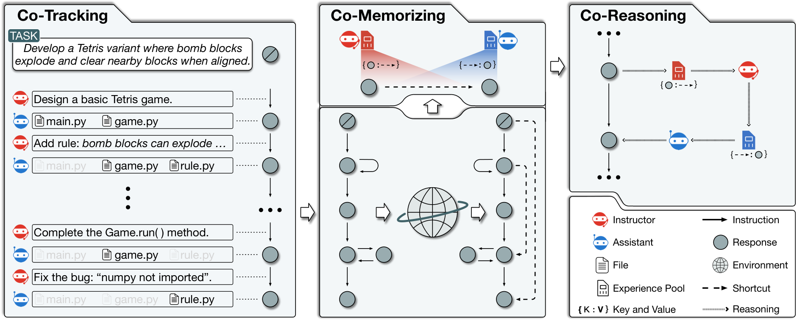
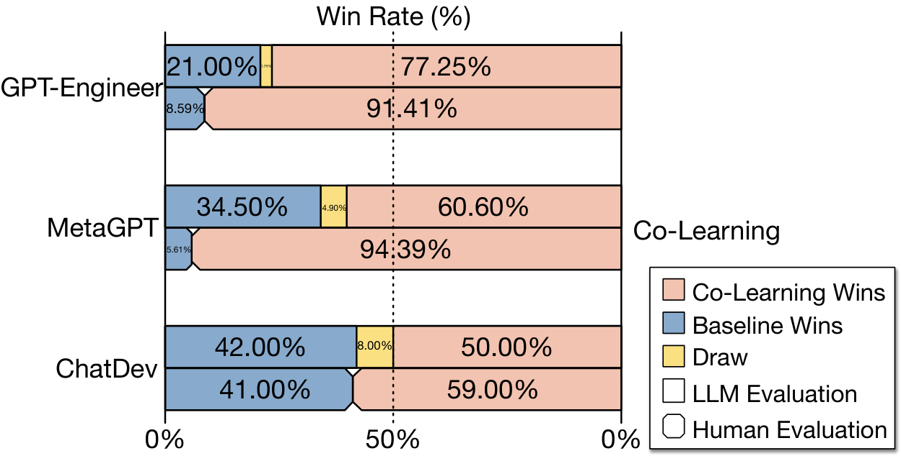
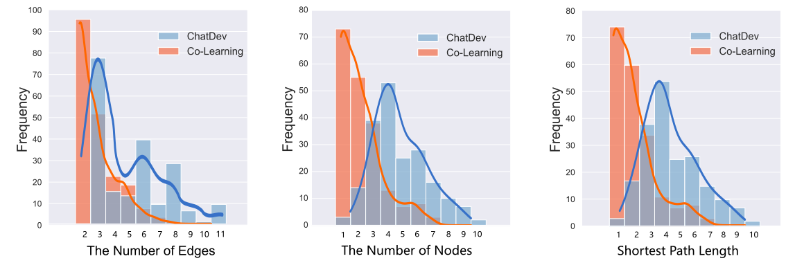
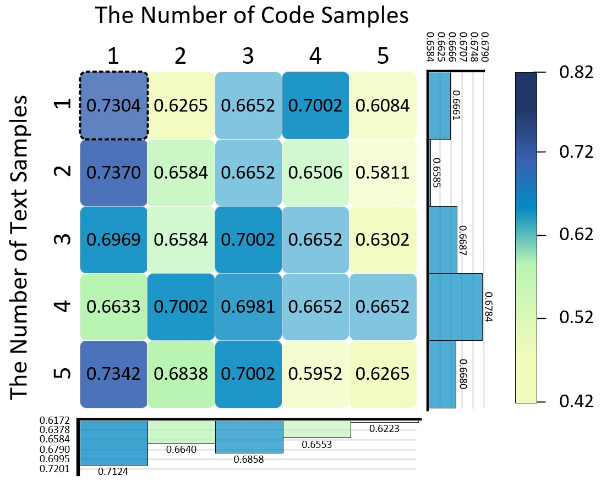
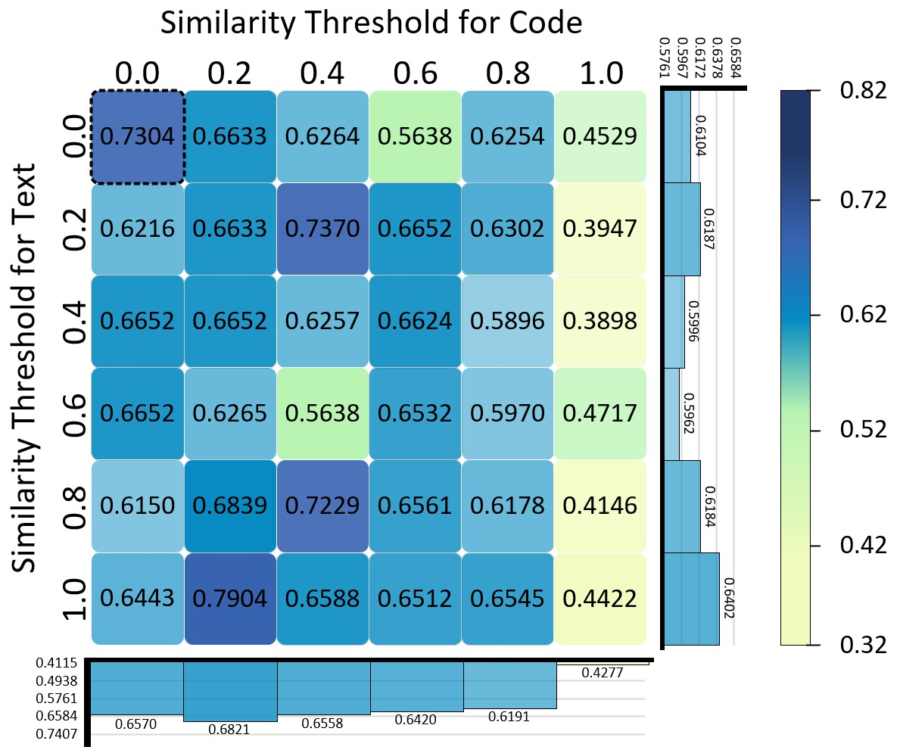

# 软件开发智能体的经验协同学习

**原题：** Experiential Co-Learning of Software-Developing Agents  
**作者：** Chen Qian†、Yufan Dang†、Jiahao Li、Wei Liu、Zihao Xie、Yifei Wang、Weize Chen、Cheng Yang✉、Xin Cong、Xiaoyin Che、Zhiyuan Liu✉、Maosong Sun✉。† 同等贡献；✉ 通讯作者。  
**单位：** 清华大学、大连理工大学、北京邮电大学、西门子。  
**作者邮箱：** qianc62@gmail.com；dangyf21@mails.tsinghua.edu.cn；yangcheng@bupt.edu.cn；liuzy@tsinghua.edu.cn；sms@tsinghua.edu.cn。  
**发表：** ACL 2024，主会长论文，5628–5640 页。  
**正式版本：** [ACL Anthology](https://aclanthology.org/2024.acl-long.305/) · [PDF](https://aclanthology.org/2024.acl-long.305.pdf) · DOI：10.18653/v1/2024.acl-long.305。  
**代码与数据：** [OpenBMB/ChatDev](https://github.com/OpenBMB/ChatDev)。  
**版本与翻译说明：** 以会议正式版为准；参考 arXiv:2312.17025v3 的可检索公式与图片进行转写并与正式版核对。正文、图注与表头译为中文；图内文字、模型名和代码标识保留原文；参考文献保留英文。本篇无独立附录。Markdown 按原章节和图表先后顺序组织，不模拟 PDF 双栏分页。  
**许可：** 原文按 [CC BY 4.0](https://creativecommons.org/licenses/by/4.0/) 许可发布；本文件为中文翻译与 Markdown 格式改编，非作者官方译本。

## 摘要

大语言模型（LLM）的近期进展给多个领域带来了显著变化，尤其体现在由 LLM 驱动的自主智能体上。软件开发是一个代表性场景：LLM 智能体能够高效协作、划分任务并保障软件质量，显著减少人工参与需求。然而，这些智能体往往各自独立处理不同任务，无法受益于以往经验，导致在多步任务执行中重复犯错并进行低效尝试。为此，我们提出**经验协同学习（Experiential Co-Learning）**，一种新的 LLM 智能体学习框架。在该框架中，指导者和助手智能体从自身历史轨迹中收集以捷径为导向的经验，并将其用于未来的任务执行。大量实验表明，该框架使智能体能够更有效地处理未见过的软件开发任务。我们希望这些发现能引导 LLM 智能体增强自主性，并推动其在协同学习中的进化成长。代码和数据见 [ChatDev 仓库](https://github.com/OpenBMB/ChatDev)。

## 1 引言

在持续发展的人工智能领域，大语言模型推动了多个领域的变革（Vaswani et al., 2017；Brown et al., 2020；Bubeck et al., 2023）。尽管其能力令人瞩目，但在处理超出简单聊天的复杂情境时，单独使用这些模型仍存在一定限制（Richards, 2023）。近期的**自主智能体**研究通过加入上下文感知记忆（Park et al., 2023）、多步规划（Wei et al., 2022b）和策略性工具使用（Schick et al., 2023）等功能，显著扩展了 LLM 的能力。这些增强使其能够处理更广泛的复杂任务，包括社会模拟（Park et al., 2023；Wang et al., 2023f；Hua et al., 2023）、软件开发（Osika, 2023；Qian et al., 2023）、游戏（Wang et al., 2023a；Zhu et al., 2023；Wang et al., 2023d；Gong et al., 2023）和科学研究（Huang et al., 2023；Liang et al., 2023）。为更有针对性地研究自主智能体的合作动态，我们选择软件开发（Mills, 1976）作为代表场景：它具有需要结合自然语言与编程语言技能的**复杂性**（Mills, 1976），需要深入理解代码并持续修改的**过程性**（Barki et al., 1993），以及代码能够提供可量化反馈的**客观性**（Compton and Hauck, 2002）。

随着自主智能体技术发展，一个重要突破是引入多智能体通信（Park et al., 2023；Li et al., 2023a；Qian et al., 2023）。代表性方法将任务执行分解为不同子任务，智能体通过合作通信，参与指导或回应式对话，共同形成连贯、自动化的解决方案。例如，在近期的软件开发智能体通信框架 ChatDev（Qian et al., 2023）中，负责调用外部编译器的审查者智能体迭代提出软件优化指令，如补全未实现代码、修改功能和调试程序，程序员智能体则据此适当更新源代码。这种更具适应性和主动性的任务求解方式，意味着自主性取得重要进展，超越了人机通信中典型的提示引导模式（Yang et al., 2024），并显著降低了对人工参与的依赖（Li et al., 2023a；Qian et al., 2023；Wu et al., 2023）。

然而，面对多样的任务类型，现有多智能体协作方法倾向于独立处理每项任务，主要原因是缺乏有效利用先前已完成任务所积累经验的方法（Qian et al., 2023；Chen et al., 2024；Park et al., 2023；Hong et al., 2024）。这种缺乏经验的特征，常使多步任务执行出现重复错误或不必要的试错，最终需要额外人工参与，尤其在真实场景中更为突出。

如何设计、收集并应用有效经验来增强多智能体协作？本文提出**经验协同学习**这一新的多智能体学习范式，通过利用历史通信中积累的经验，提高智能体的软件开发能力。方法将智能体划分为指导者（instructor）与助手（assistant）两种功能角色，包含三个核心模块：第一，**协同追踪（co-tracking）** 促进智能体进行通信演练，合作探索并生成多种训练任务的过程轨迹；第二，**协同记忆（co-memorizing）** 利用外部环境反馈，从历史轨迹中启发式挖掘“捷径”[1]，并将其交错存入各自经验池；第三，**协同推理（co-reasoning）** 使智能体面对未见任务时，利用共同的经验池改进指令和解决方案。对多种软件开发任务中自主智能体协作过程的综合评估显示，该框架显著提高协作效率，并减少额外人工参与。

我们的主要贡献如下：

1. 据我们所知，本研究首次将过去的经验引入 LLM 驱动的多智能体协作。通过协同追踪、协同记忆和协同推理，框架利用历史任务执行轨迹提取的启发式经验，促进指导者与助手两类智能体的合作学习。
2. 我们提出根据过程轨迹构建任务执行图，并从中提取连接非相邻节点的“捷径”作为经验，有效促进智能体在推理时进行捷径式思考。
3. 我们从多个角度开展广泛实验，验证框架的有效性。结果显示，智能体在软件开发中的协作质量与效率均得到提升。

**注1：** 本文中的“捷径”指更高效的路径，具有积极含义；不同于某些论文中表示表面相关性的用法（Geirhos et al., 2020）。

## 2 相关工作

LLM 在海量数据上训练并学习数十亿参数，已成为自然语言处理的重要基础（Brown et al., 2020；Bubeck et al., 2023；Vaswani et al., 2017；Radford et al., 2019；Touvron et al., 2023；Wei et al., 2022a；Shanahan et al., 2023；Chen et al., 2021；Brants et al., 2007；Chen et al., 2021；Ouyang et al., 2022；Yang et al., 2024；Qin et al., 2023；Kaplan et al., 2020）。近期自主智能体领域的进展（Zhou et al., 2024；Wang et al., 2023a；Park et al., 2023；Wang et al., 2023f；Richards, 2023；Osika, 2023；Wang et al., 2024），很大程度上得益于 LLM 的基础能力提升。这些智能体借助 LLM 的强大能力，表现出突出的记忆（Park et al., 2023；Sumers et al., 2024）、规划（Osika, 2023；Chen et al., 2024；Liu et al., 2023）和工具使用能力（Schick et al., 2023；Cai et al., 2024；Qin et al., 2024；Ruan et al., 2023；Yang et al., 2023），得以在复杂现实场景中自主运行（Zhao et al., 2024；Zhou et al., 2024；Ma et al., 2023；Zhang et al., 2023；Wang et al., 2023b；Ding et al., 2023；Weng, 2023）。Reflexion 等智能体（Shinn et al., 2023）能够根据反馈改进，但通常缺乏跨任务经验。为了让自主智能体能够通过不同训练任务中的试错获得提升，ExpeL（Zhao et al., 2024）创新性地将经验定义为成功任务轨迹的历史，并利用这些经验进行上下文推理。

与此同时，多智能体之间的自主通信成为一种有前景的范式，标志着向多智能体协作的转变（Park et al., 2023；Zhou et al., 2023；Chen et al., 2024；Chan et al., 2024；Chen et al., 2023；Cohen et al., 2023；Li et al., 2023b；Hua et al., 2023；Guo et al., 2024）。其中，软件开发智能体能够把复杂任务分解为更容易处理的细粒度子任务（Hong et al., 2024；Qian et al., 2023）。指导者给出方向性指令，助手提供相应解决方案，由此形成流畅的任务执行工作流。这不仅提高生产率，也在质量上超越传统的人机提示引导范式，减少人工参与需求（Li et al., 2023a；Chen et al., 2024）。

**图1：经验协同学习框架。** 协同追踪模块促进智能体开展通信演练，合作探索并生成多种训练任务的过程轨迹。协同记忆模块在外部监督下从轨迹中启发式提取“捷径”，将其整合进共同经验池。协同推理模块结合这些经验池，形成增强后的指令与解决方案通信，提高协作解决未见任务的能力。

## 3 经验协同学习

传统多智能体协作方法往往忽视从历史任务中积累经验，因而在相似的未来任务中重复犯错或进行不必要的试错（Qian et al., 2023）。为解决这一问题，我们提出图1所示的经验协同学习。框架由两类不同的自主智能体驱动，包含三个必要模块：协同追踪建立指导者与助手之间的演练式协作，记录各训练任务中的合作“过程轨迹”，呈现其通信协作策略；协同记忆在外部监督下启发式提取轨迹中的“捷径”，并将其纳入共同经验池；协同推理结合两类智能体的经验池，形成经过增强的指令和解决方案通信，改善对未见任务的协作求解。

### 3.1 协同追踪

协同追踪模块建立指导者与助手的协作任务执行过程，旨在追踪多种训练任务的过程轨迹（Qin et al., 2024）。每条轨迹记录特定任务的动态推进，详细描述不断变化的路线，并清楚呈现执行过程中交互产生的解决方案。

形式上，在训练任务集 $\mathcal{T}$ 中，每项任务 $t\in\mathcal{T}$ 都通过智能体通信形成面向有效执行的功能性交互。指导者依次给出指令 $\mathcal{I}=\{i_1,i_2,\ldots,i_n\}$，助手生成对应的解决方案序列 $\mathcal{S}=\{s_1,s_2,\ldots,s_n\}$，每个方案都是完整的软件代码。这种通信动态可以自然建模为有向链 $\mathcal{G}=(\mathcal{N},\mathcal{E})$：

$$
\begin{aligned}
\mathcal{N}&=\{s_j\mid s_j\in\mathcal{S}\}\cup\{s_0\},\\
\mathcal{E}&=\{(s_j,i_{j+1},s_{j+1})\mid s_j,s_{j+1}\in\mathcal{S},\ i_{j+1}\in\mathcal{I}\}.
\end{aligned}
$$

其中，$\mathcal{N}$ 为解决方案对应的节点，$s_0$ 表示通常为空的初始方案；$\mathcal{E}$ 为指令对应的边。每条边 $(s_j,i_{j+1},s_{j+1})$ 表示在指令 $i_{j+1}$ 引导下，从方案 $s_j$ 转移到修改后方案 $s_{j+1}$ 的过程。

### 3.2 协同记忆

我们观察到，链中的每一次推进，即一轮软件优化，并不都会产生更好的方案。其中包括**方案回溯**，即优化过程回到先前内容；以及**从正确到失败的退化**，即原本正常的软件被意外修改为无法执行的方案。这说明某些步骤是冗余或无效的，仅记住完整历史轨迹可能不足以设计智能体经验。因此，我们将链转换为**任务执行图**，把链中内容相同的节点映射到重新定义（$\leftarrow$）的图中的同一节点：

$$
\begin{aligned}
\mathcal{N}&\leftarrow\{\phi(s_j)\mid s_j\in\mathcal{N}\},\\
\mathcal{E}&\leftarrow\{(\phi(s_j),i_{j+1},\phi(s_{j+1}))\mid(s_j,i_{j+1},s_{j+1})\in\mathcal{E}\}.
\end{aligned}
$$

其中，$\phi$ 是利用哈希函数实现的映射规则（Sasaki and Aoki, 2009）。它高效地将相同方案归为一组并突出重复过程，形成图1所示贯穿任务执行过程的“状态转移图”。

此外，任务执行图中连接相邻节点的每条边都表示智能体自主优化方案的一轮操作，这意味着智能体已经掌握每条现有边所对应的决策能力。因此，仅依赖现有边可能不足以设计有用的历史经验。为此，协同记忆模块启发式寻找连接非相邻节点的捷径。它们构成实际推理时的经验池基础，以加快未来任务执行。

**节点评估。** 首先，利用外部反馈信号，以成对比较方式估计 $\mathcal{N}$ 中各节点 $s_j$ 的分数：
$$
\omega(s_j)=\operatorname{sim}(s_j,task)\times\operatorname{sim}(s_j,s_{|\mathcal{N}|})\times[\![s_j]\!].
$$

其中，$\operatorname{sim}(\cdot,\cdot)$ 利用外部代码嵌入器和文本嵌入器，计算节点与另一节点或任务需求之间的相似度；$[\![\cdot]\!]$ 是通过外部编译器得到的编译是否成功的二值信号。该启发式评分规则会对满足任务需求、与最终方案相似且通过外部工具验证的方案给出较高评价。

**捷径提取。** 为发现信息量充足的捷径，我们选择连接非相邻节点、且信息增益超过阈值 $\epsilon$ 的捷径：
$$
\begin{aligned}
\mathsf{S}=\{&(s_i,\overset{\dashrightarrow}{s_i s_j},s_j)\mid
s_i,s_j\in\bar{\mathcal{N}}\ \wedge\ (s_i,\cdot,s_j)\notin\mathcal{E}\\
&\wedge\ [\![s_i\rightarrow s_j]\!]\ \wedge\ \omega(s_j)-\omega(s_i)\geq\epsilon\}.
\end{aligned}
$$

其中，$\bar{\mathcal{N}}$ 表示 $\mathcal{N}$ 中从源节点 $s_0$（空方案）到汇节点 $s_{|\mathcal{N}|}$（最终方案）的最短路径上的节点；$[\![s_i\rightarrow s_j]\!]$ 表示从 $s_i$ 可以到达 $s_j$。由于捷径边的指令并不天然存在于轨迹中，我们针对捷径连接的两个非相邻节点，使用标准自指令机制（Wang et al., 2023e）构造伪指令 $\overset{\dashrightarrow}{s_i s_j}$，通过比较两份不同代码，形成能够直接连接它们的指令。该机制仅提取最短路径上信息量充足的捷径，并结合编译信号，自然减轻冗余方案回溯和意外的正确到失败退化。

**经验收集。** 为将历史轨迹中启发式发现的捷径用作经验，智能体分别积累以键值对组织的经验池，供未来推理使用：
$$
\begin{aligned}
\mathsf{S}_I&=\bigcup_{t\in\mathcal{T}}\{(s_i,\overset{\dashrightarrow}{s_i s_j})\mid(s_i,\overset{\dashrightarrow}{s_i s_j},s_j)\in\mathsf{S}_t\},\\
\mathsf{S}_A&=\bigcup_{t\in\mathcal{T}}\{(\overset{\dashrightarrow}{s_i s_j},s_j)\mid(s_i,\overset{\dashrightarrow}{s_i s_j},s_j)\in\mathsf{S}_t\}.
\end{aligned}
$$

其中，$\mathsf{S}_t$ 为任务 $t$ 提取出的捷径集合，$\mathcal{T}$ 为完整训练集。这意味着指导者保存“方案到指令”的经验以改进指令能力，助手保存“指令到方案”的经验以改进方案生成。

“捷径即经验”的设计，使智能体能够超越其在历史执行过程中每一步已经掌握的方案优化能力，为更高效的捷径驱动“加速”推理提供可能。

### 3.3 协同推理

协同推理模块结合智能体的共同经验池，通过增强后的指令与方案进行通信。智能体利用各自的经验知识，获取并生成更精炼的回答，提高合作解决未见任务的能力。

过程从拥有“方案到指令”记忆 $\mathsf{S}_I$ 的指导者开始。当面对当前任务方案 $s_j$ 时，它利用检索工具获取与查询潜在语义接近的经验指令（Lewis et al., 2020）。这些指令作为少样本示例（Zhao et al., 2024；Rubin et al., 2022；Min et al., 2022），引导其推理并生成 $i_{j+1}^{*}$，随后发送给助手。助手拥有“指令到方案”记忆 $\mathsf{S}_A$，依据收到的指令检索最优方案，并以这些方案作为少样本示例，最终生成新方案 $s_{j+1}^{*}$。整个过程表示为：

$$
i_{j+1}^{*}=\mathbb{I}(s_j,\Bbbk(s_j,\mathsf{S}_I)),\qquad
s_{j+1}^{*}=\mathbb{A}(s_j,\Bbbk(i_{j+1}^{*},\mathsf{S}_A)).
$$

其中，$\Bbbk(q,s)$ 表示在键值数据库 $s$ 中以 $q$ 为查询，检索匹配度最高的前 $k$ 项；$\mathbb{I}$ 与 $\mathbb{A}$ 分别为指导者和助手利用少样本示例进行上下文推理的函数。

每轮通信得到的方案都会用于下一步交互。每项任务的这一过程可写为 $\{(i_1^{*},s_1^{*}),(i_2^{*},s_2^{*}),\ldots\}$，每一对均由经验增强的指令及相应方案组成。

## 4 评估

**基线。** 我们选择不同类型的 LLM 软件开发范式作为基线，涵盖单智能体与多智能体方法。GPT-Engineer（Osika, 2023）是 LLM 软件智能体领域的基础性单智能体方法，突出特点是能够准确理解任务需求，并通过单步推理高效生成完整的仓库级软件方案。MetaGPT（Hong et al., 2024）为不同 LLM 智能体分配不同角色，并引入标准操作流程促进协作；在每个子步骤中，不同能力的智能体以单步方式生成方案。ChatDev（Qian et al., 2023）是 LLM 驱动的协作软件开发框架，将完整开发过程组织为瀑布式阶段，如代码补全、代码审查和系统测试；其中，软件智能体围绕任务开展多轮通信，迭代提出指令与方案，从而提高软件开发质量。

**数据集。** 我们使用包含多种软件需求描述的 SRDD 数据集（Qian et al., 2023）。其类别参考主流软件商店平台，设计时力求减少冗余并增强原创性与多样性。数据集包含 1,200 条软件需求，分为教育（`Education`）、工作（`Work`）、生活（`Life`）、游戏（`Game`）和创作（`Creation`）五大类，再细分为 40 个子类，每个子类有 30 项独特任务。

| 方法 | 范式 | 完整性 | 可执行性 | 一致性 | 质量 | 用时（秒） |
| --- | --- | --- | --- | --- | --- | --- |
| GPT-Engineer | 单智能体 | 0.4824 | 0.3583 | 0.7887 | 0.1363 | **15.6000** |
| MetaGPT | 多智能体 | 0.4472 | 0.4208 | 0.7649 | 0.1439 | 154.0000 |
| ChatDev | 多智能体 | <u>0.6131</u> | <u>0.8800</u> | <u>0.7909</u> | <u>0.4267</u> | 148.2150 |
| Co-Learning | 多智能体 | **0.9497** | **0.9650** | **0.7970** | **0.7304** | <u>122.7750</u> |

**表1：代表性软件开发方法的整体表现，涵盖单智能体与多智能体范式。** 各指标为测试集全部任务的均值。最佳结果加粗，次佳结果加下划线。原文范式栏的单人／多人图标在此转写为对应文字。

**评价指标。** 全面评价软件是一项困难任务。函数级代码评价指标，如 `pass@k`，无法直接迁移到完整软件系统：对于具有复杂界面、频繁通信或非确定性反馈的软件，手工或自动构造测试用例常常不现实。因此，我们采用三个可量化的客观维度来评估软件的特定方面，再将其结合成综合指标：

- **完整性（Completeness）** 衡量开发过程中完成代码补全的能力，以没有任何 `TODO` 代码片段的软件占比量化。分数越高，自动执行的可能性越大。
- **可执行性（Executability）** 衡量软件在编译环境中正确运行的能力，以成功编译且可直接运行的软件占比量化。分数越高，成功执行的可能性越大。
- **一致性（Consistency）** 衡量生成软件与原始自然语言需求的契合程度，以文本需求嵌入与源代码嵌入之间的余弦距离量化。分数越高，符合需求的程度越高。〔译注：原文此处使用 “cosine distance”，并将高分解释为更一致；此处保留原文表述。〕
- **质量（Quality）** 综合完整性、可执行性和一致性来评估整体软件质量。[2] 分数越高，生成软件的整体质量越好，后续所需人工干预越少。

**注2：** 为避免过度复杂化，质量指标定义为完整性、可执行性和一致性的乘积。使用简单算术平均也会产生相近的结果与结论。

**图2：使用 GPT-4 与人类作为评估者，对生成方案进行成对比较。**

**实现细节。** 系统明确包含代码补全、代码审查和系统测试等必要阶段。协同追踪采用 *GPT-3.5-Turbo* 为基础模型，每阶段最多进行 *5* 轮智能体通信。协同记忆选择在文本和代码嵌入上表现良好的 *text-embedding-ada-002* 作为语义嵌入器，使用 *MD5* 哈希函数，利用 *Python-3.11.4* 提供环境反馈。智能体能够调用代码检查器和编译器等工具。信息增益阈值设为 *0.90*，以保留信息量充足的捷径。协同推理从代码与文本经验池中分别选择排名最高的结果，作为上下文示例。此外，我们通过随机分层抽样，将数据按 4:1:1 划为训练、验证和测试集，保持类别均衡。训练集用于协同追踪和协同记忆以收集经验，验证集用于选择超参数，测试集用于协同推理。所有基线采用相同的模型参数与环境设置，以保持可比性。

### 4.1 质量分析

**图3：任务执行图中关键要素的分布。** 边数表示软件代码迭代期间智能体通信的总次数；节点数表示哈希去重后的不同软件源代码数量，反映软件优化的解空间；最短路径长度表示排除环路和无效尝试后的主要开发路径长度。

根据表1，我们的方法（简称 Co-Learning）在质量上显著优于三种基线。与强大的多智能体框架 ChatDev 相比，综合指标从 0.4267 提高到 0.7304，突出表明利用历史经验对处理未见任务有效。主要原因是智能体能够回忆并应用历史轨迹中的高质量捷径，从而显著提高未见任务上的完整性与可执行性等关键指标。

此外，Co-Learning 优于 GPT-Engineer，表明相较单步策略，多智能体将任务求解分解为不同子任务具有优势。每个智能体通过主动通信参与动态协作，形成连贯、自动化的任务方案。近期研究也验证了这种任务分解方式的有效性（Wei et al., 2022b）。虽然 Co-Learning 比单智能体方法耗时更长，但比其他多智能体方法更高效。这表明多智能体通信本身需要更多时间，而策略性利用历史经验中的“捷径”模式，能够有效缩短推理时间，在性能与用时之间取得平衡。

进一步观察发现，Co-Learning 在完整性与可执行性上优势明显，但在一致性上提升较小。这可能源于嵌入模型对文本与代码的语义表示粒度较粗，对极细微的不一致不够敏感。这为开发更先进的软件需求一致性准则与指标提供了研究机会，也说明需要更精细的评价方法。

为从另一角度验证方法，我们参考以往工作（Li et al., 2023a），使用 GPT-4 与人类参与者对智能体生成的方案进行成对比较。[3] 如图2所示，Co-Learning 在 GPT-4 和人类评价中均获得更高的平均胜率，持续优于其他基线。ChatDev 相比其他基线也具有较高胜率，说明它是稳健的基线。其优势主要来自细致的任务分解以及通过多轮智能体通信优化软件，从而有效弥补潜在不足。Co-Learning 可以视为强调经验型智能体的 ChatDev 变体，其结果凸显智能体积累经验的重要性。

**注3：** 每项任务的 GPT-4 评价均比较两种方法的方案，避免位置偏差（Wang et al., 2023c）。人工评价由 30 名计算机科学研究人员完成，两种方法的方案随机呈现，由评估者根据偏好选择。

### 4.2 效率分析

我们显式构建任务执行图，并从中启发式提取捷径作为智能体经验。本节深入分析图结构，揭示智能体执行任务的基本模式。我们选择当前最强基线 ChatDev 进行比较。图3显示，相较 ChatDev，Co-Learning 的边数、节点数和最短路径长度均趋于减少，表明软件开发需要的迭代次数更少，优化时的解空间也更简单。

效率提升主要归因于策略性利用连接非相邻节点的捷径，使智能体能够复用历史任务执行经验，并通过“捷径思维”更有效地增强未来任务求解能力。结合表1与图2，这些证据表明，Co-Learning 通过减少不必要的迭代，简化软件开发流程，不仅提高整体效率，也能以更少的智能体通信生成更高质量方案。

### 4.3 有效性分析

本节研究指导者与助手在协作框架中的不同作用，考察仅一类智能体有经验或两类都无经验的情形。表2显示，仅让一类智能体具备经验，会使整体表现明显下降，表现为执行通信增多、质量降低。此外，仅指导者有经验的系统弱于仅助手有经验的系统（0.5305 对 0.6840），说明尽管两类角色都不可缺少，助手在任务执行中的作用更为突出。当双方均无经验时，系统退回传统能力，结果最差。这说明双方都需要经验；缺乏经验或仅一方有经验，都会降低执行效率和质量。

为进一步验证关键机制，我们考察三种变体，表2显示它们的性能均下降。**相邻执行（Adjacent-Execution）** 变体使用原始轨迹中成功编译后的相邻节点经验，替代捷径，相当于 ExpeL（Zhao et al., 2024）。这导致经验数量大增、经验质量下降，验证“捷径即经验”设计的有效性。**仅最长捷径（Longest-Shortcut-Only）** 变体丢弃中间捷径，只保留直接连接起点与终点的最长捷径。结果揭示底层模型的局限：仅凭单步历史经验无法妥善处理新任务，超出了智能体的上下文推理能力。**不构图（Graph-Unconstructed）** 变体不构建图，直接从原始轨迹提取捷径。结果表明，过度依赖历史经验也无法获得最优表现：它为可能重复的图节点生成许多捷径，使测试集中的执行产生不必要的重复，降低效率。这再次说明，任意相邻节点之间的推进不一定持续改进方案，必须在去重图上使用启发式捷径来平衡数量与质量。

| 方法 | 经验数量（指导者，助手） | 节点数 | 边数 | 质量 |
| --- | --- | --- | --- | --- |
| Co-Learning | (537, 537) | **2.3100** | **3.0100** | **0.7304** |
| 移除指导者经验 | (0, 537) | 3.3500 | 3.8850 | 0.6840 |
| 移除助手经验 | (537, 0) | 4.4422 | 5.0352 | 0.5305 |
| 移除双方经验 | (0, 0) | 3.9450 | 4.7950 | 0.4267 |
| 替换为相邻执行 | (1604, 1604) | 3.7000 | 4.5000 | 0.6398 |
| 替换为仅最长捷径 | (332, 332) | 2.8700 | 3.5200 | 0.6752 |
| 替换为不构图 | (605, 605) | 2.7000 | 3.4350 | 0.6821 |

**表2：框架主要角色与机制的消融研究。** 原文用 $\circlearrowleft$ 和 $\diagdown$ 分别表示替换与移除操作，此处用中文描述。$(a,b)$ 表示指导者和助手分别拥有 $a$ 和 $b$ 条启发式捷径。

### 4.4 敏感性分析

本节考察协同推理的两个关键参数：$\mathsf{k}$，即检索匹配结果的数量；$\theta$，即检索所用语义相似度阈值。检索结果分为文本与代码两类，匹配数量分别记为 $\mathsf{k}_{\mathrm{text}}$、$\mathsf{k}_{\mathrm{code}}$，取值 1–5；相似度阈值分别记为 $\theta_{\mathrm{text}}$、$\theta_{\mathrm{code}}$，从 0.0 到 1.0，以 0.20 为步长。

图4显示，最佳配置为 $(\mathsf{k}_{\mathrm{code}}=1,\mathsf{k}_{\mathrm{text}}=2)$，优于默认的 $(\mathsf{k}_{\mathrm{code}}=1,\mathsf{k}_{\mathrm{text}}=1)$。这说明默认配置虽已有效，仍可通过优化超参数进一步改进。此外，调整代码相关超参数比调整文本相关超参数效果更好，与前述实验结论一致。图5显示 $\theta$ 的影响较小，原因是当前查询与检索结果的语义相似度通常已经很高，往往超过 0.85。

**图4：top-k 的影响。** 虚线表示上述实验所用默认配置。

**图5：语义相似度阈值的影响。** 虚线表示上述实验所用默认配置。

## 5 结论

针对智能体协作缺乏历史任务经验积累机制的问题，我们提出经验协同学习框架，以促进自主智能体合作。通过协同追踪、协同记忆和协同推理，智能体能够借助过去经验和相互支持，高效处理未见过的软件开发任务。定量分析显示，软件质量显著提升，同时执行时间缩短、重复错误减少，对额外人工参与的依赖降低。我们希望这些发现能够推动智能体协作设计范式的转变，增强其自主性，并促进其在协同学习中的进化成长。

## 6 局限性

本研究探索了合作式自主智能体的能力，但研究者和实践者应注意其局限与风险。首先，自主智能体生成软件的能力可能被高估。在协同学习中，当缺乏必要且清晰的需求时，智能体仍倾向于实现最简单的逻辑，说明这些技术更适合原型系统，距离实际应用仍有差距。其次，与传统函数级代码生成不同，通用软件的自动化评价极具挑战。近期工作虽尝试使用**人工修订成本（Human Revision Cost）**（Hong et al., 2024），人工核验仍不现实。本文转而关注三个客观关键维度及其综合质量指标。未来研究还需考虑鲁棒性等额外维度。

## 致谢

本工作得到国家重点研发计划（编号 2022ZD0116312）、中国博士后科学基金会博士后研究人员资助计划（编号 GZB20230348）以及腾讯犀牛鸟专项研究计划的支持。

## 参考文献（原文）

- Barki et al. (1993) Henri Barki, Suzanne Rivard, and Jean Talbot. 1993. [Toward an Assessment of Software Development Risk](https://www.tandfonline.com/doi/abs/10.1080/07421222.1993.11518006). In *Journal of Management Information Systems*, volume 10, pages 203–225.
- Brants et al. (2007) Thorsten Brants, Ashok C. Popat, Peng Xu, Franz J. Och, and Jeffrey Dean. 2007. [Large Language Models in Machine Translation](https://aclanthology.org/D07-1090). In *Proceedings of the 2007 Joint Conference on Empirical Methods in Natural Language Processing and Computational Natural Language Learning (EMNLP-CoNLL)*, pages 858–867.
- Brown et al. (2020) Tom Brown, Benjamin Mann, Nick Ryder, Melanie Subbiah, Jared D Kaplan, Prafulla Dhariwal, Arvind Neelakantan, Pranav Shyam, Girish Sastry, Amanda Askell, Sandhini Agarwal, Ariel Herbert-Voss, Gretchen Krueger, Tom Henighan, Rewon Child, Aditya Ramesh, Daniel Ziegler, Jeffrey Wu, Clemens Winter, Chris Hesse, Mark Chen, Eric Sigler, Mateusz Litwin, Scott Gray, Benjamin Chess, Jack Clark, Christopher Berner, Sam McCandlish, Alec Radford, Ilya Sutskever, and Dario Amodei. 2020. [Language Models are Few-Shot Learners](https://proceedings.neurips.cc/paper_files/paper/2020/file/1457c0d6bfcb4967418bfb8ac142f64a-Paper.pdf). In *Advances in Neural Information Processing Systems (NeurIPS)*, volume 33, pages 1877–1901.
- Bubeck et al. (2023) Sébastien Bubeck, Varun Chandrasekaran, Ronen Eldan, Johannes Gehrke, Eric Horvitz, Ece Kamar, Peter Lee, Yin Tat Lee, Yuanzhi Li, Scott Lundberg, et al. 2023. [Sparks of Artificial General Intelligence: Early Experiments with GPT-4](https://doi.org/10.48550/arXiv.2303.12712). In *arXiv preprint arXiv:2303.12712*.
- Cai et al. (2024) Tianle Cai, Xuezhi Wang, Tengyu Ma, Xinyun Chen, and Denny Zhou. 2024. [Large Language Models as Tool Makers](https://openreview.net/forum?id=qV83K9d5WB). In *The Twelfth International Conference on Learning Representations (ICLR)*.
- Chan et al. (2024) Chi-Min Chan, Weize Chen, Yusheng Su, Jianxuan Yu, Wei Xue, Shanghang Zhang, Jie Fu, and Zhiyuan Liu. 2024. [Chateval: Towards Better LLM-based Evaluators through Multi-agent Debate](https://openreview.net/forum?id=FQepisCUWu). In *The Twelfth International Conference on Learning Representations (ICLR)*.
- Chen et al. (2023) Dake Chen, Hanbin Wang, Yunhao Huo, Yuzhao Li, and Haoyang Zhang. 2023. [GameGPT: Multi-agent Collaborative Framework for Game Development](https://arxiv.org/pdf/2310.08067.pdf). In *arXiv preprint arXiv:2310.08067*.
- Chen et al. (2021) Mark Chen, Jerry Tworek, Heewoo Jun, Qiming Yuan, Henrique Ponde de Oliveira Pinto, Jared Kaplan, Harri Edwards, Yuri Burda, Nicholas Joseph, Greg Brockman, et al. 2021. [Evaluating Large Language Models Trained on Code](https://arxiv.org/pdf/2107.03374.pdf). In *arXiv preprint arXiv:2107.03374*.
- Chen et al. (2024) Weize Chen, Yusheng Su, Jingwei Zuo, Cheng Yang, Chenfei Yuan, Chen Qian, Chi-Min Chan, Yujia Qin, Yaxi Lu, Ruobing Xie, et al. 2024. [Agentverse: Facilitating Multi-agent Collaboration and Exploring Emergent Behaviors in Agents](https://openreview.net/forum?id=EHg5GDnyq1). In *The Twelfth International Conference on Learning Representations (ICLR)*.
- Cohen et al. (2023) Roi Cohen, May Hamri, Mor Geva, and Amir Globerson. 2023. [LM vs LM: Detecting Factual Errors via Cross Examination](https://doi.org/10.18653/v1/2023.emnlp-main.778). In *Proceedings of the 2023 Conference on Empirical Methods in Natural Language Processing (EMNLP)*, pages 12621–12640.
- Compton and Hauck (2002) Katherine Compton and Scott Hauck. 2002. [Reconfigurable Computing: a Survey of Systems and Software](https://doi.org/10.1145/508352.508353). In *ACM Computing Surveys (csuR)*, volume 34, pages 171–210.
- Ding et al. (2023) Shiying Ding, Xinyi Chen, Yan Fang, Wenrui Liu, Yiwu Qiu, and Chunlei Chai. 2023. [DesignGPT: Multi-Agent Collaboration in Design](https://doi.org/10.1109/ISCID59865.2023.00056). In *2023 16th International Symposium on Computational Intelligence and Design (ISCID)*, pages 204–208.
- Geirhos et al. (2020) Robert Geirhos, Jörn-Henrik Jacobsen, Claudio Michaelis, Richard Zemel, Wieland Brendel, Matthias Bethge, and Felix A Wichmann. 2020. [Shortcut Learning in Deep Neural Networks](https://www.nature.com/articles/s42256-020-00257-z). In *Nature Machine Intelligence*, volume 2, pages 665–673.
- Gong et al. (2023) Ran Gong, Qiuyuan Huang, Xiaojian Ma, Hoi Vo, Zane Durante, Yusuke Noda, Zilong Zheng, Song-Chun Zhu, Demetri Terzopoulos, Li Fei-Fei, and Jianfeng Gao. 2023. [MindAgent: Emergent Gaming Interaction](http://arxiv.org/abs/2309.09971). In *arXiv preprint arXiv:2309.09971*.
- Guo et al. (2024) Taicheng Guo, Xiuying Chen, Yaqi Wang, Ruidi Chang, Shichao Pei, Nitesh V. Chawla, Olaf Wiest, and Xiangliang Zhang. 2024. [Large language model based multi-agents: A survey of progress and challenges](http://arxiv.org/abs/2402.01680).
- Hong et al. (2024) Sirui Hong, Mingchen Zhuge, Jonathan Chen, Xiawu Zheng, Yuheng Cheng, Ceyao Zhang, Jinlin Wang, Zili Wang, Steven Ka Shing Yau, Zijuan Lin, Liyang Zhou, Chenyu Ran, Lingfeng Xiao, Chenglin Wu, and Jürgen Schmidhuber. 2024. [MetaGPT: Meta Programming for A Multi-Agent Collaborative Framework](https://openreview.net/forum?id=VtmBAGCN7o). In *The Twelfth International Conference on Learning Representations (ICLR)*.
- Hua et al. (2023) Wenyue Hua, Lizhou Fan, Lingyao Li, Kai Mei, Jianchao Ji, Yingqiang Ge, Libby Hemphill, and Yongfeng Zhang. 2023. [War and Peace (WarAgent): Large Language Model-based Multi-Agent Simulation of World Wars](http://arxiv.org/abs/2311.17227). In *arXiv preprint arXiv:2311.17227*.
- Huang et al. (2023) Qian Huang, Jian Vora, Percy Liang, and Jure Leskovec. 2023. [Benchmarking Large Language Models as AI Research Agents](https://openreview.net/forum?id=kXlTY0BmK3). In *NeurIPS 2023 Foundation Models for Decision Making Workshop*.
- Kaplan et al. (2020) Jared Kaplan, Sam McCandlish, Tom Henighan, Tom B. Brown, Benjamin Chess, Rewon Child, Scott Gray, Alec Radford, Jeffrey Wu, and Dario Amodei. 2020. [Scaling Laws for Neural Language Models](http://arxiv.org/abs/2001.08361). In *arXiv preprint arXiv:2001.08361*.
- Lewis et al. (2020) Patrick Lewis, Ethan Perez, Aleksandra Piktus, Fabio Petroni, Vladimir Karpukhin, Naman Goyal, Heinrich Küttler, Mike Lewis, Wen-tau Yih, Tim Rocktäschel, Sebastian Riedel, and Douwe Kiela. 2020. [Retrieval-Augmented Generation for Knowledge-Intensive NLP Tasks](https://proceedings.neurips.cc/paper_files/paper/2020/file/6b493230205f780e1bc26945df7481e5-Paper.pdf). In *Advances in Neural Information Processing Systems (NeurIPS)*, volume 33, pages 9459–9474.
- Li et al. (2023a) Guohao Li, Hasan Abed Al Kader Hammoud, Hani Itani, Dmitrii Khizbullin, and Bernard Ghanem. 2023a. [CAMEL: Communicative Agents for ”Mind” Exploration of Large Language Model Society](https://openreview.net/forum?id=3IyL2XWDkG). In *Thirty-seventh Conference on Neural Information Processing Systems (NeurIPS)*.
- Li et al. (2023b) Yuan Li, Yixuan Zhang, and Lichao Sun. 2023b. [Metaagents: Simulating Interactions of Human Behaviors for LLM-based Task-oriented Coordination via Collaborative Generative Agents](https://arxiv.org/pdf/2310.06500.pdf). In *arXiv preprint arXiv:2310.06500*.
- Liang et al. (2023) Weixin Liang, Yuhui Zhang, Hancheng Cao, Binglu Wang, Daisy Ding, Xinyu Yang, Kailas Vodrahalli, Siyu He, Daniel Smith, Yian Yin, Daniel McFarland, and James Zou. 2023. [Can Large Language Models Provide Useful Feedback on Research Papers? A Large-Scale Empirical Analysis](https://arxiv.org/pdf/2310.01783.pdf). In *arXiv preprint arXiv:2310.01783*.
- Liu et al. (2023) Zhiwei Liu, Weiran Yao, Jianguo Zhang, Le Xue, Shelby Heinecke, Rithesh Murthy, Yihao Feng, Zeyuan Chen, Juan Carlos Niebles, Devansh Arpit, Ran Xu, Phil Mui, Huan Wang, Caiming Xiong, and Silvio Savarese. 2023. [BOLAA: Benchmarking and Orchestrating LLM-augmented Autonomous Agents](http://arxiv.org/abs/2308.05960). In *ICLR 2024 Workshop on Large Language Model (LLM) Agents*.
- Ma et al. (2023) Kaixin Ma, Hongming Zhang, Hongwei Wang, Xiaoman Pan, and Dong Yu. 2023. [LASER: LLM agent with state-space exploration for web navigation](https://openreview.net/forum?id=sYFFyAILy7). In *NeurIPS 2023 Foundation Models for Decision Making Workshop*.
- Mills (1976) Harlan D Mills. 1976. [Software development](https://doi.org/10.1109/TSE.1976.233831). In *IEEE Transactions on Software Engineering*, 4, pages 265–273.
- Min et al. (2022) Sewon Min, Xinxi Lyu, Ari Holtzman, Mikel Artetxe, Mike Lewis, Hannaneh Hajishirzi, and Luke Zettlemoyer. 2022. [Rethinking the Role of Demonstrations: What Makes In-Context Learning Work?](https://doi.org/10.18653/v1/2022.emnlp-main.759) In *Proceedings of the 2022 Conference on Empirical Methods in Natural Language Processing (EMNLP)*, pages 11048–11064.
- Osika (2023) Anton Osika. 2023. [GPT-Engineer](https://github.com/AntonOsika/gpt-engineer). In *https://github.com/AntonOsika/gpt-engineer*.
- Ouyang et al. (2022) Long Ouyang, Jeffrey Wu, Xu Jiang, Diogo Almeida, Carroll Wainwright, Pamela Mishkin, Chong Zhang, Sandhini Agarwal, Katarina Slama, Alex Ray, John Schulman, Jacob Hilton, Fraser Kelton, Luke Miller, Maddie Simens, Amanda Askell, Peter Welinder, Paul F Christiano, Jan Leike, and Ryan Lowe. 2022. [Training Language Models to Follow Instructions with Human Feedback](https://proceedings.neurips.cc/paper_files/paper/2022/file/b1efde53be364a73914f58805a001731-Paper-Conference.pdf). In *Advances in Neural Information Processing Systems (NeurIPS)*, volume 35, pages 27730–27744. Curran Associates, Inc.
- Park et al. (2023) Joon Sung Park, Joseph O’Brien, Carrie Jun Cai, Meredith Ringel Morris, Percy Liang, and Michael S Bernstein. 2023. [Generative Agents: Interactive Simulacra of Human Behavior](https://doi.org/10.1145/3586183.3606763). In *Proceedings of the 36th Annual ACM Symposium on User Interface Software and Technology (UIST)*, pages 1–22.
- Qian et al. (2023) Chen Qian, Xin Cong, Wei Liu, Cheng Yang, Weize Chen, Yusheng Su, Yufan Dang, Jiahao Li, Juyuan Xu, Dahai Li, Zhiyuan Liu, and Maosong Sun. 2023. [ChatDev: Communicative Agents for Software Development](http://arxiv.org/abs/2307.07924). In *Proceedings of the 62st Annual Meeting of the Association for Computational Linguistics (ACL)*.
- Qin et al. (2024) Yujia Qin, Shihao Liang, Yining Ye, Kunlun Zhu, Lan Yan, Yaxi Lu, Yankai Lin, Xin Cong, Xiangru Tang, Bill Qian, et al. 2024. [Toolllm: Facilitating Large Language Models to Master 16000+ Real-World APIs](https://openreview.net/forum?id=dHng2O0Jjr). In *The Twelfth International Conference on Learning Representations (ICLR)*.
- Qin et al. (2023) Zhen Qin, Rolf Jagerman, Kai Hui, Honglei Zhuang, Junru Wu, Jiaming Shen, Tianqi Liu, Jialu Liu, Donald Metzler, Xuanhui Wang, and Michael Bendersky. 2023. [Large Language Models are Effective Text Rankers with Pairwise Ranking Prompting](http://arxiv.org/abs/2306.17563). In *Proceedings of the 2024 Conference of the North American Chapter of the Association for Computational Linguistics (NAACL)*.
- Radford et al. (2019) Alec Radford, Jeffrey Wu, Rewon Child, David Luan, Dario Amodei, Ilya Sutskever, et al. 2019. [Language Models are Unsupervised Multitask Learners](https://cdn.openai.com/better-language-models/language_models_are_unsupervised_multitask_learners.pdf). In *OpenAI blog*, volume 1, page 9.
- Richards (2023) Toran Bruce Richards. 2023. [AutoGPT](https://github.com/Significant-Gravitas/AutoGPT). In *https://github.com/Significant-Gravitas/AutoGPT*.
- Ruan et al. (2023) Jingqing Ruan, YiHong Chen, Bin Zhang, Zhiwei Xu, Tianpeng Bao, du qing, shi shiwei, Hangyu Mao, Xingyu Zeng, and Rui Zhao. 2023. [TPTU: Task Planning and Tool Usage of Large Language Model-based AI Agents](https://openreview.net/forum?id=GrkgKtOjaH). In *NeurIPS 2023 Foundation Models for Decision Making Workshop*.
- Rubin et al. (2022) Ohad Rubin, Jonathan Herzig, and Jonathan Berant. 2022. [Learning To Retrieve Prompts for In-Context Learning](https://doi.org/10.18653/v1/2022.naacl-main.191). In *Proceedings of the 2022 Conference of the North American Chapter of the Association for Computational Linguistics: Human Language Technologies (NAACL)*, pages 2655–2671.
- Sasaki and Aoki (2009) Yu Sasaki and Kazumaro Aoki. 2009. [Finding Preimages in Full MD5 Faster Than Exhaustive Search](https://doi.org/10.1007/978-3-642-01001-9_8). In *Advances in Cryptology - EUROCRYPT 2009*, pages 134–152.
- Schick et al. (2023) Timo Schick, Jane Dwivedi-Yu, Roberto Dessì, Roberta Raileanu, Maria Lomeli, Luke Zettlemoyer, Nicola Cancedda, and Thomas Scialom. 2023. [Toolformer: Language Models Can Teach Themselves to Use Tools](http://arxiv.org/abs/2302.04761). In *Thirty-seventh Conference on Neural Information Processing Systems (NeurIPS)*.
- Shanahan et al. (2023) Murray Shanahan, Kyle McDonell, and Laria Reynolds. 2023. [Role Play with Large Language Models](https://doi.org/10.1038/s41586-023-06647-8). In *Nature*, volume 623, pages 493–498.
- Shinn et al. (2023) Noah Shinn, Federico Cassano, Edward Berman, Ashwin Gopinath, Karthik Narasimhan, and Shunyu Yao. 2023. [Reflexion: Language Agents with Verbal Reinforcement Learning](http://arxiv.org/abs/2303.11366). In *Advances in Neural Information Processing Systems (NeurIPS)*.
- Sumers et al. (2024) Theodore Sumers, Shunyu Yao, Karthik Narasimhan, and Thomas Griffiths. 2024. [Cognitive architectures for language agents](https://openreview.net/forum?id=1i6ZCvflQJ). In *Transactions on Machine Learning Research (TMLR)*. Survey Certification.
- Touvron et al. (2023) Hugo Touvron, Thibaut Lavril, Gautier Izacard, Xavier Martinet, Marie-Anne Lachaux, Timothée Lacroix, Baptiste Rozière, Naman Goyal, Eric Hambro, Faisal Azhar, et al. 2023. [Llama: Open and Efficient Foundation Language Models](https://arxiv.org/pdf/2302.13971.pdf). In *arXiv preprint arXiv:2302.13971*.
- Vaswani et al. (2017) Ashish Vaswani, Noam Shazeer, Niki Parmar, Jakob Uszkoreit, Llion Jones, Aidan N Gomez, Ł ukasz Kaiser, and Illia Polosukhin. 2017. [Attention is All You Need](https://proceedings.neurips.cc/paper_files/paper/2017/file/3f5ee243547dee91fbd053c1c4a845aa-Paper.pdf). In *Advances in Neural Information Processing Systems (NeurIPS)*, volume 30.
- Wang et al. (2023a) Guanzhi Wang, Yuqi Xie, Yunfan Jiang, Ajay Mandlekar, Chaowei Xiao, Yuke Zhu, Linxi Fan, and Anima Anandkumar. 2023a. [Voyager: An Open-Ended Embodied Agent with Large Language Models](https://openreview.net/forum?id=nfx5IutEed). In *Intrinsically-Motivated and Open-Ended Learning Workshop @NeurIPS2023*.
- Wang et al. (2023b) Lei Wang, Jingsen Zhang, Hao Yang, Zhiyuan Chen, Jiakai Tang, Zeyu Zhang, Xu Chen, Yankai Lin, Ruihua Song, Wayne Xin Zhao, Jun Xu, Zhicheng Dou, Jun Wang, and Ji-Rong Wen. 2023b. [When Large Language Model based Agent Meets User Behavior Analysis: A Novel User Simulation Paradigm](http://arxiv.org/abs/2306.02552). In *arXiv preprint arXiv:2306.02552*.
- Wang et al. (2023c) Peiyi Wang, Lei Li, Liang Chen, Zefan Cai, Dawei Zhu, Binghuai Lin, Yunbo Cao, Qi Liu, Tianyu Liu, and Zhifang Sui. 2023c. [Large Language Models are not Fair Evaluators](http://arxiv.org/abs/2305.17926). In *arXiv preprint arXiv:2305.17926*.
- Wang et al. (2023d) Shenzhi Wang, Chang Liu, Zilong Zheng, Siyuan Qi, Shuo Chen, Qisen Yang, Andrew Zhao, Chaofei Wang, Shiji Song, and Gao Huang. 2023d. [Avalon’s Game of Thoughts: Battle Against Deception through Recursive Contemplation](http://arxiv.org/abs/2310.01320). In *Findings of the Association for Computational Linguistics: ACL 2024*.
- Wang et al. (2024) Xinyuan Wang, Chenxi Li, Zhen Wang, Fan Bai, Haotian Luo, Jiayou Zhang, Nebojsa Jojic, Eric P. Xing, and Zhiting Hu. 2024. [PromptAgent: Strategic Planning with Language Models Enables Expert-level Prompt Optimization](https://openreview.net/forum?id=22pyNMuIoa). In *The Twelfth International Conference on Learning Representations (ICLR)*.
- Wang et al. (2023e) Yizhong Wang, Yeganeh Kordi, Swaroop Mishra, Alisa Liu, Noah A. Smith, Daniel Khashabi, and Hannaneh Hajishirzi. 2023e. [Self-Instruct: Aligning Language Models with Self-Generated Instructions](https://doi.org/10.18653/v1/2023.acl-long.754). In *Proceedings of the 61st Annual Meeting of the Association for Computational Linguistics (ACL)*, pages 13484–13508.
- Wang et al. (2023f) Zhilin Wang, Yu Ying Chiu, and Yu Cheung Chiu. 2023f. [Humanoid Agents: Platform for Simulating Human-like Generative Agents](https://doi.org/10.18653/v1/2023.emnlp-demo.15). In *Proceedings of the 2023 Conference on Empirical Methods in Natural Language Processing: System Demonstrations (EMNLP)*, pages 167–176.
- Wei et al. (2022a) Jason Wei, Yi Tay, Rishi Bommasani, Colin Raffel, Barret Zoph, Sebastian Borgeaud, Dani Yogatama, Maarten Bosma, Denny Zhou, Donald Metzler, Ed H. Chi, Tatsunori Hashimoto, Oriol Vinyals, Percy Liang, Jeff Dean, and William Fedus. 2022a. [Emergent Abilities of Large Language Models](https://openreview.net/forum?id=yzkSU5zdwD). In *Transactions on Machine Learning Research*.
- Wei et al. (2022b) Jason Wei, Xuezhi Wang, Dale Schuurmans, Maarten Bosma, brian ichter, Fei Xia, Ed Chi, Quoc V Le, and Denny Zhou. 2022b. [Chain-of-thought Prompting Elicits Reasoning in Large Language Models](https://proceedings.neurips.cc/paper_files/paper/2022/file/9d5609613524ecf4f15af0f7b31abca4-Paper-Conference.pdf). In *Advances in Neural Information Processing Systems (NeurIPS)*, volume 35, pages 24824–24837.
- Weng (2023) Lilian Weng. 2023. [LLM-powered Autonomous Agents](https://lilianweng.github.io/posts/2023-06-23-agent/). In *lilianweng.github.io*.
- Wu et al. (2023) Qingyun Wu, Gagan Bansal, Jieyu Zhang, Yiran Wu, Beibin Li, Erkang Zhu, Li Jiang, Xiaoyun Zhang, Shaokun Zhang, Jiale Liu, Ahmed Hassan Awadallah, Ryen W White, Doug Burger, and Chi Wang. 2023. [AutoGen: Enabling Next-Gen LLM Applications via Multi-Agent Conversation Framework](http://arxiv.org/abs/2308.08155). In *arXiv preprint arXiv:2308.08155*.
- Yang et al. (2024) Chengrun Yang, Xuezhi Wang, Yifeng Lu, Hanxiao Liu, Quoc V. Le, Denny Zhou, and Xinyun Chen. 2024. [Large Language Models as Optimizers](https://openreview.net/forum?id=Bb4VGOWELI). In *The Twelfth International Conference on Learning Representations (ICLR)*.
- Yang et al. (2023) Rui Yang, Lin Song, Yanwei Li, Sijie Zhao, Yixiao Ge, Xiu Li, and Ying Shan. 2023. [GPT4Tools: Teaching Large Language Model to Use Tools via Self-instruction](https://openreview.net/forum?id=cwjh8lqmOL). In *Thirty-seventh Conference on Neural Information Processing Systems (NeurIPS)*.
- Zhang et al. (2023) An Zhang, Leheng Sheng, Yuxin Chen, Hao Li, Yang Deng, Xiang Wang, and Tat-Seng Chua. 2023. [On Generative Agents in Recommendation](http://arxiv.org/abs/2310.10108). In *arXiv preprint arXiv:2310.10108*.
- Zhao et al. (2024) Andrew Zhao, Daniel Huang, Quentin Xu, Matthieu Lin, Yong-Jin Liu, and Gao Huang. 2024. [ExpeL: LLM Agents Are Experiential Learners](https://ojs.aaai.org/index.php/AAAI/article/view/29936). In *Proceedings of the AAAI Conference on Artificial Intelligence*, 17, pages 19632–19642.
- Zhou et al. (2024) Shuyan Zhou, Frank F Xu, Hao Zhu, Xuhui Zhou, Robert Lo, Abishek Sridhar, Xianyi Cheng, Yonatan Bisk, Daniel Fried, Uri Alon, et al. 2024. [Webarena: A realistic Web Environment for Building Autonomous Agents](https://arxiv.org/pdf/2307.13854). In *The Twelfth International Conference on Learning Representations (ICLR)*.
- Zhou et al. (2023) Wangchunshu Zhou, Yuchen Eleanor Jiang, Long Li, Jialong Wu, Tiannan Wang, Shi Qiu, Jintian Zhang, Jing Chen, Ruipu Wu, Shuai Wang, Shiding Zhu, Jiyu Chen, Wentao Zhang, Ningyu Zhang, Huajun Chen, Peng Cui, and Mrinmaya Sachan. 2023. [Agents: An Open-source Framework for Autonomous Language Agents](http://arxiv.org/abs/2309.07870). In *arXiv preprint arXiv:2309.07870*.
- Zhu et al. (2023) Xizhou Zhu, Yuntao Chen, Hao Tian, Chenxin Tao, Weijie Su, Chenyu Yang, Gao Huang, Bin Li, Lewei Lu, Xiaogang Wang, Yu Qiao, Zhaoxiang Zhang, and Jifeng Dai. 2023. [Ghost in the Minecraft: Generally Capable Agents for Open-World Environments via Large Language Models with Text-based Knowledge and Memory](https://arxiv.org/pdf/2305.17144.pdf). In *arXiv preprint arXiv:2305.17144*.
