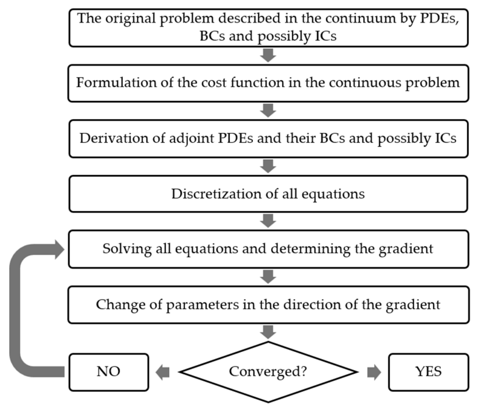
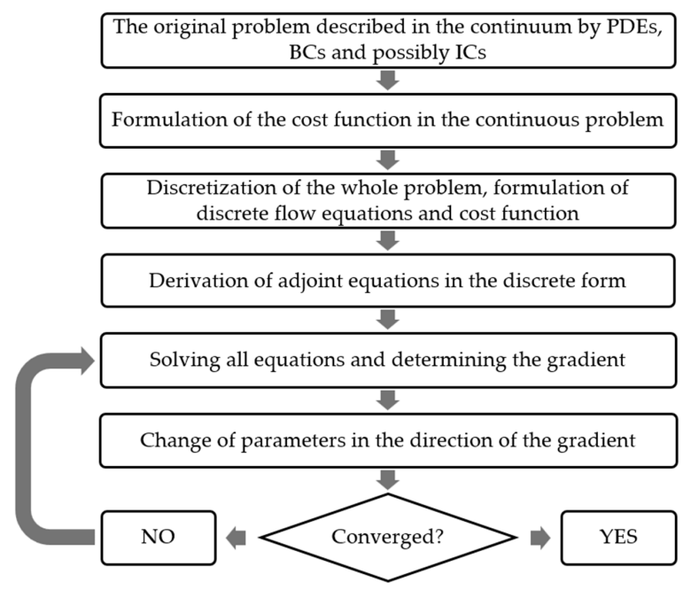
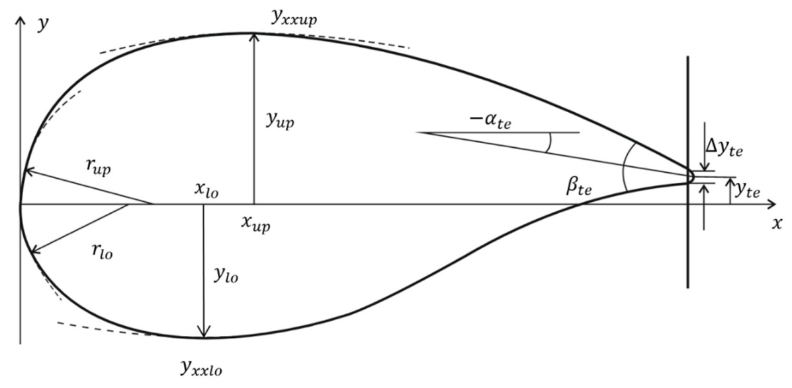
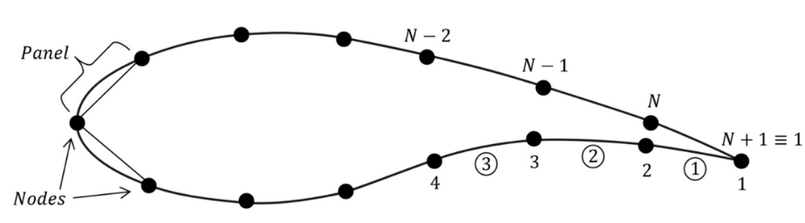
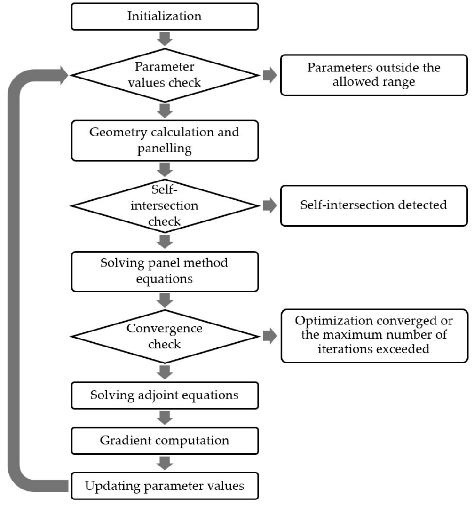
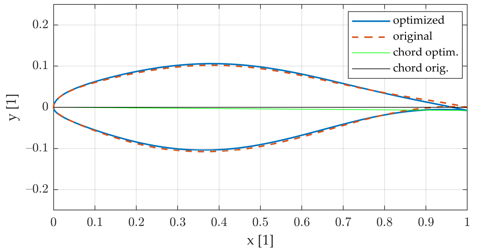
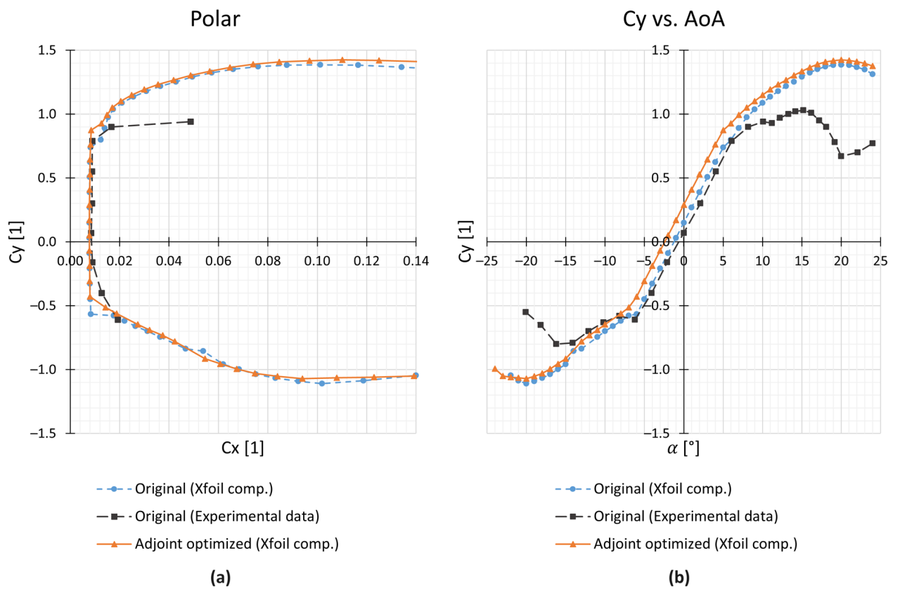
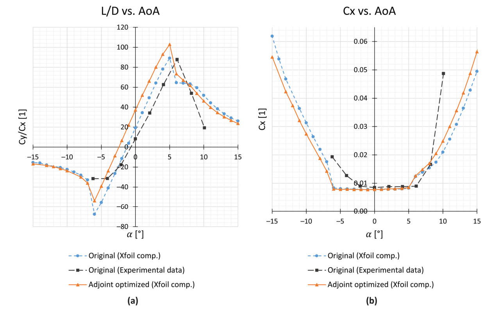

# 基于 PARSEC 参数化与伴随法的交互式翼型优化

**原题：** Interactive Airfoil Optimization Using Parsec Parametrization and Adjoint Method  
**作者：** Marek Belda*、Tomáš Hyhlík  
**期刊：** Applied Sciences，2024，14，3495  
**DOI：** [10.3390/app14083495](https://doi.org/10.3390/app14083495)

布拉格捷克理工大学机械工程学院流体动力学与热力学系，Technická 1902/4，Prague 6–Dejvice，160 00 Prague，捷克共和国。

*通讯作者：marek.belda@fs.cvut.cz；电话：+420-602-663-423。

**学术编辑：** Zhaosheng Yu  
**收稿日期：** 2024 年 3 月 17 日；**修订日期：** 2024 年 4 月 16 日；**接受日期：** 2024 年 4 月 17 日；**发表日期：** 2024 年 4 月 21 日。

**版权与许可：** © 2024，作者所有。被许可方为瑞士巴塞尔 MDPI。本文为开放获取文章，依据 [Creative Commons 署名许可（CC BY 4.0）](https://creativecommons.org/licenses/by/4.0/)的条款发布。

**特色应用：** 本文工作的潜在应用是翼型与机翼的初步设计及优化。在这一领域，该方法的优势（计算成本极低、鲁棒性强等）能够得到最大程度的发挥，而限制该方法的不足则可以尽量减小。相关代码已可用于工程实践。

## 摘要

在交互式气动优化工具的开发过程中，降低流动计算复杂度的需求日益突出。利用机器学习估计流动变量能够降低计算复杂度，但这一途径存在若干障碍。本文重点研究另一种途径：通过采用无黏、不可压缩势流假设降低计算复杂度，从而避开上述障碍。这些假设使该方法仅适用于特定情形，但这类情形在工程实践中相当普遍。基于这些假设，可以将伴随法、PARSEC 参数化和面元法结合起来，形成一种计算效率很高且鲁棒的翼型升力系数（$C_y$）优化工具。本文对 NREL S809 翼型进行了优化，并利用 Xfoil 6.99 软件验证了结果。Xfoil 验证表明，只需对翼型形状作出很小的改动，便可显著提高 $C_y$ 和升阻比。在攻角（AoA）为 $0^\circ$ 时，提升幅度超过 94%；在攻角为 $6.2^\circ$ 时，提升幅度超过 16%。这表明，该方法可取得与某些遗传算法相近的性能改善，而计算成本低了多个数量级。

**关键词：** 气动外形优化；翼型设计；伴随法；PARSEC 参数化；计算流体力学；交互式优化

## 1. 引言

翼型气动优化过程依赖于两个主要因素。第一个因素是计算效率高的优化方法，能够有效地使目标函数最小化或最大化。第二个因素或许比第一个更重要，即用设计变量表示翼型的能力，也就是对翼型进行参数化。目前已有许多翼型参数化方法和优化方法，由此产生了数十种可能的组合。然而，要可靠且较为快速地开展基于计算流体力学（CFD）的优化，在很大程度上依赖于伴随法在 20 世纪 70—80 年代的提出，以及其在 90 年代和 21 世纪初的发展。

当前，气动优化研究与开发的目标正在转向快速的交互式设计优化 [1]，这种优化要求几乎即时获得结果。基于 CFD 的伴随优化方法已经发展成为一种经过充分研究和验证的成熟方案，并已应用于商业大型 CFD 软件（如 Ansys Fluent）和开源软件（如 OpenFOAM）。但它并不十分适合这一任务。原因是现代 CFD 仿真的计算复杂度非常高，即便采用最高效的优化方法，优化速度仍然不足以满足交互式要求 [1]。由此可见，要实现交互式设计优化，就必须大幅降低流场求解和优化算法两方面的计算复杂度 [1]。

至少有两种方式可以实现这一目标。第一种见文献 [1] 及其参考文献，即利用现代机器学习（ML）方法估计流动变量、气动力系数，有时还会在与伴随法结合时估计伴随变量。本文采用另一种方式：继续使用伴随法进行优化，同时对流动作出一些假设，从而能够使用面元法等更简单、因而更快速的方法求解流动变量。经过谨慎构建后，这种方法几乎能够完全避开机器学习途径的三个主要障碍：外推预测、维数灾难，以及对大量高质量训练数据的需求 [1]。不过，在这种基于伴随法与流动假设的途径中，必须十分谨慎地选定设计工况并简化流动，因为简化过程可能忽略某些重要流动现象。这意味着，对于一些问题，尤其是必须考虑可压缩和／或黏性流动的问题，采用机器学习方法应对交互式优化的挑战可能更为可行。

伴随法是一种计算效率很高的优化方法。正如文献 [2,3] 所述，它的效率和精度使其非常适合流体力学中的优化问题。然而，其数学工具和程序实现都较为复杂，因此在提出后的初期发展相当缓慢 [4]。自提出以来，伴随法已成功用于流体力学领域中多种外流与内流优化问题，例如文献 [2–7] 中的问题。根据文献 [3,8]，伴随法源于最优控制理论，最早由 Olivier Pironneau（1945 年生）和 Anthony Jameson（1934 年生）提出 [7]。Jameson 开发并成功应用了第一个基于伴随途径的优化程序 [9]。

与有限差分法不同，伴随法利用伴随变量间接计算目标函数的梯度 [2,3,8]。因此，计算目标函数梯度所需的工作量不随设计变量数量变化，其成本始终大致相当于两次流场求解 [2,3,8]。尽管伴随法计算效率很高，在对待优化几何进行参数化时，仍应选取适当数量的设计变量，避免使用冗余变量，从而防止或至少减轻所得解在几何或物理上不可行的问题。当必须先简化原问题再进行优化时，这一点尤为重要。

为了获得优化方法所需的设计变量，至少对翼型而言，可选的参数化方法确实有数十种 [10,11]。PARSEC 参数化只是其中一种经过充分验证的方法。其他方法包括四位数和五位数 NACA 系列及其改型 [12]、类别形状变换（CST）[13]、文献 [14] 提出的解析方程法等。其中，四位数与五位数 NACA 系列以及文献 [14] 的解析方程法均不超过 6 个参数。CST 可以采用任意数量的参数；PARSEC 则根据具体变体使用 11 或 12 个参数 [13,15]，还存在其他改进的 PARSEC 方法 [15]。

PARSEC 方法已广泛用于翼型优化，例如文献 [13,16–18]。它对翼型前缘、上下表面极值点位置及这些位置处的曲率具有较强的控制能力 [15]。此外，其参数具有清晰、直观的几何意义，有助于更好地理解翼型形状。PARSEC 能够以合理数量的设计变量表示一般翼型，是一种很有力的参数化方法 [10,19]。在设计变量数量相近时，其几何精度与 Bézier、径向基函数（RBF）和 Hicks–Henne 参数化方法大致相当 [11]；在气动特性精度方面，则与文献 [11] 所讨论的其他参数化方法相当。不过，PARSEC 对尾缘形状缺乏精确控制 [10]。在本文中，这反而可能有利，因为尾缘形状对面元法结果的影响非常显著，而这种影响未必对应真实的物理现象。

本文采用 Hess 和 Smith 于 1966 年提出的面元法 [20] 作为流动求解器，因此计算成本很低。由于面元法本身较为简单，选择参数化方法时必须格外谨慎。许多参数化方法能够给定几乎任意的尾缘几何，这种能力可能因制造困难，或因面元法未考虑的流动现象，而妨碍优化结果的实际应用。此外，设计变量过多或对尾缘形状控制过强，都可能导致优化过程中出现几何上不可能的畸变形状。本文选用 PARSEC 参数化，一方面是因为需要一种经过验证的方法，另一方面是考虑到所采用的流动求解器，需要确保最终形状在几何和物理上可行。

接下来需要考虑的是输入数据的不确定性以及有限的制造精度。研究最优形状对输入数据不确定性的依赖，以及有限制造精度对原始翼型和优化翼型性能的影响，将是很有价值的课题。已有许多方法用于评估不确定运行条件对解的影响，相关方法及其可能用途可参见文献 [21,22]。不过，这一主题十分广泛，需要一篇完整论文才能作充分讨论，因此本文不予展开。

本文的主要目标是研究建立一种运行极快的交互式翼型优化流程的可能性，该流程将伴随法与 PARSEC 参数化相结合。第二个目标是提供 Xfoil 数据，验证优化的有效性。本文还将所开发优化程序的效率及其结果，与其他二维翼型优化研究进行比较。该优化算法在所有使用翼型的领域都可能具有较大价值，包括飞机与风力机的设计开发，以及车辆动力学和稳定性等领域，后者的例子可见文献 [23]。

## 2. 伴随优化理论

### 2.1. 优化的一般基础

不同优化方法在计算复杂度、对目标函数的要求、搜索类型（局部或全局）等方面各不相同。在流体力学中，由于每次流场求解都需要很高的计算成本 [1,3,9]，而不同优化方法的计算成本又可能相差多个数量级，因此计算效率尤为重要。由于这一原因，全局方法在流体力学中使用相对较少；局部方法的计算需求低得多，通常是更合适的选择 [1]。尽管搜索具有局部性，但较低的计算成本使其更适合大多数 CFD 优化问题；只要谨慎定义目标函数，局部搜索就不会成为问题 [3]。

表 1 给出了不同方法的计算复杂度，突出了伴随法的计算效率。单纯形法看起来甚至更高效，但表 1 并未完整反映它的计算需求。表中数据来自文献 [2] 和对优化算法的理论分析，适用于算法正常推进的情况。不过，单纯形法启动时计算开销较大，第一次迭代的成本相当于 $m+1$ 次流场求解，因为 $m$ 维空间中的单纯形有 $m+1$ 个顶点。此外，单纯形法可能出现所谓的“收敛停滞”，即算法停在距离目标极值可能还很远的位置。要解决这一问题，需要重新缩放单纯形。因此，摆脱收敛停滞的计算复杂度相当于 $m$ 次流场求解，因为可以保留原单纯形的一个顶点。

这意味着，表 1 所列的单纯形法计算复杂度是绝对最理想的情况，其实际成本可能高得多。其他算法则不会特别受到这一问题的影响。表中符号含义为：$m$ 表示参数数量，即设计空间维数；$k$ 表示每代种群中的个体数量，通常在 10～1000 之间。

**表 1. 一次优化迭代相对于一次流场求解的计算成本 [2]。**

| 优化方法 | 响应面法（RSM） | 遗传算法 | 有限差分法 | 伴随法 | 单纯形法 |
|---|---:|---:|---:|---:|---:|
| 计算复杂度 | $m^2$ | $k$ | $m+1$ | $\approx 2$ | $\approx 1$ |

### 2.2. 伴随法：连续与离散途径

伴随优化主要有连续和离散两种途径 [3,4]。二者的区别在于推导过程中数学运算的先后顺序。每种途径又都可以从拉格朗日或对偶观点出发，因为二者会得到相同结果 [7]。本文采用拉格朗日观点，因为它与约束优化的联系更自然。

Jameson 倾向采用的连续途径，从物理学与连续介质力学的角度看更为自然。在这种途径中，首先定义连续问题的目标函数，然后从连续流动方程推导伴随偏微分方程（PDE）及相应的边界条件（BC），必要时还包括初始条件（IC）。随后分别离散所有方程，并进行数值求解。求解这些方程后，即可计算目标函数相对于设计变量的梯度。

这种途径在推导伴随方程，尤其是其边界条件时，必须十分谨慎 [3]。这使其在数学上非常复杂且富有挑战，尽管它可能比离散版本具有更高的计算效率和更低的内存需求 [4]。连续版本对于理解伴随方程的行为和物理意义，以及评估问题是否可能不适定，也非常重要 [3,4]。连续伴随法的工作流程如图 1 所示。

**图 1. 连续伴随法的流程图。**

> 图内文字译文：用偏微分方程、边界条件及可能的初始条件描述连续介质中的原问题 → 定义连续问题的目标函数 → 推导伴随偏微分方程及其边界条件和可能的初始条件 → 离散所有方程 → 求解所有方程并确定梯度 → 沿梯度方向改变参数 → 判断是否收敛；“否”则返回方程求解，“是”则结束。

离散伴随法的运算顺序有所不同。其起点与连续途径相同，即定义连续问题的目标函数。随后，将整个连续问题一并离散：离散流动偏微分方程，施加相应的边界条件和初始条件，并将连续目标函数的离散对应形式表示为多变量函数。完成这些步骤后，才从离散化的流动偏微分方程推导伴随代数方程组。这一途径的优缺点见文献 [4]。它避开了连续途径中的许多复杂性，但在离散问题时必须十分谨慎。离散伴随法的工作流程如图 2 所示。

**图 2. 离散伴随法的流程图。**

> 图内文字译文：用偏微分方程、边界条件及可能的初始条件描述连续介质中的原问题 → 定义连续问题的目标函数 → 离散整个问题，形成离散流动方程与目标函数 → 推导离散形式的伴随方程 → 求解所有方程并确定梯度 → 沿梯度方向改变参数 → 判断是否收敛；“否”则返回方程求解，“是”则结束。

### 2.3. 从拉格朗日观点看离散伴随法：控制方程

本文采用 Jameson 在文献 [3] 中定义的符号体系。$\boldsymbol w$ 为因变量集合，通常包括积分点处的速度分量、压力等。在面元法中，$\boldsymbol w$ 的含义略为复杂，后文将进一步说明。$\boldsymbol F$ 为参与优化的独立参数集合，即设计变量；在本文中，它们是描述翼型形状的 PARSEC 参数。向量 $\boldsymbol w$ 与 $\boldsymbol F$ 通过方程组 $\boldsymbol R$ 隐式关联，从而可以根据已知参数 $\boldsymbol F$ 计算 $\boldsymbol w$。黏度等固定参数在优化过程中不变，因此此处不再列出。

定义所有变量后，即可定义离散目标函数 $I$，其中 $\boldsymbol w$ 与 $\boldsymbol F$ 受约束 $\boldsymbol R$ 限制。由此得到经典的约束极值问题，可借助拉格朗日乘子 $\boldsymbol\lambda$ 求解。

$$
\begin{gathered}
\boldsymbol w=\begin{bmatrix}w_1\\\vdots\\w_n\end{bmatrix},\qquad
\boldsymbol F=\begin{bmatrix}F_1\\\vdots\\F_m\end{bmatrix},\qquad
\boldsymbol R=\begin{bmatrix}R_1\\\vdots\\R_n\end{bmatrix}=\boldsymbol0,\\
I=I(\boldsymbol w,\boldsymbol F),\qquad
\boldsymbol\lambda=\begin{bmatrix}\lambda_1\\\vdots\\\lambda_n\end{bmatrix}.
\end{gathered}
\tag{1}
$$

$$
\phi(\boldsymbol w,\boldsymbol F,\boldsymbol\lambda)
=I(\boldsymbol w,\boldsymbol F)+\boldsymbol\lambda^T\!\cdot\boldsymbol R(\boldsymbol w,\boldsymbol F).
\tag{2}
$$

$$
\begin{aligned}
\operatorname{grad}(\phi)
&=\left(\frac{\partial\phi}{\partial w_i};\frac{\partial\phi}{\partial F_j};\frac{\partial\phi}{\partial\lambda_k}\right)\\
&=\left(\frac{\partial I}{\partial w_i}+\lambda_l\frac{\partial R_l}{\partial w_i};
\frac{\partial I}{\partial F_j}+\lambda_l\frac{\partial R_l}{\partial F_j};R_k\right).
\end{aligned}
\tag{3}
$$

由梯度可写出 $\phi$ 的全微分。不过，在拉格朗日途径中，函数 $\phi$ 的所有变量均被视为独立变量。因此，只有当式（4）的第一项与最后一项为零时，才能确定 $\phi$ 相对于 $\boldsymbol F$ 的梯度。由此得到式（5）和式（6）两个方程组，共包含 $2n$ 个方程，可用于计算 $\boldsymbol w$ 和 $\boldsymbol\lambda$。

$$
\mathrm d\phi=
\left(\frac{\partial I}{\partial w_i}+\lambda_l\frac{\partial R_l}{\partial w_i}\right)\mathrm dw_i
+\left(\frac{\partial I}{\partial F_j}+\lambda_l\frac{\partial R_l}{\partial F_j}\right)\mathrm dF_j
+R_k\,\mathrm d\lambda_k.
\tag{4}
$$

$$
\boldsymbol R=\boldsymbol0.
\tag{5}
$$

$$
\left[\frac{\partial\boldsymbol R}{\partial\boldsymbol w}\right]^T\boldsymbol\lambda
=-\left[\frac{\partial I}{\partial\boldsymbol w}\right]^T.
\tag{6}
$$

当约束 $\boldsymbol R$ 为线性约束时，式（5）可以写成矩阵形式，式（6）左侧的雅可比矩阵也很容易计算。此时，整个方程组形成式（8）和式（9）两个线性代数方程组（LAE）。

$$
\boldsymbol R=\boldsymbol A\boldsymbol w-\boldsymbol b=\boldsymbol0
\ \Longrightarrow\ \boldsymbol A\boldsymbol w=\boldsymbol b,\qquad
\frac{\partial\boldsymbol R}{\partial\boldsymbol w}\equiv\boldsymbol A.
\tag{7}
$$

$$
\boldsymbol A\boldsymbol w=\boldsymbol b.
\tag{8}
$$

$$
\boldsymbol A^T\boldsymbol\lambda=-\left[\frac{\partial I}{\partial\boldsymbol w}\right]^T.
\tag{9}
$$

求得 $\boldsymbol w$ 和 $\boldsymbol\lambda$ 后，即可方便地得到 $\phi$ 相对于 $\boldsymbol F$ 的梯度。可以证明，由于约束 $\boldsymbol R$ 必须始终满足式（5），这一梯度与 $I$ 的梯度恒等。随后，采用简单的最速下降算法，得到最优参数的新近似值，见式（11）。

$$
G_j=\frac{\partial\phi}{\partial F_j}
=\frac{\partial I}{\partial F_j}+\lambda_l\frac{\partial R_l}{\partial F_j}.
\tag{10}
$$

$$
\boldsymbol F^{(n+1)}=\boldsymbol F^{(n)}+\zeta\boldsymbol G.
\tag{11}
$$

## 3. PARSEC 参数化

本文选择 PARSEC 参数化进行优化，是因为它在一般翼型的几何与流动特性方面均具有较高精度 [10,11]。其参数还具有清晰、直观的几何意义，因此便于固定某些几何量，也有助于从工程角度更好地理解翼型形状。基本 PARSEC 参数化包含 11 个参数 [10]。本文优化时采用文献 [13] 提出的一种略有修改的版本，以更好地控制翼型前缘附近的形状 [13]。这些参数与基本 PARSEC 的参数非常相似，唯一区别在于分别给定上下表面的前缘半径。

表 2 和图 3 给出了这些参数的几何意义。翼型形状由式（12）和式（13）表示，即一组基函数的线性组合 [10]。根据文献 [13]，线性组合的系数由式（14）和式（15）计算。

$$
y=\sum_{i=1}^{6}a_i\,x^{i-\frac12}.
\tag{12}
$$

$$
y=\sum_{i=1}^{6}b_i\,x^{i-\frac12}.
\tag{13}
$$

$$
\begin{bmatrix}
1&1&1&1&1&1\\
x_{\mathrm{lo}}^{1/2}&x_{\mathrm{lo}}^{3/2}&x_{\mathrm{lo}}^{5/2}&x_{\mathrm{lo}}^{7/2}&x_{\mathrm{lo}}^{9/2}&x_{\mathrm{lo}}^{11/2}\\
1/2&3/2&5/2&7/2&9/2&11/2\\
\frac12x_{\mathrm{lo}}^{-1/2}&\frac32x_{\mathrm{lo}}^{1/2}&\frac52x_{\mathrm{lo}}^{3/2}&\frac72x_{\mathrm{lo}}^{5/2}&\frac92x_{\mathrm{lo}}^{7/2}&\frac{11}2x_{\mathrm{lo}}^{9/2}\\
-\frac14x_{\mathrm{lo}}^{-3/2}&\frac34x_{\mathrm{lo}}^{-1/2}&\frac{15}4x_{\mathrm{lo}}^{1/2}&\frac{35}4x_{\mathrm{lo}}^{3/2}&\frac{63}4x_{\mathrm{lo}}^{5/2}&\frac{99}4x_{\mathrm{lo}}^{7/2}\\
1&0&0&0&0&0
\end{bmatrix}
\begin{bmatrix}b_1\\b_2\\b_3\\b_4\\b_5\\b_6\end{bmatrix}
=\begin{bmatrix}
y_{\mathrm{te}}\\y_{\mathrm{lo}}\\
\tan\!\left(\alpha_{\mathrm{te}}+\frac{\beta_{\mathrm{te}}}{2}\right)\\
0\\y_{xx\mathrm{lo}}\\-\sqrt{2r_{\mathrm{lo}}}
\end{bmatrix}.
\tag{14}
$$

$$
\begin{bmatrix}
1&1&1&1&1&1\\
x_{\mathrm{up}}^{1/2}&x_{\mathrm{up}}^{3/2}&x_{\mathrm{up}}^{5/2}&x_{\mathrm{up}}^{7/2}&x_{\mathrm{up}}^{9/2}&x_{\mathrm{up}}^{11/2}\\
1/2&3/2&5/2&7/2&9/2&11/2\\
\frac12x_{\mathrm{up}}^{-1/2}&\frac32x_{\mathrm{up}}^{1/2}&\frac52x_{\mathrm{up}}^{3/2}&\frac72x_{\mathrm{up}}^{5/2}&\frac92x_{\mathrm{up}}^{7/2}&\frac{11}2x_{\mathrm{up}}^{9/2}\\
-\frac14x_{\mathrm{up}}^{-3/2}&\frac34x_{\mathrm{up}}^{-1/2}&\frac{15}4x_{\mathrm{up}}^{1/2}&\frac{35}4x_{\mathrm{up}}^{3/2}&\frac{63}4x_{\mathrm{up}}^{5/2}&\frac{99}4x_{\mathrm{up}}^{7/2}\\
1&0&0&0&0&0
\end{bmatrix}
\begin{bmatrix}a_1\\a_2\\a_3\\a_4\\a_5\\a_6\end{bmatrix}
=\begin{bmatrix}
y_{\mathrm{te}}\\y_{\mathrm{up}}\\
\tan\!\left(\alpha_{\mathrm{te}}-\frac{\beta_{\mathrm{te}}}{2}\right)\\
0\\y_{xx\mathrm{up}}\\\sqrt{2r_{\mathrm{up}}}
\end{bmatrix}.
\tag{15}
$$

**表 2. PARSEC 参数及其含义。**

| 基本 PARSEC 参数化 [10]：参数 | 含义 | 本文优化采用的 PARSEC 变体 [13]：参数 | 含义 |
|---|---|---|---|
| — | — | $r_{\mathrm{lo}}$ [1] | 下表面前缘半径 |
| $x_{\mathrm{lo}}$ [1] | 下表面极值点的水平位置 | $x_{\mathrm{lo}}$ [1] | 下表面极值点的水平位置 |
| $y_{\mathrm{lo}}$ [1] | 下表面极值点的竖直位置 | $y_{\mathrm{lo}}$ [1] | 下表面极值点的竖直位置 |
| $y_{xx\mathrm{lo}}$ [1] | 下表面极值点处的曲率 | $y_{xx\mathrm{lo}}$ [1] | 下表面极值点处的曲率 |
| $r_{\mathrm{le}}$ [1] | 前缘半径 | $r_{\mathrm{up}}$ [1] | 上表面前缘半径 |
| $x_{\mathrm{up}}$ [1] | 上表面极值点的水平位置 | $x_{\mathrm{up}}$ [1] | 上表面极值点的水平位置 |
| $y_{\mathrm{up}}$ [1] | 上表面极值点的竖直位置 | $y_{\mathrm{up}}$ [1] | 上表面极值点的竖直位置 |
| $y_{xx\mathrm{up}}$ [1] | 上表面极值点处的曲率 | $y_{xx\mathrm{up}}$ [1] | 上表面极值点处的曲率 |
| $\alpha_{\mathrm{te}}$ [°] | 尾缘方向角 | $\alpha_{\mathrm{te}}$ [°] | 尾缘方向角 |
| $\beta_{\mathrm{te}}$ [°] | 尾缘楔角 | $\beta_{\mathrm{te}}$ [°] | 尾缘楔角 |
| $y_{\mathrm{te}}$ [1] | 尾缘的竖直位置 | $y_{\mathrm{te}}$ [1] | 尾缘的竖直位置 |
| $\Delta y_{\mathrm{te}}$ [1] | 尾缘厚度 | $\Delta y_{\mathrm{te}}$ [1] | 尾缘厚度 |

**图 3. 翼型的 PARSEC 参数及其几何意义。**

本文假定尾缘厚度 $\Delta y_{\mathrm{te}}$ 始终为零，即采用尖尾缘，因此不将其作为设计变量。这可能限制某些情况下的适用性，但作者认为，这一处理对算法鲁棒性的益处超过了这一缺点。尖尾缘更容易正确施加库塔条件，也能防止优化过程对尾缘几何作出不合理改动。

由于尾迹通常从尾缘附近开始形成，这一区域往往是黏性效应最显著的区域。优化过程无法考虑这些黏性效应，尤其是尾迹形成，因此本文决定尽可能限制这一区域的变化。此外，尾缘可以通过许多方式调整，其中大多数远远超出了 PARSEC 参数化的能力范围；对尾缘控制不足也被视为 PARSEC 的主要弱点之一 [10]。要对尾缘进行精细调整，必须采用能够正确捕捉黏性现象的方法。由 PARSEC 参数化得到的 11 个设计变量组成向量 $\boldsymbol F$，如下所示：

$$
\boldsymbol F=
\left[r_{\mathrm{lo}},x_{\mathrm{lo}},y_{\mathrm{lo}},y_{xx\mathrm{lo}},
r_{\mathrm{up}},x_{\mathrm{up}},y_{\mathrm{up}},y_{xx\mathrm{up}},
\alpha_{\mathrm{te}},\beta_{\mathrm{te}},y_{\mathrm{te}}\right]^T.
\tag{16}
$$

## 4. 翼型优化：控制方程与实现

### 4.1. 势流与面元法

对翼型绕流进行建模时，本文采用无黏、不可压缩势流假设。虽然这一假设限制较强，但它允许使用势流理论及文献 [24] 所述的面元法。在这里，不可压缩条件可以适当放宽：只要 Prandtl–Glauert 可压缩性修正规则仍然成立，第 4 节提出的优化就仍然适用。根据文献 [25]，对于 $Ma_\infty\leq0.5$ 的流动可以这样处理，但当 $Ma_\infty>0.4$ 时，应格外谨慎。

本文采用 Hess–Smith 面元法 [20] 获得势流解。势流理论的控制方程，以及面元法的理论和控制方程，可参见文献 [20,24]。应用文献 [20,24] 中的方程后，可定义升力系数 $C_y$，并将其改写为无量纲变量形式，见式（17）；无量纲变量的定义见式（18）。

$$
C_y=-\oint_l\frac1L\left(\gamma-\hat u^2-\hat v^2\right)\,\mathrm dx.
\tag{17}
$$

$$
\hat u=\frac{u}{c_\infty},\qquad
\hat v=\frac{v}{c_\infty},\qquad
\hat p_\infty=\frac{2p_\infty}{\rho c_\infty^2},\qquad
\gamma=1+\hat p_\infty.
\tag{18}
$$

为便于后续各节推导，可将式（17）中的弦长 $L$ 提出积分并移到等式左侧，从而得到连续目标函数的表达式（19）。

$$
I=L\,C_y=-\oint_l\left(\gamma-\hat u^2-\hat v^2\right)\,\mathrm dx.
\tag{19}
$$

现在即可对整个问题进行离散，包括文献 [24] 中速度势满足的调和控制方程以及目标函数（19）。离散目标函数只需通过离散式（19）中的积分即可得到。为获得离散流动方程，采用 Hess–Smith 面元法 [20]，将整个翼型离散为许多直线段，即面元，从而得到文献 [20] 推导的面元法方程。在这一优化问题中，因变量 $\boldsymbol w$ 是各面元上的源强和绕翼型的环量。下面给出面元法控制方程及目标函数的离散形式。下标 $i$ 表示面元编号，编号方式如图 4 所示。

$$
I=L\,C_y=-\sum_{i=1}^{N}\left(\gamma-\hat c_{ti}^{\,2}\right)\Delta x_i.
\tag{20}
$$

$$
\Delta x_i=x_{i+1}-x_i,\qquad
x_{N+1}\equiv x_1,\qquad
\hat c_{ti}^{\,2}=\hat u_i^2+\hat v_i^2.
\tag{21}
$$

$$
\boldsymbol A\boldsymbol w=\boldsymbol b,\qquad
\boldsymbol w=[q_1,\ldots,q_N,\Gamma]^T.
\tag{22}
$$

**图 4. 面元法中的节点与面元编号。**

> 图内文字：Panel 为“面元”；Nodes 为“节点”。

矩阵 $\boldsymbol A$ 和向量 $\boldsymbol b$ 各元素的确切定义见文献 [20]。由这些定义可知，向量 $\boldsymbol b$ 的每一项都可以提出 $c_\infty$，因此可将整个线性代数方程组（22）除以该值，得到式（23）。

$$
\boldsymbol A\hat{\boldsymbol w}=\hat{\boldsymbol b},\qquad
\hat{\boldsymbol w}=\frac{\boldsymbol w}{c_\infty},\qquad
\hat{\boldsymbol b}=\frac{\boldsymbol b}{c_\infty}.
\tag{23}
$$

各面元上的切向速度可直接由面元法获得 [20]。将其表达式除以 $c_\infty$，即可得到式（24），进而代入目标函数（20）。至此，推导伴随优化所需的方程整理工作已经完成。

$$
\begin{aligned}
\hat c_{ti}=\frac{c_{ti}}{c_\infty}
={}&\cos(\theta_i-\alpha)\\
&+\sum_{j=1}^{N}\frac{\hat w_j}{2\pi}
\left[\sin(\theta_i-\theta_j)\beta_{ij}
-\cos(\theta_i-\theta_j)\ln\frac{r_{i,j+1}}{r_{ij}}\right]\\
&+\frac{\hat w_{N+1}}{2\pi}\sum_{j=1}^{N}
\left[\sin(\theta_i-\theta_j)\ln\frac{r_{i,j+1}}{r_{ij}}
+\cos(\theta_i-\theta_j)\beta_{ij}\right].
\end{aligned}
\tag{24}
$$

### 4.2. 结合面元法与 PARSEC 参数化的伴随优化

要得到伴随优化方程，需从式（9）和式（23）出发。矩阵 $\boldsymbol A$ 与向量 $\boldsymbol b$ 已由文献 [20] 给出。式（9）中唯一需要进一步明确的是右端项，在这里它包含 $I$ 相对于 $\hat{\boldsymbol w}$ 的梯度。

$$
\left[\frac{\partial I}{\partial\hat{\boldsymbol w}}\right]
=2(\Delta x\hat c_t)^T\boldsymbol C,\qquad
(\Delta x\hat c_t)=\begin{bmatrix}
\Delta x_1\hat c_{t1}\\\vdots\\\Delta x_N\hat c_{tN}
\end{bmatrix}.
\tag{25}
$$

式（25）中的 $\boldsymbol C$ 定义如下：

$$
C_{ik}=\frac{\partial\hat c_{ti}}{\partial\hat w_k}
=\frac1{2\pi}\left[
\sin(\theta_i-\theta_k)\beta_{ik}
-\cos(\theta_i-\theta_k)\ln\frac{r_{i,k+1}}{r_{ik}}
\right],\qquad k=1,\ldots,N.
\tag{26}
$$

$$
C_{i,N+1}=\frac{\partial\hat c_{ti}}{\partial\hat w_{N+1}}
=\frac1{2\pi}\sum_{j=1}^{N}
\left[\sin(\theta_i-\theta_j)\ln\frac{r_{i,j+1}}{r_{ij}}
+\cos(\theta_i-\theta_j)\beta_{ij}\right].
\tag{27}
$$

梯度的定义直接来自式（10），其中各偏导数由式（28）和式（29）给出。

$$
\frac{\partial I}{\partial F_k}
=2\sum_{i=1}^{N}\Delta x_i\hat c_{ti}\frac{\partial\hat c_{ti}}{\partial F_k}.
\tag{28}
$$

$$
\frac{\partial R_l}{\partial F_k}
=\frac{\partial}{\partial F_k}\left(A_{lm}\hat w_m-\hat b_l\right)
=\frac{\partial A_{lm}}{\partial F_k}\hat w_m-\frac{\partial\hat b_l}{\partial F_k}.
\tag{29}
$$

接下来可进一步处理式（28）和式（29）中的各项。向量 $\hat{\boldsymbol c}_t$、$\hat{\boldsymbol b}$ 以及矩阵 $\boldsymbol A$ 的导数可以采用半解析方式获得，从而大幅减少需要数值计算的导数数量，节省大量计算成本。可以证明，只有以下导数必须通过数值方法计算：

$$
\frac{\partial\theta_i}{\partial F_k},\qquad
\frac{\partial\beta_{ij}}{\partial F_k},\qquad
\frac{\partial r_{ij}}{\partial F_k}.
\tag{30}
$$

这些导数采用一阶前向差分计算。这种近似具有一阶精度，但计算开销很低。程序运行于默认使用双精度的 MATLAB R2023b，因此计算有限差分时，可以选用较小步长，而不会因舍入误差损失精度。研究发现，$\delta=10^{-8}$ 可以给出准确结果，并保证优化算法稳定。作者也尝试过 $\delta=10^{-9}$，但精度与稳定性均未出现明显改善。所有数值导数均按式（31）的形式计算。

$$
\frac{\partial r_{ij}}{\partial F_k}\simeq
\frac{
r_{ij}(F_1,\ldots,F_{k-1},F_k+\delta,F_{k+1},\ldots,F_m)
-r_{ij}(F_1,\ldots,F_m)
}{\delta}.
\tag{31}
$$

现在可定义下列辅助变量。它们出现在对式（28）和式（29）各项求解析导数的过程中。虽然这些变量在数学上并非必需，但可以使程序实现更容易，也更清晰。

$$
\mathrm{dIdFk}_{1i}=-\sin(\theta_i-\alpha)\frac{\partial\theta_i}{\partial F_k}.
\tag{32}
$$

$$
\mathrm{dIdFk}_{2ij}
=\cos(\theta_i-\theta_j)
\left(\frac{\partial\theta_i}{\partial F_k}-\frac{\partial\theta_j}{\partial F_k}\right)\beta_{ij}
+\sin(\theta_i-\theta_j)\frac{\partial\beta_{ij}}{\partial F_k}.
\tag{33}
$$

$$
\begin{aligned}
\mathrm{dIdFk}_{3ij}
={}&-\sin(\theta_i-\theta_j)
\left(\frac{\partial\theta_i}{\partial F_k}-\frac{\partial\theta_j}{\partial F_k}\right)
\ln\frac{r_{i,j+1}}{r_{ij}}\\
&+\cos(\theta_i-\theta_j)
\frac{\displaystyle\frac{\partial r_{i,j+1}}{\partial F_k}r_{ij}
-r_{i,j+1}\frac{\partial r_{ij}}{\partial F_k}}{r_{ij}r_{i,j+1}}.
\end{aligned}
\tag{34}
$$

$$
\begin{aligned}
\mathrm{dIdFk}_{4ij}
={}&\cos(\theta_i-\theta_j)
\left(\frac{\partial\theta_i}{\partial F_k}-\frac{\partial\theta_j}{\partial F_k}\right)
\ln\frac{r_{i,j+1}}{r_{ij}}\\
&+\sin(\theta_i-\theta_j)
\frac{\displaystyle\frac{\partial r_{i,j+1}}{\partial F_k}r_{ij}
-r_{i,j+1}\frac{\partial r_{ij}}{\partial F_k}}{r_{ij}r_{i,j+1}}.
\end{aligned}
\tag{35}
$$

$$
\mathrm{dIdFk}_{5ij}
=-\sin(\theta_i-\theta_j)
\left(\frac{\partial\theta_i}{\partial F_k}-\frac{\partial\theta_j}{\partial F_k}\right)\beta_{ij}
+\cos(\theta_i-\theta_j)\frac{\partial\beta_{ij}}{\partial F_k}.
\tag{36}
$$

利用式（32）至式（36）定义的变量，可将式（28）和式（29）中的各项改写为：

$$
\begin{aligned}
\frac{\partial\hat c_{ti}}{\partial F_k}
=\mathrm{dIdFk}_{1i}+\sum_{j=1}^{N}\Bigg[
&\frac{\hat w_j}{2\pi}\left(\mathrm{dIdFk}_{2ij}-\mathrm{dIdFk}_{3ij}\right)\\
&+\frac{\hat w_{N+1}}{2\pi}\left(\mathrm{dIdFk}_{4ij}+\mathrm{dIdFk}_{5ij}\right)
\Bigg].
\end{aligned}
\tag{37}
$$

$$
\frac{\partial A_{lm}}{\partial F_k}
=\frac1{2\pi}\left(\mathrm{dIdFk}_{4lm}+\mathrm{dIdFk}_{5lm}\right),
\qquad l,m=1,\ldots,N.
\tag{38}
$$

$$
\frac{\partial A_{l,N+1}}{\partial F_k}
=\frac1{2\pi}\sum_{j=1}^{N}
\left(\mathrm{dIdFk}_{3lj}-\mathrm{dIdFk}_{2lj}\right),
\qquad l=1,\ldots,N.
\tag{39}
$$

$$
\frac{\partial A_{N+1,m}}{\partial F_k}
=\frac1{2\pi}\sum_{i=1,N}
\left(\mathrm{dIdFk}_{2im}-\mathrm{dIdFk}_{3im}\right),
\qquad m=1,\ldots,N.
\tag{40}
$$

$$
\frac{\partial A_{N+1,N+1}}{\partial F_k}
=\frac1{2\pi}\sum_{i=1,N}\sum_{j=1}^{N}
\left(\mathrm{dIdFk}_{4ij}+\mathrm{dIdFk}_{5ij}\right).
\tag{41}
$$

$$
\frac{\partial\hat b_l}{\partial F_k}
=\cos(\theta_l-\alpha)\frac{\partial\theta_l}{\partial F_k}.
\tag{42}
$$

$$
\frac{\partial\hat b_{N+1}}{\partial F_k}
=-\left(\mathrm{dIdFk}_{1,1}+\mathrm{dIdFk}_{1,N}\right).
\tag{43}
$$

随后即可构造目标函数相对于 $\boldsymbol F$ 的梯度，并计算最优设计变量 $\boldsymbol F$ 的新近似值。在梯度 $\boldsymbol G$ 中，$\hat{\boldsymbol w}$ 为式（23）的解，$\boldsymbol\lambda$ 为式（9）的解，而式（9）右端的梯度项由式（25）给出。

$$
G_k=2\sum_{i=1}^{N}\Delta x_i\hat c_{ti}\frac{\partial\hat c_{ti}}{\partial F_k}
+\lambda_l\left(\frac{\partial A_{lm}}{\partial F_k}\hat w_m
-\frac{\partial\hat b_l}{\partial F_k}\right).
\tag{44}
$$

$$
\boldsymbol F^{(n+1)}=\boldsymbol F^{(n)}+\zeta\boldsymbol G.
\tag{45}
$$

$$
\zeta=\frac{\zeta_0}{\lVert\boldsymbol G\rVert}.
\tag{46}
$$

$\zeta$ 是迭代步长。出于稳定性考虑，将其定义为式（46）的形式是有益的。这一定义等价于使用单位梯度，从而消除目标函数在设计空间某些区域具有强非线性所引起的稳定性问题。$\zeta_0$ 是由用户给定的名义迭代步长。

### 4.3. 最终形状的可行性与优化收敛

第 4.1 和第 4.2 节所述过程的程序实现较为简单，但仍需处理几个问题。第一个问题是防止优化过程中出现畸变形状。PARSEC 参数清晰的几何意义在解决这一问题时很有帮助：可以直接规定条件，确保形状在几何上可行。具体做法是监测参数值，例如 $r_{\mathrm{up}}$、$r_{\mathrm{lo}}$、$x_{\mathrm{up}}$、$x_{\mathrm{lo}}$ 和 $\beta_{\mathrm{te}}$；一旦它们超出允许范围，就立即停止优化。允许范围可由用户完全控制，从而设置自定义限制。

此外，翼型面元划分采用一种特殊方式，使翼型上下两部分的面元节点具有相同的 $x$ 坐标。这样便容易比较对应节点的 $y$ 坐标，并确保上表面节点的 $y$ 坐标始终大于下表面节点。如果通过这种方式检测到翼型表面自相交，就立即停止优化。这在参数允许范围的限制之外又增加了一层保护。

下一个问题是监测收敛。在本优化中，要求单调收敛。如果相邻两次迭代之间目标函数值变差，程序会显示警告，但不会终止优化，从而允许算法重新恢复单调收敛。

最后一个问题是定义收敛判据。由于假定流动为无黏、不可压缩势流，除了尾缘之外不允许发生流动分离，因此 $C_y$ 可能无界。这意味着，在不可压缩无黏条件下达到 $C_y$ 的真实最大值，可能——而且很可能——是不可能的。这使传统的极值收敛判据无法使用，也意味着如果允许优化进行过多迭代，即超过几十次，就可能出现几何上可行但毫无意义、明显不合理的形状。

为避免这种情况，本文采用了其他收敛判据。优化共有三种停止条件。第一种是在性能改善达到规定值时判定收敛，这一规定值可以是绝对改善量，也可以是相对改善量。第二种是在形状变化达到规定值时停止迭代，变化量用相对于原始形状的均方根差衡量。第三种则限制允许的最大迭代次数。

不过，这些判据会使最优结果受到所选阈值的影响。三者中，形状变化判据最为客观，因为可以将其解释为给定算法要搜索的设计空间区域。也可以从工程角度理解：基准形状通常是有理由地选定的，设计者未必希望优化时对其作出过大改动。

为了定义更加客观的判据，可以增加一个基于 von Kármán 动量积分方程和 Pohlhausen 方法的简单边界层求解器，判断翼型上是否发生流动分离。这样，停止条件就可以是发生分离；也可以采用这一条件的变体，例如分离点达到距尾缘某一规定距离的位置。不过，这种修改将增加计算成本，而相对于本文的计算规模，这一成本会相当显著。

用于执行本文优化的脚本以 MATLAB R2023b 编写，其运行流程如图 5 所示。

**图 5. 优化脚本的流程图。**

> 图内文字译文：初始化 → 检查参数值 → 计算几何并划分面元 → 检查自相交 → 求解面元法方程 → 检查收敛 → 求解伴随方程 → 计算梯度 → 更新参数值，并返回参数检查。三个退出分支分别为“参数超出允许范围”“检测到自相交”和“优化已收敛或已超过最大迭代次数”。

## 5. 结果与验证

### 5.1. 伴随优化结果：不可压缩无黏流

下面以 NREL S809 翼型为例，在表 3 和图 6 中给出最重要的优化结果。作者也尝试了其他翼型，得到的结果非常相似。这些结果表明，只需对设计变量作出很小的改变，即只对几何作出很小的改变，就能大幅提高 $C_y$。由于形状变化很小，可以假设阻力系数不会受到影响。之后，Xfoil 6.99 的计算结果证实了这一点。

表 3 给出了名义攻角分别为 $0^\circ$ 和 $10^\circ$ 时，优化求解器得到的设计变量及 $C_y$ 的变化。本文所有相关研究均采用 50 次迭代和名义迭代步长 $\zeta_0=0.0002$，这是一个非常保守的步长选择。设计变量结果保留四位有效数字，$C_y$ 保留四位小数。

**表 3. NREL S809 翼型优化前后的 PARSEC 参数。**

| 参数 | 原始翼型，攻角 0° | 原始翼型，攻角 10° | 优化翼型，攻角 0° | 优化翼型，攻角 10° |
|---|---:|---:|---:|---:|
| $\alpha$ [°] | 0 | 10 | 0 | 10 |
| $r_{\mathrm{lo}}$ [1] | 0.0100 | 0.0100 | 0.01115 | 0.01168 |
| $x_{\mathrm{lo}}$ [1] | 0.3633 | 0.3633 | 0.3630 | 0.3629 |
| $y_{\mathrm{lo}}$ [1] | −0.1081 | −0.1081 | −0.1038 | −0.1038 |
| $y_{xx\mathrm{lo}}$ [1] | 1.526 | 1.526 | 1.526 | 1.526 |
| $r_{\mathrm{up}}$ [1] | 0.02160 | 0.02160 | 0.02123 | 0.02167 |
| $x_{\mathrm{up}}$ [1] | 0.3826 | 0.3826 | 0.3829 | 0.3829 |
| $y_{\mathrm{up}}$ [1] | 0.1018 | 0.1018 | 0.1057 | 0.1057 |
| $y_{xx\mathrm{up}}$ [1] | −1.201 | −1.201 | −1.201 | −1.201 |
| $\alpha_{\mathrm{te}}$ [°] | −8.500 | −8.500 | −8.558 | −8.558 |
| $\beta_{\mathrm{te}}$ [°] | 8.500 | 8.500 | 8.499 | 8.495 |
| $y_{\mathrm{te}}$ [1] | 0 | 0 | −0.007687 | −0.007616 |
| $C_y$ [1] | 0.2178 | 1.4256 | 0.3507 | 1.5529 |
| $\Delta C_y^{\mathrm{ABS}}$ [1] | — | — | 0.1329 | 0.1273 |
| $\Delta C_y^{\mathrm{REL}}$ [%] | — | — | 61.02 | 8.93 |

**图 6. NREL S809 的形状，名义攻角为 0°。**

> 图例译文：optimized——优化后；original——原始；chord optim.——优化后弦线；chord orig.——原始弦线。

### 5.2. Xfoil 验证计算：可压缩黏性流

本节结果采用成熟的 Xfoil 6.99 软件获得。雷诺数与马赫数分别设为 $Re=750{,}000$ 和 $Ma=0.02$，以便将所得结果与文献 [13] 直接比较。伴随优化的名义攻角为零，得到的设计变量值见表 3 第 4 列，原始和优化后的形状见图 6。从表 3 可见，至少在本例中，最优形状对攻角的依赖很弱。这意味着，攻角值在本例中并不十分重要，对优化结果的影响可以忽略。不过，不能将这种对攻角不敏感的特征推广到其他情况，而应针对每种待优化翼型单独评估。

本文将表 4 所示的伴随优化结果，与 Akram 和 Kim [13] 得到的结果（表 5）进行了比较。关于表 5 数据的获取细节，请参阅 Akram 和 Kim 的原文 [13]。用于生成表 5 中 CFD 数据的计算模型、网格、边界条件及其他必要信息，也均在文献 [13] 中作了详细说明。

表 6 比较了本文研究中使用的不同计算方法，并直接将这些仿真方法与现有实验数据对照。对于 Xfoil 6.99 黏性仿真，采用 $Re=750{,}000$、$Ma=0.02$，以匹配实验数据。由比较可知，无黏计算方法始终高估升力系数，这符合预期。此外，只有在不存在大范围流动分离时，才能认为无黏方法的精度足够，因为这类方法无法预测和考虑流动分离。一旦发生大范围分离，其结果可能在定性上就偏离真实情况。这些方法无法计算阻力系数，因此也无法计算升阻比 $L/D$。

不过，由于这些方法的结果具有一致性，只要预期不会发生大范围流动分离，MATLAB（R2023b）实现就可作为伴随优化中效率极高的核心。一般而言，当升力系数曲线开始偏离零攻角附近的线性变化趋势时，就开始出现显著分离；对于本文所用雷诺数和马赫数下的 NREL S809 翼型，这大约发生在 $6^\circ$～$8^\circ$ 攻角。

对于可压缩黏性仿真，可以认为本例中的 Xfoil 6.99 计算精度足以用于优化验证。因此，可以利用 Xfoil 6.99 的可压缩黏性仿真评估优化效果。以这种方式确认的性能改善应能够在实际条件下保持。

**表 4. NREL S809 翼型的 Xfoil 计算结果——伴随优化。**

| 参数 | 不可压缩无黏：原始翼型 | 不可压缩无黏：优化翼型 | 不可压缩无黏：绝对差值 | 不可压缩无黏：相对差值 | 可压缩黏性：原始翼型 | 可压缩黏性：优化翼型 | 可压缩黏性：绝对差值 | 可压缩黏性：相对差值 |
|---|---:|---:|---:|---:|---:|---:|---:|---:|
| $\alpha$ [°] | 0 | 0 | — | — | 0 | 0 | — | — |
| $C_y$ [1] | 0.2137 | 0.3502 | 0.1365 | +63.9% | 0.1480 | 0.2881 | 0.1401 | +94.7% |
| $C_x$ [1] | — | — | — | — | 0.00883 | 0.00885 | 0.00002 | +0.2% |
| $C_y/C_x$ [1] | — | — | — | — | 16.76 | 32.55 | 15.79 | +94.2% |
| $C_M$ [1] | −0.0578 | −0.0778 | −0.0200 | −34.6% | −0.0425 | −0.0638 | −0.0213 | −50.1% |
| $\alpha$ [°] | 6.2 | 6.2 | — | — | 6.2 | 6.2 | — | — |
| $C_y$ [1] | 0.9869 | 1.1215 | 0.1346 | +13.6% | 0.8108 | 0.9415 | 0.1307 | +16.1% |
| $C_x$ [1] | — | — | — | — | 0.01347 | 0.01337 | −0.00010 | −0.7% |
| $C_y/C_x$ [1] | — | — | — | — | 60.20 | 70.40 | 10.20 | +16.9% |
| $C_M$ [1] | −0.0778 | −0.0974 | −0.0196 | −25.2% | −0.0449 | −0.0641 | −0.0192 | −42.8% |

**表 5. NREL S809 的结果——Akram 和 Kim [13] 采用遗传算法（GA）进行的优化。**

| 参数 | 实验数据：原始翼型（OSU） | Xfoil：优化翼型（CST） | Xfoil：优化翼型（PARSEC） | Xfoil：CST 相对实验 | Xfoil：PARSEC 相对实验 | CFD：优化翼型（CST） | CFD：CST 相对实验 |
|---|---:|---:|---:|---:|---:|---:|---:|
| $\alpha$ [°] | 6.2 | 6.2 | 6.2 | — | — | 6.2 | — |
| $C_y$ [1] | 0.79 | 0.883 | 0.87 | +11.8% | +10.1% | 0.985 | +24.6% |
| $C_x$ [1] | 0.0131 | 0.0134 | 0.0148 | +2.2% | +12.1% | 0.0147 | +12.2% |
| $C_y/C_x$ [1] | 60.3 | 65.9 | 58.8 | +9.6% | −2.0% | 67 | +12.4% |

**表 6. 使用原始翼型时，不同计算方法与实验的比较。**

| 参数 | MATLAB 无黏 | Xfoil 无黏 | Xfoil 黏性 | 实验 [13,26] | MATLAB 无黏相对实验 | Xfoil 无黏相对实验 | Xfoil 黏性相对实验 |
|---|---:|---:|---:|---:|---:|---:|---:|
| $\alpha$ [°] | 6.2 | 6.2 | 6.2 | 6.2 | — | — | — |
| $C_y$ [1] | 0.9777 | 0.9869 | 0.8108 | 0.79 | +23.8% | +24.9% | +2.6% |
| $C_x$ [1] | — | — | 0.01347 | 0.0131 | — | — | +2.8% |
| $C_y/C_x$ [1] | — | — | 60.20 | 60.30 | — | — | −0.2% |

将伴随优化结果与 Akram 和 Kim [13] 的结果比较，可以认为，本文伴随优化获得了非常相近甚至更好的结果，而计算成本低了三个数量级以上。伴随优化计算时间为 11 秒，而文献 [13] 中遗传算法优化需要 272 分钟。

通过增大迭代步长并相应减少迭代次数，还可将计算时间进一步缩短至 5 秒以内。由于最初选取的步长很小，这一调整可以轻松实现，而无须担心失去稳定性。根据文献 [3]，伴随优化的迭代次数应为 10～50 次。因此，即使将当前步长加倍、迭代次数减半，优化仍符合这一建议。

降低优化计算复杂度的另一种方法是减少翼型面元数量。由于矩阵 $\boldsymbol A$ 是一个不具有特殊性质的满矩阵，方程求解成本与 $(N+1)^3$ 成正比。因此，将面元数从 300 个——本文始终采用的很精细的划分——减少到 200 个，而 200 个仍具有可接受的分辨率，就可以将优化成本降低至原来的三分之一以下。与文献 [13] 相比，计算时间便可缩短四个数量级。

按上述建议，将迭代步长设为 $\zeta_0=0.0005$、迭代次数设为 20 次、面元数设为 200 个后，计算时间降至 2 秒，而优化结果仍非常相近：在 $0^\circ$ 攻角时，$\Delta C_y^{\mathrm{REL}}=58\%$。

所有计算均采用 Intel Core i7-12700H 处理器（Intel，美国加利福尼亚州圣克拉拉）完成。优化中的面元法仿真按串行方式进行，这是因为伴随法需要依次修改设计；但用于求解线性代数方程组的 MATLAB R2023b 求解器采用了并行计算，而这部分恰恰是伴随法中计算开销最大的环节。上述数据与计算时间证明，伴随法能够具有很高的计算效率；尽管优化程序开发过程中采用了简化，它仍能显著改善初始设计的效率。

图 7 和图 8 进一步展示了优化结果。优化设置与表 3、图 6 相同，名义攻角设为零。从这些图中可以看出，优化在整个攻角范围内均有益处。为与文献 [26,27] 等现有实验数据一致，雷诺数与马赫数分别设为 $Re=1{,}000{,}000$ 和 $Ma=0$。图 7 和图 8 中的实验数据取自文献 [26]。计算采用 Xfoil 6.99 的可压缩黏性仿真。

**图 7. 原始及优化后 NREL S809 翼型的特性。Xfoil 6.99 计算条件为 $Re=1{,}000{,}000$、$Ma=0$，实验数据来自文献 [26]。（a）翼型极曲线；（b）$C_y$ 随攻角的变化。**

> 图内文字译文：Polar——极曲线；Cy vs. AoA——升力系数与攻角的关系；Original (Xfoil comp.)——原始翼型（Xfoil 计算）；Original (Experimental data)——原始翼型（实验数据）；Adjoint optimized (Xfoil comp.)——伴随优化翼型（Xfoil 计算）。

**图 8. 原始及优化后 NREL S809 翼型的特性。Xfoil 6.99 计算条件为 $Re=1{,}000{,}000$、$Ma=0$，实验数据来自文献 [26]。省略攻角区间（−15°，15°）之外的结果。（a）升阻比随攻角的变化；（b）阻力系数随攻角的变化。**

> 图内文字译文：L/D vs. AoA——升阻比与攻角的关系；Cx vs. AoA——阻力系数与攻角的关系；图例与图 7 相同。

## 6. 结论

本文研究了在不可压缩无黏势流假设下实现快速交互式翼型形状优化的方法。优化目标是提高翼型升力系数。研究采用风力机中常用的 NREL S809 翼型。根据所得结果可以认为，将伴随法、PARSEC 参数化与面元法相结合，能够得到可行的结果，其运行速度也足以满足交互式使用要求。面元法及伴随优化程序采用 MATLAB R2023b 编写，验证计算采用 Xfoil 6.99。根据结果，可得出以下结论：

1. 优化使目标函数 $C_y$ 显著改善。攻角为 $0^\circ$ 时提高 94.7%，攻角为 $6.2^\circ$ 时提高 16.1%。
2. 升阻比 $L/D$ 也显著提高，其改善幅度与 $C_y$ 相当，甚至更大，因为优化并未明显影响阻力系数 $C_d$。
3. 对于不同攻角（$0^\circ$ 和 $10^\circ$），所得形状几乎相同。这意味着，为一个工况优化的形状应能在较宽攻角范围内良好工作，从而增强优化翼型的实际可用性。
4. 对同一翼型、同一目标函数而言，伴随优化可取得与遗传算法结合 Xfoil 相近的结果，而运行时间短了多个数量级。

总体而言，这种结合方式很有前景，但仍存在困难。例如，要在优化中加入额外约束，还需进一步工作，最可能采用的方式是罚函数形式。不过，对于能够假定为无黏不可压缩流动的工程问题，本文提出的途径似乎比机器学习途径更合适，因为它避开了机器学习的大部分主要障碍，同时能给出令人信服的结果。

**作者贡献：** 构思：M.B. 与 T.H.；方法：M.B.；软件：M.B. 与 T.H.；指导：T.H.；验证：M.B.；初稿撰写：M.B.；审阅与编辑：M.B. 与 T.H.。所有作者均已阅读并同意发表版本的稿件。

**资助：** 本研究由布拉格捷克理工大学基金机构资助，项目编号 SGS23/105/OHK2/2T/12。

**机构审查委员会声明：** 不适用。

**知情同意声明：** 不适用。

**数据可用性声明：** 本研究的原创性贡献已包含在本文中，进一步咨询可联系通讯作者。

**利益冲突：** 作者声明不存在利益冲突。

## References

1. Li, J.; Du, X.; Martins, J.R.R.A. Machine learning in aerodynamic shape optimization. Prog. Aerosp. Sci. 2022, 134, 100849. [CrossRef]

2. Luo, J.; Xiong, J.; Liu, F. Aerodynamic design optimization by using a continuous adjoint method. Sci. China Phys. Mech. Astron. 2014, 57, 1363–1375. [CrossRef]

3. Jameson, A. Aerodynamic Shape Optimization Using the Adjoint Method; The von Kármán Institute: Belgium, 2003. Available online: http://aero-comlab.stanford.edu/Papers/jameson.vki03.pdf (accessed on 6 October 2023).

4. Giles, M.B.; Pierce, N.A. An Introduction to the Adjoint Approach to Design. Flow Turbul. Combust. 2000, 65, 393–415. [CrossRef]

5. Monfaredi, M.; Asouti, V.; Trompoukis, X.; Tsiakas, K.; Giannakoglou, K. Aeroacoustic and Aerodynamic Adjoint-Based Shape Optimization of an Axisymmetric Aero-Engine Intake. Aerospace 2023, 10, 743. [CrossRef]

6. Kim, H.J.; Sasaki, D.; Obayashi, S.; Nakahashi, K. Aerodynamic Optimization of Supersonic Transport Wing Using Unstructured Adjoint Method. AIAA J. 2001, 39, 1011–1020. [CrossRef]

7. Li, W.; Tian, Y.; Yi, W.; Ji, L.; Shao, W.; Xiao, Y. Study on adjoint-based optimization method for multi-stage turbomachinery. J. Therm. Sci. 2011, 20, 398–405. [CrossRef]

8. Jameson, A. Aerodynamic Design via Control Theory. J. Sci. Comput. 1988, 3, 233–245. [CrossRef]

9. Jameson, A.; Martinelli, L.; Pierce, N.A. Optimum Aerodynamic Design Using the Navier–Stokes Equations. Theor. Comput. Fluid Dyn. 1998, 10, 213–237. [CrossRef]

10. Salunke, N.P.; Ahamad, R.A.J.; Channiwala, S.A. Airfoil Parameterization Techniques: A Review. Am. J. Mech. Eng. 2014, 2, 99–102. [CrossRef]

11. Masters, D.A.; Taylor, N.J.; Rendall, T.C.S.; Allen, C.B.; Poole, D.J. Geometric Comparison of Aerofoil Shape Parameterization Methods. AIAA J. 2017, 55, 1575–1589. [CrossRef]

12. Cantwell, B.J. The NACA Airfoil Series. STANFORD UNIVERSITY, Index of /~cantwell/AA200_Course_Material. 2013. Available online: https://web.stanford.edu/~cantwell/AA200_Course_Material/The%20NACA%20airfoil%20series.pdf (accessed on 10 October 2023).

13. Akram, M.T.; Kim, M.H. Aerodynamic Shape Optimization of NREL S809 Airfoil for Wind Turbine Blades Using Reynolds-Averaged Navier Stokes Model—Part II. Appl. Sci. 2021, 11, 2211. [CrossRef]

14. Ziemkiewicz, D. Simple analytic equation for airfoil shape description. arXiv 2016, arXiv:1701.00817.

15. Sobieczky, H. Parametric Airfoils and Wings. Notes Numer. Fluid Mech. 1998, 68, 71–88.

16. Khurana, M.; Winarto, H.; Sinha, A. Airfoil Optimisation by Swarm Algorithm with Mutation and Artificial Neural Networks. In Proceedings of the 47th AIAA Aerospace Sciences Meeting Including the New Horizons Forum and Aerospace Exposition, Orlando, FL, USA, 5–8 January 2009; ISBN 978-1-60086-973-0. [CrossRef]

17. Della Vecchia, P.; Daniele, E.; d’Amato, E. An airfoil shape optimization technique coupling PARSEC parameterization and evolutionary algorithm. Aerosp. Sci. Technol. 2014, 32, 103–110. [CrossRef]

18. Suprayitno, Y.; Aminnudin, J.C.; Wulandari, R. Airfoil aerodynamics optimization under uncertain operating conditions. J. Phys. Conf. Ser. 2020, 1446, 012014. [CrossRef]

19. Arias-Montaño, A.; Coello Coello, C.A.; Mezura-Montes, E. Evolutionary Algorithms Applied to Multi-Objective Aerodynamic Shape Optimization. In Computational Optimization, Methods and Algorithms ; Koziel, S., Yang, X.S., Eds.; Springer: Berlin/Heidelberg, Germany, 2011; Volume 356, pp. 211–240; ISBN 978-3-642-20858-4. [CrossRef]

20. Alonso, J.J. Hess-Smith Panel Method: AA200b—Applied Aerodynamics II—Lecture 3. 2005. Available online: http://aero-comlab.stanford.edu/aa200b/lect_notes/lect3-4.pdf (accessed on 8 September 2023).

21. Xia, L.; Zou, Z.; Wang, Z.; Zou, L.; Gao, H. Surrogate model based uncertainty quantification of CFD simulations of the viscous flow around a ship advancing in shallow water. Ocean Eng. 2021, 234, 109206. [CrossRef]

22. Cravero, C.; De Domenico, D.; Marsano, D. The Use of Uncertainty Quantification and Numerical Optimization to Support the Design and Operation Management of Air-Staging Gas Recirculation Strategies in Glass Furnaces. Fluids 2023, 8, 65. [CrossRef]

23. Broniszewski, J.; Piechna, J.R. Fluid-Structure Interaction Analysis of a Competitive Car during Brake-in-Turn Manoeuvre. Energies 2022, 15, 2917. [CrossRef]

24. Collicott, S.H.; Valentine, D.T.; Houghton, E.L.; Carpenter, P.W. Potential flow. In Aerodynamics for Engineering Students, 6th ed.; Butterworth-Heinemann: Waltham, MA, USA, 2013; pp. 149–207; ISBN 9780080966328.

25. Caldwell, A.L. Solutions of the Two-Dimensional, Subsonic Flow About an Airfoil. Master’s Thesis, Oregon State College, Corvallis, OR, USA, 1949.

26. Ramsay, R.R.; Hoffmann, M.J.; Gregorek, G.M. Effects of Grit Roughness and Pitch Oscillations on the S809 Airfoil; The Ohio State University: Columbus, OH, USA, 1995.

27. Sommers, D.M. Design and Experimental Results for the S809 Airfoil; National Renewable Energy Laboratory: Golden, CO, USA, 1997.

**免责声明／出版者注：** 所有出版物中的陈述、观点和数据均仅代表各位作者和贡献者本人，不代表 MDPI 和／或编辑。对于因文中提及的任何观点、方法、说明或产品而对人身或财产造成的任何伤害，MDPI 和／或编辑不承担责任。
