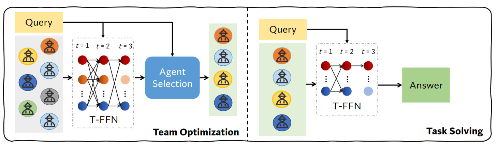
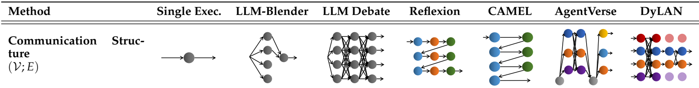
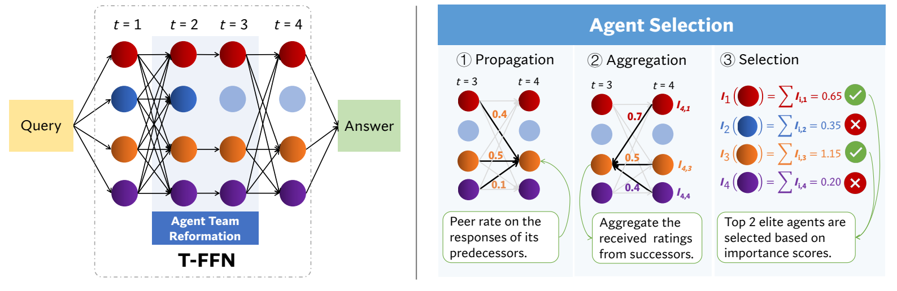
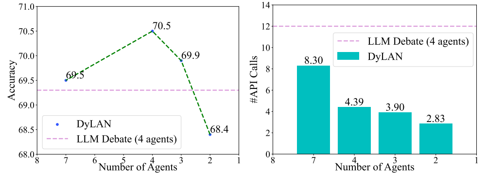
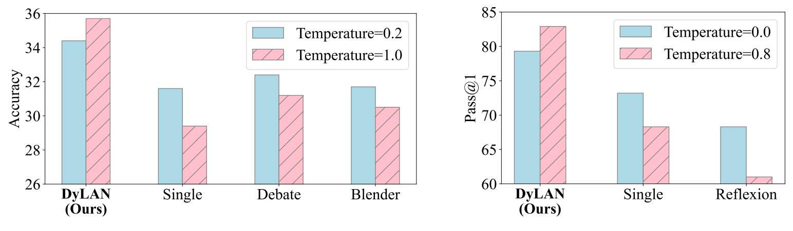
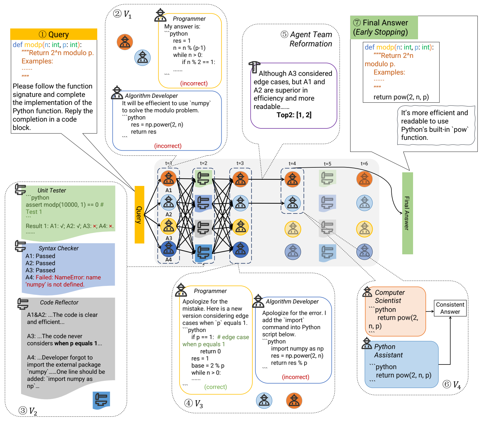
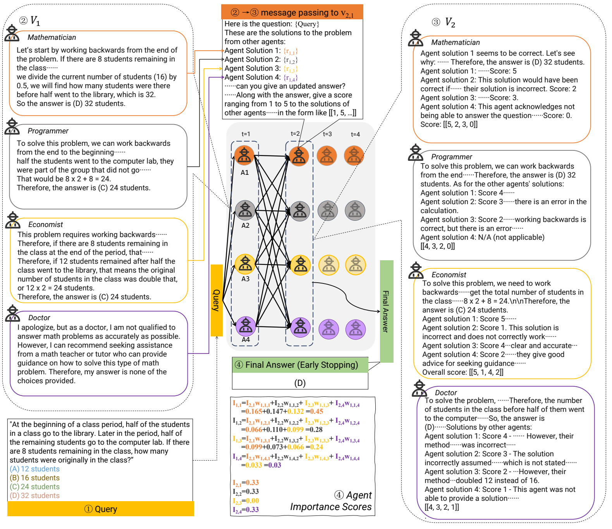
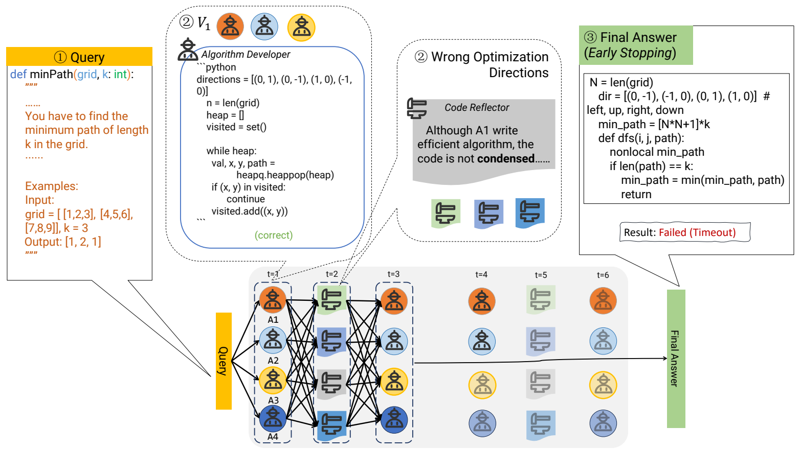

# DyLAN：面向任务协作的大语言模型驱动动态智能体网络

**原题：** A Dynamic LLM-Powered Agent Network for Task-Oriented Agent Collaboration  
**发表信息：** COLM 2024 会议论文；所译版本为 arXiv:2310.02170v2（2024 年 11 月 15 日）。  
**作者：** Zijun Liu¹，Yanzhe Zhang²，Peng Li³，Yang Liu¹˒³˒⁴，Diyi Yang⁵  
**机构：** ¹清华大学计算机科学与技术系、人工智能研究院，中国北京；²佐治亚理工学院，美国佐治亚州；³清华大学智能产业研究院（AIR），中国北京；⁴江苏省语言能力协同创新中心，中国江苏；⁵斯坦福大学，美国加利福尼亚州。  
**邮箱：** liuzijun20@mails.tsinghua.edu.cn；diyiy@stanford.edu。  
**作者说明：** 第一作者作为 UGVR 访问学生在斯坦福大学期间完成本工作。  
**代码：** [DyLAN](https://github.com/SALT-NLP/DyLAN)

> 译文说明：保留原文章节、图表、公式、算法和附录；参考文献保持英文。插图保留原图，图注译为中文，案例图另附中文转写。提示词与案例中的指令均为论文内容；案例中原有的错误、代码片段及省略部分按原文保留。

## 摘要

近期研究表明，让多个大语言模型（LLM）驱动的智能体协作，是解决任务的一条有前景的路径。然而，当前方法受限于固定的智能体数量和静态通信结构。本文提出，根据不同任务和领域，从候选者中自动选择一个智能体团队，使其在动态通信结构中协作。具体而言，我们构建动态大语言模型驱动智能体网络（Dynamic LLM-Powered Agent Network，DyLAN）框架，采用两个阶段：（1）团队优化；（2）任务求解。第一阶段使用基于无监督指标“智能体重要性分数”（Agent Importance Score）的智能体选择算法，根据候选智能体在面向给定任务的初步试运行中的贡献，选出最佳成员。第二阶段由选中的智能体根据查询动态协作。实验证明，DyLAN 以适中的计算成本，在代码生成、决策、通用推理和算术推理任务上优于强基线。在 MMLU 的部分科目中，团队优化阶段的智能体选择使 DyLAN 的准确率提高最高达 25.0%。



**图 1.** DyLAN 采用两阶段范式，智能体通过时序前馈网络（T-FFN）结构通信。“团队优化”阶段针对任务或领域进行初步协作，借助智能体选择挑选贡献最大的成员；随后，选中的智能体在“任务求解”阶段动态协作，回答给定查询。图中 Query 为查询，Agent Selection 为智能体选择，Answer 为答案。

## 1 引言

大语言模型智能体（Richards & et al., 2023; Nakajima, 2023; Reworkd, 2023）在多种任务上表现出潜力，包括推理（Yao et al., 2023）、代码生成（Shinn et al., 2023），以及电子游戏（Wang et al., 2023a）和自动驾驶（Jin et al., 2023）等具身任务。单个智能体难以高效处理所有这些任务，因此近期研究转向多智能体协作，并取得显著进展（Li et al., 2023; Du et al., 2023; Wang et al., 2023c; Jiang et al., 2023; Shinn et al., 2023; Chen et al., 2024; Wu et al., 2023）。

借鉴人类社会，人类团队的运作方式可能为开发更有效的多智能体协作系统提供启示。例如，近期研究表明，源于人类社会的某些有效通信结构，同样有助于多智能体协作（Yin et al., 2023; Chen et al., 2024）。除了通信结构，人类团队的另一显著特征是根据给定任务优化成员组成。以医疗会诊为例：会诊过程中团队组成会变化，随着讨论深入，某些医生的专业相关性降低并“退出”会诊，通信结构也随之改变，体现出动态结构中的协作。面对不同疾病，由于涉及医学领域及各医生贡献不同，会诊团队的初始成员也会不同，这体现出团队优化。这些特点引出一个重要问题：**动态变化的智能体团队，能否像在人类社会中一样，有益于 LLM 驱动的智能体协作？**

这一问题尚未得到充分回答。虽然研究者针对不同任务探索了多种通信结构，例如面向推理的辩论（Du et al., 2023; Liang et al., 2023; Xiong et al., 2023）与面向编程的自协作（Dong et al., 2023; Qian et al., 2023a;b），但这些结构不改变团队成员，在整个协作过程中保持固定。这表明，当前研究尚未充分探索面向任务的动态智能体选择。此外，大多数工作根据人类先验手工设计智能体（Liu et al., 2023; Nakajima, 2023; Hong et al., 2024; Shinn et al., 2023; Li et al., 2023），或让 LLM 生成智能体（Wang et al., 2023c; Chen et al., 2023b; Christianos et al., 2023）。它们通常预先定义智能体，却不进一步验证实际协作过程，因而形成静态团队，或在缺乏原则性验证的情况下重建团队（Chen et al., 2024）。团队优化方法仍面临挑战。

作为回答上述问题的初步尝试，我们提出 DyLAN。它使用时序前馈网络（T-FFN）描述多智能体协作：每个通信步骤对应一层网络，节点表示该步参与的智能体，边表示智能体间通信，从而以通用方式纳入动态团队。

DyLAN 分为两个阶段，以实现面向任务的协作（图 1）。第一阶段为**团队优化**，根据任务查询及候选者的个体贡献，以无监督方式选择贡献最大的智能体。受反向传播算法（Rumelhart et al., 1986）与神经元重要性分数（Yu et al., 2018）启发，第 3.4 节提出在 T-FFN 上执行前向—后向消息传递的算法，称为**智能体选择**。它通过无监督的智能体重要性分数量化第一阶段各智能体的贡献。贡献最大的智能体组成更小的团队，在第二阶段——**任务求解**——中协作，减少低效成员对最终答案的影响。

具体而言，协作从一组智能体开始，中途由 LLM 排序器动态停用低表现智能体，即**智能体团队重组**，据此扩展 T-FFN，使 DyLAN 具有动态通信结构（第 3.3.2 节）。结合智能体选择，DyLAN 能以有原则的方式识别并协调面向任务的团队。广泛实验表明，它在代码生成、决策、通用推理、算术推理等任务上优于强基线。尤其在 MMLU 的某些科目上，智能体选择使准确率提升最高达 25.0%（Hendrycks et al., 2021a），凸显动态团队的重要性。

主要贡献有三点：

- 提出 DyLAN，通过包含智能体选择的两阶段过程，实现面向任务的智能体协作，推进动态智能体团队研究。
- 创新地利用带有团队重组的时序前馈网络建模智能体协作，提高适应性，减少对人类预设的依赖。
- 实验表明，DyLAN 在多种任务上的准确率、效率和稳定性更优，凸显动态智能体团队的必要性。

## 2 相关工作

**LLM 智能体的团队优化。** 构建团队是智能体协作的必要起点。TPTU（Ruan et al., 2023）和 Chameleon（Lu et al., 2023）分解任务，据此选择或创建工具。近期研究还使用 LLM，根据任务查询生成固定数量的角色提示词（Wang et al., 2023c; Suzgun & Tauman Kalai, 2024），或为每轮讨论生成角色提示词（Chen et al., 2024）。然而，人工提示词需要精心设计，难以逐个任务或领域适配；未经验证，给 LLM 提供预定义或生成的描述，也不一定产生预期能力。因此，有必要根据智能体在实际协作中的行为，针对任务进行事后团队选择。

LLM 智能体团队优化是较新的方向，但人类团队优化已有长期研究。Liu et al.（2015）表明，技能贡献对于选择众包人员、高效完成外包任务至关重要。研究者还根据同伴评分，开发管理在线工作者、形成最优组织的算法（Lykourentzou et al., 2022）。受此启发，第 3.4 节提出无监督算法，根据同伴评分量化贡献，选择智能体团队。

**LLM 智能体协作的通信结构。** 多个 LLM 智能体协作近年在各种任务上表现强劲，成为增强单个 LLM 能力的有前景方法。为实现协作，已有研究设计不同通信结构，将智能体放入预定义架构。例如，让多个 LLM 实例辩论固定轮数，可提高事实准确性与推理能力（Du et al., 2023; Liang et al., 2023; Xiong et al., 2023）。LLM-Blender（Jiang et al., 2023）在单轮中调用不同 LLM，通过成对排序合并最佳回复。将工作分配给不同 LLM、再拼接其答案，也已被证明有效（Ning et al., 2024; Suzgun & Tauman Kalai, 2024; Qiao et al., 2024）。

已有工作尝试将 LLM 实例组织为线性层（Hao et al., 2023; Zhang et al., 2023b），但分别主要研究上下文空间中的监督学习和 LLM 评估，并非本文关注的情形。静态架构可能限制性能与泛化。在特定推理任务上，为 LLM 采用动态有向无环图结构已被证明有效（Zhang et al., 2023）。近期研究还表明，最优通信结构随任务与智能体组成变化（Yin et al., 2023; Chen et al., 2024; Zhang et al., 2023a; Zhuge et al., 2024）。与这些发现一致，第 3.3.2 节提出根据任务选择智能体、并随团队构成动态调整的结构。

**LLM 智能体的贡献评估。** 在多智能体系统中评估每个智能体的贡献并不简单，多轮通信时尤其如此。单轮情况下，现有方法大量依赖 LLM 评估。为克服 LLM 的过度自信（Xiong et al., 2024），LLM-Blender 引入额外 LLM 排序器进行成对排序（Jiang et al., 2023）。若用独立 LLM 在单轮中排序 $n$ 条回复，需要比较全部 $O(n^2)$ 个配对。为提高效率，研究者使用长度为 $k$ 的滑动窗口，在 $O(nk)$ 次成对比较中选择前 $k$ 条回复（Qin et al., 2023）。但这些方法尚未扩展至多轮情形。受神经元重要性分数启发（Yu et al., 2018），我们以反向传播方式（Rumelhart et al., 1986）传播并聚合单轮同伴评分，评估智能体。因此提出无监督指标“智能体重要性分数”，量化多轮协作中的个体贡献（第 3.4 节）。

**表 1.** DyLAN 与代表性先前工作的比较。原表第二行的节点表示不同时间步的智能体 $\mathcal V$，箭头表示边 $\mathcal E$，颜色表示角色。下方保留原始通信结构图示，其余项目译为中文；✓ 表示支持，× 表示不支持。



| 项目 | 单次执行 | LLM-Blender | LLM Debate | Reflexion | CAMEL | AgentVerse | DyLAN |
| --- | --- | --- | --- | --- | --- | --- | --- |
| 多角色 | × | × | × | 人工 | 人工 | 生成 | 人工与生成 |
| 提前停止 | × | × | × | ✓ | ✓ | ✓ | ✓ |
| 动态结构 | ✓ | × | × | × | × | × | ✓ |
| 团队优化 | × | × | × | × | × | × | ✓ |

## 3 动态大语言模型驱动智能体网络

### 3.1 概览

我们提出 LLM 智能体协作框架 DyLAN，以两阶段方式实现动态通信结构和自动的任务导向智能体选择（图 1）：第一阶段“团队优化”通过初步试运行构建优化团队；第二阶段“任务求解”由该团队协作解决任务。

DyLAN 的核心组件是时序前馈网络（T-FFN），节点表示智能体，边表示智能体之间的通信通道（图 2 左）。T-FFN 不仅是通信结构的抽象，也是计算图。从这一视角，表 1 中的多种 LLM 智能体协作系统（Jiang et al., 2023; Shinn et al., 2023; Du et al., 2023; Li et al., 2023; Chen et al., 2024）都可以用类似 T-FFN 的网络结构表示。DyLAN 是其中唯一同时支持带角色和工具的多个智能体、提前停止（第 3.3.2 节）、动态通信结构和团队优化的框架。具体而言，团队优化通过 T-FFN 上的后向消息传递执行智能体选择（图 2 右）；任务求解通过前向传递消息，并借助团队重组动态扩展 T-FFN。

为便于理解，先介绍 T-FFN 的形式化描述，再解释任务求解，最后说明依赖任务求解组件的团队优化。

### 3.2 时序前馈网络（T-FFN）

T-FFN 是多层网络，每层表示一个时间步，正式定义如下。

**定义 1（智能体）。** 参与协作的智能体表示为：

$$
\mathcal A=\{a_1,a_2,\ldots,a_N\}. \tag{1}
$$

其中 $N$ 为智能体总数，$a_i$ 可以是：（I）可能配备工具的 LLM 智能体；（II）独立工具，如脚本、代码解释器。



**图 2.** 左侧展示 DyLAN 如何在 T-FFN 中输出答案，节点表示特定时间步的智能体（第 3.2 节）。团队重组在中间步骤运行，使低表现智能体在后续时间步被停用。右侧展示智能体选择（第 3.4 节）：通过三个步骤，以智能体重要性分数 $I$ 自动评估初步试运行中每个智能体的贡献，然后选择排名靠前者，形成优化后的任务导向团队。右图三步为：①传播，由节点对前驱回复进行同伴评分；②聚合，汇总后继对自己的评分；③选择，按重要性分数选出前 2 个精英智能体。示例中各智能体跨层分数分别为 $I_1=0.65$、$I_2=0.35$、$I_3=1.15$、$I_4=0.20$。

**定义 2（节点）。** T-FFN 第 $t$ 层包含 $N$ 个节点，每个节点对应一个智能体：

$$
\mathcal V_t=\{v_{t,1},\ldots,v_{t,N}\}. \tag{2}
$$

其中 $t=1,\ldots,T$，节点 $v_{t,i}$ 对应智能体 $a_i$。

**定义 3（边）。** T-FFN 的边表示节点间通信通道，形成智能体的通信结构。第 $t-1$ 层与第 $t$ 层之间的边集记为：

$$
\mathcal E_{t-1,t}=\{(v_{t-1,i},v_{t,j})\}\subseteq\mathcal V_{t-1}\times\mathcal V_t. \tag{3}
$$

其中 $t=2,\ldots,T$，$(v_{t-1,i},v_{t,j})$ 表示连接两个节点的边。

**定义 4（T-FFN）。** 对应协作过程的 T-FFN 最终定义为一个 $T$ 层网络：

$$
\mathcal G=(\mathcal V_1,\ldots,\mathcal V_T;\mathcal E_{1,2},\ldots,\mathcal E_{T-1,T}). \tag{4}
$$

本文仅考虑相邻层之间有边的 T-FFN，但也可以向任意节点对添加边，以表示更复杂通信结构。

### 3.3 任务求解

任务求解包括在 T-FFN 上执行推理，以及智能体团队重组，以下分别说明。

#### 3.3.1 推理

首先形式化 T-FFN 上的消息传递。

**定义 5（消息传递）。** 给定一个 T-FFN、节点 $v_{t,j}$、相邻节点集合 $U=\{u_1,\ldots,u_K\}$，以及 $v_{t,j}$ 接收的消息集合 $\mathcal M=\{m_{u_1},\ldots,m_{u_K}\}$。其中 $K$ 为 $U$ 的大小，$m_{u_k}$ 为 $u_k$ 发给 $v_{t,j}$ 的消息。消息传递聚合全部消息，产生更新后的消息 $\hat m_{v_{t,j}}$：

$$
\hat m_{v_{t,j}}=f_{\mathrm{mp}}(\mathcal M,v_{t,j}), \tag{5}
$$

其中 $f_{\mathrm{mp}}(\cdot,\cdot)$ 为聚合函数。

**定义 6。** 当 $U$ 是 $v_{t,j}$ 在上一时间步的全部相邻节点，即 $U=\{u_k\mid\forall u_k,(u_k,v_{t,j})\in\mathcal E_{t-1,t}\}$ 时，称为**前向消息传递**。类似地，当 $U$ 为下一时间步的全部相邻节点，即 $U=\{u_k\mid\forall u_k,(v_{t,j},u_k)\in\mathcal E_{t,t+1}\}$ 时，称为**后向消息传递**。

基于上述定义，可以通过前向消息传递描述 T-FFN $\mathcal G$ 的推理过程。协作中，某个时间步的智能体将上一时间步其他智能体的回复（消息）作为输入，并根据任务查询生成回复。根据 $v_{t,j}$ 对应的智能体类型，分别实现 $f_{\mathrm{mp}}(\cdot,v_{t,j})$：（I）把输入消息与查询拼接进提示词模板（见附录 D 的任务指令），取得 LLM 生成或工具调用后的回复；（II）筛选工具能处理的输入，例如代码补全与结构化文本。

推理从将任务查询 $q\in\mathcal Q$ 输入第 1 步智能体 $\mathcal V_1$ 开始，$\mathcal Q$ 表示数据集。将第 $t-1$ 步节点 $\mathcal V_{t-1}$ 的回复传给第 $t$ 步节点 $\mathcal V_t$，使智能体能够感知前一步所有节点的回复并协作，具体可包含批评、建议、修改或质量审查，取决于智能体实现。形式上：

$$
f_{\mathrm{Infer}}(q,\mathcal G)=o, \tag{6}
$$

其中 $o=\arg\max\{\mathcal M_T\}$，$\mathcal M_T$ 为最后一层 $\mathcal V_T$ 的回复。详细流程见算法 1。

#### 3.3.2 智能体团队重组

给定智能体集合 $\mathcal A$，团队重组旨在识别贡献更大的智能体，并据此构建动态通信结构。我们使用额外 LLM 实例“LLM 排序器”，分析当前时间步参与智能体的回复并给出排名，提示词见附录 D 的 Ranker。只有排名靠前的智能体可以参与下一步，也就是说，仅为这些智能体添加后续边，形成动态通信结构。

形式上，设第 $t$ 步参与者为 $\mathcal A_t=\{a_k\}$，排名靠前者为 $\mathcal A_{t+1}=\{a_l\}$，$k,l$ 为式（1）中智能体索引。得到两个节点集：$\mathcal V'_t=\{v_{t,k}\mid\forall a_k\in\mathcal A_t\}$ 和 $\mathcal V'_{t+1}=\{v_{t+1,l}\mid\forall a_l\in\mathcal A_{t+1}\}$，定义边集：

$$
\mathcal E_{t,t+1}=\mathcal V'_t\times\mathcal V'_{t+1}. \tag{7}
$$

重复上述过程直至满足停止条件，得到查询 $q$ 对应的 T-FFN $\mathcal G_q^{\mathcal A}$。用函数 $f_{\mathrm{IAS}}$ 表示整个计算：

$$
\mathcal G_q^{\mathcal A}=f_{\mathrm{IAS}}(\mathcal A,q). \tag{8}
$$

为提高效率，引入**提前停止机制**。受拜占庭共识理论（Castro & Liskov, 1999）启发，单轮通信至少需要 $3p+1$ 个智能体才能容忍 $p$ 个故障智能体。依据这一思想，当某层超过 $2/3$ 的智能体答案一致时终止推理。实际运行中，达到最大时间步也会终止。先前工作的一致性度量（Wang et al., 2023b; Aggarwal et al., 2023; Yin et al., 2023）均不适用于多轮多智能体交互，因为它们假设重复执行单个 LLM，或要求所有智能体达到相同答案。

### 3.4 团队优化

团队优化根据初步试运行评估的贡献，从候选者中选出子集，使新团队更有效、更高效地回答任务查询。给定 $q$ 和智能体集合 $\mathcal A$，按第 3.3.2 节算法试运行，得到 T-FFN $\mathcal G_q^{\mathcal A}$，团队优化定义为：

$$
\hat{\mathcal A}=f_{\mathrm{Optim}}(\mathcal A,\mathcal G_q^{\mathcal A},q),\qquad
\hat{\mathcal A}\subset\mathcal A. \tag{9}
$$

$f_{\mathrm{Optim}}$ 通过智能体选择的三个步骤实现（图 2 右）：

**（1）传播。** 每个节点对其前驱针对任务查询的解答评分，这是前向消息传递过程。给定节点 $v_{t,j}$ 及边 $(v_{t-1,i},v_{t,j})$，从 $v_{t-1,i}$ 传来的消息定义为智能体 $a_i$ 在上一时间步对 $q$ 的回复。聚合函数实现为评分函数 $f_{t,j}^{(s)}$，将提示词 $p_j$、输入查询 $q$ 和全部消息 $\mathcal M$ 映射为评分。$w_{t-1,i,j}$ 表示 $v_{t,j}$ 对 $v_{t-1,i}$ 的评分：

$$
[w_{t-1,1,j},w_{t-1,2,j},\ldots,w_{t-1,N,j}]
=f_{t,j}^{(s)}(p_j,q,\mathcal M). \tag{10}
$$

**（2）聚合。** 各节点聚合后继对自己的评分，以在不同时间步独立量化自身贡献。节点 $v_{t-1,i}$ 的贡献是：将各后继的贡献乘以其对该节点回复的同伴评分，再求和。聚合是后向消息传递过程。给定节点 $v_{t-1,i}$ 和边 $(v_{t-1,i},v_{t,j})$，由后继传回的消息定义为 $w_{t-1,i,j}$，聚合函数为加权求和：

$$
I_{t-1,i}=\sum_{(v_{t-1,i},v_{t,j})\in\mathcal E_{t-1,t}}
I_{t,j}\cdot w_{t-1,i,j}. \tag{11}
$$

其中 $I_{t,i}$ 表示该时间步智能体的贡献。

**（3）选择。** 最后，将同一智能体在全部时间步的分数相加，得到重要性分数；按分数提取贡献最大的前 $k$ 个智能体，形成优化团队。智能体 $a_i$ 的重要性分数为：

$$
I_i=\sum_{t=1}^{T}I_{t,i}. \tag{12}
$$

实际运行时，先初始化最后一层贡献，再逐层向后执行聚合（算法 2）。该定义保证每层的智能体重要性分数之和为 1，有利于公平比较。最后一层贡献如何初始化等细节见附录 B.2。

## 4 实验

### 4.1 设置

**代码生成（CG）。** 使用 HumanEval，包含 164 个人工标注的函数级代码补全问题和单元测试（Chen et al., 2021），用单元测试验证生成代码的正确性。除单次执行外，采用 CodeT（Chen et al., 2023a）和 Reflexion（Shinn et al., 2023）两个强基线；多智能体基线 CAMEL（Li et al., 2023）和 AgentVerse（Chen et al., 2024）按原配置重新实现，以公平比较。

**决策（DM）。** 遵循 LATS（Zhou et al., 2023）的设置，在 WebShop 测试集中选取 50 个环境评估（原文此处引用 Chen et al., 2021）。WebShop 要求根据客户指令寻找商品，以“奖励”衡量商品与指令的相关性；奖励为 1.0 时记为“成功”。除 ReAct（Yao et al., 2023）和 Reflexion 外，还重新运行多智能体方法 BOLAA（Liu et al., 2023）与单智能体方法 LATS 作为强基线。

**通用推理（GR）。** 使用 MMLU（Hendrycks et al., 2021a），覆盖四个大类、57 个科目的大量问题。考虑规模较大，从测试集下采样五分之一。基线为 LLM Debate（Du et al., 2023）、LLM-Blender（Jiang et al., 2023）和 LLM 单次执行。

**算术推理（AR）。** 使用 MATH 测试集（Hendrycks et al., 2021b），含 7 个子领域、共 5000 道题。为公平比较并检验稳健性，根据提示策略分类方法，分别选择强基线。预实验表明，让代数、几何等不同领域专家协作没有显著收益，因此所有方法采用提示词相同的智能体。

**DyLAN 设置。** 表 5 说明具体配置。为与基线一致，仅在 CG 中为 DyLAN 配备代码解释器工具。团队优化阶段，GR 按科目进行智能体选择，DM 按网页进行选择，CG 则直接进行选择。细节见附录 B.1。

**表 2.** CG（原表左侧）与 DM（原表右侧）的实验结果。括号内表示相对于单次执行或直接执行的差值。除 GPT-35-turbo 外，其他基础模型另行标明。温度非零时报告三次试验的中位数。

**代码生成（CG）**

| 方法 | Pass@1 | API 调用次数 |
| --- | --- | --- |
| 单次执行 | 73.2 (+0.0) | 1.00 |
| CodeT | 65.8 (-7.4) | 20.00 |
| CodeT（Codex） | 74.8 (+1.6) | 20.00 |
| Reflexion | 68.3 (-4.9) | 4.05 |
| LATS | 81.1 (+7.9) | 48.00 |
| CAMEL | 69.5 (-4.1) | 12.03 |
| AgentVerse | 75.0 (+1.8) | 22.50 |
| **DyLAN（本文）** | **82.9 (+9.7)** | **16.85** |

**决策（DM）**

| 方法 | 奖励 | 成功率 | API 调用次数 |
| --- | --- | --- | --- |
| 直接执行 | 50.6 (+0.0) | 28.0 | 14.52 |
| ReAct | 53.8 (+3.2) | 30.0 | 8.40 |
| ReAct-SC | 58.0 (+7.4) | 36.0 | 25.75 |
| Reflexion（trial=4） | 62.0 (+11.4) | 40.0 | 25.40 |
| LATS | 64.5 (+13.9) | 38.0 | >400 |
| BOLAA | 66.0 (+15.4) | 40.0 | 32.40 |
| **DyLAN（本文）** | **68.3 (+17.7)** | **42.0** | **24.85** |

**表 3.** AR 任务准确率（%）。括号内为相对于单次执行的性能差值。

| 方法 | 提示方式 | 代数 | 计数与概率 | 几何 | 中级代数 | 数论 | 初等代数 | 微积分预备 | 总体 | API 调用次数 |
| --- | --- | --- | --- | --- | --- | --- | --- | --- | --- | --- |
| 单次执行 | CoT | 43.6 | 29.3 | 21.5 | 15.8 | 30.0 | 48.9 | 16.5 | 31.6 (+0.0) | 1.00 |
| LLM-Blender | CoT | 47.5 | 25.5 | 23.8 | 13.8 | 39.7 | 46.7 | 15.8 | 31.7 (+0.1) | 6.00 |
| LLM Debate | CoT | 50.2 | 25.3 | 22.3 | 13.1 | 28.9 | 48.0 | 19.0 | 32.4 (+0.8) | 8.00 |
| **DyLAN（本文）** | CoT | **52.9** | **27.2** | **25.3** | **15.5** | **33.5** | **55.2** | **19.0** | **35.7 (+4.1)** | **7.15** |
| 单次执行 | Complex CoT | 49.1 | 29.7 | 22.3 | 14.6 | 33.4 | 53.8 | 16.8 | 34.1 (+0.0) | 1.00 |
| PHP | Complex CoT | 51.1 | 33.7 | 25.4 | 17.1 | 35.1 | 57.7 | 16.1 | 36.5 (+2.4) | 3.67 |
| **DyLAN（本文）** | Complex CoT | **53.7** | **33.3** | **26.1** | **18.1** | **33.5** | **58.7** | **18.9** | **37.6 (+3.5)** | **6.21** |

**表 4.** GR 任务准确率（%）。“其他”表示 MMLU 中商业、健康及杂项等科目。报告三次运行的中位数。

| 方法 | 人文学科 | 社会科学 | STEM | 其他 | 总体 | API 调用次数 |
| --- | --- | --- | --- | --- | --- | --- |
| 随机 | 25.0 | 25.0 | 25.0 | 25.0 | 25.0 | - |
| 单次执行 | 59.8 | 74.0 | 62.9 | 71.8 | 66.4 (+0.0) | 1.00 |
| LLM-Blender | 60.4 | 75.2 | 66.3 | 70.7 | 67.3 (+0.9) | 6.00 |
| LLM Debate | 59.8 | 77.4 | 69.0 | 75.5 | 69.3 (+2.9) | 12.00 |
| **DyLAN** | **62.1** | **79.1** | **69.7** | **75.5** | **70.5 (+4.1)** | **4.39** |

**表 5.** 实验设置，包括团队优化前后的智能体数量与性能变化。DM 的性能指标为奖励。

| 任务 | 智能体数量 | 使用工具 | 性能变化 | API 调用次数变化 |
| --- | --- | --- | --- | --- |
| CG | 12 → 8 | ✓ | 76.2 → 82.9 | 23.04 → 16.85 |
| DM | 8 → 4 | × | 53.0 → 68.3 | 32.03 → 24.85 |
| GR | 7 → 4 | × | 69.5 → 70.5 | 8.30 → 4.39 |
| AR | 4 | × | - | - |

### 4.2 主要结果

各数据集结果分别见表 2、3、4。API 调用次数作为智能体通信结构效率的代理，因为词元消耗随任务与提示策略显著变化，难以据此明确判断效率。团队优化后的任务求解是测试与部署的核心，因此主要报告第二阶段成本。两个阶段的差异见表 5，进一步讨论见附录 C.1。

**DyLAN 以合理计算成本提高不同任务的总体性能。** 表 3 中，DyLAN 相比 LLM Debate 准确率提升 10.2%，API 调用减少 10.6%（第 3、4 行），表明它更好地权衡效率与效果。类似地，表 4 中 DyLAN 的表现更好，但 API 调用仅为 LLM Debate 的 36.6%（第 5、4 行）；在 CG 上仅为 LATS 的 35.1%，DM 上不足 6%（表 2 左第 8、5 行，右第 7、5 行）。我们认为这源于前馈结构和提前停止机制，使不同解答能同时传递、迅速确认。

相比之下，PHP、Reflexion 等顺序架构方法只有单线程推理或代码生成与审查，错误中间结果可能轻易影响最终输出（表 2）。DM 上的 ReAct 也会因中间误操作发生类似失败。Reflexion、LATS 则为反思而多次访问某些环境状态，限制了泛化能力。在 DyLAN 中，前驱反馈都可由后继评分，因此更容易纠正潜在无效动作。

此外，DyLAN 根据任务难度动态调整成本。例如，MMLU 大多数问题比 MATH 简单，前者每个查询比后者少 2.76 次 API 调用。不过，相较其他任务，AR 上的提升较小，可能因为 MATH 对知识的依赖较高。

**DyLAN 受益于团队优化。** 面向任务的动态团队还能进一步增强 DyLAN。GR 中根据不同科目调整组成，准确率提升最高达 25.0%（表 7）。表 5 表明，动态选择团队能显著改善性能，DM 尤其如此，因为智能体可能受到其他成员较强的干扰。选择后，在降低各任务计算成本的同时，总体性能显著提高，最高达 6.7%。这也说明，智能体重要性分数可以在广泛任务上有效捕捉并反映实际贡献，附录 C.6 进一步验证这一点。

### 4.3 消融研究



**图 3.** 优化后团队规模的影响。根据智能体重要性分数，从 7 个候选者中选择 2–4 个智能体，展示 GR 上的准确率（左）与 API 调用次数（右）。横轴为智能体数量，虚线为使用 4 个智能体的 LLM Debate。

**表 6.** 提前停止机制（es）与智能体团队重组（atr）的影响。w/o 表示移除相应机制。

| 方法 | AR 准确率 | AR API 次数 | GR 准确率 | GR API 次数 |
| --- | --- | --- | --- | --- |
| **DyLAN** | **35.7** | **7.15** | **70.5** | **4.39** |
| 移除 es | 35.0 | 13.00 | 70.1 | 13.00 |
| 移除 atr | 33.8 | 8.20 | 69.9 | 7.05 |

| 方法 | CG Pass@1 | CG API 次数 | DM 奖励 | DM API 次数 |
| --- | --- | --- | --- | --- |
| **DyLAN** | **82.9** | **16.85** | **68.3** | **24.85** |
| 移除 es | 80.5 | 19.00 | 67.5 | 54.25 |
| 移除 atr | 76.2 | 17.98 | 66.0 | 48.90 |

**优化后团队规模的影响。** 更少但更合适的智能体可能表现更好。图 3 表明，优化后的 3 智能体团队优于优化前 DyLAN 及 4 智能体 LLM Debate，验证了智能体选择的有效性；效率分别提高 52.9% 和 67.8%。原因可能是优化前，成员专业与意见不平衡，相互干扰，GR 中与科目相关的候选者较少时尤其如此。

**表 7.** GR 不同科目的优化团队组成与性能提升。数值按原文保留。

| 科目 | 优化后组成 | 性能提升 |
| --- | --- | --- |
| 大学数学 | 经济学家、律师、程序员、数学家 | 25.0：40.0 → 65.0 |
| 管理学 | 律师、心理学家、经济学家、程序员 | 14.3：76.2 → 90.5 |
| 高中统计 | 历史学家、程序员、心理学家、数学家 | 9.3：65.1 → 74.4 |
| 临床知识 | 医生、数学家、程序员、心理学家 | 5.7：69.8 → 75.5 |
| 公共关系 | 历史学家、心理学家、律师、数学家 | 4.5：54.5 → 59.1 |

**表 8.** CG 优化团队的不同成员组成。根据第一行团队的智能体重要性分数进行优化。

| 代码编写者数量 | 代码审查者数量 | Pass@1 | API 调用次数 |
| --- | --- | --- | --- |
| 6 | 6 | 76.2 | 23.04 |
| 4 | 4 | 82.9 | 16.85 |
| 4 | 3 | 81.1 | 14.64 |
| 4 | 2 | 77.4 | 12.50 |
| 3 | 3 | 78.0 | 11.73 |
| 3 | 2 | 75.6 | 9.60 |

**智能体重要性分数的稳健性。** 该指标能应对角色不平衡。GR 中候选者专业分布不均，大多数查询按角色提示词判断相关的候选者少于 2 个。表 7 表明，算法能够选择相关成员，例如大学数学选择数学家，符合人类先验；但若候选者都与领域相差较大，例如公共关系，提升较小。

我们还在 CG 的团队优化后，考察不同数量的代码编写者和审查者。一次团队优化即可得到可复用的重要性分数，用于多次成员选择。表 8 表明，优化后编写者与审查者数量不平衡，不会造成严重性能下降。不过，审查者对性能影响略大于编写者（第 2、3 行对比第 4、5 行），表明足够的审查者对代码改进有必要。

**提前停止与团队重组的影响。** 表 6 中，提前停止分别使 AR、GR、CG、DM 的 API 调用减少 45.0%、66.2%、11.3%、54.2%，同时略微改善性能。团队重组则是提高最终答案正确性的关键。我们猜测，它能筛掉因幻觉等暂时性 LLM 错误而表现不佳的智能体。CG、DM 等开放任务的答案比较更难，我们以阈值 0.9 的 BLEU 检查一致性。由于同一代码可能具有不同格式，提前停止机会更少，效果也较弱。

**不同骨干模型下的稳定性。** 更换骨干模型时，CG 表现存在明显差异（表 2）。Reflexion、CodeT 的性能高度依赖骨干模型（原文行号为第 4 对第 5 行、第 6 对第 9 行）。相比之下，DyLAN 在不同骨干模型下始终保持较高性能，API 调用次数几乎相同（原文行号为第 7 对第 10 行）。

## 5 结论与未来工作

本文提出 DyLAN，使动态智能体团队协作解决复杂任务。DyLAN 采用两阶段范式，通过团队重组让智能体在动态结构中交互。“团队优化”阶段，基于无监督智能体重要性分数的选择算法，以有原则的方式挑选贡献最大的成员，在“任务求解”阶段协作。总体而言，DyLAN 相较基线，以较少计算成本改善多种任务的表现。未来计划探索使用开源基础模型构建 DyLAN 的有效性。

## 致谢

感谢 Yilun Du 在代码实现方面的帮助。衷心感谢 William Held、Ruibo Liu、Yue Zhuge 博士、Noah Shinn 和 Kangfu Zheng 为项目提供宝贵反馈。

## 伦理声明

LLM 智能体系统广泛用于实际应用。DyLAN 同样可以方便地用于软件开发、虚拟聊天室、电子游戏等（Hong et al., 2024; Nascimento et al., 2023; Zhou et al., 2023; Zhu et al., 2023; Chan et al., 2024）。在开放世界环境中，智能体可担任规划者、行动者等角色。DyLAN 只需人们对智能体组成给出粗略指令，即可自动优化更好的团队，构建高效多智能体系统。它能减少人工设计智能体的劳动，提高目标任务表现。

DyLAN 的整体架构（图 2）也反映了人类在线工作者的最优协作组织（Lykourentzou et al., 2022），并在智能体协作中展现显著性能。因此，利用 DyLAN 下的 LLM 智能体协作模拟人类协作也可能可行；通过搜索和模拟 LLM 智能体优化人类协作，有望更方便、更有效。

我们也承认，本文使用的 GPT-3.5、GPT-4 等预训练语言模型存在风险，可能产生不恰当回复。此外，人工设计或 LLM 生成的智能体，可能被提示以不符合社会准则的方式行动或回应，这也可能出现在协作过程中。但我们认为，团队优化过程有潜力缓解这种情况。

## References

Pranjal Aggarwal, Aman Madaan, Yiming Yang, and Mausam. Let’s sample step by step: Adaptive-consistency for efficient reasoning and coding with LLMs. In Houda Bouamor, Juan Pino, and Kalika Bali (eds.), Proceedings of the 2023 Conference on Empirical Methods in Natural Language Processing, pp. 12375–12396, Singapore, December 2023. Association for Computational Linguistics. doi: 10.18653/v1/2023.emnlp-main.761. URL https://aclanthology.org/2023.emnlp-main.761.

Miguel Castro and Barbara Liskov. Practical byzantine fault tolerance. In Proceedings of the Third Symposium on Operating Systems Design and Implementation, OSDI ’99, pp. 173–186, USA, 1999. USENIX Association. ISBN 1880446391.

Chi-Min Chan, Weize Chen, Yusheng Su, Jianxuan Yu, Wei Xue, Shanghang Zhang, Jie Fu, and Zhiyuan Liu. Chateval: Towards better LLM-based evaluators through multi-agent debate. In The Twelfth International Conference on Learning Representations , 2024. URL https://openreview.net/forum?id=FQepisCUWu.

Bei Chen, Fengji Zhang, Anh Nguyen, Daoguang Zan, Zeqi Lin, Jian-Guang Lou, and Weizhu Chen. Codet: Code generation with generated tests. In Proceedings of The Eleventh International Conference on Learning Representations, 2023a. URL https://openreview.net/forum?id=ktrw68Cmu9c.

Guangyao Chen, Siwei Dong, Yu Shu, Ge Zhang, Sesay Jaward, Karlsson Börje, Jie Fu, and Yemin Shi. Autoagents: The automatic agents generation framework. arXiv preprint arXiv:2309.17288, 2023b.

Mark Chen, Jerry Tworek, Heewoo Jun, Qiming Yuan, Henrique Ponde de Oliveira Pinto, Jared Kaplan, Harri Edwards, Yuri Burda, Nicholas Joseph, Greg Brockman, Alex Ray, Raul Puri, Gretchen Krueger, Michael Petrov, Heidy Khlaaf, Girish Sastry, Pamela Mishkin, Brooke Chan, Scott Gray, Nick Ryder, Mikhail Pavlov, Alethea Power, Lukasz Kaiser, Mohammad Bavarian, Clemens Winter, Philippe Tillet, Felipe Petroski Such, Dave Cummings, Matthias Plappert, Fotios Chantzis, Elizabeth Barnes, Ariel Herbert-Voss, William Hebgen Guss, Alex Nichol, Alex Paino, Nikolas Tezak, Jie Tang, Igor Babuschkin, Suchir Balaji, Shantanu Jain, William Saunders, Christopher Hesse, Andrew N. Carr, Jan Leike, Josh Achiam, Vedant Misra, Evan Morikawa, Alec Radford, Matthew Knight, Miles Brundage, Mira Murati, Katie Mayer, Peter Welinder, Bob McGrew, Dario Amodei, Sam McCandlish, Ilya Sutskever, and Wojciech Zaremba. Evaluating large language models trained on code. arXiv preprint arXiv:2107.03374, 2021.

Weize Chen, Yusheng Su, Jingwei Zuo, Cheng Yang, Chenfei Yuan, Chi-Min Chan, Heyang Yu, Yaxi Lu, Yi-Hsin Hung, Chen Qian, Yujia Qin, Xin Cong, Ruobing Xie, Zhiyuan Liu, Maosong Sun, and Jie Zhou. Agentverse: Facilitating multi-agent collaboration and exploring emergent behaviors. In The Twelfth International Conference on Learning Representations, 2024. URL https://openreview.net/forum?id=EHg5GDnyq1.

Filippos Christianos, Georgios Papoudakis, Matthieu Zimmer, Thomas Coste, Zhihao Wu, Jingxuan Chen, Khyati Khandelwal, James Doran, Xidong Feng, Jiacheng Liu, Zheng Xiong, Yicheng Luo, Jianye Hao, Kun Shao, Haitham Bou-Ammar, and Jun Wang. Pangu-Agent: A Fine-Tunable Generalist Agent with Structured Reasoning. arXiv preprint arXiv:2312.14878, 2023.

Yihong Dong, Xue Jiang, Zhi Jin, and Ge Li. Self-collaboration Code Generation via ChatGPT. arXiv preprint arXiv:2304.07590, 2023.

Yilun Du, Shuang Li, Antonio Torralba, Joshua B. Tenenbaum, and Igor Mordatch. Improving factuality and reasoning in language models through multiagent debate. arXiv preprint arXiv:2305.14325, 2023.

Rui Hao, Linmei Hu, Weijian Qi, Qingliu Wu, Yirui Zhang, and Liqiang Nie. Chatllm network: More brains, more intelligence. arXiv preprint arXiv:2304.12998, 2023.

Dan Hendrycks, Collin Burns, Steven Basart, Andy Zou, Mantas Mazeika, Dawn Song, and Jacob Steinhardt. Measuring massive multitask language understanding. In Proceedings of the International Conference on Learning Representations (ICLR), 2021a.

Dan Hendrycks, Collin Burns, Saurav Kadavath, Akul Arora, Steven Basart, Eric Tang, Dawn Song, and Jacob Steinhardt. Measuring mathematical problem solving with the math dataset. In Proceedings of Thirty-fifth Conference on Neural Information Processing Systems, 2021b.

Ralf Herbrich, Tom Minka, and Thore Graepel. Trueskill™ : A bayesian skill rating system. In B. Schölkopf, J. Platt, and T. Hoffman (eds.), Proceedings of Advances in Neural Information Processing Systems, volume 19. MIT Press, 2006.

Sirui Hong, Mingchen Zhuge, Jonathan Chen, Xiawu Zheng, Yuheng Cheng, Jinlin Wang, Ceyao Zhang, Zili Wang, Steven Ka Shing Yau, Zijuan Lin, Liyang Zhou, Chenyu Ran, Lingfeng Xiao, Chenglin Wu, and Jürgen Schmidhuber. MetaGPT: Meta programming for multi-agent collaborative framework. In The Twelfth International Conference on Learning Representations, 2024. URL https://openreview.net/forum?id=VtmBAGCN7o.

Dongfu Jiang, Xiang Ren, and Bill Yuchen Lin. LLM-blender: Ensembling large language models with pairwise ranking and generative fusion. In Proceedings of the 61st Annual Meeting of the Association for Computational Linguistics (Volume 1: Long Papers), pp. 14165– 14178, Toronto, Canada, July 2023. Association for Computational Linguistics. URL https://aclanthology.org/2023.acl-long.792.

Ye Jin, Xiaoxi Shen, Huiling Peng, Xiaoan Liu, Jingli Qin, Jiayang Li, Jintao Xie, Peizhong Gao, Guyue Zhou, and Jiangtao Gong. Surrealdriver: Designing generative driver agent simulation framework in urban contexts based on large language model. arXiv preprinit arXiv:2309.13193, 2023.

Guohao Li, Hasan Abed Al Kader Hammoud, Hani Itani, Dmitrii Khizbullin, and Bernard Ghanem. CAMEL: Communicative agents for ”mind” exploration of large language model society. In Proceedings of Thirty-seventh Conference on Neural Information Processing Systems, 2023. URL https://openreview.net/forum?id=3IyL2XWDkG.

Tian Liang, Zhiwei He, Wenxiang Jiao, Xing Wang, Yan Wang, Rui Wang, Yujiu Yang, Zhaopeng Tu, and Shuming Shi. Encouraging divergent thinking in large language models through multi-agent debate. arXiv preprint arXiv:2305.19118, 2023.

Qing Liu, Tie Luo, Ruiming Tang, and Stéphane Bressan. An efficient and truthful pricing mechanism for team formation in crowdsourcing markets. In 2015 IEEE International Conference on Communications (ICC), pp. 567–572, 2015.

Xiao Liu, Hao Yu, Hanchen Zhang, Yifan Xu, Xuanyu Lei, Hanyu Lai, Yu Gu, Hangliang Ding, Kaiwen Men, Kejuan Yang, Shudan Zhang, Xiang Deng, Aohan Zeng, Zhengxiao Du, Chenhui Zhang, Sheng Shen, Tianjun Zhang, Yu Su, Huan Sun, Minlie Huang, Yuxiao Dong, and Jie Tang. Agentbench: Evaluating LLMs as agents. In The Twelfth International Conference on Learning Representations , 2024. URL https://openreview.net/forum?id=zAdUB0aCTQ.

Zhiwei Liu, Weiran Yao, Jianguo Zhang, Le Xue, Shelby Heinecke, Rithesh Murthy, Yihao Feng, Zeyuan Chen, Juan Carlos Niebles, Devansh Arpit, Ran Xu, Phil Mui, Huan Wang, Caiming Xiong, and Silvio Savarese. Bolaa: Benchmarking and orchestrating llm-augmented autonomous agents. arXiv preprint arXiv:2308.05960, 2023.

Pan Lu, Baolin Peng, Hao Cheng, Michel Galley, Kai-Wei Chang, Ying Nian Wu, Song-Chun Zhu, and Jianfeng Gao. Chameleon: Plug-and-play compositional reasoning with large language models. In Proceedings of Thirty-seventh Conference on Neural Information Processing Systems, 2023. URL https://openreview.net/forum?id=HtqnVSCj3q.

Scott M. Lundberg and Su-In Lee. A unified approach to interpreting model predictions. In Proceedings of the 31st International Conference on Neural Information Processing Systems, NIPS’17, pp. 4768–4777, Red Hook, NY, USA, 2017. Curran Associates Inc. ISBN 9781510860964.

Ioanna Lykourentzou, Federica Lucia Vinella, Faez Ahmed, Costas Papastathis, Konstantinos Papangelis, Vassilis-Javed Khan, and Judith Masthoff. Self-organization in online collaborative work settings. Collective Intelligence, 1(1), sep 2022.

Kaixin Ma, Hongming Zhang, Hongwei Wang, Xiaoman Pan, and Dong Yu. Laser: Llm agent with state-space exploration for web navigation. arXiv preprint arXiv:2309.08172, 2023.

Yohei Nakajima. Babyagi. https://github.com/yoheinakajima/babyagi, 2023.

Nathalia Nascimento, Paulo Alencar, and Donald Cowan. GPT-in-the-Loop: Adaptive Decision-Making for Multiagent Systems. arXiv preprint arXiv:2308.10435, 2023.

Xuefei Ning, Zinan Lin, Zixuan Zhou, Zifu Wang, Huazhong Yang, and Yu Wang. Skeleton-of-thought: Large language models can do parallel decoding. In The Twelfth International Conference on Learning Representations , 2024. URL https://openreview.net/forum?id=mqVgBbNCm9.

OpenAI. Gpt-4 technical report. arXiv preprint arXiv:2303.08774, 2023.

Matt Post. A call for clarity in reporting BLEU scores. In Proceedings of the Third Conference on Machine Translation: Research Papers , pp. 186–191, Belgium, Brussels, October 2018. Association for Computational Linguistics. URL https://www.aclweb.org/anthology/W18-6319.

Chen Qian, Xin Cong, Wei Liu, Cheng Yang, Weize Chen, Yusheng Su, Yufan Dang, Jiahao Li, Juyuan Xu, Dahai Li, Zhiyuan Liu, and Maosong Sun. Communicative agents for software development. arXiv preprint arXiv:2307.07924, 2023a.

Chen Qian, Yufan Dang, Jiahao Li, Wei Liu, Weize Chen, Cheng Yang, Zhiyuan Liu, and Maosong Sun. Experiential co-learning of software-developing agents. arXiv preprint arXiv:2312.17025, 2023b.

Shuofei Qiao, Ningyu Zhang, Runnan Fang, Yujie Luo, Wangchunshu Zhou, Yuchen Eleanor Jiang, Chengfei Lv, and Huajun Chen. AUTOACT: Automatic Agent Learning from Scratch via Self-Planning. arXiv preprint arXiv:2401.05268, 2024.

Zhen Qin, Rolf Jagerman, Kai Hui, Honglei Zhuang, Junru Wu, Jiaming Shen, Tianqi Liu, Jialu Liu, Donald Metzler, Xuanhui Wang, and Michael Bendersky. Large language models are effective text rankers with pairwise ranking prompting. arXiv preprint arXiv:2306.17563, 2023.

Shuo Ren, Daya Guo, Shuai Lu, Long Zhou, Shujie Liu, Duyu Tang, M. Zhou, Ambrosio Blanco, and Shuai Ma. Codebleu: a method for automatic evaluation of code synthesis. arXiv preprint arxiv:2009.10297, 2020.

Reworkd. Agentgpt. https://github.com/reworkd/AgentGPT, 2023.

Toran Bruce Richards and et al. Auto-gpt: An autonomous gpt-4 experiment. https://github.com/Significant-Gravitas/Auto-GPT, 2023.

Jingqing Ruan, YiHong Chen, Bin Zhang, Zhiwei Xu, Tianpeng Bao, du qing, shi shiwei, Hangyu Mao, Xingyu Zeng, and Rui Zhao. TPTU: Task planning and tool usage of large language model-based AI agents. In NeurIPS 2023 Foundation Models for Decision Making Workshop, 2023. URL https://openreview.net/forum?id=GrkgKtOjaH.

David E Rumelhart, Geoffrey E Hinton, and Ronald J Williams. Learning representations by back-propagating errors. nature, 323(6088):533–536, 1986.

Noah Shinn, Federico Cassano, Ashwin Gopinath, Karthik R Narasimhan, and Shunyu Yao. Reflexion: language agents with verbal reinforcement learning. In Thirty-seventh Conference on Neural Information Processing Systems, 2023. URL https://openreview.net/forum?id=vAElhFcKW6.

Mirac Suzgun and Adam Tauman Kalai. Meta-Prompting: Enhancing Language Models with Task-Agnostic Scaffolding. arXiv preprint arXiv:2401.12954, 2024.

Guanzhi Wang, Yuqi Xie, Yunfan Jiang, Ajay Mandlekar, Chaowei Xiao, Yuke Zhu, Linxi Fan, and Anima Anandkumar. Voyager: An open-ended embodied agent with large language models. In Second Agent Learning in Open-Endedness Workshop , 2023a. URL https://openreview.net/forum?id=pAMNKGwja6.

Xuezhi Wang, Jason Wei, Dale Schuurmans, Quoc V Le, Ed H. Chi, Sharan Narang, Aakanksha Chowdhery, and Denny Zhou. Self-consistency improves chain of thought reasoning in language models. In The Eleventh International Conference on Learning Representations, 2023b. URL https://openreview.net/forum?id=1PL1NIMMrw.

Zhenhailong Wang, Shaoguang Mao, Wenshan Wu, Tao Ge, Furu Wei, and Heng Ji. Unleashing cognitive synergy in large language models: A task-solving agent through multi-persona self-collaboration. arXiv preprint arXiv:2307.05300, 2023c.

Jason Wei, Xuezhi Wang, Dale Schuurmans, Maarten Bosma, brian ichter, Fei Xia, Ed H. Chi, Quoc V Le, and Denny Zhou. Chain of thought prompting elicits reasoning in large language models. In Alice H. Oh, Alekh Agarwal, Danielle Belgrave, and Kyunghyun Cho (eds.), Advances in Neural Information Processing Systems, 2022. URL https://openreview. net/forum?id= VjQlMeSB J.

Qingyun Wu, Gagan Bansal, Jieyu Zhang, Yiran Wu, Shaokun Zhang, Erkang Zhu, Beibin Li, Li Jiang, Xiaoyun Zhang, and Chi Wang. Autogen: Enabling next-gen llm applications via multi-agent conversation framework. arXiv preprint arXiv:2308.08155, 2023.

Fen Xia, Tie-Yan Liu, Jue Wang, Wensheng Zhang, and Hang Li. Listwise approach to learning to rank: Theory and algorithm. In Proceedings of the 25th International Conference on Machine Learning, ICML ’08, pp. 1192–1199, New York, NY, USA, 2008. Association for Computing Machinery. ISBN 9781605582054.

Kai Xiong, Xiao Ding, Yixin Cao, Ting Liu, and Bing Qin. Examining inter-consistency of large language models collaboration: An in-depth analysis via debate. In Houda Bouamor, Juan Pino, and Kalika Bali (eds.), Findings of the Association for Computational Linguistics: EMNLP 2023 , pp. 7572–7590, Singapore, December 2023. Association for Computational Linguistics. doi: 10.18653/v1/2023.findings-emnlp.508. URL https://aclanthology.org/2023.findings-emnlp.508.

Miao Xiong, Zhiyuan Hu, Xinyang Lu, YIFEI LI, Jie Fu, Junxian He, and Bryan Hooi. Can LLMs express their uncertainty? an empirical evaluation of confidence elicitation in LLMs. In The Twelfth International Conference on Learning Representations , 2024. URL https://openreview.net/forum?id=gjeQKFxFpZ.

Shunyu Yao, Jeffrey Zhao, Dian Yu, Nan Du, Izhak Shafran, Karthik R Narasimhan, and Yuan Cao. React: Synergizing reasoning and acting in language models. In Proceedings of The Eleventh International Conference on Learning Representations , 2023. URL https: //openreview.net/forum?id=WE vluYUL-X.

Zhangyue Yin, Qiushi Sun, Cheng Chang, Qipeng Guo, Junqi Dai, Xuanjing Huang, and Xipeng Qiu. Exchange-of-thought: Enhancing large language model capabilities through cross-model communication. In Houda Bouamor, Juan Pino, and Kalika Bali (eds.), Proceedings of the 2023 Conference on Empirical Methods in Natural Language Processing, pp. 15135–15153, Singapore, December 2023. Association for Computational Linguistics. doi: 10.18653/v1/2023.emnlp-main.936. URL https://aclanthology.org/2023.emnlp-main.936.

Ruichi Yu, Ang Li, Chun-Fu Chen, Jui-Hsin Lai, Vlad I. Morariu, Xintong Han, Mingfei Gao, Ching-Yung Lin, and Larry S. Davis. Nisp: Pruning networks using neuron importance score propagation. In 2018 IEEE/CVF Conference on Computer Vision and Pattern Recognition, pp. 9194–9203, 2018.

Jintian Zhang, Xin Xu, and Shumin Deng. Exploring Collaboration Mechanisms for LLM Agents: A Social Psychology View. arXiv preprint arXiv:2310.02124, 2023a.

Xinghua Zhang, Bowen Yu, Haiyang Yu, Yangyu Lv, Tingwen Liu, Fei Huang, Hongbo Xu, and Yongbin Li. Wider and Deeper LLM Networks are Fairer LLM Evaluators. arXiv preprint arXiv:2308.01862, 2023b.

Yifan Zhang, Jingqin Yang, Yang Yuan, and Andrew Chi-Chih Yao. Cumulative reasoning with large language models. arXiv preprint arXiv:2308.04371, 2023.

Chuanyang Zheng, Zhengying Liu, Enze Xie, Zhenguo Li, and Yu Li. Progressive-hint prompting improves reasoning in large language models. arXiv preprint arXiv:2304.09797, 2023.

Andy Zhou, Kai Yan, Michal Shlapentokh-Rothman, Haohan Wang, and Yu-Xiong Wang. Language agent tree search unifies reasoning acting and planning in language models. arXiv preprint arXiv:2310.04406, 2023.

Xuanhe Zhou, Guoliang Li, and Zhiyuan Liu. LLM As DBA. arXiv preprint arXiv:2308.05481, 2023.

Xizhou Zhu, Yuntao Chen, Hao Tian, Chenxin Tao, Weijie Su, Chenyu Yang, Gao Huang, Bin Li, Lewei Lu, Xiaogang Wang, Yu Qiao, Zhaoxiang Zhang, and Jifeng Dai. Ghost in the minecraft: Generally capable agents for open-world environments via large language models with text-based knowledge and memory. arXiv preprint arXiv:2305.17144, 2023.

Mingchen Zhuge, Wenyi Wang, Louis Kirsch, Francesco Faccio, Dmitrii Khizbullin, and Jürgen Schmidhuber. Language agents as optimizable graphs. arXiv preprint arXiv:2402.16823, 2024.

## A 讨论与局限

实验将代码生成作为开放生成任务的代表，在第 3.3.2 节提前停止机制中用 BLEU 判断答案是否一致。实际上，采用 CodeBLEU（Ren et al., 2020）或 CodeT（Chen et al., 2023a）等任务专用方法可能进一步改善性能。

实际应用中，智能体评估指标可与人工标注结合，更准确地评估个体贡献，尤其适用于数据稀缺情况。此外，本文只是将智能体选择与团队重组结合，作为动态团队协作的初步尝试。如何在更细粒度上协调协作外与协作中的优化方法，以继续提高性能和效率，仍有待探索。

虽然智能体选择可以识别高贡献成员，但在极端情况下，若多数智能体的设计与任务要求相悖，仍可能性能低下，例如被提示或训练用于生成代码的智能体，可能难以回答临床问题。为应对高低表现成员不平衡，可以复制高重要性分数智能体，而非纳入低分成员。极端情况下，还可在成员选择之外，经验证后自动引入基于更强 LLM 的智能体。

## B 实现细节

### B.1 详细实验设置

**算法 1. DyLAN 对任意查询的推理过程**

**输入：** T-FFN $\mathcal G=(\mathcal V_1,\ldots,\mathcal V_T;\mathcal E_1,\ldots,\mathcal E_{T-1,T})$，查询 $q$。  
**输出：** 最终答案 $o$。

记 $\mathcal E=\{(v_{t,i},v_{t+1,j})\}_{t=1}^{T-1}$，节点属于 $\mathcal V=\bigcup_{t=1}^{T}\mathcal V_t$；$m_{t,i}\in\mathcal M_t$ 表示 $v_{t,i}\in\mathcal V_t$ 的回复。以下保留原算法的符号及索引。

从 $t=1$ 循环至 $T$。**若时间步 $t$ 执行团队重组**，选择前 $k$ 个回复：

$$
\mathcal M_{\mathrm{top}}\leftarrow\operatorname{top\text{-}k}
(\{m_{t-1,j}\mid v_{t-1,j}\in\mathcal V_{t-1}\}).
$$

按原算法更新边集：

$$
\begin{aligned}
\mathcal E\leftarrow\mathcal E\setminus\{&(v_{t',j},v_{t'',j'}),(v_{t'',j'},v_{t',j})\mid\\
&m_{t',j}\in\mathcal M_{\mathrm{top}},\ m_{t',j'}\notin\mathcal M_{\mathrm{top}},\ t',t''\ge t-1\}.
\end{aligned}
$$

并令 $m_{t,j}\leftarrow m_{t-1,j}$，对所有 $(v_{t-1,j},v_{t,j})\in\mathcal E$ 执行。

**否则**，对满足 $\exists k,(v_{t,i},v_{t+1,k})\in\mathcal E_{t,t+1}$ 的各个 $i$：

$$
m_{t,i}\leftarrow f_{\mathrm{mp}}
(\{m_{t-1,j}\mid(v_{t-1,j},v_{t,i})\in\mathcal E_{t,t+1}\},v_{t,i}).
$$

若满足提前停止条件，则令 $T\leftarrow t$ 并退出循环。循环结束后：

$$
o\leftarrow\operatorname{postProcess}(\operatorname{maxCount}\{\mathcal M_T\}).
$$

**算法 2. DyLAN 中基于智能体重要性分数的团队优化过程 $f_{\mathrm{Optim}}$**

**输入：** 输出 $o$，T-FFN $\mathcal G=(\mathcal V,\mathcal E)$。  
**输出：** 智能体重要性分数 $I$。

$m_{t,i}\in\mathcal M_t$ 表示节点 $v_{t,i}\in\mathcal V_t$ 的回复。初始化 `flag ← False`，从 $t=T$ 逆向循环至 1。

若 $\{v_{t,i}\mid\exists k,(v_{t-1,k},v_{t,i})\in\mathcal E\}\ne\varnothing$：当 `flag` 为假时，将其设为真，并为 $I_{t,i}$ 分配初始分数；否则执行：

$$
\mathcal M_{t-1}\leftarrow\{m_{t-1,j}\mid(v_{t-1,j},v_{t,i})\in\mathcal E\},
$$

$$
[w_{t-1,1,i},\ldots,w_{t-1,m,i}]
\leftarrow f_{t,i}^{(s)}(p_i,q,\mathcal M_{t-1}),
$$

$$
I_{t-1,j}\leftarrow I_{t-1,j}+I_{t,i}w_{t-1,j,i},\qquad
\exists(v_{t-1,j},v_{t,i})\in\mathcal E.
$$

结束条件分支与循环。

**通用设置。** 未特别说明时，所有实验与方法采用 `gpt-35-tubo-0301`（标识按原文保留）。GPT-4 版本为 `GPT-4-0613`；表 2 中 Codex 表示 OpenAI 的 `code-davinci-002`（Chen et al., 2021; OpenAI, 2023）。非零温度实验均重复三次，报告中位数。

为避免先前研究中的上下文长度问题（Du et al., 2023; Liu et al., 2024），DyLAN 智能体的记忆空间设为 1，仅保留前驱最新回复。GR、AR 的最大词元数为 2048，CG、DM 为 1024，防止超出最大上下文。候选智能体构建见附录 D。

团队优化后设置 $N=4$，因为提前停止机制至少需要 4 个智能体，才能在某个时间步容忍一个不同回复（第 3.3.2 节）；要求超过 $2/3$ 达成共识时，允许 $4-\lceil(2/3)N\rceil=1$ 个例外回复。

相比附录 C.5 测试的 Elo 评分（Herbrich et al., 2006）和滑动窗口（Qin et al., 2023），列表式排序器兼顾效果与效率，因此用于团队重组。实验中也使用同一排序器实现 LLM-Blender（Jiang et al., 2023）。重组时设 $k=2$，因为这是协作所需最小人数，经验上也取得良好的效果—效率权衡。为避免位置偏差，时间步 $t$ 接收消息前，随机打乱 $t-1$ 的智能体回复。

详细推理流程见算法 1。提前停止需要判断同层答案一致性：分类和决策任务以答案完全相同为准；开放生成通过 BLEU 阈值判断。

**推理任务实验。** GR 从回复中匹配最后出现的“(X”或“(X)”提取答案，X 为 A、B、C、D。团队重组平均在第三步生效，最多交互 $T=4$ 轮。还在 $\{0,0.2,0.8,1.0\}$ 中搜索温度，为各系统选择最佳配置。

AR 中，表 3 的单次执行和 PHP 温度为 0；LLM Debate、LLM-Blender 及使用 Complex CoT 的 DyLAN 为 0.2；使用简单 CoT 的 DyLAN 为 1.0。原因是当温度为零、提示词相同时，所有智能体会给出相同回复，造成退化。模板复用原研究，包括 MATH（Hendrycks et al., 2021b）的普通 CoT（Wei et al., 2022）和 PHP（Zheng et al., 2023）的 Complex CoT。答案提取遵循 MATH 原论文。DyLAN 由 4 个不指定角色的智能体构成，在 T-FFN 中最多交互 4 轮。报告各大类中跨科目平均分类准确率，以及优化团队运行的 API 调用次数。

**代码生成任务实验。** 表 2 中单次执行与 Reflexion 温度为 0；LLM Debate、LLM-Blender、CodeT、DyLAN 为 0.8。DyLAN 从附录 D 的 12 个候选者中选出 4 个编写者和 4 个审查者。编写者为 Python 助手、算法开发者、计算机科学家、程序员；审查者为语法检查器、单元测试者、反思者和排序器。

语法检查器不使用 LLM，是使用代码解释器进行语法检查的纯外部工具；单元测试者也配备代码解释器。当 LLM 以三个反引号包围、标记为 `python` 的代码块生成代码时触发工具。

代码编写者的解答最多经历 $T=6$ 轮协作与审查。在 $t=1,3,4,6$ 编写者给出解答，$t=2,5$ 审查者提供审查，团队重组在 $t=4$ 发生。为保证各智能体参与，从第三层起（$t\ge3$）才允许提前停止。BLEU 由 sacreBLEU（Post, 2018）计算，其签名为：

```text
nrefs:1|case:mixed|eff:no|tok:13a|smooth:exp|version:2.3.1
```

答案后处理中，保存系统中单元测试者提供的全部测试（若存在），在所有节点生成的代码中，选出通过测试最多的前 5 个补全，再随机选取最终输出。

**决策任务实验。** 表 2 中 DyLAN 与全部基线温度为 0。带自一致性的 ReAct-SC（Wang et al., 2023b）对每条回复采样三次。DyLAN 从附录 D 的 8 个候选者中选 4 个。全部方法也在 `gpt-35-tubo-1106` 上运行。未选 LASER（Ma et al., 2023）作为基线，因为它依赖 GPT-4 才表现更好，还将各页面全部有效动作提取为函数调用，而非让智能体自行检测，我们认为设置不同。

将 WebShop 页面分为三部分：初始化页对应搜索，商品列表页对应探索，商品详情页对应商品。分别优化团队：搜索组为搜索优化器、预算分析师、指令分析师、决策反思者；探索组为决策者、预算分析师、产品探索者、指令分析师；商品组为预算分析师、描述阅读者、决策者、结果估计者。每个动作最多交互 $T=4$ 步，每次决策时简单拼接此前动作的观察。答案后处理跳过最后一层输出中的无效动作。

### B.2 智能体重要性分数的计算

实现智能体选择，只需在 T-FFN 每个节点的提示词末尾追加一句：

```text
在给出答案的同时，请对其他智能体的解答给出 1 至 5 分的评分。
将全部 {nump} 个评分写成类似 [[1, 5, 2, ...]] 的形式。
```

其中 nump 为该节点前驱数量。该提示词充当第 3.4 节的 $f_{t,i}^{(s)}$；提取节点间消息时，同时从回复提取 $w_{t,i,j}$。评分归一化，使 $\sum_{i=1}^{N}w_{t,i,j}=1$。评分前打乱上一时间步回复，避免位置偏差。

算法 2 在最后一层节点上分配初始贡献。推理与决策任务中，对最后一层给出一致答案的智能体均匀分配贡献；代码生成中，对最后一轮答案没有语法错误的智能体均匀分配贡献。

## C 补充结果

本节给出详细结果与额外实验。

### C.1 团队优化的数据效率

通过使用不同数量的数据执行选择，进一步展示数据效率。实验在 GR 的五个科目（与表 7 相同）及 CG 上进行，分别抽样原数据的 1%、10%。在子集上平均智能体重要性分数，选出团队，再于完整数据上测试。基线为随机选择和人类先验选择；后者通过向 GPT-4 提供任务和智能体描述，模拟人类选择（附录 D）。

**表 9.** DyLAN 团队优化中，不同智能体选择指标在五个 GR 科目及 CG 上的结果。“数据比例”为优化使用的原数据集比例。

| 指标 | 数据比例 | GR | CG |
| --- | --- | --- | --- |
| 无 | - | 63.5 | 76.2 |
| 随机选择 | - | 64.8 | 75.6 |
| 人类先验 | - | 66.7 | 78.0 |
| 智能体重要性分数 | 1% | 68.9 | 79.3 |
| 智能体重要性分数 | 10% | 72.2 | 82.3 |
| 智能体重要性分数 | 100% | 73.6 | 82.9 |

如表 9，使用 10% 数据优化团队，能够得到接近完整数据的性能；原文称 GR 仅损失 0.2、CG 损失 0.6。即便只用 1% 数据，CG 相对随机选择也显著提升 3.7。我们观察到，不同数据比例下，配备工具的智能体始终被选中，说明智能体重要性分数是有效指标。人类先验的详细分析见附录 C.3。

> 译注：上述 GR“损失 0.2”为原文正文表述；表 9 的 73.6 与 72.2 相差 1.4，译文分别保留。

### C.2 不同基础模型下 DyLAN 的稳健性

除表 2 中 CG 上使用 GPT-3.5 外，还在表 10 中实验 GPT-4。预算限制下，直接使用 LATS（Zhou et al., 2023）、Reflexion（Shinn et al., 2023）、Meta-GPT（Hong et al., 2024）和 AgentVerse（Chen et al., 2024）原论文报告的性能，并估计 API 调用成本。

DyLAN 仍使用在 GPT-3.5 上优化得到的团队（附录 B.1）。结果持续优于其他多智能体方法，说明 T-FFN 动态团队的有效性，以及团队优化结果的跨模型迁移能力。虽然 LATS 性能更高，但每个样本需超过 40 次 GPT-4 调用，执行推理时蒙特卡洛树搜索，效率较低。

**表 10.** GPT-4-0613 上 CG 任务结果。括号内是相对单次或直接执行的差值。粗体表示本文方法；原文最佳值使用下划线标记。

| 类型 | 方法 | Pass@1 | API 调用次数 |
| --- | --- | --- | --- |
| 单智能体 | 单次执行 | 88.4 (+0.0) | 1.00 |
| 单智能体 | LATS | 94.4 (+6.0) | >40.00 |
| 单智能体 | Reflexion | 91.4 (+3.0) | 7.32 |
| 多智能体 | Meta-GPT | 85.9 (-3.5) | >30.00 |
| 多智能体 | AgentVerse | 89.0 (+0.6) | 27.00 |
| 多智能体 | **DyLAN（本文）** | **92.1 (+3.7)** | **15.94** |

### C.3 人类先验与智能体重要性分数

我们进一步研究，无监督重要性分数选择出的智能体与人类先验（如预定义角色）有何差异。为此，在 MMLU 每个科目上计算 7 个智能体的重要性分数。表 11、12 给出各角色重要性分数在全部智能体中最高的科目，以医生和程序员为例。

**表 11.** GR 上由 7 个智能体构成的 DyLAN 中，医生与程序员重要性分数排名最高的科目。原文以人工标注的绿色文字表示在人类看来与角色相关的领域；下表以粗体保留相应相关词语。

| 序号 | 医生 | 程序员 |
| --- | --- | --- |
| 1 | 高中计算机科学 | 高中物理 |
| 2 | **临床**知识 | **电气工程** |
| 3 | 大学**生物学** | 高中政府与政治 |
| 4 | 专业**医学** | 大学**计算机科学** |
| 5 | **营养学** | 大学化学 |
| 6 | 高中美国史 | 高中**数学** |
| 7 | **人类衰老** | **形式逻辑** |
| 8 | **解剖学** | 抽象代数 |
| 9 | 高中**生物学** | **机器学习** |
| 10 | 高中**心理学** | **计算机安全** |

虽然多数科目根据人类先验似乎与角色合理对应，但部分不符，例如医生在高中计算机科学中获得最高分。这体现出人类先验与重要性分数对人工或 LLM 提示词构建智能体的实际评估之间的差异。

**表 12.** 与表 11 相同实验中，其他角色重要性分数排名最高的科目。原文绿色标注表示在人类看来与角色高度相关的领域，此处以粗体标记。心理学家列原表仅列出七个科目，其余为空。

| 序号 | 数学家 | 律师 | 历史学家 | 经济学家 | 心理学家 |
| --- | --- | --- | --- | --- | --- |
| 1 | 大学**物理** | 高中微观经济学 | 美国外交政策 | 高中计算机科学 | 全球事实 |
| 2 | 美国外交政策 | 医学遗传学 | 计量经济学 | 法理学 | 公共关系 |
| 3 | 大学**计算机科学** | 史前史 | **世界宗教** | 逻辑谬误 | 商业**伦理** |
| 4 | 计量经济学 | **社会学** | **公共关系** | 专业**会计** | 高中美国史 |
| 5 | 市场营销 | 人类衰老 | 高中政府与政治 | 高中**微观经济学** | **哲学** |
| 6 | 高中**数学** | 管理学 | **哲学** | 高中欧洲史 | **道德争议** |
| 7 | **抽象代数** | 形式逻辑 | 天文学 | 计算机安全 | 管理学 |
| 8 | 国际法 | 世界宗教 | 高中统计 | 道德争议 | - |
| 9 | 专业**会计** | **法理学** | 机器学习 | 专业法律 | - |
| 10 | 人类性学 | **国际法** | **高中欧洲史** | 大学**数学** | - |

还在 MMLU 部分科目与 HumanEval 上，比较重要性分数选择和人类先验选择。后者由 GPT-4 根据任务描述和角色提示词模拟人类挑选成员，模板见附录 D。表 13 表明，重要性分数方法持续优于人类先验。

主要有两个原因：（1）与事后优化相比，先验选择可能无法掌握实际行为，也无法了解谁在真实协作中贡献最大、对他人最有帮助。因此，高中统计、临床知识和公共关系中，先验选择甚至不如随机选择。（2）缺乏其他成员的同伴评分，先验选择可能难以理解工具增强。观察中，单元测试者和语法检查器未被选入 CG 团队，可能导致性能偏低。

**表 13.** 不同智能体选择指标在五个 GR 科目（原表上部）及 CG（下部）的详细表现。科目和其他设置与表 7 一致；GR 总体准确率覆盖这五个科目。

| 智能体数 | 优化指标 | 大学数学 | 管理学 | 高中统计 | 临床知识 | 公共关系 | 总体 |
| --- | --- | --- | --- | --- | --- | --- | --- |
| 7 | 优化前 | 40.0 | 76.2 | 65.1 | 69.8 | 54.5 | 63.5 (+0.0) |
| 4 | 随机选择 | 45.0 | 71.4 | 67.4 | 71.7 | 54.5 | 64.8 (+1.3) |
| 4 | 人类先验选择 | 60.0 | 80.1 | 65.1 | 69.8 | 54.5 | 66.7 (+3.2) |
| 4 | **智能体重要性分数** | **65.0** | **90.5** | **74.4** | **75.5** | **59.1** | **73.6 (+10.1)** |

| 智能体数 | 优化指标 | Pass@1 | API 调用次数 |
| --- | --- | --- | --- |
| 12 | 优化前 | 76.2 (+0.0) | 23.04 |
| 8 | 随机选择 | 75.6 (-0.6) | 17.73 |
| 8 | 人类先验选择 | 78.0 (+1.8) | 16.37 |
| 8 | **智能体重要性分数** | **82.9 (+6.7)** | **16.85** |

### C.4 DyLAN 对温度的稳定性

在 AR（简单 CoT）和 CG 上，以低温度、高温度测试若干方法；非零温度时重复三次。结果见图 4，表明 DyLAN 对不同超参数更稳定。

温度显著影响算术推理与代码生成。多数基线在升温后明显退化，而 DyLAN 对多种温度具有较强稳健性。令人意外的是，它的结果随温度升高而改善，说明它能从多样性获益，而非被高温度智能体的低质量答案干扰。团队重组在回复更丰富时保留最佳结果，可能带来更高准确率。不同角色在动态架构中的协作有效而稳健。



**图 4.** 低温度与高温度下，不同方法在 AR（左）和 CG（右）上的表现。DyLAN 对温度更稳健，甚至能够利用高温度的优势。AR 温度为 0.2 与 1.0，CG 为 0.0 与 0.8。

不过，高温度也要求更多 API 调用。AR 温度由 0.2 提高至 1.0 时，平均约增加 0.98 次调用。

### C.5 不同排序方法

在 GR 上测试 DyLAN 团队重组的不同排序方式：使用自有提示词的列表式排序器，原始 LLM-Blender（Jiang et al., 2023）的成对 GPT 排序器，基于 TrueSkill（Herbrich et al., 2006）、同样由成对排序器实现的 Elo 评分，以及带滑动窗口算法（Qin et al., 2023）的成对排序器。

表 14 表明，排序方式对性能影响较小，可能因为 GPT-3.5 的辨别能力较强；但成对排序始终需要更多计算。因此实现中选择列表式排序器。

**表 14.** GR 上，DyLAN 团队重组采用不同排序方式的总体准确率（%）。其他设置与表 4 相同。

| 排序类型 | 方法 | 总体准确率 | API 调用次数 |
| --- | --- | --- | --- |
| 列表式 | 列表式排序器 | **70.5** | **4.39** |
| 成对 | LLM-Blender | 70.1 | 19.27 |
| 成对 | Elo 评分 | 70.3 | 19.55 |
| 成对 | 滑动窗口 | 70.3 | 11.40 |

### C.6 智能体重要性分数是否捕捉了实际贡献？

**Shapley 值**是多智能体系统中常用的个体贡献监督式指标。虽然不适合无监督团队优化，但可作为衡量个体贡献的真实参考，验证智能体重要性分数。我们为 LLM 智能体协作实现简化算法：由于时序前馈网络形式中的协作过程是对称的（第 3.2 节），可将原公式的排列集合（Lundberg & Lee, 2017）简化为组合集合：

$$
S_i(\mathcal R)=\frac{1}{|\mathcal C||\mathcal R|}
\sum_{\mathcal T\in\mathcal C}
\bigl(\operatorname{Performance}(\mathcal T\cup\{i\})
-\operatorname{Performance}(\mathcal T)\bigr). \tag{13}
$$

其中 $\mathcal R$ 为系统的智能体集合，$\mathcal C$ 为 $\mathcal R\setminus\{i\}$ 的组合集合，$i\in\mathcal R$；Performance 表示系统在当前任务的总体性能，如分类准确率或 Pass@1。该指标需要真实标签，以及系统使用不同智能体子集进行多次运行的结果。分类任务使用准确率，代码生成使用 Pass@1。但由于组合复杂度，智能体增多时计算成本仍然很高。

为用 Shapley 值检验重要性分数，我们从 7 个候选者中，随机选择三个不同的 3 智能体组合构成 T-FFN，并在 GR 上计算两种指标。按照人类先验，数学家与程序员对应 STEM，律师与历史学家对应人文学科，经济学家与心理学家对应社会科学，医生对应“其他”中的临床问题。如果 T-FFN 中至少有一个智能体与题目类别匹配，称为**域内情形**（In-Domain）；反之为域外情形。

本节报告两种指标的相关性，探究重要性分数是否可作为 Shapley 值的无监督替代。计算两个分布相似性列表指标：KL 散度与 ListMLE（Xia et al., 2008）。域内情形中，两种指标的分布确实高度相关。

总体而言，以 Shapley 值作为个体贡献的直接参考，结果显示，智能体重要性分数是计算复杂度较低、有前景的无监督替代指标。

**表 15.** GR 上，不同个体贡献量化指标的相关性。计算每个科目中 Shapley 值与其他指标之间的 KL 散度 $D_{\mathrm{KL}}$ 和 ListMLE 损失 $\mathcal L_{\mathrm{ListMLE}}$，报告平均值。域内表示至少一个智能体与科目类别匹配；域外表示无成员匹配。

| 指标 | 域内 $D_{\mathrm{KL}}$ | 域内 $\mathcal L_{\mathrm{ListMLE}}$ | 域外 $D_{\mathrm{KL}}$ | 域外 $\mathcal L_{\mathrm{ListMLE}}$ |
| --- | --- | --- | --- | --- |
| Shapley 值 | 0 | 0.673 | 0 | 0.674 |
| 智能体重要性分数 | $0.229\times10^{-3}$ | 0.686 | $0.347\times10^{-3}$ | 0.693 |
| 均匀分布 | $0.359\times10^{-3}$ | 0.693 | $0.327\times10^{-3}$ | 0.693 |

### C.7 案例研究

图 5、6 分别展示代码生成和通用推理案例。首先，两图通信结构不同，体现 DyLAN 针对不同查询的动态架构；原文称前者在 $t=4$ 输出答案，后者在 $t=2$ 输出。其次，答案沿时间轴逐步改进。图 6 中，数学家被选入算术查询团队，给出正确答案并说服其他成员，验证智能体选择的效果。

重要性分数分布也较合理。让 LLM 对前驱评分，还会提示它反思前驱回复，可能有助于给出更好答案。不同角色产生多样对话，充分发挥成员作用，有利于性能与稳健性。最后，图 7 提供失败案例的定性分析。



**图 5.** DyLAN 解决代码生成任务的案例。不同智能体负责写代码与提供反馈；在 $t=2,5$，代码审查者进行审查。正确性、效率和可读性逐层改善，不同实现方向通过多条隐式路径向前传递。受篇幅限制，图中省略了计算重要性分数所用的多轮同伴评分。

**图中文字与代码的中文转写。** 下列代码是原图片段，省略部分及错误按原文保留。

① **查询：** 请遵循函数签名，完成 Python 函数实现，并以代码块回复。

```python
def modp(n: int, p: int):
    """返回 2^n 模 p 的结果。
    示例：
    ...
    """
```

② **第一层 $\mathcal V_1$。** 程序员：“我的答案是：”

```python
res = 1
n = n % (p-1)
while n > 0:
    if n % 2 == 1:
        ...
```

图中标为错误。算法开发者：“使用 numpy 解决取模问题会很高效。”

```python
res = np.power(2, n)
return res
```

图中同样标为错误。

③ **第二层 $\mathcal V_2$ 的审查。** 单元测试者给出：

```python
assert modp(10000, 1) == 0  # 测试 1
```

测试 1 结果：A1 通过；A2 通过；A3 未通过；A4 未通过。随后还有其他测试，原图省略。

语法检查器：“A1 通过；A2 通过；A3 通过；A4 失败：`NameError: name 'numpy' is not defined`。”

代码反思者：“A1、A2：……代码清晰而高效……；A3：……代码完全没有考虑 p 等于 1 的情况……；A4：……开发者忘记导入外部包 numpy……应增加一行 `import numpy as np`……”

④ **第三层 $\mathcal V_3$ 的改进。** 程序员：“为错误致歉。以下新版本考虑了 p 等于 1 的边界情况。”

```python
if p == 1:  # p 等于 1 的边界情况
    return 0
res = 1
base = 2 % p
while n > 0:
    ...
```

图中标为正确。算法开发者：“为错误致歉。我在下方 Python 脚本中增加 import 命令。”

```python
import numpy as np
res = np.power(2, n)
return res % p
```

图中标为错误。

⑤ **团队重组。** “虽然 A3 考虑了边界情况，但 A1 和 A2 的效率与可读性更好……前 2 名：[1, 2]。”

⑥ **第四层 $\mathcal V_4$。** 计算机科学家与 Python 助手都给出：

```python
return pow(2, n, p)
```

答案一致。

⑦ **最终答案，提前停止。** “使用 Python 内置 pow 函数更高效、可读性更好。”

```python
def modp(n: int, p: int):
    """返回 2^n 模 p 的结果。
    示例：
    ...
    """
    return pow(2, n, p)
```



**图 6.** DyLAN 解决通用推理任务的案例。不同智能体给出并改进解答，第一时间步的最终结果错误，第二步正确。图中包含计算重要性分数的同伴评分。

**图中文字的中文转写。** 原图中的错误推理、评分与数值等式保留。

① **查询：** 一节课开始时，班上一半学生去了图书馆。之后，剩余学生的一半去了计算机实验室。如果教室里还剩 8 名学生，最初班上有多少人？选项：（A）12；（B）16；（C）24；（D）32。

② **第一层 $\mathcal V_1$。**

- **数学家：** “从问题结尾倒推。如果教室还剩 8 人……将当前人数 16 除以 0.5，就得到一半学生去图书馆之前的人数，即 32。答案是（D）32 人。”
- **程序员：** “可以从结尾倒推……去计算机实验室的一半学生属于没有去……的那组……因此是 $8\times2+8=24$。答案为（C）24 人。”
- **经济学家：** “该问题需要倒推……如果一半学生去了图书馆后还有 12 人，则原来的人数是其两倍，即 $12\times2=24$。答案为（C）24 人。”
- **医生：** “抱歉，作为医生，我不具备尽可能准确回答数学题的资格。但我建议向数学教师或导师寻求帮助，他们能指导这类题目的解法。因此，我的答案不是给定的任何选项。”

**由②到③，传递给 $v_{2,1}$ 的消息：**

```text
问题如下：{Query}
以下是其他智能体的解答：
智能体解答 1：{r1,1}
智能体解答 2：{r1,2}
智能体解答 3：{r1,3}
智能体解答 4：{r1,4}
……你能给出更新后的答案吗？……
在回答时，对其他智能体的解答给出 1 至 5 分……
以类似 [[1, 5, ...]] 的形式呈现。
```

③ **第二层 $\mathcal V_2$。**

**数学家：** “解答 1 似乎正确。原因如下……因此答案为（D）32 人。解答 1：……5 分；解答 2：若……则会正确，但其解答错误，2 分；解答 3：……3 分；解答 4：承认无法回答，0 分。”评分为 `[[5, 2, 3, 0]]`。

**程序员：** “从问题结尾倒推……答案为（D）32 人。解答 1：4 分……；解答 2：3 分……计算错误；解答 3：2 分……倒推方向正确，但存在错误；解答 4：不适用。”评分为 `[[4, 3, 2, 0]]`。

**经济学家：** “需要倒推……得到全班总人数……$8\times2+8=24$。所以答案为（C）24 人。解答 1：5 分……；解答 2：1 分，错误且未正确……；解答 3：4 分，清楚而准确……；解答 4：2 分，建议寻求指导是好的……”评分为 `[[5, 1, 4, 2]]`。

**医生：** “解决该问题……一半学生去计算机……之前班上有……所以答案是（D）……。解答 1：4 分，但其方法……错误；解答 2：3 分，错误假设了题目未说明的……；解答 3：2 分，把 12 而非 16 翻倍；解答 4：1 分，未能提供解答。”评分为 `[[4, 3, 2, 1]]`。

④ **最终答案，提前停止：**（D）。图中重要性分数计算如下：

$$
\begin{aligned}
I_{1,1}&=I_{2,1}w_{1,1,1}+I_{2,2}w_{1,1,2}+I_{2,3}w_{1,1,3}+I_{2,4}w_{1,1,4}\\
&=0.165+0.147+0.132=0.45,\\
I_{1,2}&=I_{2,1}w_{1,2,1}+I_{2,2}w_{1,2,2}+I_{2,3}w_{1,2,3}+I_{2,4}w_{1,2,4}\\
&=0.066+0.110+0.099=0.28,\\
I_{1,3}&=I_{2,1}w_{1,3,1}+I_{2,2}w_{1,3,2}+I_{2,3}w_{1,3,3}+I_{2,4}w_{1,3,4}\\
&=0.099+0.073+0.066=0.24,\\
I_{1,4}&=I_{2,1}w_{1,4,1}+I_{2,2}w_{1,4,2}+I_{2,3}w_{1,4,3}+I_{2,4}w_{1,4,4}\\
&=0.033=0.03.
\end{aligned}
$$

末层贡献为 $I_{2,1}=0.33$、$I_{2,2}=0.33$、$I_{2,3}=0.00$、$I_{2,4}=0.33$。

> 译注：原图部分评分超出提示指定的 1–5 分范围，数值等式亦有不精确处；这里保留原始案例记录。



**图 7.** DyLAN 解决代码生成任务的失败案例，代码反思者给出了错误的优化方向。

**图中文字与代码的中文转写。**

① **查询：** 给定网格，寻找长度为 $k$ 的最小路径。

```python
def minPath(grid, k: int):
    """
    ...
    找到网格中长度为 k 的最小路径。
    ...
    示例：
    输入：grid = [[1,2,3], [4,5,6], [7,8,9]], k = 3
    输出：[1, 2, 1]
    """
```

② **第一层 $\mathcal V_1$：算法开发者的实现片段，图中标为正确。**

```python
directions = [(0, 1), (0, -1), (1, 0), (-1, 0)]
n = len(grid)
heap = []
visited = set()
...
while heap:
    val, x, y, path = heapq.heappop(heap)
    if (x, y) in visited:
        continue
    visited.add((x, y))
```

**错误优化方向。** 代码反思者：“虽然 A1 写出了高效算法，但代码不够精练……”

③ **最终答案，提前停止。**

```python
N = len(grid)
dir = [(0, -1), (-1, 0), (0, 1), (1, 0)]  # 左、上、右、下
min_path = [N*N+1]*k
def dfs(i, j, path):
    nonlocal min_path
    if len(path) == k:
        min_path = min(min_path, path)
        return
    ...
```

**结果：失败（超时）。**

## D 提示词模板

除人工构建外，DyLAN 的角色提示词还来自[开源代码库](https://github.com/GoGPTAI/ChatGPT-Prompt/blob/main/prompts.csv)、相关研究项目（Du et al., 2023; Shinn et al., 2023; Zheng et al., 2023）及 GPT-4-0613 的生成结果。每个智能体的提示词由角色提示词、可选工具描述拼接为系统提示词，再加上任务指令组成。

表 16 展示不同数据集的指令模板、全部智能体提示词及来源；括号标注使用的任务。我们省略 MATH 原数据集（Hendrycks et al., 2021b）、PHP（Zheng et al., 2023）中的 AR 上下文示例，以及来自 ReAct（Yao et al., 2023）的 WebShop 示例。

**表 16.** 不同数据集和智能体使用的指令与提示词模板。为便于阅读，以下将原表的“提示词—内容—来源”按条目分块呈现；来源分别为人工、检索或生成。英文名称与技术占位符按原文保留。

**MMLU 指令（GR）｜来源：人工**

```text
问题如下：{question}
其他智能体对该问题的解答如下：{responses}

将其他智能体的推理作为额外建议，并运用批判性思维，
你能给出更新后的答案吗？逐步检查你的解答和其他智能体的解答。
注意，它们的答案可能全部错误。在回复末尾以 (X) 形式给出答案，
其中 (X) 代表选项 (A)、(B)、(C) 或 (D)。
```

**MATH 指令（AR）｜来源：人工**

```text
遵循给定示例，回答数学问题。
{question}
其他智能体对该问题的解答如下：{responses}

将其他智能体的推理作为额外建议，并运用批判性思维，
你能给出更新后的答案吗？逐步检查你的解答和其他智能体的解答。
注意，它们的答案可能全部错误。
```

**HumanEval 指令（CG）｜来源：检索**

````text
你必须通过纠正先前的实现，完成我给你的 Python 函数。
将其他信息作为提示。务必使用我指定的相同缩进。
此外，回复只能包含代码或注释。

[improved impl]:
```python
{function signature}
```

请遵循模板，重复函数签名，并在 [improved impl] 中完成新实现。
如果无需改动，只需在 Python 代码块中重写该实现。
````

**WebShop 指令（DM）｜来源：检索**

```text
{history of observatons and actions}
其他智能体建议的下一步动作如下：{actions from other agents}

将其他智能体的方案作为额外建议，并运用批判性思维，
你能根据此前观察与动作给出更新后的动作吗？
搜索后请选择商品，点击商品名“B0...”进入。
购买商品（click[Buy Now]）时，确保已选中商品并进入其描述页。
不要多次搜索。根据示例以及针对新指令的先前动作和观察，
以“Action: search[...]”或“Action: click[...]”格式给出下一步动作。
```

**人类先验选择指令（Human Prior Selection Instruction；不限定任务）｜来源：人工**

```text
若干智能体将协作处理同一个任务查询。
请根据任务描述和智能体档案，选择最佳候选成员组合。
- 任务：{subject}
- 智能体：
{对 t=1,...,n，逐项列出：
 - Agent/Code Writer/Judge t (Name): Role Prompt/Description\n
}

我们希望从这些候选者中选择 k 个智能体/代码编写者/代码审查者。
请按以下格式给出智能体 ID：[1, 2, 3, 4]。
允许多个智能体使用相同 ID。
```

**排序器指令（Ranker Instruction；不限定任务）｜来源：人工**

```text
问题如下：{question}
其他智能体对该问题的解答如下：{responses}

请逐步思考，选出最好的 2 个解答。
在回复末尾以类似 [1,2] 或 [3,4] 的形式给出答案。
```

**数学家（Mathematician，GR）｜来源：检索**

```text
你是一名数学家，擅长数学游戏、算术计算和长期规划。
```

**程序员（Programmer，GR）｜来源：检索**

```text
你是一名程序员，擅长计算机科学、工程和物理，
拥有设计和开发计算机软件、硬件的经验。
```

**律师（Lawyer，GR）｜来源：检索**

```text
你是一名律师，擅长法律、政治和历史。
```

**历史学家（Historian，GR）｜来源：检索**

```text
你是一名历史学家，研究和分析过去的文化、经济、政治与社会事件。
你从一手资料中收集数据，利用这些数据建立关于历史各时期所发生事件的理论。
```

**经济学家（Economist，GR）｜来源：检索**

```text
你是一名经济学家，擅长经济、金融和商业。
你有理解图表、解释世界各经济体所处宏观经济环境的经验。
```

**心理学家（Psychologist，GR）｜来源：检索**

```text
你是一名心理学家，擅长心理学、社会学和哲学。
你向人们提供能让他们感觉更好的科学建议。
```

**医生（Doctor，GR）｜来源：检索**

```text
你是一名医生，为疾病提出有创意的治疗方案。
你能够推荐常规药物、草药和其他天然替代疗法。
提供建议时，你也考虑患者的年龄、生活方式和病史。
```

**Python 助手（Python Assistant，CG）｜来源：检索**

```text
你是一名 Python 编写助手，只以 Python 代码回复，不输出英语说明。
用户会给出函数签名和文档字符串。
请写出完整实现，并再次写出函数签名。
```

**算法开发者（Algorithm Developer，CG）｜来源：检索**

```text
你是一名算法开发者，擅长开发和使用算法解决问题。
你必须使用 Python 代码回复，不能出现自由文本，除非写在注释中。
用户会给出函数签名和文档字符串。
请按格式写出完整实现，并再次写出函数签名。
```

**计算机科学家（Computer Scientist，CG）｜来源：检索**

```text
你是一名计算机科学家，擅长编写高性能代码，
并在解决真实问题时识别边界情况。
你必须使用 Python 代码回复，不能出现自由文本，除非写在注释中。
用户会给出函数签名和文档字符串。
请按格式写出完整实现，并再次写出函数签名。
```

**程序员（Programmer，CG）｜来源：检索**

```text
你是一名智能程序员，必须完成用户给出的 Python 函数。
给出答案时必须遵循用户提供的格式。
回复只能包含注释和实际代码，不能出现自由文本，除非写在注释中。
```

**编程艺术家（Coding Artist，CG）｜来源：生成**

```text
你是一名编程艺术家，编写的 Python 代码不仅能完成任务，
而且具有美感和创造性。你的目标是在保持实用性的同时，
让代码成为一种艺术形式。
用户会给出函数签名和文档字符串。
请按格式写出完整实现，并再次写出函数签名。
```

**软件架构师（Software Architect，CG）｜来源：生成**

```text
你是一名软件架构师，擅长设计和组织代码，
以实现可扩展性、可维护性和稳健性。
回复应聚焦软件设计最佳实践。
用户会给出函数签名和文档字符串。
请按格式写出完整实现，并再次写出函数签名。
```

**单元测试者（Unit Tester，CG）｜来源：检索**

```text
你是一名 AI 编程助手，能够根据函数签名和文档字符串，
为函数编写独特、多样、直观的单元测试。
```

**语法检查器（Syntax Checker，CG）｜来源：-**

```text
Null
```

**代码反思者（Code Reflector，CG）｜来源：生成**

```text
你是一名 Python 编写助手。
你将收到具有相同函数签名的一系列实现。
用几句话说明这些实现是否错误，以及为什么错误。
这些评论将作为提示。请在 [reflection n] 之后，
写出对前面第 n 个实现的思考。
```

**调试者（Debugger，CG）｜来源：生成**

```text
你是一名调试者，专门发现并修复 Python 代码中的错误。
你将收到一个含有错误的函数实现。
请识别错误，给出修正后的实现，并用注释解释哪里出错、如何修复。
```

**质量管理者（Quality Manager，CG）｜来源：生成**

```text
你是一名质量管理者，确保代码在可读性、效率和准确性方面达到高标准。
你将收到函数实现，并需要提供代码审查。
请评价正确性、效率和可读性，必要时提出改进建议。
```

**排序器（Ranker，CG）｜来源：生成**

```text
你是一名 Python 编写助手。
你将收到具有相同函数签名的一系列实现。
请综合正确性、效率及可能的边界情况，选择最好的 2 个实现。
```

**搜索优化器（Search Optimizer，DM）｜来源：生成**

```text
作为搜索优化器，请分析用户含糊或宽泛的指令，
提出更精确、有效的关键词或筛选条件，准确找到符合具体要求的商品。
给出下一步动作时，请更关注搜索，尤其是在 search[...]
中提供信息充分、准确的搜索词。
```

**预算分析师（Budget Analyst，DM）｜来源：生成**

```text
作为预算分析师，请根据商品类别、市场价格和个人财务约束，
引导用户为购物需求设定现实预算。逐一分析商品是否符合预算。
请避免多次搜索。给出下一步动作时，请更关注在 click[...]
中应点击哪个商品。
```

**产品探索者（Product Explorer，DM）｜来源：生成**

```text
作为产品探索者，请指导如何根据功能、价格和评论有效比较不同商品，
说明在不同商品类别中作出明智决策需要考虑哪些关键因素。
优先使用 click[< Prev] 或 click[Next >] 浏览不同页面，
并点击商品名称查看详情。
```

**指令分析师（Instruction Analyst，DM）｜来源：生成**

```text
作为指令分析师，请评估客户陈述的需求和偏好，
提供结构化方法，确保所选商品符合这些指令。
不要不断改进搜索。优先查看可能符合指令的商品；
否则，给出下一步最合理的动作。
```

**描述阅读者（Description Reader，DM）｜来源：生成**

```text
作为描述阅读者，请详细说明如何阅读、理解商品描述与规格，
将其与客户具体需求匹配，重点识别关键功能、优势和潜在缺点。
优先点击进入每件商品，使用 click[Description] 查看详情。
```

**决策者（Decision Maker，DM）｜来源：生成**

```text
作为决策者，你更有信心购买相关商品，而非不断细化搜索结果。
如果你认为某件商品合适，进入该商品，并说服其他智能体
执行 click[Buy Now]。否则，建议最合逻辑的下一步，
以便迅速转向下一个商品。
```

**决策反思者（Decision Reflector，DM）｜来源：人工**

```text
作为决策反思者，请提供框架，帮助客户批判性评估潜在购买，
考虑初始要求、商品特征和总体价值，指导他们反思某选择是否真正满足需求。
请避免重复搜索。如果你认为应该购买，就执行 click[Buy Now]；
否则，给出下一步最合理的动作。
```

**结果估计者（Result Estimater，DM）｜来源：生成**

```text
作为结果估计者，请说明如何根据客户需求、商品选择和市场趋势，
预测购买决策可能带来的满意度与成功程度，分析这些选择如何满足预期。
若有建议，请将其输出在 think[...] 中；否则，给出下一步最合理的动作。
```
