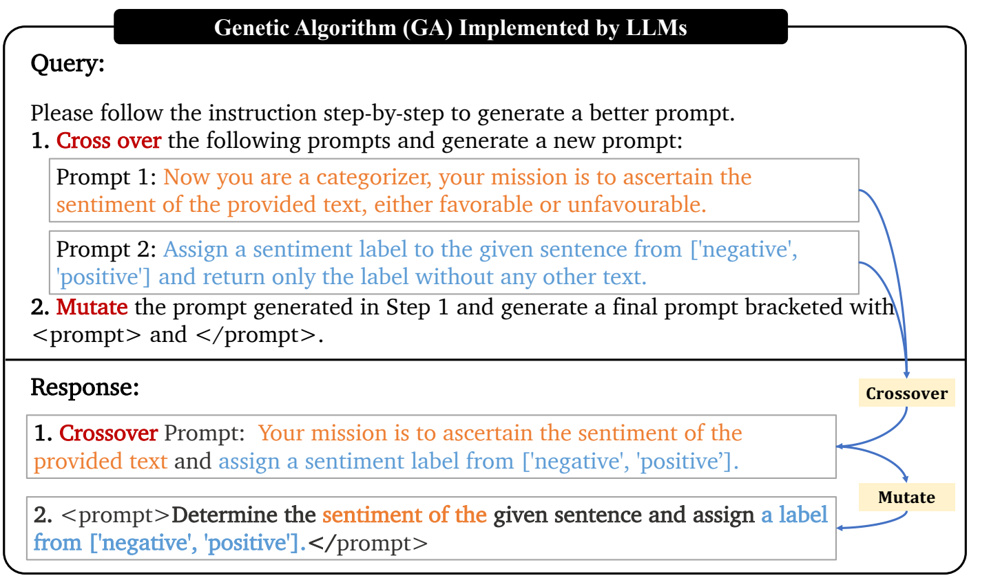
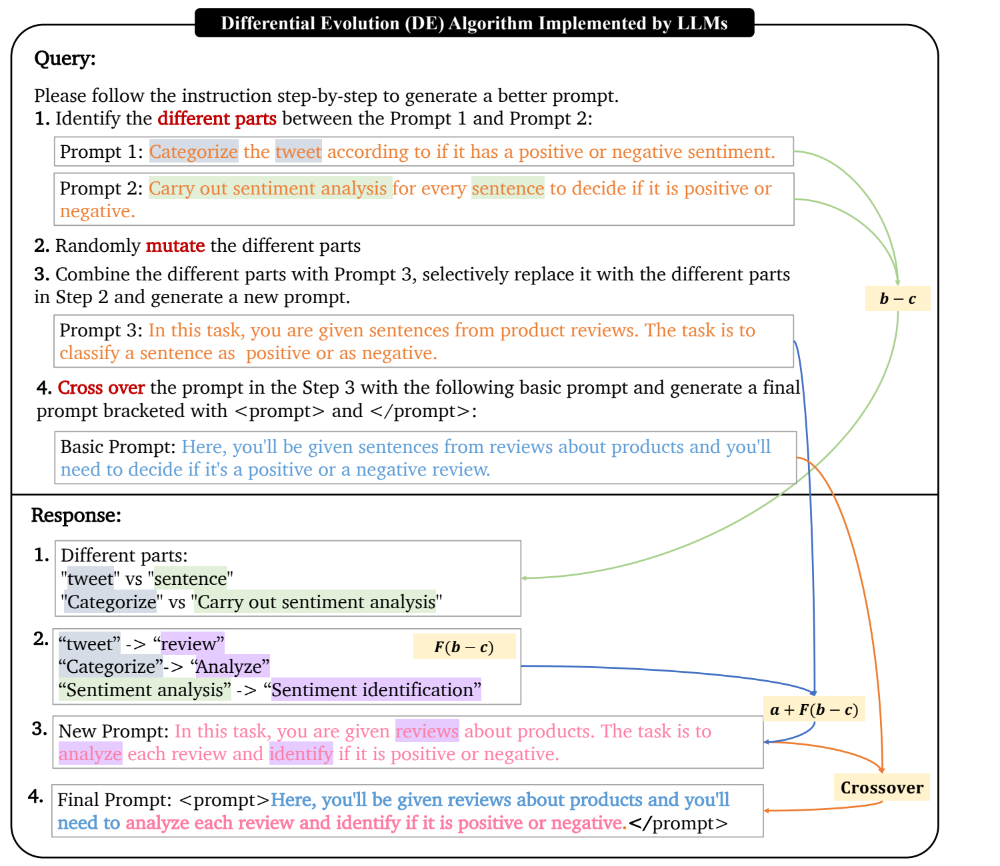
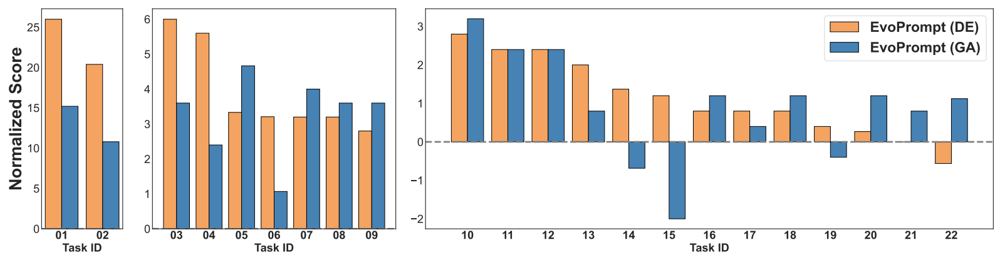
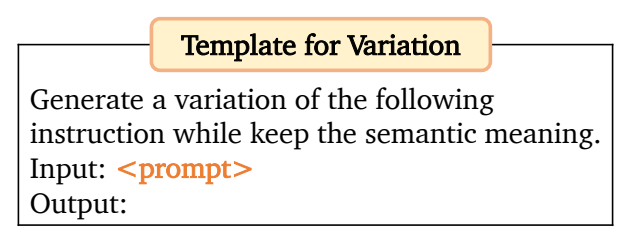
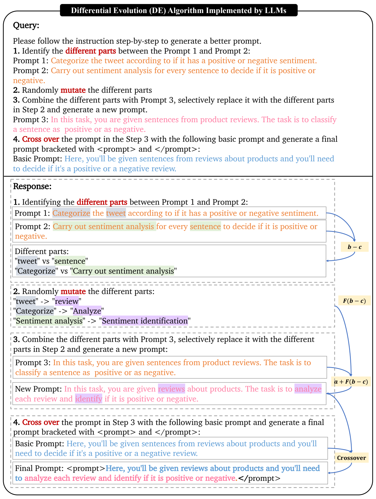
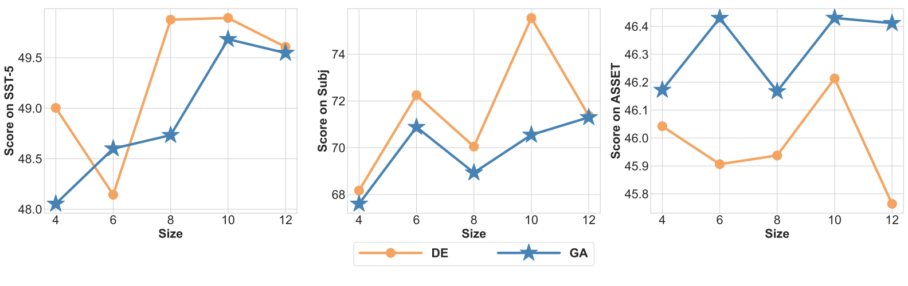
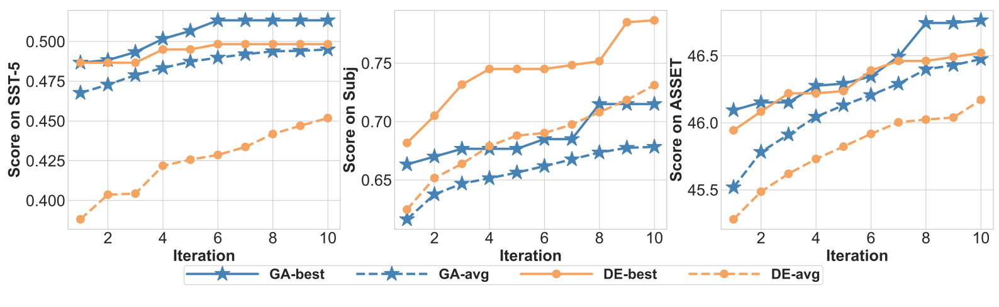
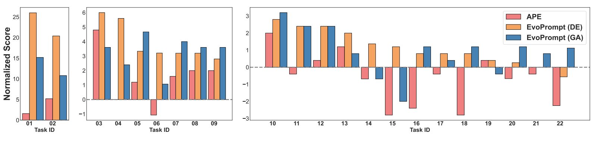
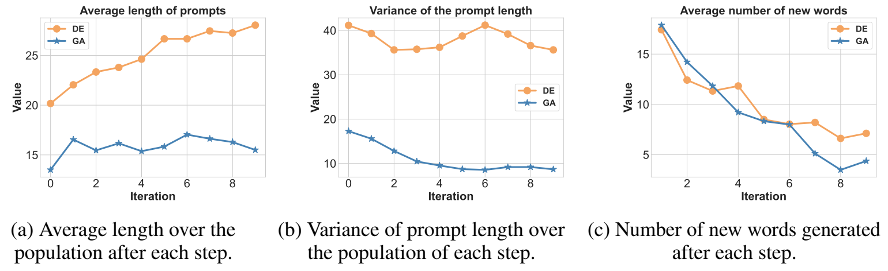

# EvoPrompt：连接大语言模型与演化算法，构建强大的提示词优化器

**原题：** EvoPrompt: Connecting LLMs with Evolutionary Algorithms Yields Powerful Prompt Optimizers  
**发表信息：** ICLR 2024 会议论文；所译版本为 arXiv:2309.08532v3（2025 年 5 月 1 日）。  
**作者：** Qingyan Guo¹˒²（共同第一作者），Rui Wang²（共同第一作者），Junliang Guo²，Bei Li²˒³，Kaitao Song²，Xu Tan²（通信作者），Guoqing Liu²，Jiang Bian²，Yujiu Yang¹（通信作者）  
**机构：** ¹清华大学；²微软研究院；³东北大学。  
**邮箱：** gqy22@mails.tsinghua.edu.cn；libei_neu@outlook.com；{ruiwa,junliangguo,kaitaosong,xuta,guoqingliu,jiabia}@microsoft.com；yang.yujiu@sz.tsinghua.edu.cn。  
**作者说明：** 第一作者在微软亚洲研究院实习期间完成本工作。  
**代码：** [EvoPrompt](https://github.com/beeevita/EvoPrompt)

> 译文说明：保留原文章节、图表、算法与附录，参考文献保持英文。原图保留，图注及图中主要提示词另附中文翻译。提示词中的标签、占位符和输出格式保留必要的原始字符串，以便对照。

## 摘要

大语言模型（LLM）在各种任务中表现出色，但依赖精心设计的提示词，而这往往需要大量人工投入。为自动化这一过程，本文提出新的离散提示词优化框架 EvoPrompt。该框架借鉴演化算法（EA）的思想，因为这类算法具有良好的性能和较快的收敛速度。离散提示词是需要保持连贯、可读的自然语言表达；为使 EA 能够处理它们，我们将 LLM 与 EA 连接起来，同时利用 LLM 强大的语言处理能力和 EA 高效的优化能力。具体而言，EvoPrompt 无需任何梯度或参数，从提示词种群出发，迭代地借助 LLM 根据演化算子生成新提示词，并依据开发集表现改进种群。我们在 31 个涵盖语言理解、语言生成和 BIG-Bench Hard（BBH）任务的数据集上，为 GPT-3.5、Alpaca 等闭源及开源 LLM 优化提示词。EvoPrompt 显著优于人工设计的提示词和现有自动提示词生成方法，例如在 BBH 上提升最高达 25%。此外，EvoPrompt 表明，将 LLM 与 EA 连接起来可以产生协同效应，为进一步研究 LLM 与传统算法的结合提供启发。代码见上述链接。

## 1 引言

大语言模型在多种自然语言处理（NLP）任务上表现突出（Touvron et al., 2023; Ouyang et al., 2022）。为适配下游任务，只需在输入文本中添加一条指令，即所谓离散提示词，就可以引导 LLM 完成目标任务，几乎不增加计算成本（Liu et al., 2023）。这种方法也无需访问 LLM 的任何参数或梯度，因此适用于 GPT-3、GPT-4 等仅提供黑盒 API 的模型（Brown et al., 2020; OpenAI, 2023）。然而，尽管使用方便，LLM 在特定任务上的性能仍显著受提示词影响（Liu et al., 2023; Zhu et al., 2023）。因此，关键挑战是提示词设计，这已发展为一项重要技术，即提示词工程（Zhou et al., 2022）。不同语言模型、不同任务所需提示词差异很大，设计通常需要大量人工投入与专业知识，而可用指导原则较为主观且有限（Mishra et al., 2022a;b; Liu et al., 2023; Zamfirescu-Pereira et al., 2023; Wang et al., 2023）。

为减轻人工设计离散提示词的负担，先前方法通常需要访问 LLM 输出层的词元概率，而 API 不一定提供这类信息（Deng et al., 2022; Zhang et al., 2023a）。近期一些工作通过枚举多样提示词并选出最佳者（Zhou et al., 2022; Jiang et al., 2020），或修改现有提示词以改进性能（Guo et al., 2023; Prasad et al., 2022; Pryzant et al., 2023）。这些方法要么强调探索多样提示词，可能导致搜索犹豫不决、浪费资源；要么强调利用当前找到的好提示词，可能造成停滞，使搜索局限于局部最优。多种传统无导数算法经过良好设计，能够平衡探索与利用（Conn et al., 2009; Rios & Sahinidis, 2013）。其中，演化算法简单高效，适合离散提示词优化（Storn & Price, 1997; Brest et al., 2006; Zhang & Sanderson, 2009; Vesterstrom & Thomsen, 2004）。提示词中的短语序列可视为典型 EA 中的基因序列，因此与自然演化过程相容。

本文借鉴 EA 思想，提出离散提示词调优框架 EvoPrompt。EA 中的演化算子虽然通常用于序列，却往往通过独立改变词元来生成新候选解，忽略词元间的联系，而这种联系对于维持提示词连贯性和可读性至关重要。因此，我们将 LLM 在 NLP 方面的优势与 EA 出色的优化能力结合：LLM 根据演化算子生成新候选提示词，EA 引导优化过程并保留最优提示词。

具体而言，从若干初始提示词出发，让 LLM 充当演化算子生成新候选提示词，保留开发集上表现更好的提示词。对不断更新的种群迭代执行上述操作，以提升质量。通过精心设计演化算子并调整更新策略，EvoPrompt 可实例化为不同类型的 EA。我们在语言理解、语言生成和具有挑战性的 BIG-Bench 任务共 31 个数据集上，为 Alpaca（Taori et al., 2023）与 GPT-3.5（Brown et al., 2020）两个不同 LLM 优化提示词。与人工设计提示词及先前自动生成方法相比，EvoPrompt 持续获得更好的提示词。主要贡献包括：

- 提出连接 LLM 与 EA 的自动离散提示词优化框架 EvoPrompt，具有以下优点：不需要访问 LLM 的任何参数或梯度；平衡探索与利用，得到更好结果；生成的提示词可供人阅读。
- 在 31 个数据集上证明 EvoPrompt 相比人工提示词及现有方法的有效性。我们公开用于情感分类、主题分类、主观性分类、文本简化、摘要和推理等常见任务的最优提示词。
- 证明在获得适当指令时，LLM 能实现多种 EA。希望这些探索启发更多 LLM 与传统算法结合的研究，为 LLM 的创新应用开辟道路。

## 2 相关工作

**LLM 中的提示词。** 提示是一种将 LLM 用于特定任务的高效方法，但性能受提示词选择显著影响。自动提示词优化近期广受关注。连续提示词方法仅调节部分输入词元的参数（Li & Liang, 2021; Liu et al., 2021b;a; Zhang et al., 2021），吸引了大量研究。尽管效果良好，这一范式有两个不可忽视的缺点：（1）连续提示词优化需要访问 LLM 参数，而黑盒 API 无法提供；（2）软提示词往往缺乏可解释性（Lester et al., 2021）。离散提示词只需在输入文本中加入若干离散词元，如“It was”（Schick & Schütze, 2021），或“将评论分类为正面或负面”等任务描述性指令，即可提供可解释性更强的人机交互接口，并在多种 NLP 任务上展现出良好表现（Liu et al., 2023）。

**离散提示词。** 已有多种自动离散提示词搜索与生成方法（Shin et al., 2020; Shi et al., 2022; Wallace et al., 2019; Deng et al., 2022; Zhang et al., 2023a），但它们仍依赖梯度或输出层词元概率。考虑到不同提示词在下游任务上的表现差异很大，近期一些工作强调探索，主要通过重采样扩充候选，再从中枚举和选择最佳提示词（Zhou et al., 2022; Jiang et al., 2020）。提示词编辑方法（Zhang et al., 2023a; Prasad et al., 2022）强调利用，可能陷入局部最优。另一些方法收集预测错误的样本，分析对应根因，以改进现有提示词（Pryzant et al., 2023; Guo et al., 2023），同样偏重利用。此外，这些方法受限于具有标准答案的任务，不能直接用于生成任务。我们的 EvoPrompt 借助演化算法平衡探索与利用，不需要任何参数或梯度。

**LLM 与优化算法。** LLM 展示了充当黑盒优化器的潜力（Zheng et al., 2023），但黑盒方法缺乏可解释性。一些工作表明，LLM 能模仿传统算法中的特定操作。例如，通过收集预测错误样本，LLM 可在离散空间执行“梯度下降”（Pryzant et al., 2023; Guo et al., 2023）。已有研究也证明，LLM 能模仿遗传算法（GA）的变异（Lehman et al., 2022）或交叉（Meyerson et al., 2023）算子。Chen et al.（2023）进一步结合 LLM 与 GA 进行神经架构搜索；Lanzi & Loiacono（2023）将类似方法用于游戏设计。本文更进一步，提出连接 LLM 与演化算法的通用框架，可通过定制演化和选择过程实例化为多种 EA，从而拓宽适用范围和潜在影响。我们希望本工作启发将 LLM 与传统算法结合的更广泛应用。

## 3 自动离散提示词优化

**算法 1. 离散提示词优化：EvoPrompt**

**输入：** 初始提示词 $P_0=\{p_1,p_2,\ldots,p_N\}$；种群大小 $N$；开发集 $D$；$f_D(\cdot)$ 表示某提示词在目标 LLM 上、于 $D$ 中评估的分数；预设迭代次数 $T$；精心设计、用于生成新提示词的演化算子 $\operatorname{Evo}(\cdot)$。

1. 初始化评估分数：$S_0\leftarrow\{s_i=f_D(p_i)\mid i\in[1,N]\}$。
2. 对 $t=1,\ldots,T$，执行第 3–6 步。
3. **选择：** 从当前种群中选择一定数量的父代提示词：$p_{r_1},\ldots,p_{r_k}\sim P_{t-1}$。
4. **演化：** 借助 LLM 执行演化算子，根据父代生成新提示词：$p'_i\leftarrow\operatorname{Evo}(p_{r_1},\ldots,p_{r_k})$。
5. **评估：** $s'_i\leftarrow f(p'_i,D)$。
6. **更新：** 根据评估分数，$P_t\leftarrow\{P_{t-1},p'_i\}$，$S_t\leftarrow\{S_{t-1},s'_i\}$。
7. 结束循环。
8. 返回最终种群 $P_T$ 中的最佳提示词：$p^*\leftarrow\arg\max_{p\in P_T}f(p,D)$。

当前先进 LLM 通常通过黑盒 API 交互，无法访问其梯度和参数。演化算法是具有高精度和快速收敛特性的无导数算法，因此我们考虑将它引入离散提示词优化。然而，为产生新候选解，演化算子通常独立编辑现有解中的各元素，而不考虑元素间联系。这使其难以直接用于需要连贯性和可读性的离散提示词。为此，我们提出协同方法 EvoPrompt，将 LLM 的自然语言处理能力与 EA 的优化能力相连接：LLM 根据演化算子生成新候选提示词，EA 引导优化过程寻找最佳提示词。



**图 1.** LLM 实现的 GA 过程，即算法 1 中的 $\operatorname{Evo}(\cdot)$。步骤 1 对给定两个提示词执行交叉，橙色与蓝色词语分别继承自提示词 1 和 2；步骤 2 对所得提示词执行变异。

**图中提示词与回复的翻译：**

```text
查询：请逐步遵循指令，生成更好的提示词。
1. 对以下提示词进行交叉，生成一个新提示词：
   提示词 1：现在你是一名分类者，任务是判断给定文本的情感，
   即正面还是负面。
   提示词 2：从 ['negative', 'positive'] 中为给定句子分配情感标签，
   只返回标签，不返回任何其他文本。
2. 对步骤 1 生成的提示词进行变异，生成最终提示词，
   并用 <prompt> 和 </prompt> 包围。

回复：
1. 交叉后的提示词：你的任务是判断给定文本的情感，
   并从 ['negative', 'positive'] 中分配情感标签。
2. <prompt>判断给定句子的情感，并从 ['negative', 'positive'] 中
   分配标签。</prompt>
```

实际实现 EvoPrompt 时，需要使用某个具体 EA 进行实例化。EA 类型很多，本文考虑两种广泛使用的算法：遗传算法（GA）（Holland, 1975）和差分演化（DE）（Storn & Price, 1997）。GA 是最受重视的演化算法之一（Holland, 1975; 1992; Mitchell, 1998; Mirjalili et al., 2020）；DE 自提出以来，已成为复杂优化问题中使用最广泛的算法之一（Storn & Price, 1997; Price, 2013; Das & Suganthan, 2010; Pant et al., 2020）。下面先介绍框架，再分别以 GA 和 DE 实例化。

### 3.1 EvoPrompt 框架

EA 通常从 $N$ 个解组成的初始种群出发（本文中解即提示词），迭代地对当前种群使用变异、交叉等演化算子产生新解，并根据适应度函数更新种群。遵循典型 EA，EvoPrompt 主要包括三步：

- **初始种群：** 许多现有自动提示词方法忽略人类先验知识，而我们将已有人工提示词用作初始种群，以利用人类智慧。此外，EA 通常从随机解出发，以获得多样种群、避免局部最优。因此我们也向初始种群中加入一些由 LLM 生成的提示词（Zhou et al., 2022）。
- **演化：** 每轮从当前种群选出若干父代提示词，使用 LLM 作为演化算子生成新提示词。为此，我们针对各类 EA 设计变异和交叉步骤，以及相应指令，引导 LLM 按这些步骤生成新提示词。
- **更新：** 在开发集上评估新候选提示词，保留表现更好的个体，类似自然界的适者生存。具体更新策略随 EA 类型而异。

达到预设迭代次数后停止。详细流程见算法 1。使用具体 EA 实例化时，需要调整演化过程，关键挑战是在离散提示词上设计演化算子。



**图 2.** LLM 实现的 DE 过程，即算法 1 中的 $\operatorname{Evo}(\cdot)$。步骤 1 找出提示词 1 和 2 的不同部分（灰色与绿色底色标记），对应典型 DE 的 $b-c$；步骤 2 对差异部分变异（紫色底色标记），模拟 $F(b-c)$；随后将当前最佳提示词作为提示词 3，与步骤 2 的变异结果结合生成新提示词，对应 $a+F(b-c)$；最后对当前基础提示词 $p_i$ 与步骤 3 的新提示词执行交叉。完整回复见附录 B.2 的图 5 及其中文转写。

### 3.2 使用遗传算法实例化

**选择。** GA 通常使用适应度引导的轮盘赌选择父代（Lipowski & Lipowska, 2012）。类似地，我们依据开发集表现，使用轮盘赌从当前种群选择两个父代提示词。设种群含 $N$ 个提示词，第 $i$ 个提示词的分数为 $s_i$，则其被选为父代的概率为：

$$
p_i=\frac{s_i}{\sum_{j=1}^{N}s_j}.
$$

**演化。** 遵循 GA，通过两步生成新候选提示词：（1）对父代执行交叉，生成继承双方特征的子代提示词；（2）对子代执行变异，随机改变某些元素。我们将这两阶段操作形式化为算法指令，引导 LLM 实现算法 1 的 $\operatorname{Evo}(\cdot)$。完整过程见图 1。

**更新。** 使用直接的选择策略更新种群：每轮产生 $N$ 个新提示词，与现有 $N$ 个提示词合并，再按分数保留前 $N$ 个，形成更新后的种群。因此种群整体质量持续提升，最后选择最终种群中表现最好的个体作为最优提示词。

### 3.3 使用差分演化实例化

先介绍 DE 的基础知识。与 GA 不同，DE 的解表示为数值向量。种群中每个向量依次作为基础向量 $x$，经历变异和交叉。变异时，从当前种群随机选择解 $a$，再加上另外两个不同随机解 $b,c$ 之差的缩放量，生成变异解：

$$
y=a+F(b-c),
$$

其中 $F$ 为缩放参数。交叉通过从基础解 $x$ 或变异解 $y$ 中选择各维参数，生成试验解 $x'=[x'_1,\ldots,x'_n]$。若 $x'$ 优于 $x$，则替换 $x$。逐步演化后，DE 获得高质量种群。DE 的一个变体使用当前最佳解作为向量 $a$，以利用最佳个体的信息。

**演化。** DE 的过程可分解为三步：（1）$F(b-c)$；（2）$y=a+F(b-c)$；（3）对 $x,y$ 交叉。基于 DE 的 EvoPrompt 遵循这些步骤设计演化过程及对应 LLM 指令，如图 2：

- 受差分向量启发，仅对当前种群随机选出的两个提示词的不同部分进行变异（图 2 步骤 1、2）。当前种群提示词被视为当前找到的较优提示词，因此二者共有部分往往对性能有积极影响，应当保留。
- DE 某变体在变异中使用当前最佳向量，即将缩放差分向量加到当前最佳向量上。基于这一思想，我们用变异后的差异部分有选择地替换当前最佳提示词的某些部分，组合生成变异提示词（图 2 步骤 3）。
- 交叉用变异提示词的片段替换基础提示词（当前种群某个候选）的部分内容，结合两个提示词的特征，可能产生新的、更好的解（图 2 步骤 4）。

**更新。** 遵循标准 DE，依次将当前种群每个 $p_i$ 作为基础提示词，用图 2 指令生成相应的新提示词 $p'_i$，然后在 $p_i,p'_i$ 中保留分数更高者。因此，种群大小不变，而整体质量提高。

## 4 实验

### 4.1 实现细节与基线

我们使用 GPT-3.5 执行演化算子，通过 EvoPrompt 为开源 Alpaca-7b（Taori et al., 2023）和闭源 GPT-3.5（text-davinci-003）（Brown et al., 2020）优化提示词。选择开发集得分最高的提示词，并报告测试集分数。Alpaca 的结果取 3 个随机种子的平均值，并给出标准差；GPT-3.5 因预算限制，仅报告一个种子的结果。比较以下三类基于提示词的方法：

- **人工指令（MI）：** 依据已有工作编写任务专用指令。语言理解采用 Zhang et al.（2023b），摘要采用 Sanh et al.（2021），文本简化采用 Zhang et al.（2023c）。
- **PromptSource**（Bach et al., 2022）和 **Natural Instructions（NI）**（Mishra et al., 2022b）：汇集大量不同数据集上的人工提示词。
- **APE**（Zhou et al., 2022）和 **APO**（Pryzant et al., 2023）：APE 使用迭代蒙特卡洛搜索，侧重探索。我们复现该方法，并将初始种群大小设为与 EvoPrompt 相同。APO 将预测错误样本作为“伪梯度”，迭代改进原始提示词，侧重利用。我们在二分类任务上复现 APO，使用最佳人工提示词作为初始提示词。

**表 1.** Alpaca-7b 上语言理解任务的主要结果（准确率）。括号内为标准差，粗体标记各列最佳值，短横线表示原文未报告结果。

| 方法 | SST-2 | CR | MR | SST-5 | AG’s News | TREC | Subj | 平均 |
| --- | --- | --- | --- | --- | --- | --- | --- | --- |
| MI（Zhang et al., 2023b） | 93.68 | **91.40** | 88.75 | 42.90 | 70.63 | 50.60 | 49.75 | 71.07 |
| NI（Mishra et al., 2022c） | 92.86 | 90.90 | 89.60 | 48.64 | 48.89 | 55.00 | 52.55 | 68.21 |
| PromptSource（Bach et al., 2022） | 93.03 | - | - | - | 45.43 | 36.20 | - | - |
| APE（Zhou et al., 2022） | 93.45(0.14) | 91.13(0.45) | 89.98(0.29) | 46.32(0.49) | 71.76(2.81) | 58.73(1.37) | 64.18(0.59) | 73.80 |
| APO（Pryzant et al., 2023） | 93.87(0.39) | 91.20(0.04) | 89.85(0.35) | - | - | - | 70.55(1.02) | - |
| EvoPrompt（GA） | **95.13(0.21)** | 91.27(0.06) | 90.07(0.25) | **49.91(0.61)** | 72.81(0.61) | **64.00(0.16)** | 70.55(2.58) | 76.25 |
| EvoPrompt（DE） | 94.75(0.21) | **91.40(0.04)** | **90.22(0.09)** | 49.89(1.73) | **73.82(0.35)** | 63.73(1.54) | **75.55(2.26)** | **77.05** |

**表 2.** Alpaca-7b 与 GPT-3.5 在 SAMSum 数据集（摘要任务）上的主要结果。

| 方法 | Alpaca ROUGE-1 | Alpaca ROUGE-2 | Alpaca ROUGE-L | GPT-3.5 ROUGE-1 | GPT-3.5 ROUGE-2 | GPT-3.5 ROUGE-L |
| --- | --- | --- | --- | --- | --- | --- |
| MI（Sanh et al., 2021） | 35.92 | 11.16 | 31.67 | 43.95 | 17.11 | 39.09 |
| APE（Zhou et al., 2022） | 35.44(0.79) | 10.60(0.38) | 31.80(0.50) | 43.43 | 16.72 | 38.25 |
| EvoPrompt（GA） | 38.46(1.45) | 13.36(0.75) | 34.20(1.40) | 45.22 | 18.52 | 41.06 |
| EvoPrompt（DE） | **39.46(0.51)** | **13.93(0.33)** | **35.49(0.56)** | **46.49** | **19.49** | **41.96** |

### 4.2 语言理解

**数据集与设置。** 首先在 7 个语言理解数据集上验证方法，包括情感分类：SST-2（Socher et al., 2013）、MR（PANG, 2005）、CR（Hu & Liu, 2004）、SST-5（Socher et al., 2013）；主题分类：AG’s News（Zhang et al., 2015）、TREC（Voorhees & Tice, 2000）；主观性分类：Subj（Pang & Lee, 2004）。为约束输出标签空间，在测试样本之前添加演示，每类包含一个样本。更多细节见附录 B。

**主要结果。** 表 1 表明：（1）与先前自动提示词生成方法及人工指令相比，基于 GA 和 DE 的 EvoPrompt 都取得显著更好的结果。（2）情感分类上，GA 略优于 DE；主题分类上，DE 更好。在主观性分类 Subj 上，DE 相比 GA 显著提升，准确率高出 5%。这可能归因于初始提示词质量不高时，DE 出色的跳出局部最优能力。

### 4.3 语言生成

**表 3.** Alpaca-7b 与 GPT-3.5 在文本简化任务（ASSET）上的主要结果（SARI）。

| 方法 | Alpaca | GPT-3.5 |
| --- | --- | --- |
| MI（Zhang et al., 2023c） | 43.03 | 43.80 |
| APE（Zhou et al., 2022） | 45.90(0.09) | 46.71 |
| EvoPrompt（GA） | **46.43(0.19)** | 47.36 |
| EvoPrompt（DE） | 46.21(0.27) | **47.40** |

**数据集与设置。** 对语言生成，在文本摘要和文本简化任务上评估 EvoPrompt。摘要使用 SAMSum（Gliwa et al., 2019），这是一个复杂且具有挑战性的对话摘要数据集；报告 Alpaca-7b 和 GPT-3.5 的 ROUGE-1/2/L。文本简化要求在保持原意的同时简化源文本，我们采用以多个参考改写著称的 ASSET（Alva-Manchego et al., 2020）。评估指标使用 SARI（Xu et al., 2016），一种广泛用于文本编辑任务的基于 n-gram 的评分体系。更多设置见附录 B。

**主要结果。** 摘要与简化结果见表 2、3。相比人工提示词，EvoPrompt 显著提升性能，在 Alpaca 和 GPT-3.5 API 上，SARI 都提高超过 3 分。它还在所有评估情形下持续优于 APE，表明生成的提示词能更有效地发挥 LLM 的能力。此外，DE 在摘要任务上明显优于 GA，在简化任务上表现相近，说明 DE 对摘要等更复杂语言生成任务尤其有效。



**图 3.** EvoPrompt（GA）与 EvoPrompt（DE）在 BBH 任务上的归一化分数。横轴为任务 ID，纵轴为相对基线的准确率差值。

### 4.4 BIG-Bench Hard（BBH）

**数据集与设置。** 为验证方法在多种任务上的表现，使用 BBH（Suzgun et al., 2022），包含 23 个需要多步推理、具有挑战性的 BIG-Bench 任务。考虑任务难度，我们重点优化 GPT-3.5 的提示词。从测试集抽样一部分作为开发集，在其余测试样本上报告相对于“Let’s think step by step.”（让我们逐步思考，Kojima et al., 2022）的归一化分数，并采用 3 个思维链示例（遵循 Fu et al., 2023）。用任务 ID 简化表示；人工提示词在一个任务上的准确率已达 100%，因此将其排除。细节及与先前工作的进一步比较见附录 C.2 和表 17。

> 原文脚注 1：归一化分数是给定提示词与基线“Let’s think step by step.”之间的准确率差值。基线的归一化分数为 0。

**主要结果。** EvoPrompt 在全部 22 个任务中获得更好的提示词（图 3）。DE 的提升最高为 25%、平均 3.5%；GA 最高提升 15%、平均 2.5%。尽管部分任务上 GA 优于 DE，差距较小，约为 1%。而在 6 个任务上，DE 超过 GA 逾 2%。因此，对于这些具有挑战性的任务，DE 通常是良好选择。

## 5 分析

### 5.1 GA 中的设计

GA 默认使用轮盘赌选择父代。为进一步探索选择策略的影响，我们与另外两种常用策略——锦标赛选择（Wikipedia contributors, 2023）和随机选择——比较，如表 4。使用轮盘赌的 EvoPrompt（GA）分数更高，展示了该方法的有效性。

**表 4.** EvoPrompt（GA）中的设计。

| 选择策略 | SST-5 | ASSET | 平均 |
| --- | --- | --- | --- |
| 随机选择（random） | 48.67(0.97) | 46.32(0.32) | 47.50 |
| 锦标赛（tournament） | 49.70(0.60) | 46.29(0.18) | 48.00 |
| 轮盘赌（wheel） | **49.91(0.61)** | **46.43(0.19)** | **48.17** |

### 5.2 DE 中的设计

将 DE 演化算子适配到离散提示词时，我们考察两个关键设计：（1）对差异部分变异；（2）将当前最佳提示词作为图 2 中的“提示词 3”。在两个数据集上评估这些设计：语言理解数据集 Subj 上 DE 优于 GA，生成数据集 ASSET 上两者表现相近。

**表 5.** EvoPrompt（DE）中的设计。

| 变异范围 | 提示词 3 的选择 | Subj | ASSET |
| --- | --- | --- | --- |
| 差异部分（Diff） | 最佳（best） | **75.55(2.26)** | **46.21(0.27)** |
| 全部内容（All） | 最佳（best） | 69.87(0.82) | 45.73(0.45) |
| 差异部分（Diff） | 随机（random） | 69.82(2.47) | 45.89(0.37) |
| 差异部分（Diff） | 移除（eliminate） | 69.07(4.21) | 45.90(0.23) |

**仅对差异部分变异。** 为展示这一设计的收益，将图 2 前两步替换为“随机变异提示词 1 和提示词 2”，允许对二者全部内容变异，在表 5 中记为 All。原设计仅变异差异部分，记为 Diff。表 5 表明，仅变异差异部分的设计在两个任务上均持续带来性能收益。

**提示词 3 的选择。** 借鉴 DE 的一个变体，我们选择当前种群最佳提示词作为图 2 的提示词 3。通过以下设置验证：（1）从当前种群随机采样提示词 3，记为 random；（2）不使用提示词 3，让基础提示词直接与变异差异部分交叉，即移除图 2 步骤 3，记为 eliminate。表 5 清楚表明引入提示词 3 的重要性，并显示选择最佳提示词比随机采样更有效。

### 5.3 种群初始化

我们考察初始种群质量对 EvoPrompt 的影响。先进行预实验，将人工设计或 GPT-3.5 生成的提示词按开发集表现排序，再选择表现最差、随机和表现最好的提示词及其变体作为初始提示词。变体使用 Zhou et al.（2022）的重采样模板生成，见附录 B.2 图 4，以便在初始化中引入随机性。

**表 6.** SST-5 上初始种群的消融实验。top-n、random-n、bottom-n 分别表示表现最好、随机选择和表现最差的 $n$ 个提示词；var-n 表示生成 $n$ 个变体。

| 初始化方式 | GA | DE |
| --- | --- | --- |
| bottom-10 | 47.80(0.92) | 48.64(0.15) |
| random-10 | 49.34(0.53) | **50.03(1.08)** |
| random-5 + var-5 | 49.84(1.49) | 49.53(1.04) |
| top-10 | 49.62(1.00) | 49.61(2.30) |
| top-5 + var-5 | **49.91(0.61)** | 49.89(1.73) |

表 6 表明：（1）无需精心设计初始提示词，随机选择即可达到与选择最佳提示词相近的性能；（2）选择最佳提示词时，让 GPT-3.5 生成变体、引入随机性，可以略微改善整体性能；但随机选择提示词时，DE 不需要额外随机性；（3）使用最佳初始提示词时，GA 略优于 DE；从最差初始提示词出发时，DE 优于 GA，说明当现有人工提示词质量不高时，DE 更合适。

## 6 结论

我们提出连接 LLM 与演化算法的 EvoPrompt，用于优化离散提示词。31 个数据集上的广泛实验证明了其优势：相对人工指令及现有方法，持续获得性能收益。此外，我们验证了 LLM 可作为有效、可解释的接口，实现 GA、DE 等演化算法。尽管本文聚焦 EA，方法的可扩展性为将 LLM 用于其他传统算法提供了空间，例如粒子群优化（PSO）（Kennedy & Eberhart, 1995）、蚁群优化（ACO）（Dorigo & Gambardella, 1997）和较新的质量—多样性（QD）优化算法。我们希望这些发现启发 LLM 与传统算法交叉领域的未来研究，促进创新应用。

## 致谢

本工作得到中国国家重点研发计划（编号 2020YFB1708200）和深圳市科技计划（JCYJ20220818101001004）的部分支持。

## References

Fernando Alva-Manchego, Louis Martin, Antoine Bordes, Carolina Scarton, Benoît Sagot, and Lucia Specia. Asset: A dataset for tuning and evaluation of sentence simplification models with multiple rewriting transformations. In Proceedings of the 58th Annual Meeting of the Association for Computational Linguistics, pp. 4668–4679, 2020.

Stephen Bach, Victor Sanh, Zheng Xin Yong, Albert Webson, Colin Raffel, Nihal V Nayak, Abheesht Sharma, Taewoon Kim, M Saiful Bari, Thibault Févry, et al. Promptsource: An integrated development environment and repository for natural language prompts. In Proceedings of the 60th Annual Meeting of the Association for Computational Linguistics: System Demonstrations , pp. 93–104, 2022.

Janez Brest, Sao Greiner, Borko Boskovic, Marjan Mernik, and Viljem Zumer. Self-adapting control parameters in differential evolution: A comparative study on numerical benchmark problems. IEEE transactions on evolutionary computation, 10(6):646–657, 2006.

Tom Brown, Benjamin Mann, Nick Ryder, Melanie Subbiah, Jared D Kaplan, Prafulla Dhariwal, Arvind Neelakantan, Pranav Shyam, Girish Sastry, Amanda Askell, et al. Language models are few-shot learners. Advances in neural information processing systems, 33:1877–1901, 2020.

Angelica Chen, David M Dohan, and David R So. Evoprompting: Language models for code-level neural architecture search. arXiv preprint arXiv:2302.14838, 2023.

Andrew R Conn, Katya Scheinberg, and Luis N Vicente. Introduction to derivative-free optimization. SIAM, 2009.

Swagatam Das and Ponnuthurai Nagaratnam Suganthan. Differential evolution: A survey of the state-of-the-art. IEEE transactions on evolutionary computation, 15(1):4–31, 2010.

Swagatam Das, Sankha Subhra Mullick, and Ponnuthurai N Suganthan. Recent advances in differential evolution–an updated survey. Swarm and evolutionary computation, 27:1–30, 2016.

Mingkai Deng, Jianyu Wang, Cheng-Ping Hsieh, Yihan Wang, Han Guo, Tianmin Shu, Meng Song, Eric Xing, and Zhiting Hu. Rlprompt: Optimizing discrete text prompts with reinforcement learning. In Proceedings of the 2022 Conference on Empirical Methods in Natural Language Processing, pp. 3369–3391, 2022.

Marco Dorigo and Luca Maria Gambardella. Ant colony system: a cooperative learning approach to the traveling salesman problem. IEEE Transactions on evolutionary computation, 1(1):53–66, 1997.

Yao Fu, Litu Ou, Mingyu Chen, Yuhao Wan, Hao Peng, and Tushar Khot. Chain-of-thought hub: A continuous effort to measure large language models’ reasoning performance. arXiv preprint arXiv:2305.17306, 2023.

Bogdan Gliwa, Iwona Mochol, Maciej Biesek, and Aleksander Wawer. Samsum corpus: A human-annotated dialogue dataset for abstractive summarization. arXiv preprint arXiv:1911.12237 , 2019.

Yiduo Guo, Yaobo Liang, Chenfei Wu, Wenshan Wu, Dongyan Zhao, and Nan Duan. Learning to program with natural language. arXiv preprint arXiv:2304.10464, 2023.

John H. Holland. Adaptation in Natural and Artificial Systems. University of Michigan Press, Ann Arbor, 1975. ISBN 0262581116.

John H Holland. Adaptation in natural and artificial systems: an introductory analysis with applications to biology, control, and artificial intelligence. MIT press, 1992.

Minqing Hu and Bing Liu. Mining and summarizing customer reviews. In KDD, pp. 168–177, 2004.

Srinivasan Iyer, Xi Victoria Lin, Ramakanth Pasunuru, Todor Mihaylov, Daniel Simig, Ping Yu, Kurt Shuster, Tianlu Wang, Qing Liu, Punit Singh Koura, et al. Opt-iml: Scaling language model instruction meta learning through the lens of generalization. arXiv preprint arXiv:2212.12017, 2022.

Zhengbao Jiang, Frank F Xu, Jun Araki, and Graham Neubig. How can we know what language models know? Transactions of the Association for Computational Linguistics, 8:423–438, 2020.

James Kennedy and Russell Eberhart. Particle swarm optimization. In Proceedings of ICNN’95-international conference on neural networks, volume 4, pp. 1942–1948. IEEE, 1995.

Takeshi Kojima, Shixiang Shane Gu, Machel Reid, Yutaka Matsuo, and Yusuke Iwasawa. Large language models are zero-shot reasoners. Advances in neural information processing systems, 35: 22199–22213, 2022.

Pier Luca Lanzi and Daniele Loiacono. Chatgpt and other large language models as evolutionary engines for online interactive collaborative game design. arXiv preprint arXiv:2303.02155, 2023.

Joel Lehman, Jonathan Gordon, Shawn Jain, Kamal Ndousse, Cathy Yeh, and Kenneth O. Stanley. Evolution through large models. arXiv preprint arXiv:2206.08896, 2022.

Brian Lester, Rami Al-Rfou, and Noah Constant. The power of scale for parameter-efficient prompt tuning. In EMNLP, pp. 3045–3059, 2021.

Bei Li, Rui Wang, Junliang Guo, Kaitao Song, Xu Tan, Hany Hassan, Arul Menezes, Tong Xiao, Jiang Bian, and JingBo Zhu. Deliberate then generate: Enhanced prompting framework for text generation. arXiv preprint arXiv:2305.19835, 2023.

Xiang Lisa Li and Percy Liang. Prefix-tuning: Optimizing continuous prompts for generation. In Proceedings of the 59th Annual Meeting of the Association for Computational Linguistics and the 11th International Joint Conference on Natural Language Processing (Volume 1: Long Papers), pp. 4582–4597, 2021.

Adam Lipowski and Dorota Lipowska. Roulette-wheel selection via stochastic acceptance. Physica A: Statistical Mechanics and its Applications, 391(6):2193–2196, 2012.

Pengfei Liu, Weizhe Yuan, Jinlan Fu, Zhengbao Jiang, Hiroaki Hayashi, and Graham Neubig. Pre-train, prompt, and predict: A systematic survey of prompting methods in natural language processing. ACM Computing Surveys, 55(9):1–35, 2023.

Xiao Liu, Kaixuan Ji, Yicheng Fu, Weng Lam Tam, Zhengxiao Du, Zhilin Yang, and Jie Tang. P-tuning v2: Prompt tuning can be comparable to fine-tuning universally across scales and tasks. arXiv preprint arXiv:2110.07602, 2021a.

Xiao Liu, Yanan Zheng, Zhengxiao Du, Ming Ding, Yujie Qian, Zhilin Yang, and Jie Tang. Gpt understands, too. arXiv preprint arXiv:2103.10385, 2021b.

Elliot Meyerson, Mark J Nelson, Herbie Bradley, Arash Moradi, Amy K Hoover, and Joel Lehman. Language model crossover: Variation through few-shot prompting. arXiv preprint arXiv:2302.12170, 2023.

Seyedali Mirjalili, Jin Song Dong, Ali Safa Sadiq, and Hossam Faris. Genetic algorithm: Theory, literature review, and application in image reconstruction. Nature-Inspired Optimizers: Theories, Literature Reviews and Applications, pp. 69–85, 2020.

Swaroop Mishra, Daniel Khashabi, Chitta Baral, Yejin Choi, and Hannaneh Hajishirzi. Reframing instructional prompts to gptk’s language. In Findings of the Association for Computational Linguistics: ACL 2022, pp. 589–612, 2022a.

Swaroop Mishra, Daniel Khashabi, Chitta Baral, and Hannaneh Hajishirzi. Cross-task generalization via natural language crowdsourcing instructions. In Proceedings of the 60th Annual Meeting of the Association for Computational Linguistics (Volume 1: Long Papers), pp. 3470–3487, 2022b.

Swaroop Mishra, Daniel Khashabi, Chitta Baral, and Hannaneh Hajishirzi. Cross-task generalization via natural language crowdsourcing instructions. In ACL, 2022c.

Melanie Mitchell. An introduction to genetic algorithms. MIT press, 1998.

Jean-Baptiste Mouret and Jeff Clune. Illuminating search spaces by mapping elites. arXiv preprint arXiv:1504.04909, 2015.

OpenAI. Gpt-4 technical report. arXiv preprint arXiv:2303.08774, 2023.

Long Ouyang, Jeffrey Wu, Xu Jiang, Diogo Almeida, Carroll Wainwright, Pamela Mishkin, Chong Zhang, Sandhini Agarwal, Katarina Slama, Alex Ray, et al. Training language models to follow instructions with human feedback. Advances in Neural Information Processing Systems , 35: 27730–27744, 2022.

Bo PANG. Seeing stars: Exploiting class relationships for sentiment categorization with respect to rating scales. In ACL, 2005.

Bo Pang and Lillian Lee. A sentimental education: Sentiment analysis using subjectivity summarization based on minimum cuts. In Proceedings of the 42nd Annual Meeting of the Association for Computational Linguistics (ACL-04), pp. 271–278, 2004.

Millie Pant, Hira Zaheer, Laura Garcia-Hernandez, Ajith Abraham, et al. Differential evolution: A review of more than two decades of research. Engineering Applications of Artificial Intelligence, 90:103479, 2020.

Archiki Prasad, Peter Hase, Xiang Zhou, and Mohit Bansal. Grips: Gradient-free, edit-based instruction search for prompting large language models. arXiv preprint arXiv:2203.07281, 2022.

Kenneth V Price. Differential evolution. In Handbook of optimization: From classical to modern approach, pp. 187–214. Springer, 2013.

Reid Pryzant, Dan Iter, Jerry Li, Yin Tat Lee, Chenguang Zhu, and Michael Zeng. Automatic prompt optimization with" gradient descent" and beam search. arXiv preprint arXiv:2305.03495, 2023.

Chengwei Qin, Aston Zhang, Zhuosheng Zhang, Jiaao Chen, Michihiro Yasunaga, and Diyi Yang. Is chatgpt a general-purpose natural language processing task solver? arXiv preprint arXiv:2302.06476, 2023.

Luis Miguel Rios and Nikolaos V Sahinidis. Derivative-free optimization: a review of algorithms and comparison of software implementations. Journal of Global Optimization, 56:1247–1293, 2013.

Victor Sanh, Albert Webson, Colin Raffel, Stephen H Bach, Lintang Sutawika, Zaid Alyafeai, Antoine Chaffin, Arnaud Stiegler, Teven Le Scao, Arun Raja, et al. Multitask prompted training enables zero-shot task generalization. arXiv preprint arXiv:2110.08207, 2021.

Timo Schick and Hinrich Schütze. Exploiting cloze-questions for few-shot text classification and natural language inference. In Proceedings of the 16th Conference of the European Chapter of the Association for Computational Linguistics: Main Volume, pp. 255–269, 2021.

Chufan Shi, Haoran Yang, Deng Cai, Zhisong Zhang, Yifan Wang, Yujiu Yang, and Wai Lam. A thorough examination of decoding methods in the era of llms. arXiv preprint arXiv:2402.06925, 2024.

Weijia Shi, Xiaochuang Han, Hila Gonen, Ari Holtzman, Yulia Tsvetkov, and Luke Zettlemoyer. Toward human readable prompt tuning: Kubrick’s the shining is a good movie, and a good prompt too? arXiv preprint arXiv:2212.10539, 2022.

Taylor Shin, Yasaman Razeghi, Robert L Logan IV , Eric Wallace, and Sameer Singh. Autoprompt: Eliciting knowledge from language models with automatically generated prompts. In Proceedings of the 2020 Conference on Empirical Methods in Natural Language Processing (EMNLP) , pp. 4222–4235, 2020.

Richard Socher, Alex Perelygin, Jean Wu, Jason Chuang, Christopher D Manning, Andrew Y Ng, and Christopher Potts. Recursive deep models for semantic compositionality over a sentiment treebank. In EMNLP, pp. 1631–1642, 2013.

Rainer Storn and Kenneth Price. Differential evolution–a simple and efficient heuristic for global optimization over continuous spaces. Journal of global optimization, 11:341–359, 1997.

Mirac Suzgun, Nathan Scales, Nathanael Schärli, Sebastian Gehrmann, Yi Tay, Hyung Won Chung, Aakanksha Chowdhery, Quoc V Le, Ed H Chi, Denny Zhou, et al. Challenging big-bench tasks and whether chain-of-thought can solve them. arXiv preprint arXiv:2210.09261, 2022.

Rohan Taori, Ishaan Gulrajani, Tianyi Zhang, Yann Dubois, Xuechen Li, Carlos Guestrin, Percy Liang, and Tatsunori B. Hashimoto. Stanford alpaca: An instruction-following llama model. https://github.com/tatsu-lab/stanford_alpaca, 2023.

Hugo Touvron, Thibaut Lavril, Gautier Izacard, Xavier Martinet, Marie-Anne Lachaux, Timothée Lacroix, Baptiste Rozière, Naman Goyal, Eric Hambro, Faisal Azhar, et al. Llama: Open and efficient foundation language models. arXiv preprint arXiv:2302.13971, 2023.

Jakob Vesterstrom and Rene Thomsen. A comparative study of differential evolution, particle swarm optimization, and evolutionary algorithms on numerical benchmark problems. In Proceedings of the 2004 congress on evolutionary computation (IEEE Cat. No. 04TH8753) , volume 2, pp. 1980–1987. IEEE, 2004.

Ellen M Voorhees and Dawn M Tice. Building a question answering test collection. In Proceedings of the 23rd annual international ACM SIGIR conference on Research and development in information retrieval, pp. 200–207, 2000.

Eric Wallace, Shi Feng, Nikhil Kandpal, Matt Gardner, and Sameer Singh. Universal adversarial triggers for attacking and analyzing nlp. In Proceedings of the 2019 Conference on Empirical Methods in Natural Language Processing and the 9th International Joint Conference on Natural Language Processing (EMNLP-IJCNLP), pp. 2153–2162, 2019.

Yifan Wang, Qingyan Guo, Xinzhe Ni, Chufan Shi, Lemao Liu, Haiyun Jiang, and Yujiu Yang. Hint-enhanced in-context learning wakes large language models up for knowledge-intensive tasks. arXiv preprint arXiv:2311.01949, 2023.

Wikipedia contributors. Tournament selection — Wikipedia, the free encyclopedia. https://en.wikipedia.org/w/index.php?title=Tournament_selection&oldid=1160627612, 2023. [Online; accessed 26-September-2023].

Wei Xu, Courtney Napoles, Ellie Pavlick, Quanze Chen, and Chris Callison-Burch. Optimizing statistical machine translation for text simplification. Transactions of the Association for Computational Linguistics, 4:401–415, 2016.

JD Zamfirescu-Pereira, Richmond Y Wong, Bjoern Hartmann, and Qian Yang. Why johnny can’t prompt: how non-ai experts try (and fail) to design llm prompts. In Proceedings of the 2023 CHI Conference on Human Factors in Computing Systems, pp. 1–21, 2023.

Jingqiao Zhang and Arthur C. Sanderson. Jade: Adaptive differential evolution with optional external archive. IEEE Transactions on Evolutionary Computation, 13(5):945–958, 2009. doi: 10.1109/TEVC.2009.2014613.

Ningyu Zhang, Luoqiu Li, Xiang Chen, Shumin Deng, Zhen Bi, Chuanqi Tan, Fei Huang, and Huajun Chen. Differentiable prompt makes pre-trained language models better few-shot learners. In International Conference on Learning Representations, 2021.

Susan Zhang, Stephen Roller, Naman Goyal, Mikel Artetxe, Moya Chen, Shuohui Chen, Christopher Dewan, Mona Diab, Xian Li, Xi Victoria Lin, et al. Opt: Open pre-trained transformer language models. arXiv preprint arXiv:2205.01068, 2022.

Tianjun Zhang, Xuezhi Wang, Denny Zhou, Dale Schuurmans, and Joseph E Gonzalez. Tempera: Test-time prompt editing via reinforcement learning. In The Eleventh International Conference on Learning Representations, 2023a.

Wenxuan Zhang, Yue Deng, Bing Liu, Sinno Jialin Pan, and Lidong Bing. Sentiment analysis in the era of large language models: A reality check. arXiv preprint arXiv:2305.15005, 2023b.

Xiang Zhang, Junbo Zhao, and Yann LeCun. Character-level convolutional networks for text classification. NeurIPS, 28, 2015.

Yue Zhang, Leyang Cui, Deng Cai, Xinting Huang, Tao Fang, and Wei Bi. Multi-task instruction tuning of llama for specific scenarios: A preliminary study on writing assistance. arXiv preprint arXiv:2305.13225, 2023c.

Mingkai Zheng, Xiu Su, Shan You, Fei Wang, Chen Qian, Chang Xu, and Samuel Albanie. Can gpt-4 perform neural architecture search? arXiv preprint arXiv:2304.10970, 2023.

Yongchao Zhou, Andrei Ioan Muresanu, Ziwen Han, Keiran Paster, Silviu Pitis, Harris Chan, and Jimmy Ba. Large language models are human-level prompt engineers. In The Eleventh International Conference on Learning Representations, 2022.

Kaijie Zhu, Jindong Wang, Jiaheng Zhou, Zichen Wang, Hao Chen, Yidong Wang, Linyi Yang, Wei Ye, Neil Zhenqiang Gong, Yue Zhang, et al. Promptbench: Towards evaluating the robustness of large language models on adversarial prompts. arXiv preprint arXiv:2306.04528, 2023.

## A 算法实现细节

我们使用 GA 和 DE 两种代表性演化算法实例化 EvoPrompt。两者都遵循选择、生成子代、更新的一般过程，但选择策略、变异与交叉方式以及更新策略各不相同。具体算法分别见算法 2、3。

**算法 2. 离散提示词优化：EvoPrompt（GA）**

**输入：** 初始提示词 $P_0=\{p_1,p_2,\ldots,p_N\}$，种群大小 $N$，开发集 $D$。

1. 初始适应度评估：$S_0\leftarrow\{s_i=f(p_i,D)\mid i\in[1,N]\}$。
2. 对 $t=1,\ldots,T$ 执行（$T$ 为迭代次数）。
3. 对 $i=1,\ldots,N$ 执行第 4–6 步。
4. 根据适应度进行轮盘赌选择：$p_{r_1},p_{r_2}\sim P_{t-1}$。
5. 演化：$p'_i\leftarrow\operatorname{GA}(p_{r_1},p_{r_2})$，见图 1。
6. 评估：$s_i\leftarrow f(p'_i,D)$。
7. 结束内层循环。
8. $S'_t\leftarrow\{s_i\mid i\in[1,N]\}$，$P'_t\leftarrow\{p'_i\mid i\in[1,N]\}$。
9. 更新分数：$S_t\leftarrow\operatorname{Top\text{-}N}\{S_{t-1},S'_t\}$。
10. 使用 $S_{t-1},S'_t$ 更新种群：$P_t\leftarrow\operatorname{Top\text{-}N}\{P_{t-1},P'_t\}$。
11. 结束外层循环。
12. 返回最终种群 $P_T$ 中最佳提示词：$p^*\leftarrow\arg\max_{p\in P_T}f(p,D)$。

**算法 3. 离散提示词优化：EvoPrompt（DE）**

**输入：** 初始提示词 $P_0=\{p_1,p_2,\ldots,p_N\}$，种群大小 $N$，开发集 $D$。

1. 对 $t=1,\ldots,T$ 执行（$T$ 为迭代次数）。
2. 对 $P_{t-1}$ 中每个 $p_i$ 执行第 3–5 步。
3. 采样供体：$p_{r_1},p_{r_2}\sim P_{t-1}$，$r_1\ne r_2\ne i$。
4. 演化：$p'_i\leftarrow\operatorname{DE}(p_i,p_{r_1},p_{r_2},p_{\mathrm{best}})$，其中 $p_{\mathrm{best}}$ 为当前最佳提示词，见图 2。
5. 选择：$p_i^*=\arg\max_{p\in\{p_i,p'_i\}}f(p,D)$，即在种群中保留较好者。
6. 结束内层循环。
7. 更新：$P_t\leftarrow\{p_i^*\mid i\in[1,N]\}$。
8. 结束外层循环。
9. 返回最终种群 $P_T$ 中最佳提示词：$p^*\leftarrow\arg\max_{p\in P_T}f(p,D)$。

## B 实验设置

### B.1 数据集

表 7 给出文本分类、简化和摘要数据集的统计信息。对 BIG-Bench Hard，用序号表示 22 个任务，描述见表 17。注意，“web of lies”任务的基线准确率为 100%，因此未对它优化提示词。此外，“logical deduction objects”和“tracking shuffled objects”各有三个子任务。

**表 7.** 本文使用的自然语言理解与生成数据集统计。标签字符串保留原文；测试集大小对应原文的 Test 列。

| 数据集 | 类型 | 标签空间 | 测试集大小 |
| --- | --- | --- | --- |
| SST-2 | 情感 | {positive, negative} | 1,821 |
| CR | 情感 | {positive, negative} | 2,000 |
| MR | 情感 | {positive, negative} | 2,000 |
| SST-5 | 情感 | {terrible, bad, okay, good, great} | 2,210 |
| AG’s News | 新闻主题 | {World, Sports, Business, Tech} | 7,600 |
| TREC | 问题主题 | {Description, Entity, Expression, Human, Location, Number} | 500 |
| Subj | 主观性 | {subjective, objective} | 2,000 |
| SAMSum | 摘要 | - | 819 |
| ASSET | 简化 | - | 359 |

### B.2 模板

**任务执行模板。** 根据不同模型，参考先前工作使用表 8、9、10 中的不同模板（Iyer et al., 2022; Taori et al., 2023; Zhang et al., 2023b; Li et al., 2023; Fu et al., 2023）。



**图 4.** 用于重采样的模板（Zhou et al., 2022）。中文如下：

```text
在保持语义不变的前提下，生成以下指令的一个变体。
输入：<prompt>
输出：
```

**提示词生成模板。** 使用图 4 的重采样模板生成人工初始提示词的变体。EvoPrompt 中由 LLM 实现的完整 DE 算法见图 5。对于 DE 和 GA，都在前面添加一个算法执行示例，以引导 LLM 准确操作。

**表 8.** Alpaca 使用的模板（参考 Taori et al., 2023）。以下为模板和零样本示例的中文翻译；保留结构标签与占位符。

```text
==================== 指令提示词 ====================
下面是一条描述任务的指令，以及提供进一步上下文的输入。
请写出恰当完成请求的回复。

### Instruction:
<PROMPT>
### Input:
<INPUT>
### Response:
<COMPLETE>

零样本示例：
下面是一条描述任务的指令，以及提供进一步上下文的输入。
请写出恰当完成请求的回复。

### Instruction:
请执行情感分类任务。给定句子，从 ['negative', 'positive']
中分配情感标签。只返回标签，不返回任何其他文本。
### Input:
一部观察细致、奇迹般地毫不煽情的喜剧剧情片。
### Response:
<COMPLETE>
```



**图 5.** LLM 为离散提示词优化实现的 DE 算法，包含完整回复，即算法 1 中的 $\operatorname{Evo}(\cdot)$。步骤 1 找出提示词 1、2 的差异部分（灰色与绿色底色标记），对应 $b-c$；步骤 2 对差异部分变异（紫色底色标记），模拟 $F(b-c)$；随后把当前最佳提示词作为提示词 3，与变异结果结合，对应 $a+F(b-c)$；最后对当前基础提示词 $p_i$ 与步骤 3 的新提示词执行交叉。

**图中完整查询与回复的中文转写：**

```text
查询：请逐步遵循指令，生成更好的提示词。
1. 识别提示词 1 和提示词 2 的不同部分：
   提示词 1：根据推文具有正面还是负面情感，对其分类。
   提示词 2：对每个句子进行情感分析，判断它是正面还是负面。
2. 对不同部分随机变异。
3. 将不同部分与提示词 3 结合，使用步骤 2 的差异部分有选择地替换，
   生成一个新提示词。
   提示词 3：本任务给出产品评论中的句子，要求将句子分类为正面或负面。
4. 将步骤 3 的提示词与下列基础提示词交叉，生成最终提示词，
   用 <prompt> 和 </prompt> 包围：
   基础提示词：这里将给出产品评论中的句子，
   你需要判断它是正面评论还是负面评论。

回复：
1. 识别提示词 1 和提示词 2 的不同部分：
   提示词 1：根据“推文”具有正面还是负面情感，对其“分类”。
   提示词 2：对每个“句子”“进行情感分析”，判断它是正面还是负面。
   不同部分：“推文”与“句子”；“分类”与“进行情感分析”。
2. 对不同部分随机变异：
   “推文” → “评论”
   “分类” → “分析”
   “情感分析” → “情感识别”
3. 将不同部分与提示词 3 结合，使用步骤 2 的差异部分有选择地替换，
   生成新提示词：
   提示词 3：本任务给出产品评论中的句子，要求将句子分类为正面或负面。
   新提示词：本任务给出产品评论，要求分析每条评论，识别其正面或负面情感。
4. 将步骤 3 的提示词与以下基础提示词交叉，生成最终提示词，
   用 <prompt> 和 </prompt> 包围：
   基础提示词：这里将给出产品评论中的句子，
   你需要判断它是正面评论还是负面评论。
   最终提示词：<prompt>这里将给出产品评论，
   你需要分析每条评论，识别其正面或负面情感。</prompt>
```

**表 9.** 摘要模板（遵循 Sanh et al., 2021; Qin et al., 2023）、简化模板（遵循 Li et al., 2023）及对应零样本示例。TL;DR 表示简短摘要。

```text
==================== 简化模板 ====================
<PROMPT>
<INPUT>
该句的简化版本是 <COMPLETE>

零样本示例：
简化文本。
随后，在 1941 年 2 月，600 名犹太人被送往布痕瓦尔德和毛特豪森集中营。
该句的简化版本是 <COMPLETE>

==================== 摘要模板 ====================
<PROMPT>
<INPUT>
TL;DR: <COMPLETE>

零样本示例：
你会如何用几个词重新表述它？
Theresa：你去过 Tom 的新住处吗？
Luis：去过，很不错。
Marion：他邀请我们去吃晚饭。
Adam：在哪里？
Marion：在城外一点。
Adam：具体在哪里？
Marion：Fiesole。
Luis：真不错！
TL;DR: <COMPLETE>
```

**表 10.** 用于 GPT-3.5 的 BIG-Bench Hard 模板（遵循 Suzgun et al., 2022）及对应零样本示例。`<DESC>` 表示各任务的具体描述。

```text
==================== BIG-Bench Hard 模板 ====================
<DESC>
Q: <INPUT>
A: <PROMPT>
<COMPLETE>

零样本示例：
列举对象并要求模型计数的问题。
Q: 我有一支长笛、一架钢琴、一支长号、四个炉子、一把小提琴、
一架手风琴、一支单簧管、一面鼓、两盏灯和一支小号。
我有多少件乐器？
A: 让我们逐步思考。
<COMPLETE>
```

### B.3 超参数

实验参数见表 11。由 GPT-3.5 实现演化算法时，遵循先前工作（Shi et al., 2024），采用 Top-p 解码，温度为 0.5，$P=0.95$。任务执行时，Alpaca 采用贪心解码及默认温度；GPT-3.5 执行生成任务时，温度为 0.0。

**表 11.** 实验设置。Shots 表示演示中的示例数量。文本分类中设为 1，表示为每个类别前置一个示例，以将输出约束在标签空间内。

| 任务 | 语言模型 | 种群大小 | 迭代步数 | 开发集大小 | Shots |
| --- | --- | --- | --- | --- | --- |
| 文本分类 | Alpaca-7b | 10 | 10 | 200 | 1 |
| 文本生成 | Alpaca-7b | 10 | 10 | 100 | 0 |
| 文本生成 | GPT-3.5 | 10 | 10 | 100 | 0 |
| BIG-Bench Hard | GPT-3.5 | 10 | 10 | 50 | 3 |

**文本分类。** 使用先前工作中广泛采用的指令初始化提示词种群（Mishra et al., 2022b; Zhang et al., 2022），通过释义与改写构建种群。开发集大小为 200，在完整测试集上报告结果，与先前相关工作相同（Deng et al., 2022; Zhang et al., 2023a），见表 11。

**文本生成。** 从 Li et al.（2023）、Sanh et al.（2021）、Zhang et al.（2023c）收集摘要与简化指令，通过人工编写或 GPT-3.5 生成，扩充至目标初始种群大小，本文设为 10。

## C 补充结果

### C.1 演化算法的参数

**种群大小的影响。** 直观上，性能与种群大小带来的开销存在权衡。我们分别考察 GA、DE 在种群大小从 4 到 12 变化时的表现，结果见图 6。



**图 6.** 种群大小对 SST-5（左）、Subj（中）、ASSET（右）的影响。全部结果取 3 个随机种子的平均值。横轴为种群大小，纵轴为相应数据集上的分数。

对分类数据集，随着种群增大，DE 与 GA 的曲线均呈上升趋势。此外，种群多样性为 DE 带来的收益大于 GA，因为 DE 聚焦差异部分。种群中提示词的差异带来较大的变异幅度，促进 DE 探索潜在提示词；同时保留共有部分，有效平衡探索与利用。

对相对简单的生成任务 ASSET，规模为 6 的种群即可达到与规模为 10 相近的性能，原文同时报告开销增加为 2.5 倍。这说明，较简单任务无需大种群，而较复杂任务（如 Subj）能从规模更大、多样性更高的种群中获益。

**迭代次数的影响。** 为进一步研究收敛过程，我们在 SST-5、Subj、ASSET 上，绘制 GA、DE 每轮迭代后整个种群在开发集上的最佳分数和平均分数（图 7）。随着演化推进，最佳分数与平均分数曲线逐渐上升并收敛，表明种群整体质量不断提高。



**图 7.** Alpaca-7b 在 SST-5（左）、Subj（中）、ASSET（右）开发集上的每轮最佳与平均分数。全部结果取 3 个随机种子的平均值。图中 best 表示最佳、avg 表示平均，横轴为迭代次数。

### C.2 BBH 任务上的比较

APE（Zhou et al., 2022）在 InstructGPT 上为推理任务优化思维链提示词。考虑到 InstructGPT 和 GPT-3.5 同属 GPT 系列，可能呈现相似趋势，我们在推理任务上评估 APE 提出的提示词：“让我们逐步解决这个问题，以确保得到正确答案。”原文为“Let’s work this out in a step by step way to be sure we have the right answer.”，其 3-shot 表现见图 8。



**图 8.** APE、EvoPrompt（GA）和 EvoPrompt（DE）在 BBH 任务上的归一化分数。横轴为任务 ID，纵轴为相对基线的准确率差值。

为简化设置，全部 22 个 BBH 任务使用相同初始种群，不加入各任务先验知识。未来可通过加入人工设计或 LLM 生成的任务专用提示词，进一步提升性能。

**表 12.** 不同方法在 23 个 BBH 任务上的平均准确率。

| 方法 | 平均 |
| --- | --- |
| 基线 | 71.49 |
| APE | 71.85 |
| EvoPrompt（GA） | 74.18 |
| EvoPrompt（DE） | **75.03** |

**表 13.** 本文方法与 APE 的迭代次数、API 请求词元量（包括提示词优化与评估）及相应分数。“相同迭代次数”取 APE 收敛时的迭代次数；“直至收敛”指开发集平均分数连续两轮提升不足 0.3%。M 表示百万词元。

| 比较方式 | 数据集 | 指标 | APE | EvoPrompt（GA） | EvoPrompt（DE） |
| --- | --- | --- | --- | --- | --- |
| 相同迭代次数 | SST-5 | 迭代次数 | 9 | 9 | 9 |
| 相同迭代次数 | SST-5 | 词元量 | 5.39 M | 5.40 M | 5.52 M |
| 相同迭代次数 | SST-5 | 分数 | 45.79 | 50.23 | 49.23 |
| 相同迭代次数 | Subj | 迭代次数 | 15 | 15 | 15 |
| 相同迭代次数 | Subj | 词元量 | 5.66 M | 5.73 M | 5.93 M |
| 相同迭代次数 | Subj | 分数 | 67.20 | 70.10 | 79.35 |
| 直至收敛 | SST-5 | 迭代次数 | 9 | 7 | 11 |
| 直至收敛 | SST-5 | 词元量 | 5.39 M | 4.20 M | 6.75 M |
| 直至收敛 | SST-5 | 分数 | 45.79 | 50.23 | 51.13 |
| 直至收敛 | Subj | 迭代次数 | 15 | 15 | 17 |
| 直至收敛 | Subj | 词元量 | 5.66 M | 5.73 M | 6.72 M |
| 直至收敛 | Subj | 分数 | 67.20 | 70.10 | 79.35 |

### C.3 成本分析

开销主要来自提示词评估与生成。评估开销为 $N\times|D|\times T$，其中 $N$ 是种群大小、$|D|$ 是开发集大小、$T$ 是迭代次数。这些参数随任务变化，见附录 B.3。提示词生成成本主要取决于 API 返回结果数，即 $T\times N$。所以总 API 请求次数为 $N\times T\times(1+|D|)$，与 APE 相同。此外，LLM API 通常按词元数计费，因此我们估算提示词优化过程中 API 请求的总词元量，如表 13。分数均为一个随机种子下的测试集结果。主要分析：（1）相同迭代次数下，相对 APE 的表现；（2）以开发集平均分数衡量、直至收敛时的表现。

相同迭代次数下，GA、DE 均显著优于 APE，而词元开销只略有增加。APE 与 GA 的收敛速度相近，DE 略慢，但性能更好，说明 EvoPrompt 具有较高性能上限。

### C.4 提示词分析



**图 9.** 提示词长度相关统计：（a）每轮后整个种群的平均长度；（b）每轮种群中提示词长度的方差；（c）每轮演化产生的新词数量。全部值在 8 个数据集（7 个理解任务和 1 个简化任务）及 3 个随机种子上取平均。横轴为迭代次数。

**多样性分析。** 我们进一步研究每轮迭代后 GA、DE 生成提示词的多样性，绘制平均长度、长度方差及每轮变异产生的新词数，如图 9。DE 生成的提示词比 GA 更长、方差更大，表明它更偏好探索多样性。在后期迭代中，DE 比 GA 变异出更多新词，因此展现出更强的跳出局部最优的潜力。

**最优提示词。** 我们公开 EvoPrompt 为理解任务（表 14）、文本简化（表 16）、摘要（表 15）和 BBH（表 17、18）生成的最优提示词。下列表格保留任务 ID、方法与分数，并将指令内容译成中文。

**表 14.** 分类数据集上的基线：人工指令（遵循 Zhang et al., 2023b; 2023c）、Natural Instructions（Mishra et al., 2022b）、PromptSource（Bach et al., 2022），以及 EvoPrompt（DE 或 GA）为 Alpaca-7b 生成的最佳指令。

| 数据集 | 方法 | 指令内容（中文翻译） | 分数 |
| --- | --- | --- | --- |
| SST-2 | 人工指令 | 请执行情感分类任务。给定句子，从 ['negative', 'positive'] 中分配情感标签。仅返回标签，不返回其他文本。 | $93.68$ |
| SST-2 | Natural Instruction | 本任务给出电影评论中的句子。若句子情感为正面，则分类为“great”；若为负面，则分类为“terrible”。 | $92.86$ |
| SST-2 | PromptSource | 下列句子的情感是正面还是负面？ | $93.03$ |
| SST-2 | EvoPrompt | 检查电影评论，将其分类为正面或负面。 | $95.61$ |
| CR | 人工指令 | 请执行情感分类任务。给定句子，从 ['negative', 'positive'] 中分配情感标签。仅返回标签，不返回其他文本。 | $91.40$ |
| CR | Natural Instruction | 本任务给出电影评论中的句子。若句子情感为正面，则分类为“great”；若为负面，则分类为“terrible”。 | $90.90$ |
| CR | EvoPrompt | 分析顾客评论，将每个句子分类为“positive”或“negative”。 | $91.75$ |
| MR | 人工指令 | 请执行情感分类任务。给定句子，从 ['negative', 'positive'] 中分配情感标签。仅返回标签，不返回其他文本。 | $88.75$ |
| MR | Natural Instruction | 本任务给出电影评论中的句子。若句子情感为正面，则分类为“great”；若为负面，则分类为“terrible”。 | $89.60$ |
| MR | EvoPrompt | 通过准确地将每个输入—输出对归入“positive”或“negative”，识别电影评论是正面还是负面。 | $91.35$ |
| SST-5 | 人工指令 | 请执行情感分类任务。给定句子，从 ['terrible', 'bad', 'okay', 'good', 'great'] 中分配情感标签。仅返回标签，不返回其他文本。 | $42.90$ |
| SST-5 | Natural Instruction | 本任务给出电影评论中的句子。根据评论，将其归入五类之一：（1）terrible；（2）bad；（3）okay；（4）good；（5）great。 | $48.64$ |
| SST-5 | EvoPrompt | 请你的朋友评价他们刚看过的电影，给出总结性意见（如 terrible、bad、okay、good 或 great），以确定电影评论的情感。 | $52.26$ |
| AG’s News | 人工指令 | 请执行新闻分类任务。给定新闻，从 ['World', 'Sports', 'Business', 'Tech'] 中分配标签。仅返回标签，不返回其他文本。 | $70.63$ |
| AG’s News | Natural Instruction | 本任务给出一篇新闻。若其主要内容对应世界、体育、商业或技术，则将文章归入“World”“Sports”“Business”“Tech”四类之一。如果不确定主题，选择最接近的选项。 | $48.89$ |
| AG’s News | PromptSource | 哪个标签最能描述这篇新闻？ | $45.43$ |
| AG’s News | EvoPrompt | 评估新闻报道的整体概念，从 World、Sports、Business、Tech 中选择，将其归入正确类别。 | $76.21$ |
| TREC | 人工指令 | 请执行问题分类任务。给定问题，从 ['Description', 'Entity', 'Expression', 'Human', 'Location', 'Number'] 中分配标签。仅返回标签，不返回其他文本。 | $50.60$ |
| TREC | Natural Instruction | 给定一个问题，请判断哪个类别更适合描述它。从“Description”“Entity”“Expression”“Human”“Location”“Number”中作答。 | $55.00$ |
| TREC | PromptSource | 哪个类别最能描述下列问题？从以下列表中选择：Description、Entity、Abbreviation、Person、Quantity、Location。 | $36.20$ |
| TREC | EvoPrompt | 识别输入（解释、实体或人），提供合适输出（数字、描述或实体），以非英语母语者能够理解的方式回答问题。 | $68.00$ |
| Subj | 人工指令 | 请执行主观性分类任务。给定句子，从 ['subjective', 'objective'] 中分配标签。仅返回标签，不返回其他文本。 | $49.75$ |
| Subj | Natural Instruction | 本任务给出评论中的句子。若句子观点主观，则分类为“subjective”；若观点客观，则分类为“objective”。 | $52.55$ |
| Subj | EvoPrompt | 构建输入—输出对，展示评论与观点的主观性；区分客观和主观输入，同时给出个人意见与主观观点的示例，以说明判断和视角的主观性。 | $77.60$ |

**表 15.** SAMSum 上的人工指令基线（遵循 Sanh et al., 2021），以及 EvoPrompt（DE 或 GA）为 Alpaca-7b 和 GPT-3.5 生成的最佳指令。模型栏中的 GPT 沿用原表记法。

| 方法 | 模型 | 指令内容（中文翻译） | ROUGE-1/2/L |
| --- | --- | --- | --- |
| 人工指令 | Alpaca-7b | 你会如何用几个词重新表述它？ | $35.92/11.16/31.67$ |
| 人工指令 | GPT | 你会如何用几个词重新表述它？ | $43.95/17.11/39.09$ |
| EvoPrompt | Alpaca-7b | 仔细检查文本或聆听对话，识别关键思想、理解主旨，并以简洁语言总结关键事实和观点，不加入不必要的细节或重复内容。 | $39.86/14.24/36.09$ |
| EvoPrompt | GPT | 通过仔细阅读或聆听，识别主要思想和关键点，提炼核心，使读者能够理解重要概念与必要信息。 | $46.49/19.49/41.96$ |

**表 16.** ASSET 上的人工指令基线（遵循 Zhang et al., 2023c），以及 EvoPrompt（DE 或 GA）为 Alpaca-7b 和 GPT-3.5 生成的最佳指令。

| 方法 | 模型 | 指令内容（中文翻译） | SARI |
| --- | --- | --- | --- |
| 人工指令 | Alpaca-7b | 简化文本。 | $43.03$ |
| 人工指令 | GPT-3.5 | 简化文本。 | $43.80$ |
| EvoPrompt | Alpaca-7b | 将输入文本改写为简单英语，使非英语母语者更容易理解。 | $46.67$ |
| EvoPrompt | GPT-3.5 | 改写给定句子，使英语母语者和非母语者都更容易阅读和理解。 | $47.40$ |

**表 17.** EvoPrompt（DE 或 GA）为 GPT-3.5 在 BBH 数据集上生成的最佳指令。ID 重复是因为某些任务包含多个子任务。

| 任务 ID | 任务 | 描述 | 提示词（中文翻译） | 分数 |
| --- | --- | --- | --- | --- |
| 01 | hyperbaton | 正确排列英语句子中的形容词。 | 将答案拆分为各组成部分，仔细且合乎逻辑地检查每一部分，验证答案。把任务分解成小块，系统而理性地探索各部分，深思熟虑、有条不紊地向目标推进。 | $81.20$ |
| 02 | temporal_sequences | 回答某些事件可能发生在什么时间的问题。 | 先将难题分为易处理的小块，仔细分析每个组成部分，协作地深入检查各个方面，一起逐步解决，以确保正确答案和预期结果。 | $78.80$ |
| 03 | object_counting | 列举对象并要求模型计数的问题。 | 合乎逻辑地检查，有条理地评估，通过批判性思考和系统拆解这个数学任务，获得精确结果。 | $87.60$ |
| 04 | disambiguation_qa | 澄清含有歧义代词的句子的含义。 | 首先，让我们思考，不急不躁、循序渐进地使用逻辑处理问题，然后再进入答案。 | $71.20$ |
| 05 | logical_deduction_three_objects | 逻辑推演任务：推断一组对象的顺序（3 个对象）。 | 谨慎处理，彻底且有条理地检查，再逐步趋近解决方案。 | $94.40$ |
| 05 | logical_deduction_five_objects | 逻辑推演任务：推断一组对象的顺序（5 个对象）。 | 将问题分成若干步骤，认真逐步推进，在证明之后找到答案。 | $65.20$ |
| 05 | logical_deduction_seven_objects | 逻辑推演任务：推断一组对象的顺序（7 个对象）。 | 采用逐步方法，系统地拆解这个数学任务。 | $54.40$ |

**表 18.** EvoPrompt（DE 或 GA）为 GPT-3.5 在 BBH 数据集上生成的最佳指令，续表。ID 重复是因为某些任务包含多个子任务。部分提示词本身是未完成短语，按原文保留。

| 任务 ID | 任务 | 描述 | 提示词（中文翻译） | 分数 |
| --- | --- | --- | --- | --- |
| 06 | causal_judgement | 回答因果归因问题。 | 首先谨慎处理，检查每个细节，每次解决一个问题，以完成任务。 | $65.78$ |
| 07 | date_understanding | 根据上下文推断日期。 | 像侦探一样实事求是、注重实际，利用证据，以合乎逻辑、逐步推进的方法解决问题。 | $85.60$ |
| 08 | ruin_names | 选择能够“毁掉”给定电影或音乐艺人名字的幽默修改。 | 把数学任务分成更小部分，逐个解决。 | $69.60$ |
| 09 | word_sorting | 对词语列表排序。 | 合乎逻辑地分析问题的每个部分，像侦探一样解决它。 | $56.40$ |
| 10 | geometric_shapes | 根据 SVG 路径识别几何形状。 | 我们将一起有条不紊地解决这个问题。 | $64.00$ |
| 11 | movie_recommendation | 推荐与给定电影列表类似的电影。 | 在探索答案之前， | $86.00$ |
| 12 | salient_translation_error_detection | 检测德语原句的英语译文中存在何种错误。 | 将问题拆成独立步骤，以便解决。 | $62.80$ |
| 13 | formal_fallacies | 区分演绎上有效的论证与形式谬误。 | 实事求是，系统评估情况，逐步处理。 | $56.00$ |
| 14 | penguins_in_a_table | 回答关于企鹅及其属性表格的问题。 | 首先采取理性且有组织的方法，将问题分成小部分，合乎逻辑地思考，同时保持务实，谨慎而有条理地处理，以确保正确解决。 | $84.25$ |
| 15 | dyck_languages | 正确闭合一个 Dyck-n 词。 | 务实地解决这个挑战，仔细、缓慢地推进，慢下来以确保正确完成，务实而谨慎地达到目标。 | $44.40$ |
| 16 | multistep_arithmetic_two | 解决多步算术问题。 | 在深入答案之前， | $51.60$ |
| 17 | navigate | 给定一系列导航指令，判断最终是否回到起点。 | 合乎逻辑地共同努力，同步逐步、系统地解决这个数学问题。 | $94.20$ |
| 18 | reasoning_about_colored_objects | 回答关于某表面上对象颜色的极简单问题。 | 运用侦探思维，逐步拆解这个数学推理挑战的每个元素，像侦探一样推理，找出解答。 | $88.00$ |
| 19 | boolean_expressions | 计算随机布尔表达式的结果。 | 通过逐个检查元素、调查因素，有条不紊地逐步解开这个数学挑战。 | $90.80$ |
| 20 | tracking_shuffled_objects_three_objects | 给定初始位置与一串交换的描述，确定对象最终位置（3 个对象）。 | 缓慢、仔细地逐步推进这个数学推理挑战。 | $69.20$ |
| 20 | tracking_shuffled_objects_five_objects | 给定初始位置与一串交换的描述，确定对象最终位置（5 个对象）。 | 使用合乎逻辑、逐步推进的方法处理任务，找到正确答案。 | $81.20$ |
| 20 | tracking_shuffled_objects_seven_objects | 给定初始位置与一串交换的描述，确定对象最终位置（7 个对象）。 | 合乎逻辑、详细地逐步检查问题，每次分析一个部分。 | $84.80$ |
| 21 | sports_understanding | 判断人工构造的体育相关句子是否合理。 | 将问题分成步骤，然后开始求解。 | $96.80$ |
| 22 | snarks | 判断两个句子中哪个具有讽刺意味。 | 逐步拆解并分析问题的各个部分，以确保得到正确答案。 | $77.53$ |

## D 未来工作

以下几个方向值得进一步研究：

- 基于本框架，可探索更多应用，例如游戏关卡生成、文生图、非平凡 NP 困难问题（如旅行商问题）等。
- DE 存在许多变体，目前优先探索最典型、最经典的形式。未来可考虑更先进的 DE 变体（Das et al., 2016; Das & Suganthan, 2010）。例如，一些近期变体研究自适应控制参数。将它们用于离散语言空间的提示词优化时，主要挑战是评估 LLM 对连续控制参数的适配能力。
- 希望本工作启发超出演化算法范围、对 LLM 与其他传统算法联系的探索。主要挑战是将传统算法的特定元素适配到 LLM，例如粒子群优化（PSO）（Kennedy & Eberhart, 1995）中的运动方向与速度、蚁群优化（Dorigo & Gambardella, 1997）中的路径，以及 MAP-Elites（Mouret & Clune, 2015）中的特征。

> 译注：最后一项原文将 particle swarm 写为 partial swarm，并将蚁群优化的缩写写为 APO；这里依其上下文译出算法名称。
