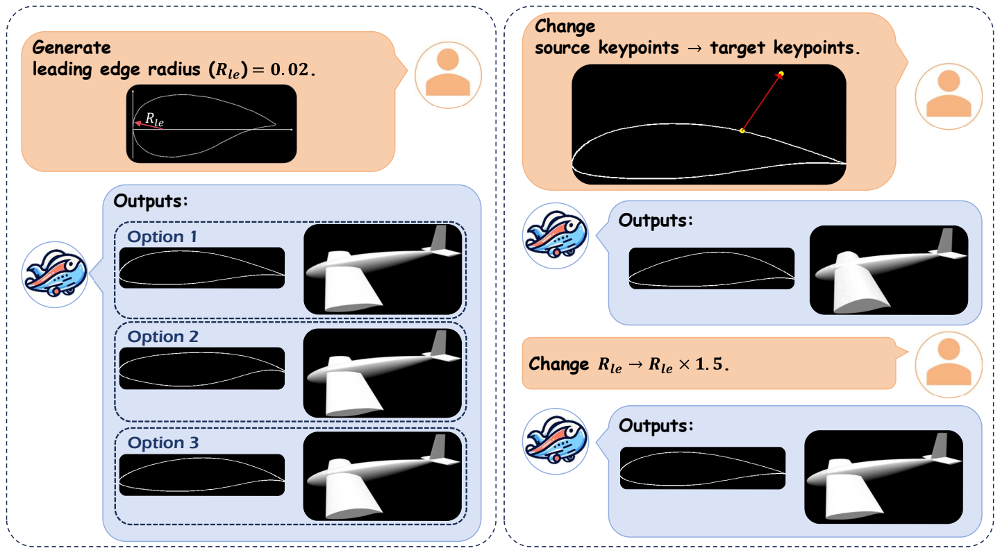
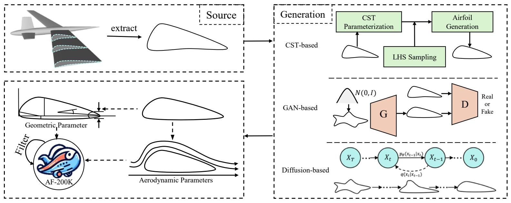
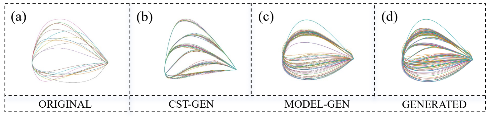
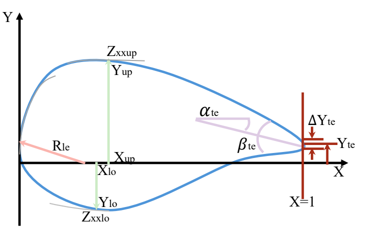
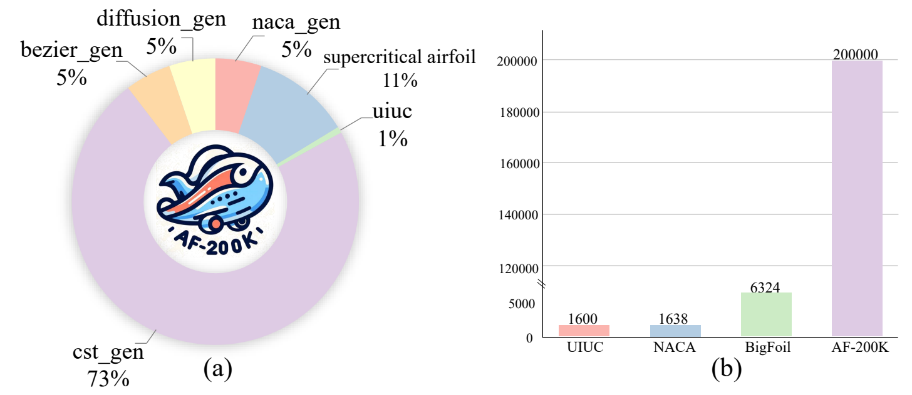
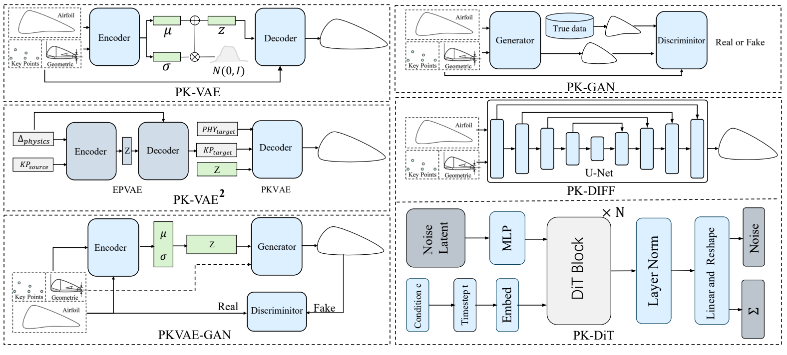
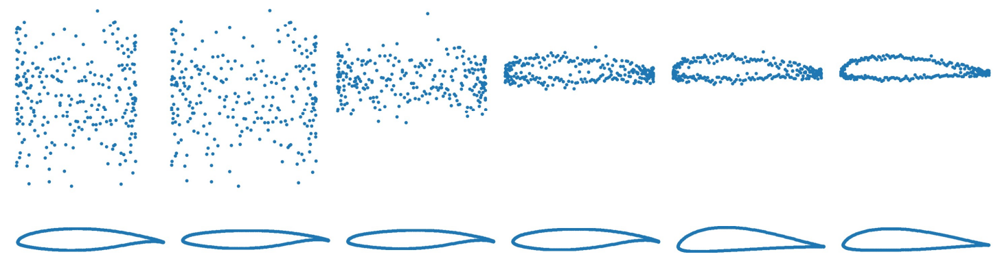
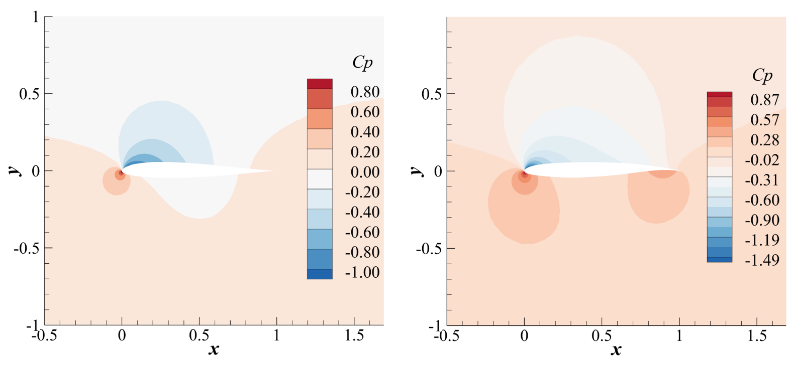
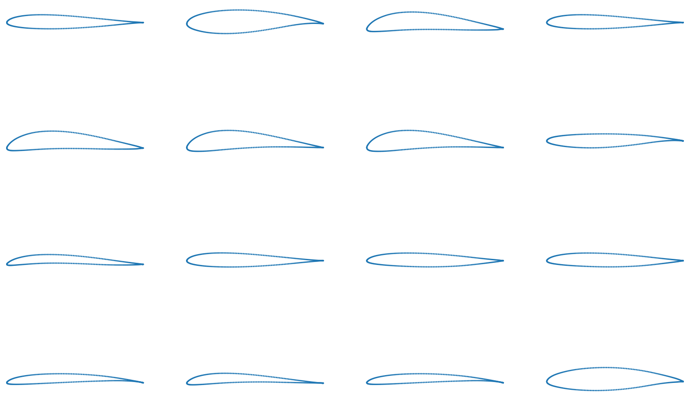

# AFBench：面向翼型设计的大规模基准

**原题：** AFBench: A Large-scale Benchmark for Airfoil Design  
**作者：** Jian Liu¹˒²、Jianyu Wu²、Hairun Xie³、Guoqing Zhang¹、Jing Wang³、Wei Liu³、Wanli Ouyang²、Junjun Jiang¹、Xianming Liu¹*、Shixiang Tang²*、Miao Zhang³*  
**单位：** ¹ 哈尔滨工业大学；² 上海人工智能实验室；³ 上海飞机设计研究院。  
**发表会议：** 第 38 届神经信息处理系统大会（NeurIPS 2024），数据集与基准赛道（Datasets and Benchmarks Track）。  
**通信作者：** Xianming Liu、Shixiang Tang、Miao Zhang（原文以 * 标注）。  
**项目网站：** [AFBench](https://hitcslj.github.io/afbench/)

> 译注：本译稿依据用户提供的论文 PDF，保留原文的章节、插图、图表编号、公式编号及引文编号；图注译为中文，参考文献保留原文。插图中的英文标注保留原图。原文中个别表述或符号存在不一致之处，相关位置另附译注。

**图 1. 我们的翼型生成与编辑软件。** （a）生成多样化的候选翼型。（b）编辑关键点和物理参数。

## 摘要

数据驱动的生成模型已成为实现高效机械逆向设计的一类有前景的方法。然而，由于时间和资金成本高昂，这一领域仍然缺少开源的大规模基准。翼型逆向设计尤其如此：它需要遵循多模态指令，即拖动点和调整物理参数，生成并编辑满足几何要求和气动要求的多样化翼型。

本文介绍我们在翼型逆向设计方面的开源工作 AFBench。它包括一个含有 20 万个翼型及高质量气动和几何标签的大规模数据集、两项新颖且实用的翼型逆向设计任务，即以多模态物理参数为条件的生成与可控编辑，以及用于评价现有各种翼型逆向设计方法的综合指标。我们的目标是将 AFBench 建成一个用于训练和评估翼型逆向设计方法的生态系统，尤其关注由多模态指令控制的数据驱动逆向设计模型，以弥合构想与实现、学术研究与工业应用之间的差距。

我们提供了基线模型、全面的实验观察和分析，以推动后续研究。我们的基线模型可在一块 RTX 3090 GPU 上于 16 小时内完成训练。代码库、数据集和基准将在 [项目网站](https://hitcslj.github.io/afbench/) 提供。

## 1. 引言

翼型逆向设计是翼型自动设计的核心问题，其目的是寻找设计输入变量，即物理参数，以优化某个潜在的目标函数，例如气动性能。以往的方法可以分为两类：优化方法 [1, 2, 3] 和数据驱动方法 [4, 5, 6, 7]。

首先，基于优化的方法通常通过构建数学模型来设计目标函数，并利用典型优化算法，例如遗传算法 [8]、伴随优化 [9] 和拓扑优化 [10]，寻找最优的输入变量作为设计参数。尽管这些方法取得了成功，但受所构建翼型物理模型的限制，它们仍存在耗时较长、最优设计变量的多样性受限等问题。其次，数据驱动方法 [11, 12, 13, 14] 通常借鉴人工智能领域条件生成模型的发展成果。研究者已经探索了 CGAN [15]、CVAE [16] 和扩散模型 [17, 18] 等流行的生成方法，并证明了它们的有效性。

然而，当前的数据驱动方法存在以下三个不足。第一，现有数据集规模相对较小，例如设计几何数据集 UIUC [19] 仅包含数千个样本。因此，在此类数据集上训练的数据驱动模型泛化能力有限，无法生成满足要求的多样化解。第二，当前数据集通常只提供一种条件，即气动参数，因此无法处理多条件设计，例如同时控制前缘半径和上表面峰值位置这两个几何参数；而这恰恰是翼型设计中的实际工业应用需求。第三，现有翼型逆向设计方法不支持根据人工提出的多模态要求，对已有设计进行渐进式编辑，这限制了它们在工业中的应用。例如，本文一位来自上海飞机设计研究院、拥有十余年翼型设计经验的作者指出，目前商业飞机上采用的每一种翼型，都经历了数百名工程师多年的逐步改进。

为推动生成模型在工程设计领域的发展，我们构建了一个综合翼型基准 **AFBench**，使其成为应对上述挑战的基础。它具有以下优点。

**（1）任务：翼型逆向设计中的多条件生成与编辑。** 围绕上述数据集，我们专门设置了两项新颖且更符合实际翼型设计需求的任务：多条件翼型生成和多模态翼型编辑。翼型生成任务不再局限于以往仅根据给定气动标签，例如升阻比，生成翼型的方式，而是根据本文翼型设计专家作者提出的多个复杂几何标签来生成翼型。相比以往基于单一条件的翼型生成，这一任务更有挑战性，也更实用。我们还引入了一项新开发的翼型编辑任务，目前允许同时修改翼型的控制点和物理参数。传统翼型编辑软件不具备编辑物理参数的功能；与传统软件通过样条插值移动控制点相比，我们利用 AI 模型实现控制点移动，具有更广阔的设计空间。

**（2）数据集：具有高质量、全面几何与气动标签的大规模翼型数据集。** 对于上述翼型逆向设计任务，我们提出的 AFBench 的训练子集包含 200,000 个精心设计的合成翼型和人工设计翼型，每个翼型都具有 11 个几何参数，以及 66 种工况下的气动特性，马赫数范围为 0.2 至 0.7，升力系数范围为 0 至 2。为了构建 AFBench，我们提出了一个自动数据引擎，包括数据合成、高质量标注和低质量数据过滤。与以往数据集不同，我们：（i）不仅整合了 UIUC [19] 和 NACA [20] 等已有数据集中的所有翼型，还纳入了上海飞机设计研究院提供的 2,150 个新人工设计超临界翼型；这类翼型在现有数据集中极为不足。（ii）通过结合传统物理模型和无条件生成模型进行有效的数据合成，将数据集进一步扩大到 200,000 个翼型。（iii）利用计算流体力学（CFD）仿真软件标注几何与气动标签。

> 译注：本段原文将 200,000 个翼型称为“训练子集”；第 4.1 节及附录 A 则说明 200,000 是数据集总量，其中训练集为 160,000 个。此处保留原文表述。

**（3）开源代码库与基准：包含先进方法和综合评价指标的翼型逆向设计数据驱动生成模型开源代码库。** 目前仍然缺少一个全面且清晰的代码库，用于比较和分析不同的翼型逆向设计方法，因此我们发布了一个全面、公开可访问的代码库，以方便后续研究。该代码库包括 cVAE [21, 22, 23]、cGAN [24, 25] 等多种现有方法，也包括我们新提出的、用于多条件翼型生成和可控翼型编辑的基础架构：PK-VAE、PK-VAE2、PK-GAN、PKVAE-GAN、PK-DIFF 和 PK-DiT。这些架构受到 VAE、GAN 和扩散模型等主流生成框架的启发。为便于探索和使用，我们还提供了一个用户友好的演示程序，可方便地使用不同翼型逆向设计方法进行在线生成与编辑。此外，以往基准通常仅评价气动性能；我们还提供了评价生成翼型几何质量、气动质量及多样性的接口，这些方面对翼型逆向设计也至关重要。

本文的主要贡献概括如下：

- 我们提出将生成方法用于翼型设计中的两项关键任务：多条件翼型生成和翼型编辑。我们还建立了涵盖多样性、可控性、几何质量和气动质量的综合评价指标。
- 我们提出了一个用于翼型生成式设计的大规模、多样化翼型数据集。该数据集包含 20 万个翼型形状，并附有详细的几何与气动标注标签，可为翼型逆向设计生成模型的训练和评估提供宝贵资源。
- 我们构建并开源了一个涵盖翼型设计生成方法的代码库，既包括 cVAE、cGAN 等基础技术，也包括 PK-GAN、PK-VAE、PKVAE-GAN 和 PK-DiT 等先进模型。我们提供了一个用户友好的演示程序，使用户可以实时查看并体验翼型设计。

## 2. 相关工作

**翼型逆向设计。** 翼型逆向设计的最终目标是利用算法自动找到满足给定要求的翼型。以往工作 [26, 27] 已探索了用于研究翼型气动特性的数据集，但主要依赖 UIUC 和 NACA 翼型形状，缺少对大规模翼型模型探索的支持。相比之下，我们的数据集包含更多样化的翼型和更丰富的标注。此外，我们提出了 AFBench，其中包含翼型生成和翼型编辑。翼型生成将逆向设计与参数化相结合并加以补充，因为它能够基于 PARSEC 参数生成满足几何约束的翼型。我们还提出了翼型编辑这一新任务，使设计人员能够更方便地根据自身经验寻找最优翼型。

**翼型设计中的条件生成方法。** 近年来，一些新尝试将隐式表示和生成方法的优势用于翼型设计。变分自编码器（VAE）[28] 通过训练模型来最小化重构损失和潜变量损失，通常以二者之和作为优化目标。文献 [22] 通过将条件变分自编码器（CVAE）与不同分布相结合，提出了两种用于翼型逆向设计问题的改进 CVAE。生成对抗网络（GAN）[29] 利用生成神经网络生成翼型，并利用判别神经网络判断翼型的真伪。CGAN [15] 通过向生成器和判别器同时输入条件来改进原始 GAN。例如，文献 [30] 生成具有低升力系数或高升力系数的形状。通过输入升阻比（$C_l/C_d$）等气动特性或形状参数，可以将形状生成过程引导至特定翼型。扩散模型 [17] 是工程设计领域新兴的生成模型 [14, 31, 13]，但在翼型逆向设计中的尝试仍然较少。我们在附录 B 中给出了更详细的文献综述。

## 3. 自动数据引擎

由于公开获取多样化翼型数据集并不容易，我们开发了一个数据引擎，收集了 200,000 个多样化翼型，并将其命名为 **AF-200K**。我们提出的 AF-200K 数据集首先纳入 UIUC 和 NACA 两个公开数据集中的翼型，随后利用所提出的数据引擎生成合成翼型。该数据引擎包括三个阶段：（1）合成翼型生成阶段；（2）几何与气动参数标注阶段；（3）低质量翼型过滤阶段。图 2 展示了数据引擎的流程，图 3 对生成的翼型进行了可视化。

**图 2. 自动数据引擎的总体流程。**

**图 3. 我们的自动数据引擎生成的多样化翼型。** （a）UIUC 数据库中的原始翼型。（b）通过对 UIUC 翼型进行 CST 扰动所生成的翼型。（c）使用我们训练的模型生成的翼型。（d）生成翼型的组合。

### 3.1 合成翼型生成阶段

基于 UIUC 中的翼型和新收集的、中国商用飞机有限责任公司（COMAC）人工设计的翼型，我们利用物理模型和无条件生成方法合成翼型。

**CST 辅助生成。** CST 辅助生成首先对物理模型，即 CST 模型，进行参数化，然后扰动这些参数以合成翼型。给定一个人工设计翼型 $f_0$，我们利用 CST 方法 [32] 将其参数化为 $p_0=(p_0^1,p_0^2,\ldots,p_0^M)$，其中 $M$ 为物理参数的数量²。随后，我们利用拉丁超立方采样（LHS）扰动翼型参数。以基于一个人工设计翼型生成 $N$ 个翼型为例：对于参数化翼型中的每个变量 $(p_0^1,p_0^2,\ldots,p_0^M)$，我们将其均匀划分为 $N$ 个部分，再在这 $N$ 个部分中分别随机采样一个值，对应于 $N$ 个生成翼型。利用拉丁超立方采样，可以从超临界翼型的 CST 参数空间中均匀采样。生成的翼型如图 3 所示。

² CST 模型的具体公式和拟合方法详见附录 C。

**无条件翼型生成阶段。** 尽管通过扰动 CST 模型参数所生成的翼型显著扩充了训练数据集，但设计空间仍然受到 CST 模型表示能力的限制（图 3）。为进一步探索更一般的设计空间，我们提出使用两种基于无条件生成模型的方法，即 BézierGAN [33] 和扩散模型 [17]，生成训练集中的翼型。具体而言，我们利用从 UIUC 数据集中筛选出的翼型，称为 UIUC-Picked，训练 BézierGAN [33] 和扩散模型 [17]。我们用 BézierGAN 生成 10,000 个翼型，再用扩散模型生成另外 10,000 个翼型。BézierGAN 和扩散模型的架构将在附录 D 中详细介绍。

### 3.2 几何与气动参数标注阶段

**气动标注。** 我们计算每个翼型在不同工况下的迎角（AoA）和阻力系数（$C_D$）。具体而言，我们将雷诺数设为 100,000，马赫数从 0.2 变化到 0.7，步长为 0.1；升力系数（$C_L$）从 0.0 变化到 2.0，步长为 0.2。工况记为 $wc=[Ma,C_L]$，其中 $Ma$ 为马赫数，$C_L$ 为升力系数。对于每个工况，我们将翼型坐标输入 XFoil [34]，计算相应的气动标签，包括迎角（AoA）、阻力系数（$C_D$）和力矩系数（$C_M$）。

**几何标注。** 几何标签主要基于 PARSEC 物理参数，并以控制关键点作为补充信息。PARSEC 物理参数如图 4 所示，包括前缘半径（$R_{le}$）、上表面峰值位置（$X_{up},Y_{up}$）、上表面峰值处曲率（$Z_{xxup}$）、下表面峰值位置（$X_{lo},Y_{lo}$）、下表面峰值处曲率（$Z_{xxlo}$）、后缘位置（$Y_{te}$）、后缘厚度（$\Delta Y_{te}$），以及两个后缘角（$\alpha_{te},\beta_{te}$）。

**图 4. PARSEC 物理参数。**

我们利用 B 样条 [35] 插值，将离散点转换为连续表示，然后计算一阶导数、二阶导数以及极值。对于控制关键点，我们从翼型表面点中选择一个子集，其数量约为原始点数的二十分之一。主要目的是控制翼型的整体轮廓，确保其不会发生剧烈变化。

### 3.3 翼型过滤阶段

对于通过参数化 CST 模型和生成模型产生的翼型，我们需要过滤掉气动性能较差的翼型，以防止生成模型产生低质量翼型。具体而言，我们利用一个基于雷诺平均纳维–斯托克斯（RANS）方程的数值求解器，计算流场的物理参数，再利用这些参数评估生成翼型的气动性能。我们设置了 66 种工况，详见第 3.2 节；如果某个翼型在全部 66 种工况下都无法收敛，就将其判为低质量翼型并予以丢弃。

> 译注：本节原文称过滤阶段使用基于 RANS 方程的求解器；第 3.2 节与附录 A 则说明气动标注采用 XFoil。本译稿保留原文在不同位置的表述，不将两者视为同一种求解方法。

## 4. AFBench：数据集介绍与基准评测设置

### 4.1 数据集介绍

基于上述自动数据引擎，AF-200K 数据集收集了约 200,000 个多样化翼型，包括 UIUC、NACA、超临界翼型以及生成的翼型，如图 5 所示。从 UIUC 数据集的 1,600 多条原始数据中，我们精心筛选出 1,433 个气动性能良好的翼型。对于 NACA 翼型，我们参考 AIRFRANS [27] 的设计空间，得到共计 5,000 个 NACA 四位数翼型和 5,000 个 NACA 五位数翼型。超临界翼型数据集以 COMAC 工程师提供的设计为基础，利用 CST 方法进行扰动和扩充，共得到 21,500 个翼型。

为进一步扩充 UIUC 数据集，我们通过 CST 辅助生成产生了 143,300 个翼型。此外，我们利用生成建模方法，分别通过 BézierGAN [33] 和扩散模型 [17] 合成了 10,000 个翼型。所有翼型数据都以二维坐标形式存储，每个翼型由 257 个点表示。如果原始数据不含 257 个点，我们就使用 B 样条插值，以保证表示的一致性。AF-200K 数据集按照 8:1:1 的比例划分为训练集、验证集和测试集。

**图 5. 数据集介绍。** （a）AF-200K 中各组成数据集的比例。（b）AF-200K 与现有翼型数据集的比较。

### 4.2 翼型逆向设计任务

**可控翼型生成。** 可控翼型任务旨在给定物理参数和控制关键点的情况下，生成由 257 个点描述的翼型。我们希望生成的翼型与给定的物理参数及控制关键点一致，同时具有较高的多样性，以及良好的几何质量和气动质量。

**可编辑翼型生成。** 可编辑翼型生成任务旨在按照指令编辑一个给定翼型。具体而言，我们可以利用物理参数和控制关键点来编辑翼型，例如将前缘放大至两倍，或者拖动其中一个控制点。我们希望编辑后的翼型符合指令，与给定的物理参数或控制关键点一致，同时具有较高的多样性，以及良好的几何质量和气动质量。

### 4.3 基线方法

如图 6 所示，我们训练了四类生成模型：VAE、GAN、VAE-GAN 和扩散模型。

**图 6. 用于数据集基准评测的基线方法。**

**PK-VAE 和 PK-VAE2。** 基于文献 [36]，我们在普通 VAE 中引入 PARSEC 参数 [37] 和控制关键点作为几何约束。PK-VAE2 由多个 VAE 组成，即 EK-VAE、PK-VAE 和 PK-VAE，以实现翼型编辑。具体而言，EK-VAE 通过根据控制关键点预测物理参数来实现编辑，而 EP-VAE 则根据物理参数预测控制关键点。先分别训练这些组件，再将它们与 PK-VAE 结合进行联合训练，就可以实现高效的翼型编辑。

> 译注：原文在列举 PK-VAE2 的组成时将 PK-VAE 重复写了两次；根据紧接其后的说明和图 6，其组成应为 EK-VAE、EP-VAE 和 PK-VAE。正文保留原文的列举方式。

**PK-GAN。** 在 Bézier-GAN 方法 [33] 的基础上，我们在模型中引入了条件形式。我们采用一种类似于自适应实例归一化 [38] 的技术，在生成器的多个尺度中无缝融合条件嵌入。同时，我们采用基于相似性的方法，将条件信息融入判别器。

**PKVAE-GAN。** 受文献 [39] 启发，我们采用条件变分自编码器（cVAE）作为生成器，并与以物理参数和关键点为条件的判别器一起训练。

**PK-Diffusion。** 对于条件扩散模型 [18, 40]，我们设计了分别基于 U-Net [41] 和 Transformer [40] 架构的两种类型。在 U-Net 模型（PK-DIFF）中，编码器通过堆叠多层卷积提取特征，解码器则通过堆叠多层卷积重构特征。编码器的输出通过跳跃连接，与解码器中对应尺度的输入进行拼接。时间步和条件先通过多层感知机（MLP）层映射，再与输入特征融合。在 DiT 模型（PK-DIT）中，我们同样在特征提取之前利用 MLP 映射时间步和条件并加以融合。特征提取由四层 DiT 块完成。

### 4.4 评价指标

模型的性能取决于三个方面：可控性、生成／编辑翼型的多样性，以及生成翼型的质量，包括几何质量和气动质量。我们采用以下指标评价模型性能。

**标签误差。** 为衡量条件约束的满足程度，我们提出标签误差：

$$
\sigma_i=\lvert\hat p_i-p_i\rvert,\qquad i=1,2,\ldots,11.
\tag{1}
$$

其中，$\sigma_i$ 是第 $i$ 个物理参数的标签误差，$\hat p_i$ 是根据生成翼型计算得到的第 $i$ 个物理参数，$p_i$ 是给定条件中的第 $i$ 个物理参数。$\{p_i\}_{i=1}^{11}$ 依次表示 $\{R_{\mathrm{le}},X_{\mathrm{up}},Y_{\mathrm{up}},Z_{xx\mathrm{up}},X_{\mathrm{lo}},Y_{\mathrm{lo}},Z_{xx\mathrm{lo}},Y_{\mathrm{te}},\Delta Y_{\mathrm{te}},\alpha_{\mathrm{te}},\beta_{\mathrm{te}}\}$。

**多样性。** 为量化生成翼型的多样性，我们提出以下公式：

$$
\mathcal D=\frac{1}{n}\sum_{i=1}^{n}\log\det(\mathcal L_{S_i}).
\tag{2}
$$

其中，$n$ 为采样次数，生成翼型的集合记作 $\mathbf F=(f_1,f_2,\ldots,f_M)$。第 $i$ 个数据子集 $S_i$ 是 $\mathbf F$ 的一个较小子集，其大小为 $N$，且 $N<M$。矩阵 $\mathcal L_{S_i}$ 是相似度矩阵，按照文献 [42] 的方法，根据子集 $S_i$ 中翼型之间的欧氏距离计算得到。$\det(\mathcal L_{S_i})$ 表示相似度矩阵 $\mathcal L_{S_i}$ 的行列式，$\log\det(\mathcal L_{S_i})$ 是该行列式的自然对数，用于防止数值下溢。

**平滑度。** 为衡量翼型的几何质量，我们提出平滑度指标：

$$
\mathcal M=\sum_{i=1}^{N}\operatorname{Distance}_{P_n\perp\lvert P_{n-1}P_{n+1}\rvert}.
\tag{3}
$$

其中，$P_n$ 是第 $n$ 个点，$\lvert P_{n-1}P_{n+1}\rvert$ 是连接相邻点的直线，$\operatorname{Distance}$ 计算点 $P_n$ 到直线 $\lvert P_{n-1}P_{n+1}\rvert$ 的垂直距离。$N$ 表示生成翼型的数量。

> 译注：式（3）按原文保留。原文的求和下标为 $i$，距离项使用点下标 $n$，同时将 $N$ 解释为生成翼型数量；对点与翼型之间如何汇总距离，原文未作进一步说明。

**成功率。** 为衡量模型的气动质量，我们提出成功率指标。我们生成翼型，并评估它们在 $M$ 种不同工况下是否收敛。成功率 $\mathcal R$ 计算如下：

$$
\mathcal R=\frac{1}{N}\sum_{i=1}^{N}\mathbb I\!\left(\frac{\sum_{j=1}^{M}C_j}{M}>60\%\right),\qquad j=1,\ldots,M.
\tag{4}
$$

其中，$C_j$ 是取值为 0 或 1 的二元变量，表示第 $j$ 个工况不收敛（0）或收敛（1）；$N$ 表示生成翼型的数量。这里，$\mathbb I(x)$ 为指示函数，$\mathbb I(\mathrm{True})=1$，$\mathbb I(\mathrm{False})=0$。

> 译注：原式中的 $C_j$ 未显式标注翼型下标 $i$。按照相邻文字的定义，应分别统计每个生成翼型在各工况下的收敛比例，再计算其中收敛比例超过 60% 的翼型所占比例。

**表 1. 不同数据集上，各基线在可控翼型生成任务中的性能比较。**

标签误差各列 $\sigma_1$ 至 $\sigma_{11}$ 及均值 $\bar\sigma$ 的缩放因子均为 $\times0.01$；平滑度 $\mathcal M$ 的缩放因子也为 $\times0.01$。↓ 表示越小越好，↑ 表示越大越好。Super 表示超临界翼型数据集。加粗为原表突出显示的结果。

| 方法 | 数据集 | $\sigma_1$ ↓ | $\sigma_2$ ↓ | $\sigma_3$ ↓ | $\sigma_4$ ↓ | $\sigma_5$ ↓ | $\sigma_6$ ↓ | $\sigma_7$ ↓ | $\sigma_8$ ↓ | $\sigma_9$ ↓ | $\sigma_{10}$ ↓ | $\sigma_{11}$ ↓ | $\bar\sigma$ ↓ | $\mathcal D$ ↑ | $\mathcal M$ ↓ |
|---|---|---:|---:|---:|---:|---:|---:|---:|---:|---:|---:|---:|---:|---:|---:|
| CVAE [16] | AF-200K | 7.29 | 5.25 | 3.52 | 1590 | 9.9 | 9.55 | 2900 | 1.91 | 1.53 | 4.6 | 10.4 | 413.1 | -155.4 | 7.09 |
| CGAN [15] | AF-200K | 10.7 | 8.50 | 5.44 | 2320 | 14.3 | 13.7 | 5960 | 2.53 | 2.23 | 5.3 | 12.9 | 759.6 | -120.5 | 7.31 |
| PK-VAE | AF-200K | 6.30 | 4.79 | 3.13 | 862 | 6.6 | 6.41 | 1710 | 1.35 | 0.93 | 3.3 | 7.8 | 237.5 | -150.1 | 5.93 |
| PK-GAN | AF-200K | 8.18 | 6.30 | 4.70 | 2103 | 12.0 | 11.7 | 3247 | 2.25 | 1.96 | 5.0 | 12.7 | 492.3 | -112.3 | 3.98 |
| PKVAE-GAN | AF-200K | 5.68 | 3.17 | 3.10 | 565 | 4.6 | 4.35 | 1200 | 0.91 | 0.51 | 2.8 | 6.3 | 163.3 | -129.6 | 2.89 |
| PK-DIFF | AF-200K | 4.61 | 3.46 | 2.15 | 277 | 2.2 | 1.93 | 1030 | 0.70 | 0.11 | 2.4 | 3.1 | 120.6 | -101.3 | 1.52 |
| PK-DIT | UIUC | 6.38 | 5.14 | 3.36 | 1183 | 8.7 | 8.49 | 2570 | 1.69 | 1.19 | 3.6 | 9.8 | 345.6 | -141.7 | 6.03 |
| PK-DIT | Super | 5.20 | 3.50 | 2.40 | 301 | 2.9 | 3.32 | 1050 | 0.83 | 0.26 | 2.7 | 3.3 | 125.0 | -123.4 | 1.97 |
| PK-DIT | AF-200K | **1.12** | **3.23** | **1.54** | **105** | **1.3** | **1.15** | **979** | **0.05** | **0.05** | **2.3** | **2.4** | **99.7** | **-93.2** | **1.04** |

**表 2. PK-VAE 与 PK-VAE2 在关键点编辑（EK）和物理参数编辑（EP）任务中的性能比较。**

标签误差各列及 $\bar\sigma$ 的缩放因子均为 $\times0.01$，平滑度 $\mathcal M$ 的缩放因子为 $\times0.01$。

| 方法 | 任务 | $\sigma_1$ ↓ | $\sigma_2$ ↓ | $\sigma_3$ ↓ | $\sigma_4$ ↓ | $\sigma_5$ ↓ | $\sigma_6$ ↓ | $\sigma_7$ ↓ | $\sigma_8$ ↓ | $\sigma_9$ ↓ | $\sigma_{10}$ ↓ | $\sigma_{11}$ ↓ | $\bar\sigma$ ↓ | $\mathcal D$ ↑ | $\mathcal M$ ↓ |
|---|---|---:|---:|---:|---:|---:|---:|---:|---:|---:|---:|---:|---:|---:|---:|
| PK-VAE | EK | 9.3 | 8.33 | 5.27 | 2082 | 12.9 | 11.1 | 4620 | 2.51 | 2.04 | 5.1 | 11.8 | 615.5 | -143.4 | 7.21 |
| PK-VAE | EP | 8.9 | 6.38 | 4.94 | 1780 | 10.9 | 9.4 | 4570 | 2.05 | 1.98 | 4.9 | 10.3 | 582.6 | -150.8 | 7.19 |
| PK-VAE2 | EK | 7.1 | 5.71 | 4.05 | 1430 | 8.0 | 8.1 | 3780 | 1.91 | 1.52 | 3.6 | 8.7 | 478.1 | **-133.4** | **6.20** |
| PK-VAE2 | EP | **6.5** | **5.22** | **3.57** | **1010** | **7.8** | **7.3** | **2010** | **1.52** | **1.03** | **3.4** | **7.9** | **278.5** | -135.6 | 6.36 |

## 5. 基准测试结果

第 4.3 节的基线模型均训练 500 个轮次，批量大小为 512。下面介绍所提方法在可控翼型生成和可控翼型设计方面的结果，并通过消融研究验证数据集与方法的有效性。

### 5.1 方法的全面比较

**可控翼型生成。** 我们评估了所有基线模型，实验结果见表 1，可以得到以下观察。首先，所提出的 AF-200K 数据集比以往数据集更有效。当数据集规模从包含 1,600 个样本的 UIUC，扩大到包含 21,500 个样本的超临界翼型数据集，再扩大到 AF-200K 时，标签误差下降，多样性得分上升，说明能够生成更多样的翼型；平滑度数值下降，说明几何质量更好。这些结果表明，随着数据集规模和多样性的增加，模型性能随之提升，验证了所提方法的有效性。

其次，比较 PK-VAE 和 PK-GAN，PK-VAE 的标签误差更低，生成的翼型形状更加一致；但由于 VAE 的重构损失施加了较强约束，多样性有所降低。与 cGAN 相比，PK-GAN 采用 Bézier 曲线作为中间表示，生成的翼型形状更加平滑。PK-VAE-GAN 结合了 VAE 的稳定性和 GAN 的多样性，其性能介于两者之间。相较于 VAE 和 GAN，Diffusion 架构更简单，训练也更稳定。比较基于原始数据和 U-Net 架构的 PK-DIFF 与基于潜在空间的 PK-DIT，可以发现 PK-DIT 生成的翼型更多样、更平滑。

**可控翼型编辑。** 训练翼型编辑任务时，我们随机抽取两个翼型，分别作为源翼型和目标翼型。翼型编辑任务分为两部分：编辑控制点，以及编辑物理参数。编辑控制关键点时，模型以“源物理参数、目标关键点”（source-physical, target-keypoint）为输入，预期输出满足“目标物理参数、目标关键点”（target-physical, target-keypoint）的翼型。编辑物理属性时，模型以“目标物理参数、源关键点”（target-physical, source-keypoint）为输入，预期输出满足“目标物理参数、目标关键点”的翼型。

这两种编辑任务的结果见表 2。可以观察到，PK-VAE2 全面优于 PK-VAE。具体来说，PK-VAE2 在物理参数编辑任务中取得更低的标签误差，在关键点编辑任务中表现出更高的多样性得分和更好的平滑度。

### 5.2 消融研究

**预训练与微调。** 为验证 AF-200K 数据集是否有助于模型生成气动性能更好的翼型，我们从 AF-200K 中筛选出约 20,000 个具有较好气动性能的翼型，先在完整 AF-200K 数据集上预训练，再在该子集上微调。实验结果表明，在高气动性能翼型上微调，可将模型成功率从 33.6% 提升到 42.99%（表 4）。

**表 3. 使用不同生成方法所得数据训练 PK-DIT 的性能。**

标签误差各列及 $\bar\sigma$ 的缩放因子均为 $\times0.01$，平滑度 $\mathcal M$ 的缩放因子为 $\times0.01$。

| 方法 | $\sigma_1$ ↓ | $\sigma_2$ ↓ | $\sigma_3$ ↓ | $\sigma_4$ ↓ | $\sigma_5$ ↓ | $\sigma_6$ ↓ | $\sigma_7$ ↓ | $\sigma_8$ ↓ | $\sigma_9$ ↓ | $\sigma_{10}$ ↓ | $\sigma_{11}$ ↓ | $\bar\sigma$ ↓ | $\mathcal D$ ↑ | $\mathcal M$ ↓ |
|---|---:|---:|---:|---:|---:|---:|---:|---:|---:|---:|---:|---:|---:|---:|
| NACA-GEN | 6.26 | 5.10 | 3.29 | 961 | 7.69 | 7.46 | 2130 | 1.08 | 1.038 | 3.4 | 8.0 | 284.9 | -136.4 | 5.09 |
| CST-GEN | 5.82 | 4.09 | 2.80 | 572 | 4.61 | 4.36 | 1390 | 0.94 | 0.542 | 3.1 | 5.9 | 181.3 | **-101.5** | 2.31 |
| BézierGAN-GEN | 5.96 | 4.96 | 3.07 | 839 | 5.64 | 6.38 | 1900 | 0.98 | 0.817 | 3.1 | 7.4 | 252.5 | -125.3 | **1.21** |
| Diffusion-GEN | **5.44** | **3.83** | **2.58** | **353** | **3.09** | **3.33** | **1180** | **0.89** | **0.293** | **2.9** | **4.2** | **141.8** | -111.9 | 2.05 |

**表 4. PK-DIT 在不同训练策略下的成功率。**

| 策略 | 数据量 | $\mathcal R$ |
|---|---:|---:|
| 从头训练 | 160k | 33.60% |
| 微调 | 20k | 42.99% |

**不同生成数据。** 为评估不同生成数据对最终模型性能的影响，我们分别从 NACA-GEN、CST-GEN、BézierGAN-GEN 和 Diffusion-GEN 中各选取 10,000 个翼型，并在这些数据集上训练模型。结果如表 3 所示。我们发现，CST-GEN 使模型获得最高的多样性；BézierGAN-GEN 使模型获得最好的平滑度；Diffusion-GEN 使模型具有最强的控制能力和最低的标签误差。

## 6. 结论

我们提出了一个规模大且多样的翼型数据集 AF-200K。结果表明，相比以往的数据集，该数据集能够显著提升数据驱动模型的能力。此外，我们提出了一个综合基准，用于评价主流生成模型在翼型逆向设计任务中的性能。这一基准为研究人员探索更强大的逆向设计方法提供了有价值的工具。

随着可用数据不断增加、人工智能技术持续发展，探索更广阔设计空间的潜力也日益增大。人工智能驱动的探索可以超越人类经验的局限，创造超出人类想象的创新结构。在复杂设计场景中，人工智能可能取得优于人类专家的结果。我们认为，所提方法也能为三维翼型设计提供有价值的启示。

展望未来，我们希望为二维和三维翼型逆向设计建立更全面的基准。当前方法的局限性见附录 F。

## 7. 致谢

本研究得到上海人工智能实验室的部分支持，并得到国家自然科学基金（项目编号 U23A2069）的部分资助。

## References

[1] Prashant Sharma, Bhupendra Gupta, Mukesh Pandey, Arun Kumar Sharma, and Raji Nareliya Mishra. Recent advancements in optimization methods for wind turbine airfoil design: A review. Materials Today: Proceedings, 47:6556–6563, 2021.

[2] Mark Drela. Design and optimization method for multi-element airfoils. In Aerospace Design Conference, page 969, 1993.

[3] BI Soemarwoto and Th E Labrujère. Airfoil design and optimization methods: recent progress at nlr. International journal for numerical methods in fluids, 30(2):217–228, 1999.

[4] Kazuo Yonekura and Katsuyuki Suzuki. Data-driven design exploration method using conditional variational autoencoder for airfoil design. Structural and Multidisciplinary Optimization, 64(2):613–624, 2021.

[5] Runze Li, Yufei Zhang, and Haixin Chen. Mesh-agnostic decoders for supercritical airfoil prediction and inverse design. AIAA Journal, pages 1–17, 2024.

[6] Ruiwu Lei, Junqiang Bai, Hui Wang, Boxiao Zhou, and Meihong Zhang. Deep learning based multistage method for inverse design of supercritical airfoil. Aerospace Science and Technology, 119:107101, 2021.

[7] Vinothkumar Sekar, Mengqi Zhang, Chang Shu, and Boo Cheong Khoo. Inverse design of airfoil using a deep convolutional neural network. Aiaa Journal, 57(3):993–1003, 2019.

[8] Ben Gardner and Michael Selig. Airfoil design using a genetic algorithm and an inverse method. In 41st Aerospace Sciences Meeting and Exhibit, page 43, 2003.

[9] Yayun Shi, Charles A Mader, Sicheng He, Gustavo LO Halila, and Joaquim RRA Martins. Natural laminar-flow airfoil optimization design using a discrete adjoint approach. AIAA Journal, 58(11):4702–4722, 2020.

[10] Pedro Gomes and Rafael Palacios. Aerodynamic-driven topology optimization of compliant airfoils. Structural and Multidisciplinary Optimization, 62:2117–2130, 2020.

[11] Wei Chen and Faez Ahmed. Padgan: Learning to generate high-quality novel designs. Journal of Mechanical Design, 143(3).

[12] Amin Heyrani Nobari, Wei Chen, and Faez Ahmed. Pcdgan: A continuous conditional diverse generative adversarial network for inverse design. In Proceedings of the 27th ACM SIGKDD conference on knowledge discovery & data mining, pages 606–616, 2021.

[13] Tailin Wu, Takashi Maruyama, Long Wei, Tao Zhang, Yilun Du, Gianluca Iaccarino, and Jure Leskovec. Compositional generative inverse design. In The Twelfth International Conference on Learning Representations, 2024.

[14] Yanxuan Zhao, Peng Zhang, Guopeng Sun, Zhigong Yang, Jianqiang Chen, and Yueqing Wang. Ccdpm: A continuous conditional diffusion probabilistic model for inverse design. In Proceedings of the AAAI Conference on Artificial Intelligence, volume 38, pages 17033–17041, 2024.

[15] Mehdi Mirza and Simon Osindero. Conditional generative adversarial nets. arXiv preprint arXiv:1411.1784, 2014.

[16] Diederik P Kingma and Max Welling. Auto-encoding variational bayes. arXiv preprint arXiv:1312.6114, 2013.

[17] Jonathan Ho, Ajay Jain, and Pieter Abbeel. Denoising diffusion probabilistic models. Advances in neural information processing systems, 33:6840–6851, 2020.

[18] Prafulla Dhariwal and Alexander Nichol. Diffusion models beat gans on image synthesis. Advances in neural information processing systems, 34:8780–8794, 2021.

[19] Michael Selig. UIUC Airfoil Database. https://m-selig.ae.illinois.edu/ads/coord_database.html, 2022. Accessed: 2022-08-22.

[20] Russell M. Cummings, William H. Mason, Scott A. Morton, and David R. McDaniel. Applied Computational Aerodynamics: A Modern Engineering Approach, pages 731–765. Cambridge Aerospace Series. Cambridge University Press, 2015.

[21] Sunwoong Yang, Sanga Lee, and Kwanjung Yee. Inverse design optimization framework via a two-step deep learning approach: application to a wind turbine airfoil. Engineering with Computers, 39(3):2239–2255, 2023.

[22] Kazuo Yonekura, Kazunari Wada, and Katsuyuki Suzuki. Generating various airfoils with required lift coefficients by combining naca and joukowski airfoils using conditional variational autoencoders. Engineering Applications of Artificial Intelligence, 108:104560, 2022.

[23] Yunjia Yang, Runze Li, Yufei Zhang, and Haixin Chen. Flowfield prediction of airfoil off-design conditions based on a modified variational autoencoder. AIAA Journal, 60(10):5805–5820, 2022.

[24] Yuyang Wang, Kenji Shimada, and Amir Barati Farimani. Airfoil gan: encoding and synthesizing airfoils for aerodynamic shape optimization. Journal of Computational Design and Engineering, 10(4):1350–1362, 2023.

[25] Kazunari Wada, Katsuyuki Suzuki, and Kazuo Yonekura. Physics-guided training of gan to improve accuracy in airfoil design synthesis. Computer Methods in Applied Mechanics and Engineering, 421:116746, 2024.

[26] Florent Bonnet, Jocelyn Ahmed Mazari, Thibaut Munzer, Pierre Yser, and Patrick Gallinari. An extensible benchmarking graph-mesh dataset for studying steady-state incompressible navier-stokes equations. In ICLR 2022 Workshop on Geometrical and Topological Representation Learning, 2022.

[27] Florent Bonnet, Jocelyn Ahmed Mazari, Paola Cinnella, and Patrick Gallinari. AirfRANS: High fidelity computational fluid dynamics dataset for approximating reynolds-averaged navier–stokes solutions. In Thirty-sixth Conference on Neural Information Processing Systems Datasets and Benchmarks Track, 2022.

[28] Kihyuk Sohn, Honglak Lee, and Xinchen Yan. Learning structured output representation using deep conditional generative models. Advances in neural information processing systems, 28, 2015.

[29] Ian Goodfellow, Jean Pouget-Abadie, Mehdi Mirza, Bing Xu, David Warde-Farley, Sherjil Ozair, Aaron Courville, and Yoshua Bengio. Generative adversarial networks. Communications of the ACM, 63(11):139–144, 2020.

[30] Gabriel Achour, Woong Je Sung, Olivia J Pinon-Fischer, and Dimitri N Mavris. Development of a conditional generative adversarial network for airfoil shape optimization. In AIAA Scitech 2020 Forum, Orlando, Florida, January 2020.

[31] François Mazé and Faez Ahmed. Diffusion models beat gans on topology optimization. In Proceedings of the AAAI conference on artificial intelligence, volume 37, pages 9108–9116, 2023.

[32] Brenda M. Kulfan. A universal parametric geometry representation method - "cst". 2007.

[33] Wei Chen, Kevin Chiu, and Mark D Fuge. Airfoil design parameterization and optimization using bézier generative adversarial networks. AIAA Journal, 58(11):4723–4735, 2020.

[34] Mark Drela. Xfoil 6.99. http://web.mit.edu/drela/Public/web/xfoil/, 2013.

[35] Xi-An Han, YiChen Ma, and XiLi Huang. A novel generalization of bézier curve and surface. Journal of Computational and Applied Mathematics, 217(1):180–193, 2008.

[36] Hairun Xie, Jing Wang, and Miao Zhang. Parametric generative schemes with geometric constraints for encoding and synthesizing airfoils. Engineering Applications of Artificial Intelligence, 128:107505, 2024.

[37] Helmut Sobieczky. Parametric Airfoils and Wings. In Kozo Fujii and George S. Dulikravich, editors, Recent Development of Aerodynamic Design Methodologies: Inverse Design and Optimization, pages 71–87. Vieweg+Teubner Verlag, Wiesbaden, 1999.

[38] Xun Huang and Serge Belongie. Arbitrary style transfer in real-time with adaptive instance normalization. In Proceedings of the IEEE international conference on computer vision, pages 1501–1510, 2017.

[39] Jing Wang, Runze Li, Cheng He, Haixin Chen, Ran Cheng, Chen Zhai, and Miao Zhang. An inverse design method for supercritical airfoil based on conditional generative models. Chinese Journal of Aeronautics, 2021.

[40] William Peebles and Saining Xie. Scalable diffusion models with transformers. In Proceedings of the IEEE/CVF International Conference on Computer Vision, pages 4195–4205, 2023.

[41] Olaf Ronneberger, Philipp Fischer, and Thomas Brox. U-net: Convolutional networks for biomedical image segmentation. In Medical image computing and computer-assisted intervention–MICCAI 2015: 18th international conference, Munich, Germany, October 5-9, 2015, proceedings, part III 18, pages 234–241. Springer, 2015.

[42] Alexei Borodin. Determinantal point processes. arXiv preprint arXiv:0911.1153, 2009.

[43] Nilesh P Salunke, RA Juned Ahamad, and SA Channiwala. Airfoil parameterization techniques: A review. American Journal of Mechanical Engineering, 2(4):99–102, 2014.

[44] Ruo-Lin Liu, Yue Hua, Zhi Zhou, Yubai Li, Wei-Tao Wu, and Nadine Aubry. Prediction and optimization of airfoil aerodynamic performance using deep neural network coupled bayesian method. Physics of Fluids, 2022.

[45] Vinothkumar Sekar, Qinghua Jiang, Chang Shu, and Boo Cheong Khoo. Fast flow field prediction over airfoils using deep learning approach. Physics of Fluids, 31(5), 2019.

[46] Mohsen Hamedi and Brian Vermeire. Near-field aeroacoustic shape optimization at low reynolds numbers. AIAA Journal, pages 1–15, 2024.

[47] Wenbo Cao, Jiahao Song, and Weiwei Zhang. A solver for subsonic flow around airfoils based on physics-informed neural networks and mesh transformation. Physics of Fluids, 36(2), 2024.

[48] Hervé Abdi. Singular value decomposition (svd) and generalized singular value decomposition. Encyclopedia of measurement and statistics, 907(912):44, 2007.

[49] Andreas Daffertshofer, Claudine JC Lamoth, Onno G Meijer, and Peter J Beek. Pca in studying coordination and variability: a tutorial. Clinical biomechanics, 19(4):415–428, 2004.

[50] Tim R Davidson, Luca Falorsi, Nicola De Cao, Thomas Kipf, and Jakub M Tomczak. Hyperspherical variational auto-encoders. arXiv preprint arXiv:1804.00891, 2018.

[51] Md Abul Hasnat, Julien Bohné, Jonathan Milgram, Stéphane Gentric, and Liming Chen. von mises-fisher mixture model-based deep learning: Application to face verification. arXiv preprint arXiv:1706.04264, 2017.

## 附录

### A. AF-200K 数据集

我们在项目网站 [Page-AFBench](https://hitcslj.github.io/afbench/) 上发布 AF-200K 数据集、基准、演示程序和代码库。保护第三方隐私是我们的首要任务。对于可能发生的侵权等问题，以及数据许可的确认，我们承担全部责任。

**使用条款、隐私与许可。** AF-200K 数据集按照 [CC BY-NC-SA 4.0](https://creativecommons.org/licenses/by-nc-sa/4.0/legalcode) 许可发布，这意味着任何人均可将该数据集用于非商业研究目的。原始 UIUC 数据集按照 [GPL 许可](https://m-selig.ae.illinois.edu/pd/pub/lsat/GPL.TXT) 发布。原始 NACA 数据集按照 [MIT 许可](https://en.wikipedia.org/wiki/MIT_License) 发布。

**数据维护。** 数据存储在 Google Drive 上，供全球用户使用；AF-200K 数据集存储于[此处](https://drive.google.com/drive/folders/1SV9Vyb0EisuG0t69YauGUyq0C5gKwRgt?usp=sharing)。我们将长期维护数据，并定期检查数据是否能够访问。

**基准与代码。** [AFBench](https://github.com/hitcslj/AFBench) 提供 AF-200K 的基准结果和代码库。

**数据统计。** AF-200K 包含 160,000 个训练翼型、20,000 个验证翼型和 20,000 个测试翼型，总计 200,000 个翼型。

**局限性。** 当前的气动标签使用相对粗略的 CFD 求解器 XFoil 计算。在未来工作中，可以使用精度更高的 CFD 仿真软件，提高气动标签的准确性。

### B. 背景与相关工作

本节主要讨论三个概念：翼型设计、翼型表示，以及翼型设计中的条件生成方法。

#### B.1 翼型设计

翼型设计的本质，是在庞大的设计空间中寻找满足需求的翼型。然而，传统的试错过程效率低、成本高。为解决这一问题，研究者开展了大量研究，大致可分为翼型参数化 [43]、翼型气动性能预测 [44, 45]、翼型逆向设计 [7] 和翼型外形优化 [46]。翼型参数化将翼型压缩为少量参数，从而有效地将设计空间缩减为能够更快搜索的参数空间。但是，参数化可能在设计空间中引入不连续性，使所需翼型难以找到。翼型气动性能预测主要有两种方法：一是使用物理信息神经网络（PINN）[47] 求解翼型表面的气动系数；二是利用数据驱动的代理模型快速预测当前翼型的性能，近似替代传统 CFD 方法。翼型逆向设计以期望要求作为输入，输出满足这些要求的翼型。翼型外形优化则旨在寻找使升阻比 $C_l/C_d$ 最大化的设计变量。

这四个方向的最终目标，都是利用算法自动找到满足给定要求的翼型。翼型参数化能够减少搜索变量；翼型逆向设计能够提供多个候选翼型作为初始值；翼型气动性能预测能够利用代理模型提供快速反馈；翼型外形优化能够利用优化方法寻找最优翼型。已有研究 [26, 27] 探索了用于研究翼型气动特性的数据集，但主要依赖 UIUC 和 NACA 翼型，缺少支持大规模翼型模型探索所需的广泛数据。相比之下，我们的数据集包含更加多样的翼型和丰富的标注，能够更好地支持上述四个研究方向。此外，我们提出了包含翼型生成与翼型编辑的 AFBench。翼型生成将逆向设计与参数化结合起来，并对二者形成补充，因为它能够根据 PARSEC 参数生成满足几何约束的翼型。翼型编辑则是对外形优化的补充，使设计人员能够根据自身经验，以更可控的方式找到最优翼型。

#### B.2 翼型表示

翼型表示是翼型参数化的发展形式，大致可分为显式表示与隐式表示。显式表示包括最常见的坐标点方法，以及基于多项式的参数化表示方法，例如 PARSEC [37]、Bézier [35] 和 CST [32]。前者最容易操作，但变量数量多，难以优化。基于多项式的表示能够在保证翼型光滑的同时减少设计变量。其中一些方法，例如 PARSEC，还具有直观的几何解释，如前缘半径以及上下表面的峰值。其他参数化方法的设计变量则不够直观。此外，这些方法的设计空间往往相对较小。

隐式表示主要使用数据驱动方法，将翼型压缩到潜在空间中。传统方法包括奇异值分解（SVD）[48] 和主成分分析（PCA）[49]，但这些基于线性组合的方法也会使设计空间较小。近年来，神经表示逐渐普及：经过充分训练的神经网络能够存储翼型信息，使人们能够从低维空间中对设计空间进行采样。这一方向的一项代表性工作是 BézierGAN [33]。我们的工作采用混合方法，将隐式表示与显式表示相结合。通过调整直观的 PARSEC 参数和控制点，即可实现翼型生成。相比纯粹的 PARSEC 参数化，神经网络表示能够提供大得多的设计空间。

#### B.3 翼型设计中的条件生成方法

为同时利用隐式表示与生成方法的优势，近年来出现了一些将二者结合起来、以取得更好设计性能的尝试。

**VAE。** 变分自编码器（VAE）[28] 通过训练模型，使重构损失与潜在损失最小化，通常以两项损失之和作为优化目标。文献 [22] 将条件变分自编码器（CVAE）与不同的分布相结合，提出了两种用于翼型逆向设计问题的改进 CVAE。这两种版本分别为：将 CVAE 与正态分布 [50] 相结合的 N-CVAE，以及将 VAE 与 von Mises-Fisher 分布 [51] 相结合的 S-CVAE。这两种 CVAE 模型都将原始翼型映射到潜在空间中。区别在于，S-CVAE 能够使数据在潜在空间中分离，而 N-CVAE 将数据嵌入较狭窄的空间。这些不同特性可用于不同的任务。

**GAN。** 生成对抗网络（GAN）[29] 利用生成神经网络生成翼型，再利用判别神经网络判断翼型是真实的还是生成的。CGAN [15] 在原始 GAN 的基础上进行改进，将条件同时输入生成器和判别器。随后，生成器通过学习生成满足条件约束的形状。受 GAN 在计算机视觉领域取得巨大成功的启发，一些工作提出利用 GAN 解决翼型设计问题。文献 [30] 生成具有较低或较高升力系数的形状。通过输入升阻比 $C_l/C_d$ 等气动特性，或输入形状参数，可以引导形状生成过程，得到特定的翼型。

**扩散模型。** 扩散模型 [17] 是近年来在图像和三维计算机视觉领域广泛使用的生成模型。在翼型生成领域，也出现了一些利用扩散模型生成翼型的初步尝试。文献 [14] 利用条件扩散模型执行兼顾性能与可制造性的拓扑优化。具体而言，该工作提出了一种基于代理模型的引导策略，主动偏向柔顺度较低且具有良好可制造性的结构。文献 [13] 提出了基于扩散模型的组合式逆向设计，使该方法能够泛化到分布外设计输入，以及比训练时见过的输入更加复杂的设计输入。文献 [31] 利用潜在去噪扩散模型，在流动参数和面积约束的条件下生成翼型几何形状。该研究发现，扩散模型的生成性能优于基于 GAN 的方法。

### C. 利用 CST 方法生成翼型的详细说明

CST 辅助生成阶段使用物理模型，即 CST 模型，扩充翼型。给定一个翼型 $f_0$，我们按照以下步骤，借助 CST 生成翼型：（1）使用 CST 方法 [32] 将翼型 $f_0$ 参数化为 $p_0$；（2）采用拉丁超立方采样（LHS）扰动 CST 参数。LHS 能够在整个 CST 参数空间中均匀采样，从而生成新翼型。

**使用 CST 对翼型进行参数化。** 给定一个人工设计的翼型 $f_0$，我们使用 CST 方法将其参数化为 $p_0=(p_0^1,p_0^2,\ldots,p_0^M)$，其中 $M$ 为物理参数的数量。CST 是翼型设计中广泛认可的方法，使用 Bernstein 多项式拟合超临界翼型，其数学表达式为：

$$
\zeta(\psi)=C(\psi)S(\psi)+\psi\zeta_T.
\tag{5}
$$

其中，$\zeta=Y/c$，$\psi=X/c$，$c$ 表示弦长；$\zeta_T=\Delta\zeta_{TE}/c$ 表示翼型的后缘厚度。这里，$X$ 和 $Y$ 分别为翼型的横坐标与纵坐标。$C(\psi)$ 和 $S(\psi)$ 分别对应类函数与形状函数，可形式化表示为：

$$
C(\psi)=(\psi)^{N_1}(1-\psi)^{N_2},
\tag{6}
$$

$$
S(\psi)=\frac{\zeta(\psi)-\psi\zeta_T}{\sqrt{\psi(1-\psi)}}.
\tag{7}
$$

其中，$N_1$ 和 $N_2$ 定义翼型类别。本文选择 $N_1=0.5$、$N_2=1.0$，以表示超临界翼型的圆形前缘和尖锐后缘。

> 译注：式（7）按照原文保留。由式（5）、式（6）以及紧接其后给出的 $N_1=0.5$、$N_2=1.0$ 推导，形状函数的分母应为 $\sqrt{\psi}(1-\psi)$；原文式（7）印为 $\sqrt{\psi(1-\psi)}$，两者不一致。

**使用拉丁超立方采样（LHS）扰动 CST 参数并生成新翼型。** 给定参数化的超临界翼型，我们使用拉丁超立方采样扰动翼型参数。以基于一个人工设计翼型生成 $N$ 个翼型为例，对于参数化翼型中的每个变量，我们将其取值范围均匀划分为 $N$ 份，并从每份中分别随机采样一个值，用于生成 $N$ 个翼型。通过拉丁超立方采样，所生成的翼型能够均匀地覆盖超临界翼型的 CST 参数空间。生成的翼型如图 3 所示。

### D. 利用生成模型生成翼型的详细说明

**BézierGAN-GEN。** BézierGAN [33] 使用 Bézier 层，将网络预测的控制点、权重和参数变量转换为光滑的翼型坐标。Bézier 层的公式如下：

$$
X_j=
\frac{\displaystyle\sum_{i=0}^{n}\binom{n}{i}u_j^i(1-u_j)^{n-i}P_iw_i}
{\displaystyle\sum_{i=0}^{n}\binom{n}{i}u_j^i(1-u_j)^{n-i}w_i},
\qquad j=0,\ldots,m.
\tag{8}
$$

其中，$n$ 为 Bézier 曲线的次数，$m+1$ 为翼型坐标点的数量，$P_i$、$w_i$ 和 $u_j$ 分别为网络预测的控制点、权重和参数变量，均为可微量。

应用上述模型时，我们从区间 $[0,1]$ 中均匀采样 10,000 个潜在编码，将它们与高斯噪声结合，构成输入 $z$，随后使用生成器生成 10,000 个光滑翼型；每个翼型由 $257\times2$ 个坐标值表示。

**Diff-GEN。** 扩散模型 [17] 是生成建模领域的一项近期进展。相比传统 GAN 模型，扩散模型主要有以下改进。在噪声调度方面，扩散模型通过一系列微小、可逆的步骤，逐渐将噪声转换为数据，而不是直接学习从噪声到数据的变换。这使训练更加稳定，并能够产生更高质量的样本。在模型架构方面，生成器被 U-Net 架构取代，用于预测各步骤中添加到数据上的噪声，而扩散过程会逐步细化这一预测。前向扩散过程的公式如下：

$$
q(x_t\mid x_{t-1})=
\mathcal{N}\!\left(x_t;\sqrt{\alpha_t}x_{t-1},(1-\alpha_t)I\right),
\qquad t=1,2,\ldots,T.
\tag{9}
$$

其中，$T$ 为扩散步骤总数，$\alpha_t$ 是控制每一步添加噪声量的方差调度参数，$\mathcal{N}$ 表示正态分布。模型学习这一过程的逆过程，从而通过一系列学习得到的去噪步骤，从纯噪声生成样本。

具体到翼型生成，我们首先使用预训练 VAE，将 $257\times2$ 的翼型坐标编码为 $32\times1$ 的潜在变量。随后，扩散模型学习生成这些潜在变量，再由 VAE 解码，得到最终翼型。该方法利用了 VAE 与扩散模型各自的优势：VAE 高效地将高维翼型数据压缩到更易处理的潜在空间中，扩散模型则擅长在该潜在空间中生成高质量样本。通过结合这两种方法，我们得到了一种稳健、高效的框架，用于生成真实感强且质量较高的翼型设计。

### E. 扩散模型结果

**图 7. 原始数据与潜在数据的逆向扩散过程。** 上排为 PK-DIFF 样本的可视化结果，下排为 PK-DIT 样本的可视化结果。

**逆向扩散过程。** 图 7 展示了扩散模型在不同时间步的去噪采样结果。可以观察到，直接基于原始数据训练时，生成的翼型不够光滑。相比之下，由于预训练 VAE 提供了性能基础，在潜在空间中训练得到的翼型从一开始就是光滑的。随着逆向步骤的增加，生成的翼型逐渐更加符合给定的物理条件。

**图 8. PK-DIFF（左）与 PK-DIT（右）的气动性能可视化。**

**气动性能可视化。** 在相同的给定条件下，我们分别使用 PK-DIFF 和 PK-DIT 生成翼型，再使用更精细的 CFD 求解器 OpenFOAM 计算这两个生成翼型的流动与气动性能。图 8 展示了 PK-DIFF 和 PK-DIT 所生成翼型周围的压力系数分布。在给定工况 $[\mathrm{AoA}=3^\circ,\mathrm{Re}=10^6]$ 下，PK-DIFF 的升力系数 $C_l$ 和阻力系数 $C_d$ 分别为 $(0.36,0.01029)$，PK-DIT 则为 $(0.7335,0.0125)$。PK-DIT 的升阻比 $C_l/C_d$ 更高，说明其生成的翼型具有更好的气动性能。

**图 9. 使用 PK-DIT 生成多样化的新颖翼型。**

**使用 PK-DIT 生成多样化翼型。** 图 9 展示了扩散模型生成翼型的多样性。扩散过程从随机噪声出发，逐步对翼型去噪。每个去噪步骤都能够引入不同的细节，从而保证生成翼型在满足所需条件的同时，仍具有多样性。

### F. 局限性

我们的方法目前使用的物理参数与控制关键点，在各条件内部存在耦合。例如，单纯改变前缘半径可能无法得到可行翼型，因为设计空间中可能并不存在这样的构型。在处理多个条件时，识别并平衡条件之间的冲突，以生成最优翼型，仍是一项尚未解决、值得进一步探索的挑战。除了寻找更好的翼型设计变量之外，对这些变量之间的关系进行建模也至关重要。此外，我们的方法目前尚未将翼型外形优化技术融入生成过程。将优化方法嵌入其中，以生成气动性能优于人工设计翼型的翼型，将进一步证明基于 AI 方法的有效性，也是另一个值得研究的方向。

### G. 数据集说明

**1. 创建该数据集的目的是什么？是否针对某项特定任务？是否需要填补某项特定空白？请作说明。**

AFBench 是为翼型逆向设计任务创建的基准。该任务的目标是寻找能够优化给定目标函数的设计输入变量。尽管已有一些相关数据集和研究，但它们没有考虑实际应用的真实需求。此外，仍然缺乏大规模基础数据和评价指标。

**2. 谁创建了该数据集（例如哪个团队、研究组），代表哪个实体（例如公司、机构、组织）创建？**

本数据集由哈尔滨工业大学 HIT-AIIA 实验室、上海人工智能实验室和上海飞机设计研究院共同推出。

**3. 谁资助了数据集的创建？如果有相关资助项目，请提供资助方名称以及项目名称和编号。**

本研究由上海人工智能实验室资助。

**4. 是否有其他说明？**

无。

#### G.1 构成

**5. 构成数据集的实例代表什么（例如文档、照片、人物、国家）？是否包含多种类型的实例（例如电影、用户与评分；人物及其交互；节点与边）？请作说明。**

AFBench 包括已有的 UIUC 和 NACA 数据集、2,150 个由人工设计的超临界翼型，以及由模型生成的翼型，共计 20 万个样本。每个样本由一个经过精心设计的翼型构成，并附有 11 个几何参数以及 66 种工况下的气动特性。我们已在 [AFBench 项目页面](https://hitcslj.github.io/afbench/)公开提供该基准。

**6. 总共有多少个实例（如适用，请分别说明每种类型的数量）？**

AF-200K 中有 16 万个训练翼型、2 万个验证翼型和 2 万个测试翼型，共计 20 万个翼型。

**7. 数据集是否包含所有可能的实例，还是从某个更大集合中抽取的样本（不一定是随机抽样）？如果属于抽样，更大的集合是什么？样本是否能代表该更大集合（例如在地理覆盖范围方面）？如果能，请说明如何验证这种代表性；如果不能，请说明原因（例如为了覆盖更多样的实例，或因为某些实例被保留或无法获得）。**

UIUC 和 NACA 都是开源数据集。我们使用所提出的 CST 方法和无条件生成模型构建 AF-200K 数据集。在 AF-200K 中，我们使用了 UIUC 和 NACA 开放数据集的全部样本。

**8. 每个实例由什么数据构成？是“原始”数据（例如未经处理的文本或图像），还是特征？无论属于哪种情况，请作说明。**

每个实例由一个经过精心设计的翼型构成，并附有 11 个几何参数以及 66 种工况下的气动特性。

**9. 每个实例是否有关联的标签或目标？如果有，请作说明。**

每个实例包含不同工况下的多种气动性能指标，例如迎角（AoA）、阻力系数（$C_D$）和力矩系数（$C_M$）。此外，还提供 PARSEC 物理参数，作为各实例的几何特征。

**10. 单个实例是否缺失某些信息？如果有，请说明缺失内容及其原因（例如无法获得）。这不包括有意删除的信息，但可能包括经过遮蔽或删改的文本等。**

否。

**11. 是否明确给出了各实例之间的关系（例如用户对电影的评分、社交网络链接）？如果有，请说明这些关系是如何明确表示的。**

否。

**12. 是否有推荐的数据划分方式（例如训练、开发/验证、测试）？如果有，请说明这些划分及其依据。**

我们建议采用 AFBench 提供的默认比例 8:1:1 划分数据集。

**13. 数据集中是否存在错误、噪声来源或冗余？如果有，请作说明。**

否。

**14. 数据集是否自成一体，还是通过链接或其他方式依赖外部资源（例如网站、推文、其他数据集）？如果存在外部链接或依赖：a）是否保证这些资源会长期存在并保持不变；b）是否有完整数据集的官方存档版本，即包括数据集创建时的外部资源；c）外部资源是否存在可能适用于未来用户的限制（例如许可证、费用）？请说明所有外部资源及相关限制，并酌情提供链接或其他访问入口。**

我们在 [GitHub 仓库](https://github.com/hitcslj/AFBench)发布 AFBench 数据集。具体使用方法请遵循 [AFBench 网站](https://hitcslj.github.io/afbench/)提供的说明。本数据集基于已有的翼型数据集 UIUC 和 NACA 构建。

**15. 数据集是否包含可能被视为机密的数据（例如受法律特权或医患保密义务保护的数据，或包含个人非公开通信内容的数据）？如果有，请作说明。**

否。

**16. 数据集是否包含在直接查看时可能具有冒犯性、侮辱性、威胁性，或可能以其他方式引发焦虑的数据？如果有，请说明原因。**

否。

**17. 数据集是否涉及个人？如果不涉及，可以跳过本节余下问题。**

否。

**18. 数据集是否标识了某些子人群（例如按年龄、性别划分）？**

否。

**19. 是否能够直接或间接地（即结合其他数据）从数据集中识别个人，即一个或多个自然人？如果可以，请说明方式。**

否。

**20. 数据集是否包含在任何方面可能被视为敏感的数据，例如揭示种族或族裔来源、性取向、宗教信仰、政治观点、工会成员身份或位置的数据；财务或健康数据；生物特征或遗传数据；社会保障号码等政府身份证明信息；犯罪记录？如果有，请作说明。**

否。

**21. 是否有其他说明？**

无。

#### G.2 收集过程

**22. 与各实例关联的数据是如何获取的？这些数据是可以直接观察到的（例如原始文本、电影评分）、由研究对象报告的（例如调查回答），还是从其他数据中间接推断或派生的（例如词性标签、基于模型推测的年龄或语言）？如果数据由研究对象报告，或由其他数据间接推断、派生而来，是否对其进行了验证？如果有，请说明方式。**

我们的数据以已发布的翼型数据集 UIUC 和 NACA 为基础，采用前文所述的 CST 方法和无条件生成模型构建。

**23. 采用了哪些机制或程序收集数据（例如硬件装置或传感器、人工整理、软件程序、软件 API）？如何验证这些机制或程序？**

对于 UIUC，我们编写了 Python 脚本，采用 Bézier 插值生成具有指定点数的光滑翼型。对于 NACA，我们编写了 NACA 生成脚本，以指定点数对翼型进行采样。其余翼型则使用 CST 和生成方法产生，随后用 XFoil 生成气动标签，并通过 Python 脚本计算几何标签。我们使用数百个小型 CPU 节点和小型 GPU 节点进行计算。

**24. 如果数据集是从更大集合中抽取的样本，采用了什么抽样策略（例如确定性抽样、具有特定抽样概率的概率抽样）？**

我们使用了 UIUC 和 NACA 提供的完整数据集。

**25. 哪些人参与了数据收集过程（例如学生、众包工作者、承包商），他们获得了怎样的报酬（例如众包工作者获得多少报酬）？**

数据集的整理没有众包工作者参与。开源研究者和开发者无偿促成了数据集的创建。

**26. 数据是在什么时间范围内收集的？这一时间范围是否与各实例所关联数据的创建时间一致（例如最近抓取的旧新闻文章）？如果不一致，请说明各实例所关联数据的创建时间范围。**

AF-200K 数据及其标签生成于 2024 年；源数据 UIUC v2 创建于 2020 年，NACA v1 创建于 1933 年。

**27. 是否开展过伦理审查程序（例如由机构审查委员会开展）？如果有，请说明审查程序及其结果，并提供支持性文件的链接或其他访问入口。**

UIUC 和 NACA 的源传感器数据已分别由 UIUC 应用空气动力学研究组和美国国家航空咨询委员会翼型相关机构开展伦理审查；具体可分别参见 UIUC 和 NACA。

**28. 你们是直接从相关个人处收集数据，还是通过第三方或其他来源（例如网站）获取？**

我们从开源数据集 UIUC 和 NACA 获取数据。

**29. 是否告知相关个人正在收集数据？如果有，请说明如何告知（或提供截图等信息），并通过链接、其他访问入口或直接复现的方式，提供通知的确切措辞。**

AFBench 数据集基于开源数据集构建，并遵循相应的开源许可证。

**30. 相关个人是否同意收集和使用其数据？如果同意，请说明如何请求和获得同意（或提供截图等信息），并通过链接、其他访问入口或直接复现的方式，提供相关个人同意内容的确切措辞。**

AFBench 数据集基于开源数据集构建，并遵守相应许可证。

**31. 如果已获得同意，是否向同意者提供了今后撤回同意或针对特定用途撤回同意的机制？如果有，请作说明，并在适当情况下提供该机制的链接或其他访问入口。**

用户可以通过 [AFBench 网站](https://hitcslj.github.io/afbench/)提供的搜索工具，检查我们的数据集中是否存在指向其公开互联网数据的链接。如果用户发现敏感数据后希望撤回同意，可以联系托管方，请求从相应网站删除内容。如需从数据集中删除链接，请在 GitHub Issue 中留言。

**32. 是否分析过数据集及其使用对数据主体的潜在影响（例如数据保护影响分析）？如果有，请说明分析及其结果，并提供支持性文件的链接或其他访问入口。**

我们的数据集基于 UIUC 应用空气动力学研究组和美国国家航空咨询委员会翼型相关机构发布的开源数据集 UIUC 和 NACA 构建。已发布的数据集对其潜在影响及其使用对数据主体的影响进行了认真考虑。

**33. 是否有其他说明？**

无。

#### G.3 预处理、清理和/或标注

**34. 是否对数据进行过预处理、清理或标注（例如离散化或分桶、分词、词性标注、SIFT 特征提取、删除实例、处理缺失值）？如果有，请作说明。如果没有，可以跳过本节余下问题。**

首先，我们采用 B 样条插值将离散点转换为连续表示。然后使用 CST 方法扩充数据集，并用 XFOIL 计算相应的气动标签。此外，我们将 PARSEC 物理参数与控制关键点共同用作几何标签。除此之外，没有进行其他预处理或标注。

**35. 除了经过预处理、清理或标注的数据，是否还保存了“原始”数据（例如用于支持未来未预见的用途）？如果保存了，请提供“原始”数据的链接或其他访问入口。**

是，我们提供原始开源数据集和扩充后的 AF-200K 数据集。

**36. 用于对实例进行预处理、清理或标注的软件是否可获得？如果可以，请提供链接或其他访问入口。**

是，XFOIL 可通过 [Xfoil-cal 仓库](https://github.com/hitcslj/Xfoil-cal)获取。

**37. 是否有其他说明？**

无。

#### G.4 用途

**38. 数据集是否已经用于某些任务？如果是，请作说明。**

否。

**39. 是否有某个仓库收集了使用该数据集的部分或全部论文、系统的链接？如果有，请提供链接或其他访问入口。**

否。

**40. 数据集还可以用于哪些其他任务？**

我们鼓励研究者探索更多样的翼型生成与编辑，以及优化设计。

**41. 数据集的构成，或其收集、预处理、清理、标注方式，是否存在可能影响未来使用的因素？例如，未来用户是否需要了解某些信息，以避免导致对个人或群体不公平对待（例如刻板印象、服务质量问题），或造成其他不良伤害（例如经济损害、法律风险）的用途？如果有，请作说明。未来用户是否能够采取措施减轻这些不良伤害？**

否。

**42. 是否存在不应使用该数据集的任务？如果有，请作说明。**

由于数据集存在已知偏差，在任何情况下，都不应直接使用当前形式的数据集将任何模型投入生产。这既不安全，也不负责任。在当前未经进一步整理的状态下，该数据集应仅用于研究目的。

**43. 是否有其他说明？**

无。

#### G.5 分发

**44. 是否会向创建该数据集所代表实体（例如公司、机构、组织）以外的第三方分发数据集？如果会，请作说明。**

是，该数据集将开源。

**45. 数据集将通过什么方式分发（例如网站上的 tar 压缩包、API、GitHub）？数据集是否有数字对象标识符（DOI）？**

数据可通过 [AFBench GitHub 仓库](https://github.com/hitcslj/AFBench)获取。

**46. 数据集将从何时开始分发？**

从 2024 年 6 月起。

**47. 数据集是否将在版权或其他知识产权（IP）许可证和/或适用使用条款（ToU）下分发？如果是，请说明许可证和/或使用条款，并通过链接、其他访问入口或直接复现的方式，提供相关许可条款或使用条款，以及与这些限制相关的任何费用。**

AFBench 数据集依据 CC BY-NC-SA 4.0 发布，这意味着任何人都可以将该数据集用于非商业研究目的。原始 UIUC 数据集依据 GPL 许可证发布；原始 NACA 数据集依据 MIT 许可证发布。

**48. 是否有任何第三方对实例关联的数据施加基于知识产权的限制或其他限制？如果有，请说明这些限制，并通过链接、其他访问入口或直接复现的方式，提供相关许可条款或使用条款，以及与这些限制相关的任何费用。**

原始 UIUC 数据集依据 GPL 许可证发布，相关限制请参见 UIUC。原始 NACA 数据集依据 MIT 许可证发布，相关限制请参见 NACA。

**49. 是否有出口管制或其他监管限制适用于数据集或单个实例？如果有，请说明这些限制，并通过链接、其他访问入口或直接复现的方式，提供支持性文件。**

否。

**50. 是否有其他说明？**

无。

#### G.6 维护

**51. 谁将支持、托管和维护数据集？**

上海人工智能实验室将为数据集托管提供支持。

**52. 如何联系数据集的所有者、整理者或管理者（例如电子邮件地址）？**

请通过 [AFBench GitHub Issues](https://github.com/hitcslj/AFBench/issues)联系。

**53. 是否有勘误？如果有，请提供链接或其他访问入口。**

初始发布版本暂无勘误。今后的勘误将作为后续发布内容记录在数据集网站上。

**54. 是否会更新数据集（例如修正标签错误、添加新实例、删除实例）？如果会，请说明更新频率、更新负责人，以及如何向用户告知更新（例如邮件列表、GitHub）。**

我们将持续支持 AFBench 数据集。

**55. 如果数据集涉及个人，对实例关联数据的保留是否有适用限制（例如是否曾告知相关个人，其数据将在保留固定期限后删除）？如果有，请说明这些限制及其执行方式。**

否。

**56. 是否会继续支持、托管和维护数据集的旧版本？如果会，请说明方式；如果不会，请说明如何向用户告知旧版本已废弃。**

是。我们将在 GitHub 页面上持续支持 AFBench 数据集。

**57. 如果其他人希望扩展、增补、在此基础上继续构建或为数据集作出贡献，是否有相应机制？如果有，请作说明。是否会验证这些贡献？如果会，请说明方式；如果不会，请说明原因。是否有向其他用户沟通或分发这些贡献的流程？如果有，请作说明。**

是，他们可以直接基于开源数据集 UIUC 和 NACA 开展开发，也可以通过 GitHub Issue 联系我们。

**58. 是否有其他说明？**

无。

## 检查清单

**1. 对于所有作者……**

（a）摘要和引言中的主要论断是否准确反映了论文的贡献及范围？**［是］**

（b）是否描述了研究的局限性？**［是］** 见附录 F。

（c）是否讨论了研究可能产生的负面社会影响？**［否］**

（d）是否阅读了伦理审查指南，并确保论文符合这些指南？**［是］**

**2. 如果包含理论结果……**

（a）是否陈述了全部理论结果所依据的完整假设？**［不适用］**

（b）是否提供了全部理论结果的完整证明？**［不适用］**

**3. 如果开展了实验，例如基准测试……**

（a）是否提供了复现主要实验结果所需的代码、数据和说明，可以置于补充材料中或通过 URL 提供？**［是］** 我们的数据集和代码库可在 GitHub 仓库中获取。

（b）是否说明了全部训练细节，例如数据划分、超参数及其选择方式？**［是］** 见第 4 节。

（c）是否报告了误差条，例如使用不同随机种子多次运行实验后的误差条？**［否］**

（d）是否说明了总计算量及所用资源的类型，例如 GPU 类型、内部集群或云服务提供商？**［是］** 见第 5 节。

**4. 如果使用了现有资源，例如代码、数据、模型，或整理、发布了新资源……**

（a）如果研究使用了现有资源，是否引用了其创建者？**［是］**

（b）是否说明了这些资源的许可证？**［不适用］**

（c）是否在补充材料中或通过 URL 提供了任何新资源？**［不适用］**

（d）是否讨论了有无获得所使用或整理数据所涉及个人的同意，以及如何获得同意？**［不适用］**

（e）是否讨论了所使用或整理的数据中有无个人身份信息或冒犯性内容？**［不适用］**

**5. 如果使用了众包，或开展了涉及人类研究对象的研究……**

（a）是否提供了向参与者给出的完整说明，以及适用时的截图？**［不适用］**

（b）是否描述了参与者可能面临的风险，并在适用时提供了机构审查委员会（IRB）批准文件的链接？**［不适用］**

（c）是否说明了支付给参与者的估计时薪，以及参与者报酬的总支出？**［不适用］**
