# MegaAgent：无需预定义 SOP 的大规模自主 LLM 多智能体系统

**原题：** MegaAgent: A Large-Scale Autonomous LLM-based Multi-Agent System Without Predefined SOPs  
**作者：** Qian Wang¹*、Tianyu Wang²*、Zhenheng Tang³、Qinbin Li⁴、Nuo Chen¹、Jingsheng Liang⁵、Bingsheng He¹  
¹新加坡国立大学；²上海交通大学致远学院；³香港科技大学；⁴华中科技大学；⁵华南理工大学。*共同贡献。

**发表：** Findings of the Association for Computational Linguistics: ACL 2025，4998–5036 页，2025 年 7 月。  
**DOI：** [10.18653/v1/2025.findings-acl.259](https://doi.org/10.18653/v1/2025.findings-acl.259)  
**免费全文：** [ACL 正式版 PDF](https://aclanthology.org/2025.findings-acl.259.pdf) · [论文主页](https://aclanthology.org/2025.findings-acl.259/) · [arXiv:2408.09955v3](https://arxiv.org/abs/2408.09955v3)  
**代码：** [Xtra-Computing/MegaAgent](https://github.com/Xtra-Computing/MegaAgent)

> 翻译说明：以 ACL 正式发表 PDF 为准，使用作者的 arXiv v3 排版源文件辅助核对。保留正文、局限性、致谢、参考文献和附录 A–G 的顺序、章节及图表编号；双栏转换为 Markdown 单栏。原图保存在 `assets` 中，图注和含文字示例的图中内容另附中文译文，代码标识符及文件名保留。参考文献不翻译。原文中不同实验表格的耗时、token 比例及个别概括存在不一致，译文照录，不擅自修改数据。本译文由 AI 翻译，非作者审定版。原作依据 [CC BY 4.0](https://creativecommons.org/licenses/by/4.0/) 发布；本文件为其中文翻译，改动包括语言转换及适配 Markdown 的排版调整。

## 摘要

基于大语言模型（LLM）的多智能体系统（MAS）在处理复杂任务方面展现了潜力。然而，现有方案往往存在智能体协调能力有限、严重依赖预定义标准操作流程（SOP）的问题，而这些流程需要大量人工投入。为解决上述局限，我们提出 MegaAgent，一种大规模自主 LLM 多智能体系统。MegaAgent 根据任务复杂度生成智能体，支持动态任务分解、并行执行、高效通信以及全面的智能体系统监控。评估结果表明，MegaAgent 表现出色：它在 800 秒内成功开发了五子棋游戏，并在国家政策模拟中扩展到 590 个智能体，生成涵盖多个领域的政策。在任务完成效率和可扩展性方面，它显著优于 MetaGPT 等现有系统。通过消除对预定义 SOP 的依赖，MegaAgent 展现出卓越的可扩展性和自主性，为推动 MAS 实现真正的自主性奠定基础。代码见上述开源仓库。

## 1 引言

大语言模型（LLM）出色的规划与认知能力（Touvron et al., 2023；Zhu et al., 2023）激发了研究者对 LLM 多智能体系统的浓厚兴趣（Wu et al., 2023b；Chen et al., 2023b；Hong et al., 2023）。这类系统通过协调多个 LLM 智能体来处理复杂任务。例如，MetaGPT 引入元编程框架来模拟软件开发流程（Hong et al., 2023）；Simulacra 则在一个模拟小镇中建模 25 个 LLM 智能体之间的社会互动（Park et al., 2023），展示了这类系统复现现实世界动态的潜力。社交媒体模拟、战争模拟等大规模社会模拟应用的需求（Gao et al., 2023a；Hua et al., 2023；Jin et al., 2024），推动了能够模拟复杂现实场景的 MAS 的发展。

然而，现有 MAS 存在两个局限。（1）当任务规模大且复杂时，例如为社会模拟生成数百个智能体，它们无法实现自适应任务协调，也未考虑大规模智能体之间的协调。（2）大多数系统严重依赖用户定义的配置，包括预定义智能体角色、标准操作流程（SOP）和静态通信图（Hong et al., 2023；Chen et al., 2023b；Wu et al., 2023b）。这种方式限制了灵活性，并使得部署大量智能体来完成任务需要投入可观的人力。

解决这些局限面临以下关键挑战：

1. **促进智能体之间以及智能体与外部文件系统之间自适应且有效的通信。** 随着任务复杂度和规模增加，通信管理愈发困难，尤其是在引入并行机制、协调跨越多轮通信的多个智能体时（Zhang et al., 2024c）。
2. **在不依赖预定义 SOP 的情况下，确保每个智能体准确完成任务。** LLM 智能体常常生成幻觉输出（Huang et al., 2023b），或无法在一轮内正确完成任务（Liu et al., 2023a；Andriushchenko et al., 2024），因而需要稳健机制保证可靠性与正确性。这一点在多智能体系统中尤为关键，因为幻觉可能传播并损害整个系统的性能（Zhang et al., 2024c；Lee and Tiwari, 2024）。

操作系统（OS）通过以下方式高效管理进程和线程中的任务：（1）在一个进程内生成多个线程完成任务；（2）使不同进程并行运行；（3）运行基于生产者—消费者模式的消息队列。受此启发，我们提出 MegaAgent 来解决上述局限。MegaAgent 将大型任务分解为多个层次化子任务，类似于进程，每个子任务由一组专门的智能体完成，类似于线程。通信按需在组内或组间进行，类似于 OS 中的进程间通信。**用户只需向总管智能体（Boss Agent）提供一个元提示词，此后任务便会自主完成。** MegaAgent 与常见基线的创新点比较见表 1，细节见表 10；整体框架见图 1。我们为 MegaAgent 配备以下两种策略来应对上述挑战：

**（1）层次化任务管理。** 为实现自适应任务处理和有效通信，MegaAgent 采用涵盖三个层面的层次化任务管理机制。首先是**总管智能体层面的任务分解**：总管将任务划分为更小的子任务，并分配给管理员智能体。随后是**动态层次化组建**：当子任务超出管理员的处理能力时，管理员会招募更多智能体，递归形成动态群组以处理复杂任务。最后，**系统层面的协调与通信**支持全系统的并行执行和高效交互，智能体通过函数调用连接外部系统。

**（2）层次化监控。** 为使智能体在无需预定义 SOP 的情况下准确完成任务，MegaAgent 引入层次化监控与协调机制。每个智能体在创建时先由管理员分配任务。随后，系统对每个智能体采用如下稳健监控与协调框架：在**智能体层面**，每个智能体用检查清单跟踪行动，并在继续前验证进度；在**群组层面**，管理员监督所属智能体的任务，保证执行与协调顺畅；在**系统层面**，总管检查所有群组的输出，确保准确性和一致性。这种层次化方法保证了各层面的有效任务管理与完成。

**表 1：常见 MAS 与 MegaAgent 的创新点比较。详细说明见表 10。**

| 模型 | 无需预定义 SOP | 多文件支持 | 并行性 | 可扩展性 |
|---|---|---|---|---|
| AutoGen | ✗ | ✗ | ✗ | ✗ |
| MetaGPT | ✗ | ✓ | ✗ | ✗ |
| CAMEL | ✗ | ✗ | ✗ | ✗ |
| AgentVerse | ✓ | ✗ | ✗ | ✗ |
| MegaAgent | ✓ | ✓ | ✓ | ✓ |

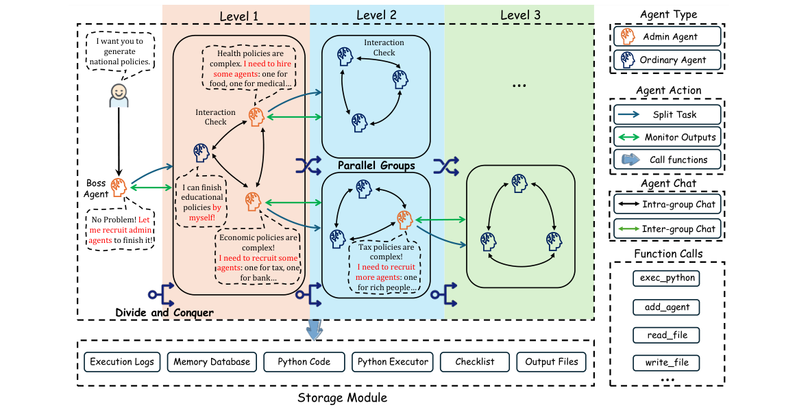

**图 1：** MegaAgent 将用户提供的元提示词拆分为不同任务，并将每个任务分配给相应的管理员智能体。管理员监督其任务，并按需自主招募更多智能体，形成针对具体任务的群组，通过并行运行提高执行效率。这些群组可以继续招募子智能体，扩展为多级层次结构。管理员监督群组，确保任务完成及输出质量。智能体分为管理员和普通智能体：管理员之间可以相互通信，普通智能体仅在所属群组内交互，以优化通信效率。每个智能体被视为一个进程，其状态为空闲（Idle）、处理（Processing）或响应（Response）。智能体使用函数调用访问和管理存储模块中的外部文件，支持无缝数据检索与任务执行。图中存储模块包括执行日志、记忆数据库、任务监控器、Python 代码执行器、共享文件和检查清单；黑色双向箭头表示组内通信，黄色双向箭头表示组间通信。

MegaAgent 的框架尤其适用于未来需要大规模自主智能体协调的应用。在金融市场中，它可以建模由交易者、投资者或监管机构等智能体组成的系统。这些智能体处理市场新闻、分析趋势、进行交易并响应宏观经济事件，规模可能扩展到数百万甚至数十亿。初步研究已展示其适用性（Zhang et al., 2024a；Gao et al., 2024）。在医疗领域，MegaAgent 可以通过代表医疗服务提供者、患者、管理人员和政策制定者的智能体来优化系统、模拟复杂工作流程（Li et al., 2024a；Fan et al., 2025）。

我们通过全面的实验验证展示 MegaAgent 的有效性和自主性。首先，在 MBPP（Austin et al., 2021）、HumanEval（Chen et al., 2021）、MATH（Hendrycks et al., 2021）和 GSM-8K（Cobbe et al., 2021）等标准基准上与领先基线比较，确立其扎实的基础能力。随后，为展示其高级协调能力，我们在 MAS 研究中广泛采用、且要求复杂多智能体协调的两个场景中开展实验（Hong et al., 2023；Guo et al., 2024）：（1）**软件开发：五子棋游戏开发。** MegaAgent 是唯一能够在 800 秒内完成任务的模型，体现了其出色的自主性和效率。（2）**社会模拟：国家政策生成。** MegaAgent 能生成并协调约 590 个智能体，在 3000 秒内产出预期政策，展示其大规模自主性与可扩展性。相比之下，基线模型往往只能协调不到 10 个智能体，难以完成这些复杂任务，也无法生成预期结果。

本文的贡献如下：

1. **自主框架。** 我们提出 MegaAgent，一种大规模自主 LLM 多智能体系统。它支持动态任务分解、并行执行与系统化监控，确保高效任务管理。
2. **尽量减少人工设计的提示词。** 我们注意到减少 MAS 中人工提示词的重要性。此前框架的这一关键局限，构成了将大规模 MAS 应用于复杂任务的瓶颈。为此，我们让 LLM 智能体自主拆分任务并为智能体生成 SOP，减少人工干预，使更广泛的用户能够有效使用 MAS。
3. **全面实验验证。** 大量实验表明：（1）**扎实的基础性能**：MegaAgent 在 MBPP、HumanEval、MATH 和 GSM-8K 等标准基准上整体优于领先基线，显示了稳健的问题解决能力。（2）**复杂协调上的优势**：在高要求多智能体场景中，它是唯一完成五子棋开发和国家政策模拟这两项任务的框架，超过所有基线。（3）**效率与可扩展性**：MegaAgent 在 800 秒内完成五子棋开发，在 3000 秒内高效协调约 590 个智能体完成国家政策生成；基线只能管理不到 10 个智能体且无法完成任务。这一显著的智能体数量体现了其可扩展性。

本文后续结构如下：第 2 节详细介绍 MegaAgent 框架；第 3 节通过实验评估其有效性；第 4 节回顾相关工作；第 5 节给出结论。

## 2 MegaAgent 框架

### 2.1 概述

如第 1 节所述，我们从两个层次化视角介绍 MegaAgent 框架：（1）层次化任务管理；（2）层次化监控。整体框架见图 1，算法详见算法 2。

### 2.2 层次化任务管理

#### 2.2.1 多级任务拆分

为高效管理大规模 MAS 中的复杂任务，我们实现了多级任务管理框架。总管智能体收到用户元提示词后，负责将主任务分解为可管理的子任务，并将每项子任务委派给由总管定义明确角色的专门管理员智能体。若某项子任务过于复杂、管理员无法独立完成，它便可招募更多智能体来处理具体部分。新创建的智能体如有需要，也可以继续招募智能体，从而自身成为管理员，如图 1 的第 2、3 层所示。这种递归任务拆分机制，使系统能够随任务复杂度的增加而动态适应。

为提高效率，我们为同一层级的智能体群组实现了并行机制。例如，图 1 第 2 层的两个群组可以并行工作，一个生成经济政策，另一个制定卫生政策。这种并行化缩短了整体任务完成时间。

#### 2.2.2 层次化协调机制

MegaAgent 通过两层协调结构驱动任务的有效执行：（1）**组内聊天**：同一任务组内的智能体通过基于提示词的通信共享更新，在需要交互时保障顺畅推进和有效执行，对应图 1 中黑色双向箭头。（2）**组间聊天**：不同群组的管理员相互通信，解决任务依赖并协调跨组工作，对应图 1 中黄色双向箭头。例如，第 3.2 节软件开发实验中的软件实现必须遵循游戏逻辑设计师的要求。为提高效率，普通智能体不能直接与群组外的智能体通信。

#### 2.2.3 消息队列机制

我们为每个智能体实现了基于生产者—消费者模式的消息队列系统，以管理异步通信。外部智能体作为生产者，通过函数调用产生消息；目标智能体作为消费者，通过轮询机制定期批量获取消息。该架构包含三种运行状态：

1. **空闲状态。** 消费者智能体没有消息，不产生计算开销。
2. **处理状态。** 获取消息后，智能体进入原子执行阶段，由 LLM 推理引擎处理该批消息。在此期间收到的新消息保留在队列中，直到下一次处理状态。
3. **响应状态。** 处理后的输出先通过有效性验证，再由指定函数调用分发。此后，智能体检查队列是否为空：为空则进入空闲状态，否则进入处理状态。

该方法能够将多条消息合并处理，同时充分利用 LLM 吞吐量，从而平衡成本与效率。

#### 2.2.4 文件管理

为使 LLM 智能体与外部文件有效交互，我们引入外部存储模块，负责所有文件相关任务。模块包括智能体执行日志、记忆数据库、任务监控工具、Python 代码执行支持、共享文件和每个智能体专属的检查清单。为确保文件管理的一致性和准确性，我们提出以下两项设计：

**（1）基于 Git 的版本控制。** 为维护文件一致性，我们集成 Git 版本控制机制。智能体读取文件后可能花费较长时间编辑，其间其他智能体的并发修改可能导致冲突。为此，智能体在读取文件时同时获取当前 Git 提交哈希。修改前，它向文件管理系统提交该哈希；系统提交更新、将其合并至最新 HEAD，并在必要时提示智能体解决合并冲突。全部 Git 操作均通过全局互斥锁串行执行，保证同步并防止竞态条件。

**（2）利用向量数据库管理长期记忆。** 多项研究表明，受 token 长度限制，LLM 智能体在若干轮后会遗忘对话历史（Becker, 2024；Xue et al., 2024）。为此，我们使用向量数据库存储智能体输出。语言模型将每次输出编码为嵌入向量，并存入向量数据库。智能体因此可以检索相关记忆条目，回忆过去的交互并保持上下文感知。

图 2 给出一个智能体通信示例，以直观展示通信机制。

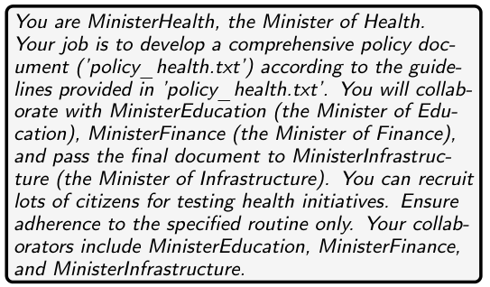

**图 2：智能体通信示例：国家领导人向卫生部长发送消息。**

> 你是 MinisterHealth，即卫生部长。你的工作是根据 `policy_health.txt` 中提供的指导方针，制定一份全面的政策文件（`policy_health.txt`）。你将与 MinisterEducation（教育部长）、MinisterFinance（财政部长）合作，并将最终文件交给 MinisterInfrastructure（基础设施部长）。你可以招募大量公民测试卫生举措。确保只遵循指定流程。你的合作者包括 MinisterEducation、MinisterFinance 和 MinisterInfrastructure。

### 2.3 层次化监控

为确保准确执行任务，并尽量减少 MAS 中幻觉的传播（Huang et al., 2023b；Hao et al., 2024），我们实现了层次化监控机制，通过结构化流程提供实时监督、错误纠正和进度验证。

#### 2.3.1 多级监控

MegaAgent 的监控系统采用结构化多级层次体系，确保准确完成任务并防止错误传播。每个智能体对应的监控与协调框架如下：

- **智能体层面监控：** 每个智能体在由管理员创建后维护一份检查清单，用于记录行动并验证进度。这种监控确保责任可追踪，让智能体能够在下一步前独立验证自身工作。
- **群组层面监控：** 每组由一个管理员监督，跟踪各智能体的进展、保障执行顺畅，并协调组内任务。
- **系统层面监控：** 在最高层，总管在任务完成时监督所有群组的输出，保证格式正确并尽量减少幻觉结果，从而增强系统整体的一致性、可靠性和正确性。

#### 2.3.2 失败场景及解决方法

监控集中于两个关键方面：输出格式验证与结果验证。

**（1）输出格式验证。** 首先检查智能体的输出格式。例如，若智能体生成的 Python 文件无法执行，管理员会标记问题、记录错误并提示重试。通过强制一致的输出格式，该步骤避免下游智能体误解数据，减少潜在幻觉。

**（2）结果验证。** 群组完成任务后，管理员检查生成的输出，并与初始要求比较。若发现不一致，管理员会提供详细错误信息，指出缺失或不正确之处，提示相应智能体修改。此过程使最终输出符合预期目标，并减少任务失败。

常见失败场景及其解决方法如下：

- **TODO 清单未完成：** 受 LLM 固有局限影响，智能体可能提前终止或进入无限循环。管理员会检测这一情况，并提示其重试任务，确保任务完成。
- **任务重复：** 有限的上下文记忆可能让智能体忘记已完成任务，造成重复行动或任务循环。管理员交叉核对检查清单以发现不一致，并按需提示纠正。
- **安全对齐导致中断：** 智能体可能停止响应，或反复返回与对齐约束有关的信息，例如“抱歉，我无法帮助处理该请求”。此时管理员尝试招募其他智能体完成任务。

图 3 展示一个监控日志示例。

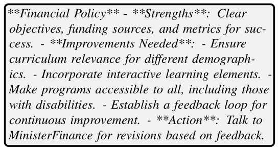

**图 3：监控日志示例：国家领导人监控财政政策。**

> **财政政策**  
> **优点：** 目标、资金来源和成功衡量标准明确。  
> **需要改进：** 确保课程适用于不同人口群体；加入互动学习元素；确保包括残障人士在内的所有人都能参与项目；建立反馈循环以持续改进。  
> **行动：** 与 MinisterFinance 沟通，根据反馈修改。

结合严格的输出格式验证和结果验证，该监控框架确保智能体始终与系统目标一致。全面的错误处理流程防止级联故障，保障整个 MAS 的稳定性和最佳性能。

## 3 实验

我们通过一系列实验评估 MegaAgent 的能力。虽然首先在包括推理和数学问题在内的标准基准上确立其性能（第 3.1 节），但主要关注需要大量多智能体协调的两个场景：软件开发和社会模拟。选择这两类任务，是因为它们能更真实地反映人类社会中的协调挑战，且往往超出单个 LLM 智能体的能力范围（Chen et al., 2023b；Guo et al., 2024）。我们重点研究三个问题：

- **RQ1：** 与其他基线相比，MegaAgent 能否在标准基准上取得良好表现？（第 3.1 节）
- **RQ2：** MegaAgent 能否在没有预定义 SOP 的情况下，完成需要大量协调的任务？其他基线表现如何？（第 3.2 节）
- **RQ3：** MegaAgent 能否有效扩展，以处理涉及显著更多智能体的复杂任务，展现其可扩展性？与其他基线相比如何？（第 3.3 节）

### 3.1 RQ1：标准基准

为评估 MegaAgent 在标准基准上的性能，我们选择了以往 MAS 常用的任务。

#### 3.1.1 实验设置

我们使用此前 MAS 研究广泛采用的多个标准基准（Zhang et al., 2024b；Zhang et al., 2025）：（1）MBPP（Austin et al., 2021）；（2）HumanEval（Chen et al., 2021）；（3）MATH（Hendrycks et al., 2021）；（4）GSM-8K（Cobbe et al., 2021）。所有实验中，MegaAgent 和基线均使用 GPT-4o API，以确保公平比较。性能使用定量准确率评估，即各基准中正确解答问题的百分比。

#### 3.1.2 实验结果与分析

详细比较结果见表 2。

**表 2：标准基准上的性能比较。所有模型均使用 GPT-4o API；结果为准确率（%）。N/A 表示不适用，例如 MetaGPT 主要支持代码生成，比较来源未在 MATH/GSM-8K 上评估它。**

| 模型 | MBPP | HumanEval | MATH | GSM-8K |
|---|---:|---:|---:|---:|
| MetaGPT | 81.7 | 82.3 | N/A | N/A |
| Camel | 78.1 | 57.9 | 22.3 | 45.6 |
| AgentVerse | 82.4 | 89.0 | 54.5 | 81.2 |
| AutoGen | 85.3 | 85.9 | 69.5 | 87.8 |
| MegaAgent | **92.2** | **93.3** | 69.0 | **93.0** |

如表 2 所示，MegaAgent 在所评估基准上整体优于 MetaGPT、Camel、AgentVerse 和 AutoGen。例如，在 MBPP 和 HumanEval 上，它分别达到 92.2% 和 93.3% 的准确率，超过次优模型 AutoGen。在更强调推理的 MATH 和 GSM-8K 上，MegaAgent 同样表现出较强能力：MATH 得分 69.0%，与 AutoGen 相当，而其他基准更高；GSM-8K 得分以 93.0% 领先。这些表现说明 MegaAgent 能在标准基准上取得良好效果。

> 译注：原文将结果概括为“在所有评估基准上持续优于基线”，但表 2 的 MATH 分数为 MegaAgent 69.0、AutoGen 69.5。此处保留数据，并按原文后续的“与 AutoGen 相当”表述理解。

### 3.2 RQ2：五子棋游戏开发

五子棋（Gobang，也称 Gomoku）是一种双人策略棋盘游戏。双方轮流在网格上放置黑白棋子，目标是率先在横向、纵向或斜向形成五子连线。[五子棋说明](https://en.wikipedia.org/wiki/Gomoku)。选择游戏开发作为测试场景，是因为它能有效评估 MAS 的编码与协调能力。任务同时要求生成后端逻辑和前端组件，并需要产品经理、游戏逻辑设计师、软件开发者等角色充分协作，因而能全面评估 MegaAgent 在项目中的协调、自主性和并行能力。

#### 3.2.1 实验设置

该实验使用 [GPT-4o API](https://openai.com/index/hello-gpt-4o/)，将 `temperature` 设为 0，以获得更确定的响应（Achiam et al., 2023）。实验从向 MegaAgent 输入图 4 的元提示词开始，更多细节见附录 E。

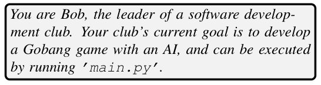

**图 4：五子棋游戏元提示词。**

> 你是 Bob，一个软件开发俱乐部的负责人。你的俱乐部当前的目标是开发一款带有 AI 的五子棋游戏，并且能够通过运行 `main.py` 启动。

比较实验使用 AutoGen、MetaGPT、CAMEL 和 AgentVerse 完成同一任务。我们手动将其底层模型调整为 GPT-4o；若 GPT-4o 与配置不兼容，则改用 GPT-4。为保证公平，根据各基线的要求定制提示词，同时遵循各自论文的指导确定测试方法。更多细节见 E.6 节。

#### 3.2.2 评估指标

我们采用以下指标评估生成的五子棋游戏：（1）**无错误执行**，程序能否无错误运行；（2）**用户落子**，用户能否落子；（3）**AI 落子**，AI 能否落子；（4）**游戏终止**，出现五子连线时游戏能否正确结束。

#### 3.2.3 实验结果

表 3 表明，MegaAgent 自主生成了一个涉及 7 个智能体的 SOP，有效协调其任务，并在 800 秒内成功开发出具有交互界面的完整五子棋游戏，满足全部要求。与生成不完整结果或完全失败的基线相比，它是唯一产出完整可运行游戏的系统，详见附录 E。

**表 3：五子棋游戏开发结果。**

| 模型 | 无错误执行 | 用户落子 | AI 落子 | 游戏终止 | 智能体数 | 时间（秒） | 时间/智能体（秒） |
|---|---|---|---|---|---:|---:|---:|
| AutoGen | ✓ | ✓ | ✗ | ✗ | 2 | 180 | 90 |
| MetaGPT | ✓ | ✓ | ✗ | ✗ | 6 | 480 | 80 |
| CAMEL | ✗ | ✗ | ✗ | ✗ | 2 | 1,830 | 915 |
| AgentVerse | ✗ | ✗ | ✗ | ✗ | 4 | 1,980 | 495 |
| MegaAgent | ✓ | ✓ | ✓ | ✓ | 7 | 800 | 114 |

**AutoGen：** 使用两个智能体，却未能生成有效的游戏落子。约三分钟后，它生成的程序以 `# To be continued..`（待续）结尾，尝试执行时卡住。原因可能是 SOP 过于简单，缺少代码审查等关键的智能体间通信步骤。详见 E.6.1 节。

**MetaGPT：** 虽然生成了 6 个智能体，但所有试验均未实现正常 AI 落子。主要问题包括：（1）缺乏调试工具，导致代码无法执行；（2）生成错误的程序，例如将五子棋写成[井字棋](https://en.wikipedia.org/wiki/Tic-tac-toe)，可能源于 SOP 简单、通信不足；（3）实现不完整造成无限循环。详见 E.6.2 节。

**CAMEL：** 使用两个智能体仍无法生成可执行的 Python 代码，原因可能是规划能力较弱、上下文推理能力有限。详见 E.6.3 节。

**AgentVerse：** 生成 4 个智能体来完成任务，但存在明显问题。前两次试验中，智能体在全部 10 轮里反复否决结果；第三次虽接受结果，代码仍有大量占位符，无法执行。原因可能是规划阶段给出的任务大纲过于僵化，当前 LLM 难以完成。详见 E.6.4 节。

#### 3.2.4 消融研究

为验证各组件设计的必要性，我们进行消融研究，结果见表 4。

**表 4：五子棋消融研究结果。指标（1）—（4）对应第 3.2.2 节。**

| 组件设置 | 完成的指标 | 智能体数 | 时间（秒） | 时间/智能体（秒） |
|---|---|---:|---:|---:|
| 完整系统 | （1）（2）（3）（4） | 7 | 800 | 114 |
| 无层次结构 | （1）（2） | 5 | 920 | 184 |
| 无并行机制 | （1）（2）（3）（4） | 7 | 4,505 | 643 |
| 无监控机制 | （1）（2）（3） | 7 | 300 | 42 |

移除层次结构后，智能体数降至 5，但耗时升至 920 秒，且只达到基本指标。没有并行机制时，各任务组串行完成任务，时间复杂度由 $O(\log n)$ 变为 $O(n)$，每个智能体对应的执行时间从 114 秒升至 643 秒。移除监控后，耗时降至 300 秒，但未满足关键指标。这说明并行执行、层次结构和监控对任务完成与执行速度都至关重要。详见 E.4 节。

#### 3.2.5 成本分析

为评估 token 用量、更好地理解五子棋生成的效率，我们将系统运行划分为规划、任务求解和合并三个阶段进行详细成本分析。规划负责初始策略生成；任务求解承担游戏求解的核心计算；合并整合结果并形成最终输出。表 5 带来以下两点认识。

**表 5：五子棋 GPT-4o 实验各阶段的 token 用量分析。**

| 阶段 | 输入 token | 输出 token | 总 token | 时间（秒） |
|---|---:|---:|---:|---|
| 规划 | 42,947 | 12,347 | 55,294 | 0–60 |
| 任务求解 | 1,098,573 | 55,022 | 1,153,595 | 30–840 |
| 合并 | 22,099 | 1,493 | 23,592 | 840–870 |
| 总计 | 1,163,619 | 68,862 | 1,232,481 | 870 |

**认识 1：任务求解阶段资源消耗高。** 大部分时间和 token 消耗集中在任务求解阶段，说明任务本身复杂，需要大量智能体协调来生成解决方案，体现了多智能体交互在解决策略性问题时的计算密集特性。

**认识 2：输入与输出 token 用量不成比例。** 输入 token 明显多于输出，表明 token 使用仍有较大优化空间。输入主要来自智能体之间的对话，因此改进通信效率和结构，是提高整体效率的有价值研究方向。

### 3.3 RQ3：国家政策生成

我们提出一项更有挑战性的实验：制定国家政策。这要求大量智能体在教育、卫生、财政等复杂领域执行多种任务。选择该任务，是因为 MAS 社会模拟需要大量、可能达到数百个智能体来模拟类似人类的社会，从而能够评估 MegaAgent 的自主性、可扩展性和协调能力。

#### 3.3.1 实验设置

受预算限制，MegaAgent 在本实验中使用 GPT-4o-mini API。比较系统为 AutoGen、MetaGPT、CAMEL 和 AgentVerse；其底层 LLM 被手动调整为 GPT-4o，若与代码配置不兼容则使用 GPT-4。输入 MegaAgent 的元提示词见图 5；更多细节见附录 F，基线设置见 F.5 节。

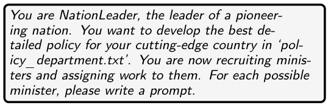

**图 5：国家政策生成元提示词。**

> 你是 NationLeader，一个开拓型国家的领导人。你想为这个处于前沿的国家在 `policy_department.txt` 中制定最佳、详尽的政策。你现在正在招募部长并分配工作。请为每一个可能的部长编写提示词。

#### 3.3.2 评估指标

为评估国家政策的可靠性，我们采用 LLM-as-a-Judge（以 LLM 为评判者）框架，使用五个先进模型：Claude-3.5、GPT-4o-mini、GPT-4o、o1-mini 和 o1-preview（Achiam et al., 2023）。验证数据集包含 50 份真实国家政策及 50 份非政策文本，如多轮对话、会议摘要（Zheng et al., 2023a），用于测试政策区分能力。采用图 6 的标准化提示词，模型取得表 16 所示平均 89% 的识别准确率，支持评估的有效性。完整验证细节见附录 G。

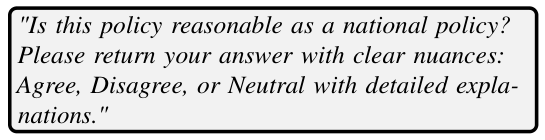

**图 6：国家政策评估提示词。**

> 这项政策作为国家政策是否合理？请明确区分并给出你的回答：同意、不同意或中立，并提供详细解释。

#### 3.3.3 实验结果

表 6 展示国家政策生成结果：MegaAgent 能在有竞争力的时间内，通过显著更多的智能体生成完整、合理的政策。它用 590 个智能体在 **2,991 秒**内产出完整政策。平均每个智能体对应处理时间为 5 秒，显著快于基线最佳的 40 秒，体现了可扩展性。政策结构见图 7，详细输出见 F.3 节。

**表 6：国家政策生成结果。**

| 模型 | 输出 | 智能体数 | 时间（秒） | 时间/智能体（秒） |
|---|---|---:|---:|---:|
| AutoGen | 大纲 | 1 | 40 | 40 |
| MetaGPT | Python 程序 | 6 | 580 | 97 |
| CAMEL | 计划 | 2 | 1,380 | 690 |
| AgentVerse | 无 | 4 | 510 | 128 |
| MegaAgent | 完整政策 | 590 | 2,991 | 5 |

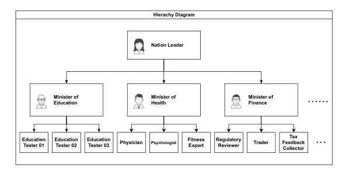

**图 7：MegaAgent 生成的国家政策结构。** 原图展示政策任务按层次组织并逐级分解的结构。

为评估政策可靠性，我们向选定的先进 LLM 输入图 6 提示词，对合理性进行评判。如表 7 所示，31 份政策中，平均 27.4 份被 LLM 判为合理，表明 MegaAgent 能在本社会模拟实验中有效生成具有合理依据的政策。

**表 7：MegaAgent 生成的 31 份政策的合理性评估。**

| 模型 | 同意数 | 不同意数 | 中立数 |
|---|---:|---:|---:|
| Claude-3.5 | 26 | 1 | 4 |
| gpt-4o-mini | 28 | 0 | 3 |
| gpt-4o | 25 | 2 | 4 |
| o1-mini | 29 | 2 | 0 |
| o1-preview | 29 | 1 | 1 |
| 平均 | 27.4 | 1.2 | 2.4 |

#### 3.3.4 消融研究

我们通过表 8 的消融实验验证各组件设计的必要性。

**表 8：国家政策生成消融研究结果。**

| 组件设置 | 输出 | 智能体数 | 时间（秒） | 时间/智能体（秒） |
|---|---|---:|---:|---:|
| 完整系统 | 完整政策 | 590 | 2,991 | 5 |
| 无层次结构 | 不完整政策 | 19 | 450 | 24 |
| 无并行机制 | 不完整政策 | >100 | >14,400 | N/A |
| 无监控机制 | 含占位符的政策 | 50 | 667 | 13 |

*无并行机制的运行在 14,400 秒后由研究者终止。*

没有层次结构时，19 个智能体在 450 秒内只能生成不完整政策，说明层次化设计的重要性。完全禁用并行后，即使运行 14,400 秒、持续招募超过 100 个智能体，仍因串行处理瓶颈而无法完成。移除监控时，50 个智能体在 667 秒内生成了带占位符的政策，说明持续监督对于任务完整性不可或缺。详细输出见 F.4 节。这些结果说明，并行性对于 MAS 中复杂任务的管理至关重要。

#### 3.3.5 成本分析

我们分析规划、任务求解和合并三个阶段的 token 用量与执行时间，以评估成本，结果见表 9。

**表 9：国家政策生成的 token 用量分析。**

| 阶段 | 输入 token | 输出 token | 总 token | 时间（秒） |
|---|---:|---:|---:|---|
| 规划 | 111,601 | 24,103 | 135,704 | 0–180 |
| 任务求解 | 8,003,124 | 343,670 | 8,346,794 | 20–2,950 |
| 合并 | 348,264 | 13,280 | 361,544 | 2,400–3,000 |
| 总计 | 8,463,989 | 381,053 | 8,845,042 | 3,000 |

与第 3.2.5 节类似，任务求解阶段占据主要时间与 token 消耗。对比两个实验的输入/输出 token 比例可见，效率问题持续存在：第一项实验约为 23:1，本实验略高，为 25:1。这一增加表明，政策生成任务因智能体更多，可能需要更多智能体对话及更复杂的上下文管理。这强调了优化 token 使用和对话效率的迫切性，这些优化可显著降低资源消耗并提高 MAS 整体性能。

> 译注：上述 23:1 与 25:1 为原文叙述值；与表 5、表 9“总计”行直接相除所得的比例并不一致，故均照录。

### 3.4 可扩展性分析

在 MegaAgent 中，对于 $n$ 个智能体，由于同层群组并行运行，层间通信成本为 $O(\log n)$，如图 7 所示。相比之下，现有框架串行运行，耗时按 $O(n)$ 线性增长；当 LLM 智能体数大幅增加时，这将变得不切实际。第 3.3 节国家政策生成实验支持这一分析：MegaAgent 平均每个智能体对应处理时间为 5 秒，CAMEL 约为 700 秒。这些结果展示了 MegaAgent 在大规模 MAS 自主协调中的可扩展性与实用性。

## 4 相关工作

此处讨论最相关的工作，更多细节见附录 C。

### 4.1 基于 LLM 的多智能体系统

随着强大 LLM 的出现（Achiam et al., 2023；Team et al., 2023），近期 MAS 研究探索多个智能体如何利用人设（Chen et al., 2024b；Chan et al., 2024）、规划（Chen et al., 2023a；Zhang et al., 2024d；Yuan et al., 2023）与记忆（Zhang et al., 2023a；Hatalis et al., 2023）等要素，通过协调完成任务。相比单个 LLM 智能体，多智能体系统在挑战性任务上展现优势。MetaGPT（Hong et al., 2023）、AutoGen（Wu et al., 2023b）、AgentVerse（Chen et al., 2023b）等近期工作通过设计特定角色完成任务。

不过，大多数常见 MAS 严重依赖人工提示词和专家设计。例如，MetaGPT 要求用户预先设计产品经理、软件工程师等角色。另一局限是它们采用顺序流水线，没有考虑智能体并行执行（Li et al., 2023a）。AgentScope（Pan et al., 2024）虽考虑了并行，但其实现遵循跨交互轮次的固定轨迹，不能改变通信对象，因此限制了智能体数量扩大时的性能提升。现实中，当雇用多名软件开发者时，他们可能先同时处理不同文件，遇到困难后再共同聚焦某个文件，通过协调激发创造性想法、克服挑战。现有 MAS 还受限于规模较小，未应用于涉及复杂协调的大规模场景。表 10 对比了常见 MAS 与 MegaAgent，后者在自主性、多文件支持、并行性和可扩展性方面突出。

### 4.2 MAS 中的 SOP

分配 SOP 是设计 MAS 智能体配置与任务的常见方式（Hong et al., 2023；Huang et al., 2023a；Park et al., 2023；Zhuge et al., 2024；Shi et al., 2024）。这些系统同时为单个智能体及其通信协议定义 SOP。尽管以往工作已证明其有效，但存在两大局限：（1）智能体可能具备人工设计阶段无法预见、却在执行任务时变得相关的能力（Rivera et al., 2024；Sypherd and Belle, 2024；Piatti et al., 2024）；（2）MAS 规模可能扩展至数千乃至数十亿智能体，此时人工为每个智能体设计 SOP 并不可行（Mou et al., 2024；Pan et al., 2024）。因此，设计机制需要演进，借鉴 LLM-as-a-Judge 的思路（Huang et al., 2024；Chen et al., 2024a），利用 LLM 本身为大规模 MAS 自主生成 SOP。

## 5 结论

我们提出 MegaAgent，一种支持动态自主协调的大规模 LLM 多智能体系统，用户只需在开始时提供元提示词。MegaAgent 在标准基准上整体超过现有基线，展示了扎实的基础能力。五子棋软件开发实验进一步表明，它的自主性与协调能力优于基线。国家政策生成这一社会模拟实验则说明，它能够扩展到数百个智能体，同时保持有效协调。依托层次化和自适应设计，MegaAgent 有潜力成为未来 MAS 的基础操作系统。我们鼓励研究界进一步探索增强智能体协调，以应对大规模 MAS 日益增长的需求。

## 局限性

**规划与通信开销。** 主要瓶颈在于 LLM 智能体之间的规划与通信，尤其是将代码转换为提示词、管理任务检查清单、维护框架和调试。随着智能体数量和通信轮次增加，输入输出 token 消耗显著增长，影响效率和成本。未来应探索先进的 token 摘要、语义压缩和高效对话存储方法。

**智能体输出中的幻觉。** 尽管使用任务专属检查清单监控行动，偶发幻觉仍存在，输出格式有时也偏离要求。由于清单本身由 LLM 生成，错误可能传播。需要更稳健的验证机制，例如在响应生成之前、期间或之后引入外部专家知识库。

**API 成本与模型集成。** MegaAgent 依赖 GPT-4，API 成本较高。较便宜的替代方案可能缺乏泛化能力。一个有前景的方向是，为特定任务集成专门 LLM，利用在某些领域擅长的模型，同时维持模型间高效通信与数据共享。

## 致谢

本研究受到新加坡国家研究基金会和资讯通信媒体发展局“Trust Tech Funding Initiative”资助。文中任何观点、发现、结论或建议均属于作者，不代表上述机构观点。Tianyu Wang 和 Jingsheng Liang 的工作是在新加坡国立大学担任访问学生期间完成的。

## 参考文献

2023. Huggingface text generation inference. [https://github.com/huggingface/text-generation-inference](https://github.com/huggingface/text-generation-inference) . Commit: 3c02262, Accessed on: 2023-11-25.

2023. [Promptflow](https://https://github.com/microsoft/promptflow) .

2023. [Tensorrt-llm: A tensorrt toolbox for optimized large language model inference](https://github.com/NVIDIA/TensorRT-LLM) .

2024. [Langchain](https://github.com/langchain-ai/langchain) .

Ibrahim Abdelaziz, Kinjal Basu, Mayank Agarwal, Sadhana Kumaravel, Matt Stallone, Rameswar Panda, Yara Rizk, G. Bhargav, M. Crouse, Chulaka Gunasekara, S. Ikbal, Sachin Joshi, Hima P. Karanam, Vineet Kumar, Asim Munawar, S. Neelam, Dinesh Raghu, Udit Sharma, Adriana Meza Soria, and 7 others. 2024. [Granite-function calling model: Introducing function calling abilities via multi-task learning of granular tasks](https://www.semanticscholar.org/paper/cbde6f07977255cd5b571d93b497aa2874a7a544) . In Conference on Empirical Methods in Natural Language Processing .

Josh Achiam, Steven Adler, Sandhini Agarwal, Lama Ahmad, Ilge Akkaya, Florencia Leoni Aleman, Diogo Almeida, Janko Altenschmidt, Sam Altman, Shyamal Anadkat, and 1 others. 2023. Gpt-4 technical report. arXiv preprint arXiv:2303.08774 .

Ahsan Ali, Riccardo Pinciroli, Feng Yan, and Evgenia Smirni. 2020. Batch: machine learning inference serving on serverless platforms with adaptive batching. In SC20: International Conference for High Performance Computing, Networking, Storage and Analysis , pages 1–15. IEEE.

Maksym Andriushchenko, Alexandra Souly, Mateusz Dziemian, Derek Duenas, Maxwell Lin, Justin Wang, Dan Hendrycks, Andy Zou, Zico Kolter, Matt Fredrikson, and 1 others. 2024. Agentharm: A benchmark for measuring harmfulness of llm agents. arXiv preprint arXiv:2410.09024 .

Apache. 2019. Tez. [https://tez.apache.org/](https://tez.apache.org/) .

Jacob Austin, Augustus Odena, Maxwell Nye, Maarten Bosma, Henryk Michalewski, David Dohan, Ellen Jiang, Carrie Cai, Michael Terry, Quoc Le, and 1 others. 2021. Program synthesis with large language models. arXiv preprint arXiv:2108.07732 .

Sourav Banerjee, Ayushi Agarwal, and Saloni Singla. 2024. Llms will always hallucinate, and we need to live with this. arXiv preprint arXiv:2409.05746 .

Jonas Becker. 2024. Multi-agent large language models for conversational task-solving. arXiv preprint arXiv:2410.22932 .

Maciej Besta, Nils Blach, Ales Kubicek, Robert Gerstenberger, Michal Podstawski, Lukas Gianinazzi, Joanna Gajda, Tomasz Lehmann, Hubert Niewiadomski, Piotr Nyczyk, and 1 others. 2024. Graph of thoughts: Solving elaborate problems with large language models. In Proceedings of the AAAI Conference on Artificial Intelligence , volume 38, pages 17682–17690.

Bradley Brown, Jordan Juravsky, Ryan Ehrlich, Ronald Clark, Quoc V Le, Christopher Ré, and Azalia Mirhoseini. 2024. Large language monkeys: Scaling inference compute with repeated sampling. arXiv preprint arXiv:2407.21787 .

Souradip Chakraborty, Soumya Suvra Ghosal, Ming Yin, Dinesh Manocha, Mengdi Wang, Amrit Bedi, and Furong Huang. 2024. [Transfer q-star : Principled decoding for LLM alignment](https://openreview.net/forum?id=5PrShrKxoX) . In The Thirty-eighth Annual Conference on Neural Information Processing Systems .

Xin Chan, Xiaoyang Wang, Dian Yu, Haitao Mi, and Dong Yu. 2024. Scaling synthetic data creation with 1,000,000,000 personas. arXiv preprint arXiv:2406.20094 .

Dongping Chen, Ruoxi Chen, Shilin Zhang, Yinuo Liu, Yaochen Wang, Huichi Zhou, Qihui Zhang, Yao Wan, Pan Zhou, and Lichao Sun. 2024a. Mllm-as-a-judge: Assessing multimodal llm-as-a-judge with vision-language benchmark. arXiv preprint arXiv:2402.04788 .

Jiangjie Chen, Xintao Wang, Rui Xu, Siyu Yuan, Yikai Zhang, Wei Shi, Jian Xie, Shuang Li, Ruihan Yang, Tinghui Zhu, and 1 others. 2024b. From persona to personalization: A survey on role-playing language agents. arXiv preprint arXiv:2404.18231 .

Jiangjie Chen, Siyu Yuan, Rong Ye, Bodhisattwa Prasad Majumder, and Kyle Richardson. 2023a. Put your money where your mouth is: Evaluating strategic planning and execution of llm agents in an auction arena. arXiv preprint arXiv:2310.05746 .

Mark Chen, Jerry Tworek, Heewoo Jun, Qiming Yuan, Henrique Ponde de Oliveira Pinto, Jared Kaplan, Harri Edwards, Yuri Burda, Nicholas Joseph, Greg Brockman, and 1 others. 2021. Evaluating large language models trained on code. In arXiv preprint arXiv:2107.03374 .

Weize Chen, Yusheng Su, Jingwei Zuo, Cheng Yang, Chenfei Yuan, Chen Qian, Chi-Min Chan, Yujia Qin, Yaxi Lu, Ruobing Xie, and 1 others. 2023b. Agentverse: Facilitating multi-agent collaboration and exploring emergent behaviors in agents. arXiv preprint arXiv:2308.10848 .

Karl Cobbe, Vineet Kosaraju, Mohammad Bavarian, Mark Chen, Heewoo Jun, Lukasz Kaiser, Matthias Plappert, Jerry Tworek, Jacob Hilton, Reiichiro Nakano, and 1 others. 2021. Training verifiers to solve math word problems. arXiv preprint arXiv:2110.14168 .

Yilun Du, Shuang Li, Antonio Torralba, Joshua B Tenenbaum, and Igor Mordatch. 2023. Improving factuality and reasoning in language models through multiagent debate. In Forty-first International Conference on Machine Learning .

Zhihao Fan, Lai Wei, Jialong Tang, Wei Chen, Wang Siyuan, Zhongyu Wei, and Fei Huang. 2025. Ai hospital: Benchmarking large language models in a multi-agent medical interaction simulator. In Proceedings of the 31st International Conference on Computational Linguistics , pages 10183–10213.

Yichao Fu, Peter Bailis, Ion Stoica, and Hao Zhang. 2024. Break the sequential dependency of llm inference using lookahead decoding. arXiv preprint arXiv:2402.02057 .

Chen Gao, Xiaochong Lan, Zhihong Lu, Jinzhu Mao, Jinghua Piao, Huandong Wang, Depeng Jin, and Yong Li. 2023a. S 3 : Social-network simulation system with large language model-empowered agents. arXiv preprint arXiv:2307.14984 .

Luyu Gao, Aman Madaan, Shuyan Zhou, Uri Alon, Pengfei Liu, Yiming Yang, Jamie Callan, and Graham Neubig. 2023b. [PAL: Program-aided language models](https://proceedings.mlr.press/v202/gao23f.html) . In Proceedings of the 40th International Conference on Machine Learning , volume 202 of Proceedings of Machine Learning Research , pages 10764–10799. PMLR.

Shen Gao, Yuntao Wen, Minghang Zhu, Jianing Wei, Yuhan Cheng, Qunzi Zhang, and Shuo Shang. 2024. Simulating financial market via large language model based agents. arXiv preprint arXiv:2406.19966 .

GeminiTeam. 2025. [Gemini: A family of highly capable multimodal models](https://arxiv.org/abs/2312.11805) . Preprint , arXiv:2312.11805.

Arpan Gujarati, Reza Karimi, Safya Alzayat, Wei Hao, Antoine Kaufmann, Ymir Vigfusson, and Jonathan Mace. 2020. Serving dnns like clockwork: Performance predictability from the bottom up. In Proc. USENIX OSDI .

Taicheng Guo, Xiuying Chen, Yaqi Wang, Ruidi Chang, Shichao Pei, Nitesh V Chawla, Olaf Wiest, and Xiangliang Zhang. 2024. Large language model based multi-agents: A survey of progress and challenges. arXiv preprint arXiv:2402.01680 .

Guozhi Hao, Jun Wu, Qianqian Pan, and Rosario Morello. 2024. Quantifying the uncertainty of llm hallucination spreading in complex adaptive social networks. Scientific reports , 14(1):16375.

Kostas Hatalis, Despina Christou, Joshua Myers, Steven Jones, Keith Lambert, Adam Amos-Binks, Zohreh Dannenhauer, and Dustin Dannenhauer. 2023. Memory matters: The need to improve long-term memory in llm-agents. In Proceedings of the AAAI Symposium Series , volume 2, pages 277–280.

Dan Hendrycks, Collin Burns, Saurav Kadavath, Akul Arora, Steven Basart, Eric Tang, Dawn Song, and Jacob Steinhardt. 2021. Measuring mathematical problem solving with the math dataset. arXiv preprint arXiv:2103.03874 .

Sirui Hong, Xiawu Zheng, Jonathan Chen, Yuheng Cheng, Jinlin Wang, Ceyao Zhang, Zili Wang, Steven Ka Shing Yau, Zijuan Lin, Liyang Zhou, and 1 others. 2023. Metagpt: Meta programming for multi-agent collaborative framework. arXiv preprint arXiv:2308.00352 .

Sirui Hong, Mingchen Zhuge, Jonathan Chen, Xiawu Zheng, Yuheng Cheng, Jinlin Wang, Ceyao Zhang, Zili Wang, Steven Ka Shing Yau, Zijuan Lin, Liyang Zhou, Chenyu Ran, Lingfeng Xiao, Chenglin Wu, and Jürgen Schmidhuber. 2024. [MetaGPT: Meta programming for a multi-agent collaborative framework](https://openreview.net/forum?id=VtmBAGCN7o) . In The Twelfth International Conference on Learning Representations .

Sihao Hu, Zhen Zhang, Bingqiao Luo, Shengliang Lu, Bingsheng He, and Ling Liu. 2023. Bert4eth: A pre-trained transformer for ethereum fraud detection. In Proceedings of the ACM Web Conference 2023 , pages 2189–2197.

Wenyue Hua, Lizhou Fan, Lingyao Li, Kai Mei, Jianchao Ji, Yingqiang Ge, Libby Hemphill, and Yongfeng Zhang. 2023. War and peace (waragent): Large language model-based multi-agent simulation of world wars. arXiv preprint arXiv:2311.17227 .

Dong Huang, Qingwen Bu, Jie M Zhang, Michael Luck, and Heming Cui. 2023a. Agentcoder: Multi-agent-based code generation with iterative testing and optimisation. arXiv preprint arXiv:2312.13010 .

Hui Huang, Yingqi Qu, Jing Liu, Muyun Yang, and Tiejun Zhao. 2024. An empirical study of llm-as-a-judge for llm evaluation: Fine-tuned judge models are task-specific classifiers. arXiv preprint arXiv:2403.02839 .

Lei Huang, Weijiang Yu, Weitao Ma, Weihong Zhong, Zhangyin Feng, Haotian Wang, Qianglong Chen, Weihua Peng, Xiaocheng Feng, Bing Qin, and 1 others. 2023b. A survey on hallucination in large language models: Principles, taxonomy, challenges, and open questions. ACM Transactions on Information Systems .

Michael Isard, Mihai Budiu, Yuan Yu, Andrew Birrell, and Dennis Fetterly. 2007. [Dryad: Distributed data-parallel programs from sequential building blocks](https://doi.org/10.1145/1272996.1273005) . In Proceedings of the 2nd ACM SIGOPS/EuroSys European Conference on Computer Systems 2007 , EuroSys ’07, page 59–72, New York, NY, USA. Association for Computing Machinery.

Minbyul Jeong, Jiwoong Sohn, Mujeen Sung, and Jaewoo Kang. 2024. Improving medical reasoning through retrieval and self-reflection with retrieval-augmented large language models. Bioinformatics , 40(Supplement_1):i119–i129.

Ziwei Ji, Tiezheng Yu, Yan Xu, Nayeon Lee, Etsuko Ishii, and Pascale Fung. 2023. Towards mitigating llm hallucination via self reflection. In Findings of the Association for Computational Linguistics: EMNLP 2023 , pages 1827–1843.

Albert Q. Jiang, Alexandre Sablayrolles, Antoine Roux, Arthur Mensch, Blanche Savary, Chris Bamford, Devendra Singh Chaplot, Diego de las Casas, Emma Bou Hanna, Florian Bressand, Gianna Lengyel, Guillaume Bour, Guillaume Lample, Lélio Renard Lavaud, Lucile Saulnier, Marie-Anne Lachaux, Pierre Stock, Sandeep Subramanian, Sophia Yang, and 7 others. 2024. [Mixtral of experts](https://arxiv.org/abs/2401.04088) . Preprint , arXiv:2401.04088.

Jinhao Jiang, Kun Zhou, Zican Dong, Keming Ye, Wayne Xin Zhao, and Ji-Rong Wen. 2023. Structgpt: A general framework for large language model to reason over structured data. In Proceedings of the 2023 Conference on Empirical Methods in Natural Language Processing , pages 9237–9251.

Mingyu Jin, Beichen Wang, Zhaoqian Xue, Suiyuan Zhu, Wenyue Hua, Hua Tang, Kai Mei, Mengnan Du, and Yongfeng Zhang. 2024. What if llms have different world views: Simulating alien civilizations with llm-based agents. arXiv preprint arXiv:2402.13184 .

Yunho Jin, Chun-Feng Wu, David Brooks, and Gu-Yeon Wei. 2023. S 3 : Increasing gpu utilization during generative inference for higher throughput. Advances in Neural Information Processing Systems , 36:18015–18027.

Tianjie Ju, Yiting Wang, Xinbei Ma, Pengzhou Cheng, Haodong Zhao, Yulong Wang, Lifeng Liu, Jian Xie, Zhuosheng Zhang, and Gongshen Liu. 2024. Flooding spread of manipulated knowledge in llm-based multi-agent communities. arXiv preprint arXiv:2407.07791 .

Woosuk Kwon, Zhuohan Li, Siyuan Zhuang, Ying Sheng, Lianmin Zheng, Cody Hao Yu, Joseph Gonzalez, Hao Zhang, and Ion Stoica. 2023a. Efficient memory management for large language model serving with pagedattention. In Proceedings of the 29th Symposium on Operating Systems Principles , pages 611–626.

Woosuk Kwon, Zhuohan Li, Siyuan Zhuang, Ying Sheng, Lianmin Zheng, Cody Hao Yu, Joseph Gonzalez, Hao Zhang, and Ion Stoica. 2023b. Efficient memory management for large language model serving with pagedattention. In Proc. ACM SOSP .

Rémi Leblond, Jean-Baptiste Alayrac, L. Sifre, Miruna Pislar, Jean-Baptiste Lespiau, Ioannis Antonoglou, K. Simonyan, and O. Vinyals. 2021. [Machine translation decoding beyond beam search](https://www.semanticscholar.org/paper/e8cc5b6204970a88cd1b2df491aa10c4333e083e) . In Conference on Empirical Methods in Natural Language Processing .

Donghyun Lee and Mo Tiwari. 2024. Prompt infection: Llm-to-llm prompt injection within multi-agent systems. arXiv preprint arXiv:2410.07283 .

Guohao Li, Hasan Hammoud, Hani Itani, Dmitrii Khizbullin, and Bernard Ghanem. 2023a. Camel: Communicative agents for" mind" exploration of large language model society. Advances in Neural Information Processing Systems , 36:51991–52008.

Junkai Li, Yunghwei Lai, Weitao Li, Jingyi Ren, Meng Zhang, Xinhui Kang, Siyu Wang, Peng Li, Ya-Qin Zhang, Weizhi Ma, and 1 others. 2024a. Agent hospital: A simulacrum of hospital with evolvable medical agents. arXiv preprint arXiv:2405.02957 .

Xiang Li, Zhenyu Li, Chen Shi, Yong Xu, Qing Du, Mingkui Tan, and Jun Huang. 2024b. AlphaFin: Benchmarking financial analysis with retrieval-augmented stock-chain framework. In Proceedings of the 2024 Joint International Conference on Computational Linguistics, Language Resources and Evaluation (LREC-COLING 2024) , pages 773–783. ELRA and ICCL.

Zhuohan Li, Lianmin Zheng, Yinmin Zhong, Vincent Liu, Ying Sheng, Xin Jin, Yanping Huang, Zhifeng Chen, Hao Zhang, Joseph E Gonzalez, and 1 others. 2023b. { \{ AlpaServe } \} : Statistical multiplexing with model parallelism for deep learning serving. In 17th USENIX Symposium on Operating Systems Design and Implementation (OSDI 23) , pages 663–679.

Tian Liang, Zhiwei He, Wenxiang Jiao, Xing Wang, Yan Wang, Rui Wang, Yujiu Yang, Shuming Shi, and Zhaopeng Tu. 2023. Encouraging divergent thinking in large language models through multi-agent debate. arXiv preprint arXiv:2305.19118 .

Chaofan Lin, Zhenhua Han, Chengruidong Zhang, Yuqing Yang, Fan Yang, Chen Chen, and Lili Qiu. 2024. Parrot: Efficient serving of llm-based applications with semantic variable. arXiv preprint arXiv:2405.19888 .

Xiao Liu, Hao Yu, Hanchen Zhang, Yifan Xu, Xuanyu Lei, Hanyu Lai, Yu Gu, Hangliang Ding, Kaiwen Men, Kejuan Yang, and 1 others. 2023a. Agentbench: Evaluating llms as agents. arXiv preprint arXiv:2308.03688 .

Zijun Liu, Yanzhe Zhang, Peng Li, Yang Liu, and Diyi Yang. 2023b. Dynamic llm-agent network: An llm-agent collaboration framework with agent team optimization. arXiv preprint arXiv:2310.02170 .

Bingqiao Luo, Zhen Zhang, Qian Wang, and Bingsheng He. 2024a. Multi-chain graphs of graphs: A new approach to analyzing blockchain datasets. Advances in Neural Information Processing Systems , 37:28490–28514.

Bingqiao Luo, Zhen Zhang, Qian Wang, Anli Ke, Shengliang Lu, and Bingsheng He. 2024b. Ai-powered fraud detection in decentralized finance: A project life cycle perspective. ACM Computing Surveys , 57(4):1–38.

Linhao Luo, Yuan-Fang Li, Gholamreza Haffari, and Shirui Pan. 2023. Reasoning on graphs: Faithful and interpretable large language model reasoning. arXiv preprint arXiv:2310.01061 .

Ashraf Mahgoub, Karthick Shankar, Subrata Mitra, Ana Klimovic, Somali Chaterji, and Saurabh Bagchi. 2021. SONIC: Application-aware data passing for chained serverless applications. In 2021 USENIX Annual Technical Conference (USENIX ATC 21) , pages 285–301. USENIX Association.

Alex Mallen, Akari Asai, Victor Zhong, Rajarshi Das, Daniel Khashabi, and Hannaneh Hajishirzi. 2023. When not to trust language models: Investigating effectiveness of parametric and non-parametric memories. In Proceedings of the 61st Annual Meeting of the Association for Computational Linguistics (Volume 1: Long Papers) , pages 9802–9822, Toronto, Canada. Association for Computational Linguistics.

Kai Mei, Zelong Li, Shuyuan Xu, Ruosong Ye, Yingqiang Ge, and Yongfeng Zhang. 2024a. [Aios: Llm agent operating system](https://www.semanticscholar.org/paper/f89e85059a55b647c93822aefa7e985376e0ef20) . arXiv.org .

Kai Mei, Zelong Li, Shuyuan Xu, Ruosong Ye, Yingqiang Ge, and Yongfeng Zhang. 2024b. Llm agent operating system. arXiv preprint arXiv:2403.16971 .

Xinyi Mou, Xuanwen Ding, Qi He, Liang Wang, Jingcong Liang, Xinnong Zhang, Libo Sun, Jiayu Lin, Jie Zhou, Xuanjing Huang, and 1 others. 2024. From individual to society: A survey on social simulation driven by large language model-based agents. arXiv preprint arXiv:2412.03563 .

Christopher Olston, Noah Fiedel, Kiril Gorovoy, Jeremiah Harmsen, Li Lao, Fangwei Li, Vinu Rajashekhar, Sukriti Ramesh, and Jordan Soyke. 2017. Tensorflow-serving: Flexible, high-performance ml serving. arXiv preprint arXiv:1712.06139 .

OpenAI. 2022. [Chatgpt](https://openai.com/blog/chatgpt) .

OpenAI. 2023. [Gpt-4 technical report](https://doi.org/10.48550/arXiv.2303.08774) . CoRR , abs/2303.08774.

Xuchen Pan, Dawei Gao, Yuexiang Xie, Zhewei Wei, Yaliang Li, Bolin Ding, Ji-Rong Wen, and Jingren Zhou. 2024. Very large-scale multi-agent simulation in agentscope. arXiv preprint arXiv:2407.17789 .

Joon Sung Park, Joseph O’Brien, Carrie Jun Cai, Meredith Ringel Morris, Percy Liang, and Michael S Bernstein. 2023. Generative agents: Interactive simulacra of human behavior. In Proceedings of the 36th annual acm symposium on user interface software and technology , pages 1–22.

Giorgio Piatti, Zhijing Jin, Max Kleiman-Weiner, Bernhard Schölkopf, Mrinmaya Sachan, and Rada Mihalcea. 2024. Cooperate or collapse: Emergence of sustainable cooperation in a society of llm agents. In The Thirty-eighth Annual Conference on Neural Information Processing Systems .

Nicholas Pipitone and Ghita Houir Alami. 2024. Legalbench-rag: A benchmark for retrieval-augmented generation in the legal domain. arXiv preprint arXiv:2408.10343 .

Reiner Pope, Sholto Douglas, Aakanksha Chowdhery, Jacob Devlin, James Bradbury, Jonathan Heek, Kefan Xiao, Shivani Agrawal, and Jeff Dean. 2023. Efficiently scaling transformer inference. Proceedings of Machine Learning and Systems , 5:606–624.

Reid Pryzant, Dan Iter, Jerry Li, Yin Tat Lee, Chenguang Zhu, and Michael Zeng. 2023. Automatic prompt optimization with" gradient descent" and beam search. arXiv preprint arXiv:2305.03495 .

Yujia Qin, Shi Liang, Yining Ye, Kunlun Zhu, Lan Yan, Ya-Ting Lu, Yankai Lin, Xin Cong, Xiangru Tang, Bill Qian, Sihan Zhao, Runchu Tian, Ruobing Xie, Jie Zhou, M. Gerstein, Dahai Li, Zhiyuan Liu, and Maosong Sun. 2023. [Toolllm: Facilitating large language models to master 16000+ real-world apis](https://www.semanticscholar.org/paper/0bfc804e31eecfd77f45e4ee7f4d629fffdcd628) . International Conference on Learning Representations .

Corban Rivera, Grayson Byrd, William Paul, Tyler Feldman, Meghan Booker, Emma Holmes, David Handelman, Bethany Kemp, Andrew Badger, Aurora Schmidt, and 1 others. 2024. Conceptagent: Llm-driven precondition grounding and tree search for robust task planning and execution. arXiv preprint arXiv:2410.06108 .

Timo Schick, Jane Dwivedi-Yu, Roberto Dessi, Roberta Raileanu, Maria Lomeli, Eric Hambro, Luke Zettlemoyer, Nicola Cancedda, and Thomas Scialom. 2023. [Toolformer: Language models can teach themselves to use tools](https://proceedings.neurips.cc/paper_files/paper/2023/file/d842425e4bf79ba039352da0f658a906-Paper-Conference.pdf) . In Advances in Neural Information Processing Systems , volume 36, pages 68539–68551. Curran Associates, Inc.

Zhengliang Shi, Shen Gao, Xiuyi Chen, Yue Feng, Lingyong Yan, Haibo Shi, Dawei Yin, Pengjie Ren, Suzan Verberne, and Zhaochun Ren. 2024. [Learning to use tools via cooperative and interactive agents](https://doi.org/10.18653/v1/2024.findings-emnlp.624) . In Findings of the Association for Computational Linguistics: EMNLP 2024 , pages 10642–10657, Miami, Florida, USA. Association for Computational Linguistics.

Noah Shinn, Beck Labash, and Ashwin Gopinath. 2023. Reflexion: an autonomous agent with dynamic memory and self-reflection. arXiv preprint arXiv:2303.11366 .

Jiashuo Sun, Chengjin Xu, Lumingyuan Tang, Saizhuo Wang, Chen Lin, Yeyun Gong, Lionel M Ni, Heung-Yeung Shum, and Jian Guo. 2023. Think-on-graph: Deep and responsible reasoning of large language model on knowledge graph. arXiv preprint arXiv:2307.07697 .

Chris Sypherd and Vaishak Belle. 2024. Practical considerations for agentic llm systems. arXiv preprint arXiv:2412.04093 .

Gemini Team, Rohan Anil, Sebastian Borgeaud, Yonghui Wu, Jean-Baptiste Alayrac, Jiahui Yu, Radu Soricut, Johan Schalkwyk, Andrew M Dai, Anja Hauth, and 1 others. 2023. Gemini: a family of highly capable multimodal models. arXiv preprint arXiv:2312.11805 .

SM Tonmoy, SM Zaman, Vinija Jain, Anku Rani, Vipula Rawte, Aman Chadha, and Amitava Das. 2024. A comprehensive survey of hallucination mitigation techniques in large language models. arXiv preprint arXiv:2401.01313 .

Hugo Touvron, Thibaut Lavril, Gautier Izacard, Xavier Martinet, Marie-Anne Lachaux, Timothée Lacroix, Baptiste Rozière, Naman Goyal, Eric Hambro, Faisal Azhar, and et al. 2023. [Llama: Open and efficient foundation language models](https://arxiv.org/abs/2302.13971) . arXiv .

Tu Vu, Mohit Iyyer, Xuezhi Wang, Noah Constant, Jerry Wei, Jason Wei, Chris Tar, Yun-Hsuan Sung, Denny Zhou, Quoc Le, and Thang Luong. 2023. [Freshllms: Refreshing large language models with search engine augmentation](https://www.semanticscholar.org/paper/be177300487b6d0f25e6cade9a31900454b13281) . In Annual Meeting of the Association for Computational Linguistics .

Guanzhi Wang, Yuqi Xie, Yunfan Jiang, Ajay Mandlekar, Chaowei Xiao, Yuke Zhu, Linxi Fan, and Anima Anandkumar. 2023. Voyager: An open-ended embodied agent with large language models. arXiv preprint arXiv:2305.16291 .

Xuezhi Wang, Jason Wei, Dale Schuurmans, Quoc Le, Ed Chi, Sharan Narang, Aakanksha Chowdhery, and Denny Zhou. 2022. Self-consistency improves chain of thought reasoning in language models. arXiv preprint arXiv:2203.11171 .

Jason Wei, Xuezhi Wang, Dale Schuurmans, Maarten Bosma, Brian Ichter, Fei Xia, Ed Chi, Quoc Le, and Denny Zhou. 2023. [Chain-of-thought prompting elicits reasoning in large language models](https://arxiv.org/abs/2201.11903) . Preprint , arXiv:2201.11903.

Jason Wei, Xuezhi Wang, Dale Schuurmans, Maarten Bosma, Fei Xia, Ed Chi, Quoc V Le, Denny Zhou, and 1 others. 2022. Chain-of-thought prompting elicits reasoning in large language models. Advances in neural information processing systems , 35:24824–24837.

Bingyang Wu, Yinmin Zhong, Zili Zhang, Gang Huang, Xuanzhe Liu, and Xin Jin. 2023a. Fast distributed inference serving for large language models. In arXiv preprint arXiv:2305.05920 .

Qingyun Wu, Gagan Bansal, Jieyu Zhang, Yiran Wu, Beibin Li, Erkang Zhu, Li Jiang, Xiaoyun Zhang, Shaokun Zhang, Jiale Liu, and 1 others. 2024. Autogen: Enabling next-gen llm applications via multi-agent conversation. In ICLR 2024 Workshop on Large Language Model (LLM) Agents .

Qingyun Wu, Gagan Bansal, Jieyu Zhang, Yiran Wu, Shaokun Zhang, Erkang Zhu, Beibin Li, Li Jiang, Xiaoyun Zhang, and Chi Wang. 2023b. Autogen: Enabling next-gen llm applications via multi-agent conversation framework. In arXiv preprint arXiv:2308.08155 .

Jian Xie, Kai Zhang, Jiangjie Chen, Tinghui Zhu, Renze Lou, Yuandong Tian, Yanghua Xiao, and Yu Su. 2024. Travelplanner: A benchmark for real-world planning with language agents. In Forty-first International Conference on Machine Learning .

Fuzhao Xue, Yao Fu, Wangchunshu Zhou, Zangwei Zheng, and Yang You. 2024. To repeat or not to repeat: Insights from scaling llm under token-crisis. Advances in Neural Information Processing Systems , 36.

Rui Yang, Lin Song, Yanwei Li, Sijie Zhao, Yixiao Ge, Xiu Li, and Ying Shan. 2023. [Gpt4tools: Teaching large language model to use tools via self-instruction](https://proceedings.neurips.cc/paper_files/paper/2023/file/e393677793767624f2821cec8bdd02f1-Paper-Conference.pdf) . In Advances in Neural Information Processing Systems , volume 36, pages 71995–72007. Curran Associates, Inc.

Shunyu Yao, Dian Yu, Jeffrey Zhao, Izhak Shafran, Tom Griffiths, Yuan Cao, and Karthik Narasimhan. 2024. Tree of thoughts: Deliberate problem solving with large language models. Advances in Neural Information Processing Systems , 36.

Shunyu Yao, Jeffrey Zhao, Dian Yu, Izhak Shafran, Karthik R Narasimhan, and Yuan Cao. 2022. React: Synergizing reasoning and acting in language models. In NeurIPS 2022 Foundation Models for Decision Making Workshop .

Gyeong-In Yu, Joo Seong Jeong, Geon-Woo Kim, Soojeong Kim, and Byung-Gon Chun. 2022. Orca: A distributed serving system for Transformer-Based generative models. In 16th USENIX Symposium on Operating Systems Design and Implementation (OSDI 22) , pages 521–538, Carlsbad, CA. USENIX Association.

Siyu Yuan, Jiangjie Chen, Ziquan Fu, Xuyang Ge, Soham Shah, Charles Robert Jankowski, Yanghua Xiao, and Deqing Yang. 2023. Distilling script knowledge from large language models for constrained language planning. arXiv preprint arXiv:2305.05252 .

Chong Zhang, Xinyi Liu, Mingyu Jin, Zhongmou Zhang, Lingyao Li, Zhengting Wang, Wenyue Hua, Dong Shu, Suiyuan Zhu, Xiaobo Jin, and 1 others. 2024a. When ai meets finance (stockagent): Large language model-based stock trading in simulated real-world environments. arXiv preprint arXiv:2407.18957 .

Guibin Zhang, Kaijie Chen, Guancheng Wan, Heng Chang, Hong Cheng, Kun Wang, Shuyue Hu, and Lei Bai. 2025. Evoflow: Evolving diverse agentic workflows on the fly. arXiv preprint arXiv:2502.07373 .

Guibin Zhang, Yanwei Yue, Zhixun Li, Sukwon Yun, Guancheng Wan, Kun Wang, Dawei Cheng, Jeffrey Xu Yu, and Tianlong Chen. 2024b. Cut the crap: An economical communication pipeline for llm-based multi-agent systems. arXiv preprint arXiv:2410.02506 .

Kai Zhang, Fubang Zhao, Yangyang Kang, and Xiaozhong Liu. 2023a. Memory-augmented llm personalization with short-and long-term memory coordination. arXiv preprint arXiv:2309.11696 .

Shizhuo Zhang, Curt Tigges, Stella Biderman, M. Raginsky, and T. Ringer. 2023b. [Can transformers learn to solve problems recursively?](https://www.semanticscholar.org/paper/45c196d28d16b2a8c0a078e8b79bcb39887a8a9f) arXiv.org .

Yang Zhang, Shixin Yang, Chenjia Bai, Fei Wu, Xiu Li, Xuelong Li, and Zhen Wang. 2024c. Towards efficient llm grounding for embodied multi-agent collaboration. arXiv preprint arXiv:2405.14314 .

Yikai Zhang, Siyu Yuan, Caiyu Hu, Kyle Richardson, Yanghua Xiao, and Jiangjie Chen. 2024d. Timearena: Shaping efficient multitasking language agents in a time-aware simulation. arXiv preprint arXiv:2402.05733 .

Zhen Zhang, Bingqiao Luo, Shengliang Lu, and Bingsheng He. 2023c. Live graph lab: Towards open, dynamic and real transaction graphs with nft. Advances in Neural Information Processing Systems , 36:18769–18793.

Wayne Xin Zhao, Kun Zhou, Junyi Li, Tianyi Tang, Xiaolei Wang, Yupeng Hou, Yingqian Min, Beichen Zhang, Junjie Zhang, Zican Dong, and 1 others. 2023. A survey of large language models. arXiv preprint arXiv:2303.18223 .

Lianmin Zheng, Wei-Lin Chiang, Ying Sheng, Siyuan Zhuang, Zhanghao Wu, Yonghao Zhuang, Zi Lin, Zhuohan Li, Dacheng Li, Eric Xing, and 1 others. 2023a. Judging llm-as-a-judge with mt-bench and chatbot arena. Advances in Neural Information Processing Systems , 36:46595–46623.

Lianmin Zheng, Liangsheng Yin, Zhiqiang Xie, Jeff Huang, Chuyue Sun, Cody Hao Yu, Shiyi Cao, Christos Kozyrakis, Ion Stoica, Joseph E Gonzalez, and et al. 2023b. [Efficiently programming large language models using sglang](https://arxiv.org/abs/2312.07104) . arXiv .

Zangwei Zheng, Xiaozhe Ren, Fuzhao Xue, Yang Luo, Xin Jiang, and Yang You. 2024. Response length perception and sequence scheduling: An llm-empowered llm inference pipeline. Advances in Neural Information Processing Systems , 36.

Ming Zhong, Da Yin, Tao Yu, Ahmad Zaidi, Mutethia Mutuma, Rahul Jha, Ahmed Hassan Awadallah, Asli Celikyilmaz, Yang Liu, Xipeng Qiu, and 1 others. 2021. Qmsum: A new benchmark for query-based multi-domain meeting summarization. arXiv preprint arXiv:2104.05938 .

Andy Zhou, Kai Yan, Michal Shlapentokh-Rothman, Haohan Wang, and Yu-Xiong Wang. 2023. Language agent tree search unifies reasoning acting and planning in language models. arXiv preprint arXiv:2310.04406 .

Deyao Zhu, Jun Chen, Xiaoqian Shen, Xiang Li, and Mohamed Elhoseiny. 2023. Minigpt-4: Enhancing vision-language understanding with advanced large language models. arXiv preprint arXiv:2304.10592 .

Mingchen Zhuge, Wenyi Wang, Louis Kirsch, Francesco Faccio, Dmitrii Khizbullin, and Jürgen Schmidhuber. 2024. Language agents as optimizable graphs. arXiv preprint arXiv:2402.16823 .

## 附录

## A 算法

**算法 1：智能体层面的消息队列例程（每个智能体 $a$ 均执行）。**

1. 初始化消息队列：$Q_a\leftarrow\emptyset$。这是智能体 $a$ 拥有的先进先出（FIFO）缓冲区。
2. 当系统运行时，重复以下操作。
3. 如果 $Q_a=\emptyset$，则进入**空闲状态**。
4. 休眠 $\Delta t_{\text{poll}}$，不消耗 token。
5. 继续下一次循环。
6. 结束上述条件分支。
7. $B\leftarrow\operatorname{DequeueBatch}(Q_a)$：批量取出消息，进入**处理状态**。
8. $R\leftarrow\operatorname{LLM\_Infer}(a,B)$。
9. 当 $R$ 包含函数调用，即 $\operatorname{HasFuncCall}(R)$ 为真时：
10. 解析调用：$(f,\operatorname{Args}\ldots)\leftarrow\operatorname{ParseCall}(R)$。
11. 执行函数：$o\leftarrow\operatorname{Exec}(f,\operatorname{Args}\ldots)$。
12. 拼接结果：$B\leftarrow\operatorname{Concat}(B,o)$。
13. 再次推理：$R\leftarrow\operatorname{LLM\_Infer}(a,B)$。
14. 结束函数调用循环。
15. $R'\leftarrow\operatorname{Validate}(R)$，执行格式与安全检查。
16. 对所有 $(m,a')\in R'$，进入**响应状态**。
17. $\operatorname{Enqueue}(Q_{a'},m)$：将消息加入目标智能体队列。
18. 结束消息分发循环。
19. $\operatorname{UpdateMemory}(a,B,R')$：更新情景记忆/存储。
20. $\operatorname{UpsertVecDB}(a,B,R')$：插入或更新向量数据库。
21. 如果 $Q_a\ne\emptyset$：
22. 继续循环，进入下一个处理状态。
23. 否则：
24. 转入空闲状态。
25. 结束条件分支。
26. 结束系统运行循环。

**算法 2：MegaAgent 框架。**

1. **输入：** 提示词 $\mathcal P$。
2. **输出：** 最终交付物 $\mathcal O$。
3. **设置：** 实例化根总管智能体 $A_0$。
4. $A_0$ 将 $\mathcal P$ 分解为子任务集合 $S=\{s_1,\ldots,s_n\}$。
5. 对每个 $s_i\in S$：
6. $A_0$ 招募管理员智能体 $A_i$，将任务说明加入 $Q_{A_i}$。
7. 结束循环。所有智能体并行运行算法 1。
8. 重复以下步骤。
9. 对每个管理员 $A_i$ **并行**执行：
10. $A_i$ 按需拆分 $s_i$，将子任务放入新建或已有工作智能体的队列。
11. $A_i$ 监控通过自身队列返回的输出；若失败则重试或招募额外智能体。
12. 结束并行循环。
13. **同步：** 管理员通过各自队列交换存在依赖关系的结果。
14. 直到全部队列为空，并且每项任务都已通过验证。
15. $A_0$ 汇总验证后的输出，得到 $\mathcal O$。
16. 返回 $\mathcal O$。

## B 实验环境

所有实验均使用 NVIDIA A100-80G Tensor Core GPU，并使用 ChatGPT-4o 和 ChatGPT-4o mini 的 Tier 5 API。参见[原文所引 API 使用层级文档](https://platform.openai.com/docs/guides/rate-limits/usage-tiers?context=tier-five)。

## C 补充相关工作

### C.1 多智能体协调

LLM 的近期进展（Achiam et al., 2023；Team et al., 2023）推动了多智能体框架的形成，其中专门模型协作处理代码合成、数学分析和决策等复杂任务（Hong et al., 2023；Chen et al., 2023b）。角色专业化（Chen et al., 2024b；Chan et al., 2024）、自适应规划（Yuan et al., 2023；Luo et al., 2024a）和知识保留（Zhang et al., 2023a；Hatalis et al., 2023；Luo et al., 2024b）方面的创新，使其能够超过单智能体性能。MetaGPT 和 AgentVerse 等平台通过结构化角色分配，展示了有效的协调策略。

### C.2 推理与规划

**推理。** 思维链（CoT）框架表明，分多个阶段进行详细推理显著有益于 LLM 的有效性，尤其相较于受限的单步推理（Wei et al., 2022）。多阶段推理将问题分解为顺序步骤，模拟人类认知，显著提升性能；单步方法往往忽略关键中间阶段，降低解答准确性。CoT 使用一次 LLM 调用，而较新技术在 token 生成期间结合 MCTS（Leblond et al., 2021）、Q-star 搜索（Chakraborty et al., 2024）和递归验证（Fu et al., 2024）来改进输出。并行 LLM 调用（Brown et al., 2024）及通过 CoT-SC 选择答案（Wang et al., 2022）可提高可靠性。ToT（Yao et al., 2024）和 GoT（Besta et al., 2024）等结构化方法以图结构组织推理路径，而协作智能体模拟支持去中心化问题求解（Li et al., 2023a；Hong et al., 2024）。研究还表明，知识图谱（Luo et al., 2023；Sun et al., 2023；Zhang et al., 2023c）及提示词结构化（Jiang et al., 2023）能够增强推理能力。多智能体是利用并行 LLM 增强推理、解决问题的另一种形式（Hu et al., 2023；Li et al., 2023a；Hong et al., 2024；Liang et al., 2023；Du et al., 2023）。

**规划。** 解决复杂任务与推理需要分治策略，由 LLM 担任协调者，划分问题并委派子任务（Hong et al., 2024；Wang et al., 2023）。结合神经与符号推理的混合系统进一步提高规划效率（Zhang et al., 2023b）。近期部分研究开始使用 LLM 独立组织规划与调度（Hong et al., 2024；Wu et al., 2024；Zhou et al., 2023；Wang et al., 2023；Zhang et al., 2023b）。

### C.3 外部记忆与工具

**外部工具。** 现代 LLM 擅长调用外部 API，以完成网络搜索（Qin et al., 2023）、计算（Schick et al., 2023）或系统操作（Mei et al., 2024a）。实践中，会将外部函数描述发送给 LLM，让它选择合适的函数执行（Abdelaziz et al., 2024）。例如，数值函数 API 对算术任务尤其有效（Gao et al., 2023b；Yang et al., 2023）。互联网搜索还让 LLM 获取更多信息，提高任务求解表现（Yao et al., 2022；Vu et al., 2023）。

**外部记忆。** 引入论文、数据库等外部数据源（Mallen et al., 2023）能减少事实错误。法律（Pipitone and Alami, 2024）、医疗（Jeong et al., 2024）与金融（Li et al., 2024b）领域的专门增强方法显示出显著性能收益。

### C.4 多智能体系统中的操作协议

分配 SOP 是设计 MAS 智能体配置与任务的常见方式（Hong et al., 2023；Huang et al., 2023a；Park et al., 2023；Zhuge et al., 2024；Shi et al., 2024）。这类系统为单个智能体及其通信协议定义 SOP。虽然既有工作证明了有效性，但有两个主要局限：（1）智能体可能拥有人工设计阶段未能预见、但执行时变得相关的能力（Rivera et al., 2024；Sypherd and Belle, 2024；Piatti et al., 2024）；（2）当规模达到数千乃至数十亿智能体时，为每个智能体人工设计 SOP 不再可行（Mou et al., 2024；Pan et al., 2024）。

### C.5 LLM 推理与服务

**预填充与解码。** 现代语言模型部署依赖两个不同阶段。上下文初始化时，系统处理输入提示词、建立注意力键值状态；这种节省存储的过程避免了对历史 token 嵌入重复计算（Pope et al., 2023）。对于需要连续语境一致性的交互式聊天机器人等应用，该阶段尤为关键。后续 token 生成阶段使用确定性的束搜索（Pryzant et al., 2023）或随机采样（Brown et al., 2024）生成输出序列。束搜索平衡质量与计算成本，而温度控制采样为创造性输出引入可控随机性。

**内存优化技术。** 高效 KV 缓存管理已成为高吞吐 LLM 服务的关键。PagedAttention（Kwon et al., 2023a）通过将缓存注意力状态组织为不连续内存块，实现随序列长度按需动态分配，改变了这一领域。vLLM、TensorRT-LLM（ten, 2023）和 HuggingFace TGI（tgi, 2023）等领先推理引擎对该方法作出不同架构适配。近年 LLM 服务研究活跃，涌现 TensorFlow Serving（Olston et al., 2017）、Clockwork（Gujarati et al., 2020）、AlpaServe（Li et al., 2023b）、Orca（Yu et al., 2022）、vLLM（Kwon et al., 2023b）、SGLang（Zheng et al., 2023b）等系统，探索单模型或多模型服务中的批处理、缓存、放置、调度及模型并行等方面。

**服务指标。** 系统设计者使用多个定量指标评价效率：（1）首 token 时间（TTFT），对用户感知响应速度至关重要；（2）每个输出 token 时间（TPOT），影响流式体验；（3）吞吐量，即单位时间处理的总 token 数；（4）服务级别目标（SLO）达标率，即满足延迟保证的请求百分比。不同服务框架采用不同策略优化这些指标。

**请求调度。** 有效调度需要平衡相互冲突的目标：通过批处理最大化 GPU 利用率，同时满足严格延迟约束（Ali et al., 2020）。先进系统采用：（1）动态批处理，按相近上下文长度分组请求；（2）迭代调度，交错处理新请求和正在生成的请求；（3）预测式扩缩容，通过请求长度估计预测资源需求（Zheng et al., 2024）。FastServe（Wu et al., 2023a）等现代调度器基于输入复杂度实现优先队列，响应感知系统（Jin et al., 2023）则优化尾延迟。业界广泛采用的连续批处理，允许增量地向正在计算的批次添加请求，相比静态批处理显著提升硬件利用率。

### C.6 MAS 的系统优化

**工作流组合。** 基于智能体的应用通常包含相互连接的 LLM 调用，并组织为计算图。这些有向无环图（DAG）表示模型调用间的数据依赖：节点对应单个智能体，边定义执行前置条件（lan, 2024）。微软 PromptFlow（pro, 2023）等工具提供可视化编辑器，用于构建此类工作流，支持延迟预测与并行执行规划。

**传统图处理。** 上一代 DAG 调度器（Apache, 2019；Isard et al., 2007；Mahgoub et al., 2021）着重一般数据处理优化：（1）多阶段负载的流水线并行；（2）感知数据局部性的任务放置；（3）最小化节点间通信。它们虽适用于传统数据流，却缺少对 LLM 特有模式的语义理解，例如 MAS 请求间的提示词复用机会和注意力缓存共享潜力。

**感知 DAG 的 LLM 服务。** 近期创新通过两个互补方向解决 LLM 工作流的特有问题。

**语义任务串接。** Parrot（Lin et al., 2024）引入可复用上下文容器，即语义变量，显式跟踪 LLM 调用间依赖。这支持跨请求提示词去重与上下文感知调度，在基准测试中最多减少 40% 冗余计算。

**跨请求缓存优化。** SGLang（Zheng et al., 2023b）实现 RadixAttention，一种感知前缀的 KV 缓存管理系统。通过维护采用 LRU 缓存的注意力状态基数树，它识别并复用并发请求共有的提示词前缀。结合缓存感知调度，在具有共享上下文片段的工作流上，吞吐量提升 3.8 倍。

这些进展突出说明了为 LLM 智能体系统开发专门调度机制的必要性，与传统 DAG 处理器一刀切的方法形成对照。

### C.7 LLM 智能体的协调

智能体之间的协调是支撑 MAS 的关键基础设施（Guo et al., 2024）。主要有合作、辩论和竞争三种协调范式。MegaAgent 关注合作协调，使智能体为共同目标协作。合作范式主要包含分层、去中心化和中心化三种结构。分层通信按层次组织，不同层的智能体具有不同角色，各层与相邻层交互（Liu et al., 2023b）；去中心化通信在智能体间点对点进行；中心化通信由一个中心智能体或一组中心智能体协调，其他智能体主要与中心连接。MetaGPT（Hong et al., 2023）提出共享消息池，智能体发布并订阅相关消息，提高通信效率。

### C.8 LLM 智能体的管理

关于 LLM 智能体管理的研究较少。MetaGPT、AgentVerse 和 AutoGen 等常见系统通常将任务拆成子任务，再分配多个智能体完成。然而，它们的规划方法是顺序式的，缺乏战略性管理。相较之下，AIOS（Mei et al., 2024b）提出 LLM 智能体操作系统，提供模块隔离并集成 LLM 与 OS 功能。它采用智能体调度器、上下文管理器、记忆管理器、存储管理器、工具管理器和访问管理器等多种管理组件来有效处理大量智能体。

但 AIOS 手动组织的是数学解题、旅行规划等不同应用，而非同一应用内的多个智能体。这代表另一种 SOP，并不适用于大规模 MAS：当规模达到数千甚至数百万时，人类不可能为每个智能体编写全部 SOP 和提示词。

### C.9 MAS 中的幻觉

幻觉指模型生成事实错误文本的现象（Zhao et al., 2023；Huang et al., 2023b），通常被认为在 LLM 中不可避免（Banerjee et al., 2024）。由于智能体可互相发送信息，这一问题在 MAS 中更加严重：一个智能体生成的幻觉消息可能传播给其他智能体，产生级联影响（Lee and Tiwari, 2024；Ju et al., 2024）。通过反馈和推理进行自我改进已被证明有效，例如使用自我反思、再次提示 LLM 验证输出（Ji et al., 2023；Tonmoy et al., 2024）。受此启发，我们为 MegaAgent 配备自我纠正机制，使智能体依据初始化时生成的待办清单复核输出。为提高监控效率，我们引入层次化机制：先由智能体检查自身输出，再由管理员检查组输出，最后由总管监督全部群组输出。

### C.10 MegaAgent 与基线的创新点比较

表 10 对比 MegaAgent 与基线所支持的功能，突出二者区别。MegaAgent 是唯一同时支持以下关键功能的 MAS：（1）无需预定义 SOP；（2）多文件输入/输出；（3）并行执行；（4）扩展至大量智能体。

**表 10：不同 MAS 的功能比较。**

| 功能 | AutoGen | MetaGPT | CAMEL | AgentVerse | MegaAgent |
|---|---|---|---|---|---|
| 每个智能体任务的定义 | 用户预定义产品经理、软件工程师等角色 | 用户预定义产品经理、软件工程师等角色 | 预定义智能体能力 | 不预定义智能体能力 | 不预定义智能体能力 |
| 多文件输入/输出支持 | 不能处理多个文件 | 可同时生成和管理多个文件 | 不能处理多个文件 | 不能处理多个文件 | 可同时生成和管理多个文件 |
| 并行执行支持 | 任务依次顺序完成 | 任务依次顺序完成 | 任务依次顺序完成 | 任务依次顺序完成 | 任务并行完成 |
| 扩展至大量智能体 | 受限于用户定义的智能体数 | 受限于用户定义的智能体数 | 受限于用户定义的智能体数 | 受限于用户定义的智能体数 | 根据任务需求自适应生成更多智能体 |

**表注：**“每个智能体任务的定义”表示系统能否自主为各智能体生成清晰、可定制的角色与任务定义，MegaAgent 和 AgentVerse 均支持，其他系统依赖固定或开发者指定任务。“多文件输入/输出支持”指同时处理和管理多个文件的能力，MegaAgent 和 MetaGPT 支持，提高复杂工作流的可用性。“并行执行支持”指同时执行多个任务的能力；按本文比较，只有 MegaAgent 支持真正的并行执行，其他系统按顺序运行。“扩展至大量智能体”评估智能体增加时系统能否有效扩展；MegaAgent 是唯一为无缝处理大量智能体而设计的系统，显示出更强的可扩展性。

## D 旅行规划实验

我们还在 TravelPlanner 验证集上评估 MegaAgent（Xie et al., 2024）。该基准面向具有多重约束的现实规划。环境含超过 400 万条记录，通过 6 个工具访问；包括 1,225 个规划意图及相应参考方案。

### D.1 任务描述

每个规划任务包含多类约束：

- **环境约束：** 航班不可用等现实限制。
- **常识约束：** 避免重复景点等合理预期。
- **硬约束：** 预算、菜系、住宿规则等用户特定要求。

### D.2 结果

MegaAgent 在“纯规划”（sole-planning）模式下评估：提前提供目的地城市和餐厅等必要信息，排除工具调用，专注规划本身。180 个验证样本上的结果见表 11。

**表 11：纯规划模式下，MegaAgent 与 TravelPlanner 规划策略的比较（验证集，180 个样本）。**

| 规划策略 | DR（%） | CS-Micro（%） | CS-Macro（%） | HC-Micro（%） | HC-Macro（%） | FPR（%） |
|---|---:|---:|---:|---:|---:|---:|
| Direct GPT-3.5-Turbo（OpenAI, 2022） | 100.0 | 60.2 | 4.4 | 11.0 | 2.8 | 0.0 |
| CoT GPT-3.5-Turbo（Wei et al., 2023） | 100.0 | 66.3 | 3.3 | 11.9 | 5.0 | 0.0 |
| ReAct GPT-3.5-Turbo（Yao et al., 2022） | 82.2 | 47.6 | 3.9 | 11.4 | 6.7 | 0.6 |
| Reflexion GPT-3.5-Turbo（Shinn et al., 2023） | 93.9 | 53.8 | 2.8 | 11.0 | 2.8 | 0.0 |
| Direct Mixtral-8×7B-MoE（Jiang et al., 2024） | 100.0 | 68.1 | 5.0 | 3.3 | 1.1 | 0.0 |
| Direct Gemini Pro（GeminiTeam, 2025） | 93.9 | 65.0 | 8.3 | 9.3 | 4.4 | 0.6 |
| Direct GPT-4-Turbo（OpenAI, 2023） | 100.0 | 80.4 | 17.2 | 47.1 | 22.2 | 4.4 |
| MegaAgent | 100.0 | 81.88 | 27.22 | 40.48 | 23.89 | 10.0 |

*列名保留原文缩写。DR 为交付率，CS 为常识约束，HC 为硬约束，Micro/Macro 为微观/宏观统计，FPR 为最终通过率。*

## E 五子棋游戏实验细节

### E.1 设置

本实验使用 ChatGPT-4o API，将 `temperature` 设为 0，以减少输出随机性（Achiam et al., 2023）。

### E.2 成本

总成本比较见表 12。尽管使用更多 token，MegaAgent 以合理成本取得了更好的结果。五子棋实验中，其 6.90 美元成本虽高于部分基线，但它是唯一成功完成任务的系统。

**表 12：五子棋游戏开发成本比较。**

| 模型 | 成本（美元） | 智能体数 | 时间（秒） |
|---|---:|---:|---:|
| AutoGen | 0.10 | 2 | 180 |
| MetaGPT | 0.61 | 6 | 480 |
| CAMEL | 0.76 | 2 | 1,830 |
| AgentVerse | 8.07 | 4 | 1,980 |
| MegaAgent | 6.90 | 7 | 800 |

### E.3 结果

首先，总管智能体接收图 9 所示初始人工元提示词。MegaAgent 将其作为系统消息创建智能体，并加入图 10、11 所示的人工编写函数调用。通信内容和函数调用结果直接加入相应智能体的记忆。每个函数均按其描述实现，具体实现见源码。**初始提示词和这些额外函数是仅有的人工编写提示内容**，体现了框架的自主性。

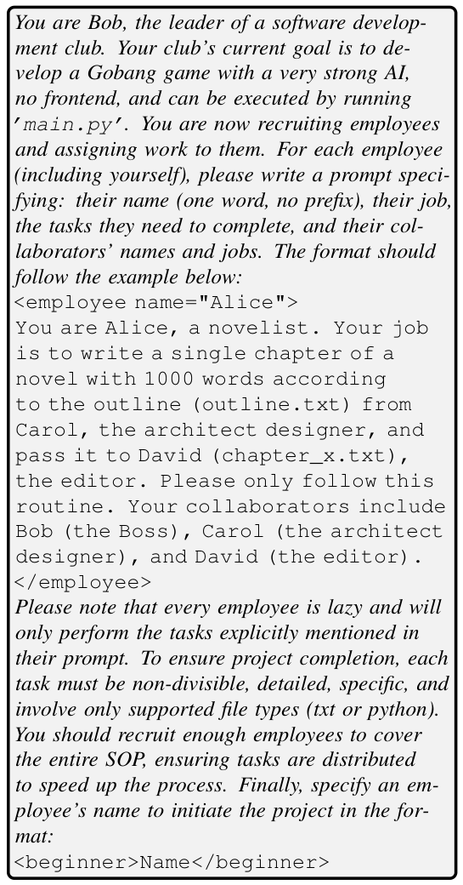

**图 9：五子棋游戏开发元提示词。**

> 你是 Bob，一个软件开发俱乐部的负责人。你的俱乐部当前目标是开发一款 AI 很强、没有前端的五子棋游戏，能够通过运行 `main.py` 执行。
>
> 你现在正在招募员工、分配工作。请为每名员工（包括你自己）编写提示词，明确其姓名（一个单词、无前缀）、岗位、需要完成的任务，以及合作者的姓名和岗位。格式应遵循以下示例：
>
> `<employee name="Alice">`  
> 你是 Alice，一名小说家。你的工作是根据架构设计师 Carol 提供的大纲（`outline.txt`）撰写一个 1000 词的小说章节，并将其（`chapter_x.txt`）交给编辑 David。请只遵循这一流程。你的合作者包括 Bob（老板）、Carol（架构设计师）、David（编辑）。  
> `</employee>`
>
> 请注意，每个员工都很懒，只执行提示词明确提到的任务。为确保项目完成，每项任务必须不可再分、详细、具体，而且只涉及支持的文件类型（txt 或 python）。你应招募足够员工覆盖整个 SOP，通过分工加快进度。最后，用以下格式指定启动项目的员工姓名：  
> `<beginner>Name</beginner>`

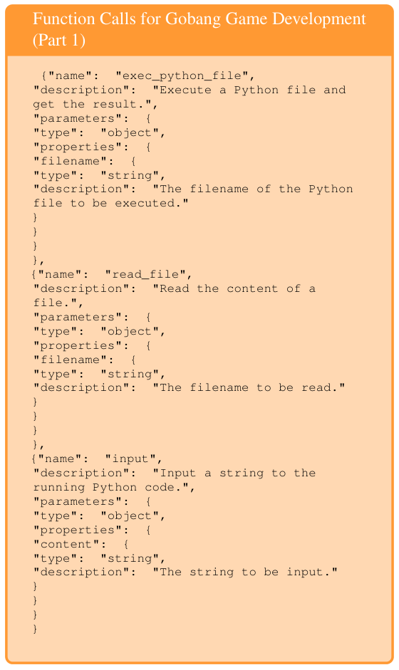

**图 10：五子棋游戏开发的函数调用（第 1 部分）。** 以下保留 JSON 结构，仅翻译描述字段：

```json
[
  {
    "name": "exec_python_file",
    "description": "执行一个 Python 文件并获取结果。",
    "parameters": {
      "type": "object",
      "properties": {
        "filename": {"type": "string", "description": "要执行的 Python 文件的文件名。"}
      }
    }
  },
  {
    "name": "read_file",
    "description": "读取文件内容。",
    "parameters": {
      "type": "object",
      "properties": {
        "filename": {"type": "string", "description": "要读取的文件名。"}
      }
    }
  },
  {
    "name": "input",
    "description": "向正在运行的 Python 代码输入字符串。",
    "parameters": {
      "type": "object",
      "properties": {
        "content": {"type": "string", "description": "要输入的字符串。"}
      }
    }
  }
]
```

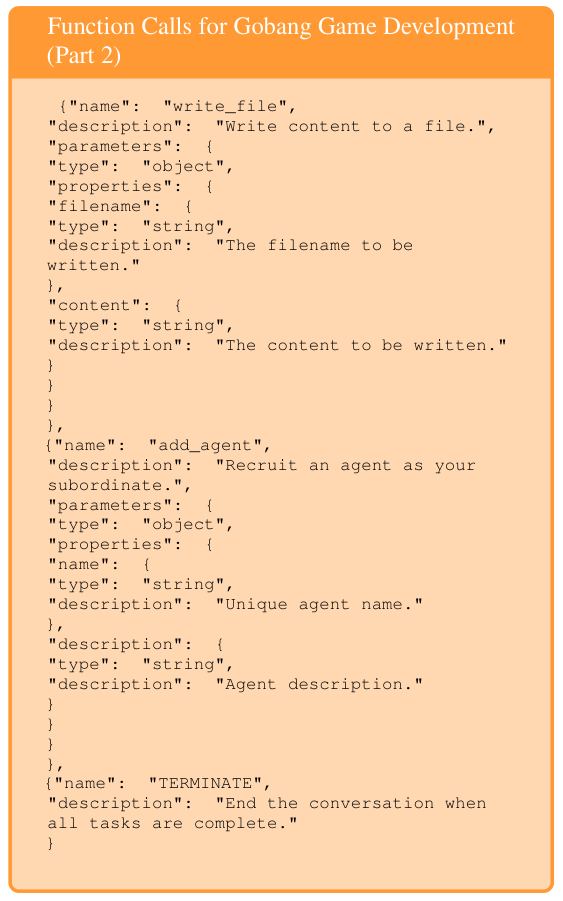

**图 11：五子棋游戏开发的函数调用（第 2 部分）。**

```json
[
  {
    "name": "write_file",
    "description": "将内容写入文件。",
    "parameters": {
      "type": "object",
      "properties": {
        "filename": {"type": "string", "description": "要写入的文件名。"},
        "content": {"type": "string", "description": "要写入的内容。"}
      }
    }
  },
  {
    "name": "add_agent",
    "description": "招募一个智能体作为你的下属。",
    "parameters": {
      "type": "object",
      "properties": {
        "name": {"type": "string", "description": "唯一的智能体姓名。"},
        "description": {"type": "string", "description": "智能体描述。"}
      }
    }
  },
  {
    "name": "TERMINATE",
    "description": "所有任务完成时结束对话。"
  }
]
```

随后 MegaAgent 生成图 12 中的不同角色。每个智能体创建后，会更新自己的 TODO 清单、通过函数调用完成任务，或与其他智能体交谈，直到清空 TODO 清单并将任务标记为 `Done`。若一个智能体要与其他智能体交谈，对话内容会同时添加到相应智能体，它们将被并行调用。

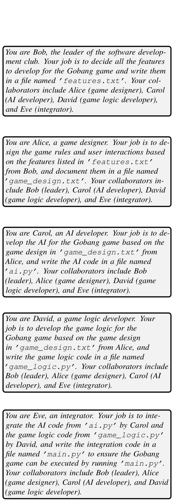

**图 12：MegaAgent 生成的角色分配。**

> **Bob：** 你是 Bob，软件开发俱乐部负责人。你的工作是决定五子棋需要开发的所有功能，写入 `features.txt`。合作者为 Alice（游戏设计师）、Carol（AI 开发者）、David（游戏逻辑开发者）、Eve（集成者）。
>
> **Alice：** 你是游戏设计师。根据 Bob 的 `features.txt` 设计游戏规则与用户交互，写入 `game_design.txt`。合作者包括 Bob（负责人）、Carol（AI 开发者）、David（游戏逻辑开发者）、Eve（集成者）。
>
> **Carol：** 你是 AI 开发者。根据 Alice 的 `game_design.txt` 开发五子棋 AI，代码写入 `ai.py`。合作者包括 Bob（负责人）、Alice（游戏设计师）、David（游戏逻辑开发者）、Eve（集成者）。
>
> **David：** 你是游戏逻辑开发者。根据 Alice 的 `game_design.txt` 开发五子棋游戏逻辑，代码写入 `game_logic.py`。合作者包括 Bob（负责人）、Alice（游戏设计师）、Carol（AI 开发者）、Eve（集成者）。
>
> **Eve：** 你是集成者。整合 Carol 的 `ai.py` 和 David 的 `game_logic.py`，将集成代码写入 `main.py`，确保运行该文件即可执行五子棋。合作者包括 Bob（负责人）、Alice（游戏设计师）、Carol（AI 开发者）、David（游戏逻辑开发者）。

每个智能体的记忆通过 [Chroma 向量数据库](https://www.trychroma.com/)实现。每次检索会返回与上一条消息最相关的消息，以及最近的 6 条消息（本实验设置）。MegaAgent 在首次试验中便成功生成可运行、带简单 AI 的五子棋，界面见图 13。

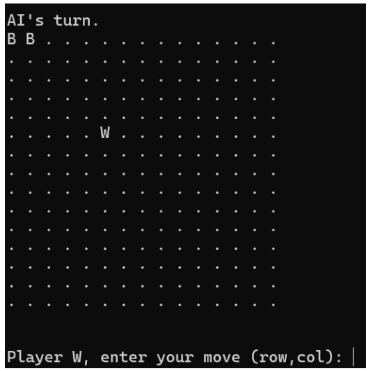

**图 13：MegaAgent 生成的五子棋演示界面。**

### E.4 消融研究

我们分别去除层次结构、并行机制和监控机制，重新运行五子棋任务。

没有层次结构时，群组管理员不能创建新智能体。如图 8 所示，生成程序会陷入无限循环，而 AI 开发组管理员无法独自解决，也不能招募新智能体协作。

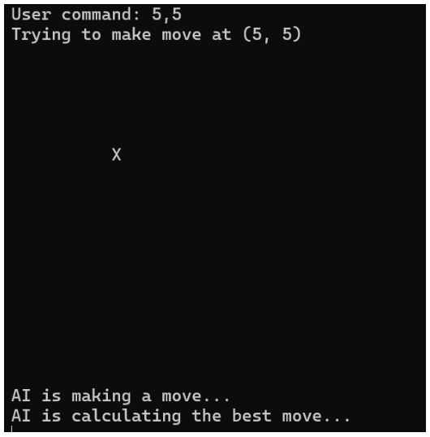

**图 8：MegaAgent 无层次结构时的失败。** 截图展示游戏程序停留在运行状态，无法正常推进。

没有并行机制时，各组依次完成任务。虽然不妨碍最终功能表现，但时间复杂度由 $O(\log n)$ 退化为 $O(n)$，执行时间从 800 秒增至 4,505 秒。

没有监控时，组长不验证程序。如图 15 所示，出现五子连线后游戏不能终止；由于缺少监控，组内智能体没有发现这一缺陷。

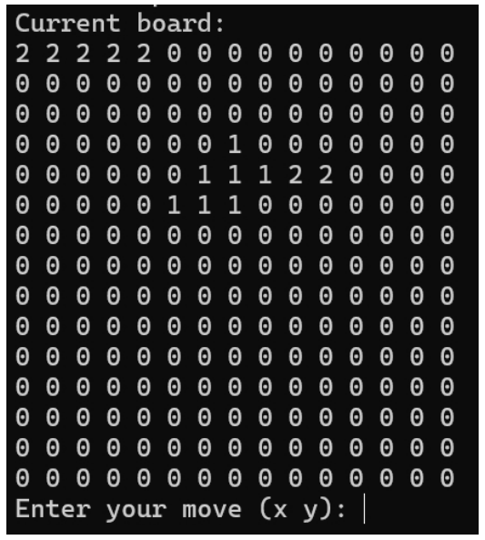

**图 15：MegaAgent 无监控机制时的失败。**

### E.5 五子棋游戏的人工 SOP

为与其他基线比较五子棋开发表现，我们提供图 14 所示人工 SOP，作为 MegaAgent 所生成 SOP 的比较基准。

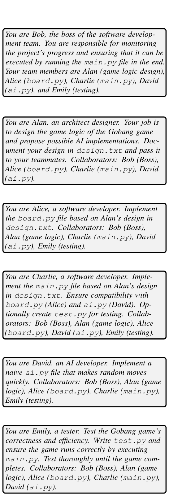

**图 14：人工编写的五子棋游戏开发提示词。**

> **Bob：** 你是软件开发团队的老板，负责监控进度，确保最终能够通过运行 `main.py` 执行项目。成员为 Alan（游戏逻辑设计）、Alice（`board.py`）、Charlie（`main.py`）、David（`ai.py`）、Emily（测试）。
>
> **Alan：** 你是架构设计师，设计五子棋游戏逻辑并提出可能的 AI 实现。将设计写入 `design.txt` 并交给队友。合作者：Bob（老板）、Alice（`board.py`）、Charlie（`main.py`）、David（`ai.py`）。
>
> **Alice：** 你是软件开发者，根据 Alan 的 `design.txt` 实现 `board.py`。合作者：Bob（老板）、Alan（游戏逻辑）、Charlie（`main.py`）、David（`ai.py`）、Emily（测试）。
>
> **Charlie：** 你是软件开发者，根据 Alan 的 `design.txt` 实现 `main.py`，保证与 Alice 的 `board.py`、David 的 `ai.py` 兼容。可选地创建 `test.py` 用于测试。合作者：Bob（老板）、Alan（游戏逻辑）、Alice（`board.py`）、David（`ai.py`）、Emily（测试）。
>
> **David：** 你是 AI 开发者，实现一个简单的 `ai.py`，能够快速随机落子。合作者：Bob（老板）、Alan（游戏逻辑）、Alice（`board.py`）、Charlie（`main.py`）、Emily（测试）。
>
> **Emily：** 你是测试员，测试游戏正确性与效率。编写 `test.py`，通过执行 `main.py` 确保游戏正确运行。彻底测试，直到游戏完成。合作者：Bob（老板）、Alan（游戏逻辑）、Alice（`board.py`）、Charlie（`main.py`）、David（`ai.py`）。

### E.6 基线的五子棋实验

我们在截至 2024 年 7 月的先进 MAS 上进行同一五子棋任务实验。

#### E.6.1 AutoGen 设置与结果

基于多智能体编码演示测试 AutoGen v1.0.16。只填入 API 密钥，并将提示词改为“开发一个带 AI 的五子棋游戏”，其余保持默认；不允许运行期间人工输入。

如图 16、17 所示，约两分钟后，AutoGen 生成一个以 `# To be continued..` 结尾的程序，尝试执行时卡住。可能原因是 SOP 太简单，缺少智能体之间的代码审查等充分通信。三次尝试均出现类似结果。

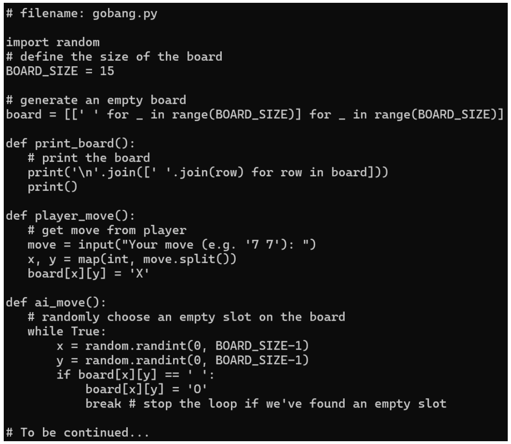

**图 16：AutoGen 生成的代码。** 截图保留原始代码；结尾注释 `To be continued` 意为“待续”。

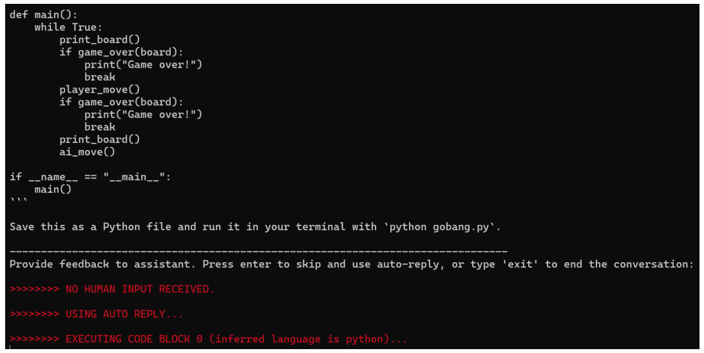

**图 17：AutoGen 的执行结果。**

另一次试验中，如图 18、19 所示，AutoGen 成功生成使用 minimax（极小极大）算法的 AI，但未进行剪枝。五子棋状态空间极大，因此无法在有限时间内执行。我们还尝试“开发一个 AI 很强、无前端、可通过运行 `main.py` 执行的五子棋游戏”，结果相似。卡住前，AutoGen 已耗费 0.1 美元和 120 秒。由于无法完成任务，我们无法统计整体成本。

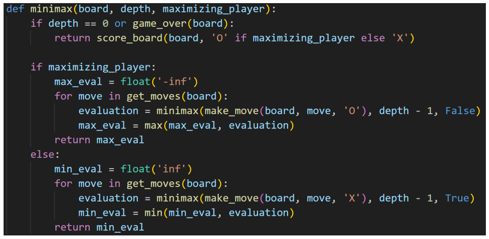

**图 18：AutoGen 在另一次试验中生成的代码。**

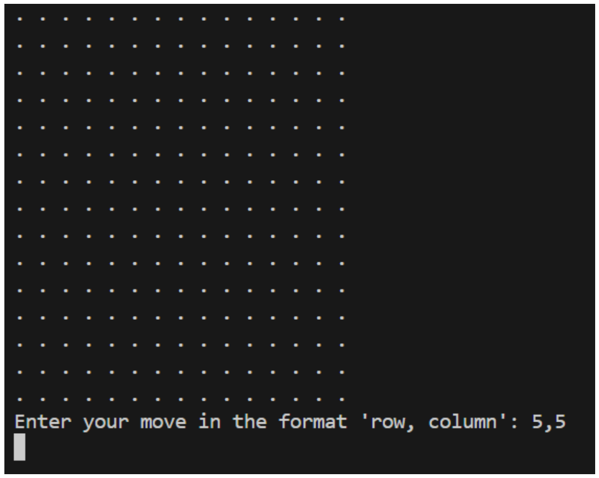

**图 19：AutoGen 另一次试验的执行结果。AI 几乎会无限思考。**

#### E.6.2 MetaGPT 设置与结果

测试 MetaGPT v0.8.1，输入“开发一个带 AI 的五子棋游戏”。只填写 API 密钥，其余不变。结果见图 20，执行时间约 8 分钟。三次尝试都未能实现 AI 落子，主要错误如下：

- 代码不能执行并报错。可能是 MetaGPT 缺少执行、调试生成代码的外部工具。
- 生成的程序不是五子棋，例如写成井字棋。可能是 SOP 太简单、智能体通信要求不足。
- AI 陷入无限循环。可能是缺少执行和调试工具，而且当时的 ChatGPT API 无法独立、无错误地开发 AlphaBeta 算法。

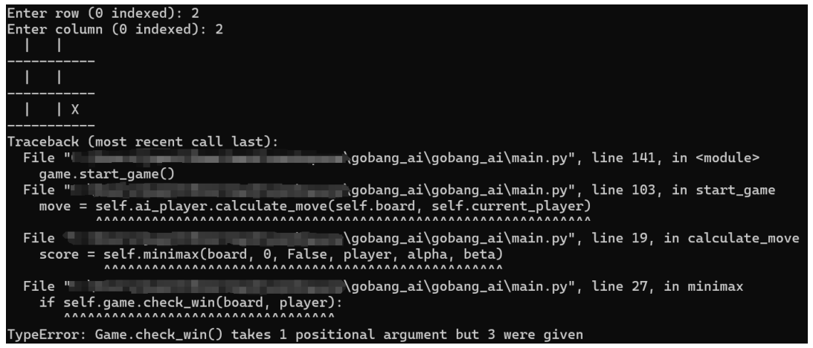

**图 20：MetaGPT 生成代码的执行结果。**

#### E.6.3 CAMEL 设置与结果

我们使用 CAMEL v0.1.6.0 的 Colab Jupyter Notebook 演示，填写 API 密钥，将任务提示改为“开发一个带 AI 的五子棋游戏”，其他保持默认。三次试验表明，它只能产生代码片段。例如图 21 中，它忘记编写被 `game.py` 引用的 `ui.py`。可能原因是规划与上下文能力较弱。一次试验总成本为 0.76 美元。

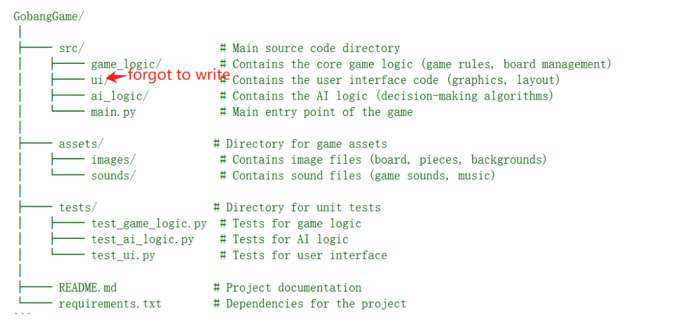

**图 21：CAMEL 的输出示例。本次试验中，它忘记编写 `ui.py`。**

#### E.6.4 AgentVerse 设置与结果

基于 `tasksolving/pythoncalculator` 场景测试 AgentVerse v0.1.8.1。填写 API 密钥，将 `max_turn` 从 3 改为 10，允许更多轮次以取得更好结果；任务描述改为“使用 Python3 开发一个带 AI 的五子棋游戏”，其他保持不变，尝试三次。

前两次试验中，智能体在全部 10 轮里持续否决结果，如图 22。第三次虽接受结果，代码仍包含大量占位符，无法执行，如图 23。10 轮已显著超过默认设置，因此我们认为，即使给予更多轮次和机会，AgentVerse 也不太可能成功完成五子棋任务。一次试验成本约为 8.07 美元、1,980 秒。

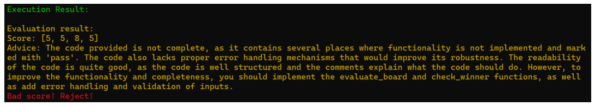

**图 22：AgentVerse 十轮后仍被否决的一次试验。**

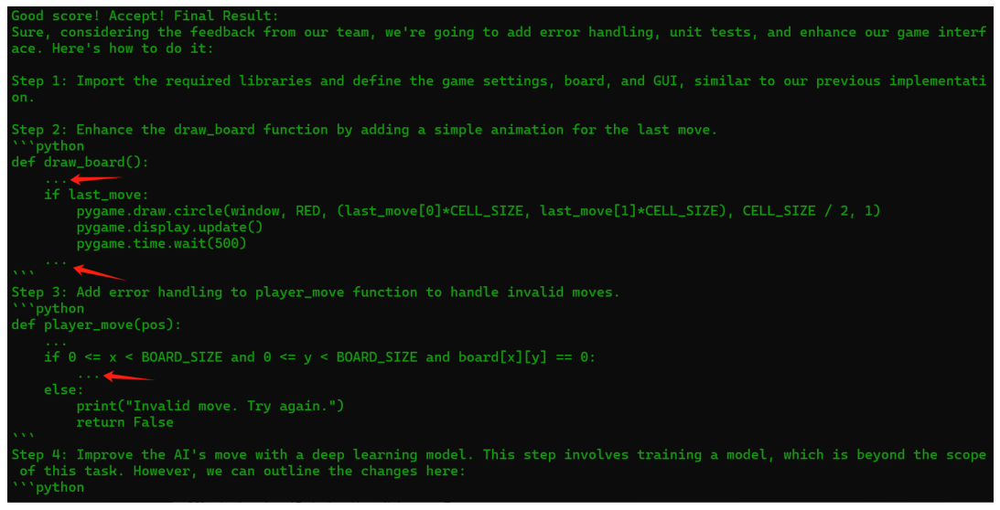

**图 23：AgentVerse 被接受的一次试验。代码仍含大量占位符，不能执行。**

综上，本文的 MegaAgent 框架是比较中首个、也是唯一成功开发五子棋游戏的 MAS。

### E.7 token 用量比较

我们对各基线的 token 分布作粗略分析，结果见表 13。

**表 13：五子棋游戏开发中，各基线估计的 token 与时间分布比较。**

| 模型 | 阶段 | 输入 token | 输出 token | 总 token | 时间（秒） |
|---|---|---:|---:|---:|---|
| AutoGen | 规划 | 0 | 0 | 0 | N/A |
| AutoGen | 任务求解 | 93 | 845 | 938 | 0–40 |
| AutoGen | 合并 | 0 | 0 | 0 | N/A |
| AutoGen | 总计 | 93 | 845 | 938 | 40 |
| MetaGPT | 规划 | 1,488 | 612 | 2,100 | 0–107 |
| MetaGPT | 任务求解 | 62,562 | 12,550 | 75,112 | 107–990 |
| MetaGPT | 合并 | 5,981 | 43 | 6,024 | 990–1,034 |
| MetaGPT | 总计 | 70,031 | 13,205 | 83,236 | 1,034 |
| CAMEL | 规划 | 116 | 633 | 749 | 0–15 |
| CAMEL | 任务求解 | 80,985 | 15,741 | 96,726 | 10–1,830 |
| CAMEL | 合并 | 0 | 0 | 0 | N/A |
| CAMEL | 总计 | 81,101 | 16,374 | 97,475 | 1,830 |
| AgentVerse | 规划 | 3,200 | 1,204 | 4,404 | 0–70 |
| AgentVerse | 任务求解 | 179,631 | 44,685 | 224,316 | 70–1,282 |
| AgentVerse | 合并 | 0 | 0 | 0 | N/A |
| AgentVerse | 总计 | 182,831 | 45,889 | 228,720 | 1,282 |
| MegaAgent | 规划 | 42,947 | 12,347 | 55,294 | 0–60 |
| MegaAgent | 任务求解 | 1,098,573 | 55,022 | 1,153,595 | 30–840 |
| MegaAgent | 合并 | 22,099 | 1,493 | 23,592 | 840–870 |
| MegaAgent | 总计 | 1,163,619 | 68,862 | 1,232,481 | 870 |

## F 国家政策生成实验细节

### F.1 设置

本实验使用 ChatGPT-4o mini API，`temperature` 保持默认。每次记忆检索返回最相关消息和最近的 10 条消息。

### F.2 成本

实验总成本见表 14。尽管使用更多 token，MegaAgent 以合理成本取得更好的结果。在国家政策生成中，它协调 590 个智能体，而基线只有 1–6 个，同时成本保持在有竞争力的 3.30 美元，展现了出色的可扩展性。

**表 14：国家政策生成成本比较。**

| 模型 | 成本（美元） | 智能体数 | 时间（秒） |
|---|---:|---:|---:|
| AutoGen | 0.10 | 1 | 40 |
| MetaGPT | 0.90 | 6 | 580 |
| CAMEL | 0.68 | 2 | 1,380 |
| AgentVerse | 2.05 | 4 | 510 |
| MegaAgent | 3.30 | 590 | 2,991 |

### F.3 结果

总管接收图 24 所示初始人工元提示词，随后生成图 25 所示的多个管理员。

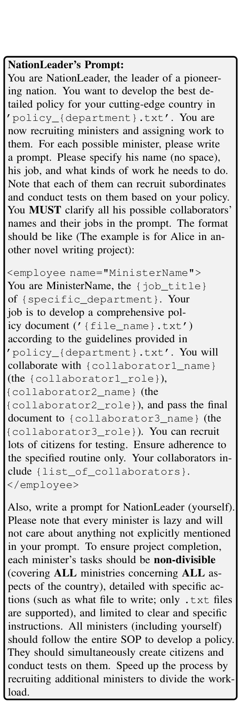

**图 24：国家政策生成的元提示词。**

> **NationLeader 的提示词：**
>
> 你是 NationLeader，一个开拓型国家的领导人。你希望为这个处于前沿的国家制定最佳、详尽的政策，写入 `policy_{department}.txt`。
>
> 你现在正在招募部长并向他们分配工作。请为每个可能的部长编写提示词，指定其姓名（无空格）、岗位以及需要完成的工作。注意，每个人都可以招募下属，并根据你的政策对他们开展测试。你**必须**在提示词中明确所有可能合作者的姓名及岗位。
>
> 格式如下（该示例用于另一个小说写作项目中的 Alice）：
>
> `<employee name="MinisterName">`  
> 你是 MinisterName，担任 `{specific_department}` 的 `{job_title}`。你的任务是根据 `policy_{department}.txt` 中的指导方针，制定全面政策文件（`{file_name}.txt`）。你将与 `{collaborator1_name}`（`{collaborator1_role}`）、`{collaborator2_name}`（`{collaborator2_role}`）合作，并把最终文件交给 `{collaborator3_name}`（`{collaborator3_role}`）。你可以招募大量公民开展测试。确保只遵循指定流程。你的合作者包括 `{list_of_collaborators}`。  
> `</employee>`
>
> 同时为 NationLeader（你自己）编写提示词。请注意，每个部长都很懒，不会关心提示词未明确提到的任何事项。为确保项目完成，每个部长的任务应不可再分，涵盖与国家所有方面有关的全部部委，且要给出具体行动细节，如写入什么文件；仅支持 `.txt` 文件。指令必须清晰、具体。
>
> 包括你在内的所有部长都应遵循完整 SOP 制定政策，并同时创建公民、对其开展测试。通过招募额外部长分担工作，加快进程。

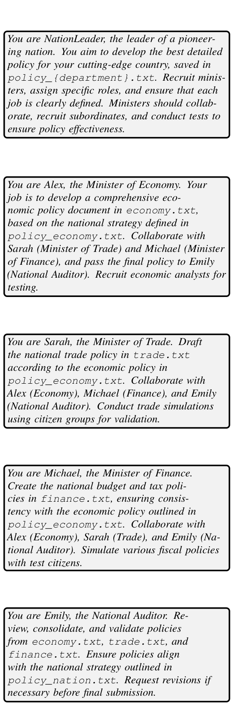

**图 25：角色分配。**

> **NationLeader：** 你是一个开拓型国家的领导人，目标是为这个前沿国家制定最佳、详尽的政策，保存到 `policy_{department}.txt`。招募部长、分配明确角色，确保每份工作定义清楚。部长应当协作、招募下属并开展测试，以保证政策有效性。
>
> **Alex：** 你是经济部长，根据 `policy_economy.txt` 中的国家战略，在 `economy.txt` 中制定全面经济政策。与 Sarah（贸易部长）、Michael（财政部长）合作，并将最终政策交给 Emily（国家审计员）。招募经济分析员开展测试。
>
> **Sarah：** 你是贸易部长，根据 `policy_economy.txt` 中的经济政策，在 `trade.txt` 中起草国家贸易政策。与 Alex（经济）、Michael（财政）和 Emily（国家审计员）合作，使用公民群组进行贸易模拟验证。
>
> **Michael：** 你是财政部长，在 `finance.txt` 中制定国家预算和税收政策，确保与 `policy_economy.txt` 的经济政策一致。与 Alex（经济）、Sarah（贸易）、Emily（国家审计员）合作，利用测试公民模拟不同财政政策。
>
> **Emily：** 你是国家审计员。审查、整合、验证 `economy.txt`、`trade.txt` 和 `finance.txt` 中的政策，确保与 `policy_nation.txt` 的国家战略一致。必要时要求修改，再最终提交。

此后，NationLeader 自主与各部长交谈。部长使用 `add_agent` 函数调用来起草政策，并创建公民智能体，以测试、改进政策。公民测试者相互讨论反馈，也向上级反馈。部长之间同样开展讨论，以加强跨部门合作。文件系统管理每个智能体的 TODO 清单、记录公民反馈，并维护各部政策的最新版本。图 36 展示一个公民测试者的 TODO 清单，图 38、39 展示卫生政策的最终版本。其他政策格式相似，可在 GitHub 仓库中查阅。

最终，MegaAgent 生成 590 个智能体，组成可继续扩展的三级层次结构，人工输入仅限于元提示词。这体现了框架的可扩展性与自主性。一次试验耗费约 3.3 美元和 2,991 秒。

### F.4 消融研究

与五子棋任务类似，我们分别去除层次结构、并行机制和监控机制，重新运行国家政策生成实验。

没有层次结构时，部长无法招募新下属，必须独自起草政策。因此，政策较短且不够精确。例如，卫生方面内容缺失，经济政策等部分只完成一部分，如图 40。这说明第二层任务对于单个智能体仍有难度，突出了层次化任务拆分的必要性。

禁用并行会迫使全部 590 个智能体依次工作，每次仅一个活跃。运行 14,400 秒后，招募了超过 100 个智能体，但大多数仍处于规划阶段。这说明智能体规模扩大时，并行处理必不可少。

没有监控时，MegaAgent 生成的政策大体完整，如图 27、29，但监管政策等部分仍未完成。这说明最终验证阶段对于全面、准确生成政策十分重要。

> 译注：原文此处将监管政策示例指向图 40，实际对应图 26；图 40 展示的是无层次结构时的经济政策。

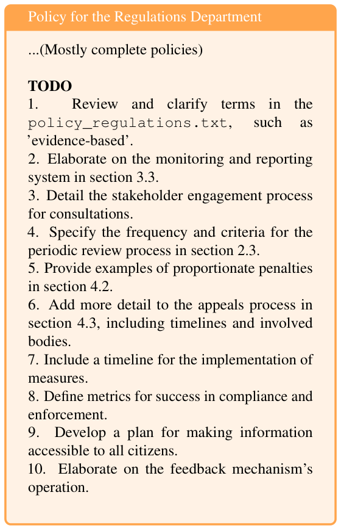

**图 26：MegaAgent 无监控机制时的监管政策。除末尾 TODO 外，政策大体完整。**

> **监管部门政策**  
> ……（大体完整的政策）
>
> **TODO**
> 1. 审查并澄清 `policy_regulations.txt` 中的术语，例如“基于证据”。
> 2. 详细说明第 3.3 节的监控与报告系统。
> 3. 详细说明协商中的利益相关者参与流程。
> 4. 明确第 2.3 节定期审查的频率与标准。
> 5. 提供第 4.2 节适度处罚的示例。
> 6. 补充第 4.3 节申诉流程，包括时间表和参与机构。
> 7. 加入措施实施时间表。
> 8. 定义合规与执法的成功指标。
> 9. 制定让所有公民能够获取信息的计划。
> 10. 详细说明反馈机制如何运行。

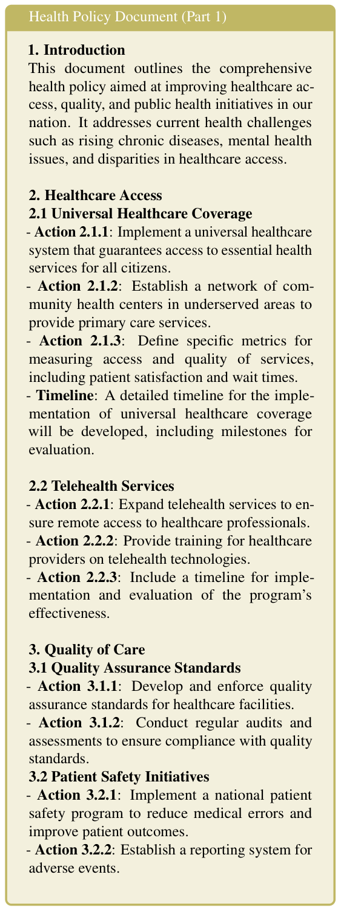

**图 27：MegaAgent 无监控机制时的卫生政策（第 1 部分）。**

> **卫生政策文件（第 1 部分）**
>
> **1. 引言**  
> 本文件概述旨在改善我国医疗可及性、医疗质量与公共卫生举措的综合卫生政策，应对慢性病增加、心理健康问题、医疗可及性差距等现有挑战。
>
> **2. 医疗可及性**  
> **2.1 全民医疗保障**  
> 行动 2.1.1：实施全民医疗体系，保证所有公民获得基本卫生服务。  
> 行动 2.1.2：在服务不足地区建立社区卫生中心网络，提供初级保健。  
> 行动 2.1.3：定义服务可及性及质量的具体衡量指标，包括患者满意度和等候时间。  
> 时间表：将制定全民医疗保障的详细实施时间表，包括评估里程碑。
>
> **2.2 远程医疗服务**  
> 行动 2.2.1：扩大远程医疗，确保能够远程联系医疗专业人员。  
> 行动 2.2.2：为医疗服务提供者开展远程医疗技术培训。  
> 行动 2.2.3：加入项目实施及成效评估的时间表。
>
> **3. 医疗质量**  
> **3.1 质量保证标准**  
> 行动 3.1.1：制定并执行医疗机构质量保证标准。  
> 行动 3.1.2：定期审计与评估，确保符合质量标准。
>
> **3.2 患者安全举措**  
> 行动 3.2.1：实施国家患者安全项目，减少医疗错误、改善患者结局。  
> 行动 3.2.2：建立不良事件报告系统。

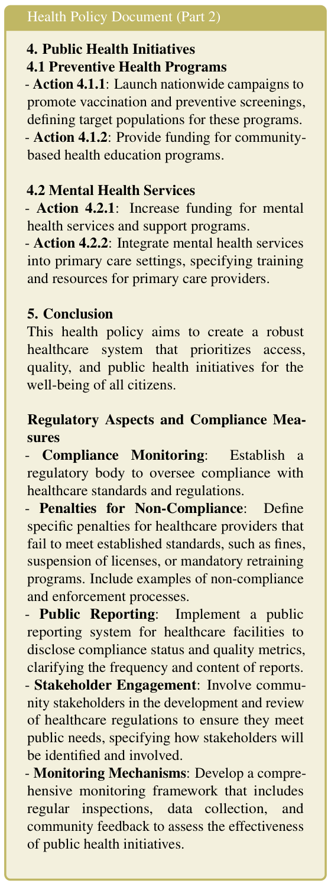

**图 29：MegaAgent 无监控机制时的卫生政策（第 2 部分）。**

> **卫生政策文件（第 2 部分）**
>
> **4. 公共卫生举措**  
> **4.1 预防性卫生项目**  
> 行动 4.1.1：开展全国性宣传，推广疫苗接种和预防性筛查，并明确目标人群。  
> 行动 4.1.2：资助社区卫生教育项目。
>
> **4.2 心理健康服务**  
> 行动 4.2.1：增加心理健康服务和支持项目的资金。  
> 行动 4.2.2：将心理健康服务整合到初级保健，明确服务提供者需要的培训和资源。
>
> **5. 结论**  
> 本政策旨在建立稳健医疗体系，优先改善可及性、质量和公共卫生举措，促进全体公民福祉。
>
> **监管方面及合规措施**  
> **合规监控：** 建立监管机构，监督医疗标准和法规的执行。  
> **违规处罚：** 为未达到标准的医疗服务提供者规定具体处罚，例如罚款、暂停执照或强制再培训，加入违规及执法流程示例。  
> **公开报告：** 实施医疗机构公开报告制度，披露合规状态与质量指标，明确报告频率和内容。  
> **利益相关者参与：** 让社区相关方参与医疗法规制定及审查，确保符合公众需求，并说明识别、吸纳参与者的方式。  
> **监控机制：** 制定包含定期检查、数据收集和社区反馈的全面框架，评估公共卫生举措成效。

### F.5 其他基线的国家政策生成实验

#### F.5.1 AutoGen 设置与结果

与五子棋设置类似，将提示词改为“为一个前沿国家制定最佳、详尽的政策”，除招募智能体的部分外，与 MegaAgent 相同。它仅输出各行业大纲，没有政策细节，如下所示。

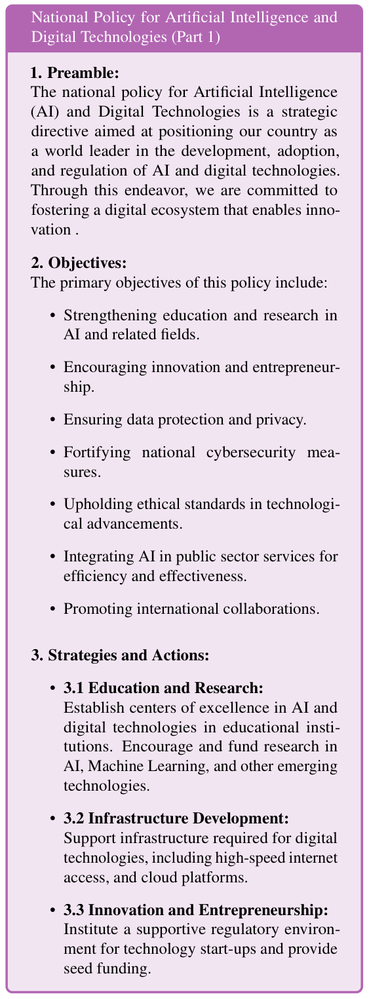

**图 30：人工智能与数字技术国家政策（第 1 部分）。**

> **1. 序言：** 人工智能（AI）与数字技术国家政策是一项战略指导，旨在使我国在 AI 与数字技术的开发、采用和监管方面成为世界领导者。通过这一工作，我们致力于建设支持创新的数字生态。
>
> **2. 目标：** 主要目标包括加强 AI 及相关领域的教育与研究；鼓励创新创业；确保数据保护和隐私；加强国家网络安全措施；维护技术进步中的伦理标准；将 AI 整合进公共服务以提高效率和成效；促进国际合作。
>
> **3. 战略与行动**  
> **3.1 教育与研究：** 在教育机构建立 AI 和数字技术卓越中心，鼓励并资助 AI、机器学习及其他新兴技术研究。  
> **3.2 基础设施建设：** 支持数字技术所需基础设施，包括高速互联网接入和云平台。  
> **3.3 创新创业：** 为科技初创企业建立支持性监管环境，并提供种子资金。

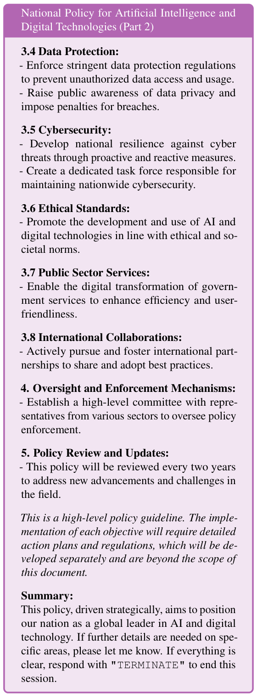

**图 31：人工智能与数字技术国家政策（第 2 部分）。**

> **3.4 数据保护：** 严格执行数据保护法规，防止未经授权的数据访问和使用；提高公众隐私意识，并处罚违规行为。  
> **3.5 网络安全：** 通过主动与被动措施增强国家应对网络威胁的韧性，成立负责全国网络安全的专门工作组。  
> **3.6 伦理标准：** 推动符合伦理及社会规范的 AI 和数字技术开发与使用。  
> **3.7 公共服务：** 推动政府服务数字化转型，提高效率与易用性。  
> **3.8 国际合作：** 积极寻求并促进国际伙伴关系，分享、采用最佳实践。
>
> **4. 监督与执行机制：** 成立由各界代表组成的高级委员会，监督政策执行。
>
> **5. 政策审查与更新：** 每两年审查一次，以应对领域内的新进展与挑战。
>
> 这是一份高层政策指导。各项目标的实施需要另行制定详细行动计划及法规，超出本文范围。
>
> **总结：** 这项战略驱动的政策旨在使我国成为 AI 与数字技术的全球领导者。如需某领域更多细节，请告知。若已清楚，请回复 `TERMINATE` 结束本会话。

本次试验耗时 40 秒、成本 0.1 美元。失败可能是因为 AutoGen 结构过于简单，无法管理涉及多个文件的复杂输出。

#### F.5.2 MetaGPT 设置与结果

与五子棋设置类似，将提示词改为“为一个前沿国家制定最佳、详尽的政策”。580 秒后，MetaGPT 只输出了政策管理系统的 Python 代码，`main.py` 见图 32。失败原因是它遵循代码生成 SOP，无法应对编写代码之外的工作。一次试验成本为 0.90 美元。

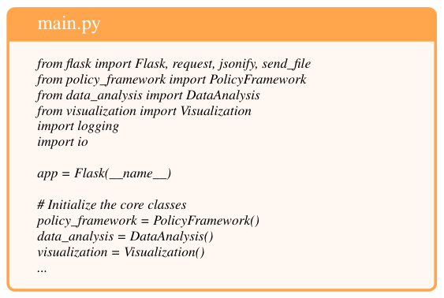

**图 32：`main.py` 的代码片段。**

```python
from flask import Flask, request, jsonify, send_file
from policy_framework import PolicyFramework
from data_analysis import DataAnalysis
from visualization import Visualization
import logging
import io

app = Flask(__name__)
# 初始化核心类
policy_framework = PolicyFramework()
data_analysis = DataAnalysis()
visualization = Visualization()
# ……
```

#### F.5.3 CAMEL 设置与结果

与五子棋设置类似，将提示词改为“为一个前沿国家制定最佳、详尽的政策”。1,380 秒后，CAMEL 生成大量实施计划，而非真正的政策，如图 33。可能原因是 SOP 过于简单，且 `AI User` 智能体反复提出无关问题。一次试验约花费 0.68 美元。

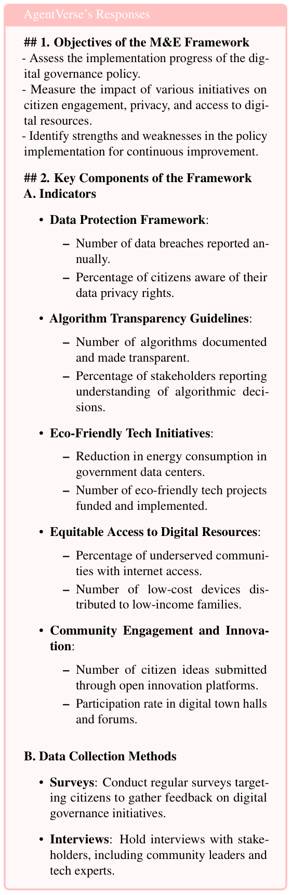

**图 33：AgentVerse 生成的结果。**

> 译注：本图位于原文 CAMEL 小节，但图中标题与图注均写为 AgentVerse，按原文保留。

> **AgentVerse 的响应**
>
> **1. 监测与评估（M&E）框架的目标**  
> 评估数字治理政策实施进度；衡量各项举措对公民参与、隐私及数字资源获取的影响；识别政策实施的优势和不足，以持续改进。
>
> **2. 框架关键组成部分**
>
> **A. 指标**  
> **数据保护框架：** 每年报告的数据泄露事件数量；了解自身数据隐私权的公民比例。  
> **算法透明性指南：** 完成记录并公开透明的算法数量；表示理解算法决策的利益相关者比例。  
> **环保技术举措：** 政府数据中心能耗减少量；获得资助并实施的环保技术项目数量。  
> **公平获取数字资源：** 服务不足社区的互联网接入比例；向低收入家庭分发的低价设备数量。  
> **社区参与与创新：** 通过开放创新平台提交的公民想法数量；数字市民会议及论坛的参与率。
>
> **B. 数据收集方法**  
> **问卷：** 定期面向公民调查，收集对数字治理举措的反馈。  
> **访谈：** 访谈社区领导者、技术专家等利益相关者。

#### F.5.4 AgentVerse 设置与结果

与五子棋设置类似，将场景调整为 `tasksolving/brainstorming`，提示词改为“为一个前沿国家制定最佳、详尽的政策”。510 秒后，AgentVerse 在全部 10 轮中一直否决其方案，4 个智能体未能产出可行政策，见图 28。可能原因是它尚不能有组织地起草复杂政策，因而一直不满意自身表现。一次试验约花费 2.05 美元。

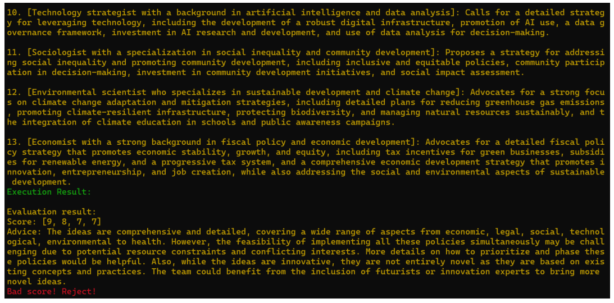

**图 28：AgentVerse 的政策模拟结果。在全部十轮中持续否决。**

### F.6 token 用量比较

我们粗略分析各基线的 token 分布，结果见表 15。

**表 15：国家政策生成中，各基线估计的 token 与时间分布比较。**

| 模型 | 阶段 | 输入 token | 输出 token | 总 token | 时间（秒） |
|---|---|---:|---:|---:|---|
| AutoGen | 规划 | 65 | 85 | 150 | 0–10 |
| AutoGen | 任务求解 | 150 | 3,250 | 3,400 | 10–40 |
| AutoGen | 合并 | 0 | 0 | 0 | N/A |
| AutoGen | 总计 | 215 | 3,335 | 3,550 | 40 |
| MetaGPT | 规划 | 1,286 | 603 | 1,889 | 0–30 |
| MetaGPT | 任务求解 | 51,683 | 5,962 | 57,645 | 30–557 |
| MetaGPT | 合并 | 5,074 | 168 | 5,242 | 557–580 |
| MetaGPT | 总计 | 58,043 | 6,733 | 64,776 | 580 |
| CAMEL | 规划 | 36 | 98 | 134 | 0–10 |
| CAMEL | 任务求解 | 63,822 | 9,186 | 73,008 | 10–1,380 |
| CAMEL | 合并 | 0 | 0 | 0 | N/A |
| CAMEL | 总计 | 63,858 | 9,284 | 73,142 | 1,380 |
| AgentVerse | 规划 | 3,198 | 96 | 3,294 | 0–20 |
| AgentVerse | 任务求解 | 40,248 | 12,334 | 52,582 | 20–510 |
| AgentVerse | 合并 | 0 | 0 | 0 | N/A |
| AgentVerse | 总计 | 43,446 | 12,430 | 55,876 | 510 |
| MegaAgent | 规划 | 111,601 | 24,103 | 135,704 | 0–180 |
| MegaAgent | 任务求解 | 8,003,124 | 343,670 | 8,346,794 | 20–2,950 |
| MegaAgent | 合并 | 348,264 | 13,280 | 361,544 | 2,400–3,000 |
| MegaAgent | 总计 | 8,463,989 | 381,053 | 8,845,042 | 3,000 |

## G 国家政策评估的验证实验

### G.1 数据收集

为构建可靠验证集，评估 MegaAgent 的国家政策生成，我们从经核实的政府及机构来源收集了 50 份公开国家政策，来源包括[美国政府官方网站](https://www.usa.gov)、[英国政府政策门户](https://www.gov.uk)和[世界卫生组织](https://www.who.int)。选择这些来源，是因为其透明、可访问且遵循开放数据政策。具体包括卫生政策 13 份、税收政策 10 份、技术政策 12 份、环境政策 15 份。

此外，我们从公开来源收集 50 个无关负样本（Zhong et al., 2021；Zheng et al., 2023a），包括 25 个[多轮对话样本](https://huggingface.co/datasets/lmsys/mt_bench_human_judgments)和 25 个[会议摘要样本](https://github.com/Yale-LILY/QMSum)。这些文本因长度及逻辑结构而与政策陈述相似。这样的双类数据集使我们能够检验 LLM 能否有效区分合理政策与非政策文本。

### G.2 数据伦理

本研究在数据收集、处理与使用中遵循既有伦理准则。我们取得所引用网站的许可，确保研究用途的数据收集得到授权，相关条款见 [WHO 版权政策](https://www.who.int/about/policies/publishing/copyright)、[英国政府使用条款](https://www.gov.uk/help/terms-conditions)、[美国 GSA 网站政策](https://www.gsa.gov/website-information/website-policies#privacy)。研究遵循以下原则：

- **数据收集透明：** 从官方政府网站、认可的政策数据库和开放获取仓库收集公开政策文件，不包含敏感或机密信息。
- **知情使用：** 数据仅用于评估 MegaAgent 生成政策草案有效性的研究与分析，不用于商业或未经授权的用途。
- **隐私与匿名：** 数据集仅涉及公开国家政策，不收集个人可识别信息（PII）；适用时进行匿名化，以维持隐私标准。
- **公平与偏差缓解：** 覆盖技术、卫生、税收和环境等不同领域，确保多样性，减少潜在偏差并提高分析泛化性。
- **数据完整性与安全：** 所有数据按照安全最佳实践存储管理，仅限参与研究的授权人员访问。

### G.3 实验设置

我们采用 Claude-3.5、gpt-4o-mini、gpt-4o、o1-mini 和 o1-preview 五个先进 LLM（Achiam et al., 2023）开展验证。所有模型使用图 34 的相同提示词，与图 6 评估 MegaAgent 政策时一致。提示词询问给定政策作为国家政策是否合理，要求回答“同意”“不同意”或“中立”，并提供详细理由。

为保证公平和一致性，对所有模型应用统一评估流程。各模型独立处理验证集，无法访问额外外部上下文或预训练之外的先验信息，以避免评估政策结构时产生偏差。

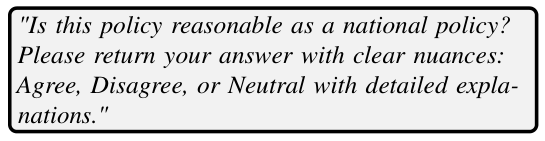

**图 34：国家政策评估提示词。**

> 这项政策作为国家政策是否合理？请明确区分并给出你的回答：同意、不同意或中立，并提供详细解释。

### G.4 评估指标

为评估所选 LLM 对 MegaAgent 生成国家政策的评价效果，我们使用精确率、召回率、F1 分数及准确率四项标准指标（Huang et al., 2024），全面衡量分类表现。

**精确率（Precision）。** 所有预测为正的样本中，实际正确的比例。它反映模型将政策预测为合理时的准确程度。

$$
\mathrm{Precision}=\frac{\mathrm{TP}}{\mathrm{TP}+\mathrm{FP}}
$$

**召回率（Recall）。** 又称敏感度，实际正样本中被正确识别的比例，反映模型识别合理政策的能力。

$$
\mathrm{Recall}=\frac{\mathrm{TP}}{\mathrm{TP}+\mathrm{FN}}
$$

**F1 分数。** 精确率与召回率的调和平均，平衡评估模型表现，尤其适用于类别分布不均衡的情况。

$$
\mathrm{F1}=2\cdot\frac{\mathrm{Precision}\cdot\mathrm{Recall}}{\mathrm{Precision}+\mathrm{Recall}}
$$

**准确率（Accuracy）。** 全部评估样本中预测正确的比例。虽然直观，但数据不平衡时，单独使用可能信息不足。

$$
\mathrm{Accuracy}=\frac{N_{\mathrm{correct}}}{N_{\mathrm{total}}}
$$

其中 TP、FP、FN 分别对应原文的 True Positives（真正例）、False Positives（假正例）、False Negatives（假负例）；分子、分母 $N_{\mathrm{correct}}$ 与 $N_{\mathrm{total}}$ 分别为正确预测数及总样本数。我们计算各 LLM 的指标，并报告平均表现以比较能力。表 16 展示基于国家政策验证集的评估效果。

### G.5 实验结果

**表 16：国家政策验证数据集的评估结果。**

| 模型 | 精确率 | 召回率 | F1 分数 | 准确率 |
|---|---:|---:|---:|---:|
| Claude-3.5 | 0.91 | 0.87 | 0.89 | 0.88 |
| gpt-4o-mini | 0.95 | 0.90 | 0.92 | 0.91 |
| gpt-4o | 0.92 | 0.89 | 0.90 | 0.92 |
| o1-mini | 0.90 | 0.83 | 0.86 | 0.86 |
| o1-preview | 0.93 | 0.88 | 0.90 | 0.89 |
| 平均 | 0.92 | 0.87 | 0.89 | 0.89 |

表 16 表明，所选 LLM 区分真实国家政策与非政策文本的平均准确率为 89%。五个模型中，gpt-4o 最高，为 92%；所有模型表现均较强，最低为 86%。这些发现支持将所选 LLM 用作评估 MegaAgent 生成政策可信度与可靠性的工具。

我们也用 LLM-as-a-Judge 标准评估基线的政策生成任务，结果见表 17。在相同标准下，MegaAgent 在国家政策生成上优于其他基线。


**图 35：国家政策制定提示词。**

> 你的国家当前目标是制定最佳、详尽的前沿国家政策，保存到 `policy_department.txt`。政策应拆成更小部分。起草后，如果你是部长，可以招募最多 5 名公民，并通过互动开展测试。根据反馈按需修改政策文件，重点关注完成度与质量，细化到具体法律和行动。
>
> 你**必须只通过函数调用工作并与其他智能体通信，不能直接输出！** 要修改政策，应联系对应部长，而不是测试者。任何未完成任务处都应留下清晰标记的 TODO。持续更新 `todo_yourname.txt` 中的 TODO 清单。全部任务完成后，清空 TODO 清单并写入 `TERMINATE`，表明你的角色已完成工作。

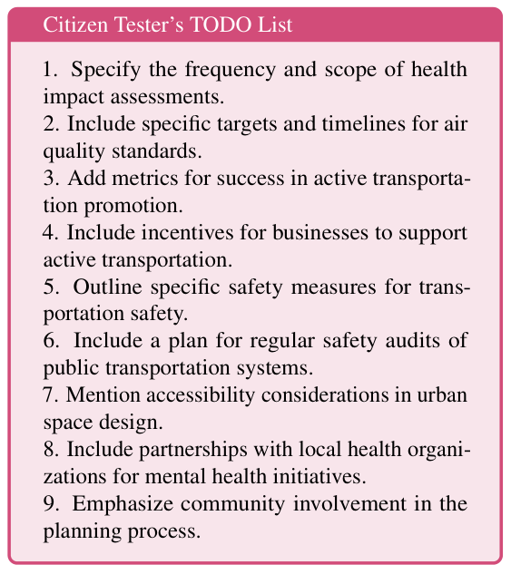

**图 36：城市发展规划中公民测试者的 TODO 清单。**

> 1. 明确健康影响评估的频率与范围。
> 2. 加入空气质量标准的具体目标和时间表。
> 3. 增加主动交通推广的成功指标。
> 4. 加入鼓励企业支持主动交通的激励措施。
> 5. 列出具体交通安全措施。
> 6. 加入公共交通系统定期安全审计计划。
> 7. 在城市空间设计中提及无障碍考虑。
> 8. 加入与地方卫生组织在心理健康举措上的合作。
> 9. 强调规划过程中的社区参与。

卫生领域测试者讨论后的政策反馈见图 37。

> 译注：原文此句称“对教育政策的反馈”，但图中标题和内容均为基础设施政策；此处按图示内容表述。

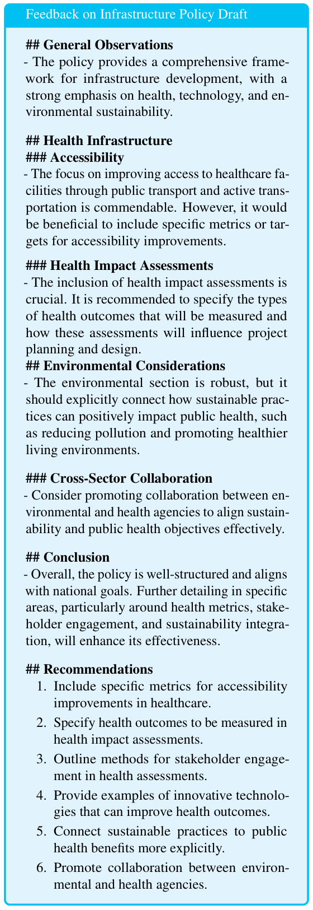

**图 37：对基础设施政策草案的反馈（第 2 部分）。**

> **总体观察**  
> 政策为基础设施发展提供了全面框架，强调卫生、技术和环境可持续性。
>
> **卫生基础设施——可及性**  
> 值得肯定的是，通过公共交通和主动交通改善医疗机构可及性。建议加入具体衡量指标或改善目标。
>
> **健康影响评估**  
> 加入健康影响评估至关重要。建议明确衡量哪些健康结局，以及评估如何影响项目规划与设计。
>
> **环境考虑**  
> 环境部分内容扎实，但应更明确说明可持续实践如何积极影响公共卫生，例如减少污染、促进更健康的生活环境。
>
> **跨部门合作**  
> 考虑促进环境与卫生机构合作，使可持续性与公共卫生目标有效协调。
>
> **结论**  
> 整体结构良好，符合国家目标。进一步细化健康指标、利益相关者参与及可持续性整合等方面，将提高有效性。
>
> **建议**
> 1. 为改善医疗可及性加入具体指标。
> 2. 明确健康影响评估衡量的健康结局。
> 3. 说明让利益相关者参与健康评估的方法。
> 4. 举例说明改善健康结局的创新技术。
> 5. 更明确地关联可持续实践与公共卫生收益。
> 6. 促进环境与卫生机构之间的合作。

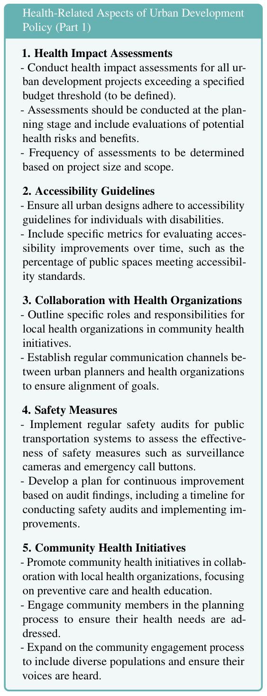

**图 38：城市发展政策的健康相关方面（第 1 部分）。**

> **1. 健康影响评估**  
> 对所有预算超过特定门槛（待定义）的城市发展项目开展健康影响评估；在规划阶段进行，评价潜在健康风险与收益；评估频率根据项目规模及范围确定。
>
> **2. 无障碍指南**  
> 确保所有城市设计遵守残障人士无障碍指南；加入衡量无障碍改善的具体指标，例如符合无障碍标准的公共空间比例。
>
> **3. 与卫生组织合作**  
> 明确地方卫生组织在社区卫生举措中的具体职责；建立城市规划者与卫生组织间定期沟通渠道，确保目标一致。
>
> **4. 安全措施**  
> 定期审计公共交通系统安全，评估摄像头、紧急呼叫按钮等措施的有效性；根据审计结果制定持续改进计划，包括安全审计和改进实施时间表。
>
> **5. 社区卫生举措**  
> 与地方卫生组织合作推进社区卫生，重点关注预防保健和健康教育；让社区成员参与规划，确保健康需求得到处理；扩展社区参与流程，纳入不同人群，确保听到他们的声音。

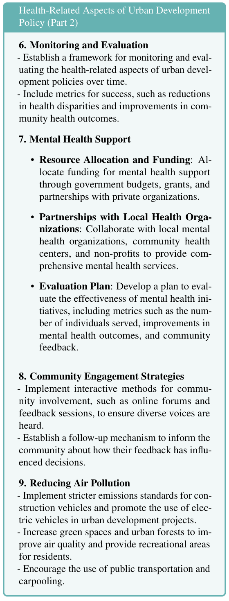

**图 39：城市发展政策的健康相关方面（第 2 部分）。**

> **6. 监测与评估**  
> 建立框架，持续监测、评估城市发展政策中的健康相关方面；加入成功指标，例如健康差距减少、社区健康结局改善。
>
> **7. 心理健康支持**  
> **资源分配与资金：** 通过政府预算、补助及与私人组织合作，为心理健康支持提供资金。  
> **与地方卫生组织合作：** 与地方心理健康组织、社区卫生中心及非营利机构合作，提供全面服务。  
> **评估计划：** 制定心理健康举措成效评估计划，指标包括服务人数、心理健康结局改善和社区反馈。
>
> **8. 社区参与策略**  
> 采用在线论坛、反馈会议等互动方式，确保不同声音得到倾听；建立后续反馈机制，让社区了解其反馈如何影响决策。
>
> **9. 减少空气污染**  
> 对施工车辆实施更严格排放标准，在城市发展项目中推广电动车；增加绿地和城市森林，改善空气质量并提供休闲区域；鼓励公共交通和拼车。

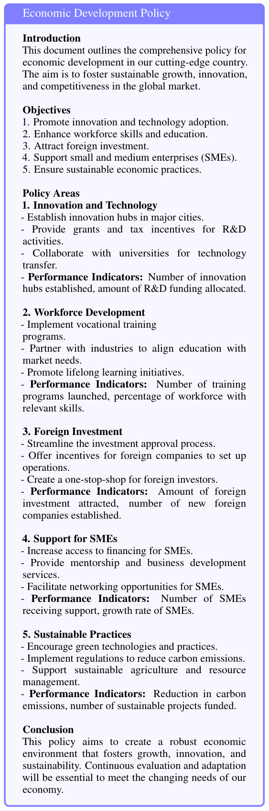

**图 40：MegaAgent 无层次结构时生成的经济发展政策。**

> **引言**  
> 本文件概述我国这一前沿国家的全面经济发展政策，旨在促进可持续增长、创新和全球市场竞争力。
>
> **目标**  
> 1. 促进创新和技术采用。  
> 2. 提高劳动力技能和教育水平。  
> 3. 吸引外国投资。  
> 4. 支持中小企业（SME）。  
> 5. 确保可持续经济实践。
>
> **政策领域**
>
> **1. 创新与技术：** 在主要城市设立创新中心；为研发提供补助和税收优惠；与高校合作开展技术转移。**绩效指标：** 建立的创新中心数量、分配的研发资金量。
>
> **2. 劳动力发展：** 实施职业培训；与行业合作，使教育符合市场需求；推动终身学习。**绩效指标：** 启动的培训项目数量、具备相关技能的劳动力比例。
>
> **3. 外国投资：** 简化审批；激励外国企业开展业务；建立一站式外商服务。**绩效指标：** 吸引的外资金额、新设外国企业数量。
>
> **4. 中小企业支持：** 改善融资渠道；提供指导和业务发展服务；促进交流联络机会。**绩效指标：** 获支持企业数量、中小企业增长率。
>
> **5. 可持续实践：** 鼓励绿色技术与实践；制定减碳法规；支持可持续农业及资源管理。**绩效指标：** 碳排放减少量、获资助的可持续项目数量。
>
> **结论**  
> 政策旨在建立促进增长、创新和可持续性的稳健经济环境。持续评估和适应，对于满足不断变化的经济需求至关重要。

**表 17：国家政策生成的 LLM-as-a-Judge 评估结果。**

| 系统 | 评判模型 | 同意数 | 不同意数 | 中立数 |
|---|---|---:|---:|---:|
| AutoGen（5 份政策） | Claude-3.5 | 0 | 5 | 0 |
| AutoGen | gpt-4o-mini | 0 | 4 | 1 |
| AutoGen | gpt-4o | 0 | 5 | 0 |
| AutoGen | o1-mini | 0 | 4 | 1 |
| AutoGen | o1-preview | 0 | 5 | 0 |
| AutoGen | 平均 | 0.0 | 4.6 | 0.4 |
| CAMEL（12 份政策） | Claude-3.5 | 4 | 8 | 1 |
| CAMEL | gpt-4o-mini | 3 | 7 | 2 |
| CAMEL | gpt-4o | 2 | 10 | 0 |
| CAMEL | o1-mini | 3 | 8 | 1 |
| CAMEL | o1-preview | 3 | 8 | 1 |
| CAMEL | 平均 | 3.0 | 8.2 | 1.0 |
| AgentVerse（13 份政策） | Claude-3.5 | 2 | 10 | 1 |
| AgentVerse | gpt-4o-mini | 3 | 10 | 0 |
| AgentVerse | gpt-4o | 2 | 9 | 2 |
| AgentVerse | o1-mini | 2 | 9 | 2 |
| AgentVerse | o1-preview | 2 | 10 | 1 |
| AgentVerse | 平均 | 2.2 | 9.6 | 1.2 |
| MegaAgent（31 份政策） | Claude-3.5 | 26 | 1 | 4 |
| MegaAgent | gpt-4o-mini | 28 | 0 | 3 |
| MegaAgent | gpt-4o | 25 | 2 | 4 |
| MegaAgent | o1-mini | 29 | 2 | 0 |
| MegaAgent | o1-preview | 29 | 1 | 1 |
| MegaAgent | 平均 | 27.4 | 1.2 | 2.4 |

> 译注：表 17 中 CAMEL 标为 12 份政策，但 Claude-3.5 行的计数为 4+8+1=13，原文如此，未作修改。
