# G-Memory：追踪多智能体系统的层次化记忆

**原题：** G-Memory: Tracing Hierarchical Memory for Multi-Agent Systems  
**作者：** Guibin Zhang*¹、Muxin Fu*²、Kun Wang³†、Guancheng Wan⁴、Miao Yu⁵、Shuicheng Yan¹†。* 同等贡献；† 通讯作者。  
**单位：** ¹ 新加坡国立大学（NUS）；² 同济大学；³ 南洋理工大学（NTU）；⁴ 武汉大学（WHU）；⁵ 新加坡科技研究局（A*STAR）。  
**联系邮箱：** wang.kun@ntu.edu.sg；yansc@comp.nus.edu.sg。  
**发表：** NeurIPS 2025，主会，Advances in Neural Information Processing Systems 38。  
**正式版本：** [会议论文集](https://papers.nips.cc/paper_files/paper/2025/hash/136a45cd9b841bf785625709a19c6508-Abstract-Conference.html) · [PDF](https://papers.nips.cc/paper_files/paper/2025/file/136a45cd9b841bf785625709a19c6508-Paper-Conference.pdf) · DOI：10.52202/085713-0439。  
**代码：** [bingreeky/GMemory](https://github.com/bingreeky/GMemory)。  
**版本与翻译说明：** 以 31 页会议正式版为准，使用 arXiv:2506.07398v2 的可检索公式、图片辅助转写，并补齐正式版新增的致谢、检查清单和延迟实验。正文、图注与表头译为中文；参考文献、检查清单和附录保留英文并转为 Markdown；图内英文保留。按原章节及图表相对顺序组织，不模拟 PDF 分页。原文公式与文字中的符号不一致处保留，并在必要时注明。  
**许可：** [arXiv HTML 版本](https://arxiv.org/html/2506.07398v2) 标注 [CC BY 4.0](https://creativecommons.org/licenses/by/4.0/)；本文件为中文翻译和格式改编，非作者官方译本。

## 摘要

大语言模型（LLM）驱动的多智能体系统（MAS）已经展示出远超单个 LLM 智能体的认知与执行能力，但其自我进化能力仍受制于发展不足的记忆架构。仔细考察后，我们发现现有 MAS 记忆机制存在两个突出问题：（1）过于简单，完全忽略智能体之间细致的协作轨迹；（2）缺少跨试次和针对特定智能体的定制化，这与单智能体已经拥有的丰富记忆机制形成鲜明对比。为弥补这一缺口，我们提出 **G-Memory**，一种受到组织记忆理论 [1] 启发、用于 MAS 的层次化智能体记忆系统，通过洞见图、查询图和交互图构成的三层图结构管理冗长的系统交互。

收到新用户查询时，G-Memory 双向遍历记忆，同时检索**高层、可泛化的洞见**，使系统能够复用跨试次知识；以及**细粒度、压缩后的交互轨迹**，紧凑编码过去的协作经验。任务执行后，整个层次结构吸收新协作轨迹并演进，推动智能体团队逐步进化。在五个基准、三种 LLM 底座和三种主流 MAS 框架上的广泛实验表明，无需修改原始框架，G-Memory 就能使具身行动任务的成功率与知识问答准确率分别最多提升 **20.89% 和 10.12%**。代码见 [GMemory](https://github.com/bingreeky/GMemory)。

## 1 引言

随着大语言模型不断重塑人工智能前沿，**LLM 驱动的智能体**在感知 [2–5]、规划 [6–8]、推理 [9,10] 和行动 [11,12] 上表现出前所未有的能力，推动代码生成 [13,14]、数据分析 [15]、具身任务 [16] 和自动驾驶 [3,17,18] 等领域取得显著进展。在单智能体能力的基础上，基于 LLM 的多智能体系统进一步突破了单模型能力边界 [19–21]。类似于人类社会协作产生的集体智能 [22–24]，MAS 通过组织多个智能体 [25–27] 开展合作 [28–31] 或竞争 [32–34]，超越孤立智能体在认知和专业能力上的限制。

**自我进化智能体。** LLM 智能体的一个显著特征是**自我进化能力**，即通过与环境交互持续适应和改进的能力；以往工作中，这种适应性已带来两至三倍的量化提升 [35]。其核心驱动力是智能体的**记忆机制** [36,37]，对应于人类积累知识、处理历史经验和检索相关信息的能力。已有成功的记忆设计包括试次内记忆，即解决单个查询时保留的上下文，以及跨试次记忆，即在多项任务之间积累的经验 [38]。它们推动智能体在个性化聊天 [36,39,40]、推荐 [41]、具身行动 [42,16] 和社会模拟 [19,43,44] 等应用中取得良好表现，使智能体成为能够有效利用历史经验与世界知识的经验型学习者。

**自我进化 MAS。** 然而，多智能体系统仍普遍缺乏这种能力。多数 MAS 受人工定义的工作流约束，例如 MetaGPT [21] 与 ChatDev [45] 中的标准操作流程（SOP），或依赖 MacNet [46]、AgentPrune [30] 中预定义的通信拓扑。近期的 GPTSwarm [47]、ADAS [48]、AFlow [49] 和 MaAS [50] 已能自动优化智能体间拓扑或提示，但最终往往产生庞大笨重的系统架构，缺乏随协作经验积累而灵活自我调整的能力。

**MAS 的记忆。** 上述能力缺失，实际上源于缺乏专门为 MAS 设计的记忆机制。对此可能有两个疑问。**第一，现有 MAS 完全没有记忆机制吗？** 并非如此。MetaGPT、ChatDev 和 Exchange-of-Thought [51] 等经典框架包含记忆相关设计，但通常仅限于试次内记忆 [51]。即使存在跨试次记忆，也常仅传递过度压缩的产物，如最终方案或执行结果 [21,45,46]，无法真正从协作经验中学习。**第二，为什么不直接迁移现有单智能体记忆？** 这种迁移并不简单。MAS 的多智能体、多轮组织交互特性 [26,27]，使任务求解轨迹远长于单智能体；图1左显示 token 用量可达约 10 倍。这给传统检索型记忆设计 [36,37,16] 带来挑战：如果缺乏协作视角下的适当抽象，直接输入完整的长轨迹收益很小。由此产生一个自然问题：

> 如何设计一种记忆机制，能够存储、检索和管理多智能体系统的冗长交互历史，使智能体团队受益于简洁且具有指导性的经验与洞见？

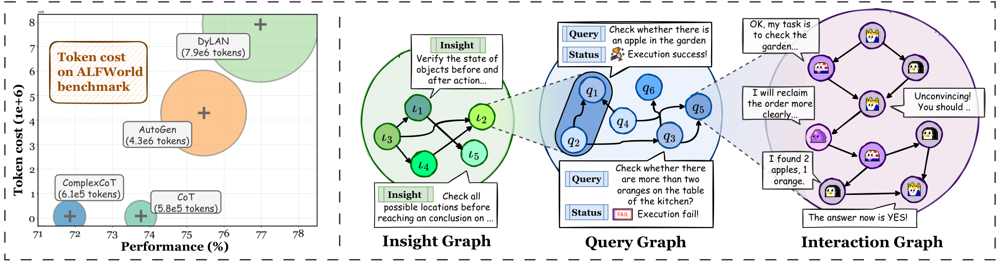

**图1：** 左：ALFWorld 基准上若干单智能体与 MAS 基线的 token 成本。右：G-Memory 三层记忆架构，包括洞见图、查询图和交互（话语）图。

**本文工作：G-Memory。** 为回答这一问题，我们提出面向 LLM 多智能体系统的**基于图的智能体记忆机制**，简称 G-Memory，以三层图管理复杂、冗长的交互历史：

- **洞见图（Insight Graph）**：从历史经验中抽象可泛化洞见。
- **查询图（Query Graph）**：编码任务查询的元信息及其连接关系。
- **交互图（Interaction Graph）**：存储智能体之间细粒度的文本通信日志。

图1右展示这些结构，第3节给出形式化定义。新查询到来时，G-Memory 利用查询图拓扑高效检索相关查询记录，然后向上遍历“查询图 → 洞见图”，提取相关高层洞见；向下遍历“查询图 → 交互图”，识别与当前任务最相关的核心交互子图，缓解信息过载。依据检索到的记忆，它向 MAS 提供可执行的指导，如分工、任务分解和失败教训。任务完成后，三层记忆以智能体驱动的方式更新，吸收新洞见、丰富的查询记录、详细协作轨迹及其关联。G-Memory 因而成为可无缝嵌入主流框架的即插即用模块，支持智能体协作与集体智能持续演进。

我们的贡献包括：

1. **识别瓶颈。** 系统考察现有 MAS，指出其自我进化能力的根本瓶颈主要来自过度简化的记忆架构。
2. **实用方案。** 提出 G-Memory，通过洞见、查询和交互三层图，对复杂且长时间的智能体协作进行建模。
3. **实验评估。** 五个基准上的实验表明，G-Memory 兼具高性能与资源友好性：具身行动与知识问答任务上，先进 MAS 分别最多提升 20.89% 和 10.12%；token 用量与主流记忆设计相近，甚至更低。

## 2 相关工作

**单智能体记忆。** 记忆是智能体通过环境交互积累经验和探索世界的主要驱动力 [52–55]。它对任务求解和社会模拟型 LLM 智能体都很重要，本文主要关注前者。早期研究局限于简单的试次内记忆，主要解决聊天机器人中 LLM 上下文窗口的限制，如 MemoryBank [36]、ChatDB [39]、MemoChat [40] 和 MemGPT [37]，通常采用类似检索增强生成（RAG）的相似度片段检索。随后，记忆架构逐步借鉴认知机制：（1）记忆范围扩展到 ExpeL [42]、Synapse [56] 等跨试次记忆；（2）应用扩展到计算机控制 [56]、具身行动 [57]、科学发现 [58]、编码和推理 [59]；（3）管理方法从粗粒度文本相似度，发展为对已获知识与经验的抽象和总结 [19]，如 A-Mem [60]、Mem0 [61] 和 MemInsight [62]。更多讨论见附录 D。

**多智能体系统中的记忆。** 专门针对 MAS 的记忆机制仍缺乏研究。LLM-Debate [20,33] 和 Mixture-of-Agent [63] 等代表框架完全省略记忆组件，另一些仅采用简单的试次内记忆 [46,51]。即使尝试使用跨试次记忆 [45]，也只将记忆压缩为最终结果产物，忽略细致的智能体交互。因此，迫切需要一种有原则的记忆架构，捕获、组织并检索 MAS 特有的复杂任务求解过程 [38]。

**基于 LLM 的多智能体系统。** 本文关注任务求解型 MAS。与单智能体相比，它们常缺乏通过环境交互持续进化的能力 [64,65]。AutoGen [13]、CAMEL [24]、AgentVerse [66] 等早期框架完全依赖预定义工作流；近期工作 [67,68,49,48,69,31] 根据环境反馈生成动态 MAS，引入一定适应性。但这种进化往往是一次性的：例如 AFlow [49] 使用蒙特卡洛树搜索构建面向特定任务领域的复杂 MAS，仍无法随着任务接触量增加而继续进化，或跨领域迁移 [50,70]。因此，构建真正具备自我进化能力的 MAS 仍是一项开放且富有挑战的研究问题。

## 3 预备知识

本节建立符号体系，形式化定义多智能体系统及 G-Memory 层次化记忆的关键概念。

**多智能体系统形式化。** 将框架表示为有向图 $\mathcal{G}=(\mathcal{V},\mathcal{E})$，其中 $|\mathcal{V}|=N$ 为智能体数量，$\mathcal{E}\subseteq\mathcal{V}\times\mathcal{V}$ 为通信通道。每个节点 $C_i\in\mathcal{V}$ 对应一个智能体，以四元组描述：
$$
C_i=(\mathsf{Base}_i,\mathsf{Role}_i,\mathsf{Mem}_i,\mathsf{Plugin}_i).\tag{1}
$$

其中，$\mathsf{Base}_i$ 为底层 LLM 实例；$\mathsf{Role}_i$ 指定角色或人格；$\mathsf{Mem}_i$ 表示记忆状态，包括历史交互或外部知识库；$\mathsf{Plugin}_i$ 为辅助工具集合，如网络搜索引擎。

收到查询 $Q$ 后，系统经历 $T$ 轮同步通信。在每轮 $t$，构造节点的拓扑排序 $\pi=[\pi_1,\ldots,\pi_N]$：若从 $\pi_j$ 到 $\pi_k$ 有边，则 $j<k$，保证每个智能体在全部前驱完成行动后才处理输入。排序中智能体 $C_i$ 在第 $t$ 轮的输出为：

$$
r_i^{(t)}=C_i\left(P_{\mathrm{sys}}^{(t)},Q,\{r_j^{(t)}:C_j\in\mathcal{N}^{-}(C_i)\}\right).
$$

其中，$r_i^{(t)}$ 为 $C_i$ 生成的响应，可包含推理步骤、中间分析或最终提议；$P_{\mathrm{sys}}^{(t)}$ 为全局指令，包含每个智能体的 $\mathcal{R}_i$；$\mathcal{N}^{-}(C_i)$ 为入邻居集合，其输出作为上下文输入。全部智能体完成行动后，全局聚合算子 $\mathcal{A}$ 将响应融合为中间方案：

$$
a^{(t)}=\mathcal{A}(r_1^{(t)},\ldots,r_N^{(t)}).
$$

$\mathcal{A}$ 的常见实现包括多数投票 [47]、由专门聚合智能体进行层次总结 [13,30]，或直接采用最后一个智能体的输出 [46]。通信轮次 $t=1,\ldots,T$ 持续迭代，直至达到预设上限或满足提前停止条件 [71]，输出查询 $Q$ 的最终响应 $a^{(T)}$。

**记忆架构。** G-Memory 通过以下三层图组织并管理 MAS 记忆。

**交互图（话语图）。** 对查询 $Q$，以 $\mathcal{G}_{\mathsf{inter}}^{(Q)}=(\mathcal{U}^{(Q)},\mathcal{E}_{\mathsf u}^{(Q)})$ 表示交互轨迹。（1）节点 $\mathcal{U}^{(Q)}=\{u_i\}$ 表示原子话语，每个 $u_i\triangleq(\mathcal{A}_i,m_i)$ 包含发言智能体 $\mathcal{A}_i\in\mathcal{V}$ 及文本内容 $m_i$。（2）边 $\mathcal{E}_{\mathsf u}^{(Q)}\subseteq\mathcal{U}^{(Q)}\times\mathcal{U}^{(Q)}$ 遵循时间关系：$(u_j,u_k)\in\mathcal{E}_{\mathsf u}^{(Q)}$ 当且仅当 $u_j$ 被传递给并启发了 $u_k$。

**查询图。** 存储已处理查询与元数据的图定义为：

$$
\mathcal{G}_{\mathsf{query}}=(\mathcal{Q},\mathcal{E}_{\mathsf q})=
\left(\{Q_i,\Psi_i,\mathcal{G}_{\mathsf{inter}}^{(Q_i)}\}_{i=1}^{|\mathcal{Q}|},\mathcal{E}_{\mathsf q}\right).\tag{2}
$$

节点集为 $\mathcal{Q}=\{q_i\}$，其中 $q_i\triangleq(Q_i,\Psi_i,\mathcal{G}_{\mathsf{inter}}^{(Q_i)})$ 由原始查询 $Q_i$、任务状态 $\Psi_i\in\{\mathsf{Failed},\mathsf{Resolved}\}$ 和对应交互图组成。边 $\mathcal{E}_{\mathsf q}\subseteq\mathcal{Q}\times\mathcal{Q}$ 编码查询间语义关系。精细的拓扑使检索能够超越嵌入相似度等粗粒度指标。

**洞见图。** 最高层的洞见图定义为：

$$
\mathcal{G}_{\mathsf{insight}}=(\mathcal{I},\mathcal{E}_{\mathsf i})=
\left(\left\langle\underbrace{\kappa_k,\Omega_k}_{\iota_k}\right\rangle_{k=1}^{|\mathcal{I}|},\mathcal{E}_{\mathsf i}\right).\tag{3}
$$

节点集 $\mathcal{I}=\{\iota_k\}$ 表示提炼后的洞见；每个洞见由内容 $\kappa_k$ 及其支持查询集 $\Omega_k\subseteq\mathcal{Q}$ 组成。边 $\mathcal{E}_{\mathsf i}\subseteq\mathcal{I}\times\mathcal{I}\times\mathcal{Q}$ 构成超连接：$(\iota_m,\iota_n,q_j)$ 表示洞见 $\iota_m$ 通过查询 $q_j$ 为 $\iota_n$ 提供上下文。

## 4 G-Memory

本节介绍图2所示的管理流程。新查询 $Q$ 到来时，系统首先粗粒度检索相关轨迹记录（第4.1节），再双向遍历层次记忆：向上检索集体认知洞见，向下提炼具体过程轨迹（第4.2节）。记忆增强的 MAS 完成查询后，根据环境反馈联合更新整个层次架构，实现群体知识的组织化沉淀（第4.3节）。

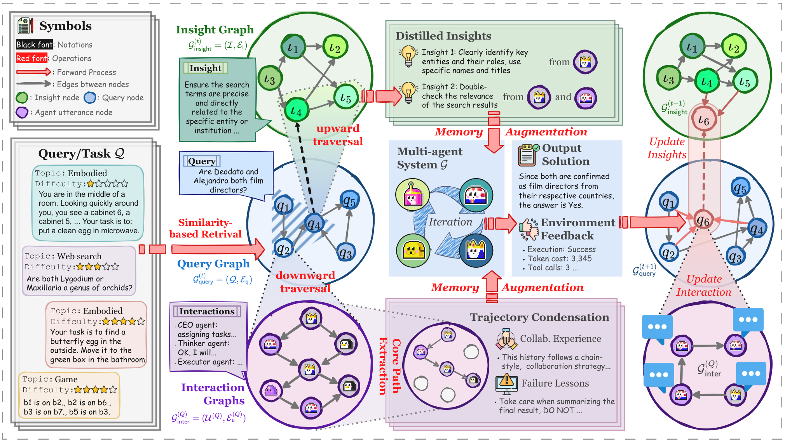

**图2：所提出的 G-Memory 总体框架。**

### 4.1 粗粒度记忆检索

G-Memory 是一个能够与主流 MAS 无缝集成的插件，在系统 $\mathcal{G}$ 接到新查询 $Q$ 时触发。组织记忆理论 [1] 强调，高效知识检索通常先寻找广泛相关的模式，再访问细节。依此原则，系统首先在查询图中进行基于相似度的粗粒度检索，高效得到候选查询集 $\mathcal{Q}^{\mathcal S}$：

$$
\mathcal{Q}^{\mathcal S}=
\underset{q_i\in\mathcal{Q},\ |\mathcal{Q}^{\mathcal S}|=k}{\operatorname{arg\,top\text{-}k}}
\left(\frac{\mathbf v(Q)\cdot\mathbf v(q_i)}{|\mathbf v(Q)|\,|\mathbf v(q_i)|}\right).\tag{4}
$$

$\mathbf v(\cdot)$ 使用 MiniLM 等模型 [72] 将查询映射为固定长度嵌入。式（4）可以检索语义相似的历史查询，但这种相似度可能流于表面或带有噪声。因此，系统进一步在查询图上进行**跳数扩展**：

$$
\widetilde{\mathcal{Q}}^{\mathcal S}=\mathcal{Q}^{\mathcal S}\cup
\{Q_k\in\mathcal{Q}\mid\exists Q_j\in\mathcal{Q}^{\mathcal S},\ Q_k\in\mathcal{N}^{+}(Q_j)\cup\mathcal{N}^{-}(Q_j)\}.\tag{5}
$$

即在候选集中加入查询图上一跳邻居，$\mathcal N^{+}$、$\mathcal N^{-}$ 分别为出邻居与入邻居。然而，像某些单智能体记忆系统 [40,37] 那样直接把这些记录作为输入并非最优。一方面，过长上下文可能使 LLM 难以处理；另一方面，MAS 中各智能体承担不同角色，需要与其职能匹配的专门记忆。为此，下一节在抽象层与细粒度层引入双向处理。

### 4.2 双向记忆遍历

确定扩展相关查询集 $\widetilde{\mathcal{Q}}^{\mathcal S}$ 后，G-Memory 进行**双向记忆遍历**，提供多粒度支持。首先向上遍历 $\mathcal{G}_{\mathsf{query}}\rightarrow\mathcal{G}_{\mathsf{insight}}$，检索可为当前任务提供高层指导的洞见：

$$
\mathcal{I}^{\mathcal S}=\Pi_{\mathcal Q\to\mathcal I}(\widetilde{\mathcal Q}^{\mathcal S}),\qquad
\Pi_{\mathcal Q\to\mathcal I}(\mathcal S_q)\triangleq
\{\iota_k\in\mathcal I\mid\Omega_k\cap\mathcal S_q\ne\varnothing\}.\tag{6}
$$

查询到洞见的投影算子 $\Pi_{\mathcal Q\to\mathcal I}$ 找到所有支持查询集与输入查询集相交的洞见节点。检索到的 $\mathcal I^{\mathcal S}$ 概括了经过提炼、可泛化的知识，可能有助于系统确定解决 $Q$ 的策略。

除抽象洞见外，细粒度文本交互历史同样有价值，因为它揭示协作成功或失败背后的推理模式 [67,73,74]。为简洁利用这些历史，在向下遍历 $\mathcal G_{\mathsf{query}}\rightarrow\mathcal G_{\mathsf{interaction}}$ 时，系统使用 LLM 辅助的图稀疏化器 $\mathcal S_{\mathrm{LLM}}(\cdot,\cdot)$，提取包含关键协作的核心子图：

$$
\{\widehat{\mathcal G}_{\mathsf{inter}}^{Q_i}\}_{i=1}^{|M|}=
\left\{\mathcal S_{\mathrm{LLM}}(\mathcal G_{\mathsf{inter}}^{(Q_j)},Q)\ \middle|\ q_j\in
\underset{q_k'\in\widetilde{\mathcal Q}^{\mathcal S},\ |\cdot|=M}{\operatorname{arg\,top\text{-}M}}
\mathcal R_{\mathrm{LLM}}(Q,q_k')\right\}.\tag{7}
$$

$\mathcal R_{\mathrm{LLM}}$ 评价历史查询与 $Q$ 的相关性；$\mathcal S_{\mathrm{LLM}}$ 识别并保留重要对话元素，将原始交互图转为稀疏图 $\widehat{\mathcal G}_{\mathsf{inter}}^{(Q_j)}=(\widehat{\mathcal U}^{(Q_j)},\widehat{\mathcal E}_{\mathsf u}^{(Q_j)})$。实现见附录 C。

完成双向遍历后，系统同时获得可泛化洞见 $\mathcal I^{\mathcal S}$ 和详细协作轨迹，并为 MAS 中每个智能体提供专门记忆支持：

$$
\mathsf{Mem}_i\leftarrow\Phi\left(
\mathcal I^{\mathcal S},\{\widehat{\mathcal G}_{\mathsf{inter}}^{Q_i}\}_{i=1}^{|M|};\mathsf{Role}_i,Q
\right),\quad\forall C_i\in\mathcal V.\tag{8}
$$

其中 $C_i=(\mathsf{Base}_i,\mathsf{Role}_i,\mathsf{Mem}_i,\mathsf{Plugin}_i)$。算子 $\Phi$ 根据具体角色 $\mathsf{Role}_i$ 与任务 $Q$，评估洞见及稀疏交互图的效用与相关性（见附录 C），用筛选后的洞见、交互片段及其摘要初始化内部记忆 $\mathsf{Mem}_i$，使智能体参与后续推理前获得相关历史上下文。本实现是在开始解决查询时调用 G-Memory；实践中也可在每轮对话开始或针对特定智能体选择性调用。

### 4.3 层次记忆更新

各智能体记忆增强完成后，系统按第3节方式运行，生成最终方案 $a^{(T)}$ 并获得环境反馈，包括执行状态 $\Psi_i\in\{\mathsf{Failed},\mathsf{Resolved}\}$、token 用量等指标。随后，将新查询纳入层次记忆。**交互层**追踪各智能体话语，构建并保存 $\mathcal G_{\mathsf{inter}}^{(Q)}$；**查询层**创建新节点并加入查询图：

$$
\begin{aligned}
q_{\mathrm{new}}&\leftarrow(Q,\Psi,\mathcal G_{\mathsf{inter}}^{(Q)}),\\
\mathcal N_{\mathrm{conn}}&\leftarrow\mathcal Q^{\mathcal R}\cup\bigcup_{\iota_k\in\mathcal I^{\mathcal S}}\Omega_k,\\
\mathcal E_{\mathrm{new}}&\leftarrow\{(q_n,q_{\mathrm{new}})\mid q_n\in\mathcal N_{\mathrm{conn}}\},\\
\mathcal G_{\mathsf{query}}^{\mathrm{next}}&\leftarrow(\mathcal Q\cup\{q_{\mathrm{new}}\},\mathcal E_{\mathsf q}\cup\mathcal E_{\mathrm{new}}).
\end{aligned}\tag{9}
$$

其中，新节点与两类节点建立连接：式（7）选出的最相关前 $M$ 个历史查询集 $\mathcal Q^{\mathcal R}$，以及支持本次求解所用洞见的查询集 $\bigcup_{\iota_k\in\mathcal I_{\mathrm{ret}}}\Omega_k$。$\mathcal G_{\mathsf{query}}^{\mathrm{next}}$ 为更新后的查询图。

最后在**洞见层**，将已完成查询获得的知识纳入洞见图。首先利用总结函数 $\mathcal J(\cdot,\cdot)$ 生成新经验洞见并建立结构连接，提示见附录 C：

$$
\begin{aligned}
\iota_{\mathrm{new}}&=(\mathcal J(\mathcal G_{\mathsf{inter}}^{(Q)},\Psi),\{q_{\mathrm{new}}\}),\\
\mathcal E_{\mathrm{i,new}}&\leftarrow\{(\iota_k,\iota_{\mathrm{new}},q_{\mathrm{new}})\mid\iota_k\in\mathcal I^{\mathcal S}\},\\
\mathcal G_{\mathsf{insight}}'&\leftarrow(\mathcal I\cup\{\iota_{\mathrm{new}}\},\mathcal E_{\mathsf i}\cup\mathcal E_{\mathrm{i,new}}).
\end{aligned}\tag{10}
$$

新增边连接式（6）中先前用于启发本次任务的洞见。之后，将新查询加入已使用洞见的支持集 $\Omega_k$，反映这些洞见与本次成功或失败应用之间的关联：

$$
\begin{aligned}
\mathcal I^{\mathrm{next}}&\leftarrow(\mathcal I\setminus\mathcal I_{\mathrm{ret}})
\cup\{(\kappa_k,\Omega_k\cup\{q_{\mathrm{new}}\})\mid
\iota_k=(\kappa_k,\Omega_k)\in\mathcal I_{\mathrm{ret}}\}\cup\{\iota_{\mathrm{new}}\},\\
\mathcal G_{\mathsf{insight}}^{\mathrm{next}}&\leftarrow(\mathcal I^{\mathrm{next}},\mathcal E_{\mathsf i}\cup\mathcal E_{\mathrm{i,new}}).
\end{aligned}\tag{11}
$$

最终节点集同时包含新洞见与已用洞见的更新版本，更新后的图因此汇集了新知识。各层持续更新，使 G-Memory 能够根据不断积累的经验学习并自适应改进集体记忆。〔译注：原文在此交替使用 $\mathcal I_{\mathrm{ret}}$ 与 $\mathcal I^{\mathcal S}$ 表示所检索／使用的洞见集合，译文保留其符号。〕

## 5 实验

本节通过广泛实验回答三个问题：**RQ1**：G-Memory 与现有单／多智能体记忆架构相比表现如何？**RQ2**：它是否带来过大的资源开销？**RQ3**：它对关键组件与参数有多敏感？

### 5.1 实验设置

**数据集与基准。** 为全面评估有效性，我们选取三个领域的五个常用基准：（1）** 知识推理**：HotpotQA [75] 与 FEVER [76]；（2）** 具身行动**：ALFWorld [77] 与 SciWorld [78]；（3）** 游戏**：PDDL [79]。详见附录 A.1。

**基线。** 选择四种代表性单智能体记忆基线：无记忆（No-memory）、Voyager [16]、MemoryBank [36] 和 Generative Agents [19]；另选取 MetaGPT [21]、ChatDev [45] 和 MacNet [46] 的记忆实现，分别称为 MetaGPT-M、ChatDev-M 和 MacNet-M。详见附录 A.2。

**MAS 与 LLM 底座。** 我们将 G-Memory 及基线分别集成到 AutoGen [13]、DyLAN [71] 和 MacNet [46] 三种代表框架中，配置详见附录 A.3。底座包括开源模型 `Qwen-2.5-7b`、`Qwen-2.5-14b`，以及闭源模型 `gpt-4o-mini`。Qwen 通过 [Ollama](https://ollama.com/) 本地部署，GPT 通过 OpenAI API 访问。

**参数配置。** 式（4）的嵌入函数使用 all-MiniLM-L6-v2 [80]。式（7）最相关交互图数量 $M$ 从 $\{2,3,4,5\}$ 中选择，式（4）相关查询数量 $k$ 从 $\{1,2\}$ 中选择。超参数消融详见第5.4节。

**表1：五个基准上单／多智能体记忆架构的性能比较。** 底层模型为 `GPT-4o-mini`。标注最佳与次佳结果。每个单元格的箭头及数值表示相对无记忆系统的变化，保留原始数值与精度。

| **MAS** | **记忆机制** | **ALFWorld** | **SciWorld** | **PDDL** | **HotpotQA** | **FEVER** | **平均** |
| --- | --- | --- | --- | --- | --- | --- | --- |
| AutoGen COLM 2024 | No-memory | 77.61*↑0.00* | 54.49*↑0.00* | 23.53*↑0.00* | 28.57*↑0.00* | 57.13*↑0.00* | 48.27*↑0.00* |
| AutoGen COLM 2024 | Voyager | 85.07*↑7.46* | <u>62.36</u>*↑7.87* | 24.56*↑1.03* | 32.32*↑3.75* | <u>63.27</u>*↑6.14* | <u>53.52</u>*↑5.25* |
| AutoGen COLM 2024 | MemoryBank | 74.96*↓2.65* | 53.11*↓1.38* | 20.41*↓3.12* | <u>33.67</u>*↑5.10* | 61.22*↑4.09* | 48.67*↑0.40* |
| AutoGen COLM 2024 | Generative | <u>86.36</u>*↑8.75* | 61.19*↑6.70* | <u>25.53</u>*↑2.00* | 31.63*↑3.06* | 60.20*↑3.07* | 52.98*↑4.71* |
| AutoGen COLM 2024 | MetaGPT-M | 81.34*↑3.73* | 61.91*↑7.42* | 21.63*↓1.90* | 32.67*↑4.10* | 62.67*↑5.54* | 52.04*↑3.77* |
| AutoGen COLM 2024 | ChatDev-M | 79.85*↑2.24* | 50.96*↓3.53* | 16.65*↓6.88* | 24.49*↓4.08* | 59.18*↑2.05* | 46.23*↓2.04* |
| AutoGen COLM 2024 | MacNet-M | 76.55*↓1.06* | 55.44*↑0.95* | 22.94*↓0.59* | 28.36*↓0.21* | 60.87*↑3.74* | 48.83*↑0.56* |
| AutoGen COLM 2024 | **G-Memory** （本文） | **88.81***↑11.20* | **67.40***↑12.91* | **27.77***↑4.24* | **35.67***↑7.10* | **66.24***↑9.11* | **57.18***↑8.91* |
| DyLAN COLM 2024 | No-memory | 56.72*↑0.00* | 55.38*↑0.00* | 11.62*↑0.00* | 31.69*↑0.00* | 60.20*↑0.00* | 43.12*↑0.00* |
| DyLAN COLM 2024 | Voyager | 66.42*↑9.70* | 62.83*↑7.45* | <u>15.10</u>*↑3.48* | <u>32.64</u>*↑0.95* | 62.24*↑2.04* | <u>47.85</u>*↑4.73* |
| DyLAN COLM 2024 | MemoryBank | 55.22*↓1.50* | 54.74*↓0.64* | 8.08*↓3.54* | 29.59*↓2.10* | 59.13*↓1.07* | 41.35*↓1.77* |
| DyLAN COLM 2024 | Generative | 67.91*↑11.19* | <u>64.16</u>*↑8.78* | 13.87*↑2.25* | 29.29*↓2.40* | <u>62.30</u>*↑2.10* | 47.51*↑4.39* |
| DyLAN COLM 2024 | MetaGPT-M | <u>69.40</u>*↑12.68* | 62.37*↑6.99* | 14.45*↑2.83* | 32.34*↑0.65* | 60.20*↑0.00* | 47.75*↑4.63* |
| DyLAN COLM 2024 | ChatDev-M | 46.27*↓10.45* | 53.35*↓2.03* | 10.75*↓0.87* | 22.45*↓9.24* | 58.33*↓1.87* | 38.23*↓4.89* |
| DyLAN COLM 2024 | MacNet-M | 53.44*↓3.28* | 54.32*↓1.06* | 12.11*↑0.49* | 30.12*↓1.57* | 61.10*↑0.90* | 42.22*↓0.90* |
| DyLAN COLM 2024 | **G-Memory** （本文） | **70.90***↑14.18* | **65.64***↑10.26* | **18.95***↑7.33* | **34.69***↑3.00* | **64.22***↑4.02* | **50.88***↑7.76* |
| MacNet ICLR 2025 | No-memory | 51.49*↑0.00* | 57.53*↑0.00* | 12.18*↑0.00* | 28.57*↑0.00* | 60.29*↑0.00* | 42.01*↑0.00* |
| MacNet ICLR 2025 | Voyager | 61.94*↑10.45* | 64.53*↑7.00* | 14.06*↑1.88* | 32.65*↑4.08* | 62.54*↑2.25* | <u>47.14</u>*↑5.13* |
| MacNet ICLR 2025 | MemoryBank | 50.00*↓1.49* | 60.15*↑2.62* | 8.64*↓3.54* | <u>33.67</u>*↑5.10* | 61.22*↑0.93* | 42.74*↑0.73* |
| MacNet ICLR 2025 | Generative | 62.69*↑11.20* | <u>65.49</u>*↑7.96* | 7.92*↓4.26* | 29.59*↑1.02* | <u>63.27</u>*↑2.98* | 45.79*↑3.78* |
| MacNet ICLR 2025 | MetaGPT-M | <u>63.70</u>*↑12.21* | 65.27*↑7.74* | <u>16.03</u>*↑3.85* | 31.00*↑2.43* | 59.33*↓0.96* | 47.07*↑5.06* |
| MacNet ICLR 2025 | ChatDev-M | 49.25*↓2.24* | 56.58*↓0.95* | 13.51*↑1.33* | 29.00*↑0.43* | 59.18*↓1.11* | 41.50*↓0.51* |
| MacNet ICLR 2025 | MacNet-M | 53.44*↑1.95* | 56.14*↓1.39* | 13.59*↑1.41* | 27.89*↓0.68* | 59.20*↓1.09* | 42.05*↑0.04* |
| MacNet ICLR 2025 | **G-Memory** （本文） | **67.16***↑15.67* | **68.11***↑10.58* | **24.33***↑12.15* | **35.69***↑7.12* | **64.44***↑4.15* | **51.95***↑9.94* |

### 5.2 主要结果（RQ1）

表2、表3和表1全面报告不同记忆架构在三种 LLM 底座和三种 MAS 框架中的表现。主要观察如下。

**结论一：G-Memory 在所有任务领域和 MAS 框架上均持续改善性能。** 表2显示，在使用 `Qwen-2.5-7b` 的 AutoGen 与 MacNet 中，它相较表现最好的单／多智能体记忆基线分别平均提升 6.8% 和 5.5%。使用能力更强的 `Qwen-2.5-14b` 时改进更加显著：表3中，MacNet 在 ALFWorld 上的表现从 58.21% 提升至 79.10%，增加 20.89%。

**结论二：多智能体系统需要专门的记忆设计。** 详细检查基线后发现，多数记忆机制无法稳定改善 MAS。例如表2中，Voyager 和 MemoryBank 分别使 AutoGen 在 PDDL 上下降 4.17% 和 1.34%。我们认为原因是它们不能提供与智能体角色相匹配的记忆支持，而 PDDL 策略游戏中的有效分工至关重要。即使面向 MAS 的 ChatDev-M，在 MacNet+SciWorld 中也使性能下降 2.32%，其原因在于仅存储过去查询的执行结果，记忆范围过窄，在具身行动环境中的效用有限。这些发现突出 G-Memory 的关键特征：角色专属记忆提示、抽象高层洞见和轨迹压缩，三者均对有效 MAS 记忆十分重要。

### 5.3 成本分析（RQ2）

为评估 token 使用效率，我们在图3与图7中展示不同设置下性能与 token 成本的权衡。

**结论三：G-Memory 能够以适度 token 成本实现高性能集体记忆。** 图3显示，在 PDDL+AutoGen 上，它相对无记忆设置提升 10.32%，获得最高性能增益，同时 token 用量仅增加 $1.4\times10^6$。相较之下，MetaGPT-M 增加 $2.2\times10^6$ 个 token，却仅提升 4.07%。这表明 G-Memory 具有较高的 token 效率。

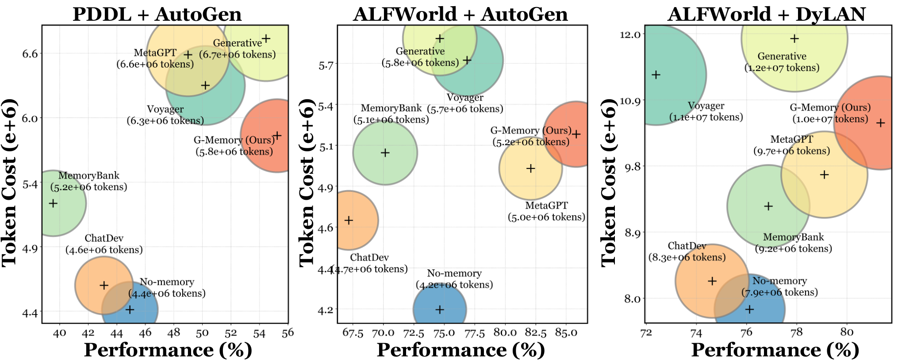

**图3：G-Memory 成本分析。** 比较不同记忆架构下的性能及整个系统的 token 成本。

### 5.4 框架分析（RQ3）

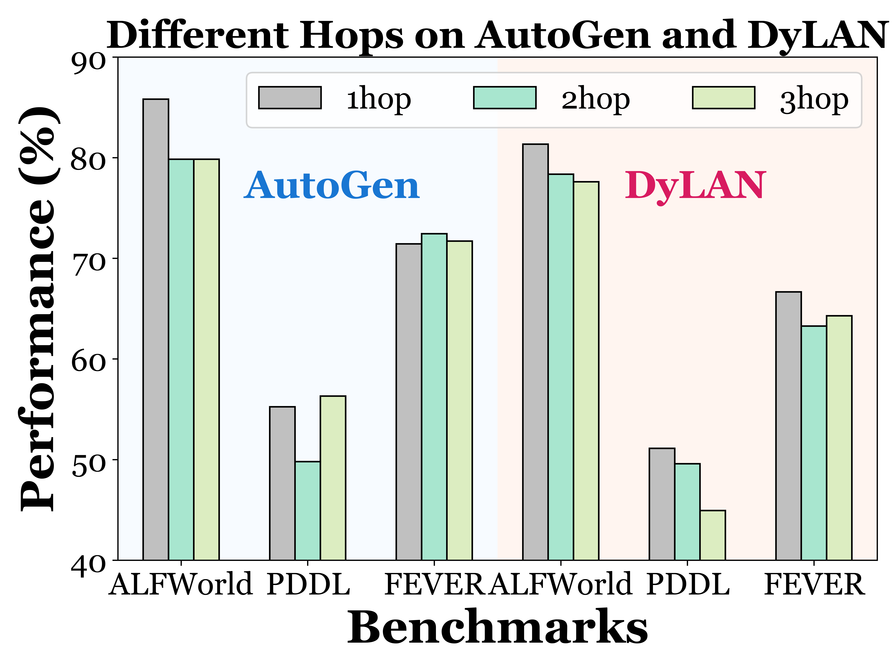

（a）跳数敏感性分析。


（b）参数 $k$ 的敏感性分析。

| **MAS** | **Inter.** | **Insi.** | **PDDL** | **FEVER** |
| --- | --- | --- | --- | --- |
| AutoGen | ✔ | $\circ$ | 54.46 | 63.27 |
| AutoGen | $\circ$ | ✔ | 50.00 | 68.77 |
| AutoGen | ✔ | ✔ | 55.24 | 71.43 |
| DyLAN | ✔ | $\circ$ | 48.75 | 61.39 |
| DyLAN | $\circ$ | ✔ | 46.69 | 64.31 |
| DyLAN | ✔ | ✔ | 51.12 | 66.66 |

**图4（c）：G-Memory 两种变体的消融结果。** `Inter.` 表示细粒度交互，`Insi.` 表示高层洞见；✔ 表示启用，$\circ$ 表示关闭。

**图4：** （a）式（5）跳数扩展的敏感性；（b）式（4）所选查询数量 $k$ 的敏感性；（c）考察仅提供高层洞见，即式（6）的 $\mathcal I^{\mathcal S}$，或仅提供细粒度交互，即式（7）核心轨迹的变体。全部实验使用 `Qwen-2.5-14b`；原图（c）以表格呈现。

**敏感性分析。** 图4（a）显示，一跳扩展在各任务中稳定取得最佳或接近最佳表现，在 AutoGen 上，ALFWorld 与 PDDL 的峰值准确率分别达到 85.82% 和 55.24%。相比之下，两跳、三跳经常使性能下降，例如 PDDL 在两跳时降至 49.79%。这说明过度扩展可能在向上遍历时引入无关洞见，损害针对任务的推理。图4（b）同样显示最佳 $k$ 位于 $\{1,2\}$；较大值如 $k=5$ 可使系统显著退化，例如 ALFWorld+AutoGen 下降 7.71%，FEVER+DyLAN 下降 2.5%，表明检索过多查询可能引入任务无关噪声。因此，我们在实验中统一使用一跳扩展和 $k\in\{1,2\}$。

**消融研究。** 图4（c）分别考察高层洞见模块和细粒度交互的贡献，删除任一模块都会稳定降低性能。仅启用细粒度交互时，相较完整方法，AutoGen 和 DyLAN 的平均分分别下降 4.47% 和 3.82%；仅启用洞见时，分别下降 3.95% 和 3.39%。作者据此指出，两者均有贡献，交互略有更大作用，可能因为保留了更细致的对话级上下文依据。〔译注：此处保留原文的结论性表述；根据上列消融数值理解组件贡献时，应同时参照图4（c）。〕

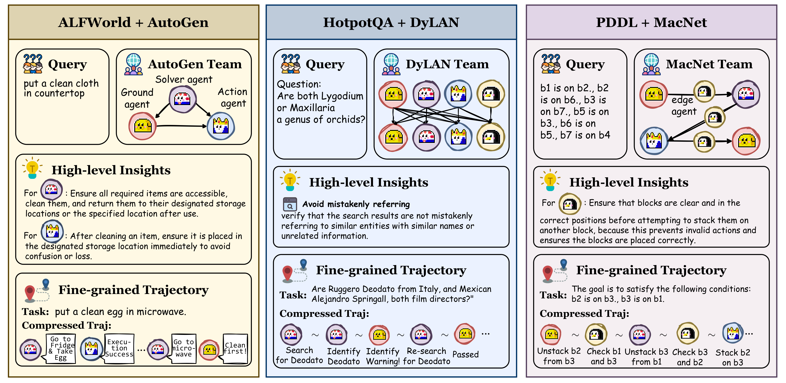

**图5：G-Memory 的案例研究。**

### 5.5 案例研究

图5展示不同任务中具体的记忆提示。例如 ALFWorld+AutoGen 收到“把干净的布放到台面上”（`put a clean cloth in countertop`）时，G-Memory 检索出高度相似的历史查询“把干净的鸡蛋放进微波炉”（`put a clean egg in microwave`），二者都要求物体处于 `clean` 状态。同时，它找到一段关键轨迹：求解智能体试图在清洗前就把鸡蛋放入微波炉，引发校验智能体（ground agent）介入纠正。这段协作轨迹为当前任务提供了可执行指导。

高层洞见同样有用。在 HotpotQA 的网络搜索任务中，G-Memory 检索到有关“错误指代”的提醒，帮助智能体避免因人物同名或姓名相近而答错。总体上，该系统能够在具身行动、知识推理和游戏等不同领域提供有效的多层记忆支持。

## 6 结论与局限性

本文系统考察现有多智能体记忆架构，指出过度简单的设计从根本上限制了系统自我进化。为弥补这一缺口，我们提出层次化框架 G-Memory，将复杂、漫长的交互轨迹组织为洞见、查询和交互三层图。它为每个智能体提供定制化的层次记忆提示，既包含抽象、可泛化的洞见，也包含细粒度且对任务重要的协作片段，并能跨回合动态更新知识库。广泛实验表明，它可无缝集成到先进 MAS 框架，显著增强自我进化能力，如具身行动任务上最多提升 20.89%。

**局限性：** 虽然已覆盖三个领域和五个基准，但仍需在更丰富的任务，如医学问答中验证，以进一步增强结论的可靠性。我们将此留作未来工作。

## 致谢

本研究得到新加坡国立大学启动经费 A-0010106-00-00 的部分支持。

## 参考文献（原文）

- [1] James P Walsh and Gerardo Rivera Ungson. Organizational memory. *Academy of management review*, 16(1):57–91, 1991.
- [2] Danny Driess, Fei Xia, Mehdi SM Sajjadi, Corey Lynch, Aakanksha Chowdhery, Ayzaan Wahid, Jonathan Tompson, Quan Vuong, Tianhe Yu, Wenlong Huang, et al. Palm-e: An embodied multimodal language model. 2023.
- [3] Shihao Wang, Zhiding Yu, Xiaohui Jiang, Shiyi Lan, Min Shi, Nadine Chang, Jan Kautz, Ying Li, and Jose M Alvarez. Omnidrive: A holistic llm-agent framework for autonomous driving with 3d perception, reasoning and planning. *arXiv preprint arXiv:2405.01533*, 2024.
- [4] Sipeng Zheng, Jiazheng Liu, Yicheng Feng, and Zongqing Lu. Steve-eye: Equipping llm-based embodied agents with visual perception in open worlds. *arXiv preprint arXiv:2310.13255*, 2023.
- [5] Yuxi Wei, Zi Wang, Yifan Lu, Chenxin Xu, Changxing Liu, Hao Zhao, Siheng Chen, and Yanfeng Wang. Editable scene simulation for autonomous driving via collaborative llm-agents. In *Proceedings of the IEEE/CVF Conference on Computer Vision and Pattern Recognition*, pages 15077–15087, 2024.
- [6] Yuqi Zhu, Shuofei Qiao, Yixin Ou, Shumin Deng, Shiwei Lyu, Yue Shen, Lei Liang, Jinjie Gu, Huajun Chen, and Ningyu Zhang. Knowagent: Knowledge-augmented planning for llm-based agents. *arXiv preprint arXiv:2403.03101*, 2024.
- [7] Lutfi Eren Erdogan, Nicholas Lee, Sehoon Kim, Suhong Moon, Hiroki Furuta, Gopala Anumanchipalli, Kurt Keutzer, and Amir Gholami. Plan-and-act: Improving planning of agents for long-horizon tasks. *arXiv preprint arXiv:2503.09572*, 2025.
- [8] Xu Huang, Weiwen Liu, Xiaolong Chen, Xingmei Wang, Hao Wang, Defu Lian, Yasheng Wang, Ruiming Tang, and Enhong Chen. Understanding the planning of llm agents: A survey. *arXiv preprint arXiv:2402.02716*, 2024.
- [9] Pranav Putta, Edmund Mills, Naman Garg, Sumeet Motwani, Chelsea Finn, Divyansh Garg, and Rafael Rafailov. Agent q: Advanced reasoning and learning for autonomous ai agents. *arXiv preprint arXiv:2408.07199*, 2024.
- [10] Tula Masterman, Sandi Besen, Mason Sawtell, and Alex Chao. The landscape of emerging ai agent architectures for reasoning, planning, and tool calling: A survey. *arXiv preprint arXiv:2404.11584*, 2024.
- [11] Manling Li, Shiyu Zhao, Qineng Wang, Kangrui Wang, Yu Zhou, Sanjana Srivastava, Cem Gokmen, Tony Lee, Erran Li Li, Ruohan Zhang, et al. Embodied agent interface: Benchmarking llms for embodied decision making. *Advances in Neural Information Processing Systems*, 37:100428–100534, 2024.
- [12] Yijun Yang, Tianyi Zhou, Kanxue Li, Dapeng Tao, Lusong Li, Li Shen, Xiaodong He, Jing Jiang, and Yuhui Shi. Embodied multi-modal agent trained by an llm from a parallel textworld. In *Proceedings of the IEEE/CVF conference on computer vision and pattern recognition*, pages 26275–26285, 2024.
- [13] Qingyun Wu, Gagan Bansal, Jieyu Zhang, Yiran Wu, Shaokun Zhang, Erkang Zhu, Beibin Li, Li Jiang, Xiaoyun Zhang, and Chi Wang. Autogen: Enabling next-gen llm applications via multi-agent conversation framework, August 01, 2023 2023.
- [14] Daya Guo, Qihao Zhu, Dejian Yang, Zhenda Xie, Kai Dong, Wentao Zhang, Guanting Chen, Xiao Bi, Y. Wu, Y. K. Li, Fuli Luo, Yingfei Xiong, and Wenfeng Liang. Deepseek-coder: When the large language model meets programming – the rise of code intelligence, 2024.
- [15] Sirui Hong, Yizhang Lin, Bang Liu, Bangbang Liu, Binhao Wu, Ceyao Zhang, Chenxing Wei, Danyang Li, Jiaqi Chen, Jiayi Zhang, et al. Data interpreter: An llm agent for data science. *arXiv preprint arXiv:2402.18679*, 2024.
- [16] Guanzhi Wang, Yuqi Xie, Yunfan Jiang, Ajay Mandlekar, Chaowei Xiao, Yuke Zhu, Linxi Fan, and Anima Anandkumar. Voyager: An Open-Ended Embodied Agent with Large Language Models. *arXiv e-prints*, page arXiv:2305.16291, May 2023.
- [17] Long Chen, Oleg Sinavski, Jan Hünermann, Alice Karnsund, Andrew James Willmott, Danny Birch, Daniel Maund, and Jamie Shotton. Driving with llms: Fusing object-level vector modality for explainable autonomous driving. In *2024 IEEE International Conference on Robotics and Automation (ICRA)*, pages 14093–14100. IEEE, 2024.
- [18] Yuan Sun, Navid Salami Pargoo, Peter Jin, and Jorge Ortiz. Optimizing autonomous driving for safety: A human-centric approach with llm-enhanced rlhf. In *Companion of the 2024 on ACM International Joint Conference on Pervasive and Ubiquitous Computing*, pages 76–80, 2024.
- [19] Joon Sung Park, Joseph C. O’Brien, Carrie J. Cai, Meredith Ringel Morris, Percy Liang, and Michael S. Bernstein. Generative agents: Interactive simulacra of human behavior, April 01, 2023 2023.
- [20] Yilun Du, Shuang Li, Antonio Torralba, Joshua B. Tenenbaum, and Igor Mordatch. Improving factuality and reasoning in language models through multiagent debate. *CoRR*, abs/2305.14325, 2023.
- [21] Sirui Hong, Xiawu Zheng, Jonathan Chen, Yuheng Cheng, Jinlin Wang, Ceyao Zhang, Zili Wang, Steven Ka Shing Yau, Zijuan Lin, Liyang Zhou, Chenyu Ran, Lingfeng Xiao, and Chenglin Wu. Metagpt: Meta programming for multi-agent collaborative framework, August 01, 2023 2023.
- [22] Marvin Minsky. *Society of mind*. Simon and Schuster, 1988.
- [23] Push Singh. Examining the society of mind. *Comput. Artif. Intell.*, 22(6):521–543, 2003.
- [24] Guohao Li, Hasan Hammoud, Hani Itani, Dmitrii Khizbullin, and Bernard Ghanem. CAMEL: communicative agents for "mind" exploration of large language model society. In *NeurIPS*, 2023.
- [25] Zhenhailong Wang, Shaoguang Mao, Wenshan Wu, Tao Ge, Furu Wei, and Heng Ji. Unleashing cognitive synergy in large language models: A task-solving agent through multi-persona self-collaboration, July 01, 2023 2023. work in progress.
- [26] Taicheng Guo, Xiuying Chen, Yaqi Wang, Ruidi Chang, Shichao Pei, Nitesh V. Chawla, Olaf Wiest, and Xiangliang Zhang. Large language model based multi-agents: A survey of progress and challenges. *CoRR*, abs/2402.01680, 2024.
- [27] Pouya Pezeshkpour, Eser Kandogan, Nikita Bhutani, Sajjadur Rahman, Tom Mitchell, and Estevam Hruschka. Reasoning capacity in multi-agent systems: Limitations, challenges and human-centered solutions. *CoRR*, abs/2402.01108, 2024.
- [28] Giorgio Piatti, Zhijing Jin, Max Kleiman-Weiner, Bernhard Schölkopf, Mrinmaya Sachan, and Rada Mihalcea. Cooperate or collapse: Emergence of sustainability behaviors in a society of llm agents. *arXiv preprint arXiv:2404.16698*, 2024.
- [29] Rafael Pina, Varuna De Silva, and Corentin Artaud. Discovering causality for efficient cooperation in multi-agent environments. *CoRR*, abs/2306.11846, 2023.
- [30] Guibin Zhang, Yanwei Yue, Zhixun Li, Sukwon Yun, Guancheng Wan, Kun Wang, Dawei Cheng, Jeffrey Xu Yu, and Tianlong Chen. Cut the crap: An economical communication pipeline for llm-based multi-agent systems. *arXiv preprint arXiv:2410.02506*, 2024.
- [31] Yanwei Yue, Guibin Zhang, Boyang Liu, Guancheng Wan, Kun Wang, Dawei Cheng, and Yiyan Qi. Masrouter: Learning to route llms for multi-agent systems. *arXiv preprint arXiv:2502.11133*, 2025.
- [32] Qinlin Zhao, Jindong Wang, Yixuan Zhang, Yiqiao Jin, Kaijie Zhu, Hao Chen, and Xing Xie. Competeai: Understanding the competition behaviors in large language model-based agents. *arXiv preprint arXiv:2310.17512*, 2023.
- [33] Tian Liang, Zhiwei He, Wenxiang Jiao, Xing Wang, Yan Wang, Rui Wang, Yujiu Yang, Zhaopeng Tu, and Shuming Shi. Encouraging divergent thinking in large language models through multi-agent debate. *CoRR*, abs/2305.19118, 2023.
- [34] Wei Wang, Dan Zhang, Tao Feng, Boyan Wang, and Jie Tang. Battleagentbench: A benchmark for evaluating cooperation and competition capabilities of language models in multi-agent systems. *arXiv preprint arXiv:2408.15971*, 2024.
- [35] Chuanyang Zheng, Zhengying Liu, Enze Xie, Zhenguo Li, and Yu Li. Progressive-hint prompting improves reasoning in large language models, April 01, 2023 2023. Tech Report.
- [36] Wanjun Zhong, Lianghong Guo, Qiqi Gao, He Ye, and Yanlin Wang. Memorybank: Enhancing large language models with long-term memory. In *Proceedings of the AAAI Conference on Artificial Intelligence*, volume 38, pages 19724–19731, 2024.
- [37] Charles Packer, Vivian Fang, Shishir_G Patil, Kevin Lin, Sarah Wooders, and Joseph_E Gonzalez. Memgpt: Towards llms as operating systems. 2023.
- [38] Zeyu Zhang, Xiaohe Bo, Chen Ma, Rui Li, Xu Chen, Quanyu Dai, Jieming Zhu, Zhenhua Dong, and Ji-Rong Wen. A survey on the memory mechanism of large language model based agents. *arXiv preprint arXiv:2404.13501*, 2024.
- [39] Chenxu Hu, Jie Fu, Chenzhuang Du, Simian Luo, Junbo Zhao, and Hang Zhao. Chatdb: Augmenting llms with databases as their symbolic memory. *arXiv preprint arXiv:2306.03901*, 2023.
- [40] Junru Lu, Siyu An, Mingbao Lin, Gabriele Pergola, Yulan He, Di Yin, Xing Sun, and Yunsheng Wu. Memochat: Tuning llms to use memos for consistent long-range open-domain conversation. *arXiv preprint arXiv:2308.08239*, 2023.
- [41] Yancheng Wang, Ziyan Jiang, Zheng Chen, Fan Yang, Yingxue Zhou, Eunah Cho, Xing Fan, Xiaojiang Huang, Yanbin Lu, and Yingzhen Yang. Recmind: Large language model powered agent for recommendation. *arXiv preprint arXiv:2308.14296*, 2023.
- [42] Andrew Zhao, Daniel Huang, Quentin Xu, Matthieu Lin, Yong-Jin Liu, and Gao Huang. Expel: Llm agents are experiential learners. In *Proceedings of the AAAI Conference on Artificial Intelligence*, volume 38, pages 19632–19642, 2024.
- [43] Yuan Li, Yixuan Zhang, and Lichao Sun. Metaagents: Simulating interactions of human behaviors for llm-based task-oriented coordination via collaborative generative agents. *arXiv preprint arXiv:2310.06500*, 2023.
- [44] Chen Gao, Xiaochong Lan, Zhihong Lu, Jinzhu Mao, Jinghua Piao, Huandong Wang, Depeng Jin, and Yong Li. S3: Social-network simulation system with large language model-empowered agents. *arXiv preprint arXiv:2307.14984*, 2023.
- [45] Chen Qian, Xin Cong, Cheng Yang, Weize Chen, Yusheng Su, Juyuan Xu, Zhiyuan Liu, and Maosong Sun. Communicative agents for software development, July 01, 2023 2023. 25 pages, 9 figures, 2 tables.
- [46] Chen Qian, Zihao Xie, Yifei Wang, Wei Liu, Yufan Dang, Zhuoyun Du, Weize Chen, Cheng Yang, Zhiyuan Liu, and Maosong Sun. Scaling large-language-model-based multi-agent collaboration. *arXiv preprint arXiv:2406.07155*, 2024.
- [47] Mingchen Zhuge, Wenyi Wang, Louis Kirsch, Francesco Faccio, Dmitrii Khizbullin, and Jürgen Schmidhuber. Gptswarm: Language agents as optimizable graphs. In *Forty-first International Conference on Machine Learning*, 2024.
- [48] Shengran Hu, Cong Lu, and Jeff Clune. Automated design of agentic systems. *arXiv preprint arXiv:2408.08435*, 2024.
- [49] Jiayi Zhang, Jinyu Xiang, Zhaoyang Yu, Fengwei Teng, Xionghui Chen, Jiaqi Chen, Mingchen Zhuge, Xin Cheng, Sirui Hong, Jinlin Wang, Bingnan Zheng, Bang Liu, Yuyu Luo, and Chenglin Wu. AFlow: Automating Agentic Workflow Generation, October 2024. arXiv:2410.10762.
- [50] Guibin Zhang, Luyang Niu, Junfeng Fang, Kun Wang, Lei Bai, and Xiang Wang. Multi-agent architecture search via agentic supernet. *arXiv preprint arXiv:2502.04180*, 2025.
- [51] Zhangyue Yin, Qiushi Sun, Cheng Chang, Qipeng Guo, Junqi Dai, Xuan-Jing Huang, and Xipeng Qiu. Exchange-of-thought: Enhancing large language model capabilities through cross-model communication. In *Proceedings of the 2023 Conference on Empirical Methods in Natural Language Processing*, pages 15135–15153, 2023.
- [52] Lei Wang, Chen Ma, Xueyang Feng, Zeyu Zhang, Hao Yang, Jingsen Zhang, Zhiyuan Chen, Jiakai Tang, Xu Chen, Yankai Lin, Wayne Xin Zhao, Zhewei Wei, and Ji-Rong Wen. A survey on large language model based autonomous agents. *Front. Comput. Sci.*, 18, 2024.
- [53] Zhiheng Xi, Wenxiang Chen, Xin Guo, Wei He, Yiwen Ding, Boyang Hong, Ming Zhang, Junzhe Wang, Senjie Jin, Enyu Zhou, Rui Zheng, Xiaoran Fan, Xiao Wang, Limao Xiong, Yuhao Zhou, Weiran Wang, Changhao Jiang, Yicheng Zou, Xiangyang Liu, Zhangyue Yin, Shihan Dou, Rongxiang Weng, Wensen Cheng, Qi Zhang, Wenjuan Qin, Yongyan Zheng, Xipeng Qiu, Xuanjing Huan, and Tao Gui. The rise and potential of large language model based agents: A survey. *arxiv preprint*, abs/2309.07864, 2023.
- [54] Chen Gao, Xiaochong Lan, Nian Li, Yuan Yuan, Jingtao Ding, Zhilun Zhou, Fengli Xu, and Yong Li. Large language models empowered agent-based modeling and simulation: A survey and perspectives. *CoRR*, abs/2312.11970, 2023.
- [55] Xinyi Li, Sai Wang, Siqi Zeng, Yu Wu, and Yi Yang. A survey on llm-based multi-agent systems: workflow, infrastructure, and challenges. *Vicinagearth*, 1(1):9, 2024.
- [56] Longtao Zheng, Rundong Wang, Xinrun Wang, and Bo An. Synapse: Trajectory-as-exemplar prompting with memory for computer control. *arXiv preprint arXiv:2306.07863*, 2023.
- [57] Xizhou Zhu, Yuntao Chen, Hao Tian, Chenxin Tao, Weijie Su, Chenyu Yang, Gao Huang, Bin Li, Lewei Lu, Xiaogang Wang, et al. Ghost in the minecraft: Generally capable agents for open-world environments via large language models with text-based knowledge and memory. *arXiv preprint arXiv:2305.17144*, 2023.
- [58] Xiangru Tang, Tianyu Hu, Muyang Ye, Yanjun Shao, Xunjian Yin, Siru Ouyang, Wangchunshu Zhou, Pan Lu, Zhuosheng Zhang, Yilun Zhao, et al. Chemagent: Self-updating library in large language models improves chemical reasoning. *arXiv preprint arXiv:2501.06590*, 2025.
- [59] Noah Shinn, Beck Labash, and Ashwin Gopinath. Reflexion: an autonomous agent with dynamic memory and self-reflection. *arXiv preprint*, abs/2303.11366, 2023.
- [60] Wujiang Xu, Kai Mei, Hang Gao, Juntao Tan, Zujie Liang, and Yongfeng Zhang. A-mem: Agentic memory for llm agents. *arXiv preprint arXiv:2502.12110*, 2025.
- [61] Prateek Chhikara, Dev Khant, Saket Aryan, Taranjeet Singh, and Deshraj Yadav. Mem0: Building production-ready ai agents with scalable long-term memory. *arXiv preprint arXiv:2504.19413*, 2025.
- [62] Rana Salama, Jason Cai, Michelle Yuan, Anna Currey, Monica Sunkara, Yi Zhang, and Yassine Benajiba. Meminsight: Autonomous memory augmentation for llm agents. *arXiv preprint arXiv:2503.21760*, 2025.
- [63] Junlin Wang, Jue Wang, Ben Athiwaratkun, Ce Zhang, and James Zou. Mixture-of-agents enhances large language model capabilities. *arXiv preprint arXiv:2406.04692*, 2024.
- [64] Wangchunshu Zhou, Yixin Ou, Shengwei Ding, Long Li, Jialong Wu, Tiannan Wang, Jiamin Chen, Shuai Wang, Xiaohua Xu, Ningyu Zhang, et al. Symbolic learning enables self-evolving agents. *arXiv preprint arXiv:2406.18532*, 2024.
- [65] Xuechen Liang, Meiling Tao, Yinghui Xia, Tianyu Shi, Jun Wang, and JingSong Yang. Self-evolving agents with reflective and memory-augmented abilities. *arXiv preprint arXiv:2409.00872*, 2024.
- [66] Weize Chen, Yusheng Su, Jingwei Zuo, Cheng Yang, Chenfei Yuan, Chen Qian, Chi-Min Chan, Yujia Qin, Yaxi Lu, Ruobing Xie, Zhiyuan Liu, Maosong Sun, and Jie Zhou. Agentverse: Facilitating multi-agent collaboration and exploring emergent behaviors in agents, 2023.
- [67] Yue Hu, Yuzhu Cai, Yaxin Du, Xinyu Zhu, Xiangrui Liu, Zijie Yu, Yuchen Hou, Shuo Tang, and Siheng Chen. Self-evolving multi-agent collaboration networks for software development. *arXiv preprint arXiv:2410.16946*, 2024.
- [68] Guibin Zhang, Yanwei Yue, Xiangguo Sun, Guancheng Wan, Miao Yu, Junfeng Fang, Kun Wang, Tianlong Chen, and Dawei Cheng. G-designer: Architecting multi-agent communication topologies via graph neural networks. *arXiv preprint arXiv:2410.11782*, 2024.
- [69] Siyu Yuan, Kaitao Song, Jiangjie Chen, Xu Tan, Dongsheng Li, and Deqing Yang. Evoagent: Towards automatic multi-agent generation via evolutionary algorithms. *arXiv preprint arXiv:2406.14228*, 2024.
- [70] Guibin Zhang, Kaijie Chen, Guancheng Wan, Heng Chang, Hong Cheng, Kun Wang, Shuyue Hu, and Lei Bai. Evoflow: Evolving diverse agentic workflows on the fly. *arXiv preprint arXiv:2502.07373*, 2025.
- [71] Zijun Liu, Yanzhe Zhang, Peng Li, Yang Liu, and Diyi Yang. Dynamic llm-agent network: An llm-agent collaboration framework with agent team optimization. *CoRR*, abs/2310.02170, 2023.
- [72] Kuansan Wang, Zhihong Shen, Chiyuan Huang, Chieh-Han Wu, Yuxiao Dong, and Anshul Kanakia. Microsoft academic graph: When experts are not enough. *Quantitative Science Studies*, 1(1):396–413, 2020.
- [73] Wanjia Zhao, Mert Yuksekgonul, Shirley Wu, and James Zou. Sirius: Self-improving multi-agent systems via bootstrapped reasoning. *arXiv preprint arXiv:2502.04780*, 2025.
- [74] Heng Zhou, Hejia Geng, Xiangyuan Xue, Zhenfei Yin, and Lei Bai. Reso: A reward-driven self-organizing llm-based multi-agent system for reasoning tasks. *arXiv preprint arXiv:2503.02390*, 2025.
- [75] Zhilin Yang, Peng Qi, Saizheng Zhang, Yoshua Bengio, William W Cohen, Ruslan Salakhutdinov, and Christopher D Manning. Hotpotqa: A dataset for diverse, explainable multi-hop question answering. *arXiv preprint arXiv:1809.09600*, 2018.
- [76] James Thorne, Andreas Vlachos, Christos Christodoulopoulos, and Arpit Mittal. Fever: a large-scale dataset for fact extraction and verification. *arXiv preprint arXiv:1803.05355*, 2018.
- [77] Mohit Shridhar, Xingdi Yuan, Marc-Alexandre Côté, Yonatan Bisk, Adam Trischler, and Matthew Hausknecht. Alfworld: Aligning text and embodied environments for interactive learning. *arXiv preprint arXiv:2010.03768*, 2020.
- [78] Ruoyao Wang, Peter Jansen, Marc-Alexandre Côté, and Prithviraj Ammanabrolu. Scienceworld: Is your agent smarter than a 5th grader? *arXiv preprint arXiv:2203.07540*, 2022.
- [79] Chang Ma, Junlei Zhang, Zhihao Zhu, Cheng Yang, Yujiu Yang, Yaohui Jin, Zhenzhong Lan, Lingpeng Kong, and Junxian He. Agentboard: An analytical evaluation board of multi-turn llm agents. *arXiv preprint arXiv:2401.13178*, 2024.
- [80] Wenhui Wang, Furu Wei, Li Dong, Hangbo Bao, Nan Yang, and Ming Zhou. Minilm: Deep self-attention distillation for task-agnostic compression of pre-trained transformers. *Advances in Neural Information Processing Systems*, 33:5776–5788, 2020.

## NeurIPS Paper Checklist（英文补充材料）

### 1. Claims

Question: Do the main claims made in the abstract and introduction accurately reflect the paper’s contributions and scope?

Answer: [Yes]

Justification: Our main claim that multi-agent systems require more dedicated memory architectures is both methodologically and empirically supported.

Guidelines:

- The answer NA means that the abstract and introduction do not include the claims made in the paper.

- The abstract and/or introduction should clearly state the claims made, including the contributions made in the paper and important assumptions and limitations. A No or NA answer to this question will not be perceived well by the reviewers.

- The claims made should match theoretical and experimental results, and reflect how much the results can be expected to generalize to other settings.

- It is fine to include aspirational goals as motivation as long as it is clear that these goals are not attained by the paper.

### 2. Limitations

Question: Does the paper discuss the limitations of the work performed by the authors?

Answer: [Yes]

Justification: Please refer to Section 6.

Guidelines:

- The answer NA means that the paper has no limitation while the answer No means that the paper has limitations, but those are not discussed in the paper.

- The authors are encouraged to create a separate "Limitations" section in their paper.

- The paper should point out any strong assumptions and how robust the results are to violations of these assumptions (e.g., independence assumptions, noiseless settings, model well-specification, asymptotic approximations only holding locally). The authors should reflect on how these assumptions might be violated in practice and what the implications would be.

- The authors should reflect on the scope of the claims made, e.g., if the approach was only tested on a few datasets or with a few runs. In general, empirical results often depend on implicit assumptions, which should be articulated.

- The authors should reflect on the factors that influence the performance of the approach. For example, a facial recognition algorithm may perform poorly when image resolution is low or images are taken in low lighting. Or a speech-to-text system might not be used reliably to provide closed captions for online lectures because it fails to handle technical jargon.

- The authors should discuss the computational efficiency of the proposed algorithms and how they scale with dataset size.

- If applicable, the authors should discuss possible limitations of their approach to address problems of privacy and fairness.

- While the authors might fear that complete honesty about limitations might be used by reviewers as grounds for rejection, a worse outcome might be that reviewers discover limitations that aren’t acknowledged in the paper. The authors should use their best judgment and recognize that individual actions in favor of transparency play an important role in developing norms that preserve the integrity of the community. Reviewers will be specifically instructed to not penalize honesty concerning limitations.

### 3. Theory assumptions and proofs

Question: For each theoretical result, does the paper provide the full set of assumptions and a complete (and correct) proof?

Answer: [NA]

Justification: This paper does not include theoretical results.

Guidelines:

- The answer NA means that the paper does not include theoretical results.

- All the theorems, formulas, and proofs in the paper should be numbered and crossreferenced.

- All assumptions should be clearly stated or referenced in the statement of any theorems.

- The proofs can either appear in the main paper or the supplemental material, but if they appear in the supplemental material, the authors are encouraged to provide a short proof sketch to provide intuition.

- Inversely, any informal proof provided in the core of the paper should be complemented by formal proofs provided in appendix or supplemental material.

- Theorems and Lemmas that the proof relies upon should be properly referenced.

### 4. Experimental result reproducibility

Question: Does the paper fully disclose all the information needed to reproduce the main experimental results of the paper to the extent that it affects the main claims and/or conclusions of the paper (regardless of whether the code and data are provided or not)?

Answer: [Yes]

Justification: We have thoroughly provided the relevant information (see Appendix A and section 5.1).

Guidelines:

- The answer NA means that the paper does not include experiments.

- If the paper includes experiments, a No answer to this question will not be perceived well by the reviewers: Making the paper reproducible is important, regardless of whether the code and data are provided or not.

- If the contribution is a dataset and/or model, the authors should describe the steps taken to make their results reproducible or verifiable.

- Depending on the contribution, reproducibility can be accomplished in various ways. For example, if the contribution is a novel architecture, describing the architecture fully might suffice, or if the contribution is a specific model and empirical evaluation, it may be necessary to either make it possible for others to replicate the model with the same dataset, or provide access to the model. In general. releasing code and data is often one good way to accomplish this, but reproducibility can also be provided via detailed instructions for how to replicate the results, access to a hosted model (e.g., in the case of a large language model), releasing of a model checkpoint, or other means that are appropriate to the research performed.

- While NeurIPS does not require releasing code, the conference does require all submissions to provide some reasonable avenue for reproducibility, which may depend on the nature of the contribution. For example (a) If the contribution is primarily a new algorithm, the paper should make it clear how to reproduce that algorithm. (b) If the contribution is primarily a new model architecture, the paper should describe the architecture clearly and fully. (c) If the contribution is a new model (e.g., a large language model), then there should either be a way to access this model for reproducing the results or a way to reproduce the model (e.g., with an open-source dataset or instructions for how to construct the dataset). (d) We recognize that reproducibility may be tricky in some cases, in which case authors are welcome to describe the particular way they provide for reproducibility. In the case of closed-source models, it may be that access to the model is limited in some way (e.g., to registered users), but it should be possible for other researchers to have some path to reproducing or verifying the results.

### 5. Open access to data and code

Question: Does the paper provide open access to the data and code, with sufficient instructions to faithfully reproduce the main experimental results, as described in supplemental material?

Answer: [Yes]

Justification: We have provided the relevant codes with clear instructions in an anonymous link (See Abstract). All the datasets we used are publicly available and clearly cited.

Guidelines:

- The answer NA means that paper does not include experiments requiring code.

- Please see the NeurIPS code and data submission guidelines (https://nips.cc/ public/guides/CodeSubmissionPolicy) for more details.

- While we encourage the release of code and data, we understand that this might not be possible, so “No” is an acceptable answer. Papers cannot be rejected simply for not including code, unless this is central to the contribution (e.g., for a new open-source benchmark).

- The instructions should contain the exact command and environment needed to run to reproduce the results. See the NeurIPS code and data submission guidelines (https: //nips.cc/public/guides/CodeSubmissionPolicy) for more details.

- The authors should provide instructions on data access and preparation, including how to access the raw data, preprocessed data, intermediate data, and generated data, etc.

- The authors should provide scripts to reproduce all experimental results for the new proposed method and baselines. If only a subset of experiments are reproducible, they should state which ones are omitted from the script and why.

- At submission time, to preserve anonymity, the authors should release anonymized versions (if applicable).

- Providing as much information as possible in supplemental material (appended to the paper) is recommended, but including URLs to data and code is permitted.

### 6. Experimental setting/details

Question: Does the paper specify all the training and test details (e.g., data splits, hyperparameters, how they were chosen, type of optimizer, etc.) necessary to understand the results?

Answer: [Yes]

Justification: We have described the dataset setups and evaluation metrics in Appendix A. All the hyperparameters are described in Section 5.1. There are no explicit dataset splits.

Guidelines:

- The answer NA means that the paper does not include experiments.

- The experimental setting should be presented in the core of the paper to a level of detail that is necessary to appreciate the results and make sense of them.

- The full details can be provided either with the code, in appendix, or as supplemental material.

### 7. Experiment statistical significance

Question: Does the paper report error bars suitably and correctly defined or other appropriate information about the statistical significance of the experiments?

Answer: [Yes]

Justification: The experimental results are the average of three runs to avoid the random bias.

Guidelines:

- The answer NA means that the paper does not include experiments.

- The authors should answer "Yes" if the results are accompanied by error bars, confidence intervals, or statistical significance tests, at least for the experiments that support the main claims of the paper.

- The factors of variability that the error bars are capturing should be clearly stated (for example, train/test split, initialization, random drawing of some parameter, or overall run with given experimental conditions).

- The method for calculating the error bars should be explained (closed form formula, call to a library function, bootstrap, etc.)

- The assumptions made should be given (e.g., Normally distributed errors).

- It should be clear whether the error bar is the standard deviation or the standard error of the mean.

- It is OK to report 1-sigma error bars, but one should state it. The authors should preferably report a 2-sigma error bar than state that they have a 96% CI, if the hypothesis of Normality of errors is not verified.

- For asymmetric distributions, the authors should be careful not to show in tables or figures symmetric error bars that would yield results that are out of range (e.g. negative error rates).

- If error bars are reported in tables or plots, The authors should explain in the text how they were calculated and reference the corresponding figures or tables in the text.

### 8. Experiments compute resources

Question: For each experiment, does the paper provide sufficient information on the computer resources (type of compute workers, memory, time of execution) needed to reproduce the experiments?

Answer: [Yes]

Justification: Please refer to Section 5.1.

Guidelines:

- The answer NA means that the paper does not include experiments.

- The paper should indicate the type of compute workers CPU or GPU, internal cluster, or cloud provider, including relevant memory and storage.

- The paper should provide the amount of compute required for each of the individual experimental runs as well as estimate the total compute.

- The paper should disclose whether the full research project required more compute than the experiments reported in the paper (e.g., preliminary or failed experiments that didn’t make it into the paper).

### 9. Code of ethics

Question: Does the research conducted in the paper conform, in every respect, with the NeurIPS Code of Ethics https://neurips.cc/public/EthicsGuidelines?

Answer: [Yes]

Justification: This paper conforms, in every respect, with the NeurIPS Code of Ethics.

Guidelines:

- The answer NA means that the authors have not reviewed the NeurIPS Code of Ethics.

- If the authors answer No, they should explain the special circumstances that require a deviation from the Code of Ethics.

- The authors should make sure to preserve anonymity (e.g., if there is a special consideration due to laws or regulations in their jurisdiction).

### 10. Broader impacts

Question: Does the paper discuss both potential positive societal impacts and negative societal impacts of the work performed?

Answer: [Yes]

Justification: Please refer to Section 6.

Guidelines:

- The answer NA means that there is no societal impact of the work performed.

- If the authors answer NA or No, they should explain why their work has no societal impact or why the paper does not address societal impact.

- Examples of negative societal impacts include potential malicious or unintended uses (e.g., disinformation, generating fake profiles, surveillance), fairness considerations (e.g., deployment of technologies that could make decisions that unfairly impact specific groups), privacy considerations, and security considerations.

- The conference expects that many papers will be foundational research and not tied to particular applications, let alone deployments. However, if there is a direct path to any negative applications, the authors should point it out. For example, it is legitimate to point out that an improvement in the quality of generative models could be used to generate deepfakes for disinformation. On the other hand, it is not needed to point out that a generic algorithm for optimizing neural networks could enable people to train models that generate Deepfakes faster.

- The authors should consider possible harms that could arise when the technology is being used as intended and functioning correctly, harms that could arise when the technology is being used as intended but gives incorrect results, and harms following from (intentional or unintentional) misuse of the technology.

- If there are negative societal impacts, the authors could also discuss possible mitigation strategies (e.g., gated release of models, providing defenses in addition to attacks, mechanisms for monitoring misuse, mechanisms to monitor how a system learns from feedback over time, improving the efficiency and accessibility of ML).

### 11. Safeguards

Question: Does the paper describe safeguards that have been put in place for responsible release of data or models that have a high risk for misuse (e.g., pretrained language models, image generators, or scraped datasets)?

Answer: [NA]

Justification: This paper poses no such risks.

Guidelines:

- The answer NA means that the paper poses no such risks.

- Released models that have a high risk for misuse or dual-use should be released with necessary safeguards to allow for controlled use of the model, for example by requiring that users adhere to usage guidelines or restrictions to access the model or implementing safety filters.

- Datasets that have been scraped from the Internet could pose safety risks. The authors should describe how they avoided releasing unsafe images.

- We recognize that providing effective safeguards is challenging, and many papers do not require this, but we encourage authors to take this into account and make a best faith effort.

### 12. Licenses for existing assets

Question: Are the creators or original owners of assets (e.g., code, data, models), used in the paper, properly credited and are the license and terms of use explicitly mentioned and properly respected?

Answer: [Yes]

Justification: The information has been provided in Appendix A.1.

Guidelines:

- The answer NA means that the paper does not use existing assets.

- The authors should cite the original paper that produced the code package or dataset.

- The authors should state which version of the asset is used and, if possible, include a URL.

- The name of the license (e.g., CC-BY 4.0) should be included for each asset.

- For scraped data from a particular source (e.g., website), the copyright and terms of service of that source should be provided.

- If assets are released, the license, copyright information, and terms of use in the package should be provided. For popular datasets, paperswithcode.com/datasets has curated licenses for some datasets. Their licensing guide can help determine the license of a dataset.

- For existing datasets that are re-packaged, both the original license and the license of the derived asset (if it has changed) should be provided.

- If this information is not available online, the authors are encouraged to reach out to the asset’s creators.

### 13. New assets

Question: Are new assets introduced in the paper well documented and is the documentation provided alongside the assets?

Answer: [NA]

Justification: The paper does not release new assets.

Guidelines:

- The answer NA means that the paper does not release new assets.

- Researchers should communicate the details of the dataset/code/model as part of their submissions via structured templates. This includes details about training, license, limitations, etc.

- The paper should discuss whether and how consent was obtained from people whose asset is used.

- At submission time, remember to anonymize your assets (if applicable). You can either create an anonymized URL or include an anonymized zip file.

### 14. Crowdsourcing and research with human subjects

Question: For crowdsourcing experiments and research with human subjects, does the paper include the full text of instructions given to participants and screenshots, if applicable, as well as details about compensation (if any)?

Answer: [NA]

Justification: The paper does not involve crowdsourcing nor research with human subjects.

Guidelines:

- The answer NA means that the paper does not involve crowdsourcing nor research with human subjects.

- Including this information in the supplemental material is fine, but if the main contribution of the paper involves human subjects, then as much detail as possible should be included in the main paper.

- According to the NeurIPS Code of Ethics, workers involved in data collection, curation, or other labor should be paid at least the minimum wage in the country of the data collector.

### 15. Institutional review board (IRB) approvals or equivalent for research with human subjects

Question: Does the paper describe potential risks incurred by study participants, whether such risks were disclosed to the subjects, and whether Institutional Review Board (IRB) approvals (or an equivalent approval/review based on the requirements of your country or institution) were obtained?

Answer: [NA]

Justification: The paper does not involve crowdsourcing nor research with human subjects.

Guidelines:

- The answer NA means that the paper does not involve crowdsourcing nor research with human subjects.

- Depending on the country in which research is conducted, IRB approval (or equivalent) may be required for any human subjects research. If you obtained IRB approval, you should clearly state this in the paper.

- We recognize that the procedures for this may vary significantly between institutions and locations, and we expect authors to adhere to the NeurIPS Code of Ethics and the guidelines for their institution.

- For initial submissions, do not include any information that would break anonymity (if applicable), such as the institution conducting the review.

### 16. Declaration of LLM usage

Question: Does the paper describe the usage of LLMs if it is an important, original, or non-standard component of the core methods in this research? Note that if the LLM is used only for writing, editing, or formatting purposes and does not impact the core methodology, scientific rigorousness, or originality of the research, declaration is not required.

Answer: [NA]

Justification: The core method development in this research does not involve LLMs as any important, original, or non-standard components.

Guidelines:

- The answer NA means that the core method development in this research does not involve LLMs as any important, original, or non-standard components.

- Please refer to our LLM policy (https://neurips.cc/Conferences/2025/LLM) for what should or should not be described.

## 影响声明

G-Memory 为多智能体系统引入结构化、层次化记忆架构，使基于 LLM 的智能体能够存储、回忆并基于历史经验推理，增强任务泛化和合作效率。其更广泛的影响包括推动可扩展、自适应集体智能的发展，潜在应用涵盖长期机器人规划、现实决策系统和协作式 AI 助手。然而，如果底层语言模型受到攻击或对抗性操控，记忆机制可能放大错误推理。我们倡导在适当保障措施下负责任地部署该架构，包括持续验证、对抗鲁棒性检查以及与人类价值观对齐。

## Appendix A Experimental Details

### A.1 Dataset Descriptions

In this section, we describe the datasets used in our experiments:

- **ALFWorld** [77] (available at [https://alfworld.github.io/](https://alfworld.github.io/), MIT license) is a text-based embodied environment featuring household tasks, where agents navigate and interact with objects via natural language commands.
- **ScienceWorld** [78] (available at [https://github.com/allenai/ScienceWorld](https://github.com/allenai/ScienceWorld), Apache-2.0 license) is another text-based embodied environment designed for interactive science tasks. Agents must navigate rooms and conduct experiments, testing their ability to perform procedural reasoning and scientific exploration.
- **PDDL** is a game dataset from AgentBoard [79] (available at [https://github.com/hkust-nlp/AgentBoard](https://github.com/hkust-nlp/AgentBoard), Custom properties), comprising a variety of strategic games where agents use PDDL expressions to complete complex tasks.
- **HotpotQA** [75] (available at [https://hotpotqa.github.io/](https://hotpotqa.github.io/), CC BY-SA 4.0 License) is a multi-hop question answering dataset with strong supervision on supporting facts. It evaluates the agent’s ability to retrieve and synthesize information, especially through web search tools, for explainable reasoning.
- **FEVER** [76] (available at [https://fever.ai/dataset/fever.html](https://fever.ai/dataset/fever.html), Creative Commons Attribution-ShareAlike License) is a knowledge-intensive dataset focused on fact verification. Agents must validate claims using web search APIs, making it a benchmark for evidence-based reasoning.

##### Evaluation Metrics.

We use *exact match* accuracy for FEVER and HotpotQA. For ScienceWorld and PDDL, we report the *progress rate*, and for ALFWorld, we use the *success rate* as the evaluation metric.

### A.2 Baseline Setup

In this section, we provide detailed descriptions of each baseline used in our comparison:

- **Voyager**: The Voyager memory is derived from the Voyager agent [16], where an embodied agent continuously interacts with the Minecraft environment and creates new artifacts. Memory serves as the core driver of the agent’s evolution. As Voyager’s memory design is tailored for a single-agent setting, we adapt it to the multi-agent scenario by implementing agent-specific history retrieval based on each agent’s visible dialogue context. Other single-agent memory designs are adapted in a similar manner.
- **MemoryBank**: MemoryBank [36] mimics anthropomorphic memory behaviors by selectively preserving and forgetting information. It incorporates a memory updating mechanism inspired by the Ebbinghaus Forgetting Curve, allowing the agent to reinforce or discard memory based on temporal decay and the relative importance of stored information.
- **Generative**: This memory baseline is based on [19], which includes both raw observational memory and high-level reflective memory. The latter captures abstract thoughts generated by the agent through reflection, providing a more structured and conceptualized representation of experience.
- **MetaGPT-M**: The memory design originates from MetaGPT [21], focusing solely on *inside-trial* memory—information stored internally during the resolution of a single task by multiple agents.
- **ChatDev-M**: This memory design is adapted from ChatDev [45], which incorporates both *inside-trial* and *cross-trial* memory. The inside-trial memory is passed from the central or initiating agent at the beginning of each round to provide guidance based on prior interactions. The cross-trial memory is relatively simple, storing past solutions to previous queries for future retrieval. However, in our task, it does not effectively manage the information-rich inter-agent collaboration.
- **MacNet-M**: This memory design is adopted from MacNet [46], where the *inside-trial* memory consists solely of the final answers generated in the previous round. All non-artifact dialogue contexts, *i.e.*, the interaction trajectories among agents, are entirely discarded.

### A.3 Multi-agent System Setup

In this section, we detail the setups of our three adopted MAS frameworks, AutoGen, DyLAN and MacNet:

#### A.3.1 AutoGen

AutoGen [13] is a popular multi-agent orchestration framework, to coordinate interactions among specialized agents for problem-solving tasks. Specifically, we utilize their $\mathsf{A3:\;Decision\;Making}$ structure, which is composed of: (1) a **Solver Agent**, responsible for generating solutions, initialized with the system prompt “You are a smart agent designed to solve problems.”; (2) a **Ground Truth Agent**, which critically evaluates the solver’s output and identifies potential errors based on a reference standard; and (3) an **Executor Agent**, tasked with translating validated solutions into executable commands. This modular design enables transparent, verifiable, and actionable multi-agent collaboration.

#### A.3.2 DyLAN

DyLAN [71] is a debate-style framework similar to LLM-Debate, but incorporates a more efficient agent-wise early stopping mechanism during multi-turn interactions. DyLAN utilizes an agent selection algorithm based on an unsupervised metric, namely the *Agent Importance Score*, which identifies the most contributive agents through a preliminary trial tailored to the specific task. In our implementation of DyLAN, three agents engage in the debate, while an additional ranker agent evaluates their relative importance.

### A.4 MacNet

MacNet [46] is a representative work that explores decentralized and scalable multi-agent systems. Its key feature lies in the absence of a central agent; instead, it introduces *edge agents*, which are invoked between agent interactions to provide actionable instructions to the next agent based on the previous agent’s outputs. In our implementation, we adopt the random graph topology from MacNet, shown to be robust across diverse scenarios, and employ five agents in addition to the edge agents.

## Appendix B Additional Experiment Results

### B.1 RQ1 Results

Tables 2 and 3 present additional experimental results using `Qwen-2.5-7b` and `Qwen-2.5-14b` as the LLM backbones. Figure 6(c) illustrates the success rate curves on ALFWorld as the number of trials increases, comparing different MAS frameworks combined with various memory architectures. As shown in Figures 6(b) and 6(c), **G-Memory** consistently enables MAS frameworks to achieve success with fewer trials and leads to higher final performance ceilings.

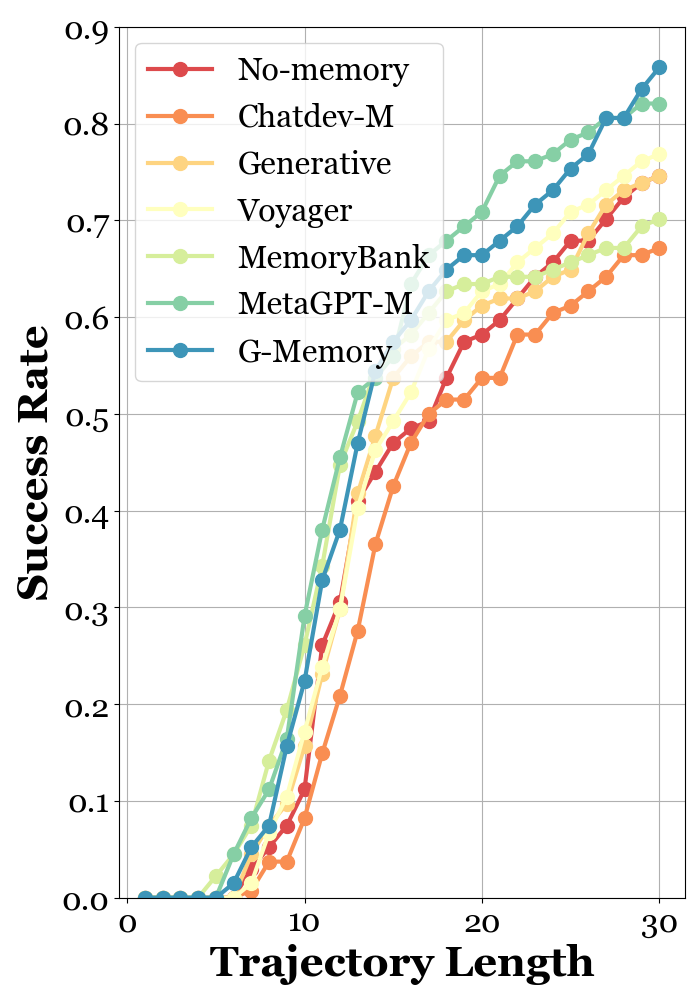

(a) The performance trajectory of AutoGen on ALFWorld.

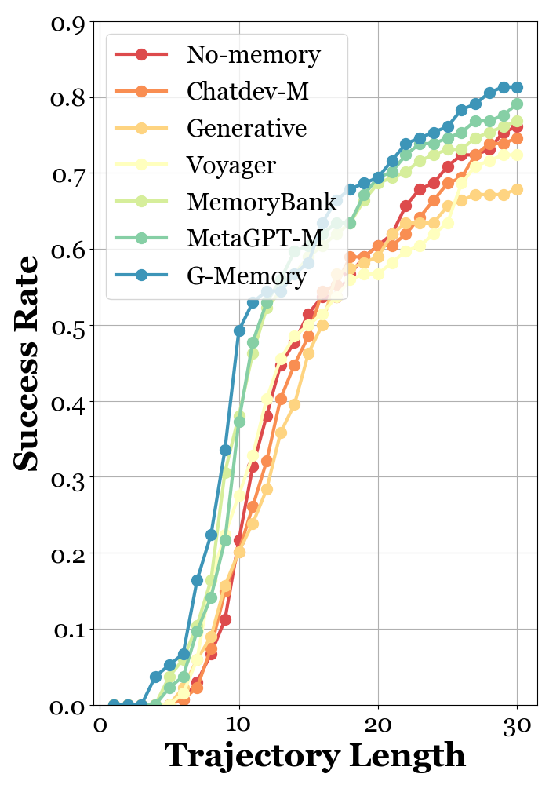

(b) The performance trajectory of DyLAN on ALFWorld.

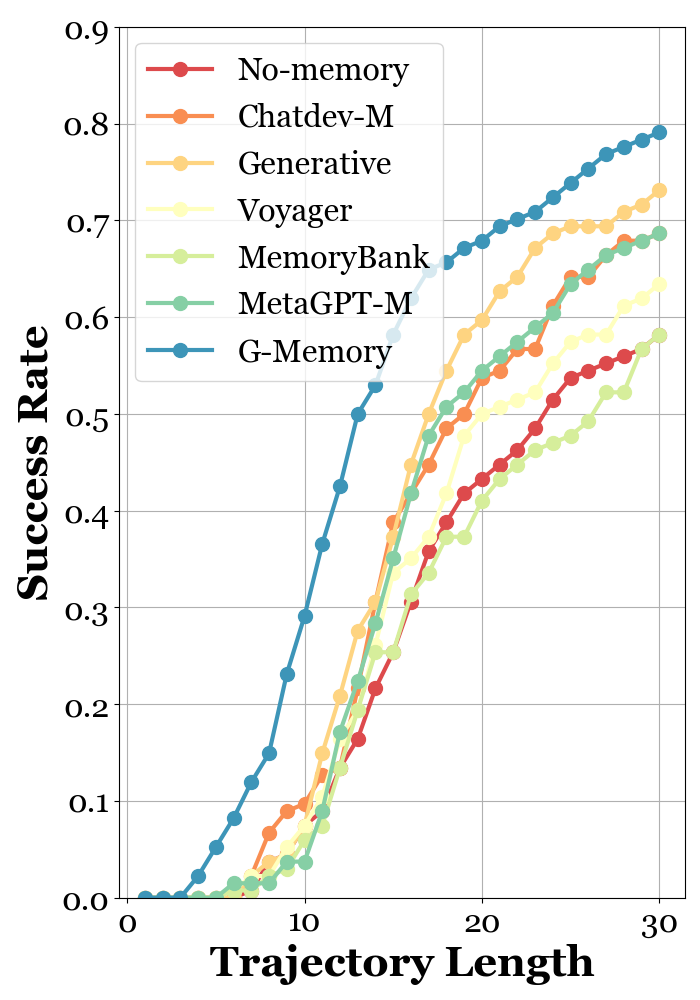

(c) The performance trajectory of MacNet on ALFWorld.

Table 2: Performance comparison with single/multi-agent memory architectures on five benchmarks. The underlying LLM backbone is `Qwen-2.5-7b`. We highlight the best and second best results.

| **MAS** | **Memory** | **ALFWorld** | **SciWorld** | **PDDL** | **HotpotQA** | **FEVER** | **Avg.** |
| --- | --- | --- | --- | --- | --- | --- | --- |
| Vanilla LLM | No-memory | 37.31*↑0.00* | 23.49*↑0.00* | 10.86*↑0.00* | <u>20.26</u>*↑0.00* | 48.17*↑0.00* | 28.02*↑0.00* |
| Vanilla LLM | Voyager | 38.19*↑0.88* | <u>24.11</u>*↑0.62* | <u>12.14</u>*↑1.28* | 19.12*↓1.14* | <u>49.68</u>*↑1.51* | <u>28.65</u>*↑0.63* |
| Vanilla LLM | MemoryBank | **40.30***↑2.99* | 21.64*↓1.85* | **14.36***↑3.50* | 18.79*↓1.47* | 47.66*↓0.51* | 28.55*↑0.53* |
| Vanilla LLM | Generative | <u>39.16</u>*↑1.85* | **26.10***↑2.61* | 11.37*↑0.51* | **23.48***↑3.22* | **52.50***↑4.33* | **30.52***↑2.50* |
| AutoGen COLM 2024 | No-memory | 52.99*↑0.00* | 30.27*↑0.00* | 16.17*↑0.00* | 33.33*↑0.00* | 58.74*↑0.00* | 38.30*↑0.00* |
| AutoGen COLM 2024 | Voyager | 55.22*↑2.23* | 26.70*↓3.57* | 12.00*↓4.17* | 34.29*↑0.96* | 52.44*↓6.30* | 36.13*↓2.17* |
| AutoGen COLM 2024 | MemoryBank | 53.37*↑0.38* | 27.33*↓2.94* | 14.83*↓1.34* | 32.67*↓0.66* | 59.45*↑0.71* | 37.53*↓0.77* |
| AutoGen COLM 2024 | Generative | <u>62.69</u>*↑9.70* | 31.45*↑1.18* | <u>17.88</u>*↑1.71* | 34.17*↑0.84* | 61.25*↑2.51* | <u>41.49</u>*↑3.19* |
| AutoGen COLM 2024 | MetaGPT-M | 55.52*↑2.53* | <u>32.44</u>*↑2.17* | 17.04*↑0.87* | <u>35.36</u>*↑2.03* | <u>63.33</u>*↑4.59* | 40.74*↑2.44* |
| AutoGen COLM 2024 | ChatDev-M | 46.27*↓6.72* | 28.67*↓1.60* | 13.42*↓2.75* | 31.11*↓2.22* | 61.32*↑2.58* | 36.16*↓2.14* |
| AutoGen COLM 2024 | MacNet-M | 53.18*↑0.19* | 31.10*↑0.83* | 16.89*↑0.72* | 34.29*↑0.96* | 58.43*↓0.31* | 38.78*↑0.48* |
| AutoGen COLM 2024 | **G-Memory** (Ours) | **67.91***↑14.92* | **34.89***↑4.62* | **21.01***↑4.84* | **37.34***↑4.01* | **64.34***↑5.60* | **45.10***↑6.80* |
| DyLAN COLM 2024 | No-memory | 41.34*↑0.00* | 29.84*↑0.00* | 13.56*↑0.00* | 24.29*↑0.00* | 56.23*↑0.00* | 33.05*↑0.00* |
| DyLAN COLM 2024 | Voyager | <u>51.49</u>*↑10.15* | 26.66*↓3.18* | 10.62*↓2.94* | 26.23*↑1.94* | 55.39*↓0.84* | 34.08*↑1.03* |
| DyLAN COLM 2024 | MemoryBank | 46.46*↑5.12* | 26.99*↓2.85* | 14.10*↑0.54* | 22.44*↓1.85* | <u>59.21</u>*↑2.98* | 33.84*↑0.79* |
| DyLAN COLM 2024 | Generative | 48.52*↑7.18* | <u>31.55</u>*↑1.71* | <u>16.31</u>*↑2.75* | <u>26.54</u>*↑2.25* | 50.19*↓6.04* | <u>34.62</u>*↑1.57* |
| DyLAN COLM 2024 | MetaGPT-M | 42.54*↑1.20* | 30.93*↑1.09* | 14.47*↑0.91* | 19.33*↓4.96* | 57.22*↑0.99* | 32.90*↓0.15* |
| DyLAN COLM 2024 | ChatDev-M | 39.85*↓1.49* | 28.25*↓1.59* | 7.14*↓6.42* | 17.32*↓6.97* | 50.67*↓5.56* | 28.65*↓4.41* |
| DyLAN COLM 2024 | MacNet-M | 42.48*↑1.14* | 28.22*↓1.62* | 14.23*↑0.67* | 25.12*↑0.83* | 55.34*↓0.89* | 33.08*↑0.03* |
| DyLAN COLM 2024 | **G-Memory** (Ours) | **52.99***↑11.65* | **33.81***↑3.97* | **20.71***↑7.15* | **29.33***↑5.04* | **63.67***↑7.44* | **40.10***↑7.05* |
| MacNet ICLR 2025 | No-memory | 44.03*↑0.00* | 28.76*↑0.00* | 13.36*↑0.00* | 22.24*↑0.00* | 55.12*↑0.00* | 32.70*↑0.00* |
| MacNet ICLR 2025 | Voyager | 47.01*↑2.98* | 28.88*↑0.12* | 11.36*↓2.00* | <u>25.67</u>*↑3.43* | <u>58.78</u>*↑3.66* | 34.34*↑1.64* |
| MacNet ICLR 2025 | MemoryBank | 52.24*↑8.21* | 27.86*↓0.90* | 13.33*↓0.03* | 23.97*↑1.73* | 54.18*↓0.94* | 34.32*↑1.61* |
| MacNet ICLR 2025 | Generative | 48.51*↑4.48* | <u>31.05</u>*↑2.29* | 14.04*↑0.68* | 24.49*↑2.25* | 56.08*↑0.96* | 34.83*↑2.13* |
| MacNet ICLR 2025 | MetaGPT-M | <u>52.99</u>*↑8.96* | 29.87*↑1.11* | <u>16.58</u>*↑3.22* | 25.51*↑3.27* | 53.88*↓1.24* | <u>35.77</u>*↑3.06* |
| MacNet ICLR 2025 | ChatDev-M | 44.78*↑0.75* | 26.44*↓2.32* | 10.19*↓3.17* | 16.32*↓5.92* | 56.02*↑0.90* | 30.75*↓1.95* |
| MacNet ICLR 2025 | MacNet-M | 43.55*↓0.48* | 30.11*↑1.35* | 12.91*↓0.45* | 21.77*↓0.47* | 50.71*↓4.41* | 31.81*↓0.89* |
| MacNet ICLR 2025 | **G-Memory** (Ours) | **54.48***↑10.45* | **32.23***↑3.47* | **17.48***↑4.12* | **27.53***↑5.29* | **59.14***↑4.02* | **38.17***↑5.47* |

Table 3: Performance comparison with single/multi-agent memory architectures on five benchmarks. The underlying LLM backbone is `Qwen-2.5-14b`. We highlight the best and second best results.

| **MAS** | **Memory** | **ALFWorld** | **SciWorld** | **PDDL** | **HotpotQA** | **FEVER** | **Avg.** |
| --- | --- | --- | --- | --- | --- | --- | --- |
| AutoGen COLM 2024 | No-memory | 74.63*↑0.00* | 46.84*↑0.00* | 44.92*↑0.00* | 24.49*↑0.00* | 63.27*↑0.00* | 50.83*↑0.00* |
| AutoGen COLM 2024 | Voyager | 76.87*↑2.24* | <u>59.00</u>*↑12.16* | 50.21*↑5.29* | 31.33*↑6.84* | 61.22*↓2.05* | 55.73*↑4.90* |
| AutoGen COLM 2024 | MemoryBank | 70.15*↓4.48* | 54.18*↑7.34* | 39.54*↓5.38* | 32.65*↑8.16* | 64.29*↑1.02* | 52.16*↑1.33* |
| AutoGen COLM 2024 | Generative | 74.63*↑0.00* | 57.37*↑10.53* | <u>54.46</u>*↑9.54* | <u>33.21</u>*↑8.72* | 63.27*↑0.00* | 56.59*↑5.76* |
| AutoGen COLM 2024 | MetaGPT-M | <u>82.09</u>*↑7.46* | 58.86*↑12.02* | 48.99*↑4.07* | 31.63*↑7.14* | 62.27*↓1.00* | <u>56.77</u>*↑5.94* |
| AutoGen COLM 2024 | ChatDev-M | 67.16*↓7.47* | 40.69*↓6.15* | 43.11*↓1.81* | 31.77*↑7.28* | 61.28*↓1.99* | 48.80*↓2.03* |
| AutoGen COLM 2024 | MacNet-M | 73.65*↓0.98* | 42.14*↓4.70* | 45.94*↑1.02* | 26.72*↑2.23* | <u>64.69</u>*↑1.42* | 50.63*↓0.20* |
| AutoGen COLM 2024 | **G-Memory** (Ours) | **85.82***↑11.19* | **60.62***↑13.78* | **55.24***↑10.32* | **34.61***↑10.12* | **71.43***↑8.16* | **61.54***↑10.71* |
| DyLAN COLM 2024 | No-memory | 76.12*↑0.00* | 53.24*↑0.00* | 41.83*↑0.00* | 30.61*↑0.00* | 63.34*↑0.00* | 53.03*↑0.00* |
| DyLAN COLM 2024 | Voyager | 72.39*↓3.73* | 58.93*↑5.69* | 48.54*↑6.71* | 30.71*↑0.10* | <u>65.31</u>*↑1.97* | 55.18*↑2.15* |
| DyLAN COLM 2024 | MemoryBank | 76.87*↑0.75* | 57.92*↑4.68* | 39.65*↓2.18* | 29.59*↓1.02* | 63.25*↓0.09* | 53.46*↑0.43* |
| DyLAN COLM 2024 | Generative | 77.91*↑1.79* | <u>61.52</u>*↑8.28* | 46.69*↑4.86* | <u>31.33</u>*↑0.72* | 61.39*↓1.95* | 55.77*↑2.74* |
| DyLAN COLM 2024 | MetaGPT-M | <u>79.10</u>*↑2.98* | 61.29*↑8.05* | <u>49.75</u>*↑7.92* | 28.61*↓2.00* | 64.11*↑0.77* | <u>56.57</u>*↑3.54* |
| DyLAN COLM 2024 | ChatDev-M | 74.63*↓1.49* | 54.03*↑0.79* | 44.44*↑2.61* | 30.67*↑0.06* | 62.25*↓1.09* | 53.20*↑0.18* |
| DyLAN COLM 2024 | MacNet-M | 72.77*↓3.35* | 52.22*↓1.02* | 42.98*↑1.15* | 29.22*↓1.39* | 62.69*↓0.65* | 51.98*↓1.05* |
| DyLAN COLM 2024 | **G-Memory** (Ours) | **81.34***↑5.22* | **64.68***↑11.44* | **51.12***↑9.29* | **34.63***↑4.02* | **66.66***↑3.32* | **59.69***↑6.66* |
| MacNet ICLR 2025 | No-memory | 58.21*↑0.00* | 52.21*↑0.00* | 41.74*↑0.00* | 28.60*↑0.00* | 64.65*↑0.00* | 49.08*↑0.00* |
| MacNet ICLR 2025 | Voyager | 63.43*↑5.22* | 60.24*↑8.03* | 43.95*↑2.21* | 29.67*↑1.07* | 62.24*↓2.41* | 51.91*↑2.82* |
| MacNet ICLR 2025 | MemoryBank | 62.21*↑4.00* | 55.52*↑3.31* | 38.26*↓3.48* | 26.53*↓2.07* | 65.22*↑0.57* | 49.55*↑0.47* |
| MacNet ICLR 2025 | Generative | <u>73.13</u>*↑14.92* | <u>60.83</u>*↑8.62* | <u>44.00</u>*↑2.26* | <u>30.53</u>*↑1.93* | 65.31*↑0.66* | <u>54.76</u>*↑5.68* |
| MacNet ICLR 2025 | MetaGPT-M | 70.43*↑12.22* | 59.70*↑7.49* | 42.34*↑0.60* | 26.26*↓2.34* | <u>66.33</u>*↑1.68* | 53.01*↑3.93* |
| MacNet ICLR 2025 | ChatDev-M | 68.66*↑10.45* | 45.98*↓6.23* | 42.19*↑0.45* | 29.49*↑0.89* | 59.18*↓5.47* | 49.10*↑0.02* |
| MacNet ICLR 2025 | MacNet-M | 60.45*↑2.24* | 51.14*↓1.07* | 39.22*↓2.52* | 28.77*↑0.17* | 62.42*↓2.23* | 48.40*↓0.68* |
| MacNet ICLR 2025 | **G-Memory** (Ours) | **79.10***↑20.89* | **61.74***↑9.53* | **45.76***↑4.02* | **32.33***↑3.73* | **70.33***↑5.68* | **57.85***↑8.77* |

### B.2 RQ2 Results

Figure 7 provides additional comparisons of token cost across various benchmarks and MAS frameworks when combined with different memory architectures. Overall, **G-Memory** incurs only a marginal or no increase in token cost compared to classical baselines such as Generative and MetaGPT-M, while consistently delivering the most significant performance improvements.

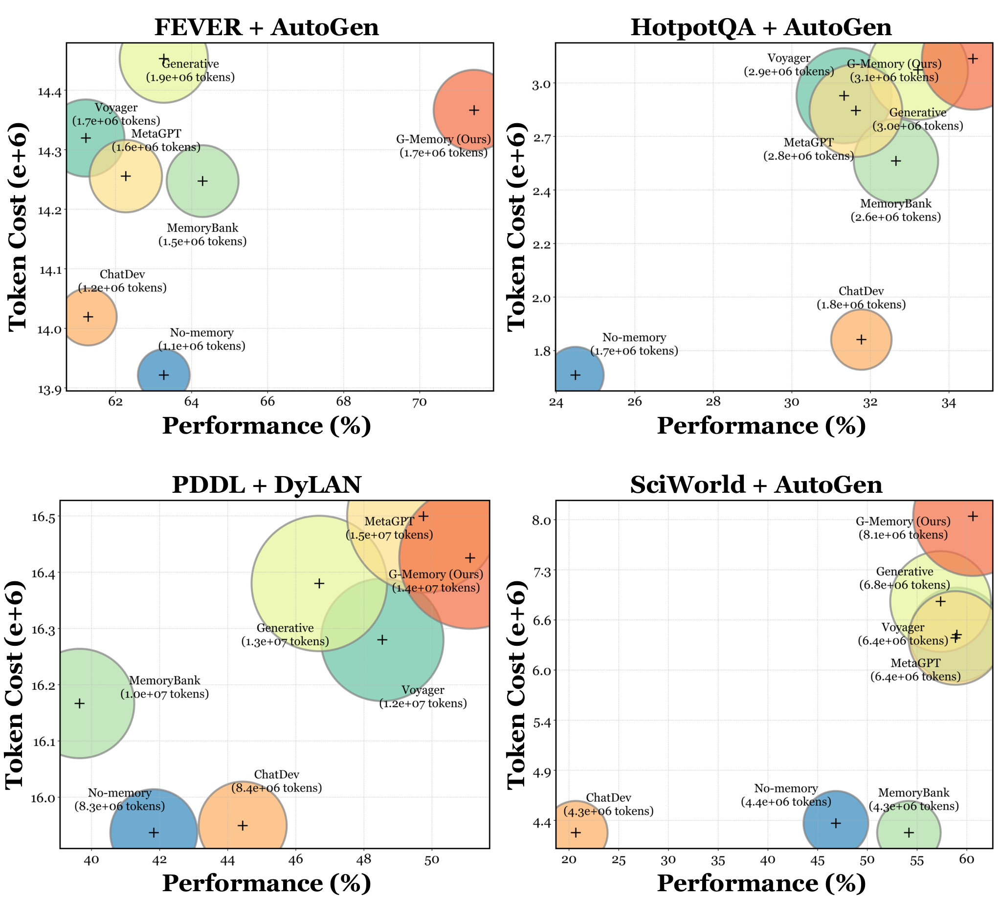

Figure 7: Cost analysis of **G-Memory**. We showcase the performance versus the overall system token cost when combined with different memory architectures.

### B.3 Latency Results

As shown in Table 4, G-Memory incurs only moderate inference overhead even when delivering the most significant performance gains. For instance, on AutoGen+ALFWorld, it increases latency by merely 9% compared to the no-memory baseline; (2) in some cases, G-Memory even improves efficiency, e.g., on DyLAN+ALFWorld, it leads to a 20% speed-up, as helpful memory cues enable the multi-agent system to reach correct actions more quickly and terminate the interaction earlier.

Table 4: Performance (%) and latency (s) comparison of different memory mechanisms on AutoGen and DyLAN frameworks, along with ALFWorld and SciWorld benchmarks.

| Method | AutoGen ALFWorld Perf. | Lat. (s) | AutoGen SciWorld Perf. | Lat. (s) | DyLAN ALFWorld Perf. | Lat. (s) | DyLAN SciWorld Perf. | Lat. (s) |
| --- | --- | --- | --- | --- | --- | --- | --- | --- |
| No-memory | 77.61 | 19204 | 54.59 | 16953 | 56.72 | 33520 | 55.38 | 32408 |
| Voyager | 85.07 | 21754 | 62.36 | 16650 | 66.42 | 29628 | 62.83 | 31633 |
| MemoryBank | 74.96 | 15492 | 53.11 | 10104 | 55.22 | 31813 | 54.74 | 32925 |
| Generative | 86.36 | 20682 | 61.19 | 16674 | 67.91 | 31010 | 64.16 | 34038 |
| MetaGPT-M | 81.34 | 16021 | 61.91 | 15853 | 69.40 | 22936 | 62.37 | 32049 |
| ChatDev-M | 79.85 | 22347 | 50.96 | 12904 | 46.27 | 29739 | 53.35 | 33111 |
| MacNet-M | 76.55 | 21089 | 55.44 | 16882 | 53.44 | 24991 | 54.32 | 34815 |
| G-Memory (Ours) | 88.81 | 21113 | 67.40 | 17326 | 70.90 | 26726 | 65.64 | 33447 |

### B.4 Case Study

#### B.4.1 Case Study on Insight Graphs

Figure 8 visualizes the high-level insights summarized by **G-Memory** on the ALFWorld benchmark across different MAS frameworks and LLM backbones. Given that ALFWorld naturally consists of diverse task categories, we further examine how insight nodes corresponding to different task types are interconnected. Overall, we observe dense intra-category connections among insights derived from similar tasks, while also noting the emergence of meaningful inter-category links, reflecting transferable patterns across task domains.

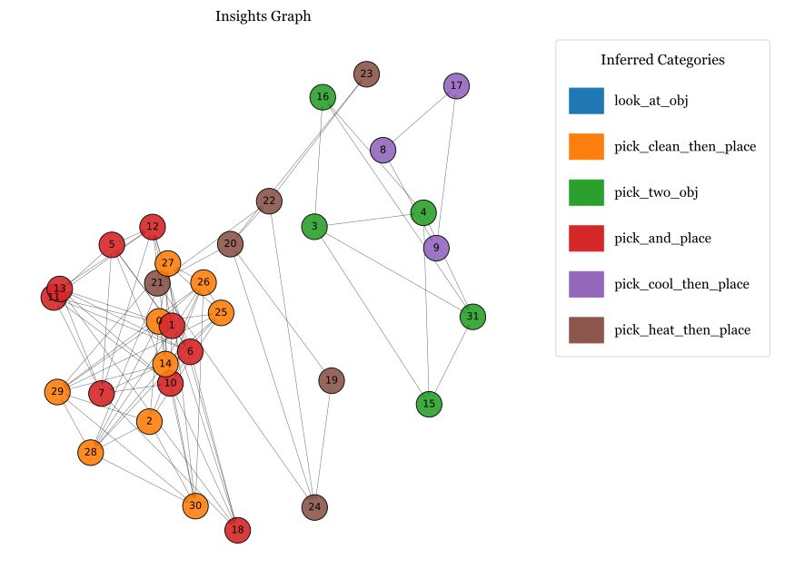

(a) Insight graph on `gpt-4o-mini` +MacNet+ALFWorld.

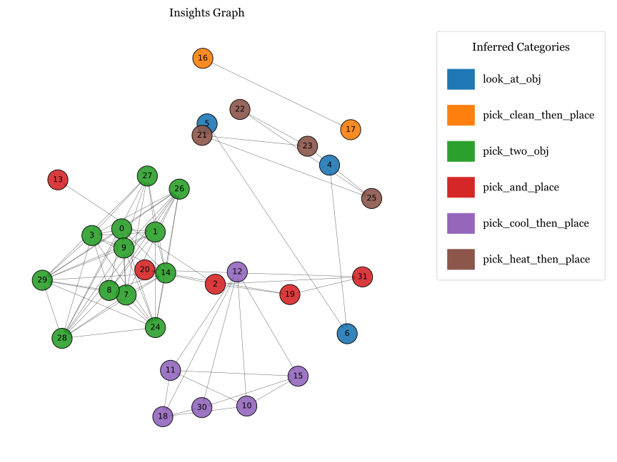

(b) Insight graph on `gpt-4o-mini` +DyLAN+ALFWorld.

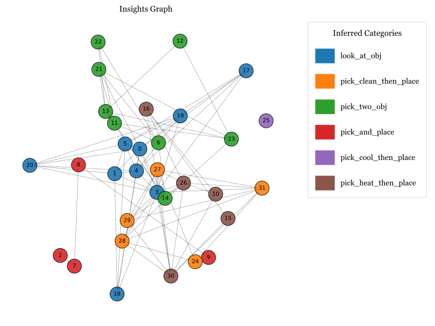

(c) Insight graph on `Qwen-7b` +MacNet+ALFWorld.

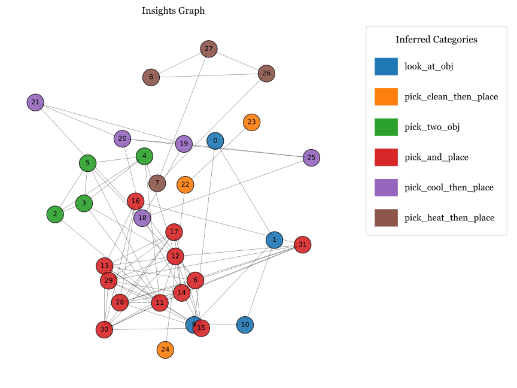

(d) Insight graph on `Qwen-7b` +DyLAN+ALFWorld.

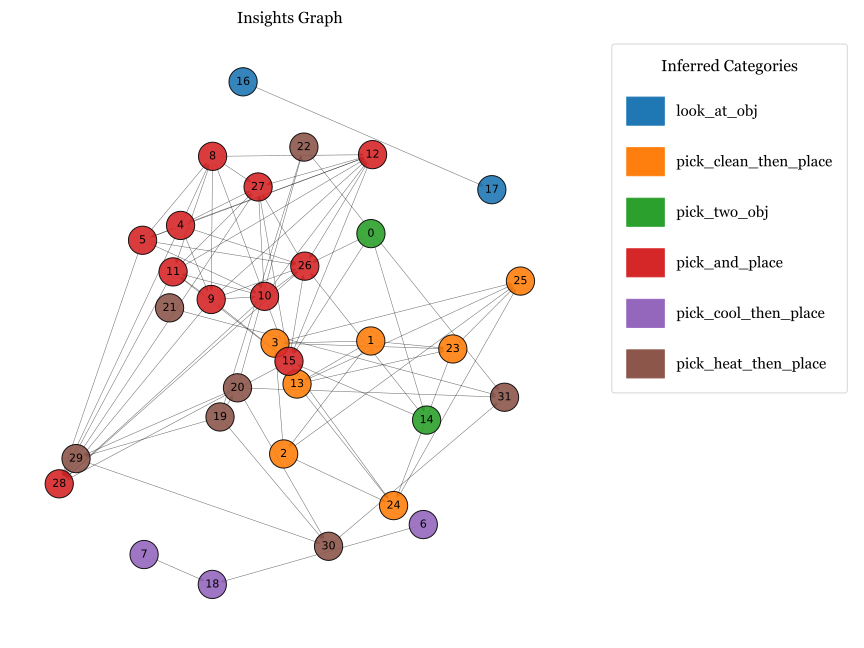

(e) Insight graph on `Qwen-14b` +AutoGen+ALFWorld.

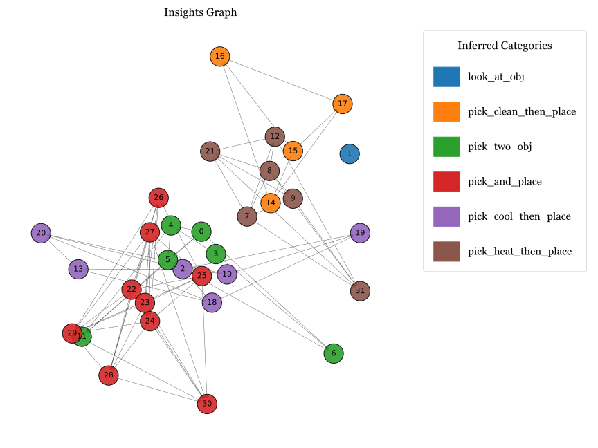

(f) Insight graph on `Qwen-14b` +DyLAN+ALFWorld.

Figure 8: Visualizations of insight graphs across different LLM backbones, MAS, and benchmarks.

#### B.4.2 Case Study on Query Graphs

Figures 9, 10 and 11 visualize the query graphs constructed by **G-Memory** on the ALFWorld, PDDL, and SciWorld benchmarks. Recall that a directed edge between two query nodes indicates that the historical trajectory of one query offers useful guidance for the execution of another. We observe emergent clustering patterns, where groups of semantically similar queries form densely connected subgraphs, while sparser inter-cluster edges capture cross-task inspirations. These patterns demonstrate **G-Memory**’s ability to effectively organize and relate collaborative experiences through structured memory reasoning.

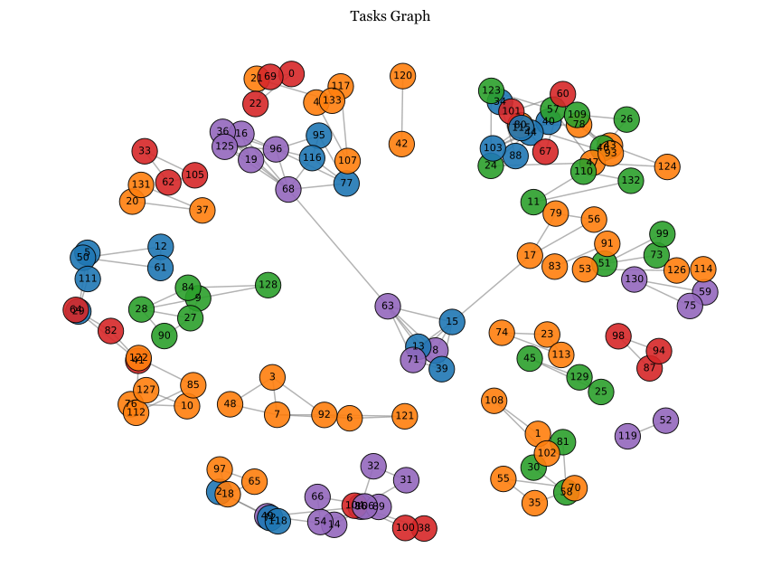

Figure 9: Query graph optimized from ALFWorld dataset.

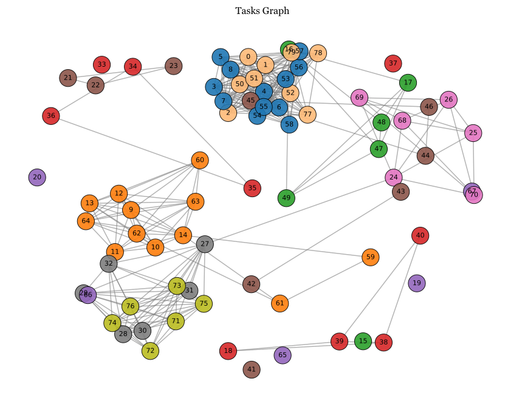

Figure 10: Query graph optimized from SciWorld dataset.

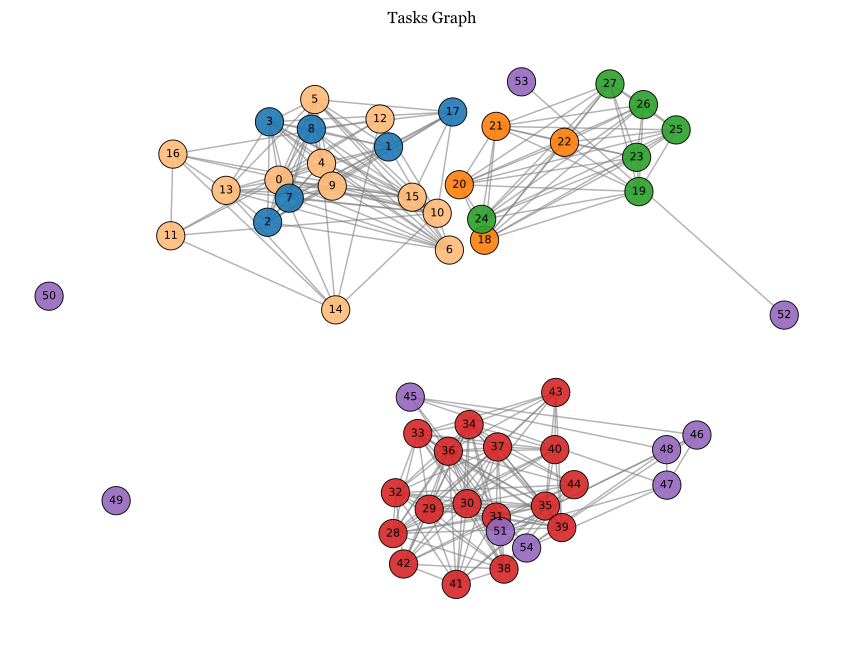

Figure 11: Query graph optimized from PDDL dataset.

## Appendix C Prompt Set

Query Relevance Filtration

```python
task_relevency_system_prompt = """You are an agent designed to score the relevance between two pieces of text."""
task_relevency_user_prompt = """You will be given a successful case where you successfully complete the task. Then you will be given an ongoing task. Do not summarize these two cases, but rather evaluate how relevant and helpful the successful case is for the ongoing task, on a scale of 1-10.
Success Case:
{trajectory}
Ongoing task:
{query_scenario}
Score: """
```

Graph Sparsifier

```python
extract_true_traj_system_prompt = """You are an agent skilled at extracting key points.
Given a task and a successful execution trajectory, your job is to identify the critical steps needed to complete the task while filtering out less important steps."""

extract_true_traj_user_prompt = """
Note:
- Strictly follow the original trajectory; absolutely no steps that are not in the trajectory should be added.
- Even in a successful trajectory, there may be some incorrect steps. Pay attention to actions that correspond to "Nothing happens" observations, as these actions are likely incorrect. Filter out these actions for me.
- You need to ensure that each step is at the finest granularity.
- You should strictly follow the output format in the example.

## Here is the task:
### Task
{task}

### Trajectory
{trajectory}

### Output
"""
```

The prompt below is partially adapted from [42]. We would like to express our sincere gratitude for their valuable implementation.

Inisght Summarization Function

```python
learn_lessons_system_prompt_compare = """
You are an analysis-driven agent focused on learning from experience. You will be provided with:
- A failed trajectory and its outcome,
- A successful trajectory completing a similar task.

Your task is to analyze both trajectories and generate clear, actionable insights. Your insights should highlight what the failed trajectory missed and how the successful one addressed or avoided these pitfalls.

## Requirements:
- All insights must be derived directly from contrasting the two trajectories.
- Do not speculate or introduce steps not supported by the successful example.
- Focus on **concrete behavioral or strategic differences** between the two cases.
- Keep each insight concise and impactful.

Output Format:
- Start immediately with a numbered list.
- No introduction or explanation.
- Use this exact format:
1. Insight 1
2. Insight 2
3. Insight 3
...
"""

learn_lessons_user_prompt_compare = """
## Successful trajectory
{true_traj}

## Failed trajectory
### trajectory
{false_traj}

Your output:
"""

learn_lessons_system_prompt_all_succ = """
You are an analysis-driven agent focused on learning from success. You will be provided with a set of successful trajectories that completed a similar task.

Your goal is to analyze these successful examples and extract clear, actionable insights that capture what contributed to their success. These insights will serve as guidance for future agents working on similar tasks.

## Requirements:
- All insights must be grounded in patterns or strategies observed across the successful trajectories.
- Do not speculate or introduce steps not reflected in the provided examples.
- Focus on common behaviors, strategies, or decisions that consistently led to positive outcomes.
- Keep each insight concise, specific, and impactful.

Output Format:
- Start immediately with a numbered list.
- No introduction or explanation.
- Use this exact format:
1. Insight 1
2. Insight 2
3. Insight 3
...
"""

learn_lessons_user_prompt_all_succ = """
## Successful trajectorys
{true_trajs}

Your output:
"""

# merge rules prompt
merge_rules_system_prompt = """You are an agent skilled at summarizing and distilling insights. You are given a list of insights that were previously extracted from similar tasks. These insights may contain redundancy or overlap.

Your job is to **merge and consolidate similar insights**, and output a refined version that is **clear, actionable, and concise**.

NOTE:
- All merged insights **must be based strictly on the given inputs**. You are **not allowed to make up** or infer any new information.
- The output should be easy to read and follow.

Output Format:
- Start your response directly with the numbered list, no preamble or explanations.
- Each insight should be a short sentence.
- Use the following format exactly:
1. Insight 1
2. Insight 2
3. Insight 3
...
"""

merge_rules_user_prompt = """
## Here are the current insights that need to be merged:
{current_rules}

## Please consolidate and rewrite them into **no more than {limited_number} refined insights**.

As the summarizing agent, remove redundancies, combine similar ideas, and ensure clarity.

Your output:
"""
```

Customizing Memory for Agents

```python
project_insights_system_prompt: str = """
You are a thoughtful and context-aware agent. You will be provided with a successfully executed trajectory, a specific agent **role**, and a set of **general insights** applicable across all roles.
Your task is to **adapt these general insights** into **personalized insights** that are specifically tailored to the given role and its trajectory. These personalized insights should help the agent improve future performance by aligning with their unique background, responsibilities, and perspective.
Make sure your output reflects an understanding of the role's context and promotes actionable, role-relevant advice.

NOTE - Your output must strictly follow the format below:
1. Insight 1
2. Insight 2
3. Insight 3
...
"""

project_insights_user_prompt: str = """
### Trajectory
{trajectory}

### Agent's Role:
{role}

### General Insights:
{insights}

### Your Output (Personalized Insights for This Role):
"""
```

## Appendix D Discussion with Related Works

In this section, we further discuss the relationship between **G-Memory** and several recent agent memory frameworks. For **A-Mem** [60], while both A-Mem and **G-Memory** aim to enhance the memory capabilities of LLM agents, they differ in two key aspects. First, A-Mem is tailored for single-agent scenarios, whereas **G-Memory** is designed for processing MAS’s lengthy and nuanced interaction trajectory. Second, A-Mem emphasizes atomic memory construction for chatbot-style interactions, while **G-Memory** focuses on distilling reusable strategies from collaborative task execution, where fine-grained atomicity is neither required nor beneficial. For **Mem0** [61], although it also employs a graph-based structure, it remains within the chatbot paradigm. Its graph is closer to a knowledge graph, where nodes represent factual entities and edges represent relations, fundamentally differing from **G-Memory**’s agent-centric memory graphs that encode trajectories, decisions, and coordination patterns across agents.
