# 基于深度几何学习的气动外形优化自动参数化

**原题：** Automated Parameterization for Aerodynamic Shape Optimization via Deep Geometric Learning  
**作者：** Zhen Wei · Aobo Yang · Jichao Li · Michaël Bauerheim · Rhea P. Liem · Pascal Fua  
**发表期刊：** *AIAA Journal*，2025 年  
**版本：** 作者接受稿（author accepted manuscript）  
**正式版本 DOI：** [10.2514/1.J065203](https://doi.org/10.2514/1.J065203)  
**版权：** © 2025 American Institute of Aeronautics and Astronautics。

**作者单位与说明：**

- **Zhen Wei：** 瑞士洛桑联邦理工学院（EPFL），Lausanne，Vaud 1015；计算机与通信科学学院计算机视觉实验室博士生，AIAA 学生会员。
- **Aobo Yang：** 中国香港特别行政区，香港科技大学（HKUST），清水湾；机械及航空航天工程学系博士生，AIAA 学生会员。
- **Jichao Li：** 新加坡共和国，新加坡科技研究局（A*STAR）高性能计算研究所，138632；流体动力学部门研究员，AIAA 会员。
- **Michaël Bauerheim：** 法国图卢兹，ISAE-SUPAERO，Occitania 31055；空气动力学、能源与推进系副教授。
- **Rhea P. Liem：** 英国伦敦，帝国理工学院，SW7 2AZ；航空系可持续航空方向 Reader，同时任香港科技大学机械及航空航天工程学系兼任副教授，AIAA 高级会员。
- **Pascal Fua：** 瑞士洛桑联邦理工学院（EPFL），Lausanne，Vaud 1015；计算机与通信科学学院计算机视觉实验室教授，通信作者，邮箱 pascal.fua@epfl.ch。

本研究扩展自以下 AIAA 会议论文：Zhen Wei、Aobo Yang、Jichao Li、Michaël Bauerheim、Rhea P. Liem 和 Pascal Fua，“DeepGeo：用于气动外形优化自动高效参数化的深度几何映射”，AIAA 2024-3839，*AIAA AVIATION FORUM AND ASCEND 2024*，2024 年 7 月。

> 译注：本译稿保留原文的章节结构、图表与公式编号。插图保留原图，图注译为中文，主要流程图另附中文说明。参考文献不翻译，仅整理断行与空格。原文中个别公式、表格或交叉引用存在不一致，均予以保留，并在必要处注明。

## 摘要

传统气动外形优化（aerodynamic shape optimization，ASO）成本高、耗时长，需要大量人工调整参数化设置，以定义设计空间并操纵几何外形。传统参数化方法灵活性有限，而且需要专业知识，使高效开展 ASO 面临困难。我们提出深度几何映射（Deep Geometric Mapping，DeepGeo）模型：一种基于神经网络的方法，通过自动参数化加速 ASO 并降低成本。

借助神经网络的表达能力，DeepGeo 能够在处理大幅度外形形变的同时，保持全局表面光滑性，从而在高维设计空间中实现高效优化。通过消除对训练数据集和人工超参数调整的需求，并集成计算流体力学（CFD）网格形变，DeepGeo 显著降低了 ASO 的实现复杂度与成本。二维圆、通用研究模型机翼和翼身融合飞行器等优化案例验证了 DeepGeo 的有效性：仅需极少人工干预，其结果即可与先进的自由形变方法相当。本文将 DeepGeo 确立为一种新颖、有效的参数化框架，能够简化先进 ASO 的工作流程并降低实现复杂度。

## 符号说明

| 符号 | 含义 |
|---|---|
| $\alpha$ | 迎角 |
| $C_D,C_L,C_M$ | 阻力系数、升力系数和俯仰力矩系数 |
| $\mathfrak{C}$ | DeepGeo 输入坐标空间中用于定义 CFD 计算域的子集 |
| $f_\Theta,\Theta$ | 深度几何映射模型及其权重 |
| $g$ | 伴随求解器 |
| $L$ | 损失函数与软约束 |
| $M,V,E$ | CFD 网格及其顶点、边 |
| $O$ | 优化目标 |
| $P$ | FFD 控制点 |
| $S$ | 用于优化的初始对象几何 |
| $t,A,\mathrm{Vol}$ | 几何的厚度、面积和体积 |
| $V^S,V^F,V^V$ | 分别位于对象表面、固定边界区域和体网格中的 CFD 网格顶点 |

## I. 引言

气动外形优化（ASO）是指在给定设计约束下改进对象外形，以提升气动性能的过程，其目标包括降低燃油消耗、提高运行效率或改善机动性。ASO 对多个领域具有重要意义，可用于航空航天、汽车和船舶工程等应用的设计。如图 1a 所示，ASO 通常包含 CFD 仿真、可视化与专家分析、形状建模与修改，以及网格形变或重新划分网格等环节的迭代循环。传统 ASO 既耗时又昂贵，尤其是形状参数化及其相关几何处理，需要大量人工劳动。

形状参数化是 ASO 的核心，它提供表示和操纵对象几何的数学框架，对 ASO 性能的影响既深刻又涉及多个方面。参数化方法的选择界定了优化边界，决定了可处理的最大几何复杂度、允许的形状修改范围，以及能够达到的表面光滑程度。一个关键挑战是平衡参数空间维度与优化有效性：高维参数空间能够精细地描述几何，却可能妨碍收敛；低维空间有利于更快优化，但可能限制设计空间搜索。

此外，参数化方法直接影响 ASO 的实现成本，因为从初始表面建模、设计变量配置，到 CFD 网格形变管理，各阶段所需的人工介入程度都受其影响。因此，选择有效的参数化方法，对于实现低成本、高效率的 ASO 至关重要。

鉴于其重要性，形状参数化已成为大量研究的重点。传统方法包括用于二维问题的 Hicks-Henne 鼓包函数 [1]、非均匀有理 B 样条（NURBS）曲线和类形状函数变换（CST）[2]；对于三维问题，则更倾向采用自由形变（FFD）[3–5]。尽管这些方法取得成功，但仍面临显著挑战。

ASO 的性能和计算效率对参数化的具体实现高度敏感，包括算法及超参数的选择 [6–8]，而目前没有形式化方法来确定最佳配置。因此，实践人员只能依靠试错、经验知识，或改用相似案例中的方法，随后进行大量人工调整。在效率和适应性至关重要的快速原型设计与迭代设计中，这种对人工过程的依赖使传统方法难以实用。

同时，设计者必须在形变自由度、优化有效性和全局表面光滑性之间进行权衡。高维设计变量提供更大的设计灵活性，但也增加优化难度和收敛不良的风险。在形变自由度较大时，确保全局表面光滑也很困难；即使轻微的表面不一致，也可能导致仿真出错，打断优化过程。此外，传统参数化仅关注表面几何，因此还必须通过形变或重新划分网格，单独处理 CFD 体网格，显著增加实现复杂度。

虽然基于人工智能的参数化模型已作为替代方案出现 [9–11]，但其数据驱动特性需要大规模训练数据集，并引入新的数据工程挑战。尤其在航空航天领域，训练数据稀缺且生成成本高。这些模型学到的几何先验内在地受可用数据集限制，因此生成的新形状实质上是已有数据的插值，而非真正新颖的设计。由此，基于人工智能的模型缺乏自由形状参数化方法所具有的创新潜力；后者能够探索更广泛的设计空间。

为解决这些局限，我们构建人工智能辅助的 ASO 流程，并提出深度几何映射（DeepGeo）模型。这是一种新颖的神经网络方法，将形状表示和网格形变统一在单个框架中，如图 1b 所示。DeepGeo 使用多层感知机（MLP），同时参数化表面几何与周围的 CFD 计算体网格；后者是通过 CFD 仿真评估气动性能所必需的。

如图 2a 所示，在初始化阶段，DeepGeo 训练 MLP，使模板形状的表面顶点通过形变与目标几何对齐，后者是优化的初始构型。同时，周围体网格也发生形变，以确保与表面几何一致。通过准确重建目标几何，初始化过程将几何信息编码到网络权重中。

随后，如图 2b 所示，采用基于伴随的方法 [12]，相对于这些权重最小化气动目标函数并施加几何约束，以执行形状优化。更新后的权重使 DeepGeo 输出定义新几何的 CFD 网格，从而迭代地操纵外形设计。优化持续进行直至收敛。这种表述使网络权重成为表面形状和体网格共同的参数化方式，在每次优化迭代中，随着几何演化，自动重新生成所需 CFD 网格。

通过在同一框架中统一形状参数化和网格形变，DeepGeo 消除了独立 CFD 网格形变或重新划分网格模块及其耗时的人工超参数调整，从而显著降低传统 ASO 的实现复杂度，简化并加快优化流程。

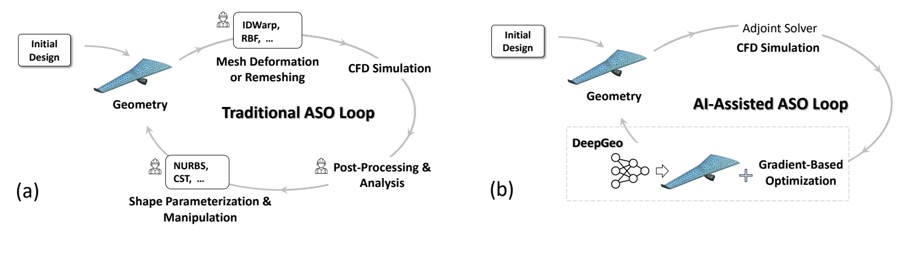

**图 1.** （a）传统 ASO 与（b）采用 DeepGeo 的 ASO 流程。

图内文字对应如下：传统流程从“初始设计”出发，依次进行“几何”“网格形变或重新划分网格”“CFD 仿真”“后处理与分析”和“形状参数化与操纵”；图中示例方法包括 IDWarp、RBF、NURBS 和 CST。人工智能辅助流程使用“DeepGeo”统一形状表示与网格处理，并通过“CFD 仿真、伴随求解器”和“梯度优化”构成循环。

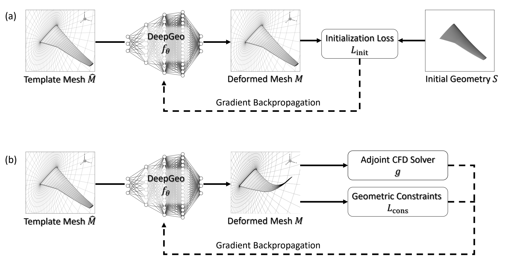

**图 2.** 在 ASO 中采用 DeepGeo 的流程，包括（a）初始化阶段和（b）形状优化阶段。

图内文字对应如下：模板网格 $\hat M$ 经 DeepGeo 模型 $f_\Theta$ 转换为形变网格 $M$；初始化阶段根据初始几何 $S$ 计算初始化损失 $L_{\mathrm{init}}$，通过梯度反向传播更新模型；形状优化阶段由伴随 CFD 求解器 $g$ 和几何约束 $L_{\mathrm{cons}}$ 提供梯度并反向传播。

DeepGeo 利用 MLP 的表达能力；这种能力源于 MLP 可以将简单函数逐层复合，表示复杂非线性映射。因此，DeepGeo 能捕捉丰富的几何变换，在处理大形变的同时保持全局表面光滑性。这种表达能力是实现复杂几何上的光滑连续变换的关键，也是高保真形状优化的重要要求。

通过减轻维度灾难或过参数化问题 [13,14]，DeepGeo 的 MLP 骨干使基于梯度的方法能够探索高维设计空间。DeepGeo 直接应对传统优化方法面临的维数限制；例如，当设计参数超过约 100 个时，CMAES [15] 等方法就会变得不实用。

此外，DeepGeo 初始化仅需一个目标形状和一个模板网格来设定初始权重，与依赖大量训练数据的数据驱动方法不同。这种极低的数据需求显著降低实现复杂度，减少对大规模数据集的依赖，使 DeepGeo 尤其适合几何数据通常稀缺的航空航天实际应用。

在早期研究 [16] 中，我们提出直接映射模型（Direct Mapping Model），这是面向二维翼型优化开发的 DeepGeo 初始版本。本文将模型扩展到更复杂的优化任务和三维形状，包括二维圆优化、三维机翼优化，以及三维翼身融合飞行器优化。如图 3 所示，DeepGeo 无需针对案例进行专门调整，也不依赖训练数据集，即可获得与先进方法相当的优化结果。

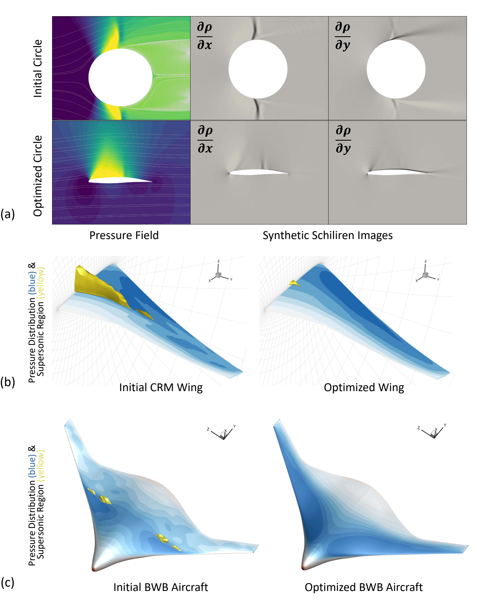

**图 3.** DeepGeo 实现的三个 ASO 案例，分别从（a）二维圆、（b）CRM 机翼和（c）翼身融合（BWB）飞行器出发进行优化。

图中第一组展示初始圆与优化形状的压力场及合成纹影图；第二、三组分别比较初始与优化后的 CRM 机翼、BWB 飞行器，其中蓝色表示压力分布，黄色表示超声速区域。

## II. 相关工作

DeepGeo 涉及多个研究领域，包括计算机图形学中的形状参数化算法、气动外形优化研究，以及深度学习中的自先验模型。下面分别简要回顾，随后讨论 DeepGeo 的技术特点。

### A. 气动外形优化中的形状参数化

ASO 中的形状参数化，是指将显式设计变量映射到对象表面网格，是有效求解 ASO 问题的基础模块。Jameson [17] 引入从圆出发的直接保角映射来优化翼型，使设计空间具有最大设计自由度，但缺乏 CFD 求解器所需的足够光滑性 [18]。因此，需要形状参数化来降低设计空间维度，并引入光滑性控制。相关方法大体可分为非数据驱动与数据驱动两类。

#### 1. 非数据驱动方法

非数据驱动算法包括构造式和形变式方法 [6]。构造式方法，例如基于多项式或样条的方法 [2,18,19] 及偏微分方程方法 [20,21]，根据给定参数表示翼型表面。形变式方法则使现有形状发生形变，包括解析方法 [1,22,23] 和自由形变（FFD）[3–5]。

Hicks-Henne 鼓包函数 [1] 等早期解析方法 [22,23]，通过基函数的线性组合优化形状。B 样条 [18] 及其 Bézier 曲线、非均匀有理 B 样条（NURBS）[19] 等变体，使用控制点和分段多项式定义几何。PARSEC [24] 和 CST [2] 等基于多项式的方法，使用不同阶多项式的加权和近似表面。这些方法虽然有效，但主要适用于二维曲线。

FFD 源于计算机图形学中的柔性对象动画 [3,4,25]，根据控制点的移动实现光滑、连续的体积变换，广泛用于 CRM 机翼 [26,27] 和整机 [28] 等三维对象的优化。

当用有限维设计变量处理无限维问题时，非数据驱动方法必须在有效参数化所需的维度与优化复杂度之间折中 [29]。同时，缺乏自适应能力意味着超参数高度依赖专家知识和人工调整，因此不同设置可能显著影响优化结果。为解决这些局限，DeepGeo 采用具有通用逼近能力 [13]、并能缓解维度灾难 [13,14] 的神经网络。

#### 2. 数据驱动方法

数据驱动方法利用已有几何数据集降低设计变量维度，以便高效优化困难问题，或提取规律来减少人工干预 [30]。线性降维方法通过本征正交分解（POD）构造一组正交模态，可以采用 Gram-Schmidt 正交化 [31]，或对数据集进行奇异值分解（SVD），提取正交形状模态 [32–34]。然而，从潜在向量重建几何仍然困难，需要针对具体任务进行专门的人工设计。

主动子空间模型（ASM）[35–39] 和主动子空间识别（ASI）[40]，通过分析代理模型的梯度来降低维度，用于代理模型优化或不确定性量化。相关方法采用随机采样估计真实主动子空间，但生成有效样本需要人工制定规则，而且近似误差的上界由庞加莱常数决定；在样本数有限时，该常数随维度增加而增大 [41,42]。

在非线性方法中，Viswanath et al. [43] 提出的生成拓扑映射（GTM），可将 30 维设计变量投影到二维潜在向量。但 GTM 的贝叶斯生成模型使潜在表示难以融入基于梯度的流程。最近，生成模型被用于生成新几何 [44–49]，以提高降维质量 [46,47]，或直接充当参数化模型 [44,45]。

数据驱动方法通常需要大量训练数据 [30,33,50]。DeepGeo 的突出特点是数据效率高：训练只需单个初始几何，相比传统 ASO 流程，不要求用户提供任何额外输入。因此，它适合数据有限的复杂三维几何问题。

### B. 计算机图形学中的形状参数化

计算机图形学中的形状参数化，旨在两个表面或体积之间建立双射，其中一个域以网格表示 [51]。这一历史悠久且活跃的研究领域有着多种应用，例如网格变形、光顺和重新划分网格。

在坐标空间之间建立一一映射不可避免地会引入畸变，需要将其最小化，以保留期望的网格性质。研究主要围绕表面网格参数化展开，在代价函数中纳入畸变度量，从而形成保角映射、保面积映射 [51,52]、尽可能刚性变换 [53,54]、最小二乘保角映射 [55]，以及狄利克雷能量最小化方法 [56–58]。

DeepGeo 将以往针对表面和三角网格的研究拓展到复杂 CFD 体网格与非结构网格。它通过建立 CFD 体网格之间的映射实现参数化，而不是生成设计变量向量，因此更接近计算机图形学中参数化模型的概念。

虽然早期 ASO 形状参数化方法受到计算机图形学启发，但无法直接应用于 CFD 体网格。DeepGeo 的关键贡献在于其正则化损失，能够高效实现带约束的体网格参数化。

具体而言，DeepGeo 的正则化损失源于连续流形学习理论，无需网格拓扑信息，可以灵活、稀疏地采样以计算损失，避免处理大规模 CFD 网格时难以承受的时间和内存开销。其次，DeepGeo 使用神经网络，以解析自动微分代替有限差分与有限元近似。同时，它采用伴随梯度下降优化，相比计算机图形学参数化模型更加有效且计算效率更高。第三，该方法不依赖网格拓扑，可避免复杂网格处理；当单元极不规则、CFD 网格不满足简单三角剖分或四面体剖分假设时，这一点尤为重要。

### C. 具有自先验的深度学习模型

自先验（self-prior）是深度学习中的新兴研究主题，即通过训练深度神经网络，从单个数据样本获取特定领域的先验知识。深度图像先验 [59] 及其后续研究，已在多项采用自监督的低层视觉任务中表现出较强能力，例如图像超分辨率、去噪、修复、去雾和去模糊。

在三维领域，深度几何先验 [60] 引入 MLP 模型重建点云的局部几何，而 Point2Mesh [61] 提出了从点云重建整个表面网格的方法。

DeepGeo 使用类似学习技术，但它是首个展示如何在外部伴随 CFD 求解器指导下，结合网格表示有效利用并操纵自先验的模型。

## III. 方法

### A. 深度几何映射模型

为了优化形状性能，需要用有利于有效优化的变量对形状进行参数化。深度几何映射（DeepGeo）模型直接将自身神经网络参数用于优化，从而实现这一目标。DeepGeo 的核心是权重为 $\Theta$ 的神经网络 $f_\Theta$，这些权重充当形状的参数化表示。

初始化时，如图 2a 所示，DeepGeo 通过使模板 CFD 网格 $\hat M$ 形变，学习重建待优化的初始几何 $S$。调整网络权重后，模型会同时改变外形及其周围的 CFD 网格，输出形变网格 $M$。用 $M$ 准确重建 $S$，意味着几何信息已嵌入 DeepGeo 的网络权重。

优化时，如图 2b 所示，将形变网格 $M$ 送入伴随 CFD 求解器（记为 $g$），进行流场仿真并计算气动目标相对于表面顶点的灵敏度。同时，计算所有几何约束的梯度。随后，DeepGeo 通过自动微分将表面灵敏度反向传播到网络权重 $\Theta$，并使用 Adam [62] 等梯度优化算法更新权重。

每次更新权重，形变表面便相应调整，这就是优化中操纵外形设计的方式。仿真、梯度计算和权重更新循环进行，直至几何收敛到最优设计。通过这一集成流程，DeepGeo 有效实现形状参数化与优化的自动化。

#### 1. 形式化描述

设 $\hat M=\{\hat V,E\}$ 为模板 CFD 网格，其中 $\hat V=\{\hat{\mathbf v}_1,\hat{\mathbf v}_2,\ldots,\hat{\mathbf v}_N\}$ 为顶点，$E$ 为边。$\hat V$ 中的顶点分为三个互不相交的集合：$\hat V^S$ 为对象表面顶点，$\hat V^F$ 为固定边界区域的顶点（若存在），$\hat V^V$ 为其余用于定义体积计算单元的顶点。设 $S=\{\mathbf s_1,\mathbf s_2,\ldots,\mathbf s_N\}$ 为待优化初始几何表面的顶点，并且 $S$ 与 $\hat V^S$ 对应。

我们将 DeepGeo 实现为前馈网络 $f_\Theta$，充当坐标空间之间的连续映射：

$$
f_\Theta:\mathbb R^3\rightarrow\mathbb R^3,\qquad
\delta\mathbf v=f_\Theta(\hat{\mathbf v}).
\tag{1}
$$

其中，$\delta\mathbf v$ 为输入顶点的位移。为简洁起见，记 $F_\Theta(\hat V)\in\mathbb R^{N\times3}$ 为全部 $N$ 个顶点的位移矩阵。形变后的网格表示为 $M=\{\hat V+F_\Theta(\hat V),E\}$。

DeepGeo 通过求解以下问题完成初始化，并将初始形状 $S$ 的几何信息嵌入 $\Theta$：

$$
\Theta^*=\operatorname*{arg\,min}_\Theta
\mathcal L_{\mathrm{init}}\!\left(\Theta,F_\Theta(\hat V^S),F_\Theta(\hat V^V),S\right).
\tag{2}
$$

其中，当形变后的模板网格表面顶点 $V^S=\hat V^S+F_\Theta(\hat V^S)$ 准确重建目标几何 $S$，同时保留网格质量并保持固定边界不动时，损失函数 $\mathcal L_{\mathrm{init}}$ 应达到最小。初始化损失定义为：

$$
\begin{aligned}
\mathcal L_{\mathrm{init}}
&=\mathcal L_{\mathrm{dst}}(\Theta)+\lambda_{\mathrm{fix}}\mathcal L_{\mathrm{fix}}(\Theta)
+\lambda_{\mathrm{reg}}\mathcal L_{\mathrm{reg}}(\Theta),\\
\mathcal L_{\mathrm{dst}}(\Theta)
&=\frac1N\left\|\hat V^S+F_\Theta(\hat V^S)-S\right\|_F^2,\\
\mathcal L_{\mathrm{fix}}(\Theta)
&=\frac1{|\hat V^F|}\left\|F_\Theta(\hat V^F)\right\|_F^2,\\
\mathcal L_{\mathrm{reg}}(\Theta)
&=\left\|\mathcal H\!\left(F_\Theta(\hat V^V)\right)\right\|_F^2.
\end{aligned}
\tag{3}
$$

$\mathcal L_{\mathrm{dst}}$、$\mathcal L_{\mathrm{fix}}$ 和 $\mathcal L_{\mathrm{reg}}$ 分别表示**距离损失**、**固定损失**和**正则化损失**。$\lambda_{\mathrm{fix}}$ 和 $\lambda_{\mathrm{reg}}$ 是平衡权重，用于控制各自影响。$\mathcal H$ 表示 DeepGeo 相对于输入顶点的 Hessian 算子。

距离损失 $\mathcal L_{\mathrm{dst}}$ 表示 $V^S$ 与 $S$ 之间的欧氏距离。固定损失 $\mathcal L_{\mathrm{fix}}$ 用于限制固定边界区域的运动，例如网格边界或优化问题指定的区域。正则化损失 $\mathcal L_{\mathrm{reg}}$ 通过最小化非刚性体积形变，保留单元的偏斜度、正交性和长宽比等性质，以维持仿真所需的 CFD 网格质量。

正则化损失 $\mathcal L_{\mathrm{reg}}$ 受基于 Hessian 的局部线性嵌入（HLLE）模型 [63] 启发，最小化指定输入体积空间中形变 Hessian 的 Frobenius 范数。该方法依据如下性质：Hessian 为零能够保证局部等距形变，从而保留局部几何结构，使形变有效表现为刚性变换，维持网格质量。

实际中，我们将输入模板 CFD 网格视为各向同性欧氏坐标空间的离散化，其切空间与输入坐标空间本身相同。任意位置 $\mathbf v$ 处的 DeepGeo Hessian，可在笛卡尔坐标系中计算为：

$$
\mathcal H(\mathbf v)=
\begin{bmatrix}
\dfrac{\partial^2\mathbf v}{\partial x^2}&
\dfrac{\partial^2\mathbf v}{\partial x\partial y}&
\dfrac{\partial^2\mathbf v}{\partial x\partial z}\\[5pt]
\dfrac{\partial^2\mathbf v}{\partial x\partial y}&
\dfrac{\partial^2\mathbf v}{\partial y^2}&
\dfrac{\partial^2\mathbf v}{\partial y\partial z}\\[5pt]
\dfrac{\partial^2\mathbf v}{\partial x\partial z}&
\dfrac{\partial^2\mathbf v}{\partial y\partial z}&
\dfrac{\partial^2\mathbf v}{\partial z^2}
\end{bmatrix}.
\tag{4}
$$

DeepGeo 使用一个损失项最小化 Hessian 的二次型 $\int_{\mathfrak C}\|\mathcal H(\mathbf c)\|_F^2\,\mathrm d\mathbf c$。其中，$\mathfrak C$ 为由 $\hat V^V$ 界定的输入坐标空间子集，用于定义 CFD 计算域。该二次项度量 DeepGeo 在 $\mathfrak C$ 上的平均“弯曲程度”。

为进一步加速计算，并利用神经网络固有的泛化能力，可以仅在从 $\hat V^V$ 采样得到的少量有限顶点上评估 Hessian，从而估计 $\mathcal L_{\mathrm{reg}}$，并通过自动微分高效计算。直接最小化 $\mathcal L_{\mathrm{reg}}$ 为优化提供了一种伴随方法，相比原始 HLLE 所要求的求解 Hessian 零空间及对应基向量，明显更加简单。

图 4 展示了 $\mathcal L_{\mathrm{reg}}$ 正则化的有效性。该例中的模板网格 $\hat M$ 为 RAE-2822 翼型，目标形状 $S$ 则为同一翼型旋转 45° 后的形状，用于模拟三维机翼设计中的大幅展向扭转。

若没有正则化，形变后的 CFD 网格 $M$ 会出现单元重叠和高非正交性等严重缺陷，如图 4b。随着正则化权重 $\lambda_{\mathrm{reg}}$ 逐渐增大，这些问题得到解决，最终 $M$ 的质量与 $\hat M$ 接近，如图 4c、4d 所示。

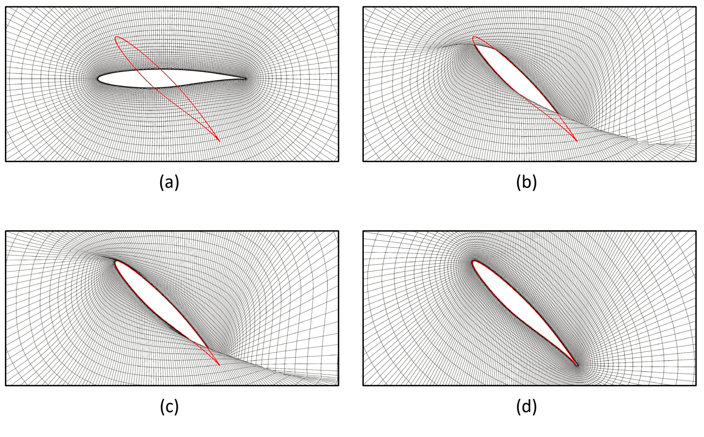

**图 4.** 对 $\mathcal L_{\mathrm{reg}}$ 的研究：如（a）所示，将黑色网格形变以拟合红色形状；（b）$\lambda_{\mathrm{reg}}=0$；（c）$\lambda_{\mathrm{reg}}=10$；（d）$\lambda_{\mathrm{reg}}=100$。

#### 2. 实现细节

DeepGeo 实现为多层感知机（MLP），输入层和输出层均为三维。对于二维 ASO，将 $z$ 坐标直接设为零。所有案例均采用相同默认配置：从输入到输出依次为三个隐藏层，维度分别为 64、256 和 512。每层含偏置项，并采用权重归一化 [64]，总计 151,686 个参数。

这一权重数量看似很大，却不直接反映 DeepGeo 的实际模型复杂度；其实际复杂度远小于原始权重数量所暗示的程度。第 V.A 节将详细讨论。激活函数是 ReLU [65] 与正弦函数之和，既能保证快速收敛，也能计算 $L_{\mathrm{reg}}$ 所需的高阶导数。

DeepGeo 初始化阶段设置 $\lambda_{\mathrm{fix}}=1$、$\lambda_{\mathrm{reg}}=100$（原文此处引用式（4））。对于第 IV 节中的全部案例，DeepGeo 均使用相同配置，不再调整。

如果已有与目标表面 $S$ 对应的计算网格，可以直接将其用作模板 CFD 网格 $\hat M$。此时，式（2）的最小化退化为学习零形变，我们将这一过程称为**自初始化（self-initialization）**。

一种看似直接的方式是将全部网络权重初始化为零，但这会使全部梯度也为零，阻止后续优化。因此，我们随机初始化网络，再训练其近似零形变。经验表明，这不会形成平凡解，并允许后续继续优化。

### B. 使用深度几何映射模型的伴随形状优化

对于本文全部 ASO 案例，DeepGeo 与有限体积 CFD 求解器 ADflow [66] 耦合，在 DeepGeo 生成的 CFD 网格 $M$ 上，使用 Spalart–Allmaras（SA）湍流模型进行雷诺平均 Navier–Stokes（RANS）仿真。优化目标相对于对象表面 $V^S$ 的灵敏度，通过 ADflow 的离散伴随求解器获得。

同时，根据几何约束评估形变后的对象表面，约束记为 $L_{\mathrm{cons}}$。其数值对应优化的不可行程度。几何约束以可微软约束实现，利用自动微分计算其相对于 $V^S$ 的梯度。随后，从 ADflow 提供的表面灵敏度与几何约束梯度出发，通过链式法则计算 $\Theta$ 的梯度，并使用 RAdam [67] 优化器更新 $\Theta$。

总目标函数为：

$$
\mathcal O=\mathcal O_{\mathrm{CFD}}+\lambda_{\mathrm{cons}}L_{\mathrm{cons}}
+\lambda_{\mathrm{reg}}\mathcal L_{\mathrm{reg}}+\lambda_{\mathrm{fix}}\mathcal L_{\mathrm{fix}}.
\tag{5}
$$

其中，$\lambda_{\mathrm{fix}}=1$、$\lambda_{\mathrm{reg}}=0.1$。$\lambda_{\mathrm{cons}}$ 为平衡权重，取决于不同几何约束的数量、量纲和单位。正则化损失 $\mathcal L_{\mathrm{reg}}$ 与固定损失 $\mathcal L_{\mathrm{fix}}$ 按式（3）定义，权重 $\lambda_{\mathrm{reg}}$ 和 $\lambda_{\mathrm{fix}}$ 保持不变。这些损失帮助保留 CFD 网格质量，确保固定边界区域在优化期间保持不动。

$\mathcal O_{\mathrm{CFD}}$ 表示物理目标，例如最小化阻力或最大化升力。后面的各案例将给出它与 $L_{\mathrm{cons}}$ 的准确形式。ASO 随后求解：

$$
\begin{aligned}
\Theta^*
&=\operatorname*{arg\,min}_\Theta\mathcal O\!\left(F_\Theta(\hat V),\Theta\right)\\
&=\operatorname*{arg\,min}_\Theta\Big[
\mathcal O_{\mathrm{CFD}}\!\left(\{\hat V+F_\Theta(\hat V),E\}\right)
+w_{\mathrm{cons}}L_{\mathrm{cons}}(\Theta)\\
&\hspace{45mm}+\lambda_{\mathrm{reg}}\mathcal L_{\mathrm{reg}}(\Theta)
+\lambda_{\mathrm{fix}}\mathcal L_{\mathrm{fix}}(\Theta)\Big].
\end{aligned}
\tag{6}
$$

其中，$\{\hat V+F_\Theta(\hat V)\}$ 为按照 $f_\Theta$ 预测位移移动后的顶点集合。迭代过程采用早停策略终止，这是基于梯度下降的神经网络训练中常见的方法 [68]：当 $O$ 达到用户设定阈值，或经过一定次数迭代后不再显著改善时，停止优化。

> 译注：式（6）的约束权重记为 $w_{\mathrm{cons}}$，而式（5）中记为 $\lambda_{\mathrm{cons}}$，此处按原文保留。

DeepGeo 在不同 ASO 应用中保持固定配置，因此是一种无需调参、全自动的参数化方法。下面通过三个案例验证基于 DeepGeo 的 ASO 框架，包括优化二维圆、三维公务机机翼，以及三维翼身融合飞行器。

## IV. 气动外形优化案例

本节通过三个不同案例展示方法的通用性：从二维圆出发最小化阻力、优化 NASA 通用研究模型（CRM）机翼 [69]，以及优化翼身融合（BWB）飞行器 [70]。尽管案例差异很大，所有二维和三维问题均采用同一配置，不作任何微调。

这种固定配置突出了 DeepGeo 相对于先进 FFD 方法的易用性，后者作为本文的比较基准。与 FFD 不同，本文方法不需要针对不同案例仔细设置控制点，因此无需确定控制点的数量与位置、限制设计变量取值范围，或开发全局设计函数。为不同任务和几何配置 FFD 既耗时，又要求丰富专业知识，而且经常依赖试错。

### A. 从圆出发的优化

首先研究二维圆，以最小化阻力为目标，并预期它能够自然收敛为超临界翼型。该案例涉及显著几何形变，用于检验 DeepGeo 在允许大形变自由度的同时，维持全局形状光滑性，以及在困难条件下确保网格形变鲁棒性的能力。

#### 1. 问题表述

从直径为 1 的二维圆出发，采用与 ADODG-2 跨声速翼型优化基准相同的实验设置。目标是在保持升力系数 $C_L=0.824$，并约束俯仰力矩系数 $C_M\ge-0.092$ 的同时，最小化阻力系数 $C_D$。

优化在跨声速湍流条件下进行，马赫数为 0.734，雷诺数为 $5\times10^6$，初始迎角为 $2.0^\circ$。我们使用 pyHyp [28] 计算图 5a 所示的模板 CFD 网格，其中包含 20,331 个单元。

**原文脚注：** [ADODG 优化基准网页](https://sites.google.com/view/mcgill-computational-aerogroup/adodg)。

**表 1. 案例 I 的气动外形优化任务设置**

| 类别 | 函数／变量 | 说明 | DeepGeo 数量 | FFD 数量 |
|---|---|---|---:|---:|
| 最小化 | $C_D$ | 阻力系数 | — | — |
| 优化变量 | $\Theta$ | DeepGeo 权重 | 151585 | — |
| 优化变量 | $P_z$ | 控制点的 $z$ 坐标 | — | 30 |
| 优化变量 | $\alpha$ | 迎角 | 1 | 1 |
| 设计变量总数 | — | — | 151586 | 31 |
| 约束 | $C_L=0.824$ | 升力系数约束 | 1 | 1 |
| 约束 | $C_M\le0.092$ | 力矩系数约束 | 1 | 1 |
| 约束 | $t\ge0.2t_{\mathrm{RAE2822}}$ | 最小厚度约束 | — | 30 |
| 约束 | $A\ge0.0654$ | 最小面积约束 | 1 | 1 |
| 约束 | $\delta\mathbf v^{\mathrm{TE}}=0$ | 后缘约束 | 1 | — |
| 约束 | $\delta\mathbf v^{\mathrm{LE}}=0$ | 前缘约束 | 1 | — |
| 约束 | $0.5\le\alpha\le4.0$ | 迎角约束 | 1 | 1 |
| 约束总数 | — | — | 6 | 34 |
| 每个设计变量是否需要取值范围限制？ | — | — | 否 | 是 |

> 译注：表中“—”表示原表空白。原文正文将网络参数总数写为 151,686，而表 1、表 2 和表 4 中 DeepGeo 的权重数量为 151,585，连同迎角后的设计变量总数为 151,586。原表还将力矩约束写为 $C_M\le0.092$，与本节正文及式（7）的 $C_M\ge-0.092$ 不同。这里均分别保留。

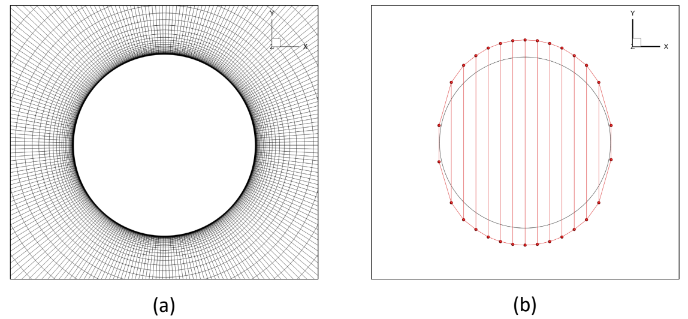

**图 5.** 二维翼型案例的几何设置。（a）DeepGeo 模板网格 $\hat M$；（b）FFD 基准的控制点。

#### 2. DeepGeo 配置

按照 Li and Zhang [47] 的优化策略，采用两阶段优化。首先最小化阻力系数 $C_D$；随后在目标函数中加入有关升力系数 $C_L$ 和力矩系数 $C_M$ 的项，继续优化。因此，将式（5）中的物理目标函数 $\mathcal O_{\mathrm{CFD}}$ 定义为两个版本：

$$
\begin{aligned}
\mathcal O_{\mathrm{CFD},1}&=|C_D|,\\
\mathcal O_{\mathrm{CFD},2}&=|C_D|+|C_L-0.824|+\max(-0.092-C_M,0).
\end{aligned}
\tag{7}
$$

其中，各系数由伴随求解器 $g$ 获得，即 $(C_D,C_L,C_M)=g(\{\hat V+F_\Theta(\hat V),E\})$。

我们使用鞋带公式（Shoelace formula）计算形变翼型面积 $A(V^S)$。几何损失 $\mathcal L_{\mathrm{cons}}$ 包含一个限制面积不低于 RAE-2822 翼型面积 0.0654 的项，以及两个分别固定前缘顶点（LE）和后缘顶点（TE）的项：

$$
\mathcal L_{\mathrm{cons}}=
\underbrace{\max(0.0654-A(V^S),0)^2}_{\text{面积约束}}
+\underbrace{\|\delta\mathbf v^{\mathrm{LE}}\|^2}_{\text{前缘约束}}
+\underbrace{\|\delta\mathbf v^{\mathrm{TE}}\|^2}_{\text{后缘约束}}.
\tag{8}
$$

如第 III.A.2 节所述，将初始网格用作模板网格 $\hat M$。表 1 汇总了实验设置。

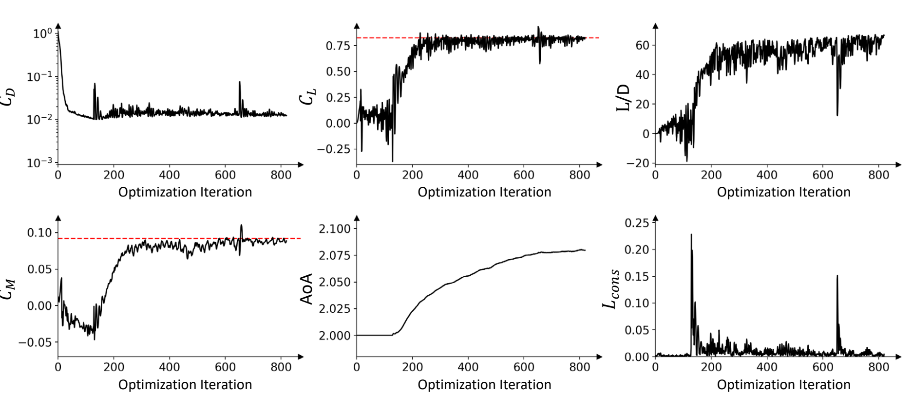

**图 6.** 二维翼型优化过程中重要量的演化。$C_L$ 和 $C_M$ 图中的虚线表示目标值；优化结束时，结果已十分接近这些目标，展示了 DeepGeo 达到气动目标的精度与有效性。

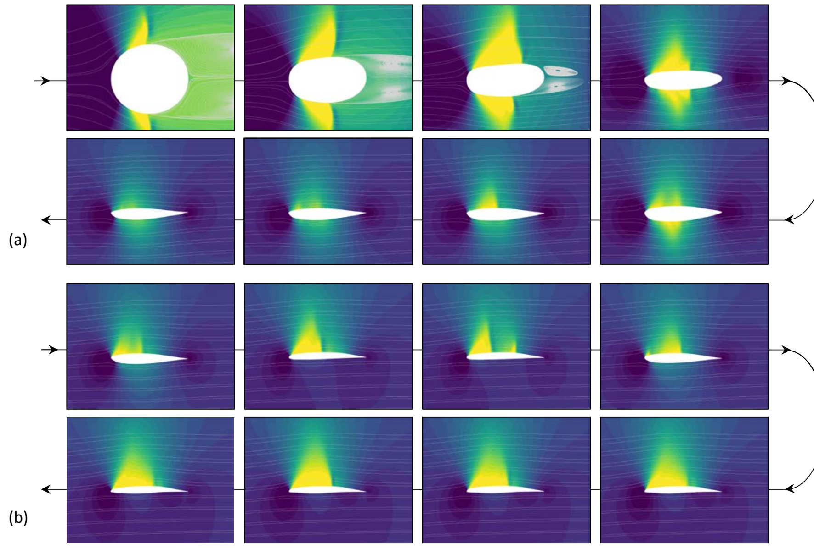

**图 7.** 二维翼型案例中压力系数场的演化。（a）仅最小化 $C_D$；（b）在最小化 $C_D$ 的同时，为 $C_L$ 和 $C_M$ 设置目标。

#### 3. 自由形变基准配置

为进行比较，我们采用文献 [47] 的实现，使用图 5b 所示的 30 点 FFD 配置。设翼型厚度为 $t$，RAE-2822 翼型厚度为 $t_{\mathrm{RAE2822}}$。施加一组厚度约束 $t\ge0.2t_{\mathrm{RAE2822}}$，以防止优化初期出现负体积错误。优化使用 pyOptSparse [71] 中的 SLSQP 优化器。

#### 4. 结果与分析

优化过程见图 6，流场变化见图 7。最小化 $\mathcal O_{\mathrm{CFD},1}$ 时，阻力系数 $C_D$ 显著降低了 99.1%。形状逐渐、光滑地变薄，前缘和后缘逐步形成，并大体保留对称性。整个过程中未出现奇异外形或仿真失败，证明了 DeepGeo 对大幅网格形变的鲁棒性。

在第二阶段，对称性被打破，形成高升力跨声速翼型中常见的流线型轮廓，从而有效增加升力。最初出现一道激波，但随后逐渐弥散，到优化结束时大部分消失。

最终翼型达到 $C_D=0.012195$，即 121.95 个阻力计数；升阻比 $L/D$ 从 $1\times10^{-3}$ 显著提高至 67.22，可与针对跨声速飞行设计的现代超临界翼型相当。这一结果验证了 DeepGeo 获得高性能设计的有效性。

相比之下，基于 FFD 的优化仅迭代少数次便失败，因为形变后的形状出现奇异性，导致严重网格问题，如图 8 所示。在部分迭代中，仿真失败，相应网格以红色表示。

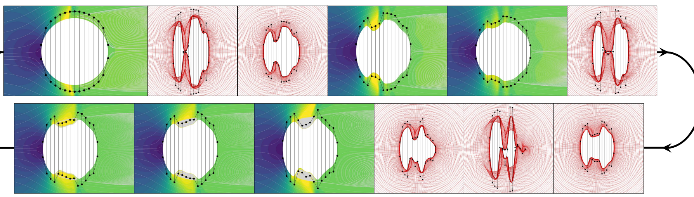

**图 8.** 二维翼型案例中失败的基于 FFD 的优化。没有彩色流场的情况表示仿真未收敛。

虽然 FFD 能确保控制笼内部的局部光滑性，但控制点的自由移动可能导致全局奇异性和几何异常。即使调整超参数，这些问题依然存在。DeepGeo 未出现此类失败，突出了它在要求高形变自由度的复杂形状优化中的稳定性与可靠性。

### B. 通用研究模型机翼优化

下面研究 NASA 通用研究模型机翼（CRM wing），该机翼从 CRM 翼身组合体中提取。如图 9b 所示，初始几何为具有钝后缘的三维机翼。与前一案例一样，将结果与 FFD 基准比较。

#### 1. 问题表述

目标是在保持升力系数 $C_L=0.5$、俯仰力矩系数 $C_M\ge-0.17$ 的同时，最小化阻力系数 $C_D$。这一单点优化问题在全湍流条件下进行：马赫数为 0.85，雷诺数为 $5\times10^6$，初始迎角为 $2.2^\circ$。

附加约束要求机翼体积不低于初始体积，厚度不低于初始厚度的 25%。后缘（TE）顶点以及翼根截面的前缘（LE）顶点固定，其余前缘顶点仅允许沿 $z$ 方向移动，以保持投影面积。优化目标与流动条件遵循 ADODG-4.1 单点优化基准。

优化使用含 450,560 个单元的网格，对应 Lyu et al. [26] 定义的 L2 网格；原文在此将网格图引为图 5a。在这一设置下，DeepGeo 权重仅影响机翼表面形状，迎角作为独立设计变量。表 2 汇总实验设置。

**原文脚注：** [ADODG 优化基准网页](https://sites.google.com/view/mcgill-computational-aerogroup/adodg)。

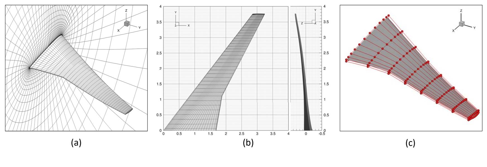

**图 9.** 案例 II 的几何设置，包括：（a）DeepGeo 模板网格；（b）初始 CRM 机翼几何；（c）192 点 FFD 配置。

**表 2. 案例 II 的气动外形优化任务设置**

| 类别 | 函数／变量 | 说明 | DeepGeo 数量 | FFD 数量 |
|---|---|---|---:|---:|
| 最小化 | $C_D$ | 阻力系数 | — | — |
| 优化变量 | $\Theta$ | DeepGeo 权重 | 151585 | — |
| 优化变量 | $P_z$ | 控制点的 $z$ 坐标 | — | 720 |
| 优化变量 | — | 扭转函数 | — | 7 |
| 优化变量 | $\alpha$ | 迎角 | 1 | 1 |
| 设计变量总数 | — | — | 151586 | 728 |
| 约束 | $C_L=0.5$ | 升力系数约束 | 1 | 1 |
| 约束 | $C_M\ge-0.17$ | 力矩系数约束 | 1 | 1 |
| 约束 | $t\ge0.25t_{\mathrm{original}}$ | 最小厚度约束 | — | 750 |
| 约束 | $\mathrm{Vol}\ge\mathrm{Vol}_{\mathrm{original}}$ | 最小体积约束 | 1 | 1 |
| 约束 | $\Delta V^{\mathrm{TE}}=0$ | 后缘约束 | 1 | — |
| 约束 | $\Delta V_x^{\mathrm{LE}}=0,\ \Delta V_y^{\mathrm{LE}}=0$ | 前缘约束 | 1 | — |
| 约束 | $\delta\mathbf v^{\mathrm{LE,root}}=0$ | 固定翼根安装角约束 | 1 | — |
| 约束 | $\Delta P_z^{\mathrm{TE,upper}}=-\Delta P_z^{\mathrm{TE,lower}}$ | 固定后缘约束 | — | 15 |
| 约束 | $\Delta P_z^{\mathrm{LE,upper,root}}=-\Delta P_z^{\mathrm{LE,lower,root}}$ | 固定翼根安装角约束 | — | 1 |
| 约束 | $2.0\le\alpha\le4.0$ | 迎角约束 | 1 | 1 |
| 约束总数 | — | — | 7 | 770 |
| 每个设计变量是否需要取值范围限制？ | — | — | 否 | 是 |

> 译注：图 9c 及本节正文将 FFD 配置记为 192 个控制点，但原表列出的控制点 $z$ 坐标变量数量为 720，设计变量总数为 728。这里均按原文保留。

#### 2. DeepGeo 配置

与前一案例相同，将 L2 网格作为输入模板网格 $\hat M$。式（5）中的目标函数 $\mathcal O_{\mathrm{CFD}}$ 和损失函数 $\mathcal L_{\mathrm{cons}}$ 定义为：

$$
\begin{aligned}
\mathcal O_{\mathrm{CFD}}
&=|C_D|+|C_L-0.5|+\max(-0.17-C_M,0),\\
\mathcal L_{\mathrm{cons}}
&=\underbrace{\max\!\left(\mathrm{Vol}(V^S)-\mathrm{Vol}_{\mathrm{original}}(S),0\right)^2}_{\text{体积约束}}
+\underbrace{\|\Delta V^{\mathrm{TE}}\|^2}_{\text{后缘约束}}\\
&\quad+\underbrace{\|\Delta V_x^{\mathrm{LE}}\|^2+\|\Delta V_y^{\mathrm{LE}}\|^2}_{\text{前缘约束}}
+\underbrace{\|\delta\mathbf v^{\mathrm{LE,root}}\|^2}_{\text{固定翼根安装角约束}}.
\end{aligned}
\tag{9}
$$

最小化 $\mathcal O_{\mathrm{CFD}}$ 的目的是降低 $C_D$、使 $C_L$ 接近 0.5，并确保 $C_M\ge-0.17$。我们采用扩展鞋带公式 [72]，以翼根截面平面上的任意点为参考点，计算形变机翼体积 $\mathrm{Vol}(V^S)$。$\mathrm{Vol}_{\mathrm{original}}(S)$ 表示机翼初始体积。

$\mathbf v^{\mathrm{LE,root}}$ 对应翼根截面上的单个前缘顶点，$V_x$ 和 $V_y$ 分别为顶点 $x$、$y$ 坐标的集合。实际中，DeepGeo 无需显式厚度损失项即可满足厚度要求。

> 译注：正文要求体积不低于初始值，但式（9）按原文写为惩罚 $\mathrm{Vol}(V^S)-\mathrm{Vol}_{\mathrm{original}}(S)$ 的正值，即其方向与正文要求相反；后面的式（11）也采用相同形式。译稿不改动原式。

#### 3. 自由形变基准配置

为比较，采用 Li et al. [33]、Hwang et al. [73] 的 192 控制点 FFD 基准，如图 9c 所示。设控制点为 $P=\{\mathbf p_1,\mathbf p_2,\ldots,\mathbf p_{192}\}$，其中每个 $\mathbf p=\{p_x,p_y,p_z\}$，位移记为 $\Delta P$。优化控制点位置，并在各控制笼内对机翼表面插值，实现局部形状变化。

另外，使用全局函数引入展向扭转，将 7 个旋转角作为附加设计变量。192 个控制点沿翼展划分为 7 个截面，每个截面独立旋转。优化采用 MACH-Aero 框架：pyGeo [5] 实现 FFD 参数化，IDWarp [28] 使计算网格形变，pyOptSparse [71] 执行优化。

#### 4. 结果与分析

定量比较结果见表 3。FFD 结果是在大量调参后得到的，而 DeepGeo 无需任何参数调整。优化后阻力系数 $C_D$ 的差异小于 0.5%。如 Lyu et al. [26] 所指出，即使 FFD 配置仅有轻微变化，也可能使优化后阻力系数增加最多 2.4 个计数。

**表 3. 案例 II 的 CRM 机翼优化结果。$C_D$ 的 1 个计数等于 $10^{-4}$。**

| 参数化方法 | 最终 $C_D$（计数） | 最终 $C_L$ | 最终 $C_M$ | 最终 $\alpha$ |
|---|---:|---:|---:|---:|
| DeepGeo | 200.05 | 0.5000 | -0.1717 | 2.08 |
| FFD | 199.03 | 0.5000 | -0.1700 | 2.14 |

图 10 展示优化历史，与 FFD 优化历史的比较见附录 B（原文此处写作“Appendix A.B”）。

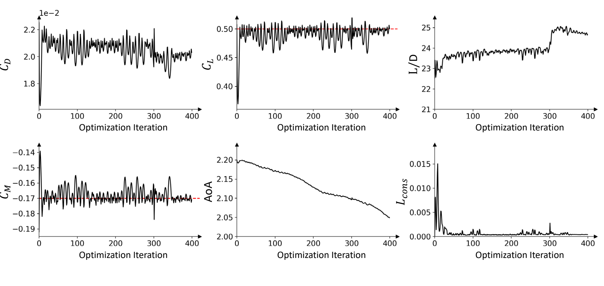

**图 10.** 案例 II 的优化历史。$C_L$ 和 $C_M$ 图中的虚线表示优化目标。

最初，DeepGeo 通过自初始化对 CRM 机翼参数化，与二维圆案例相同。在前 300 次优化迭代中，机翼升阻比 $L/D$ 从 22.5 增至 23.8。优化收敛后，使用一个新的 DeepGeo 模型进行自初始化，对部分优化后的机翼重新参数化，随后继续优化。

$L/D$ 先达到最大值 25.0，再逐渐下降，最佳结果出现在第 320 次迭代，阻力系数 $C_D$ 降低 10.9%。

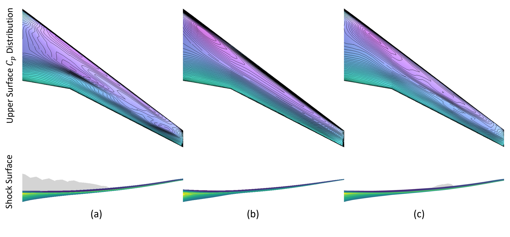

**图 11.** 案例 II 的压力系数分布与激波形状比较：（a）初始 CRM 机翼；（b）使用 192 点 FFD 优化的机翼；（c）使用 DeepGeo 优化的机翼。

图 11 比较了两种参数化方法的压力分布与激波形态。两种优化结果的激波均显著减弱。两者压力等值线都呈较为平行的排列，表明气动性能改善，但二者仍有明显差异。

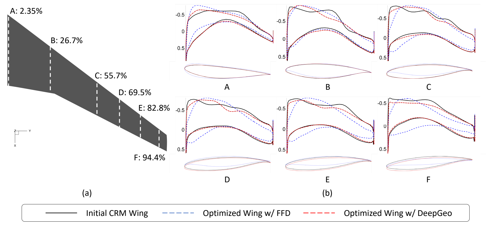

**图 12.** 案例 II 的截面几何比较，包括（a）截面位置，以及（b）各截面的形状变化与压力系数分布。

图 12 比较了沿翼展不同位置的优化机翼二维截面。对于约束满足情况，DeepGeo 优化结果沿翼展的全部 6 个截面，均满足厚度不低于原始厚度 25% 的约束。

FFD 和 DeepGeo 产生了不同形状：FFD 结果具有非常尖锐的前缘，厚度沿翼展变化显著；DeepGeo 结果相对于初始形状的偏离较小。其前缘不那么尖锐，后缘更符合几何约束，翼尖也保持足够厚度，避免过度变薄。

DeepGeo 的最终设计位于靠近基准几何的较窄设计空间中，这可能是因为在严格几何约束下，高维梯度优化过程发生局部收敛。优化形状倾向于仅对初始设计作相对较小的修改。相比之下，FFD 优化积极减小前缘厚度，以降低设计点阻力，但可能损害对起降至关重要的低速气动性能 [33]。因此，当初始方案已是较好的概念设计时，DeepGeo 的方法具有优势，能够以较少调整提供更可控的 ASO 流程。

总之，DeepGeo 以更简单、更少人工投入的设置，达到与最佳人工调参 FFD 方法相当的气动性能。它能减少大量调参需求，因此是工业气动优化的一种有效、实用选择。

### C. 翼身融合飞行器优化

下面展示 DeepGeo 无需调参即可处理复杂三维几何的能力。为此，我们优化图 13 所示的波音第一代翼身融合（BWB）设计。

BWB 构型将机翼与机身融合成单一、无缝结构，以提高气动效率、降低阻力和燃油消耗。本案例的 BWB 翼展为 280 英尺，总长 144 英尺，设计载客量为 800 人 [70]。一个突出挑战是超声速气流会产生显著激波，带来较大阻力。优化的关键在于改进 BWB 外形，减轻这些阻力效应。

#### 1. 问题表述

优化目标是在约束升力系数 $C_L=0.20056$、俯仰力矩系数 $C_M=0$ 的同时，最小化阻力系数 $C_D$。

单点优化在全湍流条件下进行，马赫数为 0.85，雷诺数为 $5\times10^6$，初始迎角为 $0.58^\circ$。优化所用网格包含 1,070,080 个单元，与 Lyu and Martins [74] 的 L2 网格配置相同。

仅允许沿 $z$ 轴修改形状，以保持恒定投影面积；同时，约束飞行器体积不低于初始体积，防止通过缩小体积来减阻而损害载客能力。与 CRM 机翼任务相比，BWB 优化受到的约束更少。表 4 汇总实验设置。

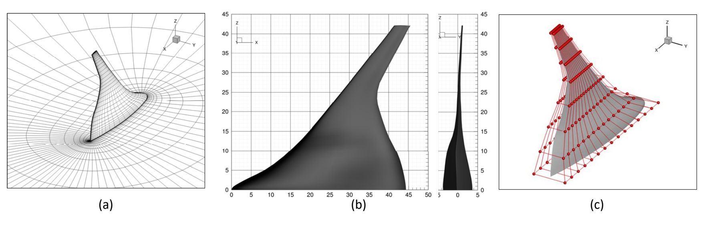

**图 13.** BWB 案例的几何设置。（a）DeepGeo 模板网格；（b）初始 BWB 飞行器几何；（c）240 点 FFD 配置。

#### 2. DeepGeo 配置

DeepGeo 使用 L2 网格作为模板网格。同样，通过自初始化学习全零形变，对 BWB 几何进行参数化。DeepGeo 产生的形状变化仅限于 $z$ 轴，符合优化问题允许的修改方式，因此无需额外施加前缘（LE）和后缘（TE）几何约束。

式（5）中的气动目标函数 $\mathcal O_{\mathrm{CFD}}$ 与体积约束 $\mathcal L_{\mathrm{cons}}$ 定义为：

$$
\mathcal O_{\mathrm{CFD}}=|C_D|+|C_L-0.5|+|C_M|,
\tag{10}
$$

$$
\mathcal L_{\mathrm{cons}}
=\max\!\left(\mathrm{Vol}(V^S)-\mathrm{Vol}_{\mathrm{original}}(S),0\right)^2.
\tag{11}
$$

> 译注：本节正文与表 4 将升力目标写为 $C_L=0.20056$，但原文式（10）使用 $|C_L-0.5|$，这里保留原式。式（11）的体积差顺序，也按原文保留，相关说明见式（9）后的译注。

**表 4. 案例 III 的气动外形优化任务设置**

| 类别 | 函数／变量 | 说明 | DeepGeo 数量 | FFD 数量 |
|---|---|---|---:|---:|
| 最小化 | $C_D$ | 阻力系数 | — | — |
| 优化变量 | $\Theta$ | DeepGeo 权重 | 151585 | — |
| 优化变量 | $P_z$ | 控制点的 $z$ 坐标 | — | 240 |
| 优化变量 | $\alpha$ | 迎角 | 1 | 1 |
| 设计变量总数 | — | — | 151586 | 241 |
| 约束 | $C_L=0.20056$ | 升力系数约束 | 1 | 1 |
| 约束 | $C_M=0$ | 力矩系数约束 | 1 | 1 |
| 约束 | $t\ge0.01t_{\mathrm{original}}$ | 最小厚度约束 | — | 750 |
| 约束 | $\mathrm{Vol}\ge\mathrm{Vol}_{\mathrm{original}}$ | 最小体积约束 | 1 | 1 |
| 约束 | $0\le\alpha\le2.5$ | 迎角约束 | 1 | 1 |
| 约束总数 | — | — | 7 | 754 |
| 每个设计变量是否需要取值范围限制？ | — | — | 否 | 是 |

#### 3. 自由形变基准配置

FFD 配置遵循 Lyu and Martins [74] 所提出的成熟设置，使用 240 个控制点，如图 13c 所示。为防止优化过程中因负体积错误而崩溃，加入最小厚度约束。FFD 基准采用 pyOptSparse [71] 中实现的 IPOPT 进行优化。

#### 4. 结果与分析

图 14 展示优化过程中的关键气动量，与 FFD 优化历史的比较见附录 B（原文写作“Appendix A.B”）。$C_L$ 和 $C_M$ 约束很快得到满足。

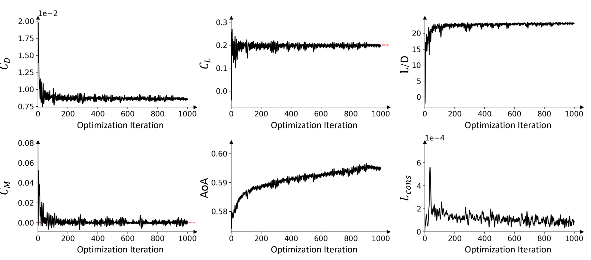

**图 14.** BWB 案例优化过程中重要量的演化。$C_L$ 和 $C_M$ 图中的虚线表示优化目标。

基于 DeepGeo 的优化在第 149 次迭代便得到无激波设计，总迭代次数与 FFD 优化仍处于同一数量级。表 5 给出自动 DeepGeo 与最佳人工配置 FFD 基准的定量比较。

**表 5. 案例 III 的 BWB 飞行器优化结果**

| 参数化方法 | 最终 $C_D$（计数） | 最终 $C_L$ | 最终 $C_M$ | 最终 $\alpha$ |
|---|---:|---:|---|---:|
| DeepGeo | 86.42 | 0.20072 | $9.8807\times10^{-4}$ | 0.60 |
| FFD | 87.05 | 0.20056 | $2.4675\times10^{-9}$ | 2.47 |

在气动性能方面，DeepGeo 总计减阻 47.8%，最终 $C_D$ 比 FFD 低 0.63 个计数。另外，如图 15 所示，FFD 优化构型在翼尖附近出现双激波，这是实际应用中不希望出现的特征。相比之下，DeepGeo 优化设计在翼尖附近没有激波。

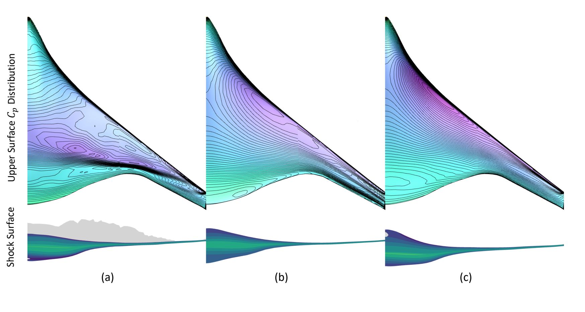

**图 15.** 案例 III 的压力系数分布与激波形状比较：（a）初始 CRM 机翼；（b）使用 240 点 FFD 优化的机翼；（c）使用 DeepGeo 优化的机翼。

> 译注：以上图注按原文翻译；原文将本图对象写成“CRM wing”，但本图所在章节及展示对象均为 BWB 飞行器。

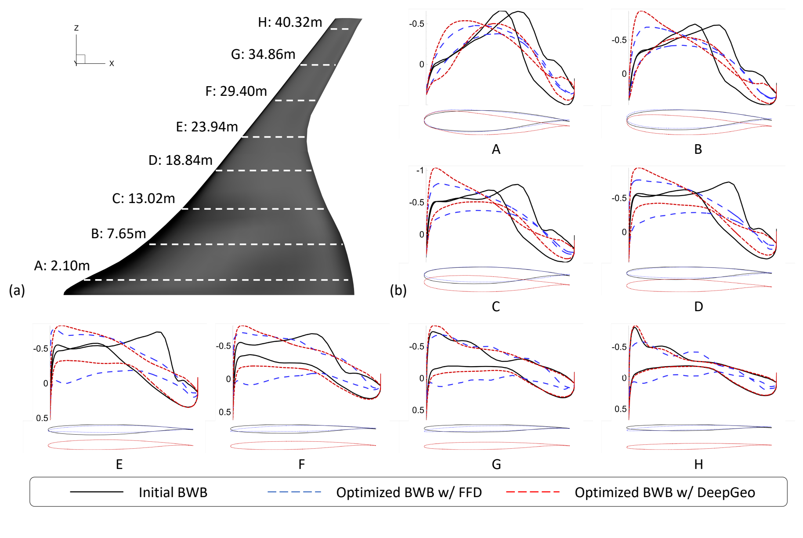

**图 16.** 案例 III 的截面几何比较，包括（a）截面位置，以及（b）各截面的形状变化与压力系数分布。

图 16 沿翼展对几何变化进行了截面分析。DeepGeo 优化结果的展向弯曲变化更大，上翘程度较低，而各个截面内部的形状变化较小。与 CRM 机翼结果类似，FFD 优化设计的前缘要尖锐得多，可能不利于低速气动性能。

总之，当几何约束较少时，DeepGeo 能提供更大形变自由度，从而拓宽可探索设计空间。相比之下，若要让 FFD 获得类似灵活性，用户必须手动实现多种全局设计函数，并引入额外设计变量，例如后掠、扭转和上反角函数；同时还需仔细约束每个新设计变量，以避免优化失败。这需要显著的额外工程投入，因此 DeepGeo 是更高效、灵活的替代方案。

## V. 讨论

### A. DeepGeo 过参数化与复杂度的合理性

传统参数化依赖低维设计变量，存在以下主要局限：

- **需要大量人工介入。** 包括选择适当方法、配置参数以平衡灵活性、光滑性和鲁棒性，以及仔细定义参数约束。此外，参数之间的重要关联，例如机翼优化中的扭转或后掠全局函数，必须显式硬编码，高度依赖领域专业知识。
- **依赖高成本试错。** 结果质量往往依赖反复的人工实验。例如，不合适的 CRM 机翼 FFD 配置，可能使减阻改善幅度降低 42% [26]，因此需要多次优化尝试才能获得接近最优的设计。

相比之下，DeepGeo 利用过参数化实现其能力、适应性和鲁棒性。大量参数不是缺点，而是必要设计选择：它使 DeepGeo 能捕捉复杂几何变化，并通过完全自动、不依赖数据的过程实现前述优势。

在式（2）定义的初始化阶段，DeepGeo 将参数选择、设置和整合统一于自适应框架，自动学习设计参数化。因此，相对于传统参数化，DeepGeo 最显著的优势是减少人工干预、降低对专家先验的依赖，并消除高成本试错。

与不依赖深度学习的方法比较时，直接用权重数量代表 DeepGeo 的实际复杂度会产生误导。原因在于，DeepGeo 与多数高维参数空间的深度学习方法一样，参数多并不必然意味着复杂度过高。

近期研究揭示了**双下降（double descent）**现象 [75,76]，如图 17 所示：随着模型规模增大，泛化误差先降低，在插值阈值附近升高，随后又随着进一步过参数化而降低。

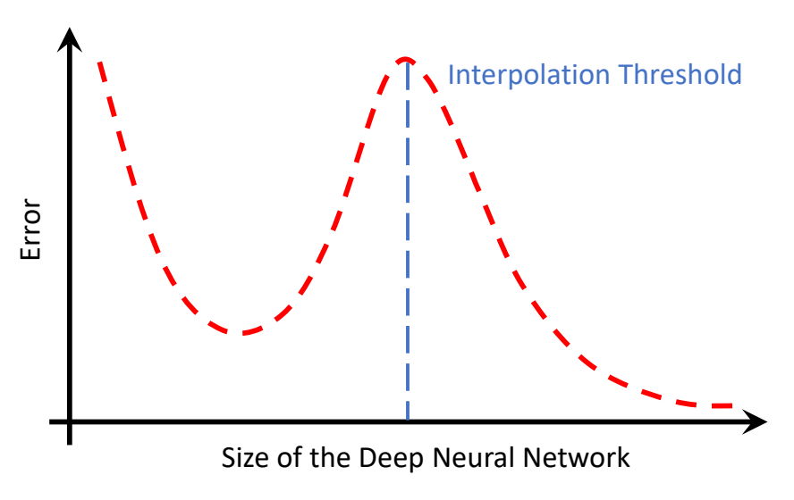

**图 17.** 深度学习模型中的双下降现象。横轴为深度神经网络规模，纵轴为误差，蓝色虚线标记插值阈值。

第二次下降意味着，高度过参数化的模型即使参数数量过多，也可能更加有效。这种行为源于神经网络中形成的权重关联 [77]，以及训练过程中独立自由度数量的减少。

因此，更有意义的 DeepGeo 复杂度指标是**有效维数（effective dimensionality）**，它量化参数空间中影响模型行为的独立方向数量，类似于模型降阶中的降维维数。训练良好的网络通常具有较低有效维数，这意味着尽管参数很多，其函数仍位于相对低维的参数子空间，并能有效压缩数据中的信息。

**表 6. DeepGeo 模型有效维数比较。随机模型数值基于 20 次重复实验。**

| 模型 | 第 1 层（权重占比 0.1%） | 第 2 层（权重占比 11.0%） | 第 3 层（权重占比 87.9%） | 输出层（权重占比 1.0%） | 总体 |
|---|---|---|---|---|---|
| 随机模型 | 264.0 ± 44.9 | 114.4 ± 63.1 | 226.5 ± 33.5 | 332.7 ± 34.4 | 215.3 ± 37.1 |
| 二维圆 | 2.6 | 2.9 | 2.6 | 3.9 | 2.6 |
| CRM 机翼 | 2.3 | 0.4 | 0.1 | 4.8 | 0.2 |
| BWB 飞行器 | 134.8 | 51.5 | 24.6 | -0.5 | 27.4 |

为实证验证上述解释，我们使用基于 DeepGeo 权重对称 Hessian 矩阵特征值的指标 [78] 计算有效维数，定义见式（A.1），更多细节见附录 A（原文此处写作“Appendix A.A”）。

如表 6 所示，完成初始化的 DeepGeo 模型，有效维数显著低于随机初始化模型。这支持了以下观点：DeepGeo 的实际复杂度，远低于其参数数量可能暗示的水平。

### B. DeepGeo 光滑性、表达能力及正则化损失的作用

DeepGeo 同时提供全局表面光滑性和足够形变自由度，以支持高保真设计优化，主要有以下几个原因。

首先，光滑性自然来源于 MLP 骨干的固有性质，文献中称为**频率原则** [79,80] 或**谱偏置** [81]。因此，网络倾向于优先表示低频特征，高频分量通常需要更多训练迭代才会出现。ASO 收敛所需迭代次数通常少于典型深度学习训练，因此不希望出现的鼓包或不连续等高频模式不太容易产生。

其次，DeepGeo 学习的是形状形变场，而不是从零构造整个几何；形变场本身更光滑。例如，使翼型形变时，DeepGeo 不必从零重建尖锐后缘或圆钝前缘，而是学习修改这些特征的光滑变换，从而简化学习并提高整体表面规则性。

第三，基于梯度下降的优化器使设计轨迹平滑过渡。每次迭代的新形变几何，都只是前一次几何的轻微变化，因此在很大程度上避免突变或不稳定的几何变换。

DeepGeo 的表达能力由其过参数化 MLP 结构支撑。根据通用逼近理论 [13,14]，其表达能力的上界取决于模型规模。不过，第 V.A 节实证结果表明，当前规模已使本文全部 ASO 任务体现出过参数化效应。如果用于显著更复杂的任务，可能需要增加模型规模。

基于 Hessian 的正则化损失 $L_{\mathrm{reg}}$ 虽然是为稳定体网格形变而引入的，但它直接惩罚网络 Hessian 的大小，因此可能约束 DeepGeo 的频率行为。要充分理解该正则化对模型频谱性质的理论影响，仍需进一步研究。不过，经验结果未表明：在适当设置 $L_{\mathrm{reg}}$ 权重时，DeepGeo 的表达能力会显著降低。

如图 4，即使将 $L_{\mathrm{reg}}$ 权重改变数个数量级，得到的形变外形仍几乎相同。我们还分析了设计优化开始时，$\mathcal O_{\mathrm{CFD}}$ 和 $L_{\mathrm{reg}}$ 相对于 DeepGeo 参数的梯度大小。如表 7，全部网络层中 $\|\nabla L_{\mathrm{reg}}\|$ 均比 $\|\nabla\mathcal O_{\mathrm{CFD}}\|$ 小数个数量级。这表明，由伴随求解器驱动的物理目标，是塑造 DeepGeo 行为的主导力量。

**表 7. 关于 DeepGeo 各网络层的物理目标与正则化损失梯度平均向量范数比较**

| 比较对象 | ASO 案例 | 第 1 层 | 第 2 层 | 第 3 层 | 输出层 |
|---|---|---|---|---|---|
| $\nabla\mathcal O_{\mathrm{CFD}}$ | 二维圆 | 0.1825 | 0.4186 | 0.5105 | 6.3915 |
| $\nabla\mathcal O_{\mathrm{CFD}}$ | CRM 机翼 | 0.1254 | 0.2814 | 0.2411 | 6.4747 |
| $\nabla\mathcal O_{\mathrm{CFD}}$ | BWB 飞行器 | 0.1137 | 0.2166 | 0.1495 | 1.3316 |
| $\nabla L_{\mathrm{reg}}$ | 二维圆 | 0.0003 | 0.0003 | 0.0009 | 0.0235 |
| $\nabla L_{\mathrm{reg}}$ | CRM 机翼 | $9.4266\times10^{-5}$ | $9.9453\times10^{-5}$ | $3.8320\times10^{-5}$ | 0.0016 |
| $\nabla L_{\mathrm{reg}}$ | BWB 飞行器 | 0.0009 | 0.0008 | 0.0003 | 0.0034 |

另外，DeepGeo 不同于 ASO 中的传统谱参数化方法，例如 Li et al. [82] 和 Li and Zhang [83]。这些方法依赖显式模态截断来降维，预先限制设计空间。相反，DeepGeo 不手动截断频谱，而是通过优化，自适应不同几何和设计任务。

计算机视觉与图形学近期引入位置嵌入 [84] 和特征网格 [85] 等技术，将高频细节注入 MLP。它们为未来实现 DeepGeo 的可控光滑性，以及按需扩展模型表达能力，提供了有前景的方向。

## VI. 结论

本文提出新框架，利用深度几何学习，为气动外形优化（ASO）实现全自动形状参数化。通过自动化参数化过程，DeepGeo 相较传统方法显著提高效率与鲁棒性，减少人工介入，同时保持优于或至少相当于最佳人工调参技术的优化性能。

具体而言，与先进的自由形变（FFD）模型相比，DeepGeo 能够全自动处理多种二维和三维几何；FFD 则需要用户针对每个任务设计专用配置，才能达到最佳性能，这要求大量调参与深厚领域先验知识。

此外，DeepGeo 在伴随 ASO 流程内，直接将 CFD 网格形变集成到参数化模型，而传统方法依赖独立模块，将网格问题作为物理仿真前处理。该集成简化 ASO 流程，消除额外网格管理需求。

DeepGeo 在保持全局表面光滑性的同时，提供较大的形状形变自由度。例如，在从二维圆出发的优化案例中，DeepGeo 无需复杂调整即可成功收敛，而 FFD 面临严重困难，未能收敛；对 FFD 所需的补救措施既复杂，也并非容易实现 [86]。

特别是，DeepGeo 不需要任何训练数据，却仍能利用深度学习优势处理高维优化问题。这种数据独立性消除了大量数据工程需求。相比传统流程，基于 DeepGeo 的 ASO 框架不需要用户提供额外输入。

通过自动形状参数化并简化 ASO 中的几何处理，DeepGeo 显著降低开发复杂度，使更多用户能够使用这一技术。这种能力的普及，使更多工程师和设计者能以较低技术门槛利用先进计算机辅助工程能力。在工业环境中，DeepGeo 自动化框架还有望显著缩短 ASO 开发时间、降低成本，在无需大量人工调整的情况下加速原型开发与迭代设计。

未来，我们计划利用 DeepGeo 简化的几何处理能力，以及对专家先验的独立性，探索更先进的 ASO 应用，例如优化仿生形状或基于用户草图形成的设计。同时，将探索数据驱动逆向设计模型与 DeepGeo 的耦合，使 DeepGeo 从更好的设计初始化中获益，实现更有效的设计优化。

此外，DeepGeo 的自动化能力可能惠及其他需要高维优化和形状操纵的工程领域。我们将研究如何将 DeepGeo 作为更广泛计算机辅助工程应用的基础几何模型，推动多个学科的创新。

## 附录

### A. DeepGeo 有效维数的计算

为量化 DeepGeo 的有效维数，采用 Maddox et al. [78] 的方法。在这一框架中，使用对称矩阵的特征值 $\{\lambda_1,\lambda_2,\ldots,\lambda_K\}$ 计算有效维数。该对称矩阵为 DeepGeo 权重的 Hessian，记为 $\mathcal H_W$，定义如下：

$$
N_{\mathrm{eff}}(\mathcal H_W)=\sum_{i=1}^K\frac{\lambda_i}{\lambda_i+z},
\tag{A.1}
$$

其中，$z=10^{-3}$ 为正则化常数。

我们不为所有参数计算单个巨大 Hessian，而是分别为各全连接层，即第 1 至第 3 层以及输出层计算 Hessian。这种逐层计算既降低计算负担，也使各层对总体有效维数的贡献更加清晰。

每层的 Hessian 使用 PyTorch 自动微分获得。总体值为各层有效维数的加权和，权重为该层参数占 DeepGeo 总参数的比例。对于随机 DeepGeo 模型，以 20 次重复随机初始化计算有效维数。这种方法更深入地揭示 DeepGeo 如何通过初始化利用过参数化。

### B. 与基于 FFD 的优化收敛历史比较

图 A.1 展示 FFD 与 DeepGeo 的优化收敛历史。CRM 机翼使用 192 点 FFD 配置，BWB 飞行器使用 240 个控制点，两种 FFD 优化均使用 IPOPT 优化器。

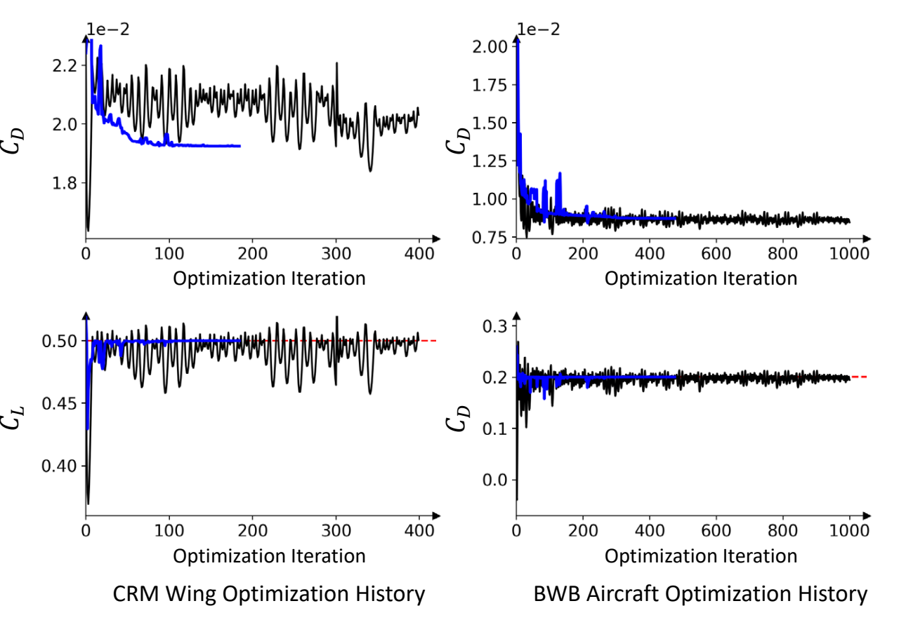

**图 A.1.** 基于 DeepGeo（黑色）与基于 FFD（蓝色）的优化收敛历史比较。

蓝线所示的 FFD 优化比 DeepGeo 收敛更快，但迭代次数仍处于同一数量级。DeepGeo 在早期便能取得显著改善，但需要更多迭代才能达到更好的最优解。

例如，在 BWB 飞行器案例中，DeepGeo 于第 149 次迭代达到无激波设计，之后继续改善，在 998 次迭代后达到更高性能。由于一阶梯度下降优化器效率有限，DeepGeo 的收敛路径可能不够稳定。我们认为，进一步研究更先进的优化策略，有望改善其收敛行为。

## 致谢

Zhen Wei 的研究部分得到瑞士国家科学基金会（SNSF 200020_204231）及法国“未来投资计划”（Programme d’Investissements d’avenir）EUR-TSAE 的支持。

Michaël Bauerheim 得到法国武器装备总局（Direction Générale de l’Armement）通过国防创新局（Agence de l’Innovation de Défense）在 DECAP 项目（Design et Contrôle par Apprentissage Profond，基于深度学习的设计与控制）下的支持。

Rhea P. Liem 和 Aobo Yang 得到香港研究资助局优配研究金支持，项目编号为 16210621。

## References

[1] Hicks, R. M., and Henne, P. A., “Wing Design by Numerical Optimization,” Journal of Aircraft, Vol. 15, No. 7, 1978, pp. 407–412. https://doi.org/10.2514/3.58379.

[2] Kulfan, B. M., “Universal Parametric Geometry Representation Method,” Journal of Aircraft, Vol. 45, No. 1, 2008, pp. 142–158. https://doi.org/10.2514/1.29958.

[3] Sederberg, T., and Parry, S., “Free-Form Deformation of Solid Geometric Models,” ACM SIGGRAPH, Vol. 20, No. 4, 1986.

[4] Lamousin, H. J., and Jr., W. N. W., “NURBS-based free-form deformations,” Computer Graphics and Applications, Vol. 14, No. 6, 1994, pp. 59–65. https://doi.org/10.1109/38.329096.

[5] Kenway, G., Kennedy, G., and Martins, J. R. R. A., “A CAD-Free Approach to High-Fidelity Aerostructural Optimization,” 13th AIAA/ISSMO Multidisciplinary Analysis Optimization Conference, Fort Worth, Texas, USA, September 13-15, 2010. https://doi.org/10.2514/6.2010-9231.

[6] Masters, D. A., Taylor, N. J., Rendall, T. C. S., Allen, C. B., and Poole, D. J., “Geometric Comparison of Aerofoil Shape Parameterization Methods,” American Institute of Aeronautics and Astronautics Journal, Vol. 55, No. 5, 2017, pp. 1575–1589.

[7] Vuruskan, A., and Hosder, S., “Impact of Turbulence Models and Shape Parameterization on Robust Aerodynamic Shape Optimization,” Journal of Aircraft, Vol. 56, No. 3, 2019, pp. 1099–1115. https://doi.org/10.2514/1.C035039.

[8] Song, W., and Keane, A., “A Study of Shape Parameterisation Methods for Airfoil Optimisation,” 10th AIAA/ISSMO Multidisciplinary Analysis and Optimization Conference, 2004. https://doi.org/10.2514/6.2004-4482.

[9] Bamford, T., Keane, A., and Toal, D., “SDF-GAN: Aerofoil Shape Parameterisation via an Adversarial Auto-Encoder,” AIAA AVIATION FORUM AND ASCEND 2024, 2024. https://doi.org/10.2514/6.2024-3665.

[10] Swannet, K., Varriale, C., and Doan, N. A. K., “Towards Universal Parameterization: Using Variational Autoencoders to Parameterize Airfoils,” AIAA SCITECH 2024 Forum, 2024. https://doi.org/10.2514/6.2024-0686.

[11] Secchi, P. d., and Sêcco, N. R., “A Fully Data-Driven Generative Design Routine for Subsonic Airfoils Based on Adversarial Autoencoders,” AIAA AVIATION FORUM AND ASCEND 2024, 2024. https://doi.org/10.2514/6.2024-3667.

[12] Jameson, A., “Optimum aerodynamic design using CFD and control theory,” Computational Fluid Dynamics Conference, 1995, p. 1729.

[13] Barron, A., “Universal approximation bounds for superpositions of a sigmoidal function,” IEEE Transactions on Information Theory, Vol. 39, No. 3, 1993, pp. 930–945. https://doi.org/10.1109/18.256500.

[14] Poggio, T., Mhaskar, H., Rosasco, L., Miranda, B., and Liao, Q., “Why and when can deep-but not shallow-networks avoid the curse of dimensionality: A review,” International Journal of Automation and Computing, Vol. 14, 2017, pp. 503–519. https://doi.org/10.1007/s11633-017-1054-2.

[15] Hansen, N., “The CMA Evolution Strategy: A Tutorial,” arXiv Preprint, 2016.

[16] Wei, Z., Fua, P., and Bauerheim, M., “Automatic Parameterization for Aerodynamic Shape Optimization via Deep Geometric Learning,” AIAA AVIATION Forum, 2023, p. 3471.

[17] Jameson, A., “Aerodynamic Design via Control Theory,” Journal of Scientific Computing, Vol. 3, 1988, pp. 233–260. https://doi.org/10.1007/BF01061285.

[18] Braibant, V., and Fleury, C., “Shape optimal design using B-splines,” Computer Methods in Applied Mechanics and Engineering, Vol. 44, No. 3, 1984, pp. 247–267. https://doi.org/10.1016/0045-7825(84)90132-4.

[19] Farin, G. E., NURB curves and surfaces: from projective geometry to practical use, A. K. Peters, Ltd., 63 South Avenue Natick, MA, United States, 1995.

[20] Bloor, M. I. G., and Wilson, M. J., “Efficient parametrization of generic aircraft geometry,” Journal of Aircraft, Vol. 32, No. 6, 1995, pp. 1269–1275. https://doi.org/10.2514/3.46874.

[21] Smith, R., Bloor, M., Wilson, M., and Thomas, A., “Rapid airplane parametric input design (RAPID),” 12th Computational Fluid Dynamics Conference, 1995. https://doi.org/10.2514/6.1995-1687.

[22] Pickett, R. M., Rubinstein, M., and Nelson, R., “Automated Structural Synthesis Using a Reduced Number of Design Coordinates,” AIAA Journal, Vol. 11, No. 4, 1973, pp. 489–494. https://doi.org/10.2514/3.50489.

[23] Hager, J., Eyi, S., and Lee, K., “A multi-point optimization for transonic airfoil design,” 4th Symposium on Multidisciplinary Analysis and Optimization, 1992. https://doi.org/10.2514/6.1992-4681.

[24] Sobieczky, H., “Parametric Airfoils and Wings,” Recent Development of Aerodynamic Design Methodologies: inverse Design and Optimization, 1999, pp. 71–87.

[25] Barr, A. H., “Local and Global Deformations of Solid Primitives,” ACM SIGGRAPH, Vol. 18, No. 3, 1984, pp. 21–30.

[26] Lyu, Z., Kenway, G. K. W., and Martins, J. R. R. A., “Aerodynamic Shape Optimization Investigations of the Common Research Model Wing Benchmark,” American Institute of Aeronautics and Astronautics Journal, Vol. 53, No. 4, 2015, pp. 968–985. https://doi.org/10.2514/1.J053318.

[27] Wu, N., Mader, C., and Martins, J. R., Sensitivity-based Geometric Parameterization for Aerodynamic Shape Optimization, 2022. https://doi.org/10.2514/6.2022-3931.

[28] Secco, N. R., Kenway, G. K. W., He, P., Mader, C., and Martins, J. R. R. A., “Efficient Mesh Generation and Deformation for Aerodynamic Shape Optimization,” AIAA Journal, Vol. 59, No. 4, 2021, pp. 1151–1168. https://doi.org/10.2514/1.J059491, URL https://doi.org/10.2514/1.J059491.

[29] Ceze, M., Hayashi, M., and Volpe, E., “A Study of the CST Parameterization Characteristics,” 27th AIAA Applied Aerodynamics Conference, 2009. https://doi.org/10.2514/6.2009-3767.

[30] Li, J., Du, X., and Martins, J. R., “Machine Learning in Aerodynamic shape Optimization,” Progress in Aerospace Sciences, Vol. 134, 2022, p. 100849.

[31] Robinson, G. M., and Keane, A. J., “Concise Orthogonal Representation of Supercritical Airfoils,” Journal of Aircraft, Vol. 38, No. 3, 2001, pp. 580–583.

[32] Poole, D. J., Allen, C. B., and Rendall, T. C. S., “Metric-Based Mathematical Derivation of Efficient Airfoil Design Variables,” American Institute of Aeronautics and Astronautics Journal, Vol. 53, No. 5, 2015, pp. 1349–1361.

[33] Li, J., Bouhlel, M. A., and Martins, J. R. R. A., “Data-Based Approach for Fast Airfoil Analysis and Optimization,” American Institute of Aeronautics and Astronautics Journal, Vol. 57, No. 2, 2019, pp. 581–596.

[34] Kedward, L., Allen, C. B., and Rendall, T., “Towards Generic Modal Design Variables for Aerodynamic Shape Optimisation,” AIAA Scitech Forum, 2020.

[35] Constantine, P. G., Dow, E., and Wang, Q., “Active Subspace Methods in Theory and Practice: Applications to Kriging Surfaces,” SIAM Journal on Scientific Computing, Vol. 36, No. 4, 2014, pp. A1500–A1524.

[36] Li, J., Cai, J., and Qu, K., “Surrogate-Based Aerodynamic Shape Optimization with the Active Subspace Method,” Structural and Multidisciplinary Optimization, Vol. 59, No. 2, 2019, pp. 403–419. https://doi.org/10.1007/s00158-018-2073-5.

[37] Lukaczyk, T. W., Constantine, P., Palacios, F., and Alonso, J. J., “Active Subspaces for Shape Optimization,” Multidisciplinary Design Optimization Conference, 2014. https://doi.org/10.2514/6.2014-1171.

[38] Namura, N., Shimoyama, K., and Obayashi, S., “Kriging surrogate model with coordinate transformation based on likelihood and gradient,” Journal of Global Optimization, Vol. 68, No. 3, 2017, pp. 827–849. https://doi.org/10.1007/s10898-017-0516-y.

[39] Grey, Z. J., and Constantine, P. G., “Active Subspaces of Airfoil Shape Parameterizations,” American Institute of Aeronautics and Astronautics Journal, Vol. 56, No. 5, 2018, pp. 2003–2017. https://doi.org/10.2514/1.J056054.

[40] Bauerheim, M., Ndiaye, A., Constantine, P., Moreau, S., and Nicoud, F., “Symmetry breaking of azimuthal thermoacoustic modes: the UQ perspective,” Journal of Fluid Mechanics, Vol. 789, 2016, p. 534–566. https://doi.org/10.1017/jfm.2015.730.

[41] Payne, L. E., and Weinberger, H. F., “An optimal Poincaré inequality for convex domains,” Archive for Rational Mechanics and Analysis, Vol. 5, 1960, pp. 286–292. https://doi.org/10.1007/BF00252910.

[42] Beyer, K., Goldstein, J., Ramakrishnan, R., and Shaft, U., “When is “nearest neighbor” meaningful?” International Conference on Database Theory, 1999, pp. 217–235. https://doi.org/10.1007/3-540-49257-7_15.

[43] Viswanath, A., Forrester, A. I. J., and Keane, A. J., “Dimension Reduction for Aerodynamic Design Optimization,” American Institute of Aeronautics and Astronautics Journal, Vol. 49, No. 6, 2011, pp. 1256–1266.

[44] Achour, G., Sung, W. J., Pinon-Fischer, O. J., and Mavris, D. N., “Development of a Conditional Generative Adversarial Network for Airfoil Shape Optimization,” AIAA Scitech Forum, 2020.

[45] Chen, W., Chiu, K., and Fuge, M. D., “Airfoil Design Parameterization and Optimization Using Bézier Generative Adversarial Networks,” American Institute of Aeronautics and Astronautics Journal, Vol. 58, No. 11, 2020, pp. 4723–4735. https://doi.org/10.2514/1.J059317.

[46] Li, J., Zhang, M., Martins, J. R. R. A., and Shu, C., “Efficient Aerodynamic Shape Optimization with Deep-Learning-Based Geometric Filtering,” American Institute of Aeronautics and Astronautics Journal, Vol. 58, No. 10, 2020, pp. 4243–4259.

[47] Li, J., and Zhang, M., “On Deep-Learning-Based Geometric Filtering in Aerodynamic Shape Optimization,” Aerospace Science and Technology, Vol. 112, 2021, p. 106603.

[48] Wei, Z., Dufour, E., Pelletier, C., Fua, P., and Bauerheim, M., “Diffairfoil: An efficient novel airfoil sampler based on latent space diffusion model for aerodynamic shape optimization,” AIAA AVIATION FORUM AND ASCEND, 2024. https://doi.org/10.2514/6.2024-3755.

[49] Yang, A., Zhang, J., Li, J., and Liem, R., “Data-driven Aerodynamic Shape Optimization and Multi-fidelity Design Exploration using Conditional Diffusion-based Geometry Sampling Method,” Proceedings of the 34th Congress of the International Council of the Aeronautical Sciences (ICAS 2024), Florence, Italy, 2024.

[50] Wei, Z., Guillard, B., Bauerheim, M., Chapin, V., and Fua, P., “Latent Representation of CFD Meshes and Application to 2D Airfoil Aerodynamics,” American Institute of Aeronautics and Astronautics Journal, 2023. https://doi.org/10.2514/1.J062533.

[51] Sheffer, A., Praun, E., and Rose, K., “Mesh Parameterization Methods and Their Applications,” Foundations and Trends® in Computer Graphics and Vision, Vol. 2, No. 2, 2006, pp. 105–171. https://doi.org/10.1561/0600000011.

[52] Floater, M. S., and Hormann, K., “Surface Parameterization: a Tutorial and Survey,” Advances in Multiresolution for Geometric Modelling, 2005, pp. 157–186.

[53] Sumner, R., and Popovic, J., “Deformation Transfer for Triangle Meshes,” ACM Transactions on Graphics, 2004, pp. 399–405.

[54] Sorkine, O., and Alexa, M., “As-Rigid-As-Possible Surface Modeling,” Geometry Processing, 2007. https://doi.org/10.2312/SGP/SGP07/109-116.

[55] Lévy, B., Petitjean, S., Ray, N., and Maillot, J., “Least Squares Conformal Maps for Automatic Texture Atlas Generation,” ACM Transactions on Graphics, Vol. 21, No. 3, 2002, pp. 362–371. https://doi.org/10.1145/566654.566590.

[56] Schreiner, J., Asirvatham, A., Praun, E., and Hoppe, H., “Inter-Surface Mapping,” ACM Transactions on Graphics, Vol. 23, No. 3, 2004, pp. 870–877. https://doi.org/10.1145/1015706.1015812.

[57] Smith, J., and Schaefer, S., “Bijective Parameterization with Free Boundaries,” ACM Transactions on Graphics, Vol. 34, No. 4, 2015. https://doi.org/10.1145/2766947.

[58] Terzopoulos, D., Witkin, A., and Kass, M., “Symmetry-Seeking Models and 3D Object Reconstruction,” International Journal of Computer Vision, Vol. 1, 1987, pp. 211–221.

[59] Ulyanov, D., Vedaldi, A., and Lempitsky, V., “Deep Image Prior,” Conference on Computer Vision and Pattern Recognition, 2018, pp. 9446–9454.

[60] Williams, F., Schneider, T., Silva, C. T., Zorin, D., Bruna, J., and Panozzo, D., “Deep Geometric Prior for Surface Reconstruction,” Conference on Computer Vision and Pattern Recognition, 2019, pp. 10130–10139. https://doi.org/10.1109/CVPR.2019.01037.

[61] Hanocka, R., Metzer, G., Giryes, R., and Cohen-Or, D., “Point2Mesh: A Self-Prior for Deformable Meshes,” ACM SIGGRAPH, Vol. 39, No. 4, 2020. https://doi.org/10.1145/3386569.3392415.

[62] Kingma, D. P., and Ba, J., “Adam: A Method for Stochastic Optimisation,” International Conference on Learning Representations, 2015.

[63] Donoho, D. L., and Grimes, C., “Hessian eigenmaps: Locally linear embedding techniques for high-dimensional data,” Proceedings of the National Academy of Sciences USA, 2003.

[64] Salimans, T., and Kingma, D., “Weight Normalization - A Simple Reparameterization to Accelerate Training of Deep Neural Networks,” Advances in Neural Information Processing Systems, 2016.

[65] Fukushima, K., “Visual Feature Extraction by a Multilayered Network of Analog Threshold Elements,” IEEE Transactions on Systems Science and Cybernetics, Vol. 5, No. 4, 1969, pp. 322–333. https://doi.org/10.1109/TSSC.1969.300225.

[66] Mader, C. A., Kenway, G. K. W., Yildirim, A., and Martins, J. R. R. A., “ADflow—An open-source computational fluid dynamics solver for aerodynamic and multidisciplinary optimization,” Journal of Aerospace Information Systems, 2020. https://doi.org/10.2514/1.I010796.

[67] Liu, L., Jiang, H., He, P., Chen, W., Liu, X., Gao, J., and Han, J., “On the Variance of the Adaptive Learning Rate and Beyond,” International Conference on Learning Representations, 2020.

[68] Morgan, N., and Bourlard, H., “Generalization and Parameter Estimation in Feedforward Netws: Some Experiments,” Neural Information Processing Systems, 1989. URL https://api.semanticscholar.org/CorpusID:18821787.

[69] Vassberg, J., Dehaan, M., Rivers, M., and Wahls, R., Development of a Common Research Model for Applied CFD Validation Studies, 2008. https://doi.org/10.2514/6.2008-6919.

[70] Liebeck, R. H., “Design of the Blended Wing Body Subsonic Transport,” Journal of Aircraft, Vol. 41, No. 1, 2004, pp. 10–25. https://doi.org/10.2514/1.9084.

[71] Wu, E., Kenway, G., Mader, C. A., Jasa, J., and Martins, J. R. R. A., “pyOptSparse: A Python framework for large-scale constrained nonlinear optimization of sparse systems,” Journal of Open Source Software, Vol. 5, No. 54, 2020, p. 2564. https://doi.org/10.21105/joss.02564.

[72] Zhang, C., and Chen, T., “Efficient feature extraction for 2D/3D objects in mesh representation,” International Conference on Image Processing, Vol. 3, 2001, pp. 935–938.

[73] Hwang, J. T., Jasa, J. P., and Martins, J. R. R. A., “High-Fidelity Design-Allocation Optimization of a Commercial Aircraft Maximizing Airline Profit,” Journal of Aircraft, Vol. 56, No. 3, 2019, pp. 1164–1178.

[74] Lyu, Z., and Martins, J. R. R. A., “Aerodynamic Design Optimization Studies of a Blended-Wing-Body Aircraft,” Journal of Aircraft, Vol. 51, No. 5, 2014, pp. 1604–1617. https://doi.org/10.2514/1.C032491.

[75] Belkin, M., Hsu, D., Ma, S., and Mandal, S., “Reconciling modern machine-learning practice and the classical bias–variance trade-off,” Proceedings of the National Academy of Sciences, Vol. 116, No. 32, 2019, pp. 15849–15854. https://doi.org/10.1073/pnas.1903070116.

[76] Spigler, S., Geiger, M., d’Ascoli, S., Sagun, L., Biroli, G., and Wyart, M., “A Jamming Transition From Under- to Over-Parametrization Affects Generalization In Deep Learning,” Journal of Physics A: Mathematical and Theoretical, Vol. 52, No. 47, 2019, p. 474001. https://doi.org/10.1088/1751-8121/ab4c8b.

[77] Jin, G., Yi, X., Zhang, L., Zhang, L., Schewe, S., and Huang, X., “How does Weight Correlation Affect Generalisation Ability of Deep Neural Networks?” Advances in Neural Information Processing Systems, Vol. 33, 2020, pp. 21346–21356.

[78] Maddox, W. J., Benton, G., and Wilson, A. G., “Rethinking Parameter Counting in Deep Models: Effective Dimensionality Revisited,” arXiv Preprint, 2020.

[79] Xu, Z.-Q. J., Zhang, Y., and Xiao, Y., “Training Behavior of Deep Neural Network in Frequency Domain,” Neural Information Processing, Vol. 11953, 2019, pp. 264–274. https://doi.org/10.1007/978-3-030-36708-4_22.

[80] Xu, Z.-Q. J., Zhang, Y., Luo, T., Xiao, Y., and Ma, Z., “Frequency Principle: Fourier Analysis Sheds Light on Deep Neural Networks,” Communications in Computational Physics, Vol. 28, No. 5, 2020, pp. 1746–1767. https://doi.org/10.4208/cicp.OA-2020-0085.

[81] Rahaman, N., Baratin, A., Arpit, D., Draxler, F., Lin, M., Hamprecht, F., Bengio, Y., and Courville, A., “On the Spectral Bias of Neural Networks,” International Conference on Machine Learning, Vol. 97, 2019, pp. 5301–5310.

[82] Li, J., He, S., and Martins, J. R., “Data-driven constraint approach to ensure low-speed performance in transonic aerodynamic shape optimization,” Aerospace Science and Technology, Vol. 92, 2019, pp. 536–550. https://doi.org/https://doi.org/10.1016/j.ast.2019.06.008.

[83] Li, J., and Zhang, M., “Adjoint-Free Aerodynamic Shape Optimization of the Common Research Model Wing,” American Institute of Aeronautics and Astronautics Journal, Vol. 59, No. 6, 2021, pp. 1990–2000. https://doi.org/10.2514/1.J059921.

[84] Vaswani, A., Shazeer, N., Parmar, N., Uszkoreit, J., Jones, L., Gomez, A. N., Kaiser, L., and Polosukhin, I., “Attention is All You Need,” Advances in Neural Information Processing Systems, 2017.

[85] Müller, T., Evans, A., Schied, C., and Keller, A., “Instant Neural Graphics Primitives with a Multiresolution Hash Encoding,” ACM Transactions on Graphics, Vol. 41, No. 4, 2022, pp. 102:1–102:15. https://doi.org/10.1145/3528223.3530127.

[86] He, H., Yang, D., Wang, S., Wang, S., and Li, Y., “Road Extraction by Using Atrous Spatial Pyramid Pooling Integrated Encoder-Decoder Network and Structural Similarity Loss,” Remote Sensing, Vol. 11, No. 9, 2019, p. 1015.
