# 基于物理嵌入式迁移学习的后掠翼快速气动预测

**原题：** Rapid aerodynamic prediction of swept wings via physics-embedded transfer learning  
**作者：** Yunjia Yang\*、Runze Li†、Yufei Zhang‡、Lu Lu§、Haixin Chen\*\*  
**单位：** Yunjia Yang、Runze Li、Yufei Zhang 和 Haixin Chen：清华大学，中国北京 100084；Lu Lu：耶鲁大学，美国康涅狄格州纽黑文 06511。  
**正式发表信息：** AIAA Journal，2025 年，第 63 卷，第 6 期，第 2545–2559 页。文件名使用五字母简称 **AIAAJ**。  
**DOI：** [10.2514/1.J064576](https://doi.org/10.2514/1.J064576)；正式发表年份亦可在[作者发表记录](https://yangyunjia.github.io/publications/)核对。  
**免费作者稿：** [arXiv:2409.12711v2 PDF](https://arxiv.org/pdf/2409.12711v2)；[版本记录](https://arxiv.org/abs/2409.12711)。

> 版本与范围说明：本译文以用户提供的 42 页 PDF 为底本，其页数、章节、图表与 arXiv v2（2024 年 10 月 12 日）对应；截至 2026 年 10 月 28 日，该 arXiv 记录显示的最新版本仍为 v2。论文随后正式发表于 2025 年 AIAA Journal。本译文保留附件版本原有结构和编号，文件名采用正式发表年份。正文、符号表、图注、表格和附录译为中文；参考文献保留英文，附录网络结构图保留原图并配有中文图注和图内术语说明。Markdown 采用流式排版，图片位于相应正文位置；不复现固定分页。专业术语“后掠理论／余弦规则”可参见[《应用数学和力学》相关原始研究](https://pubs.cstam.org.cn/data/article/yysxhlx/preview/pdf/yysxhlx-45-1-45.pdf)。

**作者信息（保留原文标记）：**

- \* Yunjia Yang：航天航空学院博士生；同时为耶鲁大学统计与数据科学系访问研究助理；yangyj20@mails.tsinghua.edu.cn。
- † Runze Li：航天航空学院博士后研究助理；lirunze@tsinghua.edu.cn。
- ‡ Yufei Zhang：航天航空学院副教授；zhangyufei@tsinghua.edu.cn；AIAA 高级会员。
- § Lu Lu：统计与数据科学系助理教授；lu.lu@yale.edu。
- \*\* Haixin Chen：航天航空学院教授；chenhaixin@tsinghua.edu.cn；AIAA 副会士（Associate Fellow）；通讯作者。

## 摘要

基于机器学习的模型为快速获取跨声速后掠翼流场提供了有前景的途径，但构建训练数据集的计算成本较高。本文提出一种物理嵌入式迁移学习框架，利用“机翼周围的三维流场可以通过截面翼型周围的二维流场进行分析”这一思想，高效训练模型。首先，使用翼型样本预训练翼型气动预测模型；随后，使用少量机翼样本对翼型到机翼的迁移模型进行微调，基于各展向截面的二维结果预测三维流场。

在确定对应翼型几何与工况时嵌入后掠理论；对于作为工况之一的截面翼型升力系数，本文提出并评估了低保真涡格法和数据驱动方法。相较非迁移模型，引入预训练模型使误差降低 30%，进一步引入后掠理论又使误差降低 9%。缩减数据集规模时，仅需不到非迁移框架一半的机翼训练样本，即可达到相同误差水平，从而显著降低模型构建难度。

## 符号表

| 符号 | 含义 |
|---|---|
| $b$ | 机翼翼展 |
| $c$ | 弦长 |
| $C_L$ | 升力系数 |
| $C_D$ | 阻力系数 |
| $C_{f,s.w.}$ | 流向表面摩擦系数 |
| $C_{f,z}$ | $z$ 方向表面摩擦系数 |
| $C_p$ | 压力系数 |
| $(t/c)_{max}$ | 最大相对厚度 |
| $r_t$ | 翼尖与翼根厚度之比 |
| $\alpha$ | 迎角 |
| $\alpha_{twist}$ | 机翼翼尖相对翼根的扭转角 |
| $\Lambda_{LE}$ | 机翼前缘后掠角 |
| $\Lambda_{1/4}$ | 机翼四分之一弦线后掠角 |
| $\Gamma_{LE}$ | 机翼前缘上反角 |
| $\eta$ | 截面翼型的展向位置 |

**下标：**

| 下标 | 含义 |
|---|---|
| $\infty$ | 自由来流条件 |
| $ref$ | 参考工况 |

## I. 引言

基于超临界翼型的跨声速后掠翼已应用于大多数现代运输机，但如何高效设计此类机翼仍是一个开放问题。由于机翼表面可能出现激波、横流和流动分离等复杂物理现象，要可靠评估跨声速机翼，至少需要采用雷诺平均 Navier–Stokes（RANS）方法 [1]。然而，三维仿真计算成本高得难以接受，使基于 RANS 方法的气动外形优化较为困难。近年来，伴随方法为高效气动外形优化提供了有前景的解决途径，但其全局搜索能力较弱，有时需要从多个起始点开展优化 [2]。另一方面，研究表明，为获得更优的机翼整体性能，需要开展多点优化和稳健优化 [3,4]。这些方法要求在多个设计点评估机翼气动特性，也会拖慢优化过程。因此，跨声速后掠翼流场的快速预测方法对工业应用仍至关重要。

自上世纪以来，人们提出了多种机翼气动快速预测方法。其中一些方法通过求解简化控制方程，获取快速但低保真的结果。升力线方法 [5,6] 和涡格法（VLM）[7] 能够非常快速地估计气动系数，但只能用于具有附着流动的薄机翼。基于势流的方法 [6] 也广泛用于跨声速气动外形优化，包括 BLWF 程序 [8]；该程序采用迭代准同步算法，求解升力面上外部势流与边界层之间的强黏性—无黏相互作用。这些方法可以快速估计机翼表面压力分布，却不能精确预测激波形态和分离，而这些现象对评估跨声速机翼气动性能至关重要 [9]，因此只能用于初步设计阶段。

另一种绕开耗时三维 RANS 仿真的方法，是通过对截面翼型进行二维仿真来分析机翼性能。对于跨声速后掠翼，机翼周围大部分流动以准二维流动为主，因此，各展向位置的二维截面翼型流场可以作为相应真实三维流场的合理基准 [10]。二维与三维流场的差异称为三维效应 [11]。为捕捉这一现象，通常使用后掠理论，在考虑后掠角的基础上修正二维流场 [11]。Lock 等 [12] 和 Zhao 等 [13] 提出 2.75D 理论，在修正时进一步考虑梢根比。然而，翼尖、翼根附近以及大迎角下的三维效应仍难以修正。

随着机器学习（ML）技术，尤其是各类深度神经网络的快速发展，基于机器学习的方法已显示出构建快速、准确代理模型的能力，可用于预测气动性能和流场 [14–16]。其思路是先在较大数据库上训练模型，再应用于不同气动优化问题，使数据库构建成本得到分摊，最终降低评估成本 [17]。这为跨声速后掠翼流场的快速预测提供了新的数据驱动途径，同时也对模型泛化能力提出要求，即以尽可能少的训练样本训练通用模型。

==近年来，多种框架得到测试，包括动态模态分解（DMD）[18]、多层感知机（MLP）[19–22]、卷积神经网络（CNN）[23,24]、Fourier 神经算子（FNO）[25] 和图神经网络（GNN）[26]。== 但为简化问题，大多数研究所考虑的机翼几何受到限制，使其难以成为通用模型。主要障碍在于训练数据集的构建需要大量计算：描述机翼几何需要更多参数，意味着需要更大规模的数据集覆盖参数空间，而机翼三维 RANS 仿真本身也很耗时。

考虑到机翼流场与其二维截面翼型流场之间存在强关联，自然可以将传统二维到三维修正与现代机器学习方法结合。机器学习模型能够学习后掠理论以外的剩余三维效应，使传统方法更加准确。另一方面，二维截面流场可以作为待预测三维流场的先验，使待学习映射关系的复杂程度降低，从而减少对三维机翼训练样本的需求。

基于这一思路，本文提出新的机翼气动机器学习预测框架。其关键在于采用从二维翼型流场预测模型到三维机翼流场预测任务的物理嵌入式迁移学习策略。由于翼型流场仿真远快于机翼流场仿真，先预训练一个机器学习模型预测翼型气动特性；随后，利用少量机翼样本，对额外接入的、基于 ResNet 的 U-Net 进行微调，将该模型迁移到机翼。在这一过程中嵌入后掠理论，使数据驱动模型只需学习剩余三维效应。

本文框架与 Li 等 [22] 的研究具有相似出发点，但在以下方面有所不同，使模型更适合实际应用。第一，其研究基于势流结果，对许多下游任务而言精度不足；本文使用 RANS 仿真结果。第二，其模型预测新机翼流场时，要求预先给定机翼展向升力分布（SLD），而多数情况下 SLD 事先未知；本文提出并测试多种方案，包括 VLM 和辅助机器学习模型，以估计 SLD。第三，本文采用基于 ResNet 的模型，同时将所有截面的翼型解迁移至机翼流场，而非让各展向位置共享一个简单的 MLP 网络。这提高了模型拟合三维效应的能力，从而获得更好精度。

## II. 物理嵌入式迁移学习框架

### A. 后掠翼与后掠理论

大多数现代民用飞机采用后掠翼。如图 1 所示，典型后掠翼通过在多个控制截面翼型之间沿 $z$ 方向放样生成曲面，各截面翼型位于 $x$–$y$ 平面内。本文研究对象为单段后掠翼，其翼根和翼尖分别设置一个控制截面翼型。

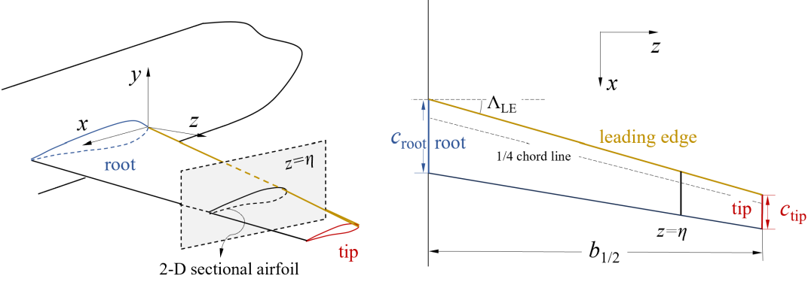

**图 1. 单段后掠翼示意图。** 图中 root＝翼根；tip＝翼尖；leading edge＝前缘；1/4 chord line＝四分之一弦线；2-D sectional airfoil＝二维截面翼型；$c_{root}$、$c_{tip}$ 为翼根、翼尖弦长，$b_{1/2}$ 为半翼展。

尽管机翼周围流场为三维，但与截面翼型流场关系密切。在展向位置 $\eta$，$x$–$y$ 平面内的截面流场与相应二维翼型流场高度相关。当截面翼型几何或局部工况改变时，例如改变机翼扭转角会改变局部感受到的迎角，三维流场的演化与二维流场的变化相似。这种相似性称为局部效应，而二维和三维流场之间的差异归因于三维效应。

后掠理论描述后掠角引起的三维效应，这一部分在总效应中占有较大比例，因此提供了快速预测表面压力分布的途径。设机翼工况为 $(\mathrm{Ma}_\infty^{3D},\mathrm{Re}_\infty^{3D})$，雷诺数以弦长 $c$ 为参考。在展向位置 $\eta$，弦向截面翼型几何记为 $y_\eta^{3D}(x/c_\eta)$，其中 $c_\eta$ 为局部弦长。根据后掠角转换几何，可建立如下有效二维翼型：

$$
y^{2D}(x)=\frac{y_\eta^{3D}(x/c_\eta)}{\cos\Lambda_{1/4}}.\tag{1}
$$

其有效工况亦作如下转换：

$$
\begin{aligned}
\mathrm{Ma}_\infty^{2D}&=\mathrm{Ma}_\infty^{3D}\cos\Lambda_{1/4},\\
\mathrm{Re}_\infty^{2D}&=\mathrm{Re}_\infty^{3D}\left(\frac{c_\eta}{c}\right)\cos\Lambda_{1/4},\\
C_L^{2D}&=\frac{C_{L,\eta}^{3D}}{\cos^2\Lambda_{1/4}}.
\end{aligned}\tag{2}
$$

其中，$C_{L,\eta}^{3D}$ 为展向位置 $\eta$ 的截面升力系数。

若有效二维翼型压力分布记为 $C_p^{2D}(x)$，则机翼展向位置 $\eta$ 的转换后截面压力分布为：

$$
C_{p,\eta}^{2D\rightarrow3D}(x/c_\eta)=C_p^{2D}(x)\cos^2\Lambda_{1/4}.\tag{3}
$$

在无限翼展、黏性效应可忽略的假设下，后掠理论保证转换后的截面压力分布与真实三维结果相同。对于任意后掠翼，由于横流存在，三维效应更复杂，后掠理论也不能预测机翼表面摩擦分布。但它仍能捕捉由后掠角引起的大部分效应。这启发我们在翼型与机翼流场预测模型之间的迁移过程中嵌入后掠理论，使数据驱动模型只需学习剩余三维效应，从而降低学习难度。

### B. 基于后掠理论的迁移学习

迁移学习是一组将某个问题，即源域，上预训练的模型重新应用于新问题，即目标域，的技术 [27]。基于模型的迁移学习是最常见的技术之一：先在源域的大规模数据集上预训练模型，再仅使用目标域少量样本，对模型整体或部分进行微调，即可获得较好精度。

在本文框架中，源域和目标域分别为二维翼型与三维机翼。如图 2 所示，先在翼型数据集上预训练模型，再使用少量机翼样本微调。二维与三维结果之间的差异由后掠理论及额外神经网络层共同建模，后者捕捉剩余效应。预训练部分和微调部分分别称为翼型气动模型，以及翼型到机翼的迁移模型。

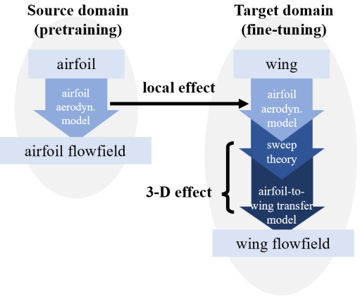

**图 2. 迁移学习框架的源域与目标域。** Source domain（pretraining）＝源域（预训练）；Target domain（fine-tuning）＝目标域（微调）；airfoil＝翼型；wing＝机翼；local effect＝局部效应；3-D effect＝三维效应；airfoil aerodynamic model＝翼型气动模型；airfoil-to-wing transfer model＝翼型到机翼迁移模型；sweep theory＝后掠理论；flowfield＝流场。

所提出迁移学习框架的流程如图 3 所示，各模型的输入和输出用灰色方框表示。图中缩写 S.T. 表示应用相应的后掠理论公式对数值进行变换。下面分别介绍预训练和微调阶段。

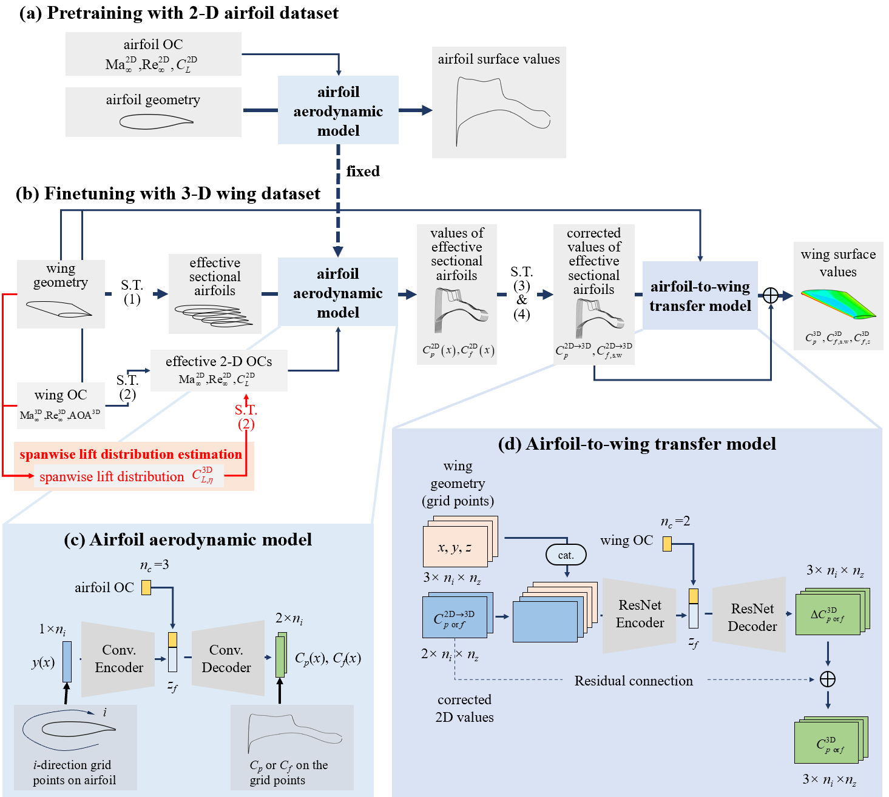

**图 3. 物理嵌入式迁移学习的总体框架。** （a）使用二维翼型数据集预训练；（b）使用三维机翼数据集微调；（c）翼型气动模型；（d）翼型到机翼迁移模型。图中 OC 表示工况，fixed＝固定参数；effective sectional airfoils＝有效截面翼型；corrected 2D values＝修正后的二维值；Conv. Encoder／Decoder＝卷积编码器／解码器；ResNet Encoder／Decoder＝ResNet 编码器／解码器；Residual connection＝残差连接。

#### 1. 翼型气动模型的预训练

在预训练阶段，使用翼型样本训练翼型气动模型。如图 3(c) 所示，模型输入为翼型几何及工况，工况包括马赫数、雷诺数和升力系数。翼型由其表面沿周向（$i$ 方向）分布的 $n_i$ 个网格点的 $y$ 坐标描述。模型输出翼型表面的压力系数和摩擦系数分布，输出位置与输入几何所使用的网格点相同。由于输入、输出均为一维数据，模型采用基于一维卷积神经网络的 U-Net 实现，详细架构见附录 A1。

#### 2. 翼型到机翼迁移模型的微调

翼型气动模型训练完成后，利用机翼样本进行微调，将其迁移至机翼三维流场预测。对于每个机翼样本，从翼根至翼尖均匀选取 $n_z$ 个展向位置。利用后掠理论式（1）和式（2），将这些位置的截面翼型几何及局部工况转换为有效二维翼型几何与工况。这里存在一个问题：预测新的机翼样本时，式（2）中的机翼截面升力系数 $C_{L,\eta}^{\mathrm{3D}}$，即展向升力分布（SLD），是未知的。下一小节将提出几种方法，用于估计训练和预测阶段的 SLD。

给定有效二维翼型几何与工况后，预训练翼型气动模型便可得到压力和摩擦系数分布，记为 $C_p^{\mathrm{2D}}(x)$、$C_f^{\mathrm{2D}}(x)$。随后，再次利用后掠理论，通过式（3）将二维分布变换为修正值。这里，表面摩擦系数分布也采用仿照式（3）的公式，从二维变换至三维：

$$
C_{f,\mathrm{s.w.},\eta}^{\mathrm{2D}\rightarrow\mathrm{3D}}(x/c_\eta)
=C_f^{\mathrm{2D}}(x)\cdot\cos^2\Lambda_{1/4}.
\tag{4}
$$

其中，下标 s.w. 表示机翼表面摩擦系数的流向分量，如图 4 所示。

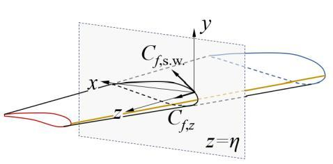

**图 4. 表面摩擦系数分解示意图。** $C_{f,\mathrm{s.w.}}$ 为位于 $x$–$y$ 平面内的流向分量，$C_{f,z}$ 为沿 $z$ 方向的展向分量。

在微调阶段，使用修正后的二维值和真实三维值训练翼型到机翼迁移模型。如图 3(d) 所示，模型输入包含三部分：翼型气动模型预测的、经过修正的压力与摩擦分布，机翼几何，以及工况（自由来流马赫数和迎角 AOA）。对于模型输出，从真实三维表面压力系数和流向摩擦系数分布中减去修正后的二维值，使模型只需拟合修正二维表面分布与三维表面分布之间的差异。

修正后的分布和最终输出均为二维数据。第一维表示各截面翼型上沿 $i$ 方向的网格点，与翼型气动模型中的网格点相同；第二维表示展向位置。输入值有两个通道，分别对应修正后的表面压力分布和流向摩擦分布；输出值则多一个通道，用于表示 $z$ 方向摩擦分布。翼型到机翼迁移模型以基于二维 ResNet 的 U-Net 为骨干，其详细架构见附录 A2。

#### 3. 展向升力分布估计

在物理嵌入式迁移学习总体框架中，SLD 作为后掠理论的输入，用来确定二维截面翼型对应的有效工况。由于必须先获得 SLD，才能预测机翼气动特性，因此需要额外的方法，直接根据机翼几何与工况预测 SLD。

SLD 对机翼气动与气动弹性分析十分重要，因此已有多种低保真半解析方法用于估计它。条带理论 [28] 和升力线理论 [5] 可解析预测不同展向位置的升力曲线斜率，再结合薄翼理论预测的零升迎角，即可估计 SLD。涡格法（VLM）[7] 通过求解升力面问题，可以给出稍精确的估计。该方法将机翼表面离散为格子，假设每个格子产生一个诱导速度的马蹄涡，通过求解每个格子处法向速度为零的条件，得到压力分布，进而获得 SLD。

对于采用薄翼型、处于低速工况的机翼，这些方法能够提供较合理的 SLD 结果。但由于其基于势流理论 [7]，当机翼绕流更加复杂时，例如跨声速后掠翼，误差就会较大。尽管如此，这些结果仍可合理反映机翼几何与工况如何影响 SLD。

利用上述 VLM 算法，本文提出并比较三种 SLD 估计方法：（1）**低保真估计**：采用低保真 VLM 算法计算的 SLD；（2）**数据驱动估计**：采用纯数据驱动方法训练 SLD 预测模型；（3）**组合估计**：使用机器学习模型预测 VLM 结果与真实 SLD 之间的残差。

本文采用开源程序 PyTornado [29] 进行 VLM 计算；对于数据驱动部分，则建立基于前馈神经网络（FNN）的辅助机器学习模型，预测升力分布或残差。该机器学习模型的详细架构见附录 A3。

## III. 数据集构建

本文建立两个数据集，分别训练翼型气动模型和翼型到机翼迁移模型。翼型模型采用超临界翼型数据集训练；迁移模型，包括升力分布模型和翼型到机翼模型，则采用跨声速后掠翼数据集训练。

### A. 翼型与机翼几何采样

#### 1. 后掠翼几何参数化

使用若干参数描述后掠翼几何，其中第一部分描述控制截面翼型。翼型几何采用以九阶 Bernstein 多项式为基函数的类函数／形状函数变换（CST）方法参数化。翼型上下表面分别描述，得到 20 个独立变量，记为 $(u_i,l_i)$，$i=0,1,\ldots,9$。使用 CST 参数重建翼型几何时，还需指定最大相对厚度 $(t/c)_{\max}$ 和弦长 $c$。

为简化问题，所有机翼的翼根翼型均设为弦长为 1、位于 $x$ 轴上、前缘位于原点。翼尖翼型与翼根采用相同 CST 参数，但其最大厚度和弦长可以不同。翼尖与翼根最大厚度之比称为厚度比 $r_t$，翼尖与翼根弦长之比称为梢根比 TR。随后，利用后掠角 $\Lambda_{LE}$、上反角 $\Gamma_{LE}$、展弦比 AR 和扭转角 $\alpha_{twist}$ 等其他平面形状参数，确定翼尖翼型的位置与旋转，从而描述机翼外形。

如图 5 所示，后掠角和上反角分别为前缘在 $x$–$z$ 平面和 $y$–$z$ 平面的投影与 $z$ 轴之间的夹角。展弦比定义为 $\mathrm{AR}=b_{1/2}^{2}/(2S_{1/2})$，其中 $b_{1/2}$ 为半翼展，$S_{1/2}$ 为机翼投影面积。扭转角定义为翼尖翼型相对翼根翼型绕 $z$ 轴的旋转角，其正负按 $z$ 轴右手定则确定。

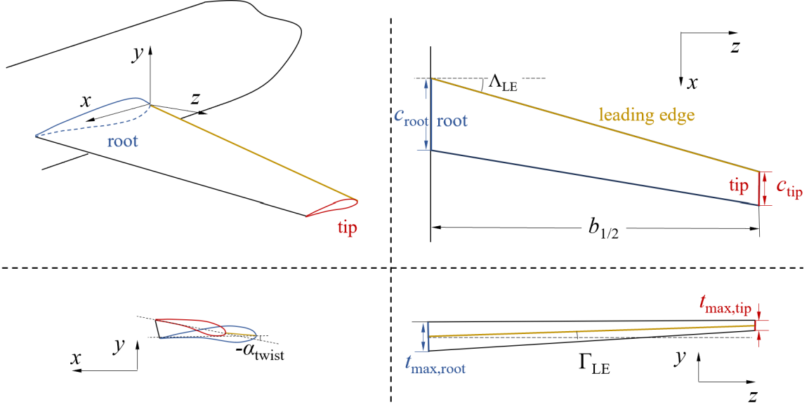

**图 5. 单段机翼的几何参数定义。** root＝翼根；tip＝翼尖；leading edge＝前缘；$c_{root}$、$c_{tip}$ 分别为翼根和翼尖弦长；$b_{1/2}$ 为半翼展；$t_{\max,root}$、$t_{\max,tip}$ 分别为翼根和翼尖最大厚度。

> 原式说明：本段展弦比表达式按所提供稿件原式保留，其写法与基于全翼展和平面面积的常规定义存在差异。

#### 2. 翼型几何采样

本文的超临界翼型数据集基于此前研究 [17] 中的翼型几何构建，其中采用输出空间采样（OSS）方法 [30] 对几何参数进行采样。OSS 是一种自适应采样方法，旨在参考工况下获得压力分布形态更加丰富、多样的翼型。

首先指定若干参考工况，包括自由来流马赫数 $\mathrm{Ma}_{\infty,ref}$、翼型升力系数 $C_{L,ref}$ 和自由来流雷诺数。翼型采样采用升力系数 $C_L$ 而非迎角，因为通过后掠理论更容易确定其取值范围。在 CFD 仿真过程中，算法自动调整翼型迎角，以满足给定的 $C_L$。此外，还选取若干最大相对厚度。随后使用 OSS 对翼型 CST 参数采样，以获得丰富的压力分布形态。本文参数采样范围见表 1，共获得 1420 组 CST 参数。图 6 给出若干翼型样本，其最大厚度从左至右增加。

**表 1. 输出空间采样中的翼型参数采样范围。**

| 参数 | 描述 | 原表上边界 | 原表下边界 |
|---|---|---:|---:|
| $u_0,u_1,\ldots,u_9$ | 上表面 CST 参数 | -2.0 | 2.0 |
| $l_0,l_1,\ldots,l_9$ | 下表面 CST 参数 | -2.0 | 2.0 |
| $(t/c)_{\max}$ | 最大相对厚度 | 0.09 | 0.13 |
| $\mathrm{Ma}_{\infty,ref}$ | 参考自由来流马赫数 | 0.71 | 0.76 |
| $C_{L,ref}$ | 参考升力系数 | 0.60 | 0.90 |

> 原表说明：表 1–4 的“上边界／下边界”列名与多处数值的大小顺序不一致，译文按原表列序和数值保留。

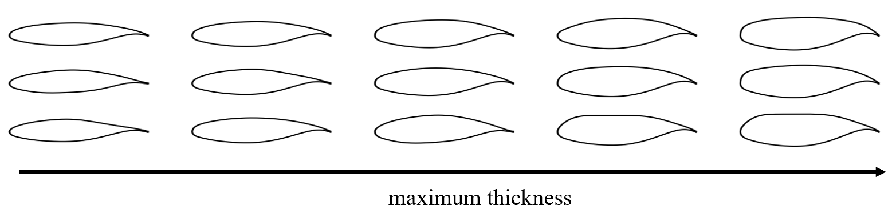

**图 6. 翼型示例。** maximum thickness＝最大厚度，沿箭头方向增加。

#### 3. 后掠翼几何采样

后掠翼几何基于超临界翼型数据集构建。对于该数据集中每一组 CST 参数样本，生成两个单段机翼。其余机翼几何参数，包括翼根翼型最大厚度及平面形状参数，通过随机采样生成，以覆盖不同速度下较广泛的后掠翼范围。各参数范围见表 2。该过程共得到 2800 个机翼几何。图 7 展示若干具有不同后掠角、梢根比和展弦比的机翼样本在 $x$–$z$ 平面上的几何投影，以说明数据集中机翼几何的多样性。

**表 2. 机翼几何参数的采样范围。**

| 描述 | 参数 | 原表上界 | 原表下界 |
|---|---|---:|---:|
| 基准翼型最大相对厚度 | $(t/c)_{\max,root}$ | 0.09 | 0.13 |
| 厚度比 | $r_t$ | 0.8 | 1.0 |
| 后掠角 | $\Lambda_{LE}$ | $0^\circ$ | $35^\circ$ |
| 上反角 | $\Gamma_{LE}$ | $0^\circ$ | $3^\circ$ |
| 展弦比 | AR | 6 | 10 |
| 梢根比 | TR | 0.2 | 1.0 |
| 扭转角 | $\alpha_{twist}$ | $0^\circ$ | $-6^\circ$ |

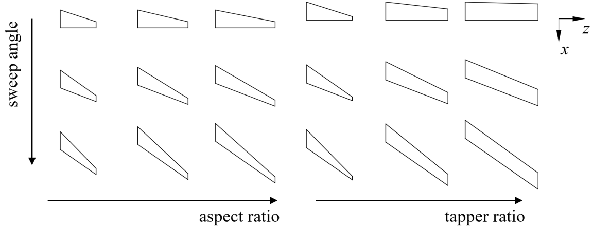

**图 7. 机翼在 $x$–$z$ 平面上的投影示例。** sweep angle＝后掠角；aspect ratio＝展弦比；taper ratio＝梢根比。

### B. 翼型与机翼工况采样

机翼工况包括自由来流马赫数 $\mathrm{Ma}_\infty$、基于单位长度的雷诺数 Re、自由来流温度 $T_\infty$ 和迎角 AOA。在当前数据集中，每种机翼几何对应一个工况，范围见表 3。

**表 3. 机翼工况的采样范围。**

| 参数 | 描述 | 原表上边界 | 原表下边界 |
|---|---|---|---|
| AOA | 迎角 | $1^\circ$ | $6^\circ$ |
| $\mathrm{Ma}_\infty$ | 自由来流马赫数 | 0.72 | 0.85 |
| $\mathrm{Re}_\infty$ | 基于单位长度的自由来流雷诺数 | 643 万（固定） | 643 万（固定） |
| $T_\infty$ | 自由来流温度 | $580^\circ\mathrm R$（固定） | $580^\circ\mathrm R$（固定） |

对于翼型，根据以其为基准构建的相应机翼工况，为每个翼型几何分别选取 24 个工况。翼型工况由 $\mathrm{Ma}_\infty$、$\mathrm{Re}_\infty$、$T_\infty$ 和升力系数 $C_L$ 描述，并从通过后掠理论覆盖相应机翼取值的范围内随机采样。假设机翼后掠角为 $\Lambda$，则翼型工况的采样范围如表 4 所示，其中 $C_{L,\eta}^{\mathrm{3D}}$ 是相应机翼沿展向的截面升力系数。

**表 4. 翼型工况的采样范围。**

| 参数 | 描述 | 原表上边界 | 原表下边界 |
|---|---|---|---|
| $C_L$ | 升力系数 | $\left(\min_{\eta}C_{L,\eta}^{\mathrm{3D}}\right)/\cos^2\Lambda$ | $\left(\max_{\eta}C_{L,\eta}^{\mathrm{3D}}\right)/\cos^2\Lambda$ |
| $\mathrm{Ma}_\infty$ | 自由来流马赫数 | $\mathrm{Ma}_\infty\cos\Lambda$（固定） | $\mathrm{Ma}_\infty\cos\Lambda$（固定） |
| $\mathrm{Re}_\infty$ | 基于单位长度的自由来流雷诺数 | $\mathrm{Re}_\infty^{\mathrm{3D}}\,\mathrm{TR}\cos\Lambda$ | $\mathrm{Re}_\infty^{\mathrm{3D}}\cos\Lambda$ |
| $T_\infty$ | 自由来流温度 | $580^\circ\mathrm R$（固定） | $580^\circ\mathrm R$（固定） |

### C. CFD 设置

#### 1. 计算网格

二维和三维仿真均采用结构网格，由自主开发的 CGrid 程序生成。二维 C 型网格与文献 [17] 相同，沿翼型周向（$i$ 方向）有 401 个点，沿壁面法向（$j$ 方向）有 81 个点。$i$ 方向在翼型表面有 321 个点，在前缘和后缘附近加密；尾迹区有 41 个点。对于壁面法向，第一层网格高度设置为满足 $\Delta y^+<1$，远场边界距翼型 20 倍弦长。

机翼仿真的三维网格与文献 [31] 相同，由二维截面网格沿展向拉伸得到。展向网格有 61 个点，在翼尖附近加密。随后将翼尖附近网格点向外拉伸，形成 O 型网格，以改善网格质量。最后，将最外侧截面网格沿展向拉伸至距翼尖 30 倍弦长的远场边界，该区域布置 41 个网格点。单个机翼的网格规模为 286 万个单元。

#### 2. 计算设置

翼型和机翼流场采用开源雷诺平均 Navier–Stokes（RANS）求解器 CFL3D [32,33] 计算，该求解器已广泛用于工程应用。它基于有限体积法，分别采用 MUSCL 格式、ROE 格式和隐式 Gauss–Seidel 算法进行流动变量重构、空间离散和时间推进。湍流模拟采用剪切应力输运（SST）模型，并采用三级 W 循环多重网格加速计算。

二维翼型仿真中，三个多重网格层级的计算步数分别为 1000、1000 和 2000；三维机翼则在第三级额外增加 6000 步以达到收敛。更详细的 CFD 设置及其验证见此前工作 [17,31]。最终获得 22,104 个翼型和 1842 个机翼的流场，其余算例未收敛。

### D. 后处理

从仿真流场中提取压力系数和摩擦系数分布，用于训练与测试。压力可直接在翼型或机翼的各表面网格点获取；各表面网格点的摩擦则通过第一层与第二层网格之间切向速度的梯度计算。对于二维翼型，摩擦为标量：当切向速度与网格 $i$ 索引增加方向相同时，其符号为正。对于三维机翼，摩擦分解为位于 $x$–$y$ 平面的流向分量 $C_{f,\mathrm{s.w.}}$ 和沿 $z$ 方向的展向分量 $C_{f,z}$，如图 4 所示。流向分量的符号定义与二维翼型相同。

随后，将表面压力系数和摩擦系数分布从计算表面网格点插值到翼型与机翼共同采用的对齐网格。对于翼型周向（$i$ 方向），二维翼型和三维机翼各截面的数值均采用一组固定的相对 $x$ 坐标 $\{(x/c)_i\}$。由于两种网格十分相似，沿 $x$ 方向插值不会带来较大误差。在展向（$j$ 方向），采用沿翼展均匀分布的 101 个 $x$–$y$ 截面。通过这一过程，获得翼型表面 $321\times1$ 个点、机翼表面 $321\times101$ 个点上的几何网格和表面数值。与此同时，对 101 个截面分别积分表面压力系数和流向摩擦系数，获得机翼样本的截面升力系数。

本文根据各变量的最大值和最小值，对表面压力系数、摩擦系数分布及其他输入、输出参数进行无量纲化。

## IV. 模型训练与结果

### A. 翼型气动预测

翼型气动模型作为迁移至本框架的基础模型，预先使用二维翼型数据集进行训练。本节评估预训练模型的性能。

训练时，将翼型数据集分为两部分：90% 的样本用于训练，其余 10% 用于评估模型性能。采用模型预测与 CFD 仿真所得翼型表面分布之间的均方误差（MSE）作为损失函数。训练设置与文献 [31] 相近：批大小为 16，优化器为 Adam。学习率采用预热策略，在前 20 个训练轮次中从 $1\times10^{-5}$ 提高至 $1\times10^{-4}$，随后按底数为 0.95 的指数函数衰减。训练共进行 300 轮；每轮将所有小批次随机打乱，再依次用于训练模型。

使用相同训练样本独立训练五次，每次开始时对可训练参数采用不同的随机初始化。在五次训练中，选取翼型测试样本表面系数分布误差最小的模型，用于后续迁移学习。对每个测试样本，求各系数的相对 MSE，并除以该系数的取值范围。随后，对测试样本的相对 MSE 求平均，得到测试误差：

$$
\delta C_{p\ \mathrm{or}\ f}
=\frac{1}{N_s}\sum_{n=0}^{N_s}
\frac{\sqrt{\displaystyle\sum_{i=0}^{N_i}
\left(C_{p\ \mathrm{or}\ f}^{\mathrm{model}}-C_{p\ \mathrm{or}\ f}^{\mathrm{ground\ truth}}\right)^2}}
{\displaystyle\max_i\left(C_{p\ \mathrm{or}\ f}^{\mathrm{ground\ truth}}\right)
-\displaystyle\min_i\left(C_{p\ \mathrm{or}\ f}^{\mathrm{ground\ truth}}\right)}
\times100\%.
\tag{5}
$$

> 原式说明：原文将该指标称为相对 MSE，但式（5）的分子写为误差平方和的平方根，未在根号内除以点数；求和上下限与前因子亦按原式保留。

表 5 给出五次训练中测试误差的最小值、平均值和标准差。最小测试误差均低于 0.2%。同时，选取误差最大的三个翼型样本展示模型性能，其几何、工况，以及模型预测和 CFD 仿真所得表面分布见图 8。即使对于误差最大的样本，预测分布仍能很好地拟合真实值，说明翼型气动模型性能优良，为后续微调奠定了基础。

**表 5. 翼型气动模型的预测误差。**

| 变量 | 最小测试误差（第 4 次训练） | 平均测试误差 ± 标准差 |
|---|---:|---:|
| $C_p$ | 0.189% | $(0.230\pm0.035)\%$ |
| $C_f$ | 0.083% | $(0.087\pm0.005)\%$ |

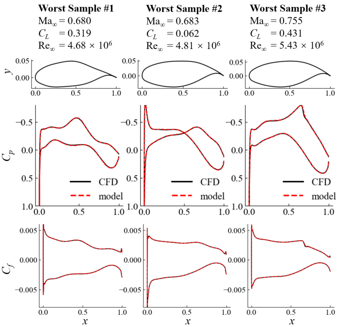

**图 8. 翼型气动模型对误差最大的三个样本预测所得的表面分布。** 图表通用标注：pressure coefficient＝压力系数；friction coefficient＝摩擦系数；ground truth＝真实值；upper surface＝上表面；sectional distribution＝截面分布；relative MSE＝相对均方误差；MAE＝平均绝对误差；training dataset size＝训练数据集规模。 图中：Worst Sample＝误差最大的样本；CFD＝计算流体力学仿真结果；model＝模型预测结果。

### B. 基于真实 SLD 的机翼气动预测

翼型气动模型训练完成后，使用机翼数据集训练翼型到机翼的迁移模型，作为微调阶段。本节评估引入预训练气动模型和嵌入后掠理论所带来的改进。

本节在获取二维翼型表面分布时，训练样本和测试样本所用的展向升力分布（SLD）均取自真实三维仿真。正如前文所述，在实际应用中，预测前无法获知 SLD。这里使用真实 SLD，是为了在不受 SLD 估计误差干扰的情况下，评估迁移学习和后掠理论带来的改进。SLD 估计所引入的误差将在下一节讨论。

为预测机翼气动特性，建立了两种基准框架，如图 9 所示。**非迁移框架**［图 9(a)］完全不使用预训练模型，仅以机翼几何和工况作为微调模型的输入。其结构与翼型到机翼迁移模型相同，区别在于二维 ResNet 编码器的输入仅包含机翼几何。**直接迁移框架**［图 9(b)］在不考虑后掠理论的情况下微调翼型到机翼模型：将机翼截面翼型几何和机翼工况 $(Ma_\infty^{3D},Re_\infty^{3D},C_{L,\eta}^{3D})$ 输入翼型气动模型，而不采用有效工况；得到的二维翼型表面分布也不经修正，直接输入翼型到机翼迁移模型。**物理嵌入式迁移框架**［图 9(c)］则采用第 II 节介绍的模型。

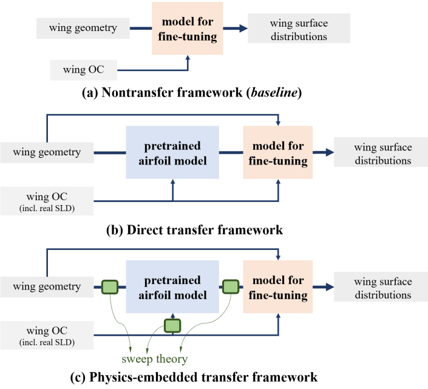

**图 9. 用于检验物理嵌入式迁移学习改进效果的三种框架。** （a）非迁移框架（基准）；（b）直接迁移框架；（c）物理嵌入式迁移框架。图中：wing geometry＝机翼几何；wing OC＝机翼工况；incl. real SLD＝包含真实 SLD；pretrained airfoil model＝预训练翼型模型；model for fine-tuning＝用于微调的模型；wing surface distributions＝机翼表面分布；sweep theory＝后掠理论。

#### 1. 有效截面翼型的表面分布

图 10 展示了利用预训练翼型气动模型，根据有效二维截面翼型预测的机翼表面分布。第一列是在确定有效截面翼型几何和工况时不考虑后掠理论的结果，对应直接迁移框架；第二列则为考虑后掠理论的结果。

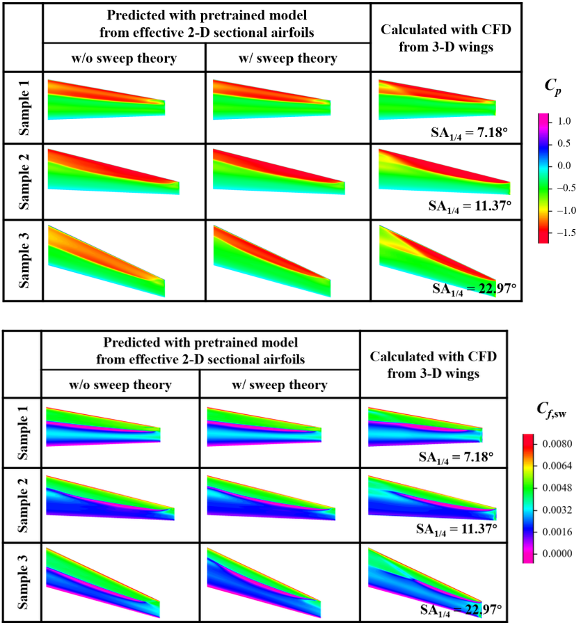

**图 10. 预训练翼型气动模型根据二维截面翼型预测的机翼上表面云图。** （a）表面压力系数分布；（b）表面流向摩擦系数分布。图中左两列分别为不考虑后掠理论（w/o sweep theory）和考虑后掠理论（w/ sweep theory）的预训练模型预测，第三列为三维机翼 CFD 计算结果；Sample＝样本。

对于后掠角较小的机翼，无论是否考虑后掠理论，有效截面翼型的表面分布与真实三维计算分布都十分相似，差异主要位于翼尖和翼根附近。这说明局部效应对流场具有主导影响，尤其是在小后掠角情况下。随着后掠角增大，差异随之增加；考虑后掠理论的方法能够提供更合理的预测。

#### 2. 使用与不使用迁移学习的机翼预测框架性能比较

利用有效截面翼型的表面分布，可以训练翼型到机翼迁移模型。采用十折交叉验证，对三种待比较框架进行微调和评估。首先，将机翼数据集随机分为 10 组；随后重复训练 10 次，每次取其中 9 组作为训练样本，剩余 1 组用于评估模型性能。由于数据集较小，将批大小设为 8；学习率调度相对于翼型气动模型训练延长至三倍，因此共训练 900 轮。其余训练设置保持相同。

表 6 比较了三种框架的交叉验证结果。评价指标为压力系数、流向摩擦系数和 $z$ 方向摩擦系数的相对 MSE，定义与式（5）相同。对预测机翼表面分布积分，获得升力系数、阻力系数，以及相对于翼根四分之一弦长点的俯仰力矩系数；再计算其相对于真实值的平均绝对误差（MAE）。同时，以非迁移框架为基准，计算误差减少量与基准误差之比，给出各框架各指标的平均精度收益，列在各误差值下方的括号中。

**表 6. 使用与不使用迁移学习的框架预测误差。**

| 变量 | 无迁移 | 直接迁移 | 物理嵌入式迁移 |
|---|---:|---:|---:|
| $C_p$ | $1.08\%\pm0.06\%$ | $0.75\%\pm0.04\%$ （-30.7%） | $0.66\%\pm0.04\%$ （-39.3%） |
| $C_{f,sw}$ | $0.65\%\pm0.04\%$ | $0.47\%\pm0.03\%$ （-28.0%） | $0.42\%\pm0.02\%$ （-35.6%） |
| $C_{f,z}$ | $0.35\%\pm0.02\%$ | $0.28\%\pm0.02\%$ （-20.6%） | $0.26\%\pm0.01\%$ （-24.7%） |
| $C_L\times10^3$ | $8.08\pm0.37$ | $2.12\pm0.22$ （-73.7%） | $1.70\pm0.17$ （-79.0%） |
| $C_D\times10^4$ | $5.08\pm0.41$ | $3.35\pm0.31$ （-34.1%） | $2.87\pm0.31$ （-43.5%） |
| $C_{Mz}\times10^3$ | $4.77\pm0.43$ | $1.44\pm0.11$ （-69.8%） | $1.28\pm0.14$ （-73.1%） |

括号中保留原表的负号，表示相对基准误差的降低。

如前所述，直接预测机翼流场的模型需要同时学习局部效应和三维效应。引入预训练气动模型，有助于在微调前捕捉局部效应，使表面分布预测精度提高 20%～30%。进一步通过物理嵌入式迁移学习引入后掠理论，有助于模型捕捉后掠角造成的部分三维效应，额外带来 4%～9% 的精度收益，说明后掠角引起的三维效应对预测十分重要。

在三种分布量中，压力系数的改善最大。这是合理的，因为与表面摩擦相比，三维效应对表面压力的影响较小，而且后掠理论本就是为转换表面压力分布而提出的。结果表明，物理嵌入式迁移学习能够提高机翼摩擦分布的预测精度。

在积分气动系数中，阻力系数的精度收益略大于分布式表面量，而升力系数和俯仰力矩系数的收益则显著更大，约为 70%。原因可能在于翼型气动模型使用了真实 SLD 输入。真实 SLD 保证翼型气动模型预测的二维截面表面分布，在各展向位置都具有近乎正确的升力系数；这意味着翼型到机翼迁移模型的输入本身已包含近乎正确的机翼升力系数。迁移模型因此更容易学习剩余修正。在实际应用中采用估计 SLD 时，升力和俯仰力矩系数的精度收益应当较小，下一节将验证这一点。

为直观展示模型精度，将 CFD 仿真和模型预测的表面分布绘出并进行比较。此处采用使用真实 SLD 的物理嵌入式迁移框架。选取压力分布预测误差最大的三个样本，其预测结果来自十次交叉验证中以该样本作为测试样本的对应训练模型。因此，下述结果展示的是模型在测试情形下的性能。

图 11 给出若干示例机翼的预测结果。在子图（a）中，每组示例从上到下依次展示表面压力、流向摩擦和展向摩擦系数云图。模型预测云图绘在右侧，CFD 仿真结果翻转后绘在左侧。子图（b）给出各机翼在 20%、50% 和 80% 展向位置的三个截面处的表面压力分布。CFD 仿真曲线以黑色实线表示，非迁移模型和物理嵌入式迁移模型的结果分别用红色、蓝色虚线表示。

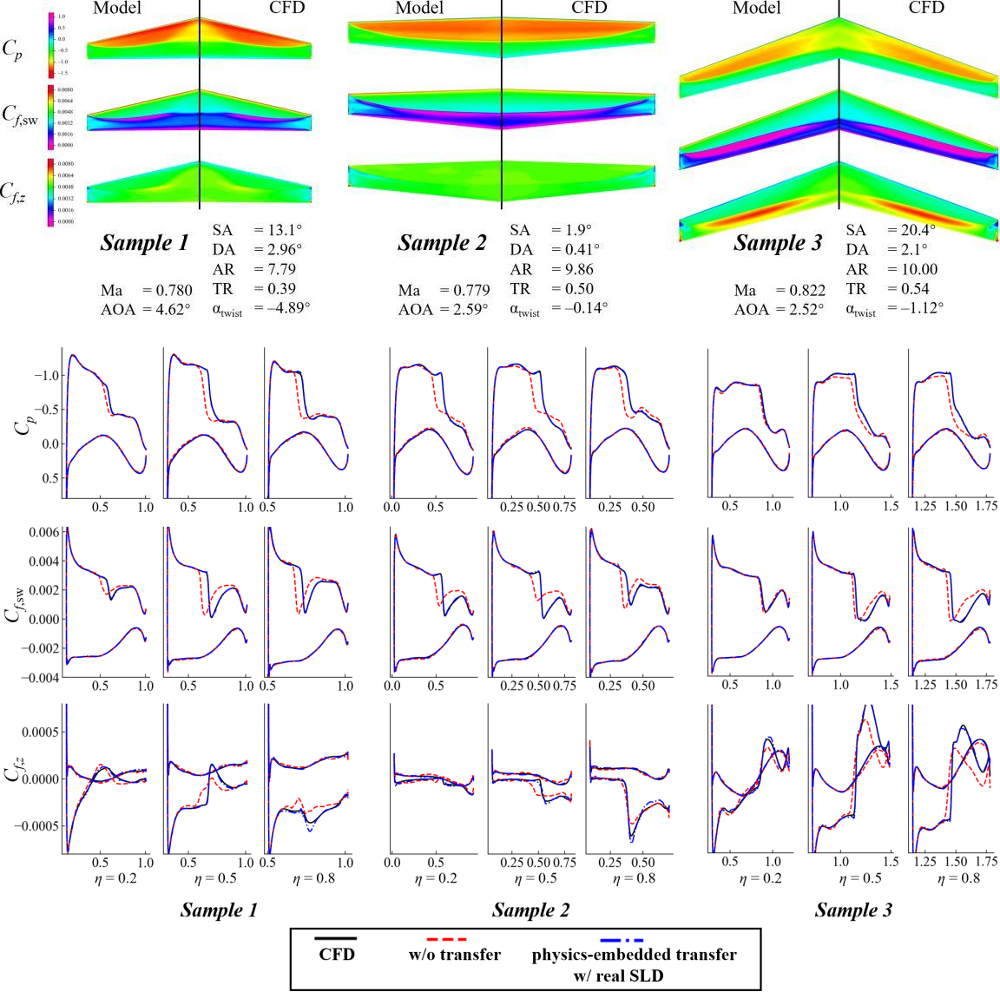

**图 11. CFD 与采用真实 SLD 的迁移模型对示例机翼的预测结果。** （a）上表面云图；（b）截面分布。图中：Model＝模型；CFD＝CFD 仿真；w/o transfer＝无迁移；physics-embedded transfer w/ real SLD＝采用真实 SLD 的物理嵌入式迁移。

> 原文与图示说明：正文称子图（a）的模型结果在右、CFD 结果在左，但原图中的 Model／CFD 标注分别位于左／右；译文保留原文叙述及图中标注。正文将子图（b）概括为压力分布，而原图还展示两种摩擦系数分布。

结果表明，使用与不使用迁移学习的框架之间精度差异明显。即使在最差案例中，所提出的物理嵌入式迁移学习框架仍能捕捉跨声速机翼周围激波、回流区等重要流动特征。

#### 3. 不同训练数据集规模下的机翼预测性能

对采用不同数量训练样本的模型评估交叉验证结果，如图 12 所示。当模型不使用完整数据集训练时，在每次交叉验证中，从训练数据集中随机选取给定数量的样本，并用这些样本训练模型。测试数据集仍是该轮保留的一组样本，最终得分通过对各轮交叉验证结果求平均获得。十次交叉验证的平均误差用符号和曲线表示，标准差用误差棒表示。

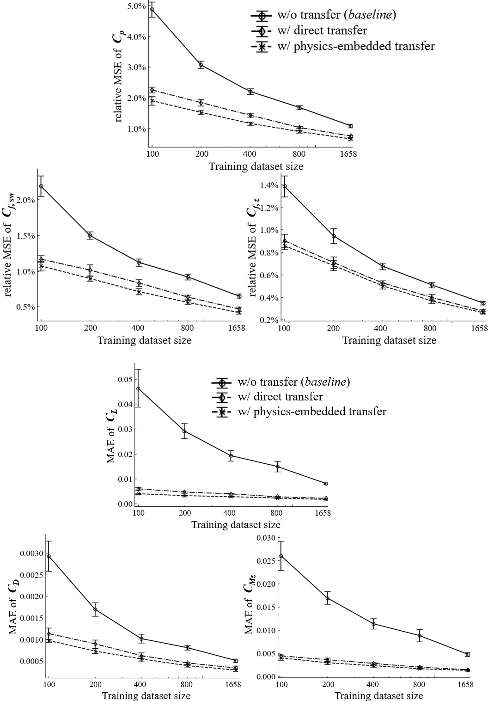

**图 12. 训练样本规模对使用与不使用迁移学习的框架预测误差的影响。** （a）分布式流动量的均方误差；（b）气动系数的绝对误差。图中：Training dataset size＝训练数据集规模；relative MSE＝相对均方误差；MAE＝平均绝对误差；w/o transfer (baseline)＝无迁移（基准）；w/ direct transfer＝直接迁移；w/ physics-embedded transfer＝物理嵌入式迁移。

随着训练数据集规模缩小，两种采用迁移学习的框架在所有误差指标上，都表现出误差相对于对数尺度样本规模近似线性增长的规律。曲线斜率平缓，即使在仅含 100 个机翼样本的最小数据集上，也能获得较小的预测误差。是否考虑后掠理论的两种框架之间的误差差异，并未随着数据集规模减小而扩大。相比之下，当训练数据集规模缩小时，基准模型的误差急剧增加；在小数据集上，其误差超过迁移框架的两倍。比较达到给定精度所需的数据集规模可知，迁移框架使用不到一半的样本，就能在所有指标上优于基准模型。这证明所提出的方法能够显著减少构建足量机翼数据集的时间成本。

### C. 基于估计 SLD 的机翼气动预测

上一节分析了使用真实 SLD 输入时模型精度的提升。然而，在实际应用中，预测前并不知道 SLD，因此第 II 节提出了三种估计新机翼 SLD 的方法：（1）基于涡格法（VLM）的低保真估计；（2）基于辅助前馈神经网络（FNN）模型的数据驱动估计；（3）利用 FNN 模型修正 VLM 解的组合估计。本节评估并比较它们的性能。

#### 1. SLD 估计结果

对于基于 FNN 模型的 SLD 估计方法，该模型也在微调阶段训练，并采用与翼型到机翼迁移模型相同的交叉验证分组。每次交叉验证中，SLD 估计模型使用的训练机翼样本与翼型到机翼迁移模型相同，从而保证训练过程未使用测试样本的任何信息。

表 7 给出不同方法的 SLD 估计误差。对于低保真 VLM 估计，表中数值为所有机翼样本的 SLD 平均均方误差（MSE）；对于两种基于模型的方法，均值和标准差根据十次交叉验证中测试样本的结果计算。图 13 展示了三个随机选取样本的 SLD，其中，三维计算得到的 SLD 用黑色圆圈表示，三种估计方法得到的 SLD 用彩色曲线表示。

**表 7. 不同估计方法的 SLD 预测误差。**

| 指标 | 低保真方法 | 数据驱动方法 | 组合方法 |
|---|---:|---:|---:|
| SLD 误差 | 0.1185 | 0.0106 ± 0.0003 | 0.0076 ± 0.0001 |

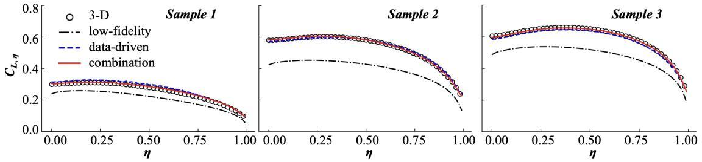

**图 13. 不同方法对三个测试样本的 SLD 估计。** Sample＝样本；3-D＝三维计算结果；low-fidelity＝低保真方法；data-driven＝数据驱动方法；combination＝组合方法。横轴为展向位置 $\eta$。

图表表明，低保真 VLM 方法得到的 SLD 与真实三维结果相比误差较大，而且由于采用薄翼假设，始终低估升力系数。数据驱动方法能够提供更好的估计，但如图 13 所示，其估计误差沿翼展以及在不同样本之间并不一致。与低保真 SLD 估计相比，该方法的误差具有随机性，缺少确定模式，可能使翼型到机翼迁移模型难以学习相应修正，从而降低框架的机翼预测精度。组合估计方法兼具低保真方法和数据驱动方法的优点，能够得到最精确的 SLD 估计。

#### 2. 不同 SLD 估计方法的机翼预测性能比较

将所提出的三种 SLD 估计方法用于物理嵌入式迁移学习框架，并按照上一节采用真实 SLD 时相同的方式，使用估计 SLD 训练翼型到机翼迁移模型。选取上一节的两组结果作为本节评估的基准。非迁移框架（a）仍用于展示未引入迁移学习策略时的模型性能；采用真实三维仿真 SLD 的物理嵌入式框架（c）作为参照，用于展示 SLD 精确时的理想迁移性能。表 8 按照与表 6 相同的方式，列出十折交叉验证误差的均值和标准差。

**表 8. 不同 SLD 估计方法的预测误差。** 括号内为相对于非迁移基准的误差变化。

| 指标 | 非迁移框架（基准） | 采用估计 SLD 的迁移框架：低保真方法 | 采用估计 SLD 的迁移框架：数据驱动方法 | 采用估计 SLD 的迁移框架：组合方法 | 采用真实 SLD 的迁移框架（参照） |
|---|---|---|---|---|---|
| $C_p$ | 1.08% ± 0.06% | 0.85% ± 0.06%（-22.1%） | 0.84% ± 0.04%（-23.0%） | 0.77% ± 0.03%（-29.0%） | 0.66% ± 0.04%（-39.3%） |
| $C_{f,sw}$ | 0.65% ± 0.04% | 0.53% ± 0.04%（-18.3%） | 0.49% ± 0.03%（-24.9%） | 0.46% ± 0.02%（-28.8%） | 0.42% ± 0.02%（-35.6%） |
| $C_{f,z}$ | 0.35% ± 0.02% | 0.30% ± 0.01%（-12.7%） | 0.29% ± 0.02%（-16.4%） | 0.28% ± 0.02%（-20.2%） | 0.26% ± 0.01%（-24.7%） |
| $C_L\times10^3$ | 8.08 ± 0.37 | 4.94 ± 0.50（-38.9%） | 6.00 ± 0.58（-25.7%） | 4.81 ± 0.37（-40.5%） | 1.70 ± 0.17（-79.0%） |
| $C_D\times10^4$ | 5.08 ± 0.41 | 3.55 ± 0.42（-30.0%） | 3.19 ± 0.37（-37.2%） | 3.11 ± 0.25（-38.7%） | 2.87 ± 0.31（-43.5%） |
| $C_{Mz}\times10^3$ | 4.77 ± 0.43 | 2.41 ± 0.19（-49.5%） | 2.66 ± 0.27（-44.1%） | 2.08 ± 0.19（-56.4%） | 1.28 ± 0.14（-73.1%） |

与采用真实 SLD 的迁移学习框架相比，采用估计 SLD 的框架能够用于实际应用，因为它可以对新的机翼几何和工况作出预测。除升力系数和俯仰力矩系数外，在所有性能指标上，采用组合 SLD 估计方法的模型都能获得与真实 SLD 输入参照框架相近的预测精度提升。升力和俯仰力矩的精度收益明显小于参照框架，但与阻力系数的收益相近。原因在于，当估计 SLD 存在误差时，真实 SLD 输入带来的优势便不再存在。采用纯数据驱动或低保真（VLM）估计的模型，精度提升较小，但仍然可观。就表面分布量而言，纯数据驱动方法比低保真方法获得更大收益；但对积分得到的气动系数，其收益通常较小。

再次使用上一节用于展示真实 SLD 下模型性能的三个算例，考察估计 SLD 下的模型表现。此处比较的模型为采用组合 SLD 估计方法的迁移框架。图 14 按照与图 11 相同的方式，展示三个机翼算例的表面量云图和截面量分布。子图（b）中，采用真实 SLD 预测的分布以蓝线给出，作为参照；采用组合估计方法预测的分布则以橙线表示。

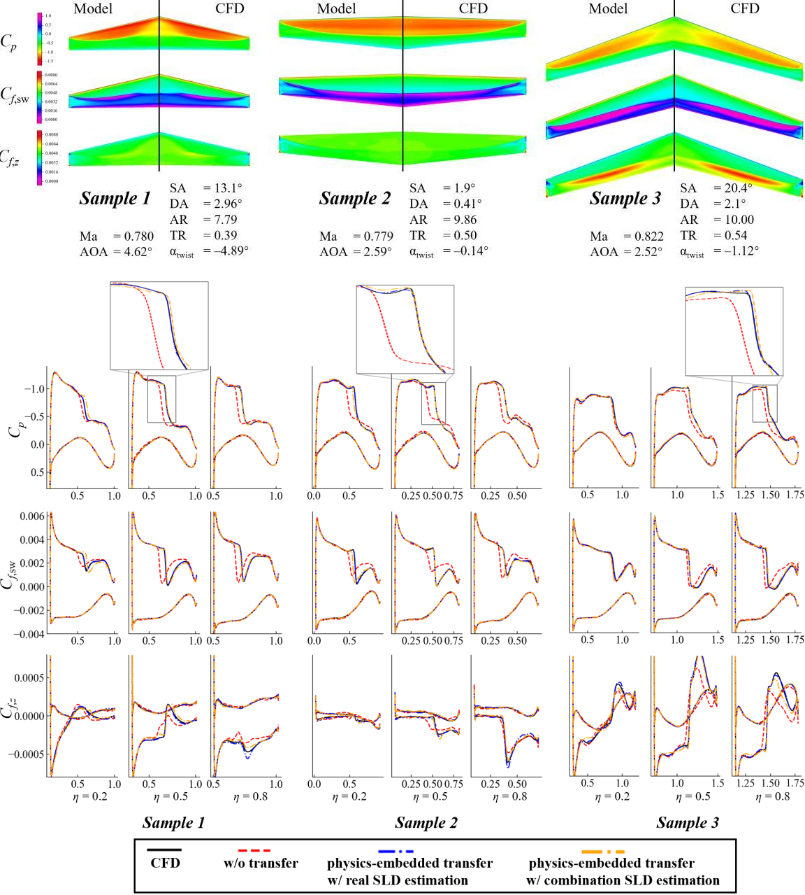

**图 14. CFD 与采用估计 SLD 的迁移模型对算例机翼的预测结果。** （a）上表面云图；（b）截面分布。图例：CFD＝计算流体力学结果；w/o transfer＝不采用迁移学习；physics-embedded transfer w/ real SLD estimation＝采用真实 SLD 的物理嵌入式迁移；physics-embedded transfer w/ combination SLD estimation＝采用组合 SLD 估计的物理嵌入式迁移。原图中的模型名称和数值予以保留。

与采用真实 SLD 的结果相比，采用估计 SLD 的预测精度略低。关键流动特征的误差略大，例如图 14 顶部放大图中所示的激波强度和位置，但仍远好于未采用迁移学习的模型。这一比较表明，所提出的方法具有应用于真实场景的潜力。

#### 3. 不同训练数据集规模下的机翼预测性能

图 15 给出了交叉验证评分随数据集规模的变化。

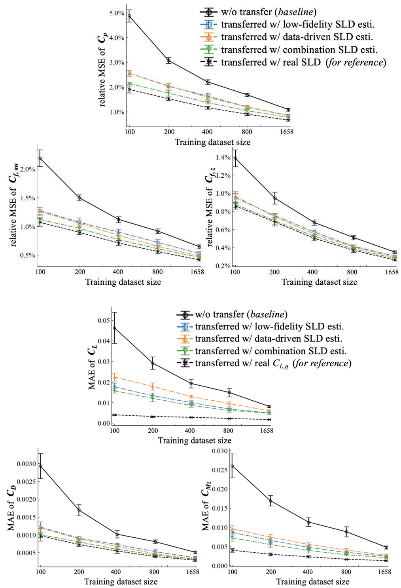

**图 15. 不同升力分布估计方法下，训练样本量对框架预测误差的影响。** （a）分布式流动量的均方误差；（b）气动系数的绝对误差。

随着训练数据集规模减小，采用三种估计方法迁移得到的模型，其预测误差仍近似线性增长，斜率与使用真实 SLD 迁移的模型相近。即使在本研究测试的最小数据集规模下，三种 SLD 估计方法仍能帮助迁移模型获得大部分精度收益。在三种方法中，组合方法几乎对所有变量和数据集规模都给出最佳预测精度，其优势在小数据集上更加明显，表明它是实现物理嵌入式迁移学习最有前景的途径。

### D. 计算成本

表 9 汇总了构建数据集、训练模型和进行预测各步骤的计算成本。左侧两列列出任务及耗时，右侧四列通过勾选标明所提出的迁移学习方法与非迁移方法需要执行的步骤。

相较于直接训练机翼气动预测机器学习模型的非迁移框架，所提出的物理嵌入式迁移学习框架还需要构建翼型数据集、通过 VLM 获得低保真 SLD 结果，并预训练翼型气动模型。然而，与构建机翼数据集相比，翼型和 SLD 数据集的构建成本可以忽略。在模型训练阶段，翼型模型和 SLD 模型所需的额外时间不到一小时。因此，所提出的框架通过减少训练所需机翼样本而降低的计算成本，仍然能够带来收益。

在预测阶段，无论非迁移模型还是迁移学习模型，机器学习推理都能在 0.1 秒内完成。不过，低保真和组合 SLD 估计方法需要执行一次 VLM 计算，以获得预测机翼流场所需的 SLD，因而总预测时间约为 2 秒。即便如此，与耗时数小时的 CFD 仿真相比，机器学习方法仍然几乎能够即时响应。这使利用模型开展交互式优化成为可能：设计者可根据快速反馈的机翼流场修改构型；同时，由于增加设计点数量不会带来巨大的计算成本，也使多点优化与稳健优化成为可能。

**表 9. 不同框架的计算成本。** “✓”表示该框架需要执行相应步骤；“—”表示无需该步骤，或仅作参照。

| 阶段／任务 | 耗时 | 非迁移框架 | 采用估计 SLD 的迁移框架：数据驱动方法 | 采用估计 SLD 的迁移框架：低保真方法 | 采用估计 SLD 的迁移框架：组合方法 |
|---|---|:---:|:---:|:---:|:---:|
| **构建数据集** | | | | | |
| 二维翼型数据集（CFD） | 1.2 天ᵃ | — | ✓ | ✓ | ✓ |
| 三维机翼数据集（CFD） | 14.4 天ᶜ | ✓ | ✓ | ✓ | ✓ |
| SLD 数据集（VLM） | 1.6 小时ᵇ | — | — | ✓ | ✓ |
| **训练模型** | | | | | |
| 翼型气动模型 | 0.7 小时ᵈ | — | ✓ | ✓ | ✓ |
| 翼型到机翼迁移模型 | 1.7 小时ᵈ | ✓ | ✓ | ✓ | ✓ |
| SLD 估计模型 | 0.1 小时ᵈ | — | ✓ | — | ✓ |
| **进行预测** | | | | | |
| CFD 仿真（作为参照） | 15.1 小时（2 个处理器） | — | — | — | — |
| 用于 SLD 的 VLM 计算 | 2.2 秒ᵇ | — | — | ✓ | ✓ |
| 机器学习模型推理 | <0.1 秒ᵈ | ✓ | ✓ | ✓ | ✓ |

ᵃ 翼型 CFD 计算在 Intel® Xeon® Gold 6145 CPU 上使用 32 个处理器进行。  
ᵇ SLD 的 VLM 计算在 Intel® Xeon® Gold 6145 CPU 上使用单个处理器进行。  
ᶜ 机翼 CFD 计算在 Intel® Xeon® Gold 5320 CPU 上使用 160 个处理器进行。  
ᵈ 机器学习模型训练与推理在 Nvidia RTX 4090 GPU 上进行。

## V. 结论

本文提出物理嵌入式迁移学习框架，用于预测跨声速后掠翼的表面压力和摩擦分布。该框架包含两个主要机器学习模型：首先使用二维翼型样本预训练翼型气动模型，以预测翼型表面压力和摩擦分布；随后利用少量三维机翼样本微调翼型到机翼迁移模型，根据翼型气动模型的结果预测机翼表面压力和摩擦分布。在迁移过程中嵌入后掠理论，一方面修正输入翼型气动模型的有效翼型工况，另一方面修正翼型气动模型的输出，再将其用于翼型到机翼迁移模型。由于后掠理论修正需要展向升力分布（SLD），本文提出三种方法，在预测机翼表面分布之前估计 SLD。通过交叉验证测试所提出的框架，可得以下结论：

1. 机翼各展向截面的表面压力和摩擦分布由局部效应与全局（三维）效应共同决定。在微调翼型到机翼模型之前，预训练气动模型已能捕捉大部分局部效应。引入后掠理论可进一步捕捉由后掠角引起的部分三维效应。二者都降低了模型需要学习的映射复杂度。测试结果表明，引入预训练气动模型可使预测误差降低 20%～30%；引入后掠理论还能使误差进一步降低 4%～9%。
2. 随着训练样本规模减小，物理嵌入式迁移学习框架的误差增长速度，远慢于未采用迁移学习的框架。迁移学习框架仅需不到一半的样本，即可达到与非迁移学习框架相同的预测误差，大幅降低构建机翼数据集的需求。
3. 三种 SLD 估计方法中，结合基于物理的方法与数据驱动方法的组合方法，取得了最小预测误差。无论在小数据集还是相对较大的数据集上，它都能获得采用真实 SLD 输入框架的大部分精度收益。所提出的 SLD 估计方法使物理嵌入式框架能够实际应用。

总之，所提出的物理嵌入式迁移学习框架利用了翼型与机翼流场之间关系的传统知识，减少了训练机翼流场预测模型所需的样本。然而，本文仅研究单段机翼，它们与具有折点、并与其他气动部件发生干扰的真实机翼构型仍存在差距。文献 [31] 中，作者提出了另一种迁移学习策略，可与本文方法结合，高效地将机翼设计空间扩展到带折点的机翼。对于更复杂的构型，我们认为二维到三维迁移学习的相同思路仍然适用。

另一方面，本研究使用的网络架构较为简单，超参数通过手动调整确定。进一步优化网络架构，有望获得更小的预测误差，并将物理嵌入式迁移学习框架应用于气动外形优化等下游任务。

## 致谢

本研究得到国家自然科学基金支持，项目编号为 92052203、12202243、12372288、12388101 和 U23A2069。

## 数据可用性

支持本研究结论的数据，可向通讯作者提出合理请求后获取。

## References（参考文献，原文保留）

[1] Li, Runze, Miao Zhang, Meihong Zhang, Yufei Zhang, and Haixin Chen. 2018. “Multi-Point Aerodynamic Optimization Design of A Dual-Aisle Airplane Wing.” In 31st Congress of the International Council of the Aeronautical Sciences. Belo Horizonte, Brazil.

[2] Cao, Fan, Zhili Tang, Caicheng Zhu, and Xin Zhao. 2024. “Manifold-Guided Multi-Objective Gradient Algorithm Combined with Adjoint Method for Supersonic Aircraft Shape Design.” Aerospace Science and Technology 147 (April):109063. https://doi.org/10.1016/j.ast.2024.109063.

[3] Li, Jichao, Sicheng He, and Joaquim R.R.A. Martins. 2019. “Data-Driven Constraint Approach to Ensure Low-Speed Performance in Transonic Aerodynamic Shape Optimization.” Aerospace Science and Technology 92 (September):536–50. https://doi.org/10.1016/j.ast.2019.06.008.

[4] Li, Jichao, and Jinsheng Cai. 2020. “Massively Multipoint Aerodynamic Shape Design via Surrogate-Assisted Gradient-Based Optimization.” AIAA Journal 58 (5): 1949–63. https://doi.org/10.2514/1.J058491.

[5] Mason, William H. 2018. Configuration Aerodynamics. Blacksburg, VA: Virginia Tech.

[6] Barnes, J. Philip. 2020. “Configuration Aerodynamics - Classical Methods Applied.” In AIAA AVIATION 2020 FORUM. VIRTUAL EVENT: American Institute of Aeronautics and Astronautics. https://doi.org/10.2514/6.2020-2708.34

[7] Drela, Mark. 2014. Flight Vehicle Aerodynamics. Cambridge, Massachusetts: MIT Press.

[8] Bolsunovsky, AL, NP Buzoverya, OV Karas, and SI Skomorokhov. 2012. “An Experience in Aerodynamic Design of Transport Aircraft.” In 28th International Congress of the Aeronautical Sciences ICAS.

[9] Li, Runze, Kaiwen Deng, Yufei Zhang, and Haixin Chen. 2018. “Pressure Distribution Guided Supercritical Wing Optimization.” Chinese Journal of Aeronautics 31 (9): 1842–54. https://doi.org/10.1016/j.cja.2018.06.021.

[10] Dai, Jiahua, Peiqing Liu, Ling Li, Qiulin Qu, and Tongzhi Niu. 2024. “Multi-Disciplinary and Multi-Objective Optimization Method Based on Machine Learning.” AIAA Journal 62 (2): 691– 707. https://doi.org/10.2514/1.J063213.

[11] Vos, Roelof, and Saeed Farokhi. 2015. Introduction to Transonic Aerodynamics. 1st ed. New York, NY, USA: Springer.

[12] Lock, RC. 1962. “An Equivalence Law Relating Three-and Two-Dimensional Pressure Distributions.” ARC-RM-3346.

[13] Zhao, Tong, Yufei Zhang, Haixin Chen, Yingchun Chen, and Miao Zhang. 2016. “Supercritical Wing Design Based on Airfoil Optimization and 2.75D Transformation.” Aerospace Science and Technology 56 (September):168–82. https://doi.org/10.1016/j.ast.2016.07.010.

[14] Brunton, Steven L., Bernd R. Noack, and Petros Koumoutsakos. “Machine Learning for Fluid Mechanics.” Annual Review of Fluid Mechanics 52, no. 1 (January 5, 2020): 477–508. https://doi.org/10.1146/annurev-fluid-010719-060214.

[15] Li, Jichao, Xiaosong Du, and Joaquim R.R.A. Martins. 2022. “Machine Learning in Aerodynamic Shape Optimization.” Progress in Aerospace Sciences 134 (October):100849. https://doi.org/10.1016/j.paerosci.2022.100849.

[16] Le Clainche, Soledad, Esteban Ferrer, Sam Gibson, Elisabeth Cross, Alessandro Parente, and Ricardo Vinuesa. “Improving Aircraft Performance Using Machine Learning: A Review.” Aerospace Science and Technology 138 (July 2023): 108354. 35 https://doi.org/10.1016/j.ast.2023.108354.

[17] Yang, Yunjia, Runze Li, Yufei Zhang, and Haixin Chen. 2024. "Fast Buffet-Onset Prediction and Optimization Method Based on Pretrained Flowfield Prediction Model." AIAA Journal: 1-17. https://doi.org/10.2514/1.J063634.

[18] Fonzi, Nicola, Steven L. Brunton, and Urban Fasel. 2023. “Data-Driven Modeling for Transonic Aeroelastic Analysis.” Journal of Aircraft, October, 1–13. https://doi.org/10.2514/1.C037409.

[19] Zhao, Jiachi, Lifang Zeng, and Xueming Shao. “A Novel Prediction Method for Unsteady Aerodynamic Force on Three-Dimensional Folding Wing Aircraft.” Aerospace Science and Technology 137 (June 2023): 108287. https://doi.org/10.1016/j.ast.2023.108287.

[20] Zhang, Zilan, Yu Ao, Shaofan Li, and Grace X. Gu. “An Adaptive Machine Learning-Based Optimization Method in the Aerodynamic Analysis of a Finite Wing under Various Cruise Conditions.” Theoretical and Applied Mechanics Letters 14, no. 1 (January 2024): 100489. https://doi.org/10.1016/j.taml.2023.100489.

[21] Castellanos, Rodrigo, Jaime Bowen Varela, Alejandro Gorgues, and Esther Andrés. “An Assessment of Reduced-Order and Machine Learning Models for Steady Transonic Flow Prediction on Wings.” In 33rd Congress of the International Council of the Aeronautical Science. Stockholm, Sweden, 2022.

[22] Li, Runze, Yufei Zhang, and Haixin Chen. “Transfer Learning from Two-Dimensional Supercritical Airfoils to Three-Dimensional Transonic Swept Wings.” Chinese Journal of Aeronautics, April 2023, S1000936123001231. https://doi.org/10.1016/j.cja.2023.04.008.

[23] Hu, Jiawei, and Weiwei Zhang. 2023. “Flow Field Modeling of Airfoil Based on Convolutional Neural Networks from Transform Domain Perspective.” Aerospace Science and Technology 136 (May):108198. https://doi.org/10.1016/j.ast.2023.108198.

[24] Immordino, Gabriele, Andrea Da Ronch, and Marcello Righi. "Steady-state flowfield prediction in transonic regime via deep-learning framework." AIAA Journal (2023).

[25] Lyu, Yanfang, Xiaoyu Zhao, Zhiqiang Gong, Xiao Kang, and Wen Yao. “Multi-Fidelity Prediction 36 of Fluid Flow Based on Transfer Learning Using Fourier Neural Operator.” Physics of Fluids 35, no. 7 (July 1, 2023): 077118. https://doi.org/10.1063/5.0155555.

[26] Hines, Derrick, and Philipp Bekemeyer. “Graph Neural Networks for the Prediction of Aircraft Surface Pressure Distributions.” Aerospace Science and Technology 137 (June 2023): 108268. https://doi.org/10.1016/j.ast.2023.108268.

[27] Weiss, Karl, Taghi M Khoshgoftaar, and DingDing Wang. 2016. “A Survey of Transfer Learning.” Journal of Big Data 3:1–40.

[28] Berci, M. 2015. “Semi-Analytical Static Aeroelastic Analysis and Response of Flexible Subsonic Wings.” Applied Mathematics and Computation 267 (September):148–69. https://doi.org/10.1016/j.amc.2015.04.095.

[29] Dettmann, Aaron. 2019. “Loosely Coupled, Modular Framework for Linear Static Aeroelastic Analyses.” Master Thesis, Stockholm, Sweden: KTH Royal Institute of Technology.

[30] Li, Runze, Yufei Zhang, and Haixin Chen. 2022. “Pressure Distribution Feature-Oriented Sampling for Statistical Analysis of Supercritical Airfoil Aerodynamics.” Chinese Journal of Aeronautics 35 (4): 134–47. https://doi.org/10.1016/j.cja.2021.10.028.

[31] Yang, Yunjia, Runze Li, Yufei Zhang, Lu Lu, and Haixin Chen. 2024. “Transferable Machine Learning Model for the Aerodynamic Prediction of Swept Wings.” Physics of Fluids 36 (7): 076105. https://doi.org/10.1063/5.0213830.

[32] Sclafani, Anthony J., John C. Vassberg, Neal A. Harrison, Christopher L. Rumsey, S. Melissa Rivers, and Joseph H. Morrison. “CFL3D/OVERFLOW Results for DLR-F6 Wing/Body and Drag Prediction Workshop Wing.” Journal of Aircraft 45, no. 3 (May 2008): 762–80. https://doi.org/10.2514/1.30571.

[33] Krist, Sherrie L. CFL3D User’s Manual (Version 5.0). National Aeronautics and Space Administration, Langley Research Center, 1998.

[34] Olaf Ronneberger, Philipp Fischer, and Thomas Brox. 2015. “U-Net: Convolutional Networks for Biomedical Image Segmentation.” In Medical Image Computing and Computer-Assisted 37 Intervention – MICCAI 2015, 9351:234–41. https://doi.org/10.1007/978-3-319-24574-4_28.

[35] Arora, Harsh, Ranjeet Jha, and Pradeep Kumar. 2020. “foilNET: A Convolution Based Neural Network for Prediction of Pressure Field around Oscillating Airfoils.” In Proceedings of the 8th International and 47th National Conference on Fluid Mechanics and Fluid Power (FMFP). Assam, India.

[36] Hu, Jiawei, and Weiwei Zhang. 2022. “Mesh-Conv: Convolution Operator with Mesh Resolution Independence for Flow Field Modeling.” Journal of Computational Physics 452: 110896. https://doi.org/10.1016/j.jcp.2021.110896.

[37] He, Kaiming, Xiangyu Zhang, Shaoqing Ren, and Jian Sun. 2016. “Deep Residual Learning for Image Recognition.” In 2016 IEEE Conference on Computer Vision and Pattern Recognition (CVPR), 770–78. Las Vegas, NV, USA: IEEE. https://doi.org/10.1109/CVPR.2016.90.

## 附录 A. 机器学习模型的架构

本附录介绍物理嵌入式迁移学习框架中各模型的架构。所有代码均使用 PyTorch 实现，并已在 GitHub 仓库 flowGen 中开源。

### 1. 翼型气动模型

二维翼型的气动预测采用 U-Net 框架 [34] 实现。模型输入为由表面网格点描述的翼型几何以及工况。输出为与输入相同的表面网格点上的压力和摩擦分布。因此，输入和输出均为一维（1D）数据。

模型框架如图 A1 所示，由采用对称架构、以一维卷积块构成的编码器和解码器组成。编码器将翼型几何压缩为低维表示 $z_f$，将其与工况拼接后输入解码器，生成目标压力和摩擦分布。作为 U-Net 框架的主要特征，编码器与解码器之间设有跳跃连接：保存编码器收缩路径上的特征图，并将其与解码器中对称层级的特征图拼接，从而注入解码器的上采样路径。已有多项研究 [35]–[36] 表明，U-Net 框架能够改善模型性能。

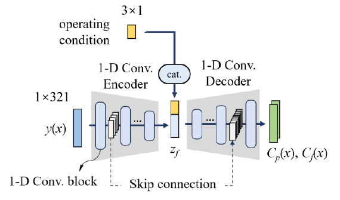

**图 A1 翼型气动模型框架。** 图中，operating condition 为工况，1-D Conv. Encoder / Decoder 为一维卷积编码器／解码器，1-D Conv. block 为一维卷积块，Skip connection 为跳跃连接，cat. 表示拼接。

编码器包含三个块，每个块均由一个卷积核大小 $k=3$、步长 $s=2$ 的一维卷积层、一个具有相同核大小和步长的平均池化层，以及一个 Leaky ReLU 激活层组成。各块输出的通道数依次为 16、32 和 64，特征图尺寸依次为 80、19 和 4。随后，通过一个全连接层，将最后一个编码器块展平后的输出映射为一个 32 维潜变量 $z$。

解码器采用与编码器类似的架构，但以一个上采样层替代一维卷积层。上采样层由一个用于对一维数据进行上采样的线性插值层，以及一个用于提取特征、参数为 $k=3$、$s=1$ 的卷积层组成。通道数依次为 512、256、128 和 64，特征图尺寸依次为 4、19、80 和 321。在第一个块之前，采用隐藏维度分别为 64 和 128 的两个全连接层，将潜变量连接到初始特征图。在最后一个块之后，再使用一个 $k=3$、$s=1$ 的卷积层，将最后的特征图压缩为两个通道。

编码器和解码器的通道数及特征图尺寸通过多次试错实验进行手动调节，以获得在验证样本上的最佳性能。

### 2. 翼型到机翼迁移模型

本文的翼型到机翼迁移模型同样采用 U-Net 框架实现，如图 A2 所示。模型中的超参数也通过多次试错实验进行手动调节。

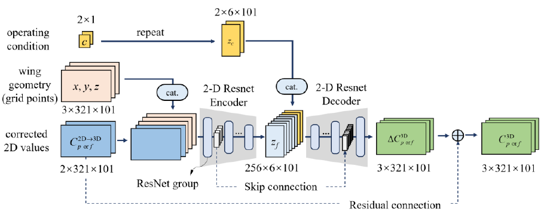

**图 A2 翼型到机翼迁移模型框架。** 图中，operating condition 为工况，repeat 表示重复扩展，wing geometry (grid points) 为机翼几何（网格点），corrected 2D values 为修正后的二维数值，2-D Resnet Encoder / Decoder 为二维 ResNet 编码器／解码器，ResNet group 为 ResNet 组，Skip connection 为跳跃连接，Residual connection 为残差连接，cat. 表示拼接。

编码器和解码器仅改变特征图中沿翼型周向的维度，展向维度保持不变。因此，本框架中的潜变量不再采用向量形式，而是一个具有三个维度的压缩特征图。这样既避免了在压缩特征图与潜向量之间使用全连接层所带来的大量参数，也有助于模型更好地保留各展向位置上翼型气动模型结果中的信息。

机翼几何由其表面网格点的坐标描述，并在输入编码器之前与修正后的二维分布拼接。采用表面网格点有两个原因。第一，网格与修正后的二维分布具有相同的尺寸，便于评估引入二维分布的效果。只需从输入中去掉修正后的二维分布，即可构建基准模型，而模型骨干基本保持不变，从而保证比较的公平性。第二，我们此前的研究 [31] 已证明，采用分布式几何输入优于仅输入整体几何参数。表面网格点可视为一种分布式几何输入，有助于模型获得更高的精度。

工况 $(\mathrm{Ma}^{3D},\mathrm{AOA}^{3D})$ 通过与 U-Net 内部的潜变量拼接而输入模型。由于本框架中的潜变量是压缩特征图，因此沿翼型周向和展向重复扩展工况，使其具有与潜在特征图相同的尺寸。

由于模型规模更大、维度更高，采用二维 ResNet 块 [37] 构建 U-Net 的编码器和解码器，以缓解层数增加带来的训练困难。编码器和解码器均由六个 ResNet 组组成。编码器中的每个 ResNet 组包含一个用于下采样的残差块和一个基本残差块，其架构如图 A3 所示。每经过一组，翼型周向维度的尺寸减半，六组输出的通道数依次为 32、64、64、128、128 和 256。解码器中，每个 ResNet 组的第一个残差块替换为由卷积层和线性插值实现的上采样残差块，同样如图 A3 所示。与编码器相反，解码器中每经过一组，特征图尺寸加倍，六组输出的通道数依次为 128、128、64、64、32 和 32。解码器最后使用一个卷积层，将 32 个通道压缩为与输出变量对应的三个通道。

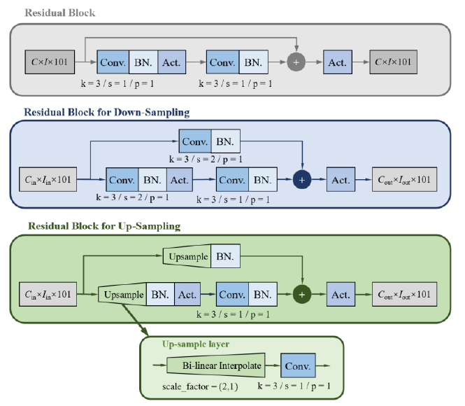

**图 A3 翼型到机翼迁移模型的残差块架构。** 图中，Residual Block 为残差块，Residual Block for Down-Sampling / Up-Sampling 为下采样／上采样残差块，Up-sample layer 为上采样层，Bi-linear Interpolate 为双线性插值，Conv. 为卷积，BN. 为批归一化，Act. 为激活函数，Upsample 为上采样；$k$、$s$ 和 $p$ 分别表示卷积核大小、步长和填充大小，scale_factor 为缩放因子。

### 3. 展向升力分布模型

为建立二维与三维结果之间的联系，本文提出两种用于估计展向升力分布（SLD）的数据驱动方法：一种直接预测 SLD，另一种预测真实 SLD 与涡格法（VLM）预测结果之间的残差。两种方法采用相同的机器学习模型架构进行预测。由于 SLD 的分布规律比表面压力和摩擦分布更简单，且训练样本数量有限，因此该模型的设计比前两个模型更简单。

如图 A4 所示，采用一个多输入前馈神经网络（FNN）。输入分为三部分：工况，包括 $\mathrm{Ma}^{3D}$ 和 $\mathrm{AOA}^{3D}$；机翼平面形状几何，包括 $\Lambda_{\mathrm{LE}}$、$\Gamma_{\mathrm{LE}}$、$\mathrm{AR}$、$\mathrm{TR}$、$r_t$ 和 $\alpha_{\mathrm{twist}}$；以及截面翼型几何，包括翼根翼型的 CST 参数和 $(t/c)_{\max}$。这三部分输入分别经过三个独立的全连接分支，其隐藏维度依次为 $(16)$、$(32,32)$ 和 $(64,64)$；随后将各分支输出拼接，再经过两个全连接层，隐藏维度为 64，输出维度为 101。对于所提出的方法（2），输出设为 CFD 模拟得到的 SLD；对于方法（3），输出为 VLM 与 CFD 结果之间的差值。

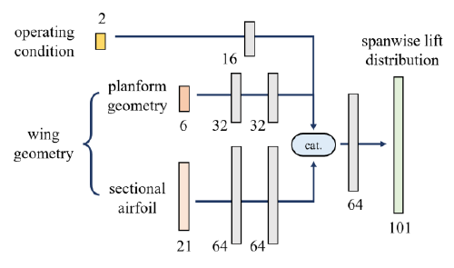

**图 A4 升力分布预测模型框架。** 图中，operating condition 为工况，wing geometry 为机翼几何，planform geometry 为平面形状几何，sectional airfoil 为截面翼型，spanwise lift distribution 为展向升力分布，cat. 表示拼接。
