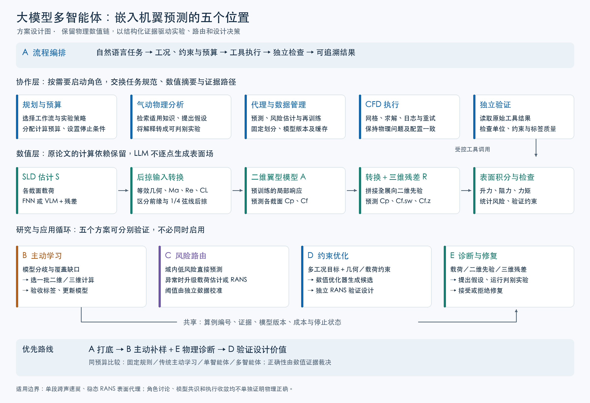

# 物理嵌入式机翼预测与大模型多智能体：五种融合方案

> 基础论文：Yang 等，*Rapid aerodynamic prediction of swept wings via physics-embedded transfer learning*，AIAA Journal 63(6):2545–2559，2025。[正式 DOI](https://doi.org/10.2514/1.J064576)；[免费最新 arXiv v2](https://arxiv.org/pdf/2409.12711v2)；[版本记录](https://arxiv.org/abs/2409.12711)。  
> 本文性质：面向研究选题与实现的方案设计，不是已运行系统或已验证的性能结果。文中新增公式、角色、阈值选择办法及实验规模均为建议。检索日期：2026 年 10 月 29 日。  
> 文件名按基础论文年份与期刊归类，“机翼多智能体方案”为八字主题简称；不表示本设计已在该期刊发表。

## 1. 先给判断：应该嵌入哪些环节

最有价值的结合方式，是让大模型多智能体负责**实验与设计决策**，让原论文的物理嵌入代理、VLM、数值优化器和 CFD 负责**定量计算**。

本文提出五种不同的研究方案：

| 方案 | 智能体介入的位置 | 要解决的问题 | 数值模型改动 | 建议定位 |
|---|---|---|---|---|
| A 流程编排与自动复现 | 数据、训练、推理及检查的外层 | 工具繁杂、配置易错、人工操作多 | 最少，可保持原模型 | 最快做成可用原型 |
| B 物理驱动主动学习 | 采样与追加 CFD 的外循环 | 三维标签昂贵，样本应补在哪里 | 增加不确定性与采样闭环 | 最贴近原论文核心问题，优先研究 |
| C 载荷与保真度路由 | SLD 输入端及预测后的风险判断 | 哪些机翼可快速预测，哪些需升级计算 | 多路校准或多路条件化模型 | 适合有在线查询需求的系统 |
| D 多工况约束优化 | 代理模型外的设计优化循环 | 将快速预测转为真实可靠的设计收益 | 增加优化器、约束与验证流程 | 工程价值最直接 |
| E 物理诊断与模型修复 | 预测异常后的诊断、实验与再训练 | 失败来自载荷、二维先验还是三维修正 | 诊断工具及可选择的修复模块 | 研究深度高，但验证较难 |

**建议主线：以 B 为核心，用 A 打底、E 解释和指导补算，最后以 D 展示下游价值。** C 可作为独立部署课题，不必在第一版同时引入全部复杂度。

这五种方案是替代或可组合的研究路线，不是要求建立五套冗长的聊天团队。只增加若干“专家角色”而没有改变决策或验证过程，难以构成有说服力的研究增量。

## 2. 原论文中必须保留的计算骨架

记机翼几何为 $G$，来流为 $q$，截面升力分布为 $s$。原论文可以整理为：

$$
\hat s=S(G,q),\qquad
B=T_{out}\!\left[A_\theta\!\left(T_{in}(G,q,\hat s)\right)\right],
\qquad \hat Y=B+R_\phi(B,G,q),
$$

其中：

- $S$：SLD 估计，包括纯 FNN、VLM 或 VLM＋FNN 残差。
- $T_{in}$：后掠理论的几何与工况转换，含局部弦长、马赫数、雷诺数和截面升力换算。
- $A_\theta$：预训练并固定的二维翼型模型。
- $T_{out}$：将二维压力及流向摩擦转换到机翼基准。
- $R_\phi$：联合处理全部展向截面的三维表面残差模型。
- $Y=(C_p,C_{f,sw},C_{f,z})$：机翼表面量，统一表面网格为 $321\times101$；不是整个空间内的体流场。

为简化上式，$B$ 的展向摩擦基线记为零；该通道实际由三维模型预测。将预测表面量积分，才得到整翼升力、阻力和俯仰力矩。

原文最适合实际应用的组合 SLD 配置，压力表面误差为 0.77%，相对无迁移基准降低 29.0%；真实 SLD 参照的 0.66% 依赖测试翼三维真值，不能作为部署条件。网络推理小于 0.1 秒，组合配置还需约 2.2 秒 VLM。上述数值来自本地全文的原表 8–9，沿用论文特定误差定义。

因此，多智能体值得改变的是：**什么时候调用这条链、信任程度如何、该补哪种计算、怎样根据证据改进模型或设计。** 原本已有的快速数值链无需在每个网格点插入一次语言推理。

## 3. 相关文献能提供什么，不能证明什么

### 3.1 气动与 CFD 直接证据

**AirfoilAgent，AEI 2026。** 它将任务规划、知识融合、评估反思组织成翼型优化闭环，结合检索、特征交互与灵敏度知识。它支持“领域知识＋工具＋反馈”这条路线。但本地全文中的参数化和计算路线涉及二维 PARSEC 与 XFOIL，不能把其性能增益直接迁移为三维跨声速 RANS 的预期收益。把它的二维几何提案方式原样套到本论文的 CST 单段翼空间，也需要重新验证。[正式论文页](https://www.sciencedirect.com/science/article/pii/S1474034625011395)

**ChatCFD，Advanced Intelligent Discovery 2026。** 它支持通过结构化知识、工具执行及反思自动完成 CFD 工作流，同时区分执行成功和物理一致性。这提示我们必须独立检查边界条件、参考量、网格和求解设置。其 OpenFOAM 经验不是原论文 CFL3D 工具链可直接复用的证明。[免费正式全文](https://advanced.onlinelibrary.wiley.com/doi/full/10.1002/aidi.202500174)

### 3.2 多智能体组织证据

**MetaGPT，ICLR 2024。** 可借鉴的是标准操作流程、明确角色及结构化工件传递。在本题中，应把其软件需求／设计／测试工件改为“算例规范／几何与工况／模型与 CFD 证据”，而不是复制角色名称。[免费正式版](https://proceedings.iclr.cc/paper_files/paper/2024/file/6507b115562bb0a305f1958ccc87355a-Paper-Conference.pdf)

**GPTSwarm，ICML 2024。** 可借鉴的是把工具和智能体交互表示为可调整的计算图。这里更适合先固定工具依赖、只允许在明确事件处改变诊断或升级分支；不应未经验证就让系统不断重写整条流程。[免费正式版与代码入口](https://proceedings.mlr.press/v235/zhuge24a.html)

**AutoGen，COLM 2024。** 提供可结合语言模型、工具与人的可编程交互方式，适合实现执行、复核和恢复的分工。框架的可用性不等于具体气动方案有效。[免费正式会议 PDF](https://www.microsoft.com/en-us/research/wp-content/uploads/2023/08/LLM_agent.pdf)

### 3.3 数值可靠性的证据

**UA-DBO，SMO 2026。** 与基础论文同组作者的工作，将预测不确定性纳入离线翼型优化目标，减少优化对不可靠预测的利用。它为 D 提供直接方法参照，但其原设定是离线优化，不是本文 B 的在线补样循环，也不是已经验证的三维机翼多智能体系统。[正式记录](https://link.springer.com/article/10.1007/s00158-026-04259-0)、[免费最新作者稿](https://arxiv.org/abs/2601.21956)

**Deep Ensembles，NIPS 2017；SCBO，AISTATS 2021。** 前者可作为不确定性估计的基础，后者可作为约束优化的强基准。它们提醒我们：不确定性、候选排序和约束处理有成熟数值方案，不能把这些已有收益全部归因于 LLM。[Deep Ensembles 正式版](https://proceedings.neurips.cc/paper_files/paper/2017/hash/9ef2ed4b7fd2c810847ffa5fa85bce38-Abstract.html)、[SCBO 正式版](https://proceedings.mlr.press/v130/eriksson21a.html)

上述文献支持各组件或工作流思想，**未共同验证下文提出的组合，也未证明多智能体一定优于单智能体、固定规则或数值优化器**。

## 4. 共用系统：角色、工具与状态怎样连接

图 1：本次方案设计图。A 管流程，B 管补样，C 管预测路径，D 管设计闭环，E 管异常归因与修复。中间数值链仍按原论文的物理依赖运行；图中没有声称系统已经实现或取得性能增益。

### 4.1 建议的角色分工

| 角色 | 读取信息 | 可以做的决策／调用 | 必须交付的结果 |
|---|---|---|---|
| 任务规划者 | 自然语言目标、预算、几何与工况限制 | 生成结构化任务，选择已定义流程 | 可检查的任务规范与成功条件 |
| 气动物理分析者 | 表面特征、SLD、已核文献、训练覆盖 | 提出带适用条件的解释及候选实验 | 假设、证据、适用域与可证伪预测 |
| 代理与数据管理者 | 模型版本、训练／校准划分、误差摘要 | 运行代理、评估不确定性、组织再训练 | 带版本及来源的数值结果 |
| CFD 执行者 | 固定算例规范、几何、求解模板 | 网格、运行、读取日志、有限重试 | CFD 工件、状态与资源消耗 |
| 数值验证者 | 工具原始结果、参考量、约束与日志 | 运行确定性检查，复核修复是否改变问题 | 验证通过／失败／证据不足 |
| 预算调度者 | 计算排队、成本、候选价值与剩余预算 | 在许可动作间选择批次和升级 | 下一批动作及预算账本 |

这是一套职责划分，不要求每个角色对应不同基础模型。简单任务可合并规划与调度，复杂诊断再启动分析者。角色分开主要为了限定读写范围、提供独立证据通道，而不是把相同模型重复调用视作独立可靠性证明。

### 4.2 工具层必须明确

建议封装以下接口；这是拟议接口名称，**不是声称 floGen 已有同名 API**：

- `validate_case`：检查几何、坐标、单位、工况、参考面积与角度定义。
- `predict_sld`、`run_vlm`：输出所选路径的 101 点载荷及状态。
- `predict_surface`：运行后掠转换、二维模型和三维残差模型。
- `integrate_forces`、`extract_features`：计算系数、激波位置特征、摩擦特征及分区统计。
- `estimate_risk`：读取校准模型，输出误差风险与覆盖信息。
- `run_rans`：生成受控算例、提交或本地运行、保存日志；不自动改动目标物理问题。
- `train_update`、`evaluate_holdout`：再训练与固定盲测；测试标签不提供给规划和采样角色。
- `propose_candidates`：由数值算法在允许的参数化空间中生成合法候选。

语言模型选择工具、解释证据和提出实验；数组计算、积分、阈值执行、候选边界投影由程序完成。大尺寸表面场存文件或对象库，只把必要摘要和路径交给语言模型。

### 4.3 共用算例记录

每次操作至少保存：算例编号、几何参数与文件校验值、工况及单位、$\Lambda_{LE}$ 与 $\Lambda_{1/4}$、参考弦长／面积、模型及数据版本、训练域距离、SLD 来源、预测路径、计算结果、求解状态、实际成本、检查报告与证据路径。

规划文本不能覆盖工具原始数值。失败或尚未验证的结果不能混为成功标签写回训练库。知识库条目必须带工况与来源，二维经验不能自动提升为所有后掠翼适用的规则。

## 5. 方案 A：流程编排与自动复现

### 5.1 目标与嵌入位置

保留原论文数学模型，在其外层建立“任务→配置→执行→验证→报告”工作流。输入可以是“对这一批单段机翼预测表面压力与阻力，标出不在训练范围内的样本”，输出包括可追溯结果、异常清单和复现实验配置。

适合首先检验：多智能体能否少依赖人工整理文件、转换参数和检查训练，而不改变预测算法。

### 5.2 完整运行流程

1. 规划者把需求转换成固定字段：机翼清单、工况、需要的输出、模型版本、预算和通过条件。
2. 验证者检查参数范围、几何合法性及参考量；缺少关键量的算例标为不可执行，不能猜值后当成用户输入。
3. 数据管理者检查已有模型与数据工件，调用 SLD、后掠转换和表面预测工具；多个机翼批量运行。
4. CFD 执行者只在任务要求或明确风险触发时执行 CFD；纯预测任务无需全部重算。
5. 验证者复核表面积分、网格对应、载荷来源及模型域；核对摩擦方向与符号约定。
6. 若失败，系统先区分配置错误、工具故障和模型覆盖不足，再进入对应修复路径；每次修改留有差异记录。
7. 报告角色引用实际工件生成结论，明确哪些是代理预测、哪些经 RANS 验证。

### 5.3 对原论文改什么

只新增工具接口、配置规范、记录与错误处理。二维模型与三维网络可完全保持不变。复现实验先使用固定脚本保证数值链正确，再让智能体调度这些工具。

### 5.4 如何验证与局限

比较人工操作、固定工作流、单智能体与多智能体，统计完成率、物理配置正确率、人工干预次数、总耗时与成本。同一输入下若模型和参数相同，数值精度不应因为增加角色自动提高；收益主要是可操作性、正确执行和异常恢复。

**适合做工程原型，但单独作为论文创新往往偏弱。** 若固定脚本已覆盖全部任务，语言协调可能增加时延；真正优势应出现在任务变化、配置不完整及跨工具故障恢复上。

## 6. 方案 B：物理驱动的多智能体主动学习——优先推荐

### 6.1 研究问题

原论文证明二维知识能够减少三维数据需求，但数据库基本先建好再训练。新问题是：**在三维 CFD 预算受限时，系统能否根据当前模型缺陷，主动决定下一批需要计算什么，而不只是被动训练？**

这里将流程从“固定数据训练”改为：

$$
\mathcal D_t\to M_t\to\text{风险与覆盖分析}
\to\text{候选实验}\to\text{CFD 标签}\to\mathcal D_{t+1}.
$$

### 6.2 智能体怎样产生不同且有用的信息

- 数据管理者识别训练覆盖稀疏区域、不同模型分歧及误差分区。
- 物理分析者提出带条件的区域假设，例如“大后掠、低梢根比组合可能使二维基准遗漏的展向作用更强”，同时说明这只是待测假设。
- 数值候选工具在合法参数域中生成点，不让 LLM 直接凭文字凑出数千个坐标。
- 调度者综合数值采集分数、候选多样性与 CFD 成本确定批次。
- CFD 执行者生成标签，验证者隔离失败案例，训练工具更新模型。
- 分析者检查新数据是否支持原假设，未支持的经验不能写成确认知识。

多智能体的潜在价值在于把误差摘要、物理条件、求解失败和成本信息合并为下一轮实验；候选排序与距离计算仍由数值算法完成。

### 6.3 可执行的采样机制

从完整预测链的模型集成得到 $\hat Y^{(k)}(x)$，通过同一积分器得到 $\hat C_D^{(k)}$ 等性能样本。数值工具计算：

$$
\sigma_D(x)=\operatorname{Std}_k\big[\hat C_D^{(k)}(x)\big].
$$

以此构造一个可实现的启发式批采集分数，例如：

$$
a_t(x)=\frac{w_1\tilde u_Y(x)+w_2\tilde u_D(x)+w_3\tilde d(x)
+w_4\tilde r_{phys}(x)}{\widehat c_{RANS}(x)}.
$$

其中各项须在训练／校准信息上归一化：表面预测分歧、性能不确定性、到已标注样本的距离、物理或一致性异常分数；分母为估计计算成本。物理异常是线索，不是真实误差。权重、阈值或其可选择范围要预先固定，或只用开发集决定。

上述分数是**建议的启发式规则，不是已证明最优的信息价值公式**。不能使用未标注候选真实误差进行排序；那需要先算 CFD，失去主动采样的意义。为防止总选极端离群点，可混合不确定性采样、覆盖采样与少量随机探索，并通过数值距离约束批次多样性。

LLM 可选择事先定义的采样策略、提出区域假设和建议实验对比；是否胜过固定权重采集，必须独立验证。

### 6.4 如何处理“二维知识不足”和“三维知识不足”

初版建议固定二维模型，只主动追加三维标签，便于归因。高级版再允许两种动作：

- 若有效二维输入超出二维模型范围，补算二维翼型 RANS。
- 若二维代理在相关输入处可信，但整翼残差仍不确定，补算三维 RANS。

这两种诊断需要额外证据。不能仅因某处误差较大就断言它来自二维模型。可以用少量二维 CFD 比较 $A_\theta$，并在已标注三维翼上开展真实 SLD 替换等诊断实验。

若更新 $A_\theta$，原有全部机翼的二维基准 $B$ 都可能改变，应重新生成相关基准与残差标签、再训练迁移模型并使缓存失效，不能只替换二维权重继续沿用旧残差库。

### 6.5 最小实验设计

先在已有标注数据库中做“隐藏标签回放”：所有方法共享同一候选池，只有被选中的算例才向训练系统开放真值。独立盲测集和其误差不向智能体、知识库、采样器开放。

示例配置可为 200 个初始三维样本、每轮追加 10 个、最多 5 轮；这些数字只是建议，不代表已完成实验或预计收益。对照至少包括随机补样、空间覆盖采样、纯不确定性采样、固定物理规则、单智能体、多智能体。

主要结果应是“固定三维成本下的盲测精度／最差分区精度”及“达到目标误差的实际核时”，并统计失败计算成本。数据库回放能检验选点，不足以证明 CFD 自动化能力，之后还需独立真实求解测试。

### 6.6 创新点与局限

可形成的研究贡献是：**面向二维→三维迁移残差结构的、预算约束且证据驱动的实验规划**。如果只是常规不确定性排序后让 LLM 撰写解释，核心仍是传统主动学习。

风险在于不确定性可能低估系统偏差，物理假设可能错误，智能体也可能偏好“有趣但无益”的样本。必须用同预算强基准证明新增决策确实有效。

## 7. 方案 C：SLD 与多保真度的风险路由

### 7.1 研究问题与介入点

原论文主要比较几种固定 SLD 方法。新方案研究：**能否根据新机翼的覆盖程度、载荷风险与任务精度需求，自适应选择便宜路径、组合路径或三维 CFD？**

需要明确：纯 FNN→组合 SLD 是升级载荷估计；最终升级到三维 RANS 才是直接获得更高保真标签，二者不是同一种升级。

### 7.2 三条候选路径

| 路径 | 动作 | 适用意图 |
|---|---|---|
| P1 | FNN-SLD → 二维先验 → 对应三维迁移模型 | 域内、低风险、大批量查询 |
| P2 | VLM＋残差 FNN-SLD → 二维先验 → 对应迁移模型 | 需要更可靠载荷基准的查询 |
| P3 | 三维 RANS，保留代理作对照或提供经验证的求解策略线索；不能直接提供体场初值 | 预测超出可信范围、最终设计确认 |

不能把 P1 的 SLD 任意塞进仅按 P2 训练的网络后，直接引用 P2 的误差。可以分别训练、分别校准各路径；或者明确用多种 SLD 输入训练同一模型，并验证其条件适应能力。还需计入多模型存储、训练和管理成本。

### 7.3 运行流程

1. 验证者先检查支持构型与工况；折点翼、复杂干扰等超出原模型能力的情况不靠“更强的角色讨论”视作已覆盖。
2. 数值风险工具使用独立校准集估计各路径误差风险，候选机翼运行 P1 后得到快速摘要。
3. 简单且低风险的查询按确定性规则直接返回；出现路径分歧、覆盖不足或约束临界事件时才启动物理分析与调度智能体。
4. 系统在 P2 和 P3 中选择，并记录升级原因及预算；所有路径均执行相同参考量和表面积分检查。
5. 后续获得 RANS 标签时，检验当时路由是否合理，更新开发／校准流程；不将盲测标签用于当前评估规则调参。

### 7.4 数学目标与风险判断

可将路由写为：

$$
\min_m\;\widehat c_m(x),\qquad
\text{s.t. }\widehat P\big(e_m(x)>\varepsilon\mid z(x)\big)\le\delta.
$$

$z(x)$ 是覆盖距离、模型分歧、载荷及表面特征等；概率是由独立数据拟合或校准的风险估计。不能把 LLM 的“我有 95% 把握”当成该概率，也不能宣称分布外风险保证自然成立。

完整不确定性应覆盖 SLD 和表面模型。可采用成套训练的级联集成，并传播到气动力；若只对 $R_\phi$ 多次采样而固定错误 SLD，风险可能被低估。

### 7.5 如何验证与局限

比较始终 P1、始终 P2、始终 RANS、固定阈值路由、单智能体与多智能体。报告误差—成本曲线、漏升级率、误升级率、约束附近风险、查询接受覆盖率和 95 分位响应时间。

语言调用本身可能比 2.2 秒 VLM 更慢，因此**不应每个便宜查询都召开一次多角色讨论**。LLM 应位于批次策略或异常事件层，稳定路径使用冻结的程序规则。若固定规则已经同样有效，本方案的在线多智能体部分就没有被证明必要。

## 8. 方案 D：多智能体驱动的多工况约束机翼优化

### 8.1 目标与介入位置

将原论文快速预测模型作为优化评估器。智能体解析任务、检索适用知识、分解目标、管理验证；数值优化器在原论文支持的机翼空间中搜索设计。

与 AirfoilAgent 的主要区别应是：三维跨声速后掠翼、物理嵌入代理、载荷误差传播与多工况可靠性，而不只是从二维换一个几何文件。

### 8.2 建议的第一项优化任务

建议先固定大部分平面形状，优化少量 CST 或厚度／扭转变量；后续再扩展维度。目标例如：

$$
\min_{x,\{\alpha_j\}}\sum_{j=1}^{N_q}w_j\,C_D(x,\mathrm{Ma}_j,\alpha_j),
$$

满足各工况的升力要求、力矩限制、厚度及几何约束，且 $(\mathrm{Ma}_j,\alpha_j)$ 先留在原模型覆盖范围内。

固定升力优化时，$\alpha_j$ 可作为有界数值变量或通过数值求根确定。目标 $C_L^*$ 是设计约束，不是把未知的真实截面 SLD 提前喂给预测器。应检查迎角范围内是否真的存在可行解。

### 8.3 团队怎样闭环

1. 规划者将自然语言目标编译成明确的目标、工况权重和约束，校验器检查是否自洽。
2. 物理分析者检索相同工况附近的知识，提出允许的低维搜索变量组及理由；不更改硬约束。
3. 数值优化器生成候选，几何工具检查厚度、自交、连续性与其他已实现约束。
4. 调用预测链，计算全部工况的表面量、气动力和不确定性。
5. 验证者拒绝不合法或超出置信域的候选；风险临界候选交给 C 的升级机制或预设 RANS 复核。
6. 分析者根据已验证反馈调整下一阶段变量组或建议实验；数值步长和候选仍由优化算法确定。
7. 对最终候选的所有指定工况及相应约束执行独立 RANS 复核，报告实际改善、预测落差与成本。

### 8.4 不确定性怎样进入目标

参考 UA-DBO 思路，可先使用：

$$
J(x)=\sum_jw_j\big(\mu_{D,j}(x)+\kappa\sigma_{D,j}(x)\big),
$$

并对升力约束采用经过校准的区间或误差裕量。这里是对最小化阻力的风险惩罚设计；$\kappa$ 需经开发实验确定，不是任意取值就获得可靠性保证。

多点响应可能相关，直接相加标准差不等于总目标的严格置信界。若要给出概率解释，需传播联合样本或建模跨工况相关性。若几何、工况和边界条件存在物理不确定性，还需与代理认知不确定性分开建模。

### 8.5 对照、创新与局限

强基准包括同一代理上的传统优化、风险感知传统优化，以及单智能体工具调用。预算必须同时限制 RANS 核时、代理评估数和语言调用成本；代理预计的改善不能当作最终结果。

此方案的贡献在于“知识、约束和计算的可追溯设计闭环”。若 LLM 只是提出变化而数值优化器已能同预算更好地搜索，应如实报告它主要改善交互或解释，而非优化性能。

从原论文的单工况／每几何一个样本训练结果，不能直接推出多工况曲线、梯度或抖振预测均准确。本方案不把稳态表面代理当作非定常抖振求解器。

## 9. 方案 E：物理诊断与自适应模型修复

### 9.1 研究问题

当某些预测不可靠时，能否利用原论文的分解结构，决定应该补哪类数据、调整哪个模块，并通过可证伪实验验证？

它比泛泛的“反思智能体”更具体：每次诊断必须给出**假设—证据—实验—判定—动作**，不能只输出听起来合理的气动解释。

### 9.2 建议的诊断假设库

| 假设 | 需要什么证据 | 最小判别实验 | 可能采取的动作 |
|---|---|---|---|
| H1 SLD 是主要误差源 | 路径差异、SLD 不确定性、已有标签上的敏感性 | 在诊断用已标注翼上换入真实 SLD，保持其余模型不变 | 补载荷数据、改进 SLD 模型或路由 |
| H2 二维代理有误 | 等效翼型超出覆盖、二维代理与二维 CFD 不一致 | 对少量有效二维截面计算独立二维 RANS | 补二维数据；更新后重建三维先验 |
| H3 后掠基准不足 | 二维代理已准，但二维→三维偏差有稳定空间形态 | 对有真值案例比较区域残差及转换变体 | 增加明确物理特征或残差模型容量 |
| H4 输入或后处理错误 | 参考量不一致、网格对应错、积分异常 | 固定同一场，独立重算转换与积分 | 修工具与缓存，不训练模型掩盖错误 |
| H5 真值 CFD 质量不足 | 网格敏感、载荷未稳定、求解设置差异 | 网格／迭代／设置复核，保留同一物理问题 | 重算或标为低可信标签 |

多项原因可以同时存在。真实 SLD 替换只用于已标注诊断实验；不能在新翼部署时读取隐藏真值，也不能把这种理想诊断精度当成最终方案性能。

### 9.3 闭环流程

1. 用程序提取翼根／中段／翼尖误差，载荷差异，激波位置及摩擦特征等摘要。
2. 物理分析者从假设库中选择少量有证据的候选解释，并列出可能的反例。
3. 独立验证者检查该实验是否能区分假设，是否改变了原问题或使用了测试真值。
4. 调度者在有限预算内选择判别实验，工具执行者运行数值试验。
5. 根据数值判据接受、拒绝或保留不确定；未经支持的解释不自动升级为知识。
6. 训练工具按预定义菜单执行修复，在开发验证集上选择修复；模型与策略锁定后，再作最终独立盲测，报告改善与退化，不反复用盲测结果挑选方案。
7. 有效修复登记模型版本与适用域，保留回退版本。

### 9.4 必须避免的错误修复

- 某处 $C_f<0$ 可能是回流或坐标符号约定，不应自动删去或改成正数。
- 表面压力出现陡变可能是激波，不应靠平滑将其“修好”。
- 三维输出积分的截面升力与输入估计 SLD 不完全一致，可能是网络正确修正；应作为软诊断，而非强制相等。
- 仅有表面 $C_p$、摩擦，不能直接计算全体域质量守恒或 Navier–Stokes 残差；需要相应体场与离散算子。
- 某种后掠转换使开发误差更小，不等于其余弦规则成为任意构型的严格定律。

### 9.5 如何证明“诊断”有用

先制作可控故障库：角度单位错、雷诺数局部弦长漏乘、表面点序错、模型版本混用，以及有真值的 SLD 扰动等；训练与测试故障组合分开。统计定位准确率、有效实验比例、诊断成本、修复后盲测误差与新增退化率。

然后在自然发生的困难算例上验证。与固定错误规则、单智能体诊断、无诊断随机补算比较。语言解释的流畅度或不同角色达成一致，都不作为正确归因的证据。

**适合形成较深入的科学问题，但第一阶段应限制修复菜单。** 让智能体任意改网络、损失和 CFD 模型，会使成本与归因都难控制。
## 10. 将五种方案组合为一个最小可研究系统

### 10.1 不必一开始就实现全部模块

建议第一版只设三类协作职责：

1. **规划与物理分析**：根据数值摘要选择下一批实验策略，明确依据与待验证假设。
2. **执行与数据管理**：调用固定工具，保持数据划分、模型版本与预算记录。
3. **独立验证**：直接读取原始工具工件，检查配置、标签质量和实验条件。

数据量增加、失败类型变复杂后，再拆出专门 CFD、预算或知识角色。验证者可以包含 LLM，但数值验收必须由程序和相应计算证据执行；另一个模型的同意并不等于独立物理验证。

### 10.2 一轮完整示例

以下是设计示例，未运行，不预设性能改善。

**任务。** 在原论文支持的单段翼范围内，提高一组 Ma=0.78–0.82 的预测可靠性，并探索固定升力约束下的多点减阻。先固定平面形状，只改变一部分截面参数和扭转，避免一次扩展过多维度。

**第一步：任务冻结。** 定义目标升力、厚度／力矩约束、允许迎角范围、三维核时、模型版本和最终验证工况。若约束不能在原模型域内同时满足，输出不可行状态，而不是悄悄放宽要求。

**第二步：代理筛查。** 数值工具批量预测候选，保存表面场，向规划者提供候选编号、整翼系数、覆盖距离、区域分歧及 SLD 路径差异。

**第三步：形成可检验假设。** 假设工具摘要显示翼尖摩擦分歧偏大。分析者不能直接声称“翼尖涡导致错误”，只能提出“SLD 误差或三维残差覆盖不足可能解释现象”，并指定区分两者的诊断。

**第四步：选择有限动作。** 对已有三维标签的开发案例做真实 SLD 替换诊断；对未标注候选用数值采样工具挑选一批互补算例。没有真值的候选不使用真实误差排序。

**第五步：执行与验收。** CFD 执行者按固定模板运行，验证者检查边界、工况、网格质量与载荷收敛。格式修复可以重试，物理设置变更需要明确登记为不同实验，不能把换成更简单问题的收敛当作原任务成功。

**第六步：更新与再校准。** 合格标签加入训练库，使用交叉拟合的 SLD 组织迁移训练，更新模型及风险校准。比较开发指标时保留所有试验，不只记录最优一次。

**第七步：优化与最终复核。** 数值优化器搜索候选，多智能体只在阶段边界提出策略调整。最终用独立 RANS 验证所有指定工况，报告真实阻力与约束情况；没有足够验证预算时输出“待验证候选”。

### 10.3 可以检验的核心研究假设

> 在相同三维计算预算和数值代理能力下，结合局部／全局气动证据的多智能体实验规划，能否比传统不确定性主动学习更有效地发现系统误差区域，从而提高新翼型族的预测与约束优化可靠性？

这个问题可被否证：如果固定物理特征采集或单智能体在同预算下同样好，就没有证据把增益归因于多智能体组织。

## 11. 完整实验协议：怎样区分“多智能体收益”与“多算了一些”

### 11.1 需要两个实验轴

**轴一：有无更好的数值方法。** 比较原固定模型、加入 UQ、主动学习、风险优化后的变化。

**轴二：有无更好的协调方法。** 在数值工具相同前提下，比较固定脚本、单智能体、多智能体与可选协作图。

不能用“原模型＋少预算”对比“多智能体＋UQ＋更多 RANS＋新网络”，然后把全部增益称为多智能体收益。

### 11.2 建议的共同基线

| 基线 | 条件 | 要排除的混淆 |
|---|---|---|
| B0 原论文组合 SLD 模型 | 估计 SLD，原数值结构 | 作为数值起点 |
| B1 固定规则自动化 | 同工具、同错误检查、同预算 | 自动化是否已足够 |
| B2 传统主动学习／风险优化 | 数值 UQ、物理特征及强优化器 | 收益是否只是成熟数值方法 |
| B3 单智能体＋相同工具 | 同总语言调用预算、同信息 | 多角色分工是否必要 |
| B4 固定 SOP 多智能体 | 明确工件与职责，少量事件式协作 | 本文第一版组织方式 |
| B5 可选图优化／动态角色 | 只改变允许的协作边 | 额外协调复杂度是否值得 |

B2 不应故意设成弱基线。高维约束设计可考虑 SCBO 或合适的代理辅助信任域方法；候选评估也可选择进化算法。具体选型在开发阶段固定，不能因为测试结果不理想不断更换基线。

### 11.3 数据隔离协议

- 按 CST 翼型族分组留出，减少同源几何跨训练与测试；额外设置明确标记的工况或几何外推测试。
- 二维源域范围由独立设计或训练数据确定，不借助测试翼真实 SLD 极值。
- 辅助 SLD 与表面迁移的级联训练采用交叉拟合，让表面模型看到接近部署条件的 SLD 误差。
- 开发、风险校准与最终盲测尽可能分开；测试真值不进入 RAG、记忆、提示优化或采样策略。
- 每轮主动学习仅能看到已查询标签；测试成绩不能返回规划者用于下一轮决策。
- 在线数据分布变化时检验校准漂移。普通同分布校准不自动保证自适应搜索或分布外覆盖。
- 诊断中使用真实 SLD、真实二维 CFD 或真实三维场时明确标为理想信息实验，和最终部署成绩分开报告。

### 11.4 建议报告的指标

| 层级 | 指标 |
|---|---|
| 预测 | $C_p,C_{f,sw},C_{f,z}$ 误差；$C_L,C_D,C_M$ MAE；95 分位或最差分区误差 |
| 特征 | 在明确定义的样本上，激波位置／强度、摩擦特征位置误差；没有清晰激波时标缺失，不强造位置 |
| 风险 | 区间覆盖与宽度、误差检出率、漏检率、接受样本比例及风险—覆盖曲线 |
| CFD 自动化 | 执行完成率、物理设置一致率、有效标签率、失败类型、人工介入次数 |
| 主动学习 | 误差—标签数曲线、误差—实际核时曲线、全域与目标区域的退化情况 |
| 优化 | 独立 RANS 的最终目标、实际可行率、约束违规、预测改善与实际改善落差 |
| 协作 | 决策有效率、重复工具调用、无效修复、通信量、LLM 费用和端到端时延 |

压力误差沿用基础论文特殊指标时，同时补充定义清楚的 MAE／RMSE，避免把不同论文中的百分数直接横比。校准或方案选择的“最优一次”不代替多随机种子统计。

### 11.5 成本账本

分开记录：已有数据库成本、追加二维 CFD、追加三维 CFD、网格加密与重试、最终设计验证、模型训练、语言调用和等待时间。一次高保真查询的基本单位应为“几何×工况”，不是只数不同几何。

比较主动学习时，不能在每种方法名下遗漏失败核时；比较优化时，最终验证也应计入共同预算。若采用已有数据库回放，只能报告标签查询效率和估算成本，不声称实际节省了尚未运行的 CFD 时间。

## 12. 什么时候不该增加多智能体复杂度

多智能体的收益并非必然。ICML 2024 的研究发现，多种辩论策略并未稳定优于自洽或多路径集成，协议和调参会显著影响结果。[Smit 等，免费正式版](https://proceedings.mlr.press/v235/smit24a.html)

NeurIPS 2025 的 MAST 工作将多智能体失败分为系统设计、协作不一致和任务验证等类别，可作为工作流审计背景。本文的单位错、角度混用、失败标签入库等是针对气动任务推演出的检查项，不是该文直接报告的 CFD 结果。[MAST 免费正式版](https://proceedings.neurips.cc/paper_files/paper/2025/hash/b1041e52d3be19f0a9bc491657488e4a-Abstract-Datasets_and_Benchmarks_Track.html)

因此以下做法不建议作为主方案：

1. 为 101 个展向截面各配置一个 LLM，逐截面聊天算压力：开销大，也破坏了原论文联合建模的组织优势。
2. 多个角色投票决定 $C_p$、$C_D$ 或几何约束是否成立：数值事实需要计算证据。
3. 让 LLM 任意重写后掠理论、边界条件或求解器，以便结果更容易收敛：这可能改变研究问题。
4. 用越来越多轮讨论代替高保真复核：共识不能弥补共享的错误先验。
5. 把图优化、自动改网络及在线模型更新全部同时启用：即使改善，也难以识别来源。

可优化协作图适合作为后期消融：固定必要物理依赖边，只调整可选知识检索、诊断、复核和升级边，并在独立任务上验证。多智能体图的提示／边优化，与训练 $A_\theta$ 或 $R_\phi$ 的权重是不同过程。

## 13. 实施阶段与交付物

不预设开发周期，按可验收阶段推进。

| 阶段 | 必须交付 | 进入下一阶段的条件 |
|---|---|---|
| P0 数值底座 | 固定几何／工况规范、原预测链、积分器、原始结果及版本记录 | 与可信基准一致；没有 LLM 也能正确运行 |
| P1 流程原型 | A 的三职责版本、受控重试、结构化工具输出 | 不改物理问题即可处理定义内任务 |
| P2 可重复补样 | B 的隐藏标签回放、UQ、强基线与盲测 | 比较清楚样本收益和协调收益 |
| P3 实际 CFD 闭环 | CFL3D 工具封装、独立物理核验、成本账本 | 新算例能产生可用标签，失败原因可追溯 |
| P4 诊断／路由 | C 或 E 的有限动作版本及故障测试集 | 同预算下降低漏检或有效提高补算价值 |
| P5 下游设计 | D 的小维度、多工况优化与独立 RANS 验证 | 实际可行改善，而非仅代理预计改善 |

现成论文代码库可作为起点，但需实际检查数据访问、权重、脚本依赖与许可。仓库开源不等于原始数据和全部权重无条件可下载；本次没有安装工具链、提交 CFD 作业或验证上述系统运行。[原作者 floGen 仓库](https://github.com/YangYunjia/floGen)

## 14. 建议选题表述与贡献边界

如果目标是论文或研究计划，建议采用下述定位：

**拟题：物理诊断驱动的多智能体机翼主动学习。**

可争取验证的三项贡献：

1. 面向二维→三维物理迁移链，提出将载荷、二维先验与三维残差证据组织为可执行实验的协作机制。
2. 在固定三维 RANS 预算下，比较其与传统主动学习、固定物理规则和单智能体的样本效率及分布变化可靠性。
3. 通过高保真复核的多工况优化，验证预测改进能否转化为真实设计收益。

如果只能证明自动完成任务，适合定位为工程自动化；如果能证明同预算下更合理地分配昂贵实验，才有更强的方法论增量；如果能借助可证伪实验定位并修复新的失败机制，才进一步具有科学研究价值。上述都属于待验证目标，不预先承诺性能提升幅度。

## 15. 原始文献、免费版本与核验边界

优先列已发表论文。正式开放论文集或期刊全文作为可核验版本；“最新作者稿”只表示公开记录最新，不保证与最终排版逐字一致，也不保证没有尚未发现的后续修订。

| 文献 | 正式发表／免费入口 | 本次版本核验与用途 |
|---|---|---|
| 基础论文，Yang 等 | AIAA Journal 2025；[最新免费 v2](https://arxiv.org/pdf/2409.12711v2)，[正式 DOI](https://doi.org/10.2514/1.J064576) | arXiv 最新 v2=2024-10-12；未逐项对照最终排版。本文数值细节依据已有完整译文 |
| AirfoilAgent，Fan 等 | AEI 71:104246，2026；[正式记录](https://doi.org/10.1016/j.aei.2025.104246) | 2025-12 在线首发，2026 卷年；未找到并核验可靠免费完整作者稿，方法细节另据本地译文 |
| ChatCFD，Fan 等 | Advanced Intelligent Discovery，2026；[免费正式全文](https://advanced.onlinelibrary.wiley.com/doi/full/10.1002/aidi.202500174) | 正式首发 2026-01-19；[arXiv](https://arxiv.org/abs/2506.02019) 最新 v3=2026-02-07，引用正式版，不自动认定相同 |
| MetaGPT，Hong 等 | ICLR 2024；[免费正式版](https://proceedings.iclr.cc/paper_files/paper/2024/file/6507b115562bb0a305f1958ccc87355a-Paper-Conference.pdf) | [arXiv](https://arxiv.org/abs/2308.00352) 最新 v7=2024-11-01；与正式站有文字差异，引用正式会议版 |
| GPTSwarm，Zhuge 等 | ICML 2024，PMLR 235；[免费正式版](https://proceedings.mlr.press/v235/zhuge24a.html) | [arXiv](https://arxiv.org/abs/2402.16823) 最新 v3=2024-08-22；本地版本记录已核对正文一致，不声称二进制相同 |
| AutoGen，Wu 等 | COLM 2024；[作者机构免费正式会议 PDF](https://www.microsoft.com/en-us/research/wp-content/uploads/2023/08/LLM_agent.pdf) | [arXiv](https://arxiv.org/abs/2308.08155) 最新 v2=2023-10-03，早于会议；不将其视为已核对最终版 |
| UA-DBO，Yang 等 | SMO 69:95，2026；[正式记录](https://doi.org/10.1007/s00158-026-04259-0)，[免费作者稿](https://arxiv.org/pdf/2601.21956v1) | arXiv 最新仍 v1=2026-01-29；已有本地正式版译文，作者稿与正式版未逐项核同 |
| Deep Ensembles，Lakshminarayanan 等 | NIPS 2017；[免费正式版](https://proceedings.neurips.cc/paper_files/paper/2017/hash/9ef2ed4b7fd2c810847ffa5fa85bce38-Abstract.html) | 引用正式论文集，用于 UQ 基础，不为整套新系统提供可靠性保证 |
| Scalable Constrained Bayesian Optimization，Eriksson、Poloczek | AISTATS 2021，PMLR 130:730–738；[免费正式版](https://proceedings.mlr.press/v130/eriksson21a.html) | 引用正式论文集，用作强数值优化基准 |
| Should we be going MAD?，Smit 等 | ICML 2024，PMLR 235；[免费正式版](https://proceedings.mlr.press/v235/smit24a.html) | 引用正式会议版，说明多角色收益需同预算检验 |
| Why Do Multi-Agent LLM Systems Fail?，Cemri 等 | NeurIPS 2025 Datasets and Benchmarks；[免费正式版](https://proceedings.neurips.cc/paper_files/paper/2025/hash/b1041e52d3be19f0a9bc491657488e4a-Abstract-Datasets_and_Benchmarks_Track.html) | [arXiv](https://arxiv.org/abs/2503.13657) 最新 v3=2025-10-26；与正式版未逐字核对，引用正式论文集 |

**补充可读。** [Foam-Agent 最新公开 v3](https://arxiv.org/pdf/2505.04997v3)，对应 CMAME 461:119271、DOI [10.1016/j.cma.2026.119271](https://doi.org/10.1016/j.cma.2026.119271)，可借鉴依赖图、分阶段检索和最小错误修复。其公开记录最新修订为 2026-08-13；与出版社最终版未完成全文核同。它和 ChatCFD 的基准及模型版本不同，不直接横比其成功率，也不将旧的 Foam-Agent 2.0 稿自动视为最新期刊稿。

---

**本设计的核心：让多智能体负责“下一步做什么实验、为何做、如何验收”，让物理模型与数值工具负责“结果到底是多少”。最值得优先验证的，是这种分工能否在相同三维计算预算下做出更有价值的实验决策。**
