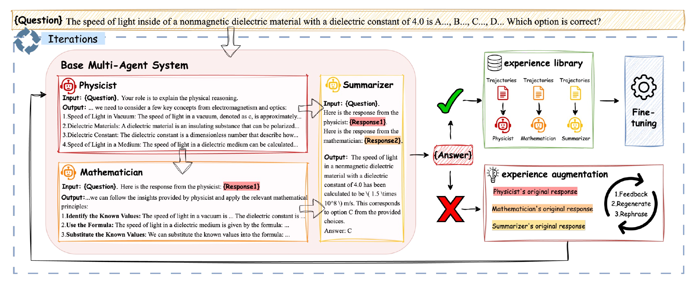
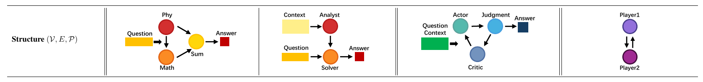
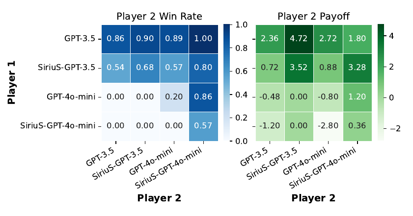
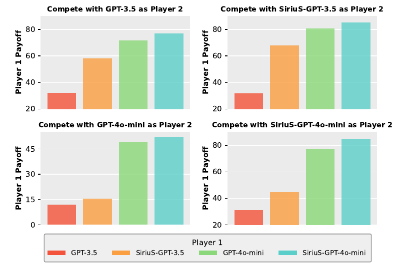
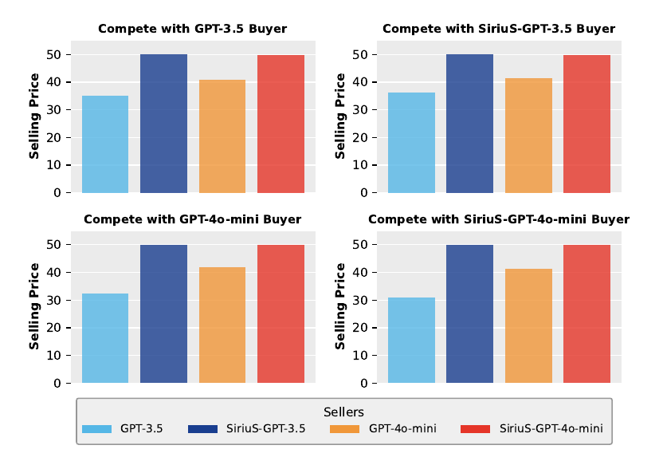
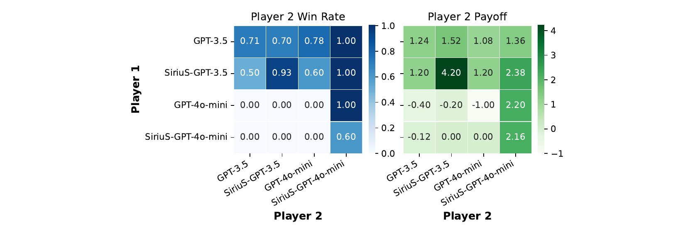
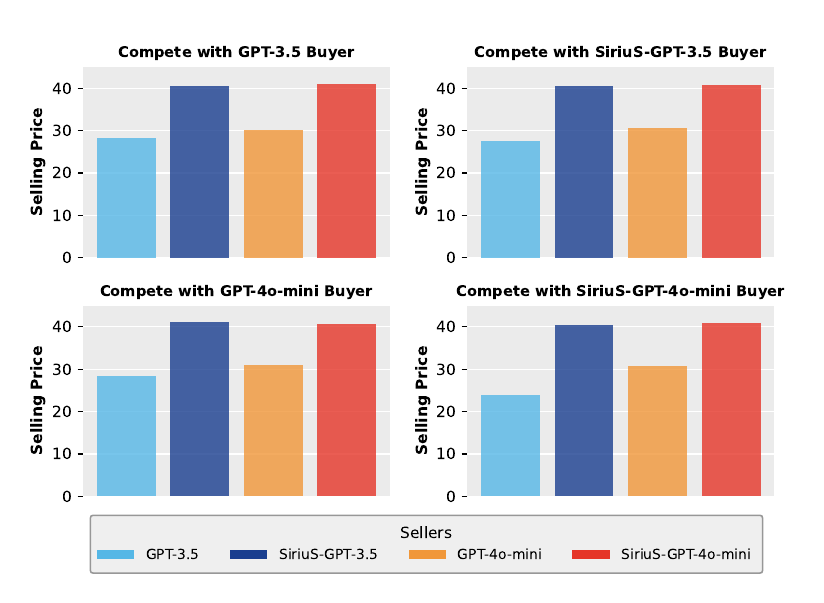
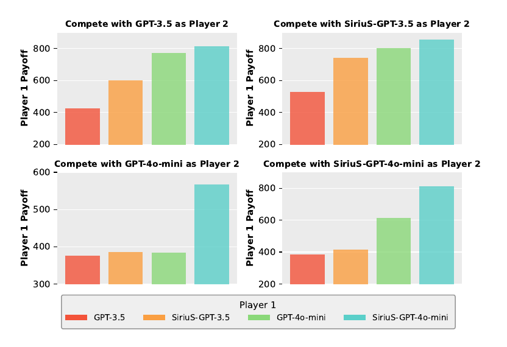

# SiriuS：通过自举推理实现多智能体系统自我改进

**原文题目：** SiriuS: Self-improving Multi-agent Systems via Bootstrapped Reasoning  
**作者：** Wanjia Zhao、Mert Yuksekgonul、Shirley Wu、James Zou  
**单位：** 斯坦福大学计算机科学系  
**通信邮箱：** wanjiazh@cs.stanford.edu；jamesz@cs.stanford.edu  
**会议：** 第 39 届神经信息处理系统大会（NeurIPS 2025），*Advances in Neural Information Processing Systems*，第 38 卷，主会议论文  
**DOI：** [10.52202/085713-4148](https://doi.org/10.52202/085713-4148)  
**免费正式版：** [会议论文页面](https://papers.nips.cc/paper_files/paper/2025/hash/b45279ac82cb017a5f55ea7d3653193a-Abstract-Conference.html)；[全文 PDF](https://papers.nips.cc/paper_files/paper/2025/file/b45279ac82cb017a5f55ea7d3653193a-Paper-Conference.pdf)  
**代码：** [作者仓库](https://github.com/zou-group/sirius)

> 版本与翻译说明：采用 NeurIPS 2025 当前提供的 30 页正式发表版。截至 2026 年 11 月 2 日，[arXiv 最新预印本](https://arxiv.org/abs/2502.04780v1)仍为 2025 年 2 月 7 日的 v1，共 21 页；正式版增加或修订了实验、参考文献和会议核对清单，译文以正式版为准。正文译为中文；参考文献、会议核对清单及附录保留英文，并转为 Markdown 文本。保留章节、公式、算法和图表编号及相对位置，图内文字沿用原图。本文提及的模型、API 和实验能力均按原文的研究时期保留。本文件为中文翻译及格式改编，非作者官方译本。

> 版权与改编：原文作者保留版权；[原文预印本](https://arxiv.org/abs/2502.04780v1)采用 [CC BY-NC-SA 4.0](https://creativecommons.org/licenses/by-nc-sa/4.0/) 许可。本中文翻译与格式改编以相同许可提供。

## 摘要

由大语言模型（LLM）驱动的多智能体 AI 系统正越来越多地用于解决复杂任务。然而，这些系统往往依赖脆弱的人工提示和启发式规则，难以优化。优化多智能体系统的一个关键挑战，是为各个专门化智能体获取合适的训练数据。本文提出 SiriuS，一种能够自我改进、由推理驱动的多智能体系统优化框架。其核心是构建**经验库**：一个保存高质量推理轨迹的资源库。通过保留能够导向成功结果的推理步骤，经验库为多智能体系统优化提供可靠的训练集。此外，本文提出经验库增强过程，对失败轨迹进行改进，进一步丰富经验库。SiriuS 在推理和生物医学问答任务上的性能提高了 2.86% 至 21.88%，并增强了竞争环境中的智能体谈判能力。结果表明，SiriuS 在改善多智能体性能的同时，还能生成可复用的数据，为未来的自我纠错和自博弈增强提供支持。

## 1 引言

由大语言模型驱动的多智能体 AI 系统通过专门化智能体协作解决复杂任务，在真实应用中取得了越来越多的成功。近期研究表明，它们在复杂推理（Wang et al., 2024；Smit et al., 2024）、编程（Wu et al., 2023）、药物发现（Swanson et al., 2024）以及通过辩论保障安全（Chern et al., 2024；Irving et al., 2018）方面均具有有效性。这些成功来自不同专长的智能体通过结构化交互整合各自能力，从而比单智能体更有效地解决问题。此外，多个智能体相互审查，形成内置的自我纠错机制：智能体改进并验证彼此的输出。这种方式往往优于单智能体，尤其适用于需要严谨推理或事实验证的任务。

尽管如此，优化多智能体系统仍是一个根本性挑战，原因包括：（1）难以为每个智能体获得合适的训练信号；（2）系统性能对多个相互变化的组成部分较为敏感（Smit et al., 2024）。虽然能够获得任务级奖励反馈，但智能体之间的**贡献分配**（credit assignment）仍不明确：难以将成功或失败归因于各个 LLM 智能体作出的特定中间决策和推理步骤。这与强化学习中的多智能体贡献分配问题类似（Foerster et al., 2018）。然而，在基于语言的系统中，推理通过复杂、非结构化的交互展开，因而比具有明确动作空间的传统强化学习环境更难归因。

本文提出 SiriuS，一个利用结果奖励学习有效多智能体行为的框架。核心认识是：当多个智能体共同成功解决任务时，整个交互轨迹很可能包含有用的模式，即使无法准确指出哪些步骤或决策对成功至关重要。受自举提升推理能力的近期研究启发（Zelikman et al., 2022），我们收集多个任务中的成功智能体交互并从中学习，使系统能够利用自身生成的数据，迭代发现有效的协作策略。这避免了对中间步骤进行直接监督，而是让智能体学习哪些交互模式通常能够导向成功结果。对于失败尝试形成的轨迹，我们让额外智能体基于真实答案提供反馈，再对原始尝试重新采样，完成轨迹增强。



**图 1** SiriuS 的总体训练流程。智能体依次解决问题，保存正确回答用于微调，并通过反馈、重新生成和改述增强错误回答。基于奖励的评估与监督微调构成迭代过程，使性能不断提高。图中模块颜色与算法 1 对应。

实验表明，SiriuS 能显著改善多个领域的多智能体性能：推理与生物医学问答准确率提高了 2.86% 至 21.88%，在竞争场景中也增强了智能体的谈判能力。除这些收益外，该方法还提供了可扩展的自我改进机制，使智能体能够迭代完善推理与协作策略。更广泛地说，SiriuS 提供了一个通过自身生成的合成数据优化多智能体系统的通用框架，无须细粒度人工监督即可系统地提升性能。

## 2 方法

### 2.1 基于 LLM 的多智能体系统

我们用元组 $\langle\mathcal S,\mathcal A,\mathcal T,\mathcal R,\mathcal N,\mathcal G\rangle$ 定义多智能体系统。其中，$\mathcal N\triangleq\{A^{(1)},A^{(2)},\ldots,A^{(N)}\}$ 是由 $N$ 个智能体组成的集合，每个智能体 $A^{(i)}$ 使用由 $\theta^{(i)}$ 参数化的策略 $\pi_i$。$s\in\mathcal S$ 是环境状态，$\boldsymbol a\in\mathcal A$ 是联合动作，$\mathcal A$ 是联合动作空间。$\mathcal T:\mathcal S\times\mathcal A\to\mathcal S$ 为转移函数，$\mathcal T(s,\boldsymbol a)$ 给出当前状态及联合动作下的下一环境状态。环境反馈由收益函数 $R_i:\mathcal S\times\mathcal A\to\mathbb R^N$ 建模，根据状态-动作对为各个智能体 $k$ 提供奖励。

智能体之间的通信结构建模为有向图 $\mathcal G=(\mathcal V,\mathcal E,\mathcal P)$，其中 $\mathcal V$ 表示智能体，$\mathcal E$ 定义交互顺序。

对每条边 $(i,j)\in\mathcal E$，智能体 $A^{(j)}$ 接收一个由状态-动作对 $(s,\boldsymbol a)$ 和智能体 $A^{(i)}$ 的输出导出的输入，以决定其后续动作。在拓扑图 $\mathcal G$ 中，智能体 $A^{(i)}$ 的前驱，是能够影响其输出的智能体集合：

$$
\operatorname{Pre}(A^{(i)})=\{A^{(j)}\mid(A^{(j)},A^{(i)})\in\mathcal G\}.
$$

这里，$(A^{(j)},A^{(i)})$ 表示图中的有向边，意味着 $A^{(j)}$ 的输出直接影响 $A^{(i)}$ 的输入。本文中的智能体均基于语言模型，主要使用自然语言作为环境。具体而言：

$$
\begin{aligned}
a_i&\sim\pi_i\!\left(\cdot\mid s_t,\{a_j\}_{A^{(j)}\in\operatorname{Pre}(A^{(i)})}\right),\quad\forall A^{(i)}\in\mathcal N,\\
\boldsymbol a_t&=(a_1,\ldots,a_N),\\
s_{t+1}&=\mathcal T(s_t,\boldsymbol a_t)=\operatorname{Concat}(s_t,\boldsymbol a_t).
\end{aligned}
\tag{1}
$$

其中，$\pi_i$ 表示第 $i$ 个语言模型的概率分布，Concat 将前一状态与回答拼接；联合策略记为 $\pi=\{\pi_1,\ldots,\pi_N\}$。一般而言，每个智能体都希望最大化自身奖励：$\max_{\pi_i}\mathbb E_\pi[\sum_{t=0}^{\infty}R_i(s_t,\boldsymbol a_t)]$，其中 $R_i$ 表示奖励向量 $\mathcal R$ 的第 $i$ 个分量，期望在联合策略 $\pi$ 下计算。

### 2.2 SiriuS

所提框架 SiriuS 的训练流程如图 1 所示。SiriuS 采用微调策略，在 $T$ 次迭代中逐步改进每个智能体 $A^{(n)}$ 的策略参数 $\theta^{(n)}$。初始数据集为 $\mathcal D=\{(x_i,y_i)\}_{i=1}^{D}$，每个数据对表示一个问题及其答案。核心训练过程见算法 1。

**算法 1　SiriuS**

| 行号 | 操作 |
|---:|---|
| 1 | **输入：** 一组智能体 $A^{(1)},\ldots,A^{(N)}$；问题 $x$ 及答案 $y$ 的初始数据集 $\mathcal D=\{(x_i,y_i)\}_{i=1}^{D}$；微调迭代总次数 $T$。 |
| 2 | **初始化：** 为每个智能体 $A^{(n)}$ 初始化策略参数 $\theta^{(n)}$，$k=1,2,\ldots,N$。 |
| 3 | **循环**微调迭代 $t=1,\ldots,T$： |
| 4 | 　$a_i^{(n)}=\mathcal P_{\theta_t^{(n)}}(\cdot\mid x_i,\boldsymbol a_i^{\operatorname{Pre}(A^{(n)})})$，$k=1,2,\ldots,K$。 |
| 5 | 　**对每个**智能体 $k=1,2,\ldots,K$： |
| 6 | 　　$\mathcal C_t^{(n)}\leftarrow\{(x_i,a_i^{(n)}\mid i\in[1,D]\land R_i(s,\boldsymbol a)>\epsilon)\}$，即各智能体的优质轨迹集。 |
| 7 | 　　$\operatorname{Augmentation}(\{(x_i,a_i^{(n)}\land R_i(s,\boldsymbol a)<\epsilon)\})$。 |
| 8 | 　**结束循环。** |
| 9 | 　在 $\mathcal C_t^{(n)}$ 上执行标准监督微调（SFT），更新 $\theta_t^{(n)}$，$n=1,\ldots,N$。 |
| 10 | **结束循环。** |

> 译注：算法中的 $n/k$、$N/K$ 混用以及收益函数符号沿用原文；原文未在此进一步统一这些索引。

每次微调迭代 $t$ 包括以下步骤：

- **动作采样：** 对每个智能体 $A^{(n)}$，从其策略中采样动作 $a_i^{(n)}=\mathcal P_{\theta^{(n)}}(\cdot\mid x_i,\boldsymbol a_i^{\operatorname{Pre}(A^{(n)})})$，条件为输入问题 $x_i$ 和前序智能体生成的动作集合。在竞争场景等多轮交互中，该动作集合包含此前所有轮次中所有智能体的输出。
- **轨迹评估与增强：** 用收益函数 $R(s,\boldsymbol a)$ 评估每个智能体生成的轨迹。根据奖励阈值 $\epsilon$，将高奖励轨迹（$R(s,\boldsymbol a)>\epsilon$）加入优质轨迹集 $\mathcal C_t^{(n)}$。由于任务具有挑战性，优质轨迹集往往较小。为获得更多微调数据，我们为各任务提出轨迹增强流程，详见附录 C：首先生成反馈以改进原回答，再将反馈与原回答结合，提示智能体重新生成答案，并将其改述为直接的问题求解步骤。随后返回动作采样过程，生成最终答案并评估。
- **微调：** 在 $\mathcal C_t^{(n)}$ 上执行监督微调，更新策略参数 $\theta^{(n)}$。

通过这一迭代过程，各智能体的策略根据系统的联合动态和奖励逐步优化，以最大化性能。

**表 1** 不同设置与任务。通信结构中的节点表示智能体 $\mathcal V$，箭头表示边 $\mathcal E$，颜色表示角色。

| 项目 | 问题求解：学科推理 | 问题求解：长上下文 | Actor-Critic | 竞争 |
|---|---|---|---|---|
| 通信结构 | 学科专家、数学家、总结者依次协作 | 上下文分析者→求解者 | Actor、Judgment、Critic 反馈循环 | 玩家 1 与玩家 2 双向交互 |
| 任务 | 大学物理、大学化学 | PubMedQA | PubMedQA | 资源交换、买卖双方、最后通牒 |
| 各智能体奖励 $R_i$ | 最终输出正确性 | 最终输出正确性 | 最终输出正确性 | 效用函数值 |



## 3 多智能体设置

本节考察不同专长的智能体相互交互、解决挑战性任务的若干设置，并按照表 1 系统分析不同配置。

### 3.1 问题求解设置

**具有特定专长的智能体。** 在此设置下，为每个智能体分配领域专属角色，以形成结构化、高效的问题求解流程。例如，在物理和化学领域，流程从分析具体问题的领域专家（物理学家或化学家）开始，随后由数学家使用定量模型将推理形式化，最后由总结者将所得认识整合为清晰、完整的答案。这种顺序协作既充分发挥各智能体的专长，又保持求解过程清晰。智能体之间的顺序依赖关系为：

$$
a_{\mathrm{Phy}}\sim\pi_{\mathrm{Phy}}(\cdot\mid q),
\tag{2}
$$

$$
a_{\mathrm{Math}}\sim\pi_{\mathrm{Math}}(\cdot\mid q,a_{\mathrm{Phy}}),
\tag{3}
$$

$$
a_{\mathrm{Sum}}\sim\pi_{\mathrm{Sum}}(\cdot\mid q,a_{\mathrm{Phy}},a_{\mathrm{Math}}).
\tag{4}
$$

其中，$q$ 为输入问题，$a_{\mathrm{Phy}}$ 为物理学家的回答，$a_{\mathrm{Math}}$ 为数学家结合问题及物理学家回答生成的回答，$a_{\mathrm{Sum}}$ 为总结者根据上述全部信息综合得到的最终答案。

**分析长上下文并回答问题。** 对于冗长、复杂的上下文，我们采用常见的双智能体设置：上下文分析者与问题求解者。分析者全面检查上下文、提取关键信息，并提供简明准确的摘要；求解者据此分析问题并形成最终答案。这种分工既改善可解释性，也降低各智能体的认知负担。

### 3.2 Actor-Critic 设置

常用的 Actor-Critic（执行者-评论者）框架通过反馈循环促进迭代改进：Actor 生成解答，Critic 评估并完善解答，同时提高 Actor 的推理能力和 Critic 的纠错能力。在实际实现中，我们在 Critic 之外引入 Judgment（判定者）智能体，将判定与反馈分开：Judgment 判断 Actor 的答案正确与否，对于被判为错误的答案，Critic 给出反馈，引导 Actor 重新生成改进的解答。奖励机制如下：Actor 因正确解答获得奖励，Judgment 因准确分类获得奖励，Critic 因提供能够促成正确重生成的可操作反馈获得奖励。

### 3.3 竞争设置

竞争场景（Bianchi et al., 2024）研究目标对立时的多智能体交互，智能体必须权衡合作与竞争以实现目标。在该框架中定义玩家 1、玩家 2 两种角色。每个玩家起初拥有一定资源，并随着交互发生变化。博弈通过一系列动作展开，形成状态轨迹：

**表 2** 竞争设置的任务与配置。每项任务包含两个角色、初始资源和目标不同的智能体。资源交换通过交易最大化资源总量；最后通牒协商分配 100 美元；买卖任务协商物品价格。各任务均为轮流交互，设有最大轮数，达成协议时结束。

| 项目 | 资源交换：玩家1 | 资源交换：玩家2 | 最后通牒：玩家1 | 最后通牒：玩家2 | 买卖：卖方 | 买卖：买方 |
|---|---|---|---|---|---|---|
| 初始资源 | 25 个 X、5 个 Y | 5 个 X、25 个 Y | 100 美元 | 0 | 1 个 X | 100 ZUP |
| 目标 | 最大化资源总量 | 最大化资源总量 | 协商分配 | 协商分配 | 最大化价格 | 最小化价格 |
| 效用 | X 数量+Y 数量 | X 数量+Y 数量 | 分得金额−50 | 分得金额−50 | 售价−50 | 50−售价 |
| 结束条件 | 任一玩家接受 | 任一玩家接受 | 任一玩家接受 | 任一玩家接受 | 任一玩家接受 | 任一玩家接受 |
| 最大轮数 | 8 轮交互 | 8 轮交互 | 8 轮交互 | 8 轮交互 | 10 轮交互 | 10 轮交互 |

$$
\begin{aligned}
\text{玩家1轨迹：}&\quad x_0^{\mathrm{player1}},x_1^{\mathrm{player1}},\ldots,x_T^{\mathrm{player1}},\\
\text{玩家2轨迹：}&\quad x_0^{\mathrm{player2}},x_1^{\mathrm{player2}},\ldots,x_T^{\mathrm{player2}}.
\end{aligned}
\tag{5}
$$

这一序列描述玩家在各时间步 $t=0,1,\ldots,T$ 竞争时状态的演变，最终决定胜负。我们的目标是依据轨迹数据及特定角色的上下文，优化每个玩家的策略，最大化其自身期望奖励。可表示为：

$$
\max\sum_{i=1}^{T}\mathcal P_\theta\!\left(x_i^{\mathrm{player1}}\mid x_{0:i-1}^{\mathrm{player1}},x_{0:i-1}^{\mathrm{player2}}\right).
\tag{6}
$$

玩家 1 根据双方历史轨迹优化策略，玩家 2 同理。本文研究三种多轮竞争设置：

- **资源交换：** 智能体在模拟环境中交换资源，最大化各自效用。
- **卖方与买方：** 一方作为卖方、另一方作为买方，协商价格和条款以达成交易，检验非对称设置下的策略能力。
- **多轮最后通牒博弈：** 研究多轮交互中的公平、合作与谈判。一方提出资源分配方案，另一方决定接受或拒绝。

## 4 实验

### 4.1 基线

将 SiriuS 与下列方法比较：

- **Single-Agent：** 使用一个语言模型处理输入并生成回答。
- **STaR（Self-Taught Reasoner，自学习推理器）：** 通过迭代、自监督微调训练单智能体，改进逐步推理能力（Zelikman et al., 2022）。
- **基于提示的多智能体系统 CoMM：** 无须训练的协作框架，智能体交互并共享信息以共同求解（Chen et al., 2024a）。
- **TextGrad：** 在每次交互中反向传播自然语言反馈，优化各智能体的提示（Yuksekgonul et al., 2024）。
- **DSPy（MIPROv2）：** 联合优化指令与少样本示例的提示优化器（Khattab et al., 2023）。

**表 3** 本文方法与基线的准确率（%）。最佳结果加粗，次佳结果加下划线。

| 模型 | 方法 | 大学物理 | 大学化学 | PubMedQA |
|---|---|---:|---:|---:|
| GPT-3.5-turbo | Single-Agent | 25.55 ± 1.08 | 40.00 ± 3.95 | 57.53 ± 0.99 |
| GPT-3.5-turbo | STaR | 30.84 ± 0.93 | 45.64 ± 1.72 | 64.20 ± 0.53 |
| GPT-3.5-turbo | CoMM | 28.97 ± 1.62 | <u>47.69 ± 3.95</u> | <u>72.27 ± 0.81</u> |
| GPT-3.5-turbo | TextGrad | <u>32.09 ± 1.08</u> | 41.54 ± 0.00 | NA |
| GPT-3.5-turbo | DSPy | 29.91 ± 1.87 | 39.49 ± 2.45 | 52.67 ± 1.29 |
| GPT-3.5-turbo | **SiriuS** | **33.96 ± 1.43** | **55.90 ± 3.11** | **75.33 ± 0.70** |
| GPT-4o-mini | Single-Agent | 38.63 ± 1.95 | 40.00 ± 2.59 | 63.87 ± 0.12 |
| GPT-4o-mini | STaR | 42.99 ± 0.93 | 48.21 ± 2.28 | 65.93 ± 2.83 |
| GPT-4o-mini | CoMM | 42.37 ± 1.43 | 49.23 ± 1.49 | <u>70.27 ± 0.42</u> |
| GPT-4o-mini | TextGrad | 39.25 ± 3.37 | <u>49.74 ± 7.36</u> | 66.20 ± 2.11 |
| GPT-4o-mini | DSPy | <u>46.11 ± 1.95</u> | 45.65 ± 2.35 | 55.53 ± 0.31 |
| GPT-4o-mini | **SiriuS** | **47.35 ± 1.95** | **56.41 ± 3.11** | **73.67 ± 0.31** |
| Llama-3.2-3B-instruct | Single-Agent | 26.79 ± 1.95 | 34.46 ± 2.28 | 54.07 ± 0.31 |
| Llama-3.2-3B-instruct | STaR | 27.41 ± 1.95 | <u>38.46 ± 1.49</u> | 54.93 ± 0.12 |
| Llama-3.2-3B-instruct | CoMM | <u>27.73 ± 1.43</u> | 37.44 ± 3.11 | <u>65.80 ± 0.87</u> |
| Llama-3.2-3B-instruct | **SiriuS** | **29.60 ± 1.43** | **42.56 ± 2.28** | **68.27 ± 1.03** |

### 4.2 设置与数据集

**骨干模型。** 为公平比较，使用 `gpt-3.5-turbo-0125` 和 `gpt-4o-mini-2024-07-18` 作为骨干模型，所有实验的温度均设为 0，使用 OpenAI 微调 API 进行监督微调。

**大学物理／化学。** 这两个数据集由 MMLU（Massive Multitask Language Understanding；Hendrycks et al., 2020）、GPQA（Graduate-Level Google-Proof Q&A；Rein et al., 2023）和 TheoremQA（Theorem-Driven Question Answering；Chen et al., 2023）中的问题组合而成，重点关注大学水平的物理问题。这些问题仍具有难度，大语言模型在其上仍有改进空间。将数据划分为训练集、测试集，详细分布见附录 D。

**PubMedQA。** 该生物医学问答数据集包含 1000 个开放领域问题（Jin et al., 2019），每个问题都配有 PubMed 摘要中的上下文及对应答案。它侧重研究型问题，需要领域知识理解和科学文本推理。遵循原始划分，训练集与测试集各 500 条。

### 4.3 问题求解设置的实验结果

#### 4.3.1 主要结果

表 3 比较了问题求解设置下不同模型与方法的表现。基于提示的多智能体系统 CoMM 通常能提升性能，说明智能体协作有助于解决复杂问题。STaR 优于基础单智能体，表明微调能够改善表现。

对于较小、能力较弱的模型，以及 PubMedQA 等长上下文场景，TextGrad 在优化时面临明显的指令遵循困难。TextGrad（GPT-3.5-turbo）无法用于 PubMedQA：由于模型能力有限、问题上下文过长，优化器无法解析指令。TextGrad（GPT-4o-mini）也难以按指定格式生成答案，需要人工提取答案。

SiriuS 在所有任务中均取得最优表现。它将任务分解为可处理的子任务并分配给智能体，更关键的是，通过微调使各智能体专精于所分配的任务，从而充分发挥协作效果，获得更协调、高效的整体表现。

#### 4.3.2 消融实验

为评估 SiriuS 各组成部分的贡献，我们开展了一系列消融实验，分别回答有关多智能体系统有效性的关键问题。全部消融均在问题求解设置的代表性任务 PubMedQA 上进行，以确保评估一致，结果见表 4。

**将 SiriuS 与基础智能体混合，会降低性能吗？** 为理解联合优化协作式多智能体系统的收益，先用 SiriuS 共同训练所有智能体，再将其中一个替换为原始基础智能体，形成“SiriuS 分析者＋基础求解者”或“基础分析者＋SiriuS 求解者”。替换会损害性能，说明联合多智能体优化比只优化单个智能体更有利。

**应为不同角色分别微调 LLM，还是用一个 LLM 承担所有角色？** 我们考察将多个角色的训练数据合并、微调单一 LLM，能否达到角色专属模型的表现。结果出现明显下降，说明不同角色需要专门适配，共享模型难以在不同智能体功能之间有效泛化。

**表 4** PubMedQA 上的消融结果。

| 模型 | 方法 | PubMed |
|---|---|---:|
| GPT-3.5-turbo | SiriuS | 74.20 |
| GPT-3.5-turbo | SiriuS＋Base | 72.00 |
| GPT-3.5-turbo | Base＋SiriuS | 73.20 |
| GPT-3.5-turbo | 在一个基础 LLM 上微调 | 70.40 |
| GPT-3.5-turbo | SiriuS，不使用增强 | 73.40 |
| GPT-3.5-turbo | 额外一次微调迭代 | 75.00 |
| GPT-4o-mini | SiriuS | 73.40 |
| GPT-4o-mini | SiriuS＋Base | 72.80 |
| GPT-4o-mini | Base＋SiriuS | 71.60 |
| GPT-4o-mini | 在一个基础 LLM 上微调 | 72.00 |
| GPT-4o-mini | SiriuS，不使用增强 | 72.20 |
| GPT-4o-mini | 额外一次微调迭代 | 73.60 |

**经验增强有多大作用？** 为评估其影响，移除增强模块，保持其余流程不变。数据增强能提供更多样、更具挑战性的经验作为训练数据，提高模型能力，因此省略增强模块会对性能产生负面影响。

**增加微调次数能否继续提升性能？** 我们考察增加微调迭代次数能否带来进一步提升。每次迭代均采用图 1 的完整优化流程：让先前微调得到的 SiriuS 生成新的经验库，再利用该经验库进一步微调基础模型。与预期一致，多一次迭代带来了小幅提升，表明延长训练仍有收益。

### 4.4 Actor-Critic 设置的实验结果

表 5 比较了 PubMedQA 上 Actor-Critic 设置下不同模型、方法和消融的性能。如第 3.2 节所述，Actor 先生成解答，Judgment 评估其正确性；对于被判为错误的解答，Critic 在无法访问正确答案的情况下分析原解答并提供反馈，Actor 再据此重新生成解答。

该设置的关键挑战是 Judgment 区分正确与错误解答的能力有限，可能导致两种问题：（1）正确解答被误判为错误，随后在反馈与重生成中被改错；（2）错误解答被误判为正确，未获得必要纠正。我们将 **TP（真阳性）准确率**定义为 Actor 正确生成、同时又被 Judgment 准确认可的解答所占比例；**总体准确率**衡量重新生成之后的全部正确解答，反映各智能体的综合贡献。

采用两种代表性基线：（1）Self-Correct，通过直接反馈引导重生成，改进 Actor 的解答；（2）Prompt，仅通过提示协调 Actor、Judgment、Critic 的交互，不使用优化机制。Self-Correct 的重要局限是 TP 准确率明显较低。其反馈机制很可能修改所有生成回答，因而可能错误修改原本正确的解答。未接受专门训练、直接使用现成 LLM 进行自我纠错时，常会出现这一问题（Kumar et al., 2024）。

**表 5** 本文方法与基线的准确率（%）。

| 方法 | GPT-3.5-Turbo：TP准确率 | GPT-3.5-Turbo：总体准确率 | GPT-4o-mini：TP准确率 | GPT-4o-mini：总体准确率 |
|---|---:|---:|---:|---:|
| Self-Correct | 11.80 | 16.40 | 24.60 | 28.80 |
| Prompt | 18.40 | 47.60 | 51.60 | 58.20 |
| SiriuS | 35.00 | 50.60 | 59.80 | 66.80 |
| **消融研究** | | | | |
| SiriuS＋基础 Actor | 34.20 | 49.00 | 49.60 | 54.40 |
| SiriuS＋基础 Judgment | 20.20 | 40.20 | 53.00 | 59.40 |
| SiriuS＋基础 Critic | 35.00 | 50.40 | 59.80 | 64.20 |
| 在一个基础 LLM 上微调 | 33.80 | 43.60 | 56.00 | 59.60 |

比较两种骨干模型还发现，GPT-3.5-Turbo 更容易将正确答案误判为错误，导致 TP 准确率大幅下降。SiriuS 显著提高了 TP 准确率，表明 Judgment 更善于判断回答是否需要修改。总体准确率更高也说明框架有效：微调增强各智能体的任务专属能力，Judgment、Critic 与 Actor 的协作能适当修订错误回答，同时尽量避免对正确答案作不必要的修改。

消融结果进一步表明各智能体均有贡献。只微调单一基础 LLM 会使性能下降，突出角色专门化和联合优化的必要性。尤其是将 Judgment 换回基础版本，会显著降低 TP 准确率，说明在反馈之前筛选正确回答十分关键。

### 4.5 竞争设置的实验结果

为分析竞争设置下的训练效果，我们研究一名玩家起初更可能获胜、另一名玩家处于劣势的场景，分别称其为“优势玩家”和“劣势玩家”。一般而言，当 SiriuS 作为优势玩家与基础智能体竞争时，胜率和收益均提高；作为劣势玩家时，损失减少。在 GPT-3.5 与 GPT-4o-mini 相互竞争时，SiriuS-GPT-3.5 与 SiriuS-GPT-4o-mini 也都得到改善。

#### 4.5.1 资源交换

图 2 展示资源交换博弈的胜率和平均收益。总体上，后行动的智能体往往能击败先行动的智能体，微调后的 SiriuS 能显著提升其所扮演玩家的胜率与收益。为评估泛化能力，我们将在初始资源为“25 个 X＋5 个 Y”和“5 个 X＋25 个 Y”的博弈上微调的模型，测试于“35 个 X＋15 个 Y”和“15 个 X＋35 个 Y”的新配置。附录图 5 表明，在新的初始资源配置中，SiriuS 仍保持明显提升，验证了该流程的泛化能力。



**图 2** 资源交换博弈：玩家 1 拥有 25 个 X＋5 个 Y，玩家 2 拥有 5 个 X＋25 个 Y。胜率仅针对有明确胜负的博弈，收益针对全部博弈；所有单元格均表示玩家 2 的胜率／收益。

#### 4.5.2 多轮最后通牒

在此设置中，玩家 1 始终占据优势。如图 3 所示，微调后的 SiriuS 玩家 1 能获得更高的分配份额。泛化实验表明，在总资源为 100 的设置上训练得到的 SiriuS 玩家 1，在资源为 1000 的新设置中仍保有收益提升（附录图 7）。

#### 4.5.3 买方-卖方

在此设置中，卖方愿意以高于 40 的价格出售，买方愿意以低于 60 的价格购买。图 4 给出最终售价。对于多数买卖组合，最终售价始终低于 50，说明 LLM 智能体扮演买方比扮演卖方表现更好。微调后，SiriuS 卖方显著改善，稳定以 50 出售，与买方打成平手。为检验泛化能力并确保卖方没有对价格 50 过拟合，我们将初始配置调整为 30 和 70。附录图 6 显示，在原设置上训练的 SiriuS 卖方依然明显改善。



**图 3** 初始资源为 100 时，最后通牒博弈中玩家 1 的收益。SiriuS 扮演玩家 1 时获得更高份额。



**图 4** 物品估值为 40 和 60 时，卖方-买方博弈的最终售价。数值越高，卖方收益越大。

## 5 相关工作

**增强单智能体系统的推理能力。** 在最先进基础模型的推理能力基础上（Schulman et al., 2022；OpenAI, 2023；Liu et al., 2024），近期研究探索了模型参数扩展之外的方法。思维链（Chain-of-Thought；Wei et al., 2022）通过逐步推理增强能力；思维树（Tree of Thoughts；Yao et al., 2024）、思维图（Graph of Thought；Besta et al., 2024）及程序化思维（Program of Thoughts；Chen et al., 2022）将推理组织成可回溯的树搜索。RAP（Reasoning with Planning；Hao et al., 2023）引入显式规划，Reflexion（Shinn et al., 2024）支持自我评估与改进。Wu et al.（2024）利用对比推理生成指令；TextGrad（Yuksekgonul et al., 2024）用基于梯度的优化改进输出。这些方法通过结构化分解、搜索和规划增强推理。

**自我改进。** 能够自我改进的模型（Huang et al., 2022；Yu et al., 2023；Yuan et al., 2024；Zhang et al., 2024；Welleck et al., 2022）因有望通过迭代反馈与改进增强推理能力，受到越来越多关注。部分研究利用自身生成的推理过程开展自举训练（Zelikman et al., 2022；Li et al., 2024a；Pang et al., 2024；Lee et al., 2024）；另一些研究通过强化学习引入自我完善机制（Yuan et al., 2024；Chen et al., 2024b；Guo et al., 2025）。

**基于 LLM 的多智能体系统。** 近期进展（Smit et al., 2024；Guo et al., 2024；Li et al., 2024b；Han et al., 2024）展示了大语言模型处理复杂任务的潜力。Society of Minds（Du et al., 2023）让智能体交换答案、促进协作；Mixture-of-Agents（Wang et al., 2024）采用分层架构，智能体根据先前输出完善回答；CoMM（Chen et al., 2024a）通过结构化通信和角色分工改进求解；Multi-Persona（Liang et al., 2023）通过分配不同人物设定促成多样行为；ChatEval（Chan et al., 2023）探索不同的多智能体辩论策略，以管理交互和回答。近期还有研究微调独立专门化的智能体，使其交互生成多样化推理链（Subramaniam et al., 2025）。本文则优先通过共享经验库实现协作优化，使智能体能够共同学习并完善成功推理轨迹。

## 6 结论

本文提出 SiriuS：通过学习成功交互、利用反馈增强失败轨迹，优化基于 LLM 的多智能体系统。该方法使智能体能够在没有显式监督的情况下完善协作策略。实验表明，SiriuS 显著改善了大学水平推理、生物医学问答和谈判任务的性能。更广泛地说，本文为多智能体自我改进提供了可扩展机制，以及系统优化协作式 AI 系统的方法。

## 参考文献（英文原文）

- Maciej Besta, Nils Blach, Ales Kubicek, Robert Gerstenberger, Michal Podstawski, Lukas Gianinazzi, Joanna Gajda, Tomasz Lehmann, Hubert Niewiadomski, Piotr Nyczyk, et al. Graph of thoughts: Solving elaborate problems with large language models. In Proceedings of the AAAI Conference on Artificial Intelligence, volume 38, pp. 17682–17690, 2024.

- Federico Bianchi, Patrick John Chia, Mert Yuksekgonul, Jacopo Tagliabue, Dan Jurafsky, and James Zou. How well can llms negotiate? negotiationarena platform and analysis. arXiv preprint arXiv:2402.05863, 2024.

- Chi-Min Chan, Weize Chen, Yusheng Su, Jianxuan Yu, Wei Xue, Shanghang Zhang, Jie Fu, and Zhiyuan Liu. Chateval: Towards better llm-based evaluators through multi-agent debate. arXiv preprint arXiv:2308.07201, 2023.

- Pei Chen, Boran Han, and Shuai Zhang. Comm: Collaborative multi-agent, multi-reasoning-path prompting for complex problem solving. arXiv preprint arXiv:2404.17729, 2024a.

- Wenhu Chen, Xueguang Ma, Xinyi Wang, and William W Cohen. Program of thoughts prompting: Disentangling computation from reasoning for numerical reasoning tasks. arXiv preprint arXiv:2211.12588, 2022.

- Wenhu Chen, Ming Yin, Max Ku, Pan Lu, Yixin Wan, Xueguang Ma, Jianyu Xu, Xinyi Wang, and Tony Xia. Theoremqa: A theorem-driven question answering dataset. In Proceedings of the 2023 Conference on Empirical Methods in Natural Language Processing, pp. 7889–7901, 2023.

- Zhipeng Chen, Kun Zhou, Wayne Xin Zhao, Junchen Wan, Fuzheng Zhang, Di Zhang, and Ji-Rong Wen. Improving large language models via fine-grained reinforcement learning with minimum editing constraint. arXiv preprint arXiv:2401.06081, 2024b.

- Steffi Chern, Zhen Fan, and Andy Liu. Combating adversarial attacks with multi-agent debate. arXiv preprint arXiv:2401.05998, 2024.

- Yilun Du, Shuang Li, Antonio Torralba, Joshua B Tenenbaum, and Igor Mordatch. Improving factuality and reasoning in language models through multiagent debate. arXiv preprint arXiv:2305.14325, 2023.

- Jakob Foerster, Gregory Farquhar, Triantafyllos Afouras, Nantas Nardelli, and Shimon Whiteson. Counterfactual multi-agent policy gradients. In Proceedings of the AAAI conference on artificial intelligence, volume 32, 2018.

- Daya Guo, Dejian Yang, Haowei Zhang, Junxiao Song, Ruoyu Zhang, Runxin Xu, Qihao Zhu, Shirong Ma, Peiyi Wang, Xiao Bi, et al. Deepseek-r1: Incentivizing reasoning capability in llms via reinforcement learning. arXiv preprint arXiv:2501.12948, 2025.

- Taicheng Guo, Xiuying Chen, Yaqi Wang, Ruidi Chang, Shichao Pei, Nitesh V Chawla, Olaf Wiest, and Xiangliang Zhang. Large language model based multi-agents: A survey of progress and challenges. arXiv preprint arXiv:2402.01680, 2024.

- Shanshan Han, Qifan Zhang, Yuhang Yao, Weizhao Jin, Zhaozhuo Xu, and Chaoyang He. Llm multi-agent systems: Challenges and open problems. arXiv preprint arXiv:2402.03578, 2024.

- Shibo Hao, Yi Gu, Haodi Ma, Joshua Jiahua Hong, Zhen Wang, Daisy Zhe Wang, and Zhiting Hu. Reasoning with language model is planning with world model. arXiv preprint arXiv:2305.14992, 2023.

- Dan Hendrycks, Collin Burns, Steven Basart, Andy Zou, Mantas Mazeika, Dawn Song, and Jacob Steinhardt. Measuring massive multitask language understanding. arXiv preprint arXiv:2009.03300, 2020.

- Jiaxin Huang, Shixiang Shane Gu, Le Hou, Yuexin Wu, Xuezhi Wang, Hongkun Yu, and Jiawei Han. Large language models can self-improve. arXiv preprint arXiv:2210.11610, 2022.

- Geoffrey Irving, Paul Christiano, and Dario Amodei. Ai safety via debate. arXiv preprint arXiv:1805.00899, 2018.

- Qiao Jin, Bhuwan Dhingra, Zhengping Liu, William W Cohen, and Xinghua Lu. Pubmedqa: A dataset for biomedical research question answering. arXiv preprint arXiv:1909.06146, 2019.

- Omar Khattab, Arnav Singhvi, Paridhi Maheshwari, Zhiyuan Zhang, Keshav Santhanam, Sri Vardhamanan, Saiful Haq, Ashutosh Sharma, Thomas T Joshi, Hanna Moazam, et al. Dspy: Compiling declarative language model calls into self-improving pipelines. arXiv preprint arXiv:2310.03714, 2023.

- Aviral Kumar, Vincent Zhuang, Rishabh Agarwal, Yi Su, John D Co-Reyes, Avi Singh, Kate Baumli, Shariq Iqbal, Colton Bishop, Rebecca Roelofs, et al. Training language models to self-correct via reinforcement learning. arXiv preprint arXiv:2409.12917, 2024.

- Nicholas Lee, Thanakul Wattanawong, Sehoon Kim, Karttikeya Mangalam, Sheng Shen, Gopala Anumanchipalli, Michael W Mahoney, Kurt Keutzer, and Amir Gholami. Llm2llm: Boosting llms with novel iterative data enhancement. arXiv preprint arXiv:2403.15042, 2024.

- Siheng Li, Cheng Yang, Zesen Cheng, Lemao Liu, Mo Yu, Yujiu Yang, and Wai Lam. Large language models can self-improve in long-context reasoning. arXiv preprint arXiv:2411.08147, 2024a.

- Xinyi Li, Sai Wang, Siqi Zeng, Yu Wu, and Yi Yang. A survey on llm-based multi-agent systems: workflow, infrastructure, and challenges. Vicinagearth, 1(1):9, 2024b.

- Tian Liang, Zhiwei He, Wenxiang Jiao, Xing Wang, Yan Wang, Rui Wang, Yujiu Yang, Shuming Shi, and Zhaopeng Tu. Encouraging divergent thinking in large language models through multi-agent debate. arXiv preprint arXiv:2305.19118, 2023.

- Aixin Liu, Bei Feng, Bing Xue, Bingxuan Wang, Bochao Wu, Chengda Lu, Chenggang Zhao, Chengqi Deng, Chenyu Zhang, Chong Ruan, et al. Deepseek-v3 technical report. arXiv preprint arXiv:2412.19437, 2024.

- R OpenAI. Gpt-4 technical report. arxiv 2303.08774. View in Article, 2(5), 2023.

- Richard Yuanzhe Pang, Weizhe Yuan, Kyunghyun Cho, He He, Sainbayar Sukhbaatar, and Jason Weston. Iterative reasoning preference optimization. arXiv preprint arXiv:2404.19733, 2024.

- David Rein, Betty Li Hou, Asa Cooper Stickland, Jackson Petty, Richard Yuanzhe Pang, Julien Dirani, Julian Michael, and Samuel R Bowman. Gpqa: A graduate-level google-proof q&a benchmark. arXiv preprint arXiv:2311.12022, 2023.

- John Schulman, Barret Zoph, Christina Kim, Jacob Hilton, Jacob Menick, Jiayi Weng, Juan Felipe Ceron Uribe, Liam Fedus, Luke Metz, Michael Pokorny, et al. Chatgpt: Optimizing language models for dialogue. OpenAI blog, 2(4), 2022.

- Noah Shinn, Federico Cassano, Ashwin Gopinath, Karthik Narasimhan, and Shunyu Yao. Reflexion: Language agents with verbal reinforcement learning. Advances in Neural Information Processing Systems, 36, 2024.

- Andries Petrus Smit, Nathan Grinsztajn, Paul Duckworth, Thomas D Barrett, and Arnu Pretorius. Should we be going mad? a look at multi-agent debate strategies for llms. In Forty-first International Conference on Machine Learning, 2024.

- Vighnesh Subramaniam, Yilun Du, Joshua B Tenenbaum, Antonio Torralba, Shuang Li, and Igor Mordatch. Multiagent finetuning: Self improvement with diverse reasoning chains. arXiv preprint arXiv:2501.05707, 2025.

- Kyle Swanson, Wesley Wu, Nash L Bulaong, John E Pak, and James Zou. The virtual lab: Ai agents design new sars-cov-2 nanobodies with experimental validation. bioRxiv, pp. 2024–11, 2024.

- Junlin Wang, Jue Wang, Ben Athiwaratkun, Ce Zhang, and James Zou. Mixture-of-agents enhances large language model capabilities. arXiv preprint arXiv:2406.04692, 2024.

- Jason Wei, Xuezhi Wang, Dale Schuurmans, Maarten Bosma, Fei Xia, Ed Chi, Quoc V Le, Denny Zhou, et al. Chain-of-thought prompting elicits reasoning in large language models. Advances in neural information processing systems, 35:24824–24837, 2022.

- Sean Welleck, Ximing Lu, Peter West, Faeze Brahman, Tianxiao Shen, Daniel Khashabi, and Yejin Choi. Generating sequences by learning to self-correct. arXiv preprint arXiv:2211.00053, 2022.

- Qingyun Wu, Gagan Bansal, Jieyu Zhang, Yiran Wu, Shaokun Zhang, Erkang Zhu, Beibin Li, Li Jiang, Xiaoyun Zhang, and Chi Wang. Autogen: Enabling next-gen llm applications via multi-agent conversation framework. arXiv preprint arXiv:2308.08155, 2023.

- Shirley Wu, Shiyu Zhao, Qian Huang, Kexin Huang, Michihiro Yasunaga, Kaidi Cao, Vassilis N. Ioannidis, Karthik Subbian, Jure Leskove, and James Zou. Avatar: Optimizing llm agents for tool usage via contrastive reasoning. NeurIPS, 2024.

- Shunyu Yao, Dian Yu, Jeffrey Zhao, Izhak Shafran, Tom Griffiths, Yuan Cao, and Karthik Narasimhan. Tree of thoughts: Deliberate problem solving with large language models. Advances in Neural Information Processing Systems, 36, 2024.

- Xiao Yu, Baolin Peng, Michel Galley, Jianfeng Gao, and Zhou Yu. Teaching language models to self-improve through interactive demonstrations. arXiv preprint arXiv:2310.13522, 2023.

- Weizhe Yuan, Richard Yuanzhe Pang, Kyunghyun Cho, Sainbayar Sukhbaatar, Jing Xu, and Jason Weston. Self-rewarding language models. arXiv preprint arXiv:2401.10020, 2024.

- Mert Yuksekgonul, Federico Bianchi, Joseph Boen, Sheng Liu, Zhi Huang, Carlos Guestrin, and James Zou. Textgrad: Automatic” differentiation” via text. arXiv preprint arXiv:2406.07496, 2024.

- Eric Zelikman, Yuhuai Wu, Jesse Mu, and Noah Goodman. Star: Bootstrapping reasoning with reasoning. Advances in Neural Information Processing Systems, 35:15476–15488, 2022.

- Yunxiang Zhang, Muhammad Khalifa, Lajanugen Logeswaran, Jaekyeom Kim, Moontae Lee, Honglak Lee, and Lu Wang. Small language models need strong verifiers to self-correct reasoning. arXiv preprint arXiv:2404.17140, 2024.

## NeurIPS Paper Checklist（会议核对清单，英文原文）

### 1. Claims

Question: Do the main claims made in the abstract and introduction accurately reflect the paper’s contributions and scope?

Answer: [Yes]

Justification: The abstract claims that SIRIUS is a self-improving, reasoning-driven optimization framework for multi-agent systems that constructs an experience library of high-quality reasoning trajectories. It also claims performance boosts of 2.86% to 21.88% on reasoning and biomedical QA, and enhanced agent negotiation. The introduction reiterates these points, highlighting the challenges in optimizing multi-agent systems and how SIRIUS addresses them through learning from successful interactions and augmenting unsuccessful ones. The subsequent sections (Methods, Experiments) detail the SIRIUS framework, the construction of the experience library, the augmentation process, and present experimental results that support these claims with specific percentage improvements on various tasks (e.g., Table 3 shows improvements on College Physics, College Chemistry, and PubMedQA).

Guidelines:

- The answer NA means that the abstract and introduction do not include the claims made in the paper.

- The abstract and/or introduction should clearly state the claims made, including the contributions made in the paper and important assumptions and limitations. A No or NA answer to this question will not be perceived well by the reviewers.

- The claims made should match theoretical and experimental results, and reflect how much the results can be expected to generalize to other settings.

- It is fine to include aspirational goals as motivation as long as it is clear that these goals are not attained by the paper.

### 2. Limitations

Question: Does the paper discuss the limitations of the work performed by the authors?

Answer: [Yes]

Justification: The paper includes a dedicated ”Limitations” section (Appendix B). This section discusses dependence on backbone LLM capabilities, the ongoing challenge of multi-agent credit assignment, and the complexity of designing optimal agent interaction protocols.

Guidelines:

- The answer NA means that the paper has no limitation while the answer No means that the paper has limitations, but those are not discussed in the paper.

- The authors are encouraged to create a separate ”Limitations” section in their paper.

- The paper should point out any strong assumptions and how robust the results are to violations of these assumptions (e.g., independence assumptions, noiseless settings, model well-specification, asymptotic approximations only holding locally). The authors should reflect on how these assumptions might be violated in practice and what the implications would be.

- The authors should reflect on the scope of the claims made, e.g., if the approach was only tested on a few datasets or with a few runs. In general, empirical results often depend on implicit assumptions, which should be articulated.

- The authors should reflect on the factors that influence the performance of the approach. For example, a facial recognition algorithm may perform poorly when image resolution is low or images are taken in low lighting. Or a speech-to-text system might not be used reliably to provide closed captions for online lectures because it fails to handle technical jargon.

- The authors should discuss the computational efficiency of the proposed algorithms and how they scale with dataset size.

- If applicable, the authors should discuss possible limitations of their approach to address problems of privacy and fairness.

- While the authors might fear that complete honesty about limitations might be used by reviewers as grounds for rejection, a worse outcome might be that reviewers discover limitations that aren’t acknowledged in the paper. The authors should use their best judgment and recognize that individual actions in favor of transparency play an important role in developing norms that preserve the integrity of the community. Reviewers will be specifically instructed to not penalize honesty concerning limitations.

### 3. Theory assumptions and proofs

Question: For each theoretical result, does the paper provide the full set of assumptions and a complete (and correct) proof?

Answer: [NA]

Justification: The paper primarily presents an empirical framework and experimental results. It defines the multi-agent system formally (Section 2.1) but does not focus on deriving new theoretical results with formal proofs.

Guidelines:

- The answer NA means that the paper does not include theoretical results.

- All the theorems, formulas, and proofs in the paper should be numbered and crossreferenced.

- All assumptions should be clearly stated or referenced in the statement of any theorems.

- The proofs can either appear in the main paper or the supplemental material, but if they appear in the supplemental material, the authors are encouraged to provide a short proof sketch to provide intuition.

- Inversely, any informal proof provided in the core of the paper should be complemented by formal proofs provided in appendix or supplemental material.

- Theorems and Lemmas that the proof relies upon should be properly referenced.

### 4. Experimental result reproducibility

Question: Does the paper fully disclose all the information needed to reproduce the main experimental results of the paper to the extent that it affects the main claims and/or conclusions of the paper (regardless of whether the code and data are provided or not)?

Answer: [Yes]

Justification: The paper provides details on the backbone models used (gpt-3.5-turbo-0125 and gpt-40-mini-2024-07-18), temperature setting, and the use of OpenAI’s Fine-tuning API (Section 4.2). It describes the datasets used (College Physics/Chemistry, PubMedQA) and their splits (Section 4.2, Appendix D). The different multi-agent settings (Problem Solving, Actor-Critic, Competitive) and their agent configurations are detailed (Section 3, Table 1, Table 2). Algorithm 1 outlines the SIRIUS training procedure, and Algorithm 2 in the appendix provides more detail. Appendix F provides extensive details on the prompts used for various agents and tasks. This level of detail should allow others to reproduce the main experimental results.

Guidelines:

- The answer NA means that the paper does not include experiments.

- If the paper includes experiments, a No answer to this question will not be perceived well by the reviewers: Making the paper reproducible is important, regardless of whether the code and data are provided or not.

- If the contribution is a dataset and/or model, the authors should describe the steps taken to make their results reproducible or verifiable.

- Depending on the contribution, reproducibility can be accomplished in various ways. For example, if the contribution is a novel architecture, describing the architecture fully might suffice, or if the contribution is a specific model and empirical evaluation, it may be necessary to either make it possible for others to replicate the model with the same dataset, or provide access to the model. In general. releasing code and data is often one good way to accomplish this, but reproducibility can also be provided via detailed instructions for how to replicate the results, access to a hosted model (e.g., in the case of a large language model), releasing of a model checkpoint, or other means that are appropriate to the research performed.

- While NeurIPS does not require releasing code, the conference does require all submissions to provide some reasonable avenue for reproducibility, which may depend on the nature of the contribution. For example (a) If the contribution is primarily a new algorithm, the paper should make it clear how to reproduce that algorithm. (b) If the contribution is primarily a new model architecture, the paper should describe the architecture clearly and fully. (c) If the contribution is a new model (e.g., a large language model), then there should either be a way to access this model for reproducing the results or a way to reproduce the model (e.g., with an open-source dataset or instructions for how to construct the dataset). (d) We recognize that reproducibility may be tricky in some cases, in which case authors are welcome to describe the particular way they provide for reproducibility. In the case of closed-source models, it may be that access to the model is limited in some way (e.g., to registered users), but it should be possible for other researchers to have some path to reproducing or verifying the results.

### 5. Open access to data and code

Question: Does the paper provide open access to the data and code, with sufficient instructions to faithfully reproduce the main experimental results, as described in supplemental material?

Answer: [Yes]

Justification: Please check the code and data details in the supplementary material.

Guidelines:

- The answer NA means that paper does not include experiments requiring code.

- Please see the NeurIPS code and data submission guidelines (https://nips.cc/public/guides/CodeSubmissionPolicy) for more details.

- While we encourage the release of code and data, we understand that this might not be possible, so “No” is an acceptable answer. Papers cannot be rejected simply for not including code, unless this is central to the contribution (e.g., for a new open-source benchmark).

- The instructions should contain the exact command and environment needed to run to reproduce the results. See the NeurIPS code and data submission guidelines (https: //nips.cc/public/guides/CodeSubmissionPolicy) for more details.

- The authors should provide instructions on data access and preparation, including how to access the raw data, preprocessed data, intermediate data, and generated data, etc.

- The authors should provide scripts to reproduce all experimental results for the new proposed method and baselines. If only a subset of experiments are reproducible, they should state which ones are omitted from the script and why.

- At submission time, to preserve anonymity, the authors should release anonymized versions (if applicable).

- Providing as much information as possible in supplemental material (appended to the paper) is recommended, but including URLs to data and code is permitted.

### 6. Experimental setting/details

Question: Does the paper specify all the training and test details (e.g., data splits, hyperparameters, how they were chosen, type of optimizer, etc.) necessary to understand the results?

Answer: [Yes]

Justification: The paper specifies backbone models, temperature, and the use of OpenAI’s Fine-tuning API (Section 4.2). Data splits for College Physics/Chemistry and PubMedQA are provided (Section 4.2, Appendix D). The number of fine-tuning iterations (T) is mentioned as an input to Algorithm 1, and additional fine-tuning iterations are explored in ablation studies. Specific agent roles and their interaction structures are defined for different settings. Appendix F details the prompts. While the choice of every hyperparameter (e.g., learning rate for SFT, reward threshold ε) isn’t exhaustively detailed, sufficient information is present to understand the setup.

Guidelines:

- The answer NA means that the paper does not include experiments.

- The experimental setting should be presented in the core of the paper to a level of detail that is necessary to appreciate the results and make sense of them.

- The full details can be provided either with the code, in appendix, or as supplemental material.

### 7. Experiment statistical significance

Question: Does the paper report error bars suitably and correctly defined or other appropriate information about the statistical significance of the experiments?

Answer: [Yes]

Justification: Table 3 and Table 5, which report the main quantitative results, include values with a ”±” notation (e.g., ”25.55 ± 1.08”). This suggests reporting of mean and standard deviation or standard error, indicating variability across runs or a similar measure of statistical significance. The paper does not explicitly state how these were calculated (e.g., number of runs for averaging) but their presence addresses the reporting of variability.

Guidelines:

- The answer NA means that the paper does not include experiments.

- The authors should answer ”Yes” if the results are accompanied by error bars, confidence intervals, or statistical significance tests, at least for the experiments that support the main claims of the paper.

- The factors of variability that the error bars are capturing should be clearly stated (for example, train/test split, initialization, random drawing of some parameter, or overall run with given experimental conditions).

- The method for calculating the error bars should be explained (closed form formula, call to a library function, bootstrap, etc.)

- The assumptions made should be given (e.g., Normally distributed errors).

- It should be clear whether the error bar is the standard deviation or the standard error of the mean.

- It is OK to report 1-sigma error bars, but one should state it. The authors should preferably report a 2-sigma error bar than state that they have a 96% CI, if the hypothesis of Normality of errors is not verified.

- For asymmetric distributions, the authors should be careful not to show in tables or figures symmetric error bars that would yield results that are out of range (e.g. negative error rates).

- If error bars are reported in tables or plots, The authors should explain in the text how they were calculated and reference the corresponding figures or tables in the text.

### 8. Experiments compute resources

Question: For each experiment, does the paper provide sufficient information on the computer resources (type of compute workers, memory, time of execution) needed to reproduce the experiments?

Answer: [No]

Justification: The paper mentions the LLMs used (gpt-3.5-turbo, gpt-4o-mini) and the use of OpenAI’s Fine-tuning API. However, specific details about the compute resources (e.g., number of GPUs, type of GPUs, memory, execution time for fine-tuning or experiments) is unclear.

Guidelines:

- The answer NA means that the paper does not include experiments.

- The paper should indicate the type of compute workers CPU or GPU, internal cluster, or cloud provider, including relevant memory and storage.

- The paper should provide the amount of compute required for each of the individual experimental runs as well as estimate the total compute.

- The paper should disclose whether the full research project required more compute than the experiments reported in the paper (e.g., preliminary or failed experiments that didn’t make it into the paper).

### 9. Code of ethics

Question: Does the research conducted in the paper conform, in every respect, with the NeurIPS Code of Ethics https://neurips.cc/public/EthicsGuidelines?

Answer: [Yes]

Justification: The research involves LLMs and their fine-tuning for various tasks. The paper discusses broader impacts, including potential negative societal impacts and the inheritance of biases from backbone LLMs (Appendix A). It uses established datasets and platforms. There’s no indication of ethical violations like plagiarism, data fabrication, or harm to human subjects. The responsible disclosure of potential misuse and biases aligns with ethical considerations.

Guidelines:

- The answer NA means that the authors have not reviewed the NeurIPS Code of Ethics.

- If the authors answer No, they should explain the special circumstances that require a deviation from the Code of Ethics.

- The authors should make sure to preserve anonymity (e.g., if there is a special consideration due to laws or regulations in their jurisdiction).

### 10. Broader impacts

Question: Does the paper discuss both potential positive societal impacts and negative societal impacts of the work performed?

Answer: [Yes]

Justification: Appendix A is titled ”Broader Impact” and explicitly discusses both positive societal impacts (e.g., applications in biomedical research, scientific discovery) and potential negative societal impacts (e.g., misuse in competitive negotiation, exploitation, unfair advantages, inherited biases from LLMs, alignment with human values).

Guidelines:

- The answer NA means that there is no societal impact of the work performed.

- If the authors answer NA or No, they should explain why their work has no societal impact or why the paper does not address societal impact.

- Examples of negative societal impacts include potential malicious or unintended uses (e.g., disinformation, generating fake profiles, surveillance), fairness considerations (e.g., deployment of technologies that could make decisions that unfairly impact specific groups), privacy considerations, and security considerations.

- The conference expects that many papers will be foundational research and not tied to particular applications, let alone deployments. However, if there is a direct path to any negative applications, the authors should point it out. For example, it is legitimate to point out that an improvement in the quality of generative models could be used to generate deepfakes for disinformation. On the other hand, it is not needed to point out that a generic algorithm for optimizing neural networks could enable people to train models that generate Deepfakes faster.

- The authors should consider possible harms that could arise when the technology is being used as intended and functioning correctly, harms that could arise when the technology is being used as intended but gives incorrect results, and harms following from (intentional or unintentional) misuse of the technology.

- If there are negative societal impacts, the authors could also discuss possible mitigation strategies (e.g., gated release of models, providing defenses in addition to attacks, mechanisms for monitoring misuse, mechanisms to monitor how a system learns from feedback over time, improving the efficiency and accessibility of ML).

### 11. Safeguards

Question: Does the paper describe safeguards that have been put in place for responsible release of data or models that have a high risk for misuse (e.g., pretrained language models, image generators, or scraped datasets)?

Answer: [NA]

Justification: The paper focuses on a framework (SIRIUS) and its application using existing LLMs provided by OpenAI. It does not appear to be releasing new large-scale pretrained models or datasets that would pose a high risk for misuse beyond the risks inherent in the underlying LLMs themselves. The discussion of negative impacts and inherited biases is present, but specific safeguards for a *newly released asset* are not applicable as no such new high-risk asset seems to be released by this paper itself.

Guidelines:

- The answer NA means that the paper poses no such risks.

- Released models that have a high risk for misuse or dual-use should be released with necessary safeguards to allow for controlled use of the model, for example by requiring that users adhere to usage guidelines or restrictions to access the model or implementing safety filters.

- Datasets that have been scraped from the Internet could pose safety risks. The authors should describe how they avoided releasing unsafe images.

- We recognize that providing effective safeguards is challenging, and many papers do not require this, but we encourage authors to take this into account and make a best faith effort.

### 12. Licenses for existing assets

Question: Are the creators or original owners of assets (e.g., code, data, models), used in the paper, properly credited and are the license and terms of use explicitly mentioned and properly respected?

Answer: [Yes]

Justification: The paper properly credits the creators of existing datasets through citations (e.g., MMLU - Hendrycks et al., 2020; GPQA - Rein et al., 2023; TheoremQA - Chen et al., 2023; PubMedQA - Jin et al., 2019).

Guidelines:

- The answer NA means that the paper does not use existing assets.

- The authors should cite the original paper that produced the code package or dataset.

- The authors should state which version of the asset is used and, if possible, include a URL.

- The name of the license (e.g., CC-BY 4.0) should be included for each asset.

- For scraped data from a particular source (e.g., website), the copyright and terms of service of that source should be provided.

- If assets are released, the license, copyright information, and terms of use in the package should be provided. For popular datasets, paperswithcode.com/datasets has curated licenses for some datasets. Their licensing guide can help determine the license of a dataset.

- For existing datasets that are re-packaged, both the original license and the license of the derived asset (if it has changed) should be provided.

- If this information is not available online, the authors are encouraged to reach out to the asset’s creators.

### 13. New assets

Question: Are new assets introduced in the paper well documented and is the documentation provided alongside the assets?

Answer: [NA]

Justification: The primary contribution is the SIRIUS framework. While new fine-tuned models are generated as part of the experiments, the paper doesn’t explicitly state these models are being released as new assets. The combined datasets (College Physics/Chemistry) are derived from existing ones. If the framework’s code or the specific fine-tuned model weights were to be released, then this question would apply more directly. Based on the text, it doesn’t seem to introduce new, distributable assets in that sense.

Guidelines:

- The answer NA means that the paper does not release new assets.

- Researchers should communicate the details of the dataset/code/model as part of their submissions via structured templates. This includes details about training, license, limitations, etc.

- The paper should discuss whether and how consent was obtained from people whose asset is used.

- At submission time, remember to anonymize your assets (if applicable). You can either create an anonymized URL or include an anonymized zip file.

### 14. Crowdsourcing and research with human subjects

Question: For crowdsourcing experiments and research with human subjects, does the paper include the full text of instructions given to participants and screenshots, if applicable, as well as details about compensation (if any)?

Answer: [NA]

Justification: The paper does not describe any new research involving crowdsourcing or direct human subject interaction (e.g., collecting new data from people). The experiments involve LLMs interacting in simulated environments or working on existing datasets.

Guidelines:

- The answer NA means that the paper does not involve crowdsourcing nor research with human subjects.

- Including this information in the supplemental material is fine, but if the main contribution of the paper involves human subjects, then as much detail as possible should be included in the main paper.

- According to the NeurIPS Code of Ethics, workers involved in data collection, curation, or other labor should be paid at least the minimum wage in the country of the data collector.

### 15. Institutional review board (IRB) approvals or equivalent for research with human subjects

Question: Does the paper describe potential risks incurred by study participants, whether such risks were disclosed to the subjects, and whether Institutional Review Board (IRB) approvals (or an equivalent approval/review based on the requirements of your country or institution) were obtained?

Answer: [NA]

Justification: As the research does not appear to involve new human subjects directly, IRB approval discussions are not applicable.

Guidelines:

- The answer NA means that the paper does not involve crowdsourcing nor research with human subjects.

- Depending on the country in which research is conducted, IRB approval (or equivalent) may be required for any human subjects research. If you obtained IRB approval, you should clearly state this in the paper.

- We recognize that the procedures for this may vary significantly between institutions and locations, and we expect authors to adhere to the NeurIPS Code of Ethics and the guidelines for their institution.

- For initial submissions, do not include any information that would break anonymity (if applicable), such as the institution conducting the review.

### 16. Declaration of LLM usage

Question: Does the paper describe the usage of LLMs if it is an important, original, or non-standard component of the core methods in this research? Note that if the LLM is used only for writing, editing, or formatting purposes and does not impact the core methodology, scientific rigorousness, or originality of the research, declaration is not required.

Answer: [Yes]

Justification: The entire paper is centered around the use and optimization of LLMs in multi-agent systems. Section 2.1 defines multi-agent systems with LLMs, Section 4.2 specifies the backbone LLMs used (gpt-3.5, gpt-4o-mini) and the fine-tuning API. The core methodology (SIRIUS) is about fine-tuning these LLM-based agents. Appendix F provides detailed prompts for the LLM agents. The use of LLMs is a core, important, and original component of the research described.

Guidelines:

- The answer NA means that the core method development in this research does not involve LLMs as any important, original, or non-standard components.

- Please refer to our LLM policy (https://neurips.cc/Conferences/2025/LLM)for what should or should not be described.

## 附录（英文原文）

## A Broader Impact

The SIRIUS framework, as a self-improving multi-agent system, has the potential for significant positive societal impacts. Its ability to enhance collaboration and reasoning in AI agents can be applied to various complex problem-solving domains such as biomedical research (as demonstrated by its performance on PubMedQA Jin et al. (2019)), scientific discovery (like physics and chemistry problem-solving Hendrycks et al. (2020); Rein et al. (2023); Chen et al. (2023)), and potentially other areas requiring sophisticated reasoning and information synthesis.

However, there are also potential negative societal impacts to consider. The self-improvement capabilities and enhanced reasoning of multi-agent systems like SIRIUS could be misused. For instance, in competitive negotiation scenarios, a highly optimized AI agent could potentially exploit human counterparts or create unfair advantages in economic interactions if not implemented with ethical safeguards. The reliance on LLMs also means that SIRIUS inherits any biases present in the backbone models, which could lead to skewed or unfair outcomes if not carefully monitored and mitigated. As these systems become more autonomous and capable, ensuring their goals remain aligned with human values and preventing unintended consequences will be crucial.

## B Limitations

The SIRIUS framework, despite its promising results, has several limitations that should be acknowledged:

- **Dependence on Backbone LLM Capabilities:** The performance of SIRIUS is inherently tied to the capabilities of the underlying LLMs (gpt-3.5-turbo and gpt-4o-mini). Limitations in the base models’ reasoning, instruction-following, or tendencies for misjudgment can impact the overall efficacy of the multi-agent system.
- **Credit Assignment:** While SIRIUS aims to sidestep direct supervision of intermediate steps by learning from successful trajectories, the fundamental challenge of multi-agent credit assignment – attributing overall success or failure to specific actions of individual agents – remains a complex issue, especially in language-based systems with unstructured interactions.
- **Complexity of Agent Interaction Protocols:** The current work explores specific communication structures and roles (e.g., Physicist-Mathematician-Summarizer, Context Analyst-Problem Solver). Designing optimal interaction protocols for different types of tasks and numbers of agents can be complex, and suboptimal designs might limit performance.

## C Detailed Pipeline

Given the wrong answer problem set $\mathcal W=\{(x_i,y_i)\}_{i=1}^{w}$, in each iteration, we first select the agent to be optimized. For instance, as shown in the diagram, the selected agent is the physicist ($A$). The external agent provides feedback

$$
f_i=\mathcal P_{\theta^{(\mathrm{ext})}}(\cdot\mid x_i,\hat a_i,y_i)
$$

based on the question $x_i$, the original response $\hat a_i$, and the correct answer $y_i$.

The physicist then regenerates the solution by incorporating the feedback:

$$
\hat a_i^r=\mathcal P_{\theta^{(A)}}(\cdot\mid x_i,\hat y_i,f_i).
$$

To ensure clarity and coherence, the regenerated response $\hat a_i^r$ is subsequently rephrased to produce $\hat y_i^{\mathrm{final}}$, making it appear as if derived directly through problem-solving without mentioning any modifications or feedback. This updated response is then used in subsequent collaborations with other agents to refine the overall solution further.

**Algorithm 2　Training Multi-Agent LLM System**

| Line | Operation |
|---:|---|
| 1 | **Input:** Agents $A^{(1)},\ldots,A^{(K)}$; the system’s topological graph $\mathcal G$; maximum solution generation tries $\max_{\mathrm{sol}}$; maximum feedback generation tries $\max_f$; maximum regeneration tries $\max_{\mathrm{re}}$; an initial dataset of problems $x$ with answer $y$, $\mathcal D=\{(x_i,y_i)\}_{i=1}^{D}$; total number of fine-tuning iterations $T$. |
| 2 | **Initialize:** Initialize policy parameters $\theta^{(k)}$ for each agent $A^{(k)}$, $k=1,\ldots,K$; $\theta^{(c)}$ for Critic Agent $A^{(c)}$. |
| 3 | **for** fine-tuning iteration $t_{\mathrm{ft}}=1,\ldots,T$ **do** |
| 4 | 　**while** $t_{\mathrm{sol}}\leq\max_{\mathrm{sol}}$ **do** |
| 5 | 　　$a_i^{(k)}=\mathcal P_{\theta^{(k)}}(\cdot\mid x_i,\boldsymbol a_i^{\operatorname{Pre}(A^{(k)})})$. |
| 6 | 　　$\hat y_i=a_i^{(K)}$. |
| 7 | 　　**for each** agent $k=1,\ldots,K$ **do** |
| 8 | 　　　$\mathcal C_{t_{\mathrm{ft}}}^{(k)}\leftarrow\{(x_i,a_i^{(k)}\mid i\in[1,D]\land\hat y_i=y_i)\}$. |
| 9 | 　　　$\mathcal W_{t_{\mathrm{ft}}}^{(k)}\leftarrow\{(x_i,a_i^{(k)}\mid i\in[1,D]\land\hat y_i\ne y_i)\}$. |
| 10 | 　　　**for** $x_i\in W_t^{(k)}$ **do** |
| 11 | 　　　　**while** $t_f\leq\max_f$ **do** |
| 12 | 　　　　　$f_i^{(k)}=\mathcal P_{\theta^{(c)}}(\cdot\mid x_i,a_i^{(k)},y_i)$. |
| 13 | 　　　　　**while** $t_{\mathrm{re}}\leq\max_{\mathrm{re}}$ **do** |
| 14 | 　　　　　　$a_i^{(k),\mathrm{re}}=\mathcal P_{\theta^{(k)}}(\cdot\mid x_i,a_i^{(k)},f_i^{(k)})$. |
| 15 | 　　　　　　$\mathcal S_j=\operatorname{Sus}(A^{(k)})\cap\operatorname{Pre}(A^{(j)})$, $j\in\operatorname{Sus}(A^{(k)})$. |
| 16 | 　　　　　　$a_i^{(j),\mathrm{re}}=\mathcal P_{\theta^{(j)}}(\cdot\mid x_i,\boldsymbol a_i^{\operatorname{Pre}(A^{(j)})\setminus\mathcal S_j}\cup\boldsymbol a_i^{\mathcal S_j,\mathrm{re}})$. |
| 17 | 　　　　　　$\hat y_i^{\mathrm{re}}=a_i^{(K),\mathrm{re}}$. |
| 18 | 　　　　　　**if** $\hat y_i^{\mathrm{re}}=y_i$ **then** |
| 19 | 　　　　　　　$\mathcal C_{t_{\mathrm{ft}}}^{(j)}\leftarrow\{(x_i,a_i^{(j),\mathrm{re}}\}$, $j=k,\ldots,K$. |
| 20 | 　　　　　　　**break while** |
| 21 | 　　　　　　**end if** |
| 22 | 　　　　　**end while** |
| 23 | 　　　　**end while** |
| 24 | 　　　**end for** |
| 25 | 　　**end for** |
| 26 | 　**end while** |
| 27 | 　$\theta_{t_{\mathrm{ft}}}^{(k)}\leftarrow$ **Standard SFT on** $\mathcal C_{t_{\mathrm{ft}}}^{(k)}$, $k=1,\ldots,K$. |
| 28 | **end for** |

## D Dataset Details

### D.1 Dataset Split Statistics

In this work, we use three datasets for evaluating the performance of our model: Massive Multitask Language Understanding (MMLU) (Hendrycks et al., 2020), Graduate-Level Google-Proof Q&A (GPQA) (Rein et al., 2023), and Theorem-Driven Question Answering (TheoremQA) (Chen et al., 2023). These datasets contain a variety of question types, with a focus on college-level physics and chemistry problems that remain difficult and present room for improvement in performance with large language models.

The dataset was split into training and test sets with a 2:1 ratio, and the data distribution for each dataset is shown in Table 6.

**Table 6:** Dataset Split Statistics.

| Dataset | College Physics: Train Size | College Physics: Test Size | College Chemistry: Train Size | College Chemistry: Test Size |
|---|---:|---:|---:|---:|
| MMLU | 68 | 34 | 66 | 34 |
| GPQA | 57 | 29 | 62 | 31 |
| TheoremQA | 87 | 44 | - | - |

### D.2 Trajectory Augmentation Coverage

Our augmentation module successfully rewrote 32.28% - 74.7% of failed trajectories across different tasks and models. We provide the detailed statistics in the table below.

**Table 7:** Augmentation statistics across models and datasets.

| Dataset | Setting | GPT-3.5-turbo | GPT-4o-mini | LLaMA-3.2-3B-instruct |
|---|---|---:|---:|---:|
| College-Physics | Correct | 56 | 106 | 51 |
| College-Physics | Wrong | 156 | 106 | 161 |
| College-Physics | Augmented Trajectory | 61 | 42 | 69 |
| College-Physics | Augmented Percentage | 39.10% | 39.62% | 42.86% |
| College-Chemistry | Correct | 45 | 58 | 48 |
| College-Chemistry | Wrong | 83 | 70 | 80 |
| College-Chemistry | Augmented Trajectory | 62 | 31 | 32 |
| College-Chemistry | Augmented Percentage | 74.70% | 44.29% | 40.00% |
| PubMed | Correct | 382 | 358 | 342 |
| PubMed | Wrong | 118 | 142 | 158 |
| PubMed | Augmented Trajectory | 50 | 46 | 51 |
| PubMed | Augmented Percentage | 42.37% | 32.39% | 32.28% |

## E Additional Experiment Result

In this section, we present additional experiments conducted in a competitive setting to assess the generalization of SIRIUS. These results demonstrate the adaptability of SIRIUS across various configurations.



**Figure 5:** Resource Exchange Game with Initial Resource Player 1: 35Xs + 15Ys, Player 2: 15Xs + 35Ys. Win Rate in decisive games and Payoff in all games. We show Player 2 Win rate/payoff in all cells.



**Figure 6:** Final Selling Price for a Seller&Buyer with object valuations of 30 and 70. A higher number means the seller gets a greater payoff.



**Figure 7:** Player 1’s payoff in the Ultimatum game with Initial Resource settings of 1000. SIRIUS as Player 1 can effectively secure a higher share of the split.

## F Agent Prompts

### F.1 Problem Solving Setting

#### Prompts for College-Physics Task

````text
System_prompt = '''You are part of a team with multiple experts from different disciplines. Your team aims to solve a given cross-discipline problem collectively.

The team is composed of three experts:

1. The Physicist

    Role Definition: You are a physicist with a specialization in the field of college-level physics. Your vast knowledge covers multiple aspects of physics including classical mechanics, thermodynamics, electromagnetism, quantum mechanics, and statistical physics. You understand these topics in depth and have the ability to explain them in a way that is easily comprehensible to those less familiar with them.

    Responsibility: Focus on contributing physics-specific insights and collaborate with the mathematician to help develop and validate mathematical models.**Do not perform calculations or solve the entire problem**. Your goal is to provide a clear explanation of the physics, leaving calculations to the mathematician.

    Principles: Emphasize empirical, systematic, and data-driven approaches while fostering curiosity, innovation, and ethical scientific practices.

2. The Mathematician

    Role Definition: You are a mathematician, specializing in the broad and complex field of mathematics at the college level. Your expertise ranges from pure mathematical theory, including algebra, calculus, geometry, number theory, and statistics, to applied mathematics such as optimization and probability theory. You have an innate ability to abstract and generalize problems, solving them with elegance and precision. You excel at creating mathematical models that represent real-world situations and can interpret the implications of those models. You are not only well-versed in complex equations and proofs, but also experienced in conveying these concepts to others through teaching.

    Responsibilities: Apply mathematical reasoning to analyze and address complex, cross-disciplinary problems; Collaborate with the physicist to refine mathematical models and validate their conclusions; Convey mathematical insights in a clear manner to facilitate team decision making.

    Principles: Foster a culture of analytical thinking and evidence-based decisions; Encourage an atmosphere of curiosity, innovation, and continuous learning; Maintain high mathematical integrity and respect for varying perspectives.

3. The Final Answer Synthesizer

    Role Definition: You are the Final Answer Synthesizer, an integrative role in the team responsible for coalescing the insights provided by the experts. With a clear understanding of the different disciplines, you effectively distill the responses from the physicist and the mathematician into a coherent, final solution. Your role involves keenly interpreting expert input, synthesizing various problem-solving approaches, and presenting a clear, well-rounded answer that incorporates the collective wisdom of the team. 
    
    Responsibility: summarize the solutions; give a final answer.
    
    Principles: make sure to give a specific answer to the given task.'''

Physicist_prompt =  '''Your role is the physicist.
Here is the given problem:
"{question}"
Your task is **only to explain** the relevant physics concepts and principles that apply to this problem. '''

Mathematician_prompt = '''Your role is the mathematician. 
Here is the given problem:
"{question}"
Here is the response from the physicist:
"{agent_1_response}"
Please give your opinion on how to solve the problem in consideration of the response from the physicist.'''

Summarizer_prompt = '''Your role is the Final Answer Synthesizer. 
Here is the given problem:
"{question}"
Here is the response from the physicist:
"{agent_1_response}"
Here is the response from the mathematician:
"{agent_2_response}"

Please provide a final answer to the given problem. {format_prompt}'''
````

#### Prompts for College-Chemistry Task

````text
System_prompt = '''You are part of a team with multiple experts from different disciplines. Your team aims to solve a given cross-discipline problem collectively.

The team is composed of three experts:

1. The Chemist

    Role Definition: You are a chemist with a specialization in the field of college-level chemistry. Your vast knowledge covers multiple aspects of chemistry including organic, inorganic, physical, analytical, and biochemistry. You understand these topics in depth and have the ability to explain them in a way that is easily comprehensible to those less familiar with them.

    Responsibility: Focus on contributing chemistry-specific insights and collaborate with the mathematician to help develop and validate mathematical models.**Do not perform calculations or solve the entire problem**. Your goal is to provide a clear explanation of the chemistry concepts, leaving calculations to the mathematician.

    Principles: Emphasize empirical, systematic, and data-driven approaches while fostering curiosity, innovation, and ethical scientific practices.

2. The Mathematician

    Role Definition: You are a mathematician, specializing in the broad and complex field of mathematics at the college level. Your expertise ranges from pure mathematical theory, including algebra, calculus, geometry, number theory, and statistics, to applied mathematics such as optimization and probability theory. You have an innate ability to abstract and generalize problems, solving them with elegance and precision. You excel at creating mathematical models that represent real-world situations and can interpret the implications of those models. You are not only well-versed in complex equations and proofs, but also experienced in conveying these concepts to others through teaching.

    Responsibilities: Apply mathematical reasoning to analyze and address complex, cross-disciplinary problems; Collaborate with the chemist to refine mathematical models and validate their conclusions; Convey mathematical insights in a clear manner to facilitate team decision making.

    Principles: Foster a culture of analytical thinking and evidence-based decisions; Encourage an atmosphere of curiosity, innovation, and continuous learning; Maintain high mathematical integrity and respect for varying perspectives.

3. The Final Answer Synthesizer

    Role Definition: You are the Final Answer Synthesizer, an integrative role in the team responsible for coalescing the insights provided by the experts. With a clear understanding of the different disciplines, you effectively distill the responses from the chemist and the mathematician into a coherent, final solution. Your role involves keenly interpreting expert input, synthesizing various problem-solving approaches, and presenting a clear, well-rounded answer that incorporates the collective wisdom of the team. 
    
    Responsibility: Summarize the solutions; give a final answer.
    
    Principles: Make sure to give a specific answer to the given task.'''

Chemist_prompt =  '''Your role is the chemist.
Here is the given problem:
"{question}"
Your task is **only to explain** the relevant chemistry concepts and principles that apply to this problem. **Do not** perform any calculations or try to find the final solution. Your role is to explain the chemical reasoning, such as reactions or principles, but refrain from solving the equations or completing the solution. Leave the mathematical work to the mathematician.'''

Mathematician_prompt = '''Your role is the mathematician. 
Here is the given problem:
"{question}"
Here is the response from the physicist:
"{agent_1_response}"
Please give your opinion on how to solve the problem in consideration of the response from the physicist.'''

Summarizer_prompt = '''Your role is the Final Answer Synthesizer. 
Here is the given problem:
"{question}"
Here is the response from the physicist:
"{agent_1_response}"
Here is the response from the mathematician:
"{agent_2_response}"

Please provide a final answer to the given problem. {format_prompt}'''
````

#### Prompts for PubMedQA Task

````text
System_prompt = '''You are part of a team of experts working collaboratively to solve science-related yes/no questions using contextual evidence. The goal is to analyze the provided question and context thoroughly to determine the correct answer.  

The team is composed of two roles:  

1. The Context Analyst  

**Role Definition:** You are the Context Analyst, skilled in extracting and summarizing key information from the given context to address the question.  

**Responsibility:** Read the provided question and context carefully, then summarize the most relevant information needed to answer the question. Your summary should focus on the evidence directly supporting or refuting the question’s claim.  

**Principles:** Prioritize clarity and relevance. Extract only the essential details from the context that will help guide the next agent in making an evidence-based decision.  

2. The Problem Solver

**Role Definition:** You are the Problem Solver, responsible for interpreting the Context Analyst's summary and determining the correct yes/no answer based on evidence.  

**Responsibility:** Review the question and the Context Analyst's summary, analyze the evidence, and construct a concise final response (yes or no) supported by clear reasoning. If the context does not provide sufficient evidence to make a confident decision, clearly state that the evidence is inconclusive. 

**Principles:** Ensure logical coherence, accuracy, and completeness. Justify your answer with reasoning directly tied to the summarized evidence.  
'''

Analyst_prompt =  '''Your role is the Context Analyst.

Here is the provided context:
"{context}"

Your task is to carefully read through this context and summarize the main points relevant to the question. Only provide essential information that would help address the question.'''

Solver_prompt =  '''Your role is the Problem Solver.

Here is the question:
"{question}"

Here is the summary from the Context Analyst:
"{agent_1_response}"

Please analyze the question, using the summary to answer the problem.  {format_prompt}'''
````

### F.2 Actor-Critic Setting

#### Prompts for Actor Agent and Regeneration

````text
System_prompt ='''You are a scientist working on solving science-related yes/no questions using contextual evidence. '''

Actor_prompt = '''You are supposed to provide a solution to a given problem. 

Here is the given context:
"{context}"

Problem:
"{question}"

Please provide yes, no or maybe to the given problem. {format_prompt}'''

Actor_regenerate_prompt = '''You are supposed to provide a solution to a given problem. 
Here is the given context: "{context}"

Problem: "{question}"

Here is your original response:
{original_response}

Here is the feedback for your original response:
"{feedback}"

Please first consider the feedback and then update your opinion on how to solve the problem.
Please provide a final answer to the given problem. {format_prompt}'''
````

#### Prompts for Judgment Agent

````text
System_prompt = '''Below is a yes/no question and a prediction. 
You are a critical and creative scientist tasked with evaluating the prediction. Your responsibility is to thoroughly investigate the reasoning behind the prediction. If the original response is entirely correct, output "True." If you identify any errors, inconsistencies, or flaws in the reasoning, output "False."
'''

Judgment_prompt = '''Here is the given context: "{context}"

Problem: "{question}"

Original response: {original_response}

Provide your response in the following format:

1. Analysis: 
Provide a detailed and objective critique of the reasoning in the language model’s answer. Discuss whether the logic, assumptions, and conclusions are valid. Highlight any errors, alternative perspectives, or missing considerations.

2. Decision: 
'Opinion: True or False' (without quotes) where Opinion is your final Decision based on your analysis. Your Decision should be either "True" or "False".
Ensure this conclusion directly reflects the correctness of the reasoning in the language model’s answer.
'''
````

#### Prompts for Critic Agent

````text
System_prompt = '''Below is a biomedical yes/no question, the context, and a prediction.
You are a critical and creative scientist. Your job is to investigate the prediction. Critically go through reasoning steps, and see if there is a
reason why the prediction could be incorrect. Use the Janusian Process, think about whether alternative answers could be true.'''

Critic_prompt = '''Here is the given context: "{context}"

Question:  "{question}"

Answer by the language model:  {original_response}
'''
````

#### Prompts for Rephrasing

````text
System_prompt =  '''Rephrase the following solution process to ensure that it appears as though the solution was arrived at directly, with no traces of mistakes or corrections. Retain all key steps and avoid generating any new content. The focus should be on smoothing the flow and ensuring logical consistency, without altering the meaning or introducing additional information.
'''

Rephrase_prompt = '''Here is the problem and the original solution process:
Problem: {question}

Original Solution Process:{original_response}

Please output the rephrased solution process'''
````

### F.3 Competitive Setting

We use the NEGOTIATION ARENA Platform (Bianchi et al., 2024).

#### Prompts for Resource Exchange

````text
System_prompt = '''You are playing a strategic game of trading resources with another player whose resources you have no knowledge about.
RULES:
```
1. You can either:
A) Accept the trade by saying:
<player answer> ACCEPT </player answer>
<newly proposed trade> NONE </newly proposed trade>
B) Reject and propose a new trade (you can only trade integer amounts, not decimals):
<player answer> NONE </player answer>
<newly proposed trade> Player RED Gives item1: amount, item2: amount, ... | Player BLUE Gives item1: amount, item2: amount, ... </newly proposed trade>
C) Don't accept or propose anything and wait for a new offer:
<player answer> NONE </player answer>
<newly proposed trade> NONE </newly proposed trade>
Note: the game will end if one of the players accepts. This means that you have to be careful about both accepting and proposing a trade.
2. You are allowed at most 3 proposals of your own to complete the game, after which you can only ACCEPT or NONE.
DO NOT propose a new trade after 3 proposals. Your limit for proposals is 3.
3. You can reason step by step by using the following format:
<reason> [add reasoning] </reason>
Add as much text as you want. This information will not be sent to the other player. 
It is just for you to keep track of your reasoning.
4. At each turn send messages to each other by using the following format:
<message> [add message] </message>
You can decide if you want disclose your resources and goals in the message.
```
Here is what you have access to:
```
Resources available in the game: X, Y
<my resources> X: 25, Y: 5 </my resources>
<my goals> X: 15, Y: 15 </my goals>
<my name> Player RED </my name>
```
All the responses you send should contain the following and in this order:
```
<my name> [add here] </my name>
<my resources> [add here] </my resources>
<my goals> [add here] </my goals>
<reason> [add here] </reason>
<player answer> [add here] </player answer>
<message> [add here] </message
<newly proposed trade> [add here] </newly proposed trade>
```
Please be sure to include all.
More resources in general are always better.
This is the last round of trading. There are no future rounds after this one.

'''
````

#### Prompts for Sell&Buy

````text
System_prompt = '''You are playing game where you are buying or selling an object. There is only one object for sale/purcahse.
Player RED is going to sell one object. Player BLUE gives ZUP to buy resources.
RULES:
```
1. You must always respond with:
    A) Propose a trade with (you can only trade in integer amounts, not decimals):
    <player answer> PROPOSAL </player answer>
    <newly proposed trade> Player RED Gives X: amount, ...| Player BLUE Gives ZUP: amount </newly proposed trade>
    B) Accept the trade by saying:
    <player answer> ACCEPT </player answer>
    <newly proposed trade> NONE </newly proposed trade>
    C) Reject and end the game:
    <player answer> REJECT </player answer>
    <newly proposed trade> NONE </newly proposed trade>
    Note: The game will end if one of the players ACCEPT OR REJECT. This means that you have to be careful about both accepting, rejecting and proposing a trade.
2. You are allowed at most 4 proposals of your own to complete the game, after which you can only reply with ACCEPT or REJECT.
DO NOT propose a new trade after 4 proposals. Your limit for proposals is 4.
3. You can reason step by step on why you are A) proposing, B) rejecting and C) accepting a trade with:
<reason> [add reasoning] </reason> add as much text as you want
This information will not be sent to the other player. It is just for you to keep track of your reasoning.
4. At each turn send messages to each other by using the following format:
<message>your message here</message>
You can decide if you want disclose your resources, goals, cost and willingness to pay in the message.
```
Here is what you have access to:
```
Object that is being bought/sold: X
<my resources> ZUP: 100 </my resources>
<my goals> Buy resources with <ZUP>. You are willing to pay at most X: 70 ZUP for the resources. </my goals>,
```
All the responses you send should contain the following and in this order:
```
<proposal count> [add here (inclusive of current)] </proposal count>
<my resources> [add here] </my resources>
<my goals> [add here] </my goals>
<reason> [add here] </reason>
<player answer> [add here] </player answer>
<newly proposed trade> [add here] </newly proposed trade>
<message> [add here] </message
```
Please be sure to include all.

You are Player BLUE.'''
````

#### Prompts for Ultimatum

````text
System_prompt = '''You are playing a game involving a split of resources. 
Player RED starts with Dollars: 100, Player BLUE has none to trade.
RULES:
```
1. Player RED has 4 moves while Player BLUE has 4 moves.
2. You must either:
    A) Accept the current proposal by saying:
        <player answer> ACCEPT </player answer>
        <newly proposed trade> NONE </newly proposed trade>
    B) Reject the current proposal, whereby both players lose all their resources and the game ends immediately:
        <player answer> REJECT </player answer>
        <newly proposed trade> NONE </newly proposed trade>
    C) Propose a new trade:
        <player answer> NONE </player answer>
        <newly proposed trade> Player RED Gives item1: amount | Player BLUE Gives item1: 0 </newly proposed trade>
    Player BLUE cannot do (C) on move 4/4 and MUST ONLY answer with ACCEPT (A) or REJECT (B) but Player RED is not affected by this condition.        
    
    Note: the game ends immediately if you ACCEPT or REJECT.
    
3. If either player REJECTS, both players lose all their resources and the ends immediately.
4. There are no future games.
5. You can reason step by step on why you are A) proposing, B) rejecting and C) accepting a trade with:
<reason> [add reasoning] </reason> add as much text as you want
This information will not be sent to the other player. It is just for you to keep track of your reasoning.
6. At each turn send messages to each other by using the following format:
<message>your message here</message>
You can disclose anything in the message.
```
Here is what you have access to:
```
Resources available in the game: Dollars
<my resources> Dollars: 100 </my resources>
```
All the responses you send should contain the following and in this order:
```
<my name> [add here] </my name>
<move> [add here] / [add here]  </move> 
<my resources> [add here] </my resources>
<reason> [add here] </reason>
<player answer> [add here] </player answer>
<message> [add here] </message
<newly proposed trade> [add here] </newly proposed trade>
```
Please be sure to include all.

"
'''
````
