# MAS-on-the-Fly：基于 LLM 的多智能体系统的上下文结构自适应

**原题：** MAS-on-the-Fly: In-Context Structural Adaptation of LLM-Based Multi-Agent Systems  
**作者：** Guangyi Liu¹、Haojun Lin²、Huan Zeng²、Heng Wang²、Quanming Yao¹˒³˒⁴*  
¹清华大学电子工程系；²蚂蚁集团；³空间网络与通信全国重点实验室；⁴北京信息科学与技术国家研究中心。  
**联系邮箱：** liugy24@mails.tsinghua.edu.cn；qyaoaa@tsinghua.edu.cn。*通讯作者：Q. Yao。  
**发表信息（据所提供 PDF）：** Proceedings of the 2026 Conference on Empirical Methods in Natural Language Processing（EMNLP 2026），4282–4303 页，2026 年 10 月 24–29 日。  
**代码和数据：** [LARS-research/MASFly](https://github.com/LARS-research/MASFly)

> 翻译说明：本译文以用户提供的 `masfly.pdf` 为唯一正文依据，覆盖正文、局限性、致谢、参考文献及附录 A–D。章节、公式和图表编号沿用原文，双栏改为 Markdown 单栏；原图保存在 `assets` 文件夹，图注及图中主要文字另附中文译文；参考文献不翻译，代码标识符、工具名及数据集名保留。文中的提示词、工具指令及攻击示例均属于被翻译的论文内容。原作版权归原作者及 Association for Computational Linguistics；本文件为 AI 辅助中文翻译，非作者审定版。

## 摘要

基于大语言模型（LLM）的多智能体系统（MAS）已成为解决复杂任务的一种有前景的范式。然而，现有工作往往依赖人工设计或“一套方案适用所有任务”的自动化方式，部署后缺乏适应能力。我们研究**上下文结构自适应**：在不更新 LLM 参数的情况下，以结构化经验为条件，同时实现依赖查询的系统生成和执行时重配置。我们提出 MASFly，通过两个互补机制实现这种自适应。首先，**检索增强的 SOP 实例化机制**检索并调整成功的协作模式，构建针对具体查询的 MAS。其次，**经验增强的过程监督机制**使用专门的 Watcher 智能体，参照先前失败经验监控执行，并在出现异常行为时重新配置系统。实验表明，MASFly 达到当前最优性能，包括在 TravelPlanner 上取得 61.7% 的成功率，同时具有较强的任务适应性和鲁棒性。代码与数据见上述仓库。

## 1 引言

大语言模型展现了出色的推理与生成能力（OpenAI, 2023；DeepSeek-AI, 2024；Yang et al., 2025）。然而，复杂、多方面的问题常常超出单个 LLM 的能力（Talebirad and Nadiri, 2023）。这推动了 LLM 多智能体系统的发展（Hong et al., 2024）：各智能体承担专门角色，协作完成高级问题求解。

早期系统，如 MetaGPT（Hong et al., 2024）和 ChatDev（Qian et al., 2024），使用人工编写的标准操作流程（SOP）构建系统。后续工作实现了部分组件的自动化，包括智能体角色生成，如 AgentVerse（Chen et al., 2024），以及借助外部模块学习通信拓扑，如 GPTSwarm（Zhuge et al., 2024）。近期研究通过提示 LLM 在预定义设计空间中搜索单个“最优”系统，例如 AgentSquare（Shang et al., 2025），或训练元智能体为不同查询生成系统，例如 MAS-GPT（Ye et al., 2025），实现完整 MAS 的自动构建。

然而，通过依赖查询的系统生成和执行时重配置，在上下文中使系统本身自适应，仍未得到充分研究。现有搜索方法采用一套通用构建方案，无法适应特定查询的需求；训练方法则需要测试前的大量数据和训练。此外，大部分既有工作忽视执行时的适应，形成脆弱的开环流水线，难以从智能体失败或意外环境反馈中恢复。这引出了一个核心问题：**能否在不更新模型参数的情况下，让 LLM 多智能体系统以先前协作经验和不断变化的执行轨迹为条件，在上下文中调整自身结构？**

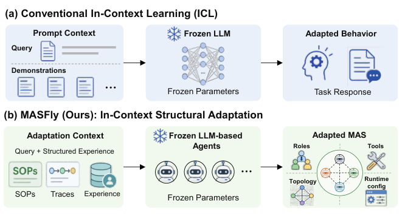

**图 1：传统上下文学习（ICL）与本文上下文结构自适应的类比。** ICL 以演示样例为条件，调整参数冻结模型的行为；MASFly 则以结构化协作经验为条件，调整参数冻结的 LLM 智能体所组成的系统，包括角色、工具、通信拓扑及执行时配置。图（a）为传统 ICL：提示上下文中的查询和演示样例，经冻结 LLM 得到适应后的行为及任务响应；图（b）为 MASFly：查询与 SOP、执行轨迹、经验等结构化上下文，经参数冻结的多个智能体得到适应后的 MAS。

我们将这一能力称为**上下文结构自适应**：在不更新模型参数的情况下，以结构化经验为条件，实例化或重新配置 MAS 的成员组成、智能体规格、工具分配和通信拓扑。传统 ICL 通过上下文演示调整固定模型的行为（Wu et al., 2025）；我们的设定则将这一条件化原则扩展至整个多智能体系统的组织与执行。下文也简称“上下文自适应”。

为解决这一问题，我们提出 MASFly，将 ICL 的条件化原则从模型行为扩展到系统结构，如图 1 所示。对于自适应系统生成，MASFly 从 SOP 仓库检索成功的协作模式，实例化针对具体查询的 MAS。对于非平稳执行环境，经验增强的过程监督机制通过全局 Watcher 智能体和个性化经验池监控执行，并支持即时重配置，例如替换故障智能体，从而形成有韧性的闭环过程。大量实验显示，MASFly 达到当前最优性能，在 TravelPlanner 上取得 61.7% 的成功率。本文贡献总结如下：

- 提出面向 LLM 多智能体系统的上下文结构自适应问题，涵盖无需参数更新的查询相关系统生成与执行时重配置。
- 提出 MASFly 及其检索增强 SOP 实例化机制，复用成功协作模式，构建查询专属的智能体角色、工具分配与通信结构。
- 设计经验增强的过程监督机制，结合全局 Watcher 和个性化经验池，实现执行时重配置。
- 在多种任务上的实验表明，MASFly 优于强基线，并表现出任务适应性和鲁棒性。

## 2 相关工作

### 2.1 基于 LLM 的多智能体系统

LLM 多智能体系统从人工设计框架逐步走向日益自动化、自适应的构建方式。早期的 MetaGPT 和 ChatDev 严重依赖人工 SOP 配置角色与工作流。后续研究引入半自动机制，例如 AgentVerse（Chen et al., 2024）、EvoAgent（Yuan et al., 2024）和 MegaAgent（Wang et al., 2025a）使用 LLM 自动生成不同角色；GPTSwarm（Zhuge et al., 2024）和 G-Designer（Zhang et al., 2025c）则使用外部模型学习智能体间的通信拓扑。

近期，研究重点转向由 LLM 驱动的全自动 MAS 生成，通常提示 LLM 生成表示整个系统的可执行代码。搜索方法，如 ADAS（Hu et al., 2025）、AFlow（Zhang et al., 2025d）、AgentSquare（Shang et al., 2025）和 SwarmAgentic（Zhang et al., 2025e），利用 LLM 在预定义设计空间内寻找“最优”系统配置。但这些方法依赖固定系统，缺乏针对不同查询的动态适应性。训练方法，如 MAS-GPT（Ye et al., 2025）和 FlowReasoner（Gao et al., 2025），通过监督微调（SFT）或强化学习（RL）训练元智能体，自主生成 MAS 配置。它们虽能更好地适应不同查询，但需要大量数据，且难以泛化。此外，大多数现有工作忽视执行时适应，形成脆弱的开环流水线。

### 2.2 上下文学习与测试时自适应

上下文学习（ICL）通过上下文中的演示，让参数冻结的 LLM 调整行为（Dong et al., 2024；Wu et al., 2025）。检索增强生成（RAG；Lewis et al., 2020）在推理时检索相关文档或记忆，填补知识缺口并指导生成；测试时扩展（Snell et al., 2025）则通过采样或推理路径探索，分配更多推理计算。相比之下，测试时自适应方法（Wang et al., 2021）通常针对无标签目标域数据调整模型参数。

这些范式主要调整单个模型的知识、行为或计算。我们将 ICL 的条件化原则扩展至多智能体组织：检索到的结构化经验指导 MAS 如何实例化和重配置，而底层 LLM 参数保持不变。更广义的数据高效智能体学习研究智能体如何获取、复用经验，而非仅依赖模型规模扩展（Wang et al., 2026）。MASFly 提供互补的系统层面视角，将结构化协作经验作为系统生成与重配置的上下文。

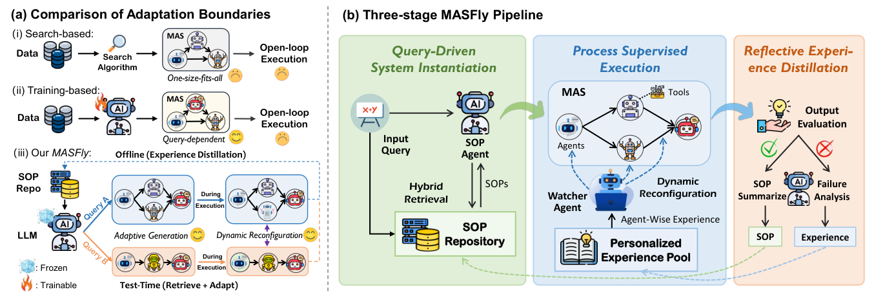

**图 2：MASFly 的定位与运行概览。**（a）搜索方法部署一套通用系统，训练方法学习一个生成器；不同于二者，MASFly 检索结构化经验，在测试时调整参数冻结的 LLM 多智能体系统，包括执行期间的调整。（b）MASFly 先实例化查询专属系统，在 Watcher 监督下执行，再蒸馏成功 SOP 和失败经验，供未来任务使用。三阶段分别为查询驱动的系统实例化、过程监督执行和反思式经验蒸馏；离线阶段蒸馏经验，测试阶段检索并自适应。

### 2.3 多智能体系统中的记忆

记忆对 LLM 智能体积累经验、增强推理至关重要。单智能体记忆研究已取得较大进展，从简单的 RAG 式上下文扩展（Packer et al., 2023），发展到受认知启发、支持跨试验学习的架构（Xu et al., 2025；Wang et al., 2025b）。然而，专为 MAS 设计的记忆机制仍研究不足（Tang et al., 2025）。近期 G-Memory（Zhang et al., 2025a）等工作尝试通过层次图结构管理 MAS 交互历史和经验，为不同 MAS 提供外部记忆库。

## 3 问题描述

我们研究 LLM 多智能体系统的上下文结构自适应。在执行步骤 $t$，将系统配置表示为：

$$
\mathcal{M}^{(t)}=\left(\mathcal{A}^{(t)},\Pi^{(t)},\mathcal{T}^{(t)},\mathcal{G}^{(t)}\right). \tag{1}
$$

其中，$\mathcal{A}^{(t)}$ 为智能体组成，$\Pi^{(t)}$ 包含角色与指令，$\mathcal{T}^{(t)}$ 表示工具分配，$\mathcal{G}^{(t)}$ 为通信拓扑。给定查询，目标不是运行固定、通用的配置，而是根据当前任务及其不断变化的执行状态，实例化和调整这些组件。系统不更新模型参数，而是以相关任务上下文和执行历史为条件进行自适应。形式化地，对查询 $q$，模型首先构建初始的查询专属系统：

$$
\mathcal{M}^{(0)}=\mathcal{I}_{\theta}(q\mid c_q). \tag{2}
$$

其中，$c_q$ 表示初始化所用的任务相关上下文。执行期间，系统还可以根据中间执行状态 $h^{(t)}$ 和额外上下文信号 $c_h$ 调整当前配置：

$$
\mathcal{M}^{(t+1)}\leftarrow\mathcal{C}_{\theta}\left(\mathcal{M}^{(t)},h^{(t)}\mid c_h\right). \tag{3}
$$

经过一系列调整后，由自适应后的系统产生最终输出：

$$
y=\mathcal{E}_{\theta}\left(q,\mathcal{M}^{(T)}\right). \tag{4}
$$

在留出集评估期间，LLM 参数及提供 $c_q$、$c_h$ 的经验仓库均保持固定。因此，自适应发生于针对系统配置的上下文推理，而非参数或仓库更新。

实现这种系统生成与执行自适应并不简单。首先，仅靠预训练 LLM 构建合适、高质量的 MAS 很有挑战，因为包括角色、工具和通信拓扑的设计空间庞大，模型可能缺乏任务专属先验。其次，即使初始设计良好，也可能在长程执行中失败：协调失误、工具误用或错误中间决策会积累错误，而智能体自身可能未意识到失败，因此无法在执行期间纠正。这要求一个统一框架，通过上下文同时支持查询相关系统构建与执行时纠错。

## 4 提出的方法

### 4.1 总体框架

为应对上述挑战，MASFly 采用图 2 所示的三阶段闭环框架：（1）查询驱动的系统实例化；（2）过程监督执行；（3）反思式经验蒸馏。首先，通过检索增强 SOP 实例化机制，以 SOP 仓库中检索出的协作模式为条件，动态生成依赖查询的 MAS。执行期间，采用经验增强的过程监督机制：全局 Watcher 作为调控者，参照个性化经验池定期监控系统，发现异常行为后动态重配置智能体。执行完成后，LLM 反思结果，蒸馏可复用经验以支持未来任务。

通过该设计，MASFly 根据当前查询与执行轨迹调整配置，离线反思蒸馏则构建结构化经验，为后续留出任务提供支持。

### 4.2 查询驱动的系统实例化

不同查询需要不同角色、工具分配和通信结构，因此固定 MAS 设计难以在多样任务上达到最优。但 MAS 设计空间的组合规模巨大，LLM 即时生成自适应系统也十分困难。为此，我们设计检索增强 SOP 实例化机制，检索历史上相关的成功协作模式，将其综合为查询专属系统。

**SOP 仓库。** 为捕捉成功协作经验，我们使用 LLM 自动构建涵盖多类任务的 SOP 仓库，详见第 4.4 节。每个 SOP 表示一个可复用协作模板，并关联一个案例，形式化为三元组 $c_i=(q_i,n_i,s_i)$。其中，$q_i$ 为用户查询；$n_i$ 为 LLM 生成的需求分析，详细描述任务目标和所需能力，例如具体工具或角色；$s_i$ 为多智能体协作模式。

如图 3 所示，每个 SOP 记录团队组成、智能体间通信结构，以及精确的智能体规格。通信结构为有向图，附带规定信息流向的文字描述；规格包含职责、指令和可访问工具。通过系统记录结构化操作知识，SOP 仓库让系统能够灵活复用并重新组合已验证的协作策略，以处理新任务。

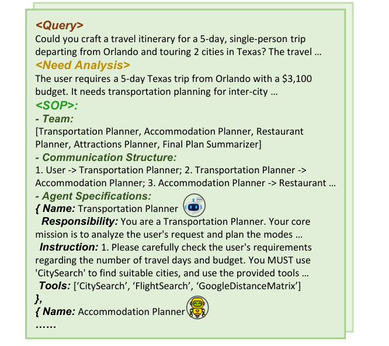

**图 3：SOP 仓库的案例示意。**

> **查询：** 能否制定一个从奥兰多出发、游览得克萨斯州两个城市的 5 天单人旅行行程？旅行……  
> **需求分析：** 用户需要从奥兰多出发的 5 天得州旅行，预算 3,100 美元，需要城际交通规划……  
> **SOP——团队：** 交通规划者、住宿规划者、餐厅规划者、景点规划者、最终计划总结者。  
> **通信结构：** 用户 → 交通规划者 → 住宿规划者 → 餐厅规划者……  
> **智能体规格：** 交通规划者负责分析用户请求并规划交通方式；指令要求仔细核查旅行天数和预算，必须使用 `CitySearch` 查找合适城市，并使用提供的工具……；工具包括 `CitySearch`、`FlightSearch`、`GoogleDistanceMatrix`。随后为住宿规划者等角色的规格。

**混合检索与实例化。** 对新查询 $q$，MASFly 先提示 LLM 推断相应需求分析 $n$，再用结合外部查询相似性和内部需求相似性的混合分数检索相关案例：

$$
s(q,c_i)=\lambda\cdot\operatorname{Sim}(q,q_i)+(1-\lambda)\cdot\operatorname{Sim}(n,n_i). \tag{5}
$$

其中，$\lambda\in[0,1]$ 平衡两个分量，$\operatorname{Sim}(\cdot,\cdot)$ 表示根据嵌入向量计算的余弦相似度。随后，检索排名前 $K$ 个案例的 SOP 指导 LLM 实例化查询专属操作流程（OP）：

$$
\mathrm{OP}=\mathrm{LLM}\left(q,n,\{s_i\}_{i=1}^{K}\right). \tag{6}
$$

OP 结构与 SOP 相似，规定查询专属的智能体提示词和通信工作流，由此定义初始系统 $\mathcal{M}^{(0)}$。MASFly 因而将可复用流程模板转为具体 MAS，既保留有效协调模式，又灵活适应查询。它也能在没有仓库支持的零样本设定中运行，仅依靠 LLM 进行组织编排。

### 4.3 过程监督执行

即使已有查询专属操作流程，多智能体执行仍具有内在非平稳性：智能体可能偏离规定工作流、误用工具，或遭遇意外环境反馈。为支持执行时适应，我们设计以全局 Watcher 为核心的经验增强过程监督机制。它监控运行系统，发现异常后参考**个性化经验池（PEP）**进行干预，实现自适应、可靠执行。

**监督与干预。** 执行期间定期触发监督。全局 Watcher 将当前执行上下文与已实例化 OP 对照，检测异常行为。具体执行双层监督：（1）**智能体间通信**：验证是否遵循 OP 工作流、输出是否一致、是否避免无效对话循环；（2）**智能体—环境交互**：评估是否正确调用指定工具、是否恰当响应动态上下文、是否避免重复或无关输出。

发现异常时，Watcher 可采取两种行动：（1）**经验指导的反馈**：结合 PEP 中的经验，向错误智能体发送纠正反馈，实时改进其推理或操作策略；（2）**动态智能体替换**：移除问题严重的智能体，动态实例化新智能体继续任务，重新配置系统并保证工作流连续性。

为平衡可控性与效率，MASFly 支持灵活监督策略，例如每 $M$ 轮通信、每 $L$ 个环境交互步骤触发监督，或为干预总次数设置预算。相关实验见附录 C.5。

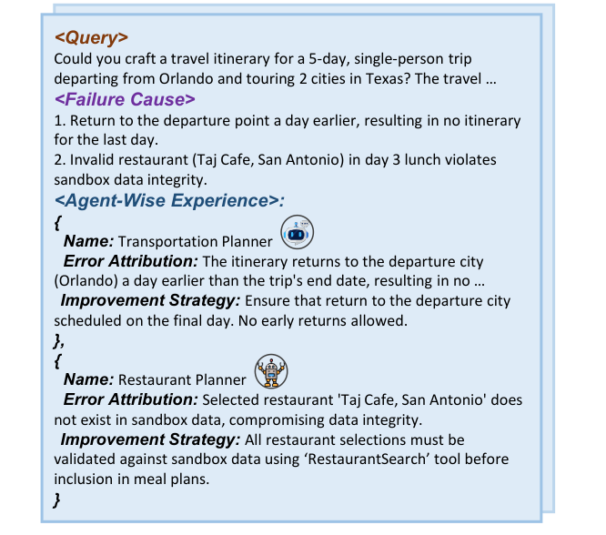

**图 4：PEP 的案例示意。**

> **查询：** 制定从奥兰多出发、游览得州两个城市的 5 天单人行程……  
> **失败原因：**（1）提前一天返回出发地，导致最后一天没有行程。（2）第 3 天午餐安排了无效餐厅 `Taj Cafe, San Antonio`，违反沙盒数据完整性。  
> **智能体级经验——交通规划者：** 错误归因是提前一天返回奥兰多；改进策略是确保返程安排在最后一天，不允许提前返回。  
> **智能体级经验——餐厅规划者：** 所选餐厅不在沙盒数据中；改进策略是将餐厅纳入用餐计划前，必须通过 `RestaurantSearch` 工具核验。

**个性化经验池。** 高质量监督需要识别和处理反复发生的异常。为此，我们通过 LLM 反思构建 PEP，详见第 4.4 节，存储常见错误模式及补救办法，支持精准干预。如图 4，每条记录形式化为 $r_i=(q_i,f_i,p_i)$，其中 $q_i$ 为查询，$f_i$ 为失败原因，例如任务分配错误或工具误用，$p_i=\{p_{i1},\ldots,p_{im}\}$ 为一组智能体级经验。每条经验包含**错误归因**与**改进策略**：前者识别该智能体对失败的影响，后者提供纠正指导，防止今后出现类似错误。类似初始化时的 SOP 检索，相关 PEP 记录在开始时检索一次，随后由 Watcher 作为经验先验，在整个执行期间检测潜在陷阱、选择恰当干预。

通过这一机制，MASFly 将执行视为闭环重配置过程，而非从初始 OP 出发的固定展开，从而提高非平稳多智能体环境中的鲁棒性与可靠性。

### 4.4 反思式经验蒸馏

任务完成后，MASFly 进行反思，将执行轨迹与评估结果（仅限训练集）蒸馏为可复用经验，更新 SOP 仓库和 PEP。成功执行时，LLM 将生成的 OP 蒸馏成通用、可复用 SOP 并存入仓库。失败时，系统提示 LLM 诊断 OP 不足，并将错误归因至具体智能体。这些反思有两个作用：迭代改进已实例化 OP，使任务成功完成；丰富 PEP，形成指导未来过程监督的智能体级先验。MASFly 因而逐渐增强系统生成能力与执行鲁棒性，使多智能体协调随时间推移更加可靠。更多细节见附录 B.1。

### 4.5 与现有工作的比较

表 1 对比 MASFly 与无需额外 LLM 训练的代表性方法。MASFly 能够自适应生成完整的查询相关系统，通过 SOP 实例化动态定制提示词与通信拓扑；还引入执行时监督机制，支持自适应执行。其内置记忆机制通过复用 SOP 仓库中的成功系统级经验和 PEP 中的智能体级失败经验，支持跨任务经验增强。进一步讨论见附录 A。

**表 1：不同方法的比较。**

| 方法 | 自适应提示词 | 自适应拓扑 | 自适应系统生成 | 自适应执行 | 跨任务记忆 |
|---|---|---|---|---|---|
| MetaGPT | × | × | × | × | × |
| AgentVerse | ✓ | × | × | ✓ | × |
| MegaAgent | ✓ | × | × | × | × |
| GPTSwarm | × | × | × | × | × |
| G-Designer | × | ✓ | × | × | × |
| AgentSquare | × | × | × | × | ✓ |
| MASFly | ✓ | ✓ | ✓ | ✓ | ✓ |

## 5 实验

### 5.1 实验设置

**基准。** 我们在三个领域、五个涉及工具调用的基准上评估 MASFly：（1）长程规划：TravelPlanner（Xie et al., 2024），包含两阶段（Two-Stage）和纯规划（Sole-Planning）两种模式；（2）通用问答：GAIA（Mialon et al., 2024），问题分为三个难度等级；（3）代码生成：HumanEval（Chen et al., 2021）、MBPP（Austin et al., 2021）、MBPP Pro（Yu et al., 2025）。数据集统计见附录 B.4。为公平比较，MASFly 用部分训练数据离线构建仓库，在仓库固定的情况下于留出测试集评估。需要离线准备的基线获得相同数据预算。

**基线。** 我们与三类无需模型训练的方法比较：（1）普通单 LLM，包括 CoT（Wei et al., 2022）、ReAct（Yao et al., 2023）、Reflexion（Shinn et al., 2023）；（2）人工设计 MAS，包括 MetaGPT（Hong et al., 2024）；（3）部分或完全自主 MAS，包括 AgentVerse（Chen et al., 2024）、EvoAgent（Yuan et al., 2024）、GPTSwarm（Zhuge et al., 2024）、AFlow（Zhang et al., 2025d）、AgentSquare（Shang et al., 2025）、MegaAgent（Wang et al., 2025a）、SwarmAgentic（Zhang et al., 2025e）以及采用固定 AutoGen（Wu et al., 2024）底层框架的 G-Memory（Zhang et al., 2025a）。所有方法使用同一 Qwen3-235B-A22B-Thinking-2507 基座（Yang et al., 2025）、相同工具接口和沙盒环境，以保证公平。

**实现细节。** 通过 API 调用 Qwen3-235B-A22B-Thinking-2507，温度设为 0.6。通常检索 SOP 数量 $K=2$，超参数 $\lambda=0.3$。

### 5.2 性能比较

**表 2：TravelPlanner 上的性能比较。最终通过率的任务级自助法置信区间见附录 C.3。所有数值为百分比。**

| 模式 | 方法 | 交付率 | 常识约束：微观 | 常识约束：宏观 | 硬约束：微观 | 硬约束：宏观 | 最终通过率 |
|---|---|---:|---:|---:|---:|---:|---:|
| 两阶段 | ReAct | 90.6 | 60.4 | 7.2 | 24.0 | 16.6 | 5.6 |
| 两阶段 | Reflecxion | 89.4 | 62.8 | 7.8 | 24.5 | 17.2 | 7.8 |
| 两阶段 | MetaGPT | 95.6 | 65.3 | 14.4 | 16.8 | 16.1 | 8.9 |
| 两阶段 | AgentVerse | 100.0 | 66.7 | 4.8 | 15.2 | 10.6 | 2.2 |
| 两阶段 | AgentSquare | 98.3 | 81.2 | 33.3 | 30.5 | 25.8 | 19.4 |
| 两阶段 | G-Memory | 96.7 | 84.4 | 36.1 | 37.1 | 29.4 | 24.4 |
| 两阶段 | MASFly | 95.6 | 85.3 | 47.8 | 49.5 | 44.4 | 39.4 |
| 纯规划 | CoT | 100.0 | 75.8 | 13.3 | 55.2 | 48.9 | 6.7 |
| 纯规划 | MetaGPT | 98.3 | 76.4 | 15.6 | 60.5 | 50.5 | 8.3 |
| 纯规划 | EvoAgent | 95.6 | 69.2 | 13.9 | 59.5 | 47.8 | 8.3 |
| 纯规划 | AgentVerse | 100.0 | 79.2 | 11.1 | 59.0 | 53.3 | 6.7 |
| 纯规划 | MegaAgent | 94.4 | 82.9 | 26.2 | 60.5 | 46.9 | 10.0 |
| 纯规划 | SwarmAgentic | 100.0 | 88.0 | 53.6 | 62.4 | 50.9 | 31.1 |
| 纯规划 | MASFly | 98.9 | 92.9 | 68.3 | 68.3 | 65.6 | 61.7 |

*原文表格将 Reflexion 拼为 Reflecxion，此处照录。*

**表 3：四个基准的性能比较。对进行三次独立运行的方法，报告均值；相应标准差见附录 C.2。**

| 方法 | GAIA 等级 1 | GAIA 等级 2 | GAIA 等级 3 | GAIA 平均 | HumanEval | MBPP | MBPP Pro |
|---|---:|---:|---:|---:|---:|---:|---:|
| Base | 29.3 | 11.3 | 0.0 | 16.4 | 94.94 | 91.49 | 82.80 |
| ReAct | 32.5 | 28.3 | 6.3 | 26.7 | 95.6 | 91.5 | 83.0 |
| MetaGPT | 34.1 | 31.5 | 6.3 | 28.8 | 96.2 | 90.7 | 82.2 |
| AgentVerse | 30.9 | 20.2 | 8.4 | 22.5 | 96.8 | 90.9 | 81.7 |
| MegaAgent | 32.9 | 26.4 | 3.1 | 25.5 | 97.15 | 92.38 | 83.11 |
| GPTSwarm | 36.6 | 32.1 | 6.3 | 30.0 | 97.78 | 91.79 | 84.20 |
| AFlow | 36.6 | 35.8 | 6.3 | 31.8 | 97.78 | 92.96 | 84.74 |
| AgentSquare | 41.5 | 37.7 | 10.4 | 35.1 | 96.8 | 92.1 | 83.9 |
| G-Memory | 43.1 | 37.7 | 12.5 | 36.0 | 96.4 | 92.1 | 83.7 |
| MASFly | 46.3 | 41.5 | 16.7 | 39.7 | 98.7 | 93.3 | 85.6 |

如表 2、3 所示，MASFly 在所有基准上持续优于人工设计、自动化和记忆增强的多智能体基线。优势在 TravelPlanner 上尤其明显：两种模式的最终成功率分别相对提高 62% 和 98%，同时保持较高交付率。这验证了 MASFly 的设计：动态实例化高质量 SOP，分解复杂任务并为专门智能体分配工具，同时进行有效过程监督与重配置，使长程规划推理更加连贯、符合约束。在更广泛的推理和编程基准上，MASFly 同样取得更优表现。这些持续提升证明了上下文适应性的贡献。

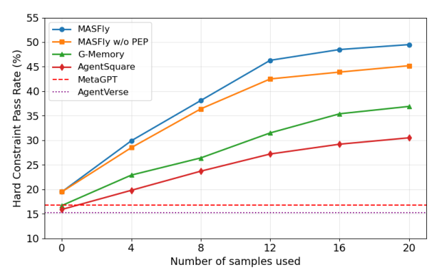

**图 5：经验积累曲线。** 横轴为使用的样本数量，纵轴为硬约束通过率（%）；对比 MASFly、无 PEP 的 MASFly、G-Memory、AgentSquare、MetaGPT 和 AgentVerse。

我们进一步分析逐步积累经验如何改善 MASFly。图 5 报告不同方法使用更多训练样本时，在 TravelPlanner 上的表现。即使仓库中没有样本的零样本设定下，MASFly 也优于所有比较基线，说明其已经能够利用 LLM 内部知识支持测试时系统自适应，而不只是依赖固定静态配置。随着样本加入，MASFly 性能迅速提高，持续领先搜索基线 AgentSquare 和记忆增强基线 G-Memory，说明它能将积累经验转化为更强的测试时系统适应，从而超过固定 MAS 基线。无 PEP 变体表明，蒸馏失败经验还能带来额外收益。整体曲线展示了渐进经验积累的有效性和较强的样本效率。更多效率比较见附录 C.4。

### 5.3 鲁棒性分析

为评估对抗条件下的鲁棒性，我们遵循既有工作（Zhuge et al., 2024），在 MBPP Pro 测试时引入提示词攻击，强制编码智能体输出空函数。图 6 比较各代表系统在攻击前后的性能。大多数方法在攻击后明显下降，表明执行一旦开始，它们便难以缓解异常智能体行为。MASFly 则几乎保持原有性能，原因在于过程监督：Watcher 识别被攻陷智能体、将其移除，再动态实例化替代智能体继续执行。这表明执行时适应能在对抗或异常条件下维持较高任务准确率。

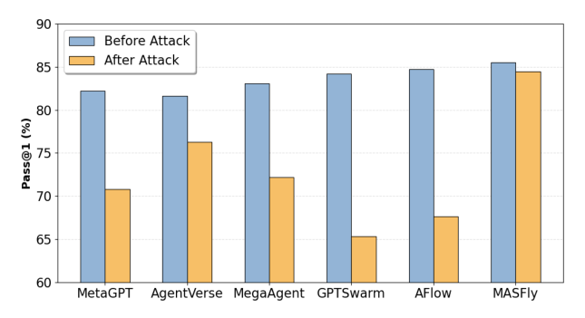

**图 6：MBPP Pro 上提示词攻击前后的性能。** 蓝柱为攻击前，黄柱为攻击后；纵轴为 Pass@1（%）。

### 5.4 消融研究

**表 4：MASFly 不同变体的比较。TravelPlanner 列对应常识约束和硬约束，GAIA 列对应等级 1、2。**

| 方法 | TravelPlanner 常识 | TravelPlanner 硬约束 | GAIA 等级 1 | GAIA 等级 2 |
|---|---:|---:|---:|---:|
| MASFly | 85.3 | 49.5 | 46.3 | 41.5 |
| 无 SOP-RAG | 65.3 | 18.6 | 35.4 | 32.1 |
| 无 SOP 实例化 | 80.8 | 40.9 | 41.4 | 35.8 |
| 无 Watcher | 83.9 | 37.1 | 41.4 | 36.8 |
| 无 PEP | 84.4 | 45.2 | 43.3 | 39.6 |

**自适应系统生成的影响。** 如表 4，自适应系统生成至关重要。将 SOP 指导的实例化替换为人工 MAS 配置（无 SOP-RAG）导致最大性能下降，说明固定系统难以匹配不同查询的多样需求。直接将检索 SOP 用作系统配置（无 SOP 实例化）也会退化，表明仅检索而不进一步针对查询实例化并不足够。MASFly 不仅受益于检索相关协作先验，也受益于将其调整为当前查询专属系统。

**自适应执行的影响。** 移除 Watcher 后明显下降，因为系统失去了执行时重配置和纠正异常的能力。禁用 PEP 也会退化，说明积累经验能为有效干预提供有价值指导。执行时监督和经验指导干预共同改善鲁棒性与稳定性。

### 5.5 案例研究

图 7 展示 MASFly 如何动态适应查询需求并确保可靠执行。前两个 HumanEval 示例说明其自主构建不同 MAS：简单问题对应紧凑的双智能体系统，复杂问题则触发带工具的四智能体配置。检索 SOP 模板指导这种生成，LLM 内部推理确保合理角色分配。第三个 TravelPlanner 示例中，Watcher 发现交通规划者未调用工具便编造航班信息，随后介入，以新智能体替换，并要求遵循流程、通过工具检索航班数据。这表明过程监督能实时检测错误、纠正行为，保证整体可靠性与适应性。

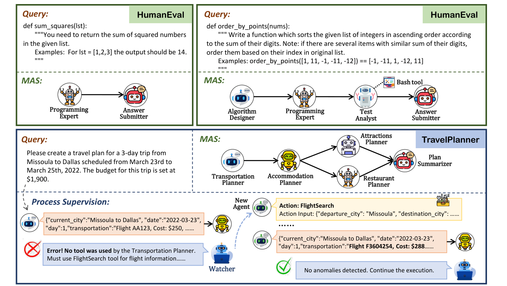

**图 7：MASFly 自适应系统生成和过程监督的案例研究。**

> **HumanEval 示例 1：** `sum_squares(lst)` 要求返回列表中数字的平方和，如 `[1,2,3]` 返回 `14`。系统由编程专家和答案提交者组成。  
> **HumanEval 示例 2：** `order_by_points(nums)` 按各整数数位和升序排列；数位和相同则按原列表索引排序。例如 `order_by_points([1, 11, -1, -11, -12]) == [-1, -11, 1, -12, 11]`。系统由算法设计者、编程专家、使用 Bash 工具的测试分析师、答案提交者组成。  
> **TravelPlanner 示例：** 制定 2022 年 3 月 23–25 日从米苏拉到达拉斯的 3 天行程，预算 1,900 美元。系统包含交通、住宿、餐厅、景点规划者和计划总结者。交通规划者先输出虚构航班 `AA123`、费用 250 美元；Watcher 指出“错误！未使用工具，必须使用 FlightSearch 获取航班信息”。替换后的智能体调用 `FlightSearch`，返回航班 `F3604254`、费用 288 美元。Watcher 随后确认“未检测到异常，继续执行”。

## 6 结论

本文提出 LLM 多智能体系统的上下文结构自适应问题，并以 MASFly 作为具体实现。MASFly 通过检索增强 SOP 实例化，生成查询相关系统；通过经验增强过程监督，实现执行时重配置。实验显示其性能强、适应性和鲁棒性高，说明结构化上下文不仅能调整单个 LLM 的行为，也能调整多个 LLM 智能体解决任务的组织方式。

## 局限性

MASFly 的一项局限是，过程监督触发机制依赖预定义启发式规则，例如将干预间隔设为智能体数量的一半。这未必适合所有场景。未来可探索自动异常检测，使系统自主判断精准干预时机，减少人工启发式依赖。

此外，构建 SOP 仓库和个性化经验池需要有标签训练实例；有限领域收集的经验在差异很大的环境中复用时，可能引入偏差或负迁移。Watcher 对部分智能体—环境交互的可见性不完整，可能进行不必要的干预；监督和重配置也增加推理成本。因此，未来应研究有原则的经验选择、更可靠的干预策略，以及考虑预算的自适应。

## 致谢

本工作获得蚂蚁集团通过 CCF-蚂蚁科研基金的支持，并受到北京市科技计划项目资助（编号 Z251100008125003）。

## 参考文献

Jacob Austin, Augustus Odena, Maxwell Nye, Maarten Bosma, Henryk Michalewski, David Dohan, Ellen Jiang, Carrie Cai, Michael Terry, Quoc Le, and Charles Sutton. 2021. Program synthesis with large language models. arXiv preprint arXiv:2108.07732.

Mark Chen, Jerry Tworek, Heewoo Jun, Qiming Yuan, Henrique Ponde de Oliveira Pinto, Jared Kaplan, Harri Edwards, Yuri Burda, Nicholas Joseph, Greg Brockman, Alex Ray, Raul Puri, Gretchen Krueger, Michael Petrov, Heidy Khlaaf, Girish Sastry, Pamela Mishkin, Brooke Chan, Scott Gray, and 39 others. 2021. Evaluating large language models trained on code. arXiv preprint arXiv:2107.03374.

Weize Chen, Yusheng Su, Jingwei Zuo, Cheng Yang, Chenfei Yuan, Chi-Min Chan, Heyang Yu, Yaxi Lu, Yi-Hsin Hung, Chen Qian, Yujia Qin, Xin Cong, Ruobing Xie, Zhiyuan Liu, Maosong Sun, and Jie Zhou. 2024. AgentVerse: Facilitating multi-agent collaboration and exploring emergent behaviors. In International Conference on Learning Representations.

DeepSeek-AI. 2024. DeepSeek-V3 technical report. Preprint, arXiv:2412.19437.

Qingxiu Dong, Lei Li, Damai Dai, Ce Zheng, Jingyuan Ma, Rui Li, Heming Xia, Jingjing Xu, Zhiyong Wu, Baobao Chang, Xu Sun, Lei Li, and Zhifang Sui. 2024. A survey on in-context learning. In Proceedings of the 2024 Conference on Empirical Methods in Natural Language Processing, pages 1107–1128. Association for Computational Linguistics.

Hongcheng Gao, Yue Liu, Yufei He, Longxu Dou, Chao Du, Zhijie Deng, Bryan Hooi, Min Lin, and Tianyu Pang. 2025. FlowReasoner: Reinforcing query-level meta-agents. arXiv preprint arXiv:2504.15257.

Sirui Hong, Mingchen Zhuge, Jonathan Chen, Xiawu Zheng, Yuheng Cheng, Jinlin Wang, Ceyao Zhang, Zili Wang, Steven Ka Shing Yau, Zijuan Lin, Liyang Zhou, Chenyu Ran, Lingfeng Xiao, Chenglin Wu, and Jürgen Schmidhuber. 2024. MetaGPT: Meta programming for a multi-agent collaborative framework. In International Conference on Learning Representations.

Shengran Hu, Cong Lu, and Jeff Clune. 2025. Automated design of agentic systems. In International Conference on Learning Representations.

Naman Jain, King Han, Alex Gu, Wen-Ding Li, Fanjia Yan, Tianjun Zhang, Sida Wang, Armando SolarLezama, Koushik Sen, and Ion Stoica. 2025. LiveCodeBench: Holistic and contamination free evaluation of large language models for code. In International Conference on Learning Representations.

Patrick Lewis, Ethan Perez, Aleksandra Piktus, Fabio Petroni, Vladimir Karpukhin, Naman Goyal, Heinrich Küttler, Mike Lewis, Wen-tau Yih, Tim Rocktäschel, Sebastian Riedel, and Douwe Kiela. 2020. Retrieval-augmented generation for knowledgeintensive NLP tasks. Advances in Neural Information Processing Systems, 33:9459–9474.

Grégoire Mialon, Clémentine Fourrier, Thomas Wolf, Yann LeCun, and Thomas Scialom. 2024. GAIA: A benchmark for general AI assistants. In International Conference on Learning Representations.

OpenAI. 2023. GPT-4 technical report. arXiv preprint arXiv:2303.08774.

Charles Packer, Sarah Wooders, Kevin Lin, Vivian Fang, Shishir G. Patil, Ion Stoica, and Joseph E. Gonzalez. 2023. MemGPT: Towards LLMs as operating systems. arXiv preprint arXiv:2310.08560.

Chen Qian, Wei Liu, Hongzhang Liu, Nuo Chen, Yufan Dang, Jiahao Li, Cheng Yang, Weize Chen, Yusheng Su, Xin Cong, Juyuan Xu, Dahai Li, Zhiyuan Liu, and Maosong Sun. 2024. ChatDev: Communicative agents for software development. In Proceedings of the 62nd Annual Meeting of the Association for Computational Linguistics (Volume 1: Long Papers), pages 15174–15186. Association for Computational Linguistics.

Yu Shang, Yu Li, Keyu Zhao, Likai Ma, Jiahe Liu, Fengli Xu, and Yong Li. 2025. AgentSquare: Automatic LLM agent search in modular design space. In International Conference on Learning Representations.

Noah Shinn, Federico Cassano, Ashwin Gopinath, Karthik Narasimhan, and Shunyu Yao. 2023. Reflexion: Language agents with verbal reinforcement learning. Advances in Neural Information Processing Systems, 36:8634–8652.

Charlie Snell, Jaehoon Lee, Kelvin Xu, and Aviral Kumar. 2025. Scaling LLM test-time compute optimally can be more effective than scaling parameters for reasoning. In International Conference on Learning Representations.

Yashar Talebirad and Amirhossein Nadiri. 2023. Multiagent collaboration: Harnessing the power of intelligent LLM agents. arXiv preprint arXiv:2306.03314.

Xiangru Tang, Tianrui Qin, Tianhao Peng, Ziyang Zhou, Daniel Shao, Tingting Du, Xinming Wei, Peng Xia, Fang Wu, He Zhu, Ge Zhang, Jiaheng Liu, Xingyao Wang, Sirui Hong, Chenglin Wu, Hao Cheng, Chi Wang, and Wangchunshu Zhou. 2025. Agent KB: Leveraging cross-domain experience for agentic problem solving. arXiv preprint arXiv:2507.06229.

Dequan Wang, Evan Shelhamer, Shaoteng Liu, Bruno Olshausen, and Trevor Darrell. 2021. Tent: Fully test-time adaptation by entropy minimization. In International Conference on Learning Representations.

Qian Wang, Tianyu Wang, Zhenheng Tang, Qinbin Li, Nuo Chen, Jingsheng Liang, and Bingsheng He. 2025a. MegaAgent: A large-scale autonomous LLMbased multi-agent system without predefined SOPs. In Findings of the Association for Computational Linguistics: ACL 2025, pages 4998–5036.

Yaqing Wang, Zhenlin Luo, Peiyao Zhao, Yunfeng Cai, and Quanming Yao. 2026. Beyond scaling: A survey on data-efficient agentic learning. In Proceedings of the Thirty-Fifth International Joint Conference on Artificial Intelligence.

Zora Zhiruo Wang, Jiayuan Mao, Daniel Fried, and Graham Neubig. 2025b. Agent workflow memory. In Proceedings of the 42nd International Conference on Machine Learning, volume 267 of Proceedings of Machine Learning Research, pages 63897–63911. PMLR.

Jason Wei, Xuezhi Wang, Dale Schuurmans, Maarten Bosma, Brian Ichter, Fei Xia, Ed H. Chi, Quoc V. Le, and Denny Zhou. 2022. Chain-of-thought prompting elicits reasoning in large language models. Advances in Neural Information Processing Systems, 35:24824– 24837.

Qingyun Wu, Gagan Bansal, Jieyu Zhang, Yiran Wu, Beibin Li, Erkang Zhu, Li Jiang, Xiaoyun Zhang, Shaokun Zhang, Ahmed Awadallah, Ryen W. White, Doug Burger, and Chi Wang. 2024. AutoGen: Enabling next-gen LLM applications via multi-agent conversation. In Conference on Language Modeling.

Shiguang Wu, Yaqing Wang, and Quanming Yao. 2025. Why in-context learning models are good few-shot learners? In The Thirteenth International Conference on Learning Representations.

Jian Xie, Kai Zhang, Jiangjie Chen, Tinghui Zhu, Renze Lou, Yuandong Tian, Yanghua Xiao, and Yu Su. 2024. TravelPlanner: A benchmark for real-world planning with language agents. In Proceedings of the 41st International Conference on Machine Learning, volume 235 of Proceedings of Machine Learning Research, pages 54590–54613. PMLR.

Wujiang Xu, Zujie Liang, Kai Mei, Hang Gao, Juntao Tan, and Yongfeng Zhang. 2025. A-MEM: Agentic memory for LLM agents. arXiv preprint arXiv:2502.12110.

An Yang, Anfeng Li, Baosong Yang, Beichen Zhang, Binyuan Hui, Bo Zheng, Bowen Yu, Chang Gao, Chengen Huang, Chenxu Lv, Chujie Zheng, Dayiheng Liu, Fan Zhou, Fei Huang, Feng Hu, Hao Ge, Haoran Wei, Huan Lin, Jialong Tang, and 41 others. 2025. Qwen3 technical report. arXiv preprint arXiv:2505.09388.

Shunyu Yao, Jeffrey Zhao, Dian Yu, Nan Du, Izhak Shafran, Karthik R Narasimhan, and Yuan Cao. 2023. ReAct: Synergizing reasoning and acting in language models. In International Conference on Learning Representations.

Rui Ye, Shuo Tang, Rui Ge, Yaxin Du, Zhenfei Yin, Siheng Chen, and Jing Shao. 2025. MAS-GPT: Training LLMs to build LLM-based multi-agent systems. In Proceedings of the 42nd International Conference on Machine Learning, volume 267 of Proceedings of Machine Learning Research, pages 72063–72090. PMLR.

Zhaojian Yu, Yilun Zhao, Arman Cohan, and Xiao-Ping Zhang. 2025. HumanEval Pro and MBPP Pro: Evaluating large language models on self-invoking code generation task. In Findings of the Association for Computational Linguistics: ACL 2025, pages 13253– 13279. Association for Computational Linguistics.

Siyu Yuan, Kaitao Song, Jiangjie Chen, Xu Tan, Dongsheng Li, and Deqing Yang. 2024. EvoAgent: Towards automatic multi-agent generation via evolutionary algorithms. arXiv preprint arXiv:2406.14228.

Guibin Zhang, Muxin Fu, Kun Wang, Guancheng Wan, Miao Yu, and Shuicheng Yan. 2025a. G-Memory: Tracing hierarchical memory for multi-agent systems. In Advances in Neural Information Processing Systems, volume 38.

Guibin Zhang, Luyang Niu, Junfeng Fang, Kun Wang, Lei Bai, and Xiang Wang. 2025b. Multi-agent architecture search via agentic supernet. In Proceedings of the 42nd International Conference on Machine Learning, volume 267 of Proceedings of Machine Learning Research, pages 75834–75852. PMLR.

Guibin Zhang, Yanwei Yue, Xiangguo Sun, Guancheng Wan, Miao Yu, Junfeng Fang, Kun Wang, Tianlong Chen, and Dawei Cheng. 2025c. G-Designer: Architecting multi-agent communication topologies via graph neural networks. In Proceedings of the 42nd International Conference on Machine Learning, volume 267 of Proceedings of Machine Learning Research, pages 76678–76692. PMLR.

Jiayi Zhang, Jinyu Xiang, Zhaoyang Yu, Fengwei Teng, Xiong-Hui Chen, Jiaqi Chen, Mingchen Zhuge, Xin Cheng, Sirui Hong, Jinlin Wang, Bingnan Zheng, Bang Liu, Yuyu Luo, and Chenglin Wu. 2025d. AFlow: Automating agentic workflow generation. In International Conference on Learning Representations.

Yao Zhang, Chenyang Lin, Shijie Tang, Haokun Chen, Shijie Zhou, Yunpu Ma, and Volker Tresp. 2025e. SwarmAgentic: Towards fully automated agentic system generation via swarm intelligence. In Proceedings of the 2025 Conference on Empirical Methods in Natural Language Processing, pages 1778–1818. Association for Computational Linguistics.

Mingchen Zhuge, Wenyi Wang, Louis Kirsch, Francesco Faccio, Dmitrii Khizbullin, and Jürgen Schmidhuber. 2024. GPTSwarm: Language agents as optimizable graphs. In International Conference on Machine Learning.

## A 与相关工作的比较

表 1 从多个角度比较 MASFly 与代表性 MAS。本文所说上下文自适应，包括不更新 LLM 参数的查询相关系统生成与执行时重配置。自适应系统生成指根据每个输入查询定制提示词和通信拓扑；自适应执行指在执行阶段动态调整配置；跨任务记忆指复用先前任务或查询的记忆、经验来帮助当前任务。具体如下：

- **MetaGPT（Hong et al., 2024）**是构建多角色 LLM 多智能体系统的开创性框架。但它依赖固定、人工编写的提示词和通信结构，限制对不同查询的适应，且缺乏过程监督和经验复用机制。类似工作包括 ChatDev（Qian et al., 2024）和 AutoGen（Wu et al., 2024）。
- **AgentVerse（Chen et al., 2024）**根据查询用 LLM 自动生成不同角色，增强提示词适应性，但通信结构仍静态，因而不是完全自适应系统。它可通过自评执行结果动态替换成员，但缺乏经验增强机制。类似工作包括 EvoAgent（Yuan et al., 2024）。
- **MegaAgent（Wang et al., 2025a）**提示总管智能体定制角色，不预定义通信结构，而依靠执行中的自主协调。没有显式通信设计可能导致长程任务中的低效和混乱。其层次监控在智能体之间内部验证，而非像 MASFly 一样由外部全局 Watcher 统一监督，包括监控通信和环境交互。此外，它缺乏经验复用机制。
- **GPTSwarm（Zhuge et al., 2024）**关注通过自适应通信图优化智能体间结构，但不针对不同查询调整提示词；也无法在测试时适应或处理意外情况，且缺乏过去经验复用机制。类似工作包括 G-Designer（Zhang et al., 2025c）。
- **AgentSquare（Shang et al., 2025）**不涉及多角色扮演，而使用 LLM 在训练集上搜索最优智能体系统，包括规划、工具使用和记忆模块。但它采用固定的线性顺序协作结构，部署后缺乏动态适应和经验复用机制。类似工作包括 ADAS（Hu et al., 2025）、AFlow（Zhang et al., 2025d）、MaAS（Zhang et al., 2025b）和 SwarmAgentic（Zhang et al., 2025e）。

除上述方法外，MAS-GPT（Ye et al., 2025）和 FlowReasoner（Gao et al., 2025）等近期训练方法，通过 SFT 或 RL 训练元智能体，根据不同查询自适应生成 MAS。但它们需要大量训练数据和计算资源，且缺乏部署后的执行适应与经验复用。G-Memory（Zhang et al., 2025a）等记忆方法则设计专门模块，检索复用相似任务的交互日志与经验；但依赖固定架构，无法自适应生成系统或动态重配置。

相比之下，MASFly 不更新 LLM 参数，通过检索增强 SOP 实例化，动态定制提示词和通信拓扑，自适应生成完整的查询相关系统；通过过程监督和优化机制支持自适应执行；通过内置记忆机制复用 SOP 仓库中的成功系统级经验和 PEP 中的智能体级失败经验，实现经验增强。

## B 实现细节

### B.1 仓库细节

#### B.1.1 仓库初始化

为初始化 SOP 仓库，我们随机抽取部分训练实例，构建初始 SOP 案例集合。在 TravelPlanner 和 GAIA 中，系统有多种工具可用，因此鼓励 LLM（Qwen3-235B）生成多样角色，各自负责不同工具，并设置专门的最终答案提交者，确保响应质量。对 HumanEval 等编程基准，查询通常简单，无需 Bash。为保证效率，我们提示 LLM 从最小 MAS 开始，例如单智能体团队。如果解答错误，再指导其逐步增加角色，以增强执行质量。该分阶段构建策略得到多样而计算高效的初始仓库。

#### B.1.2 仓库更新

SOP 仓库和个性化经验池（PEP）均在第三阶段“反思式经验蒸馏”更新。注意，此过程**仅在有标签训练数据上进行，不在测试集进行**。测试时系统看不到真实答案，因此不进行迭代反思纠正。

成功执行时，提示 LLM 将当前任务专属 OP 总结为更抽象的 SOP，将高度依赖用户查询的指令转为通用、可复用指令。LLM 还参考此前检索的 SOP，提取复用有价值的指令，将生成模板存入仓库。

失败执行时，LLM 接收详细评估结果及完整执行轨迹，包括通信日志和工具使用轨迹，反思诊断失败、归因各智能体错误，并据此更新 PEP。反思反馈也用于修改当前任务 OP，例如调整角色、修改通信结构、细化指令和工具使用，然后重新执行，直到成功或达到最大迭代次数。

**仓库的定性演化。** 我们检查了不同构建阶段收集的代表性 SOP。随着训练经验加入，仓库从通用协作模式，演化为更专门的角色分解、工具分配、通信结构和指令。失败蒸馏出的个性化经验通过识别重复错误及改进策略，细化智能体指令；成功修正的工作流再被蒸馏成可复用 SOP。例如，后期 SOP 可能为编程引入更明确的测试角色，为 TravelPlanner 加入更详细的工具使用和约束检查指令。这与图 5 的经验积累结果一致：仓库更丰富、经验更易复用时，性能提高。

由于 SOP 紧凑、高层且不依赖具体查询，构建 SOP 仓库及相应 PEP 仅需少量训练数据。实际中，全部任务的最终 SOP 仓库条目少于 100，见表 5，因此无需额外删除或整理策略。若未来应用更加多样、复杂，可通过对 SOP 嵌入聚类并保留簇中心，轻量扩展且维持仓库紧凑。

### B.2 智能体通信细节

为超越静态蓝图的限制、增强适应性，MASFly 采用双向通信：每个智能体既可按 OP 向下游发送消息，也能向曾给自己发送消息的上游通信，例如请求澄清或补充信息。

输出格式遵循 ReAct（Yao et al., 2023）：先输出思考，再输出行动；行动可以是使用工具或向另一智能体发消息。所有智能体间消息存入全局消息池，支持通信事件高效并行处理，保证执行中的可扩展性和一致性。全部工具调用记入工具使用历史，供 Watcher 检查。Watcher 决定移除异常智能体时，消息池及工具历史中与其有关的全部条目被完全清除，以彻底消除其影响。

### B.3 过程监督细节

我们从 PEP 检索相关历史失败经验，供 Watcher 参考。为提高效率，只在任务开始前检索一次。使用 SOP 检索中计算的混合分数，获取具有相同查询索引的 PEP 案例。鉴于图 4 中智能体级经验较简洁，通常检索约两个相似案例，形成 Watcher 参考上下文。经验上，这些内容约占 Watcher 总输入提示词的 30%。利用先进 LLM 较强的上下文能力，我们直接将案例附加到提示词，既能充分指导，也不会造成上下文污染。若部署较轻量 Watcher，可采用灵活上下文管理，例如先筛选最相关细节再传入。第 5.4 节消融实验也验证了 PEP 的性能收益。

运行时，Watcher 每 $M$ 轮通信或每 $L$ 个环境交互步骤定期触发。触发后检查环境交互日志和通信历史，将行为与 OP、PEP 先验对照。一方面执行常规检查，例如确保没有无限循环、无效通信或违背 OP；另一方面借助 PEP 检查任务特有问题，例如工具误用或约束违反。

如果发现智能体陷入无效环境交互，Watcher 清空交互历史，并发送经验指导反馈来纠正策略。若发现异常智能体间通信，则移除异常智能体及日志，动态重新实例化新智能体恢复流程。这种针对性监督保证系统稳健执行。

### B.4 实验设置

#### B.4.1 数据集与评估指标

遵循 Zhuge et al.（2024）和 Wang et al.（2025a），我们在三个领域的五个代表性、涉及工具调用的基准上评估 MASFly 与比较方法。

**长程规划。** TravelPlanner（Xie et al., 2024）包含两阶段和纯规划两种模式。本文主要关注更难的两阶段模式：模型须使用 6 个工具从沙盒环境获取信息，并制定完整旅行计划。大多数此前方法采用的是较简单的纯规划模式，提前提供全部必要信息、无需工具；为完整性，本文也评估该模式。遵循原始设置，指标为交付率、常识约束通过率、硬约束通过率和最终计划通过率。

**通用问答。** GAIA（Mialon et al., 2024）专门测试 AI 助手处理现实、知识密集问题的通用能力，通常需要结合推理、网络搜索和工具使用。遵循 Zhuge et al.（2024），所有方法仅通过 [SerpAPI](https://serpapi.com/) 使用 Google Search，以及一个本地文件处理工具；不提供任何付费网页浏览 API 或多模态工具。评估指标为准确率。

**编程。**（1）HumanEval（Chen et al., 2021）是人工编写的 Python 代码生成基准，每题包含函数签名及说明预期功能的若干示例。（2）MBPP（Austin et al., 2021）包含大量简短、人工编写的 Python 编程问题，覆盖不同技能；每题包括函数签名和从数据集中抽取的一个示例测试用例。（3）MBPP Pro（Yu et al., 2025）是 MBPP 的扩展版本。考虑到 MBPP 的错误答案标注妨碍性能提升，我们使用更难的 MBPP Pro 验证方法。

为公平比较，所有测试用例在系统执行期间均保留不提供，只用于事后验证正确性。对这两个数据集，启用 Bash 运行 LLM 生成的测试用例并分析结果。使用 Pass@1 为指标，报告三次独立运行的均值。

数据统计见表 5，其中训练实例用于构建 SOP 仓库。

**表 5：所评估数据集的统计。**

| 数据集 | 训练数 | 测试数 |
|---|---:|---:|
| TravelPlanner | 20 | 180 |
| GAIA（等级 1） | 5 | 41 |
| GAIA（等级 2） | 3 | 53 |
| GAIA（等级 3） | 2 | 16 |
| HumanEval | 6 | 158 |
| MBPP | 20 | 341 |
| MBPP Pro | 10 | 367 |

#### B.4.2 基线

我们比较三类无需额外训练的基线：

- **CoT（Wei et al., 2022）：** 在得出最终答案前，引导 LLM 生成一系列中间推理步骤，增强问题求解。
- **ReAct（Yao et al., 2023）：** 将推理轨迹与行动执行交错，使 LLM 能与环境交互、检索信息。
- **Reflexion（Shinn et al., 2023）：** 加入自我反思机制，使智能体迭代评估、完善思考轨迹。
- **MetaGPT（Hong et al., 2024）：** 模拟软件公司，为智能体分配特定角色并以人工 SOP 规范协作。对非编程任务，选用 LLM 生成的固定 SOP 构建系统。
- **AgentVerse（Chen et al., 2024）：** 根据用户查询动态生成不同角色，通过多轮讨论与自评促进协作。
- **EvoAgent（Yuan et al., 2024）：** 利用进化算法自动生成多样角色。
- **MegaAgent（Wang et al., 2025a）：** 层次化框架，由中心总管自主定制子智能体角色、协调处理复杂长程任务。
- **GPTSwarm（Zhuge et al., 2024）：** 将系统结构视为可学习图，优化通信拓扑，改善信息流。
- **AFlow（Zhang et al., 2025d）：** 将智能体工作流构建形式化为代码搜索，使用蒙特卡洛树搜索（MCTS）寻找最优结构。
- **AgentSquare（Shang et al., 2025）：** 在包含规划、工具使用和记忆模块的预定义设计空间中搜索最优配置。
- **SwarmAgentic（Zhang et al., 2025e）：** 受粒子群优化启发，通过搜索自动构建、进化智能体系统种群。我们使用近期发布的官方代码，在统一评估设置下复现。
- **G-Memory（Zhang et al., 2025a）：** MAS 层次记忆系统，检索复用历史相关交互日志和经验。遵循原论文，与 AutoGen（Wu et al., 2024）集成。

所有方法使用相同 Qwen3-235B-A22B-Thinking-2507 基座（Yang et al., 2025）、相同工具接口和沙盒环境。

#### B.4.3 超参数

通过 API 使用 Qwen3-235B-A22B-Thinking-2507，温度为 0.6。系统生成阶段通常检索 $K=2$ 个 SOP 候选，权重 $\lambda=0.3$。执行期间，Watcher 使用默认启发式触发监督：通信轮次间隔 $M$ 为智能体数量的一半，连续环境交互步骤阈值 $L=5$。

## C 补充实验

### C.1 不同基座模型间的泛化

为检验 MASFly 能否泛化到大容量 LLM 之外，我们将基座换为较轻量的 Qwen3-32B（Yang et al., 2025），在具有挑战性的 TravelPlanner 两阶段模式测试。如表 6 所示，MASFly 仍明显超过人工设计和自动化 MAS 基线。这说明框架不依赖特定或极大基座；结构化 SOP 指导的设计与监督机制使其在不同模型规模上具有较强鲁棒性和泛化性。

**表 6：使用 Qwen3-32B 时，在 TravelPlanner 两阶段模式的性能比较。**

| 方法 | 交付率 | 常识约束：微观 | 常识约束：宏观 | 硬约束：微观 | 硬约束：宏观 | 最终通过率 |
|---|---:|---:|---:|---:|---:|---:|
| ReAct | 70.5 | 48.8 | 2.8 | 5.7 | 2.8 | 0 |
| MetaGPT | 100.0 | 56.1 | 7.2 | 12.1 | 4.4 | 5.6 |
| AgentVerse | 100.0 | 52.7 | 4.8 | 6.2 | 4.4 | 2.2 |
| AgentSquare | 100.0 | 61.4 | 11.7 | 15.2 | 11.1 | 8.3 |
| G-Memory | 100.0 | 66.0 | 14.4 | 15.2 | 13.9 | 9.4 |
| MASFly | 100.0 | 68.3 | 15.6 | 19.0 | 17.8 | 13.3 |

### C.2 独立运行结果

对 GAIA 和编程任务，我们对 MASFly 及五个主要基线进行三次独立运行。表 7 显示，MASFly 在每个基准上均取得最高均值。GAIA 等级 3 方差较大符合预期，因为其测试集仅 16 题，单题预测就会改变 6.25 个百分点。整体重复运行结果支持主要性能趋势的稳健性。

**表 7：三次独立运行结果，报告均值 ± 标准差（%）。**

| 方法 | GAIA-L1 | GAIA-L2 | GAIA-L3 | HumanEval | MBPP | MBPP Pro |
|---|---:|---:|---:|---:|---:|---:|
| ReAct | 32.5 ± 1.4 | 28.3 ± 1.9 | 6.3 ± 0.0 | 95.6 ± 0.0 | 91.5 ± 0.0 | 83.0 ± 0.2 |
| MetaGPT | 34.1 ± 0.0 | 31.5 ± 1.1 | 6.3 ± 0.0 | 96.2 ± 0.0 | 90.7 ± 0.2 | 82.2 ± 0.2 |
| AgentVerse | 30.9 ± 1.4 | 20.2 ± 1.1 | 8.4 ± 3.6 | 96.8 ± 0.6 | 90.9 ± 0.3 | 81.7 ± 0.3 |
| AgentSquare | 41.5 ± 2.5 | 37.7 ± 1.9 | 10.4 ± 3.6 | 96.8 ± 0.0 | 92.1 ± 0.3 | 83.9 ± 0.3 |
| G-Memory | 43.1 ± 1.4 | 37.7 ± 1.9 | 12.5 ± 0.0 | 96.4 ± 0.3 | 92.1 ± 0.3 | 83.7 ± 0.2 |
| MASFly | 46.3 ± 2.5 | 41.5 ± 1.9 | 16.7 ± 3.6 | 98.7 ± 0.6 | 93.3 ± 0.3 | 85.6 ± 0.3 |

### C.3 TravelPlanner 的任务级自助法置信区间

TravelPlanner 需要成本较高的长程交互，因此我们进行一次完整测试集运行，并通过非参数自助法量化任务级采样不确定性。对每种方法，从 180 个测试实例中有放回重采样，在 200,000 个自助样本上重新计算最终通过率，以第 2.5 和 97.5 百分位作为 95% 置信区间。

**表 8：TravelPlanner 的最终通过率与任务级 95% 自助法置信区间。**

| 模式 | 方法 | 通过率 | 95% 置信区间 |
|---|---|---:|---|
| 两阶段 | ReAct | 5.6 | [2.2, 8.9] |
| 两阶段 | Reflecxion | 7.8 | [3.9, 11.7] |
| 两阶段 | MetaGPT | 8.9 | [5.0, 13.3] |
| 两阶段 | AgentVerse | 2.2 | [0.6, 4.4] |
| 两阶段 | AgentSquare | 19.4 | [13.9, 25.6] |
| 两阶段 | G-Memory | 24.4 | [18.3, 31.1] |
| 两阶段 | MASFly | 39.4 | [32.2, 46.7] |
| 纯规划 | CoT | 6.7 | [3.3, 10.6] |
| 纯规划 | MetaGPT | 8.3 | [4.4, 12.8] |
| 纯规划 | EvoAgent | 8.3 | [4.4, 12.8] |
| 纯规划 | AgentVerse | 6.7 | [3.3, 10.6] |
| 纯规划 | MegaAgent | 10.0 | [6.1, 14.4] |
| 纯规划 | SwarmAgentic | 31.1 | [24.4, 37.8] |
| 纯规划 | MASFly | 61.7 | [54.4, 68.9] |

### C.4 效率比较

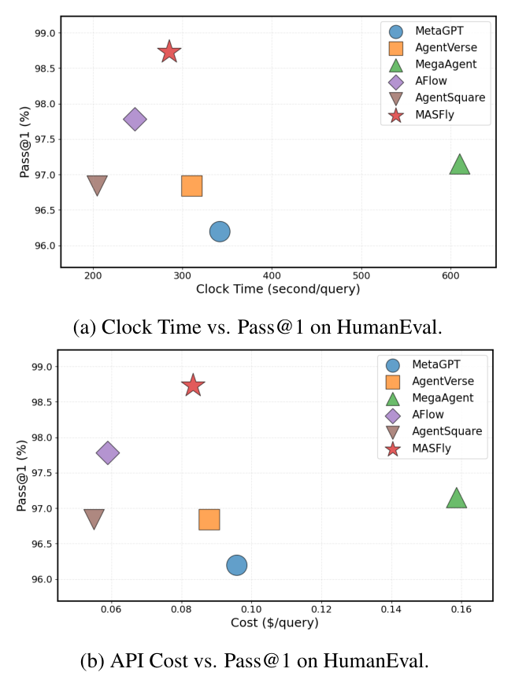

**图 8：HumanEval 上的效率—性能比较。**（a）实际耗时与 Pass@1；（b）API 成本与 Pass@1。耗时单位为秒/查询，成本单位为美元/查询。

我们在 HumanEval 上评估代表性方法的效率和性能，测量实际耗时，包括模型推理和 API 通信延迟，以及 API 成本，比较推理时效率。实际耗时同时包含系统生成和执行时间。图 8 显示，MASFly 取得所有方法中最佳整体平衡：Pass@1 最高，耗时和成本适中，位于效率—性能权衡的帕累托前沿。优势主要来自根据查询动态定制不同复杂度的系统，在提高推理质量的同时避免过度计算开销。

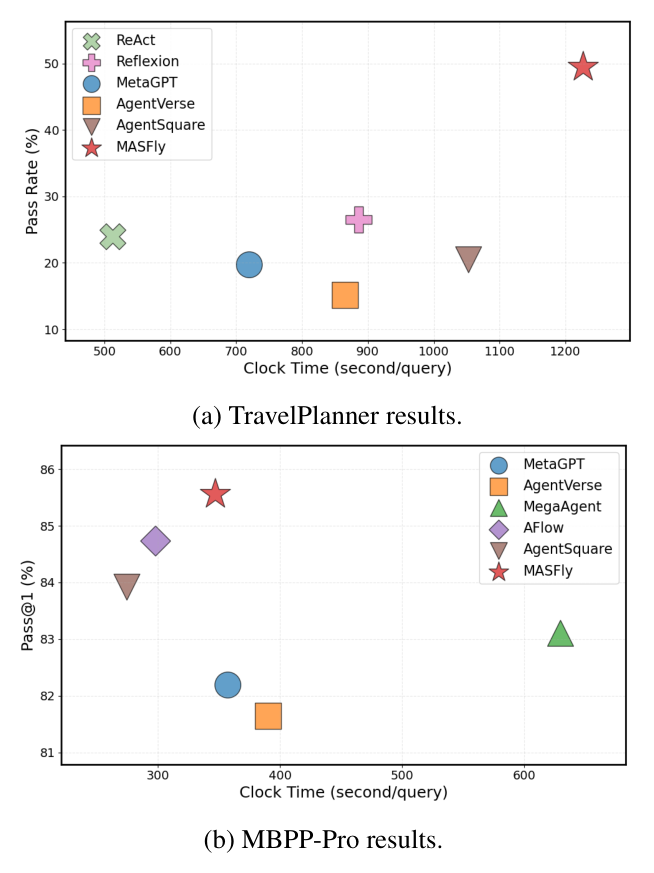

**图 9：其他数据集上的效率—性能比较。**（a）TravelPlanner；（b）MBPP-Pro。横轴为实际耗时（秒/查询），纵轴为通过率或 Pass@1（%）。

图 9a、9b 补充 TravelPlanner 与 MBPP-Pro 的结果。MASFly 在两者上均表现较强，实际耗时随生成系统复杂度变化。TravelPlanner 中，基线耗时较短，但往往编造中间事实、跳过环境交互，虽然减少计算，却明显损害正确性、降低硬约束通过率。MASFly 则额外投入监督和纠错，验证中间输出与数据库一致性，在保持合理计算预算的同时显著提高通过率。

MBPP-Pro 通常比 HumanEval 更难。为满足更高推理需求，MASFly 有时生成稍复杂的系统，增加推理时间，但仍取得最佳性能，说明动态系统生成能随任务复杂度有效扩展，在没有过度开销的情况下持续带来显著准确率收益。

表 9 进一步报告 MASFly 各阶段 token 成本占比，以及每个查询的总 API 成本。智能体执行占主要部分，TravelPlanner 和 GAIA 分别为 73.5% 和 78.4%。Watcher 监督带来适度开销，系统实例化则少于 5%。反思仅发生于离线仓库构建，不计入留出测试时推理成本。

**表 9：MASFly 各阶段成本分解。**

| 数据集 | 实例化 | 执行 | 监督 | 反思 | 总成本 |
|---|---:|---:|---:|---:|---:|
| TravelPlanner | 4.7% | 73.5% | 15.8% | 6.0% | 0.31 美元 |
| GAIA | 4.4% | 78.4% | 12.4% | 4.8% | 0.07 美元 |

### C.5 Watcher 监督频率的影响

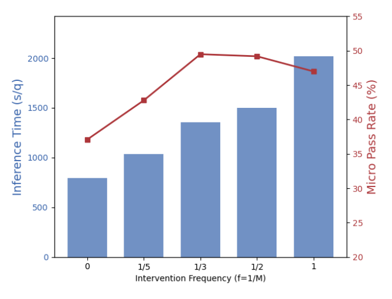

**图 10：TravelPlanner 上监督模块的控制—效率权衡。** 横轴为干预频率 $f=1/M$；蓝柱为每个查询的推理时间，红线为微观硬约束通过率。

为分析过程监督中鲁棒性与效率的权衡，我们改变 TravelPlanner 的 Watcher 监督频率；该任务团队通常有 5–6 个智能体。定义 $f=1/M$，$M$ 为两次监督之间的通信轮数。$f=0$ 表示不监督，$f$ 越大表示监督越频繁。评估指标为微观硬约束通过率和平均每查询执行时间。

图 10 显示，适度干预通过在早期发现通信偏移、潜在工具误用等异常，并在其传播前纠正，显著增强鲁棒性。但过度频繁监督收益递减：过多干预可能引入不必要纠正，打断智能体自然协调，损害整体稳定性。效率方面，平均执行时间随监督频率几乎单调增加，因此必要时降低频率可节约计算。总体上，中等干预水平，例如将间隔设为智能体数的一半或三分之一，在鲁棒性与效率间平衡最好，验证了灵活、可调监督策略的有效性。

### C.6 Watcher 干预质量分析

为定量评估 Watcher 可靠性，我们人工检查从 TravelPlanner 抽取的 50 次 Watcher 调用，分别标注：（1）底层执行是否真正出错；（2）Watcher 是否进行了恰当的替换干预。结果见表 10。

**表 10：TravelPlanner 抽样 50 次调用中的 Watcher 干预质量。**

| 是否干预 | 无错误 | 有错误 |
|---|---:|---:|
| 是 | 6（假正例，FP） | 25（真正例，TP） |
| 否 | 16（真负例，TN） | 3（假负例，FN） |

精确率 = 0.806；召回率 = 0.893；F1 = 0.847。

较高召回率表明大部分真实执行错误被成功发现和纠正，精确率超过 0.8 表明错误或不必要干预较少。6 个假正例主要发生在 Watcher 依据自身世界知识，质疑实际上与沙盒一致的中间结果时。这种差异源于设计上 Watcher 不直接观察工作智能体访问的完整沙盒工具输出。

**假正例示例。** 一次 TravelPlanner 案例中，搜索工具返回旧金山的一处住宿，名称为 `Room in Down town Brooklyn Parkslop`。Watcher 根据世界知识将 Brooklyn 与纽约联系，误判城市不符，触发不必要的住宿规划者替换。工作智能体实际已从沙盒工具获得住宿，但 Watcher 未看到完整证据。该例展示基于部分执行上下文监督的局限，说明应暴露更多结构化工具证据，或在替换前进行显式证据一致性检查。

另一方面，25 个真正例干预中的大多数可归功于 PEP，它提供相关历史失败模式和纠正策略，支持“经验增强监督能显著改善稳健错误检测与恢复”的设计选择。总体而言，Watcher 并非任意扰动机制，而是在进行相当准确、由经验增强的监督。

### C.7 不同 Watcher 基座的影响

**表 11：不同 Watcher 基座的影响。**

| Watcher | TravelPlanner 常识 | TravelPlanner 硬约束 | GAIA 等级 1 | GAIA 等级 2 |
|---|---:|---:|---:|---:|
| 无 | 83.9 | 37.1 | 41.4 | 36.8 |
| Qwen3-8B | 84.9 | 47.4 | 43.3 | 38.7 |
| Qwen3-235B | 85.3 | 49.5 | 46.3 | 41.5 |

我们比较完全移除 Watcher、轻量 Qwen3-8B Watcher，以及默认 Qwen3-235B Watcher 三种设置。即使轻量 Watcher 也明显优于无 Watcher，说明有效过程监督不严格要求极大模型：小型 Watcher 已能检测许多执行失败并提供有益纠正。更强的 Qwen3-235B 仍持续最优，表明模型能力可进一步提高干预质量和恢复效果。总体收益在不同模型规模上均稳健。

### C.8 提示词攻击下的鲁棒性

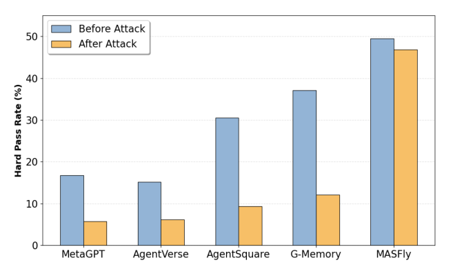

**图 11：TravelPlanner 上提示词注入攻击前后的性能。** 蓝柱为攻击前，黄柱为攻击后；纵轴为硬约束通过率（%）。

我们在 TravelPlanner 上进一步测试更现实的提示词注入攻击：向餐厅规划智能体注入对抗指令，强迫其不使用工具，只根据自身知识生成餐厅计划。这模拟现实中的常见故障：绕过环境交互，编造看似合理、却与沙盒不一致的信息。

图 11 显示，基线在攻击后性能大幅下降。由于开环执行，被攻陷智能体往往输出与沙盒不符的幻觉信息，严重损害下游规划。MASFly 仅轻微下降，因为 Watcher 能识别异常工具使用，并在执行时触发监督和纠正。这进一步表明，它不仅能应对显式失败，也能抵抗绕过工具造成的、现实的提示词诱发幻觉。

### C.9 LiveCodeBench 评估

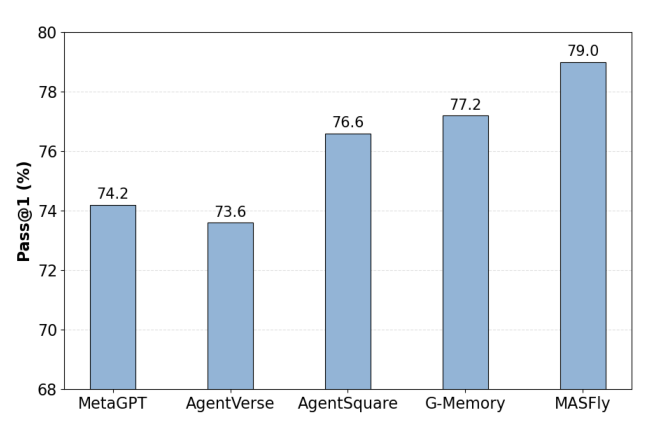

**图 12：使用 Qwen3-235B 时，在 LiveCodeBench-v5 上的性能比较。** Pass@1：MetaGPT 74.2%、AgentVerse 73.6%、AgentSquare 76.6%、G-Memory 77.2%、MASFly 79.0%。

为在更难的编程基准上进一步评估，我们补充 LiveCodeBench（Jain et al., 2025）实验；对现代 LLM 系统而言，它比 HumanEval 和 MBPP Pro 更具挑战。图 12 中，MASFly 整体最佳，超过人工设计流水线 MetaGPT、自动化框架 AgentVerse 和 AgentSquare，以及记忆增强基线 G-Memory。这进一步强化了编程结论：其优势不只局限于较简单基准，也适用于更具挑战和区分度的编程环境。

### C.10 混合检索器的影响

**表 12：MASFly 不同检索器的比较。**

| 检索方法 | TravelPlanner 常识 | TravelPlanner 硬约束 | GAIA 等级 1 | GAIA 等级 2 |
|---|---:|---:|---:|---:|
| QuerySim（λ = 1） | 84.4 | 44.0 | 43.9 | 39.6 |
| Hybrid（λ = 0.8） | 84.6 | 47.8 | 45.7 | 41.5 |
| Hybrid（λ = 0.5） | 85.3 | 49.1 | 45.7 | 41.5 |
| Hybrid（λ = 0.3） | 85.3 | 49.5 | 46.3 | 41.5 |
| NeedSim（λ = 0） | 85.1 | 47.9 | 45.1 | 41.5 |

表 12 比较三种策略：（i）QuerySim，仅按输入查询相似性检索 SOP；（ii）NeedSim，仅按内部需求相似性检索；（iii）Hybrid，结合两个信号。相较单一信号，混合方法持续提升，尤其在较难案例上，说明外部查询线索与内部结构需求提供互补信息。不同 $\lambda$ 下表现相对稳定，说明对该超参数不高度敏感。总体上，结合两个信号可从 SOP 仓库和 PEP 检索更相关历史经验，支持更有效的多智能体组织与执行。

### C.11 检索 SOP 数量的敏感性

**表 13：MASFly 对检索 SOP 数量 $K$ 的敏感性。**

| K | GAIA 等级 1 | GAIA 等级 2 | HumanEval | MBPP |
|---|---:|---:|---:|---:|
| 1 | 45.1 | 39.6 | 98.7 | 93.3 |
| 2 | 46.3 | 41.5 | 98.7 | 93.3 |
| 3 | 45.7 | 41.5 | 98.3 | 92.9 |

我们分析检索 SOP 数量 $K$ 对性能的影响。表 13 报告三个基准上检索 1–3 个候选的结果。整体表现稳定；检索两个时，多数数据集达到最佳或接近最佳。超过两个的额外收益有限，有时略降，可能因为更多 SOP 引入冗余或相关性较低的组织模式。这说明 MASFly 在合理范围内对 $K$ 不高度敏感，其收益来自少量高质量组织先验，而非大量检索候选。

## D 案例研究

图 13、14 分别展示来自 GAIA 和编程任务的 SOP。每个 SOP 明确团队组成、通信结构及各智能体详细配置，包括职责、指令和工具。它们说明 SOP 如何编码结构化、可解释协作模式，以用于新任务的实例化。实例化主要通过定制指令完成；必要时，还会根据具体查询动态调整其他系统配置。

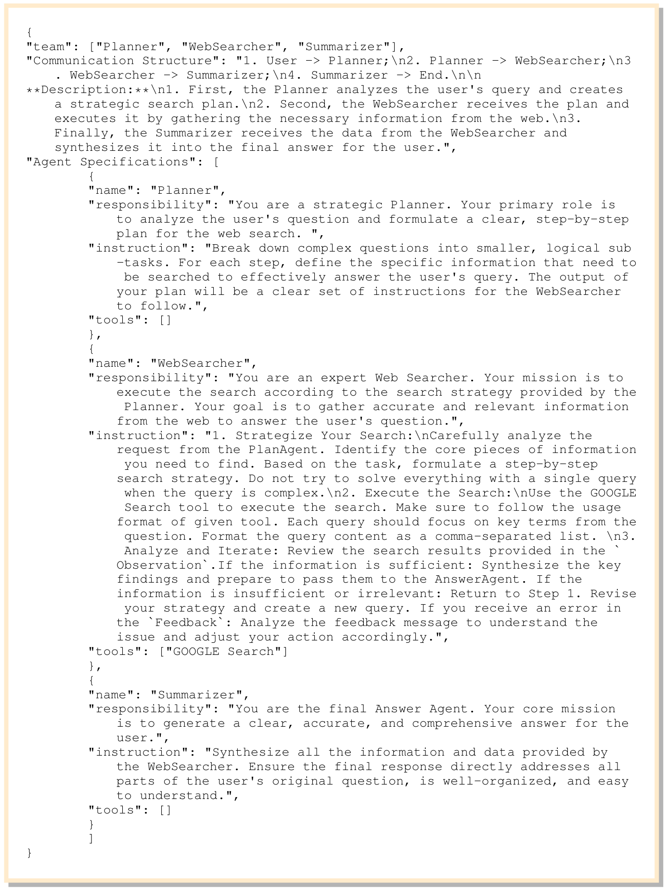

**图 13：GAIA 基准的 SOP 示例。** 下列代码保留原字段、角色名及工具名，翻译描述性文字；为便于阅读，将字符串中的换行排版为连续文字。

```json
{
  "team": ["Planner", "WebSearcher", "Summarizer"],
  "Communication Structure": "1. User -> Planner；2. Planner -> WebSearcher；3. WebSearcher -> Summarizer；4. Summarizer -> End。描述：首先，Planner 分析用户查询，制定有策略的搜索计划。其次，WebSearcher 接收计划并执行，从网络获取必要信息。最后，Summarizer 接收 WebSearcher 的数据，将其综合为给用户的最终答案。",
  "Agent Specifications": [
    {
      "name": "Planner",
      "responsibility": "你是一名战略规划者。你的主要职责是分析用户问题，为网络搜索制定清晰、分步骤的计划。",
      "instruction": "将复杂问题分解为更小、逻辑清楚的子任务。对每一步，明确有效回答用户查询需要搜索的具体信息。你的计划应输出为一组清晰指令，供 WebSearcher 遵循。",
      "tools": []
    },
    {
      "name": "WebSearcher",
      "responsibility": "你是一名网络搜索专家。你的使命是按照 Planner 提供的策略执行搜索，目标是从网络获取准确、相关的信息，回答用户问题。",
      "instruction": "1. 制定搜索策略：仔细分析 PlanAgent 的请求，确定需要找到的核心信息。根据任务制定逐步搜索策略；查询复杂时，不要试图用单次查询解决所有问题。2. 执行搜索：使用 GOOGLE Search 工具，确保遵循指定工具的使用格式。每次查询应聚焦问题的关键词，查询内容采用逗号分隔列表。3. 分析与迭代：检查 Observation 中的搜索结果。若信息充分，综合关键发现，准备传递给 AnswerAgent；若信息不足或无关，返回步骤 1，修改策略并创建新查询。若 Feedback 返回错误，分析反馈以理解问题，并相应调整行动。",
      "tools": ["GOOGLE Search"]
    },
    {
      "name": "Summarizer",
      "responsibility": "你是最终答案智能体。你的核心使命是为用户生成清晰、准确、全面的答案。",
      "instruction": "综合 WebSearcher 提供的全部信息和数据。确保最终响应直接回答用户原始问题的所有部分，结构清楚、易于理解。",
      "tools": []
    }
  ]
}
```

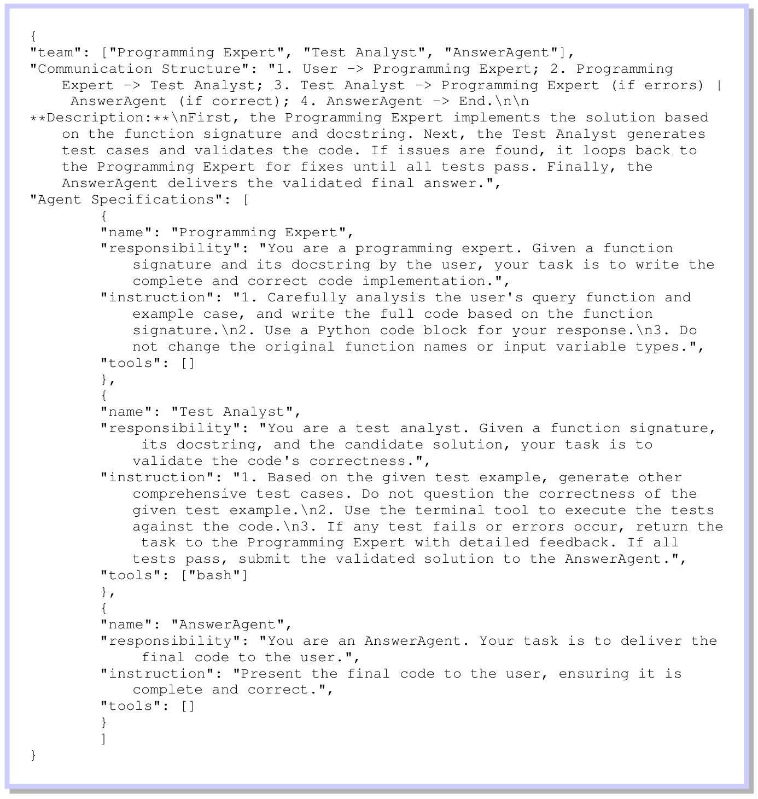

**图 14：编程任务的 SOP 示例。**

```json
{
  "team": ["Programming Expert", "Test Analyst", "AnswerAgent"],
  "Communication Structure": "1. User -> Programming Expert；2. Programming Expert -> Test Analyst；3. Test Analyst -> Programming Expert（若有错误）或 AnswerAgent（若正确）；4. AnswerAgent -> End。描述：首先，Programming Expert 根据函数签名和文档字符串实现解决方案。接着，Test Analyst 生成测试用例并验证代码。若发现问题，返回 Programming Expert 修复，直到全部测试通过。最后，由 AnswerAgent 交付已验证的最终答案。",
  "Agent Specifications": [
    {
      "name": "Programming Expert",
      "responsibility": "你是一名编程专家。给定用户提供的函数签名与文档字符串，你的任务是编写完整、正确的代码实现。",
      "instruction": "1. 仔细分析用户的查询函数和示例用例，根据函数签名编写完整代码。2. 使用 Python 代码块回应。3. 不要修改原函数名或输入变量类型。",
      "tools": []
    },
    {
      "name": "Test Analyst",
      "responsibility": "你是一名测试分析师。给定函数签名、文档字符串和候选解决方案，你的任务是验证代码正确性。",
      "instruction": "1. 根据给定测试示例，生成其他全面的测试用例，不要质疑给定测试示例的正确性。2. 使用终端工具对代码运行测试。3. 若有测试失败或发生错误，将任务连同详细反馈交回 Programming Expert；若全部通过，将验证后的解决方案提交给 AnswerAgent。",
      "tools": ["bash"]
    },
    {
      "name": "AnswerAgent",
      "responsibility": "你是 AnswerAgent，任务是向用户交付最终代码。",
      "instruction": "向用户呈现最终代码，确保代码完整、正确。",
      "tools": []
    }
  ]
}
```
