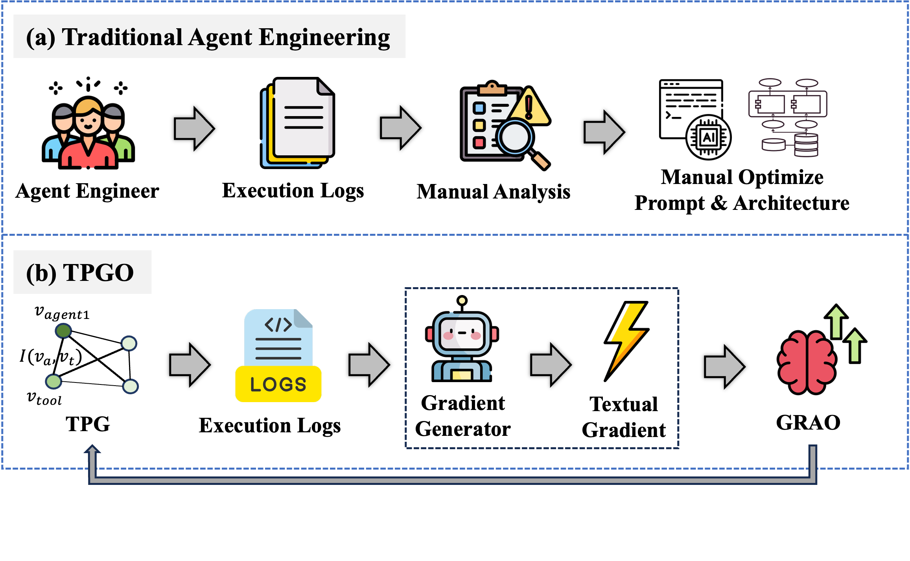
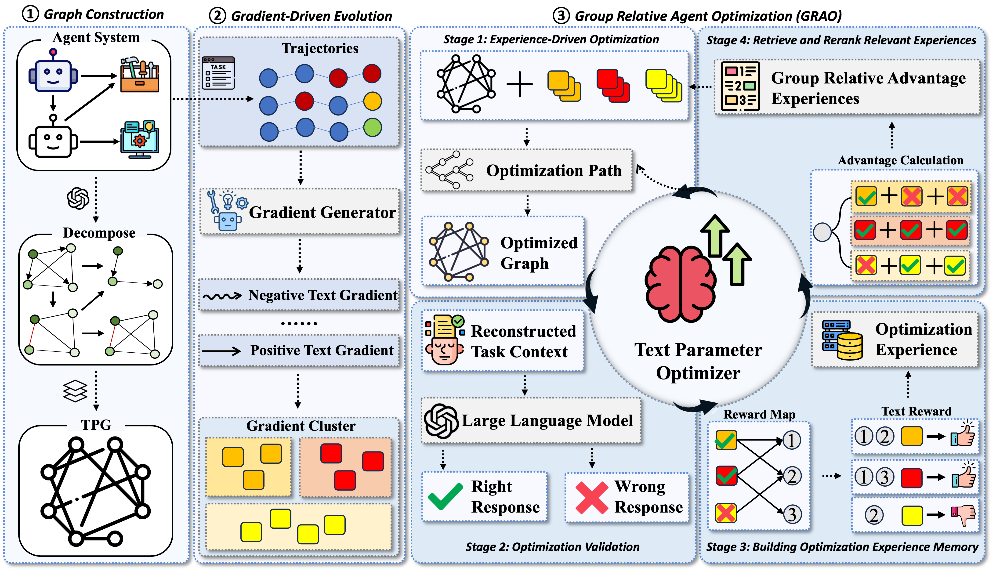
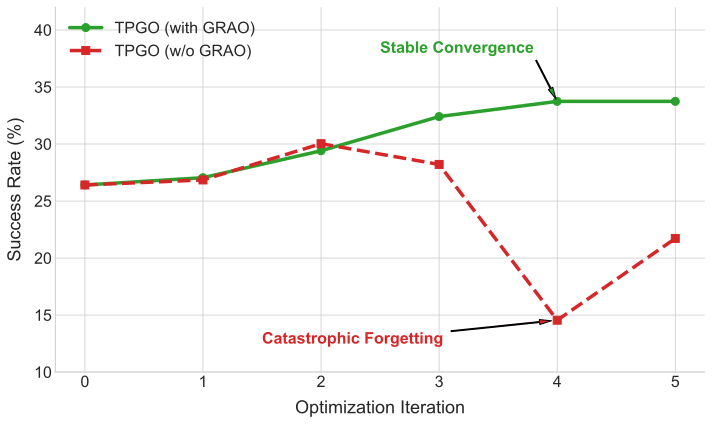

# 学习如何进化：通过文本参数图优化实现多智能体系统自我改进

**原题：** Learning to Evolve: A Self-Improving Framework for Multi-Agent Systems via Textual Parameter Graph Optimization  
**作者：** Shan He*、Runze Wang*、Zhuoyun Du、Huiyu Bai、Zouying Cao、Yu Cheng、Bo Zheng†。* 同等贡献；† 通讯作者。  
**单位：** 阿里巴巴未来生活实验室（Future Living Lab of Alibaba）。  
**联系邮箱：** shanhe.hs@alibaba-inc.com；yunze.wrz@alibaba-inc.com。  
**发表：** Findings of ACL 2026，30719–30732 页。  
**正式版本：** [ACL Anthology](https://aclanthology.org/2026.findings-acl.1534/) · [PDF](https://aclanthology.org/2026.findings-acl.1534.pdf) · DOI：10.18653/v1/2026.findings-acl.1534。  
**版本与翻译说明：** 以会议正式版为准，参考 arXiv:2604.20714v1 的公式与图表转写并与正式版核对。正文、图注与表头译为中文；参考文献、附录及其中的提示模板保留英文并转为 Markdown；图内英文和代码标识保留。章节与图表按正式版的相对位置组织，不模拟双栏分页。  
**许可：** 原文按 [CC BY 4.0](https://creativecommons.org/licenses/by/4.0/) 发布；本文件是中文翻译与 Markdown 格式改编，非作者官方译本。

## 摘要

设计和优化多智能体系统（MAS）是一项复杂、劳动密集的“智能体工程”工作。现有自动优化方法主要集中于**扁平化提示调优**，缺乏调试 MAS 复杂交互网络所需的结构感知能力。更关键的是，这些优化器是**静态的**：它们不会从经验中学习，以改进自身的优化策略。

为弥补这些缺口，我们提出**文本参数图优化（Textual Parameter Graph Optimization，TPGO）**，使多智能体系统能够**学习如何进化**。TPGO 首先将 MAS 建模为**文本参数图（TPG）**，把智能体、工具和工作流表示为模块化、可优化的节点。为引导演进，我们从执行轨迹中提取“**文本梯度**”，即结构化的自然语言反馈，用于定位失败并提出细粒度修改。框架核心是**组相对智能体优化（Group Relative Agent Optimization，GRAO）**，一种从历史优化经验中学习的元学习策略。通过分析过去的成功与失败，GRAO 逐步提高有效更新的提议能力，让系统学会如何优化自身。在 GAIA 和 MCP-Universe 等复杂基准上的广泛实验表明，TPGO 通过自动化、自我改进的优化，显著增强先进智能体框架的表现并提高成功率。

## 1 引言



**图1：多智能体系统优化中，传统智能体工程与所提出 TPGO 的流程。**

大语言模型的快速发展推动人工智能从被动问答接口，转向能够使用工具并作出决策的自主智能体。近期，这一演变进一步发展出**多智能体系统（MAS）**：不同智能体协作解决从软件工程到开放式推理的复杂多步问题（Park et al., 2023；Guo et al., 2024；Hong et al., 2023）。通过将复杂任务分解为专门子程序，MAS 已展示出显著超越单独 LLM 的能力。

然而，系统是否有效，极度依赖文本组件的精确配置。“智能体工程师”不仅必须精心设计每个智能体的系统提示，还要编写工具描述、智能体通信协议和整体工作流（Talebirad and Nadiri, 2023；Luo et al., 2025a；Tran et al., 2025）。这一过程通常称为**智能体工程（Agent Engineering）**，本质上是一个高维、非结构化的优化挑战。如图1（a）所示，MAS 交互的不透明性与非确定性，使人工调优成为劳动密集的试错过程，难以扩展，也很少收敛到最优状态。因此，**MAS 自动优化**成为重要但尚未解决的前沿问题。

现实应用中的优化挑战主要分为两类。一类是**探索式优化（exploratory optimization）**：系统没有“标准”答案，需要依靠执行反馈进行自我纠正。另一类是**模仿式优化（imitative optimization）**：系统通过学习专家示范或理想方案，使行为与期望结果一致。

为减轻人工负担，早期研究探索了自动提示优化（APO）（Wang et al., 2023；Yuksekgonul et al., 2024）。虽然前景良好，但这些方法在应对 MAS 的独特复杂性时存在两个根本不足。首先，它们主要优化“扁平”提示，缺乏理解多智能体架构复杂交互网络所需的**结构感知**。系统失败往往源于工具定义中的细微错误、工作流的逻辑缺口或不匹配的通信协议，现有 APO 难以识别和纠正这些问题（Fang et al., 2025）。其次，也是更根本的一点，现有优化器是**静态的**：不会从优化过程本身学习。它们针对给定问题搜索或实施类似梯度的更新，却没有机制吸收过往成败，随时间成为更好的优化器。关键问题由此显现：MAS 要实现真正自主，**优化系统本身必须学会进化**。本文的核心动机是构建一个既改进智能体系统，又通过经验改善自身优化策略的优化器。

为此，我们提出 TPGO，将 MAS 优化重新表述为**图演化问题**，如图1（b）所示。为解决结构性挑战，我们首先将系统配置形式化为文本参数图：智能体、工具和逻辑单元是模块化节点，其交互表示为有向边。通过这种结构化视角，我们能够超越扁平文本编辑，对系统架构进行有针对性的结构修改。

更重要的是，为使优化器进化，我们引入 GRAO 元学习机制，作为优化过程的“大脑”。它聚类历史错误模式，并检索过去成功的优化策略，随时间学会生成更有效、更有针对性的更新提议。其输入信号是**文本梯度**，即从执行轨迹中得到的结构化自然语言反馈，据此推理并纠正图中的语义错误。本质上，GRAO 使框架能够“**学习如何优化**”。

主要贡献如下：

- 提出 TPGO，据我们所知，首次将多智能体系统优化视为图演化问题，支持对复杂智能体架构进行结构与语义两方面改进。
- 引入文本参数图，将整体式文本配置拆解为模块化、可单独优化的语义单元。
- 设计 GRAO，这是一种利用历史经验持续提高优化提议质量的自我进化元优化策略。
- 广泛实验表明，该框架通过自动化演化优化，显著改善先进智能体系统在复杂基准上的效果与效率。

## 2 相关工作

### 2.1 语言智能体系统

ReAct（Yao et al., 2023）等单智能体系统（SAS）简单高效，但能力存在内在限制。为突破这些限制，基于 LLM 的 MAS 成为复杂问题求解的有力范式。主流设计方法将任务分解为子任务，分配给模仿人类合作团队的专业智能体（Park et al., 2023；Guo et al., 2024）。但这也引入庞大的设计空间，许多关键选择会影响合作与行为。例如，系统层面需要定义协作结构，从层级组织（如 MaCTG；Zhao et al., 2024）、迭代改进、多智能体辩论等预定义工作流中选择。智能体层面又需要人工设计人格（Lin et al., 2025），才能产生超越单智能体的复杂结果。因此，整体性能对团队组成、协作机制、通信协议，以及各智能体人格与主动性的具体配置等设计选择高度敏感（Zhang et al., 2024；Lin et al., 2025）。

### 2.2 自动提示优化

近期自动提示优化主要沿三个方向发展。PromptAgent（Wang et al., 2023）等基于搜索的方法使用蒙特卡洛树搜索（MCTS）进行策略探索。EvoPrompt（Tong et al., 2025）等进化算法通过迭代演化提示，筛选高性能候选。TextGrad（Yuksekgonul et al., 2024）等基于梯度的方法，则将提示视为可微参数，通过反向传播优化。

这些方法共同的限制是关注文本内容，而忽视系统架构。它们独立优化提示，却难以解决 MAS 中智能体、工具和逻辑相互作用所引发的故障。由于无法修改系统交互结构，现有 APO 无法解决核心架构问题。本文通过引入具备结构感知的优化框架，直接应对这一挑战。

## 3 任务定义

本文关注的核心问题是 MAS 自动优化。MAS 的表现由配置决定，配置是由智能体提示、工具描述和交互协议等组成的复杂文本集合。人工调整这些组件的智能体工程，既耗费劳动，也缺少系统性。LLM 交互的高维性与非确定性，使该优化空间极难探索，且无法保证收敛到最优状态。

### 3.1 问题形式化

我们将 MAS $\mathcal A$ 表示为由一组可配置自然语言元素参数化的系统，并将这些元素称为**文本参数** $\Theta$。它们涵盖每个智能体的系统提示 $\{P_i\}$、可用工具描述 $\{D_j\}$ 及智能体通信规则等全部文本组件。

给定下游任务分布 $\mathcal T$，以输入输出数据集 $(Q,A)=\{(q_k,a_k)\}_{k=1}^{N}$ 表示，系统 $\mathcal A(\Theta)$ 接收查询 $q_k$ 并生成最终输出 $\hat a_k$。执行过程同时生成轨迹 $\tau_k$，详细记录中间推理、工具调用和通信。

目标是找到最优文本参数 $\Theta^*$，使奖励指标 $\mathcal R$（如成功率）衡量的性能最大化：

$$
\Theta^*=\arg\max_{\Theta\in\mathcal S}
\mathbb E_{(q,a)\sim\mathcal T}[\mathcal R(\mathcal A(\Theta,q),a)].\tag{1}
$$

$\mathcal S$ 为全部可能文本配置组成的庞大、离散、非结构化空间，难以探索是主要障碍，常规优化和穷举均不可行。我们希望自动化这一发现过程，使系统能够有条理且高效地探索并找到高性能配置。下一节介绍的 TPGO 为该问题赋予结构，实现基于学习的 $\Theta^*$ 搜索。

## 4 方法

### 4.1 总览

为实现复杂 MAS 的自主进化，TPGO 将整个系统重新视为一个结构化、可优化的对象。我们认为，LLM 智能体的角色、逻辑与能力等本质内容，都封装在其文本配置中。框架以图2所示闭环系统性改进配置，包含三个阶段：（1）**图构建**：将不透明提示分解为透明、模块化的 TPG；（2）** 梯度驱动演化**：从执行记录中提取称为文本梯度的语义反馈，指导图更新；（3）**GRAO**：元优化层使优化器自身能够从经验中学习和改进。整体设计使智能体系统和优化过程协同演进。



**图2：文本参数图优化（TPGO）框架总览。** 闭环包括：（1）图构建，将非结构化智能体提示拆解为结构化文本参数图；（2）梯度驱动演化，从执行轨迹生成语义文本梯度以诊断故障；（3）GRAO，利用优化经验记忆，指导优化器 LLM 生成有效图更新 $\Delta\mathcal G$。

### 4.2 文本参数图

标准 MAS 常使用整体式、非结构化文本提示定义行为，因而脆弱、难以调试，也不利于系统优化。为克服这些限制，我们将配置 $\Theta$ 形式化为有向**文本参数图** $\mathcal G=(\mathcal V,\mathcal E)$，把系统逻辑分解成模块化、可检查、可单独优化的组件。

**节点表示（$\mathcal V$）。** 每个节点 $v_i\in\mathcal V$ 表示一个离散语义单元。专门的解析器 LLM（Parser LLM）对初始系统提示分层拆解，生成这些节点。该过程支持嵌套图：高层智能体构成主图，内部具体组件建模为互连子图。节点主要有三类：

- **角色节点**：定义核心人格、高层目标与策略指令。
- **逻辑节点**：封装具体推理协议、操作约束或链式思考过程。
- **工具节点**：包含外部工具的功能描述、API 规范和使用示例。

完整配置由全部节点内容汇集而成：$\Theta=\bigcup_{v_i\in\mathcal V}\operatorname{Content}(v_i)$。

**边表示与系统动态（$\mathcal E$）。** 有向边建模语义单元之间的依赖与逻辑流。从 $v_i$ 到 $v_j$ 的边 $e_{ij}$ 表示前者内容为后者提供信息、约束或上下文。这些边定义系统动态，例如连接角色节点与逻辑节点的智能体内部流程、连接逻辑节点与工具节点的工具集成，以及跨不同智能体子图建立的通信。

**基于图的优化。** 该表示将提示工程转化为结构化图优化，并通过两种主要机制细粒度控制行为。第一，**节点内容改进**：修改特定节点文本，进行有针对性的更新，类似传统模型的参数调优；例如修改工具节点可提高正确使用工具的能力。第二，**结构修改**：改变图拓扑以动态改变能力。删除通向工具节点的边可以撤销工具访问权限；增加节点和边可以引入新技能或新智能体。这一结构化方式既支持人工调试，也支持系统自动演化。

### 4.3 梯度驱动演化

给定表示系统的 TPG $\mathcal G$，目标是通过迭代改进图来最大化任务表现。传统梯度优化不适用于离散文本结构，因此我们引入以**文本梯度**为中心的范式：用结构化自然语言评议和建议，通过生成、聚合和应用三个阶段指导图演化。

**步骤1：轨迹诊断与梯度生成。** 对一批任务运行 MAS，收集轨迹集 $\mathcal T=\{\tau_1,\ldots,\tau_N\}$。每条轨迹详细记录推理、工具使用和通信。诊断模型将它们与标准方案或理想行为比较，识别偏差，并为每条有信息价值的轨迹生成文本梯度，提供丰富、可解释的改进信号：

$$
\nabla_{\mathrm{text}}=\operatorname{Generate}(\tau_k)\rightarrow\{\delta^+,\delta^-\}.
$$

梯度包括两部分：

- **正梯度（$\delta^+$）**：从成功轨迹提炼高质量推理模式或有效工具策略，作为强化正确行为的模板，例如“智能体正确地把问题分解为 A、B、C 三个子步骤”。
- **负梯度（$\delta^-$）**：从失败轨迹定位幻觉、工具误用等错误，并给出纠正行动，例如“智能体为 `search` 工具臆造了一个参数；它应先调用 `list_parameters`”。

**步骤2：通过聚类聚合梯度。** 针对每个负梯度单独更新效率低，还可能造成带噪声、相互冲突的修改。为此，我们聚合梯度以识别系统性错误模式。对全部负梯度 $\{\delta_k^-\}$ 的错误描述进行嵌入和语义聚类，每个簇代表一种反复发生的失败，如“误解某工具的约束”或“智能体间通信低效”。这样，系统能够处理根本原因。

**步骤3：生成并应用优化提议。** 对每个错误簇，**优化器 LLM（Optimizer LLM）** 依据代表性错误描述和当前图，生成具体**优化提议** $\Delta\mathcal G$。它是一份修改 TPG 的机器可读计划，包含特定图编辑操作，如：

- `REWRITE_NODE(v, new_content)`：修改节点文本。
- `PRUNE_EDGE(u, v)`：删除连接，禁用存在故障的路径。
- `ADD_NODE(v_new, content)`：引入新技能或约束。
- `ADD_EDGE(u, v)`：建立新依赖或逻辑流。

最后，将提议应用到图上得到 $\mathcal G'\leftarrow\mathcal G\oplus\Delta\mathcal G$，其中 $\oplus$ 表示应用修改。该迭代循环驱动智能体系统演化。

### 4.4 通过 GRAO 实现自我进化优化

梯度驱动过程依赖优化器 LLM 生成提议，但静态优化器可能反复提出无效修改。我们引入 GRAO 元优化框架，使优化过程本身能够自我改进。其核心原则是建立反馈闭环：从过去优化的有效性中学习，生成更好的未来提议。该过程通过验证、记忆和自适应上下文学习实现。

**优化验证与有效性评分。** 提议 $\Delta\mathcal G$ 生成演化图 $\mathcal G'$ 后，通过实验验证影响。为避免全面重评成本，采用定向验证：只在产生当前错误簇的任务子集上运行新配置 $\mathcal A(\mathcal G')$。比较新结果与过去失败，计算**有效性得分** $E(\Delta\mathcal G)\in[0,1]$，量化提议在问题任务子集上的成功率。

**构建优化经验记忆。** 每次优化尝试以结构化条目写入持久的**优化经验记忆（Optimization Experience Memory）**，形成记录“尝试过什么、效果如何”的知识库。每项包含三个关键部分：

- **问题上下文（$C$）**：触发优化的错误簇的语义描述。
- **解决提议（$\Delta\mathcal G$）**：实际应用的图编辑操作集。
- **结果（$E$）**：验证得到的有效性评分。

随着时间推移，记忆形成丰富的“问题—方案—结果”三元组数据集，记录系统的学习历程。

**基于上下文学习的自适应提议生成。** 优化经验记忆使优化器从朴素推理者变为经验指导的专家。遇到描述为 $C_{\mathrm{new}}$ 的新错误簇时，GRAO 启动检索增强生成：首先，检索与当前问题语义相似的历史问题上下文 $\{C_k\}$，组成相关问题“组”；其次，根据有效性得分 $\{E_k\}$ 进行“组相对”排序，找出对该类错误最成功的历史策略；最后，把最高排名示例整理成少样本示例，置于优化器上下文前端。通过展示相似问题的成功修复案例，优化器能够生成更有针对性、更高质量的新提议 $\Delta\mathcal G_{\mathrm{new}}$。这一元学习循环使优化器由静态组件变成动态学习实体，让系统随时间学会如何更有效地改进自身。

## 5 实验

我们在两种代表设置中评估 TPGO：**探索式优化**根据执行反馈改进，不提供标准轨迹；**模仿式优化**朝已知正确结果优化。实验回答：（1）两种设置下是否都能稳定提高性能；（2）哪些组件贡献最大；（3）GRAO 是否提高迭代优化的稳定性与泛化性。我们在 MCP-Universe 和 GAIA 上，采用不同底座模型的 ReAct 与 MiroFlow 代表框架。

### 5.1 实验设置

**基准。** 两个有挑战性的基准分别对应两种优化场景。MCP-Universe（Luo et al., 2025b）用于探索式优化，评估 LLM 在需要与现实服务器交互、使用大规模工具空间的任务中的表现。成功由任务完成情况决定，因不存在“标准”路径，智能体必须依据执行反馈自我纠正。GAIA（Mialon et al., 2023）用于模仿式优化，是通用人工智能助手的广泛认可基准，提供可验证的标准最终答案，使 TPGO 能朝期望的正确结果优化行为。我们报告其验证集三个难度等级的结果。

**基线系统。** 为展示通用性，将 TPGO 应用于两个不同系统。ReAct（Yao et al., 2023）是结合推理与行动的基础架构，我们在 MCP-Universe 上分别使用 GPT-4.1、DeepSeek-V3.2 底座。MiroFlow（Team, 2025）是用于构建复杂推理智能体的先进开源框架，在 GAIA 上采用 GPT-5 底座。

**实现细节。** 除非另有说明，ReAct 使用 GPT-4.1 或 DeepSeek-V3.2，temperature 为 1.0、top-$p$ 为 1.0。GAIA 上的 MiroFlow 主智能体使用 GPT-5，推理强度 `high`；子智能体也使用 GPT-5，推理强度 `medium`；两者均设 temperature 为 1.0、top-$p$ 为 1.0。TPG 解析、文本梯度生成和优化提议生成均由 Gemini-2.5-Pro 完成，temperature 为 0.7、top-$p$ 为 0.95。梯度聚合时，对负文本梯度进行嵌入并使用 DBSCAN 聚类，无需预先指定簇数即可识别反复出现的失败模式。优化器为每个簇生成图编辑提议，在相应任务子集验证后再写入优化记忆。除非另有说明，最多迭代 5 次。

**评价指标。** 主要使用两项指标。**成功率（pass@1）** 为单次尝试得到正确最终答案的任务占比，是衡量有效性的主要指标。**平均用时**为任务开始到完成的实际经过时间，单位秒，用于衡量效率。

**表1：探索式优化场景 MCP-Universe 上的表现。** TPGO 从执行反馈中学习，提高 ReAct 在四个复杂任务领域中的成功率。括号内保留原文标注。

| **模型** | **仓库管理** | **三维设计** | **浏览器自动化** | **网络搜索** | **总体成功率** |
| --- | --- | --- | --- | --- | --- |
| ReAct(GPT-4.1) | 36.70 | 55.26 | 26.41 | 5.45 | 30.96 |
| + TPGO(1 轮) | 40.79 | 52.63 | 27.05 | 8.33 | 32.2 |
| + TPGO(3 轮) | 41.21 | 60.53 | 32.41 | 12.73 | 36.72 |
| + TPGO(5 轮) | **41.21 (+4.51)** | **65.79 (+10.53)** | **33.74 (+7.33)** | **14.55 (+9.10)** | **38.82 (+7.86)** |
| ReAct(DeepSeek-V3.2) | 42.18 | 60.03 | 20.51 | 16.36 | 34.77 |
| + TPGO(1 轮) | 40.85 | 60.52 | 20.38 | 17.14 | 34.72 |
| + TPGO(3 轮) | 44.18 | 63.16 | 26.13 | 21.81 | 38.82 |
| + TPGO(5 轮) | **45.52 (+3.34)** | **63.16 (+3.13)** | **28.03 (+7.52)** | **30.73 (+14.37)** | **41.86 (+7.16)** |

**表2：模仿式优化场景 GAIA 验证集上的表现。** TPGO 通过向正确最终答案对齐，提高 MiroFlow 基线成功率，同时使平均执行时间减少约一半。

| **模型** | **难度 1** | **难度 2** | **难度 3** | **总体** | **平均用时（秒）** |
| --- | --- | --- | --- | --- | --- |
| MiroFlow (GPT-5) | 78.8 | 77.5 | 44.4 | 73.8 | 4014 |
| + TPGO(1 轮) | 76.9 | 71.2 | 45.5 | 70.59 | 3680 |
| + TPGO(3 轮) | 82.1 | 73.1 | 54.5 | 75.7 | 2278 |
| + TPGO(5 轮) | **90.6** (+15.0%) | **79.1** (+2.1%) | **63.6** (+43.2%) | **81.6** (+10.6%) | **1765** (-56.0%) |

### 5.2 主要结果与分析

本节比较两种场景下基线在使用和不使用 TPGO 时的表现，回答第一个研究问题。

**探索式优化表现（MCP-Universe）。** 表1显示，该场景下 TPGO 带来显著收益。使用 GPT-4.1 的 ReAct，整体成功率由 30.96% 提升到 38.82%，相对增加 25.4%。网络搜索领域最为明显，从 5.45% 提高到 14.55%。这说明 TPGO 能从失败中学习，识别并修正工具使用逻辑的系统性缺陷。DeepSeek-V3.2 智能体也有类似提升，尤其网络搜索增加 14.37 个百分点，进一步说明仅凭环境反馈，TPGO 就能优化多样、复杂的工作流。

**模仿式优化表现（GAIA）。** 表2表明，即使面对 MiroFlow 这样的强基线，TPGO 仍有效。朝已知正确答案优化，使整体 pass@1 从 73.8% 提高到 81.6%，相对提升 10.6%。效率也显著改善，平均每任务用时从 4014 秒降到 1765 秒，减少 56.0%。其原因是优化过程剪除低效推理路径，并改进智能体逻辑，使其更直接到达所需答案。最高难度 Level 3 的收益最大，成功率从 44.4% 提高到 63.6%，表明系统处理复杂问题的核心能力得到增强。

### 5.3 消融研究

为回答第二个问题、识别关键设计贡献，我们在 MCP-Universe 的**浏览器自动化**子集开展组件级消融。从相同 ReAct 基线出发，每次禁用一个设计组件，成功率见表3。

| **方法** | **成功率** |
| --- | --- |
| TPGO（完整） | **28.03** |
| 移除文本参数图 | 25.13 |
| 禁用结构图编辑 | 24.90 |
| 不进行聚类 | 26.52 |
| 使用随机聚类 | 19.97 |

**表3：MCP-Universe 浏览器自动化子集上的 TPGO 关键设计消融。**

所有三类组件均有贡献。首先，移除文本参数图并退回整体提示重写，性能下降 2.90 个百分点，说明模块化结构对有效优化很重要。其次，禁用结构图编辑下降 3.13 个百分点，表明收益也来自修改结构与依赖的能力。第三，聚类改善优化信号质量：移除聚类后降至 26.52；以随机分组替代语义聚类则严重降至 19.97。这说明相似失败模式的连贯聚合至关重要，噪声分组甚至会产生明显负面影响。

总体而言，图表示、结构编辑空间和语义聚类是相互补充的组件，各自承担不同作用。

### 5.4 优化稳定性分析

我们进一步检验 GRAO 是否提高迭代优化的稳定性。在浏览器自动化子集上，比较完整的 **TPGO（含 GRAO）** 与 **TPGO（无 GRAO）**。后者仅依据最新错误簇更新，不检索历史优化经验。二者从相同 ReAct 基线开始，跟踪五轮优化中的成功率。



**图3：使用与不使用 GRAO 的优化稳定性。** 展示 MCP-Universe 浏览器自动化任务上五轮优化的成功率。含 GRAO 的方法稳定改善，无 GRAO 的变体出现灾难性遗忘。

图3显示，GRAO 对稳定迭代至关重要。二者起点均为 26.41%。含 GRAO 的方法在第3轮稳定提高到 **33.74%**，之后保持稳定。无 GRAO 的方法波动明显，第2轮达到 30.03%，但第4轮骤降到 14.55%，远低于初始基线。这表明缺少历史上下文时，优化器会过拟合近期失败，产生损害已有能力的更新。GRAO 通过缓解灾难性遗忘，同时改善最终性能和优化鲁棒性。

### 5.5 跨领域泛化

为检验 TPGO 是否仅过拟合定向验证子集，我们在 MCP-Universe 上开展跨领域研究：只用浏览器自动化领域优化 DeepSeek-V3.2 ReAct，然后在三个未见领域测试，不再继续优化。如表4所示，域内浏览器自动化提高 7.52 个百分点，网络搜索、仓库管理和三维设计分别提高 1.82、2.73 和 3.13 个百分点。这说明更新捕获了工具使用与智能体行为的更一般性改进。

**表4：MCP-Universe 上的跨领域泛化。** TPGO 仅在浏览器自动化领域优化。

| **方法** | **浏览器** | **网络** | **仓库** | **三维** |
| --- | --- | --- | --- | --- |
| ReAct (DS-V3.2) | 20.51 | 16.36 | 42.18 | 60.03 |
| + TPGO | **28.03** | **18.18** | **44.91** | **63.16** |

### 5.6 成本收益分析

TPGO 引入额外优化开销，因此我们在 GAIA 上分析成本收益。一次完整优化迭代消耗 1990 万个 token，在 8 路并发下实际用时 1380 秒；摊销到每条轨迹为 7.37 万个 token、5.6 秒。与基线每任务平均 4014 秒的执行时间相比，这一一次性离线优化成本较小。作为回报，优化后整体成功率由 73.8% 提高到 81.6%，平均执行时间减少 56.0%。因此，当优化成本能够在重复部署中摊销时，TPGO 具有实用性。

**表5：GAIA 上一次 TPGO 优化迭代的成本收益分析。**

| **指标** | **数值** |
| --- | --- |
| token 总用量 | 19.9M |
| 实际总用时 | 1380s |
| 每轨迹摊销 token 用量 | 73.7K |
| 每轨迹摊销实际用时 | 5.6s |

## 6 结论

我们提出 TPGO，通过结构化图演化改进智能体系统。框架将配置分解为模块化文本组件，依据执行过程产生的文本梯度改进它们，并通过 GRAO 利用优化记忆，实现更稳定、有效的智能体优化。MCP-Universe 和 GAIA 上的实验显示，有效性和效率均得到稳定改善，表明结构化、由经验指导的优化，是减轻智能体工程人工负担的一条有前景路线。

## 7 局限性

TPGO 存在若干局限。首先，它是经验性框架，没有形式化优化保证，“文本梯度”是启发式反馈，并非解析梯度。其次，每项提议都需在任务子集验证，优化循环可能成本较高，限制其在更大基准或更复杂系统上的可扩展性。此外，框架依赖解析、诊断和提议生成所用底层 LLM 的能力，较弱模型可能产生更多噪声或效果较差的更新。最后，目前仅优化文本参数，并使用预定义图编辑操作，尚未考虑底座模型选择、数值超参数，以及节点合并、子图生成等更丰富的结构变化。

## 8 致谢

本工作得到阿里巴巴集团阿里研究实习生计划（Alibaba Research Intern Program）的支持。

## 参考文献（原文）

- Fang et al. (2025) J. Fang, Y. Peng, X. Zhang, Y. Wang, X. Yi, G. Zhang, Y. Xu, B. Wu, S. Liu, Z. Li, et al. A comprehensive survey of self-evolving ai agents: a new paradigm bridging foundation models and lifelong agentic systems. arXiv preprint arXiv:2508.07407.
- Guo et al. (2024) T. Guo, X. Chen, Y. Wang, R. Chang, S. Pei, N. V. Chawla, O. Wiest, and X. Zhang Large language model based multi-agents: A survey of progress and challenges. In Proceedings of the Thirty-Third International Joint Conference on Artificial Intelligence, IJCAI 2024, Jeju, South Korea, August 3-9, 2024, pp. 8048–8057. External Links: [Link](https://www.ijcai.org/proceedings/2024/890)
- Hong et al. (2023) S. Hong, M. Zhuge, J. Chen, X. Zheng, Y. Cheng, J. Wang, C. Zhang, Z. Wang, S. K. S. Yau, Z. Lin, et al. MetaGPT: meta programming for a multi-agent collaborative framework. In The Twelfth International Conference on Learning Representations,
- Lin et al. (2025) Y. Lin, K. Chen, Z. Li, T. Wu, T. Wu, K. Chen, H. Lee, and Y. Chen Creativity in llm-based multi-agent systems: a survey. arXiv preprint arXiv:2505.21116.
- Luo et al. (2025a) J. Luo, W. Zhang, Y. Yuan, Y. Zhao, J. Yang, Y. Gu, B. Wu, B. Chen, Z. Qiao, Q. Long, et al. Large language model agent: a survey on methodology, applications and challenges. arXiv preprint arXiv:2503.21460.
- Luo et al. (2025b) Z. Luo, Z. Shen, W. Yang, Z. Zhao, P. Jwalapuram, A. Saha, D. Sahoo, S. Savarese, C. Xiong, and J. Li Mcp-universe: benchmarking large language models with real-world model context protocol servers. arXiv preprint arXiv:2508.14704.
- Mialon et al. (2023) G. Mialon, C. Fourrier, T. Wolf, Y. LeCun, and T. Scialom Gaia: a benchmark for general ai assistants. In The Twelfth International Conference on Learning Representations,
- Park et al. (2023) J. S. Park, J. C. O’Brien, C. J. Cai, M. R. Morris, P. Liang, and M. S. Bernstein Generative agents: interactive simulacra of human behavior. In Proceedings of the 36th Annual ACM Symposium on User Interface Software and Technology, UIST 2023, San Francisco, CA, USA, 29 October 2023- 1 November 2023, S. Follmer, J. Han, J. Steimle, and N. H. Riche (Eds.), pp. 2:1–2:22. External Links: [Link](https://doi.org/10.1145/3586183.3606763), [Document](https://dx.doi.org/10.1145/3586183.3606763)
- Talebirad and Nadiri (2023) Y. Talebirad and A. Nadiri Multi-agent collaboration: harnessing the power of intelligent llm agents. arXiv preprint arXiv:2306.03314.
- Team (2025) M. A. Team MiroFlow: a high-performance open-source research agent framework. Note: [https://github.com/MiroMindAI/MiroFlow](https://github.com/MiroMindAI/MiroFlow)
- Tong et al. (2025) Z. Tong, Z. Ding, and W. Wei Evoprompt: evolving prompts for enhanced zero-shot named entity recognition with large language models. In Proceedings of the 31st International Conference on Computational Linguistics, pp. 5136–5153.
- Tran et al. (2025) K. Tran, D. Dao, M. Nguyen, Q. Pham, B. O’Sullivan, and H. D. Nguyen Multi-agent collaboration mechanisms: a survey of llms. arXiv preprint arXiv:2501.06322.
- Wang et al. (2023) X. Wang, C. Li, Z. Wang, F. Bai, H. Luo, J. Zhang, N. Jojic, E. P. Xing, and Z. Hu Promptagent: strategic planning with language models enables expert-level prompt optimization. arXiv preprint arXiv:2310.16427.
- Yao et al. (2023) S. Yao, J. Zhao, D. Yu, N. Du, I. Shafran, K. R. Narasimhan, and Y. Cao ReAct: synergizing reasoning and acting in language models. In The Eleventh International Conference on Learning Representations, ICLR 2023, Kigali, Rwanda, May 1-5, 2023, External Links: [Link](https://openreview.net/forum?id=WE%5C_vluYUL-X)
- Yuksekgonul et al. (2024) M. Yuksekgonul, F. Bianchi, J. Boen, S. Liu, Z. Huang, C. Guestrin, and J. Zou Textgrad: automatic" differentiation" via text. arXiv preprint arXiv:2406.07496.
- Zhang et al. (2024) J. Zhang, X. Xu, N. Zhang, R. Liu, B. Hooi, and S. Deng Exploring collaboration mechanisms for LLM agents: A social psychology view. In Proceedings of the 62nd Annual Meeting of the Association for Computational Linguistics (Volume 1: Long Papers), ACL 2024, Bangkok, Thailand, August 11-16, 2024, L. Ku, A. Martins, and V. Srikumar (Eds.), pp. 14544–14607. External Links: [Link](https://doi.org/10.18653/v1/2024.acl-long.782), [Document](https://dx.doi.org/10.18653/V1/2024.ACL-LONG.782)
- Zhao et al. (2024) Z. Zhao, J. Sun, Z. Hou, Z. Wei, C. Cai, M. Qiao, and J. S. Dong MaCTG: multi-agent collaborative thought graph for automatic programming. arXiv preprint arXiv:2410.19245.

## Appendix A LLM usage

ChatGPT[^appendix-chatgpt] was used purely with the language of the paper during the writing process, including spell-checking and paraphrasing the authors’ original content, without suggesting new content. Any content generated with the assistant underwent meticulous manual review and subsequently received final approval from the authors.

## Appendix B Ethical Considerations

No human participants, crowdsourcing, or personally identifiable information (PII) were involved in this research. All experiments were conducted on public benchmarks and standard evaluation splits.

This work studies the automatic optimization of multi-agent systems through textual configuration updates. A potential risk is that improving agent reasoning, tool use, and coordination may also increase the capabilities of such systems in ways that could be misused. To mitigate this concern, we restrict our study to benchmark-based evaluation in controlled settings and do not investigate harmful tasks or safety-sensitive real-world deployment.

In addition, our framework relies on LLM-generated feedback and optimization proposals, which may reflect model errors or biases. Accordingly, the optimized systems should not be interpreted as having formal safety guarantees. We therefore view TPGO as a research framework intended for controlled experimentation, and any practical deployment should include appropriate human oversight and application-specific safeguards.

## Appendix C Implementation Details

#### Models and optimization budget.

We implement TPGO through an OpenAI-compatible API interface. Unless otherwise specified, `gemini-2.5-pro` is used for all meta-optimization components, including the *Parser LLM*, the *Gradient Generator* (Reflector), and the *Optimizer LLM*. These modules use temperature $0.7$ and top-$p=0.95$. Each API call is retried up to three times with exponential backoff. In all main experiments, we run TPGO for at most five optimization iterations.

#### Datasets and optimization settings.

For **MCP-Universe** Luo et al. (2025b), we use the evaluated subset reported in the main results, covering **146 tasks** from four domains: **Repository Management**, **3D Designing**, **Browser Automation**, and **Web Searching**. This benchmark is used in an *exploratory optimization* setting, where the Gradient Generator analyzes execution traces without access to gold answers. For **GAIA** Mialon et al. (2023), we start from the public validation split of **165 questions** and filter it to a **text-only** subset of **142 tasks** (Level 1: 49, Level 2: 71, Level 3: 22), matching our focus on textual reasoning and tool use. GAIA is used in an *imitative optimization* setting, where the Gradient Generator additionally receives the ground-truth final answer. To reduce answer leakage, the reflection prompt is instructed to generate generalized behavioral feedback rather than task-specific factual hints.

#### Graph representation and updates.

Each agent configuration is represented as a hierarchical JSON-serialized `PromptNode` structure corresponding to the Textual Parameter Graph (TPG). Nodes are typed as `role`, `logic`, or `tool`; a legacy `generic` type is retained for compatibility with existing prompts. Graph updates are applied atomically at each iteration by a prompt manager that supports node rewriting, insertion, and deletion.

#### Textual gradients and clustering.

For each trajectory $\tau_{k}$, the Reflector generates negative textual gradients $\delta^{-}$ that capture failure patterns and positive textual gradients $\delta^{+}$ that summarize effective behaviors. Negative gradients are embedded and stored in a persistent vector database. We remove near-duplicate entries by cosine-similarity filtering, then cluster the remaining gradients using DBSCAN over `all-MiniLM-L6-v2` sentence embeddings. In our experiments, DBSCAN uses $\varepsilon=0.3$ and `min_samples` $=2$. For ablations, we additionally consider variants without clustering and with random clustering.

#### Optimization memory and rollback.

GRAO maintains a persistent optimization experience memory. Each entry records the problem context, the proposed graph edit, its rationale, and the observed effectiveness score. When a new error cluster is encountered, candidate experiences are retrieved by semantic similarity and re-ranked by effectiveness; the highest-ranked positive and negative exemplars are then used as in-context demonstrations for the Optimizer LLM. After each iteration, we monitor validation performance and roll back to the previous graph if an update degrades performance on the targeted validation subset. Unsuccessful updates are still retained in memory. For reproducibility, we archive all optimization artifacts, including proposals, graph states, and run metadata, for every iteration.

## Appendix D Prompt Templates

We present the main prompt templates for TPGO’s three LLM modules: Parser, Reflector, and Optimizer. For readability, we summarize the templates, retaining key instructions and output schemas.

### D.1 Graph Construction Prompt (Parser LLM)

**Parser System Prompt**

**Role. Convert an agent prompt into a Textual Parameter Graph (TPG).**
**Task. Decompose the input prompt into a hierarchical JSON structure of semantic units for later optimization.**
**Node types.**

- **role**: persona, objectives, responsibilities, or high-level directives

- **logic**: reasoning steps, constraints, verification rules, or workflow instructions

- **tool**: tool descriptions, API usage rules, or tool examples

**Key instructions.**

- Split by semantic function rather than formatting alone.

- Parent nodes organize sections; leaf nodes contain actual text.

- Do not split atomic instructions, code blocks, JSON objects, or tightly coupled examples.

- A node should contain either `children` or `content`, but not both.

- Preserve the original meaning; do not rewrite or optimize.

**Key output schema.**

```json
{
"title": "<root title>", 
 "type": "generic", 
 "children": [ 
 { "title": "<node title>", "type": "<role|logic|tool|generic>", ... } 
 ]
}
```

**User input. The model receives the prompt type and the original prompt text, and outputs its TPG decomposition.**

### D.2 Trajectory Diagnosis Prompt (Reflector LLM)

**Reflector System Prompt**

**Role. Analyze an execution trajectory and produce textual gradients.**
**Task.**

- Generate **negative gradients** ($\delta^{-}$): abstract failure patterns caused by the agent, such as poor reasoning, missing verification, ineffective coordination, or tool misuse.

- Generate **positive gradients** ($\delta^{+}$): abstract successful patterns, such as systematic verification, effective tool use, or correct recovery behavior.

**Key instructions.**

- Describe generalizable behavioral patterns rather than task-specific facts.

- Ignore failures caused purely by the environment or external services.

- If a reference answer is provided, use it only to diagnose behavior; do not reveal or restate the answer.

**Example abstraction guidance. <br>Bad: *“The agent ignored that Ollie Watkins had 19 goals.” <br>*Good: *“The agent failed to validate its candidate against all required constraints before producing a final answer.”***
**Key output schema.**

```json
{
"summary": "<brief behavioral summary>", 
 "error_list": ["<negative textual gradient>", ...], 
 "experience_list": ["<positive textual gradient>", ...]
}
```

**User input. The model receives the task, the trajectory, and optionally a reference answer.**

### D.3 Optimization Proposal Prompt (Optimizer LLM)

**Optimizer System Prompt**

**Role. Given the current Textual Parameter Graph (TPG) and an error cluster, generate an optimization proposal $\Delta\mathcal{G}$.**
**Inputs.**

- the current TPG $\mathcal{G}$

- an error cluster $C_{k}$ summarizing a recurring failure pattern

- optional historical optimization experiences from **GRAO**, including similar contexts, graph edits, and effectiveness scores

**Goal. Propose minimal but effective graph edits that address the root cause while preserving useful behavior.**
**Supported operations.**

- `REWRITE_NODE(v, new_content)`

- `PRUNE_EDGE(u, v)`

- `ADD_NODE(v_new, content)`

- `ADD_EDGE(u, v)`

**Key instructions.**

- Diagnose the root cause before editing.

- Prefer reusable fixes over task-specific patches.

- If historical experiences are provided, imitate effective strategies and avoid ineffective ones.

- Keep the proposal internally consistent with the current graph.

**Key output schema.**

```json
{
"problem_context": "<abstract failure pattern>", 
 "modifications": [ 
 { 
 "operation": "REWRITE_NODE | PRUNE_EDGE | ADD_NODE | ADD_EDGE", 
 "target": { ... }, 
 "new_node": { ... }, 
 "new_content": "<replacement content if applicable>", 
 "addresses_errors": [<error indices>], 
 "rationale": "<why this edit helps>" 
 } 
 ]
}
```

**User input. The model receives the current TPG, the error cluster, and optional historical optimization experiences.**

Table 6: Analysis of a Representative Trajectory Failure

| **Component** | **Description** |
| --- | --- |
| **Trajectory Flaw** | The agent identified Ollie Watkins but only validated 2 of 4 constraints (current season stats). It neglected to verify historical stats, concluding the task prematurely. |
| **Identified Errors** | • Concluded the task without systematically verifying all specified constraints. • Focused verification on recent stats while neglecting equally critical historical data. |
| **Root Cause** | A behavioral tendency to stop investigation once a "good enough" candidate is found, rather than adhering to a strict protocol of validating every single constraint. |

Table 7: Design of the Corrective Modification

| **Parameter** | **Rationale & Implementation** |
| --- | --- |
| **Action** | A `new_node` is created to inject a new, high-priority instruction into the agent’s core reasoning process. |
| **Content Strategy** | The new instruction establishes a non-skippable "Constraint Validation Protocol." It mandates a clear, multi-step process: (1) List all constraints, (2) Create a checklist, (3) Verify each item with evidence, (4) Proceed only when all items are verified. |
| **Rationale** | Creates a mandatory validation checkpoint to prevent premature conclusions and addresses systematic failures in constraint verification by requiring explicit checklist creation. |
| **Targeted Errors** | This modification directly resolves the error IDs associated with incomplete constraint validation and premature task conclusion. |

Table 8: Content of the Resulting Prompt Modification

| **Component** | **Content Detail** |
| --- | --- |
| **Title** | `Constraint Validation Protocol` |
| **Core Instruction** | A direct command is inserted: "Before providing a final answer, you MUST:" 1. **List ALL constraints** explicitly. 2. **Create a validation checklist**. 3. **Verify each constraint** with concrete evidence. 4. **Mark each constraint** as ✓VERIFIED or $\times$ UNVERIFIED. 5. **Only proceed** if ALL constraints are verified. 6. If any are unverified, continue investigation or acknowledge the limitation. |
| **Example Format** | A clear example is provided to guide the agent’s internal monologue, such as: `[✓] Constraint 1... [$\times$] Constraint 2...` |
| **Rationale** | The node’s rationale explicitly states its purpose: "Creates a mandatory validation checkpoint to prevent premature conclusions and addresses systematic failures in constraint verification." |

## Appendix E Case Study

We present a representative case to illustrate how TPGO diagnoses a trajectory-level failure, maps it to a structured graph update, and produces an interpretable prompt modification. The failure pattern considered here is **incomplete constraint validation**, a common error mode in which the agent identifies a plausible answer candidate but terminates reasoning before verifying all task requirements.

In the analyzed example, the agent was asked to identify a football player from multiple constraints. Although it correctly proposed Ollie Watkins as the final answer, its reasoning process was incomplete. As shown in Table 6, the agent verified only a subset of the required conditions, focusing on current-season statistics while omitting historical evidence. The resulting failure is therefore not best characterized as a factual mistake, but as a procedural error: the agent committed to an answer without exhaustively validating all constraints.

TPGO addresses this issue by extracting the underlying behavioral cause from the trajectory rather than only evaluating the correctness of the final output. The analysis in Table 6 attributes the error to a systematic tendency toward premature termination once a sufficiently plausible candidate is found. Such behavior is particularly problematic in agentic settings, where many tasks require explicit satisfaction of multiple constraints and partial verification can lead to confident but unjustified answers.

Based on this diagnosis, TPGO generates a targeted optimization proposal at the graph level. As summarized in Table 7, the optimizer introduces a new high-priority node that encodes a **Constraint Validation Protocol**. Instead of broadly rewriting the full prompt, this update inserts a modular instruction that requires the agent to enumerate all constraints, construct an explicit checklist, verify each item against evidence, and defer answering until all conditions have been checked. This illustrates the central advantage of the Textual Parameter Graph representation: failures can be corrected through localized edits to semantically meaningful components.

The resulting prompt modification is shown in Table 8. The inserted instruction operationalizes the intended behavioral change by requiring the agent to mark each constraint as verified or unverified before producing a final answer. Notably, this intervention is task-agnostic: it does not inject task-specific facts or encode the correct answer, but instead imposes a reusable reasoning procedure that generalizes to other multi-constraint problems.

Overall, this case exemplifies the full TPGO workflow: trajectory analysis identifies the latent failure pattern, graph-based optimization formulates a structured corrective update, and the final prompt modification instantiates that update as an explicit reasoning protocol. The example also highlights a broader point: in complex agent systems, effective optimization often requires procedural refinement rather than surface-level prompt rewriting. By making these refinements modular and interpretable, TPGO supports both automated optimization and post-hoc inspection.

[^appendix-chatgpt]: ChatGPT: https://chat.openai.com/ （附录 A 原文脚注）。
