# AirfoilAgent：基于大语言模型多智能体协作的翼型气动优化设计

**原文标题：** AirfoilAgent: Airfoil aerodynamics optimization design via large language model multi-agent collaborations

**作者：** Yi Fan、Hao Zhan、Mingxuan Zhang、Baigang Mi（通讯作者）  
**期刊：** Advanced Engineering Informatics（AEI），第 71 卷（2026 年），文章编号 104246  
**DOI：** [10.1016/j.aei.2025.104246](https://doi.org/10.1016/j.aei.2025.104246)

**作者单位：**  
a. 西北工业大学航空学院，中国西安 710072。  
b. 飞行器构型设计全国重点实验室，中国西安 710072。

**通讯作者地址：** 西北工业大学航空学院，中国西安 710072。  
**电子邮箱：** mibaigang@nwpu.edu.cn（B. Mi）。

**文章信息：** 2025 年 8 月 27 日收稿；2025 年 11 月 28 日收到修订稿；2025 年 12 月 13 日录用；2025 年 12 月 24 日在线发表。

**关键词：** 翼型优化；气动设计；大语言模型（LLM）；多智能体系统；气动知识；检索增强生成（RAG）。

**专刊说明：** 本文属于 Advanced Engineering Informatics 的“ADVEI_AI and LLMs in Aviation Safety”（航空安全中的人工智能与大语言模型）专刊。

## 目录

- [1. 引言](#sec-1)
- [2. 方法](#sec-2)
  - [2.1. 总体框架架构](#sec-2-1)
  - [2.2. 任务规划模块](#sec-2-2)
    - [2.2.1. 翼型优化任务规划](#sec-2-2-1)
    - [2.2.2. 翼型参数化](#sec-2-2-2)
  - [2.3. 气动知识融合模块](#sec-2-3)
    - [2.3.1. 通用系统性知识挖掘方法](#sec-2-3-1)
    - [2.3.2. 特征交互知识挖掘](#sec-2-3-2)
    - [2.3.3. 特征主导效应知识挖掘](#sec-2-3-3)
  - [2.4. 优化结果评估与反思模块](#sec-2-4)
- [3. 实验](#sec-3)
  - [3.1. 实验设置](#sec-3-1)
  - [3.2. 主要结果](#sec-3-2)
    - [3.2.1. 优化性能比较](#sec-3-2-1)
    - [3.2.2. 优化几何参数比较](#sec-3-2-2)
    - [3.2.3. 优化资源比较](#sec-3-2-3)
  - [3.3. 消融研究](#sec-3-3)
    - [3.3.1. 不同大语言模型的影响](#sec-3-3-1)
    - [3.3.2. 不同知识融合尺度的影响](#sec-3-3-2)
    - [3.3.3. 不同工作流模块的影响](#sec-3-3-3)
- [4. 优化案例研究](#sec-4)
  - [4.1. 性能最优翼型案例](#sec-4-1)
  - [4.2. 性能最差翼型案例](#sec-4-2)
  - [4.3. 性能提升处于平均水平的翼型案例](#sec-4-3)
  - [4.4. 多目标优化翼型案例](#sec-4-4)
- [5. 结论](#sec-5)
- [参考文献](#references)

## 摘要

随着大语言模型（LLM）和新一代人工智能（AI）技术在航空航天领域迅速发展，确保其在飞行器设计、运行和安全保障中的可信应用已成为核心关注点。然而，如何将领域专门设计知识与智能体算法深度融合，以更高效、可解释地优化复杂飞行器构型，仍是一项重大挑战。为此，本文提出 AirfoilAgent，一种融合知识的翼型气动优化智能体框架。考虑到基于 LLM 的智能体在气动工作流中的跨领域迁移适应能力，该框架将优化过程分解为总体任务规划、气动知识融合、结果评估与反思三个多任务模块。这一结构构建了以智能体为导向、涵盖翼型参数化、计算评估和迭代优化的端到端系统。在知识融合方面，框架将优化算法转化为多尺度可解释气动知识体系。具体而言，通过检索增强生成提取通用系统性知识；利用可解释机器学习，将高阶几何特征之间的复杂依赖网络提炼为特征交互知识；通过经典灵敏度分析量化主导效应知识。针对超临界翼型升阻比优化的对比实验表明，AirfoilAgent 平均提升了 20.84%，相比经典优化方法提高了 10.59%。除性能提升外，本研究还证明了自然语言处理、LLM 推理与工程计算深度耦合的可行性，为兼具高度适应性和较强可解释性的飞行器设计优化可信 AI 提供了一种新范式。

## 1. 引言

航空航天技术的快速发展对飞行器提出了日益严格的要求，尤其体现在飞行效率、操纵性能和整体气动品质等方面 [1,2]。翼型作为气动研究的基本单元，对三维机翼气动特性的形成起着决定性作用，直接影响升力、阻力和飞行稳定性 [3,4]。因此，翼型气动优化不仅对提高飞行效率和经济性至关重要，也关系到安全性和环境可持续性。翼型气动优化的关键要素包括设计对象、设计目标、设计约束和设计方法 [5]。早期研究主要依赖梯度算法；例如，Jameson [6] 运用控制理论降低了梯度评估的计算成本。然而，梯度方法的全局搜索能力有限，往往难以胜任复杂设计问题。为克服这些挑战，具有更强适应性和全局优化能力的启发式智能算法，如遗传算法（GA）[7]、粒子群算法（PSO）[8] 和模拟退火算法（SAA）[9]，得到了广泛应用。随着设计要求日趋复杂，优化方法从单变量发展为多变量，从单目标框架发展为多目标框架 [10]。代表性算法包括非支配排序遗传算法 II [11] 和 Pareto 存档进化策略 [12]。在稳健设计领域，田口方法 [13] 与不确定性分析相结合，进一步推动了气动优化实践的发展 [14,15]。尽管取得了这些进展，在处理高维复杂设计空间时仍面临重大挑战 [16]。现有方法需要大量计算资源，优化周期长，且往往缺乏透明度和可解释性，仍高度依赖工程经验。

近年来，大数据和人工智能（AI）的兴起推动了数据驱动气动优化的显著进展，大幅提高了性能和效率 [17,18]。Moiz 等人 [19] 开发了一种新型机器学习—遗传算法（ML-GA）框架，将集成机器学习代理建模与并发 CFD 仿真相结合，在不损失精度的情况下，将设计优化时间缩短了 75% 以上。Badra 等人 [20,21] 通过采用网格梯度上升（GGA）作为优化技术的 ML-GGA 改进了这一方法。Owoyele 等人 [22,23] 开发了先进的端到端 AutoML-GA 框架，利用主动学习和机器学习代理模型的即时超参数优化，在发动机设计优化应用中，相较 ML-GA 实现了更强的稳健性和更高的样本效率。Song 等人 [24] 开发了一种基于机器学习的优化算法，在同一优化问题中同时实现了更优的气动性能和更短的仿真时间。Wang 等人 [25] 采用条件变分自编码器和 Wasserstein GAN 生成目标壁面马赫数分布，再通过深度神经网络建立到相应翼型几何形状的非线性映射。类似地，Yang 等人 [26] 使用变分自编码器和多层感知机生成符合实际的目标分布，预测流场特征和几何参数，并通过逆向优化确定目标分布。尽管这些数据驱动方法在效率和自动化方面表现出显著优势，但通常缺少内嵌的领域知识。因此，优化过程及其结果往往存在可解释性有限、可信度不足的问题。

大语言模型（LLM）和智能体技术的快速进步，为解决长期存在的可解释性难题开辟了新途径 [27]。智能体系统具备自主感知、推理和决策能力，能够通过智能地分解、规划和执行任务，高效应对复杂环境。同时，LLM 凭借先进的自然语言理解与知识推理能力，进一步增强了智能体的可解释性和认知决策能力 [28,29]。在工程设计领域，Yayati 等人 [30] 提出了一种将 LLM 与有限元模块相结合的框架，根据性能指标和定量反馈，自动完成结构的生成、评估和迭代优化。该框架利用 LLM 的通用推理能力，同时嵌入结构力学知识，以提出候选设计、解释有限元分析结果并实施合理修改。在制药领域，Liu 等人 [31] 开发了 DrugAgent 多智能体框架，其中 LLM 规划高层研究任务，并融合领域知识以制定可执行方案。在生物化学领域，Alireza 等人 [32] 提出了蛋白质设计平台 ProtAgents，利用多个基于 LLM 的智能体，在动态环境中协作完成复杂蛋白质结构设计任务，并融合知识检索、结构分析、基于物理的仿真和结果解释等领域专门功能。这些探索表明，将 LLM 与智能体系统相结合，不仅能够在不同领域实现高效的任务规划和知识推理，还能显著提高过程透明度和可解释性 [33]。然而，与这些领域相比，翼型气动优化的专业性和复杂性更高。迄今，该领域尚未开发出高效实用的智能体工具。主要挑战仍包括领域知识融合不足、优化过程可解释性有限，以及效率提升受限。

为应对这些挑战，本文提出 AirfoilAgent，一种基于 LLM 驱动的多智能体协作翼型气动优化框架。如图 1 所示，该框架以智能体协作为核心理念，将翼型优化工作流与气动知识系统融合，构建知识驱动的智能优化系统。具体而言，总体任务规划模块将复杂优化目标和约束转化为定义明确的自然语言子任务。气动知识融合模块随后将领域知识组织为三个层次：通用系统性知识、特征交互知识和特征主导效应知识，以针对优化特征提供智能建议。最后，结果评估与反思模块构成闭环优化机制，动态调整策略，从而显著增强稳健性和效率。

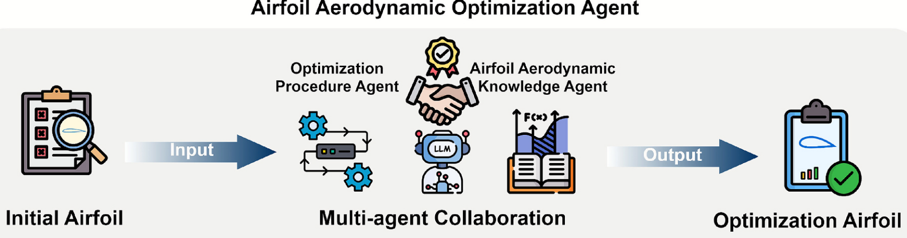

 **图 1.**  翼型气动优化智能体概览。

本研究的主要贡献如下：

1. 据我们所知，本研究首次实现了基于 LLM 的多智能体系统与气动领域专门知识的深度融合，支持智能任务规划和知识驱动决策。
2. 创新性地将传统优化算法重构为多尺度可解释知识体系，建立了融合知识推理与数值计算的新型翼型优化范式。
3. 开发了覆盖任务规划、知识融合和性能反馈的全流程智能迭代框架，显著提高了优化系统的适应性和可靠性。

## 2. 方法

### 2.1. 总体框架架构

经典翼型气动优化任务的系统工作流如图 2 所示。该过程从给定流动条件和目标约束下的初始翼型出发 [34]。首先，采用翼型参数化方法，将复杂的高维翼型几何形状简化为有限个关键几何参数。随后，运用数值仿真技术评估气动性能，判断是否满足预定目标。如果性能未达到要求，则利用优化算法调整几何参数、更新翼型几何形状，并重新评估其性能。在优化目标的引导下反复进行这一循环，直至获得满足预期性能标准的翼型。

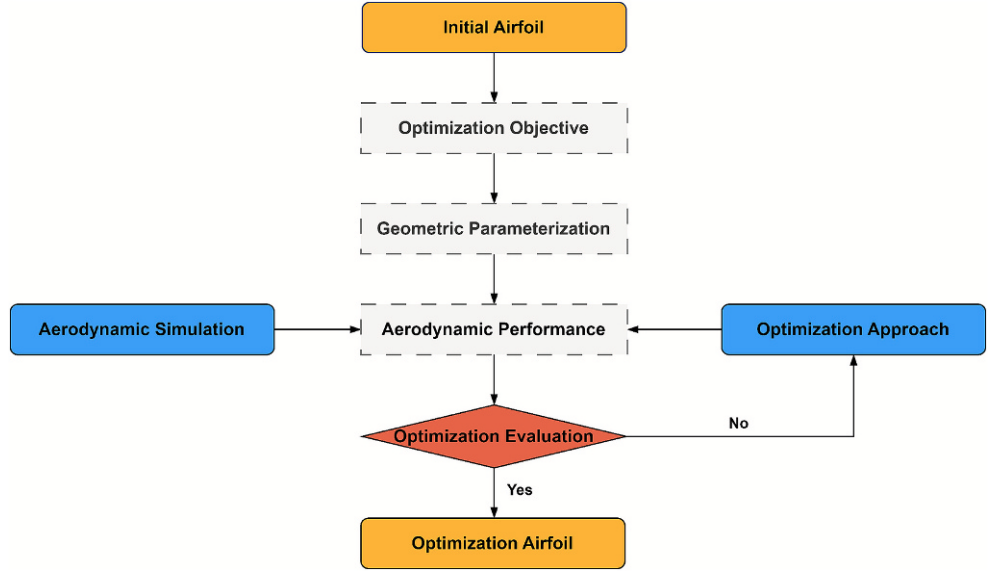

 **图 2.**  翼型气动优化的经典工作流。

基于经典翼型气动优化框架，本文提出一种通过基于 LLM 的多智能体协作框架实现的任务分解方法。总体工作流如图 3 所示，由总体任务规划模块、气动知识融合模块、结果评估与反思模块三个核心模块构成。这些模块协调迭代运行，构建智能、可解释、知识驱动的翼型智能体优化过程。

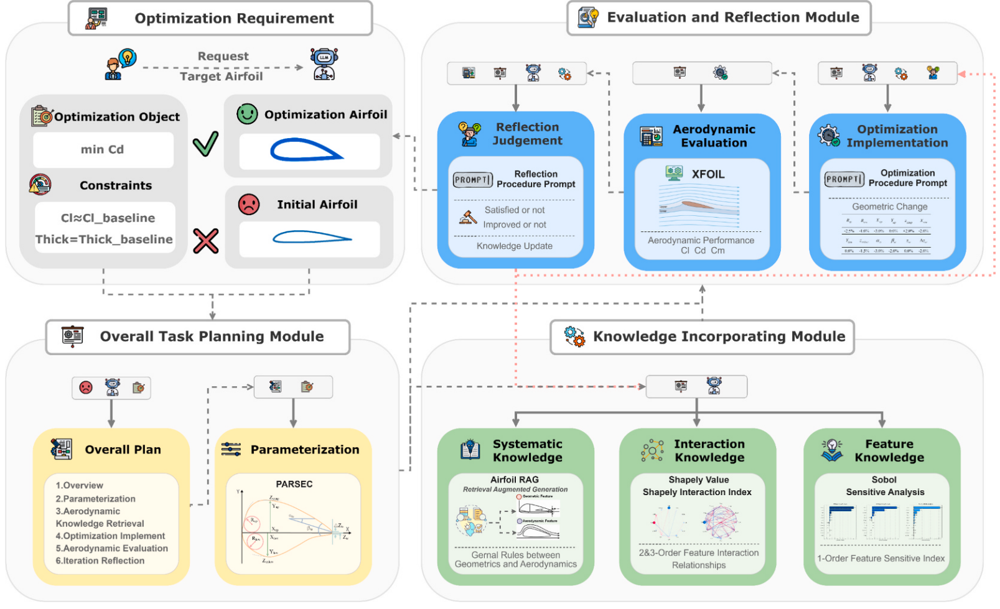

 **图 3.**  AirfoilAgent 框架。

### 2.2. 任务规划模块

#### 2.2.1. 翼型优化任务规划

在 AirfoilAgent 框架中，翼型优化任务规划模块负责将优化目标和约束转化为结构化、可执行的指令，其中也包括由人类专家直接以自然语言指定的目标和约束 [35]。传统气动优化要求工程师手动将需求分解为参数化建模、数值分析、约束评估和迭代改进。AirfoilAgent 用 LLM 驱动的规划机制替代这种人工分解，能够从专家提供的描述中识别、提取并形式化关键需求。所得标准化表示，例如符号表达式或 LaTeX 公式，确保后续智能体和工具链能够正确理解并执行预期优化任务，同时允许专家在启动阶段影响或调整优化方向。

具体而言，翼型优化任务可以抽象为以下带约束的数学规划问题：

$$
\begin{aligned}
\min_{\mathbf{x}}\quad &F(\mathbf{x})=[f_1(\mathbf{x}),f_2(\mathbf{x}),\ldots,f_k(\mathbf{x})]\\
\mathrm{s.t.}\quad &g_i(\mathbf{x})\leq 0,\quad i=1,\ldots,m,\\
&h_j(\mathbf{x})=0,\quad j=1,\ldots,p.
\end{aligned}
\tag{1}
$$

其中，$\mathbf{x}$ 表示参数化翼型变量，$F(\mathbf{x})$ 表示优化目标，例如最大化升阻比或最小化阻力系数；$g_i(\mathbf{x})$ 和 $h_i(\mathbf{x})$ 对应约束，可能包括物理、结构或几何要求。

因此，AirfoilAgent 的总体规划过程可以形式化建模为从自然语言需求 $\mathcal{S}$ 到结构化任务集 $\mathcal{T}$ 的映射：

$$
\mathcal{P}:\mathcal{S}\rightarrow\mathcal{T}=\{t_1,t_2,\ldots,t_n\}.
\tag{2}
$$

其中，$\mathcal{P}$ 表示总体任务规划过程，$\mathcal{T}$ 表示自动分解得到的顺序任务链，包括参数化建模、气动分析、约束验证、性能评估和优化迭代等模块。每个子任务 $t_i$ 可形式化表示为：

$$
t_i=(\mathrm{Input}_i,\mathrm{Output}_i,\mathrm{Tool}_i).
\tag{3}
$$

即每个子任务都明确规定其输入、输出及所需智能体或工具，并根据数据和工作流依赖关系，构建任务依赖有向图 $\mathcal{G}=(\mathcal{T},\mathcal{E})$，其中 $\mathcal{E}$ 表示任务之间的依赖关系。

具体而言，一个典型任务流程可以表示为：

$$
\begin{aligned}
t_1 &: \text{参数化建模与变量初始化}\;(\mathbf{x}_0),\\
t_2 &: \text{气动性能评估}\;(P=\mathcal{A}(\mathbf{x})),\\
t_3 &: \text{约束判断}\;\bigl(\mathrm{Check}(F(\mathbf{x}),g_i(\mathbf{x}),h_j(\mathbf{x}))\bigr),\\
t_4 &: \text{知识引导的优化决策}\;(\mathbf{x}_{k+1}=\mathcal{K}(\mathbf{x}_k,P,g,h)).
\end{aligned}
\tag{4}
$$

其中，$\mathcal{A}$ 表示通用性能评估方法，$\mathcal{K}$ 表示气动知识融合模块。上述任务通过有序依赖关系依次衔接，从而实现由目标分析、工作流分解到多智能体协作和自动调用的全自动优化过程。

#### 2.2.2. 翼型参数化

与经典优化任务不同，AirfoilAgent 系统必须应对 LLM 无法直接理解数值形式翼型坐标文件的挑战。为此，本文采用参数化方法，将高维翼型点云数据简化为可解释的几何参数，使 LLM 能够在文本层面理解翼型的基本特征。翼型参数化方法通常分为多项式拟合方法和解析函数叠加方法两类 [18]，包括多项式函数 [36]、Wagner 函数 [37] 和 Hicks–Henne 函数 [38]。其中，PARSEC 参数化方法尤为适合，因为它能显式表示前缘半径等几何特征，可直接作为 LLM 知识提取的输入。因此，本文采用 PARSEC 表征翼型。

PARSEC 最初由 Helmut Sobieczky 于 20 世纪 90 年代提出，使用 11 个参数描述翼型的关键几何特征。然而，该方法存在一定局限：后缘方向角和后缘楔角较为抽象，难以控制；前缘的表示则仅依赖单个参数，虽对对称翼型有效，但在前缘几何形状更复杂的超临界翼型上容易产生误差。为解决这些问题，本文引入一种改进的 PARSEC 方法，采用 12 个参数更准确地表示翼型几何形状。

改进的 PARSEC 参数化将翼型分解为以下物理参数（图 4）：上表面前缘半径 $R_{\mathrm{up}}$、下表面前缘半径 $R_{\mathrm{low}}$、上表面最大厚度位置 $X_{\mathrm{up}}$、上表面最大厚度 $Y_{\mathrm{up}}$、上表面最大厚度处曲率 $z_{xx\mathrm{up}}$、下表面最大厚度位置 $X_{\mathrm{low}}$、下表面最大厚度 $Y_{\mathrm{low}}$、下表面最大厚度处曲率 $z_{xx\mathrm{low}}$、后缘方向角 $\alpha_{\mathrm{te}}$、后缘楔角 $\beta_{\mathrm{te}}$、后缘高度 $z_{\mathrm{te}}$ 和后缘厚度 $\Delta z_{\mathrm{te}}$。

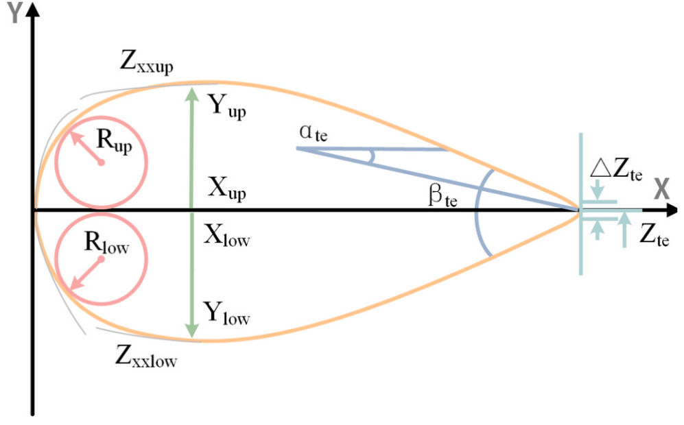

 **图 4.**  PARSEC 参数化方法。

翼型上下表面的多项式表达式可写为：

$$
\begin{aligned}
z_{\mathrm{up}}(x)&=\sum_{i=1}^{6}a_i x^{i-0.5}\\
&=a_1x^{0.5}+a_2x^{1.5}+a_3x^{2.5}+a_4x^{3.5}+a_5x^{4.5}+a_6x^{5.5}.
\end{aligned}
\tag{5}
$$

$$
\begin{aligned}
z_{\mathrm{low}}(x)&=\sum_{i=1}^{6}b_i x^{i-0.5}\\
&=b_1x^{0.5}+b_2x^{1.5}+b_3x^{2.5}+b_4x^{3.5}+b_5x^{4.5}+b_6x^{5.5}.
\end{aligned}
\tag{6}
$$

通过求解由六个线性方程组成的方程组，确定系数 $a_n$ 和 $b_n$：

$$
\begin{aligned}
&\begin{bmatrix}
1&0&0&0&0&0\\[0.4em]
x_{\mathrm{te}}^{0.5}&x_{\mathrm{te}}^{1.5}&x_{\mathrm{te}}^{2.5}&x_{\mathrm{te}}^{3.5}&x_{\mathrm{te}}^{4.5}&x_{\mathrm{te}}^{5.5}\\[0.4em]
x_{\mathrm{up}}^{0.5}&x_{\mathrm{up}}^{1.5}&x_{\mathrm{up}}^{2.5}&x_{\mathrm{up}}^{3.5}&x_{\mathrm{up}}^{4.5}&x_{\mathrm{up}}^{5.5}\\[0.4em]
0.5x_{\mathrm{te}}^{-0.5}&1.5x_{\mathrm{te}}^{0.5}&2.5x_{\mathrm{te}}^{1.5}&3.5x_{\mathrm{te}}^{2.5}&4.5x_{\mathrm{te}}^{3.5}&5.5x_{\mathrm{te}}^{4.5}\\[0.4em]
0.5x_{\mathrm{up}}^{-0.5}&1.5x_{\mathrm{up}}^{0.5}&2.5x_{\mathrm{up}}^{1.5}&3.5x_{\mathrm{up}}^{2.5}&4.5x_{\mathrm{up}}^{3.5}&5.5x_{\mathrm{up}}^{4.5}\\[0.4em]
-0.25x_{\mathrm{up}}^{-1.5}&0.75x_{\mathrm{up}}^{-0.5}&3.75x_{\mathrm{up}}^{0.5}&8.75x_{\mathrm{up}}^{1.5}&15.75x_{\mathrm{up}}^{2.5}&24.75x_{\mathrm{up}}^{3.5}
\end{bmatrix}
\begin{bmatrix}a_1\\[0.4em]a_2\\[0.4em]a_3\\[0.4em]a_4\\[0.4em]a_5\\[0.4em]a_6\end{bmatrix}\\
&\qquad=\begin{bmatrix}
\sqrt{2R_{\mathrm{up}}}\\[0.4em]
z_{\mathrm{te}}+\Delta z_{\mathrm{te}}/2\\[0.4em]
z_{\mathrm{up}}\\[0.4em]
\tan(\alpha_{\mathrm{te}}-\beta_{\mathrm{te}}/2)\\[0.4em]
0\\[0.4em]
z_{xx\mathrm{up}}
\end{bmatrix}.
\end{aligned}
\tag{7}
$$

$$
\begin{aligned}
&\begin{bmatrix}
1&0&0&0&0&0\\[0.4em]
x_{\mathrm{te}}^{0.5}&x_{\mathrm{te}}^{1.5}&x_{\mathrm{te}}^{2.5}&x_{\mathrm{te}}^{3.5}&x_{\mathrm{te}}^{4.5}&x_{\mathrm{te}}^{5.5}\\[0.4em]
x_{\mathrm{low}}^{0.5}&x_{\mathrm{low}}^{1.5}&x_{\mathrm{low}}^{2.5}&x_{\mathrm{low}}^{3.5}&x_{\mathrm{low}}^{4.5}&x_{\mathrm{low}}^{5.5}\\[0.4em]
0.5x_{\mathrm{te}}^{-0.5}&1.5x_{\mathrm{te}}^{0.5}&2.5x_{\mathrm{te}}^{1.5}&3.5x_{\mathrm{te}}^{2.5}&4.5x_{\mathrm{te}}^{3.5}&5.5x_{\mathrm{te}}^{4.5}\\[0.4em]
0.5x_{\mathrm{low}}^{-0.5}&1.5x_{\mathrm{low}}^{0.5}&2.5x_{\mathrm{low}}^{1.5}&3.5x_{\mathrm{low}}^{2.5}&4.5x_{\mathrm{low}}^{3.5}&5.5x_{\mathrm{low}}^{4.5}\\[0.4em]
-0.25x_{\mathrm{low}}^{-1.5}&0.75x_{\mathrm{low}}^{-0.5}&3.75x_{\mathrm{low}}^{0.5}&8.75x_{\mathrm{low}}^{1.5}&15.75x_{\mathrm{low}}^{2.5}&24.75x_{\mathrm{low}}^{3.5}
\end{bmatrix}
\begin{bmatrix}b_1\\[0.4em]b_2\\[0.4em]b_3\\[0.4em]b_4\\[0.4em]b_5\\[0.4em]b_6\end{bmatrix}\\
&\qquad=\begin{bmatrix}
-\sqrt{2R_{\mathrm{low}}}\\[0.4em]
z_{\mathrm{te}}-\Delta z_{\mathrm{te}}/2\\[0.4em]
z_{\mathrm{low}}\\[0.4em]
\tan(\alpha_{\mathrm{te}}+\beta_{\mathrm{te}}/2)\\[0.4em]
0\\[0.4em]
z_{xx\mathrm{low}}
\end{bmatrix}.
\end{aligned}
\tag{8}
$$

通过上述改进的 PARSEC 参数化方法，可获得一组 12 个可解释几何参数，表示为 12 维翼型几何参数向量：

$$
\mathbf{x}=[R_{\mathrm{up}},R_{\mathrm{low}},x_{\mathrm{up}},z_{\mathrm{up}},z_{xx\mathrm{up}},x_{\mathrm{low}},z_{\mathrm{low}},z_{xx\mathrm{low}},\alpha_{\mathrm{te}},\beta_{\mathrm{te}},z_{\mathrm{te}},\Delta z_{\mathrm{te}}].
$$

### 2.3. 气动知识融合模块

#### 2.3.1. 通用系统性知识挖掘方法

在翼型气动优化中，系统性知识发现任务以翼型几何特征和气动特征作为输入和输出。其本质是构建一个将几何特征映射到气动性能的知识库。通过检索该知识库中存储的已有几何—气动关系，可以提取通用系统性知识。如图 5 所示，工作流由三个模块组成：1）构建翼型几何—气动数据库；2）生成几何—气动知识；3）检索翼型知识数据。

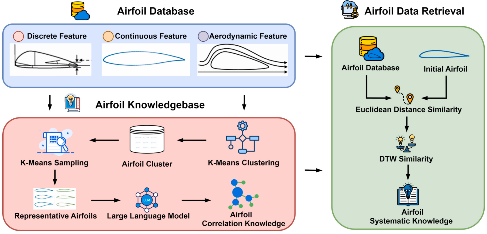

 **图 5.**  通用系统性知识挖掘框架。

数据集中的翼型坐标文件作为知识库中的连续几何特征 [39]，离散几何特征则通过前述参数化方法获得。每个翼型的气动特征包括在不同飞行条件下评估得到的参数：迎角（AoA）、马赫数（Ma）和雷诺数（Re），以及相应的气动系数——升力系数 $C_l$、阻力系数 $C_d$ 和力矩系数 $C_m$。具体而言，迎角从 $-2^\circ$ 变化到 $10^\circ$，步长为 $1^\circ$；马赫数从 0.2 变化到 0.7，步长为 0.1；雷诺数固定为 100,000。随后，在 XFOIL [40] 中处理翼型坐标，计算相应的气动参数。

由于所得数据库规模庞大、样本密度不均，无法直接用于 LLM 推理。为此，在知识挖掘和生成过程中采用 K-means 聚类 [41]，选择 $K_C$ 个代表性翼型。对于数据库中包含 $N$ 个翼型的数据集 $Q_L=\{X_i^L\}$，$i\in[1,N]$，K-means 算法初始化一组聚类中心 $C=\{X_1^c,\ldots,X_k^c\}$，其中 $X_i^c\in Q_L$，$i\in[1,k]$，并将每个翼型 $X_i^L$ 分配到最近的质心，距离度量定义为欧几里得范数：

$$
d=\left\|X_i^L-X_j^c\right\|_2.
\tag{9}
$$

其中，$X_i^L\neq X_j^c$。初始化后，K-means 迭代地将每个质心更新为簇内所有序列的均值，并将每个翼型序列重新分配到最近的质心。这一过程逐步最小化所有点与各自质心之间的距离总和。从每个簇中选择最接近质心的翼型，得到 $K_C$ 个代表性翼型。每个簇中最接近质心的翼型被定义为索引翼型 $C$。然而，仅靠索引翼型不足以涵盖完整的几何—气动关系知识。为丰富其表示，在 $C$ 的每个簇内再次进行 K-means 聚类，形成子簇 $K_R$，并再次选择最接近各子簇质心的翼型作为代表。由此获得 $K_R$ 个代表性翼型作为典型数据样本。将其离散特征和气动性能特征表示为文本，作为 LLM 的输入。LLM 根据这些上下文信息生成几何—气动关系的定性总结，随后将其作为通用系统性知识存入翼型知识库。其中，通用系统性知识的准确性已在 AirfoilRAG [42] 系统中得到验证。

考虑到 LLM 的数值推理能力通常有限，本文通过提示设计显式约束其输出，强调定性规律而非定量预测，以避免产生幻觉性结论。在提示阶段，每个检索到的翼型输入均包括其 12 个几何参数、3 个工况参数和 3 个气动性能参数。随后，LLM 输出对 $K_R$ 个代表性翼型几何—气动关系的总结，将其作为通用系统性知识存入知识库。

因此，最终知识库包含 $K_C$ 个翼型的离散几何特征、连续几何特征、气动性能特征及其对应的几何—气动关系知识。每条知识包括：离散几何特征向量 $\mathbf{x}^{(i)}\in\mathbb{R}^{12}$、连续轮廓参数 $\mathbf{z}^{(i)}\in\mathbb{R}^{L}$、气动工况 $\mathbf{c}^{(i)}=[\alpha^{(i)},M^{(i)},\mathrm{Re}^{(i)}]\in\mathbb{R}^{3}$、气动性能响应 $\mathbf{y}^{(i)}=[C_l^{(i)},C_d^{(i)},C_m^{(i)}]\in\mathbb{R}^{3}$，以及 LLM 生成的关系知识 $\mathcal{T}^{(i)}$。形式上，知识库可表示为：

$$
\mathcal{D}_{\mathrm{KB}}=\left\{\left(\mathbf{x}^{(i)},\mathbf{z}^{(i)},\mathbf{c}^{(i)},\mathbf{y}^{(i)},\mathcal{T}^{(i)}\right)\right\}_{i=1}^{K_C}.
\tag{10}
$$

在翼型知识数据检索阶段，首先通过给定输入翼型的几何特征以及连续、离散参数对其进行表征，以获取相应的几何—气动关联通用系统性知识。连续几何特征尤其适于反映两个翼型之间的相似性。本文采用动态时间规整（DTW）方法 [43] 衡量这种相似性；该方法广泛用于曲线相似性分析。对于给定的输入翼型序列 $Z_p$（$Z_p\in\mathbb{R}^n$），DTW 针对翼型序列 $Z_L$ 构建一个 $n\times L$ 的代价矩阵，其中每个元素 $(i,j)$ 表示 $Z_p$ 中第 $i$ 个点 $Z_i$（记作 $Z_i^p$）与 $Z_L$ 中第 $j$ 个点 $Z_j^L$ 之间的距离 $d(i,j)$。该距离可计算为：

$$
d(i,j)=\left(Z_i^p,Z_j^L\right)^2.
\tag{11}
$$

> 译注：式（11）中两个序列元素之间的逗号按原文照录。

定义从元素 $(1,1)$ 到 $(n,L)$ 的一条路径为 $W$，由一系列相邻且不重复的矩阵元素组成。$W$ 中的第 $m$ 个元素记为 $w_m=d(m_i,m_j)$，并按照式（11）定义。$W$ 表示为：

$$
W=w_1,\ldots,w_m,\ldots,w_M.
\tag{12}
$$

其中，$\max(n,L)\leq M\leq n+L$，且 $w_M=d(n,L)$。

DTW 利用动态规划确定代价最小的最优路径。序列 $Z_{\mathrm{input}}$ 与 $Z_L$ 之间相应的相似性为：

$$
\mathrm{Simi}_{\mathrm{DTW}}=\min\frac{\sqrt{\displaystyle\sum_{m=1}^{M}w_m}}{M}.
\tag{13}
$$

然而，在实际翼型相似性计算中，DTW 需要计算两个翼型之间逐点对应的距离，计算复杂度较高。为提高效率，本文在检索阶段引入离散几何知识。由于翼型的 12 个离散几何特征尺度不同，量纲差异可能使某些特征主导相似性计算。为此，对特征进行归一化：

$$
\begin{aligned}
a_i'&=\frac{a_i-\min(a_i)}{\max(a_i)-\min(a_i)},\\
b_i'&=\frac{b_i-\min(b_i)}{\max(b_i)-\min(b_i)}.
\end{aligned}
\tag{14}
$$

其中，$a_i$ 和 $b_i$ 分别表示翼型 $Z_p$ 和 $Z_L$ 第 $i$ 个几何特征的值，$\min(a_i)$ 和 $\max(a_i)$ 分别表示该特征在整个数据集中的最小值和最大值。

随后，根据各归一化离散特征，使用欧几里得距离 [44] 衡量两个翼型之间的相似性：

$$
\mathrm{Simi}_{\mathrm{par}}=\sqrt{\sum_{i=1}^{12}(a_i'-b_i')^2}.
\tag{15}
$$

基于上述相似性度量，检索过程首先执行离散特征相似性搜索，从数据库 $\mathcal{D}_{\mathrm{KB}}$ 中生成包含最相似的前 $m_{\mathrm{par}}$ 个翼型的候选列表 $M_{\mathrm{par}}$。随后，在这 $m_{\mathrm{par}}$ 个候选中进行连续特征相似性搜索，确定最相似的翼型 $M_{\mathrm{dtw}}$。将 $M_{\mathrm{dtw}}$ 对应的几何—气动关系知识定义为通用系统性知识 $\mathcal{T}^{(p)}$，供后续优化过程使用。

#### 2.3.2. 特征交互知识挖掘

翼型的气动性能不仅受到单个几何特征的影响，也受到多个特征之间复杂交互的影响。因此，仅考虑各特征对气动响应的边际贡献，不足以完整刻画结构—性能关系。为此，本文基于机器学习方法构建解释模型 [45]，并引入 Shapley 交互指数（SII）[46]。这一基于交互的框架，量化不同阶数特征组合在共同贡献于气动性能时产生的协同或冗余效应。随后，将所得可解释特征耦合知识作为输入提供给 LLM，使其能够生成具有知识依据的气动优化建议。

Shapley 交互指数将经典 Shapley 值 [47] 从单个特征扩展到特征组合。设 $N=\{1,2,\ldots,n\}$ 表示完整特征集，$S\subseteq N$ 为任意特征子集。定义模型输出函数 $\nu:2^N\rightarrow\mathbb{R}$，将任意特征子集映射到其相应的输出值。随后，将特征子集 $S$ 在背景子集 $T\subseteq N\setminus S$ 下的离散导数定义为：

$$
\Delta_S(T)=\sum_{L\subseteq S}(-1)^{|S|-|L|}\nu(T\cup L).
\tag{16}
$$

这一表达式从联合边际贡献中消除所有低阶子集的影响，分离出 $S$ 的纯交互效应。本文关注二阶和三阶特征交互。对于二阶交互，离散导数简化为：

$$
\Delta_{\{i,j\}}(T)=\nu(T\cup\{i,j\})-\nu(T\cup\{i\})-\nu(T\cup\{j\})+\nu(T).
\tag{17}
$$

在此基础上，对所有可能的背景特征子集 $T\subseteq N\setminus S$ 求和，并根据各项的相对贡献赋予权重，得到 Shapley 交互指数，即子集 $S$ 的全局交互贡献 $\phi(S)$：

$$
\phi(S)=\sum_{T\subseteq N\setminus S}p(|S|,|T|,n)\cdot\Delta_S(T).
\tag{18}
$$

其中，权重函数 $p(|S|,|T|,n)$ 通常采用 k-Shapley 交互指数（k-SII）[48] 所定义的对称概率分布：

$$
p(|S|,|T|,n)=\frac{1}{(n-|S|+1)\binom{n-|S|}{|T|}}.
\tag{19}
$$

通过设定最大交互阶数 $k$，可以计算最高至 $k$ 阶的所有交互组合的贡献。本文考虑 12 个几何特征和 3 个气动性能特征，而更高阶交互往往会向 LLM 引入冗余信息。因此，将分析限制为二阶（$|S|=2$）和三阶（$|S|=3$）交互贡献。选择升力系数、阻力系数和力矩系数作为目标变量，并构建相应的映射模型 $f:\mathbb{R}^{12}\rightarrow\mathbb{R}$。利用机器学习方法估计各特征组合的交互贡献 $\phi(S)$。对于每个目标函数，提取交互贡献绝对值最大的前三个特征组合作为具有代表性的高阶耦合知识。

二阶交互组合集合记为：

$$
\mathcal{C}_{Cl}^{(2)}=\left\{S\subseteq N\;\middle|\;|S|=2,\ \text{按 }|\phi_{Cl}(S)|\text{ 取前三个}\right\}.
\tag{20}
$$

三阶交互组合集合记为：

$$
\mathcal{C}_{Cl}^{(3)}=\left\{S\subseteq N\;\middle|\;|S|=3,\ \text{按 }|\phi_{Cl}(S)|\text{ 取前三个}\right\}.
\tag{21}
$$

对于阻力系数和力矩系数，采用相同方式构建交互组合集合 $\mathcal{C}_{Cd}^{(2)}$、$\mathcal{C}_{Cd}^{(3)}$、$\mathcal{C}_{Cm}^{(2)}$、$\mathcal{C}_{Cm}^{(3)}$，分别选择交互作用最强的前三个组合作为代表。所得特征耦合效应知识形式化定义为：

$$
\mathcal{C}^{(p)}=\left\{\mathcal{C}_{Cl}^{(2)},\mathcal{C}_{Cl}^{(3)},\mathcal{C}_{Cd}^{(2)},\mathcal{C}_{Cd}^{(3)},\mathcal{C}_{Cm}^{(2)},\mathcal{C}_{Cm}^{(3)}\right\}.
\tag{22}
$$

#### 2.3.3. 特征主导效应知识挖掘

在翼型气动优化中，不同几何特征对特定气动性能指标，例如升力系数、阻力系数或力矩系数，具有程度不同的主导影响 [49]。为量化这些主导效应，本文采用源于蒙特卡洛积分方法的 Sobol 灵敏度分析框架 [50]，从全局角度系统评估各几何特征对气动输出的贡献。

Sobol 灵敏度分析以方差分析原理为基础，将目标函数输出的总体变异分解为各输入变量独立效应及其交互作用所贡献的分量。设目标函数 $f(\mathbf{x})$ 的输入为 $\mathbf{x}=(x_1,x_2,\ldots,x_D)\in\mathbb{R}^{D}$，输出为单个气动性能指标 $y\in\mathbb{R}$。该函数可展开为：

$$
f(\mathbf{x})=f_0+\sum_{i=1}^{D}f_i(x_i)+\sum_{i<j}f_{ij}(x_i,x_j)+\cdots+f_{1,2,\ldots,D}(x_1,\ldots,x_D).
\tag{23}
$$

假设输入变量彼此独立，则上述表达式两侧的方差可写为：

$$
\operatorname{Var}(f(\mathbf{x}))=\sum_{i=1}^{D}V_i+\sum_{i<j}V_{ij}+\cdots+V_{1,2,\ldots,D}.
\tag{24}
$$

其中，$V_i=\operatorname{Var}_{x_i}\!\left(\mathbb{E}_{x_i i}[f(\mathbf{x})\mid x_i]\right)$ 表示变量 $x_i$ 的一阶效应，即其自身变化对输出方差的贡献。随后，一阶 Sobol 指数定义为：

$$
S_i=\frac{V_i}{\operatorname{Var}(f(\mathbf{x}))}.
\tag{25}
$$

一阶 Sobol 指数反映各输入变量对输出响应不确定性的主导影响，不考虑其与其他变量之间的交互作用。

本文分别针对升力系数、阻力系数和力矩系数，计算 12 个几何参数的一阶 Sobol 灵敏度指数。参数范围由实际翼型样本的特征取值域确定。所得灵敏度值表示为一维向量：

$$
\mathcal{S}^{(p)}=\left\{\mathcal{S}^{Cl},\mathcal{S}^{Cd},\mathcal{S}^{Cm}\in\mathbb{R}^{12}\right\}.
\tag{26}
$$

其中，每个分量 $S_i\in[0,1]$ 量化对应几何特征 $x_i$ 对给定气动响应指标的主导程度。该特征主导效应权重向量 $\mathcal{S}^{(p)}$ 作为定量知识输入，使 LLM 能够在优化中识别关键几何控制参数，从而提高针对性调节的精度和参数调整效率。

### 2.4. 优化结果评估与反思模块

在 AirfoilAgent 智能优化过程中，结果评估与反思模块是实现闭环优化和动态知识更新的核心组成部分 [51]。它包含优化实施、气动评估和反思判断三个子模块，分别负责生成优化建议、评估性能反馈，以及自适应调整优化过程。

优化实施子模块将优化目标和约束，与气动知识融合模块得到的三类知识相结合，即通用系统性知识、特征交互效应知识和特征主导效应知识。将这些信息连同翼型当前的几何与气动状态一并输入 LLM，生成明确指定各几何参数调整方向和幅度的优化建议。形式上，设 $\mathbf{x}$ 为 12 维翼型几何参数向量，第 $i$ 维的调整幅度 $\Delta x_i$ 满足：

$$
|\Delta x_i|\leq\alpha|x_i|.
\tag{27}
$$

其中，$\alpha$ 表示最大调整影响因子，例如 10% 或 5%。因此，优化建议可表示为：

$$
\mathbf{x}_N=\mathbf{x}+\Delta\mathbf{x}.
\tag{28}
$$

调整方向和幅度由 LLM 显式融合第 2.3 节介绍的三类可解释知识后综合确定。通用系统性知识 $\mathcal{T}^{(p)}$ 提供通过检索增强生成提取的定性几何—气动规律；特征交互知识 $\mathcal{C}^{(p)}$ 提供由基于 Shapley 的可解释性框架得到的定量二阶和三阶交互效应；特征主导效应知识 $\mathcal{S}^{(p)}$ 则编码 Sobol 灵敏度权重，反映驱动气动响应的主要几何因素。融合这三类可解释知识后，LLM 生成优化建议：

$$
\Delta x_i=F\!\left(\mathcal{T}^{(p)},\mathcal{C}^{(p)},\mathcal{S}^{(p)}\right)_i.
\tag{29}
$$

其中，$F(\cdot)$ 表示 LLM 融合三类知识后生成的综合优化建议。

随后，气动评估子模块使用 XFOIL 工具，对优化后的翼型进行气动仿真，获取升力系数、阻力系数和力矩系数及其相应变化量。

反思判断子模块是该模块的核心，其主要功能包括多层级目标判定、性能对比分析、基于归因的解释，以及动态知识细化。每轮优化迭代后，系统首先对比优化前后的气动性能参数及其相对变化，判断是否满足预定优化目标和约束。判定结果表示为布尔变量。如果更新后的结果满足目标，系统则进一步将当前性能与历史最优结果比较，评估是否实现了相对性能改进。该比较依赖气动参数变化率指标，判断全局最优结果是否得到更新。

除生成下一轮优化建议外，反思判断子模块还执行归因驱动的知识细化，从而增强可解释性。根据预测气动响应与实际观测之间的差异，系统有选择地调整通用系统性知识，重新赋权源于 Sobol 分析的主导效应灵敏度，并更新基于 Shapley 的交互关系。由此，反思构成一种可解释、以知识为依据的更新机制，将次优结果归因于可识别的几何或气动原因，而非仅作启发式修正。这种知识更新可形式化表示为：

$$
\mathcal{K}^{(p)\prime}=\operatorname{Refine}\!\left(\mathcal{K}^{(p)},\Delta\mathbf{x},\Delta\mathbf{a},\Phi\right).
\tag{30}
$$

其中，$\mathcal{K}^{(p)\prime}$ 表示通过反思细化后的知识关系，$\Delta\mathbf{a}$ 表示气动性能变化，$\Phi$ 提供对不理想优化结果的基于归因的解释。

综上，结果评估与反思模块建立了“优化 → 评估 → 反思”的三步闭环，使系统能够实现自适应调整和知识的动态自我更新。这一结构不仅确保了翼型优化的高效自动化，还增强了整个优化过程的可解释性和稳健性。

## 3. 实验

### 3.1. 实验设置

根据翼型气动设计优化的一般要求，本文在迎角为 $2.0^\circ$、马赫数为 0.6、雷诺数为 1,000,000 的流动条件下，开展定升力减阻优化。优化过程中约束翼型最大厚度保持不变，并且目标是最大化升阻比。相应的数学模型可表示为：

$$
\begin{aligned}
\min\;& C_d\\
\text{s.t.}\;&\begin{cases}
C_l\approx C_{l,\mathrm{Baseline}},\\
\mathrm{Thick}=\mathrm{Thick}_{\mathrm{Baseline}}.
\end{cases}
\end{aligned}
\tag{31}
$$

本研究使用的翼型数据来自 AFBench [39] 的超临界翼型子集，其中包含 10,000 个翼型坐标文件。我们从中随机选择 9,000 个翼型构建翼型数据库。在用于提取通用系统性知识的检索增强生成过程中，通过将 K-means 算法的聚类数设置为 $K_C=500$，将知识条目数量缩减至 500 条。原始数据集中剩余的 1,000 个翼型作为优化测试案例。

AirfoilAgent 优化实验在配备 Intel(R) Xeon(R) Gold 6348 CPU @ 2.60 GHz 和 48 GB 内存的计算平台上开展。基于此前在工程应用与智能体开发中使用大语言模型的经验，本研究采用 Claude-3.7 [52] 作为基础支撑平台，在气动优化工作流的任务规划、知识整合，以及结果评估与反思等关键阶段实现高效的智能协作。

### 3.2. 主要结果

#### 3.2.1. 优化性能比较

基于上述实验设置，我们使用 AirfoilAgent 开展优化实验，并与经典遗传算法（GA）优化方法 [53] 进行比较。在 GA 实验中，翼型的 12 个几何参数允许在 ±20% 的扰动范围内变化。种群规模设置为 50，进化代数为 100。每一代保留 5 个精英个体，不对其进行交叉或变异。遗传算子包括概率为 0.7 的两点交叉，以及均值为 0、标准差为 0.1 的高斯变异；变异概率为 0.2。

总体气动优化结果汇总于表 1 和图 6。在优化结果的箱线分布图中，每个箱体表示相应模型在某一性能指标上的结果分布。箱体下缘和上缘分别对应第一四分位数（Q1）与第三四分位数（Q3）。Q1（第 25 百分位数）表示有 25% 的数据低于该值，Q3（第 75 百分位数）表示有 75% 的数据低于该值。箱体内部的横线表示中位数（Q2），即第 50 百分位数。须线延伸至正常范围内的最小值和最大值，该范围通常定义为 $Q1-1.5\times\mathrm{IQR}$ 至 $Q3+1.5\times\mathrm{IQR}$，其中 IQR 为四分位距。超出该范围的数据点被视为离群值，并在图中用圆圈表示，对应极端的优化结果。

实验结果表明，AirfoilAgent 在三个关键气动指标上均持续优于 GA。对于升力系数，AirfoilAgent 在所有样本上均实现提升，平均增幅为 4.28%，最大增幅为 19.34%。相比之下，GA 的结果既有改善，也有退化，反映出其优化稳定性有限。对于阻力系数，AirfoilAgent 的平均降幅为 13.65%，远高于 GA 的 6.44%；AirfoilAgent 的最大减阻幅度达到 40.35%，而 GA 为 27.03%。此外，AirfoilAgent 的结果分布集中于负值区间，避免了部分 GA 案例中出现的 $C_d$ 上升，体现出更稳定的减阻能力。对于升阻比，AirfoilAgent 的平均增幅达到 20.84%，接近 GA 的两倍，最大增幅为 97.48%。GA 在最差情况下使升阻比下降了 8.39%，而 AirfoilAgent 始终能够提高升阻比；若干案例的提升幅度十分显著，数据点远超 GA 的上限范围。总体而言，这些结果表明，依托知识驱动推理与多智能体策略，AirfoilAgent 在气动性能提升和优化稳定性方面均具有明显优势。

原则上，在单点优化设置下，GA 可以收敛至最优解。然而，在相同设计空间、约束条件与计算资源下，其收敛表现存在明显波动。相比之下，AirfoilAgent 通过整合结构化知识与智能体策略，表现出更强的稳定性与可靠性，显示出其在实际工程应用中的更大潜力。

 **表 1：**  气动性能变化的总体统计比较。

| 方法 | $\Delta C_l$ 最大值（%） | $\Delta C_l$ 最小值（%） | $\Delta C_l$ 平均值（%） | $\Delta C_d$ 最大值（%） | $\Delta C_d$ 最小值（%） | $\Delta C_d$ 平均值（%） | $\Delta(C_l/C_d)$ 最大值（%） | $\Delta(C_l/C_d)$ 最小值（%） | $\Delta(C_l/C_d)$ 平均值（%） |
| --- | ---: | ---: | ---: | ---: | ---: | ---: | ---: | ---: | ---: |
| GA | +7.76 | −3.04 | +2.75 | +8.67 | −27.03 | −6.44 | +43.69 | −8.39 | +10.25 |
| AirfoilAgent | +19.34 | +0.44 | +4.28 | −4.37 | −40.35 | −13.65 | +97.48 | +4.69 | +20.84 |

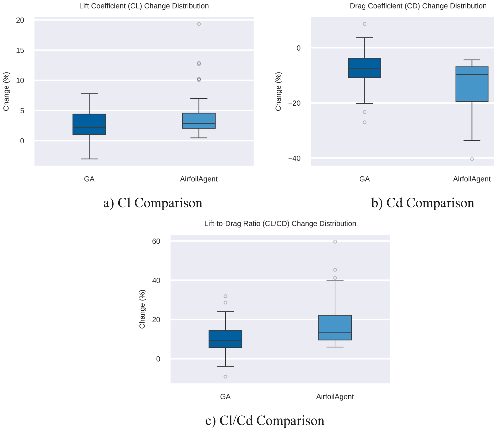

 **图 6：**  气动性能变化的分布比较。（a）升力系数 $C_l$ 比较；（b）阻力系数 $C_d$ 比较；（c）升阻比 $C_l/C_d$ 比较。

为更清晰地展示 AirfoilAgent 的迭代优化轨迹，图 7 将五次优化迭代中升力系数、阻力系数与升阻比分布的演变进行了可视化，并用虚线趋势表示各次迭代的平均值。这种展示方式同时呈现了多智能体系统在优化过程中所实现气动性能改善的集中趋势与变异程度。

如表 2 和图 7（a）所示，由于施加了升力变化约束，升力系数在各次迭代中保持相对稳定。大多数样本呈现小幅正向变化，$C_l$ 的平均波动保持在 +2.4% 至 +3.9% 之间。图 7（b）展示了阻力系数降幅的演变。五次迭代均持续达到减阻目标，其中首次迭代的改善幅度最大，平均为 −9.08%；后续迭代的收益逐渐减小，但仍保持每次约 1% 的有效改善。升阻比的演变见图 7（c）。首次迭代同样带来最显著的提升，平均为 +15.03%，之后稳步增长，在第五次迭代达到 +20.14%。

综上，AirfoilAgent 通过知识驱动机制，在保持升力稳定的同时有效实现了减阻和升阻比提升。首次迭代中的显著改善尤其凸显了系统性知识对初始优化方向的引导作用。尽管后续迭代的性能增益逐渐减弱，持续的增量改善仍表明该框架具有较强的泛化能力与鲁棒性。

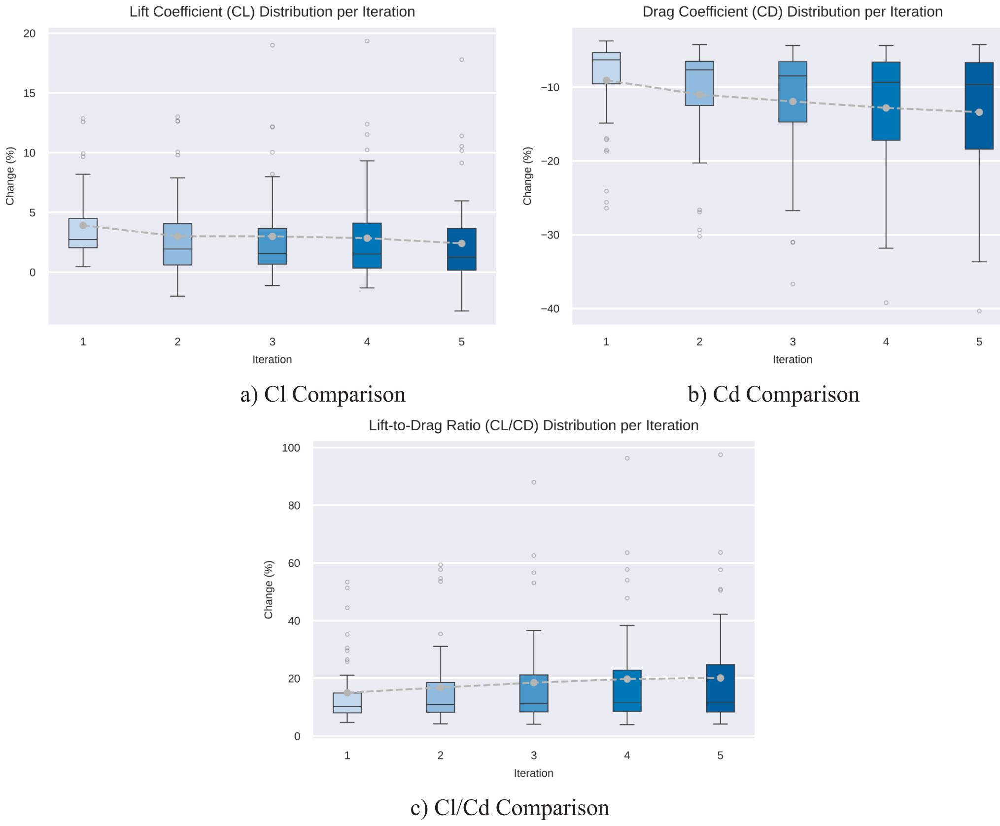

 **图 7：**  AirfoilAgent 五次迭代中气动性能参数的总体变化。（a）升力系数 $C_l$ 比较；（b）阻力系数 $C_d$ 比较；（c）升阻比 $C_l/C_d$ 比较。

 **表 2：**  迭代优化过程中气动性能变化的统计比较。

| 迭代次数 | $\Delta C_l$ 最大值（%） | $\Delta C_l$ 最小值（%） | $\Delta C_l$ 平均值（%） | $\Delta C_d$ 最大值（%） | $\Delta C_d$ 最小值（%） | $\Delta C_d$ 平均值（%） | $\Delta(C_l/C_d)$ 最大值（%） | $\Delta(C_l/C_d)$ 最小值（%） | $\Delta(C_l/C_d)$ 平均值（%） |
| --- | ---: | ---: | ---: | ---: | ---: | ---: | ---: | ---: | ---: |
| 1 | +12.86 | +0.44 | +3.91 | −3.77 | −26.42 | −9.08 | +53.38 | +4.69 | +15.03 |
| 2 | +13.01 | −2.02 | +2.99 | −4.27 | −30.21 | −11.01 | +59.41 | +4.18 | +16.81 |
| 3 | +19.01 | −1.13 | +2.99 | −4.37 | −36.69 | −11.96 | +87.97 | +4.07 | +18.48 |
| 4 | +19.34 | −1.33 | +2.84 | −4.37 | −39.21 | −12.82 | +96.31 | +3.92 | +19.75 |
| 5 | +17.80 | −3.26 | +2.40 | −4.27 | −40.35 | −13.40 | +97.48 | +4.16 | +20.14 |
| 最优结果的均值 | — | — | +4.28 | — | — | −13.65 | — | — | +20.84 |

#### 3.2.2. 优化几何参数比较

表 3 和图 8 展示了优化前后 12 个几何参数的总体平均变化。由于施加了约束，上、下表面的最大厚度保持不变，证实两种方法都满足设计要求。AirfoilAgent 通常通过减小参数值实现增升与减阻，但变化幅度相对较小。对于大多数样本，参数变化的方向与范围也更加集中。这可以归因于本研究的优化对象是超临界翼型，这些翼型具有内在的几何—气动相关性。大语言模型成功捕捉到这些潜在规律，从而能够推荐一致的调整方向与幅度。相比之下，GA 的变化模式较为分散，参数变化缺乏系统性，有些增大，有些减小，体现出一定的随机性。依托知识整合机制与任务规划能力，AirfoilAgent 在优化过程中表现出更强的适应性。其策略具有更高的系统性与一致性，大多数参数遵循稳定的优化趋势。这种对特征空间的整体理解不仅提升了优化效率，也增强了结果的可解释性。

图 9 汇总了 12 个几何特征参数在五次优化迭代中的演变。这些轨迹揭示出知识引导优化过程所形成的一组一致、可解释的结构性模式。与上、下表面最大厚度位置相关的几何变量几乎保持不变，反映了所施加的位置约束。在未受约束的特征中，上表面最大厚度是唯一在各次迭代中持续增加的参数，表明在升力变化约束下，智能体倾向于增厚上表面轮廓以维持升力稳定。

其余大多数几何参数呈逐渐下降趋势，但敏感性与变化幅度存在明显差异。与下表面厚度分布和中弦区曲率相关的参数变化较小，说明在所选工况下，其气动影响相对次要。相比之下，后缘方向角与后缘厚度在首次迭代中调整幅度最大，并在后续各次迭代中继续呈现较大变化。这表明优化智能体能够迅速利用后缘几何对气动性能的强作用，尤其是其对压力恢复与整体减阻的影响，随后再通过较小的修正更新对这些特征进行精细调整。

 **表 3：**  几何参数总体平均变化的统计比较。

| 几何参数 | GA | AirfoilAgent |
| --- | ---: | ---: |
| $R_{\mathrm{up}}$ | −2.58% | −18.47% |
| $R_{\mathrm{low}}$ | −0.54% | −13.69% |
| $X_{\mathrm{up}}$ | −1.04% | −13.29% |
| $Y_{\mathrm{up}}$ | 0.00% | 0.00% |
| $z_{xx\mathrm{up}}$ | −0.08% | −13.29% |
| $X_{\mathrm{low}}$ | +0.85% | −10.53% |
| $Y_{\mathrm{low}}$ | 0.00% | 0.00% |
| $z_{xx\mathrm{low}}$ | −0.86% | −11.90% |
| $\alpha_{\mathrm{te}}$ | −0.76% | −18.89% |
| $\beta_{\mathrm{te}}$ | −0.12% | −18.90% |
| $z_{\mathrm{te}}$ | +0.84% | −16.33% |
| $\Delta z_{\mathrm{te}}$ | −0.06% | −20.57% |

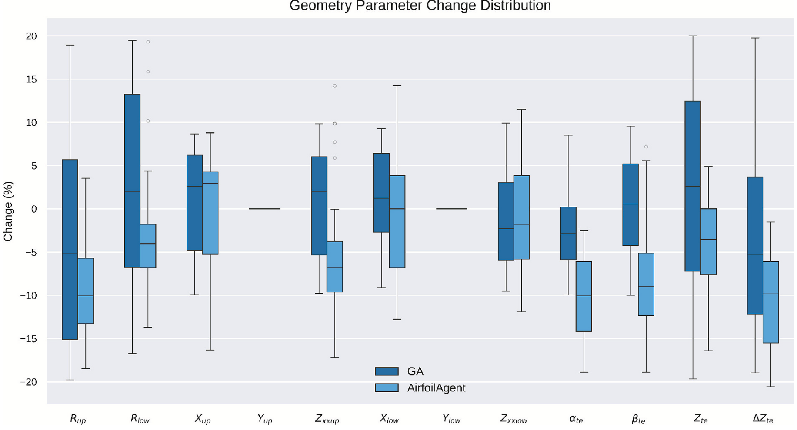

 **图 8：**  几何参数总体变化的分布比较。

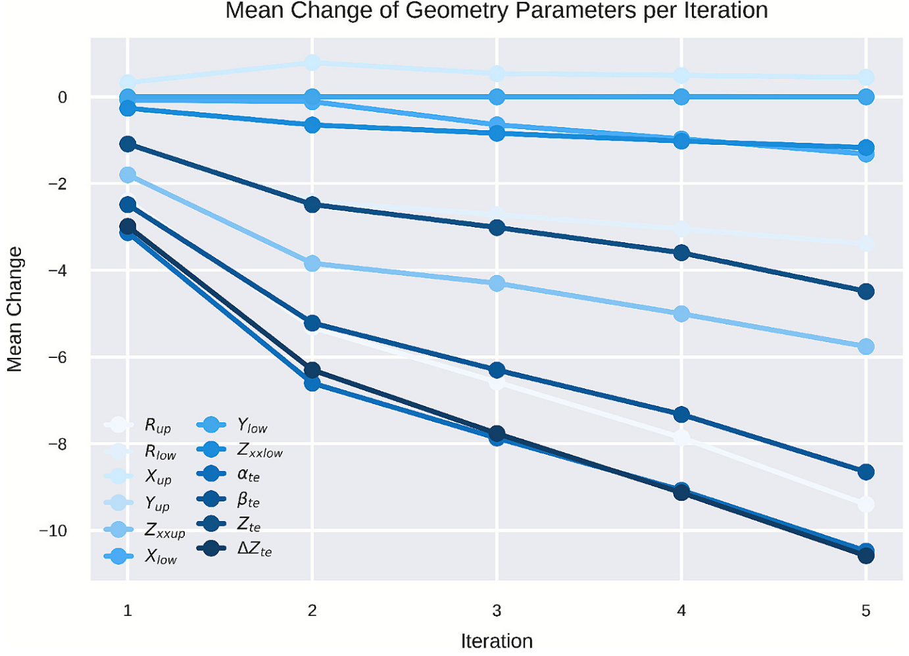

 **图 9：**  AirfoilAgent 各次迭代中几何参数的平均变化。

#### 3.2.3. 优化资源比较

为评价优化方法的计算效率，表 4 和图 10 比较了 AirfoilAgent 与 GA 的时间消耗。对于 AirfoilAgent，报告的时间仅对应五次在线优化迭代，不包括构建离线气动知识库所需的时间；知识库构建是一次性过程，可在不同任务间复用。相比之下，GA 的时间消耗反映了其基于种群的结构。在每一代中，GA 必须评估一整组候选翼型，而每个个体都需要单独进行气动计算。由于 GA 是通过种群进化而非单个设计进行优化，其每代成本随个体数量增加。这种重复计算使总运行时间高度一致，表现为集中在约 101 s 附近的分布。尽管 AirfoilAgent 需要顺序进行五轮优化，其平均运行时间仍较短，约为 89 s，因为每次迭代仅更新并评估一个翼型。不过，其运行时间分布更宽。这是由于反思机制会在优化轨迹出现停滞或相互冲突的气动信号时激活。在这些情况下，智能体生成更长的推理序列，使某些迭代中的大语言模型推理时间增加，从而形成更分散的箱线图分布。

 **表 4：**  时间消耗的总体统计比较。

| 方法 | 最长时间（s） | 最短时间（s） | 平均时间（s） |
| --- | ---: | ---: | ---: |
| GA | 101.09 | 100.87 | 100.98 |
| AirfoilAgent | 126.42 | 55.82 | 89.22 |

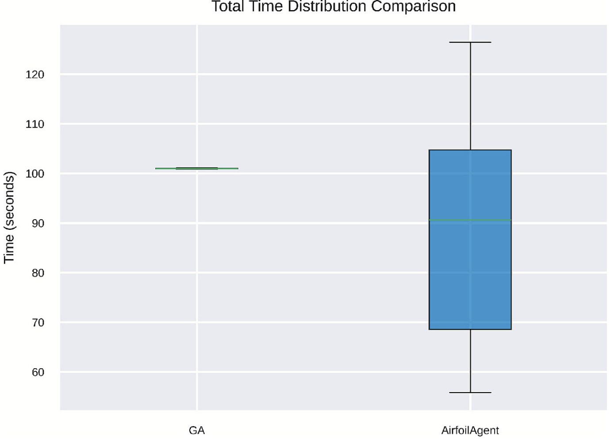

 **图 10：**  时间消耗的分布比较。

为更清晰地评估 AirfoilAgent 所需的计算资源，图 11 和表 5 报告了五次优化迭代中的词元消耗。总体而言，输入词元用量显著高于输出词元用量。这种不对称性源于优化流程的结构：每次迭代都要求智能体处理较长且信息丰富的提示，其中包含当前翼型几何、气动系数、此前迭代的上下文，以及完整的优化约束。相比之下，智能体的输出主要由简洁的修改指令组成，通常指定需要调整哪些几何特征以及调整幅度，因此在常规优化轮次中，输出词元数量相对较少。大约从第 3 次迭代开始，输出词元消耗明显增加。这一增长由反思机制的激活所驱动：当优化轨迹出现停滞或不一致迹象时，反思机制介入。在此情况下，智能体生成更长的推理序列，重新评估此前决策，分析预测与实际观测的气动响应之间的差异，并完善用于指导后续调整的知识。这些反思性解释自然需要更多文本，因而使后续迭代的输出词元用量增加。

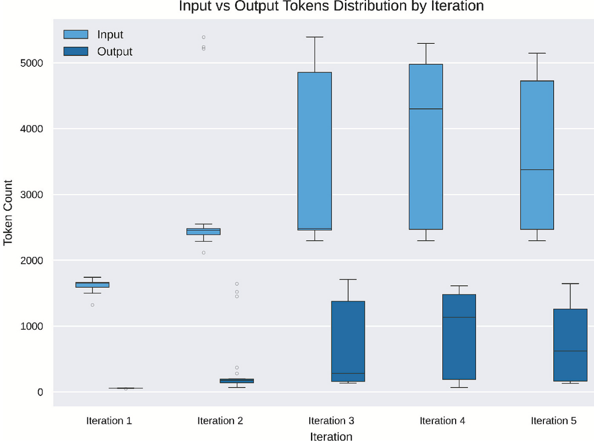

 **图 11：**  AirfoilAgent 五次迭代中的词元消耗。

 **表 5：**  迭代优化过程中词元消耗的统计比较。

| 迭代次数 | 输入最大值 | 输入最小值 | 输入平均值 | 输出最大值 | 输出最小值 | 输出平均值 |
| --- | ---: | ---: | ---: | ---: | ---: | ---: |
| 1 | 1740 | 1320 | 1620.86 | 60 | 47 | 56.09 |
| 2 | 5389 | 2115 | 2807.14 | 1642 | 66 | 358.05 |
| 3 | 5393 | 2295 | 2569.09 | 1708 | 133 | 743.36 |
| 4 | 5291 | 2295 | 3775.50 | 1611 | 67 | 847.14 |
| 5 | 5144 | 2295 | 3607.32 | 1645 | 130 | 742.09 |
| 总计 | 22,048 | 10,673 | 15379.91 | 5881 | 595 | 2746.73 |

AirfoilAgent 的结果表明，对所研究翼型的优化不仅带来了显著的性能增益，还具有较强的可解释性与可信性。在五次迭代优化过程中，几何参数的动态变化与既有气动设计原理高度一致，在维持整体升力稳定的同时提高了升阻比。AirfoilAgent 利用检索增强生成所获得的通用系统性知识引导优化方向，有效缓解了大语言模型直接进行数值推理时常见的幻觉风险。因此，参数调整既合理，又具有物理可解释性，在优化结果与底层几何—气动耦合机制之间建立了清晰的因果联系。这种知识驱动、基于智能体协作的框架，为大语言模型在飞机翼型气动设计中的可信应用提供了有力支撑。

### 3.3. 消融研究

为评估 AirfoilAgent 框架对先验知识与大语言模型的依赖，我们针对不同大语言模型和不同知识融合尺度开展了广泛的消融实验。通过系统比较不同模块组合对优化性能的影响，定量评估各组成部分的具体贡献。

#### 3.3.1. 不同大语言模型的影响

如表 6 和图 12 所示，消融实验比较了不同大语言模型在翼型优化过程中的表现。评估同时涵盖中文模型与英文模型：中文大语言模型包括 Qwen-max [54] 和 DeepSeek-v3 [55]，英文大语言模型包括 GPT-4 [56] 和 Claude-3.7 [52]，其中 Claude 是本研究采用的主要模型。为保证实验公平性，我们对所有大语言模型采用统一的推理配置，并在每次调用时使用英文提示。具体而言，设置 temperature = 0.2、top-p = 0.2，不进行 top-k 截断，presence penalty 与 frequency penalty 均为 0.0，不设置自定义停止序列；同时禁用工具使用以及 JSON／结构化模式。

结果表明，Claude 始终优于其他模型。各模型的升力系数变化大体相近，但 Claude 的阻力系数降幅比其他模型高出 5% 以上。综合为升阻比后，这一优势进一步扩大到 6% 以上。Claude 在某些案例中也表现出突出的优化能力，而其他模型的结果往往集中于较低性能区间。在中文模型中，Qwen 略优于 DeepSeek，在减阻和升阻比方面均取得更好结果。在英文模型中，GPT 表现最弱，凸显其在工程相关数值模拟和应用计算方面的局限性。总体而言，尽管中文与英文大语言模型都实现了可测量的优化改善，Claude 在理解与应用气动知识、引导优化策略以及处理工程任务方面，表现出最强的泛化能力与实际效果。

具体而言，我们对不同大语言模型性能差异的分析归纳如下：1）领域覆盖范围与指令微调，决定了模型能否可靠执行本研究面向气动设计的结构化、多约束提示；更充分的气动／CFD 知识接触，以及更强的指令遵循能力，可以在生成阶段减少不可行几何。2）数值可靠性与约束处理能力，包括稳定处理正负号、边界和物理单位，能够降低 CFD 验证阶段的淘汰率，从而有效提高可用样本比例和净减阻收益。3）跨语言词元化与符号表示会引入系统性摩擦，例如小数表示惯例、单位缩写、专业术语覆盖范围等，可能对中文与英文提示产生不同影响；采用与语言无关的模式规范可缓解这些影响。

 **表 6：**  使用不同大语言模型时气动性能变化的统计比较。

| 模型 | $\Delta C_l$ 最大值（%） | $\Delta C_l$ 最小值（%） | $\Delta C_l$ 平均值（%） | $\Delta C_d$ 最大值（%） | $\Delta C_d$ 最小值（%） | $\Delta C_d$ 平均值（%） | $\Delta(C_l/C_d)$ 最大值（%） | $\Delta(C_l/C_d)$ 最小值（%） | $\Delta(C_l/C_d)$ 平均值（%） |
| --- | ---: | ---: | ---: | ---: | ---: | ---: | ---: | ---: | ---: |
| Qwen-max | +12.71 | +0.68 | +4.81 | −3.03 | −25.80 | −8.26 | +51.90 | +4.94 | +14.47 |
| DeepSeek-v3 | +16.70 | +0.95 | +4.58 | −2.79 | −31.83 | −7.91 | +71.18 | +5.13 | +13.96 |
| GPT-4 | +13.05 | +0.37 | +4.22 | −0.83 | −28.99 | −6.98 | +56.75 | +2.31 | +12.36 |
| Claude-3.7 | +19.34 | +0.44 | +4.28 | −4.37 | −40.35 | −13.65 | +97.48 | +4.69 | +20.84 |

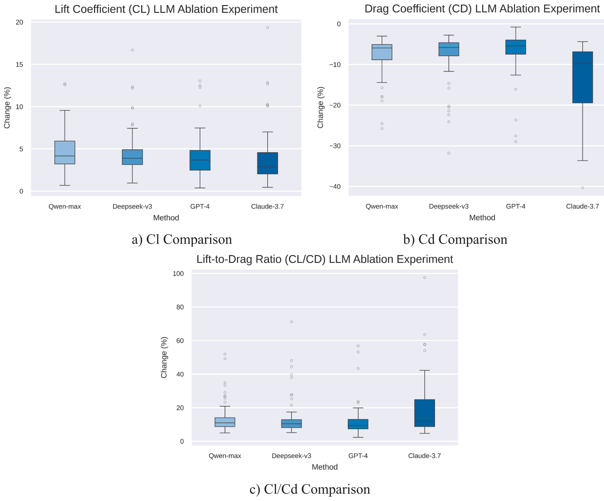

 **图 12：**  不同大语言模型下气动性能变化的分布比较。（a）升力系数 $C_l$ 比较；（b）阻力系数 $C_d$ 比较；（c）升阻比 $C_l/C_d$ 比较。

#### 3.3.2. 不同知识融合尺度的影响

如表 7 和图 13 所示，我们开展消融实验，评估不同知识融合尺度的影响。考察了三类知识：通用系统性知识、特征交互知识与特征主导效应知识。结果表明，缺少其中任何一种都会导致优化性能明显下降。具体而言，阻力系数恶化超过 3%，升阻比下降超过 5%。在三类知识中，去除通用系统性知识造成的性能退化最为显著，凸显其在优化过程中的关键作用。缺少特征主导效应知识也会造成性能损失，平均升阻比降低 5.6%，表明其能够引导局部性能改善。尽管去除特征交互知识同样会降低性能，其总体影响相对较小。这些发现证实，AirfoilAgent 内嵌的多维知识协同机制能够有效改善翼型优化结果。

 **表 7：**  不同知识融合尺度下气动性能变化的统计比较。

| 配置 | $\Delta C_l$ 最大值（%） | $\Delta C_l$ 最小值（%） | $\Delta C_l$ 平均值（%） | $\Delta C_d$ 最大值（%） | $\Delta C_d$ 最小值（%） | $\Delta C_d$ 平均值（%） | $\Delta(C_l/C_d)$ 最大值（%） | $\Delta(C_l/C_d)$ 最小值（%） | $\Delta(C_l/C_d)$ 平均值（%） |
| --- | ---: | ---: | ---: | ---: | ---: | ---: | ---: | ---: | ---: |
| 去除通用系统性知识（Regular Knowledge） | +13.58 | +1.17 | +5.08 | −1.88 | −25.91 | −8.00 | +51.48 | +4.39 | +14.50 |
| 去除特征交互知识（Interaction Knowledge） | +19.65 | −0.10 | +4.46 | −3.05 | −33.51 | −10.86 | +67.87 | +4.77 | +16.69 |
| 去除特征主导效应知识（Feature Knowledge） | +13.76 | +0.23 | +4.04 | −2.85 | −30.04 | −10.41 | +62.25 | +4.06 | +15.81 |
| AirfoilAgent | +19.34 | +0.44 | +4.28 | −4.37 | −40.35 | −13.65 | +97.48 | +4.69 | +20.84 |

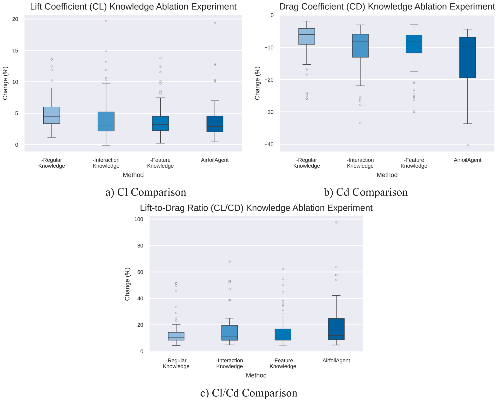

 **图 13：**  不同知识融合尺度下气动性能变化的分布比较。（a）升力系数 $C_l$ 比较；（b）阻力系数 $C_d$ 比较；（c）升阻比 $C_l/C_d$ 比较。

#### 3.3.3. 不同工作流模块的影响

如表 8 和图 14 所示，我们针对优化工作流中的不同模块开展消融实验，重点考察任务规划模块以及结果评估与反思模块。对于任务规划模块，旨在检验优化目标与约束的描述格式是否会影响 AirfoilAgent 的性能。在主要实验中，优化条件使用基于 LaTeX 的数学形式表达；而在本消融研究中，则采用更灵活的自然语言格式。对于结果评估与反思模块，重点评估知识更新机制是否影响优化结果。在该消融实验中，我们去除了三类知识的更新机制，这意味着后续优化迭代仅依赖第一轮生成的知识。结果表明，当优化目标使用自然语言而非严格的 LaTeX 形式表达时，AirfoilAgent 的性能几乎相同，说明它能够适应不同输入格式。这也突出了其较强的交互性：相比传统的定量输入，支持轻量化自然语言输入能够有效降低开展翼型气动优化的门槛。相比之下，去除动态知识更新机制会明显降低性能，特别是在升阻比方面，平均增幅从 20.84% 下降至 15.22%。这说明缺少动态反馈时，优化过程更容易陷入局部最优，限制优化策略的演进。

 **表 8：**  不同优化工作流下气动性能变化的统计比较。

| 配置 | $\Delta C_l$ 最大值（%） | $\Delta C_l$ 最小值（%） | $\Delta C_l$ 平均值（%） | $\Delta C_d$ 最大值（%） | $\Delta C_d$ 最小值（%） | $\Delta C_d$ 平均值（%） | $\Delta(C_l/C_d)$ 最大值（%） | $\Delta(C_l/C_d)$ 最小值（%） | $\Delta(C_l/C_d)$ 平均值（%） |
| --- | ---: | ---: | ---: | ---: | ---: | ---: | ---: | ---: | ---: |
| 任务规划模块变体（Overall Plan Module） | +19.67 | −0.15 | +4.56 | −4.83 | −39.74 | −13.06 | +98.60 | +5.14 | +20.30 |
| 去除反思模块（Reflection Module） | +18.81 | −0.44 | +3.91 | −4.96 | −33.18 | −10.36 | +77.81 | +4.16 | +15.22 |
| AirfoilAgent | +19.34 | +0.44 | +4.28 | −4.37 | −40.35 | −13.65 | +97.48 | +4.69 | +20.84 |

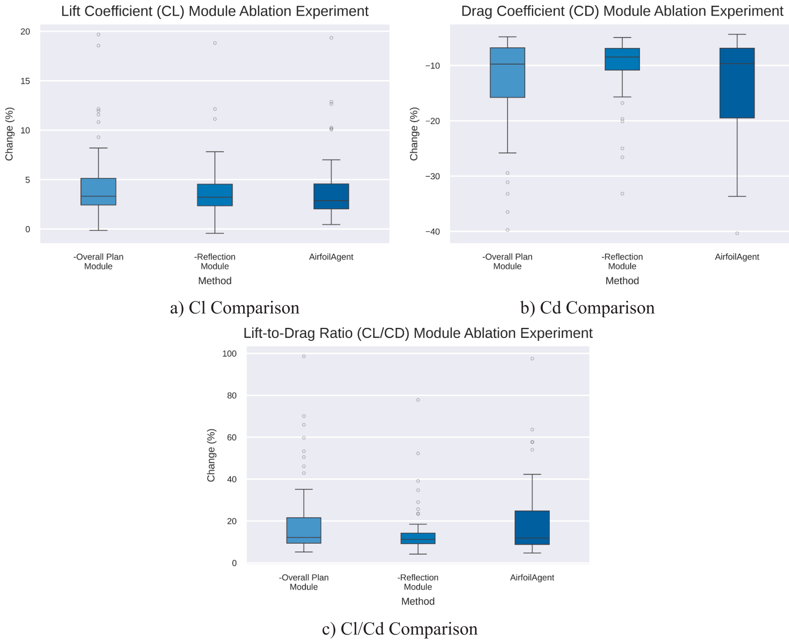

 **图 14：**  不同优化工作流模块下气动性能变化的分布比较。（a）升力系数 $C_l$ 比较；（b）阻力系数 $C_d$ 比较；（c）升阻比 $C_l/C_d$ 比较。

## 4. 优化案例研究

为更直观地理解 AirfoilAgent 在气动优化中的微观层面表现，我们对四类代表性翼型开展深入案例研究：性能最优、性能最差、具有典型平均性能，以及多目标优化的翼型案例。在几何方面，我们比较了 AirfoilAgent 与 GA 的变化差异，以及不同优化迭代之间的变化。在气动性能方面，我们考察了升力系数、阻力系数与升阻比的迭代趋势。为进一步展示所提出气动知识融合模块的合理性，案例研究还分析了基准翼型的通用系统性知识、特征交互效应和特征主导效应。此外，我们展示了基于这些知识得到的首轮优化几何特征变化，以评估知识是否得到了合理应用。通用系统性知识以文本形式呈现。特征交互效应知识通过二阶与三阶特征交互网络展示，其中翼型的 12 个几何特征表示为节点。可解释关系，即特征交互，表示为边。在三阶交互中，这些关系表示为超边。正向交互用红色表示，负向交互用蓝色表示。每个特征节点的大小反映其一阶（主导）效应的强度：节点越大，主导效应越强。高阶交互的强度与方向进一步通过边的颜色、透明度和粗细表示。强交互用较粗、透明度较低的线表示，弱交互则用较细、透明度较高的线表示。特征主导效应还通过龙卷风图进行可视化，展示 12 个翼型特征相对于三个气动性能系数的敏感性。

### 4.1. 性能最优翼型案例

性能最优翼型的气动优化结果汇总于表 9。经过 AirfoilAgent 的五次迭代优化后，升阻比相对于基准提高了 97.48%，比相同条件下 GA 实现的增幅高出 74.46%。就单项系数而言，AirfoilAgent 使升力提高了 17.80%，接近 GA 所实现 6.03% 增幅的三倍。在阻力方面，AirfoilAgent 实现 40.46% 的降幅，显著优于 GA 的 13.74%。

 **表 9：**  性能最优翼型的气动性能比较。

| 方法 | 原始 $C_l$ | 优化后 $C_l$ | $C_l$ 变化 | 原始 $C_d$ | 优化后 $C_d$ | $C_d$ 变化 | 原始 $C_l/C_d$ | 优化后 $C_l/C_d$ | $C_l/C_d$ 变化 |
| --- | ---: | ---: | ---: | ---: | ---: | ---: | ---: | ---: | ---: |
| AirfoilAgent | 0.7187 | 0.8466 | +17.80% | 0.0131 | 0.0078 | −40.46% | 54.82 | 108.26 | +97.48% |
| GA | 0.7187 | 0.7621 | +6.03% | 0.0131 | 0.0113 | −13.74% | 54.82 | 67.44 | +23.02% |

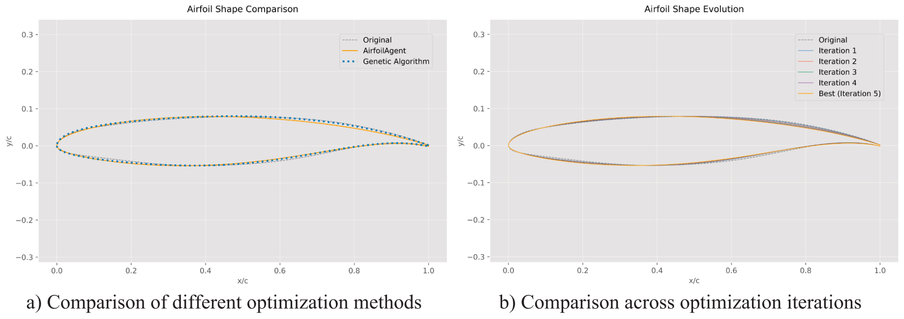

 **图 15：**  性能最优翼型的几何比较。（a）不同优化方法的比较；（b）不同优化迭代的比较。

性能最优翼型的优化几何如图 15 所示。对于 AirfoilAgent 设计，最明显的修改出现在上表面，尤其是前缘和中弦区域，大幅度的曲率调整形成了更平滑的气动过渡。相比之下，下表面变化相对较小，主要集中在后缘附近。GA 的几何调整则更保守，生成的形状更接近基准翼型，仅在上下表面进行适度的局部曲率修改。图 15（b）进一步展示了 AirfoilAgent 设计逐次迭代的演变。几何变化轨迹呈现出清晰且可解释的模式：上表面自第 1 次迭代起逐渐增厚，其中最显著的调整发生在前两次迭代中。后续迭代通过更小、更局部的修改进一步完善这些变化，表明优化过程由粗略的整体塑形转向精细的气动调节。在整个过程中，下表面保持相对稳定，仅在后缘附近有轻微调整，说明观察到的气动性能提升主要依赖上表面形状优化。

性能最优翼型的气动性能演变如图 16 所示。升力系数在早期迭代中稳步增加，随后趋于稳定，表明 AirfoilAgent 主要在初始迭代中通过上表面塑形提高升力，之后进行较小幅度的微调。阻力系数在所有迭代中单调下降，最大降幅出现在优化早期，随着接近收敛，后续改进逐渐减小。在二者共同作用下，升阻比从 50 快速升至 100 以上，在第 4 次迭代达到最优，之后保持在接近该水平的位置。这种模式表明，主要气动收益来自前几次迭代中协同实现的增升与减阻，此后框架转向渐进式改进。

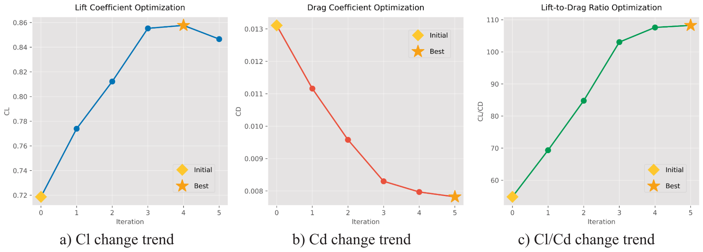

 **图 16.**  性能最优翼型的气动性能变化趋势分析。（a）升力系数 $C_l$ 变化趋势；（b）阻力系数 $C_d$ 变化趋势；（c）升阻比 $C_l/C_d$ 变化趋势。

LLM 为性能最优翼型提出的第一轮几何修改见表 10。最显著的调整出现在上表面最大厚度位置和后缘楔角，二者均减小 3.0%。相比之下，上、下表面最大厚度值保持不变，证实 LLM 在优化过程中严格遵守施加的厚度约束。

 **表 10. 性能最优翼型的第一轮几何修改。** 

| 特征 | $R_{up}$ | $R_{low}$ | $X_{up}$ | $Y_{up}$ | $z_{xxup}$ | $X_{low}$ | $Y_{low}$ | $z_{xxlow}$ | $\alpha_{te}$ | $\beta_{te}$ | $z_{te}$ | $\Delta z_{te}$ |
| --- | --- | --- | --- | --- | --- | --- | --- | --- | --- | --- | --- | --- |
| 变化 | −2.5% | −1.0% | −3.0% | 0% | +2.0% | −2.0% | 0% | −1.5% | −3.0% | −2.0% | 0% | −2.0% |

如附录所示，通用系统性知识揭示了性能最优翼型中几何参数与气动系数之间的关系。若干变化幅度较大的参数与检索得到的规则高度一致。例如，上表面最大厚度位置前移 −3.0%，符合上表面隆起前移有助于减阻的规则。前缘半径减小 −2.5%，后缘方向角与后缘楔角也分别减小 −3.0% 和 −2.0%，与较大的后缘方向角和楔角往往会增加阻力的知识一致。同样，后缘厚度减小 −2.0%，符合后缘越厚通常阻力越大的规则。此外，下表面最大厚度位置前移 −2.0%，与压力面隆起前移可能有助于减阻的知识相符。上表面最大厚度处的曲率变化（+2.0%）对应于曲率绝对值减小往往会增加阻力的规则。学得规则与实际参数更新之间的这些一致性说明，AirfoilAgent 的优化决策并非任意产生，而是建立在明确、可解释的气动知识之上。

如图 17 所示，二阶特征交互网络揭示了各气动系数对应的最强交互特征对。对于升力系数，主导交互为〈上表面最大厚度处曲率 × 后缘高度〉、〈下表面前缘半径 × 上表面最大厚度处曲率〉以及〈上表面最大厚度 × 下表面最大厚度〉。对于阻力系数，影响最大的特征对为〈上表面前缘半径 × 上表面最大厚度位置〉、〈上表面前缘半径 × 上表面最大厚度〉以及〈后缘方向角 × 上表面最大厚度〉。对于力矩系数，最强交互出现在〈下表面最大厚度 × 后缘厚度〉、〈下表面最大厚度 × 下表面最大厚度位置〉以及〈下表面最大厚度位置 × 后缘高度〉之间。鉴于本研究的优化目标主要强调减阻，因此重点关注与阻力相关的二阶交互网络。在施加的厚度约束下，上表面最大厚度位置保持不变，使〈上表面前缘半径 × 上表面最大厚度位置〉成为引导 LLM 建议的主导交互。与此一致，LLM 为这两个参数分别提出 −2.5% 和 +3.0% 的修改。此外，在阻力交互网络中，上表面前缘半径、上表面最大厚度位置及上表面最大厚度处曲率均成为交互程度较高的特征节点，这些参数也都发生了较大几何调整。上述结果共同表明，LLM 在生成优化参数时有效融合了特征间的二阶耦合知识。

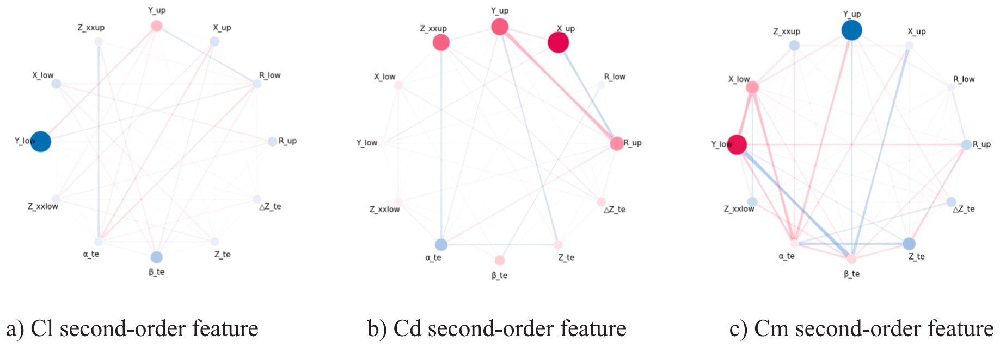

 **图 17.**  性能最优翼型的二阶特征交互网络。（a）$C_l$ 二阶特征；（b）$C_d$ 二阶特征；（c）$C_m$ 二阶特征。

如图 18 所示，三阶特征交互网络突出显示了各气动系数对应的最强交互组合。对于升力系数，主导三元组为〈上表面最大厚度 × 下表面最大厚度位置 × 后缘高度〉、〈上表面最大厚度 × 下表面最大厚度位置 × 下表面最大厚度处曲率〉以及〈上表面前缘半径 × 下表面前缘半径 × 下表面最大厚度处曲率〉。对于阻力系数，最强交互为〈上表面前缘半径 × 下表面前缘半径 × 上表面最大厚度位置〉、〈上表面前缘半径 × 后缘高度 × 后缘方向角〉以及〈上表面前缘半径 × 上表面最大厚度位置 × 上表面最大厚度〉。对于力矩系数，影响最大的三元组包括〈下表面前缘半径 × 上表面最大厚度位置 × 后缘厚度〉、〈上表面前缘半径 × 下表面前缘半径 × 后缘厚度〉以及〈上表面最大厚度处曲率 × 下表面最大厚度位置 × 后缘楔角〉。由于三阶交互网络涵盖更广泛的特征组合，其关系本身也更复杂。与二阶分析类似，本研究重点关注阻力系数的三阶交互。对于最强三元组〈上表面前缘半径 × 下表面前缘半径 × 上表面最大厚度〉，相应几何修改分别为 −2.5%、−1.0% 和 −3.0%。这些结果说明，AirfoilAgent 有效运用了几何特征间的三阶耦合知识，使高阶交互对优化过程产生实质贡献。

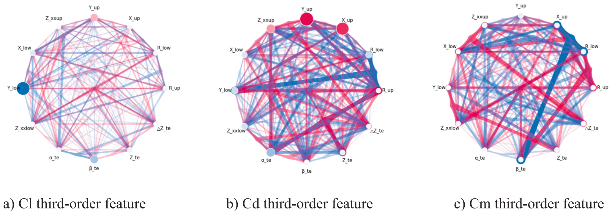

 **图 18.**  性能最优翼型的三阶特征交互网络。（a）$C_l$ 三阶特征；（b）$C_d$ 三阶特征；（c）$C_m$ 三阶特征。

如图 19 所示，对气动性能最敏感的参数随气动系数而异。对于升力系数，影响最大的参数为下表面最大厚度、后缘方向角和后缘楔角。对于阻力系数，主导参数为上表面前缘半径、后缘方向角及上表面最大厚度处曲率。对于力矩系数，最敏感的参数为后缘方向角、下表面最大厚度和上表面最大厚度。AirfoilAgent 第一轮参数建议中的最大变化幅度被约束在 ±3% 以内。值得注意的是，相较其他特征，对阻力最敏感的参数——上表面前缘半径（−2.5%）、后缘方向角（−3.0%）、上表面最大厚度处曲率（+2.0%）以及上表面最大厚度位置（−3.0%）——获得了最大的调整幅度。这有力表明 LLM 有效利用了特征主导效应知识。

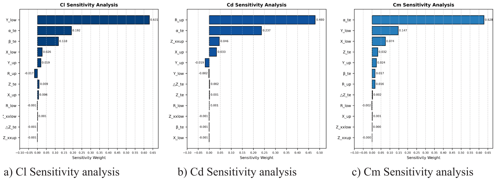

 **图 19.**  性能最优翼型的敏感性分析。（a）$C_l$ 敏感性分析；（b）$C_d$ 敏感性分析；（c）$C_m$ 敏感性分析。

### 4.2. 性能最差翼型案例

如表 11 所示，AirfoilAgent 与 GA 的优化结果总体相当。升力系数略有增加，阻力系数降低约 4.0%，升阻比提高约 4.7%。不过，AirfoilAgent 的结果略优，说明对于这一特定翼型，两种方法在优化过程中都可能收敛到了局部最优解。

 **表 11. 性能最差翼型的气动性能比较。** 

| 方法 | $C_l$ 原始值 | $C_l$ 优化后 | $C_l$ 变化 | $C_d$ 原始值 | $C_d$ 优化后 | $C_d$ 变化 | $C_l/C_d$ 原始值 | $C_l/C_d$ 优化后 | $C_l/C_d$ 变化 |
| --- | --- | --- | --- | --- | --- | --- | --- | --- | --- |
| AirfoilAgent | 0.9235 | 0.9276 | +0.44% | 0.0121 | 0.01159 | −4.21% | 76.32 | 80.03 | +4.86% |
| GA | 0.9235 | 0.9282 | +0.51% | 0.0121 | 0.01162 | −3.97% | 76.32 | 79.88 | +4.66% |

性能最差的优化翼型如图 20 所示。AirfoilAgent 优化的翼型在上表面从前缘至中部产生了明显曲率调整，使形状过渡更加平滑。下表面的修改主要集中在后缘附近，进行了适度重塑。相比之下，GA 优化的翼型几何变化更为保守，整体轮廓仍接近基准翼型，仅有轻微的局部曲率调整。图 20（b）中的逐轮演变进一步证实，优化轨迹十分保守。五次迭代中，翼型仅出现小幅局部扰动，上、下表面均未发生显著几何重构。这种微弱的几何响应表明，优化路径在早期便受到约束，导致优化过程始终接近基准形状，而未能探索影响更大的设计方向。

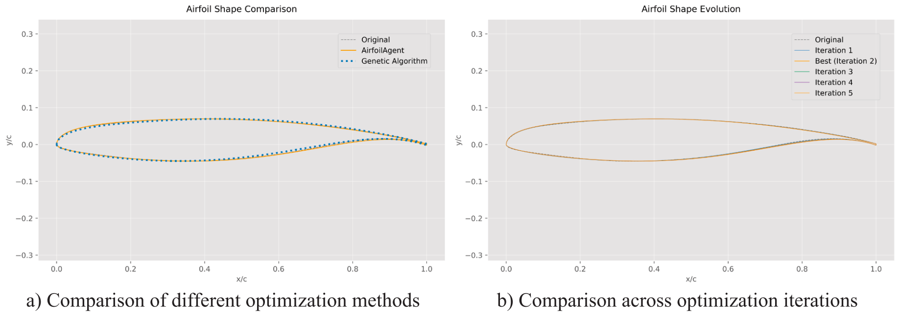

 **图 20.**  性能最差翼型的几何比较。（a）不同优化方法的比较；（b）各次优化迭代的比较。

性能最差翼型的气动性能演变如图 21 所示。升力系数表现不稳定：第一次迭代略有上升，但第二次明显下降，此后始终未完全恢复。阻力的响应同样较弱——最初小幅降低后又回升，并在余下过程中保持接近初始水平。二者共同导致升阻比仅有小幅改善：由初始约 76 升至第一次迭代时约 80 的峰值，随后下降并稳定在 79 附近，整体增益有限。这种模式表明，优化器过早达到其最佳中间解，此后未能继续改进；此时引入人类专家干预将有益。在实际气动设计流程中，工程师可以观察到这种停滞，并通过自然语言指导进行干预，例如“优先控制弦长中部附近的激波”，或“增加后缘附近的弯度，以恢复升力稳定性”。这种人在回路中的调整能够重新引导优化轨迹，避免陷入局部最优，并改善最终性能。

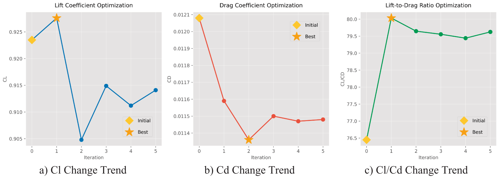

 **图 21.**  性能最差翼型的气动性能变化趋势分析。（a）$C_l$ 变化趋势；（b）$C_d$ 变化趋势；（c）$C_l/C_d$ 变化趋势。

如表 12 所示，主要变化发生在下表面前缘半径、下表面最大厚度处曲率、后缘方向角及后缘厚度。除后缘高度外，所有参数均有一定变化，且整体变化幅度相对较大。

 **表 12. 性能最差翼型的第一轮几何修改。** 

| 特征 | $R_{up}$ | $R_{low}$ | $X_{up}$ | $Y_{up}$ | $z_{xxup}$ | $X_{low}$ | $Y_{low}$ | $z_{xxlow}$ | $\alpha_{te}$ | $\beta_{te}$ | $z_{te}$ | $\Delta z_{te}$ |
| --- | --- | --- | --- | --- | --- | --- | --- | --- | --- | --- | --- | --- |
| 变化 | +2.0% | −3.0% | −1.5% | 0% | −2.0% | +2.0% | 0% | −3.0% | −2.5% | +3.0% | 0% | −4.0% |

如图 22 所示，在二阶特征交互网络中，升力系数对应的最强特征组合为〈下表面最大厚度 × 后缘方向角〉、〈上表面最大厚度 × 下表面最大厚度〉以及〈下表面最大厚度 × 后缘高度〉。对于阻力系数，最强组合为〈上表面前缘半径 × 上表面最大厚度〉、〈上表面前缘半径 × 上表面最大厚度处曲率〉以及〈上表面最大厚度 × 后缘方向角〉。对于力矩系数，最强组合为〈后缘方向角 × 后缘高度〉、〈上表面前缘半径 × 后缘高度〉以及〈上表面前缘半径 × 后缘方向角〉。提供给 LLM 的仅有升力和阻力系数各自排名前三的组合。然而，对于该翼型，唯一影响优化的组合是〈上表面前缘半径 × 后缘高度〉。相应几何修改为上表面前缘半径 +2.0%、后缘高度 0%，说明本案例中 LLM 未能有效利用二阶交互知识。

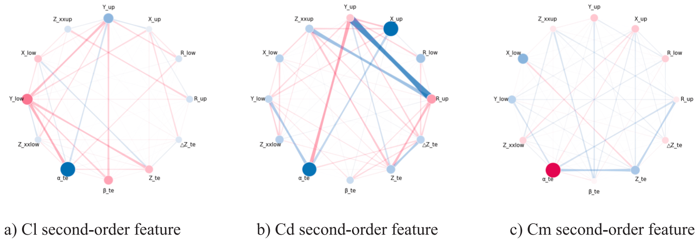

 **图 22.**  性能最差翼型的二阶特征交互网络。（a）$C_l$ 二阶特征；（b）$C_d$ 二阶特征；（c）$C_m$ 二阶特征。

如图 23 所示，在三阶特征交互网络中，升力系数对应的最强组合为〈下表面前缘半径 × 下表面最大厚度 × 后缘方向角〉、〈下表面前缘半径 × 下表面最大厚度 × 后缘高度〉以及〈下表面前缘半径 × 上表面最大厚度处曲率 × 下表面最大厚度处曲率〉。对于阻力系数，最强组合为〈上表面最大厚度位置 × 上表面最大厚度 × 后缘方向角〉、〈上表面前缘半径 × 上表面最大厚度位置 × 下表面最大厚度位置〉以及〈上表面最大厚度位置 × 后缘角 × 后缘高度〉。对于力矩系数，最强组合为〈上表面前缘半径 × 下表面最大厚度 × 后缘厚度〉以及〈上表面前缘半径 × 下表面最大厚度处曲率 × 后缘方向角〉。在第一轮几何修改中，只有涉及下表面前缘半径和下表面最大厚度处曲率的组合体现于交互效应中。除后缘高度外，其他交互较强的特征，例如后缘方向角与后缘厚度，均未得到体现。这说明 LLM 在优化过程中可能忽略了某些影响较大的交互特征，从而限制了最终优化结果的质量。

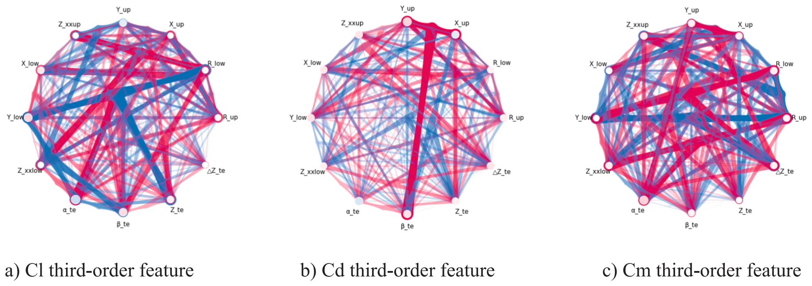

 **图 23.**  性能最差翼型的三阶特征交互网络。（a）$C_l$ 三阶特征；（b）$C_d$ 三阶特征；（c）$C_m$ 三阶特征。

如图 24 所示，对升力系数最敏感的参数为后缘方向角、下表面最大厚度及上表面最大厚度。对于阻力系数，最敏感的参数为上表面前缘半径、后缘方向角及上表面最大厚度。对于力矩系数，主导参数同样是后缘方向角、下表面最大厚度及上表面最大厚度。AirfoilAgent 第一轮参数建议的最大变化幅度为 ±4%。然而，对于影响升力和阻力系数的最敏感参数，变化幅度被限制在 ±3% 以内。这说明 LLM 未能在优化过程中充分融入敏感性知识。

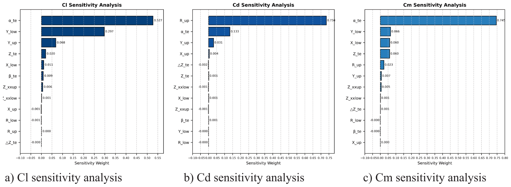

 **图 24.**  性能最差翼型的敏感性分析。（a）$C_l$ 敏感性分析；（b）$C_d$ 敏感性分析；（c）$C_m$ 敏感性分析。

### 4.3. 性能提升处于平均水平的翼型案例

为分析典型优化表现，我们选择了升阻比平均提升约 20.84% 的翼型进行详细研究。气动性能优化比较见表 13。AirfoilAgent 优化后的升力系数变化与 GA 的结果近似：AirfoilAgent 使其略有降低，而 GA 使其略有增加。与 GA 相比，AirfoilAgent 在阻力系数降低和升阻比提高两方面的表现均优约 7%，凸显了其提高气动效率的更强效果。

 **表 13. 性能提升处于平均水平的翼型气动性能比较。** 

| 方法 | $C_l$ 原始值 | $C_l$ 优化后 | $C_l$ 变化 | $C_d$ 原始值 | $C_d$ 优化后 | $C_d$ 变化 | $C_l/C_d$ 原始值 | $C_l/C_d$ 优化后 | $C_l/C_d$ 变化 |
| --- | --- | --- | --- | --- | --- | --- | --- | --- | --- |
| AirfoilAgent | 0.8117 | 0.8031 | −1.06% | 0.0110 | 0.00898 | −18.36% | 73.79 | 89.43 | +21.20% |
| GA | 0.8117 | 0.8249 | +1.63% | 0.0110 | 0.00988 | −10.18% | 73.79 | 83.49 | +13.15% |

平均优化表现如图 25 所示。AirfoilAgent 优化的翼型上表面轮廓发生显著重构，前缘曲率得到明显优化，中部轮廓也更加有利。下表面同样进行了明显的几何调整，有助于改善整体流动特性。相比之下，GA 的修改较为温和，主要局限于局部曲率调整。图 25（b）的逐轮演变呈现渐进且一致的轨迹：早期迭代在上、下表面引入幅度较小但相互协调的变化，主要细化前缘曲率，并温和地重新分配弯度。后期迭代主要进行精细平滑与调整，说明设计通过渐进式改进收敛，而非依赖大幅结构修改。总体而言，本案例体现了一条均衡的优化路径，通过翼型表面的适度几何变化获得持续的气动性能提升。

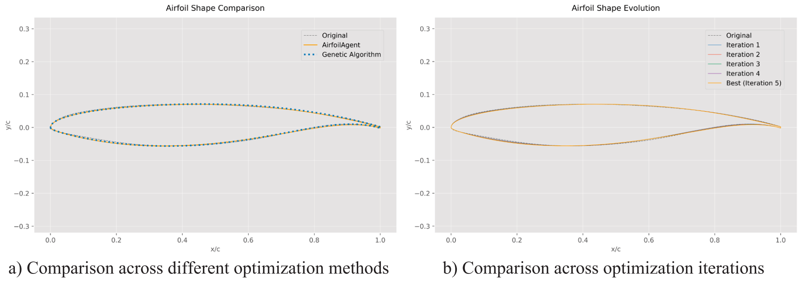

 **图 25.**  性能提升处于平均水平的翼型几何比较。（a）不同优化方法的比较；（b）各次优化迭代的比较。

性能提升处于平均水平的翼型气动性能演变如图 26 所示。升力系数在第一次迭代略有增加，随后逐渐下降，最终稳定在略低于初始值的水平。相比之下，阻力系数在全部五次迭代中呈现清晰的单调下降趋势，反映出优化过程中的减阻稳定而有效。升阻比的改善轨迹最为明显：早期快速上升，此后以较慢但稳定的速度继续增加，在第 4 次迭代附近达到最大值，对应的升阻比约为 88，明显高于初始约 74 的水平。这种持续上升说明，尽管升力有小幅变化，协同的气动调整仍成功转化为显著的整体性能收益。总体而言，逐轮曲线呈现均衡的优化模式：早期快速取得收益，随后逐步细化，即使升力基本不变，升阻比仍能获得明显改善。

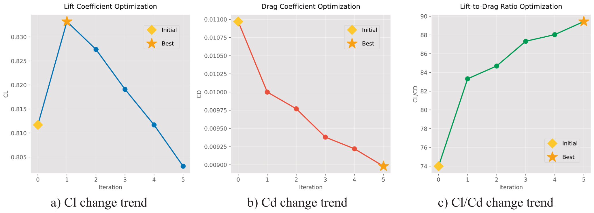

 **图 26.**  性能提升处于平均水平的翼型气动性能变化趋势分析。（a）$C_l$ 变化趋势；（b）$C_d$ 变化趋势；（c）$C_l/C_d$ 变化趋势。

如表 14 所示，主要修改集中在后缘方向角、上表面前缘半径、上表面最大厚度位置处曲率、后缘角以及后缘厚度。除优化过程中受约束的参数外，其他特征参数也发生了一定变化。

 **表 14. 性能提升处于平均水平的翼型第一轮几何修改。** 

| 特征 | $R_{up}$ | $R_{low}$ | $X_{up}$ | $Y_{up}$ | $z_{xxup}$ | $X_{low}$ | $Y_{low}$ | $z_{xxlow}$ | $\alpha_{te}$ | $\beta_{te}$ | $z_{te}$ | $\Delta z_{te}$ |
| --- | --- | --- | --- | --- | --- | --- | --- | --- | --- | --- | --- | --- |
| 变化 | −2.0% | −1.0% | +1.0% | 0% | +2.0% | −1.0% | 0% | −1.5% | −3.0% | +2.0% | −1.0% | −2.0% |

如图 27 所示，在二阶特征交互网络中，升力系数对应的最强组合为〈后缘方向角 × 后缘高度〉、〈下表面最大厚度 × 后缘方向角〉以及〈上表面前缘半径 × 下表面最大厚度处曲率〉。对于阻力系数，主导组合为〈上表面前缘半径 × 后缘方向角〉、〈上表面前缘半径 × 上表面最大厚度〉以及〈上表面前缘半径 × 上表面最大厚度位置〉。对于力矩系数，最强组合为〈下表面最大厚度 × 后缘方向角〉、〈上表面前缘半径 × 后缘方向角〉以及〈下表面最大厚度处曲率 × 后缘方向角〉。在第一轮优化中，后缘方向角的变化幅度最大，并且在升力和阻力系数交互网络中均深度参与交互。其他关键因素还包括上表面前缘半径及上表面最大厚度位置处曲率。这些结果表明，LLM 有效捕捉了该翼型二阶特征交互网络中的非线性关系，并在优化过程中运用这些特征的综合影响来提高气动性能。

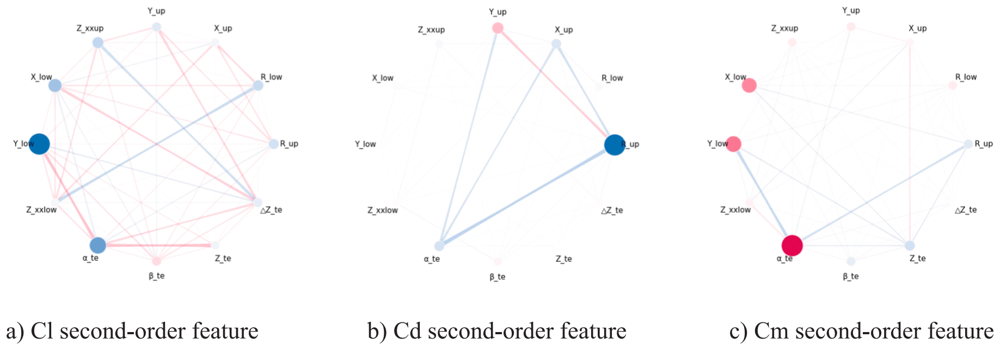

 **图 27.**  性能提升处于平均水平的翼型二阶特征交互网络。（a）$C_l$ 二阶特征；（b）$C_d$ 二阶特征；（c）$C_m$ 二阶特征。

如图 28 所示，在三阶特征交互网络中，升力系数对应的最强组合为〈上表面前缘半径 × 上表面最大厚度 × 下表面最大厚度〉、〈上表面前缘半径 × 上表面最大厚度 × 后缘方向角〉以及〈下表面前缘半径 × 后缘方向角 × 后缘角〉。对于阻力系数，主导组合为〈上表面前缘半径 × 下表面最大厚度 × 后缘高度〉、〈上表面前缘半径 × 上表面最大厚度 × 后缘方向角〉以及〈上表面前缘半径 × 后缘高度 × 后缘厚度〉。对于力矩系数，最强组合为〈上表面前缘半径 × 下表面最大厚度 × 后缘厚度〉、〈下表面前缘半径 × 下表面最大厚度 × 后缘厚度〉以及〈上表面最大厚度位置 × 上表面最大厚度 × 后缘方向角〉。本案例中，相较二阶网络，三阶交互对升力和阻力系数的影响较为有限，后缘方向角不再如此突出。相比之下，上表面前缘半径在阻力系数交互效应中作用显著，持续出现在最强组合中。总体而言，三阶交互虽然有助于形成优化建议，但相较二阶效应，其影响较小。

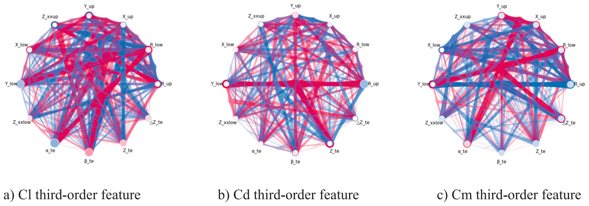

 **图 28.**  性能提升处于平均水平的翼型三阶特征交互网络。（a）$C_l$ 三阶特征；（b）$C_d$ 三阶特征；（c）$C_m$ 三阶特征。

如图 29 所示，对升力系数最敏感的参数为下表面最大厚度、后缘方向角及上表面最大厚度。对于阻力系数，最敏感的参数为上表面前缘半径、上表面最大厚度及后缘方向角。对于力矩系数，影响最大的参数为后缘方向角、下表面最大厚度及下表面最大厚度位置。AirfoilAgent 第一轮参数建议的最大变化幅度为 ±3%，对应后缘方向角。这说明 LLM 在优化过程中融入了敏感性知识，因为后缘方向角在升力和阻力系数的敏感性排序中分别位列第二和第三。

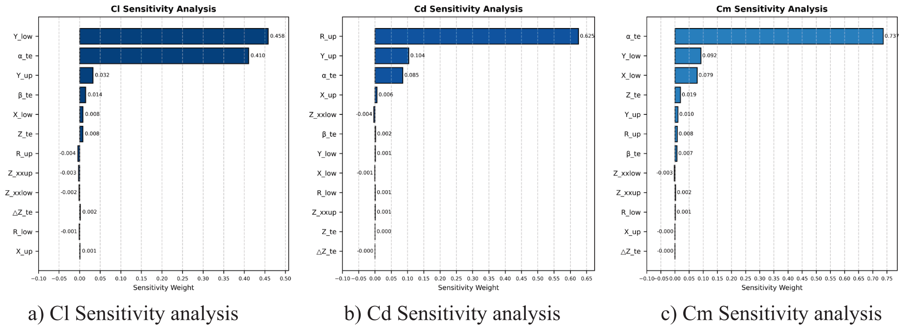

 **图 29.**  性能提升处于平均水平的翼型敏感性分析。（a）$C_l$ 敏感性分析；（b）$C_d$ 敏感性分析；（c）$C_m$ 敏感性分析。

### 4.4. 多目标优化翼型案例

为进一步展示 AirfoilAgent 的通用性，我们将性能最优翼型的优化任务扩展为同时包含两个目标的多目标问题：1）最大化升阻比；2）最小化翼型最大厚度。这一设置引入了气动效率与结构／布局约束之间的内在权衡，从而更严格地检验 AirfoilAgent 的推理、约束处理及几何调整能力。表 15 总结了所得气动性能与几何性能。AirfoilAgent 在两个目标上均取得显著改善。在气动效率方面，优化后翼型的升阻比达到 90.94，相较基准提高 65.89%。与此同时，最大厚度降低 2.28%，表明框架成功识别并平衡了几何约束，而非仅仅追求气动收益。相比之下，GA 同样提高了升阻比，但幅度较小（45.64%），最大厚度降幅也较小（0.98%），说明其基于种群的演化往往倾向于在相互竞争的目标之间采用更保守的折中。

 **表 15. 多目标优化翼型的气动性能比较。** 

| 方法 | $C_l$ 原始值 | $C_l$ 优化后 | $C_l$ 变化 | $C_d$ 原始值 | $C_d$ 优化后 | $C_d$ 变化 |
| --- | --- | --- | --- | --- | --- | --- |
| AirfoilAgent | 0.7187 | 0.8512 | +18.43% | 0.0131 | 0.00936 | −28.60% |
| GA | 0.7187 | 0.7577 | +5.42% | 0.0131 | 0.00949 | −27.61% |

| 方法 | $C_l/C_d$ 原始值 | $C_l/C_d$ 优化后 | $C_l/C_d$ 变化 | 最大厚度：优化后 | 最大厚度：原始值 | 最大厚度变化 |
| --- | --- | --- | --- | --- | --- | --- |
| AirfoilAgent | 54.82 | 90.94 | 65.89% | 0.1327 | 0.1296 | −2.28% |
| GA | 54.82 | 79.84 | 45.64% | 0.1327 | 0.1312 | −0.98% |

> 译注：最大厚度的两列表头按原表保留为“优化后／原始值”；但正文与图 31 表明，厚度实际由 0.1327 分别降至 0.1296 和 0.1312，原表的这两个表头可能倒置。

多目标优化结果的几何特征如图 30 所示。相较基准形状，AirfoilAgent 优化的翼型调整适度且协调，上表面得到明显细化，整体厚度略有减小。逐轮演变呈现平滑、渐进的轨迹。早期迭代在两个表面引入小幅但整体一致的修改，尤其在前缘与弦长中部区域，弯度和厚度的细微减小有助于平衡相互竞争的目标。后期迭代侧重精细改进，形状逐渐稳定，在提高升阻性能的同时避免厚度过度增加。

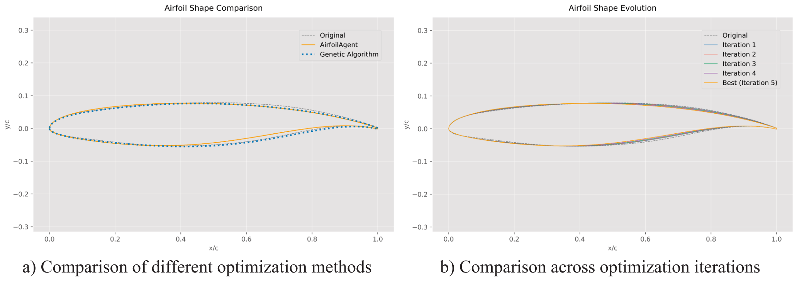

 **图 30.**  多目标优化翼型的几何比较。（a）不同优化方法的比较；（b）各次优化迭代的比较。

多目标翼型在迭代过程中的气动与几何性能如图 31 所示。升力系数在整个优化过程中稳步增加，体现了智能体即使面对额外几何约束，仍能提高吸力面效率的能力。阻力系数从初始较高水平单调下降，到第 5 次迭代已明显降低，表明整个优化轨迹中减阻持续有效。升阻比的改善最为突出：在早期迭代中快速增加，随后以较慢但稳定的速度继续上升，最终达到约 91，远高于初始约 55 的水平，是多目标约束下气动性能成功改善的关键指标。同时，最大厚度呈现清晰、连续的下降趋势，逐次迭代减小，至第 5 次迭代时达到明显更低的值。这证实 AirfoilAgent 有效平衡了两个目标：提高气动效率，同时控制结构厚度。

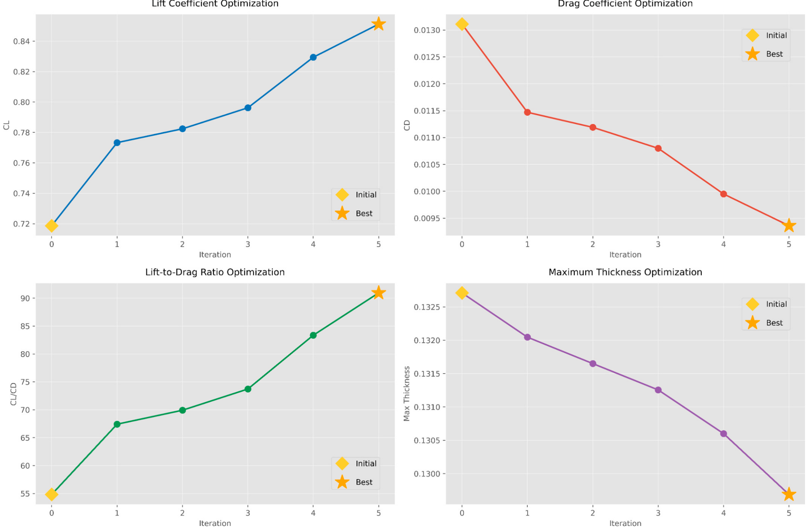

 **图 31.**  多目标优化翼型的气动性能变化趋势分析。图中依次展示升力系数、阻力系数、升阻比及最大厚度的优化过程。

## 5. 结论

针对飞机翼型气动优化中专业知识融合不足、优化过程可解释性有限，以及效率提升潜力受限等挑战，我们提出了基于 LLM 的多智能体协作框架 AirfoilAgent。该框架将优化流程重构为三个紧密协作的模块：总体任务规划、气动知识融合，以及带有反思机制的结果评价。它同时提高了优化效率与可解释性，其可行性也通过实验测试得到验证。主要结论如下：

1. AirfoilAgent 将优化算法与多尺度、可解释的气动知识体系进行系统结合。通过融合通用系统性知识、特征耦合效应及特征主导效应，克服了传统优化方法的局限。
2. AirfoilAgent 提供了智能、可解释的优化框架。利用 LLM 智能体的推理和决策能力，它在保证更高可解释性与可靠性的同时，显著提升优化效率和适应性。实验结果表明，AirfoilAgent 使超临界翼型的升阻比平均提高 20.84%，比传统优化方法高 10.59%，展示了其高效处理复杂优化任务的优势。

尽管知识要素已被有效融入智能气动设计，仍需进一步研究，以加强其与传统优化流程的融合：

1.  **优化任务复杂性。**  我们已在单一工况、相对简单的约束条件下验证了优化性能。然而，典型气动设计实践往往同时涉及多个目标、多个约束和多个工况，例如不同马赫数、雷诺数，甚至不同翼型族。未来需要进一步探究智能体系统与 LLM 能否可靠处理这类高复杂性任务，包括跨工况泛化，并实现子任务的精确解耦与协调。
2.  **高保真数据融合。**  本文实验依赖 XFOIL 预测，其计算高效，但保真度有限，尤其对于分离流动。工业翼型设计通常采用高精度 RANS／LES 计算流体力学（CFD）或风洞测量进行验证。未来工作将定期融合此类高保真数据，或在出现偏差时自适应地引入，以提高优化过程的可信度。将 LLM 引导的探索与经 CFD 验证的检查点结合的混合策略，有望达到工程级精度。
3.  **人类与 AI 协同优化。**  虽然初始目标能够用自然语言表达，当前流程却不支持迭代优化期间的实时专家指导。当搜索违反约束或收敛到局部最优时，领域专家可以提供纠正性见解，重新引导优化路径。未来版本的 AirfoilAgent 将纳入交互式专家在回路机制，使工程师能够在迭代期间注入自然语言指导，从而提高鲁棒性、收敛性及可解释性。

## CRediT 作者贡献声明

 **Yi Fan：**  形式分析、数据整理、概念构思。 **Hao Zhan：**  项目管理。 **Mingxuan Zhang：**  可视化、验证。 **Baigang Mi：**  写作——审阅与编辑、资源提供。

## 利益冲突声明

作者声明，不存在任何已知的、可能被认为影响本文所报告工作的竞争性经济利益或个人关系。

## 致谢

本研究得到中国国家自然科学基金（项目编号：12202363）、中国陆空基信息感知与控制国家重点实验室（项目编号：B124002），以及西北工业大学博士论文创新基金（项目编号：CX2025032）的支持。

## 附录

### 翼型几何参数对气动性能影响的分析

#### 前缘半径的影响

##### 上表面前缘半径

随着上表面前缘半径增大，升力系数总体呈增加趋势。

其对阻力系数的影响不明显，但适度的上表面前缘半径可能有助于减阻。

其对力矩系数的影响较复杂，但较大的上表面前缘半径往往导致更大的负俯仰力矩。

##### 下表面前缘半径

随着下表面前缘半径增大，阻力系数略有增加。

其对升力系数的影响不及上表面前缘半径显著。

较小的下表面前缘半径有助于减小负俯仰力矩。

#### 上表面弯度特征的影响

##### 上表面弯度的流向位置

当上表面弯度前移，即流向坐标减小时，升力系数增加。

上表面弯度前移有助于降低阻力系数。

上表面弯度前移会增大负俯仰力矩。

##### 上表面弯度的法向（垂直）位置

当上表面弯度的法向坐标增大，即弯度更加明显时，升力系数增加。

其对阻力系数的影响不明显，但过大的弯度可能增加阻力。

弯度更加明显时，负俯仰力矩增大。

##### 上表面弯度的曲率

当上表面曲率的绝对值增大，即曲率变得更负时，阻力系数增加。

适度的上表面曲率有利于获得较高的升力系数。

上表面曲率对力矩的影响较复杂，但总体而言，曲率绝对值增加往往会增大负俯仰力矩。

#### 下表面弯度特征的影响

##### 下表面弯度的流向位置

当下表面弯度前移时，升力系数往往增加。

下表面弯度前移有助于减阻。

下表面弯度前移通常会增大负俯仰力矩。

##### 下表面弯度的法向（垂直）位置

当下表面弯度的法向坐标减小，即弯度更加明显时，升力系数增加。

弯度更加明显时，阻力系数略有增加。

弯度更加明显时，负俯仰力矩增大。

##### 下表面弯度的曲率

当下表面曲率增大时，阻力系数略有增加。

适度的下表面曲率有利于获得较高的升力系数。

下表面曲率对力矩的影响不明显。

#### 后缘特征的影响

##### 后缘方向角

当后缘方向角增大时，升力系数增加。

较大的后缘方向角通常导致阻力增加。

当后缘方向角增大时，负俯仰力矩增大。

##### 后缘楔角

当后缘楔角增大时，阻力系数增加。

适度的后缘楔角有利于获得较高的升力系数。

后缘楔角对力矩的影响较复杂。

##### 后缘高度与厚度

后缘高度对气动性能的影响相对较小。

当后缘厚度增大时，阻力系数增加。

较小的后缘厚度有利于减小负俯仰力矩。

## 数据可用性

数据可根据请求提供。

## 参考文献

[1] Sadraey MH. Aircraft design: A systems engineering approach: John Wiley & Sons, 2024.

[2] I. Raouf, P. Kumar, Y. Cheon, M. Tanveer, S.-H. Jo, H.S. Kim, Advances in prognostics and health management for aircraft landing gear—progress, challenges, and future possibilities, International Journal of Precision Engineering and Manufacturing-Green Technology 12 (1) (2025) 301–320.

[3] A. Krishnan, A.S.M. Al-Obaidi, L.C. Hao, Towards sustainable wind energy: a systematic review of airfoil and blade technologies over the past 25 years for supporting sustainable development goals (SDGs), Indonesian Journal of Science and Technology 9 (3) (2024) 623–656.

[4] M. Lei, Y. Zhang, Generating Airfoils from Text: FoilCLIP, a Novel Framework for Language-Conditioned Aerodynamic Design, Theor. Appl. Mech. Lett. 100602 (2025).

[5] Y. Chen, M. Zhang, M. Zhang, J. Mao, K. Mao, Q. Wang, Review of large civil aircraft aerodynamic design, Acta Aeronautica et Astronautica Sinica 40 (01) (2019) 35–51.

[6] A. Jameson, Aerodynamic design via control theory, J. Sci. Comput. 3 (3) (1988) 233–260.

[7] G. Conroy, Handbook of genetic algorithms by Lawrence Davis, Knowl. Eng. Rev. 6 (4) (1991) 363–365.

[8] D. Wang, D. Tan, L. Liu, Particle swarm optimization algorithm: an overview, Soft. Comput. 22 (2) (2018) 387–408.

[9] S. Kirkpatrick, C.D. Gelatt Jr, M.P. Vecchi, Optimization by Simulated Annealing. Science 220 (4598) (1983) 671–680.

[10] Y.Y. Liu, J.X. Shen, P.P. Yang, X.W. Yang, A CNN-PINN-DRL driven method for shape optimization of airfoils, Eng. Appl. Comput. Fluid Mech. 19 (1) (2025) 2445144.

[11] K. Deb, A. Pratap, S. Agarwal, T. Meyarivan, A fast and elitist multiobjective genetic algorithm: NSGA-II, IEEE Trans. Evol. Comput. 6 (2) (2002) 182–197.

[12] J.D. Knowles, D.W. Corne, Approximating the nondominated front using the Pareto archived evolution strategy, Evol. Comput. 8 (2) (2000) 149–172.

[13] Gray C. Introduction to quality engineering: designing quality into products and processes, G. Taguchi, Asian productivity organization, 1986. number of pages: 191. price: $29 (UK). Quality and reliability engineering international 1988; 4(2): 198-.

[14] J. Tao, G. Sun, X. Wang, L. Guo, Robust optimization for a wing at drag divergence Mach number based on an improved PSO algorithm, Aerosp. Sci. Technol. 92 (2019) 653–667.

[15] S.W. Lee, O.J. Kwon, Robust airfoil shape optimization using design for six sigma, J. Aircr. 43 (3) (2006) 843–846.

[16] D.I. Papadimitriou, C. Papadimitriou, Aerodynamic shape optimization for minimum robust drag and lift reliability constraint, Aerosp. Sci. Technol. 55 (2016) 24–33.

[17] L. Wang, H. Zhang, C. Wang, et al., A review of intelligent airfoil aerodynamic optimization methods based on data-driven advanced models, Mathematics 12 (10) (2024) 1417.

[18] J.M. Walker, A. Coraddu, L. Oneto, A review on shape optimization of hulls and airfoils leveraging Computational Fluid Dynamics Data-Driven Surrogate models, Ocean Eng. 312 (2024) 119263.

[19] Moiz AA, Pal P, Probst D, et al. A machine learning-genetic algorithm (ML-GA) approach for rapid optimization using high-performance computing. SAE International journal of commercial vehicles 2018; 11(2018-01-0190):291-306.

[20] Badra J, Sim J, Pei Y, et al. Combustion system optimization of a light-duty GCI engine using CFD and machine learning, 2020.

[21] J.A. Badra, F. Khaled, M. Tang, et al., Engine combustion system optimization using computational fluid dynamics and machine learning: a methodological approach, J. Energy Res. Technol. 143 (2) (2021) 022306.

[22] J. Badra, O. Owoyele, P. Pal, S. Som, A machine learning-genetic algorithm approach for rapid optimization of internal combustion engines. artificial intelligence and data driven optimization of internal combustion engines, Elsevier (2022) 125–158.

[23] O. Owoyele, P. Pal, A. Vidal Torreira, et al., Application of an automated machine learning-genetic algorithm (AutoML-GA) coupled with computational fluid dynamics simulations for rapid engine design optimization, Int. J. Engine Res. 23 (9) (2022) 1586–1601.

[24] X. Song, L. Wang, X. Luo, Airfoil optimization using a machine learning-based optimization algorithm, J. Phys. Conf. Ser. 012009 (2022).

[25] W. Jing, L. Runze, H. Cheng, C. Haixin, Z. Chen, An inverse design method for supercritical airfoil based on conditional generative models, Chin. J. Aeronaut. 35 (3) (2022) 62–74.

[26] S. Yang, S. Lee, K. Yee, Inverse design optimization framework via a two-step deep learning approach: application to a wind turbine airfoil, Eng. Comput. 39 (3) (2023) 2239–2255.

[27] Zhu Y, Qiao S, Ou Y, et al. Knowagent: Knowledge-augmented planning for llm-based agents. arXiv preprint arXiv:240303101 2024.

[28] Guo T, Chen X, Wang Y, et al. Large language model based multi-agents: A survey of progress and challenges. arXiv preprint arXiv:240201680 2024.

[29] Renze M, Guven E. Self-reflection in llm agents: Effects on problem-solving performance. arXiv preprint arXiv:240506682 2024.

[30] Jadhav Y, Farimani AB. Large language model agent as a mechanical designer. arXiv preprint arXiv:240417525 2024.

[31] Liu S, Lu Y, Chen S, et al. Drugagent: Automating ai-aided drug discovery programming through llm multi-agent collaboration. arXiv preprint arXiv: 241115692 2024.

[32] A. Ghafarollahi, M.J. Buehler, ProtAgents: protein discovery via large language model multi-agent collaborations combining physics and machine learning, Digital Discovery 3 (7) (2024) 1389–1409.

[33] X. Li, S. Wang, S. Zeng, Y. Wu, Y. Yang, A survey on LLM-based multi-agent systems: workflow, infrastructure, and challenges, Vicinagearth 1 (1) (2024) 9.

[34] Z. Liu, M. Zhang, D. Sun, L. Li, G. Chen, A deep reinforcement learning optimization framework for supercritical airfoil aerodynamic shape design, Struct. Multidiscip. Optim. 67 (3) (2024) 34.

[35] Huang X, Liu W, Chen X, et al. Understanding the planning of LLM agents: A survey. arXiv preprint arXiv:240202716 2024.

[36] K.D. Lee, S. Eyi, Aerodynamic design via optimization, J. Aircr. 29 (6) (1992) 1012–1019.

[37] P. Ramamoorthy, K. Padmavathi, Airfoil design by optimization, J. Aircr. 14 (2) (1977) 219–221.

[38] R.M. Hicks, P.A. Henne, Wing design by numerical optimization, J. Aircr. 15 (7) (1978) 407–412.

[39] Liu J, Wu J, Xie H, et al. AFBench: A Large-scale Benchmark for Airfoil Design. arXiv preprint arXiv:240618846 2024.

[40] M. Drela, XFOIL: an analysis and design system for low Reynolds number airfoils, Low Reynolds Number Aerodynamics: Proceedings of the Conference Notre Dame, Indiana, USA 5–7 (1989) (June 1989) 1–12.

[41] J.A. Hartigan, M.A. Wong, Algorithm AS 136: a k-means clustering algorithm, J. Roy. Stat. Soc.: Ser. C (Appl. Stat.) 28 (1) (1979) 100–108.

[42] Y. Fan, L. Shi, Y. Sun, M.B. AirfoilRAG, Retrieval augmented generation framework for airfoil aerodynamic design knowledge discovery and application, Aerosp. Sci. Technol. (2025) 110933.

[43] M. Müller, Dynamic time warping, Information Retrieval for Music and Motion (2007) 69–84.

[44] P.-E. Danielsson, Euclidean distance mapping, Comput. Graphics Image Process. 14 (3) (1980) 227–248.

[45] M. Muschalik, H. Baniecki, F. Fumagalli, P. Kolpaczki, B. Hammer, E. Hüllermeier, shapiq: Shapley interactions for machine learning, Adv. Neural Inf. Proces. Syst. 37 (2024) 130324–130357.

[46] M. Sundararajan, K. Dhamdhere, A. Agarwal, The shapley taylor interaction index, in: International Conference on Machine Learning, 2020, pp. 9259–9268.

[47] E. Winter, The shapley value, Handbook of Game Theory with Economic Applications 3 (2002) 2025–2054.

[48] Fumagalli F, Muschalik M, Kolpaczki P, Hüllermeier E, Hammer B. KernelSHAP-IQ: Weighted least-square optimization for Shapley interactions. arXiv preprint arXiv: 240510852 2024.

[49] P.M. Mas, L.P. Raj, Sensitivity analysis of geometric parameters on the aerodynamic performance of a multi-element airfoil, Aerosp. Sci. Technol. 132 (2023) 108074.

[50] J. Nossent, P. Elsen, W. Bauwens, Sobol’sensitivity analysis of a complex environmental model, Environ. Model. Software 26 (12) (2011) 1515–1525.

[51] Zhang W, Tang K, Wu H, et al. Agent-pro: Learning to evolve via policy-level reflection and optimization. arXiv preprint arXiv:240217574 2024.

[52] S. Anthropic, Model card addendum: Claude 3.5 haiku and upgraded claude 3.5 sonnet, Semanticscholar org/CorpusID 273639283 (2024). https://api.

[53] Gardner B, Selig M. Airfoil design using a genetic algorithm and an inverse method. 41st Aerospace Sciences Meeting and Exhibit. 2003; 43.

[54] Yang A, Li A, Yang B, et al. Qwen3 technical report. arXiv preprint arXiv: 250509388 2025.

[55] Liu A, Feng B, Xue B, et al. Deepseek-v3 technical report. arXiv preprint arXiv: 241219437 2024.

[56] Achiam J, Adler S, Agarwal S, et al. Gpt-4 technical report. arXiv preprint arXiv: 230308774 2023.
