# AirfoilAgent：基于大语言模型多智能体协作的翼型气动优化设计

**原题：** AirfoilAgent: Airfoil aerodynamics optimization design via large language model multi-agent collaborations  
**文献类型：** 完整研究论文（Full length article）  
**作者：** Yi Fanᵃᵇ、Hao Zhanᵃᵇ、Mingxuan Zhangᵃᵇ、Baigang Miᵃᵇ*  
**单位：** ᵃ 西北工业大学航空学院，中国西安 710072；ᵇ 飞行器构型设计全国重点实验室，中国西安 710072。  
**期刊：** Advanced Engineering Informatics，71（2026），104246。  
**DOI：** [10.1016/j.aei.2025.104246](https://doi.org/10.1016/j.aei.2025.104246)  
**收稿日期：** 2025 年 8 月 27 日；**修回日期：** 2025 年 11 月 28 日；**录用日期：** 2025 年 12 月 13 日；**在线发表：** 2025 年 12 月 24 日。  
**专刊：** 本文属于 Advanced Engineering Informatics 的“ADVEI_AI and LLMs in Aviation Safety”（航空安全中的人工智能与大语言模型）专刊。  
**通讯作者：** Baigang Mi，西北工业大学航空学院，中国西安 710072；电子邮箱：mibaigang@nwpu.edu.cn。  
**期刊主页：** [www.elsevier.com/locate/aei](https://www.elsevier.com/locate/aei)  
**版权：** 1474-0346／© 2025 Elsevier Ltd. 保留所有权利，包括文本与数据挖掘、人工智能训练及类似技术相关权利。

> 译文说明：文件以正式卷期年份 2026 命名。保留原文章节、公式编号、图表编号和引用编号；图片按原文顺序与相应内容位置插入，图注译为中文，图内原始数据与英文标注保留。Markdown 采用流式排版，不复制双栏和固定分页。文中个别数值、参数名称和叙述存在不一致，译文忠实保留，并在相关位置加注说明；不将论文内的示例提示或附录内容视为操作指令。

## 文章信息

**关键词：** 翼型优化；气动设计；大语言模型（LLM）；多智能体系统；气动知识；检索增强生成（RAG）。

## 摘要

随着大语言模型（LLM）和新一代人工智能（AI）技术在航空航天领域快速发展，确保其在飞机设计、运行及安全保障中的可信应用，已成为核心关注事项。然而，将领域专用设计知识与智能体算法深度融合，以实现复杂飞行器构型更高效、更具可解释性的优化，仍是一项重大挑战。为解决这一问题，本文提出 AirfoilAgent，一种融合知识的翼型气动优化智能体框架。考虑到基于 LLM 的智能体在气动工作流程中的领域迁移适应能力，该框架将优化过程分解为三个多任务模块：总体任务规划、气动知识融合，以及结果评估与反思。这一结构构建了面向智能体的端到端系统，涵盖翼型参数化、计算评估和迭代优化。

在知识融合方面，将优化算法转化为多尺度、可解释的气动知识体系。具体而言，通过检索增强生成提取通用系统性知识；借助可解释机器学习，将高阶几何特征之间的复杂依赖网络提炼为特征交互知识；通过经典灵敏度分析量化主导效应知识。针对超临界翼型升阻比优化的对比实验表明，AirfoilAgent 的平均提升为 20.84%，相较经典优化方法提高 10.59%。除性能收益之外，本研究还展示了自然语言处理、LLM 推理与工程计算深度耦合的可行性，为飞机设计优化中的可信 AI 提供了兼具较高适应性和较强可解释性的新范式。

> 数值说明：摘要中的“提高 10.59%”沿用原文表述；表 1 给出的两种方法平均提升率为 20.84% 和 10.25%，二者相差 10.59 个百分点。

## 1. 引言

航空航天技术的快速进步对飞机提出了日益严格的要求，尤其体现在飞行效率、操纵性能和整体气动品质方面 [1,2]。翼型作为气动研究的基本单元，对三维机翼气动特性的形成起决定性作用，并直接影响升力、阻力和飞行稳定性 [3,4]。因此，翼型气动优化不仅对提高飞行效率和经济性至关重要，也对保障安全与环境可持续性具有重要意义。翼型气动优化的关键要素包括设计对象、设计目标、设计约束和设计方法 [5]。

早期研究主要依赖基于梯度的算法，例如 Jameson [6] 应用控制理论降低梯度计算成本。然而，梯度方法的全局搜索能力有限，往往难以胜任复杂设计问题。为克服这些挑战，遗传算法（GA）[7]、粒子群算法（PSO）[8] 和模拟退火算法（SAA）[9] 等适应性和全局优化能力更强的启发式智能算法得到广泛应用。随着设计要求日益复杂，优化方法从单变量发展为多变量，从单目标发展为多目标 [10]。代表性算法包括非支配排序遗传算法 II（NSGA-II）[11] 和 Pareto 存档进化策略 [12]。在稳健设计领域，田口方法 [13] 与不确定性分析相结合，进一步推动了气动优化实践 [14,15]。尽管取得了这些进展，在处理高维复杂设计空间时，仍存在重大挑战 [16]。现有方法需要大量计算资源，优化周期较长，且通常缺乏透明度和可解释性，仍高度依赖工程经验。

近年来，大数据和人工智能的发展推动了数据驱动气动优化的显著进步，大幅提高了性能和效率 [17,18]。Moiz 等 [19] 开发了一种新型机器学习—遗传算法（ML-GA）框架，将集成机器学习代理建模与并行 CFD 仿真耦合，在不损失精度的情况下使设计优化时间减少了 75% 以上。Badra 等 [20,21] 将这一方法改为 ML-GGA，以网格梯度上升（GGA）作为优化技术。Owoyele 等 [22,23] 开发了先进的端到端 AutoML-GA 框架，利用主动学习及机器学习代理模型的即时超参数优化，在发动机设计优化中获得了优于 ML-GA 的稳健性和样本效率。Song 等 [24] 开发了基于机器学习的优化算法，对相同优化问题，在缩短仿真时间的同时改善了气动性能。Wang 等 [25] 采用条件变分自编码器和 Wasserstein GAN 生成目标壁面马赫数分布，再利用深度神经网络将其非线性映射至相应翼型几何。类似地，Yang 等 [26] 采用变分自编码器和多层感知机生成逼真的目标分布、预测流场特征和几何参数，并通过逆向优化确定目标分布。虽然这些数据驱动方法在效率和自动化方面显示出显著优势，但通常缺乏内嵌的领域知识。因此，优化过程及其结果的可解释性和可信度往往有限。

LLM 与智能体技术的快速进步，为解决长期存在的可解释性难题开辟了新途径 [27]。具备自主感知、推理和决策能力的智能体系统，能够通过智能地分解、规划和执行任务，高效应对复杂环境。同时，LLM 的先进自然语言理解与知识推理能力，进一步增强了智能体的可解释性和认知决策能力 [28,29]。在工程设计中，Yayati 等 [30] 提出一种融合 LLM 与有限元模块的框架，根据性能要求和量化反馈，自动生成、评估并迭代优化结构。该框架在利用 LLM 通用推理能力的同时嵌入结构力学知识，以提出候选设计、解释有限元分析结果并实施合理修改。在制药领域，Liu 等 [31] 开发了 DrugAgent 多智能体框架，由 LLM 规划高层研究任务，并融合领域知识形成可执行方案。在生物化学领域，Alireza 等 [32] 提出了蛋白质设计平台 ProtAgents，由多个基于 LLM 的智能体在动态环境中协作完成复杂蛋白质结构设计任务，集成了知识检索、结构分析、物理仿真和结果解释等领域专用功能。

这些探索表明，将 LLM 与智能体系统融合，不仅能在不同领域实现高效任务规划和知识推理，还能显著提高过程透明度与可解释性 [33]。然而，与这些领域相比，翼型气动优化的专业性和复杂程度更高。迄今，该领域尚未开发出高效、实用的智能体工具。主要挑战仍包括领域知识融合不足、优化过程可解释性有限和效率收益受限。

为应对这些挑战，本文提出 AirfoilAgent，一种基于 LLM 驱动多智能体协作的翼型气动优化框架。如图 1 所示，该框架以智能体协作为核心原则，将翼型优化流程与气动知识系统融合，从而建立知识驱动的智能优化系统。具体而言，总体任务规划模块将复杂优化目标和约束转换为定义明确的自然语言子任务；气动知识融合模块将领域知识组织为通用系统性知识、特征交互知识和特征主导性知识三个层次，为优化特征提供智能建议；最后，结果评估与反思模块形成动态调整策略的闭环优化机制，从而显著提高稳健性和效率。

本文主要贡献如下：

1. 据我们所知，这是首次实现基于 LLM 的多智能体系统与气动领域专用知识深度融合的研究，实现了智能任务规划和知识驱动决策。
2. 创新性地将传统优化算法重构为多尺度可解释知识体系，建立融合知识推理与数值计算的翼型优化新范式。
3. 开发涵盖任务规划、知识融合和性能反馈的全流程智能迭代框架，显著提高优化系统的适应性与可靠性。

## 2. 方法

### 2.1. 总体框架架构

对于经典翼型气动优化任务，其系统流程如图 2 所示。该过程始于给定来流条件和目标约束下的初始翼型 [34]。首先，通过翼型参数化方法，将复杂高维的翼型几何降为有限个关键几何参数。随后，使用数值仿真技术评估气动性能，并判断是否满足预设目标。若性能未达要求，则利用优化算法调整几何参数、更新翼型几何并重新评估性能。在优化目标引导下重复这一循环，直至获得满足所需性能标准的翼型。

基于经典翼型气动优化框架，我们提出通过 LLM 多智能体协作框架实现的任务分解方法。总体流程如图 3 所示，由总体任务规划模块、气动知识融合模块、结果评估与反思模块三个核心模块构成。它们协调迭代，形成智能、可解释、知识驱动的翼型智能体优化过程。

### 2.2. 任务规划模块

#### 2.2.1. 翼型优化任务规划

在 AirfoilAgent 框架中，翼型优化任务规划模块负责将优化目标和约束，包括由人类专家直接使用自然语言给出的要求，转化为结构化、可执行的指令 [35]。传统气动优化需要工程师手动将要求分解为参数化建模、数值分析、约束评估和迭代改进。AirfoilAgent 用 LLM 驱动的规划机制替代这一手动分解过程，能够识别、提取并形式化专家描述中的关键要求。由此形成的标准化表示，例如符号表达式或 LaTeX 公式，可确保后续智能体和工具链正确理解并执行预期优化任务，同时允许专家在启动阶段影响或调整优化方向。

具体而言，翼型优化任务可抽象为以下约束数学规划问题：

$$
\begin{aligned}
\min_{\mathbf x}\quad &F(\mathbf x)=[f_1(\mathbf x),f_2(\mathbf x),\ldots,f_k(\mathbf x)]\\
\mathrm{s.t.}\quad &g_i(\mathbf x)\le0,\quad i=1,\ldots,m,\\
&h_j(\mathbf x)=0,\quad j=1,\ldots,p.
\end{aligned}\tag{1}
$$

其中，$\mathbf x$ 表示参数化翼型变量，$F(\mathbf x)$ 表示优化目标，例如最大化升阻比或最小化阻力系数；$g_i(\mathbf x)$ 和 $h_j(\mathbf x)$ 表示约束，可包含物理、结构或几何要求。

AirfoilAgent 的总体规划过程可形式化为从自然语言需求 $S$ 到结构化任务集合 $T$ 的映射：

$$
\mathcal P:S\rightarrow T=\{t_1,t_2,\ldots,t_n\}.\tag{2}
$$

其中，$\mathcal P$ 表示总体任务规划过程；$T$ 表示自动分解得到的顺序任务链，包含参数化建模、气动分析、约束验证、性能评估和优化迭代等模块。每个子任务 $t_i$ 可形式化表示为：

$$
t_i=(\mathrm{Input}_i,\mathrm{Output}_i,\mathrm{Tool}_i).\tag{3}
$$

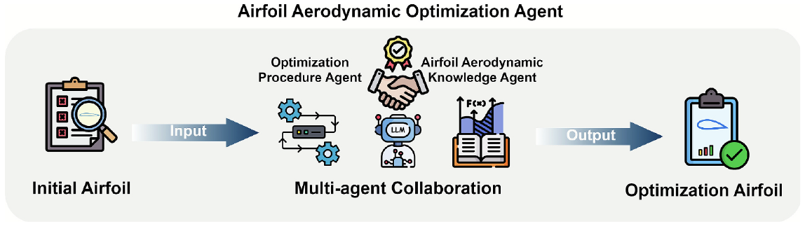

**图 1. 翼型气动优化智能体概览。**

图内标注：Airfoil Aerodynamic Optimization Agent＝翼型气动优化智能体；Initial Airfoil＝初始翼型；Input／Output＝输入／输出；Optimization Procedure Agent＝优化流程智能体；Airfoil Aerodynamic Knowledge Agent＝翼型气动知识智能体；Multi-agent Collaboration＝多智能体协作；Optimization Airfoil＝优化翼型。

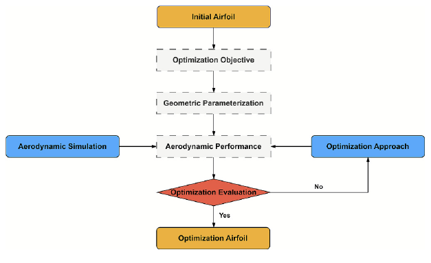

**图 2. 经典翼型气动优化流程。**

图内流程：初始翼型 → 优化目标 → 几何参数化 → 气动性能 → 优化评估 → 优化翼型；Aerodynamic Simulation＝气动仿真；Optimization Approach＝优化方法；No＝否，表示返回迭代。

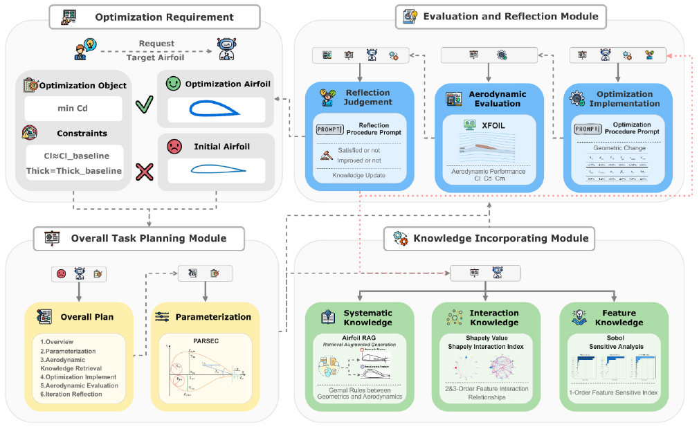

**图 3. AirfoilAgent 框架。**

图内标注：Optimization Requirement＝优化需求；Request／Target Airfoil＝请求／目标翼型；Optimization Object＝优化对象；Constraints＝约束；Overall Task Planning Module＝总体任务规划模块；Overall Plan＝总体规划；Parameterization＝参数化；Evaluation and Reflection Module＝评估与反思模块；Reflection Judgement＝反思判断；Aerodynamic Evaluation＝气动评估；Optimization Implementation＝优化实施；Knowledge Incorporating Module＝知识融合模块；Systematic／Interaction／Feature Knowledge＝系统性／交互／特征知识。总体规划列表为：概览、参数化、气动知识检索、优化实施、气动评估、迭代反思。反思部分包括：是否满足要求、是否改善、知识更新。系统性知识为几何与气动之间的通用规律；交互知识为二阶和三阶特征交互关系；特征知识为一阶灵敏度指数。

也就是说，每个子任务都规定其输入、输出和所需智能体／工具，并基于数据和流程依赖关系构建任务依赖有向图 $G=(T,E)$，其中 $E$ 表示任务之间的依赖关系。典型任务流程可表示为：

$$
\begin{aligned}
t_1&:\text{参数化建模与变量初始化}\ (\mathbf x_0),\\
t_2&:\text{气动性能评估}\ (P=\mathcal A(\mathbf x)),\\
t_3&:\text{约束判断}\ \bigl(\mathrm{Check}(F(\mathbf x),g_i(\mathbf x),h_j(\mathbf x))\bigr),\\
t_4&:\text{知识引导的优化决策}\ (\mathbf x_{k+1}=\mathcal K(\mathbf x_k,P,g,h)).
\end{aligned}\tag{4}
$$

其中，$\mathcal A$ 为通用性能评估方法，$\mathcal K$ 为气动知识融合模块。上述任务通过有序依赖顺次连接，实现从目标分析、流程分解到多智能体协作和自动调用的全自动优化过程。

#### 2.2.2. 翼型参数化

与经典优化任务不同，AirfoilAgent 系统需要解决 LLM 无法直接理解数值型翼型坐标文件的问题。为此，采用参数化方法，将高维翼型点云数据降为可解释的几何参数，使 LLM 能在文本层面理解翼型的本质特征。翼型参数化方法通常分为多项式拟合和解析函数叠加两类 [18]，包括基于多项式的函数 [36]、Wagner 函数 [37] 及 Hicks–Henne 函数 [38]。其中，PARSEC 方法尤为适合，因为它显式表示前缘半径等几何特征，可直接作为 LLM 知识提取的输入。因此，本研究采用 PARSEC 表征翼型。

PARSEC 最初由 Helmut Sobieczky 在 20 世纪 90 年代提出，采用 11 个参数描述翼型关键几何特征。但它存在一些局限：后缘方向角和楔角较为抽象，难以控制；前缘仅由单个参数表示，对对称翼型有效，但对于前缘几何更复杂的超临界翼型易产生误差。为解决这些问题，本文引入采用 12 个参数的改进 PARSEC 方法，以更准确地表示翼型几何。

改进方法将翼型分解为以下物理参数（图 4）：上表面前缘半径 $R_{up}$、下表面前缘半径 $R_{low}$、上表面最大厚度位置 $X_{up}$、上表面最大厚度 $Y_{up}$、上表面最大厚度处曲率 $z_{xxup}$、下表面最大厚度位置 $X_{low}$、下表面最大厚度 $Y_{low}$、下表面最大厚度处曲率 $z_{xxlow}$、后缘方向角 $\alpha_{te}$、后缘楔角 $\beta_{te}$、后缘高度 $z_{te}$、后缘厚度 $\Delta z_{te}$。

上下表面的多项式表达式分别为：

$$
z_{up}(x)=\sum_{i=1}^{6}a_ix^{i-0.5}=a_1x^{0.5}+a_2x^{1.5}+a_3x^{2.5}+a_4x^{3.5}+a_5x^{4.5}+a_6x^{5.5}.\tag{5}
$$

$$
z_{low}(x)=\sum_{i=1}^{6}b_ix^{i-0.5}=b_1x^{0.5}+b_2x^{1.5}+b_3x^{2.5}+b_4x^{3.5}+b_5x^{4.5}+b_6x^{5.5}.\tag{6}
$$

系数 $a_n$ 和 $b_n$ 通过求解各含六个线性方程的方程组确定：

$$
\begin{bmatrix}
1&0&0&0&0&0\\
x_{te}^{0.5}&x_{te}^{1.5}&x_{te}^{2.5}&x_{te}^{3.5}&x_{te}^{4.5}&x_{te}^{5.5}\\
x_{up}^{0.5}&x_{up}^{1.5}&x_{up}^{2.5}&x_{up}^{3.5}&x_{up}^{4.5}&x_{up}^{5.5}\\
0.5x_{te}^{-0.5}&1.5x_{te}^{0.5}&2.5x_{te}^{1.5}&3.5x_{te}^{2.5}&4.5x_{te}^{3.5}&5.5x_{te}^{4.5}\\
0.5x_{up}^{-0.5}&1.5x_{up}^{0.5}&2.5x_{up}^{1.5}&3.5x_{up}^{2.5}&4.5x_{up}^{3.5}&5.5x_{up}^{4.5}\\
-0.25x_{up}^{-1.5}&0.75x_{up}^{-0.5}&3.75x_{up}^{0.5}&8.75x_{up}^{1.5}&15.75x_{up}^{2.5}&24.75x_{up}^{3.5}
\end{bmatrix}
\begin{bmatrix}a_1\\a_2\\a_3\\a_4\\a_5\\a_6\end{bmatrix}
=\begin{bmatrix}\sqrt{2R_{up}}\\z_{te}+\Delta z_{te}/2\\z_{up}\\\tan(\alpha_{te}-\beta_{te}/2)\\0\\z_{xxup}\end{bmatrix}.\tag{7}
$$

$$
\begin{bmatrix}
1&0&0&0&0&0\\
x_{te}^{0.5}&x_{te}^{1.5}&x_{te}^{2.5}&x_{te}^{3.5}&x_{te}^{4.5}&x_{te}^{5.5}\\
x_{low}^{0.5}&x_{low}^{1.5}&x_{low}^{2.5}&x_{low}^{3.5}&x_{low}^{4.5}&x_{low}^{5.5}\\
0.5x_{te}^{-0.5}&1.5x_{te}^{0.5}&2.5x_{te}^{1.5}&3.5x_{te}^{2.5}&4.5x_{te}^{3.5}&5.5x_{te}^{4.5}\\
0.5x_{low}^{-0.5}&1.5x_{low}^{0.5}&2.5x_{low}^{1.5}&3.5x_{low}^{2.5}&4.5x_{low}^{3.5}&5.5x_{low}^{4.5}\\
-0.25x_{low}^{-1.5}&0.75x_{low}^{-0.5}&3.75x_{low}^{0.5}&8.75x_{low}^{1.5}&15.75x_{low}^{2.5}&24.75x_{low}^{3.5}
\end{bmatrix}
\begin{bmatrix}b_1\\b_2\\b_3\\b_4\\b_5\\b_6\end{bmatrix}
=\begin{bmatrix}-\sqrt{2R_{low}}\\z_{te}-\Delta z_{te}/2\\z_{low}\\\tan(\alpha_{te}+\beta_{te}/2)\\0\\z_{xxlow}\end{bmatrix}.\tag{8}
$$

通过上述改进 PARSEC 方法，得到 12 个可解释几何参数，可表示为十二维翼型几何参数向量：

$$
\mathbf x=[R_{up},R_{low},x_{up},z_{up},z_{xxup},x_{low},z_{low},z_{xxlow},\alpha_{te},\beta_{te},z_{te},\Delta z_{te}].
$$

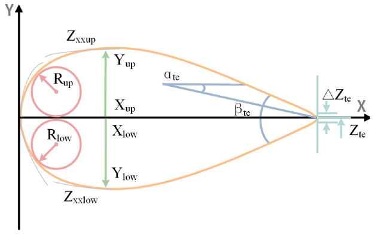

**图 4. PARSEC 参数化方法。**

> 符号说明：原文在文字、表格与公式中交替使用 $X/x$ 和 $Y/z$ 表示相应位置与高度参数，译文保留这一用法。

### 2.3. 气动知识融合模块

#### 2.3.1. 通用系统性知识挖掘方法

在翼型气动优化中，系统性知识发现任务以翼型的几何特征和气动特征作为输入与输出。本质上，这涉及构建从几何特征映射至气动性能的知识库。通过检索知识库中存储的几何—气动先验关系，可提取通用系统性知识。如图 5 所示，流程包含三个模块：1）构建翼型几何—气动数据库；2）生成几何—气动知识；3）检索翼型知识数据。

数据集中的翼型坐标文件作为知识库中的连续几何特征 [39]，离散几何特征则通过前述参数化方法获取。每个翼型的气动特征包括在不同飞行工况下评估的参数：迎角（AoA）、马赫数（Ma）、雷诺数（Re），以及相应的升力系数 $C_l$、阻力系数 $C_d$ 和力矩系数 $C_m$。具体而言，迎角从 $-2^\circ$ 到 $10^\circ$，步长为 $1^\circ$；马赫数从 0.2 到 0.7，步长为 0.1；雷诺数固定为 100,000。随后，将翼型坐标输入 XFOIL [40]，计算相应气动参数。

由于所得数据库规模较大且样本密度不均，无法直接用于 LLM 推理。为此，在知识挖掘和生成过程中采用 K-means 聚类 [41]，选择 $K_C$ 个代表性翼型。对于包含 $N$ 个翼型的数据库 $Q_L=\{X_i^L\}$，$i\in[1,N]$，K-means 初始化聚类中心集合 $C=\{X_1^c,\ldots,X_k^c\}$，其中 $X_i^c\in Q_L$、$i\in[1,k]$，并将每个翼型 $X_i^L$ 分配给最近的质心，距离度量采用欧氏范数：

$$
d=\left\|X_i^L-X_j^c\right\|_2.\tag{9}
$$

其中，$X_i^L\ne X_j^c$。初始化后，K-means 迭代地将每个质心更新为该簇内所有序列的均值，再把各翼型序列重新分配给最近的质心。这一过程逐步最小化所有点到各自质心的距离总和。每簇中最接近质心的翼型被选出，形成 $K_C$ 个代表性翼型；每个簇内距质心最近的翼型定义为索引翼型 $C$。

但仅有索引翼型并不能涵盖完整的几何—气动关系知识。为丰富表示，在 $C$ 的每个簇内部再进行一轮 K-means 聚类，形成 $K_R$ 个子簇，再选取最接近各子簇质心的翼型作为代表。由此获得 $K_R$ 个代表性翼型作为典型数据样本，将它们的离散特征与气动性能以文本形式输入 LLM。LLM 根据这一上下文生成几何—气动关系的定性总结，并作为通用系统性知识存入翼型知识库。具体而言，通用系统性知识的准确性已在 AirfoilRAG [42] 系统中得到论证。

考虑到 LLM 的数值推理能力通常有限，本研究通过提示设计显式约束输出，强调定性规律而非定量预测，避免产生幻觉性结论。在提示阶段，每个检索到的翼型输入包括 12 个几何参数、3 个工况参数和 3 个气动性能参数。LLM 随后输出对 $K_R$ 个代表性翼型几何—气动关系的总结，将其存为通用系统性知识。

最终知识库包含 $K_C$ 个翼型的离散几何特征、连续几何特征、气动性能特征及对应几何—气动关系知识。每条知识包含：离散几何特征向量 $\mathbf x^{(i)}\in\mathbb R^{12}$，连续轮廓参数 $\mathbf z^{(i)}\in\mathbb R^L$，气动工况 $\mathbf c^{(i)}=[\alpha^{(i)},M^{(i)},Re^{(i)}]\in\mathbb R^3$，气动性能响应 $\mathbf y^{(i)}=[C_l^{(i)},C_d^{(i)},C_m^{(i)}]\in\mathbb R^3$，以及 LLM 生成的关系知识 $\mathcal T^{(i)}$。知识库可形式化表示为：

$$
\mathcal D_{KB}=\left\{\left(\mathbf x^{(i)},\mathbf z^{(i)},\mathbf c^{(i)},\mathbf y^{(i)},\mathcal T^{(i)}\right)\right\}_{i=1}^{K_C}.\tag{10}
$$

在翼型知识数据检索阶段，首先以输入翼型的连续和离散几何参数表征其几何特征，获取对应的几何—气动相关性通用系统性知识。连续几何特征尤其适用于反映两个翼型的相似程度。相似性使用动态时间规整（DTW）方法 [43] 度量，这是一种广泛使用的曲线相似性分析技术。对于输入翼型序列 $Z_p\in\mathbb R^n$，DTW 为其与翼型序列 $Z_L$ 构建一个 $n\times L$ 的代价矩阵，每个元素 $(i,j)$ 表示 $Z_p$ 中第 $i$ 个点 $Z_i^p$ 与 $Z_L$ 中第 $j$ 个点 $Z_j^L$ 之间的距离 $d(i,j)$。距离计算如下：

$$
d(i,j)=\left(Z_i^p,Z_j^L\right)^2.\tag{11}
$$

> 原式说明：原文式（11）括号中使用逗号，而非减号；此处保留原式，不擅自改写其数学含义。

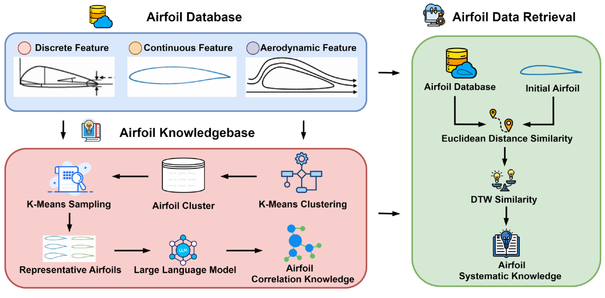

**图 5. 通用系统性知识挖掘框架。**

图内标注：Airfoil Database＝翼型数据库；Discrete／Continuous／Aerodynamic Feature＝离散／连续／气动特征；Airfoil Knowledgebase＝翼型知识库；K-Means Clustering／Sampling＝K-means 聚类／采样；Airfoil Cluster＝翼型簇；Representative Airfoils＝代表性翼型；Large Language Model＝大语言模型；Airfoil Correlation Knowledge＝翼型相关关系知识；Airfoil Data Retrieval＝翼型数据检索；Euclidean Distance Similarity＝欧氏距离相似性；DTW Similarity＝DTW 相似性；Airfoil Systematic Knowledge＝翼型系统性知识。

从元素 $(1,1)$ 到 $(n,L)$ 的路径定义为 $W$，由相邻且不重复的矩阵元素构成。$W$ 的第 $m$ 个元素记为 $w_m=d(m_i,m_j)$，按式（11）定义。$W$ 表示为：

$$
W=w_1,\ldots,w_m,\ldots,w_M,\tag{12}
$$

其中 $\max(n,L)\le M\le n+L$，且 $w_M=d(n,L)$。

DTW 采用动态规划确定代价最小的最优路径。序列 $Z_{input}$ 与 $Z_L$ 的对应相似性为：

$$
\mathrm{Simi}_{DTW}=\min\frac{\sqrt{\sum_{m=1}^{M}w_m}}{M}.\tag{13}
$$

然而，在实际翼型相似性计算中，DTW 需要计算两个翼型之间的逐点距离，计算复杂度较高。为提高效率，本研究在检索阶段引入离散几何知识。由于 12 个离散几何特征的尺度不同，量纲差异可能使部分特征主导相似性计算。因此，对特征进行归一化：

$$
\begin{aligned}
a_i'&=\frac{a_i-\min(a_i)}{\max(a_i)-\min(a_i)},\\
b_i'&=\frac{b_i-\min(b_i)}{\max(b_i)-\min(b_i)}.
\end{aligned}\tag{14}
$$

其中，$a_i$ 和 $b_i$ 分别为翼型 $Z_p$ 和 $Z_L$ 的第 $i$ 个几何特征值，$\min(a_i)$ 和 $\max(a_i)$ 表示该特征在整个数据集中的最小值和最大值。

随后，利用欧氏距离 [44]，根据归一化离散特征衡量两个翼型的相似性：

$$
\mathrm{Simi}_{par}=\sqrt{\sum_{i=1}^{12}(a_i'-b_i')^2}.\tag{15}
$$

基于上述度量，检索首先执行离散特征相似性搜索，从数据库 $\mathcal D_{KB}$ 中生成包含最相似的前 $m_{par}$ 个翼型的候选列表 $M_{par}$。再在这些候选翼型中进行连续特征相似性搜索，确定最相似翼型 $M_{dtw}$。将其对应的几何—气动关系知识定义为通用系统性知识 $\mathcal T^{(p)}$，随后用于优化过程。

#### 2.3.2. 特征交互知识挖掘

翼型气动性能不仅受单个几何特征影响，也受多个特征之间复杂交互的影响。因此，仅考虑每个特征对气动响应的边际贡献，不足以完整刻画结构—性能关系。为解决这一问题，我们基于机器学习方法 [45] 构建解释模型，并引入 Shapley 交互指数（Shapley Interaction Index，SII）[46]。该交互框架量化不同阶次特征组合共同贡献气动性能时的协同或冗余效应，再将所得可解释特征耦合知识输入 LLM，使其生成有依据的气动优化建议。

Shapley 交互指数将经典 Shapley 值 [47] 从单个特征扩展至特征组合。令 $N=\{1,2,\ldots,n\}$ 为全部特征集合，$S\subseteq N$ 为任意特征子集。定义模型输出函数 $\nu:2^N\rightarrow\mathbb R$，将任意特征子集映射至对应输出值。在背景子集 $T\subseteq N\setminus S$ 下，特征子集 $S$ 的离散导数定义为：

$$
\Delta_S(T)=\sum_{L\subseteq S}(-1)^{|S|-|L|}\nu(T\cup L).\tag{16}
$$

这一表达式从联合边际贡献中剔除所有低阶子集的影响，分离出 $S$ 的纯交互效应。本研究关注二阶和三阶特征交互。对于二阶交互，离散导数简化为：

$$
\Delta_{\{i,j\}}(T)=\nu(T\cup\{i,j\})-\nu(T\cup\{i\})-\nu(T\cup\{j\})+\nu(T).\tag{17}
$$

在此基础上，对所有可能的背景特征子集 $T\subseteq N\setminus S$ 求和，并按各项相对贡献加权，即得到子集 $S$ 的全局交互贡献 $\phi(S)$：

$$
\phi(S)=\sum_{T\subseteq N\setminus S}p(|S|,|T|,n)\cdot\Delta_S(T).\tag{18}
$$

权重函数 $p(|S|,|T|,n)$ 通常采用 k 阶 Shapley 交互指数（k-SII）[48] 所定义的对称概率分布：

$$
p(|S|,|T|,n)=\frac{1}{(n-|S|+1)\binom{n-|S|}{|T|}}.\tag{19}
$$

设置最大交互阶次 $k$ 后，即可计算所有不超过 $k$ 阶的交互组合贡献。本研究考虑 12 个几何特征和 3 个气动性能特征，更高阶交互往往会给 LLM 引入冗余信息，因此仅分析二阶（$|S|=2$）和三阶（$|S|=3$）交互贡献。选择升力、阻力和力矩系数作为目标变量，构建相应映射模型 $f:\mathbb R^{12}\rightarrow\mathbb R$。利用机器学习方法估计每个特征组合的交互贡献 $\phi(S)$。对于每个目标函数，提取绝对交互贡献最大的三个特征组合作为代表性高阶耦合知识。

二阶交互组合集合记为：

$$
\mathcal C_{Cl}^{(2)}=\{S\subseteq N\mid |S|=2,\ \text{按 }|\phi_{Cl}(S)|\text{ 选取前三项}\}.\tag{20}
$$

三阶交互组合集合记为：

$$
\mathcal C_{Cl}^{(3)}=\{S\subseteq N\mid |S|=3,\ \text{按 }|\phi_{Cl}(S)|\text{ 选取前三项}\}.\tag{21}
$$

对于阻力系数和力矩系数，按同样方式构造 $\mathcal C_{Cd}^{(2)}$、$\mathcal C_{Cd}^{(3)}$、$\mathcal C_{Cm}^{(2)}$、$\mathcal C_{Cm}^{(3)}$，选择交互最强的前三个组合作为代表。最终特征耦合效应知识定义为：

$$
\mathcal C^{(p)}=\{\mathcal C_{Cl}^{(2)},\mathcal C_{Cl}^{(3)},\mathcal C_{Cd}^{(2)},\mathcal C_{Cd}^{(3)},\mathcal C_{Cm}^{(2)},\mathcal C_{Cm}^{(3)}\}.\tag{22}
$$

#### 2.3.3. 特征主导性知识挖掘

翼型气动优化中，不同几何特征对具体气动性能指标，如升力、阻力或力矩系数，具有不同程度的主导影响 [49]。为量化这些主导效应，本文采用源自蒙特卡洛积分方法的 Sobol 灵敏度分析框架 [50]，从全局角度系统评估各几何特征对气动输出的贡献。

Sobol 灵敏度分析基于方差分析原理，将目标函数输出的总变异分解为各输入变量独立效应及其交互作用对应的分量。令目标函数 $f(\mathbf x)$ 的输入为 $\mathbf x=(x_1,x_2,\ldots,x_D)\in\mathbb R^D$，输出为单个气动性能指标 $y\in\mathbb R$。函数可展开为：

$$
f(\mathbf x)=f_0+\sum_{i=1}^{D}f_i(x_i)+\sum_{i<j}f_{ij}(x_i,x_j)+\cdots+f_{1,2,\ldots,D}(x_1,\ldots,x_D).\tag{23}
$$

假设输入变量相互独立，则两边方差可写为：

$$
\mathrm{Var}(f(\mathbf x))=\sum_{i=1}^{D}V_i+\sum_{i<j}V_{ij}+\cdots+V_{1,2,\ldots,D}.\tag{24}
$$

其中，$V_i=\mathrm{Var}_{x_i}(\mathbb E_{\mathbf x_{\sim i}}[f(\mathbf x)\mid x_i])$ 表示变量 $x_i$ 的一阶效应，即其自身变化对输出方差的贡献。这里 $\mathbf x_{\sim i}$ 表示除 $x_i$ 外的变量（该期望下标按其数学含义规范排写；原文下标排版不清）。一阶 Sobol 指数定义为：

$$
S_i=\frac{V_i}{\mathrm{Var}(f(\mathbf x))}.\tag{25}
$$

一阶 Sobol 指数反映各输入变量对输出响应不确定性的主导影响，不计与其他变量的交互作用。

本文计算 12 个几何参数相对于升力、阻力和力矩系数的一阶 Sobol 灵敏度指数。参数取值范围由实际翼型样本的特征域定义。所得灵敏度值用一维向量表示：

$$
\mathcal S^{(p)}=\{S_{Cl},S_{Cd},S_{Cm}\in\mathbb R^{12}\}.\tag{26}
$$

其中，每个分量 $S_i\in[0,1]$ 量化对应几何特征 $x_i$ 对给定气动响应指标的主导程度。该特征主导性权重向量 $\mathcal S^{(p)}$ 作为量化知识输入，使 LLM 在优化时识别关键几何控制参数，进而提高针对性调节的精度与参数调整效率。

### 2.4. 优化结果评估与反思模块

在 AirfoilAgent 智能优化过程中，结果评估与反思模块是实现闭环优化与动态知识更新的核心 [51]。该模块包括优化实施、气动评估和反思判断三个子模块，分别负责生成优化建议、评估性能反馈和自适应调整优化过程。

优化实施子模块将优化目标与约束，同气动知识融合模块提供的三类知识，即通用系统性知识、特征交互效应知识和特征主导性知识相结合。这些信息与翼型当前几何和气动状态共同输入 LLM，由其生成建议，规定每个几何参数的调整方向与幅度。形式上，令 $\mathbf x$ 为十二维翼型几何参数向量，第 $i$ 维调整量 $\Delta x_i$ 满足：

$$
|\Delta x_i|\le\alpha|x_i|.\tag{27}
$$

其中，$\alpha$ 表示最大调整影响因子，例如 10% 或 5%。优化建议表示为：

$$
\mathbf x_N=\mathbf x+\Delta\mathbf x.\tag{28}
$$

调整方向和幅度由 LLM 显式融合第 2.3 节三种可解释知识后综合决定。通用系统性知识 $\mathcal T^{(p)}$ 提供通过 RAG 提取的定性几何—气动规律；特征交互知识 $\mathcal C^{(p)}$ 提供基于 Shapley 可解释框架得到的二阶、三阶交互效应量值；特征主导性知识 $\mathcal S^{(p)}$ 则编码反映气动响应主要几何驱动因素的 Sobol 灵敏度权重。融合这些知识后，LLM 生成优化建议：

$$
\Delta x_i=\mathcal F(\mathcal T^{(p)},\mathcal C^{(p)},\mathcal S^{(p)})_i.\tag{29}
$$

其中，$\mathcal F(\cdot)$ 表示 LLM 融合三类知识后生成的综合优化建议。

随后，气动评估子模块使用 XFOIL 对优化翼型进行气动仿真，获取升力系数、阻力系数、力矩系数及其变化量。

反思判断子模块是该模块的核心，其主要功能包括多层次目标判定、性能对比分析、基于归因的解释和动态知识修正。每轮优化迭代后，系统首先比较优化前后的气动性能参数及其相对变化，判断是否满足预设优化目标和约束，以布尔变量表示结果。若更新结果满足目标，则进一步与历史最佳结果比较，判断是否实现相对性能提升。这一比较使用气动参数变化率指标，判定全局最优值是否更新。

除生成下一轮优化建议外，反思判断子模块还执行归因驱动的知识修正，提高可解释性。根据预测气动响应与实际观测响应的偏差，系统有选择地调整通用系统性知识、重新加权基于 Sobol 的主导效应灵敏度，并更新基于 Shapley 的交互关系。因此，反思并非启发式修补，而是一种可解释、有知识依据的更新机制，将次优结果归因于可识别的几何或气动原因。知识更新可表示为：

$$
\mathcal K^{(p)'}=\mathrm{Refine}(\mathcal K^{(p)},\Delta\mathbf x,\Delta\mathbf a,\Phi).\tag{30}
$$

其中，$\mathcal K^{(p)'}$ 为通过反思修正后的知识关系，$\Delta\mathbf a$ 为气动性能变化，$\Phi$ 为对不理想优化结果的归因解释。

总之，结果评估与反思模块建立“优化 → 评估 → 反思”的三步闭环，使系统实现自适应调整与知识动态自更新。这一结构既保证翼型优化高效自动化，也提高整个优化过程的可解释性和稳健性。

## 3. 实验

### 3.1. 实验设置

根据翼型气动设计优化的一般要求，本研究在迎角 $2.0^\circ$、马赫数 0.6、雷诺数 1,000,000 的来流条件下开展定升减阻优化。约束翼型最大厚度不变，目标为最大化升阻比。对应数学模型为：

$$
\begin{aligned}
\min\quad&C_d\\
\mathrm{s.t.}\quad&\begin{cases}C_l\approx C_{l\,Baseline},\\\mathrm{Thick}=\mathrm{Thick}_{Baseline}.\end{cases}
\end{aligned}\tag{31}
$$

本研究采用 AFBench [39] 中的超临界翼型子集，包含 10,000 个翼型坐标文件。随机选取其中 9,000 个构建翼型数据库。在用于提取通用系统性知识的 RAG 过程中，设置 K-means 聚类数 $K_C=500$，将知识条目数量缩减至 500。其余 1,000 个翼型作为优化测试案例。

AirfoilAgent 实验使用配备 Intel(R) Xeon(R) Gold 6348 CPU @ 2.60 GHz 和 48 GB 内存的计算平台。基于 LLM 在工程应用与智能体开发中的既有经验，本研究采用 Claude-3.7 [52] 作为基础支撑平台，在任务规划、知识融合、结果评估与反思等关键环节实现高效智能协作。

### 3.2. 主要结果

#### 3.2.1. 优化性能比较

基于上述设置，开展 AirfoilAgent 优化实验，并与经典 GA 优化方法 [53] 比较。GA 实验中，允许翼型 12 个几何参数在 ±20% 扰动范围内变化。种群规模为 50，进化 100 代，每代保留 5 个精英个体，不进行交叉或变异。遗传算子包括概率为 0.7 的双点交叉、均值为 0 且标准差为 0.1 的高斯变异，变异概率为 0.2。

总体气动优化结果见表 1 和图 6。在优化结果箱线图中，每个箱体表示对应模型在给定性能指标上的结果分布。箱体下边缘和上边缘分别为第一四分位数 Q1 和第三四分位数 Q3。Q1 为第 25 百分位数，表示 25% 的数据低于该值；Q3 为第 75 百分位数，表示 75% 的数据低于该值。箱内横线为中位数 Q2，即第 50 百分位数。须线延伸至正常范围内的最小值和最大值，该范围通常为 $Q1-1.5\times IQR$ 至 $Q3+1.5\times IQR$，其中 IQR 为四分位距。超出该范围的数据点视为离群值，在图中以圆圈表示，对应极端优化结果。

实验表明，AirfoilAgent 在三个关键气动指标上均持续优于 GA。对于升力系数，AirfoilAgent 在所有样本中都实现提升，平均增加 4.28%，最大增加 19.34%。相比之下，GA 的结果既有改善也有退化，说明其优化稳定性有限。对于阻力系数，AirfoilAgent 平均降低 13.65%，远高于 GA 的 6.44%；最大减阻达到 40.35%，GA 则为 27.03%。此外，AirfoilAgent 结果集中分布于负值区间，避免了部分 GA 案例出现的阻力系数上升，体现出更稳定的减阻能力。

对于升阻比，AirfoilAgent 平均提升 20.84%，接近 GA 的两倍，最大提升 97.48%。GA 在最差案例中下降 8.39%，而 AirfoilAgent 始终改善升阻比，且若干案例显著提升，数据点远超 GA 上限。这些结果共同说明，知识驱动推理和多智能体策略使 AirfoilAgent 在气动性能收益与优化稳定性方面具有显著优势。

原则上，GA 在单点优化设置下可以收敛至最优解。但在相同设计空间、约束和计算资源下，其收敛存在明显波动。相比之下，AirfoilAgent 通过融合结构化知识与智能体策略，表现出更强的稳定性和可靠性，体现了其在实际工程中的潜力。

**表 1. 气动性能变化的总体统计比较（单位：%）。**

| 方法 | ΔCl 最大 | ΔCl 最小 | ΔCl 平均 | ΔCd 最大 | ΔCd 最小 | ΔCd 平均 | Δ(Cl/Cd) 最大 | Δ(Cl/Cd) 最小 | Δ(Cl/Cd) 平均 |
|---|---:|---:|---:|---:|---:|---:|---:|---:|---:|
| GA | +7.76 | -3.04 | +2.75 | +8.67 | -27.03 | -6.44 | +43.69 | -8.39 | +10.25 |
| AirfoilAgent | +19.34 | +0.44 | +4.28 | -4.37 | -40.35 | -13.65 | +97.48 | +4.69 | +20.84 |

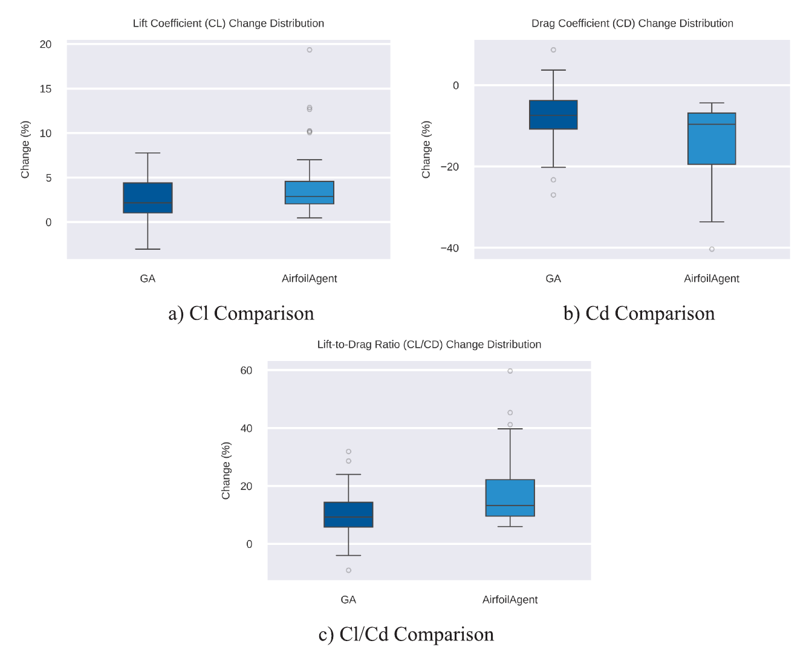

**图 6. 气动性能变化的分布比较。** 子图依次比较升力系数、阻力系数和升阻比。

图表通用标注：Lift Coefficient＝升力系数；Drag Coefficient＝阻力系数；Lift-to-Drag Ratio＝升阻比；Change (%)＝变化率（%）；Iteration＝迭代轮次；Mean Change＝平均变化；Time (Seconds)＝时间（秒）；Token Count＝token 数量；Input／Output＝输入／输出；Original／Initial＝原始／初始；Best＝最佳；Airfoil Shape Comparison／Evolution＝翼型外形比较／演化；Sensitivity Analysis＝灵敏度分析；Second-order／Third-order Feature＝二阶／三阶特征；Maximum Thickness＝最大厚度。交互网络和灵敏度图中的几何符号对应第 2.2.2 节的 12 个参数。

为更清楚地展示 AirfoilAgent 的迭代优化轨迹，图 7 可视化了五轮优化中升力系数、阻力系数及升阻比分布的演化，并用虚线表示各轮平均值。这同时揭示了多智能体系统所实现气动改进的集中趋势与波动性。

如表 2 和图 7(a) 所示，由于施加了升力变化约束，升力系数在迭代中保持相对稳定。大多数样本呈小幅正变化，平均 Cl 波动处于 +2.4% 至 +3.9% 之间。图 7(b) 展示阻力系数的下降：五轮均持续满足减阻目标，第一轮收益最大，平均为 -9.08%；后续每轮仍获得约 1% 的有意义增益，但幅度逐渐减小。图 7(c) 展示升阻比演化，第一轮同样提升最显著，平均 +15.03%，随后稳步上升至第五轮的 +20.14%。

综上，AirfoilAgent 借助知识驱动机制，在保持升力稳定的同时有效实现减阻和升阻比提升。第一轮的显著改善突出了系统性知识对初始优化方向的指导作用。虽然后期收益逐渐减小，持续的增量改善仍体现了框架较强的泛化能力和稳健性。

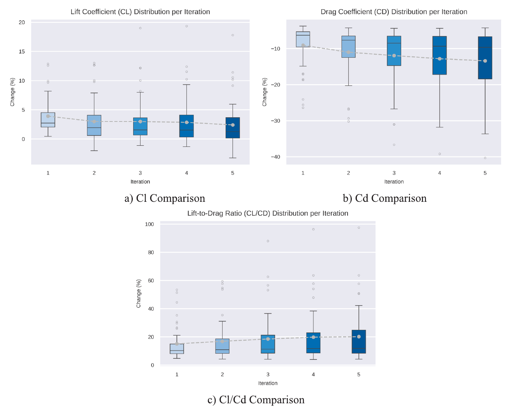

**图 7. AirfoilAgent 五轮迭代中气动性能参数的总体变化。**

**表 2. 迭代优化中气动性能变化的统计比较（单位：%）。**

| 轮次 | ΔCl 最大 | ΔCl 最小 | ΔCl 平均 | ΔCd 最大 | ΔCd 最小 | ΔCd 平均 | Δ(Cl/Cd) 最大 | Δ(Cl/Cd) 最小 | Δ(Cl/Cd) 平均 |
|---|---:|---:|---:|---:|---:|---:|---:|---:|---:|
| 1 | +12.86 | +0.44 | +3.91 | -3.77 | -26.42 | -9.08 | +53.38 | +4.69 | +15.03 |
| 2 | +13.01 | -2.02 | +2.99 | -4.27 | -30.21 | -11.01 | +59.41 | +4.18 | +16.81 |
| 3 | +19.01 | -1.13 | +2.99 | -4.37 | -36.69 | -11.96 | +87.97 | +4.07 | +18.48 |
| 4 | +19.34 | -1.33 | +2.84 | -4.37 | -39.21 | -12.82 | +96.31 | +3.92 | +19.75 |
| 5 | +17.80 | -3.26 | +2.40 | -4.27 | -40.35 | -13.40 | +97.48 | +4.16 | +20.14 |
| 最佳结果均值 | — | — | +4.28 | — | — | -13.65 | — | — | +20.84 |

#### 3.2.2. 优化几何参数比较

表 3 和图 8 展示了优化前后 12 个几何参数的总体平均变化。由于施加了约束，上下表面最大厚度均保持不变，说明两种方法都满足设计要求。AirfoilAgent 总体上通过减小参数值来增升减阻，但变化幅度相对较小。对于多数样本，参数变化方向和范围也更集中。这是因为本研究对象均为超临界翼型，具有内在几何—气动相关性。LLM 成功捕捉这些潜在模式，从而推荐一致的方向与幅度。

相比之下，GA 的变化模式较分散，参数变化缺乏系统性，有些增大、有些减小，体现一定随机性。借助知识融合机制和任务规划能力，AirfoilAgent 在优化中表现出更强的适应性，其策略更具系统性和一致性，多数参数遵循稳定的优化趋势。这种对特征空间的全局理解不仅提高优化效率，也增强结果的可解释性。

**表 3. 几何参数总体平均变化的统计比较。**

| 方法 | $R_{up}$ | $R_{low}$ | $X_{up}$ | $Y_{up}$ | $z_{xxup}$ | $X_{low}$ |
|---|---:|---:|---:|---:|---:|---:|
| GA | -2.58% | -0.54% | -1.04% | 0.00% | -0.08% | +0.85% |
| AirfoilAgent | -18.47% | -13.69% | -13.29% | 0.00% | -13.29% | -10.53% |

| 方法 | $Y_{low}$ | $z_{xxlow}$ | $\alpha_{te}$ | $\beta_{te}$ | $z_{te}$ | $\Delta z_{te}$ |
|---|---:|---:|---:|---:|---:|---:|
| GA | 0.00% | -0.86% | -0.76% | -0.12% | +0.84% | -0.06% |
| AirfoilAgent | 0.00% | -11.90% | -18.89% | -18.90% | -16.33% | -20.57% |

> 原文一致性提示：正文称 AirfoilAgent 的变化幅度“相对较小”，而表 3 多数参数的绝对变化幅度大于 GA。下段关于“最大厚度位置不变”和“上表面最大厚度持续增加”的叙述，也与表 3 中相应列不完全一致；此处均保留原文。

图 9 汇总了五轮优化中 12 个几何特征参数的逐轮演化。轨迹揭示了知识引导优化产生的一组一致且可解释的结构模式。与上下表面最大厚度位置相关的几何变量几乎不变，反映了施加的位置约束。在未受约束特征中，上表面最大厚度是唯一在各轮持续增加的参数，说明在升力变化约束下，智能体倾向于加厚上表面轮廓以维持升力稳定。

其余大多数几何参数逐渐下降，但灵敏度和变化幅度明显不同。与下表面厚度分布和中弦曲率相关的参数只发生小幅变化，说明在所选工况下，它们的气动影响较次要。相比之下，后缘方向角和后缘厚度在初期调整最大，随后仍逐轮明显变化。这说明优化智能体先迅速利用后缘几何对气动性能的较强影响，特别是对压力恢复和整体减阻的作用，再在后续轮次以较小修正进一步改进。

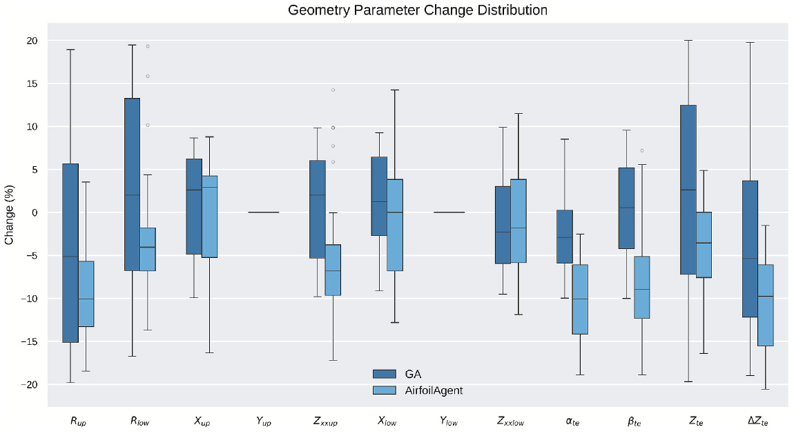

**图 8. 总体几何参数变化的分布比较。**

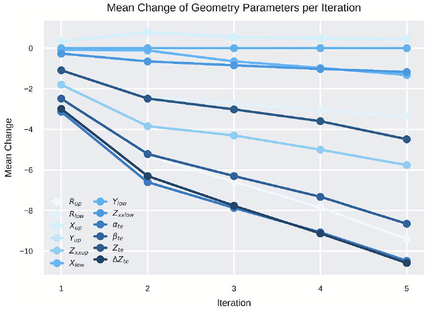

**图 9. AirfoilAgent 各迭代轮次的几何参数平均变化。**

#### 3.2.3. 优化资源比较

为评估计算效率，表 4 和图 10 比较 AirfoilAgent 与 GA 的耗时。AirfoilAgent 的报告时间仅包含五轮在线优化迭代，不包含离线气动知识库的构建时间；知识库只构建一次，可跨任务复用。相反，GA 的耗时反映其种群式结构：每代必须评估一整组候选翼型，每个个体都要单独进行气动计算。由于 GA 通过进化种群而非单一设计进行优化，其每代成本随个体数量增长。这种重复性使总运行时间高度一致，集中在约 101 秒。

尽管 AirfoilAgent 连续执行五轮优化，由于每轮只更新和评估一个翼型，平均运行时间较低，约为 89 秒。但其运行时间分布更宽。这是因为当优化轨迹停滞或出现相互冲突的气动信号时，反思机制被激活。此时智能体生成更长的推理序列，使某些轮次的 LLM 推理时间增加，箱线图因而更分散。

**表 4. 总体耗时的统计比较。**

| 方法 | 最大耗时（秒） | 最小耗时（秒） | 平均耗时（秒） |
|---|---:|---:|---:|
| GA | 101.09 | 100.87 | 100.98 |
| AirfoilAgent | 126.42 | 55.82 | 89.22 |

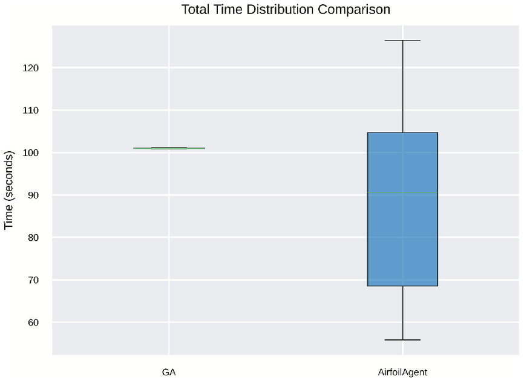

**图 10. 耗时分布比较。**

为更清楚地评估 AirfoilAgent 所需计算资源，图 11 和表 5 报告五轮优化的 token（词元）消耗。总体而言，输入 token 数显著高于输出 token 数。这种不对称源于流程结构：每轮都需要智能体处理信息丰富的长提示，其中包含当前翼型几何、气动系数、前序迭代上下文及全部优化约束。相反，输出主要是简洁修改指令，通常只规定调整哪些几何特征及调整多少，因此标准优化轮次的输出 token 较少。

约从第三轮开始，输出 token 消耗明显增加。这由反思机制激活所驱动：当轨迹呈现停滞或不一致时，智能体生成较长推理序列，重新评估此前决策、分析预测与观测气动响应的差异，并修正用于指导后续调整的知识。这些反思解释自然需要更多文本，因此后期输出 token 增加。

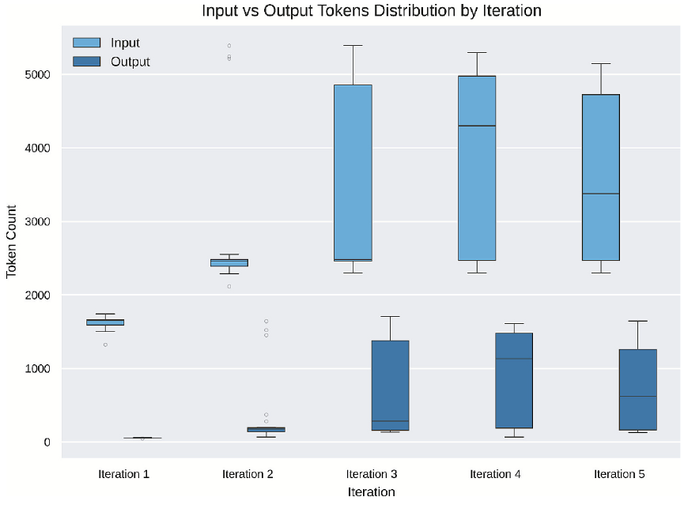

**图 11. AirfoilAgent 五轮迭代的 token 消耗。**

**表 5. 迭代优化中 token 消耗的统计比较。**

| 轮次 | 输入最大 | 输入最小 | 输入平均 | 输出最大 | 输出最小 | 输出平均 |
|---|---:|---:|---:|---:|---:|---:|
| 1 | 1740 | 1320 | 1620.86 | 60 | 47 | 56.09 |
| 2 | 5389 | 2115 | 2807.14 | 1642 | 66 | 358.05 |
| 3 | 5393 | 2295 | 2569.09 | 1708 | 133 | 743.36 |
| 4 | 5291 | 2295 | 3775.50 | 1611 | 67 | 847.14 |
| 5 | 5144 | 2295 | 3607.32 | 1645 | 130 | 742.09 |
| 总计 | 22,048 | 10,673 | 15379.91 | 5881 | 595 | 2746.73 |

通过 AirfoilAgent 可以看出，所研究翼型的优化不仅带来显著性能收益，也体现较强的可解释性和可信度。五轮迭代中，几何参数的动态变化与既有气动设计原理紧密一致，在保持整体升力稳定的同时提高升阻比。AirfoilAgent 利用 RAG 获得的通用系统性知识指导优化方向，有效缓解了 LLM 直接数值推理常见的幻觉风险。因而参数调整合理且在物理上可解释，在优化结果与其底层几何—气动耦合机制之间建立清晰因果联系。这种知识驱动的智能体协作框架为 LLM 在飞机翼型气动设计中的可信应用提供了有力支持。

### 3.3. 消融研究

为评估 AirfoilAgent 对先验知识和 LLM 的依赖，在不同 LLM 及不同知识融合尺度下进行了广泛消融实验。通过系统比较不同模块组合对优化性能的影响，量化各组件的具体贡献。

#### 3.3.1. 不同 LLM 的影响

表 6 和图 12 比较了不同 LLM 在翼型优化过程中的表现。实验评估了中文和英文模型：中文 LLM 包括 Qwen-max [54] 和 DeepSeek-v3 [55]，英文 LLM 包括 GPT-4 [56] 和 Claude-3.7 [52]，其中 Claude 为主要模型。为保证公平，所有模型采用统一推理配置，每次调用均使用英文提示。具体设置为：temperature＝0.2，top-p＝0.2，不进行 top-k 截断，presence/frequency penalties＝0.0，无自定义停止序列；禁用工具使用和 JSON／结构化模式。

结果表明，Claude 始终优于其他模型。虽然各模型升力系数变化大致相近，但 Claude 的阻力系数降幅比其他模型大 5% 以上。综合为升阻比后，这一优势进一步扩大至 6% 以上。Claude 在部分案例中还表现出突出优化能力，而其他模型主要集中在较低性能区间。中文模型中，Qwen 略优于 DeepSeek，在减阻和升阻比方面均更好；英文模型中，GPT 表现最弱，突显其在工程相关数值仿真与应用计算方面的局限。总体而言，虽然中文和英文 LLM 都带来可测量优化收益，但 Claude 在理解和应用气动知识、指导优化策略以及处理工程任务方面表现出最强的泛化能力和实际效果。

进一步分析认为，不同模型表现受以下因素影响：1）领域覆盖与指令微调决定模型能否可靠执行气动设计中结构化、约束密集的提示；更广泛的气动／CFD 知识接触及更强指令遵循能力，可减少生成阶段的不可行几何。2）数值可靠性与约束处理，包括稳定处理符号、边界和物理单位，可降低 CFD 验证中的淘汰率，提高可用样本率和净减阻收益。3）跨语言 token 化与符号表示会引入系统性障碍，例如小数习惯、单位缩写和技术词汇覆盖差异，可能对中英文提示产生不同影响；采用语言无关的模式可减轻这些效应。

**表 6. 使用不同 LLM 的气动性能变化统计比较（单位：%）。**

| 模型 | ΔCl 最大 | ΔCl 最小 | ΔCl 平均 | ΔCd 最大 | ΔCd 最小 | ΔCd 平均 | Δ(Cl/Cd) 最大 | Δ(Cl/Cd) 最小 | Δ(Cl/Cd) 平均 |
|---|---:|---:|---:|---:|---:|---:|---:|---:|---:|
| Qwen-max | +12.71 | +0.68 | +4.81 | -3.03 | -25.80 | -8.26 | +51.90 | +4.94 | +14.47 |
| DeepSeek-v3 | +16.70 | +0.95 | +4.58 | -2.79 | -31.83 | -7.91 | +71.18 | +5.13 | +13.96 |
| GPT-4 | +13.05 | +0.37 | +4.22 | -0.83 | -28.99 | -6.98 | +56.75 | +2.31 | +12.36 |
| Claude-3.7 | +19.34 | +0.44 | +4.28 | -4.37 | -40.35 | -13.65 | +97.48 | +4.69 | +20.84 |

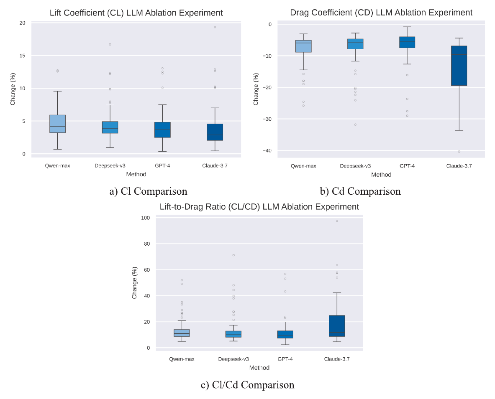

**图 12. 不同 LLM 的气动性能变化分布比较。**

#### 3.3.2. 不同知识融合尺度的影响

表 7 和图 13 给出不同知识融合尺度的消融实验。考察的三类知识为通用系统性知识、特征交互知识和特征主导性知识。结果表明，缺少任何一个组件都会使优化性能明显下降。具体而言，阻力系数表现恶化超过 3%，升阻比下降超过 5%。三类知识中，移除通用系统性知识导致的退化最显著，说明它在优化中的关键作用。缺少特征主导性知识也会带来性能损失，平均升阻比下降 5.6%，表明它对指导局部性能改进有重要作用。移除特征交互知识同样降低性能，但总体影响相对较小。这些发现验证了 AirfoilAgent 多维知识协同机制对改善翼型优化结果的有效性。

**表 7. 不同知识融合尺度下的气动性能变化统计比较（单位：%）。**

| 原文实验标签 | ΔCl 最大 | ΔCl 最小 | ΔCl 平均 | ΔCd 最大 | ΔCd 最小 | ΔCd 平均 | Δ(Cl/Cd) 最大 | Δ(Cl/Cd) 最小 | Δ(Cl/Cd) 平均 |
|---|---:|---:|---:|---:|---:|---:|---:|---:|---:|
| 通用知识（Regular Knowledge） | +13.58 | +1.17 | +5.08 | -1.88 | -25.91 | -8.00 | +51.48 | +4.39 | +14.50 |
| 交互知识（Interaction Knowledge） | +19.65 | -0.10 | +4.46 | -3.05 | -33.51 | -10.86 | +67.87 | +4.77 | +16.69 |
| 特征知识（Feature Knowledge） | +13.76 | +0.23 | +4.04 | -2.85 | -30.04 | -10.41 | +62.25 | +4.06 | +15.81 |
| AirfoilAgent | +19.34 | +0.44 | +4.28 | -4.37 | -40.35 | -13.65 | +97.48 | +4.69 | +20.84 |

> 表义说明：原表以知识名称标注消融组，正文将这些组解释为移除相应知识后的实验。正文“下降 5.6%”及“超过 5%”等概括与表内差值并不全部一致，译文保留原始表述与数值。

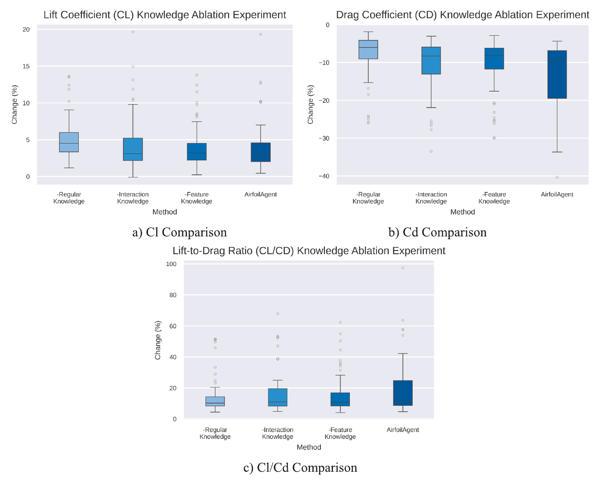

**图 13. 不同知识融合尺度下的气动性能变化分布比较。**

#### 3.3.3. 不同工作流程模块的影响

表 8 和图 14 展示优化流程模块的消融实验，重点考察任务规划模块及结果评估与反思模块。对于任务规划模块，研究优化目标和约束的描述格式是否影响性能。主实验采用基于 LaTeX 的数学公式表达优化条件，消融实验改用更灵活的自然语言。对于结果评估与反思模块，重点考察知识更新机制是否影响结果：移除三类知识的更新机制，后续迭代仅依赖第一轮生成的知识。

结果表明，当使用自然语言而非严格 LaTeX 公式表达优化目标时，AirfoilAgent 的性能几乎不变，说明其对不同输入格式具有适应性。这也体现其良好交互性：相较传统定量输入，轻量的自然语言输入有效降低了翼型气动优化的使用门槛。相比之下，移除动态知识更新机制显著降低性能，特别是升阻比平均提升从 20.84% 降至 15.22%。这说明缺乏动态反馈时，优化更容易陷入局部最优，限制优化策略的演化。

**表 8. 不同优化流程下的气动性能变化统计比较（单位：%）。**

| 实验标签 | ΔCl 最大 | ΔCl 最小 | ΔCl 平均 | ΔCd 最大 | ΔCd 最小 | ΔCd 平均 | Δ(Cl/Cd) 最大 | Δ(Cl/Cd) 最小 | Δ(Cl/Cd) 平均 |
|---|---:|---:|---:|---:|---:|---:|---:|---:|---:|
| 总体规划模块（Overall Plan Module） | +19.67 | -0.15 | +4.56 | -4.83 | -39.74 | -13.06 | +98.60 | +5.14 | +20.30 |
| 反思模块（Reflection Module） | +18.81 | -0.44 | +3.91 | -4.96 | -33.18 | -10.36 | +77.81 | +4.16 | +15.22 |
| AirfoilAgent | +19.34 | +0.44 | +4.28 | -4.37 | -40.35 | -13.65 | +97.48 | +4.69 | +20.84 |

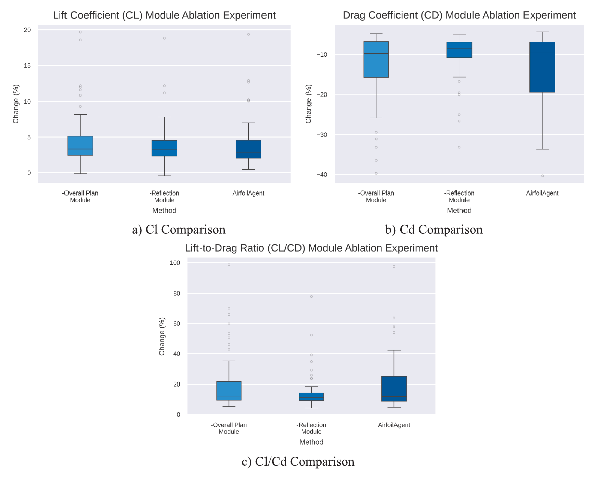

**图 14. 不同优化流程模块下的气动性能变化分布比较。**

## 4. 优化案例研究

为直观说明 AirfoilAgent 在气动优化中的微观表现，本文深入研究四个代表性案例：性能最佳、性能最差、典型平均性能及多目标优化翼型。在几何方面，比较 AirfoilAgent 与 GA 之间及不同迭代轮次之间的变化；在气动性能方面，考察升力系数、阻力系数和升阻比的迭代趋势。为进一步说明气动知识融合模块的合理性，还分析基准翼型的通用系统性知识、特征交互效应和特征主导效应，并展示由这些知识导出的第一轮几何特征变化，判断知识是否被合理应用。

通用系统性知识以文本形式表达。交互效应知识通过二阶和三阶特征交互网络展示，其中翼型 12 个几何特征作为节点，可解释关系，即特征交互，以边表示；三阶交互则用超边表示。正交互为红色，负交互为蓝色。节点大小反映一阶（主导）效应强度，节点越大，主导效应越强。高阶交互的强度和方向进一步由边的颜色、透明度和粗细表示：强交互为低透明度粗线，弱交互为高透明度细线。特征主导效应还使用龙卷风图展示，说明 12 个特征对三种气动性能系数的灵敏度。

### 4.1. 最佳性能翼型案例

表 9 汇总性能最佳翼型的优化结果。AirfoilAgent 经过五轮迭代后，升阻比相对基准提高 97.48%，比相同条件下 GA 的提升高 74.46%。分项而言，AirfoilAgent 的升力增加 17.80%，接近 GA 的 6.03% 的三倍；阻力降低 40.46%，显著优于 GA 的 13.74%。

**表 9. 最佳性能翼型的气动性能比较。**

| 方法 | Cl 原始 | Cl 优化后 | Cl 变化 | Cd 原始 | Cd 优化后 | Cd 变化 | Cl/Cd 原始 | Cl/Cd 优化后 | Cl/Cd 变化 |
|---|---:|---:|---:|---:|---:|---:|---:|---:|---:|
| AirfoilAgent | 0.7187 | 0.8466 | +17.80% | 0.0131 | 0.0078 | -40.46% | 54.82 | 108.26 | +97.48% |
| GA | 0.7187 | 0.7621 | +6.03% | 0.0131 | 0.0113 | -13.74% | 54.82 | 67.44 | +23.02% |

图 15 展示最优翼型的几何。AirfoilAgent 最显著的修改位于上表面，尤其是前缘和中弦区域，较大的曲率调整形成更平滑的气动过渡。下表面变化相对较小，主要集中于后缘附近。相比之下，GA 几何调整更保守，外形更接近基准，仅在上下表面进行适度局部曲率修改。

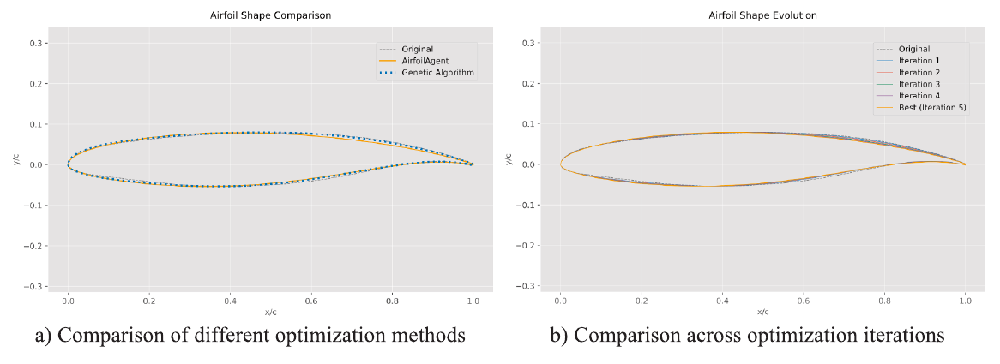

**图 15. 最佳性能翼型的几何比较。** 左图比较不同优化方法，右图比较各优化迭代轮次。

图 15(b) 进一步展示 AirfoilAgent 设计的逐轮演化。轨迹呈清晰且可解释的模式：上表面从第一轮开始逐步增厚，前两轮调整最显著；后续轮次通过较小局部修改精细调整，体现从粗粒度全局塑形向精细气动调节的转变。整个过程中，下表面相对稳定，只在后缘附近小幅变化，说明主要依靠上表面塑形获得气动收益。

图 16 展示气动性能演化。升力系数在早期稳步上升，随后稳定，说明 AirfoilAgent 主要通过初期上表面塑形增升，再进行较小微调。阻力系数在各轮单调下降，初期降幅最大，接近收敛时改进逐渐减小。二者共同作用使升阻比从约 50 快速升至 100 以上，在第 4 轮达到最优，随后保持在接近水平。这说明主要收益来自前几轮增升与减阻的协同，之后框架转向增量改进。

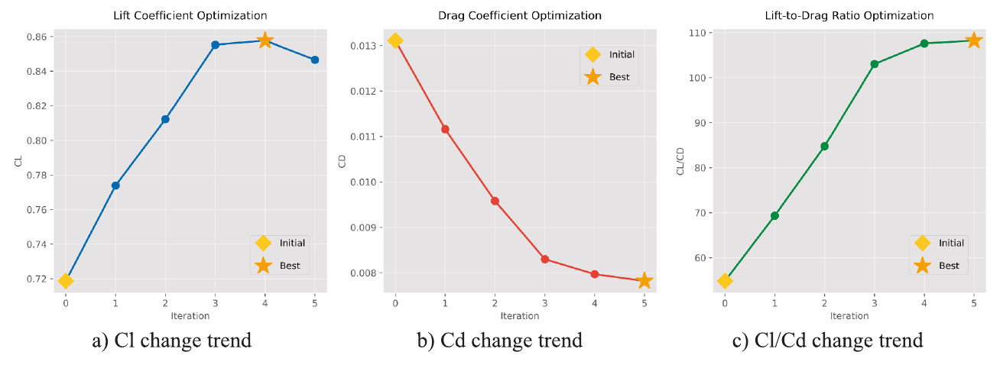

**图 16. 最佳性能翼型的气动性能趋势分析。**

表 10 给出 LLM 对最佳性能翼型推荐的第一轮几何修改。最显著调整出现在上表面最大厚度位置和后缘楔角，均减小 3.0%。相反，上下表面最大厚度不变，说明 LLM 在优化中较好地遵守了厚度约束。

**表 10. 最佳性能翼型的第一轮几何修改。**

| 参数 | $R_{up}$ | $R_{low}$ | $X_{up}$ | $Y_{up}$ | $z_{xxup}$ | $X_{low}$ | $Y_{low}$ | $z_{xxlow}$ | $\alpha_{te}$ | $\beta_{te}$ | $z_{te}$ | $\Delta z_{te}$ |
|---|---:|---:|---:|---:|---:|---:|---:|---:|---:|---:|---:|---:|
| 变化 | -2.5% | -1.0% | -3.0% | 0% | +2.0% | -2.0% | 0% | -1.5% | -3.0% | -2.0% | 0% | -2.0% |

> 原文一致性提示：上述正文称“后缘楔角”减小 3.0%，但表 10 中减小 3.0% 的是后缘方向角 $\alpha_{te}$，后缘楔角 $\beta_{te}$ 为 -2.0%。

附录中的通用系统性知识揭示了最佳性能翼型几何参数与气动系数之间的关系。若干变化较大的参数与检索规律高度一致。例如，上表面最大厚度位置前移 -3.0%，符合“上表面凸起前移有助于减阻”的规律；前缘半径减小 -2.5%，后缘方向角和楔角分别减小 -3.0% 和 -2.0%，符合“较大后缘方向角和楔角往往增阻”的知识。后缘厚度减小 -2.0%，符合“较厚后缘通常导致较大阻力”的规律。下表面最大厚度位置前移 -2.0%，符合“压力面凸起前移可促进减阻”的知识。上表面最大厚度处曲率变化 +2.0%，对应“曲率绝对值减小往往使阻力增大”的规律。这些学习规律与参数更新的一致性表明，AirfoilAgent 的决策并非任意，而是建立在显式可解释气动知识基础上。

> 原文一致性提示：本段关于曲率绝对值与阻力的关系，与附录“上表面曲率绝对值增大时阻力系数增大”的叙述方向不同；两处均按原文保留。

图 17 的二阶网络给出各气动系数最强的特征交互对。升力系数的主导组合为〈上表面最大厚度处曲率 × 后缘高度〉、〈下表面前缘半径 × 上表面最大厚度处曲率〉和〈上表面最大厚度 × 下表面最大厚度〉。阻力系数最重要的组合为〈上表面前缘半径 × 上表面最大厚度位置〉、〈上表面前缘半径 × 上表面最大厚度〉和〈后缘方向角 × 上表面最大厚度〉。力矩系数最强组合为〈下表面最大厚度 × 后缘厚度〉、〈下表面最大厚度 × 下表面最大厚度位置〉和〈下表面最大厚度位置 × 后缘高度〉。

由于优化主要强调减阻，重点关注阻力相关的二阶网络。在施加的厚度约束下，上表面最大厚度位置不变，使〈上表面前缘半径 × 上表面最大厚度位置〉成为引导 LLM 建议的主导交互。与此一致，LLM 对这两个参数提出 -2.5% 和 +3.0% 的修改。此外，上表面前缘半径、上表面最大厚度位置和上表面最大厚度处曲率是阻力网络中高度交互的节点，均具有较大几何调整。总体表明，LLM 生成优化参数时有效融合了二阶耦合知识。

> 原文一致性提示：本段“最大厚度位置不变”及其变化“+3.0%”与表 10 的 $X_{up}=-3.0\%$ 不一致。译文未将这些叙述替换为推测的正确值。

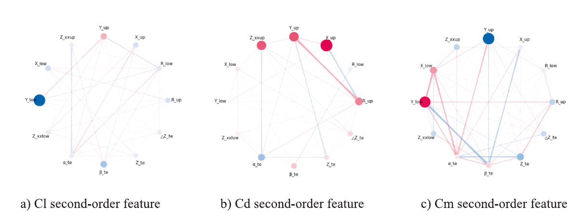

**图 17. 最佳性能翼型的二阶特征交互网络。**

图 18 的三阶网络给出各系数最强的三元组合。升力系数的主导组合为〈上表面最大厚度 × 下表面最大厚度位置 × 后缘高度〉、〈上表面最大厚度 × 下表面最大厚度位置 × 下表面最大厚度处曲率〉、〈上表面前缘半径 × 下表面前缘半径 × 下表面最大厚度处曲率〉。阻力系数最强组合为〈上表面前缘半径 × 下表面前缘半径 × 上表面最大厚度位置〉、〈上表面前缘半径 × 后缘高度 × 后缘方向角〉、〈上表面前缘半径 × 上表面最大厚度位置 × 上表面最大厚度〉。力矩系数最重要组合为〈下表面前缘半径 × 上表面最大厚度位置 × 后缘厚度〉、〈上表面前缘半径 × 下表面前缘半径 × 后缘厚度〉、〈上表面最大厚度处曲率 × 下表面最大厚度位置 × 后缘楔角〉。

三阶网络覆盖更广的组合，其关系本身更复杂。与二阶情况类似，本文重点关注阻力系数的三阶交互。对于最强三元组〈上表面前缘半径 × 下表面前缘半径 × 上表面最大厚度〉，对应几何修改分别为 -2.5%、-1.0% 和 -3.0%。这些结果反映 AirfoilAgent 有效应用几何特征的三阶耦合知识，使高阶交互对优化产生有意义的贡献。

> 原文一致性提示：上一段最后所列三元组将第三个量写为“上表面最大厚度”，但前文对应组合写为“上表面最大厚度位置”，表 10 中两者分别为 0% 和 -3.0%；译文保留这一差异。

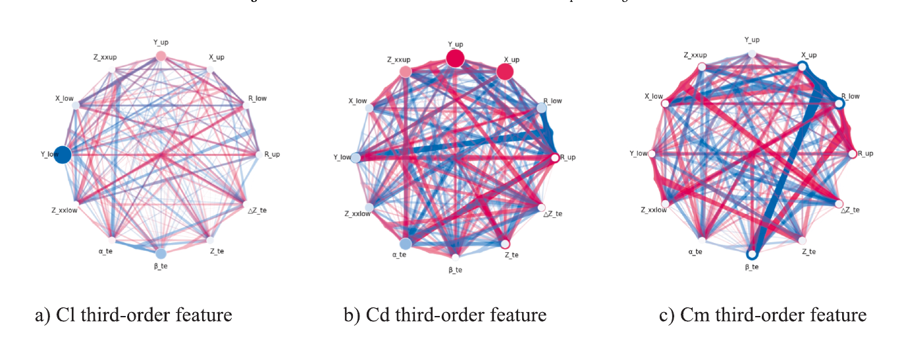

**图 18. 最佳性能翼型的三阶特征交互网络。**

图 19 显示，各气动系数最敏感的参数不同。升力系数最受下表面最大厚度、后缘方向角和后缘楔角影响；阻力系数的主导参数为上表面前缘半径、后缘方向角及上表面最大厚度处曲率；力矩系数最敏感的参数为后缘方向角、下表面最大厚度和上表面最大厚度。AirfoilAgent 第一轮建议的最大变化限定为 ±3%。对阻力最敏感的上表面前缘半径（-2.5%）、后缘方向角（-3.0%）、上表面最大厚度处曲率（+2.0%）和上表面最大厚度位置（-3.0%），调整幅度相对其他特征最大，充分表明 LLM 有效利用了主导效应知识。

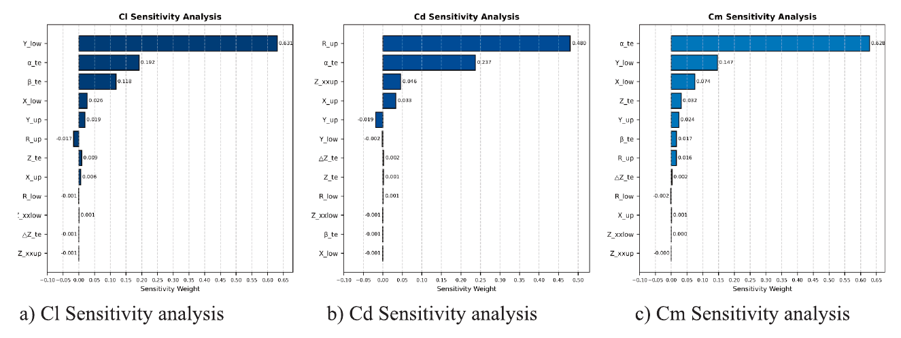

**图 19. 最佳性能翼型的灵敏度分析。**

### 4.2. 最差性能翼型案例

如表 11 所示，AirfoilAgent 与 GA 的结果基本相当。升力系数略增，阻力系数降低约 4.0%，升阻比提高约 4.7%。不过，AirfoilAgent 仍略优，说明对于这一翼型，两种方法在优化过程中可能都收敛到了局部最优解。

**表 11. 最差性能翼型的气动性能比较。**

| 方法 | Cl 原始 | Cl 优化后 | Cl 变化 | Cd 原始 | Cd 优化后 | Cd 变化 | Cl/Cd 原始 | Cl/Cd 优化后 | Cl/Cd 变化 |
|---|---:|---:|---:|---:|---:|---:|---:|---:|---:|
| AirfoilAgent | 0.9235 | 0.9276 | +0.44% | 0.0121 | 0.01159 | -4.21% | 76.32 | 80.03 | +4.86% |
| GA | 0.9235 | 0.9282 | +0.51% | 0.0121 | 0.01162 | -3.97% | 76.32 | 79.88 | +4.66% |

图 20 展示最差性能优化翼型。AirfoilAgent 的上表面从前缘到中部有可见曲率调整，形成更平滑的外形过渡；下表面修改主要位于后缘附近，进行适度重塑。GA 的变化更保守，整体轮廓接近基准，仅进行较小局部曲率调整。图 20(b) 的逐轮演化进一步表明轨迹高度保守：五轮均只出现小幅局部扰动，上下表面都没有显著重构。较弱几何响应说明路径较早受到限制，过程停留在基准附近，未探索影响更大的设计方向。

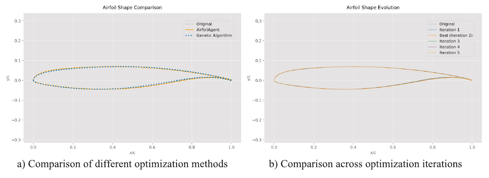

**图 20. 最差性能翼型的几何比较。**

图 21 展示其气动性能演化。升力系数不稳定：第一轮略增，第二轮明显下降，之后未完全恢复。阻力响应也较弱，初期略降后反弹，后续接近原水平。因此，升阻比仅小幅改善，从约 76 升至第一轮峰值约 80，之后下降并稳定在约 79，总体收益有限。这说明优化器过早达到最佳中间解，随后未能继续进展，此时人工专家介入可能有益。在实际气动设计中，工程师可观察到停滞，并以自然语言指导，例如“优先控制中弦附近的激波”或“增大后缘附近弯度以恢复升力稳定性”。这类人在回路调整可重新引导优化轨迹，防止困于局部最优，并改善最终性能。

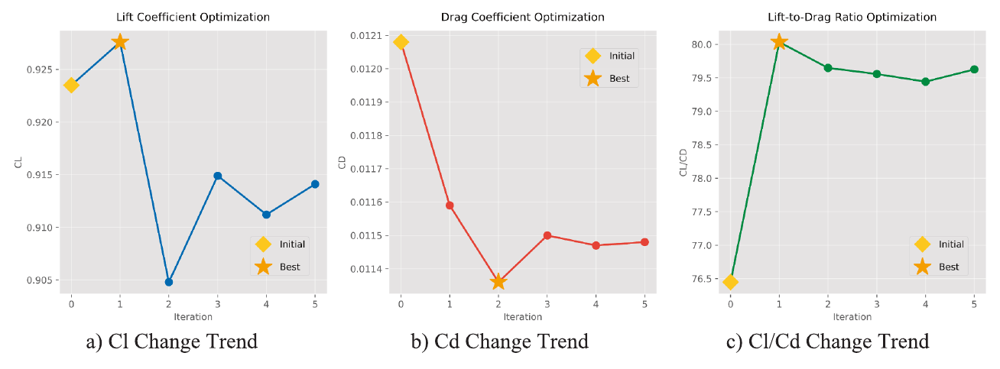

**图 21. 最差性能翼型的气动性能趋势分析。**

表 12 表明，主要变化集中在下表面前缘半径、下表面最大厚度处曲率、后缘方向角和后缘厚度。除后缘高度外，各参数均有一定变化，总体幅度较大。

**表 12. 优化性能最差翼型的第一轮几何修改。**

| 参数 | $R_{up}$ | $R_{low}$ | $X_{up}$ | $Y_{up}$ | $z_{xxup}$ | $X_{low}$ | $Y_{low}$ | $z_{xxlow}$ | $\alpha_{te}$ | $\beta_{te}$ | $z_{te}$ | $\Delta z_{te}$ |
|---|---:|---:|---:|---:|---:|---:|---:|---:|---:|---:|---:|---:|
| 变化 | +2.0% | -3.0% | -1.5% | 0% | -2.0% | +2.0% | 0% | -3.0% | -2.5% | +3.0% | 0% | -4.0% |

> 原文一致性提示：正文称除后缘高度外所有参数均变化，但表中 $Y_{up}$ 和 $Y_{low}$ 同样为 0%。

图 22 的二阶网络中，升力系数最强组合为〈下表面最大厚度 × 后缘方向角〉、〈上表面最大厚度 × 下表面最大厚度〉和〈下表面最大厚度 × 后缘高度〉。阻力系数最强组合为〈上表面前缘半径 × 上表面最大厚度〉、〈上表面前缘半径 × 上表面最大厚度处曲率〉和〈上表面最大厚度 × 后缘方向角〉。力矩系数最强组合为〈后缘方向角 × 后缘高度〉、〈上表面前缘半径 × 后缘高度〉和〈上表面前缘半径 × 后缘方向角〉。

仅向 LLM 提供升力和阻力系数各自排名前三的组合。但对该翼型，只有〈上表面前缘半径 × 后缘高度〉影响了优化。对应修改为上表面前缘半径 +2.0%、后缘高度 0%，说明这一案例中 LLM 未有效利用二阶交互知识。

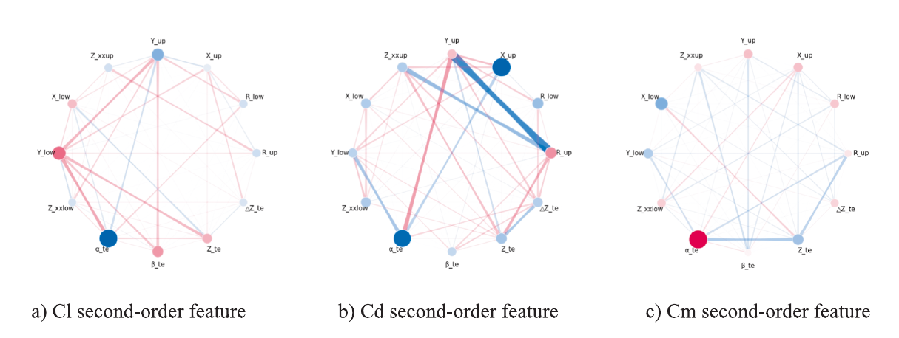

**图 22. 最差性能翼型的二阶特征交互网络。**

图 23 的三阶网络中，升力系数最强组合为〈下表面前缘半径 × 下表面最大厚度 × 后缘方向角〉、〈下表面前缘半径 × 下表面最大厚度 × 后缘高度〉、〈下表面前缘半径 × 上表面最大厚度处曲率 × 下表面最大厚度处曲率〉。阻力系数最强组合为〈上表面最大厚度位置 × 上表面最大厚度 × 后缘方向角〉、〈上表面前缘半径 × 上表面最大厚度位置 × 下表面最大厚度位置〉、〈上表面最大厚度位置 × 后缘角 × 后缘高度〉。力矩系数最强组合为〈上表面前缘半径 × 下表面最大厚度 × 后缘厚度〉及〈上表面前缘半径 × 下表面最大厚度处曲率 × 后缘方向角〉。

第一轮几何修改中，只有涉及下表面前缘半径和下表面最大厚度处曲率的组合出现在交互效应中。除后缘高度外，后缘方向角和后缘厚度等其他强交互特征未得到反映。这说明 LLM 在优化中可能忽视某些高影响交互特征，从而限制最终结果质量。

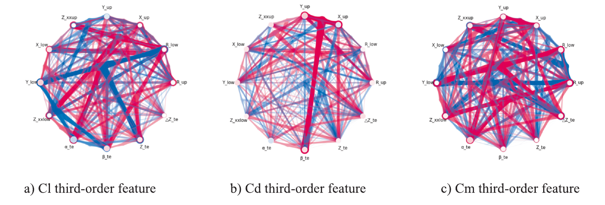

**图 23. 最差性能翼型的三阶特征交互网络。**

图 24 中，升力系数最敏感参数为后缘方向角、下表面最大厚度和上表面最大厚度；阻力系数最敏感参数为上表面前缘半径、后缘方向角和上表面最大厚度；力矩系数的主导参数同样为后缘方向角、下表面最大厚度和上表面最大厚度。AirfoilAgent 第一轮建议的最大变化为 ±4%，但对升力和阻力最敏感参数的变化仅限于 ±3% 内，说明 LLM 未充分将灵敏度知识纳入优化。

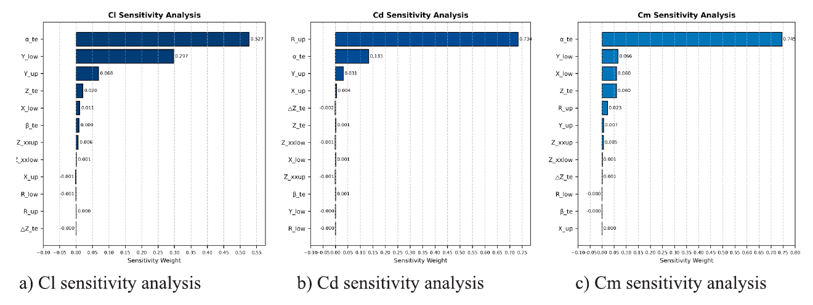

**图 24. 最差性能翼型的灵敏度分析。**

### 4.3. 平均性能翼型案例

为研究典型优化表现，选取升阻比提升约为平均值 20.84% 的翼型详细分析，结果见表 13。AirfoilAgent 优化后的升力系数变化与 GA 接近：前者略降，后者略增。AirfoilAgent 在阻力系数降低和升阻比提高两个方面均比 GA 好约 7%，体现其改善气动效率的更强效果。

图 25 展示平均性能案例。AirfoilAgent 对上表面轮廓进行明显重构，显著改善前缘曲率，使中部轮廓更有利；下表面也出现明显调整，改善整体流动特征。GA 修改相对温和，主要限于局部曲率调整。图 25(b) 的逐轮演化呈渐进且一致的轨迹：早期在两表面引入小幅协同变化，主要修整前缘曲率、缓慢重新分配弯度；后期主要进行精细平滑和调整，说明通过增量改进而非大规模结构修改实现收敛。该案例体现了均衡的优化路径，适度的两表面变化带来稳定气动收益。

**表 13. 平均性能翼型的气动性能比较。**

| 方法 | Cl 原始 | Cl 优化后 | Cl 变化 | Cd 原始 | Cd 优化后 | Cd 变化 | Cl/Cd 原始 | Cl/Cd 优化后 | Cl/Cd 变化 |
|---|---:|---:|---:|---:|---:|---:|---:|---:|---:|
| AirfoilAgent | 0.8117 | 0.8031 | -1.06% | 0.0110 | 0.00898 | -18.36% | 73.79 | 89.43 | +21.20% |
| GA | 0.8117 | 0.8249 | +1.63% | 0.0110 | 0.00988 | -10.18% | 73.79 | 83.49 | +13.15% |

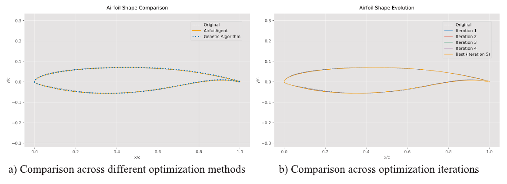

**图 25. 平均优化性能翼型的几何比较。**

图 26 展示气动性能演化。升力系数第一轮略增，随后逐渐降低，最终略低于初值。相反，阻力系数在五轮中清晰、单调下降，说明整个优化过程持续稳定减阻。升阻比轨迹改善最明显：初期快速上升，随后以较慢但稳定的速度继续提高，约在第 4 轮达到最大值，对应升阻比约 88，明显高于约 74 的初值。这说明尽管升力略有变化，协同气动调整仍转化为有意义的整体性能收益。总体曲线体现均衡模式：早期快速获益，后期逐步精修，即使升力近乎中性，升阻比仍显著提升。

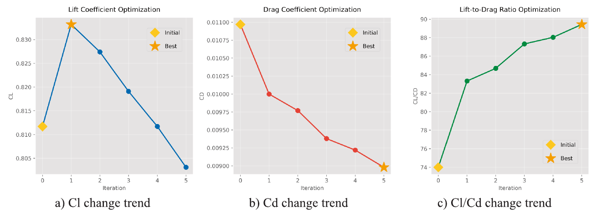

**图 26. 平均优化性能翼型的气动性能趋势分析。**

表 14 中，修改主要集中在后缘方向角、上表面前缘半径、上表面最大厚度位置处曲率、后缘角及后缘厚度。除优化中受约束的参数外，其余特征也有一定变化。

**表 14. 平均优化性能翼型的第一轮几何修改。**

| 参数 | $R_{up}$ | $R_{low}$ | $X_{up}$ | $Y_{up}$ | $z_{xxup}$ | $X_{low}$ | $Y_{low}$ | $z_{xxlow}$ | $\alpha_{te}$ | $\beta_{te}$ | $z_{te}$ | $\Delta z_{te}$ |
|---|---:|---:|---:|---:|---:|---:|---:|---:|---:|---:|---:|---:|
| 变化 | -2.0% | -1.0% | +1.0% | 0% | +2.0% | -1.0% | 0% | -1.5% | -3.0% | +2.0% | -1.0% | -2.0% |

图 27 二阶网络中，升力系数最强组合为〈后缘方向角 × 后缘高度〉、〈下表面最大厚度 × 后缘方向角〉和〈上表面前缘半径 × 下表面最大厚度处曲率〉。阻力系数主导组合为〈上表面前缘半径 × 后缘方向角〉、〈上表面前缘半径 × 上表面最大厚度〉和〈上表面前缘半径 × 上表面最大厚度位置〉。力矩系数最强组合为〈下表面最大厚度 × 后缘方向角〉、〈上表面前缘半径 × 后缘方向角〉和〈下表面最大厚度处曲率 × 后缘方向角〉。

第一轮中，后缘方向角变化最大，并广泛参与升力和阻力交互网络。其他关键因素包括上表面前缘半径和上表面最大厚度位置处曲率。结果表明，LLM 有效捕捉该翼型二阶网络中的非线性关系，并将其联合影响用于改善气动性能。

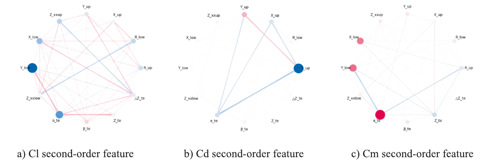

**图 27. 平均优化性能翼型的二阶特征交互网络。**

图 28 三阶网络中，升力系数最强组合为〈上表面前缘半径 × 上表面最大厚度 × 下表面最大厚度〉、〈上表面前缘半径 × 上表面最大厚度 × 后缘方向角〉和〈下表面前缘半径 × 后缘方向角 × 后缘角〉。阻力系数主导组合为〈上表面前缘半径 × 下表面最大厚度 × 后缘高度〉、〈上表面前缘半径 × 上表面最大厚度 × 后缘方向角〉和〈上表面前缘半径 × 后缘高度 × 后缘厚度〉。力矩系数最强组合为〈上表面前缘半径 × 下表面最大厚度 × 后缘厚度〉、〈下表面前缘半径 × 下表面最大厚度 × 后缘厚度〉、〈上表面最大厚度位置 × 上表面最大厚度 × 后缘方向角〉。

此案例中，相较二阶网络，三阶交互对升力和阻力的作用更有限，后缘方向角不再那么突出。相反，上表面前缘半径在阻力交互效应中作用显著，持续出现于最强组合中。总体而言，三阶交互参与了优化建议生成，但其影响较二阶效应温和。

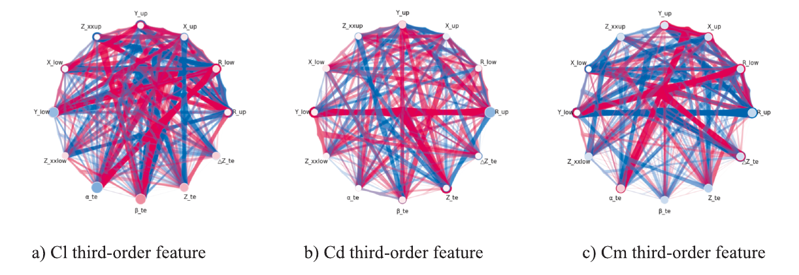

**图 28. 平均优化性能翼型的三阶特征交互网络。**

图 29 中，升力系数最敏感参数为下表面最大厚度、后缘方向角和上表面最大厚度；阻力系数最敏感参数为上表面前缘半径、上表面最大厚度和后缘方向角；力矩系数最重要参数为后缘方向角、下表面最大厚度和下表面最大厚度位置。AirfoilAgent 第一轮建议中，最大变化为 ±3%，对应后缘方向角。该参数在升力、阻力灵敏度中分别排名第二、第三，说明 LLM 将灵敏度知识纳入了优化。

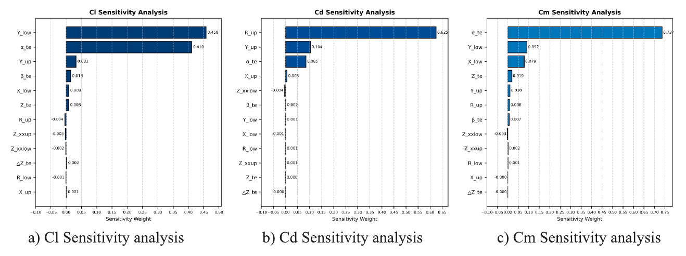

**图 29. 平均优化性能翼型的灵敏度分析。**

### 4.4. 多目标优化翼型案例

为进一步展示 AirfoilAgent 的通用性，将最佳性能翼型的任务扩展为同时实现两个目标的多目标问题：最大化升阻比，以及最小化翼型最大厚度。这一设置引入气动效率与结构／空间布置约束之间的内在权衡，对 AirfoilAgent 的推理、约束处理和几何调整能力提出更高要求。

表 15 汇总气动与几何性能结果。AirfoilAgent 在两个目标上均显著改善：优化翼型升阻比达到 90.94，比基准增加 65.89%；同时最大厚度减小 2.28%，说明框架成功考虑并平衡几何约束，而非只追求气动收益。GA 同样提高升阻比，但幅度较小，为 45.64%；最大厚度降幅也较小，为 0.98%，说明其种群进化倾向于在竞争目标间采取更保守的折中。

**表 15. 多目标优化翼型的气动性能比较。**

| 方法 | Cl 原始 | Cl 优化后 | Cl 变化 | Cd 原始 | Cd 优化后 | Cd 变化 |
|---|---:|---:|---:|---:|---:|---:|
| AirfoilAgent | 0.7187 | 0.8512 | +18.43% | 0.0131 | 0.00936 | -28.60% |
| GA | 0.7187 | 0.7577 | +5.42% | 0.0131 | 0.00949 | -27.61% |

| 方法 | Cl/Cd 原始 | Cl/Cd 优化后 | Cl/Cd 变化 | 最大厚度：原表“Optimized”列 | 最大厚度：原表“Original”列 | 厚度变化 |
|---|---:|---:|---:|---:|---:|---:|
| AirfoilAgent | 54.82 | 90.94 | 65.89% | 0.1327 | 0.1296 | -2.28% |
| GA | 54.82 | 79.84 | 45.64% | 0.1327 | 0.1312 | -0.98% |

> 原表说明：最大厚度两列在原表中依次标为“Optimized（优化后）”“Original（原始）”，但数值顺序与正文的厚度减小趋势相反，疑似表头颠倒；变化百分比与展示的舍入数值也不完全对应。此处保留原表列序、标签和数值。

图 30 展示多目标结果的几何特征。相较基准，AirfoilAgent 做出适度但协调的调整，上表面明显修整，整体厚度略减。逐轮演化平滑渐进：早期对上下表面进行小幅、全局一致的修改，尤其在前缘和中弦区域，适度减少弯度与厚度以平衡竞争目标；后期聚焦精细修整，逐步稳定为升阻性能改善且不过度增厚的外形。

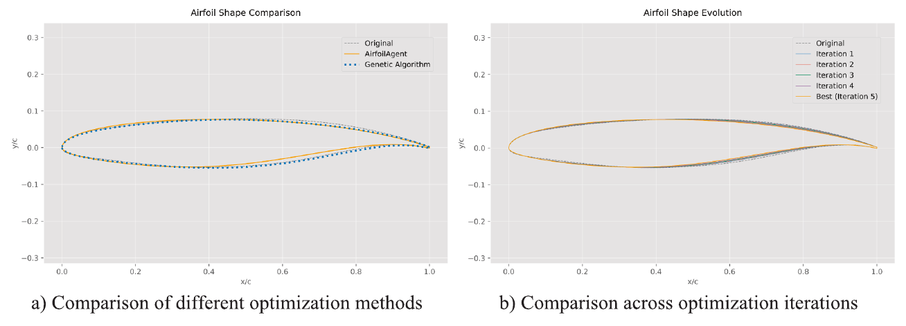

**图 30. 多目标优化翼型的几何比较。**

图 31 展示多目标翼型的气动与几何性能迭代。升力系数持续增加，反映智能体即使在附加几何约束下也能提高吸力面效率。阻力系数从初始较高水平单调下降，到第五轮显著降低，说明全过程持续有效减阻。升阻比改善最明显：早期快速提高，随后以较慢但稳定的速度增长，最终约为 91，远高于约 55 的初值，显示多目标约束下气动优化成功。同时，最大厚度清晰、连续下降，到第五轮明显降低，证明 AirfoilAgent 有效平衡了提高气动效率和控制结构厚度两个目标。

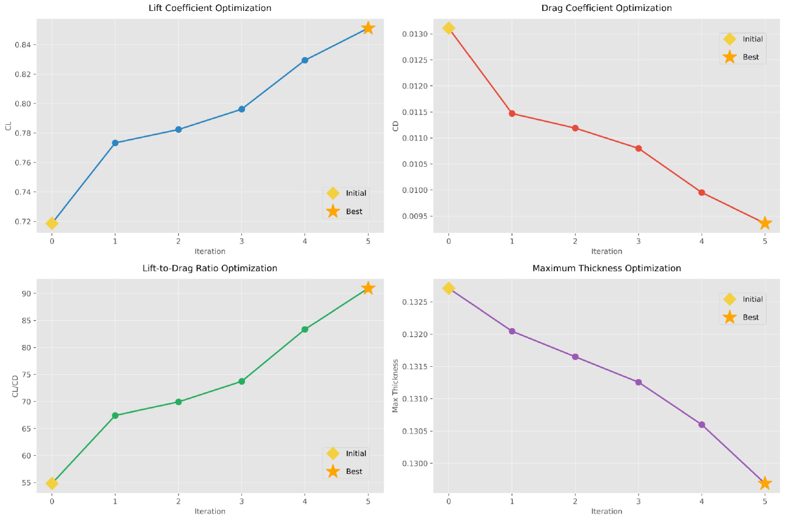

**图 31. 多目标优化翼型的气动性能趋势分析。** 子图还包括最大厚度的变化。

## 5. 结论

针对飞机翼型气动优化中专业知识融合不足、优化过程可解释性有限及效率提升潜力受限的问题，本文提出基于 LLM 多智能体协作的 AirfoilAgent 框架。该框架将流程重构为紧密协同的总体任务规划、气动知识融合、结果评估与反思三个模块，提高优化效率和可解释性，并通过实验验证可行性。主要结论如下：

1. AirfoilAgent 将优化算法与多尺度可解释气动知识体系系统结合，融入通用系统性知识、特征耦合效应和特征主导效应，克服传统优化方法的局限。
2. AirfoilAgent 提供智能、可解释的优化框架。借助 LLM 智能体推理和决策能力，在确保更高可解释性与可靠性的同时，显著提高效率和适应性。实验显示，超临界翼型的升阻比平均提升 20.84%，比传统方法高 10.59%，体现其高效处理复杂优化任务的优势。

尽管知识要素已有效嵌入智能气动设计，仍需进一步研究，以加强与传统优化流程的融合：

1. **优化任务复杂性。** 目前验证主要针对单工况点、相对简单约束下的优化性能。但实际气动设计通常同时涉及多目标、多约束和多工况，例如不同马赫数、雷诺数，甚至不同翼型族。需要进一步研究智能体系统和 LLM 能否可靠处理这类高复杂度任务，包括跨工况泛化，以及子任务的精确解耦和协调。
2. **高保真数据融合。** 实验依赖 XFOIL 预测，虽然高效，但保真度有限，尤其是在分离流状态下。工业翼型设计通常使用高精度 RANS／LES CFD 或风洞测量验证。未来将定期或在出现偏差时自适应融入高保真数据，以增强优化可信度。将 LLM 引导探索与 CFD 验证检查点结合的混合策略，可能提供工程级精度。
3. **人机协同优化。** 虽然初始目标可使用自然语言表达，但当前流程不支持迭代期间的实时专家指导。当搜索违反约束或收敛于局部最优时，领域专家可提供修正意见，重新引导路径。未来版本将加入专家在回路的交互机制，使工程师能在迭代中注入自然语言指导，提高稳健性、收敛性和可解释性。

## CRediT 作者贡献声明

**Yi Fan：** 形式化分析、数据整理、概念构思。  
**Hao Zhan：** 项目管理。  
**Mingxuan Zhang：** 可视化、验证。  
**Baigang Mi：** 写作—审阅与编辑、资源提供。

## 利益冲突声明

作者声明，不存在任何已知的、可能被认为会影响本文所报告工作的竞争性财务利益或个人关系。

## 致谢

本研究得到国家自然科学基金（项目编号 12202363）、陆空基信息感知与控制全国重点实验室（项目编号 B124002）及西北工业大学博士论文创新基金（项目编号 CX2025032）的支持。

## 附录

### 翼型几何参数对气动性能的影响分析

#### 前缘半径的影响

##### 上表面前缘半径

随着上表面前缘半径增大，升力系数总体呈上升趋势。

其对阻力系数的影响不明显，但适中的上表面前缘半径可能有助于减阻。

其对力矩系数的影响较复杂，但较大的上表面前缘半径通常导致更大的负俯仰力矩。

##### 下表面前缘半径

下表面前缘半径增大时，阻力系数略有增加。

其对升力系数的影响不如上表面前缘半径显著。

较小的下表面前缘半径有助于减小负俯仰力矩。

#### 上表面弯度特征的影响

##### 上表面弯度的流向位置

上表面弯度前移，即流向坐标减小时，升力系数增大。

上表面弯度前移有助于降低阻力系数。

上表面弯度前移会增大负俯仰力矩。

##### 上表面弯度的法向（垂直）位置

上表面弯度的法向坐标增大，即弯度更加突出时，升力系数增大。

其对阻力系数的影响不明显，但过大的弯度可能增阻。

弯度更加突出时，负俯仰力矩增大。

##### 上表面弯度的曲率

上表面曲率绝对值增大，即曲率变得更负时，阻力系数增大。

适中的上表面曲率有利于获得较高升力系数。

上表面曲率对力矩的影响较复杂，但总体而言，曲率绝对值增大往往会增大负俯仰力矩。

#### 下表面弯度特征的影响

##### 下表面弯度的流向位置

下表面弯度前移时，升力系数趋于增大。

下表面弯度前移有助于减阻。

下表面弯度前移通常增大负俯仰力矩。

##### 下表面弯度的法向（垂直）位置

下表面弯度的法向坐标减小，即弯度更加突出时，升力系数增大。

弯度更加突出时，阻力系数略增。

弯度更加突出时，负俯仰力矩增大。

##### 下表面弯度的曲率

下表面曲率增大时，阻力系数略增。

适中的下表面曲率有利于获得较高升力系数。

下表面曲率对力矩的影响不明显。

#### 后缘特征的影响

##### 后缘方向角

后缘方向角增大时，升力系数增大。

较大的后缘方向角通常导致阻力增大。

后缘方向角增大时，负俯仰力矩增大。

##### 后缘楔角

后缘楔角增大时，阻力系数增大。

适中的后缘楔角有利于获得较高升力系数。

后缘楔角对力矩的影响较复杂。

##### 后缘高度与厚度

后缘高度对气动性能的影响相对较小。

后缘厚度增大时，阻力系数增大。

较小的后缘厚度有利于减小负俯仰力矩。

## 数据可用性

数据可应要求提供。

## 参考文献

以下保留原始作者、标题、期刊／会议和出版信息，并附中文标题。原文中的不完整链接、未加分隔点的 arXiv 编号及模型名称与引用文献之间的差异均予以保留。

**[1] 中文标题：飞机设计：系统工程方法。**  
Sadraey MH. Aircraft design: A systems engineering approach: John Wiley & Sons, 2024.

**[2] 中文标题：飞机起落架预测与健康管理的进展、挑战和未来可能性。**  
I. Raouf, P. Kumar, Y. Cheon, M. Tanveer, S.-H. Jo, H.S. Kim, Advances in prognostics and health management for aircraft landing gear—progress, challenges, and future possibilities, International Journal of Precision Engineering and Manufacturing-Green Technology 12 (1) (2025) 301–320 .

**[3] 中文标题：迈向可持续风能：过去25年翼型与叶片技术支持可持续发展目标的系统综述。**  
A. Krishnan, A.S.M. Al-Obaidi, L.C. Hao, Towards sustainable wind energy: a systematic review of airfoil and blade technologies over the past 25 years for supporting sustainable development goals (SDGs), Indonesian Journal of Science and Technology 9 (3) (2024) 623–656 .

**[4] 中文标题：从文本生成翼型：用于语言条件化气动设计的新框架 FoilCLIP。**  
M. Lei, Y. Zhang, Generating Airfoils from Text: FoilCLIP, a Novel Framework for Language-Conditioned Aerodynamic Design, Theor. Appl. Mech. Lett. 100602 (2025) .

**[5] 中文标题：大型民用飞机气动设计综述。**  
Y. Chen, M. Zhang, M. Zhang, J. Mao, K. Mao, Q. Wang, Review of large civil aircraft aerodynamic design, Acta Aeronautica et Astronautica Sinica 40 (01) (2019) 35–51 .

**[6] 中文标题：基于控制理论的气动设计。**  
A. Jameson, Aerodynamic design via control theory, J. Sci. Comput. 3 (3) (1988) 233–260 .

**[7] 中文标题：Lawrence Davis《遗传算法手册》书评。**  
G. Conroy, Handbook of genetic algorithms by Lawrence Davis, Knowl. Eng. Rev. 6 (4) (1991) 363–365 .

**[8] 中文标题：粒子群优化算法综述。**  
D. Wang, D. Tan, L. Liu, Particle swarm optimization algorithm: an overview, Soft. Comput. 22 (2) (2018) 387–408 .

**[9] 中文标题：通过模拟退火进行优化。**  
S. Kirkpatrick, C.D. Gelatt Jr, M.P. Vecchi, Optimization by Simulated Annealing. Science 220 (4598) (1983) 671–680 .

**[10] 中文标题：CNN-PINN-DRL 驱动的翼型外形优化方法。**  
Y.Y. Liu, J.X. Shen, P.P. Yang, X.W. Yang, A CNN-PINN-DRL driven method for shape optimization of airfoils, Eng. Appl. Comput. Fluid Mech. 19 (1) (2025) 2445144 .

**[11] 中文标题：一种快速精英多目标遗传算法：NSGA-II。**  
K. Deb, A. Pratap, S. Agarwal, T. Meyarivan, A fast and elitist multiobjective genetic algorithm: NSGA-II, IEEE Trans. Evol. Comput. 6 (2) (2002) 182–197 .

**[12] 中文标题：利用 Pareto 存档进化策略逼近非支配前沿。**  
J.D. Knowles, D.W. Corne, Approximating the nondominated front using the Pareto archived evolution strategy, Evol. Comput. 8 (2) (2000) 149–172 .

**[13] 中文标题：《质量工程导论：将质量设计融入产品与过程》书评。**  
Gray C. Introduction to quality engineering: designing quality into products and processes, G. Taguchi, Asian productivity organization, 1986. number of pages: 191. price: $29 (UK). Quality and reliability engineering international 1988; 4(2): 198-.

**[14] 中文标题：基于改进 PSO 算法的阻力发散马赫数下机翼稳健优化。**  
J. Tao, G. Sun, X. Wang, L. Guo, Robust optimization for a wing at drag divergence Mach number based on an improved PSO algorithm, Aerosp. Sci. Technol. 92 (2019) 653–667 .

**[15] 中文标题：利用六西格玛设计进行稳健翼型外形优化。**  
S.W. Lee, O.J. Kwon, Robust airfoil shape optimization using design for six sigma, J. Aircr. 43 (3) (2006) 843–846 .

**[16] 中文标题：具有最小稳健阻力和升力可靠性约束的气动外形优化。**  
D.I. Papadimitriou, C. Papadimitriou, Aerodynamic shape optimization for minimum robust drag and lift reliability constraint, Aerosp. Sci. Technol. 55 (2016) 24–33 .

**[17] 中文标题：基于数据驱动先进模型的智能翼型气动优化方法综述。**  
L. Wang, H. Zhang, C. Wang, et al., A review of intelligent airfoil aerodynamic optimization methods based on data-driven advanced models, Mathematics 12 (10) (2024) 1417 .

**[18] 中文标题：利用计算流体力学数据驱动代理模型进行船体与翼型外形优化的综述。**  
J.M. Walker, A. Coraddu, L. Oneto, A review on shape optimization of hulls and airfoils leveraging Computational Fluid Dynamics Data-Driven Surrogate models, Ocean Eng. 312 (2024) 119263 .

**[19] 中文标题：利用高性能计算实现快速优化的机器学习—遗传算法（ML-GA）方法。**  
Moiz AA, Pal P, Probst D, et al. A machine learning-genetic algorithm (ML-GA) approach for rapid optimization using high-performance computing. SAE International journal of commercial vehicles 2018; 11(2018-01-0190):291-306.

**[20] 中文标题：利用 CFD 和机器学习优化轻型 GCI 发动机燃烧系统。**  
Badra J, Sim J, Pei Y, et al. Combustion system optimization of a light-duty GCI engine using CFD and machine learning, 2020.

**[21] 中文标题：利用计算流体力学和机器学习优化发动机燃烧系统：一种方法论途径。**  
J.A. Badra, F. Khaled, M. Tang, et al., Engine combustion system optimization using computational fluid dynamics and machine learning: a methodological approach, J. Energy Res. Technol. 143 (2) (2021) 022306 .

**[22] 中文标题：用于内燃机快速优化的机器学习—遗传算法方法。**  
J. Badra, O. Owoyele, P. Pal, S. Som, A machine learning-genetic algorithm approach for rapid optimization of internal combustion engines. artificial intelligence and data driven optimization of internal combustion engines, Elsevier (2022) 125–158 .

**[23] 中文标题：自动化机器学习—遗传算法（AutoML-GA）与 CFD 仿真耦合用于发动机快速设计优化。**  
O. Owoyele, P. Pal, A. Vidal Torreira, et al., Application of an automated machine learning-genetic algorithm (AutoML-GA) coupled with computational fluid dynamics simulations for rapid engine design optimization, Int. J. Engine Res. 23 (9) (2022) 1586–1601 .

**[24] 中文标题：采用基于机器学习的优化算法进行翼型优化。**  
X. Song, L. Wang, X. Luo, Airfoil optimization using a machine learning-based optimization algorithm, J. Phys. Conf. Ser. 012009 (2022) .

**[25] 中文标题：基于条件生成模型的超临界翼型逆向设计方法。**  
W. Jing, L. Runze, H. Cheng, C. Haixin, Z. Chen, An inverse design method for supercritical airfoil based on conditional generative models, Chin. J. Aeronaut. 35 (3) (2022) 62–74 .

**[26] 中文标题：两步深度学习逆向设计优化框架：风力机翼型应用。**  
S. Yang, S. Lee, K. Yee, Inverse design optimization framework via a two-step deep learning approach: application to a wind turbine airfoil, Eng. Comput. 39 (3) (2023) 2239–2255 .

**[27] 中文标题：KnowAgent：面向 LLM 智能体的知识增强规划。**  
Zhu Y, Qiao S, Ou Y, et al. Knowagent: Knowledge-augmented planning for llm- based agents. arXiv preprint arXiv:240303101 2024.

**[28] 中文标题：基于大语言模型的多智能体：进展与挑战综述。**  
Guo T, Chen X, Wang Y, et al. Large language model based multi-agents: A survey of progress and challenges. arXiv preprint arXiv:240201680 2024.

**[29] 中文标题：LLM 智能体的自我反思：对问题求解性能的影响。**  
Renze M, Guven E. Self-reflection in llm agents: Effects on problem-solving performance. arXiv preprint arXiv:240506682 2024.

**[30] 中文标题：作为机械设计师的大语言模型智能体。**  
Jadhav Y, Farimani AB. Large language model agent as a mechanical designer. arXiv preprint arXiv:240417525 2024.

**[31] 中文标题：DrugAgent：通过 LLM 多智能体协作实现 AI 辅助药物发现编程自动化。**  
Liu S, Lu Y, Chen S, et al. Drugagent: Automating ai-aided drug discovery programming through llm multi-agent collaboration. arXiv preprint arXiv: 241115692 2024.

**[32] 中文标题：ProtAgents：结合物理与机器学习，通过大语言模型多智能体协作发现蛋白质。**  
A. Ghafarollahi, M.J. Buehler, ProtAgents: protein discovery via large language model multi-agent collaborations combining physics and machine learning, Digital Discovery 3 (7) (2024) 1389–1409 .

**[33] 中文标题：基于 LLM 的多智能体系统综述：流程、基础设施与挑战。**  
X. Li, S. Wang, S. Zeng, Y. Wu, Y. Yang, A survey on LLM-based multi-agent systems: workflow, infrastructure, and challenges, Vicinagearth 1 (1) (2024) 9 .

**[34] 中文标题：用于超临界翼型气动外形设计的深度强化学习优化框架。**  
Z. Liu, M. Zhang, D. Sun, L. Li, G. Chen, A deep reinforcement learning optimization framework for supercritical airfoil aerodynamic shape design, Struct. Multidiscip. Optim. 67 (3) (2024) 34 .

**[35] 中文标题：理解 LLM 智能体的规划：综述。**  
Huang X, Liu W, Chen X, et al. Understanding the planning of LLM agents: A survey. arXiv preprint arXiv:240202716 2024.

**[36] 中文标题：通过优化进行气动设计。**  
K.D. Lee, S. Eyi, Aerodynamic design via optimization, J. Aircr. 29 (6) (1992) 1012–1019 .

**[37] 中文标题：通过优化进行翼型设计。**  
P. Ramamoorthy, K. Padmavathi, Airfoil design by optimization, J. Aircr. 14 (2) (1977) 219–221 .

**[38] 中文标题：通过数值优化进行机翼设计。**  
R.M. Hicks, P.A. Henne, Wing design by numerical optimization, J. Aircr. 15 (7) (1978) 407–412 .

**[39] 中文标题：AFBench：大规模翼型设计基准。**  
Liu J, Wu J, Xie H, et al. AFBench: A Large-scale Benchmark for Airfoil Design. arXiv preprint arXiv:240618846 2024.

**[40] 中文标题：XFOIL：低雷诺数翼型的分析与设计系统。**  
M. Drela, XFOIL: an analysis and design system for low Reynolds number airfoils, Low Reynolds Number Aerodynamics: Proceedings of the Conference Notre Dame, Indiana, USA 5–7 (1989) (June 1989) 1–12 .

**[41] 中文标题：算法 AS 136：一种 k-means 聚类算法。**  
J.A. Hartigan, M.A. Wong, Algorithm AS 136: a k-means clustering algorithm, J. Roy. Stat. Soc.: Ser. C (Appl. Stat.) 28 (1) (1979) 100–108 .

**[42] 中文标题：AirfoilRAG：用于翼型气动设计知识发现与应用的检索增强生成框架。**  
Y. Fan, L. Shi, Y. Sun, M.B. AirfoilRAG, Retrieval augmented generation framework for airfoil aerodynamic design knowledge discovery and application, Aerosp. Sci. Technol. (2025) 110933 .

**[43] 中文标题：动态时间规整。**  
M. Müller, Dynamic time warping, Information Retrieval for Music and Motion (2007) 69–84 .

**[44] 中文标题：欧氏距离映射。**  
P.-E. Danielsson, Euclidean distance mapping, Comput. Graphics Image Process. 14 (3) (1980) 227–248 .

**[45] 中文标题：shapiq：用于机器学习的 Shapley 交互。**  
M. Muschalik, H. Baniecki, F. Fumagalli, P. Kolpaczki, B. Hammer, E. Hüllermeier, shapiq: Shapley interactions for machine learning, Adv. Neural Inf. Proces. Syst. 37 (2024) 130324–130357 .

**[46] 中文标题：Shapley–Taylor 交互指数。**  
M. Sundararajan, K. Dhamdhere, A. Agarwal, The shapley taylor interaction index, in: International Conference on Machine Learning, 2020, pp. 9259–9268 .

**[47] 中文标题：Shapley 值。**  
E. Winter, The shapley value, Handbook of Game Theory with Economic Applications 3 (2002) 2025–2054 .

**[48] 中文标题：KernelSHAP-IQ：用于 Shapley 交互的加权最小二乘优化。**  
Fumagalli F, Muschalik M, Kolpaczki P, Hüllermeier E, Hammer B. KernelSHAP-IQ: Weighted least-square optimization for Shapley interactions. arXiv preprint arXiv: 240510852 2024.

**[49] 中文标题：多段翼型几何参数对气动性能的灵敏度分析。**  
P.M. Mas, L.P. Raj, Sensitivity analysis of geometric parameters on the aerodynamic performance of a multi-element airfoil, Aerosp. Sci. Technol. 132 (2023) 108074 .

**[50] 中文标题：复杂环境模型的 Sobol 灵敏度分析。**  
J. Nossent, P. Elsen, W. Bauwens, Sobol’sensitivity analysis of a complex environmental model, Environ. Model. Software 26 (12) (2011) 1515–1525 .

**[51] 中文标题：Agent-Pro：通过策略层面反思与优化学习演化。**  
Zhang W, Tang K, Wu H, et al. Agent-pro: Learning to evolve via policy-level reflection and optimization. arXiv preprint arXiv:240217574 2024.

**[52] 中文标题：模型卡补充说明：Claude 3.5 Haiku 与升级版 Claude 3.5 Sonnet。**  
S. Anthropic, Model card addendum: Claude 3.5 haiku and upgraded claude 3.5 sonnet, Semanticscholar org/CorpusID 273639283 (2024). https://api .

**[53] 中文标题：使用遗传算法和逆向方法进行翼型设计。**  
Gardner B, Selig M. Airfoil design using a genetic algorithm and an inverse method. 41st Aerospace Sciences Meeting and Exhibit. 2003; 43.

**[54] 中文标题：Qwen3 技术报告。**  
Yang A, Li A, Yang B, et al. Qwen3 technical report. arXiv preprint arXiv: 250509388 2025.

**[55] 中文标题：DeepSeek-v3 技术报告。**  
Liu A, Feng B, Xue B, et al. Deepseek-v3 technical report. arXiv preprint arXiv: 241219437 2024.

**[56] 中文标题：GPT-4 技术报告。**  
Achiam J, Adler S, Agarwal S, et al. Gpt-4 technical report. arXiv preprint arXiv: 230308774 2023.

