# 面向场预测机器学习模型的目标驱动自适应采样策略

**原题：** Goal-driven adaptive sampling strategies for machine learning models predicting fields  
**作者：** Jigar Parekha,b，Philipp Bekemeyera,b,*  
**单位：**  
a 德国布伦瑞克工业大学，SE²A 卓越集群——可持续与节能航空，德国布伦瑞克。  
b 德国航空航天中心（DLR）空气动力学与流动技术研究所，德国布伦瑞克／哥廷根。  
**通讯作者：** Philipp Bekemeyer。  
**电子邮箱：** jigarparekh279@gmail.com（J. Parekh）；philipp.bekemeyer@dlr.de（P. Bekemeyer）。  
**文章类型：** 原创研究论文。  
**编辑：** Mehdi Ghoreyshi 博士。  
**期刊：** Aerospace Science and Technology，第 178 卷，2026 年，文章号 112407。  
**DOI：** [10.1016/j.ast.2026.112407](https://doi.org/10.1016/j.ast.2026.112407)。  
**稿件历史：** 2026 年 1 月 29 日收稿；2026 年 4 月 17 日收到修订稿；2026 年 4 月 17 日接受；2026 年 4 月 20 日在线发表。  
**免费正式版：** [DLR 机构库中的出版社正式版 PDF](https://elib.dlr.de/227815/1/Parekh_2026.pdf)；[机构库记录](https://elib.dlr.de/227815/)。  
**本地原文备份：** [出版社正式版 PDF](2026_AST_场预测自适应采样_原文.pdf)。  
**关键词：** 自适应采样；主动学习；场预测高精度代理建模；图神经网络；基于代理模型的不确定性量化；转捩建模。

> **版本与翻译说明：** 本译文以 DLR 机构库标注为“Published version”的 16 页出版社正式版为底本。2026 年 11 月 6 日核对了论文题名、作者、DOI、卷号及文章号。arXiv:2601.21832v1 为 2026 年 1 月 29 日的较早作者稿，本译文未以其替代正式版。保留原文章节层次、公式（1）—（12）、表 1、图 1—14 及引用编号；图片按正式 PDF 的浮动图顺序置于对应正文附近，不复现双栏分页。正文、图注及表格译为中文；附录 A 和 57 条参考文献按要求保留原文并整理为 Markdown。图内文字保留原图，必要处附中文对照。infill 统一译为“补点”，misfit 译为“预测不一致量”，epistemic uncertainty 译为“认知不确定性”，transition 译为“转捩”；方法名称及缩写保持原样。原文中部分符号或陈述存在歧义，译文保留原意并在相应位置注明。
>
> **许可与署名：** 原文 © 2026 The Author(s)，由 Elsevier Masson SAS 出版，采用 [CC BY 4.0](https://creativecommons.org/licenses/by/4.0/) 许可。本文件为原文的中文翻译改编，原图未作修改；作者与来源如上。ISSN：1270-9638。

## 摘要

对于计算流体力学等计算代价高昂的黑箱仿真，机器学习模型被广泛视为应对多次查询需求的一条可行途径。然而，如何以最低的计算成本——例如尽可能少的黑箱样本——使特定任务达到所需精度，仍然是一项挑战。针对标量的主动学习策略已经用于解决这一问题，各类所谓的补点准则也已在多种场景中得到广泛应用。尽管许多领域都需要场预测，但将主动学习策略扩展至场预测的研究仍然不足，或仅适用于非常特定的场景和模型类型。

本文针对能够预测场量的机器学习模型提出一种主动学习策略，该策略不依赖模型自身的架构。为此，我们将一个成熟的、用于标量参考值的高斯过程模型与场预测模型结合，同时致力于降低模型的认知误差，以及标量预测与场预测之间的差异。本文提出并比较上述方法的不同具体形式，同时与仅基于标量的补点方法进行比较。在 NASA 通用研究模型的不确定性传播任务上给出结果，表明与不采用主动学习的方法相比，该方法能够以显著更低的成本获得较高精度。

## 1. 引言

高保真气动仿真，例如飞机绕流的 CFD 求解，能够提供详细的流场信息和精确的性能指标，但计算成本仍然很高，尤其是在需要研究多种参数组合时。代理建模已成为气动设计中至少部分缓解这一成本问题的重要手段。高斯过程回归、降阶模型（ROM），以及图神经网络（GNN）等机器学习和深度学习模型，通过训练来近似仿真输出，以较高的前期仿真成本换取快速预测模型。关键挑战在于：如何在训练样本，即仿真次数有限的条件下，保证代理模型具有足够精度。

计算机试验的设计与分析已有成熟的文献基础 [1–3]，为在设计空间中分布样本提供了坚实依据。然而，这些试验设计技术并不了解亚声速与跨声速流动差异等领域特性，因此无法将其纳入考虑。自适应采样，也称主动学习，通过迭代地在设计空间或参数空间中选择预期能够最大程度改善代理模型的新样本点，来解决这一问题。对于阻力系数或升阻比等单一标量目标，已经存在成熟的补点（采集）准则来指导选样。

一个经典方法是采用期望改进（EI）准则的高效全局优化（EGO）算法 [4,5]。它优先选择可能使目标函数达到更优值的点，在探索与利用之间取得平衡。另一种情况是，目标在于为不确定性量化（UQ）构建精确的代理模型，而非单纯进行优化，此时可着重降低代理模型在整个输入分布上的预测误差。例如，在高斯过程（GP）代理模型中，Active Learning Cohn（ALC）等方法选择能够最大程度降低积分预测方差的新样本 [6]。这类基于方差的准则与积分均方误差相关，旨在相对于输入概率密度函数降低代理模型的总体不确定性，确保其在 UQ 分析中的平均精度 [7–9]。对于单输出代理模型，EI 和方差缩减等技术为以尽可能少的样本提高代理模型保真度提供了有原则的方法 [6,7]。这些方法已成功用于气动优化与分析：相较于仅采用空间填充设计，对设计空间进行自适应采样能够更快地收敛到最优设计，并获得更可靠的代理预测。

然而，气动设计与分析中的许多问题需要场预测，而不仅仅是标量输出。例如，预测翼型周围或机翼表面的压力场、速度场，对于理解激波位置、流动分离和结构载荷至关重要，而单一阻力系数等标量无法包含这些信息。为这类分布式输出构建代理模型要复杂得多；这些输出可看作定义在空间域上的高维向量或函数。首先，输出维度可能达到描述场的数千个数值，因此往往需要降维。常用方法包括本征正交分解（POD）等降阶技术：以少数主导模态表示场，或建立从潜变量到场的映射 [10,11]。也可使用自编码器等深度学习模型，学习场的压缩潜在表示。

其次，即使代理模型能够预测场，通过自适应采样改善场预测也并非易事。与标量目标不同，场具有许多特征和潜在误差来源。例如，代理模型可能准确预测整体趋势，却完全漏掉局部激波。因此，需要基于场的补点准则，依据代理模型对整个场输出的预测表现，指导新仿真点的选择。一些研究已开始探索这一问题，例如针对基于 POD 的代理模型提出自适应采样策略，通过迭代填充参数空间来提高代理精度 [12]。此外，将标准 GP 扩展为直接处理多输出场并量化其不确定性的向量值高斯过程，也已用于驱动基于最大方差的补点策略 [13,14]。不过，现有技术或适用范围有限，或专门针对某一模型类型。

将自适应采样扩展到场预测任务面临以下几个关键挑战。

1. **场输出的标量化。** 与单一目标不同，决策时必须将场输出汇总或缩减为一维准则。如何确定合适的标量化方式，例如场上的积分误差范数、最坏情况误差或关键位置误差的加权和，并不简单，而且可能使采样偏向输入空间中的某些区域。多目标优化研究提供了许多将多个目标合为一个的标量化函数 [15]，但这些方法通常处理的是少数几个目标，而非场中的数千个自由度。简单地采用平均误差可能忽略局部现象，只关注最大误差又可能过分强调异常点。因此，如何定义真正反映代理模型场预测精度的标量准则，仍是开放问题。

2. **认知不确定性的处理。** 场代理模型必须捕捉高维输出中的不确定性。例如，GP 代理模型需要多输出协方差结构来估计不确定性及其相关性 [13]。实践中可采用结合概率模型的降阶基，或神经网络集成。然而，认知不确定性不仅来自数据稀疏，还来自相关长度、基截断等模型参数的不确定性。Graham 和 Cortés [16] 表明，考虑协方差不确定性能够显著影响预测方差，进而通过模型不确定性与条件不确定性共同驱动自适应采样。忽略这些因素可能导致错误的补点决策，因此必须采用严谨的统计建模，正确识别代理模型真正不确定的位置 [17,18]。

3. **标量与场之间的一致性。** 设计通常既需要升力、阻力等整体系数，也需要压力或剪切分布等详细场信息。分别训练标量代理模型和场代理模型，会带来如何最优分配新增样本的挑战。例如，提高阻力预测精度未必会降低压力分布误差，反之亦然。这构成一个必须平衡相互竞争目标的多输出主动学习问题。只关注某一方面可能浪费样本，或使另一模型训练不足。现有多目标补点方法仍需将场误差缩减为单一指标，在多输出情况下扩展性不佳 [6]。如何获得能够同时准确表示标量性能指标和场输出的最优训练集，仍然困难，现有文献对此研究不足。传统多目标补点方法可以将标量误差和场误差视为相互竞争的目标，但仍要求将场误差简化为一个数值；当涉及多个标量指标或多个场特征时，这种方式难以扩展。

面对这些挑战，现有气动场代理建模方法仍存在明显不足。贝叶斯多目标优化技术可以将少数目标标量化 [15]，但难以直接扩展到高维场输出。另一方面，空间传感器布置研究 [16] 关注特定协方差假设下的场估计，并未纳入并行的优化目标或工程约束。还有一类研究通过将物理约束嵌入训练过程来改善代理模型自身，例如采用物理信息损失函数，或强制满足边界条件、单调性的模型架构 [19,20]。这些嵌入物理的方法能够提高代理模型保真度，但它们解决的是一个互补问题：如何基于给定数据集构建更好的模型，而不是下一步应在何处采样，才能最高效地扩充数据集。本文针对后一个问题，且不依赖底层代理模型究竟是纯数据驱动还是物理信息模型。

因此，亟需一种统一的自适应采样策略，既考虑场信息，也考虑目标信息，严格处理代理模型的不确定性 [21]，同时不依赖具体的机器学习模型。据我们所知，目前尚无方法完整解决高效学习标量性能指标和高维场输出这一挑战。

本文提出基于场的代理建模自适应采样策略，可扩展至 UQ、优化、可靠性分析和一般数据库生成。具体目标如下：

1. 开发与模型架构无关的补点准则，将成熟的 GP 误差估计与约束标量和场预测一致性的预测不一致量结合，把传统基于标量的采集函数扩展到场输出。
2. 建立统一的主动学习框架，联合训练标量与场代理模型，使新样本降低两类输出的总体认知不确定性，同时适用于任意架构的场预测模型。
3. 在 NASA 通用研究模型上验证所提策略，展示耦合补点准则相较于非自适应采样和仅基于标量的补点，能够以显著更低的计算成本实现更高精度，并将表现最好的策略用于正向不确定性传播。

这些补点准则有效平衡探索与利用：前者是在流场预测最不确定的位置改善代理模型，后者是细化重要整体量的预测。所提方法能够高效、稳健地训练具有不确定性量化能力的全场预测代理模型，减少所需昂贵仿真的次数。因此，代理模型可在整个输入分布上保持精度，并为气动应用中的全局敏感性分析、概率设计优化和风险评估等下游任务提供可靠支持。

本文结构如下：第 2 节介绍场预测代理模型的目标驱动自适应采样策略；第 3 节详细说明 NASA CRM 仿真与代理建模设置，包括问题定义、飞行工况、转捩建模、环境和运行参数，以及计算气动关注量（QoI）的数值模型；第 4 节给出不同补点方法的结果，并介绍最佳模型在 UQ 分析中的应用；最后，第 6 节给出结论。

> **译注：** 上段按原文保留。实际“不确定性传播——工程应用”位于第 5 节。

## 2. 方法

本节以一般形式介绍所提自适应采样框架，不依赖任何特定应用、代理模型架构或工程学科。本文分别针对标量输出和空间分布的场输出建立代理模型，所提自适应采样方法同时兼顾两类代理模型对关注量（QoI）的估计。以下介绍用于保证标量和场预测精度的代理建模方法与自适应补点准则。尽管后文以气动算例展示结果，只要能够将场预测积分为有工程意义的标量，并采用 GP 对其建模，该方法就适用于相应学科和场景。

### 2.1. 不采用补点的代理建模

在任何自适应细化之前，首先使用初始试验设计（DoE）构建基准代理模型。本文采用三种代理建模技术，以体现标量输出与场输出的不同特点。

#### 2.1.1. 用于标量的高斯过程回归

由于高斯过程（GP）模型具有灵活性和内在的不确定性估计能力 [22]，本文采用它来近似标量关注量（QoI）。假设真实响应 $y(\mathbf{x})$ 是随机函数 $Y(\mathbf{x})$ 的一个实现，该随机函数由确定性趋势和零均值 GP 随机项组成：

$$
Y(\mathbf{x})=g(\mathbf{x})\boldsymbol{\beta}+\epsilon(\mathbf{x}).
\tag{1}
$$

其中，$g(\mathbf{x})\boldsymbol{\beta}$ 表示已知的回归模型，即趋势项；$\epsilon(\mathbf{x})$ 为 GP，其协方差为

$$
\operatorname{Cov}\!\left[\epsilon(\mathbf{x}),\epsilon(\mathbf{x}')\right]
=\sigma^2 R_{\boldsymbol{\theta}}(\mathbf{x},\mathbf{x}').
\tag{2}
$$

这里采用高斯—指数族等平稳协方差核，并通过最大似然估计超参数 $\boldsymbol{\theta}$ [23]。

GP 预测器对训练数据进行插值，并给出后验方差估计，从而获得最佳线性无偏估计：

$$
\hat y(\mathbf{x})=
g(\mathbf{x})\boldsymbol{\beta}
+\mathbf{r}(\mathbf{x})^{T}R^{-1}
\left(Y-F\boldsymbol{\beta}\right).
\tag{3}
$$

其中，$R$ 为训练点的相关矩阵，$\mathbf{r}(\mathbf{x})$ 为 $\mathbf{x}$ 与训练点之间的相关向量，$Y$ 为观测输出，$F$ 为设计矩阵。GP 还可估计任意输入 $\mathbf{x}$ 处的均方误差（MSE）[24]：

$$
s^2(\mathbf{x})=\sigma^2\left[
1-\mathbf{r}(\mathbf{x})^{T}R^{-1}\mathbf{r}(\mathbf{x})
+\mathbf{u}^{T}\left(F^{T}R^{-1}F\right)^{-1}\mathbf{u}
\right],
\tag{4}
$$

其中 $\mathbf{u}=F^{T}R^{-1}\mathbf{r}(\mathbf{x})-g(\mathbf{x})$。$s(\mathbf{x})$ 可作为局部代理误差指标，使 GP 尤其适用于不确定性量化。

#### 2.1.2. 用于场的本征正交分解插值

对于高维场输出，可以采用本征正交分解插值（PODI）[25]。POD 将场表示为一组标准正交模态的线性组合，从而高效表示输出场。给定初始的 $N_0$ 个场快照 $\{u(\mathbf{x}_k)\}_{k=1}^{N_0}$，每个快照的维度为 $p\gg1$，通过奇异值分解（SVD）可获得捕捉最显著变化的降阶基 $\{\phi_i\}_{i=1}^{M}$ [26]。任意场可近似为

$$
u(\mathbf{x})\approx u_0+\sum_{i=1}^{M}\alpha_i(\mathbf{x})\phi_i.
\tag{5}
$$

其中，$u_0$ 为平均场，$\alpha_i(\mathbf{x})$ 为随输入 $\mathbf{x}$ 变化的模态幅值。问题由此转化为建立输入到模态幅值的映射，通常采用 GP 或径向基函数（RBF）等多维回归技术 [25]。已有研究表明，PODI 能显著降低输出维数，实现高效、准确的场预测。

#### 2.1.3. 用于场的图神经网络

图神经网络（GNN）为复杂空间场建模提供了一种强大的数据驱动方法，特别适用于气动和流体力学问题中常见的非结构网格输出 [27,28]。GNN 将网格点视为图节点，将网格连接视为图边，通过迭代消息传递算法，直接从数据中学习复杂的空间相互作用 [29,30]。

GNN 的消息传递机制通常采用迭代更新过程。对于节点 $i$，第 $l$ 次迭代的潜在特征表示 $\mathbf{h}_i^{(l)}$ 按以下方式更新：

$$
\mathbf{m}_i^{(l+1)}
=\sum_{j\in\mathcal{N}(i)}
\phi\!\left(\mathbf{h}_i^{(l)},\mathbf{h}_j^{(l)},\mathbf{e}_{ij}\right),
\tag{6}
$$

$$
\mathbf{h}_i^{(l+1)}
=\psi\!\left(\mathbf{h}_i^{(l)},\mathbf{m}_i^{(l+1)}\right).
\tag{7}
$$

其中，$\mathcal{N}(i)$ 为节点 $i$ 的邻居节点集合，$\mathbf{e}_{ij}$ 为边特征；$\phi$ 和 $\psi$ 为神经网络函数，通常由多层感知机（MLP）实现。本文所用 GNN 方法的更多细节见文献 [28]。

GNN 方法的主要优势包括：能够灵活表示网格拓扑，将几何与拓扑信息直接纳入学习过程，以及相较于传统代理建模技术，能够更准确地捕捉空间相关性。这些特点使 GNN 成为气动与流体力学代理建模的一种有吸引力的方法。

### 2.2. 自适应采样（补点）方法

自适应采样，即补点步骤，完全由决定如何选择下一个样本的采集函数控制。对于标量输出问题，通过最大化准则值 $I(\boldsymbol{\xi})$ 选择下一样本点 $\boldsymbol{\xi}^{*}$：

$$
\boldsymbol{\xi}^{*}
=\underset{\boldsymbol{\xi}}{\arg\min}
\left\{-I(\boldsymbol{\xi})\right\}.
\tag{8}
$$

一种典型且简单的准则是代理误差，即 $I(\boldsymbol{\xi})=\hat s(\boldsymbol{\xi})$。已有研究表明，这种基于误差的自适应采样相较于无引导的蒙特卡洛（MC）采样，可显著提高效率 [31,32]。采集函数通过全局优化器求解，本文采用差分进化算法，它能够有效搜索复杂、多峰的目标函数空间。

需要指出，对于输入非均匀分布的应用，通常通过最大化输入联合概率密度函数 $\mathrm{PDF}_{\xi}$ 与相应准则值的乘积来选择下一补点，即

$$
\boldsymbol{\xi}^{*}
=\underset{\boldsymbol{\xi}}{\arg\min}
\left\{-\mathrm{PDF}(\boldsymbol{\xi})I(\boldsymbol{\xi})\right\}.
$$

该准则既优先在高概率区域采样，也着重关注准则值较高的区域。

#### 2.2.1. 针对标量的自适应采样

代理误差准则适用于单输出标量 GP 代理模型，因为这类模型具有内在的模型不确定性估计，即 $\hat s(\boldsymbol{\xi})=\sigma_{GP}(\boldsymbol{\xi})$。本文将这一方法记为 **GP Infill:SE**。需要注意，该方法仍需要一个用于场预测的代理模型。本文将初始 DoE 样本和 GP Infill:SE 获得的补点样本合并，用于建立 PODI 或 GNN 场代理模型，从而对新输入进行场预测。

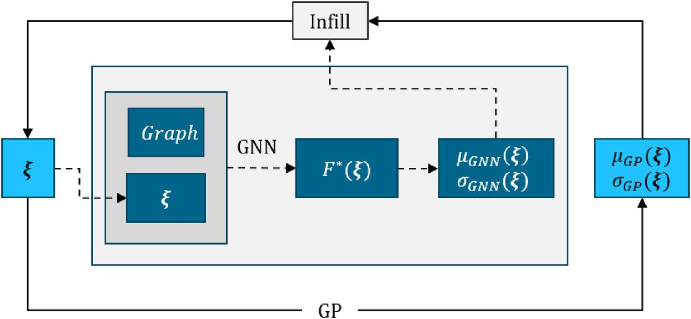

**图 1. 耦合的目标驱动标量—场自适应采样框架。** 高斯过程（GP）代理模型将输入 $\boldsymbol{\xi}$ 映射到标量系数，得到分别记为 $\mu_{GP}$ 和 $\sigma_{GP}$ 的均值与方差近似。场模型接收相同输入以及表面网格图等额外信息，预测场量 $F^{*}$；再由场量积分得到标量，其估计均值和方差分别记为 $\mu_{GNN}$ 和 $\sigma_{GNN}$。两个代理模型之间的预测不一致量及其认知不确定性共同进入耦合补点准则，以选择下一个设计点。新快照闭合循环，并更新两个代理模型。图内 Graph＝网格图；Infill＝补点。

> **符号译注：** 原文在图注和部分叙述中将 $\sigma$ 称为“方差”，而在式（2）、式（4）及概率分布表达式中采用 $\sigma^2$ 表示方差；附录还使用“标准差”表述。译文保留原公式与原文用词，不擅自统一其幂次。

虽然使用标量 GP 的误差很方便，但未必能完整识别场代理模型自身误差较大的区域。例如，某些输入参数区域中的压力分布预测可能很差，却并不显著影响积分标量 $C_D$ 和／或 $C_L$。仅基于 $\sigma_{GP}$ 的补点可能无法探索到这些区域。

#### 2.2.2. 针对场的自适应采样

对于深度学习场代理模型，需要扩展基于 SE 的补点概念。一种直接方法是从场中导出标量指标，然后采用类似准则。但与 GP 不同，GNN 本身不提供不确定性估计。为此，可采用蒙特卡洛 dropout 或集成方法来近似预测不确定性 [33,34]。本文采用前者，细节见附录 A。以近似模型方差作为 SE 指标，即 $\hat s(\boldsymbol{\xi})=\sigma_{GNN}$，就可像 GP 一样使用基于 SE 的补点，从而将场补点问题有效化归为标量问题。本文将该方法记为 **GNN Infill:SE**。

与 GP 相同，GNN 代理模型在每轮补点之后都重新训练。因此，每次补点迭代后，其对各训练样本的预测及方差都会变化。一个潜在问题是，即使经过大量补点，也不能保证模型认知不确定性显著降低。

#### 2.2.3. 耦合自适应采样

为同时提高标量与场代理模型的精度，本文提出两种耦合两类模型预测的采集策略。关键在于，这些准则不依赖模型架构：它们仅通过场代理模型积分得到的标量 QoI，以及可选的预测方差与其交互，无需访问内部模型参数、梯度或架构的其他部分。因此，任何能够给出积分标量，并且可选地提供不确定性估计的场模型，都可以使用这些准则。

第一种准则在 GP 不确定性的基础上，加入 GP 与场代理模型预测之间的不一致量。对于给定 $\mathbf{x}$，令 $\mu_{GP}(\mathbf{x})$ 为 GP 预测的 QoI，$\mu_{GNN}(\mathbf{x})$ 为由 GNN 预测场 $F^{*}(\boldsymbol{\xi})$ 计算得到的相应 QoI。定义

$$
\Delta(\boldsymbol{\xi})
=\left|\mu_{GP}(\boldsymbol{\xi})-\mu_{GNN}(\boldsymbol{\xi})\right|,
$$

以衡量两个代理模型的分歧。相应采集函数为

$$
\boldsymbol{\xi}^{*}
=\underset{\boldsymbol{\xi}}{\arg\min}
\left\{-\left[\sigma_{GP}(\boldsymbol{\xi})+
\lambda\Delta(\boldsymbol{\xi})\right]\right\}.
\tag{9}
$$

其中，$\lambda$ 为权重因子，为简单起见本文取 $\lambda=1$。该方法称为“带预测不一致量的代理误差”方法，记为 **GP-GNN Infill:SEwMisfit**。它优先选择 GP 预测不确定性较大，或者 GP 与场代理预测差异较大的点。如前所述，在输入非均匀分布的应用中，还使用输入 PDF 对准则值加权，以持续关注高概率区域。这样可以加快场代理模型的学习：在场预测与已充分训练的 GP 不一致的位置补点，能够针对性地改善场模型。一般而言，SEwMisfit 与模型差异采样 [35] 或多保真度补点 [36] 有关，即由一个模型引导另一个模型的采样。

第二种耦合策略在统计意义上更加严谨。对于给定输入样本处的某个 QoI，考虑 GP 和场代理模型的预测概率分布。GP 给出正态分布

$$
P_{\boldsymbol{\xi}}
=\mathcal{N}\!\left(\mu_{GP}(\boldsymbol{\xi}),
\sigma_{GP}^{2}(\boldsymbol{\xi})\right).
$$

如前所述，可通过蒙特卡洛 dropout 集成等方法获得场代理模型的近似分布 $Q_{\boldsymbol{\xi}}$，其均值和方差分别为 $\mu_{GNN}(\boldsymbol{\xi})$ 和 $\sigma_{GNN}^{2}(\boldsymbol{\xi})$。随后，将这两个分布之间的 Jensen–Shannon 散度 [37] 用作采集指标。Jensen–Shannon 散度是衡量 $P$ 与 $Q$ 差异的对称化量，定义为

$$
\operatorname{JSD}(P\Vert Q)
=\frac{1}{2}\operatorname{KL}(P\Vert M)
+\frac{1}{2}\operatorname{KL}(Q\Vert M),
\tag{10}
$$

其中，$M=\frac{1}{2}(P+Q)$，$\operatorname{KL}$ 表示 Kullback–Leibler 散度 [38]。在每个 $\boldsymbol{\xi}$ 处计算两个模型预测分布之间的 $\operatorname{JSD}(P\Vert Q)$，得到采集函数

$$
\boldsymbol{\xi}^{*}
=\underset{\boldsymbol{\xi}}{\arg\min}
\left\{-\mathrm{PDF}_{\xi}(\boldsymbol{\xi})
\operatorname{JSD}\!\left(P_{\boldsymbol{\xi}}\Vert Q_{\boldsymbol{\xi}}\right)
\right\}.
\tag{11}
$$

该准则着重选择两个完整预测分布差异最大的点，记为 **GP-GNN Infill:JSD**。与仅使用均值差异和 GP 方差的 SEwMisfit 不同，JSD 可以处理例如 GNN 非常不确定、即 $Q_{\boldsymbol{\xi}}$ 较宽，而 GP 很确定、即 $P_{\boldsymbol{\xi}}$ 较窄的情况，反之亦然。在这些位置采样，预期能够降低两个模型的认知不确定性。实际上，JSD 补点通过持续加入数据，使 GP 与场代理模型在输入空间中的预测分布逐渐一致。该策略与可靠性工程中近期采用 JSD 更新 Kriging 模型的主动学习方法 [39] 相似，后者在失效概率估计中表现出更高效率和更好的收敛性。不过，尽管该方法在匹配分布方面具有数学上的严谨性，仍受到前述蒙特卡洛 dropout 缺点的影响。

原文指出，当场代理模型与 GP 完全一致时，SEwMisfit 和 JSD 均退化为标准 SE；当场代理模型精度落后时，它们会优先降低这一差异，同时仍按输入 PDF 对样本加权，从而获得能够同时改善标量和场预测的补点样本。

> **译注：** 上段关于“JSD 退化为标准 SE”的表述按原文保留。严格根据式（10），若两预测分布完全相同，则 JSD 为零；式（11）本身并未另加 SE 项。这一表述与公式存在差异。

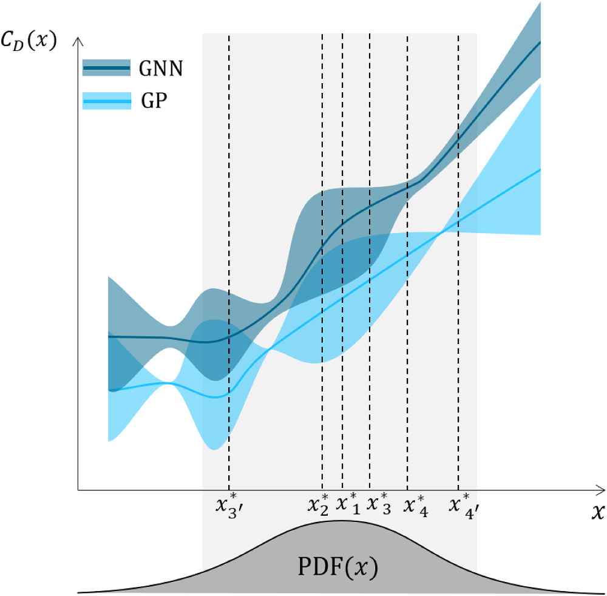

**图 2. 耦合 GP–GNN 代理系统中四种自适应采样准则的概念比较。** 实线表示 GP（浅蓝）和 GNN（深蓝）对阻力系数 $C_D(x)$ 的预测；阴影带表示其认知不确定性。灰色钟形曲线为输入联合概率密度 $\mathrm{PDF}(x)$。竖直虚线表示各策略提出的候选补点位置 $x_i^{*}$：$x_1^{*}$ 为应用于 GP 的代理误差（SE）准则；$x_2^{*}$ 为应用于 GNN 的 SE 准则；$x_3^{*}$ 为加入 GP–GNN 预测不一致量的 SE 准则（SEwMisfit）；$x_4^{*}$ 为耦合两模型的 Jensen–Shannon 散度（JSD）准则。几乎同样可能被选为下一补点的候选位置记为 $x_{i'}^{*}$。关于图例中的颜色，请参见文章网络版。

图 2 展示了前文讨论的所有自适应采样方法。在示意例子中，$x_1^{*}$ 和 $x_2^{*}$ 分别对应 GP 与 GNN 的 Infill:SE 准则，即在模型不确定性与输入分布乘积最大的位置采样。$x_3^{*}$ 通常由 SEwMisfit 准则选择；$x_{3'}^{*}$ 也可能被选中，说明只要 GP 不确定性与 GP–GNN 不一致量之和足够大，低概率区域中的样本也可能被选择。同样，JSD 准则可因两个代理模型之间存在较大分歧，而选择 $x_4^{*}$ 或 $x_{4'}^{*}$，即使这些位置处于输入分布的低概率区域。

## 3. 数值设置

在介绍一般方法之后，本节说明用于概念验证的具体应用。所研究的气动构型为具有自然层流机翼的 NASA 通用研究模型（CRM-NLF）。该机翼最初由 Lynde 等 [40] 使用横流衰减自然层流（CATNLF）方法设计，以推迟 Tollmien–Schlichting（TS）不稳定性和横流（CF）不稳定性。此后，NASA 国家跨声速风洞设施（NTF）对 CRM-NLF 半翼展风洞模型进行了试验，验证了该设计能够在跨声速巡航工况下维持大面积层流 [41]。本文采用相同几何，并着重研究相似流动条件。

### 3.1. 数值模型

采用德国航空航天中心（DLR）的 TAU CFD 求解器 [42]，模拟 NASA CRM 翼身组合构型周围的流动。

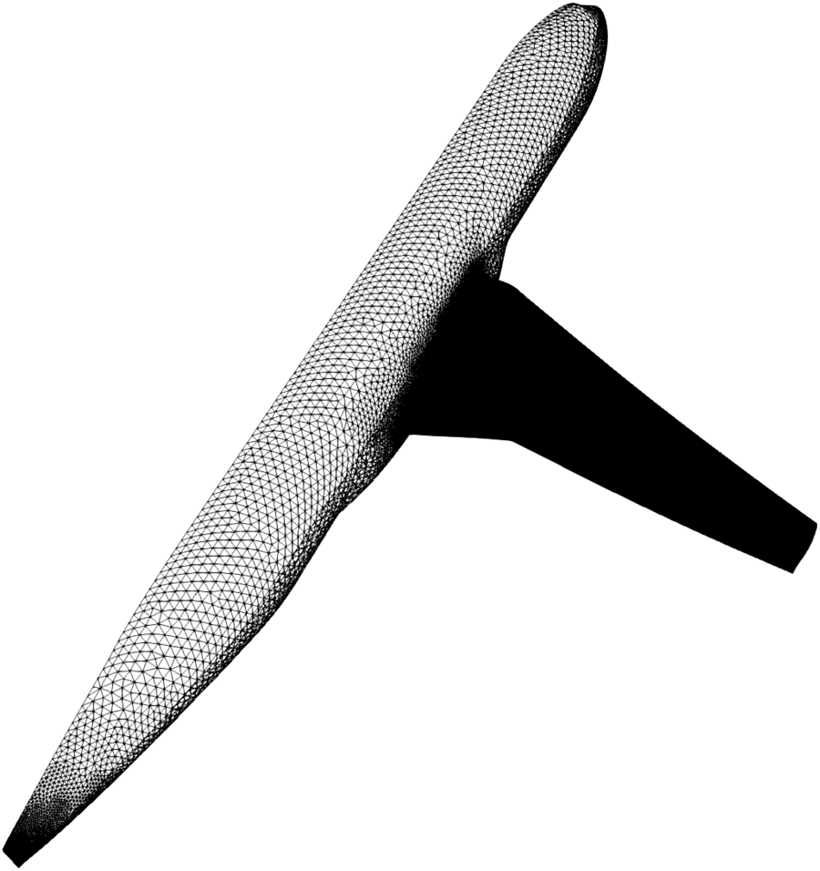

**图 3. NASA CRM 的计算网格。**

通过求解雷诺平均 Navier–Stokes（RANS）方程，并结合 $k$–$\omega$ SST 湍流模型 [43]，确定关注的气动特性。求解器采用 4w 多重网格循环、用于伪时间积分的后向 Euler 求解器，以及中心通量离散格式。所用非结构网格约包含 5000 万个网格点和 30 万个表面网格点，如图 3 所示。针对翼身组合构型，考虑机翼上下表面的层流状态，即进行转捩预测。

为预测机翼上的转捩前沿，采用近期开发的 DLR $\gamma$ 模型 [44]。转捩输运模型近年来受到广泛关注，尤其用于层流翼型设计和机翼转捩前沿预测 [45]。面向运输机应用的 DLR $\gamma$ 模型是 $\gamma$–$Re_{\Theta t}$ 模型的增强形式，属于这一类模型，本文将其用作转捩预测方法。该模型包含“Simple-AHD”准则 [46]，即经过调整、能够考虑压力梯度与可压缩性影响的准则。此外，它还包含横流扩展 [47]。该模型在高雷诺数（约 $10^7$）层流机翼中已表现出有效性，并持续得到验证与扩展 [48]。

### 3.2. 环境与运行参数

第 2 节讨论的目标驱动自适应采样策略，同样适用于均匀和非均匀分布的输入。与已有研究 [31,32] 一样，本文基于输入联合分布训练代理模型，从而能够着重利用参数空间中的高概率区域。

为理解环境和运行变化如何影响机翼上的转捩前沿与压力分布，需要研究有关因素及其作用。$e^N$ 转捩模型 [49] 中的临界 $N$ 因子（$N_{TS}$、$N_{CF}$）反映来流品质，会显著受到自由来流扰动，例如云层和湍流度、表面缺陷及声学扰动的影响 [50–52]。这些 $N$ 因子的环境不确定性可建模为均匀分布变量，例如 $N_{TS}\sim\mathcal{U}[5,14]$、$N_{CF}\sim\mathcal{U}[4,11]$ [53]。对于 DLR $\gamma$ 模型，不确定性通过自由来流湍流度 $Tu$ 的变化表示，$Tu$ 与 $N_{TS}$ 之间满足 Mack 公式 [54]：

$$
N_{TS}=-8.43-2.4\ln(Tu).
\tag{12}
$$

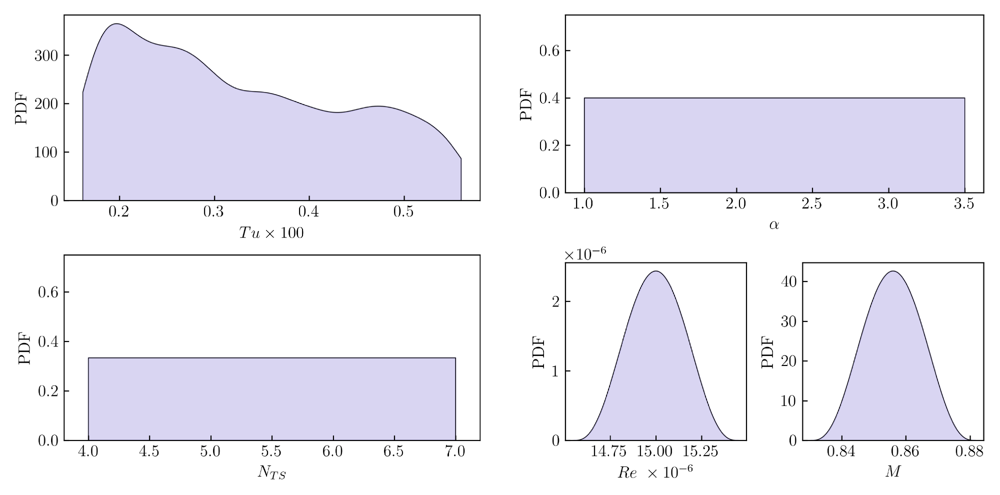

**图 4.** 左：$N_{TS}$ 与 $Tu$ 的不确定性分布。右：迎角、雷诺数与马赫数的不确定性分布。图内 PDF 表示概率密度；子图（a）为 $N_{TS}$ 与 $Tu$ 的分布，子图（b）为 $\alpha$、$Re$ 和 $M$ 的分布。

从指定的均匀分布中采样 $N_{TS}$，即可得到相应的 $Tu$ 分布。由于实现方面的限制，本文未纳入影响 $N_{CF}$ 的表面粗糙度效应。$N$ 因子与湍流度的分布见图 4 左侧。原文说明，在 4 至 7 之间采样 $N_{TS}$，用于反映 NTF 试验测定的临界 $N$ 因子范围（典型值为 5–6）与较平静飞行环境（$N_{TS}\approx10$）的差异 [40]。通过 Mack 公式映射到 $Tu$，可以保留模态放大与扰动水平之间的物理耦合，而无需预先规定某个特定的解析 PDF。

在许多气动研究中，自由来流马赫数、雷诺数和飞机迎角等运行工况被指定为确定性输入。然而，对于短程运输机，即使处于名义巡航状态，持续的油门调整、天气引起的高度变化及轻微阵风，也会使这些量产生不可忽略的波动，进而改变边界层稳定性与整体性能 [55]。因此，本文将这三个量建模为随机变量，并为其慎重选择概率分布。运行不确定性空间由三个相互独立的随机变量描述，如图 4 右侧所示。

迎角 $\alpha$ 在 $[1.0^\circ,3.5^\circ]$ 上采用均匀分布，以体现 NTF 中为匹配目标截面升力、补偿支撑系统偏差而必须进行的小幅配平调整 [56]。在这一狭窄迎角范围内，CRM-NLF 机翼上的转捩前沿即可移动数个百分点的弦长，因此该区间十分关键。为保证可重复的来流品质和温敏漆（TSP）成像，假设风洞运行雷诺数服从均值 $\mu=15\times10^6$、变异系数（CoV）为 1% 的正态分布。该设定反映严格的运行约束，同时仍允许出现影响横流增长的黏性尺度变化。类似地，马赫数采用均值 $\mu=0.856$、CoV 为 1% 的分布，以捕捉可能显著改变激波强度及压力梯度的小幅波动。

这些分布被有意设置得较为保守，即均匀分布或非常窄的分布，但仍覆盖 CRM-NLF 数据集中记录的名义工况附近的合理变化范围。因此，它们为基于代理模型的不确定性传播等任务，提供了物理上一致、统计上无偏的基础。

### 3.3. 代理建模与自适应采样设置

所有代理模型均采用相同的四个环境与运行条件作为输入 $\boldsymbol{\xi}$，即自由来流湍流度 $Tu$、迎角 $\alpha$、雷诺数 $Re$ 和马赫数 $M$。GP 代理模型将输入映射到标量系数 $(C_L,C_D)$；PODI 或 GNN 接收这些输入并预测场量 $(C_p,C_f,C_{f_x},C_{f_y},C_{f_z})$，再由场量积分得到升力和阻力系数。此外，GNN 模型还接收表面网格图。

初始试验设计（DoE）按照规定的输入分布，采用 Sobol 准随机序列构建 [31]，以均匀覆盖高概率样本。本文考虑两种配置：一种使用固定 DoE，不进行补点；另一种进行自适应采样，即在 DoE 基础上补点。不补点时，代理模型使用 DoE 数据集训练，并在单独留出的验证集上验证，最终再使用独立测试集评估。补点时，各模型从相同 DoE 数据集出发，通过主动学习准则选择新样本，即补点，并逐步细化模型。每轮顺序补点后，训练集增加一个样本，验证集与测试集保持不变，以便直接比较。

补点策略遵循图 1 的流程。首先在当前数据集上训练代理模型，再在输入空间中评估其预测不确定性或误差指标，选择模型置信度最低或误差最高的位置作为下一个或下一批样本；随后在这些位置运行高保真仿真，并将结果加入训练数据集。重复该循环，直至用完补点预算。当同时使用场代理模型与标量代理模型，例如用 GNN 预测流场、用 GP 预测积分量时，采用耦合补点策略，在新点选择中考虑 GP 或两个模型的不确定性，使新增样本同时提高场预测和整体标量预测的精度。所有 DoE 与代理模型均使用 DLR 气动数据代理建模工具箱 SMARTy 构建和训练 [57]。

对于标量响应，GP 使用平方指数核，并设置 $10^{-12}$ 的正则化以保证数值稳定性。

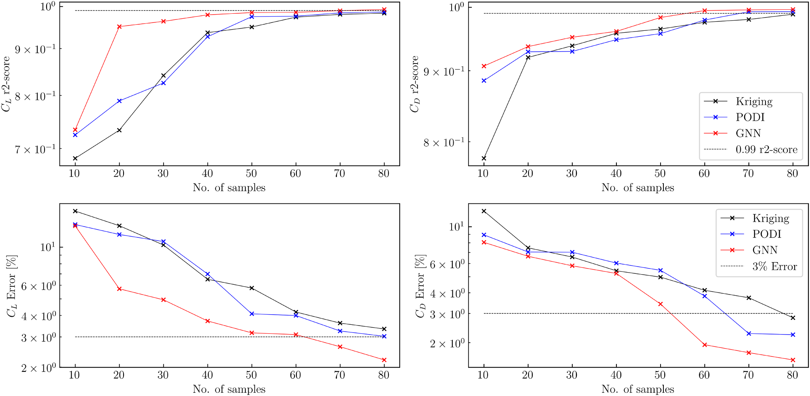

**图 5. 无补点代理模型的收敛情况。** 上排：$C_L$（左）和 $C_D$（右）的 $r^2$ 决定系数，虚线表示 0.99 的目标值。下排：$C_L$（左）和 $C_D$（右）的归一化 RMSE，虚线表示 3% 的目标值。Kriging、PODI 和 GNN 在样本数为 10 至 80 的 DoE 数据集上训练。图内 No. of samples＝样本数；Error＝误差。

核长度尺度与信号方差通过最大化对数边际似然确定。场代理模型 GNN 采用 ResGatedGraphConv 图卷积；节点特征向量由归一化空间坐标和四个输入变量拼接而成。模型具有四个消息传递层，每层含 64 个单元，随后连接一个线性输出头，输出表面压力和摩擦系数场。输入采用最小—最大缩放，目标采用标准化；激活函数为 ReLU，dropout 比例为 5%。训练使用 Adam 优化器，初始学习率 $lr=10^{-3}$，按指数规律衰减至 $5\times10^{-4}$。初始 DoE 代理模型训练 3000 个 epoch。

每次补点后的重新训练通常在 100–300 个 epoch 内收敛，并根据验证集 RMSE 采用耐心值为 20 个 epoch 的早停机制。每轮补点均通过 SciPy 中的差分进化算法优化采集函数，种群大小设为 15，收敛容差为 $10^{-6}$，搜索范围由输入参数的取值范围限定。

## 4. 自适应采样结果

以下各节讨论前述无补点建模与自适应采样建模方法的性能，随后将最佳模型用于基于代理模型的不确定性传播。

### 4.1. 不采用补点的代理模型

首先，仅使用 DoE 数据构建不补点的代理模型，以衡量各模型原始的预测能力。考虑三类模型：用于标量量的 GP 回归模型、用于场变量的 PODI 模型，以及直接在表面网格图上运行的 GNN。分别使用包含 10–80 个 DoE 点的数据集训练，另各保留 20 个样本作为验证集和测试集。图 5 展示随着 DoE 样本数从 10 增至 80，三种代理模型预测质量的变化。

全文采用两种互补指标：决定系数，即 $r^2$ 分数，用于衡量代理模型所解释的输出方差比例；以及按数据范围归一化的均方根误差，即归一化 RMSE，用于以不依赖尺度的方式衡量绝对预测精度。两者结合，能够同时评估预测的相关性与数值幅度。对于直接预测的或由场预测积分得到的标量输出，设定的性能目标为 $r^2\ge0.99$，且归一化 RMSE 低于 3%。

GNN 仅使用约 50 个样本，就能使 $C_L$ 和 $C_D$ 同时达到 $r^2$ 阈值；PODI 约需 60–70 个样本，GP（Kriging）约需 70–80 个。类似地，GNN 用 50–60 个样本即可达到目标误差，PODI 约需 70 个，GP 则需要全部 80 个样本。虽然 GNN 约用 50 个 DoE 样本即可达到两项精度目标，但它缺乏严格的内置不确定性估计。GP 则能提供解析方差，却需要多得多的数据才能达到相应精度阈值。

这些结果说明有必要在初始 DoE 之后增加自适应采样，即补点阶段：一方面，通过针对预测方差最高的区域采样，加快 GP 的收敛；另一方面，为 GNN 提供经过策略性布置的快照，改善局部流动物理的预测，避免直接、大规模扩充 DoE 所产生的成本。

### 4.2. 采用自适应采样的代理模型

下面采用自适应采样策略。在一组共有的 30 个初始 DoE 点上，依次增加 30 个补点。因此，每个自适应代理模型均迭代训练，并采用与前文相同的验证集和测试集监测性能。每次补点后更新四种配置：独立标量 GP、用于场输出的独立 GNN，以及两种耦合 GP–GNN 模型，即基于预测不一致量和基于 JSD 的模型。鉴于无补点情况下 GNN 的表现优于 PODI，这里仅使用 GNN 进行场预测。不过，这些方法，至少包括 SEwMisfit，可以直接用于 PODI。若需针对场模型进行考虑不确定性的采样，建议在潜空间回归中采用 GP，使 PODI 模型也能获得不确定性估计。

需要注意，总计算成本主要由 CFD 求解决定：在 5000 万点网格上，每次 RANS 仿真需要在高性能计算（HPC）集群上运行数小时；相比之下，代理模型训练和采集函数优化的成本可以忽略。实际中，GP 重新优化仅需数秒，GNN 在单张 GPU 上重新训练约需 2–5 分钟，MC-dropout 不确定性预计算另外增加约 10–15 分钟，因此一次完整补点迭代可在 30 分钟内完成。所以，高保真求解次数是最有意义、且不依赖硬件的计算工作量指标。

> **时间口径译注：** 原文同时给出“RANS 仿真需数小时”和“完整补点迭代少于 30 分钟”。从所列组成看，后者对应代理模型更新、不确定性预计算和选样阶段，不应理解为包含了数小时的 CFD 求解。

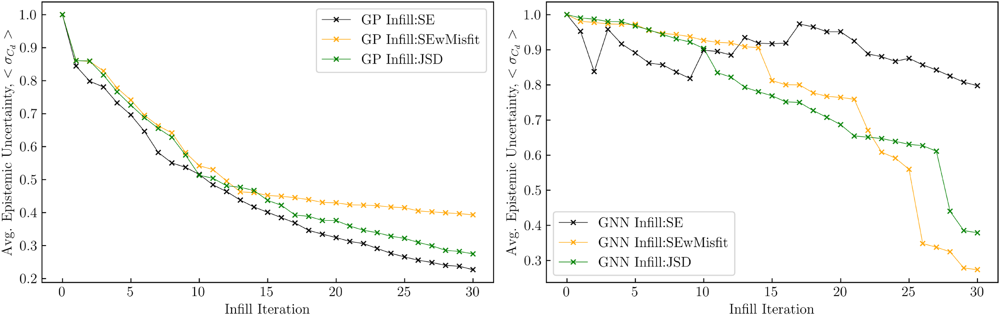

**图 6. 不同补点方法下标量认知不确定性，即平均预测方差 $\langle\sigma_{C_D}\rangle$ 的降低。** 左：Infill:SE、Infill:SEwMisfit 和 Infill:JSD 下的 GP 方差。右：Infill:SE 下的 GNN 方差，以及两种耦合方法中相应的 GNN 方差。数值在输入空间中的 10,000 个 MC 点上平均。注意，GP Infill:SE 与 GNN Infill:SE 是相互独立的方法，分别采用 GP 和 GNN 的代理误差。图内 Infill iteration＝补点迭代次数。

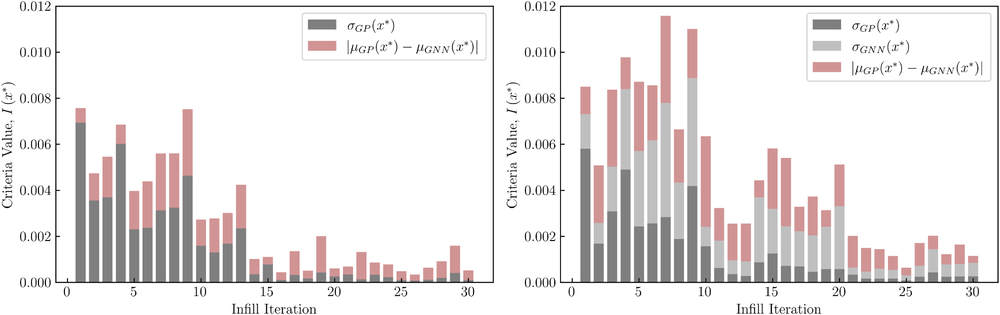

**图 7. 不同补点策略的准则值随补点迭代的演化，迭代 0 表示 DoE 阶段结束。** 准则值对应一般采集函数 $\boldsymbol{\xi}^{*}=\arg\min_{\boldsymbol{\xi}}\{-\mathrm{PDF}_{\xi}I(\boldsymbol{\xi}^{*})\}$ 中的 $I(x^{*})$ 项。堆叠柱状图显示 SEwMisfit（左）和 JSD（右）准则值中各项的贡献。这样的分解并不直接对应 JSD 准则，此处展示是为了便于与 SEwMisfit 比较。图内 Criteria value＝准则值。

图 6 给出 GP 与 GNN 的标量认知方差 $\langle\sigma_{C_D}\rangle$ 随顺序补点的变化，该值在输入空间中的 10,000 个 MC 点上平均。对于 GP 代理模型，Infill:SE 降低认知不确定性最快，最终约为初始水平的 25%；其次是 JSD 耦合补点策略，约达到初始水平的 30%。SEwMisfit 将 GP 平均不确定性降低至初始水平的约 40%。

当 GNN 仅依据 MC-dropout 不确定性估计进行更新时，其自身方差仍然较高且波动明显。而将 GP 方差与 GP–GNN 不一致量（SEwMisfit）或二者 Jensen–Shannon 散度结合的耦合准则，可使 GNN 平均不确定性降低约一个数量级。值得注意的是，第 14 次迭代后 GNN 不确定性显著下降，表明采集函数中的预测不一致项开始占据主导。采用 JSD 补点时，GNN 的平均不确定性略高于 SEwMisfit。

图 7 展示两种耦合补点策略的采集函数准则值随迭代的变化。在前 13 次补点迭代中，SEwMisfit 准则值迅速下降，GP 预测方差在准则值中占主导地位。此后的准则值显著降低，且主要由 GP–GNN 不一致量主导。对于 JSD 方法，图中将两个代理模型的预测方差与预测不一致量一同堆叠展示。其准则值相较于 SEwMisfit 下降更为平缓。在前 20 次迭代的大部分阶段，GNN 预测方差主导该值，表明神经网络具有较高认知不确定性。

原文说明，JSD 关注两个预测分布之间的重叠程度，而非绝对误差，因此即使最大的分歧已经消除，它仍持续提出使 GP 与 GNN 逐渐一致的新样本。至第 30 次迭代，SEwMisfit 得到更低的总体准则值，JSD 则保持略高的数值。与单独使用 GP 或 GNN 的 SE 方法相比，两种耦合方法均表现出更好的稳健性，并使代理模型对逐步收敛。

表面摩擦系数场的不确定性见图 8。在补点阶段开始时，即迭代 0，激波附近和前缘强加速区域存在较大不确定性。这可归因于初始 GNN 代理模型使用的 DoE 样本较少，导致预测方差较高。至第 15 次迭代，耦合补点策略已显著降低不确定性，而基于 SE 的补点方法几乎未能改变这一状况。增加 30 个补点后，SEwMisfit 和 JSD 将整个机翼上的不确定性降至低方差水平，而 SE 方法仍难以使不确定性出现哪怕较小的下降。因此，耦合方法能够使残余模型认知不确定性足够小，以免干扰其他不确定性来源的传播。

图 9 汇总启用自适应采样后，GP 对测试集标量输出的预测如何改善。采用 SE 补点的 GP 在 10 次迭代内达到目标 $r^2$ 与误差水平；采用 SEwMisfit 和 JSD 补点的 GP 则分别需要约 30 次和 23 次迭代。注意，与图 5 中无补点的代理模型相比，自适应采样策略趋于更快达到目标精度。

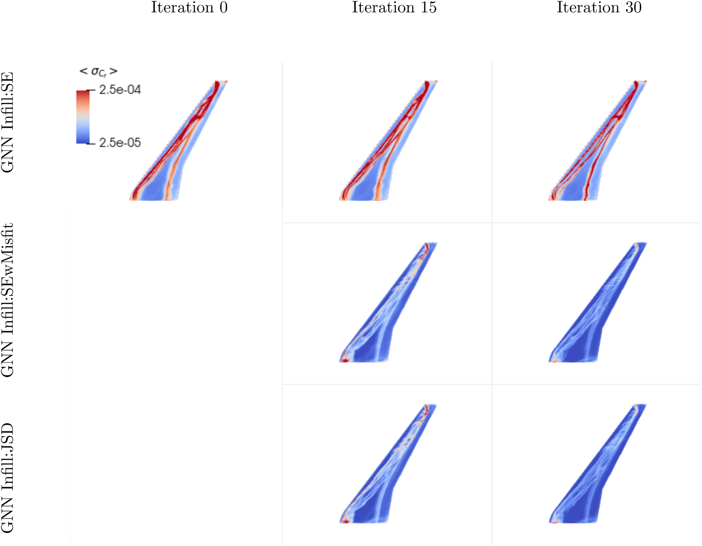

**图 8. 不同补点策略下，CRM 机翼表面摩擦认知不确定性 $\sigma_{C_f}(x,y)$ 的空间分布，对 100 个输入样本取平均。** 各列依次对应包含 30 个样本的初始 DoE，即补点迭代 0、第 15 次补点迭代和第 30 次迭代；各行依次对应 Infill:SE、Infill:SEwMisfit 和 Infill:JSD。图内 Iteration＝迭代次数。

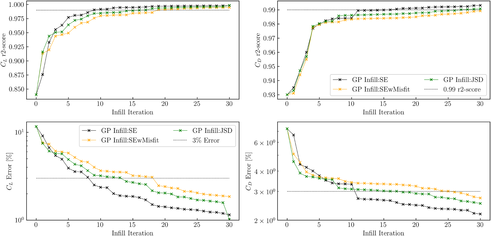

**图 9. 三种采集准则下 GP 精度的演化。** 上排：升力（左）和阻力（右）的决定系数 $r^2$，虚线表示 0.99 的目标值。下排：按数据范围归一化的升力（左）和阻力（右）相对 RMSE，虚线表示 3% 的要求。曲线从包含 30 个样本的 DoE，即迭代 0 开始。

图 10 给出经过 30 次补点后，测试集的标量系数预测值 $(\hat C_L,\hat C_D)$ 与真实值 $(C_L,C_D)$ 的对比。其中，GNN（DoE + Infill）使用 DoE 样本与用于改善 GP 的基于 SE 的补点样本训练。采用三种补点策略的 GP 标量预测均明显更接近真实值。与 GNN（DoE + Infill）相比，采用自适应采样的 GNN 标量预测，即由场预测积分得到的预测，更为准确，也更接近 GP 的预测。这可归因于耦合策略在补点过程中降低了 GP 与 GNN 之间的预测不一致量。

在图 11 中，针对三个测试点，将前文所有场代理模型的预测与真实场输出比较。其中，不补点的模型使用 60 个 DoE 样本训练，通过预测场与真实场的差值识别不准确区域。

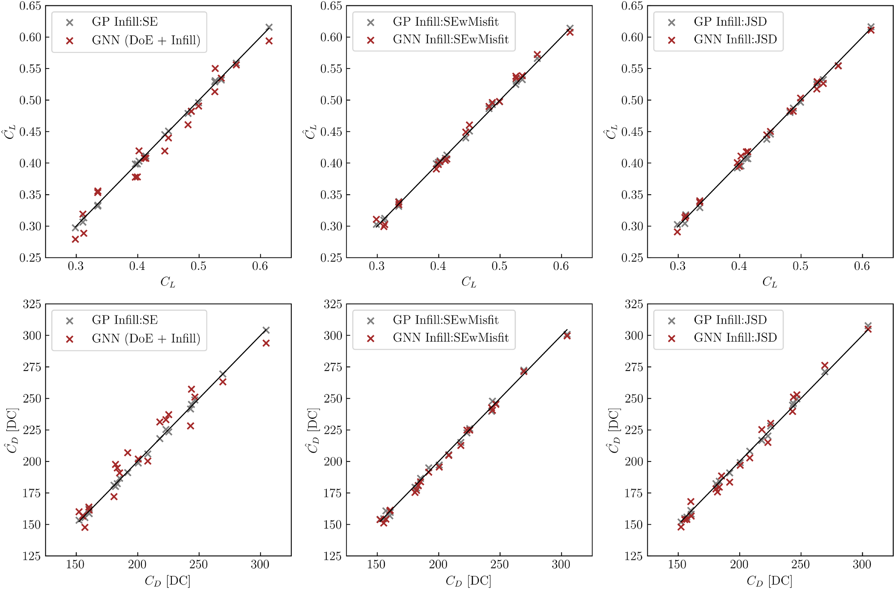

**图 10. 经过 30 次自适应采样迭代后的升力（上排）和阻力计数（下排）的预测—真值一致性图。** 各列对应三种采集策略：仅考虑方差的 Infill:SE、耦合方差与预测不一致量的 Infill:SEwMisfit，以及基于 JSD 的耦合策略 Infill:JSD。阻力计数 drag count 为阻力系数常用计量方式，1 count 对应 $10^{-4}$ 的阻力系数。

**表 1. 不同主动学习方法的精度指标比较。** $C_f[x,y,z]$ 各列中的三个数值依次对应 $x$、$y$、$z$ 分量；RMSE 的该列数值以 $10^{-4}$ 为单位。

| 方法 | $C_p$ RMSE | $C_f[x,y,z]$ RMSE（$\times10^{-4}$） | $C_p$ 的 $r^2$ | $C_f[x,y,z]$ 的 $r^2$ |
|---|---:|---|---:|---|
| PODI | 0.1772 | 7.3816，2.6253，2.8166 | 0.7740 | 0.5073，0.6691，0.8892 |
| GNN | 0.0345 | 3.0214，0.9096，0.7151 | 0.9914 | 0.9176，0.9613，0.9920 |
| GNN（Infill:SE） | 0.0627 | 5.2325，1.5350，1.1119 | 0.9717 | 0.7530，0.8898，0.9828 |
| GNN（Infill:SEwMisfit） | 0.0225 | 1.9923，0.6403，0.5204 | 0.9963 | 0.9641，0.9808，0.9962 |
| GNN（Infill:JSD） | 0.0203 | 1.7977，0.7124，0.5535 | 0.9970 | 0.9708，0.9762，0.9957 |

PODI 无法准确捕捉表面压力系数，在转捩前沿附近及其下游，以及激波附近，均出现较大预测误差。无补点 GNN 相较于 PODI 明显改善，但仍未能准确捕捉转捩前沿和激波位置。GNN（Infill:SE）优于 PODI，但仍难以达到无补点 GNN 的精度。采用耦合采样的 GNN，即 Infill:SEwMisfit 与 Infill:JSD，在所有场代理模型中具有最高精度：转捩前沿附近误差很低，且能够精确捕捉激波位置。注意，对于接近设计空间边缘的测试样本，只有这两类代理模型仍具有合理精度，如图 11(c) 所示。

不过，应当承认，由于补点准则按输入 PDF 对采集函数加权，低概率区域中的样本较少。因此，在输入分布边界附近或其外部，代理模型预测通常较不可靠；测试点（c）的误差比内部测试点（a）、（b）更大，即体现了这一点。

表 1 列出所有模型的 RMSE 与 $r^2$ 指标。原文据此强调，自适应采样策略在各项指标上持续优于非自适应技术。比较不同自适应采样准则，SEwMisfit 与 JSD 的结果十分接近，SE 方法则表现较差。由于 SE 未同时考虑两个模型，这一结果并不令人意外。

> **译注：** 原文对“各项指标持续优于”的概括如上保留；表 1 中，单独的 GNN（Infill:SE）实际上逊于不补点 GNN。该优势主要体现在两种耦合策略上。

需要注意，经过多次补点后，GNN 可能存在过拟合风险。本文设置通过以下机制缓解这一问题：以 20 个 epoch 的耐心值进行早停，在固定留出集上监测验证 RMSE；训练时保持 5% dropout 正则化；每次补点后的重新训练均从上一轮收敛权重热启动，通常仅需额外 100–300 个 epoch 即可收敛。由于验证集与测试集在补点过程中始终不变，任何过拟合都可直接通过所监测的精度指标观察到。

在计算节省方面，耦合补点方法总共使用 60 次仿真，即 30 个 DoE 样本加 30 个补点，就能使 $C_p$ 场预测精度达到 $r^2>0.99$。相比之下，无补点 GP 仅为达到标量精度目标就需要 70–80 个样本，且无法提供相当的场预测精度。原文据此报告，昂贵 CFD 求解次数约减少 25%–30%，同时还获得纯标量代理模型无法提供的精确场预测。

> **数值译注：** 上述“约 25%–30%”为作者原文数值，未予改写。若仅按 60 次相对于 70–80 次计算，降幅约为 14.3%–25%；且这里比较的是不同输出任务与模型，不能直接视为相同场预测误差条件下的严格等成本对比。

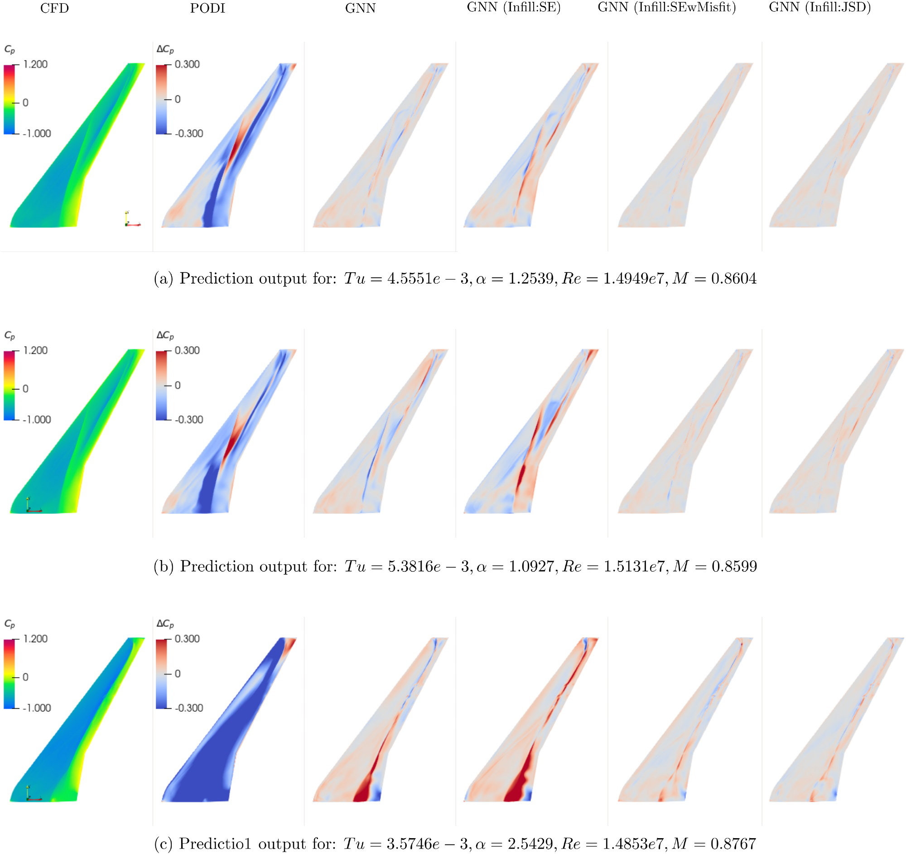

**图 11. 不同场代理模型在三个测试点上的表面压力系数场预测。** 测试点（a）、（b）位于输入空间的高概率区域，点（c）更接近联合分布边界。图中绘制代理模型输出与 CFD 输出之差，以清楚识别预测误差。注意，无补点模型采用 60 个 DoE 样本训练。图内 CFD、PODI 和 GNN 为方法名称；各行的 Prediction output for 表示对应测试工况的预测输出。

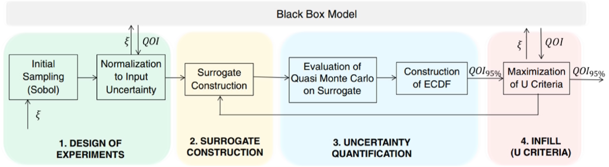

**图 12. 基于代理模型的不确定性传播方法所包含的步骤。** 图内各阶段依次为：1. 试验设计；2. 代理模型构建；3. 不确定性量化；4. 补点（U 准则）。Initial Sampling (Sobol)＝初始采样（Sobol）；Normalization to Input Uncertainty＝按输入不确定性归一化；Surrogate Construction＝构建代理模型；Evaluation of Quasi Monte Carlo on Surrogate＝在代理模型上进行准蒙特卡洛求值；Construction of ECDF＝构建经验累积分布函数；Maximization of U Criteria＝最大化 U 准则；Black Box Model＝黑箱模型。

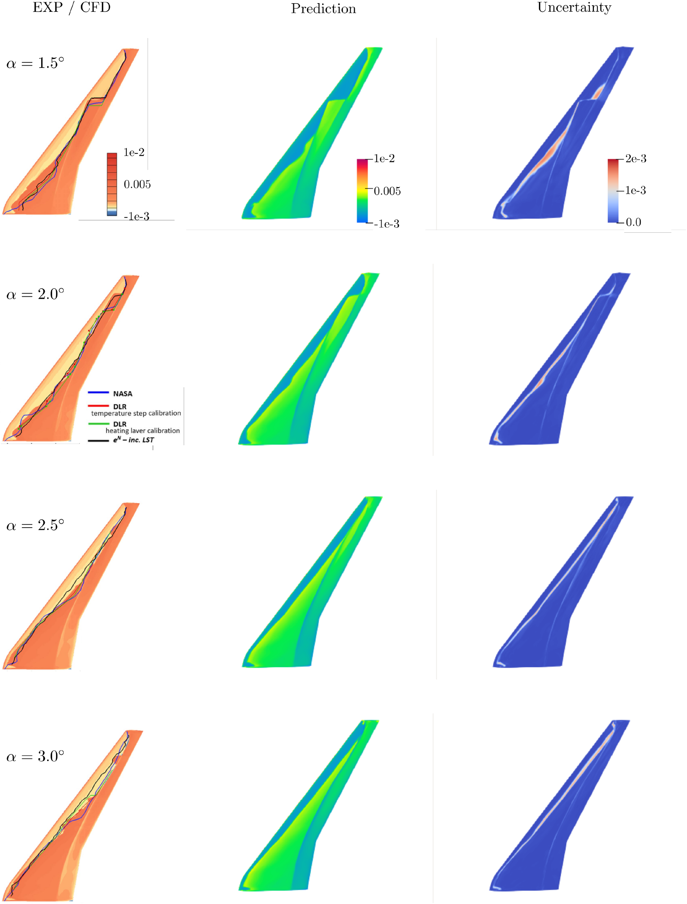

**图 13. 四个不同迎角下的表面摩擦系数。** 第一列为结合试验数据的 CFD 仿真结果，改编自文献 [45]。名义预测及由自由来流湍流度不确定性引起的不确定性，采用 SBUQ 方法计算；场代理模型以 GP-GNN Infill:SEwMisfit 为补点准则。图内 EXP / CFD＝试验／CFD；Prediction＝预测；Uncertainty＝不确定性。

## 5. 不确定性传播——工程应用

本文采用 Sabater 等 [31] 提出、并已集成到 SMARTy [57] 的基于代理模型的不确定性量化（SBUQ）框架，如图 12 所示。该框架使用代理模型，将不确定输入变量 $\boldsymbol{\xi}$ 映射到关注量（QoI），从而高效传播输入不确定性。框架并不在高保真模型上直接执行计算密集的蒙特卡洛仿真，而是通过代理模型估计 QoI 的统计性质。由于使用了真实模型响应的快速近似，这一策略显著降低了计算负担。

计算 QoI 统计量时，蒙特卡洛方法不是应用于昂贵的黑箱函数，而是应用于近似其行为的代理模型。首先，在随机输入空间中，以一组初始试验设计（DoE）样本训练代理模型。代理模型的预测均值及其相应不确定性，即方差估计，使其特别适合指导自适应采样策略。为提高代理精度，采用主动学习，即补点策略，逐步细化代理模型。基准版本中的补点准则着重改善 QoI 的整体预测。模型细化后，使用准蒙特卡洛（QMC）方法生成的大量样本计算 QoI 统计量。相较于传统蒙特卡洛，QMC 在高维情况下具有更好的收敛速度和积分精度，同时仍易于实现。

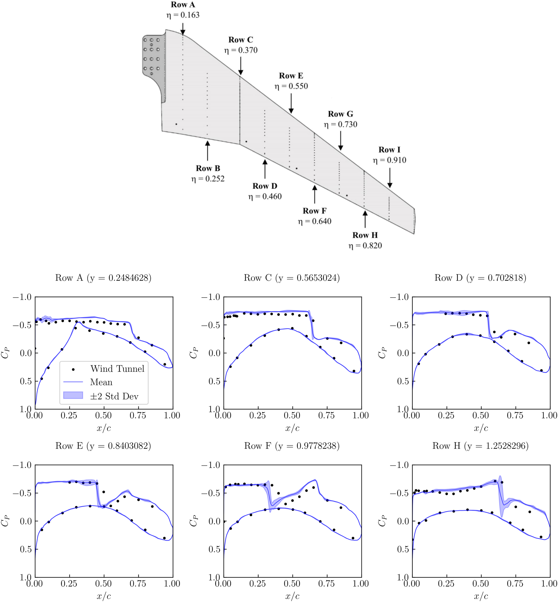

**图 14. 迎角为 $1.5^\circ$ 时，不同展向位置处的表面压力系数。** 不确定性传播结果以代理模型平均预测周围的 $\pm2$ 倍标准差界限表示。平均预测与不确定性传播均基于 SBUQ 方法，采用以 GP-GNN Infill:SEwMisfit 为补点准则的场代理模型。图内 Wind Tunnel＝风洞试验数据；Mean＝均值；$\pm2$ Std Dev＝$\pm2$ 倍标准差；Row A、C、D、F、G、H 表示图示不同展向测量截面。

与文献 [31] 不同，本文将基于标量的补点准则替换为前述 SEwMisfit 准则。这样可将输入不确定性同时传播到阻力系数、表面摩擦系数和压力系数。阻力系数反映气动性能，而表面摩擦与压力系数则使我们能够研究输入不确定性对转捩位置和局部气动行为的影响，从而进一步加深对气动机理的理解。

与前文类似，使用 Halton 序列计算 30 个 DoE 样本，再依据 SEwMisfit 准则增加 30 个补点。通过考虑输入 PDF，使样本集中于高概率位置，增强采样效果。由此得到与第 4 节标记为 SEwMisfit 的模型相同的模型；此外，还可通过对 GNN 进行准蒙特卡洛求值，抽取大量样本，研究输入不确定性对分布式量的影响。需要说明，使用 JSD 补点准则时，也得到十分相似的结果。

> **译注：** 本节使用“Halton 序列”的表述按原文保留。第 3.3 节及图 12 使用的是 Sobol 序列，两处未统一。

图 13 给出四个不同迎角下，自由来流湍流度不确定性对表面摩擦系数的影响。左列结合试验与数值结果，改编自文献 [45]。请注意，由不同准则或方法得到的转捩位置有所不同。第二列显示平均表面摩擦系数，第三列显示其方差。平均预测与结合试验及 CFD 的结果之间，可清楚观察到高度一致性。

值得注意的是，自由来流湍流度的变化使转捩位置附近出现方差分布，其形态与改变转捩判据所得的转捩位置差异相似。当迎角高于 $2.5^\circ$ 时，转捩主要由上表面出现的激波引起。由于此时自由来流湍流度的影响很小，相比于较小迎角，预测方差也随之减小。

除表面摩擦系数外，还可以分析不确定性条件下的表面压力系数，并与试验结果比较。图 14 给出迎角为 $1.5^\circ$ 时，六个不同展向位置的 $c_p$ 分布；试验结果以散点表示，平均预测以实线表示，方差以阴影区域表示。总体而言，模型预测与试验结果具有合理的一致性。

对于最靠近翼根的截面 Row A，湍流度变化的影响出现在前缘附近，约为 $x/c=0.1$ 处，这与图 13 中表面摩擦系数的变化对应。对于 Row C 和 Row D，自由来流湍流度几乎没有可见影响；对于更靠外翼的截面，方差则主要集中在激波附近。有趣的是，自由来流湍流度的不确定性似乎会改变激波强度，但对激波位置的影响非常有限。

## 6. 结论

本文针对能够预测飞机表面压力分布等场量的模型，提出一种目标驱动自适应采样策略。所提策略不依赖具体的场预测模型，因此适用于任意深度学习模型。其本质是将两个组成部分结合为复合补点准则：第一部分为 GP，其内在误差估计用于确定域内采样不足的区域；第二部分为由场模型积分得到的标量预测与 GP 预测之间的不一致量，用于保证两个模型的一致性。预测不一致量既可以通过比较均值预测，以确定性方式计算，也可以利用 Jensen–Shannon 散度，以随机方式计算。

本文在 NASA 通用研究模型上研究所提自适应采样策略的性能，比较不同补点策略的模型预测精度，以及基于准蒙特卡洛、与模型无关的空间填充采样基准策略。比较的策略包括：仅基于 GP 误差的补点，以及基于复合形式的补点，即带预测不一致量的代理误差方法（SEwMisfit）和基于 Jensen–Shannon 散度的随机形式（JSD）。场预测模型采用 GNN，同时也给出了使用潜空间插值的本征正交分解方法的一些初步结果。

在场预测和标量预测方面，SEwMisfit 与 JSD 两种复合补点准则均持续优于仅基于 GP 的准则。研究发现，初期主要由准则中的 GP 误差部分发挥作用，以保证整个域得到充分覆盖；补点后期则由预测不一致项主导，针对性地细化关键流动区域，例如高迎角、高马赫数下局部预测与整体预测容易不一致的区域。

最后，采用 SEwMisfit 准则进行正向不确定性传播分析，研究湍流度不确定性对 NASA CRM 自然层流版本的表面压力与摩擦系数的影响。在压力分布和推得的层流—湍流转捩位置方面，结果与试验发现一致。

所提方法的表述不依赖应用领域，原则上可用于其他能够将分布式场输出汇总为有意义标量的工程问题，例如结构应力场与峰值应力、温度场与热流积分、声场与声压级。不过，目前验证仅限于单一气动构型；迁移到其他领域可能需要调整代理模型架构和不确定性估计方法。在更多应用上展示该框架，仍是未来工作的重要方向。

还需要指出，本文考虑的是四维输入空间，将方法扩展到显著更高维的问题可能面临实际挑战：受维数灾难影响，GP 代理模型为维持精度需要指数增加的数据量，采集函数的全局优化也会变得更加昂贵。GNN 场代理模型在网格图上运行，因此受输入参数个数的影响相对较小，但同样需要更多训练数据才能学习更丰富的映射。未来可研究输入空间降维技术或可扩展采集函数优化器，以缓解这些问题。

此外，有必要研究更严谨的 GNN 不确定性量化方法。本文观察到，所用基于 dropout 的方法在补点过程中有时会产生相当不稳定的行为。

## CRediT 作者贡献声明

**Jigar Parekh：** 写作——审阅与编辑、写作——初稿、可视化、验证、软件、方法学、研究实施、形式化分析、数据整理、概念构思。

**Philipp Bekemeyer：** 写作——审阅与编辑、写作——初稿、指导、资源、项目管理、方法学、经费获取、形式化分析、概念构思。

## 数据可用性

数据可根据请求提供。

## 利益冲突声明

作者声明，以下经济利益或个人关系可能被视为潜在利益冲突：

Philipp Bekemeyer 报告，其获得了德国研究基金会的经费支持。Jigar Parekh 报告，其获得了德国研究基金会的经费支持。如还有其他作者，他们声明不存在任何已知的、可能影响本文所报告研究的竞争性经济利益或个人关系。

## 致谢

感谢德国研究基金会（DFG，German Research Foundation）在德国卓越战略框架下，通过 EXC 2163/1“可持续与节能航空”项目（Project-ID 390881007），资助本研究的部分工作。

作者感谢德国航空航天中心（DLR）提供的科研支持和高性能计算资源。HPC 系统 CARA 部分由萨克森州经济、劳动与交通部，以及德国联邦经济与气候保护部资助。HPC 系统 CARO 部分由下萨克森州科学与文化部，以及德国联邦经济与气候保护部资助。

## Appendix A. Estimating epistemic uncertainty in GNN

> 附录按要求保留英文原文，仅将段落、列表和数学符号整理为 Markdown。

Epistemic uncertainty in a model can be described as the uncertainty in the model’s predictions due to the lack of knowledge about the underlying model parameters. In neural networks, this can be approximated by using Monte Carlo (MC) dropout during inference, where the dropout is kept active even during the prediction phase. The procedure for approximating epistemic uncertainty adopted in this study is as follows:

- The GNN is used in training mode to generate different outputs for the same input $x$.
- For each input, 10,000 MC dropout samples of the field output are generated, which are in turn integrated to obtain the desired scalars (aerodynamic coefficients). The mean $\mu_{GNN}(x)$ and variance $\sigma_{GNN}(x)$ of the scalar outputs are then computed.

The use of MC dropout for estimating epistemic uncertainty in the strategy discussed above can slow down computations during optimization in surrogate models. Specifically, using MC dropout during each infill step significantly increases the computational burden, as estimates of $\mu_{GNN}(x_i)$ and $\sigma_{GNN}(x_i)$ must be computed at several input points $x_i$. To mitigate this issue, we pre-compute two surrogate models before each infill step for the mean and and standard deviation using 1000 input points, and use them during optimization. This reduces computational time by eliminating the need of performing MC dropout at thousands of probe locations during optimization.

It should be noted that MC-dropout carries several known limitations as an estimator of epistemic uncertainty. First, it approximates Bayesian inference by treating dropout masks as samples from a Bernoulli variational distribution over the network weights [33]. This variational family is relatively restrictive and may not capture the true posterior, leading to potential underestimation of predictive variance compared to richer approximations such as deep ensembles. Second, the dropout rate (here 5%) is typically chosen for regularization purposes rather than calibrated for uncertainty quantification, and different rates can yield substantially different variance estimates. Third, the resulting variance does not necessarily decrease monotonically as more training data is added, since retraining the network changes the weight distribution. This behavior was observed in the present study, where the GNN variance remained erratic during the infill process when used as the sole infill driver (cf. Fig. 6). These limitations motivated the coupled infill strategy, which uses the analytically grounded GP variance as the primary sampling driver and treats the GNN uncertainty as a supplementary consistency check.

## References

> 参考文献保留原文与原编号。PDF 换行、断词和链接断行已合并；对原文中重复的 DOI 前缀，仅规范可点击链接的目标。

[1] M.C. Kennedy, A. O’Hagan, Bayesian calibration of computer models, J. R. Stat. Soc. Ser. B 63 (3) (2001) 425–464. [https://doi.org/10.1111/1467-9868.00294](https://doi.org/10.1111/1467-9868.00294)

[2] T.J. Santner, B.J. Williams, W.I. Notz, The Design and Analysis of Computer Experiments, Springer, 2003. [https://doi.org/10.1007/978-1-4757-3799-8](https://doi.org/10.1007/978-1-4757-3799-8)

[3] A.I.J. Forrester, A. Sóbester, A.J. Keane, Engineering design via surrogate modelling: a practical guide, Eng. Des. Surrogate Modell. (2008). [https://doi.org/10.1002/9780470770801](https://doi.org/10.1002/9780470770801)

[4] D.R. Jones, M. Schonlau, W.J. Welch, Efficient global optimization of expensive black-box functions, J. Global Optim. 13 (1998) 455–492. [https://doi.org/10.1023/A:1008306431147/METRICS](https://doi.org/10.1023/A:1008306431147/METRICS)

[5] J. Sacks, W.J. Welch, T.J. Mitchell, H.P. Wynn, Design and analysis of computer experiments, Stat. Sci. 4 (4) (1989) 409 – 423. [https://doi.org/10.1214/ss/1177012413](https://doi.org/10.1214/ss/1177012413)

[6] J. Bect, D. Ginsbourger, L. Li, V. Picheny, E. Vazquez, Sequential design of computer experiments for the estimation of a probability of failure, Stat. Comput. 22 (3) (2012) 773–793. [https://doi.org/10.1007/s11222-011-9241-4](https://doi.org/10.1007/s11222-011-9241-4)

[7] R.B. Gramacy, H.K.H. Lee, Adaptive design and analysis of supercomputer experiments, Technometrics 51 (2) (2009) 130–145. [https://doi.org/10.1198/TECH.2009.0015](https://doi.org/10.1198/TECH.2009.0015)

[8] E. Brochu, V.M. Cora, N. de Freitas, A tutorial on Bayesian optimization of expensive cost functions, with application to active user modeling and hierarchical reinforcement learning, (2010) arXiv preprint arXiv:1012.2599.

[9] B. Shahriari, K. Swersky, Z. Wang, R.P. Adams, N. de Freitas, Taking the human out of the loop: a review of Bayesian optimization, Proc. IEEE 104 (1) (2016) 148–175. [https://doi.org/10.1109/JPROC.2015.2494218](https://doi.org/10.1109/JPROC.2015.2494218)

[10] B. Peherstorfer, K. Willcox, M. Gunzburger, Survey of multifidelity methods in uncertainty propagation, inference, and optimization, SIAM Rev. 60 (3) (2018) 550–591. [https://doi.org/10.1137/16M1082469](https://doi.org/10.1137/16M1082469)

[11] D. Xiu, Numerical Methods for Stochastic Computations: A Spectral Method Approach, Princeton University Press, 2010. [https://doi.org/10.1515/9781400835348](https://doi.org/10.1515/9781400835348)

[12] M. Guénot, I. Lepot, C. Sainvitu, J. Goblet, R. Filomeno Coelho, Adaptive sampling strategies for non-intrusive POD-based surrogates, Eng. Comput. 30 (4) (2013) 521–547. [https://doi.org/10.1108/02644401311329352](https://doi.org/10.1108/02644401311329352)

[13] M.A. Álvarez, L. Rosasco, N.D. Lawrence, Kernels for vector-valued functions: a review, Found. Trends Mach. Learn. 4 (3) (2012) [https://doi.org/10.1561/2200000036](https://doi.org/10.1561/2200000036)

[14] V. Picheny, D. Ginsbourger, O. Roustant, L. Carraro, Gaussian process modeling with inequality constraints, in: Advances in Intelligent Data Analysis XV, 2016, pp. 1–14. [https://doi.org/10.5802/afst.1344](https://doi.org/10.5802/afst.1344)

[15] T. Chugh, Scalarizing functions in Bayesian multiobjective optimization, (2019) arXiv preprint arXiv:1904.05760.

[16] R. Graham, J. Cortés, Cooperative adaptive sampling of random fields with partially known covariance, Int. J. Robust Nonlinear Contr. 20 (9) (2010) 1010–1029. [https://doi.org/10.1002/rnc.1710](https://doi.org/10.1002/rnc.1710)

[17] N. Cressie, Statistics for Spatial Data, Wiley, 1993. [https://doi.org/10.1002/9781119115151](https://doi.org/10.1002/9781119115151)

[18] M.L. Stein, Interpolation of Spatial Data: Some Theory for Kriging, Springer, 1999. [https://doi.org/10.1007/978-1-4612-1494-6](https://doi.org/10.1007/978-1-4612-1494-6)

[19] L.-K. Song, F. Tao, X.-Q. Li, L.-C. Yang, Y.-P. Wei, M. Beer, Physics-embedding multiresponse regressor for time-variant system reliability assessment, Reliab. Eng. Syst. Saf. 263 (2025) 111262. [https://doi.org/10.1016/j.ress.2025.111262](https://doi.org/10.1016/j.ress.2025.111262)

[20] L.-K. Song, F. Tao, G.-Z. Peng, Mixed loss-guided modular regression for dependent system reliability, Reliab. Eng. Syst. Saf. 267 (2026) 111898. [https://doi.org/10.1016/j.ress.2025.111898](https://doi.org/10.1016/j.ress.2025.111898)

[21] T.J. Sullivan, Introduction to Uncertainty Quantification, Springer, 2015. [https://doi.org/10.1007/978-3-319-23395-6](https://doi.org/10.1007/978-3-319-23395-6)

[22] C.M. Bishop, Pattern Recognition and Machine Learning, Springer, 2006.

[23] A. Bertram, Data-driven variable-fidelity reduced order modeling for efficient vehicle shape optimization (2018). [https://doi.org/10.24355/dbbs.084-201811231243-0](https://doi.org/10.24355/dbbs.084-201811231243-0)

[24] S. Lophaven, H. Nielsen, J. Søndergaard, DACE - A Matlab Kriging Toolbox, Version 2.0, 2002.

[25] M. Guo, J.S. Hesthaven, Data-driven reduced order modeling for time-dependent problems, Comput. Methods Appl. Mech. Eng. 345 (2019) 75–99. [https://doi.org/10.1016/j.cma.2018.10.029](https://doi.org/10.1016/j.cma.2018.10.029)

[26] C. Eckart, G. Young, The approximation of one matrix by another of lower rank, Psychometrika 1 (3) (1936) 211–218. [https://doi.org/10.1007/BF02288367](https://doi.org/10.1007/BF02288367)

[27] T. Pfaff, M. Fortunato, A. Sanchez-Gonzalez, P. Battaglia, Learning mesh-based simulation with graph networks, in: International Conference on Learning Representations, 2021. [https://openreview.net/forum?id=roNqYL0_XP](https://openreview.net/forum?id=roNqYL0_XP).

[28] D. Hines, P. Bekemeyer, Graph neural networks for the prediction of aircraft surface pressure distributions, Aerosp. Sci. Technol. 137 (2023) 108268. [https://doi.org/https://doi.org/10.1016/j.ast.2023.108268](https://doi.org/10.1016/j.ast.2023.108268)

[29] A. Sanchez-Gonzalez, J. Godwin, T. Pfaff, R. Ying, J. Leskovec, P. Battaglia, Learning to simulate complex physics with graph networks, in: Proceedings of the 37th International Conference on Machine Learning, 119 of Proceedings of Machine Learning Research, PMLR, 2020, pp. 8459–8468. [https://proceedings.mlr.press/v119/sanchez-gonzalez20a.html](https://proceedings.mlr.press/v119/sanchez-gonzalez20a.html).

[30] J. Gilmer, S.S. Schoenholz, P.F. Riley, O. Vinyals, G.E. Dahl, Neural message passing for quantum chemistry, in: Proceedings of the 34th International Conference on Machine Learning, PMLR, 2017, pp. 1263–1272. [https://proceedings.mlr.press/v70/gilmer17a.html](https://proceedings.mlr.press/v70/gilmer17a.html).

[31] C. Sabater, P. Bekemeyer, S. Görtz, Efficient bilevel surrogate approach for optimization under uncertainty of shock control bumps, AIAA J. 58 (2020) 5228–5242. [https://doi.org/10.2514/1.J059480](https://doi.org/10.2514/1.J059480)

[32] J. Parekh, P. Bekemeyer, S. Helm, D.G. François, C. Grabe, Surrogate based design space exploration and exploitation for an efficient airfoil optimization under uncertainties using transition models, Aerosp. Sci. Technol. 154 (2024) 109532. [https://doi.org/10.1016/j.ast.2024.109532](https://doi.org/10.1016/j.ast.2024.109532)

[33] Y. Gal, Z. Ghahramani, Dropout as a Bayesian approximation: representing model uncertainty in deep learning, in: Proceedings of the 33rd International Conference on Machine Learning (ICML), PMLR, 2016, pp. 1050–1059. [https://proceedings.mlr.press/v48/gal16.html](https://proceedings.mlr.press/v48/gal16.html).

[34] L. Breiman, Bagging predictors, Mach. Learn. 24 (2) (1996) 123–140. [https://doi.org/10.1007/BF00058655](https://doi.org/10.1007/BF00058655)

[35] P. Gardner, T.J. Rogers, C.E. Lord, R.J. Barthorpe, Learning model discrepancy: a Gaussian process and sampling-based approach, Mech. Syst. Signal Process. (2021). [https://api.semanticscholar.org/CorpusID:230573913](https://api.semanticscholar.org/CorpusID:230573913).

[36] A. Garbo, J. Parekh, T. Rischmann, P. Bekemeyer, Multi-fidelity adaptive sampling for surrogate-based optimization and uncertainty quantification, Aerospace 11 (6) (2024). [https://www.mdpi.com/2226-4310/11/6/448](https://www.mdpi.com/2226-4310/11/6/448).

[37] J. Lin, Divergence measures based on the Shannon entropy, IEEE Trans. Inf. Theory 37 (1) (1991) 145–151. [https://doi.org/10.1109/18.61115](https://doi.org/10.1109/18.61115)

[38] S. Kullback, R.A. Leibler, On information and sufficiency, Ann. Math. Stat. 22 (1) (1951) 79–86. [https://doi.org/10.1214/aoms/1177729694](https://doi.org/10.1214/aoms/1177729694)

[39] L.-j. Chen, Y. Hong, S. Mangalathu, H.-y. Gou, Q.-h. Pu, Adaptive sampling approach based on Jensen-Shannon divergence for efficient reliability analysis, J. Cent. South Univ. 28 (9) (2021) 2407–2422. [https://doi.org/10.1007/s11771-021-4740-8](https://doi.org/10.1007/s11771-021-4740-8)

[40] M.N. Lynde, R.L. Campbell, Computational design and analysis of a transonic natural laminar flow wing for a wind tunnel model, in: AIAA Aviation 2017 Forum, 2017. AIAA 2017-3693, [https://ntrs.nasa.gov/citations/20170005688](https://ntrs.nasa.gov/citations/20170005688).

[41] M.N. Lynde, R.L. Campbell, M.B. Rivers, S.A. Viken, D.T. Chan, A.N. Watkins, S.L. Goodliff, Preliminary results from an experimental assessment of a natural laminar flow design method, AIAA Scitech 2019 Forum (2019). [https://doi.org/10.2514/6.2019-2298](https://doi.org/10.2514/6.2019-2298)

[42] T. Gerhold, Overview of the hybrid RANS code TAU, MEGAFLOW Numer. Flow Simul. Aircr. Des. (2005) 81–92. [https://doi.org/10.1007/3-540-32382-1_5](https://doi.org/10.1007/3-540-32382-1_5)

[43] F.R. Menter, M. Kuntz, R. Langtry, Ten years of industrial experience with the SST turbulence model, Turbul. Heat Mass Transf. 4 (1) (2003) 625–632. [https://api.semanticscholar.org/CorpusID:38105247](https://api.semanticscholar.org/CorpusID:38105247).

[44] D.G. François, A. Krumbein, N. Krimmelbein, C. Grabe, Simplified stability-based transition transport modeling for unstructured computational fluid dynamics, J. Aircr. (2023) 1–12. [https://doi.org/10.2514/1.C037163](https://doi.org/10.2514/1.C037163).

[45] A.M. Krumbein, D.G. François, N. Krimmelbein, Transport-based transition prediction for the common research model natural laminar flow configuration, in: AIAA Scitech 2022 Forum, 2022. AIAA 2022-1541. [https://doi.org/10.2514/6.2022-1541](https://doi.org/10.2514/6.2022-1541)

[46] J. Perraud, H. Deniau, G. Casalis, Overview of transition prediction tools in the elsA software, in: ECCOMAS 2014, 2014.

[47] D.G. François, A. Krumbein, N. Krimmelbein, Crossflow extension of a simplified transition transport modelfor three-dimensional aerodynamic configurations, in: AIAA AVIATION Forum, 2022. [https://arc.aiaa.org/doi/abs/10.2514/6.2022-3678](https://arc.aiaa.org/doi/abs/10.2514/6.2022-3678).

[48] S. Helm, D.G. Francois, C. Grabe, J. Parekh, P. Bekemeyer, CFD-basierte transitionsvorhersage für den entwurf von laminarflugzeugen, in: Dt. Luft-und Raumfahrt Kongress DLRK 2023, 2023.

[49] J. van Ingen, A Suggested Semi-Empirical Method for the Calculation of the Boundary Layer Transition Region (1956). [https://api.semanticscholar.org/CorpusID:118788950](https://api.semanticscholar.org/CorpusID:118788950).

[50] G. Schrauf, Industrial view on transition prediction, Recent Results Laminar Turbul. Transition (2004) 111–122. [https://doi.org/10.1007/978-3-540-45060-3_9](https://doi.org/10.1007/978-3-540-45060-3_9)

[51] T. Streit, S. Wedler, M. Kruse, DLR natural and hybrid transonic laminar wing design incorporating new methodologies, Aeronaut. J. 119 (2015) 1303–1326. [https://doi.org/10.1017/S0001924000011283](https://doi.org/10.1017/S0001924000011283)

[52] M. Kruse, A. Küpper, R. Petzold, F. Munoz, Determination of the critical cross flow N-factor for the low-speed wind tunnel Braunschweig (DNW-NWB), Notes Numer. Fluid Mech. Multi. Des. 136 (2018) 251–261. [https://doi.org/10.1007/978-3-319-64519-3_23](https://doi.org/10.1007/978-3-319-64519-3_23)

[53] C. Sabater, P. Bekemeyer, S. Görtz, Robust design of transonic natural laminar flow wings under environmental and operational uncertainties, AIAA J. 60 (2022) 767–782. [https://doi.org/10.2514/1.J060676](https://doi.org/10.2514/1.J060676)

[54] L.M. Mack, Transition prediction and linear stability theory, ltt (1977). [https://ui.adsabs.harvard.edu/abs/1977ltt..agarQ....M/abstract](https://ui.adsabs.harvard.edu/abs/1977ltt..agarQ....M/abstract).

[55] R. Radespiel, W. Heinze, SFB 880: fundamentals of high lift for future commercial aircraft, CEAS Aeronaut. J. (2014). [https://doi.org/10.1007/s13272-014-0103-6](https://doi.org/10.1007/s13272-014-0103-6)

[56] M.N. Lynde, R.L. Campbell, S.A. Viken, Additional findings from the common research model natural laminar flow wind tunnel test, in: AIAA Aviation 2019 Forum, 2019. AIAA 2019-3292. [https://doi.org/10.2514/6.2019-3292](https://doi.org/10.2514/6.2019-3292)

[57] P. Bekemeyer, A. Bertram, D.A.H. Chaves, M.D. Ribeiro, A. Garbo, A. Kiener, C.S. Campomanes, M. Stradtner, S. Wassing, M. Widhalm, S. Görtz, F. Jäckel, R. Hoppe, N. Hoffmann, Data-driven aerodynamic modeling using the DLR SMARTy toolbox, American Institute of Aeronautics and Astronautics Inc, AIAA, 2022. [https://doi.org/10.2514/6.2022-3899](https://doi.org/10.2514/6.2022-3899)
