# 宽攻角涡轮叶片的非对称前缘设计机理与多智能体强化学习优化

**原题：** Asymmetric leading-edge design mechanisms and multi-agent reinforcement learning optimization for wide-incidence turbine blades

**作者：** Tianyou Chena，Zhengshuai Dua，Le Caia,b,*，Peizhi Donga，Songtao Wanga,b

a 哈尔滨工业大学能源科学与工程学院，中国黑龙江哈尔滨，150001  
b 哈尔滨工业大学苏州研究院，中国江苏苏州，215104

**期刊：** Energy，356（2026），141106  
**DOI：** [10.1016/j.energy.2026.141106](https://doi.org/10.1016/j.energy.2026.141106)  
**收稿：** 2026 年 2 月 9 日；**修回：** 2026 年 3 月 21 日；**录用：** 2026 年 4 月 19 日；**在线发表：** 2026 年 4 月 20 日。  
**版权：** 0360-5442/© 2026 Published by Elsevier Ltd.

**通讯作者地址：** 哈尔滨工业大学苏州研究院，中国江苏苏州，215104。  
**电子邮箱：** 22b302011@stu.hit.edu.cn（T. Chen）；duzs2311@hit.edu.cn（Z. Du）；caile_lele@163.com（L. Cai）；peizhidong@stu.hit.edu.cn（P. Dong）；earc_wangst@163.com（S. Wang）。

**关键词：** 动力涡轮；转子叶片型线；试验；图神经网络；非设计工况性能。

> 译文说明：保留原文的章节层级、插图、图注、表格和公式编号；插图内的英文标注保留原样，参考文献不翻译。原文中可见的公式、编号或表述不一致未作擅自修正，必要时以“译注”说明。受 Markdown 格式限制，原文双栏排版改为依阅读顺序排列的单栏。

## 摘要

在宽攻角范围内保持较低的气动损失，仍是变转速动力涡轮转子叶片设计面临的一项主要挑战。本研究针对一种具有代表性的跨声速转子叶片叶栅，研究其截面层面的气动特性，并提出一种融合机理分析、代理建模与优化的、由物理信息指导的非对称前缘（LE）设计策略。首先，通过风洞试验和雷诺平均纳维–斯托克斯方程数值模拟，表征随攻角变化的损失机理，并建立经验证的气动数据库。结果表明，正攻角主要对应吸力面前缘分离及其下游掺混损失，而大负攻角下的损失则主要受压力面前缘来流失配及分离相关代价支配。

在上述机理指导下，建立一种非对称前缘参数化方法，将吸力面与压力面的几何形状解耦，从而在控制正攻角分离的同时，限制负攻角下的摩擦代价及压力面不利效应。为高效探索所得设计空间，将图注意力网络（GAT）代理模型与多智能体强化学习（MARL）相结合，分别为 −50°、0° 和 +30° 攻角工况设置三个协作智能体。随后通过试验进一步验证优化设计。与基准叶片相比，优化后的非对称叶片在 −50°、0° 和 +30° 攻角下的总压损失系数分别降低 29.29%、13.73% 和 46.64%，表明其在宽攻角范围内获得了显著的气动性能提升。上述结果建立了一个具有试验依据和物理基础的框架，可用于宽攻角条件下涡轮转子叶片型线非设计工况前缘的快速设计。

## 1. 引言

燃气轮机作为一种能量产生装置，在动力、储能与能源利用、航空航天以及工业过程等领域发挥着关键作用 [1]。随着降低燃料消耗与运行成本的需求不断增长，涡轮气动设计已由单点优化转向在较宽非设计工况范围内保持稳健性能 [2]。这一趋势对变转速动力涡轮尤为重要，因为负荷变化、转速调节及级间匹配效应都可能导致实际攻角显著偏离设计值 [3,4]。对于动力涡轮转子叶片，这类攻角变化会明显改变局部加速、分离发展和气动损失产生过程，进而带来显著的非设计工况气动性能损失 [5,6]。因此，阐明叶片型线的基本流动行为和损失机理，并将这些认识转化为由物理机理指导的优化方向，再结合高效的人工智能设计方法，为开发适应宽运行包线的低损失叶片型线提供了一条实用途径，可同时提高非设计工况稳健性与设计效率。

对于变转速动力涡轮，在宽攻角范围内保持低气动损失的固定几何转子叶片，是一种实用且高效的设计方案 [7,8]。然而，宽攻角气动设计仍具有挑战性，因为在较大正攻角和负攻角下，前缘分离、堵塞以及端壁二次流损失可能发生强烈耦合。为在可控条件下研究这些耦合损失机理，研究者通常采用二维叶片截面的平面叶栅研究：在保留与转子叶片截面相关的关键攻角依赖机理的同时，通过在可控攻角条件下分离研究截面层面的叶栅气动特性，简化问题 [9,10]。

为提高对非设计攻角变化的容忍能力，已有研究主要关注前缘几何修型。代表性策略包括增大前缘直径 [11] 或楔角 [12]，以拓宽允许攻角范围，并稳定对来流的响应。另一些研究强调连续曲率设计，表明椭圆化型线和曲率平滑可削弱局部压力尖峰、缓和加速梯度，并延迟分离发生 [13,14]。基于平面叶栅试验和数值模拟的机理研究，进一步将前缘压力尖峰、分离泡以及对攻角敏感的流动恶化与具体几何特征联系起来，从而推动更精细的几何前缘设计策略 [15,16]。

此外，近期关于高速叶排的研究表明，进口马赫数和局部前缘几何的变化，会显著改变压力尖峰、激波相关流动结构及相应气动响应，进一步凸显了前缘调控对维持非设计工况流动稳健性的重要性 [17,18]。叶栅研究还表明，稠度等整体参数会显著影响高速叶栅性能与流动结构，因此应结合稠度水平及相应叶栅负荷环境，理解前缘修型的气动影响 [19]。特别是 Hamakhan 等 [20] 指出，前缘附近的曲率不连续是触发攻角相关分离的重要因素，并证明采用改进的抛物线引导曲线重构前缘，可提高曲率连续性并减小流动扰动。总体而言，这些研究已确立前缘修型是改善非设计工况气动行为的有效途径，但大多仍局限于对称设计范式。

尽管取得了上述进展，现行前缘设计范式对于宽攻角运行仍存在根本局限，因为它没有明确考虑压力面（PS）与吸力面（SS）之间固有的气动非对称性。具体而言，两侧的主导损失机理对攻角具有根本不同的敏感性。在较大正攻角下，吸力面容易发生大范围分离，并主导总体损失产生；相比之下，压力面在负攻角下可能形成分离泡，其造成的堵塞及与端壁二次流的潜在相互作用仍然十分关键。此外，如果不对这些随攻角变化的损失机理进行定量分解，就难以建立能够直接指导设计的几何、流动结构与损失产生之间的明确关系。这些局限表明，需要一种明确耦合非对称前缘几何与攻角相关流动物理的设计框架。

不过，建立这种框架需要兼具物理可靠性和计算效率的气动预测方法。虽然雷诺平均纳维–斯托克斯（RANS）模型广泛用于工业气动评估，但在高维设计空间内反复进行计算流体力学（CFD）计算，对于迭代优化而言仍过于昂贵，而且定常或低阶模型可能无法充分解析与前缘诱导损失有关的非定常分离物理。大涡模拟 [21,22]、脱体涡模拟 [23,24] 和直接数值模拟 [25,26] 等高保真方法能够提供更丰富的流动细节，但由于计算成本高，难以用于常规设计空间探索。这些局限推动了数据驱动代理模型的发展。已有研究表明，卷积神经网络（CNN）能够有效预测气动场 [27,28]，但此类模型本质上针对规则欧氏网格设计 [29,30]。在涡轮气动分析中，CFD 解通常定义在高度弯曲、拓扑不规则的网格上，因此投影或栅格化到结构网格可能引入插值偏差与几何失真。

相比之下，显式引入图表示和网格拓扑的学习框架可保留原有连通性，因此更适合在 CFD 网格上开展物理驱动学习 [31,32]。这促使人们采用图神经网络（GNN），因为它能够自然地编码非欧氏气动数据中的拓扑关系，并直接作用于非结构离散数据。近期研究表明，在不规则网格结构上预测气动量时，GNN 可优于基于 CNN 的模型，具有更强的泛化能力和更高的物理保真度 [33–35]。

除基于网格的图表示外，Chen 等 [36] 进一步证明，还可直接依据叶片型线特征构图，而无须依赖 CFD 网格流场；尤其是，他们基于五个关键点将叶片型线划分为五个节点的 GAT 模型，在小规模试验数据条件下实现了快速且准确的气动预测。这表明，对于涡轮型线修型任务，基于特征的几何表示可能比完整的网格描述更合适，因为它与叶片重新设计所引入的几何扰动联系更直接。

然而，仅有准确预测并不能解决宽攻角设计问题，因为非对称几何调节会引入一个高维设计空间，不同攻角工况的目标在本质上相互竞争。在这种情况下，强化学习（RL）通过智能体与环境交互实现高效优化，可形成自然补充 [37]。宽攻角优化可表述为一种协作式多智能体任务，将不同攻角工况分配给不同智能体，同时通过共享约束耦合几何决策 [38–41]。将 MARL 与具有空间感知能力的 GNN 代理模型相结合，用于非对称前缘优化，尚未得到系统研究。不过，多智能体强化学习（MARL）与具有空间感知能力的 GNN 代理模型用于非对称前缘优化的系统集成，仍未得到系统探讨。〔译注：此处两句含义重复，原文如此。〕

基于上述考虑，本研究通过平面叶栅试验和 CFD 模拟，研究某低压动力涡轮转子叶片的中叶高截面。根据随攻角变化的机理分析，确立一种由物理机理指导的非对称前缘修型方向，以反映压力面和吸力面不同的主导损失机理，并能够独立控制两侧的曲率、楔角及前缘长度。在这一机理指导的设计方向及其约束下，将 GAT 代理模型与协作式 MARL 耦合，实现多个攻角工况下的高效优化。

研究对象为某涡桨发动机四级动力涡轮中第三级转子叶片的中叶高型线。该叶片截面的代表性运行攻角范围约为 −50° 至 +25°。因此，本研究采用 −50° 至 +30° 的攻角包线，以覆盖实际运行范围。在这一包线内，选择 −50°、0° 和 +30° 三个代表性攻角构建协作式 MARL 优化框架，并相应分配三个智能体。进一步设计宽攻角奖励机制，以获得一个能够平衡不同攻角下冲突要求的统一优化前缘构型。

本文其余部分安排如下：第 2 节介绍试验装置、数值验证和几何参数化方法。第 3 节分为三部分：首先分析宽攻角前缘变化与损失产生的基本机理；随后研究三维端壁流动结构和二次损失发展；最后构建非对称前缘策略，并验证提出的 GNN–MARL 优化框架。第 4 节总结主要结论。

### 符号说明

| 符号 | 含义 |
|---|---|
| $A$ | 邻接矩阵 |
| $B$ | 贝塞尔曲线 |
| $C_p$ | 压力系数 |
| $C_{pt}$ | 总压损失系数 |
| $C_x$ | 轴向弦长 |
| $C_t$ | 切向弦长 |
| $C_\Phi$ | 归一化耗散函数 |
| $H$ | 节点表示 |
| $K$ | 加速系数 |
| LE | 前缘 |
| LEs | 前缘吸力面分支 |
| LEp | 前缘压力面分支 |
| $Ma_s$ | 表面等熵马赫数 |
| $P$ | 压力，Pa |
| PS | 压力面 |
| $P^*$ | 总压，Pa |
| $P_i$ | 控制点坐标 |
| $R$ | 半径 |
| SS | 吸力面 |
| $U$ | 速度矢量 |
| $U_{\mathrm{in}}$ | 进口平均速度 |
| $u'$ | 流向速度脉动 |
| $W$ | 权重矩阵 |
| $a$ | 特征信息 |
| $a_{ij}$ | 注意力系数 |
| $e_{ij}$ | 节点 $i$ 与节点 $j$ 之间的关系强度 |
| $l$ | 相对轴向弦长 |
| $s$ | 流向坐标 |
| $T$ | 温度 |
| $t_e$ | 贝塞尔曲线上的相对位置 |
| $\Phi$ | 无量纲耗散函数 |
| $\rho$ | 密度 |
| $\nu$ | 运动黏度 |
| $\omega$ | 涡量 |
| $\beta$ | 金属角（原文写作 mental angle） |
| $\xi$ | 无导向转角 |
| $\gamma$ | 楔角 |

**下标：** in 表示进口；out 表示出口。

## 2. 研究方法

### 2.1. 试验方法

环形叶栅试验在哈尔滨工业大学跨声速风洞试验台上进行。一台功率为 1000 kW 的周向压缩机提供连续气源，最大压比为 2.2，最大质量流量为 10.5 kg/s。气流流经高温管道，冷却后进入稳压器，以获得均匀的静压分布。试验段采用直线叶栅构型，叶高为 100 mm，如图 1 所示。叶栅由八片叶片组成，具有足够的周期性，以模拟无限叶栅。〔译注：原文在本段同时使用 annular cascade 和 linear cascade 两种表述。〕

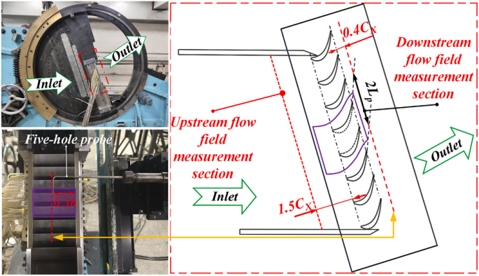

**图 1.** 平面叶栅试验平台。

为获得叶片表面静压分布，沿中叶高截面均匀布置直径为 0.5 mm 的测压孔，其轴线垂直于局部叶片表面。测量通道由图 1 中的紫色方框标出。在该通道内，两片相邻叶片的压力面和吸力面均布置静压孔，其中压力面 25 个，吸力面 25 个。

叶片表面等熵马赫数由式（1）计算：

$$
Ma_s=\sqrt{\frac{2}{k-1}\left[\left(\frac{P^*_{\mathrm{in}}}{P_{\mathrm{out}}}\right)^{\frac{1-k}{k}}-1\right]} \tag{1}
$$

表面静压系数如式（2）所示：

$$
C_p=\frac{P_2}{P_1^*} \tag{2}
$$

总压损失系数如式（3）所示：

$$
C_{pt}=\frac{P^*_{\mathrm{in}}-P^*_{\mathrm{out}}}{P^*_{\mathrm{out}}-P_{\mathrm{out}}} \tag{3}
$$

叶片和端壁的尺寸误差控制在 0.06 mm 以内，安装角加工误差小于 0.2°。测量误差主要来自测量仪器的精度，各仪器的不确定度见表 1。数据插值的误差范围为 2% [23]。

**表 1. 测量设备的误差范围**

| 测量项目 | 仪器 | 不确定度 |
|---|---|---|
| 压力 | PSI 9116 | ±0.05% |
| 大气压力 | 大气压力计 | ±0.02% |
| 温度 | K 型热电偶 | ±1 °C |
| 俯仰与偏航方向移动 | 五孔探针位移系统 | ±0.01 mm |

采用经标定的 L 型五孔探针测量叶栅下游气动参数。本研究开展两类测量：首先进行出口平面扫描，以验证通道周期性；随后用于性能评估的气动测量沿中叶高测线进行，采样点沿节距方向分布，并在尾迹区局部加密。叶栅出口压力由直径 1.8 mm 的 L 型五孔探针测量，探针结构及测量角度定义见图 2。

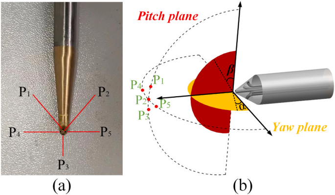

**图 2.** 五孔探针：（a）结构；（b）测量参数。

按照 Liu [42] 的方法对测量不确定度进行严格量化。压力传感器精度为 0.5%，而 $C_{pt}$ 和 $Ma_s$ 等导出变量的累积不确定度控制在 ±2%。由测量间接获得的因变量 $y(x)$ 的不确定度可按式（4）计算：

$$
y=\sqrt{\sum_{i=1}^{n}\left(\frac{\partial y}{\partial x_i}\,dx_i\right)^2} \tag{4}
$$

为验证通道周期性，在设计工况下采用基准型线 A1，对叶栅下游某平面的出口流场进行测量。测量区域沿节距方向覆盖两个叶片节距，沿节距方向布置 56 个测点，沿叶高方向布置 36 个测点。为更好地解析尾迹掺混和端壁效应，在低马赫数尾迹区加密节距方向测点，并在上下端壁附近加密叶高方向测点。出口平面的测点布置见图 3（a）。

后续气动测量沿中叶高测线提取流动参数，测量区域同样沿节距方向覆盖两个叶片节距。主流区测点间距为 1.86 mm，尾迹区采用 0.93 mm 的加密间距，以提高对尾迹相关梯度的分辨能力。因此，低马赫数尾迹范围内约分布 13 个测点。相邻两个节距内的中叶高马赫数分布见图 3（b）。为定量评估通道周期性，以第一个节距内（$0\leq C_x\leq1$）的马赫数曲线为基准，将第二个节距内（$1\leq C_x\leq2$）的曲线平移一个节距，并在相同归一化节距位置逐点比较。所报告的百分比偏差，以第一个节距的数值为基准，计算两条曲线的绝对相对差。尾迹区和主流区的最大绝对偏差均小于 1%，证实通道周期性足以满足后续气动验证要求。

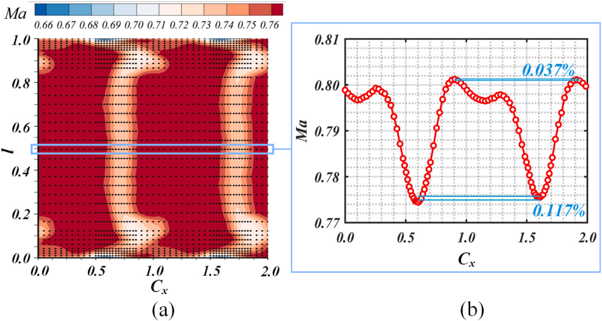

**图 3.** 出口 $Ma=0.8$、$i=0°$ 时 A1 叶栅试验的周期性验证：（a）出口测点布置及马赫数云图；（b）中叶高马赫数分布。

### 2.2. 数值模拟方法

采用 ANSYS CFX 19.0 进行 RANS 模拟，以补充试验数据库。控制方程采用高分辨率二阶迎风格式离散。所选低压动力涡轮的代表性运行攻角范围约为 −50° 至 +25°，因此选择 −50°、0° 和 +30° 三个代表性攻角，在覆盖实际运行范围的同时保留适度设计裕度。

使用热线风速仪在叶栅上游测量进口湍流强度，相应测量布置见图 4。测得的自由来流湍流强度约为 $Tu\approx5\%$。本研究将该实测值用于数值设置，以保证试验来流与 CFD 模拟条件一致。湍流强度定义为：

$$
Tu=\frac{\sqrt{\frac{1}{N}\sum_{i=1}^{N}(u_i-u_m)^2}}{U_{\mathrm{in}}} \tag{5}
$$

其中，$U_m$ 为进口平均速度，$u_{\mathrm{rms}}$ 为瞬时速度样本，$u_m$ 为时间平均速度，$N$ 为样本数。〔译注：本句变量说明与式（5）的符号存在不一致，依原文保留。〕

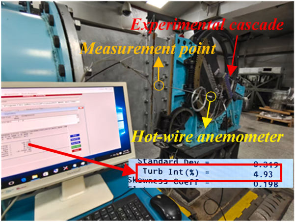

**图 4.** $Tu$ 的试验测量。

边界层状态预计对层流–湍流转捩敏感，并可能出现由转捩诱发的分离泡。因此，采用剪切应力输运（SST）模型：它将近壁区 $k$–$\omega$ 形式与自由流中的 $k$–$\varepsilon$ 行为混合，相比传统双方程闭合模型，在逆压梯度和易分离流动中具有更好的稳健性。为更好地描述实测湍流强度下的转捩效应，将 SST 与 $\gamma$–$\theta$ 转捩模型耦合，以捕捉边界层状态的演变。如图 5 所示，在前缘区域（$0<l<0.1$），SST + $\gamma$–$\theta$ 组合设置比标准 $k$–$\varepsilon$ 和 $k$–$\omega$ 模型更接近试验测得的前缘压力分布。

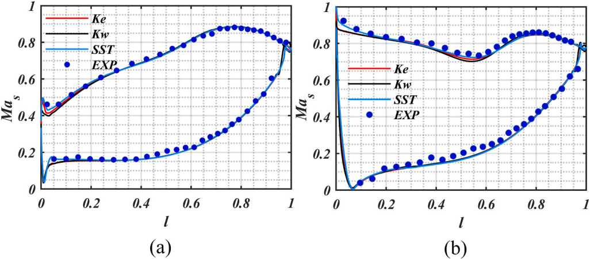

**图 5.** 数值计算与试验结果对比：（a）0° 攻角；（b）30° 攻角。

通过 CFD 数值模拟补充叶栅试验，并生成 GNN 模型的数据集。计算网格使用 NUMECA AutoGrid 5 生成，叶片表面周围采用 O 型网格，其余流动区域采用 H 型网格，如图 5（a）所示。进口边界位于前缘上游 $1.5C_x$ 处，其中 $C_x$ 为轴向弦长，以使进口边界层在进入叶栅通道前充分发展，提高数值模拟保真度。〔译注：此处“图 5（a）”为原文引用；网格示意见图 6（a）。〕

边界条件设置如下：进口指定总温、总压和气流角，出口指定静压。上下端壁以及叶片表面均设为无滑移壁面，与试验条件保持一致。为选择离散化误差合理的网格分辨率，采用 Richardson 外推法估算网格收敛指数（GCI）[43]，据此确定合适的网格数量范围。本研究考察的网格规模分别为 67 万、120 万、140 万、227 万和 321 万个单元，对应的特征网格尺度分别为 0.729、0.399、0.321、0.207 和 0.146 mm。网格尺度定义为流体域体积与网格总节点数之比的立方根。

采用五套网格进行网格验证，由粗到细分别记为 Case 1 至 Case 5。其中选择 Case 1、3 和 5 评估网格收敛性，Case 1 对应最粗网格（$h_1$），Case 3 对应中等网格（$h_2$），Case 5 对应最细网格（$h_3$）。为便于表述，相邻网格的加密比定义为 $r=h_{\mathrm{coarse}}/h_{\mathrm{fine}}$。本研究所有算例的加密比设为 1.3。根据最佳实践，$r\geq1.3$ 被认为适合 GCI 评估。

对于三级网格 $h_1,h_2,h_3$，相应出口总压损失分别记为 $f_1,f_2,f_3$。相邻网格对之间的 GCI 按下式计算：

$$
F=\frac{\left|\ln\left(\left|\frac{f_3-f_2}{f_2-f_1}\right|\right)\right|}{\ln(r)} \tag{6}
$$

$$
p=\frac{\ln\left(\left|\frac{f_3-f_2}{f_2-f_1}\right|\right)}{\ln r} \tag{7}
$$

$$
e_a^{2,1}=\left|\frac{f_2-f_1}{f_1}\right| \tag{8}
$$

$$
e_a^{3,2}=\left|\frac{f_3-f_2}{f_2}\right| \tag{9}
$$

$$
\mathrm{GCI}^{2,1}=\frac{1.25\left|e_a^{2,1}\right|}{r^F-1} \tag{10}
$$

$$
\mathrm{GCI}^{3,2}=\frac{1.25\left|e_a^{3,2}\right|}{r^F-1} \tag{11}
$$

本研究得到 $\mathrm{GCI}_{21}=0.12\%$、$\mathrm{GCI}_{32}=0.32\%$，均小于 1%。此外，$|e_a^{2,1}|<|e_a^{3,2}|$ 表明单调收敛，证实所选网格的离散化误差可接受。$C_{pt}$ 随特征网格尺度的变化见图 6（b）。依据网格收敛评估，后续模拟最终采用约 227 万个单元的计算网格。

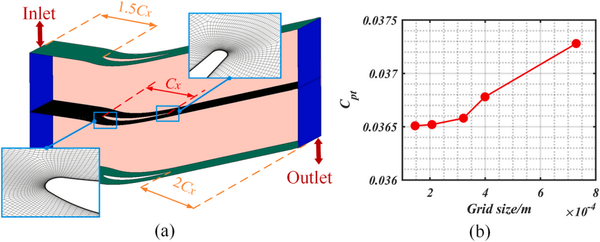

**图 6.** 叶片网格示意图：（a）网格结构；（b）网格无关性验证。

第一层近壁网格间距为 $1\times10^{-3}$ mm。图 7 给出了所选网格的 $Y^+$ 分布。整个叶片表面的 $Y^+$ 均小于 1.0，表明该网格为本研究采用的湍流与转捩模型提供了充分的近壁分辨率。为进一步量化网格质量，表 2 总结了所选计算网格的主要指标。

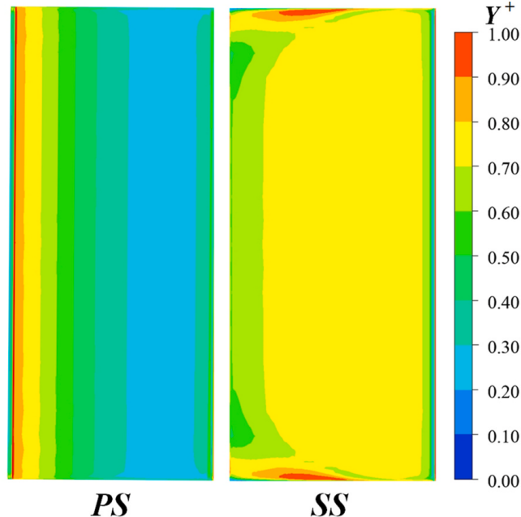

**图 7.** 所选网格的叶片表面 $Y^+$ 分布。

**表 2. 所选计算网格的质量指标**

| 项目 | 数值 |
|---|---:|
| 网格总点数 | 2,271,750 |
| 负体积单元数 | 0 |
| 层级数 | 3 |
| 最小偏斜角 | 49.554° |
| 最大长宽比 | 6794.6 |
| 最大膨胀比 | 1.7359 |
| 最小正交角 | 58.6° |
| 最大正交角 | 90° |
| 叶高方向角度偏差 | 0.39 |
| 叶高方向膨胀比 | 1.736 |

所有 CFD 模拟均采用定常 RANS 计算。这一选择是适当的，因为本研究的主要分析依据是试验测得的总压损失、叶片表面静压和表面等熵马赫数。数值模拟主要用于辅助解释前缘修型引起的流动趋势变化。为此，定常 RANS 能够在精度与计算成本之间提供合理平衡，而非定常模拟会显著增加参数分析和优化的计算开销。

还应指出，代理模型在采用带壁面函数的 $k$–$\varepsilon$ 模型建立的定常 RANS 气动数据库上训练，因此继承了这一框架的适用范围与局限。其预测应理解为时间平均的截面层面气动响应。当模型外推至采样几何或攻角范围之外，或流动由当前定常 RANS 方法无法充分解析的物理过程主导时，例如强非定常性或显著三维效应，预测精度可能下降。因此，尽管该框架可有效用于已采样宽攻角空间内的机理分析与优化，将其拓展至强非定常流动或完整旋转级工况前，仍需进一步验证。〔译注：此处训练数据库所述 $k$–$\varepsilon$ 模型，与前文采用 SST + $\gamma$–$\theta$ 的描述不一致，原文如此。〕

### 2.3. 叶片型线修型

在涡轮型线十一参数方法中，十一个几何参数唯一确定叶片型线的五个关键几何点，再通过相连曲线重构完整的涡轮叶片几何 [44]。附录 I 给出了这五个关键点的详细定义，以及由十一个几何参数确定这些点的解析表达式。在五个点中，前缘点及其附近压力面、吸力面上的切点，共同定义前缘区域的位置与基本几何框架；其余关键点约束叶片主体表面及尾缘区域的几何形状。在此基础上，对基准涡轮叶片型线进行参数化。

为克服对称型线参数化的固有限制，进一步提出解耦参数化策略。与统一缩放前缘半径或楔角的传统方法不同，本策略将压力面和吸力面的前缘分支视为独立几何实体，从而实现局部曲率控制。具体而言，在前缘点处将前缘型线划分为压力面前缘（LEp）和吸力面前缘（LEs）两个分支，各分支分别由独立的三次贝塞尔曲线重构。建立相应几何约束方程，保证重构前缘曲线通过规定的关键点，并在与叶片主体表面连接时满足所需连续性条件。为保证气动光顺性、避免速度尖峰，在前缘曲线与主体表面的连接处严格施加 $G^2$ 连续性。随后通过求解几何约束得到相应贝塞尔控制点。三次贝塞尔曲线的一般形式如下：

$$
B(t_e)=\sum_{i=0}^{n}\binom{n}{i}(1-t_e)^{n-i}t_e^iP_i \tag{12}
$$

由于调整后的两条曲线必须在连接边界处满足二阶导数连续性，相应约束可表示为：

$$
-2P_{1,i}+P_{2,i}=P_{1,i-1}-2P_{2,i-1} \tag{13}
$$

为识别宽攻角条件下有效的前缘修型方向，并为机理比较建立统一基础，考察三种具有代表性的参考几何，如图 8 所示。

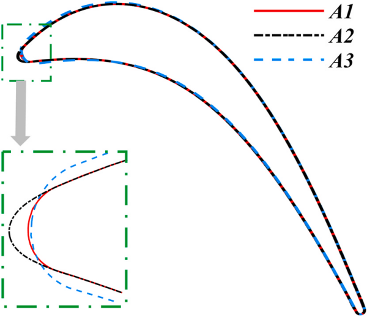

**图 8.** 不同前缘构型的涡轮叶栅几何对比。

基准构型 A1 对应原始叶片型线，是后续所有分析的参照，代表宽攻角条件下变转速动力涡轮的一种典型转子中叶高型线。这里的“对称”是指局部前缘几何中，压力面与吸力面分支关于穿过前缘点的局部前缘角平分线镜像对称，并非整个叶片型线的整体对称。

椭圆修型 A2 采用长短轴比 $a/b=1.3$ 的对称椭圆前缘，代表一种曲率平滑策略，旨在通过更平滑的曲率变化，削弱前缘加速峰值、缓解局部流动扰动并抑制分离泡形成。A3 将前缘半径增至原来的 1.2 倍，代表典型的半径增大策略，用于研究前缘钝度增加如何影响非设计工况下的攻角容忍度与气动损失敏感性。因此，A2 和 A3 分别代表椭圆平滑与半径增大这两种对称前缘修型方向，A1 则为未修型基准。随后依据比较结果提出图 9 所示的非对称前缘设计。前缘曲线的每个分支均由三次贝塞尔曲线表示，其控制点根据式（12）、（13）确定。

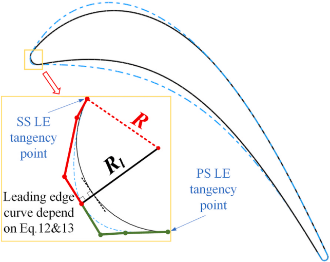

**图 9.** 原始叶片与非对称前缘叶片。

### 2.4. 物理机理指导的 GNN–MARL 优化框架

探索高维非对称设计空间，需要一种能够协调不同工况下冲突气动目标的高效搜索策略。将优化循环直接与 CFD 求解器耦合，计算成本过高。为此，引入 GAT-6 代理模型作为优化框架的交互环境。与依赖流场网格或几何栅格化的传统图模型或卷积模型不同，GAT-6 直接作用于叶片型线拓扑，在保持前缘区域几何保真度的同时，避免反复进行基于网格的流场评估。模型以节点坐标和相应连通性矩阵为输入，预测不同攻角工况下的总压损失系数 $C_{pt}$。由此，代理模型建立候选叶片几何到攻角相关气动损失响应的快速映射。重构的非对称叶片构型及 GAT-6 所用图表示见图 10。

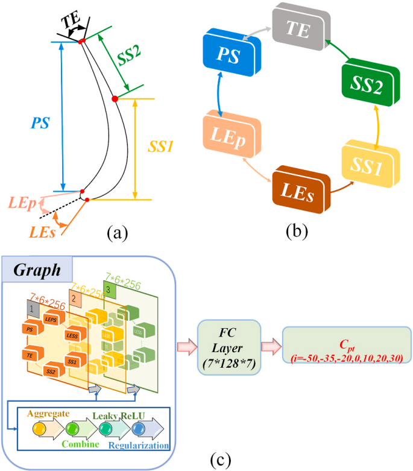

**图 10.** 非对称前缘型线的 GAT-6 代理模型构建：（a）叶片型线；（b）型线图构建；（c）GAT-6 结构。

GAT-6 模型采用统一的超参数设置，包括三个包含五个节点的图层。在每层中，节点特征经权重矩阵 $W$ 变换映射为 128 维。由于 GAT 模型每层使用四个注意力头，每层输出特征的维度为 $6\times128\times4$。各 GNN 模型均以预测出口总压损失系数 $C_{pt}$ 为目标，学习率为 0.0001。〔译注：本段的“五个节点”与 GAT-6 名称及输出维度中的 6 不一致，原文如此。〕

在明确前缘流动机理与相应优化方向后，将宽攻角优化问题纳入协作式 MARL 框架。三个智能体分别对应 −50°、0° 和 30° 代表性攻角工况。这些智能体共享同一套非对称前缘参数化及几何设计变量。在每个决策步，通过智能体生成的动作更新同一个候选几何，再由 GAT-6 代理模型在三个攻角下评估所得型线。随后通过宽攻角奖励表达式综合相应气动响应，使智能体通过共享几何和共享优化目标实现耦合。

本研究采用多智能体近端策略优化（MAPPO）训练多智能体系统。每个智能体学习针对特定攻角的策略，并利用集中式评价器提供统一价值估计，以改善协作和训练稳定性。宽攻角气动损失代理模型的构建、详细状态–动作–奖励定义以及带约束的协作优化过程见附录 II。完整优化框架见图 11，总体 GNN–MARL 优化流程见图 12。

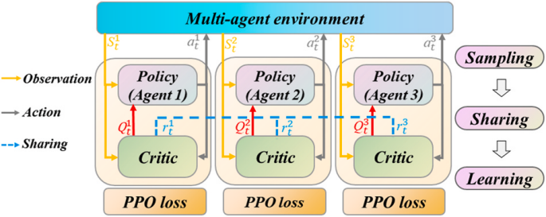

**图 11.** 宽攻角非对称前缘优化的协作式 MARL 框架。

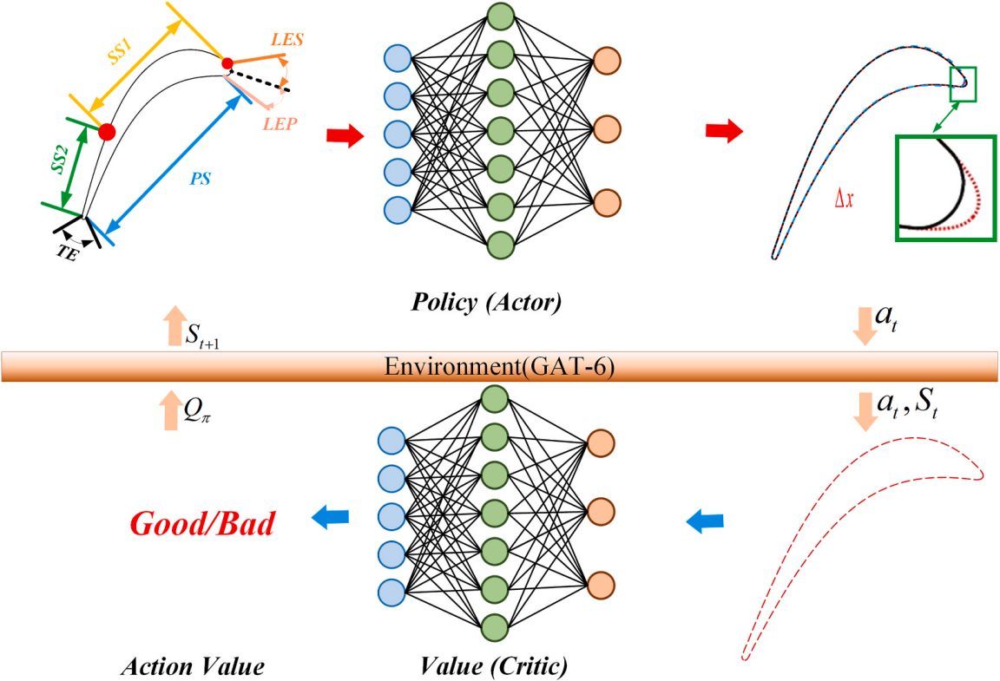

**图 12.** 基于 GNN–MARL 的涡轮叶片优化总体流程。

本研究采用 $C_{pt}$ 评估优化叶片型线的气动性能，因为它直接表征叶片通道内不可逆耗散与熵产所造成的可用功损失 [45]。这一损失会进一步降低叶栅或涡轮级的气动效率，因此总压损失越小，通常意味着气动性能越好、气动效率越高。

## 3. 结果与讨论

### 3.1. 前缘修型的损失产生机理

为研究前缘几何修型如何影响宽攻角条件下涡轮叶栅的气动性能，设计 A1、A2 和 A3 三种叶片型线，并通过风洞试验与经验证的 CFD 模拟相结合进行评估。图 13 比较了总压损失随攻角的变化。在较大正攻角下，A2、A3 的损失均明显降低；相比之下，在设计攻角附近，其损失略高于基准型线 A1。负攻角条件下，A2、A3 的损失总体与 A1 相近，但多数负攻角算例的损失略高。

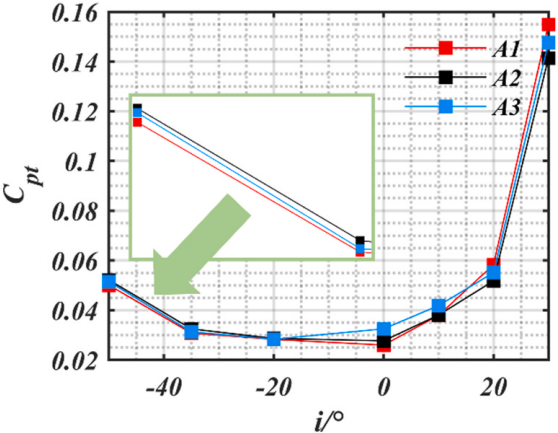

**图 13.** 不同攻角下 $C_{pt}$ 的试验对比。

上述结果表明，前缘几何修型主要影响大正攻角下的损失特征。为进一步明确这一行为背后的物理机理，下面基于耗散函数详细分析损失来源。

虽然 $C_{pt}$ 可用作整体性能指标，却无法揭示损失在空间中的来源。为研究局部损失机理，采用耗散函数 $\Phi$ 作为量化局部气动不可逆性的物理指标；它表示绝热流动中的不可逆熵产 [46]，定义为：

$$
\Phi=\frac{C_xT^*_{\mathrm{in}}}{\rho_{\mathrm{out}}U^3_{\mathrm{out}}T}\,m_{ij}\frac{\partial U_i}{\partial x_j} \tag{14}
$$

其中，$\rho_2$ 表示出口密度，$U_2$ 为出口速度，$T_1$ 为进口总温，$m_{ij}$ 为应力张量。〔译注：本句的下标沿用原文，与式（14）不完全一致。〕

为量化各区域对总耗散的相对贡献，定义归一化耗散占比 $C_\Phi$：将区域 $\Omega_k$ 内的耗散函数 $\Phi$ 体积分，除以所有区域的积分总和：

$$
\Phi_k=\iint_{\Omega_k}\Phi\,d\Omega \tag{15}
$$

$$
C_{\Phi,k}=\frac{\Phi_k}{\sum_{j=1}^{N}\Phi_j}
=\frac{\iint_{\Omega_k}\Phi\,d\Omega}{\sum_{j=1}^{N}\iint_{\Omega_j}\Phi\,d\Omega} \tag{16}
$$

其中，$\Omega_k$ 为第 $k$ 个控制体，$N$ 为分区数，$C_{\Phi,k}$ 表示区域 $k$ 的耗散贡献比例。

图 12–14 给出了不同前缘构型的耗散场空间分布，以及边界层边界和分离线。〔译注：此处图号依原文保留；相应耗散分布图实际为图 14–16。〕分离点是壁面剪切应力为零的位置，分离线对应终止于这些点的流线轨迹。为表征边界层，在单个叶片通道内沿垂直于叶片表面的采样线提取速度剖面。对于每条采样线，将壁面法向上的最大速度作为局部自由流速度，并将局部速度达到该值 99% 的位置定义为边界层边界。

具体而言，在压力面和吸力面各均匀布置 100 个点，从每个点构造一条壁面法向直线。这些法向线在节距方向上的投影覆盖 40 mm 的叶栅节距。每条法向线上均匀布置 50 个点，并通过马赫数云图插值获得局部马赫数。随后确定各线上的最大马赫数，再沿同一条线插值确定达到其 99% 的位置。将所有法向线上的这些点连接起来，得到边界层边界分布。为清晰展示流动拓扑，采用不同颜色的实线标出高耗散区域、分离线和边界层边界，各颜色对应一种叶片构型。以基准叶栅 A1 的耗散场为背景云图，作为比较不同前缘几何所引起变化的参照。

在 0° 设计攻角下，如图 14 所示，高耗散区主要局限于叶片两侧表面的近壁边界层，表明损失主要来自较大近壁速度梯度驱动的黏性摩擦。当攻角减小到 −50° 时，如图 15 所示，高损失区转移至压力面。尽管出现一个小型前缘分离泡，A1、A2 和 A3 的边界层厚度及整体损失分布仍基本相似。

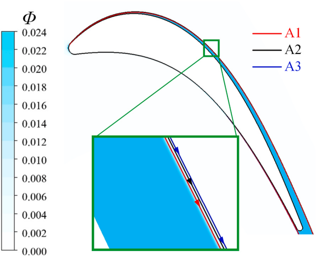

**图 14.** 数值模拟得到的 0° 攻角边界层与耗散分布。

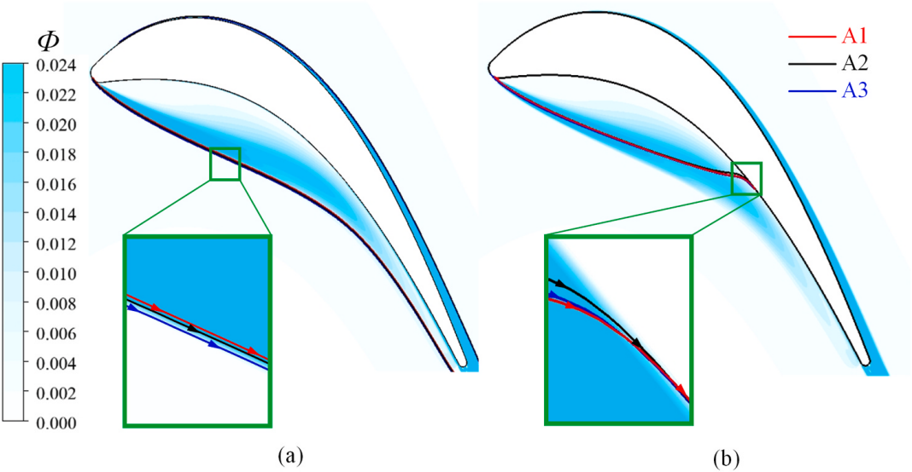

**图 15.** 数值模拟得到的 −50° 攻角边界层与耗散分布：（a）边界层；（b）分离线。

相比之下，在代表典型大正攻角工况的 +30° 攻角下，耗散模式显著改变，高耗散集中于吸力面前部，如图 16 所示。这表明损失机制由摩擦主导转变为分离诱导损失主导。再附着点位于这一高耗散区内，分离泡中低动量流体的卷吸扩大了耗散区，并使其向下游延伸。在再附着点下游，边界层重新发展，黏性摩擦再次成为主要损失来源。数值结果还表明，在 +30° 攻角下，不同前缘几何会显著改变吸力面分离泡的轴向长度及相应边界层厚度。

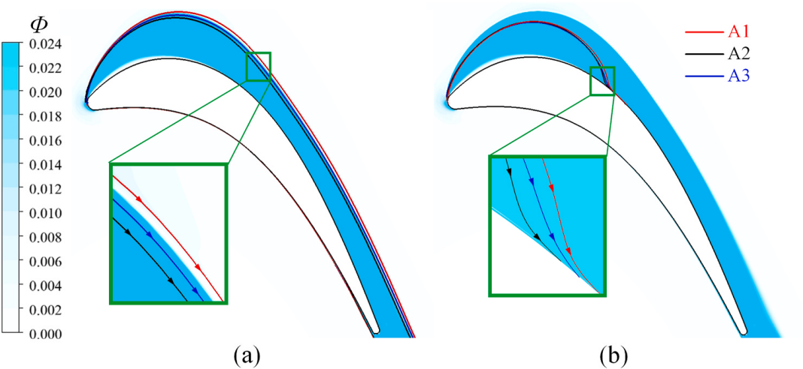

**图 16.** 数值模拟得到的 +30° 攻角边界层与耗散分布：（a）边界层；（b）分离线。

为定量识别前缘修型相关的主导损失来源，将叶栅总损失分解为吸力面边界层损失、压力面边界层损失和尾迹损失。各分量由相应控制区域内的耗散函数积分获得。由于耗散主要集中于近壁边界层，而主流区相对较弱，因此积分限制在这三个分区的边界层区域内。

如图 17 所示，叶栅通道内的控制体向下游延伸一个轴向弦长，以完整包含尾迹区。由于前缘附近存在高损失驻点区，控制体进一步向上游延伸 $0.2l$，以捕获总耗散。控制体宽度对应一个节距，在本二维叶栅分析中，叶高方向取单位高度。这样定义可保证前缘驻点区、叶片表面边界层和尾迹掺混相关的主导耗散源均被包含在积分域内。

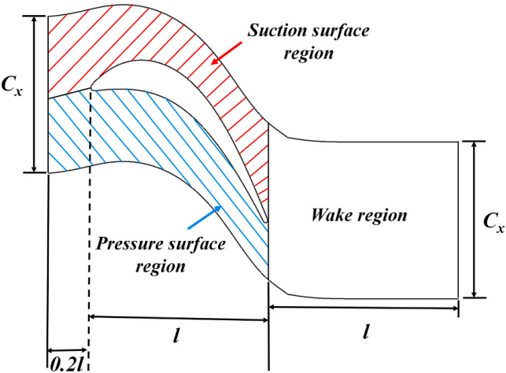

**图 17.** 用于评估耗散损失的控制体。

−50°、0° 和 +30° 攻角下的损失分解分别见图 18、19 和 20。在 −50° 和 0° 下，三种型线的吸力面边界层、压力面边界层和尾迹相对贡献总体相似，与图 13 中相近的 $C_{pt}$ 水平一致。这表明，在负攻角和设计攻角附近，前缘修型未从根本上改变主要损失源的主次关系。

相比之下，在 +30° 下，损失分解发生明显变化：吸力面边界层贡献成为主导，A2、A3 相比 A1 的损失降低，主要归因于吸力面耗散减弱。这一结果证实，图 11 中大正攻角下的损失降低，主要源于吸力面前缘分离减弱。〔译注：原文此处及下文部分总压损失趋势引用“图 11”，相关曲线实际见图 13。〕

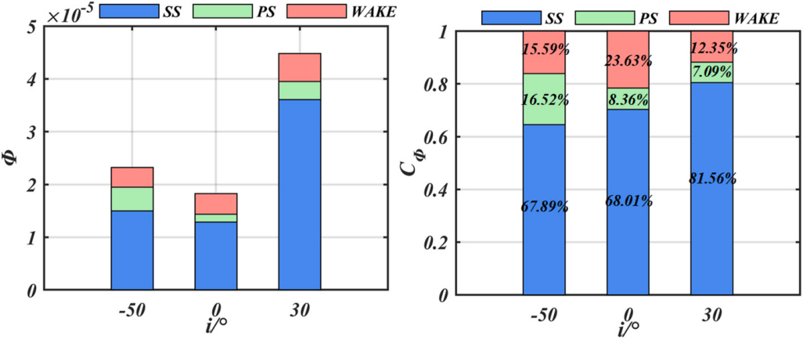

**图 18.** 数值模拟得到的 −50° 攻角耗散贡献分解。

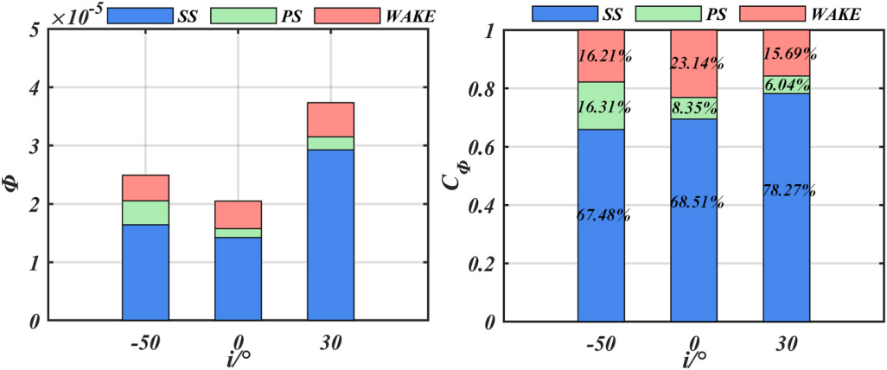

**图 19.** 数值模拟得到的 0° 攻角耗散贡献分解。

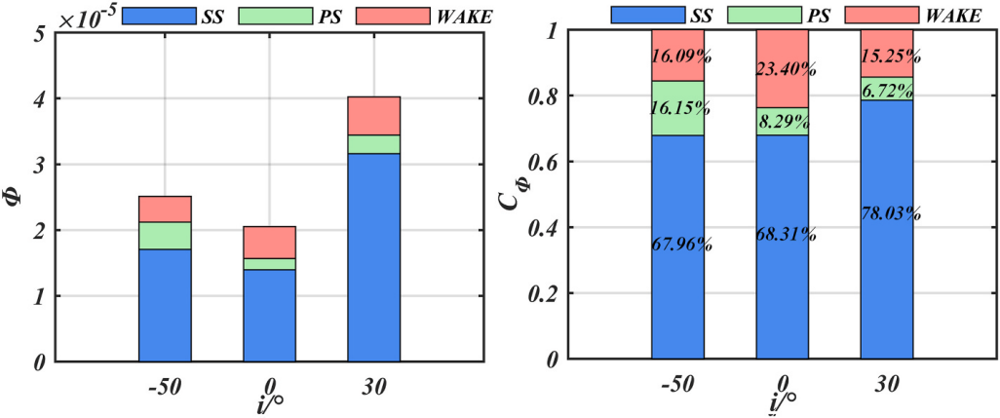

**图 20.** 数值模拟得到的 30° 攻角耗散贡献分解。

为将上述损失行为与前缘几何特征联系起来，图 21 考察了弦向斜率变化。由于圆弧曲率固定，弦向斜率的变化率可作为前缘附近几何光顺性与曲率连续性的实用指标。前缘修型显著改变了这一几何特征，其中椭圆构型 A2 的斜率变化率在三种型线中最小，表明 A2 从前缘驻点区到吸力面的几何过渡最平滑。

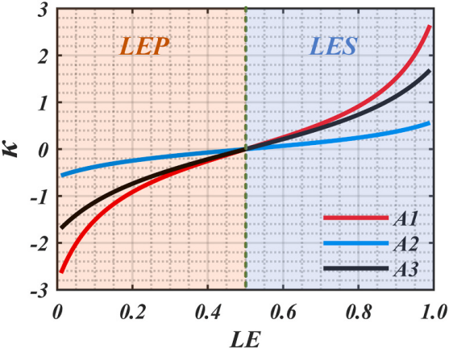

**图 21.** 前缘弦向斜率。

图 22、23 中的表面流动参数进一步展示了这种几何平滑的气动作用。在 +30° 下，图 22 的表面等熵马赫数分布表明，A2、A3 均降低了相对于 A1 的前缘吸力面速度峰值。这削弱了局部逆压梯度，并延迟分离发生。图 23（a）的表面摩擦分布也印证了这一趋势，其中 A2 的再附着点向上游移动最明显，分离区内的剪切应力亏损也明显减小。这些特征表明，A2 更平滑的前缘几何可有效缩短分离泡，并抑制相应掺混损失。

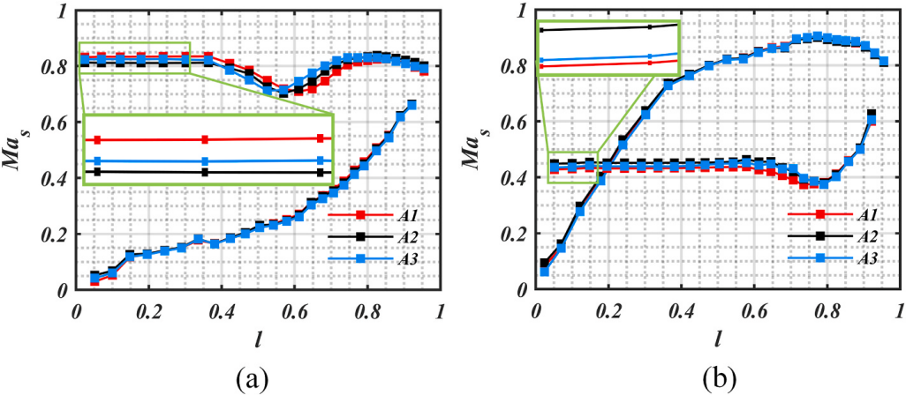

**图 22.** 试验测得的 $Ma_s$ 对比：（a）30° 攻角；（b）−50° 攻角。

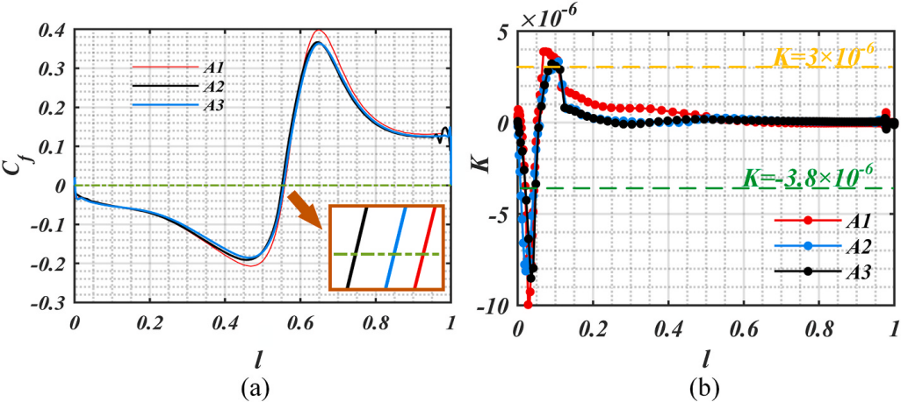

**图 23.** 数值模拟得到的 +30° 攻角吸力面气动参数分布：（a）表面摩擦系数 $C_f$；（b）加速系数 $K$。

为进一步阐明这种改善的根本机理，在图 23（b）中分析加速参数 $K$ 的流向分布，其定义为：

$$
K=\frac{\nu}{U_\infty^2}\frac{dU_\infty}{ds} \tag{17}
$$

其中，$\nu$ 为运动黏度，$U_\infty$ 为边界层边界处速度，$s$ 为流向坐标。

数值模拟中，进口湍流强度设为中等水平 $Tu=5\%$。当 $K<-3.8\times10^{-6}$ 时，发生分离诱导转捩；当 $-3.8\times10^{-6}\leq K\leq3\times10^{-6}$ 时，边界层转捩发展并导致分离；当 $K>3\times10^{-6}$ 时，边界层发生再层流化 [47]。关键在于，$K$ 分布表明，前缘修型没有改变流动固有的转捩顺序：所有型线仍经历分离诱导转捩。不过，如图 23（a）所示，椭圆 A2 构型在前缘产生了明显更平缓的加速。这证实，损失降低是通过更平滑的前缘加速减弱分离过程的强度实现的，并未改变基本转捩模式。

在 −50° 下，驻点区向压力面移动，迫使来流沿压力面转弯并加速。如图 23（b）所示，三种型线的前缘 $Ma_s$ 均出现平台，说明存在局部压力面分离泡。然而，随后主流的恢复与加速迅速卷吸分离剪切层，限制了分离泡生长。因此，A1、A2 和 A3 的边界层厚度与分离范围相近，解释了负攻角下总损失差异较小的原因。〔译注：本段对马赫数的“图 23（b）”引用依原文保留，相应马赫数曲线见图 22（b）。〕

耗散分析揭示了主导损失源随攻角范围的明显转移，从而解释图 11 所示的 $C_{pt}$ 趋势。

在 −50° 下，三种型线的整体损失大致相当，因为流动主要由近壁黏性剪切以及局部压力面前缘分离泡共同支配。此时主要设计目标是改善压力面前缘与强负攻角来流的匹配，从而降低局部表面速度并减弱分离。这种修型可同时降低摩擦耗散、抑制分离泡及相关剪切层的增长，进而限制分离诱导掺混损失。

在 0° 下，损失主要来自叶片表面摩擦。因此，A2、A3 相比 A1 略高的损失，可归因于前缘修型增加了湿润面积，导致黏性耗散小幅增加。相比之下，在 +30° 下，主要耗散源转移至吸力面前缘分离，图 11 中 A2、A3 总压损失的降低，主要与这种分离诱导损失减弱有关。在这类工况下，需要适当的几何钝度与曲率平滑相结合，以维持流动附着，并缓解吸力面分离所导致的严重掺混损失。综合来看，这些相互竞争的要求解释了为何对称前缘修型无法在整个宽攻角范围内实现最优气动性能。

因此，本研究主张转向非对称前缘参数化，通过解耦吸力面和压力面的几何定义，协调宽攻角下的冲突要求。在吸力面，通过延长前缘过渡区、降低峰值曲率并平滑控制曲率梯度，可抑制大正攻角下的前缘分离，并减轻分离诱导掺混损失。在压力面，仅增加钝度无法稳健地降低损失：尽管它可一定程度缓和局部压力梯度，却会增加湿润面积和黏性耗散；而且在加速主流强卷吸作用下，压力面前缘分离泡往往局限于局部，进一步增大钝度在降低分离相关损失方面的边际收益有限。因此，进一步引入前缘楔角，以提高攻角适应性 [48]。

### 3.2. 前缘修型对端壁区域的作用机理

根据上一节的型面损失分解可知，主导损失源随攻角改变：在大正攻角区间，吸力面分离及相关尾迹掺混占主导；在设计点附近和大负攻角下，则以摩擦损失和压力面再附着损失为主。然而，对于宽攻角涡轮，仅从中叶高出发的解释仍不充分，因为前缘修型还会同时改变近端壁驻点区形态和三维压力场，进而直接调节马蹄涡、通道涡及所产生的端壁损失。因此，本节将分析扩展到端壁区域，考察前缘修型如何改变二次流结构与通道涡发展。

三种构型之间最明显的端壁损失差异出现在通道涡区域。如图 24 所示，在 +30° 攻角下，与通道涡相关的端壁损失显著增强，其中 A3 损失最大，A2 最小。相比之下，图 25、26 所示的 0° 和 −50° 对应分布中，三种构型之间的差异较小。这表明，前缘修型对端壁损失的影响在大正攻角下最显著，主要体现为通道涡强度及其损失分布改变。因此，下文重点分析不同前缘几何如何改变通道涡结构及相应端壁损失。〔译注：本段图号与原图图注中的攻角对应关系不一致；图 24、25、26 的图注分别标为 −50°、0°、+30°，此处保留原文表述。〕

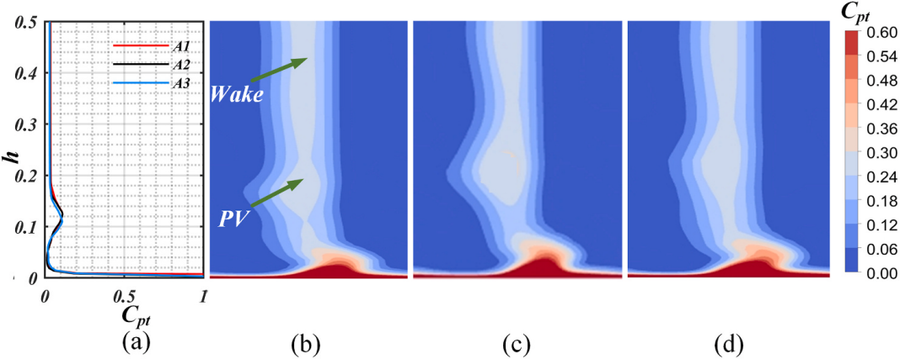

**图 24.** $i=-50°$ 时端壁区域的 $C_{pt}$ 云图：（a）质量流量平均 $C_{pt}$ 的叶高分布；（b）A1 的 $C_{pt}$ 云图；（c）A2 的 $C_{pt}$ 云图；（d）A3 的 $C_{pt}$ 云图。

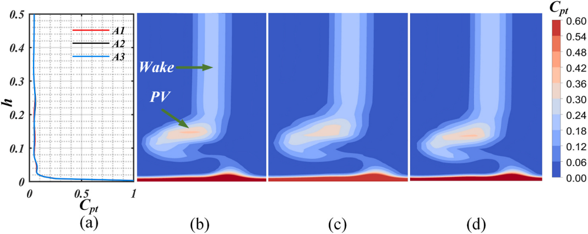

**图 25.** $i=0°$ 时端壁区域的 $C_{pt}$ 云图：（a）质量流量平均 $C_{pt}$ 的叶高分布；（b）A1 的 $C_{pt}$ 云图；（c）A2 的 $C_{pt}$ 云图；（d）A3 的 $C_{pt}$ 云图。

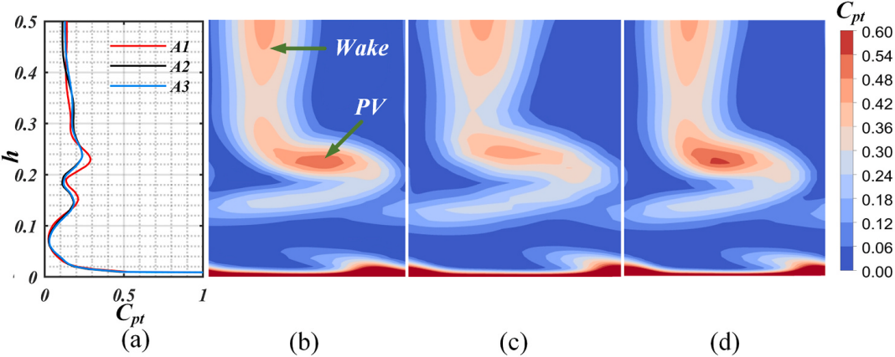

**图 26.** $i=+30°$ 时端壁区域的 $C_{pt}$ 云图：（a）质量流量平均 $C_{pt}$ 的叶高分布；（b）A1 的 $C_{pt}$ 云图；（c）A2 的 $C_{pt}$ 云图；（d）A3 的 $C_{pt}$ 云图。

#### 3.2.1. 端壁涡结构分析

由于出口端壁损失差异在 +30° 下最明显，且主要集中于通道涡区域，首先针对这一代表性大正攻角工况分析涡结构。如图 27 所示，近端壁高损失区主要沿马蹄涡压力面分支及其下游通道涡路径分布；相比之下，吸力面分支在吸力面附近迅速减弱。这表明，A1、A2、A3 的端壁损失差异，主要受马蹄涡分支演化控制，尤其是为通道涡供给的压力面分支。图 26 所示基准叶栅相应端壁涡流线进一步证实，一旦端壁吸力面发生分离，吸力面附近的旋转结构会明显衰减。〔译注：此处“图 26”的引用依原文保留，端壁涡流线见图 28。〕

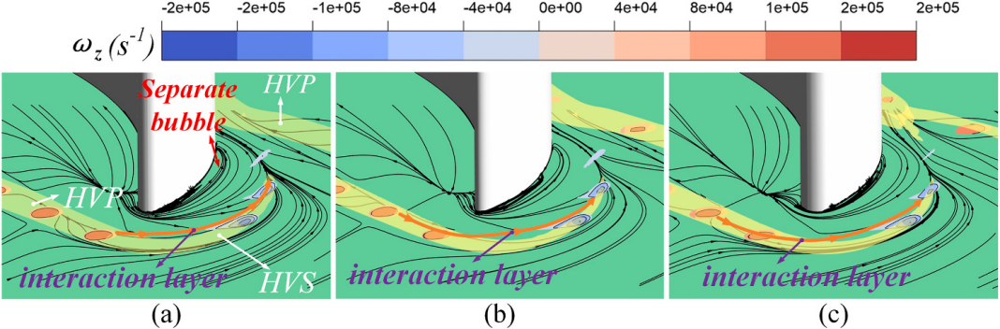

**图 27.** 数值模拟中，$i=30°$ 时由 $\Omega$ 判据识别的马蹄涡分支及壁面流线：（a）A1；（b）A2；（c）A3。

吸力面分支的快速衰减与端壁吸力面分离密切相关。一旦分离发生，近壁流动便不再附着于壁面，而是脱离壁面，形成部分隔离于主流的封闭低动量回流区。在附着流动条件下，马蹄涡吸力面分支由近端壁的壁面法向剪切，以及局部压力梯度诱导的跨通道扰动共同维持，两者不断支持轴向涡量的产生和维持。然而，在分离之后，近壁流动与主流的耦合明显减弱，壁面法向剪切随之下降，跨通道扰动也无法再有效穿透分离区。因此，维持轴向涡量的机制减弱，导致 $\omega_z$ 降低。同时，分离泡外边界上的强剪切增强了黏性扩散，加快局部涡量峰值衰减。因此，当沿吸力面约 $0.15l$ 处的局部 $\Omega$ 值降至 0.52 以下时，流动旋转特征显著减弱，局部流动转为剪切主导，标志着马蹄涡吸力面分支消失，如图 28 所示。

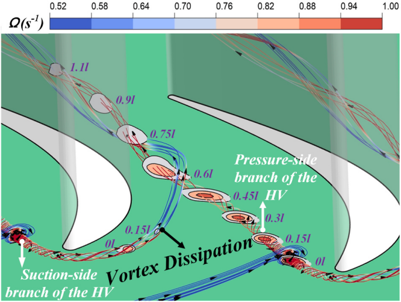

**图 28.** 数值模拟得到的基准 A1 叶栅在 $i=30°$ 时的端壁涡。

相应的 $z$ 方向涡量输运方程见式（18）：

$$
\vec{u}\cdot\nabla\vec{\omega}_z
=\underbrace{\omega_x\frac{\partial w}{\partial x}+\omega_y\frac{\partial w}{\partial y}+\omega_z\frac{\partial w}{\partial z}}_{f_{1z}}
-\underbrace{\omega_z(\nabla\cdot V)}_{f_{2z}}
+\underbrace{\frac{1}{\rho^2}(\nabla\rho\times\nabla p)_z}_{f_{3z}}
+\underbrace{\nu\nabla^2\omega_z}_{f_{4z}} \tag{18}
$$

具体而言，$f_{1z}$ 为涡拉伸与倾斜项；$f_{2z}$ 表示流体可压缩性引起的变形；$f_{3z}$ 对应非等熵效应相关的黏性耗散；$f_{4z}$ 为黏性扩散项。〔译注：对 $f_{3z}$ 的文字解释按原文保留。〕

因此，在本研究端壁流场中，吸力面分支衰减可归因于轴向涡量产生减弱和黏性扩散增强的共同作用。由此，在大正攻角下，压力面分支逐渐成为通道涡的主要涡旋组成，也成为不同前缘构型之间端壁损失变化的主要来源。

马蹄涡的形成与后续发展主要由前缘驻点区的压力场驱动，因此该区域的范围与拓扑对确定通道涡强度起关键作用。如图 29 所示，近端壁驻点区与前缘周围的表面压力再分布密切相关，相应马蹄涡形成机理见图 30 示意图。在这一流动状态下，驻点区几何显著影响端壁压力梯度分布。由于驻点区压力接近进口总压，更大的驻点区会在节距方向挤压周围流动，扩大前缘附近的局部高压区，从而增强驱动端壁二次流的压力再分布。

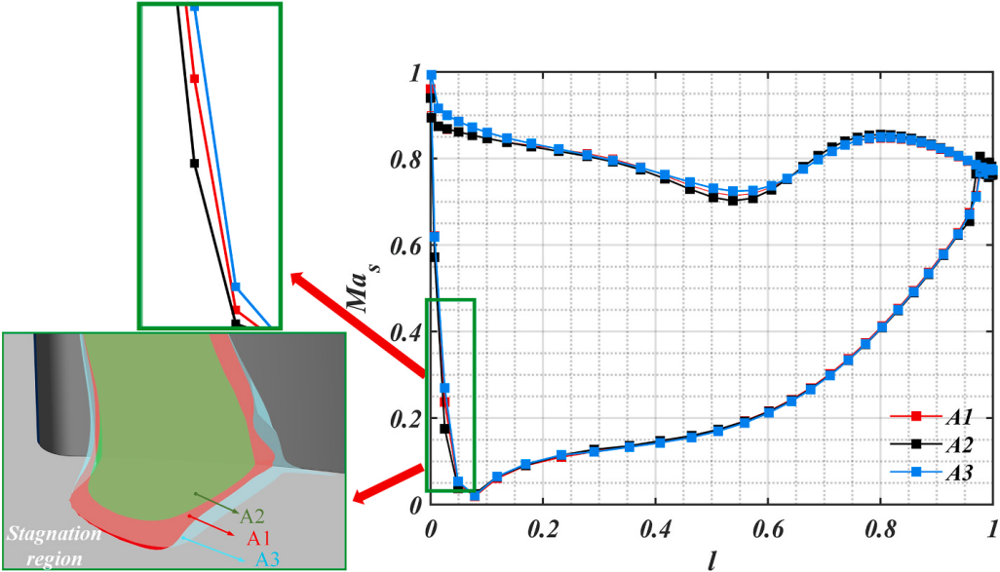

**图 29.** 数值模拟得到的 5% 叶高、+30° 攻角下的表面压力分布与驻点区轮廓。

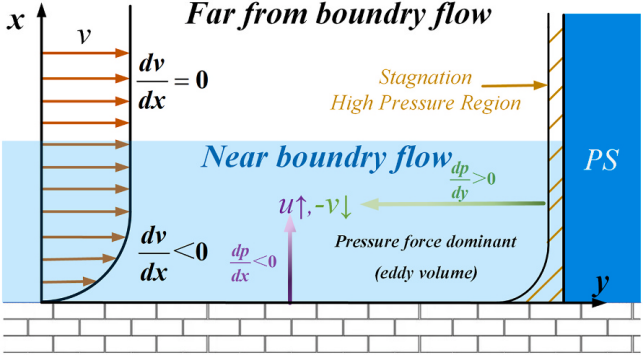

**图 30.** +30° 攻角下马蹄涡形成机理示意图。

通道涡强度的相应变化，可通过直接表征局部涡旋强度的轴向涡量 $\omega_z$ 演化来理解。更大的叶根驻点区体积增强近端壁跨通道运动，导致更大的横向速度梯度 $\partial v/\partial x$，如图 31 所示。与此同时，更强的压力再分布减弱近端壁流向速度 $u$，并增大其壁面法向变化，从而增强 $-\partial u/\partial y$，如图 32 所示。由于 $\omega_z=\partial v/\partial x-\partial u/\partial y$，$\partial v/\partial x$ 和 $-\partial u/\partial y$ 同时增大，均会使正向涡量增加。换言之，更大的驻点区会促进更强的轴向涡量生成，进而形成更强的通道涡。

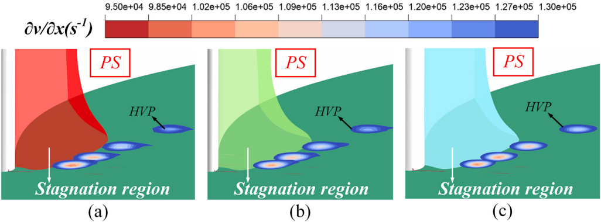

**图 31.** CFD 模拟得到的 +30° 攻角驻点区分布与 $\partial v/\partial x$。

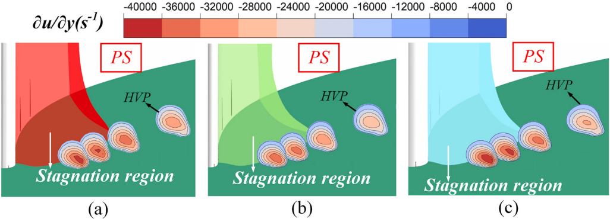

**图 32.** CFD 模拟得到的 +30° 攻角驻点区分布与 $\partial u/\partial y$。

在这一机制下，A3 的通道涡运动最强，因为增大的前缘半径形成了最大的驻点/堵塞区，与前文在 +30° 下观察到的较宽高损失区相对应。相比之下，A2 的曲率连续椭圆前缘限制了驻点区范围，减弱局部压力梯度不均匀性，因此通道涡损失最低。

在 −50° 攻角下，驻点区向吸力面移动。由于吸力面的凸曲率，驻点区附近的近壁流动进一步加速，如图 33 所示。在这种条件下，前缘修型对驻点区范围及相应二次流拓扑的影响有限。因此，A1、A2、A3 的马蹄涡演化及相关通道涡损失差异较小，与前文 −50° 下端壁损失差异较弱的观察结果一致。不过，A2、A3 的壁面摩擦损失仍略高，因为两种构型均提高了压力面前缘速度。此外，A3 在该工况下的端壁出口损失最大，因为增大的前缘半径带来了最大的湿润面积与堵塞增量，产生比 A1、A2 略高的摩擦代价。

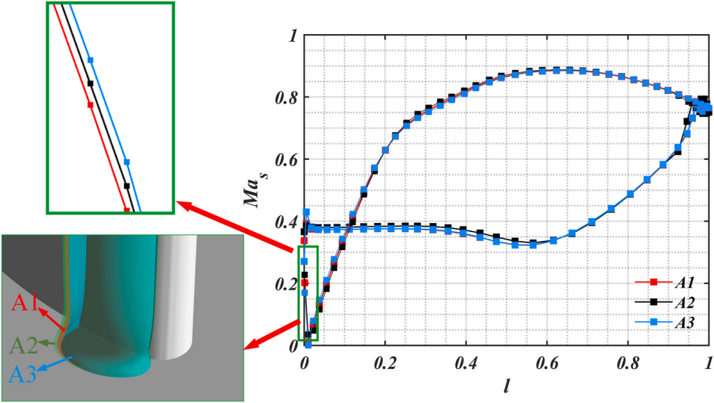

**图 33.** 数值模拟得到的 5% 叶高、−50° 攻角下的表面压力分布与驻点区轮廓。

总体而言，端壁结果一致表明，在本研究攻角范围内，A2 比增大半径的 A3 更有优势。在 +30° 下，A2 减小端壁驻点区范围并削弱相关压力面马蹄涡，从而降低通道涡损失。相比之下，A3 扩大驻点/堵塞区，增强局部轴向涡量产生，导致更高端壁损失。在 −50° 下，虽然二次流拓扑对前缘形状的敏感性明显减弱，A3 仍因较大前缘半径增加堵塞与湿润面积而产生额外摩擦代价，端壁损失略高。这些结果表明，在当前基于叶栅的宽攻角研究框架内，椭圆化前缘比单纯增大前缘半径更有利于控制端壁损失。

### 3.3. 损失控制策略与前缘优化

在宽攻角条件下，尤其是大正攻角时，椭圆化前缘修型 A2 可有效抑制前缘分离泡。相比基准 A1 和增大半径构型 A3，A2 在前缘头部附近具有更连续的曲率分布。这种几何光顺性缓和了前缘附近的逆压梯度，并避免表面速度突然超调。因此，分离剪切层在吸力面上更早再附着，明显降低分离诱导掺混损失。

虽然压力面在大负攻角下可能发生分离，但其对总损失的贡献相对有限。因此，可识别两种压力面设计倾向。策略 I 通过增大压力面楔角、改善攻角匹配来抑制压力面分离，降低负攻角分离损失。然而，与之相伴的钝度增加通常会扩大湿润面积，并可能提高设计攻角附近的黏性耗散。策略 II 则限制钝度、减小楔角，以保持更薄、更流线化的压力面型线，从而缓解摩擦代价。这些现象表明，宽攻角优化本质上是在正攻角分离抑制与其他攻角摩擦控制之间进行权衡。

基于上述机理认识，采用非对称前缘设计策略，解耦两侧表面的需求。在吸力面，适度延长前缘过渡长度，降低峰值曲率并平滑曲率分布，以抑制大正攻角前缘分离。在压力面，调整有效楔角，避免过度钝化，在改善负攻角匹配的同时避免过大的湿润面积代价。因此，后续优化的目标是找到一种截面层面的前缘设计，在 −50°、0° 和 +30° 这一代表性攻角集合内，平衡相互竞争的气动需求。

然而，提出的非对称前缘修型也存在代价。首先，延长吸力面前缘不可避免地增加型线湿润面积；在负攻角下，摩擦耗散与湿润面积密切相关，并构成总损失的重要部分。其次，压力面上旨在减轻分离损失的措施，例如额外钝化或楔角调整，也可能增大压力面湿润面积，引入额外黏性代价。因此出现一项根本权衡：通过抑制分离和改善攻角匹配提高宽攻角容忍度时，必须同时限制摩擦主导的型面损失。

为系统协调这些竞争的气动倾向，引入基于强化学习的多目标优化框架。通过在代表性攻角工况间显式平衡分离相关目标和摩擦相关目标，该框架能够高效探索非对称设计空间，并在当前叶栅研究条件下，识别出宽攻角气动稳健性更高的截面前缘构型。

#### 3.3.1. 动态多目标优化

为解决不同工况间的多目标冲突，采用协作式 MARL 框架。三个智能体分别对应 −50°、0° 和 +30° 代表性攻角工况。需要强调的是，它们并不优化三种独立叶片几何，而是作用于同一套非对称前缘参数化，并共享几何设计变量。因此，三个工况之间通过共同几何状态、共享优化目标以及 MAPPO 中的集中式价值函数实现耦合。这样，优化过程直接搜索一种前缘构型，使其在当前宽攻角包线内提供最佳总体折中。

##### 3.3.1.1. 环境

为提高优化效率，采用 GAT-6 代理模型构建强化学习环境。非对称前缘参数化使用的设计变量范围列于表 3。基于中心导向的试验设计，在这些参数边界内生成 230 种前缘修型型线，用于建立代理辅助优化空间。

**表 3. 叶片型线设计参数及范围**

| 参数 | 最小值 | 最大值 |
|---|---:|---:|
| $B_{12}$ / mm | 0.5 | 10 |
| $B_{13}$ / mm | 0.5 | 10 |
| $B_{22}$ / mm | 2 | 10 |
| $B_{23}$ / mm | 2 | 10 |
| $\gamma_{ps}$ / ° | 25 | 80 |
| $\gamma_{ss}$ / ° | 25 | 80 |
| $R_l$ / mm | 1.2 | 2.4 |

在当前参数化中，$B_{12}$ 表示吸力面贝塞尔曲线第二个控制点与吸力面切点之间的距离，$B_{13}$ 表示第三个控制点与前缘顶点之间的距离。$B_{22}$ 表示压力面贝塞尔曲线第二个控制点与吸力面切点之间的距离，$B_{23}$ 表示第三个控制点与前缘顶点之间的距离。〔译注：原文对 $B_{22}$ 也写作 suction-side tangent point，按原文保留。〕

环境模型整体架构见图 34，GAT-6 代理模型的残差分布见图 35（a）。训练集和测试集的均方误差均为 $10^{-4}$ 量级，表明该模型对参数化前缘几何的气动响应预测具有较高精度与稳健性。在计算效率方面，GAT-6 单次预测仅需 0.46 s；相比之下，相应 CFD 模拟约需 23 min 才能收敛至 $10^{-5}$ 残差水平，显示预测速度大幅提高。

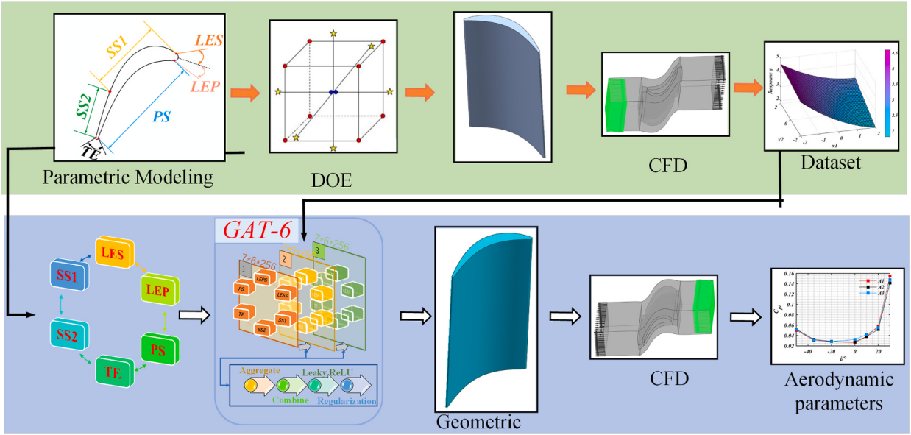

**图 34.** GAT-6 流程图。

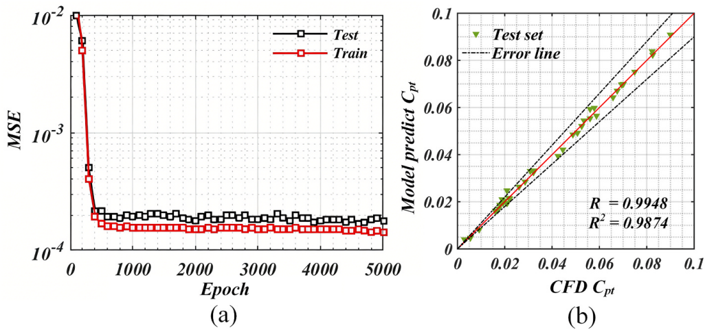

**图 35.** 训练过程：（a）训练集与测试集误差分布；（b）测试数据集预测。

图 35（b）进一步展示预测精度，其中 Pearson 相关系数 $R$ 和决定系数 $R^2$ 分别达到 0.9948 和 0.9874。此外，全部 23 个测试算例的预测误差均在 10% 以内。Pearson 相关系数 $R$ 和决定系数 $R^2$ 定义如下：

$$
R=\frac{\sum_{i=1}^{m}(X_i-\bar X)(Y_i-\bar Y)}{\sqrt{\sum_{i=1}^{m}(X_i-\bar X)^2\sum_{i=1}^{m}(Y_i-\bar Y)^2}} \tag{19}
$$

$$
R^2=\frac{\sum_{i=1}^{m}(X_i-Y_i)^2}{\sum_{i=1}^{m}(X_i-\bar X)^2} \tag{20}
$$

〔译注：式（20）按原文转录，原式没有通常决定系数定义中的 $1-$ 项。〕

##### 3.3.1.2. 奖励塑形

原则上，基于 MAPPO 的框架能够通过集中式评价器捕捉不同攻角工况之间的耦合。然而，为显式施加“所有代表性工况都应同时保持低损失”这一先验要求，引入复合奖励函数。本研究将三个智能体分别分配给 −50°、0° 和 +30° 代表性攻角工况。这三个智能体作用于同一套非对称前缘参数化，并共享几何设计变量，而不是分别优化三种独立叶片几何。因此，奖励设计既应反映每个智能体在自身攻角条件下的性能，也应鼓励三个攻角之间的协作。

对于第 $k$ 个智能体，总奖励定义为：

$$
r_t^k=r_{e,t}^k+\kappa_1r_{i,t}^k+\kappa_2r_{\mathrm{int},t}^k \tag{21}
$$

其中，$r_{e,t}^k$、$r_{i,t}^k$ 和 $r_{\mathrm{int},t}^k$ 分别表示外在奖励、内在奖励与交互奖励。本研究中，权重系数 $\kappa_1$、$\kappa_2$ 分别取 0.5 和 0.3。由于三个优化目标均为最小化总压损失系数，无须额外的符号变换。

对于对应 −50° 攻角工况的智能体 1：

$$
\text{agent 1}\quad
\begin{cases}
r_t^e=-C_{pt30}^{t}\\
r_t^i=C_{pt30}^{t-1}-C_{pt30}^{t}\\
r_t^{\mathrm{int}}=-1/\left(C_{pt0}^{t}-C_{pt0}^{*}\right)+\left(C_{pt-50}^{t-1}-C_{pt-50}^{*}\right)
\end{cases} \tag{22}
$$

对于对应 0° 攻角工况的智能体 2：

$$
\text{agent 2}\quad
\begin{cases}
r_t^e=-C_{pt0}^{t}\\
r_t^i=C_{pt0}^{t-1}-C_{pt0}^{t}\\
r_t^{\mathrm{int}}=-1/\left(C_{pt30}^{t}-C_{pt30}^{*}\right)+\left(C_{pt-50}^{t-1}-C_{pt-50}^{*}\right)
\end{cases} \tag{23}
$$

对于对应 +30° 攻角工况的智能体 3：

$$
\text{agent 3}\quad
\begin{cases}
r_t^e=-C_{pt-50}^{t}\\
r_t^i=C_{pt-50}^{t-1}-C_{pt-50}^{t}\\
r_t^{\mathrm{int}}=-1/\left(C_{pt30}^{t}-C_{pt30}^{*}\right)+\left(C_{pt0}^{t-1}-C_{pt0}^{*}\right)
\end{cases} \tag{24}
$$

〔译注：式（22）与（24）的损失下标分别为 30 和 −50，与其前面的智能体攻角说明相反；交互奖励表达式也与下列算法 1 不一致。上述公式均按原文保留。〕

在上述表达式中，外在奖励表示当前共享几何在指定攻角下的直接气动反馈。内在奖励衡量相对于上一状态的逐步改进，用于强化朝向更低损失的局部收敛。交互奖励描述当前动作对另外两个攻角工况的协同影响，从而避免以其他工况性能恶化为代价，过度优化单一工况。

通过这种设计，三个智能体在共享几何与奖励结构上显式耦合，引导优化过程找到一种宽攻角稳健性更好的统一前缘构型。为详细说明这三种奖励，本文以智能体 1 为例，在算法 1 中说明奖励的求取过程。

**算法 1. 智能体 1 的奖励函数**

| 原文步骤 | 操作 |
|---:|---|
| 1 | 初始化最大回合数 $n_{\max}$，令回合计数器 $n=0$。 |
| 2 | 初始化最大时间步数 $t_{\max}$，令时间步计数器 $t=0$。 |
| 2 | 初始化共享几何状态 $s_0$ 和初始损失 $C_{pt,-50}^{0}$、$C_{pt,0}^{0}$、$C_{pt,+30}^{0}$。 |
| 3 | 从动作空间随机采样初始动作 $a_0$。 |
| 4 | 当 $n<n_{\max}$ 时执行循环。 |
| 5 | 当 $t<t_{\max}$ 时执行内层循环。 |
| 6 | 智能体 1 对共享几何状态 $s_t$ 执行动作 $a_t$。 |
| 7 | 环境返回更新状态 $s_{t+1}$ 以及 $C_{pt,-50}^{0}$、$C_{pt,0}^{0}$、$C_{pt,+30}^{0}$。 |
| 8 | 设置外在奖励：$r_{e,t}^{1}=-C_{pt,-50}^{t}$。 |
| 9 | 若 $t>0$，则： |
| 10 | 设置内在奖励：$r_{i,t}^{1}=C_{pt,-50}^{t-1}-C_{pt,-50}^{t}$。 |
| 11 | 设置交互奖励：$r_{\mathrm{int},t}^{1}=\frac{1}{2}[(C_{pt,0}^{t-1}-C_{pt,0}^{t})+(C_{pt,+30}^{t-1}-C_{pt,+30}^{t})]$。 |
| 12 | 否则： |
| 13 | 设置 $r_{i,t}^{1}=0$，$r_{\mathrm{int},t}^{1}=0$。 |
| 14 | 条件判断结束。 |
| 15 | 计算总奖励：$r_t^{1}=r_{e,t}^{1}+\kappa_1r_{i,t}^{1}+\kappa_2r_{\mathrm{int},t}^{1}$。 |
| 16 | 存储转移 $(s_t,a_t,r_{i,t}^{1},s_{t+1})$，并更新策略–评价网络。 |
| 17 | 令 $t=t+1$。 |
| 18 | 内层循环结束。 |
| 19 | 令 $n=n+1$，并为下一回合重置环境。 |
| 20 | 外层循环结束。 |

〔译注：重复的步骤编号 2、步骤 7 中的上标 0，以及步骤 16 中存储的内在奖励符号，均依原文保留。〕

#### 3.3.2. MARL 与 NSGA-II 的比较

为公平比较，还采用同一个 GAT-6 代理模型作为气动评估器，实现传统 NSGA-II 算法。作为基于种群的多目标进化算法，NSGA-II 通过非支配排序和基于拥挤距离的选择来搜索帕累托最优解。图 36 比较了提出的 MARL 框架与代理辅助 NSGA-II 算法得到的帕累托最优前沿。MARL 前沿始终位于 NSGA-II 前沿下方，表明提出的策略学习方法可在整个折中空间内找到总压损失更低的解。标记为“Best of MARL”的设计记为 OPT1，NSGA-II 选出的最佳设计记为 OPT2，其优化前缘参数列于表 4。

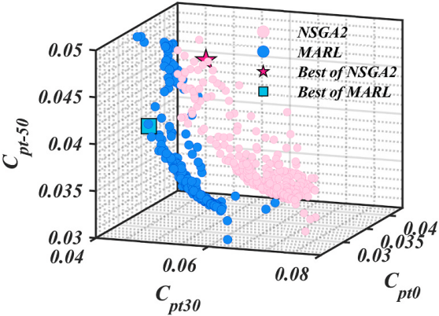

**图 36.** MARL 与 NSGA-II 优化结果对比。

**表 4. 叶片型线优化参数**

| 参数 | OPT1 | OPT2 |
|---|---:|---:|
| $B_{12}$ / mm | 5.51 | 6.14 |
| $B_{13}$ / mm | 6.35 | 6.38 |
| $B_{22}$ / mm | 5.52 | 5.98 |
| $B_{23}$ / mm | 6.15 | 6.87 |
| $\gamma_{ps}$ / ° | 35.83 | 30.02 |
| $\gamma_{ss}$ / ° | 37.72 | 50.36 |
| $R_l$ / mm | 1.51 | 1.34 |

如图 37 所示，OPT1 在整个代表性宽攻角范围内均降低损失，因此总体气动稳健性最佳。相比之下，OPT2 在 −50° 和 +30° 两个极端攻角条件下表现较好，但在 0° 时相对于 A1 存在轻微损失代价。

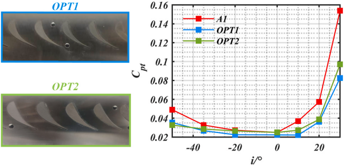

**图 37.** A1、OPT1 与 OPT2 的 $C_{pt}$ 试验对比。

这一比较表明，MARL 找到了更均衡的宽攻角解，而 NSGA-II 得到的设计更偏重极端攻角需求。因此，在当前代理辅助、基于叶栅的优化框架内，MARL 获得了更理想的全局折中解。

通过图 38 所示的几何特征与耗散分布，可进一步解释 OPT1、OPT2 的性能差异。OPT2 在两个极端攻角下的良好表现，主要来自偏重压力面的非对称楔角设计，即有意使压力面楔角大于吸力面楔角。这种构型改善 −50° 下的压力面攻角匹配，同时缓解 +30° 下的吸力面前缘分离，从而削弱耗散场中的前缘分离特征。

然而，这种提高攻角容忍度的设计也存在代价。由于 OPT2 的非对称性更偏向压力面，它引入了更大的局部湿润面积和更强的近壁压力面耗散，尤其是在非负攻角工况下。因此，两个极端攻角下获得的收益，在设计攻角附近被部分抵消。〔译注：本段关于 OPT2 两侧楔角大小的文字描述，与表 4 所列 $\gamma_{ps}=30.02°$、$\gamma_{ss}=50.36°$ 不一致，原文如此。〕

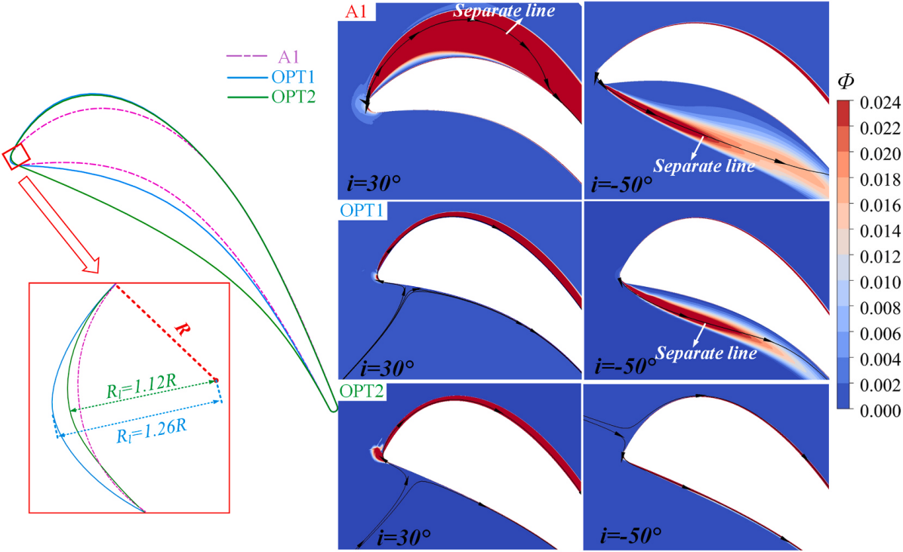

**图 38.** 数值模拟得到的叶片几何及相应耗散函数分布对比。

图 39、40 定量展示了这一趋势：OPT2 在 0° 和 +30° 下的积分耗散中，压力面贡献明显更高。这表明，偏重压力面的楔角非对称设计所带来的收益，伴随着非负攻角下额外的压力面摩擦代价。不过，在 0° 下这一代价相对较小，与图 34 的试验对比一致，即 OPT2 在设计攻角下的总压损失仅略高于 A1，而非明显恶化。〔译注：本句“图 34”依原文保留，相应试验对比见图 37。〕

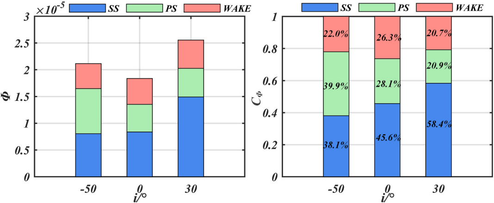

**图 39.** 数值模拟得到的 OPT1 耗散贡献分解。

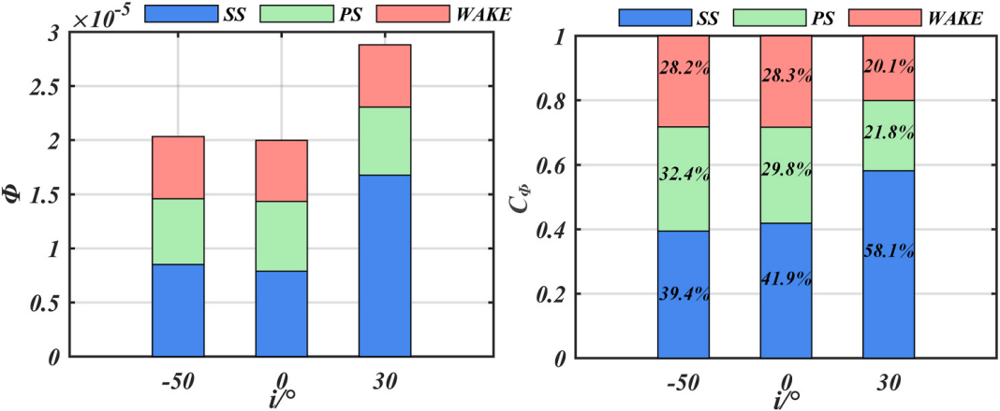

**图 40.** 数值模拟得到的 OPT2 耗散贡献分解。

图 41 的 $Ma_s$ 分布进一步解释了这一行为。图 41（a）为试验测量数据，图 41（b）为相应 CFD 结果。可以看出，表面马赫数整体发展趋势以及不同型线间的差异，在试验与模拟中保持一致，表明 CFD 结果能够可靠捕捉所讨论的流动发展趋势。

在 0° 下，相比 A1，OPT1、OPT2 均降低了吸力面前缘 $Ma_s$，说明吸力面近壁速度水平降低、局部剪切减弱，如图 41（a）所示。这降低吸力面摩擦耗散，并延缓低动量流体在边界层内的早期积累。但对于 OPT2，这种吸力面收益被其偏重压力面的楔角设计所导致的更强压力面加速部分抵消。因此，OPT2 在设计攻角下未获得与 OPT1 相同的净收益。相比之下，OPT1 在吸力面与压力面之间实现了更均衡的前缘负荷再分配，使压力面代价不至于过度抵消吸力面耗散的降低。

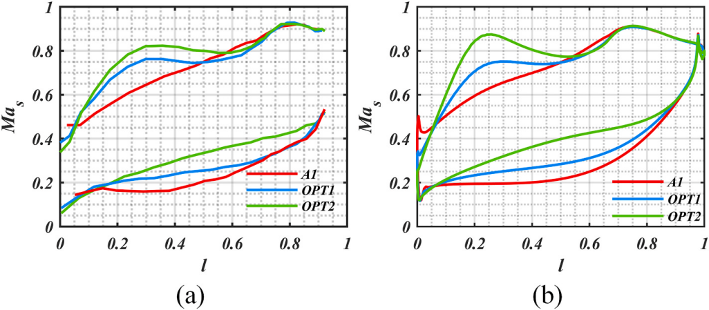

**图 41.** 0° 攻角下 $Ma_s$ 对比：（a）试验测量；（b）数值模拟。

比较表明，相对于 NSGA-II 得到的 OPT2，MARL 设计 OPT1 在宽攻角气动稳健性方面提供了更均衡的解。根本原因在于，MARL 显式学习协调多个攻角下的竞争目标，即极端攻角下的分离抑制，以及设计工况附近摩擦和湿润面积相关代价的控制。因此，MARL 倾向于选择整体稳健的折中，避免为了过度优化部分工况而增加其他工况的黏性代价。

此外，基于策略的搜索过程，使非对称设计空间的探索更有方向性，朝向能在代表性攻角包线内始终保持低损失的解。因此，综合帕累托前沿质量与跨攻角性能一致性，MARL 在当前优化设置下表现出更强的能力，能够识别首选全局折中解。这些结果共同表明，在当前基于叶栅的研究中，GAT-6 辅助 MARL 框架能够有效改善现有宽攻角范围内的截面气动性能。

基于上述比较，将 MARL 优化得到的 OPT1 选为推荐设计。相比基准 A1，OPT1 在 −50°、0° 和 +30° 下的 $C_{pt}$ 分别降低 29.29%、13.73% 和 46.64%，表明其在代表性宽攻角范围内具有更加均衡的气动性能。

#### 3.3.3. 优化设计的端壁损失比较

端壁损失比较进一步证实了 OPT1 在机理指导下的有效性。在 +30° 攻角下，图 42 表明优化设计显著抑制吸力面分离，并明显减弱端壁损失核心区。在基准构型 A1 中，端壁区域存在强烈高损失核心区，与压力面马蹄涡、通道涡发展以及下游尾迹掺混分布相关。相比之下，OPT1 的损失核心区明显减弱并更加紧凑，尾迹相关损失影响范围也减小。

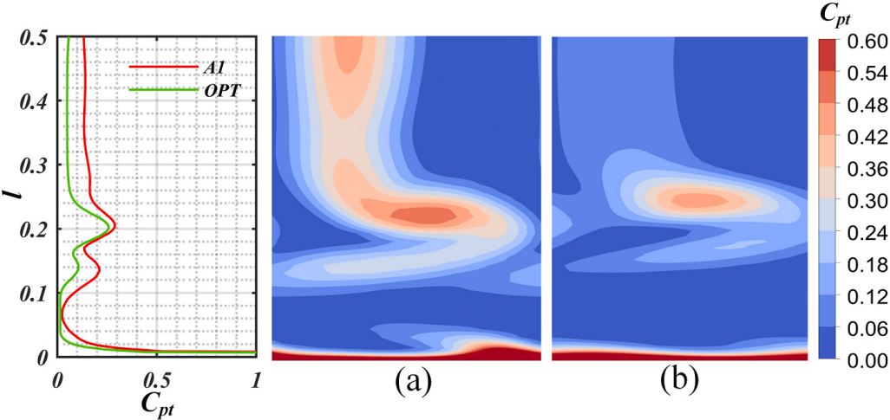

**图 42.** 数值模拟得到的 $i=30°$ 端壁 $C_{pt}$ 云图对比：（a）A1；（b）OPT1。

这一行为与前面确立的端壁机理一致：吸力面分离减弱时，近端壁驻点区形态以及为压力面马蹄涡系统供给的三维压力再分布也同时减弱，进而降低下游通道涡强度。

由于 OPT1 在前缘引入非对称楔角调整，其几何影响并不局限于吸力面。改变后的驻点区拓扑及相关压力再分布作用于叶片两侧表面，因此压力面马蹄涡分支及其向下游通道涡的演化也被削弱。图 42 左侧的叶高损失分布进一步证实，在受端壁影响的区域内，OPT1 的 $C_{pt}$ 低于基准 A1。

在 −50° 攻角下，总体端壁损失水平更低，二次流拓扑对前缘形状的敏感性减弱，如图 43 所示。尽管如此，相比基准 A1，OPT1 仍减小端壁高损失区的强度与空间范围。这一改善既可归因于湿润面积相关摩擦代价的降低，也来自非对称楔角设计在压力面上的有利作用：它改善负攻角匹配，并削弱压力面分离及相关近壁掺混。相比 +30° 下的改善，−50° 下收益更有限，与大负攻角时二次流拓扑对前缘形状依赖较弱的特征一致。

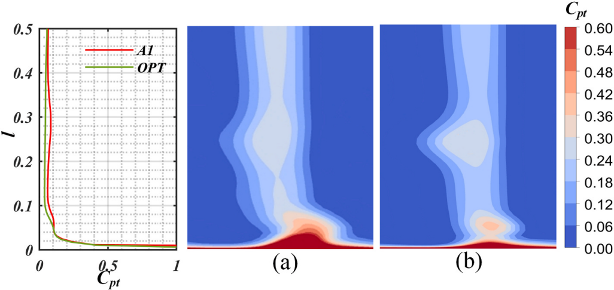

**图 43.** 数值模拟得到的 $i=-50°$ 端壁 $C_{pt}$ 云图对比：（a）A1；（b）OPT1。

总体而言，优化后的非对称前缘设计改善近驻点区压力分布，增强吸力面流动附着，并在当前代表性攻角包线内同时抑制主流分离损失与端壁通道涡损失。这些结果支持所提出的机理指导 GAT-6–MARL 优化框架在当前基于叶栅的宽攻角研究条件下的截面层面有效性与稳健性。

#### 3.3.4. 优化型线在多级动力涡轮中的应用

为进一步评估所提优化策略在实际涡轮级环境中的应用潜力，将优化叶片型线重新引入所选四级低压涡轮进行验证。具体而言，该优化型线对应所选涡轮第三级转子叶片的中叶高截面。在其余各级及叶片截面保持不变的条件下，以优化型线替换第三级转子原始中叶高型线。随后在三个代表性转速条件下，比较基准构型与修型构型的四级总体效率及第三级气动性能，所选转速分别为 $N/N_{\mathrm{des}}=0.6$、0.8 和 1.0，其中 $N$ 为运行转速，$N_{\mathrm{des}}$ 为设计转速。多级涡轮计算流场及优化型线所在位置见图 44。

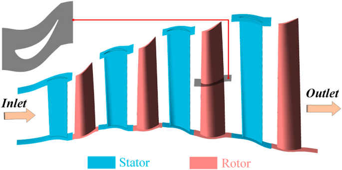

**图 44.** 所选四级低压涡轮的计算流场，以及优化后的第三级转子中叶高型线位置。

第三级总–总效率 $\eta_{tt}$ 的相应对比曲线见图 45。结果表明，相比基准设计，优化构型在三个转速条件下均提高第三级效率。其中，最大提升出现在 $N/N_{\mathrm{des}}=0.8$ 时，第三级效率提高 0.32%。应注意，这一改善仅通过修改第三级转子叶片的中叶高型线实现，其余叶片截面和各级均保持不变。因此，所观察到的收益表明，所提出的非对称前缘策略由叶栅/截面层面转移到更复杂的三维涡轮级环境后，仍保持良好有效性。

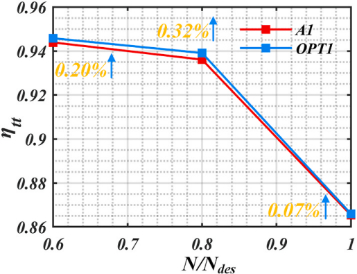

**图 45.** 数值模拟得到的基准型线与优化型线第三级效率对比。

涡轮总–总效率公式如下：

$$
\eta_{tt}=\frac{M\omega}{\dot m c_p T_{0,\mathrm{in}}\left[1-\left(\frac{P^*_{0,\mathrm{out}}}{P^*_{0,\mathrm{in}}}\right)^{\frac{\gamma-1}{\gamma}}\right]} \tag{25}
$$

其中，$\dot m$ 为质量流量，$\omega$ 为角速度，$c_p$ 为定压比热容，$T_{0,\mathrm{in}}$ 为进口总温，$P^*_{0,\mathrm{in}}$ 与 $P^*_{0,\mathrm{out}}$ 分别为进口和出口总压，$\gamma$ 为比热比。

需要指出，最终三维叶片形状由各截面型线及其积叠规律的共同作用决定，而非仅由一个优化截面决定。从这个意义上说，本研究主要确立了宽攻角条件下非对称前缘设计在截面层面的有效性。本研究的自然拓展方向，是将多个叶片截面的非对称前缘调整，与第三级转子叶片的三维积叠设计相结合，从而探索截面优化与完整三维叶片造型在多级低压涡轮中的协同气动潜力。

## 4. 结论

本研究结合风洞测量与数值模拟，阐明了宽攻角条件下不同前缘几何对应的气动损失机理。针对已识别的冲突设计要求，提出由物理机理指导的非对称前缘策略，并通过耦合 GAT-6 图神经网络与 MARL 的快速代理辅助优化框架加以实现。主要结论如下：

1. 在大正攻角下，主导损失机理由吸力面前缘分离泡的强弱及相关尾迹掺混决定。增大前缘半径或采用椭圆化前缘，可平滑弦向斜率分布，避免表面速度骤增，并缓和局部逆压梯度，从而抑制分离、降低所产生的掺混损失。在所考察的对称构型中，椭圆化设计 A2 对分离相关损失的抑制能力最强。

2. 在大负攻角下，型面损失对前缘形状的敏感性明显降低。虽然可能形成压力面前缘分离泡，但在加速主流的卷吸作用下会迅速再附着，分离相关损失因而处于次要地位。总损失主要由近壁黏性耗散支配，主要受湿润面积代价控制。基准构型 A1 具有最紧凑的前缘和最小湿润面积，因此在对称参考构型中损失最低。这一发现进一步表明，压力面优化应优先采用有限钝化及更薄、更流线化的型线，以最小化湿润面积代价，同时保持足够的负攻角匹配，使压力面分离局限在局部并容易再附着，从而在不损害摩擦性能的前提下降低分离相关损失。

3. 在端壁区域，前缘修型通过改变驻点区形态与三维压力场影响二次损失，从而改变马蹄涡压力面分支及其向下游通道涡的演化。在 +30° 攻角下，椭圆化前缘限制驻点区沿叶高方向扩展，削弱输送至通道内的轴向涡量，减小通道涡强度和端壁尾迹损失。在 −50° 攻角下，驻点区拓扑基本不变，二次流结构对前缘形状的敏感性较弱；端壁损失主要由摩擦支配，因此过大的前缘半径或钝度会增加湿润面积和堵塞代价，导致端壁损失略有增加，其中 A3 最为明显，而 A2 所受代价相对较小。

4. 正攻角下抑制吸力面分离所需的前缘钝度和曲率平滑，与负攻角下最小化摩擦和堵塞代价所需的流线化压力面几何之间存在根本冲突。提出的物理机理指导非对称参数化方法，将曲率连续的吸力面与符合摩擦主导负攻角流动特征的流线化压力面型线相结合，协调这一权衡。经 GAT–MARL 框架优化，最终非对称设计相对于基准 A1，试验测得的 $C_{pt}$ 在 +30°、0° 和 −50° 攻角下分别降低 46.64%、13.73% 和 29.29%。此外，初步涡轮级评估表明，将优化型线重新引入多级动力涡轮后，这种截面层面的气动收益仍可保留，并观察到级效率提高。

## CRediT 作者贡献声明

**Tianyou Chen：** 初稿撰写、方法学、数据整理、概念构思。  
**Zhengshuai Du：** 审阅与编辑、验证、概念构思。  
**Le Cai：** 审阅与编辑、监督指导、方法学。  
**Peizhi Dong：** 方法学、形式分析、数据整理。  
**Songtao Wang：** 审阅与编辑、监督指导、方法学。

## 竞争性利益声明

作者声明，不存在任何已知的、可能被认为影响本文所报告工作的竞争性经济利益或个人关系。

## 致谢

本研究得到航空发动机及燃气轮机基础研究项目资助［项目编号 J2019-II-0021-0042］。

## 附录 I

一旦给定十一个设计参数，叶片型线便由五个关键控制点唯一确定，几何被划分为：前缘（LE）、尾缘（TE）、压力面（PS）、喉部上游吸力面（SS1）和喉部下游吸力面（SS2）。

**（1）尾缘吸力面切点**

$$
\begin{cases}
x_1=C_x-R_{\mathrm{TE}}\left(1+\sin\left(\beta_{\mathrm{out}}-\frac{\xi}{2}\right)\right)\\
y_1=R_{\mathrm{TE}}\cos(\beta_{\mathrm{out}}-e_{\mathrm{out}})
\end{cases} \tag{1}
$$

**（2）吸力面喉部位置**

$$
\begin{cases}
x_2=C_x-R_{\mathrm{TE}}+(o+R_{te})\sin\beta_2\\
y_2=\frac{2\pi r}{N}-(o+R_{\mathrm{TE}})\cos\left(\beta_{\mathrm{out}}+\frac{\xi}{2}\right)
\end{cases} \tag{2}
$$

**（3）尾缘压力面切点**

$$
\begin{cases}
x_3=R_{\mathrm{LE}}\left(1-\sin\left(\beta_{\mathrm{in}}+\frac{\gamma_{\mathrm{in}}}{2}\right)\right)\\
y_3=C_t+R_{\mathrm{LE}}\cos\left(\beta_{\mathrm{in}}+\frac{\gamma_{\mathrm{in}}}{2}\right)
\end{cases} \tag{3}
$$

**（4）前缘压力面切点**

$$
\begin{cases}
x_4=R_{\mathrm{LE}}\left(1+\sin\left(1+\sin\left(b_{\mathrm{in}}+\frac{g}{2}\right)\right)\right)\\
y_4=C_t-R_{\mathrm{LE}}\cos\left(b_{\mathrm{in}}-\frac{g}{2}\right)
\end{cases} \tag{4}
$$

**（5）前缘吸力面切点**

$$
\begin{cases}
x_5=C_x-R_{\mathrm{TE}}\left(1-\sin\left(\beta_{\mathrm{out}}+\frac{\xi}{2}\right)\right)\\
y_5=-R_{\mathrm{TE}}\cos\left(\beta_{\mathrm{out}}+\frac{\xi}{2}\right)
\end{cases} \tag{5}
$$

〔译注：本附录的切点名称、半径下标和变量均按原文保留；其中（3）、（5）的标题与所列公式中的前/尾缘参数存在不一致，（4）的嵌套正弦形式也依原文转录。〕

## 附录 II

在明确前缘流动机理与相应优化方向后，建立 MARL 框架，以处理 −50°、0° 和 +30° 攻角工况之间相互冲突的优化倾向。设置三个智能体，分别独立优化各攻角下的叶片型线。上标 1、2、3 分别表示三个智能体。在时间步 $t$，环境状态定义为：

$$
S_t=[x_t^1,x_t^2,x_t^3] \tag{1}
$$

根据状态 $S_t$ 和策略函数 $\pi$，时间步 $t$ 的动作由下式获得：

$$
A_t=[\Delta x_t^1,\Delta x_t^2,\Delta x_t^3] \tag{2}
$$

其中，$x_t^1$、$x_t^2$、$x_t^3$ 表示三个智能体待修改的前缘几何参数集合，$\pi^1(x_t^1)=\Delta x_t^1$、$\pi^2(x_t^2)=\Delta x_t^2$、$\pi^3(x_t^3)=\Delta x_t^3$，而 $\Delta x_t^1$、$\Delta x_t^2$、$\Delta x_t^3$ 表示相应几何调整量。奖励由基于 GAT-6 代理模型构建的环境提供：

$$
\begin{cases}
r_t^1=F(\Theta,x_t^1)\\
r_t^2=F(\Theta,x_t^2)
\end{cases} \tag{3}
$$

下一状态 $S_{t+1}$ 计算为：

$$
S_{t+1}=[x_{t+1}^1,x_{t+1}^2] \tag{4}
$$

〔译注：本附录关于“独立优化”的表述与正文强调共享同一几何的说明不一致；式（3）、（4）仅列出两个智能体的量，原文如此。〕

考虑实际几何约束与变化的工况，将优化问题表述为带约束的动态多目标优化问题（DMOP）。约束与攻角相关条件表示为：

$$
\min_{x\in\Omega}[f(x_g,i,x,t)]
=\left[f_1(x_g,i=-50^\circ,x,t),\,f_2(x_g,i=0^\circ,x,t),\,f_3(x_g,i=30^\circ,x,t)\right] \tag{5}
$$

以智能体 1 为例，交互过程如下：

$$
S_t=[B_{12}^t,B_{13}^t,B_{22}^t,B_{23}^t,\gamma_{ss}^t,\gamma_{ps}^t,R_l^t] \tag{6}
$$

给定当前状态 $S_t$，智能体输出动作：

$$
a_t=[\Delta B_{12}^t,\Delta B_{13}^t,\Delta B_{22}^t,\Delta B_{23}^t,\Delta\gamma_{ss}^t,\Delta\gamma_{ps}^t,\Delta R_l^t] \tag{7}
$$

动作施加后，环境使用 GAT-6 模型在三个攻角下评估叶片，并返回总压损失系数作为奖励。随后将更新状态 $S_{t+1}=S_t+a_t$ 反馈给智能体。上述迭代持续进行，直到达到预设最大时间步 $T_{\max}$。

策略学习是强化学习的核心。在策略梯度算法中，近端策略优化为连续动作和高维问题提供稳定且高效的框架。其多智能体扩展 MAPPO 通过集中式价值函数协调多个分散式策略，进一步提高学习稳定性。MAPPO 的裁剪策略更新目标表示为：

$$
L^{\mathrm{CLIP}}(\theta)=\mathbb{E}_t\left[\min\left(r_t(\theta)A_t,\operatorname{clip}(r_t(\theta),1-\varepsilon,1+\varepsilon)A_t\right)\right] \tag{8}
$$

其中，$r_t(\theta)=\frac{\pi_\theta(a_t\mid S_t)}{\pi_{\theta_{\mathrm{old}}}(a_t\mid S_t)}$，$A_t$ 表示优势函数，$\varepsilon$ 限制更新步长，从而在保证有效利用样本的同时提高稳定性。

## 数据可用性

数据可按要求提供。

## References

[1] Snyder CA. Defining gas turbine engine performance requirements for the large civil TiltRotor (LCTR2). NASA; 2013. Technical report NASA/TM 218101 .

[2] Wang K, Chen F, Yu J, Song Y. Effect of uncertain operating conditions on the aerodynamic performance of high-pressure axial turbomachinery blades. Energy 2023;283:12991. https://doi.org/10.1016/j.energy.2023.128991 .

[3] Perdichizzi A. Mach number effects on secondary flow development downstream of a turbine Cascade. J Turbomach 1990;112:643 – 51. https://doi.org/10.1115/1.2927705 .

[4] Citavy J, et al. The effect of reynolds number and turbulence intensity on the performance of a compressor Cascade with prescribed velocity distribution. J Mech Eng Sci 1977. https://doi.org/10.1243/JMES_JOUR_1977_019_022_02 .

[5] Jouini DBM, Sjolander SA, Moustapha SH. Aerodynamic performance of a transonic turbine Cascade at off-design conditions. J Turbomach 2001;123:510 – 8. https://doi.org/10.1115/1.1370157 .

[6] Zhang WH, Zou ZP, Qi L, Ye J, Li W. Effects of freestream turbulence on separated boundary layer in a low-Re high-lift LP turbine blade. Comput Fluids 2015;109: 1 – 12. https://doi.org/10.1016/j.compfluid.2014.12.014 .

[7] Jelaska D, Podrug S, Perkusic M. A novel hybrid transmission for variable speed wind turbines. Renew Energy 2015;83:78 – 84. https://doi.org/10.1016/j.renene.2015.04.021 .

[8] Flegel AB. Aerodynamic measurements of a variable-speed power-turbine blade section in a transonic turbine Cascade at low inlet turbulence. In: ASME turbo expo 2013; 2013. https://doi.org/10.1115/GT2013-94695 . Paper No. GT2013-94695.

[9] Welch GE, McVetta AB, Stevens MA, Howard SA, Giel PW, et al. Variable-speed power-turbine research at glenn research center. 2012. NASA/TM-2012-217605 .

[10] Long JA, Moualeu LPG, Hemming NJ, Ames FE, Suzen YB. Transonic turbine Cascade measurements for a variable speed power turbine blade at low to moderate reynolds numbers: aerodynamic loss surveys. Proc ASME Turbo Expo 2015. https://doi.org/10.1115/GT2015-42504 . Paper No. GT2015-42504.

[11] Benner MW, Sjolander SA, Moustapha SH. Influence of LE geometry on profile losses in turbines at off-design incidence: experimental results and an improved correlation. J Turbomach 1997;119:193 – 200. https://doi.org/10.1115/1.2841101 .

[12] Sun H, Li J, Feng Z. Investigations on aerodynamic performance of turbine Cascade at different flow conditions. Eng Appl Comput Fluid Mech 2012;6:214 – 23. https://doi.org/10.1080/19942060.2012.11015416 .

[13] Fujiwara K, Sriram R, Kontis K. Experimental investigations on the sharp LE separation over a flat plate at zero incidence using particle image velocimetry. Exp Fluid 2020;61:205. https://doi.org/10.1007/s00348-020-03039-w .

[14] Walraevens RE, Cumpsty NA. Leading edge separation bubbles on turbomachine blades. J Turbomach 1995;117:115 – 25. https://doi.org/10.1115/1.2835626 .

[15] Zhang W, Zou Z, Ye J. LE redesign of a turbomachinery blade and its effect on aerodynamic performance. Appl Energy 2012;93:655 – 67. https://doi.org/10.1016/j.apenergy.2011.12.091 .

[16] Zhang R, Zhang W, Gan M, Xiao W, Zeng F, Zhao D. Toward high-lift low-solidity design for incidence tolerant gas turbine blade profile. Energy 2024;309:133034. https://doi.org/10.1016/j.energy.2024.133034 .

[17] Li X, Sun S, Liu Y, Wang J. Aerodynamic performance response due to stagger angle variation in an axial supersonic through-flow fan blade. Phys Fluids 2025;37(9): 096113. https://doi.org/10.1063/5.0287747 .

[18] Sun S, Li X, Guo M, Song J, Yang C, Wang J. Effect of inlet mach number on performance and flow structure of an axial supersonic through-flow fan Cascade. Phys Fluids 2023;35(5):056104. https://doi.org/10.1063/5.0146900 .

[19] Sun S, Zhou L, Ji L. Influence of solidity on aerodynamic performance of axial supersonic through-flow fan cascades. J Propul Power 2022;38(4):559 – 72. https://doi.org/10.2514/1.B38519 .

[20] Hamakhan IA, Korakianitis T. Aerodynamic performance effects of LE geometry in gas-turbine blades. Appl Energy 2010;87:1591 – 601. https://doi.org/10.1016/j.apenergy.2009.09.017 .

[21] Dellacasagrande M, Lengani D, Simoni D, et al. Analysis of unsteady loss sensitivity to incidence-angle variation in low-pressure turbine. In: ASME turbo expo; 2023. https://doi.org/10.1115/GT2023-103770 . Paper GT2023-103770.

[22] Zhang XF, Hodson HP, Harvey NW. Unsteady boundary layer studies on ultra-high-lift low-pressure turbine blades. Proc Inst Mech Eng 2005;219:451 – 60. https://doi.org/10.1243/095765005X31207 .

[23] Elgendi MM, Ibrahim MK, Mori K. Energy separation in high-subsonic turbine Cascade. Trans Jpn Soc Aeronaut Space Sci 2010;52:206 – 12. https://doi.org/10.2322/tjsass.52.206 .

[24] Elgendi MM, Ibrahim MK, Mori K. Novel flow-control method for vortex shedding of turbine blade. Trans Jpn Soc Aeronaut Space Sci 2010;53:122 – 9. https://doi.org/10.2322/tjsass.53.122 .

[25] Marxen O, Rist U. DNS and LEs of the transition process in a laminar separation bubble. In: Friedrich R, Geurts BJ, Metais O, editors. Direct and large-eddy simulation V. ERCOFTAC series, vol. 9. Dordrecht: Springer; 2004. p. 305 – 12. https://doi.org/10.1007/978-1-4020-2313-2_25 .

[26] Wissink JG, Rodi W. DNS of transition in a laminar separation bubble. In: Castro IP, Hancock PE, editors. Advances in turbulence IX: proceedings of the ninth European turbulence conference. Southampton: CIMNE; 2002. p. 727 – 30 .

[27] Du Q, Li Y, Yang L, Liu T, Zhang D, Xie Y. Performance prediction and design optimization of turbine blade profile with deep learning method. Energy 2022;254: 124351. https://doi.org/10.1016/j.energy.2022.124351 .

[28] Li L, Zhang W, Li Y, Zhang R, Liu Z, Wang Y, et al. A non-parametric high-resolution prediction method for turbine blade profile loss based on deep learning. Energy 2024;288:129719. https://doi.org/10.1016/j.energy.2023.129719 .

[29] Wang Q, Yang L, Rao Y. Establishment of a generalizable model on a small-scale dataset to predict the surface pressure distribution of gas turbine blades. Energy 2021;214:118878. https://doi.org/10.1016/j.energy.2020.118878 .

[30] Wang Y, Liu T, Zhang D, Xie Y. Dual-convolutional neural network based aerodynamic prediction and multi-objective optimization of a compact turbine rotor. Aero Sci Technol 2021;116:106869. https://doi.org/10.1016/j.ast.2021.106869 .

[31] Bronstein MM, Bruna J, LeCun Y, Szlam A, Vandergheynst P. Geometric deep learning: going beyond euclidean data. IEEE Signal Process Mag 2017;34:18 – 42. https://doi.org/10.1109/MSP.2017.2693418 .

[32] Pfaff T, Fortunato M, Sanchez-Gonzalez A, Battaglia PW. Learning mesh-based simulation with graph networks. Proc Natl Acad Sci USA 2021;118:e2011214118. https://doi.org/10.1073/pnas.2011214118 .

[33] Juangphanich P, Rush J, Scannell N. Predicting two-dimensional airfoil performance using graph neural networks. 2022. NASA Technical Memorandum NASA/TM-20220006290 .

[34] Hines D, Bekemeyer P. Graph neural networks for the prediction of aircraft surface pressure distributions. Aero Sci Technol 2023;137:108268. https://doi.org/10.1016/j.ast.2023.108268 .

[35] Li J, Liu T, Wang Y, Xie Y. Integrated graph deep learning framework for flow field reconstruction and performance prediction of turbomachinery. Energy 2022;254: 124440. https://doi.org/10.1016/j.energy.2022.124440 .

[36] Chen T, Cai L, Zeng J, Zhang W, Wang S. Aerodynamic performance prediction for wide-incidence turbines using graph neural network models driven by small-scale experimental data. J Turbomach 2025;147:021008. https://doi.org/10.1115/1.4066432 .

[37] Jia L, Hao J, Hall J, Nejadkhaki HK, Wang G, Yan Y, et al. A reinforcement learning based blade twist angle distribution searching method for optimizing wind turbine energy power. Energy 2021;215:119148. https://doi.org/10.1016/j.energy.2020.119148 .

[38] Wang Z, Zeng T, Chu X, Xue D. Multi-objective deep reinforcement learning for optimal design of wind turbine blade. Renew Energy 2023;203:854 – 69. https://doi.org/10.1016/j.renene.2023.01.003 .

[39] Fang J, Hu W, Liu Z, Chen W, Tan J, Jiang Z, et al. Wind turbine rotor speed design optimization considering rain erosion based on deep reinforcement learning. Renew Sustain Energy Rev 2022;168:112788. https://doi.org/10.1016/j.rser.2022.112788 .

[40] Deng Z, Xu C, Han X, Cheng Z, Xue F. Decentralized yaw optimization for maximizing wind farm production based on deep reinforcement learning. Energy Convers Manag 2023;286:117031. https://doi.org/10.1016/j.enconman.2023.117031 .

[41] Zhang G, Hu W, Cao D, Zhang Z, Huang Q, Chen Z, Blaabjerg F. A multi-agent deep reinforcement learning approach enabled distributed energy management schedule for the coordinate control of multi-energy hub with gas, electricity, and freshwater. Energy Convers Manag 2022;255:115340. https://doi.org/10.1016/j.enconman.2022.115340 .

[42] Fang J, Liu D, Tse CK. Impact of structure of network-based data on performance of graph neural networks. IEEEInt Symp Circuits Syst 2023:1 – 5. https://doi.org/10.1109/ISCAS46773.2023.10182188 .

[43] Celik IB, Ghia U, Roache PJ, Freitas CJ. Procedure for estimation and reporting of uncertainty due to discretization in CFD applications. J Fluid Eng 2008;130(7): 078001. https://doi.org/10.1115/1.2960953 .

[44] Pritchard LJ. An eleven parameter axial turbine airfoil geometry model. Proc ASME Turbo Expo 1985;85-GT-219 .

[45] Denton JD. The 1993 IGTI scholar lecture: loss mechanisms in turbomachines. J Turbomach 1993;115(4):621–56. https://doi.org/10.1115/1.2929299.

[46] Moustapha SH, Kacker SC, Tremblay B. An improved incidence losses prediction method for turbine airfoils. J Turbomach 1990;112:267–76. https://doi.org/10.1115/1.2927647.

[47] Mayle RE. The role of laminar–turbulent transition in gas turbine engines. Proc ASME Int Gas Turbine Aeroengine Congr Expo 1991;91-GT-261. https://doi.org/10.1115/91-GT-261.

[48] Benner MW, Sjolander SA, Moustapha S. Hfluence of LE geometry on profile losses in turbines at off-design incidence: experimental results and an improved correlation.". ASME J Turbomach April 1997;119(2):193–200. https://doi.org/10.1115/1.2841101.
