# ATLAS：面向真实世界旅行规划的约束感知多智能体协作

**原题：** ATLAS: Constraints-Aware Multi-Agent Collaboration for Real-World Travel Planning  
**发表会议：** ICLR 2026  
**作者：** Jihye Choi¹*、Jinsung Yoon²、Jiefeng Chen²、Somesh Jha¹、Tomas Pfister²  
**单位：** ¹威斯康星大学麦迪逊分校；²Google Cloud  
**联系邮箱：** {jihye,jha}@cs.wisc.edu；{jinsungyoon,jiefengc,tpfister}@google.com

*本工作完成于 Jihye 在 Google Cloud 担任研究实习生期间。

## 摘要

尽管大语言模型（LLM）在推理与工具使用方面取得了显著进展，但在复杂约束下，它们往往无法生成最优且有事实依据的解答。真实世界的旅行规划集中体现了这些挑战：智能体需要处理显式、隐式，甚至会随动态环境及用户需求交互而变化的约束。本文提出 ATLAS，这是一种通用多智能体框架，旨在有效处理真实旅行规划任务中约束感知的复杂性。

ATLAS 通过动态约束管理、迭代计划评判和自适应交错搜索等专门机制，系统解决约束感知规划的根本挑战。它在 TravelPlanner 基准上取得最先进的表现，相对于最佳替代方法，将最终通过率从 23.3% 提高到 44.4%。更重要的是，本文首次在结合实时信息搜索与多轮反馈的真实旅行规划任务上，定量展示了有效性。在这一真实设置中，ATLAS 达到 84% 的最终通过率，整体规划性能显著优于 ReAct（59%）与单体智能体（27%）等基线。

## 1. 引言

感知并遵守约束是智能的基本方面，对推理和问题求解至关重要（Dechter, 2003；Holyoak & Simon, 1999）。在约束下解决真实问题，需要精细协调需求理解、信息搜索和满足全部规则的方案综合。尽管 LLM 在推理和工具使用方面发展迅速（Schick et al., 2023；Nakano et al., 2021），但面对包含复杂、多方面约束的实际任务时，可靠性仍然有限。即便能力较强，它们也常常生成不连贯或无效的计划；这是现实部署中的关键缺陷（Valmeekam et al., 2023；Kambhampati et al., 2024）。

现有研究常常绕开核心挑战。一些方法关注约束遵从，却假定全部必要信息从一开始就已给出（Parmar et al., 2025；Lee et al., 2025）；另一些方法引入搜索，却预设所有约束事先已知（Hao et al., 2025a）。更真实、也更困难的情况是，智能体必须同时搜索上下文信息并发现约束，而这一问题仍大体未解决。

旅行规划这一典型日常任务清楚体现了这种复杂性。如图 1 所示，即使 Gemini-2.5-Pro 等最先进模型能够满足预算、日期等显式请求，也可能违反隐含常识规则，例如未能安排逻辑合理的行程，或生成虚构细节。多轮对话中，用户约束还会动态演变，进一步放大问题；当前 LLM 及其智能体在这方面仍有不足（Xie et al., 2025）。

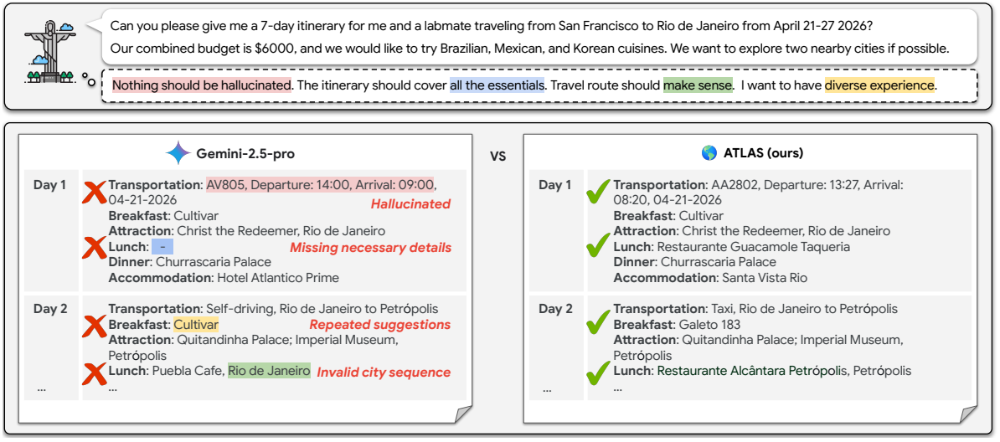

**图 1. 单体智能体无法解决真实旅行规划。真正的挑战是同时满足用户的显式请求与隐含的常识预期，后者见虚线气泡。即使 Gemini-2.5-Pro 等先进模型，也会出现关键失误，例如上午 9 点抵达后遗漏午餐，或推荐另一座城市的餐厅。这凸显了 ATLAS 这类多智能体方案的必要性。**

> 图中查询：请为我和一位实验室同伴安排 2026 年 4 月 21—27 日从旧金山前往里约热内卢的七日行程。两人总预算为 6000 美元，希望品尝巴西、墨西哥和韩国菜，并尽可能探索两座附近城市。虚线气泡中的要求为：不得虚构信息；行程应包含全部必要项目；路线应合理；希望获得多样化体验。错误标注分别表示“虚构信息”“遗漏必要细节”“重复推荐”和“不合理的城市顺序”。图中的常识示例采用自 TravelPlanner 基准（Xie et al., 2024）。

为弥补这一不足，我们提出通用多智能体框架，系统处理实际约束感知问答任务中的三个根本挑战：

1. **约束构建。** 在没有先验知识的情况下，从用户查询和搜索结果识别完整的显式、隐式约束集合。我们利用 LLM 丰富的世界知识与常识推理能力（Zhao et al., 2023；Krause & Stolzenburg, 2023；Ismayilzada et al., 2023），推断并明确表达全部约束。
2. **约束感知作答。** 生成连贯、有效的解答，并验证其符合所有已识别约束。我们采用迭代改进循环：一个智能体的生成结果由另一个智能体严格检查，再通过有针对性的反馈指导后续修订（Gou et al., 2024；Choi et al., 2024）。
3. **弥补信息缺口。** 诊断失败究竟源于逻辑错误，还是搜索信息不足。我们使用具备高层推理能力的智能体，定位具体信息缺口并建议新的搜索动作（Gou et al., 2025；Wu et al., 2025），将死路转化为自适应补充信息的机会。

我们以旅行规划作为测试场景，验证 ATLAS 的有效性。ATLAS 的全称为 Agent-based Travel planning with Live Adaptive Search，即基于智能体、结合实时自适应搜索的旅行规划。旅行规划天然包含上述三个挑战。

本文的贡献有三方面。第一，在 TravelPlanner 基准（Xie et al., 2024）测试集上，ATLAS 相对于现有多智能体基线的性能提升最高达 14%。第二，在多轮变体（Oh et al., 2025）中，其他方法性能停滞时，ATLAS 仍能有效适应持续变化的用户反馈。第三，我们超越沙盒，定量展示了该框架在结合实时网页搜索和多轮交互的动态环境中的成功。在这一真实设置中，ATLAS 在保持较高事实依据程度的同时，最终通过率达到 84%；ReAct 和单体智能体则分别只有 59% 和 27%。

**相关工作。** 现有大多数方法假设全部必要信息已准备就绪（Kambhampati et al., 2024；Yuan et al., 2025；Lee et al., 2025；Xie et al., 2025；Lu et al., 2025；Singh et al., 2024）；引入搜索工具的方法则性能有限（Zhang et al., 2025），或缺少严格评估（Chen et al., 2024）。ATLAS 针对这些不足，将搜索与约束旅行规划结合，并有效扩展到沙盒之外的开放域、多轮场景。附录 A 详细讨论了相关工作。

## 2. 问题设定

本节将目标旅行规划任务形式化为一般化的约束问答问题。给定用户的自然语言查询 $Q$，将其转化为约束满足问题（Constraint Satisfaction Problem，CSP）（Mackworth, 1977；Brailsford et al., 1999b）：

$$
P=\langle X,D,C\rangle.
$$

其组成如下：

- $X=\{x_1,x_2,\ldots,x_n\}$ 是由 $n$ 个变量组成的有限集合。在旅行规划中，它们代表待作出的决策，例如 `Day1_Transportation`、`Day1_Accommodation`、`Day1_Dinner`、`Day2_Breakfast` 等，涵盖每天全部相关行程细节。
- $D=\{D_{x_1},D_{x_2},\ldots,D_{x_n}\}$ 是一组取值域，其中 $D_{x_i}$ 为变量 $x_i$ 的有限可选值集合。这些域通过外部信息动态构建，而非预先给定。智能体执行一系列工具调用，得到观测 $O$，再据此填充 $D$。例如，`Day1_Lunch` 的取值域，就是通过实时搜索获得的、第一天相关城市中的候选餐厅集合。
- $C=\{c_1,c_2,\ldots,c_m\}$ 是必须满足的 $m$ 个约束组成的有限集合。每个 $c_j\in C$ 为一个二元组 $\langle\mathrm{scope}(c_j),\mathrm{rel}(c_j)\rangle$。其中，$\mathrm{scope}(c_j)\subseteq X$ 是参与约束的变量子集；$\mathrm{rel}(c_j)\subseteq\prod_{x\in\mathrm{scope}(c_j)}D_x$ 是规定这些变量允许采用哪些值组合的关系。

例如，某个约束要求整个行程中每餐选择不同餐厅，其作用域就是全部用餐变量：

$$
\mathrm{scope}(c_j)=\{\texttt{Day1\_Lunch},\texttt{Day1\_Dinner},\texttt{Day2\_Breakfast},\ldots\}.
$$

对应关系为：

$$
\mathrm{rel}(c_j)=
\left\{\langle r_1,\ldots,r_k\rangle\ \middle|\
\forall i,j\in\{1,\ldots,k\},\ i\ne j\Rightarrow r_i\ne r_j\right\},
$$

即满足这一约束的全部餐厅分配 $k$ 元组。

在 CSP 框架下，我们根据来源与性质，将整体约束集 $C$ 分为两类，类似于经典规划中目标与状态约束的区分（Fikes & Nilsson, 1971）。

**显式约束 $C_E$** 是查询 $Q$ 明确表述或蕴含的要求、偏好，即解必须满足的目标，例如预算上限、目的地或日期。它还可以包括观测 $O$ 带来的新约束，例如住宿的最低入住晚数或最大入住人数。

**隐式约束 $C_I$** 并未明确给出，而是来自领域常识和物理现实，类似经典规划中的状态不变量。显式与隐式约束合起来形成问题的完整约束集：

$$
C=C_E\cup C_I.
$$

由此可以正式定义静态旅行规划的目标。

**定义 2.1：静态旅行规划目标。** 给定 CSP 实例 $P=\langle X,D,C\rangle$，完整赋值是函数 $\sigma:X\to\bigcup_{x\in X}D_x$，将每个变量 $x\in X$ 映射到相应域中的值，即 $\sigma(x)\in D_x$。若完整赋值 $\sigma$ 满足 $C$ 中全部约束，它就是可行解。具体而言，对每个 $c_j\in C$，其作用域内变量的取值组合必须是该约束关系允许的元组：

$$
\langle\sigma(x)\mid x\in\mathrm{scope}(c_j)\rangle\in\mathrm{rel}(c_j).
$$

若存在可行解 $\sigma$，则问题可满足；若在给定域 $D$ 下不存在这样的赋值，则问题不可满足。目标是找到可行解时将其返回，否则返回不可满足的指示。

**不断演化的约束。** 上述静态 CSP 表示单轮旅行规划：系统根据用户的一次查询生成计划。然而在真实场景中，用户可能通过多轮对话给出反馈，添加、删除或修改约束，例如调整预算。更新后的查询通常要求系统获取更多信息，扩充观测集，最终形成不断演化的约束集。

这种动态性将静态 CSP 转变为动态 CSP，可将其视为静态问题序列 $P^1,P^2,\ldots,P^t$，序列中的每个问题都由前一个问题变换而来（Mittal & Falkenhainer；Dechter & Dechter, 1988）。

**定义 2.2：动态旅行规划目标。** 设多轮对话产生查询序列 $\{Q^1,Q^2,\ldots,Q^T\}$。对每轮 $t\in\{1,\ldots,T\}$，智能体获得观测 $O^t$，据此形成问题实例 $P^t=\langle X,D^t,C^t\rangle$。解轨迹为赋值序列 $\{\sigma^t\}_{t=1}^T$，其中每个 $\sigma^t$ 都是相应问题 $P^t$ 的可行解：

$$
\forall t\in\{1,\ldots,T\},\ \forall c\in C^t:\quad
\langle\sigma^t(x)\mid x\in\mathrm{scope}(c)\rangle\in\mathrm{rel}(c).
$$

最终目标是生成对 $P^T$ 可行的旅行行程 $\sigma^T$。中间的 $\sigma^t$ 则是与中间问题 $P^t$ 一致的暂定计划。这需要系统能够管理不断演化的约束集、生成满足约束的解，并根据动态变化收集信息。

## 3. ATLAS：结合实时自适应搜索的智能体旅行规划

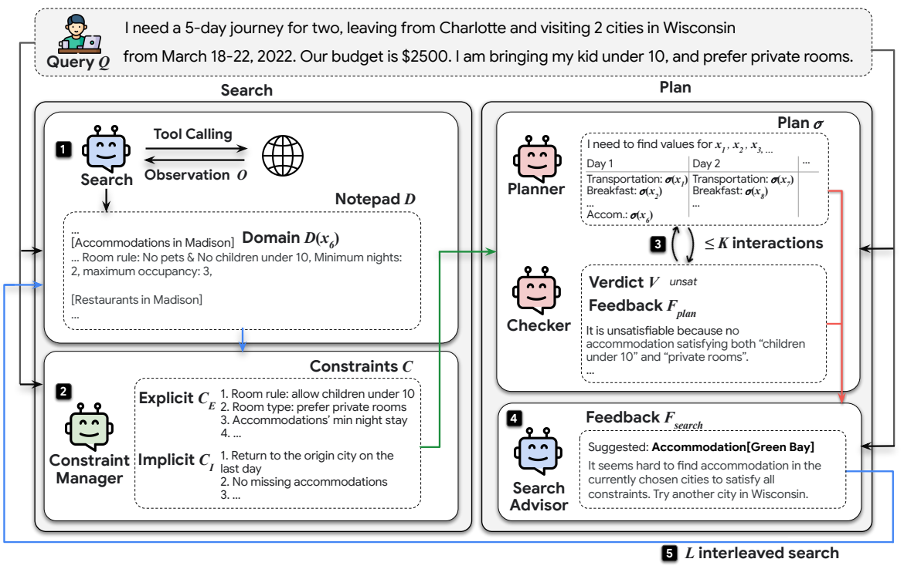

**图 2. 框架在 TravelPlanner 任务上的工作流程概览（Xie et al., 2024）。首先，搜索智能体建立可用选项的取值域，约束管理器识别全部应考虑的约束，包括用户给出的显式约束（例如，必须允许年龄大于 10 岁的儿童）和搜索结果中的显式约束（例如，最低入住晚数），以及隐含常识约束。随后，规划器提出计划，由检查器迭代验证。如果检查器发现问题不可满足，就触发交错搜索。搜索顾问诊断失败并给出反馈，指导新的、更有针对性的搜索。**

> 图内查询：为两人安排 2022 年 3 月 18—22 日从 Charlotte 出发、游览 Wisconsin 两座城市的五日旅行，预算 2500 美元，携带一名 10 岁以下儿童，偏好独立房间。Search、Constraint Manager、Planner、Checker、Search Advisor 分别表示搜索智能体、约束管理器、规划器、检查器和搜索顾问；Observation、Notepad、Domain、Verdict、Feedback 分别表示观测、记事本、取值域、判定和反馈。示例失败原因是当前城市中没有住宿同时满足“允许 10 岁以下儿童”和“独立房间”，因此建议改查 Wisconsin 的另一座城市，例如 Green Bay。
>
> 译注：原图注写作“children >10”，而图中查询与正文示例均为“10 岁以下儿童”；上方图注保留原文表述。

**约束感知规划的挑战。** ATLAS 的设计直接源于结合搜索的约束感知规划中三个根本挑战：（i）约束构建，识别完整的隐式、显式约束；（ii）约束下规划，可靠生成满足全部已识别约束的有效计划；（iii）弥补信息缺口，处理计划因初次搜索信息不足而非逻辑错误导致的失败。附录 B 讨论这些挑战与经典人工智能规划文献的联系（Brailsford et al., 1999a）。

**符号。** 用 $t=1,\ldots,T$ 表示对话轮次，$\ell=0,\ldots,L$ 表示一轮内的交错搜索循环，$k=0,\ldots,K$ 表示规划器与检查器的交互循环。用花体表示各类对象全部可能实例的空间：查询空间 $\mathcal Q$、变量集空间 $\mathcal X$、观测空间 $\mathcal O$、取值域集合空间 $\mathcal D$，以及约束集空间 $\mathcal C$。每个智能体均定义为带类型的函数，表 3 汇总了这些函数。图 2 与算法 1 给出整体流程。

### 3.1. 约束管理：挑战 1

ATLAS 流程的第一阶段为规划建立事实基础，由两个智能体负责。搜索智能体通过工具调用与外部环境交互；约束管理器利用收集的信息识别约束。

**搜索：工具交互。** 给定用户查询 $Q^t$，搜索智能体从全部工具调用中获取原始观测集 $O^{t,\ell}$，再提取结构化取值域 $D^{t,\ell}$，例如将可选航班、酒店等相关信息记录在记事本中。该过程可以迭代改进。搜索智能体可接收上一次规划失败给出的反馈 $F_{\mathrm{search}}^{t,\ell-1}\in\mathcal F_{\mathrm{search}}$，据此搜索新的或不同的信息，以解决失败，详见第 3.3 节。

$$
\begin{aligned}
\mathrm{Search}&:\mathcal Q\times\mathcal F_{\mathrm{search}}\to\mathcal D,\\
D^{t,\ell}&:=\mathrm{Search}(Q^t,F_{\mathrm{search}}^{t,\ell-1})\\
&=(\Gamma\circ\Omega)(Q^t,F_{\mathrm{search}}^{t,\ell-1}).
\end{aligned}
$$

每轮开始时默认 $F_{\mathrm{search}}^{t,0}=\varnothing$。函数 $\Omega:\mathcal Q\times\mathcal F_{\mathrm{search}}\to\mathcal O$ 从外部环境收集原始观测；$\Gamma:\mathcal O\to\mathcal D$ 过滤并组织观测，提取取值域。我们采用基于标准 ReAct 的工具调用模块实现 Search（Yao et al., 2023）。

**约束构建。** 取值域填充后，约束管理器识别并明确完整约束集 $C^{t,\ell}$。它包含两类规则：从用户查询 $Q^t$ 和当前取值域 $D^{t,\ell}$ 直接得到的显式约束 $C_E^{t,\ell}$，以及反映固定领域知识或通常未明说的常识规则的隐式约束 $C_I$，例如度假行程应返回出发城市。

$$
\begin{aligned}
\mathrm{Constrain}&:\mathcal Q\times\mathcal D\to\mathcal C,\\
C^{t,\ell}&:=\mathrm{Constrain}(Q^t,D^{t,\ell})=C_E^{t,\ell}\cup C_I,\\
C_E^{t,\ell}&:=\Pi(Q^t,D^{t,\ell}).
\end{aligned}
$$

其中，$\Pi:\mathcal Q\times\mathcal D\to\mathcal C$ 为显式约束提取函数。约束管理器特别适合发挥 LLM 的优势：高级自然语言理解能力使其能够解析复杂查询和搜索结果，提取显式约束；丰富的世界知识与常识推理能力，则使其能够推断构建连贯、合理计划所需的关键隐式约束。

### 3.2. 约束下的计划验证：挑战 2

本阶段的目标是为给定 CSP 实例 $P^{t,\ell}=\langle X,D^{t,\ell},C^{t,\ell}\rangle$ 找到有效解，由规划器与检查器两个专门智能体之间的迭代循环完成。

**规划。** 规划器提出候选解，即赋值 $\sigma\in\Sigma$，其中 $\Sigma$ 是全部可能赋值的空间。第一次尝试未必能找到定义 2.1 中的完整、有效赋值。因此，每次决策都参考先前失败赋值及其失败原因反馈，以持续改进：

$$
\begin{aligned}
\mathrm{Plan}&:(\mathcal X,\mathcal D,\mathcal C)\times
(\Sigma\times\mathcal F_{\mathrm{plan}})^*\to\Sigma,\\
\sigma^{t,\ell,k}&:=\mathrm{Plan}\!\left(
X,D^{t,\ell},C^{t,\ell};
\{(\sigma^{t,\ell,i},F_{\mathrm{plan}}^{t,\ell,i})\}_{i=1}^{k-1}
\right).
\end{aligned}
$$

$F_{\mathrm{plan}}^{t,\ell,i}\in\mathcal F_{\mathrm{plan}}$ 是对第 $i$ 次规划尝试 $\sigma^{t,\ell,i}$ 的反馈，初始 $F_{\mathrm{plan}}^{t,\ell,0}=\varnothing$。反馈由配套的检查器提供。

**约束检查。** 检查器验证候选赋值 $\sigma^{t,\ell,k}$ 是否满足 $C^{t,\ell}$ 中每一项约束，产生两个输出：判定 $V\in\mathcal V$，其中 $\mathcal V=\{\mathrm{valid},\mathrm{invalid},\mathrm{unsat}\}$，分别表示有效、无效和不可满足；以及描述未满足或不可满足约束的反馈 $F_{\mathrm{plan}}$。

$$
\begin{aligned}
\mathrm{Check}&:(\mathcal Q,\mathcal D,\mathcal C,\Sigma)
\to\mathcal V\times\mathcal F_{\mathrm{plan}},\\
(V^{t,\ell,k},F_{\mathrm{plan}}^{t,\ell,k})
&:=\mathrm{Check}(Q^t,D^{t,\ell},C^{t,\ell},\sigma^{t,\ell,k}).
\end{aligned}
$$

判定决定下一步动作。如果 $V^{t,\ell,k}=\mathrm{invalid}$，就将 $F_{\mathrm{plan}}^{t,\ell,k}$ 返回规划器，尝试生成修订版 $\sigma^{t,\ell,k+1}$。若 $V^{t,\ell,k}=\mathrm{unsat}$，说明存在更深层问题，例如 $D^{t,\ell}$ 选项不足，或 $C^{t,\ell}$ 中的约束不相容；此时触发下一个主要组件：交错搜索。

### 3.3. 交错搜索：弥补信息缺口，挑战 3

检查器返回 unsat，表示依靠当前信息不可能生成有效计划。系统由此触发搜索顾问，诊断潜在信息缺口。搜索顾问分析完整上下文，包括用户查询、规划使用的当前取值域、约束，以及失败规划尝试历史，定位失败根因。随后生成有针对性的反馈 $F_{\mathrm{search}}^{t,\ell}$，指导还应收集什么新信息，使问题变得可满足：

$$
\begin{aligned}
\mathrm{SearchAdvise}&:
(\mathcal Q,\mathcal D,\mathcal C,(\Sigma\times\mathcal F_{\mathrm{plan}})^*)
\to\mathcal F_{\mathrm{search}},\\
F_{\mathrm{search}}^{t,\ell}
&:=\mathrm{SearchAdvise}(Q^t,D^{t,\ell},C^{t,\ell},H^{t,\ell,k}).
\end{aligned}
$$

其中，$H^{t,\ell,k}:=\{(\sigma^{t,\ell,i},F_{\mathrm{plan}}^{t,\ell,i})\}_{i=1}^{k}$ 为目前的规划历史。这项任务适合由 LLM 完成，它可以通过高层推理诊断信息缺口并给出搜索反馈。例如图 2 中，当前选定城市没有住宿同时满足“10 岁以下儿童”与“独立房间”，于是建议搜索其他城市。新的搜索指令返回第 3.1 节的搜索智能体，得到扩充后的取值域 $D^{t,\ell+1}$ 和更新的约束集 $C^{t,\ell+1}$，继续循环。

### 3.4. 多轮扩展

第 3 节的单轮 ATLAS 可以自然扩展到多轮对话查询序列 $\{Q^1,\ldots,Q^T\}$。当用户将 $Q^t$ 更新为 $Q^{t+1}$ 时，ATLAS 不会从头开始，而是将上一轮最终取值域 $D^{t,L}$ 作为已知选项的缓存记忆。约束管理器立即结合新查询与缓存域，生成更新的约束集 $C^{t+1,1}$。因此，第 $t+1$ 轮开始时的新 CSP 为：

$$
\begin{aligned}
P^{t+1,1}&=\langle X,D^{t,L},C^{t+1,1}\rangle,\\
C^{t+1,1}&:=C_E^{t+1,1}\cup C_I,\\
C_E^{t+1,1}&=\Pi(Q^{t+1},D^{t,L}).
\end{aligned}
$$

随后，ATLAS 进入第 3.2 节的规划器—检查器循环，尝试仅利用上一轮已收集的信息找到有效计划。这是重要的效率机制：如果现有知识已足以满足用户新请求，就避免不必要的工具调用。只有这一过程失败，即经过最多 $K$ 次修订后检查器仍判定 unsat，系统才认定缓存信息不足。此时触发第 3.3 节完整的交错搜索，调用搜索智能体收集新信息，并在上限 $(K,L)$ 下恢复完整单轮协调流程。

## 4. 实验

本节通过实验验证框架。首先，在标准基准上与有竞争力的基线比较，并分析各核心组件的贡献（第 4.1 节）；随后扩展到多轮旅行规划（第 4.2 节）；最后展示 ATLAS 在结合实时网页搜索与多轮反馈的更真实设置中，也能保持更优性能（第 4.3 节）。先介绍共同实验设置，完整实现细节见附录 D.1。

**基准。** 我们基于 TravelPlanner（Xie et al., 2024）评估，这是旅行规划研究中的标准基准（Lee et al., 2025；Kambhampati et al., 2024）。它提供带住宿、餐厅、交通等 API 的沙盒环境，适合本文研究，因为它要求满足两类复杂约束：（i）硬约束，直接来自用户查询或搜索结果的严格规则，例如不超预算、遵守住宿规定；（ii）常识约束，基于隐含的实际逻辑，详见表 4。

**评估指标。** 采用 TravelPlanner 的四类官方指标，全部以百分比报告。（i）交付率：成功交付计划的查询比例。（ii）微观通过率：通过的约束数占全部考察约束数的比例，分别针对常识约束与硬约束计算。（iii）宏观通过率：已交付计划中，通过某一类别全部约束的比例，类别为常识或硬约束。（iv）最终通过率：已交付计划中，同时满足全部常识约束和硬约束的比例。

### 4.1. 单轮旅行规划

**基线。** 本文要求智能体在没有任何先验知识的情况下，通过工具搜索信息并发现约束。在该设置下，与三类主要基线比较：（i）工具使用的标准方法 ReAct（Yao et al., 2023）；（ii）Reflexion（Shinn et al., 2023）和 EvoAgent（Yuan et al., 2025），它们是文献中常用、已开源的纯规划基线（Xie et al., 2024），本文为其增加基于 ReAct 的搜索；（iii）PMC（Zhang et al., 2025），一种依赖 LLM 任务分解与委派的多智能体框架。

为公平比较，所有方法最多调用工具 120 次。ATLAS 设置 $K=3$，即最大检查步数，以及 $L=10$，即交错搜索步数。采用 Gemini-2.5-Pro（Comanici et al., 2025）与 Claude-Sonnet-4（20250514）（Anthropic, 2025）作为基座模型。

**表 1. ATLAS 在 TravelPlanner 基准上持续取得最高性能。↑ 表示越高越好，数值单位为 %。**

| 数据集 | 基座模型 | 方法 | 交付率↑ | 常识：微观↑ | 常识：宏观↑ | 硬约束：微观↑ | 硬约束：宏观↑ | 最终通过率↑ |
| --- | --- | --- | --- | --- | --- | --- | --- | --- |
| 验证集（180） | Gemini-2.5-Pro | ReAct | 98.33 | 80.32 | 29.63 | 55.55 | 46.56 | 20.56 |
| 验证集（180） | Gemini-2.5-Pro | ReAct+Reflexion | 100.00 | 79.10 | 27.22 | 59.29 | 50.00 | 22.22 |
| 验证集（180） | Gemini-2.5-Pro | ReAct+EvoAgent | 100.00 | 78.06 | 23.89 | 57.86 | 40.56 | 12.22 |
| 验证集（180） | Gemini-2.5-Pro | PMC | 100.00 | 78.68 | 30.56 | 43.33 | 37.22 | 23.33 |
| 验证集（180） | Gemini-2.5-Pro | ATLAS （本文） | 100.00 | 88.54 | 48.33 | 82.62 | 74.44 | 44.44 |
| 验证集（180） | Claude-Sonnet-4 | ReAct | 100.00 | 79.38 | 22.78 | 56.19 | 38.89 | 11.67 |
| 验证集（180） | Claude-Sonnet-4 | ReAct+Reflexion | 99.44 | 74.79 | 18.33 | 45.48 | 28.33 | 10.00 |
| 验证集（180） | Claude-Sonnet-4 | ReAct+EvoAgent | 99.44 | 74.08 | 19.71 | 38.05 | 20.33 | 8.03 |
| 验证集（180） | Claude-Sonnet-4 | PMC | 96.67 | 76.11 | 21.67 | 39.52 | 30.56 | 14.44 |
| 验证集（180） | Claude-Sonnet-4 | ATLAS （本文） | 100.00 | 83.40 | 37.78 | 56.43 | 38.89 | 23.33 |
| 测试集（1000） | Gemini-2.5-Pro | ReAct | 98.10 | 78.96 | 26.00 | 55.37 | 47.80 | 19.50 |
| 测试集（1000） | Gemini-2.5-Pro | ReAct+Reflexion | 99.90 | 77.94 | 25.90 | 65.85 | 56.70 | 22.70 |
| 测试集（1000） | Gemini-2.5-Pro | ReAct+EvoAgent | 100.00 | 78.06 | 26.23 | 60.41 | 49.23 | 15.58 |
| 测试集（1000） | Gemini-2.5-Pro | PMC | 100.00 | 79.37 | 28.30 | 57.10 | 46.10 | 21.08 |
| 测试集（1000） | Gemini-2.5-Pro | ATLAS （本文） | 100.00 | 85.81 | 40.50 | 77.64 | 70.60 | 35.00 |
| 测试集（1000） | Claude-Sonnet-4 | ReAct | 99.20 | 75.26 | 16.50 | 49.04 | 39.10 | 10.40 |
| 测试集（1000） | Claude-Sonnet-4 | ReAct+Reflexion | 99.80 | 71.84 | 13.67 | 37.84 | 26.70 | 9.13 |
| 测试集（1000） | Claude-Sonnet-4 | ReAct+EvoAgent | 98.89 | 67.01 | 10.00 | 33.71 | 20.42 | 6.11 |
| 测试集（1000） | Claude-Sonnet-4 | PMC | 100.00 | 73.89 | 15.59 | 45.19 | 33.56 | 12.12 |
| 测试集（1000） | Claude-Sonnet-4 | ATLAS （本文） | 100.00 | 78.88 | 31.00 | 49.43 | 42.00 | 18.00 |

**结果。** 表 1 中，ATLAS 在包括常识约束和硬约束满足情况的各项指标上持续取得最佳表现。它优于另一多智能体框架 PMC，是因为系统协调机制专门针对约束发现、约束感知作答及信息缺口等根本挑战设计，比依赖当前 LLM 自发涌现的任务分解能力更加可靠。

此外，仅给先进规划器 Reflexion、EvoAgent 添加搜索并无益处；对质量较差的搜索结果进行复杂规划，甚至会降低表现，例如 ReAct+EvoAgent 不如 ReAct。这凸显了单次、非自适应搜索产生的信息缺口，也说明按需补充上下文的交错搜索机制至关重要。附录 D.6 给出旅行天数和任务难度的消融，D.7 全面分析各方法成本。

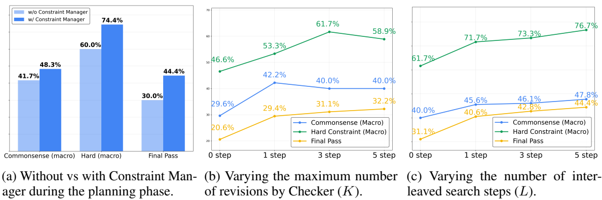

**图 3. 理解 ATLAS 各关键组件的独立贡献。（a）完整框架与禁用约束管理器的变体比较；（b）改变检查器最多修订次数 $K$，基线 $K=0$ 为 ReAct 顺序“先搜索再规划”流程；（c）改变交错搜索步数 $L$，基线 $L=0$ 为每次搜索后增加三次检查的 ReAct。完整结果见表 5。**

**分析关键组件。** 图 3 的消融验证各组件能否应对其目标挑战，使用 Gemini-2.5-Pro 在验证集上分析。首先，图 3a 证实显式约束管理的重要性：禁用约束管理器，使硬约束宏观通过率绝对下降 14.4%。其次，ATLAS 将规划与验证分离，由检查器迭代修订，提高约束下计划的有效性。图 3b 显示，仅一次检查（$K=1$）就将最终通过率从 20.6% 提高到 29.4%。

然而，$K=3$ 后性能趋于稳定，说明当根因是搜索信息不足时，重复检查的收益递减，继续检查效率较低。这正说明最后一个组件——交错搜索——的必要性。图 3c 中，在计划已修订三次的基础上，启用交错搜索并令 $L=5$，最终通过率从 31.1% 提高到 44.4%，证实自适应弥补信息缺口对可靠性非常重要。各组件都作出有针对性、显著的贡献，验证了框架设计。附录 D.5 进一步分析失败案例。

> 原文脚注：附录图 5 表明，ATLAS 可以有效诊断不可满足情形，推进到下一次交错搜索，而不会耗尽检查上限。

### 4.2. 多轮旅行规划

**设置。** TravelPlanner 仅模拟单轮规划；Flex-TravelPlanner（Oh et al., 2025）则修改其验证集，从原始查询删除部分约束，再在后续轮次引入，以模拟多轮规划。我们沿用该设置，构造两轮与三轮变体，改变新约束类型及引入顺序。局部约束包括菜系、房型，全局约束包括预算、人数。

比较 ReAct，即不做计划修订或交错搜索的本框架，$K=L=0$，与 $K=3,L=10$ 的 ATLAS，以验证处理多轮逐步引入约束的能力。

**表 2. Flex-TravelPlanner 多轮规划基准上的主要结果。↑ 表示越高越好，数值单位为 %。**

| 轮数 | 约束类型（样本数） | 方法 | 交付率↑ | 常识：微观↑ | 常识：宏观↑ | 硬约束：微观↑ | 硬约束：宏观↑ | 最终通过率↑ |
| --- | --- | --- | --- | --- | --- | --- | --- | --- |
| 两轮 | 新增局部约束（189） | ReAct | 100.00 | 86.51 | 45.83 | 66.79 | 42.86 | 30.16 |
| 两轮 | 新增局部约束（189） | ATLAS | 100.00 | 88.23 | 48.15 | 75.79 | 62.96 | 39.15 |
| 两轮 | 新增全局约束（240） | ReAct | 100.00 | 85.68 | 40.00 | 68.34 | 51.67 | 26.25 |
| 两轮 | 新增全局约束（240） | ATLAS | 100.00 | 87.55 | 48.75 | 75.97 | 64.16 | 39.59 |
| 三轮 | 先局部、后全局（378） | ReAct | 100.00 | 83.70 | 33.07 | 59.59 | 36.51 | 15.34 |
| 三轮 | 先局部、后全局（378） | ATLAS | 100.00 | 87.96 | 49.21 | 73.58 | 53.97 | 33.60 |
| 三轮 | 先全局、后局部（378） | ReAct | 100.00 | 84.06 | 32.80 | 59.43 | 36.24 | 17.20 |
| 三轮 | 先全局、后局部（378） | ATLAS | 100.00 | 86.81 | 47.09 | 71.38 | 52.12 | 31.75 |

**结果。** 表 2 显示，ATLAS 在全部多轮设置下均优于 ReAct，且轮数与复杂度增加时，差距进一步扩大。例如，两轮设置中引入局部或全局约束时，最终通过率分别绝对提高约 9% 和 13%。增加到三轮后，提升更大：ReAct 的最终通过率仅为 15.34% 或 17.20%，而本文方法不论约束引入顺序如何，都约为其两倍。按约束类型细分的完整结果见表 6。

### 4.3. 结合实时搜索的多轮旅行规划

**设置。** 为验证实际价值，我们在结合实时网页搜索的多轮旅行规划中评估 ATLAS。将 TravelPlanner 验证集的沙盒工具替换为 Google 搜索工具，使智能体获取实时旅行信息。为保证数据可用，查询中的旅行日期均设在实验运行时段起的一个月内；实验于 2025 年 8 月 4—18 日运行。

实时搜索的独特挑战是智能体可能虚构搜索结果。因此，我们引入“无幻觉率”，衡量计划中全部信息不仅来自搜索结果，而且事实准确的计划比例。事实准确性由配备独立搜索工具的 LLM 评判器确认。ATLAS 设置 $K=3,L=5$。

为模拟真实交互，采用多轮反馈循环：智能体生成计划后，针对违反的约束给出纠正反馈，并将其加入原查询供下一轮使用，形成不断演变的约束，见图 4d。这模拟了用户与系统协作，逐次修订、改善旅行计划的常见场景。最后，将 ATLAS 与 ReAct、以及不进行多智能体分解的单体智能体基线比较，评估多智能体系统的价值。

> 原文脚注：实时信息来源例如 Google Travel；提示词的详细规定见附录 F.2。

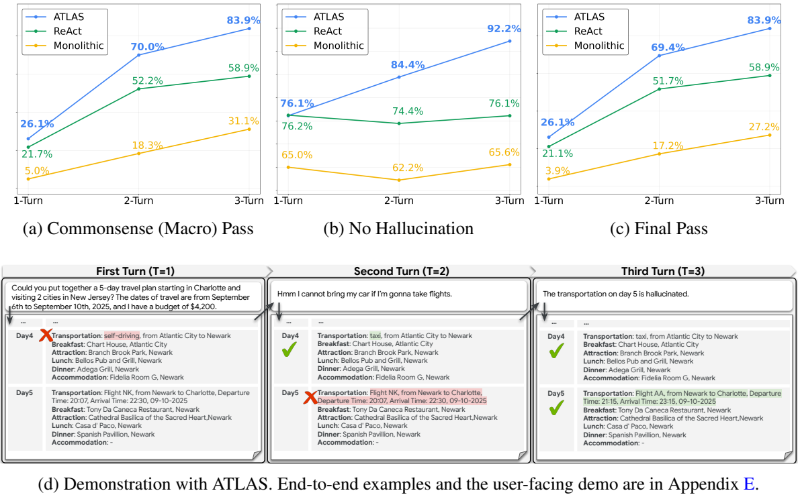

**图 4. 结合多轮反馈的实时旅行规划。（a）常识约束宏观通过率；（b）无幻觉率；（c）最终通过率；（d）ATLAS 演示。完整结果见表 7，端到端示例和用户界面演示见附录 E。**

> 图 4d 中的用户要求为：2025 年 9 月 6—10 日，从 Charlotte 出发前往 New Jersey 两座城市，五日预算 4200 美元。首轮计划混用了航班与自驾；用户反馈“如果乘飞机，我就无法带上自己的汽车”，第二轮将城市间自驾改为出租车。用户再指出“第五天交通信息是虚构的”，第三轮修正了返程航班。图中其余餐厅、景点与住宿专名保留原文。

**结果。** 图 4 证实多智能体方法的必要性：单体智能体通过率明显更低、幻觉更多。与前述沙盒不同，ReAct 与 ATLAS 的初始差距较小。我们认为原因是环境性质不同：原基准的稀疏沙盒测试智能体处理信息缺口、发现单一隐藏解的能力；真实环境选项丰富，最初找到任意有效计划较容易，因此对高级搜索与修订能力的即时需求较低。

然而，在多轮交互中，用户反馈构成不断演化的约束，ATLAS 的优势逐渐显现。三轮后，其最终通过率从 26.1% 提高至 83.9%，而 ReAct、单体智能体分别停滞于 58.9% 与 27.2%。更重要的是，ATLAS 能有效利用反馈减少事实错误，使无幻觉率超过 92%；ReAct 则停在约 76%，无法利用反馈改善事实性。这说明，本框架能有效应对实时搜索下，动态多轮规划过程的约束变化与可靠性要求。

## 5. 结论

本文形式化了一般约束规划任务，并处理其三个根本挑战：动态管理完整的显式与隐式规则、通过迭代修订保证计划有效，以及通过自适应搜索弥补信息缺口。我们提出 ATLAS，由专门组件系统应对这些挑战。以高难度旅行规划为测试场景，ATLAS 在 TravelPlanner 及其多轮变体上取得最先进性能，并在真实网页环境与多轮反馈结合的高度现实设置中展现稳健表现。

**未来工作。** 本文为能够在复杂开放世界约束下运行的可靠智能体开辟了多个方向。虽然当前组件实现简单有效，未来可探索更先进模块，例如规划器结合并行测试时扩展以提高效率（Chen et al., 2025），或为检查器配备形式化 CSP 求解器，提高验证稳健性（Hao et al., 2025b）。除改进单独组件外，框架还可用于需要有事实依据、遵从约束的其他领域，例如在智能体护栏中落实隐私政策（Xiang et al., 2025），或建模个性化用户偏好（Jiang et al., 2025；Li et al., 2025）。

## References

Anthropic. System Card: Claude Opus 4 & Claude Sonnet 4. Anthropic, May 2025. URL https://www-cdn.anthropic.com/4263b940cabb546aa0e3283f35b686f4f3b2ff47.pdf. Accessed: August 25, 2025.

Christian Bessiere, Rémi Coletta, Barry O’Sullivan, and Myriam Paulin. Query-driven constraint acquisition. In Proceedings of IJCAI-07, pp. 50–55, 2007.

Sally C. Brailsford, Chris N. Potts, and Barbara M. Smith. Constraint satisfaction problems: Algorithms and applications. European Journal of Operational Research, 119(3):557–581, 1999a. ISSN 0377-2217. doi: https://doi.org/10.1016/S0377-2217(98)00364-6. URL https://www.sciencedirect.com/science/article/pii/S0377221798003646.

Sally C. Brailsford, Chris N. Potts, and Barbara M. Smith. Constraint satisfaction problems: Algorithms and applications. European Journal of Operational Research, 119(3):557–581, December 1999b. ISSN 03772217. doi: 10.1016/S0377-2217(98)00364-6.

Aili Chen, Xuyang Ge, Ziquan Fu, Yanghua Xiao, and Jiangjie Chen. TravelAgent: An AI Assistant for Personalized Travel Planning, September 2024. URL http://arxiv.org/abs/2409.08069. arXiv:2409.08069 [cs].

Jiefeng Chen, Jie Ren, Xinyun Chen, Chengrun Yang, Ruoxi Sun, and Sercan Ö Arık. SETS: Leveraging Self-Verification and Self-Correction for Improved Test-Time Scaling, February 2025.

Jihye Choi, Nils Palumbo, Prasad Chalasani, Matthew M Engelhard, Somesh Jha, Anivarya Kumar, and David Page. Malade: Orchestration of llm-powered agents with retrieval augmented generation for pharmacovigilance. In Machine Learning for Healthcare Conference. PMLR, 2024.

Gheorghe Comanici, Eric Bieber, Mike Schaekermann, Ice Pasupat, Noveen Sachdeva, Inderjit Dhillon, Marcel Blistein, Ori Ram, Dan Zhang, Evan Rosen, et al. Gemini 2.5: Pushing the frontier with advanced reasoning, multimodality, long context, and next generation agentic capabilities. arXiv preprint arXiv:2507.06261, 2025.

Rina Dechter. Constraint Processing. Morgan Kaufmann Publishers Inc., San Francisco, CA, USA, 2003. ISBN 1558608907.

Rina Dechter and Avi Dechter. Belief maintenance in dynamic constraint networks. In Proceedings of the Seventh AAAI National Conference on Artificial Intelligence, AAAI’88, pp. 37–42. AAAI Press, 1988.

George Ferguson, James Allen, and Brad Miller. Trains-95: Towards a mixed-initiative planning assistant. In Proceedings of AIPS-96, pp. 70–77, 1996.

Richard E. Fikes and Nils J. Nilsson. Strips: A new approach to the application of theorem proving to problem solving. Artificial Intelligence, 2(3):189–208, 1971. ISSN 0004-3702. doi: 10.1016/0004-3702(71)90010-5.

Maria Fox and Derek Long. Pddl2.1: An extension to PDDL for expressing temporal planning domains. Journal of Artificial Intelligence Research, 20:61–124, 2003.

Eugene C Freuder and Richard J Wallace. Suggestion strategies for constraint-based matchmaker agents. In International Conference on Principles and Practice of Constraint Programming, pp. 192–204. Springer, 1998.

Boyu Gou, Zanming Huang, Yuting Ning, Yu Gu, Michael Lin, Weijian Qi, Andrei Kopanev, Botao Yu, Bernal Jiménez Gutiérrez, Yiheng Shu, et al. Mind2web 2: Evaluating agentic search with agent-as-a-judge. arXiv preprint arXiv:2506.21506, 2025.

Zhibin Gou, Zhihong Shao, Yeyun Gong, yelong shen, Yujiu Yang, Nan Duan, and Weizhu Chen. CRITIC: Large language models can self-correct with tool-interactive critiquing. In The Twelfth International Conference on Learning Representations, 2024. URL https://openreview.net/forum?id=Sx038qxjek.

Atharva Gundawar, Mudit Verma, Lin Guan, Karthik Valmeekam, Siddhant Bhambri, and Subbarao Kambhampati. Robust Planning with LLM-Modulo Framework: Case Study in Travel Planning, May 2024.

Yilun Hao, Yongchao Chen, Yang Zhang, and Chuchu Fan. Large Language Models Can Solve Real-World Planning Rigorously with Formal Verification Tools, January 2025a.

Yilun Hao, Yang Zhang, and Chuchu Fan. Planning anything with rigor: General-purpose zero-shot planning with llm-based formalized programming. In The Thirteenth International Conference on Learning Representations, 2025b.

Marti A. Hearst. Mixed-initiative interaction. IEEE Intelligent Systems, 14(5):14–23, 1999.

Keith J Holyoak and Dan Simon. Bidirectional reasoning in decision making by constraint satisfaction. Journal of Experimental Psychology: General, 128(1):3, 1999.

Richard Howey, Derek Long, and Maria Fox. VAL: Automatic plan validation, continuous effects and mixed initiative planning using PDDL. In Proceedings of the 16th IEEE International Conference on Tools with Artificial Intelligence (ICTAI), pp. 294–301, 2004.

Mete Ismayilzada, Debjit Paul, Syrielle Montariol, Mor Geva, and Antoine Bosselut. CRoW: Benchmarking commonsense reasoning in real-world tasks. In Houda Bouamor, Juan Pino, and Kalika Bali (eds.), Proceedings of the 2023 Conference on Empirical Methods in Natural Language Processing, pp. 9785–9821, Singapore, December 2023. Association for Computational Linguistics. doi: 10.18653/v1/2023.emnlp-main.607. URL https://aclanthology.org/2023.emnlp-main.607/.

Bowen Jiang, Zhuoqun Hao, Young-Min Cho, Bryan Li, Yuan Yuan, Sihao Chen, Lyle Ungar, Camillo J Taylor, and Dan Roth. Know me, respond to me: Benchmarking llms for dynamic user profiling and personalized responses at scale. arXiv preprint arXiv:2504.14225, 2025.

Subbarao Kambhampati, Karthik Valmeekam, Lin Guan, Mudit Verma, Kaya Stechly, Siddhant Bhambri, Lucas Paul Saldyt, and Anil B. Murthy. Position: LLMs can’t plan, but can help planning in LLM-modulo frameworks. In Proceedings of ICML 2024 (PMLR Vol. 235), pp. 22895–22907, 2024.

Stefanie Krause and Frieder Stolzenburg. Commonsense reasoning and explainable artificial intelligence using large language models. In European Conference on Artificial Intelligence, pp. 302–319. Springer, 2023.

Kuang-Huei Lee, Ian Fischer, Yueh-Hua Wu, Dave Marwood, Shumeet Baluja, Dale Schuurmans, and Xinyun Chen. Evolving Deeper LLM Thinking, January 2025.

Hao Li, Chenghao Yang, An Zhang, Yang Deng, Xiang Wang, and Tat-Seng Chua. Hello again! llm-powered personalized agent for long-term dialogue. In Proceedings of the 2025 Conference of the Nations of the Americas Chapter of the Association for Computational Linguistics: Human Language Technologies (Volume 1: Long Papers), pp. 5259–5276, 2025.

Zhengdong Lu, Weikai Lu, Yiling Tao, Yun Dai, ZiXuan Chen, Huiping Zhuang, Cen Chen, Hao Peng, and Ziqian Zeng. Decompose, plan in parallel, and merge: A novel paradigm for large language models based planning with multiple constraints. arXiv preprint arXiv:2506.02683, 2025.

Alan K. Mackworth. Consistency in networks of relations. Artificial Intelligence, 8(1):99–118, 1977. ISSN 0004-3702. doi: 10.1016/0004-3702(77)90007-8.

Sanjay Mittal and Brian Falkenhainer. 1990-Dynamic Constraint Satisfaction Problems.

Reiichiro Nakano, Jacob Hilton, Suchir Balaji, Jeff Wu, Long Ouyang, Christina Kim, Christopher Hesse, Shantanu Jain, Vineet Kosaraju, William Saunders, et al. Webgpt: Browser-assisted question-answering with human feedback. arXiv preprint arXiv:2112.09332, 2021.

Juhyun Oh, Eunsu Kim, and Alice Oh. Flex-TravelPlanner: A Benchmark for Flexible Planning with Language Agents, June 2025.

Mihir Parmar, Xin Liu, Palash Goyal, Yanfei Chen, Long Le, Swaroop Mishra, Hossein Mobahi, Jindong Gu, Zifeng Wang, Hootan Nakhost, Chitta Baral, Chen-Yu Lee, Tomas Pfister, and Hamid Palangi. PlanGEN: A Multi-Agent Framework for Generating Planning and Reasoning Trajectories for Complex Problem Solving, February 2025.

Ronald P. A. Petrick and Fahiem Bacchus. A knowledge-based approach to planning with incomplete information and sensing. In Proceedings of AIPS-02, pp. 212–222, 2002.

Ronald P. A. Petrick and Fahiem Bacchus. Extending the knowledge-based approach to planning with incomplete information and sensing. In Proceedings of ICAPS-04, 2004.

Francesca Rossi and Allesandro Sperduti. Acquiring both constraint and solution preferences in interactive constraint systems. Constraints, 9(4):311–332, 2004.

Timo Schick, Jane Dwivedi-Yu, Roberto Dessì, Roberta Raileanu, Maria Lomeli, Eric Hambro, Luke Zettlemoyer, Nicola Cancedda, and Thomas Scialom. Toolformer: Language models can teach themselves to use tools. Advances in Neural Information Processing Systems, 36:68539–68551, 2023.

Noah Shinn, Federico Cassano, Ashwin Gopinath, Karthik Narasimhan, and Shunyu Yao. Reflexion: Language agents with verbal reinforcement learning. Advances in Neural Information Processing Systems, 36:8634–8652, 2023.

Harmanpreet Singh, Nikhil Verma, Yixiao Wang, Manasa Bharadwaj, Homa Fashandi, Kevin Ferreira, and Chul Lee. Personal Large Language Model Agents: A Case Study on Tailored Travel Planning. In Franck Dernoncourt, Daniel Preoţiuc-Pietro, and Anastasia Shimorina (eds.), Proceedings of the 2024 Conference on Empirical Methods in Natural Language Processing: Industry Track, pp. 486–514, Miami, Florida, US, November 2024. Association for Computational Linguistics. doi: 10.18653/v1/2024.emnlp-industry.37.

Karthik Valmeekam, Matthew Marquez, Alberto Olmo, Sarath Sreedharan, and Subbarao Kambhampati. On the planning abilities of large language models: A critical investigation. In Proceedings of NeurIPS 2023, 2023.

Junde Wu, Jiayuan Zhu, Yuyuan Liu, Min Xu, and Yueming Jin. Agentic reasoning: A streamlined framework for enhancing LLM reasoning with agentic tools. In Wanxiang Che, Joyce Nabende, Ekaterina Shutova, and Mohammad Taher Pilehvar (eds.), Proceedings of the 63rd Annual Meeting of the Association for Computational Linguistics (Volume 1: Long Papers), pp. 28489–28503, Vienna, Austria, July 2025. Association for Computational Linguistics. ISBN 979-8-89176-251-0. doi: 10.18653/v1/2025.acl-long.1383. URL https://aclanthology.org/2025.acl-long.1383/.

Zhen Xiang, Linzhi Zheng, Yanjie Li, Junyuan Hong, Qinbin Li, Han Xie, Jiawei Zhang, Zidi Xiong, Chulin Xie, Carl Yang, Dawn Song, and Bo Li. GuardAgent: Safeguard LLM Agents by a Guard Agent via Knowledge-Enabled Reasoning, May 2025.

Chengxing Xie and Difan Zou. A Human-Like Reasoning Framework for Multi-Phases Planning Task with Large Language Models, May 2024.

Jian Xie, Kai Zhang, Jiangjie Chen, Tinghui Zhu, Renze Lou, Yuandong Tian, Yanghua Xiao, and Yu Su. TravelPlanner: A Benchmark for Real-World Planning with Language Agents, October 2024.

Jian Xie, Kexun Zhang, Jiangjie Chen, Siyu Yuan, Kai Zhang, Yikai Zhang, Lei Li, and Yanghua Xiao. Revealing the Barriers of Language Agents in Planning. In Luis Chiruzzo, Alan Ritter, and Lu Wang (eds.), Proceedings of the 2025 Conference of the Nations of the Americas Chapter of the Association for Computational Linguistics: Human Language Technologies (Volume 1: Long Papers), pp. 1872–1888, Albuquerque, New Mexico, April 2025. Association for Computational Linguistics. ISBN 979-8-89176-189-6.

Shunyu Yao, Jeffrey Zhao, Dian Yu, Nan Du, Izhak Shafran, Karthik Narasimhan, and Yuan Cao. ReAct: Synergizing Reasoning and Acting in Language Models. arXiv, March 2023. doi: 10.48550/arXiv.2210.03629.

Siyu Yuan, Kaitao Song, Jiangjie Chen, Xu Tan, Dongsheng Li, and Deqing Yang. EvoAgent: Towards Automatic Multi-Agent Generation via Evolutionary Algorithms, March 2025.

Cong Zhang, Xin Deik Goh, Dexun Li, Hao Zhang, and Yong Liu. Planning with Multi-Constraints via Collaborative Language Agents. In Owen Rambow, Leo Wanner, Marianna Apidianaki, Hend Al-Khalifa, Barbara Di Eugenio, and Steven Schockaert (eds.), Proceedings of the 31st International Conference on Computational Linguistics, pp. 10054–10082, Abu Dhabi, UAE, January 2025. Association for Computational Linguistics.

Zirui Zhao, Wee Sun Lee, and David Hsu. Large language models as commonsense knowledge for large-scale task planning. Advances in neural information processing systems, 36:31967–31987, 2023.

Huaixiu Steven Zheng, Swaroop Mishra, Hugh Zhang, Xinyun Chen, Minmin Chen, Azade Nova, Le Hou, Heng-Tze Cheng, Quoc V. Le, Ed H. Chi, and Denny Zhou. NATURAL PLAN: Benchmarking LLMs on Natural Language Planning, June 2024.

# 附录

## A. 扩展相关工作

**约束问答。** 约束问答是经典规划问题：系统需要将自然语言查询转化为变量、选项和关系，再寻找满足目标的可行赋值。近期 LLM 研究通过多种方式增强这一能力，包括利用采样、自我验证和修订强化推理的测试时方案（Lee et al., 2025；Chen et al., 2025）；将 LLM 与外部验证器／求解器配合的 LLM-modulo 范式（Kambhampati et al., 2024；Gundawar et al., 2024）；以及通过角色分工与迭代验证增强规划的多智能体协调（Parmar et al., 2025）。

不过，这些研究大多假定只需进行规划，即全部必要信息已预先具备（Zheng et al., 2024）。它们专注改进规划能力本身，而非获取必要上下文这一关键现实挑战；这些上下文通常超出了 LLM 的内部知识。

**实际规划中的搜索挑战。** 旅行规划等真实任务，需要同时搜索航班、酒店等可行选项，并将它们组合为满足约束的计划。TravelPlanner（Xie et al., 2024）提供工具与数百万条记录构成的真实感沙盒，测试这种综合能力，也揭示了任务难度：即便 GPT-4-Turbo 等强模型，最终通过率也接近零。多智能体框架虽有所改善，整体性能仍有限，报告的最终通过率往往只有个位数百分比（Xie & Zou, 2024；Yuan et al., 2025），即使在较简单子集上，也很少超过 33%（Zhang et al., 2025）。

**现有方法的局限。** 最近有研究在该设置下取得高得多的分数，例如基于可满足性模理论的方法，以 GPT-4 达到 93.9%（Hao et al., 2025a）。但这一结果依赖将基准特定的全部约束与评估指标先验知识，例如局部约束，预先写入求解器。实际开放世界发现任务中并无这些知识，智能体必须动态地从不同来源提取、协调约束。

此外，现有研究很少在真正现实的设置中评估。既有方法通常局限于沙盒，不考虑实时信息搜索或多轮用户交互。Flex-TravelPlanner（Oh et al., 2025）等新基准虽提供动态多轮约束，仍运行于沙盒，重点探索纯规划性能。如何结合实时搜索进行约束感知规划，这一关键问题仍基本未解决。

**本文定位。** 为此，我们提出通用多智能体框架弥补上述不足。在不依赖约束先验知识的条件下，本文在复杂规划任务中取得可靠表现，并首次在实时信息搜索与多轮对话反馈结合的高度实际设置中验证方法，表明其能有效扩展，以满足真实旅行规划需求。

## B. 与经典规划及 CSP 文献的联系

ATLAS 应对的挑战，是经典人工智能中已有充分研究的问题在现代场景中的体现，尤其涉及自动规划和 CSP。下面说明三个核心挑战与这些基础文献的联系。

**挑战 1：约束构建。** 识别完整的隐式、显式约束，对应经典的知识获取瓶颈。在 CSP 文献中，这称为约束获取，研究如何学习或询问初始问题定义中未明确表达的缺失约束。早期系统通过交互方式从用户获得约束，后续研究则发展了从示例或交互中自动学习约束的技术。这类似 ATLAS 从自然语言查询和搜索结果推断规则（Freuder & Wallace, 1998；Bessiere et al., 2007；Rossi & Sperduti, 2004）。

**挑战 2：约束感知规划。** 生成可验证遵从全部已知规则的有效计划，遵循自动规划中长期存在的原则。经典系统经常严格分离计划综合器，即生成器，与计划验证器，即检查器。计划生成后，根据世界模型与一组规则进行形式验证，规则通常用 PDDL 等语言表达（Fox & Long, 2003；Howey et al., 2004）。本文规划器—验证器结构直接采用这一稳健的“先生成、再检验”范式；该技术也正被用于提升现代 LLM 的可靠性与合规性（Gou et al., 2024；Choi et al., 2024）。

**挑战 3：弥补信息缺口。** 此挑战处理信息不足而非逻辑错误导致的失败。它是部分可观测环境下经典规划的核心问题：智能体必须交替执行规划与感知动作，在继续之前收集新世界信息（Petrick & Bacchus, 2002；2004）。这一思想也推动了混合主动式系统的发展，其有效方式是在提出部分计划与获取缺失事实之间交替，且通常有人类用户参与（Ferguson et al., 1996；Hearst, 1999）。ATLAS 的自适应交错搜索直接实现这一原则，使智能体能够在运行过程中诊断、解决信息缺口。

## C. ATLAS 的补充说明

**表 3. ATLAS 中各智能体的带类型函数签名。$P^{t,\ell}$ 是 CSP 实例 $\langle X,D^{t,\ell},C^{t,\ell}\rangle$ 的简写。下标／上标索引 $t,\ell,k$ 分别代表对话轮次、交错搜索步骤，以及规划器—检查器交互步骤。**

| 函数／智能体 | 输入类型 | 输出类型 | 作用 |
|---|---|---|---|
| Search | $Q^t,F_{\mathrm{search}}^{t,\ell-1}$ | $D^{t,\ell}$ | 工具交互与取值域构建 |
| Constrain | $Q^t,D^{t,\ell}$ | $C^{t,\ell}$ | 识别显式、隐式约束 |
| Plan | $P^{t,\ell},\{(\sigma^{t,\ell,i},F_{\mathrm{plan}}^{t,\ell,i})\}_{i=1}^{k-1}$ | $\sigma^{t,\ell,k}$ | 提出候选计划 |
| Check | $Q^t,P^{t,\ell},\sigma^{t,\ell,k}$ | $V^{t,\ell,k},F_{\mathrm{plan}}^{t,\ell,k}$ | 验证计划，反馈违规情况 |
| SearchAdvise | $Q^t,P^{t,\ell},\{(\sigma^{t,\ell,i},F_{\mathrm{plan}}^{t,\ell,i})\}_{i=1}^{k}$ | $F_{\mathrm{search}}^{t,\ell}$ | 诊断不可满足性，建议新的搜索 |

算法 1 给出 ATLAS 的算法概览。

**算法 1. 使用 ATLAS 进行多轮旅行规划。**

```text
输入：用户查询序列 {Q^1, ..., Q^T}；最大循环次数 (L, K)

 1: D_cache ← ∅                           ▷ 初始化取值域记忆
 2: 对 t = 1, ..., T：                    ▷ 遍历对话轮次
 3:   D^(t,1) ← D_cache                   ▷ 从上一轮缓存域开始
 4:   对 ℓ = 1, ..., L：                  ▷ 交错搜索循环
 5:     C^(t,ℓ) ← Constrain(Q^t, D^(t,ℓ))
 6:     P^(t,ℓ) ← ⟨X, D^(t,ℓ), C^(t,ℓ)⟩
 7:     history_plan ← []
 8:     V ← invalid                       ▷ 初始化本次搜索循环的判定
 9:     对 k = 1, ..., K：                ▷ 内层规划与检查循环
10:       σ ← Plan(P^(t,ℓ), history_plan)
11:       (V, F_plan) ← Check(Q^t, P^(t,ℓ), σ)
12:       history_plan.append((σ, F_plan))
13:       若 V = valid：
14:         D_cache ← D^(t,ℓ)             ▷ 将成功使用的域写入记忆
15:         跳出循环                      ▷ 结束本轮内外循环
16:       否则，若 V = unsat：
17:         跳出内层循环                  ▷ 触发新搜索
18:       结束条件判断
19:     结束内层循环
20:     若 V = valid：
21:       输出解 σ，进入下一轮对话
22:       跳出循环
23:     否则：                            ▷ 未找到解，诊断失败以指导下一次搜索
24:       F_search ← SearchAdvise(Q^t, P^(t,ℓ), history_plan)
25:       D^(t,ℓ+1) ← Search(Q^t, F_search)
                                          ▷ 获取下一次迭代使用的新域
26:     结束条件判断
27:   结束外层搜索循环
28: 结束对话循环
```

## D. 补充实验

### D.1. 实验设置的补充细节

**TravelPlanner（Xie et al., 2024）。** 基准的验证集包含 180 条查询，测试集包含 1000 条。每条查询给出旅行时长、预算、菜系偏好等显式要求，定义最终计划必须满足的约束。约束分为：（i）硬约束，直接来自查询的严格规则，例如不超预算、包含指定菜系；（ii）常识约束，基于隐含实际逻辑，例如在给定旅行时长内安排合理路线，或将某日活动安排在同一城市。

基准提供包含住宿、餐厅和交通等信息的沙盒环境，智能体应在沙盒内搜索与查询相关的信息。表 4 详细说明各类约束。

**表 4. 所考虑约束的说明。**

| 图中标注 | 描述 |
|---|---|
| **常识约束** | |
| 交通方式冲突（Conflicting Transportations） | 行程中的交通选择应合理，例如同时采用自驾和航班会被视为冲突。 |
| 信息不完整（Incomplete Information） | 计划不得遗漏住宿等关键信息。 |
| 城市路线不合理（Unreasonable City Route） | 行程中的城市变化必须合理。 |
| 少于最低入住晚数（< Minimum Nights Stay） | 在同一住宿连续停留的天数，必须满足其最低入住晚数要求。 |
| 餐厅重复（Repeated Restaurants） | 整个行程不得重复选择餐厅。 |
| 虚构细节（Hallucinated Details） | 计划中的全部信息必须来自封闭沙盒，否则视为幻觉。 |
| 超出当前城市（Outside the Current City） | 某日全部活动应位于当天所在城市之内。 |
| **硬约束** | |
| 无法有效评估（Eval unqualified） | 部分细节缺失或被虚构，因此检查硬约束没有意义。 |
| 超出预算（Budget exceeded） | 行程总预算。 |
| 菜系（Cuisine） | 包括中餐、美式、意大利、墨西哥、印度、地中海和法国菜。 |
| 住宿规则（Room Rule） | 包括禁止聚会、禁止吸烟、禁止 10 岁以下儿童、禁止宠物、禁止访客。 |
| 房型（Room Type） | 包括整间房（Entire Room）、独立房间（Private Room）、合住房间（Shared Room）及不合住（No Shared Room）。 |

**结合实时搜索的 TravelPlanner。** 为评估真实开放域性能，我们保留验证集查询，将基准中静态沙盒的住宿、航班、餐厅和景点数据，替换为实时 Google 搜索工具。因此需要修改原数据中一些不现实的约束。例如，“独立房间”等房型属性和“禁止聚会”等住宿规则，通常无法通过真实搜索获得。因此，我们从信息收集提示词和最终评估标准中排除这些特定约束，以保证现实条件下的公平评估。

**实时搜索中的新增评估指标。** 实时搜索引入沙盒中没有的挑战：搜索智能体可能虚构搜索结果。因此，除沙盒指标外，再引入无幻觉率，衡量全部旅行细节来自未被虚构搜索结果的计划数，占全部尝试计划数的比例。

为此，要求搜索智能体按结构化格式输出检索信息，其航班、住宿、餐厅和景点格式与沙盒完全一致。随后，使用相同基座模型构建独立 LLM 评判器，验证最终计划中的每项旅行细节是否真实存在于网页上。

### D.2. 消融研究的详细结果

**表 5. ATLAS 关键组件的消融。使用 Gemini-2.5-Pro，在 TravelPlanner 验证集上评估。数值单位为 %。**

**（a）有无约束管理器的比较，采用 5 次检查和 10 次交错搜索。**

| 设置 | 交付率↑ | 常识：微观↑ | 常识：宏观↑ | 硬约束：微观↑ | 硬约束：宏观↑ | 最终通过率↑ |
| --- | --- | --- | --- | --- | --- | --- |
| 无约束管理器 | 100.00 | 86.41 | 41.67 | 73.21 | 60.00 | 30.00 |
| 有约束管理器 | 100.00 | 88.54 | 48.33 | 82.62 | 74.44 | 44.44 |

**（b）改变检查器的最大验证步数。基线是 ReAct 顺序先搜索、再规划。**

| 设置 | 交付率↑ | 常识：微观↑ | 常识：宏观↑ | 硬约束：微观↑ | 硬约束：宏观↑ | 最终通过率↑ |
| --- | --- | --- | --- | --- | --- | --- |
| 基线 | 95.56 | 77.36 | 26.11 | 47.14 | 38.89 | 17.78 |
| 增加 1 步 | 100.00 | 85.42 | 42.22 | 64.76 | 53.33 | 29.44 |
| 增加 3 步 | 100.00 | 84.79 | 40.00 | 73.81 | 61.67 | 31.11 |
| 增加 5 步 | 100.00 | 84.65 | 40.00 | 68.33 | 58.89 | 32.22 |

**（c）改变交错搜索步数。基线为每次搜索后增加三次评判的 ReAct。**

| 设置 | 交付率↑ | 常识：微观↑ | 常识：宏观↑ | 硬约束：微观↑ | 硬约束：宏观↑ | 最终通过率↑ |
| --- | --- | --- | --- | --- | --- | --- |
| 基线 | 100.00 | 84.79 | 40.00 | 73.81 | 61.67 | 31.11 |
| 增加 1 步 | 100.00 | 86.81 | 45.56 | 80.71 | 71.67 | 40.56 |
| 增加 3 步 | 100.00 | 87.57 | 46.11 | 87.57 | 73.33 | 42.78 |
| 增加 5 步 | 100.00 | 88.12 | 47.78 | 84.76 | 76.67 | 44.44 |

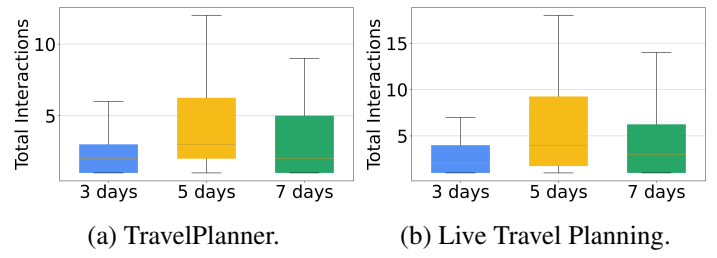

**图 5. 检查步骤总数的分布。（a）TravelPlanner；（b）实时旅行规划。每次搜索最多三次评判，并允许额外 10 次交错搜索。**

图 5 显示，即使允许较高交互上限，即 33 步，ATLAS 也能在规划器与检查器总交互不超过 15 次时解决大多数案例，说明通常可在耗尽上限前高效找到有效解。基于这些趋势，在真实部署中有策略地调整超参数，对于平衡性能与成本至关重要。

### D.3. 多轮旅行规划的完整结果

**Flex-TravelPlanner。** 除表 2 外，表 6 提供该基准的详细结果。

**表 6. ATLAS 在 Flex-TravelPlanner 基准上的结果。↑ 表示越高越好，数值单位为 %。**

| 轮数／类别 | 新增约束（样本数） | 方法 | 交付率↑ | 常识：微观↑ | 常识：宏观↑ | 硬约束：微观↑ | 硬约束：宏观↑ | 最终通过率↑ |
| --- | --- | --- | --- | --- | --- | --- | --- | --- |
| 两轮：局部 | 菜系（48） | ReAct | 100.00 | 79.43 | 31.25 | 70.95 | 47.92 | 22.92 |
| 两轮：局部 | 菜系（48） | ATLAS | 100.00 | 85.42 | 41.67 | 85.81 | 75.00 | 35.42 |
| 两轮：局部 | 住宿规则（77） | ReAct | 100.00 | 87.66 | 48.85 | 64.55 | 36.36 | 29.87 |
| 两轮：局部 | 住宿规则（77） | ATLAS | 100.00 | 89.29 | 51.95 | 66.79 | 53.25 | 38.96 |
| 两轮：局部 | 房型（64） | ReAct | 100.00 | 90.43 | 53.12 | 66.36 | 46.88 | 35.94 |
| 两轮：局部 | 房型（64） | ATLAS | 100.00 | 89.06 | 48.44 | 79.09 | 65.62 | 42.19 |
| 两轮：全局 | 人数（120） | ReAct | 100.00 | 86.35 | 42.50 | 70.00 | 51.67 | 25.83 |
| 两轮：全局 | 人数（120） | ATLAS | 100.00 | 87.50 | 50.83 | 77.50 | 65.83 | 41.67 |
| 两轮：全局 | 预算（120） | ReAct | 100.00 | 85.00 | 37.50 | 66.67 | 51.67 | 26.67 |
| 两轮：全局 | 预算（120） | ATLAS | 100.00 | 87.60 | 46.67 | 74.44 | 62.50 | 37.50 |
| 三轮 | 先局部、后全局（378） | ReAct | 100.00 | 83.70 | 33.07 | 59.59 | 36.51 | 15.34 |
| 三轮 | 先局部、后全局（378） | ATLAS | 100.00 | 87.96 | 49.21 | 73.58 | 53.97 | 33.60 |
| 三轮 | 先全局、后局部（378） | ReAct | 100.00 | 84.06 | 32.80 | 59.43 | 36.24 | 17.20 |
| 三轮 | 先全局、后局部（378） | ATLAS | 100.00 | 86.81 | 47.09 | 71.38 | 52.12 | 31.75 |

**结合实时搜索的多轮旅行规划。** 除图 4 外，表 7 给出全部指标的完整结果。

**表 7. 实时旅行规划中的 ATLAS 多轮反馈。+1 轮和 +2 轮表示在初始轮之后增加反馈轮次。↑ 表示越高越好，数值单位为 %。**

| 方法 | 反馈设置 | 交付率↑ | 常识：微观↑ | 常识：宏观↑ | 硬约束：微观↑ | 硬约束：宏观↑ | 无幻觉率↑ | 最终通过率↑ |
| --- | --- | --- | --- | --- | --- | --- | --- | --- |
| 单体智能体 | 初始轮 | 81.11 | 61.60 | 5.00 | 10.04 | 10.00 | 65.00 | 3.89 |
| 单体智能体 | 增加 1 轮 | 85.56 | 72.29 | 18.33 | 22.58 | 22.78 | 62.22 | 17.22 |
| 单体智能体 | 增加 2 轮 | 90.00 | 79.79 | 31.11 | 29.75 | 27.78 | 65.56 | 27.22 |
| ReAct | 初始轮 | 100.00 | 80.28 | 21.67 | 50.54 | 51.67 | 76.22 | 21.11 |
| ReAct | 增加 1 轮 | 100.00 | 91.18 | 52.22 | 62.01 | 62.78 | 74.44 | 51.67 |
| ReAct | 增加 2 轮 | 99.44 | 92.15 | 58.89 | 67.38 | 67.22 | 76.11 | 58.89 |
| ATLAS | 初始轮 | 100.00 | 82.08 | 26.11 | 64.87 | 62.78 | 76.11 | 26.11 |
| ATLAS | 增加 1 轮 | 100.00 | 94.79 | 70.0 | 77.06 | 75.56 | 84.44 | 69.44 |
| ATLAS | 增加 2 轮 | 100.00 | 96.81 | 83.89 | 86.38 | 86.11 | 92.22 | 83.89 |

### D.4. 有无基准特定的非常规约束的比较

除图 6 外，表 8 提供全部评估指标的完整结果。

**表 8. 比较是否将基准特定的非常规要求直接提供给约束管理器。↑ 表示越高越好，数值单位为 %。**

| 基座模型 | 约束管理器 | 交付率↑ | 常识：微观↑ | 常识：宏观↑ | 硬约束：微观↑ | 硬约束：宏观↑ | 最终通过率↑ |
| --- | --- | --- | --- | --- | --- | --- | --- |
| Gemini-2.5-Pro | 不提供额外提示 | 100.00 | 88.54 | 48.33 | 82.62 | 74.44 | 44.44 |
| Gemini-2.5-Pro | 提供额外提示 | 100.00 | 93.61 | 70.56 | 79.29 | 71.11 | 59.44 |
| Claude-Sonnet-4 | 不提供额外提示 | 100.00 | 83.40 | 37.78 | 56.43 | 38.89 | 23.33 |
| Claude-Sonnet-4 | 提供额外提示 | 100.00 | 85.42 | 48.33 | 60.71 | 47.22 | 33.33 |

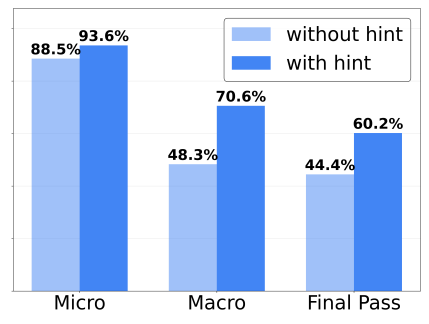

**图 6. 将两条基准特定规则作为约束提供给约束管理器，可以进一步改善性能，展示框架有效利用显式指导的能力。**

### D.5. ATLAS 失败分析

**TravelPlanner。** 约束失败分析体现了 ATLAS 的有效性与剩余错误的性质，见图 7。与最简单的 $K=L=0$ 基线相比，ATLAS 大幅减少各类失败，尤其善于消除幻觉、补充必要细节，见图 7a 与 7b 的浅绿、绿色柱。它对搜索结果中发现的约束执行效果较好，例如住宿最低入住晚数相关失败从 33 次减少到 4 次。这归功于约束管理器，它同时根据用户查询和检索数据推理、识别新出现的规则。

尽管有所改善，“交通方式冲突”和“餐厅重复”仍然突出。这些规则具有基准特殊性，Zhang et al.（2025）称其为非常规提示，未必符合实际做法，例如用户不能两次去同一家餐厅，或不能混用航班与自驾。沿用 Zhang et al.（2025）将这些规则作为额外提示提供给规划器的做法，我们将其作为显式约束提供给约束管理器。

这一改动使图 6 的最终通过率从约 44% 提高至约 60%。图 7c 的对应分析证实，这两类错误基本被消除；剩余错误主要来自基座模型固有推理局限，例如规划不合理城市路线，或仍虚构部分细节。这表明，ATLAS 能有效确保约束遵从，将表现推向基座模型能力的上限。

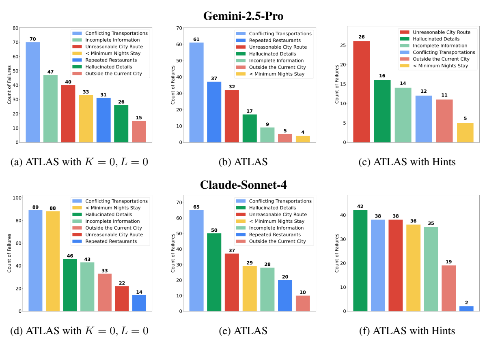

**图 7. 常识约束失败分类。图中展示错误逐步减少的过程：（a）无检查交互或交错搜索的 ATLAS，即 ReAct；（b）$K=3,L=10$ 的 ATLAS；（c）依照 Zhang et al.（2025）额外提供基准特定约束的 ATLAS。结果来自 TravelPlanner 验证集，上行为 Gemini-2.5-Pro，下行为 Claude-Sonnet-4；下排（d）、（e）、（f）对应同样三种设置。**

**结合实时搜索的多轮旅行规划。** 我们分析各方法如何处理前一轮失败。图 8 显示，餐厅重复、交通方式冲突等简单违规，即浅蓝与蓝色柱，所有方法都容易修复，因为实时搜索提供了近乎无限的替代选项。

但复杂失败体现了关键差异。单体智能体持续未能真正搜索有事实依据的上下文，而主要依赖内部知识，见图 8a 绿色柱。ReAct 虽然通过搜索获取并呈现上下文，行程中仍会虚构细节，即使明确反馈也未有效解决，见图 8b 紫色柱。相比之下，ATLAS 能使计划扎根搜索结果，并在多轮中遵守用户反馈带来的动态约束。

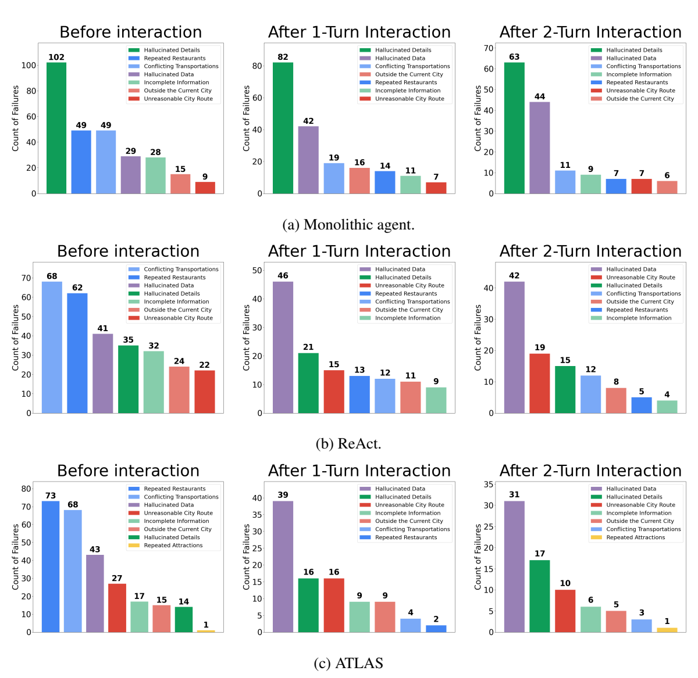

**图 8. 实时旅行规划中的常识约束失败类型。（a）单体智能体；（b）ReAct；（c）ATLAS。**

> 图 5 至图 8 中，Before interaction 表示交互前；After 1／2 turn interaction 表示经过 1／2 轮交互；with／without hints 表示有／无额外提示。各类错误名称译文见表 4。

### D.6. 旅行天数与难度的消融

**表 9. 旅行天数消融。在 TravelPlanner 验证集上，将 ATLAS 与基线比较，每个天数子集包含 60 个实例。↑ 表示越高越好，数值单位为 %。**

| 基座模型 | 子集 | 方法 | 交付率↑ | 常识：微观↑ | 常识：宏观↑ | 硬约束：微观↑ | 硬约束：宏观↑ | 最终通过率↑ |
| --- | --- | --- | --- | --- | --- | --- | --- | --- |
| Gemini-2.5-Pro | 3 天 | ReAct | 100.00 | 94.38 | 65.00 | 67.86 | 51.67 | 45.00 |
| Gemini-2.5-Pro | 3 天 | ReAct+Reflexion | 100.00 | 93.12 | 66.67 | 77.86 | 68.33 | 53.33 |
| Gemini-2.5-Pro | 3 天 | ReAct+EvoAgent | 100.00 | 92.08 | 55.00 | 67.86 | 46.67 | 30.00 |
| Gemini-2.5-Pro | 3 天 | PMC | 100.00 | 96.04 | 71.67 | 82.86 | 70.00 | 51.67 |
| Gemini-2.5-Pro | 3 天 | ATLAS | 100.00 | 97.92 | 83.33 | 92.86 | 86.67 | 75.00 |
| Gemini-2.5-Pro | 5 天 | ReAct | 100.00 | 75.83 | 16.67 | 49.29 | 40.00 | 11.67 |
| Gemini-2.5-Pro | 5 天 | ReAct+Reflexion | 100.00 | 74.58 | 15.00 | 49.29 | 46.67 | 13.33 |
| Gemini-2.5-Pro | 5 天 | ReAct+EvoAgent | 100.00 | 71.88 | 10.00 | 45.71 | 31.67 | 3.33 |
| Gemini-2.5-Pro | 5 天 | PMC | 100.00 | 69.58 | 11.67 | 25.71 | 25.00 | 11.67 |
| Gemini-2.5-Pro | 5 天 | ATLAS | 100.00 | 85.42 | 33.33 | 77.86 | 70.00 | 31.67 |
| Gemini-2.5-Pro | 7 天 | ReAct | 98.33 | 73.54 | 15.00 | 51.43 | 48.33 | 11.67 |
| Gemini-2.5-Pro | 7 天 | ReAct+Reflexion | 100.00 | 69.58 | 0.00 | 50.71 | 35.00 | 0.00 |
| Gemini-2.5-Pro | 7 天 | ReAct+EvoAgent | 100.00 | 70.21 | 6.67 | 60.00 | 43.33 | 3.33 |
| Gemini-2.5-Pro | 7 天 | PMC | 100.00 | 70.42 | 8.33 | 21.43 | 16.67 | 6.67 |
| Gemini-2.5-Pro | 7 天 | ATLAS | 100.00 | 82.29 | 28.33 | 77.14 | 66.67 | 26.67 |
| Claude-Sonnet-4 | 3 天 | ReAct | 100.00 | 88.96 | 45.00 | 68.57 | 50.00 | 28.33 |
| Claude-Sonnet-4 | 3 天 | ReAct+Reflexion | 100.00 | 89.17 | 36.67 | 64.29 | 40.00 | 20.00 |
| Claude-Sonnet-4 | 3 天 | ReAct+EvoAgent | 100.00 | 86.67 | 28.33 | 43.57 | 31.67 | 18.33 |
| Claude-Sonnet-4 | 3 天 | PMC | 98.33 | 90.00 | 46.67 | 67.86 | 50.00 | 30.00 |
| Claude-Sonnet-4 | 3 天 | ATLAS | 100.00 | 95.62 | 73.33 | 76.43 | 56.67 | 46.67 |
| Claude-Sonnet-4 | 5 天 | ReAct | 100.00 | 73.12 | 6.67 | 44.29 | 35.00 | 3.33 |
| Claude-Sonnet-4 | 5 天 | ReAct+Reflexion | 98.33 | 71.25 | 15.00 | 41.43 | 25.00 | 8.33 |
| Claude-Sonnet-4 | 5 天 | ReAct+EvoAgent | 98.33 | 57.71 | 1.67 | 8.57 | 6.67 | 0.00 |
| Claude-Sonnet-4 | 5 天 | PMC | 93.33 | 70.42 | 11.67 | 19.29 | 15.00 | 6.67 |
| Claude-Sonnet-4 | 5 天 | ATLAS | 100.00 | 80.21 | 21.67 | 44.29 | 28.33 | 11.67 |
| Claude-Sonnet-4 | 7 天 | ReAct | 100.00 | 68.12 | 5.00 | 41.43 | 30.00 | 3.33 |
| Claude-Sonnet-4 | 7 天 | ReAct+Reflexion | 100.00 | 63.96 | 3.33 | 30.71 | 20.00 | 1.67 |
| Claude-Sonnet-4 | 7 天 | ReAct+EvoAgent | 98.33 | 56.67 | 0.00 | 5.00 | 3.33 | 0.00 |
| Claude-Sonnet-4 | 7 天 | PMC | 98.33 | 67.92 | 6.67 | 31.43 | 26.67 | 6.67 |
| Claude-Sonnet-4 | 7 天 | ATLAS | 100.00 | 74.38 | 18.33 | 48.57 | 31.67 | 11.67 |

有趣的是，表 10 中 ATLAS 在“困难”集合上比在“中等”集合上表现更好。调查发现，这与 TravelPlanner 的固有特性一致，并非 ATLAS 特有异常。例如，原 TravelPlanner 论文（Xie et al., 2024）表 4 中，无论两阶段还是纯规划设置，“中等”通过率经常低于“困难”。PMC（Zhang et al., 2025）表 3 也报告“中等”最终通过率比“困难”低约 8%。表 10 的 ReAct 同样如此，中等为 11.67%，困难为 21.67%。

解释这一反直觉现象的可能假设是：CSP 中约束复杂度与取值域规模，即搜索空间，存在权衡。

- **从简单到中等或困难。** 增加预算之外的约束，约束复杂度成为主导因素，使任务更难。
- **从中等到困难。** 虽然困难任务加入了更多约束，例如在中等约束之外再加交通偏好，但这些特定约束也成为强过滤器，显著裁剪可用搜索结果的取值域，减少干扰选项，使规划器更容易确定正确赋值。

确实，Xie et al.（2024）表 4 中，从中等到困难加入交通偏好约束后，交通相关指标通过率明显上升。例如“不冲突的交通”在两阶段设置中从 73.3% 升至 83.1%，在纯规划设置中从 56.5% 升至 87.5%。

**表 10. 任务难度消融。在 TravelPlanner 验证集上，将 ATLAS 与基线比较，每个难度子集包含 60 个实例。↑ 表示越高越好，数值单位为 %。**

| 基座模型 | 子集 | 方法 | 交付率↑ | 常识：微观↑ | 常识：宏观↑ | 硬约束：微观↑ | 硬约束：宏观↑ | 最终通过率↑ |
| --- | --- | --- | --- | --- | --- | --- | --- | --- |
| Gemini-2.5-Pro | 简单 | ReAct | 100.00 | 84.17 | 35.00 | 73.33 | 73.33 | 35.00 |
| Gemini-2.5-Pro | 简单 | ReAct+Reflexion | 100.00 | 78.96 | 30.00 | 61.67 | 61.67 | 28.33 |
| Gemini-2.5-Pro | 简单 | ReAct+EvoAgent | 100.00 | 76.04 | 16.67 | 55.00 | 55.00 | 15.00 |
| Gemini-2.5-Pro | 简单 | PMC | 100.00 | 82.08 | 38.33 | 46.67 | 46.67 | 35.00 |
| Gemini-2.5-Pro | 简单 | ATLAS | 100.00 | 87.50 | 45.00 | 83.33 | 83.33 | 43.33 |
| Gemini-2.5-Pro | 中等 | ReAct | 98.33 | 74.38 | 23.33 | 45.00 | 31.67 | 11.67 |
| Gemini-2.5-Pro | 中等 | ReAct+Reflexion | 100.00 | 73.54 | 21.67 | 50.83 | 43.33 | 18.33 |
| Gemini-2.5-Pro | 中等 | ReAct+EvoAgent | 100.00 | 72.71 | 18.33 | 41.67 | 33.33 | 11.67 |
| Gemini-2.5-Pro | 中等 | PMC | 100.00 | 72.50 | 25.00 | 37.50 | 33.33 | 18.33 |
| Gemini-2.5-Pro | 中等 | ATLAS | 100.00 | 83.54 | 38.33 | 77.50 | 70.00 | 35.00 |
| Gemini-2.5-Pro | 困难 | ReAct | 100.00 | 85.21 | 38.33 | 57.50 | 35.00 | 21.67 |
| Gemini-2.5-Pro | 困难 | ReAct+Reflexion | 100.00 | 84.79 | 30.00 | 62.92 | 45.00 | 20.00 |
| Gemini-2.5-Pro | 困难 | ReAct+EvoAgent | 100.00 | 85.42 | 36.67 | 66.67 | 33.33 | 10.00 |
| Gemini-2.5-Pro | 困难 | PMC | 100.00 | 81.46 | 28.33 | 45.42 | 31.67 | 16.67 |
| Gemini-2.5-Pro | 困难 | ATLAS | 100.00 | 94.58 | 61.67 | 85.00 | 70.00 | 55.00 |
| Claude-Sonnet-4 | 简单 | ReAct | 100.00 | 72.50 | 13.33 | 50.00 | 50.00 | 11.67 |
| Claude-Sonnet-4 | 简单 | ReAct+Reflexion | 98.33 | 69.17 | 18.33 | 38.33 | 38.33 | 16.67 |
| Claude-Sonnet-4 | 简单 | ReAct+EvoAgent | 98.33 | 64.38 | 5.00 | 16.67 | 16.67 | 5.00 |
| Claude-Sonnet-4 | 简单 | PMC | 100.00 | 74.38 | 13.33 | 36.67 | 36.67 | 13.33 |
| Claude-Sonnet-4 | 简单 | ATLAS | 100.00 | 81.25 | 33.33 | 53.33 | 53.33 | 30.00 |
| Claude-Sonnet-4 | 中等 | ReAct | 100.00 | 73.54 | 18.33 | 44.17 | 35.00 | 11.67 |
| Claude-Sonnet-4 | 中等 | ReAct+Reflexion | 100.00 | 70.21 | 15.00 | 30.00 | 21.67 | 6.67 |
| Claude-Sonnet-4 | 中等 | ReAct+EvoAgent | 98.33 | 63.57 | 13.33 | 20.00 | 16.67 | 10.00 |
| Claude-Sonnet-4 | 中等 | PMC | 93.33 | 73.12 | 21.67 | 31.67 | 28.33 | 16.67 |
| Claude-Sonnet-4 | 中等 | ATLAS | 100.00 | 79.58 | 30.00 | 46.67 | 31.67 | 18.33 |
| Claude-Sonnet-4 | 困难 | ReAct | 100.00 | 84.17 | 25.00 | 55.42 | 30.00 | 11.67 |
| Claude-Sonnet-4 | 困难 | ReAct+Reflexion | 100.00 | 85.00 | 21.67 | 55.00 | 25.00 | 6.67 |
| Claude-Sonnet-4 | 困难 | ReAct+EvoAgent | 100.00 | 72.92 | 11.67 | 19.17 | 8.33 | 3.33 |
| Claude-Sonnet-4 | 困难 | PMC | 96.67 | 80.83 | 30.00 | 44.17 | 26.67 | 13.33 |
| Claude-Sonnet-4 | 困难 | ATLAS | 100.00 | 89.38 | 50.00 | 62.08 | 31.67 | 21.67 |

### D.7. 成本分析

为评估真实适用性，我们详细分析框架成本。图 9 以 Gemini-2.5-Pro 为基座，在 TravelPlanner 上测量各智能体运行时间；输入／输出 token 数见图 10。对于三日计划，60 个实例的运行时间中位数约为 6 分钟；五日与七日计划约为 15 分钟。这说明，ATLAS 能在合理时间内解决大多数规划请求。

分析显示，规划器是资源开销最大的组件，这是复杂规划任务的固有特点。相比其显著性能收益，检查器与约束管理器等约束相关智能体只增加很少开销。不出所料，启用实时搜索后，搜索智能体成为主要耗时来源，超过规划器，见图 9b。图 10 也报告各智能体输入和输出 token 成本。

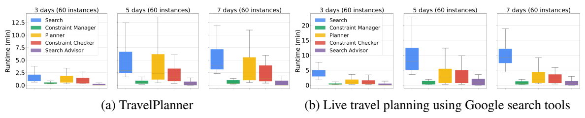

**图 9. 使用 Gemini-2.5-Pro 的 ATLAS 实际经过时间。（a）TravelPlanner；（b）使用 Google 搜索工具的实时旅行规划。**

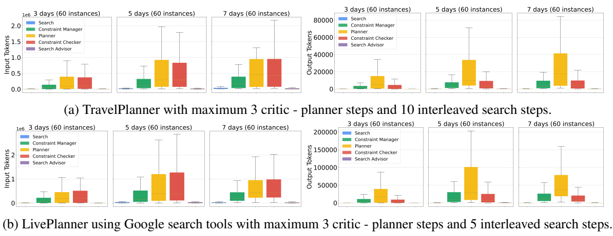

**图 10. ATLAS 的 token 数量，各模块输入总量在左、输出总量在右。（a）TravelPlanner，最多三次评判器—规划器交互和 10 次交错搜索；（b）使用 Google 搜索工具的 LivePlanner，最多三次评判器—规划器交互和五次交错搜索。**

表 11 分析全部方法成本。多智能体方法确实耗时更长、token 更多，但比较中位数可见，ATLAS 相比搜索增强 EvoAgent 或 PMC 等多智能体基线，成本没有显著增加，却带来显著性能改善。

**表 11. ATLAS 与基线成本分析。比较总实际运行时间和全部输出 token 总量。使用 Gemini-2.5-Pro，在 TravelPlanner 验证集上评估，报告第 25、50（中位数）、75 百分位数。运行时间单位为分钟，token 数单位为千。**

| 方法 | 3 天：时间 | 3 天：输出 token | 5 天：时间 | 5 天：输出 token | 7 天：时间 | 7 天：输出 token |
| --- | --- | --- | --- | --- | --- | --- |
| ReAct | （1.20, 1.41, 1.74） | （0.33, 1.07, 17.05） | （2.42, 2.79, 3.28） | （0.71, 1.38, 2.09） | （3.49, 3.83, 4.49） | （1.03, 1.78, 2.26） |
| ReAct+Reflexion | （1.52, 2.29, 3.52） | （0.62, 0.84, 1.09） | （2.46, 4.37, 6.15） | （1.27, 1.55, 2.35） | （2.96, 5.41, 8.64） | （1.78, 2.01, 2.56） |
| ReAct+EvoAgent | （3.10, 3.36, 3.80） | （6.51, 7.13, 7.94） | （6.26, 7.10, 9.01） | （15.87, 19.36, 21.81） | （7.92, 8.76, 14.20） | （20.17, 22.90, 26.08） |
| PMC | （2.57, 2.85, 3.10） | （5.90, 6.69, 7.10） | （5.77, 7.19, 10.31） | （11.44, 12.72, 14.12） | （7.00, 8.35, 12.27） | （15.05, 16.56, 19.13） |
| ATLAS （本文） | （2.42, 4.07, 6.49） | （1.49, 9.52, 20.52） | （4.80, 8.26, 26.22） | （5.53, 19.29, 63.03） | （5.47, 7.97, 19.88） | （5.27, 24.07, 43.86） |

## E. ATLAS 输出示例

### E.1. 端到端示例

以下保留工具名称、调用语法、JSON 键名和地名、商家专名。`day` 表示日次，`current_city` 表示当前城市，`transportation` 表示交通，`breakfast`、`lunch`、`dinner` 分别表示早餐、午餐、晚餐，`attraction` 表示景点，`accommodation` 表示住宿；`Short Description` 和 `Content` 分别表示简要描述与内容。示例中的省略号沿用原文。

#### E.1.1. TravelPlanner

##### 示例 1

**用户查询：** 请为我制定旅行计划，从 Washington 出发前往 Myrtle Beach，在 2022 年 3 月 13—15 日旅行三天。能否将总预算控制在 1400 美元以内？

**约束管理器输出：**

1. 2022 年 3 月 13 日 Washington 至 Myrtle Beach 的去程航班必须为 F3792603 或 F3927581。
2. 2022 年 3 月 15 日 Myrtle Beach 至 Washington 的返程航班必须为 F3791200 或 F3926434。
3. Myrtle Beach 的住宿必须从提供列表中选择，最低入住要求不得超过两晚。
4. 必须遵守所选住宿的房屋规则。
5. Myrtle Beach 的全部用餐餐厅必须从提供列表中选择。
6. Myrtle Beach 的全部游览景点必须从提供列表中选择。
7. 行程必须从 Washington 出发，并返回 Washington。
8. 目的地城市为 Myrtle Beach。
9. 旅行日期为 2022 年 3 月 13—15 日。
10. 总费用不得超过 1400 美元。

**规划器输出：**

```text
第 1 天：
当前城市： 从 Washington 到 Myrtle Beach
交通： 航班号： F3927581, 从 Washington 到 Myrtle Beach, 起飞时间： 11:03, 抵达时间： 13:31
早餐： -
景点： Myrtle Beach Boardwalk and Promenade, Myrtle Beach
午餐： First Eat, Myrtle Beach
晚餐： Catfish Charlie’s, Myrtle Beach
住宿： Yellow submarine, Myrtle Beach
第 2 天：
当前城市： Myrtle Beach
交通： -
早餐： d’ Curry House, Myrtle Beach
景点： Ripley’s Aquarium of Myrtle Beach, Myrtle Beach;SkyWheel Myrtle Beach, Myrtle Beach.
午餐： La Pino’z Pizza, Myrtle Beach
晚餐： Nizam’s Kathi Kabab, Myrtle Beach
住宿： Yellow submarine, Myrtle Beach
第 3 天：
当前城市： 从 Myrtle Beach 到 Washington
交通： 航班号： F3791200, 从 Myrtle Beach 到 Washington, 起飞时间： 11:36, 抵达时间： 13:06
早餐： Turning Point Fast Food, Myrtle Beach
景点： Myrtle Beach State Park, Myrtle Beach.
午餐： -
晚餐： -
住宿： -
```

**检查器输出：** 判定为 `valid`，有效。

**搜索顾问输出：** 无，原文记为 `-`。

**最终交付计划：**

```json
[
  {
    "day": 1,
    "current_city": "从 Washington 到 Myrtle Beach",
    "transportation": "航班号： F3927581, 从 Washington 到 Myrtle Beach, 起飞时间： 11:03, 抵达时间： 13:31",
    "breakfast": "-",
    "attraction": "Myrtle Beach Boardwalk and Promenade, Myrtle Beach;",
    "lunch": "First Eat, Myrtle Beach",
    "dinner": "Catfish Charlie’s, Myrtle Beach",
    "accommodation": "Yellow submarine, Myrtle Beach"
  },
  {
    "day": 2,
    "current_city": "Myrtle Beach",
    "transportation": "-",
    "breakfast": "d’ Curry House, Myrtle Beach",
    "attraction": "Ripley’s Aquarium of Myrtle Beach, Myrtle Beach; SkyWheel Myrtle Beach, Myrtle Beach;",
    "lunch": "La Pino’z Pizza, Myrtle Beach",
    "dinner": "Nizam’s Kathi Kabab, Myrtle Beach",
    "accommodation": "Yellow submarine, Myrtle Beach"
  },
  {
    "day": 3,
    "current_city": "从 Myrtle Beach 到 Washington",
    "transportation": "航班号： F3791200, 从 Myrtle Beach 到 Washington, 起飞时间： 11:36, 抵达时间： 13:06",
    "breakfast": "Turning Point Fast Food, Myrtle Beach",
    "attraction": "Myrtle Beach State Park, Myrtle Beach;",
    "lunch": "-",
    "dinner": "-",
    "accommodation": "-"
  }
]
```

##### 示例 2：交错搜索轻松弥补信息缺口

**用户查询：** 请协助为一人安排 2022 年 3 月 4—6 日从 Pittsburgh 到 Baltimore 的三日旅行，预算上限 1200 美元。

**初始搜索后，搜索智能体输出，$L=0$：**

```text
{
"index": 0,
"Short Description": "自驾，从 Pittsburgh 到 Baltimore",
"Content": "自驾, 从 Pittsburgh 到 Baltimore, 时长
: 3 小时 58 分钟, 距离： 400 公里, 费用： 20"
},
{
"index": 1,
"Short Description": "住宿，城市： Baltimore",
"Content": ...
},
{
"index": 2,
"Short Description": "景点，城市： Baltimore",
"Content": ...
},
{
"index": 3,
"Short Description": "餐厅，城市： Baltimore",
"Content": ...
}
```

**约束管理器输出，$L=0$：**

1. Baltimore 的住宿最低入住要求不得超过两晚。
2. Pittsburgh 与 Baltimore 往返交通费为 40 美元。
3. 行程必须从 Pittsburgh 出发，并返回 Pittsburgh。
4. 目的地为 Baltimore。
5. 一人出行。
6. 旅行三天，日期为 2022 年 3 月 4—6 日。
7. 总费用不得超过 1200 美元。

**规划器输出，$L=0,K=0$：**

```text
第 1 天：
当前城市： 从 Pittsburgh 到 Baltimore
交通： 自驾, 从 Pittsburgh 到 Baltimore
早餐： -
景点： Inner Harbor, Baltimore
午餐： Mr. Dunderbak’s Biergarten and Marketplatz, Baltimore
晚餐： Los Pablos, Baltimore
住宿： Contemporary Home Away from Home, Entire house, Baltimore
第 2 天：
当前城市： Baltimore
交通： -
早餐： Amalfi, Baltimore
景点： National Aquarium, Baltimore;Fort McHenry National Monument and Historic Shrine, Baltimore.
午餐： Salt, Baltimore
晚餐： The Thai Bowl, Baltimore
住宿： Contemporary Home Away from Home, Entire house, Baltimore
第 3 天：
当前城市： 从 Baltimore 到 Pittsburgh
交通： 自驾, 从 Baltimore 到 Pittsburgh
早餐： Tibb’s Frankie, Baltimore
景点： The Walters Art Museum, Baltimore.
午餐： RollsKing, Baltimore
晚餐： -
住宿： -
```

**检查器输出，$L=0,K=1$：**

> 判定 1：`unsatisfiable`，不可满足。
>
> 反馈 1：计划无效，因为第三天 Baltimore 至 Pittsburgh 的交通信息并非来自所给上下文。上下文缺少返程信息，而返回出发城市是必要约束。

**搜索顾问输出，$L=0$：建议执行以下动作。**

```text
FlightSearch[Pittsburgh, Baltimore, 2022-03-04]
NotebookWrite[Flights from Pittsburgh to Baltimore on 2022-03-04]
FlightSearch[Baltimore, Pittsburgh, 2022-03-06]
NotebookWrite[Flights from Baltimore to Pittsburgh on 2022-03-06]
```

**第一次交错搜索后，搜索智能体输出，$L=1$：**

```text
{
"index": 0,
"Short Description": "自驾，从 Pittsburgh 到 Baltimore",
"Content": "自驾, 从 Pittsburgh 到 Baltimore, 时长
: 3 小时 58 分钟, 距离： 400 公里, 费用： 20"
},
{
"index": 1,
"Short Description": "住宿，城市： Baltimore",
"Content": ...
},
{
"index": 2,
"Short Description": "景点，城市： Baltimore",
"Content": ...
},
{
"index": 3,
"Short Description": "餐厅，城市： Baltimore",
"Content": ...
},
{
"index": 4,
"Short Description": "航班，从 Pittsburgh 到 Baltimore on 2022-03-04",
"Content": ...
},
{
"index": 5,
"Short Description": "航班，从 Baltimore 到 Pittsburgh on 2022-03-06",
"Content": ...
}
```

**约束管理器输出，$L=1$：**

1. Baltimore 住宿的最低入住要求不得超过两晚。
2. 行程必须从 Pittsburgh 出发，并在 Pittsburgh 结束。
3. 日期为 2022 年 3 月 4—6 日。
4. 一人出行。
5. 总费用不得超过 1200 美元。
6. 目的地为 Baltimore。

**规划器输出，$L=1,K=0$：**

```text
第 1 天：
当前城市： 从 Pittsburgh 到 Baltimore
交通： 航班号： F3969954, 从 Pittsburgh 到 Baltimore, 起飞时间： 16:51, 抵达时间： 17:49
早餐： -
景点： -
午餐： -
晚餐： Mr. Dunderbak’s Biergarten and Marketplatz, Baltimore
住宿： Contemporary Home Away from Home, Entire house, Baltimore
第 2 天：
当前城市： Baltimore
交通： -
早餐： Amalfi, Baltimore
景点： National Aquarium, Baltimore;Fort McHenry National Monument and Historic Shrine, Baltimore.
午餐： Los Pablos, Baltimore
晚餐： Farzi Cafe, Baltimore
住宿： Contemporary Home Away from Home, Entire house, Baltimore
第 3 天：
Current City : 从 Baltimore 到 Pittsburgh
交通： 航班号： F3994096, 从 Baltimore 到 Pittsburgh, 起飞时间： 21:45, 抵达时间： 22:44
早餐： 28 Capri Italy, Baltimore
景点： The Walters Art Museum, Baltimore.
午餐： Tresind - Nassima Royal Hotel, Baltimore
晚餐： The Manhattan Fish Market, Baltimore
住宿： -
```

**检查器输出，$L=1,K=1$：** 判定为 `valid`，有效。

**最终交付计划：**

```json
[
  {
    "day": 1,
    "current_city": "从 Pittsburgh 到 Baltimore",
    "transportation": "航班号： F3969954, 从 Pittsburgh 到 Baltimore, 起飞时间： 16:51, 抵达时间： 17:49",
    "breakfast": "-",
    "attraction": "-",
    "lunch": "-",
    "dinner": "Mr. Dunderbak’s Biergarten and Marketplatz, Baltimore ",
    "accommodation": "Contemporary Home Away from Home, Baltimore"
  },
  {
    "day": 2,
    "current_city": "Baltimore",
    "transportation": "-",
    "breakfast": "Amalfi, Baltimore",
    "attraction": "National Aquarium, Baltimore;Fort McHenry National Monument and Historic Shrine, Baltimore;",
    "lunch": "Los Pablos, Baltimore",
    "dinner": "Farzi Cafe, Baltimore",
    "accommodation": "Contemporary Home Away from Home, Baltimore"
  },
  {
    "day": 3,
    "current_city": "从 Baltimore 到 Pittsburgh",
    "transportation": "航班号： F3994096, 从 Baltimore 到 Pittsburgh, 起飞时间： 21:45, 抵达时间： 22:44",
    "breakfast": "28 Capri Italy, Baltimore",
    "attraction": "The Walters Art Museum, Baltimore;",
    "lunch": "Tresind - Nassima Royal Hotel, Baltimore",
    "dinner": "The Manhattan Fish Market, Baltimore",
    "accommodation": "-"
  }
]
```

##### 示例 3：对计划进行多次修订

**用户查询：** 请为五人制定从 Charlotte 前往 Hilton Head 的三日旅行计划，日期为 2022 年 3 月 26—28 日。预算上限 7000 美元，偏好意大利菜和法国菜。

**初始搜索后，搜索智能体输出，$L=0$：**

```text
{
"index": 0,
"Short Description": "交通，从 Charlotte 到 Hilton Head",
"Content": "自驾, 从 Charlotte 到 Hilton Head,
时长: 3 小时 49 分钟, 距离： 398 公里, 费用： 19"
},
{
"index": 1,
"Short Description": "住宿，城市： Hilton Head",
"Content": " NAME
price room type house_rules
minimum nights maximum occupancy review rate number
city
Williamsburg Home Away From Home! 164.0 Entire home/apt
No pets 4.0
3 3.0 Hilton Head
COZY Room @Williamsburg (10 分钟 to Manhattan) 605.0 Private
room No visitors 2.0
1 4.0 Hilton Head
...
},
{
"index": 2,
"Short Description": "餐厅，城市： Hilton Head",
"Content": " Name Average Cost
Cuisines Aggregate
Rating City
Taste Of China 91 Tea, Seafood, Bakery,
Fast Food 4.0 Hilton Head
K Raga’s 71 Tea, BBQ, Mediterranean,
Desserts 2.9 Hilton Head
New Town Pastry Shop - Park Plaza 51
Tea, Cafe, Pizza, BBQ
3.2 Hilton Head
...
},
{
"index": 3,
"Short Description": "景点，城市： Hilton Head",
"Content": " Name Latitude
Longitude
Address
Phone
Website City
Coastal Discovery Museum 32.211485 -80.744025 70 Honey
Horn Dr, Hilton Head Island, SC 29926, USA (843) 689-6767
http://www.coastaldiscovery.org/ Hilton Head
...
}
```

**约束管理器输出，$L=0$：**

1. 住宿最低入住要求不得超过两晚。
2. 至少包含一家供应意大利菜的餐厅和一家供应法国菜的餐厅。
3. 交通方式必须为自驾。
4. 从 Charlotte 出发，并在 Charlotte 结束。
5. 五人出行。
6. 旅行日期为 2022 年 3 月 26—28 日。
7. 总费用不得超过 7000 美元。

**规划器输出，$L=0,K=0$：**

```text
第 1 天：
当前城市： 从 Charlotte 到 Hilton Head
交通： 自驾, 从 Charlotte 到 Hilton Head
早餐： -
景点： Harbour Town Lighthouse, Hilton Head
午餐： Wrapster, Hilton Head
晚餐： Dhaba Ambarsariya, Hilton Head
住宿： Hip, Vibrant, COLORFUL Downtown Manhattan 1 Bed, Hilton Head
第 2 天：
当前城市： Hilton Head
交通： -
早餐： Cafe Coffee Day, Hilton Head
景点： Coastal Discovery Museum, Hilton Head; Coligny Beach Park, Hilton Head.
午餐： Mr. Brown, Hilton Head
晚餐： Sikkim Fast Food, Hilton Head
住宿： Hip, Vibrant, COLORFUL Downtown Manhattan 1 Bed, Hilton Head
第 3 天：
当前城市： 从 Hilton Head 到 Charlotte
交通： 自驾, 从 Hilton Head 到 Charlotte
早餐： Connoisseur, Hilton Head
景点： Sea Pines Forest Preserve, Hilton Head.
午餐： MR.D - Deliciousness Delivered, Hilton Head
晚餐： -
住宿： -
```

**检查器输出，$L=0,K=1$：**

> 判定：`unsatisfiable`，不可满足。
>
> 反馈：计划第三天包含 Hilton Head 至 Charlotte 的交通，但上下文没有这些细节。上下文不完整，缺少满足“行程必须在 Charlotte 结束”约束所需的返程信息，因此计划无效。

**搜索顾问输出，$L=1$：**

```text
FlightSearch[Charlotte, Hilton Head, 2022-03-26]
NotebookWrite[Flights from Charlotte to Hilton Head on 2022-03-26]
FlightSearch[Hilton Head, Charlotte, 2022-03-28]
NotebookWrite[Flights from Hilton Head to Charlotte on 2022-03-28]
```

**第一次交错搜索后，搜索智能体输出，$L=1$：**

```text
{
"index": 0,
"Short Description": "交通，从 Charlotte 到 Hilton Head",
"Content": "自驾, 从 Charlotte 到 Hilton Head,
时长: 3 小时 49 分钟, 距离： 398 公里, 费用： 19"
},
{
"index": 1,
"Short Description": "住宿，城市： Hilton Head",
"Content": " NAME
price room type house_rules
minimum nights maximum occupancy review rate number
city
Williamsburg Home Away From Home! 164.0 Entire home/apt
No pets 4.0
3 3.0 Hilton Head
COZY Room @Williamsburg (10 分钟 to Manhattan) 605.0 Private
room No visitors 2.0
1 4.0 Hilton Head
...
},
{
"index": 2,
"Short Description": "餐厅，城市： Hilton Head",
"Content": " Name Average Cost
Cuisines Aggregate
Rating City
Taste Of China 91 Tea, Seafood, Bakery,
Fast Food 4.0 Hilton Head
K Raga’s 71 Tea, BBQ, Mediterranean,
Desserts 2.9 Hilton Head
New Town Pastry Shop - Park Plaza 51
Tea, Cafe, Pizza, BBQ
3.2 Hilton Head
...
},
{
"index": 3,
"Short Description": "景点，城市： Hilton Head",
"Content": " Name Latitude
Longitude
Address
Phone
Website City
Coastal Discovery Museum 32.211485 -80.744025 70 Honey
Horn Dr, Hilton Head Island, SC 29926, USA (843) 689-6767
http://www.coastaldiscovery.org/ Hilton Head
...
},
{
"index": 4,
"Short Description": "航班，从 Charlotte 到 Hilton Head on 2022-03-26",
"Content": "Flight Number Price DepTime ArrTime
ActualElapsedTime FlightDate OriginCityName DestCityName
Distance
F4055090 92 18:07 19:27 1 小时 20 minutes 2022-03-26
Charlotte Hilton Head 207.0
F4059890 95 13:01 14:22 1 小时 21 minutes 2022-03-26
Charlotte Hilton Head 207.0"
},
{
"index": 5,
"Short Description": "航班，从 Hilton Head 到 Charlotte on 2022-03-28",
"Content": "Flight Number Price DepTime ArrTime
ActualElapsedTime FlightDate OriginCityName DestCityName
Distance F4056985 46 20:07 21:31 1 小时 24
minutes 2022-03-28 Hilton Head Charlotte 207.0
F4059921 45 14:52 16:04 1 小时 12 minutes 2022-03-28
Hilton Head Charlotte 207.0"
}
```

**约束管理器输出，$L=1$：**

1. Hilton Head 所选住宿的最低入住要求不得超过两晚。
2. 用餐必须选择下列供应法国菜或意大利菜的餐厅：Sikkim Fast Food、Cafe Coffee Day、Dhaba Ambarsariya、Connoisseur、MR.D - Deliciousness Delivered、Mr. Brown 或 Wrapster。
3. 使用两类可用交通之一：自驾，或指定航班。
4. 从 Charlotte 出发并返回 Charlotte。
5. 五人团体出行。
6. 旅行日期为 2022 年 3 月 26—28 日。
7. 总费用不得超过 7000 美元。

**规划器输出，$L=1,K=0$：**

```text
第 1 天：
当前城市： 从 Charlotte 到 Hilton Head
交通： 自驾, 从 Charlotte 到 Hilton Head
早餐： -
景点： Coligny Beach Park, Hilton Head
午餐： -
晚餐： Dhaba Ambarsariya, Hilton Head
住宿： Hip, Vibrant, COLORFUL Downtown Manhattan 1 Bed, Hilton Head
第 2 天：
当前城市： Hilton Head
交通： -
早餐： Wrapster, Hilton Head
景点： Harbour Town Lighthouse, Hilton Head; Coastal Discovery Museum, Hilton Head.
午餐： Mr. Brown, Hilton Head
晚餐： Sikkim Fast Food, Hilton Head
住宿： Hip, Vibrant, COLORFUL Downtown Manhattan 1 Bed, Hilton Head
第 3 天：
当前城市： 从 Hilton Head 到 Charlotte
交通： 自驾, 从 Hilton Head 到 Charlotte
早餐： Cafe Coffee Day, Hilton Head
景点： Sea Pines Forest Preserve, Hilton Head.
午餐： Connoisseur, Hilton Head
晚餐： -
住宿： -
```

**检查器输出，$L=1,K=1$：**

> 判定：`invalid`，无效。
>
> 反馈：第三天“从 Hilton Head 自驾返回 Charlotte”缺乏上下文支持；上下文仅包含 Charlotte 至 Hilton Head 的自驾信息。

**规划器输出，$L=1,K=1$：**

```text
第 1 天：
当前城市： 从 Charlotte 到 Hilton Head
交通： 自驾, 从 Charlotte 到 Hilton Head
早餐： -
景点： Coligny Beach Park, Hilton Head
午餐： -
晚餐： Dhaba Ambarsariya, Hilton Head
住宿： Hip, Vibrant, COLORFUL Downtown Manhattan 1 Bed, Hilton Head
第 2 天：
当前城市： Hilton Head
交通： -
早餐： Wrapster, Hilton Head
景点： Harbour Town Lighthouse, Hilton Head; Coastal Discovery Museum, Hilton Head.
午餐： Mr. Brown, Hilton Head
晚餐： Sikkim Fast Food, Hilton Head
住宿： Hip, Vibrant, COLORFUL Downtown Manhattan 1 Bed, Hilton Head
第 3 天：
当前城市： 从 Hilton Head 到 Charlotte
交通： 航班号： F4059921, 从 Hilton Head 到 Charlotte, 起飞时间： 14:52, 抵达时间： 16:04
早餐： Cafe Coffee Day, Hilton Head
景点： Sea Pines Forest Preserve, Hilton Head.
午餐： Connoisseur, Hilton Head
晚餐： -
住宿： -
```

**检查器输出，$L=1,K=2$：**

> 判定：`invalid`，无效。
>
> 反馈：交通安排不合逻辑。旅行者第一天自驾到 Hilton Head，第三天却乘飞机返回 Charlotte，会将汽车留在 Hilton Head。

**规划器输出，$L=1,K=2$：**

```text
第 1 天：
当前城市： 从 Charlotte 到 Hilton Head
交通： 航班号： F4059890, 从 Charlotte 到 Hilton Head, 起飞时间： 13:01, 抵达时间： 14:22
早餐： -
景点： Coligny Beach Park, Hilton Head
午餐： -
晚餐： Dhaba Ambarsariya, Hilton Head
住宿： Hip, Vibrant, COLORFUL Downtown Manhattan 1 Bed, Hilton Head
第 2 天：
当前城市： Hilton Head
交通： -
早餐： Wrapster, Hilton Head
景点： Harbour Town Lighthouse, Hilton Head; Coastal Discovery Museum, Hilton Head.
午餐： Mr. Brown, Hilton Head
晚餐： Sikkim Fast Food, Hilton Head
住宿： Hip, Vibrant, COLORFUL Downtown Manhattan 1 Bed, Hilton Head
第 3 天：
当前城市： 从 Hilton Head 到 Charlotte
交通： 航班号： F4056985, 从 Hilton Head 到 Charlotte, 起飞时间： 20:07, 抵达时间： 21:31
早餐： Cafe Coffee Day, Hilton Head
景点： Sea Pines Forest Preserve, Hilton Head.
午餐： Connoisseur, Hilton Head
晚餐： -
住宿： -
```

**检查器输出，$L=1,K=3$：** 判定为 `valid`，有效。

**最终交付计划：**

```json
[
  {
    "day": 1,
    "current_city": "从 Charlotte 到 Hilton Head",
    "transportation": "航班号： F4059890, 从 Charlotte 到 Hilton Head, 起飞时间： 13:01, 抵达时间： 14:22",
    "breakfast": "-",
    "attraction": "Coligny Beach Park, Hilton Head;",
    "lunch": "-",
    "dinner": "Dhaba Ambarsariya, Hilton Head",
    "accommodation": "Hip, Vibrant, COLORFUL Downtown Manhattan 1 Bed, Hilton Head"
  },
  {
    "day": 2,
    "current_city": "Hilton Head",
    "transportation": "-",
    "breakfast": "Wrapster, Hilton Head",
    "attraction": "Harbour Town Lighthouse, Hilton Head;Coastal Discovery Museum, Hilton Head;",
    "lunch": "Mr. Brown, Hilton Head",
    "dinner": "Sikkim Fast Food, Hilton Head",
    "accommodation": "Hip, Vibrant, COLORFUL Downtown Manhattan 1 Bed, Hilton Head"
  },
  {
    "day": 3,
    "current_city": "从 Hilton Head 到 Charlotte",
    "transportation": "航班号： F4056985, 从 Hilton Head 到 Charlotte, 起飞时间： 20:07, 抵达时间： 21:31",
    "breakfast": "Cafe Coffee Day, Hilton Head",
    "attraction": "Sea Pines Forest Preserve, Hilton Head;",
    "lunch": "Connoisseur, Hilton Head",
    "dinner": "-",
    "accommodation": "-"
  }
]
```

#### E.1.2. 结合多轮反馈的实时旅行规划

##### 第一轮

**用户查询：** 请帮助安排 2025 年 9 月 7—13 日从 Kona 前往 California 的七日单人旅行，希望游览该州三座不同城市，预算 5800 美元。

**约束管理器输出：**

1. 2025 年 9 月 7—9 日必须住在 Los Angeles。
2. 2025 年 9 月 9—11 日必须住在 San Francisco。
3. 2025 年 9 月 11—13 日必须住在 San Diego。
4. 游览三座城市：Los Angeles、San Francisco、San Diego。
5. California 城市之间必须自驾。
6. 2025 年 9 月 7 日乘航班从 Kona 到 Los Angeles，开始旅行。
7. 2025 年 9 月 13 日乘航班从 San Diego 返回 Kona，结束旅行。
8. 总时长七天，2025 年 9 月 7—13 日。
9. 总预算不得超过 5800 美元。
10. 单人出行。

**最终交付计划：**

```json
[
  {
    "day": 1,
    "current_city": "从 Kona 到 Los Angeles",
    "transportation": "航班号： HA, 从 Kona 到 Los Angeles, 起飞时间： 15:19, 抵达时间： 23:51",
    "breakfast": "-",
    "attraction": "-",
    "lunch": "-",
    "dinner": "-",
    "accommodation": "Modern Homestay 2, Los Angeles"
  },
  {
    "day": 2,
    "current_city": "Los Angeles",
    "transportation": "-",
    "breakfast": "Humble Bird, Los Angeles",
    "attraction": "Griffith Observatory, Los Angeles;Hollywood Walk of Fame, Los Angeles;",
    "lunch": "Granville, Los Angeles",
    "dinner": "Chao Krung Thai, Los Angeles",
    "accommodation": "Modern Homestay 2, Los Angeles"
  },
  {
    "day": 3,
    "current_city": "从 Los Angeles 到 San Francisco",
    "transportation": "自驾, 从 Los Angeles 到 San Francisco",
    "breakfast": "La Pupusa Urban Eatery, Los Angeles",
    "attraction": "The Getty Center, Los Angeles;",
    "lunch": "-",
    "dinner": "Sweet Maple, San Francisco",
    "accommodation": "Travelodge by Wyndham San Francisco Airport North, San Francisco"
  },
  {
    "day": 4,
    "current_city": "San Francisco",
    "transportation": "-",
    "breakfast": "Sweet Maple, San Francisco",
    "attraction": "Golden Gate Bridge, San Francisco;Fisherman’s Wharf, San Francisco;",
    "lunch": "Bar Crudo, San Francisco",
    "dinner": "Zuni Cafe, San Francisco",
    "accommodation": "Travelodge by Wyndham San Francisco Airport North, San Francisco"
  },
  {
    "day": 5,
    "current_city": "从 San Francisco 到 San Diego",
    "transportation": "自驾, 从 San Francisco 到 San Diego ",
    "breakfast": "Flour + Water, San Francisco",
    "attraction": "Alcatraz Island, San Francisco;",
    "lunch": "-",
    "dinner": "Oscar’s Mexican Seafood, San Diego",
    "accommodation": "Quaint And Cozy One Bedroom Unit With Patio, San Diego"
  },
  {
    "day": 6,
    "current_city": "San Diego",
    "transportation": "-",
    "breakfast": "Las Cuatro Milpas, San Diego",
    "attraction": "Balboa Park, San Diego;USS Midway Museum, San Diego;",
    "lunch": "Mitch’s Seafood, San Diego",
    "dinner": "Puesto, San Diego",
    "accommodation": "Quaint And Cozy One Bedroom Unit With Patio, San Diego"
  },
  {
    "day": 7,
    "current_city": "从 San Diego 到 Kona",
    "transportation": "航班号： HA, 从 San Diego 到 Kona, 起飞时间： 11:17, 抵达时间： 14:19",
    "breakfast": "Kindred, San Diego",
    "attraction": "-",
    "lunch": "-",
    "dinner": "-",
    "accommodation": "-"
  }
]
```

##### 第二轮

**用户查询：** 请帮助安排 2025 年 9 月 7—13 日从 Kona 前往 California 的七日单人旅行，希望游览该州三座不同城市，预算 5800 美元。

以下是你先前生成的计划：

```text
第 1 天：
当前城市： 从 Kona 到 Los Angeles
交通： 航班号： HA, 从 Kona 到 Los Angeles, 起飞时间： 15:19, 抵达时间： 23:51
早餐： -
景点： -
午餐： -
晚餐： -
住宿： Modern Homestay 2, Los Angeles
第 2 天：
当前城市： Los Angeles
交通： -
早餐： Humble Bird, Los Angeles
景点： Griffith Observatory, Los Angeles; Hollywood Walk of Fame, Los Angeles.
午餐： Granville, Los Angeles
晚餐： Chao Krung Thai, Los Angeles
住宿： Modern Homestay 2, Los Angeles
第 3 天：
当前城市： 从 Los Angeles 到 San Francisco
交通： 自驾, 从 Los Angeles 到 San Francisco
早餐： La Pupusa Urban Eatery, Los Angeles
景点： The Getty Center, Los Angeles.
午餐： -
晚餐： Sweet Maple, San Francisco
住宿： Travelodge by Wyndham San Francisco Airport North, San Francisco
第 4 天：
当前城市： San Francisco
交通： -
早餐： Sweet Maple, San Francisco
景点： Golden Gate Bridge, San Francisco; Fisherman’s Wharf, San Francisco.
午餐： Bar Crudo, San Francisco
晚餐： Zuni Cafe, San Francisco
住宿： Travelodge by Wyndham San Francisco Airport North, San Francisco
第 5 天：
当前城市： 从 San Francisco 到 San Diego
交通： 自驾, 从 San Francisco 到 San Diego
早餐： Flour + Water, San Francisco
景点： Alcatraz Island, San Francisco.
午餐： -
晚餐： Oscar’s Mexican Seafood, San Diego
住宿： Quaint And Cozy One Bedroom Unit With Patio, San Diego
第 6 天：
当前城市： San Diego
交通： -
早餐： Las Cuatro Milpas, San Diego
景点： Balboa Park, San Diego; USS Midway Museum, San Diego.
午餐： Mitch’s Seafood, San Diego
晚餐： Puesto, San Diego
住宿： Quaint And Cozy One Bedroom Unit With Patio, San Diego
第 7 天：
当前城市： 从 San Diego 到 Kona
交通： 航班号： HA, 从 San Diego 到 Kona, 起飞时间： 11:17, 抵达时间： 14:19
早餐： Kindred, San Diego
景点： -
午餐： -
晚餐： -
住宿： -
```

我还要指出这份计划的主要问题：

- 第四天早餐餐厅重复了，我希望尝试不同餐厅与景点。
- 交通方式冲突。如果乘飞机或出租车，我就无法在行程任何阶段自驾；反过来，如果能够自驾，就不需要出租车或航班。
- 第二天早餐不在有效沙盒数据中。
- 第一天住宿信息是虚构的。

**约束管理器输出：**

1. 交通方式必须一致：城市间全程自驾，或使用航班／出租车，不能混用。
2. 全部餐厅与景点必须各不相同，不得重复。
3. 计划不得包含 Humble Bird 餐厅。
4. 计划不得包含 Modern Homestay 2 住宿。
5. 全部航班、住宿、餐厅、景点必须仅从所给上下文选择。
6. 2025 年 9 月 7 日从 Kona 出发，9 月 13 日在 Kona 结束。
7. 必须游览 Los Angeles、San Francisco、San Diego 三座不同城市。
8. 总预算不得超过 5800 美元。
9. 单人出行。
10. 行程必须闭环，从 Kona 出发并返回 Kona。
11. Los Angeles 住宿预订日期为 2025 年 9 月 7—9 日。
12. San Francisco 住宿预订日期为 2025 年 9 月 9—11 日。
13. San Diego 住宿预订日期为 2025 年 9 月 11—13 日。

**搜索顾问输出：**

```text
GoogleSearchFlight[Los Angeles, San Francisco, 2025-09-09]
NotebookWrite[Flights from Los Angeles to San Francisco on 2025-09-09]
GoogleSearchFlight[San Francisco, San Diego, 2025-09-11]
NotebookWrite[Flights from San Francisco to San Diego on 2025-09-11]
```

**最终交付计划：**

```json
[
  {
    "day": 1,
    "current_city": "从 Kona 到 Los Angeles",
    "transportation": "航班号： HA, 从 Kona 到 Los Angeles, 起飞时间： 15:19, 抵达时间： 23:51",
    "breakfast": "-",
    "attraction": "-",
    "lunch": "-",
    "dinner": "-",
    "accommodation": "Modern Hostel, Los Angeles"
  },
  {
    "day": 2,
    "current_city": "Los Angeles",
    "transportation": "-",
    "breakfast": "La Pupusa Urban Eatery, Los Angeles",
    "attraction": "Griffith Observatory, Los Angeles;Hollywood Walk of Fame, Los Angeles;",
    "lunch": "Granville, Los Angeles",
    "dinner": "Chao Krung Thai, Los Angeles",
    "accommodation": "Modern Hostel, Los Angeles"
  },
  {
    "day": 3,
    "current_city": "从 Los Angeles 到 San Francisco",
    "transportation": "航班号： HA, 从 Los Angeles 到 San Francisco, 起飞时间： 22:34, 抵达时间： 23:59",
    "breakfast": "Holbox, Los Angeles",
    "attraction": "The Getty Center, Los Angeles;",
    "lunch": "Niku X, Los Angeles",
    "dinner": "The Brothers Sushi, Los Angeles",
    "accommodation": "Travelodge by Wyndham San Francisco Airport North, San Francisco"
  },
  {
    "day": 4,
    "current_city": "San Francisco",
    "transportation": "-",
    "breakfast": "Sweet Maple, San Francisco",
    "attraction": "Golden Gate Bridge, San Francisco;Fisherman’s Wharf, San Francisco;",
    "lunch": "Bar Crudo, San Francisco",
    "dinner": "Zuni Cafe, San Francisco",
    "accommodation": "Travelodge by Wyndham San Francisco Airport North, San Francisco"
  },
  {
    "day": 5,
    "current_city": "从 San Francisco 到 San Diego",
    "transportation": "航班号： Southwest, 从 San Francisco 到 San Diego, 起飞时间： 11:00, 抵达时间： 12:35",
    "breakfast": "Flour + Water, San Francisco",
    "attraction": "Alcatraz Island, San Francisco;",
    "lunch": "-",
    "dinner": "Oscar’s Mexican Seafood, San Diego",
    "accommodation": "Quaint And Cozy One Bedroom Unit With Patio, San Diego"
  },
  {
    "day": 6,
    "current_city": "San Diego",
    "transportation": "-",
    "breakfast": "Las Cuatro Milpas, San Diego",
    "attraction": "Balboa Park, San Diego;USS Midway Museum, San Diego;",
    "lunch": "Mitch’s Seafood, San Diego",
    "dinner": "Puesto, San Diego",
    "accommodation": "Quaint And Cozy One Bedroom Unit With Patio, San Diego"
  },
  {
    "day": 7,
    "current_city": "从 San Diego 到 Kona",
    "transportation": "航班号： HA, 从 San Diego 到 Kona, 起飞时间： 11:17, 抵达时间： 14:19",
    "breakfast": "Kindred, San Diego",
    "attraction": "-",
    "lunch": "-",
    "dinner": "-",
    "accommodation": "-"
  }
]
```

### E.2. 演示

我们比较了单体智能体基线（图 11）与 ATLAS（图 12）的用户界面。二者处理相同的真实旅行规划查询：“请为我制定旅行计划，从 Washington 出发前往 Myrtle Beach，2025 年 11 月 13—15 日旅行三天。能否将预算控制在 1400 美元以内？”[演示视频](https://www.youtube.com/watch?v=cy4KFd7GmRQ)。

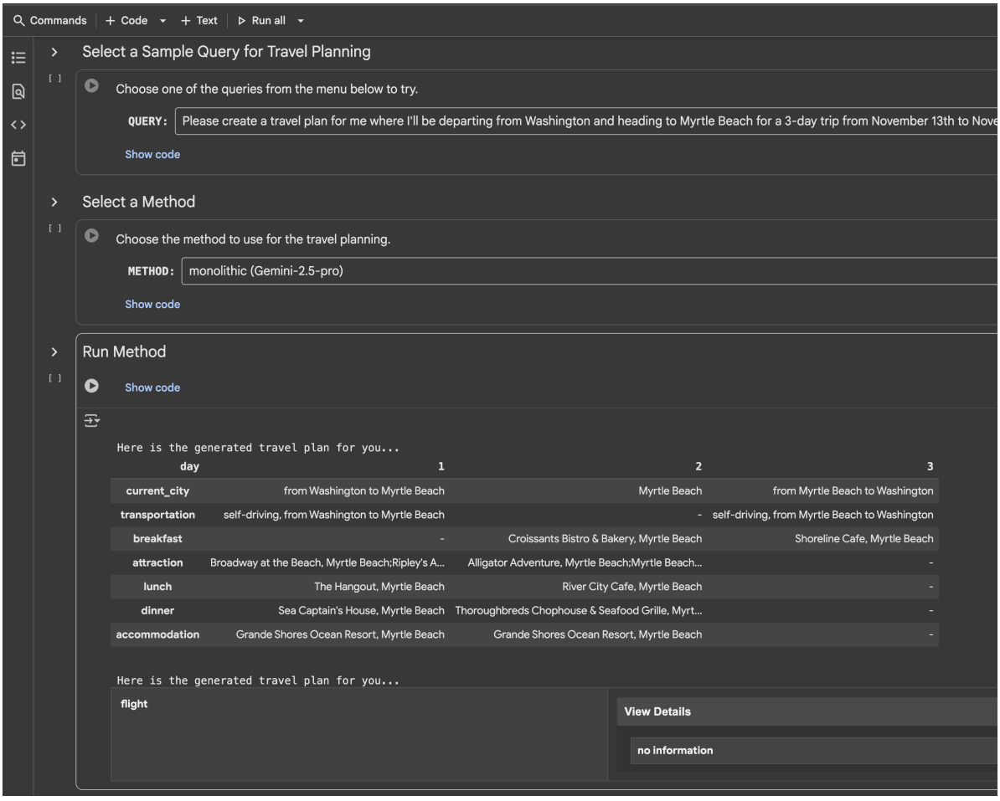

**图 11. 单体智能体执行真实旅行规划的演示截图，展示其生成的计划和搜索结果摘要，基座为 Gemini-2.5-Pro。**

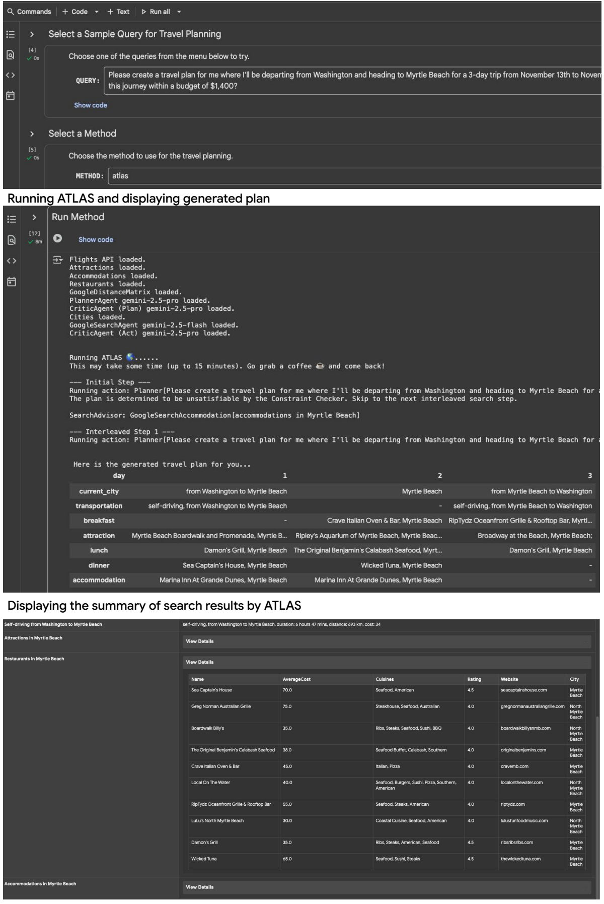

**图 12. ATLAS 执行真实旅行规划的演示截图，展示生成的计划及搜索结果摘要。图中两段标题分别为“运行 ATLAS 并展示生成计划”和“展示 ATLAS 搜索结果摘要”。**

## F. 提示词

### F.1. TravelPlanner

搜索智能体和规划器基本沿用 Xie et al.（2024）的提示词。此处给出本框架中约束管理器、检查器与搜索顾问的完整提示词。提示词中的工具列表与示例计划，与原始 TravelPlanner 提示词完全一致。

> 原文脚注 4：搜索与规划分别采用 [`ZEROSHOT_REACT_INSTRUCTION` 和 `PLANNER_INSTRUCTION`](https://github.com/OSU-NLP-Group/TravelPlanner/blob/main/agents/prompts.py)。
>
> 原文脚注 5：检查器提示词包含沙盒专用指令，例如“交通时长是次要考虑”“不必担心最大入住人数”“隐式允许”“严格过滤”。这是因为，不放宽这些约束时，沙盒数据往往没有可行选项，评估指标也不检查它们。为公平比较，基线也获得这些指令。在 LivePlanner 中，由于搜索结果不再受沙盒可行性限制，这些指令被移除。

**约束管理器提示词。**

```text
你是逻辑推理专家，任务是列出制定旅行计划时必须遵守的约束。

给定查询和上下文信息，约束可以是任何能够从其中明确识别的相关因素。
查询可能直接指定某些约束，但你也应考虑能够从上下文推断的约束。
不要加入无法根据查询和上下文明确表述的约束。例如，不要考虑计划的可行性，
即时间安排是否足够实际、用户能否完成。

补充说明：
1. 严格使用给定城市名。例如，“Washington”指华盛顿州西雅图的那一个，
   而非“Washington D.C”。不要推断其他城市。仅使用与查询直接相关的城市，
   不要加入附近有机场的城市或周边城市。
2. 行程必须闭环。即使查询没有说明是否返回出发城市，也始终假定需要返回。

输出制定旅行计划必须遵守的约束列表，使用带编号约束的结构化格式。
保持简洁，只列约束，不添加其他陈述。
优先列出并非来自查询、而是由上下文额外确定的约束。

query: [此处插入查询]
context information: [此处插入上下文]
constraints:
```

**检查器提示词。**

```text
你是逻辑推理专家，任务是担任评判者。
你与一位旅行规划器配对，将获得查询以及它生成的计划。
你还会获得上下文信息，即规划器生成计划时参考的旅行信息集合。
你会获得 constraints，即计划必须遵守的规则列表。
你也会获得先前规划尝试及你对它们的反馈，以整体了解目前的规划过程。

你的目标是仅从以下方面评估计划：
1. 非常重要：计划每项细节都必须来自所给信息。
2. 非常重要：每天适用且必要的交通、餐厅、景点和住宿细节不得遗漏。
   注意，交通时长是次要考虑：可能出现超过 20 小时等较长交通，
   但不要将其作为拒绝计划或跳过住宿等必要项目的主要理由。
3. 计划各部分应在适用时遵守所给约束。
4. 每天最多安排一种交通方式和一处住宿。全部旅行者须一起住在同一住宿，
   不得分住多处。对于住宿，不必担心最大入住人数约束。
5. 整体旅行顺序与全部细节应符合常识。不过，涉及计划可行性时，
   更应关注完整性，例如是否包含所有必要细节，而非仔细苛究交通时长等因素
   的精确可行性。小幅旅行时间差异不应成为主要批评点。

确保只根据以上方面评估计划。
不要评价旅行计划格式，因为规划器必须遵循特定格式。
不跨城市移动时，无需交通安排。
所有价格均为一人价格，全部住宿价格均按晚计。

评估住宿规则时，请遵循以下原则：
1. 隐式允许：除非规则明确禁止，否则假定活动或功能被允许。
   不要因缺少明确许可而推断限制。
2. 对禁令严格过滤：当用户表达偏好或要求时，严格排除明确禁止该偏好的住宿。
   不要过度思考或对禁令作过宽解释，只关注直接矛盾。

规划失败可能来自规划器利用现有信息的局限，也可能来自上下文不完整。
若是规划器错误，应反馈计划无效的具体原因。
若是上下文问题，应判为不可满足，说明还需哪些信息才能使计划有效。
若重复先前规划尝试的同类失败，也应判为不可满足。

按示例输出结构化 JSON，包含两个字段：(1) decision，(2) feedback。
(1) decision 必须为 valid、invalid 或 unsatisfiable。
(2) valid 时不提供反馈；invalid 时枚举判定理由。
    unsatisfiable 表示主要因信息不足，无法依据现有上下文成功生成计划。
    这不是你或规划器的过错，需要收集更多信息解决。
    应说明还需哪些信息才能使计划有效。

保持简洁，不要提出改进建议，重点指出计划缺失信息或未满足的约束。

***** 示例 1 *****
Decision: invalid
Feedback:
1. 第一天缺少住宿。
2. 计划包含不在所给上下文中的餐厅。
3. “Affordable Spacious Refurbished Room in Bushwick!, Charlotte”
   最低入住两晚，但第一天只订了一晚。
4. 约束要求全程自驾，计划第一天却选择航班。
5. 城市顺序不合理。
***** 示例 1 结束 *****

***** 示例 2 *****
Decision: unsatisfiable
Feedback: 第一天缺少必要交通，计划无效。不过，这是因为上下文没有第一天
交通信息，因此需要进一步收集信息。
***** 示例 2 结束 *****

query: [此处插入查询]
context information: [此处插入上下文]
constraints: [此处插入约束管理器输出]
previous planning attempts and your feedback: [先前规划尝试及对应反馈]
travel plan: [待验证当前计划]
critic:
```

**搜索顾问提示词。**

```text
你是逻辑推理专家，任务是担任评判者。
你与一位助手配对，助手通过动作收集度假计划所需的交通、用餐、景点或住宿信息。
每个动作只调用一次函数，且必须属于下列类型之一：
[此处插入工具列表……]

*******
这里还有一个良好旅行计划的例子，说明规划器的输出格式。
符号“-”表示不需要相关信息。
[此处插入示例计划……]

你将获得查询、目前执行过的动作及观测，还会获得基于这些信息进行的先前规划尝试
以及反馈。这些尝试都失败了，所附反馈说明失败原因。

作为评判者，你现在需要识别目前收集信息的缺口，建议额外动作来获取必要信息。
判断是否有规划失败是因为先前信息有限，导致只能生成该计划；
即只有助手收集更多信息，规划器才能做得更好。

输出应为进一步全面收集信息、帮助解决先前失败所需执行的动作列表。
动作必须属于上述指定类型，不得超出范围，也不得重复已执行的动作。

重要说明：
1. 优先确保交通、用餐、景点和住宿的全部必要信息均被收集并记录在 Notebook，
   供规划器使用。
2. 避免冗余收集，不要建议获取已在先前数据中的信息。
   如果已执行正确动作但观测仍不足，不要不断要求类似动作直到信息足够。
3. 若认为全部相关信息已收集，建议用查询调用 Planner 工具，不再提出其他动作。
   此时先前失败可能来自规划器利用现有信息的局限，而非信息不足。
4. 严格使用给定城市名。例如，“Washington”指华盛顿州西雅图的那一个，
   而非“Washington D.C”。不要推断其他城市。调用动作时仅使用直接相关城市，
   不要加入附近有机场的城市或周边城市。
5. 调用动作收集某一主题信息时，只要存在至少一条相关且满足条件的信息，就已足够，
   表示该主题信息收集成功。不要求大多数观测条目符合查询，一个合适选项即可。
   从观测信息中准确找出该选项，是规划器而非信息提取过程的责任。

对于住宿，请遵循以下原则：
1. 隐式允许：除非明确禁止，否则假定活动或功能允许。
   不要因缺少明确许可而推断限制。
2. 对禁令严格过滤：用户表达偏好或要求时，严格排除明确禁止该偏好的住宿。
   不要过度思考或对禁令作过宽解释，只关注直接矛盾。

记住，你需要高效收集全部必要信息，不要建议收集超出查询范围或无关的信息。
保持简洁。
建议动作中不要包含编号。例如，直接输出
GoogleDistanceMatrix[Twin Falls, Salt Lake City, self-driving]
而非 Action 1: GoogleDistanceMatrix[Twin Falls, Salt Lake City, self-driving]。
```

### F.2. 实时旅行规划

实时旅行规划不用沙盒工具，而使用基于 Google 搜索的工具，检索航班、住宿、餐厅和景点的实时信息。搜索智能体与搜索顾问均沿用 TravelPlanner 提示词，但将工具列表替换为下方“实时旅行规划工具列表”。

**实时旅行规划工具列表提示词。**

```text
(1) GoogleSearchFlight[Origin, Destination, Date]
说明：使用 Google 搜索的航班信息检索工具。
参数：
Origin：出发城市。
Destination：目的城市。
Date：旅行日期，格式 YYYY-MM-DD。
示例：GoogleSearchFlight[New York, London, 2025-10-01]
检索 2025 年 10 月 1 日纽约飞伦敦的航班。

(2) GoogleDistanceMatrix[Origin, Destination, Mode]
说明：估计两座城市之间的距离、时间和费用。不要用来查询市内交通。
规划旅行时，不必考虑城市内部交通。
参数：
Origin：出发城市，只写城市名，不写机场名，不含州缩写等。
Destination：目的城市，只写城市名，不写机场名，不含州缩写等。
Mode：交通方式，可为 self-driving（自驾）或 taxi（出租车）。
示例：GoogleDistanceMatrix[Paris, Lyon, taxi] 或
GoogleDistanceMatrix[Paris, Lyon, self-driving]
提供巴黎与里昂之间的驾车距离、时间和费用。

(3) GoogleSearchAccommodation[searchQuery]
说明：使用 Google 搜索寻找指定城市的住宿。
参数：searchQuery，改写后的查询，只包含住宿搜索所需细节。
示例：GoogleSearchAccommodation[Find accommodations in Rome from
2025-10-01 to 2025-10-05 for 2 guests. We require accommodations in
the form of private rooms.]
返回罗马 2025 年 10 月 1—5 日供两位客人入住的独立房间住宿列表。

(4) GoogleSearchRestaurant[searchQuery]
说明：使用 Google 搜索探索指定城市的用餐选项。
参数：searchQuery，改写后的查询，只包含餐厅搜索所需细节。
示例：GoogleSearchRestaurant[Find restaurants in Tokyo. I want to try
Korean and Japanese cuisines.]
返回东京餐厅列表，查询要求为想尝试韩国菜与日本菜。

(5) GoogleSearchAttraction[City]
说明：使用 Google 搜索寻找指定城市的景点。
参数：City，要查询景点的城市名。
示例：GoogleSearchAttraction[London] 返回伦敦景点。

(6) CitySearch[State]
说明：查找指定州内的城市。
参数：State，要查询城市的州名。
示例：CitySearch[California] 返回 California 州内城市。

(7) NotebookWrite[Short Description]
说明：在 Notebook 工具中写入一条带简短描述的新数据。
应紧接在 FlightSearch、AccommodationSearch、AttractionSearch、
RestaurantSearch 或 GoogleDistanceMatrix 之后使用。
规划器只能看到 Notebook 内的数据，因此必须将所需信息全部写入。
参数：Short Description，存储数据的简短描述或标签，不需要包含全部信息；
已搜索的数据会自动存入 Notebook。
示例：NotebookWrite[Flights from Rome to Paris in 2022-02-01]
将 2022 年 2 月 1 日罗马至巴黎的航班信息存入 Notebook。

(8) Planner[Query]
说明：根据用户输入和 Notebook 信息生成详细计划的智能规划工具。
参数：Query，用户查询，必须与用户给出的查询完全相同，不得改写。
示例：Planner[Give me a 3-day trip plan from Seattle to New York]
返回西雅图到纽约的详细三日计划。

应尽可能使用足够多的步骤，收集充分信息供 Planner 使用。

输入参数中的城市名必须严格按给定名称使用。例如，“Washington”指华盛顿州
西雅图的那一个，不是“Washington D.C”。不要推断其他城市。
只使用与查询直接相关的城市，不要加入附近有机场的城市或周边城市。

每个动作只调用一次函数，不添加描述，每次只输出一个动作。
动作输出中不要包含思考内容，只调用上述八种动作之一。
输出不要使用 Action 及编号，例如直接输出
GoogleDistanceMatrix[El Paso, Phoenix, self-driving]
而非 Action 10: GoogleDistanceMatrix[El Paso, Phoenix, self-driving]。
```

**实时航班搜索提示词。**

```text
site: www.google.com/travel/flights OR site: www.expedia.com/Flights.
Request: [此处插入搜索智能体的请求]

根据搜索结果，提取全部必要航班信息，并按指定格式输出。
输出为结构化格式，包含以下列：
FlightNumber, Price, DepTime, ArrTime, ActualElapsedTime,
FlightDate, OriginCityName, DestCityName。

尽量不要遗漏字段。FlightNumber 若实在无法获得完整航班号，如 DL5375，
可以只填航空公司代码，如 DL。
任何字段不得为空或 None。优先选择最便宜航班。
全部价格均为一人价格。
完全没有可用航班时，必须返回 no information。

下方为期望输出示例，每列值用分号和制表符明确分隔。

=== 示例 1 开始 ===
FlightNumber; Price; DepTime; ArrTime; ActualElapsedTime; FlightDate; OriginCityName; DestCityName
F3502691; 240; 18:48; 20:51; 2 hours 3 minutes; 2022-03-02; Buffalo; Atlanta
F3514187; 322; 06:51; 08:40; 1 hours 49 minutes; 2022-03-02; Buffalo; Atlanta
F3555201; 265; 12:44; 14:33; 1 hours 49 minutes; 2022-03-02; Buffalo; Atlanta
=== 示例 1 结束 ===

=== 示例 2 开始 ===
no information
=== 示例 2 结束 ===

只输出按上述要求组织的收集信息，不包含其他内容。
Formatted output:
```

**实时住宿搜索提示词。**

```text
site: www.expedia.com/Hotels OR site: www.airbnb.com OR site: www.booking.com.
Request: [此处插入搜索智能体的请求]

根据搜索结果，提取全部必要住宿信息，并按指定格式输出。
输出为结构化格式，包含以下列：name, price, maximum_occupancy, rating, city。

尽量不要遗漏字段；确实无法获得时，maximum_occupancy 和 rating 可设为 None。
优先选择最便宜住宿。
完全没有可用住宿时，必须返回 no information。
全部价格均为每人每晚价格。

下方为期望输出示例，每个字段用分号和制表符分隔。

=== 示例 1 开始 ===
name; price; maximum_occupancy; rating; city
Hilton Hotel; 212.0; 2; 3.0; Tucson
Marriott Marquis; 357.0; 2; 5.0; Tucson
Green Oasis; 118.0; 2; 3.0; Tucson
Beacon Grand; 58.0; 2; 3.0; Tucson
Sunny Cobble Hill; 107.0; 3; 2.0; Tucson
Hotel Zetta; 231.0; 2; 5.0; Tucson
=== 示例 1 结束 ===

=== 示例 2 开始 ===
no information
=== 示例 2 结束 ===

只输出按上述要求组织的收集信息，不包含其他内容。
Formatted output:
```

**实时景点搜索提示词。**

```text
site: www.tripadvisor.com/Attractions
Request: [此处插入搜索智能体的请求]

根据搜索结果，提取全部必要景点信息，并按指定格式输出。
输出为结构化格式，包含 name, address, phone, website, city。
任何字段不得为空或 None。
请尽量返回至少六家餐厅。优先选择最热门景点。
完全没有可用景点时，必须返回 no information。

下方为期望输出示例，每个字段用分号和制表符分隔。

=== 示例 1 开始 ===
Name; Address; Phone; Website; City\n
The Dallas World Aquarium; 1801 N Griffin St, Dallas, TX 75202, USA; (214) 720-2224; https://www.dwazoo.com/; Dallas\n
The Sixth Floor Museum at Dealey Plaza; 411 Elm St, Dallas, TX 75202, USA; (214) 747-6660; https://www.jfk.org/; Dallas\n
Reunion Tower; 300 Reunion Blvd E, Dallas, TX 75207, USA; (214) 296-9950; http://www.reuniontower.com/; Dallas\n
Dallas Museum of Art; 1717 N Harwood St, Dallas, TX 75201, USA; (214) 922-1200; https://www.dma.org/; Dallas
=== 示例 1 结束 ===

=== 示例 2 开始 ===
no information
=== 示例 2 结束 ===

只输出按上述要求组织的收集信息，不包含其他内容。
Formatted output:
```

> 译注：景点搜索提示词中的“至少六家餐厅”是原文表述，保留未改。

**实时餐厅搜索提示词。**

```text
site: www.tripadvisor.com/Restaurants
Request: [此处插入搜索智能体的请求]

根据搜索结果，提取全部必要餐厅信息，并按指定格式输出。
输出为结构化格式，包含 Name, AverageCost, Cuisines, Rating, City。
若没有直接价格信息，必须结合价格描述或美元符号，以及城市生活成本，
将平均费用确定为一个具体数字。

尽量不要遗漏字段；确实无法获得时，Rating 可设为 None。
优先选择最热门或评分高的餐厅。
请尽量返回至少十家餐厅。如有指定菜系，每种菜系尽量返回至少四家。
完全没有可用餐厅时，必须返回 no information。
全部价格均为一人价格。

下方为期望输出示例，每个字段用分号和制表符分隔。

=== 示例 1 开始 ===
Name; AverageCost; Cuisines; Rating; City
Coconuts Fish Cafe; 97.0; Mediterranean; 4.5; Dallas
1918 Bistro & Grill; 87.0; BBQ Seafood; 4.4; Dallas
Yanki Sizzlers; 56.0; Cafe French; 4.1; Dallas
Aravali Owls; 29.0; Italian; 4.7; Dallas
=== 示例 1 结束 ===

=== 示例 2 开始 ===
no information
=== 示例 2 结束 ===

只输出按上述要求组织的收集信息，不包含其他内容。
Formatted output:
```

## 6. 写作中使用大语言模型的说明

本文仅将 Gemini、ChatGPT 等 LLM 用作通用写作工具。我们提供草稿，让模型纠正语法、优化结构或减少冗余。全部编辑结果随后均经人工验证，并按需进一步修改。LLM 未用于生成任何新内容或参考文献。
