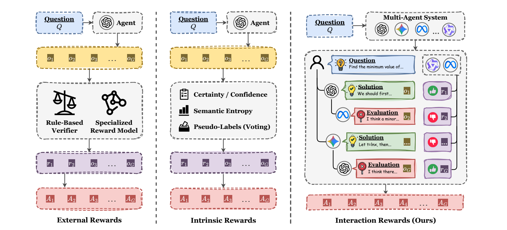
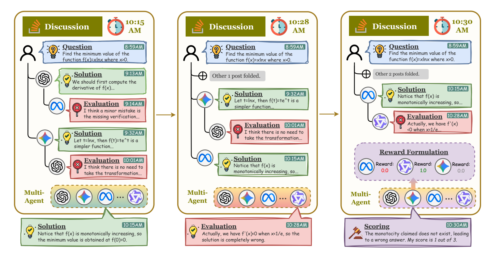
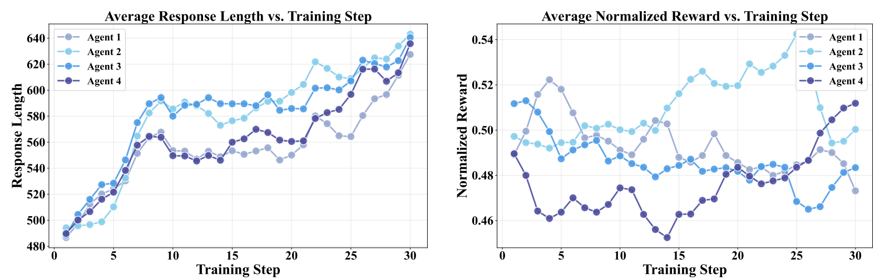
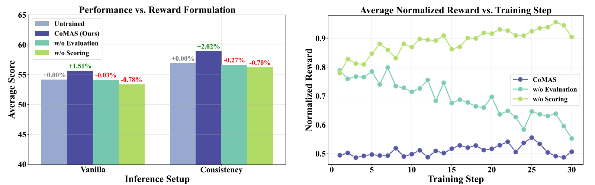
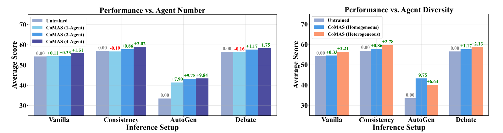

# CoMAS：通过交互奖励实现多智能体系统的协同演化

**原题：** CoMAS: Co-Evolving Multi-Agent Systems via Interaction Rewards  
**发表信息：** ICLR 2026 会议论文  
**作者：** Xiangyuan Xue¹˒²，Yifan Zhou³，Guibin Zhang⁴，Zaibin Zhang⁵˒⁶，Yijiang Li⁷，Chen Zhang²，Zhenfei Yin⁶（通信作者），Philip Torr⁶，Wanli Ouyang¹˒²˒⁸（通信作者），Lei Bai²（通信作者）  
**机构：** ¹香港中文大学；²上海人工智能实验室；³佐治亚大学；⁴新加坡国立大学；⁵大连理工大学；⁶牛津大学；⁷加利福尼亚大学圣迭戈分校；⁸深圳河套学院。  
**通信邮箱：** jeremyyin@robots.ox.ac.uk；wlouyang@ie.cuhk.edu.hk；baisanshi@gmail.com。  
**代码：** [CoMAS](https://github.com/xxyQwQ/CoMAS)

> 译文说明：保留原文的章节、图表编号、公式及附录；参考文献保持英文。插图保留原图，图注译为中文。附录中的提示词和交互轨迹是论文内容；轨迹中原有的错误计算与判断按原文保留。

## 摘要

自我演化是使基于大语言模型（LLM）的智能体能够在预训练后持续提升能力的核心研究课题。近期研究正从不使用强化学习（RL）的方法转向基于 RL 的方法。现有基于 RL 的方法要么依赖密集的外部奖励信号，要么从 LLM 自身提取内在奖励信号。然而，这些方法与人类智能中的自我演化机制有所不同：人类个体通过相互讨论和协作来学习与进步。本文提出协同演化多智能体系统（Co-Evolving Multi-Agent Systems，CoMAS），这是一种新框架，使智能体能够在没有外部监督的情况下，通过学习智能体间的交互自主提升能力。CoMAS 从丰富的讨论动态中生成内在奖励，利用 LLM 作为评判者的机制构造这些奖励，并通过 RL 优化每个智能体的策略，从而实现去中心化、可扩展的协同演化。实验结果表明，CoMAS 持续优于未经训练的智能体，并在大多数评估设置下达到最先进的性能。消融研究证实了基于交互的奖励信号的必要性，并表明随着智能体数量和多样性的增加，该框架展现出良好的扩展潜力。这些发现确立了 CoMAS 作为 LLM 智能体自我演化的一种新颖而有效的范式。代码见上述链接。

## 1 引言

自我演化已成为 LLM 智能体的核心研究主题，其目标是赋予智能体通过与环境交互持续增强自身能力的能力（Tao et al., 2024; Gao et al., 2025b; Fang et al., 2025），而不是在预训练之后停滞不前。早期探索主要采用不使用 RL 的策略，例如扩充外部知识库（Zhang et al., 2023; Tang et al., 2025）、集成多个智能体（Ong et al., 2024; Frick et al., 2025）、优化任务工作流（Hu et al., 2024b; Zhang et al., 2024b; 2025c），以及引入符号学习（Zhuge et al., 2024; Zhou et al., 2024）。然而，这些方法的有效性本质上受到其底层基础模型能力固定这一条件的限制。尽管后续工作引入了智能体微调技术（Yuan et al., 2024b; Zhao et al., 2025a），但这些方法通常仍难以支持真正持续、自举式的演化提升。

强化学习为克服这些局限提供了有前景的方向。这类方法可以根据奖励信号的来源大致分类。如图 1 所示，大多数现有方法依赖外部奖励，这些奖励通常来自基于规则的验证器（Wan et al., 2025; Estornell et al., 2025）或专门的奖励模型（Motwani et al., 2024; Park et al., 2025）。最近，研究者开始探索内在奖励，通过利用内部信号来摆脱外部监督。这些方法利用自确定性（Zhao et al., 2025b）、置信度（Prabhudesai et al., 2025）、语义熵（Zhang et al., 2025e）或多数投票产生的伪标签（Zuo et al., 2025）等机制，鼓励智能体避开低概率区域或强化高置信度预测。这为不再以外部奖励为前提的自我演化开辟了道路。



**图 1.** 所提出的 CoMAS 框架与现有基于 RL 的自我演化方法的比较。左列概述了使用验证器或奖励模型提供外部奖励的方法；中列概述了利用自确定性、置信度、语义熵和多数投票伪标签等指标获得内在奖励的方法；右列概述了从多智能体交互中获取奖励的 CoMAS 框架。

尽管基于 RL 的方法取得了显著进展，其设计仍主要围绕单个模型层面的自我奖励展开。这与人类智能形成鲜明对照：人类智能是一种集体现象，源于个体的多样性及其相互作用，而非某个单一且完美的原则（Minsky, 1986）。在人类团队中，个体通过相互讨论与协作学习和进步，并不需要外部“预言机”逐一评估每项贡献（Barron, 2003）。这种差异引出了一个关键研究问题：**基于 LLM 的智能体能否像人类一样，仅通过学习多智能体系统内部的智能体间交互实现自我演化，而不依赖外部奖励信号？**

为回答这一问题，我们提出 CoMAS：一种通过交互学习、使智能体自主提升的新框架（第 3 节）。CoMAS 包含三个核心组件。首先，**交互**围绕解答提出、评价和评分组织协作性、批判性的讨论，产生丰富的对话数据。其次，**奖励构造**利用 LLM 作为评判者的机制，直接从讨论历史中提取内在奖励信号。最后，**策略优化**使用 RL 算法更新每个智能体的策略，使其有效地内化从交互数据中学到的经验。

作为一种新的自我演化范式，CoMAS 具有以下独特优势：（1）奖励信号内生于智能体交互，无需验证器或奖励模型；（2）这一学习范式对多种任务普遍有效，包括解答难以轻易验证的开放式问题；（3）智能体以去中心化方式训练，允许异构系统协同演化，避免共享模型造成的瓶颈；（4）能够培养可迁移至域外任务和多种多智能体协作设置的能力。

我们在单智能体和多智能体设置下，利用多种基准评估 CoMAS（第 4 节）。结果表明，CoMAS 的表现持续稳定，并且在许多情况下达到最先进水平。在 Vanilla、Consistency、AutoGen 和 Debate 设置下，相比未经训练的智能体，其绝对提升分别最高达到 2.20%、3.66%、19.80% 和 6.10%。相比之下，基线方法在许多情况下表现不稳定，甚至发生性能退化。消融研究证实，基于交互的奖励构造能够防止训练崩溃与奖励投机，并进一步表明 CoMAS 随智能体数量和多样性增加而具有良好的扩展性。这些结果确立了 CoMAS 作为 LLM 智能体自我演化的一种新颖而有效的范式。

## 2 相关工作

### 2.1 多智能体系统

多智能体系统（MAS）是 LLM 智能体研究的重要方向。多个 LLM 在共享环境中运行，通过集成、协作或竞争性交互，完成单个智能体难以完成的任务（Guo et al., 2024; Li et al., 2024; Tran et al., 2025）。早期工作聚焦于智能体角色与系统拓扑固定的静态 MAS（Hong et al., 2023; Li et al., 2023; Wu et al., 2024; Du et al., 2023; Liang et al., 2023; Wang et al., 2024; Qian et al., 2024），试图通过设计提升复杂推理能力。随着领域的发展，研究逐渐转向动态 MAS，通过基于图的优化克服静态结构的限制（Zhuge et al., 2024; Zhang et al., 2024a; 2025a; Zhou et al., 2025; Hu et al., 2025b; Zhang et al., 2025f）。最近，基于可验证奖励的强化学习（RLVR）（Shao et al., 2024; Guo et al., 2025）使真正可学习的 MAS 成为可能，其中智能体参数通过 RL 训练被主动更新（Liu et al., 2025a; Liao et al., 2025; Gao et al., 2025a; Wan et al., 2025; Estornell et al., 2025; Motwani et al., 2024; Park et al., 2025）。这些工作主要旨在增强 MAS 的集体推理能力，而如何促进系统中个体智能体的演化，仍在很大程度上尚未得到探索，这凸显了本文研究问题的重要性。

### 2.2 自我演化智能体

自我演化是 LLM 智能体领域的基础范式（Tao et al., 2024; Gao et al., 2025b; Fang et al., 2025; Zhang et al., 2025b），指智能体通过与环境持续交互，自主改进自身能力。早期方法常将智能体视为由工作流组织的复合系统，通过更新外部模块（Zhang et al., 2023; Tang et al., 2025; Ong et al., 2024; Frick et al., 2025）或引入符号学习（Hu et al., 2024b; Zhang et al., 2024b; 2025c; Yuan et al., 2024a; Zhou et al., 2024; Ma et al., 2025a）实现自我演化。近期工作则更关注通过监督微调（SFT）或 RL 训练更新内部参数，直接推动智能体演化。

这些工作可按奖励信号来源大致分类。一种主流方法依赖基于规则的验证器或奖励模型提供外部奖励（Wan et al., 2025; Estornell et al., 2025; Motwani et al., 2024; Park et al., 2025），因而本质上受限于外部奖励信号的可获得性。另一新兴方向探索内在奖励，采用自我奖励和伪标签等技术（Yuan et al., 2024b; Zhao et al., 2025b; Prabhudesai et al., 2025; Zhang et al., 2025e; Zuo et al., 2025）。不同于上述方法，CoMAS 从多智能体交互中获取奖励信号，模拟人类智能中的集体演化过程，并建立一种新的自我演化范式。

## 3 方法

为探索 LLM 智能体能否像人类一样，通过学习多智能体系统内部的交互实现自我演化，我们提出 CoMAS。这一多智能体框架让智能体通过共享环境中的交互学习与适应，模拟协作性和批判性的讨论。

CoMAS 建立在交互式多智能体工作流上，包括**交互、奖励构造和策略优化**。交互通过协作性与批判性讨论生成对话数据；奖励构造负责从对话历史中提取奖励信号，并将奖励分配给相应动作；策略优化使用 RL 算法更新智能体权重，从而实现自我演化。图 2 展示了包含交互与奖励构造的 CoMAS 采样过程。



**图 2.** CoMAS 采样过程概览。该过程包含交互与奖励构造：多个配备同构或异构 LLM 的智能体在系统内交互，共同生成带有奖励的对话数据。对于每个问题，智能体迭代地提出解答、给出评价并进行评分，共同形成动态、类似社区讨论的交互轨迹。随后，这些评分被转换为奖励并分配给采样到的经验，用于后续策略优化。

### 3.1 交互

受技术社区（如 Reddit、GitHub 和 Stack Overflow）讨论形式启发，我们的框架支持层次化、去中心化的交互。环境中包含一个由 $l$ 个智能体组成的集合 $U=\{u_1,u_2,\ldots,u_l\}$。每个智能体 $u_k$ 的策略为 $\pi_{\theta_k}$，由 $\theta_k$ 参数化。这一设计支持异构性，即不同智能体可以基于不同基础模型，而不必共享同一骨干模型。

从动作层面看，智能体 $u_k$ 的策略 $\pi_{\theta_k}$ 是将输入提示词 $p$ 映射为回复 $o$ 的函数：

$$
o=\pi_{\theta_k}(p). \tag{1}
$$

这里，$p$ 表示完整输入上下文，其内容随交互类型而变化。从词元层面看，输出 $o$ 是由 $T$ 个词元 $\{o_t\}_{t=1}^{T}$ 组成的序列，以自回归方式生成。每个词元 $o_t$ 都从策略的概率分布中采样，条件是提示词 $p$ 以及此前生成的词元 $o_{<t}$：

$$
o_t\sim\pi_{\theta_k}(\cdot\mid p,o_{<t}). \tag{2}
$$

这两个视角是等价的。为清楚描述交互，我们使用高层函数记号；在第 3.3 节进行策略优化时，则回到词元层面的视角。

CoMAS 定义了三种主要交互模式：

1. **解答（Solution）：** 给定问题 $q$ 及其讨论历史 $h_q$，智能体生成该问题的解答 $s_i$：

$$
s_i=u_k(q,h_q), \tag{3}
$$

其中，$i$ 是问题 $q$ 的解答索引。

2. **评价（Evaluation）：** 给定问题 $q$、讨论历史 $h_q$ 及该问题的解答 $s_i$，智能体对解答给出批判性评价 $e_{i,j}$：

$$
e_{i,j}=u_k(q,h_q,s_i), \tag{4}
$$

其中，$j$ 是针对解答 $s_i$ 的评价索引。提示词明确要求智能体识别 $s_i$ 中潜在的缺陷，而不是一味赞同。这有助于缓解 LLM 中常见的迎合偏差，并与我们的奖励设计保持一致。

3. **评分（Scoring）：** 给定问题 $q$、解答 $s_i$ 以及对该解答的评价 $e_{i,j}$，智能体根据评价为解答评分：

$$
\tau_{i,j}=u_k(q,s_i,e_{i,j}). \tag{5}
$$

提示词明确要求智能体以指定格式输出，以便正确提取分数。与解答和评价不同，评分是一种专为奖励生成设计的独立交互模式，不向讨论历史添加任何内容。更多细节见第 3.2 节。

在每一步交互中，执行动作的智能体 $u_k$ 从智能体池 $U$ 中均匀随机选取，即 $u_k\sim\operatorname{Uniform}(U)$。这基于每个智能体具有相同讨论贡献机会的假设。此外，均匀分布确保每个智能体获得数量相近的经验，从而平衡训练负载。

基于上述交互模式，我们可以形式化整个交互过程。给定从数据集中采样的问题 $q$，交互连续进行 $m$ 轮。在第 $i\in\{1,\ldots,m\}$ 轮中，先参考讨论历史 $h_q$ 生成解答 $s_i$，随后生成 $n$ 条评价 $\{e_{i,j}\}_{j=1}^{n}$，尝试发现解答中的错误。然后，将解答 $s_i$ 及其评价 $\{e_{i,j}\}_{j=1}^{n}$ 追加到讨论历史 $h_q$ 中，丰富后续轮次的上下文。同时，讨论历史 $h_q$ 仅保留最近 $\kappa$ 轮，避免超出上下文长度限制。此外，每个解答—评价对 $(s_i,e_{i,j})$ 都经过评分步骤，生成 $\tau_{i,j}$。最终，整个交互过程共产生 $m$ 个解答、$m\cdot n$ 条评价和 $m\cdot n$ 个评分结果。

### 3.2 奖励构造

交互过程生成丰富的轨迹。为获得学习信号，我们采用 LLM 作为评判者的方法（Gu et al., 2024）分配奖励，其基础是第 3.1 节定义的评分交互模式。对于每个解答—评价对 $(s_i,e_{i,j})$，评分步骤已生成评分结果 $\tau_{i,j}$。接着解析评分结果，提取分值：

$$
\hat{\tau}_{i,j}=\operatorname{Extract}(\tau_{i,j}). \tag{6}
$$

其中，$\operatorname{Extract}(\cdot)$ 是预定义函数，用于从格式化评分结果中提取分值。分值 $\hat{\tau}_{i,j}$ 应为 1 至 3 的整数，含义如下：

- **3：** 解答正确；评价无益或错误。
- **2：** 解答基本正确，但存在评价所指出的轻微缺陷。
- **1：** 解答错误，且评价识别出了致命错误。

然后，将分值归一化至 $[0,1]$，并据此为解答和评价计算互补奖励。这在解答者与评价者之间形成零和博弈，同时鼓励正确性与批判性思考：

$$
r(s_i)=\frac{\hat{\tau}_{i,j}-1}{2},\qquad
r(e_{i,j})=1-r(s_i)=\frac{3-\hat{\tau}_{i,j}}{2}. \tag{7}
$$

此外，如果执行评分步骤的智能体输出格式无效，则对其施加惩罚。给定评分结果 $\tau_{i,j}$，其惩罚奖励定义为：

$$
r(\tau_{i,j})=
\begin{cases}
0,&\text{若成功提取出属于 }\{1,2,3\}\text{ 的分数},\\
-1,&\text{否则}.
\end{cases} \tag{8}
$$

评分成功时奖励为零，在促进格式遵循的同时，鼓励评分智能体保持中立，从而提高训练过程的稳定性。

### 3.3 策略优化

现有许多用于 LLM 的 RL 工作采用 GRPO（Shao et al., 2024）及其变体（Liu et al., 2025b; Yu et al., 2025）。然而，CoMAS 包含多种交互模式，并非从单一提示词生成多条 rollout。因此，我们采用 REINFORCE++（Hu et al., 2025a）：一种天然适用于我们的方法的高效 RL 算法，只需对底层架构进行少量修改即可实现。

框架中的所有智能体都采用相同训练过程，因此为简洁起见，这里仅描述单个智能体 $u_k$ 的更新。涉及 $u_k$ 的交互（其作为解答者、评价者或评分者）被收集到经验回放缓冲区 $D_k=\{(p,o,r(o))\}$ 中，其中 $p$ 为上下文，$o$ 为生成输出，$r(o)$ 为分配给该输出的奖励。

对于 $D_k$ 中的每个样本 $(p,o,r(o))$，目标函数建立在词元级信用分配之上。针对序列中每个词元 $o_t$ 定义优势 $A_t$。这一优势由轨迹级奖励 $r(o)$ 减去累积 KL 散度惩罚项组成，后者用于正则化策略：

$$
A_t=r(o)-\beta\sum_{\lambda=t}^{|o|}
\log\frac{\pi_{\theta_k}(o_\lambda\mid p,o_{<\lambda})}
{\pi_{\mathrm{ref}}(o_\lambda\mid p,o_{<\lambda})}. \tag{9}
$$

这里，$\pi_{\mathrm{ref}}$ 是固定参考策略，通常为初始预训练模型，用于约束更新步幅；$\beta$ 控制 KL 惩罚强度。随后，对经验回放缓冲区 $D_k$ 所提供批次内的优势 $A_t$ 进行归一化，以稳定更新：

$$
\hat A_t=\frac{A_t-\operatorname{Mean}(\{A_t\})}
{\operatorname{Std}(\{A_t\})+\epsilon}. \tag{10}
$$

接着，我们使用如下代理目标改进策略：

$$
J(\theta_k)=\mathbb E_{(p,o,r(o))\sim D_k}
\left[\sum_{t=1}^{|o|}\min\left(
\rho_t(\theta_k)\hat A_t,
\operatorname{clip}(\rho_t(\theta_k),1-\epsilon,1+\epsilon)\hat A_t
\right)\right]. \tag{11}
$$

其中，$\rho_t(\theta_k)=\pi_{\theta_k}(o_t\mid p,o_{<t})/\pi_{\mathrm{old}}(o_t\mid p,o_{<t})$ 是重要性采样比率，$\pi_{\mathrm{old}}$ 是本次更新前的策略。代理目标的梯度恰好指向策略更新方向，因此鼓励带来更高优势的动作词元，同时将策略更新约束在可信区域内，确保学习稳定。

## 4 实验

### 4.1 实验设置

#### 4.1.1 实现细节

**基础设施。** 我们基于 MARTI（Zhang et al., 2025d）实现 CoMAS。MARTI 是一个基于 LLM 的多智能体 RL 框架，由 OpenRLHF（Hu et al., 2024a）分支而来。MARTI 的训练流水线包含轨迹 rollout、经验构建和智能体训练三个阶段，与第 3 节描述的框架完全对应。为公平比较，CoMAS 与所有基线的 RL 训练均仅使用 REINFORCE++。

**参数。** 我们在同构设置下采用 Qwen2.5-3B-Instruct（Yang et al., 2024）作为基础模型，以平衡模型能力和训练预算。主实验的智能体数量设置为 $l=4$，消融研究为 $l=2$。交互轮数设置为 $m=2\cdot l$ 和 $n=1$，历史窗口为 $\kappa=2$。更多细节见附录 C。附录 D 还分析了训练成本与智能体数量之间的关系。

**数据集。** 训练集包含三个领域共 2000 个样本：MATH（Hendrycks et al., 2021）中 600 道难度为 4 或 5 级的数学题，KodCode（Xu et al., 2025）中 600 道中等及困难级别的编程题，以及 WebInstruct-verified（Ma et al., 2025b）中 800 道物理、化学和生物类别的科学题。这些数据集已被证明适合 RL 训练，且与评估基准完全不同。

#### 4.1.2 评估细节

**基线。** 我们与四种基线比较：未经训练的智能体作为弱基线，自我奖励语言模型（SRLM）（Yuan et al., 2024b）、MAPoRL（Park et al., 2025）和 TTRL（Zuo et al., 2025）作为强基线。SRLM 使用自我奖励机制生成用于 DPO 训练的偏好对。MAPoRL 在辩论框架中实现多智能体 RL（Du et al., 2023; Liang et al., 2023）；为适应我们的任务设置，我们将其奖励模型替换为验证器。TTRL 利用多数投票生成伪标签，进行测试时训练。对于多数投票无法奏效的编程和科学任务，我们使用占位奖励保证其可运行。

**表 1.** 使用本框架训练的智能体，在不同推理设置和基准上的评估结果，以及与所选基线的比较。原文用绿色标记性能提升、红色标记下降、灰色标记无变化；下表保留全部分数及带正负号的变化量。CoMAS 在几乎所有设置下都能持续提升智能体性能。

| 设置 | 方法 | GSM8K | MATH-500 | HumanEval | MBPP | SciBench | GPQA | MMLU |
| --- | --- | --- | --- | --- | --- | --- | --- | --- |
| Vanilla | 未经训练 | 84.00 | 51.40 | 68.90 | 54.00 | 32.67 | 26.79 | 61.40 |
| Vanilla | SRLM | 83.40 (-0.60) | 52.20 (+0.80) | 68.29 (-0.61) | 53.80 (-0.20) | 32.67 (+0.00) | 27.01 (+0.22) | 61.00 (-0.40) |
| Vanilla | MAPoRL | 84.80 (+0.80) | 52.60 (+1.20) | 69.51 (+0.61) | 56.00 (+2.00) | 34.07 (+1.40) | 28.12 (+1.34) | 61.40 (+0.00) |
| Vanilla | TTRL | 84.40 (+0.40) | 53.40 (+2.00) | 68.29 (-0.61) | 57.40 (+3.40) | 34.47 (+1.80) | 25.45 (-1.34) | 61.60 (+0.20) |
| Vanilla | CoMAS（本文） | 85.40 (+1.40) | 52.80 (+1.40) | 70.73 (+1.83) | 56.20 (+2.20) | 34.67 (+2.00) | 27.46 (+0.67) | 62.40 (+1.00) |
| Consistency | 未经训练 | 85.40 | 55.00 | 73.78 | 55.80 | 36.47 | 28.79 | 63.20 |
| Consistency | SRLM | 86.40 (+1.00) | 55.40 (+0.40) | 75.00 (+1.22) | 56.20 (+0.40) | 36.67 (+0.20) | 29.24 (+0.45) | 65.20 (+2.00) |
| Consistency | MAPoRL | 85.80 (+0.40) | 55.40 (+0.40) | 75.61 (+1.83) | 57.00 (+1.20) | 39.08 (+2.61) | 31.47 (+2.68) | 63.20 (+0.00) |
| Consistency | TTRL | 88.20 (+2.80) | 56.80 (+1.80) | 73.78 (+0.00) | 59.00 (+3.20) | 38.48 (+2.00) | 27.23 (-1.56) | 63.80 (+0.60) |
| Consistency | CoMAS（本文） | 87.20 (+1.80) | 55.80 (+0.80) | 77.44 (+3.66) | 59.20 (+3.40) | 37.68 (+1.20) | 29.69 (+0.89) | 65.60 (+2.40) |
| AutoGen | 未经训练 | 52.60 | 38.40 | 39.63 | 29.80 | 20.24 | 16.29 | 37.40 |
| AutoGen | SRLM | 58.00 (+5.40) | 41.80 (+3.40) | 44.51 (+4.88) | 32.00 (+2.20) | 21.24 (+1.00) | 17.86 (+1.56) | 42.40 (+5.00) |
| AutoGen | MAPoRL | 50.00 (-2.60) | 37.40 (-1.00) | 39.63 (+0.00) | 34.60 (+4.80) | 20.64 (+0.40) | 21.65 (+5.36) | 40.40 (+3.00) |
| AutoGen | TTRL | 41.00 (-11.60) | 37.80 (-0.60) | 23.17 (-16.46) | 22.80 (-7.00) | 19.64 (-0.60) | 14.06 (-2.23) | 34.00 (-3.40) |
| AutoGen | CoMAS（本文） | 72.40 (+19.80) | 45.80 (+7.40) | 50.61 (+10.98) | 38.00 (+8.20) | 22.85 (+2.61) | 22.99 (+6.70) | 50.60 (+13.20) |
| Debate | 未经训练 | 84.60 | 55.00 | 71.34 | 54.80 | 38.68 | 28.35 | 62.80 |
| Debate | SRLM | 84.60 (+0.00) | 54.80 (-0.20) | 72.56 (+1.22) | 53.60 (-1.20) | 38.68 (+0.00) | 28.57 (+0.22) | 64.60 (+1.80) |
| Debate | MAPoRL | 85.40 (+0.80) | 53.60 (-1.40) | 74.39 (+3.05) | 55.60 (+0.80) | 39.88 (+1.20) | 31.47 (+3.12) | 64.80 (+2.00) |
| Debate | TTRL | 86.20 (+1.60) | 55.20 (+0.20) | 73.78 (+2.44) | 58.00 (+3.20) | 37.88 (-0.80) | 29.02 (+0.67) | 64.00 (+1.20) |
| Debate | CoMAS（本文） | 85.20 (+0.60) | 55.40 (+0.40) | 77.44 (+6.10) | 55.60 (+0.80) | 39.08 (+0.40) | 29.91 (+1.56) | 65.20 (+2.40) |

**基准。** 我们在多个标准基准上评估：数学使用 GSM8K（Cobbe et al., 2021）和 MATH-500（Hendrycks et al., 2020），编程使用 HumanEval（Chen et al., 2021）和 MBPP（Austin et al., 2021），科学使用 SciBench（Wang et al., 2023）和 GPQA（Rein et al., 2024），通用知识使用 MMLU（Hendrycks et al., 2020）。为提高评估效率，当基准包含超过 500 个任务时，随机保留 500 个样本。

**设置。** 我们在多种推理设置中评估训练后的智能体，包括单智能体设置 Vanilla（即直接推理）和 Consistency（Wang et al., 2022），以及多智能体设置 AutoGen（Li et al., 2023; Wu et al., 2024）和 Debate（Du et al., 2023; Liang et al., 2023）。所有设置均遵循 MASLab（Ye et al., 2025）的标准实现。

### 4.2 主要结果



**图 3.** CoMAS 的训练动态。左图展示训练期间每个智能体平均回复长度的变化曲线；右图展示每个智能体平均归一化奖励的变化曲线。这些趋势共同表明，CoMAS 实现了稳定、有效的训练过程，能够提升智能体能力。图中横轴为训练步数，左图纵轴为回复长度，右图纵轴为归一化奖励。

表 1 展示 CoMAS 在不同基准与设置下的性能，并与所选基线进行全面比较。附录 E 分析了性能提升的统计显著性；附录 F 进一步报告 Qwen2.5-7B-Instruct 的结果，以验证 CoMAS 的普遍有效性。

在单智能体设置中，CoMAS 持续优于未经训练的基础模型，并能与依赖规则验证器提供外部奖励的 MAPoRL 保持竞争力。在 Vanilla 设置下，CoMAS 在 GSM8K（85.40%）、HumanEval（70.73%）、SciBench（34.67%）和 MMLU（62.40%）上取得最好结果，在其余数据集上也接近最佳水平。在 Consistency 设置下，CoMAS 在 HumanEval（77.44%）、MBPP（59.20%）和 MMLU（65.60%）上达到最高分，其余基准上的表现也相近。尽管 TTRL 在 GSM8K（88.20%）和 MATH-500（56.80%）上表现突出，但在 HumanEval（73.78%）和 GPQA（27.33%）上未能奏效。这说明其对数学任务具有特定优势，同时暴露了其在通用任务上的显著局限。

> 译注：本段 GPQA 的 27.33% 为原文正文数值；表 1 对应数值为 27.23%，两处按原文分别保留。

在多智能体设置中，CoMAS 展现出明显优势。在 AutoGen 设置下，TTRL 训练发生显著崩溃，MAPoRL 带来的变化有正有负，而 CoMAS 在所有基准上均获得较大提升，尤其是 GSM8K（72.40%）、HumanEval（50.61%）和 MMLU（50.60%）。在 Debate 设置下，所有方法都受益于强协作模式，但 CoMAS 总体达到最好或接近最好的结果，尤其在 MATH-500（55.40%）、HumanEval（77.44%）和 MMLU（65.20%）上领先。这说明 CoMAS 能在不同交互模式下提供稳健、可泛化的收益，尤其擅长其他方法可能较为脆弱的多智能体协作场景。

图 3 展示了 CoMAS 的训练动态。左图跟踪各智能体的平均回复长度，在整个训练期间持续增长。这反映出智能体在解答生成和评价方面的能力不断增强，与已有的 LLM 推理规律一致（Yeo et al., 2025）。右图展示每个智能体的平均归一化奖励。尽管训练中期存在波动，奖励始终在 0.5 附近变化，并最终在不同智能体之间收敛至相近值。这一收敛现象说明，我们的对抗性交互奖励设计成功构建了稳定的训练环境。

### 4.3 消融研究

#### 4.3.1 奖励构造



**图 4.** 奖励构造消融研究的结果。左图比较原始 CoMAS 与两个变体（移除评价、移除评分）的性能；右图展示训练过程中的平均归一化奖励。结果表明，对抗性奖励设计是 CoMAS 成功的关键。图中 Untrained 表示未经训练，w/o Evaluation 表示移除评价，w/o Scoring 表示移除评分。

为验证第 3.2 节对抗性奖励设计的有效性，我们分别移除评价步骤或评分步骤，得到两个 CoMAS 变体。第一个变体（移除评价）直接让智能体充当评判者，自行给出奖励。第二个变体（移除评分）由评价步骤直接判断解答，以支持比例作为奖励信号，而评价的奖励基于相互一致性。

我们在 Vanilla 和 Consistency 设置下，对所有基准分数取平均来评估性能，结果如图 4 所示。左图表明，两个变体的表现均低于未经训练的基础模型，说明 CoMAS 的成功依赖精心设计的对抗性奖励构造，任意的奖励设计并不足够。

为理解其机制，我们分析了右图的奖励动态。原始 CoMAS 的奖励稳定在 0.5 左右，而两个变体的奖励均从约 0.8 的高值起步，随后呈现不同轨迹。移除评价后，奖励曲线出乎意料地随时间下降，说明智能体逐渐成为更严格的评判者，而不是产生有用的奖励信号。移除评分后，奖励持续向最大值 1.0 上升，揭示出一种奖励投机策略：智能体一致支持所有解答，使解答和评价两个步骤都能获得最大奖励。附录 J 提供了两个失败轨迹示例，以说明这些失败模式。

#### 4.3.2 框架扩展性



**图 5.** 框架扩展性消融研究的结果。左图展示智能体数量如何影响 CoMAS 在不同设置中的性能；右图比较同构与异构智能体设置的性能。结果展示了 CoMAS 随智能体数量和多样性扩展的潜力。纵轴为平均分数；Homogeneous 为同构，Heterogeneous 为异构。

为研究 CoMAS 的扩展性，我们考察不同智能体数量下的性能变化。在所有智能体采用相同基础模型的条件下，分别使用 $l=1,2,4$ 个智能体进行实验。图 5 左图比较这些设置，结果是所有基准上的平均分。我们发现，随着智能体数量增加，性能总体改善。这一现象在 Consistency 和 Debate 设置中尤为明显：单智能体 CoMAS 的性能分别下降 0.19% 和 0.16%，而四智能体 CoMAS 分别获得 2.02% 和 1.75% 的显著提升。Vanilla 和 AutoGen 设置也呈现类似的平稳提升趋势。这凸显了多智能体交互的关键作用，并展示了 CoMAS 框架内在的扩展性。

我们还评估了 CoMAS 中智能体多样性的影响。该实验保持 $l=2$，但使用不同基础模型：一个智能体采用 Qwen2.5-3B-Instruct，另一个采用 Llama-3.2-3B-Instruct。图 5 右图比较同构和异构设置，结果同样在所有基准上取平均。异构智能体持续优于同构智能体，尤其在 Vanilla（2.21%）、Consistency（2.78%）和 Debate（2.13%）设置下提升明显。这些发现说明，不同基础模型的多样知识与能力可以提高整体性能，CoMAS 能有效促进智能体相互取长补短。这也表明，更丰富的智能体设置可能带来更大收益。

## 5 结论

本文受人类智能启发，研究了 LLM 智能体自我演化的一个基础问题：智能体能否在不依赖外部奖励信号的条件下，仅通过多智能体系统中的智能体间交互实现自我演化？为回答这一问题，我们提出 CoMAS：一种通过解答提出、评价与评分开展交互的框架，利用 LLM 作为评判者的机制，从讨论动态中提取内在奖励，并通过 RL 算法优化各智能体策略。

在多个基准和协作设置下，CoMAS 持续优于未经训练的智能体，并在大多数评估场景中达到最先进水平。消融研究表明，基于交互的奖励对于防止训练崩溃与奖励投机至关重要。此外，性能随智能体数量和多样性增加而提升，凸显了框架的扩展潜力。这些发现确立了 CoMAS 作为 LLM 智能体自我演化的一种新颖而有效的范式，并为自主多智能体学习系统的未来研究开辟了有前景的方向。

## 伦理声明

本工作受人类社会中协作智能的启发，开发了 CoMAS 框架。尽管方法源于自然社会动态，实现与实验评估严格限定在数学、编程和科学领域的标准 LLM 推理任务，并未模拟真实世界的社会交互或场景。考虑到这一有限范围，本文研究不会直接引发伦理问题。不过，我们承认，本文提出的多智能体协同演化范式可能扩展至真实应用，并对人类福祉产生更广泛的影响。因此，我们鼓励读者和后续研究者在将这一范式拓展到学术基准之外时，认真考虑其伦理影响。

## 可复现性声明

我们尽力确保本工作的可复现性，在正文与附录中提供了全面细节。第 3 节详细描述 CoMAS 的理论基础和实现流程；第 4.1 节介绍实验参数、数据集构建和评估设置，附录 C 提供额外说明；完整实验结果见附录 H。我们还在附录 B 给出提示词模板，在附录 I 提供轨迹示例，以方便理解与复现。代码见 [CoMAS 仓库](https://github.com/xxyQwQ/CoMAS)。

## 致谢

本工作完成于第一作者在上海人工智能实验室实习期间，并得到上海市政府地方委托任务的支持。本工作还得到香港赛马会慈善信托基金资助的 JC STEM 人工智能科学与工程实验室，以及香港研究资助局（项目编号 CUHK14213224）的支持。

## References

Jacob Austin, Augustus Odena, Maxwell Nye, Maarten Bosma, Henryk Michalewski, David Dohan, Ellen Jiang, Carrie Cai, Michael Terry, Quoc Le, et al. Program synthesis with large language models. arXiv preprint arXiv:2108.07732, 2021.

Brigid Barron. When smart groups fail. The journal of the learning sciences, 2003.

Mark Chen, Jerry Tworek, Heewoo Jun, Qiming Yuan, Henrique Ponde De Oliveira Pinto, Jared Kaplan, Harri Edwards, Yuri Burda, Nicholas Joseph, Greg Brockman, et al. Evaluating large language models trained on code. arXiv preprint arXiv:2107.03374, 2021.

Karl Cobbe, Vineet Kosaraju, Mohammad Bavarian, Mark Chen, Heewoo Jun, Lukasz Kaiser, Matthias Plappert, Jerry Tworek, Jacob Hilton, Reiichiro Nakano, et al. Training verifiers to solve math word problems. arXiv preprint arXiv:2110.14168, 2021.

Yilun Du, Shuang Li, Antonio Torralba, Joshua B Tenenbaum, and Igor Mordatch. Improving factuality and reasoning in language models through multiagent debate, 2023. arXiv preprint arXiv:2305.14325, 2023.

Andrew Estornell, Jean-Francois Ton, Muhammad Faaiz Taufiq, and Hang Li. How to train a leader: Hierarchical reasoning in multi-agent llms. arXiv preprint arXiv:2507.08960, 2025.

Jinyuan Fang, Yanwen Peng, Xi Zhang, Yingxu Wang, Xinhao Yi, Guibin Zhang, Yi Xu, Bin Wu, Siwei Liu, Zihao Li, et al. A comprehensive survey of self-evolving ai agents: A new paradigm bridging foundation models and lifelong agentic systems. arXiv preprint arXiv:2508.07407, 2025.

Evan Frick, Connor Chen, Joseph Tennyson, Tianle Li, Wei-Lin Chiang, Anastasios N Angelopoulos, and Ion Stoica. Prompt-to-leaderboard. arXiv preprint arXiv:2502.14855, 2025.

Hongcheng Gao, Yue Liu, Yufei He, et al. Flowreasoner: Reinforcing query-level meta-agents. arXiv preprint arXiv:2504.15257, 2025a.

Huan-ang Gao, Jiayi Geng, Wenyue Hua, Mengkang Hu, Xinzhe Juan, Hongzhang Liu, Shilong Liu, Jiahao Qiu, Xuan Qi, Yiran Wu, et al. A survey of self-evolving agents: On path to artificial super intelligence. arXiv preprint arXiv:2507.21046, 2025b.

Jiawei Gu, Xuhui Jiang, Zhichao Shi, Hexiang Tan, Xuehao Zhai, Chengjin Xu, Wei Li, Ying-han Shen, Shengjie Ma, Honghao Liu, et al. A survey on llm-as-a-judge. arXiv preprint arXiv:2411.15594, 2024.

D Guo et al. Deepseek-r1: Incentivizing reasoning capability in llms via reinforcement learning. arXiv preprint arXiv:2501.12948, 2025.

Taicheng Guo, Xiuying Chen, Yaqi Wang, Ruidi Chang, Shichao Pei, Nitesh V Chawla, Olaf Wiest, and Xiangliang Zhang. Large language model based multi-agents: A survey of progress and challenges. arXiv preprint arXiv:2402.01680, 2024.

Dan Hendrycks, Collin Burns, Steven Basart, Andy Zou, Mantas Mazeika, Dawn Song, and Jacob Steinhardt. Measuring massive multitask language understanding. arXiv preprint arXiv:2009.03300, 2020.

Dan Hendrycks, Collin Burns, Saurav Kadavath, Akul Arora, Steven Basart, Eric Tang, Dawn Song, and Jacob Steinhardt. Measuring mathematical problem solving with the math dataset. arXiv preprint arXiv:2103.03874, 2021.

Sirui Hong, Mingchen Zhuge, Jonathan Chen, Xiawu Zheng, Yuheng Cheng, Jinlin Wang, Ceyao Zhang, Zili Wang, Steven Ka Shing Yau, Zijuan Lin, et al. Metagpt: Meta programming for a multi-agent collaborative framework. In The Twelfth International Conference on Learning Representations, 2023.

Jian Hu, Xibin Wu, Wei Shen, Jason Klein Liu, Zilin Zhu, Weixun Wang, Songlin Jiang, Haoran Wang, Hao Chen, Bin Chen, et al. Openrlhf: An easy-to-use, scalable and high-performance rlhf framework. arXiv preprint arXiv:2405.11143, 2024a.

Jian Hu, Jason Klein Liu, Haotian Xu, and Wei Shen. Reinforce++: An efficient rlhf algorithm with robustness to both prompt and reward models. arXiv preprint arXiv:2501.03262, 2025a.

Mengkang Hu, Yuhang Zhou, Wendong Fan, Yuzhou Nie, Bowei Xia, Tao Sun, Ziyu Ye, Zhaoxuan Jin, Yingru Li, Qiguang Chen, et al. Owl: Optimized workforce learning for general multi-agent assistance in real-world task automation. arXiv preprint arXiv:2505.23885, 2025b.

Shengran Hu, Cong Lu, and Jeff Clune. Automated design of agentic systems. arXiv preprint arXiv:2408.08435, 2024b.

Guohao Li, Hasan Hammoud, Hani Itani, Dmitrii Khizbullin, and Bernard Ghanem. Camel: Communicative agents for” mind” exploration of large language model society. Advances in Neural Information Processing Systems, 2023.

Xinyi Li, Sai Wang, Siqi Zeng, Yu Wu, and Yi Yang. A survey on llm-based multi-agent systems: workflow, infrastructure, and challenges. Vicinagearth, 2024.

Tian Liang, Zhiwei He, Wenxiang Jiao, Xing Wang, Yan Wang, Rui Wang, Yujiu Yang, Shuming Shi, and Zhaopeng Tu. Encouraging divergent thinking in large language models through multi-agent debate. arXiv preprint arXiv:2305.19118, 2023.

Junwei Liao, Muning Wen, Jun Wang, and Weinan Zhang. Marft: Multi-agent reinforcement fine-tuning. arXiv preprint arXiv:2504.16129, 2025.

Shuo Liu, Zeyu Liang, Xueguang Lyu, and Christopher Amato. Llm collaboration with multi-agent reinforcement learning. arXiv preprint arXiv:2508.04652, 2025a.

Zichen Liu, Changyu Chen, Wenjun Li, Penghui Qi, Tianyu Pang, Chao Du, Wee Sun Lee, and Min Lin. Understanding r1-zero-like training: A critical perspective. arXiv preprint arXiv:2503.20783, 2025b.

Xiaowen Ma, Chenyang Lin, Yao Zhang, Volker Tresp, and Yunpu Ma. Agentic neural networks: Self-evolving multi-agent systems via textual backpropagation. arXiv preprint arXiv:2506.09046, 2025a.

Xueguang Ma, Qian Liu, Dongfu Jiang, Ge Zhang, Zejun Ma, and Wenhu Chen. General-reasoner: Advancing llm reasoning across all domains. arXiv preprint arXiv:2505.14652, 2025b.

Marvin Minsky. Society of mind. Simon and Schuster, 1986.

Sumeet Ramesh Motwani, Chandler Smith, Rocktim Jyoti Das, et al. Malt: Improving reasoning with multi-agent llm training. arXiv preprint arXiv:2412.01928, 2024.

Isaac Ong, Amjad Almahairi, Vincent Wu, Wei-Lin Chiang, Tianhao Wu, Joseph E Gonzalez, M Waleed Kadous, and Ion Stoica. Routellm: Learning to route llms with preference data. arXiv preprint arXiv:2406.18665, 2024.

Chanwoo Park, Seungju Han, Xingzhi Guo, Asuman Ozdaglar, Kaiqing Zhang, and Joo-Kyung Kim. Maporl: Multi-agent post-co-training for collaborative large language models with reinforcement learning. arXiv preprint arXiv:2502.18439, 2025.

Mihir Prabhudesai, Lili Chen, Alex Ippoliti, Katerina Fragkiadaki, Hao Liu, and Deepak Pathak. Maximizing confidence alone improves reasoning. arXiv preprint arXiv:2505.22660, 2025.

Chen Qian, Zihao Xie, Yifei Wang, Wei Liu, Kunlun Zhu, Hanchen Xia, Yufan Dang, Zhuoyun Du, Weize Chen, Cheng Yang, et al. Scaling large language model-based multi-agent collaboration. arXiv preprint arXiv:2406.07155, 2024.

David Rein, Betty Li Hou, Asa Cooper Stickland, Jackson Petty, Richard Yuanzhe Pang, Julien Dirani, Julian Michael, and Samuel R Bowman. Gpqa: A graduate-level google-proof q&a benchmark. In First Conference on Language Modeling, 2024.

Zhihong Shao, Peiyi Wang, Qihao Zhu, Runxin Xu, Junxiao Song, Xiao Bi, Haowei Zhang, Mingchuan Zhang, YK Li, Yang Wu, et al. Deepseekmath: Pushing the limits of mathematical reasoning in open language models. arXiv preprint arXiv:2402.03300, 2024.

Xiangru Tang, Tianyu Hu, Muyang Ye, Yanjun Shao, Xunjian Yin, Siru Ouyang, Wangchunshu Zhou, Pan Lu, Zhuosheng Zhang, Yilun Zhao, et al. Chemagent: Self-updating library in large language models improves chemical reasoning. arXiv preprint arXiv:2501.06590, 2025.

Zhengwei Tao, Ting-En Lin, Xiancai Chen, Hangyu Li, Yuchuan Wu, Yongbin Li, Zhi Jin, Fei Huang, Dacheng Tao, and Jingren Zhou. A survey on self-evolution of large language models. arXiv preprint arXiv:2404.14387, 2024.

Khanh-Tung Tran, Dung Dao, Minh-Duong Nguyen, Quoc-Viet Pham, Barry O’Sullivan, and Hoang D Nguyen. Multi-agent collaboration mechanisms: A survey of llms. arXiv preprint arXiv:2501.06322, 2025.

Ziyu Wan, Yunxiang Li, Xiaoyu Wen, et al. Rema: Learning to meta-think for llms with multi-agent reinforcement learning. arXiv preprint arXiv:2503.09501, 2025.

Junlin Wang, Jue Wang, Ben Athiwaratkun, et al. Mixture-of-agents enhances large language model capabilities. arXiv preprint arXiv:2406.04692, 2024.

Xiaoxuan Wang, Ziniu Hu, Pan Lu, Yanqiao Zhu, Jieyu Zhang, Satyen Subramaniam, Arjun R Loomba, Shichang Zhang, Yizhou Sun, and Wei Wang. Scibench: Evaluating college-level scientific problem-solving abilities of large language models. arXiv preprint arXiv:2307.10635, 2023.

Xuezhi Wang, Jason Wei, Dale Schuurmans, Quoc Le, Ed Chi, Sharan Narang, Aakanksha Chowdhery, and Denny Zhou. Self-consistency improves chain of thought reasoning in language models. arXiv preprint arXiv:2203.11171, 2022.

Qingyun Wu, Gagan Bansal, Jieyu Zhang, Yiran Wu, Beibin Li, Erkang Zhu, Li Jiang, Xiaoyun Zhang, Shaokun Zhang, Jiale Liu, et al. Autogen: Enabling next-gen llm applications via multi-agent conversations. In First Conference on Language Modeling, 2024.

Zhangchen Xu, Yang Liu, Yueqin Yin, Mingyuan Zhou, and Radha Poovendran. Kodcode: A diverse, challenging, and verifiable synthetic dataset for coding. arXiv preprint arXiv:2503.02951, 2025.

An Yang, Baosong Yang, Beichen Zhang, Binyuan Hui, Bo Zheng, Bowen Yu, Chengyuan Li, Dayiheng Liu, Fei Huang, Haoran Wei, Huan Lin, Jian Yang, Jianhong Tu, Jianwei Zhang, Jianxin Yang, Jiaxi Yang, Jingren Zhou, Junyang Lin, Kai Dang, Keming Lu, Keqin Bao, Kexin Yang, Le Yu, Mei Li, Mingfeng Xue, Pei Zhang, Qin Zhu, Rui Men, Runji Lin, Tianhao Li, Tingyu Xia, Xingzhang Ren, Xuancheng Ren, Yang Fan, Yang Su, Yichang Zhang, Yu Wan, Yuqiong Liu, Zeyu Cui, Zhenru Zhang, and Zihan Qiu. Qwen2.5 technical report. arXiv preprint arXiv:2412.15115, 2024.

Rui Ye, Keduan Huang, Qimin Wu, Yuzhu Cai, Tian Jin, Xianghe Pang, Xiangrui Liu, Jiaqi Su, Chen Qian, Bohan Tang, et al. Maslab: A unified and comprehensive codebase for llm-based multi-agent systems. arXiv preprint arXiv:2505.16988, 2025.

Edward Yeo, Yuxuan Tong, Morry Niu, Graham Neubig, and Xiang Yue. Demystifying long chain-of-thought reasoning in llms. arXiv preprint arXiv:2502.03373, 2025.

Qiying Yu, Zheng Zhang, Ruofei Zhu, Yufeng Yuan, Xiaochen Zuo, Yu Yue, Weinan Dai, Tiantian Fan, Gaohong Liu, Lingjun Liu, et al. Dapo: An open-source llm reinforcement learning system at scale. arXiv preprint arXiv:2503.14476, 2025.

Siyu Yuan, Kaitao Song, Jiangjie Chen, Xu Tan, Dongsheng Li, and Deqing Yang. Evoagent: Towards automatic multi-agent generation via evolutionary algorithms. arXiv preprint arXiv:2406.14228, 2024a.

Weizhe Yuan, Richard Yuanzhe Pang, Kyunghyun Cho, Sainbayar Sukhbaatar, Jing Xu, and Jason Weston. Self-rewarding language models. arXiv preprint arXiv:2401.10020, 2024b.

Guibin Zhang, Yanwei Yue, Xiangguo Sun, Guancheng Wan, Miao Yu, Junfeng Fang, Kun Wang, Tianlong Chen, and Dawei Cheng. G-designer: Architecting multi-agent communication topologies via graph neural networks. arXiv preprint arXiv:2410.11782, 2024a.

Guibin Zhang, Muxin Fu, Guancheng Wan, Miao Yu, Kun Wang, and Shuicheng Yan. G-memory: Tracing hierarchical memory for multi-agent systems. arXiv preprint arXiv:2506.07398, 2025a.

Guibin Zhang, Hejia Geng, Xiaohang Yu, Zhenfei Yin, Zaibin Zhang, Zelin Tan, Heng Zhou, Zhongzhi Li, Xiangyuan Xue, Yijiang Li, et al. The landscape of agentic reinforcement learning for llms: A survey. arXiv preprint arXiv:2509.02547, 2025b.

Jenny Zhang, Shengran Hu, Cong Lu, Robert Lange, and Jeff Clune. Darwin godel machine: Open-ended evolution of self-improving agents. arXiv preprint arXiv:2505.22954, 2025c.

Jiayi Zhang, Jinyu Xiang, Zhaoyang Yu, Fengwei Teng, Xionghui Chen, Jiaqi Chen, Mingchen Zhuge, Xin Cheng, Sirui Hong, Jinlin Wang, et al. Aflow: Automating agentic workflow generation. arXiv preprint arXiv:2410.10762, 2024b.

Kaiyan Zhang, Runze Liu, Xuekai Zhu, Kai Tian, Sihang Zeng, Guoli Jia, Yuchen Fan, Xingtai Lv, Yuxin Zuo, Che Jiang, Ziyang Liu, Jianyu Wang, Yuru Wang, Ruotong Zhao, Ermo Hua, Yibo Wang, Shijie Wang, Junqi Gao, Xinwei Long, Youbang Sun, Zhiyuan Ma, Ganqu Cui, Lei Bai, Ning Ding, Biqing Qi, and Bowen Zhou. Marti: A framework for multi-agent llm systems reinforced training and inference, 2025d. URL https://github.com/TsinghuaC3I/MARTI.

Qingyang Zhang, Haitao Wu, Changqing Zhang, Peilin Zhao, and Yatao Bian. Right question is already half the answer: Fully unsupervised llm reasoning incentivization. arXiv preprint arXiv:2504.05812, 2025e.

Wenqi Zhang, Yongliang Shen, Weiming Lu, and Yueting Zhuang. Data-copilot: Bridging billions of data and humans with autonomous workflow. arXiv preprint arXiv:2306.07209, 2023.

Wentao Zhang, Ce Cui, Yilei Zhao, Rui Hu, Yang Liu, Yahui Zhou, and Bo An. Agentorchestra: A hierarchical multi-agent framework for general-purpose task solving. arXiv preprint arXiv:2506.12508, 2025f.

Wanjia Zhao, Mert Yuksekgonul, Shirley Wu, and James Zou. Sirius: Self-improving multi-agent systems via bootstrapped reasoning. arXiv preprint arXiv:2502.04780, 2025a.

Xuandong Zhao, Zhewei Kang, Aosong Feng, Sergey Levine, and Dawn Song. Learning to reason without external rewards. arXiv preprint arXiv:2505.19590, 2025b.

Heng Zhou, Hejia Geng, Xiangyuan Xue, et al. Reso: A reward-driven self-organizing llm-based multi-agent system for reasoning tasks. arXiv preprint arXiv:2503.02390, 2025.

Wangchunshu Zhou, Yixin Ou, Shengwei Ding, Long Li, Jialong Wu, Tiannan Wang, Jiamin Chen, Shuai Wang, Xiaohua Xu, Ningyu Zhang, et al. Symbolic learning enables self-evolving agents. arXiv preprint arXiv:2406.18532, 2024.

Mingchen Zhuge, Wenyi Wang, Louis Kirsch, Francesco Faccio, Dmitrii Khizbullin, and Jürgen Schmidhuber. Gptswarm: Language agents as optimizable graphs. In Forty-first International Conference on Machine Learning, 2024.

Yuxin Zuo, Kaiyan Zhang, Li Sheng, Shang Qu, Ganqu Cui, Xuekai Zhu, Haozhan Li, Yuchen Zhang, Xinwei Long, Ermo Hua, et al. Ttrl: Test-time reinforcement learning. arXiv preprint arXiv:2504.16084, 2025.

## A 大语言模型的使用

我们仅使用 LLM 润色论文。具体而言，LLM 用于纠正拼写错误、处理语法问题和改善语言表达。所有由 LLM 生成或润色的内容均经过作者严格审查与验证。LLM 未参与本研究的其他任何方面，包括概念形成、数据收集、代码实现、实验设计或结果解释。

## B 提示词模板

本节给出 CoMAS 使用的提示词模板。不同任务领域的模板可能略有差别。这里以科学任务为例。

**解答提示词模板**

```text
问题如下：
{problem}

当前关于该问题的讨论如下，供你参考：
{discussion}

请给出逐步解答。最终答案应为一个十进制数，并用 \boxed{} 包围，
例如 \boxed{1}、\boxed{0.1} 或 \boxed{0.01}。
不要将题目给出的单位部分放入框内。
```

**评价提示词模板**

```text
问题如下：
{problem}

当前关于该问题的讨论如下，供你参考：
{discussion}

你需要评价以下解答：
{solution}

请指出解答中每一个可能的错误和缺陷。列出你发现的全部错误，
说明错在哪里以及为什么错误。保持评价简洁清楚。
避免用大量文字重复叙述推理过程。
```

**评分提示词模板**

```text
问题如下：
{problem}

你需要为以下解答评分：
{solution}

针对该解答的评价如下：
{evaluation}

请考虑评价是否合理，并为解答评分。分数应为 1 至 3 的整数，标准如下：
3：解答完全正确，评价中提及的错误均不成立。
2：评价提及的某些轻微错误确实存在，但不影响整体正确性。
1：评价提及的某些错误是致命的，直接导致答案错误。

你的分数应置于 "<score>" 和 "</score>" 标签之间。
在给出分数之前，还应简要说明理由。保持判断简洁清楚。
避免用大量文字重复叙述推理过程。

例如：评价指出的计算错误不可忽略，并导致答案错误。<score>1</score>
```

## C 参数设置细节

核心参数设置已在第 4.1.1 节描述。这里提供实现 CoMAS 并获得主实验结果时的详细参数。

**表 2.** 实现 CoMAS 框架时的详细参数设置。

| 参数 | 设置 |
| --- | --- |
| 基础模型 | Qwen2.5-3B-Instruct |
| 受训智能体数量 | 4 |
| 解答轮数 | 8 |
| 评价轮数 | 1 |
| 讨论历史窗口 | 2 |
| 提示词词元数上限 | 28672 |
| 回复词元数上限 | 4096 |
| 训练温度 | 1.0 |
| 评估温度 | 0.7 |
| 折扣因子 | 1.0 |
| 裁剪 epsilon | 0.2 |
| KL 惩罚权重 | 0.0 |
| 训练 epoch 数 | 1 |
| 提示词复用次数 | 4 |
| 宏观训练批大小 | 64 |
| 微观训练批大小 | 2 |
| 宏观 rollout 批大小 | 64 |
| 微观 rollout 批大小 | 2 |
| 优化器名称 | AdamW |
| 学习率 | 1e-6 |
| 权重衰减 | 0.0 |
| 梯度范数 | 1.0 |
| 梯度裁剪 | True |
| 梯度检查点 | True |
| Flash Attention | True |
| 混合精度 | True |
| 启用 vLLM | True |
| 启用 DeepSpeed | True |

## D 训练成本分析

本节分析 CoMAS 的训练成本与智能体数量之间的关系。在固定解答轮数 $m$ 和评价轮数 $n$ 时，增加智能体数量 $l$ 会使交互样本量与生成词元量均近似按 $l^2$ 增长，而显存消耗随 $l$ 线性增长。值得注意的是，由于所有智能体的采样过程并行执行，训练的实际耗时几乎不变。表 3 给出这些经验结果。因此，增加智能体数量会显著提高计算资源需求，但 CoMAS 凭借其可并行结构保持较高训练效率。

**表 3.** 随智能体数量增加，CoMAS 训练成本的实证分析。增加智能体大幅提高计算资源需求，但 CoMAS 利用可并行架构保持相对较高的训练效率。

| 智能体数量 | 交互样本量 | 生成词元量 | 显存消耗 | 实际耗时 |
| --- | --- | --- | --- | --- |
| 1 | 48k | 1.6B | 120GB | 11.7h |
| 2 | 192k | 6.3B | 240GB | 12.1h |
| 4 | 768k | 25.2B | 480GB | 12.5h |

## E 性能提升的显著性

尽管第 4.2 节表明 CoMAS 持续优于未经训练的基线，但部分单项性能提升的幅度相对较小。为评估这些收益的统计显著性，我们在 Vanilla 设置下使用五个随机种子重复评估，并在表 4 中报告均值与标准差。较小的标准差表明，CoMAS 与未经训练基线之间存在一致、可靠的性能差距，从而确认了提升的统计显著性。

**表 4.** Vanilla 设置下的详细主实验结果。使用五个随机种子重复评估，以展示统计显著性，并报告均值与标准差。

| 设置 | 方法 | GSM8K | MATH-500 | HumanEval | MBPP | SciBench | GPQA | MMLU |
| --- | --- | --- | --- | --- | --- | --- | --- | --- |
| Vanilla | 未经训练 | 83.68 ± 0.35 | 51.52 ± 0.57 | 69.76 ± 1.37 | 54.52 ± 0.45 | 32.30 ± 0.68 | 26.38 ± 1.05 | 60.96 ± 0.39 |
| Vanilla | SRLM | 83.52 ± 0.48 | 52.16 ± 0.66 | 70.12 ± 1.02 | 54.04 ± 0.79 | 32.38 ± 0.86 | 26.65 ± 0.69 | 60.64 ± 2.19 |
| Vanilla | MAPoRL | 84.20 ± 0.33 | 52.08 ± 0.84 | 72.07 ± 1.98 | 56.64 ± 0.67 | 33.59 ± 0.37 | 28.66 ± 0.54 | 60.80 ± 0.61 |
| Vanilla | TTRL | 84.36 ± 0.67 | 52.92 ± 1.27 | 71.22 ± 1.05 | 58.32 ± 0.30 | 34.07 ± 0.92 | 26.21 ± 1.34 | 61.64 ± 0.95 |
| Vanilla | CoMAS（本文） | 84.68 ± 0.37 | 53.12 ± 0.10 | 74.15 ± 2.06 | 56.32 ± 0.47 | 33.87 ± 0.13 | 29.06 ± 0.83 | 62.12 ± 0.72 |

## F 7B 模型上的结果

作为一种与模型无关的框架，CoMAS 通过交互驱动的奖励促进多智能体协同演化，我们预期其有效性可推广至不同规模的基础模型。为验证这一点，我们遵循相同实验流程，进一步使用 Qwen2.5-7B-Instruct 训练 CoMAS，并在不同设置下评估性能。如表 5 所示，在 7B 模型上，CoMAS 仍持续带来性能收益，有时提升甚至更大，进一步展示了其广泛适用性和扩展性。

**表 5.** 使用 Qwen2.5-7B-Instruct 训练的 CoMAS 在不同设置下的性能。括号内数值表示相对未经训练基线的变化。原文以绿色标记提升、红色标记下降、灰色标记无变化。

| 设置 | 方法 | GSM8K | MATH-500 | HumanEval | MBPP | SciBench | GPQA | MMLU |
| --- | --- | --- | --- | --- | --- | --- | --- | --- |
| Vanilla | 未经训练 | 88.40 | 58.80 | 82.32 | 66.00 | 46.29 | 31.25 | 70.20 |
| Vanilla | CoMAS（本文） | 91.40 (+3.00) | 61.00 (+2.20) | 82.93 (+0.61) | 67.20 (+1.20) | 47.49 (+1.20) | 32.81 (+1.56) | 70.80 (+0.60) |
| Consistency | 未经训练 | 90.80 | 62.80 | 82.93 | 67.00 | 52.51 | 35.71 | 72.20 |
| Consistency | CoMAS（本文） | 92.00 (+1.20) | 63.40 (+0.60) | 82.93 (+0.00) | 68.20 (+1.20) | 53.31 (+0.80) | 38.17 (+2.46) | 74.00 (+1.80) |
| AutoGen | 未经训练 | 87.40 | 57.20 | 75.00 | 61.80 | 44.49 | 34.15 | 68.80 |
| AutoGen | CoMAS（本文） | 90.00 (+2.60) | 59.60 (+2.40) | 77.44 (+2.44) | 62.40 (+0.60) | 46.29 (+1.80) | 34.82 (+0.67) | 69.20 (+0.40) |
| Debate | 未经训练 | 92.00 | 62.20 | 82.93 | 67.00 | 51.30 | 37.72 | 72.40 |
| Debate | CoMAS（本文） | 92.40 (+0.40) | 63.20 (+1.00) | 83.54 (+0.61) | 68.00 (+1.00) | 51.90 (+0.60) | 38.39 (+0.67) | 73.60 (+1.20) |

## G 奖励有效性分析

为进一步评估 CoMAS 所生成奖励的有效性，我们考察评估准确率与生成奖励的精确率、召回率之间的一致性。这里，将奖励映射为二元预测，再与验证器提供的真实标签比较，计算精确率和召回率。如表 6 所示，精确率与召回率都随任务准确率提高而增加。这表明性能提升来自日益准确的奖励信号，而非奖励投机，从而验证了奖励构造的合理性。

**表 6.** CoMAS 奖励有效性的实证评估。准确率直接在验证集上测量；精确率和召回率通过将奖励映射为二元预测并与验证器提供的真实标签比较来计算。

| 训练步数 | 0 | 5 | 10 | 15 | 20 | 25 | 30 |
| --- | --- | --- | --- | --- | --- | --- | --- |
| 准确率 | 38.38 | 40.98 | 42.05 | 40.90 | 43.30 | 43.92 | 45.75 |
| 精确率 | 39.52 | 45.16 | 46.31 | 45.30 | 46.68 | 48.57 | 50.10 |
| 召回率 | 20.29 | 33.36 | 38.11 | 37.65 | 34.97 | 33.20 | 28.95 |

## H 消融研究结果

受篇幅限制，第 4.3 节的消融研究仅报告不同设置下所有基准的平均值。这里给出详细实验结果。表 7 展示在 CoMAS 中使用简化奖励构造的结果；表 8 展示不同智能体数量的结果；表 9 展示同构和异构智能体的结果。

**表 7.** 奖励构造消融研究的详细实验结果。原文以绿色标记性能提升、红色标记下降、灰色标记无变化。

| 设置 | 方法 | GSM8K | MATH-500 | HumanEval | MBPP | SciBench | GPQA | MMLU |
| --- | --- | --- | --- | --- | --- | --- | --- | --- |
| Vanilla | 未经训练 | 84.00 | 51.40 | 68.90 | 54.00 | 32.67 | 26.79 | 61.40 |
| Vanilla | CoMAS（本文） | 85.40 (+1.40) | 52.80 (+1.40) | 70.73 (+1.83) | 56.20 (+2.20) | 34.67 (+2.00) | 27.46 (+0.67) | 62.40 (+1.00) |
| Vanilla | 移除评价 | 82.60 (-1.40) | 50.60 (-0.80) | 63.41 (-5.49) | 55.00 (+1.00) | 32.87 (+0.20) | 27.01 (+0.22) | 62.20 (+0.80) |
| Vanilla | 移除评分 | 83.60 (-0.40) | 50.60 (-0.80) | 68.90 (+0.00) | 55.40 (+1.40) | 31.66 (-1.00) | 28.12 (+1.34) | 60.60 (-0.80) |
| Consistency | 未经训练 | 85.40 | 55.00 | 73.78 | 55.80 | 36.47 | 28.79 | 63.20 |
| Consistency | CoMAS（本文） | 87.20 (+1.80) | 55.80 (+0.80) | 77.44 (+3.66) | 59.20 (+3.40) | 37.68 (+1.20) | 29.69 (+0.89) | 65.60 (+2.40) |
| Consistency | 移除评价 | 85.00 (-0.40) | 53.60 (-1.40) | 71.34 (-2.44) | 55.20 (-0.60) | 36.87 (+0.40) | 28.35 (-0.45) | 63.20 (+0.00) |
| Consistency | 移除评分 | 85.80 (+0.40) | 54.20 (-0.80) | 71.95 (-1.83) | 56.00 (+0.20) | 36.27 (-0.20) | 29.91 (+1.12) | 62.40 (-0.80) |

**表 8.** 智能体数量消融研究的详细实验结果。原文以绿色标记性能提升、红色标记下降、灰色标记无变化。1-Agent、2-Agent、4-Agent 分别表示 1、2、4 个智能体。

| 设置 | 方法 | GSM8K | MATH-500 | HumanEval | MBPP | SciBench | GPQA | MMLU |
| --- | --- | --- | --- | --- | --- | --- | --- | --- |
| Vanilla | 未经训练 | 84.00 | 51.40 | 68.90 | 54.00 | 32.67 | 26.79 | 61.40 |
| Vanilla | CoMAS (1-Agent) | 83.20 (-0.80) | 50.40 (-1.00) | 69.51 (+0.61) | 53.00 (-1.00) | 33.07 (+0.40) | 27.90 (+1.12) | 62.80 (+1.40) |
| Vanilla | CoMAS (2-Agent) | 83.40 (-0.60) | 52.80 (+1.40) | 67.68 (-1.22) | 54.00 (+0.00) | 33.87 (+1.20) | 27.46 (+0.67) | 62.20 (+0.80) |
| Vanilla | CoMAS (4-Agent) | 85.40 (+1.40) | 52.80 (+1.40) | 70.73 (+1.83) | 56.20 (+2.20) | 34.67 (+2.00) | 27.46 (+0.67) | 62.40 (+1.00) |
| Consistency | 未经训练 | 85.40 | 55.00 | 73.78 | 55.80 | 36.47 | 28.79 | 63.20 |
| Consistency | CoMAS (1-Agent) | 84.40 (-1.00) | 55.20 (+0.20) | 71.95 (-1.83) | 55.80 (+0.00) | 37.88 (+1.40) | 25.67 (-3.12) | 66.20 (+3.00) |
| Consistency | CoMAS (2-Agent) | 85.80 (+0.40) | 55.40 (+0.40) | 74.39 (+0.61) | 56.40 (+0.60) | 38.28 (+1.80) | 29.02 (+0.22) | 65.20 (+2.00) |
| Consistency | CoMAS (4-Agent) | 87.20 (+1.80) | 55.80 (+0.80) | 77.44 (+3.66) | 59.20 (+3.40) | 37.68 (+1.20) | 29.69 (+0.89) | 65.60 (+2.40) |
| AutoGen | 未经训练 | 52.60 | 38.40 | 39.63 | 29.80 | 20.24 | 16.29 | 37.40 |
| AutoGen | CoMAS (1-Agent) | 73.40 (+20.80) | 44.20 (+5.80) | 46.34 (+6.71) | 39.20 (+9.40) | 21.64 (+1.40) | 18.30 (+2.01) | 46.60 (+9.20) |
| AutoGen | CoMAS (2-Agent) | 71.20 (+18.60) | 45.80 (+7.40) | 50.61 (+10.98) | 37.40 (+7.60) | 24.65 (+4.41) | 22.54 (+6.25) | 50.40 (+13.00) |
| AutoGen | CoMAS (4-Agent) | 72.40 (+19.80) | 45.80 (+7.40) | 50.61 (+10.98) | 38.00 (+8.20) | 22.85 (+2.61) | 22.99 (+6.70) | 50.60 (+13.20) |
| Debate | 未经训练 | 84.60 | 55.00 | 71.34 | 54.80 | 38.68 | 28.35 | 62.80 |
| Debate | CoMAS (1-Agent) | 85.20 (+0.60) | 55.00 (+0.00) | 70.73 (-0.61) | 55.40 (+0.60) | 36.67 (-2.00) | 29.46 (+1.12) | 62.00 (-0.80) |
| Debate | CoMAS (2-Agent) | 85.60 (+1.00) | 56.20 (+1.20) | 72.56 (+1.22) | 56.60 (+1.80) | 38.88 (+0.20) | 29.91 (+1.56) | 64.00 (+1.20) |
| Debate | CoMAS (4-Agent) | 85.20 (+0.60) | 55.40 (+0.40) | 77.44 (+6.10) | 55.60 (+0.80) | 39.08 (+0.40) | 29.91 (+1.56) | 65.20 (+2.40) |

**表 9.** 智能体多样性消融研究的详细实验结果。原文以绿色标记性能提升、红色标记下降、灰色标记无变化。

| 设置 | 方法 | GSM8K | MATH-500 | HumanEval | MBPP | SciBench | GPQA | MMLU |
| --- | --- | --- | --- | --- | --- | --- | --- | --- |
| Vanilla | 未经训练 | 84.00 | 51.40 | 68.90 | 54.00 | 32.67 | 26.79 | 61.40 |
| Vanilla | 同构 | 83.40 (-0.60) | 52.80 (+1.40) | 67.68 (-1.22) | 54.00 (+0.00) | 33.87 (+1.20) | 27.46 (+0.67) | 62.20 (+0.80) |
| Vanilla | 异构 | 85.20 (+1.20) | 53.20 (+1.80) | 73.78 (+4.88) | 58.00 (+4.00) | 34.47 (+1.80) | 28.12 (+1.34) | 61.80 (+0.40) |
| Consistency | 未经训练 | 85.40 | 55.00 | 73.78 | 55.80 | 36.47 | 28.79 | 63.20 |
| Consistency | 同构 | 85.80 (+0.40) | 55.40 (+0.40) | 74.39 (+0.61) | 56.40 (+0.60) | 38.28 (+1.80) | 29.02 (+0.22) | 65.20 (+2.00) |
| Consistency | 异构 | 87.00 (+1.60) | 57.40 (+2.40) | 76.83 (+3.05) | 60.20 (+4.40) | 38.48 (+2.00) | 30.58 (+1.79) | 67.40 (+4.20) |
| AutoGen | 未经训练 | 52.60 | 38.40 | 39.63 | 29.80 | 20.24 | 16.29 | 37.40 |
| AutoGen | 同构 | 71.20 (+18.60) | 45.80 (+7.40) | 50.61 (+10.98) | 37.40 (+7.60) | 24.65 (+4.41) | 22.54 (+6.25) | 50.40 (+13.00) |
| AutoGen | 异构 | 63.00 (+10.40) | 40.40 (+2.00) | 48.17 (+8.54) | 37.20 (+7.40) | 24.65 (+4.41) | 21.21 (+4.91) | 46.20 (+8.80) |
| Debate | 未经训练 | 84.60 | 55.00 | 71.34 | 54.80 | 38.68 | 28.35 | 62.80 |
| Debate | 同构 | 85.60 (+1.00) | 56.20 (+1.20) | 72.56 (+1.22) | 56.60 (+1.80) | 38.88 (+0.20) | 29.91 (+1.56) | 64.00 (+1.20) |
| Debate | 异构 | 86.20 (+1.60) | 56.00 (+1.00) | 73.78 (+2.44) | 57.80 (+3.00) | 40.28 (+1.60) | 31.03 (+2.68) | 65.40 (+2.60) |

## I 轨迹示例

本节展示 CoMAS 生成的一条轨迹示例，说明完整流水线，并帮助读者理解整个过程。

> 下列为原文记录的智能体输出，其中计算、单位换算、评价和评分可能包含错误，均按原文保留。

### 轨迹示例

**问题：** 假设一根铜线的密度为 $8.96\ \mathrm{g/cm^3}$，直径为 $0.25\ \mathrm{mm}$。若一段铜线的质量为 $22\ \mathrm g$，这段铜线有多长？答案单位应为 cm。

**解答：** 为求铜线长度，需要按以下步骤进行：

1. **计算铜线体积。** 已知质量为 $22\ \mathrm g$，密度为 $8.96\ \mathrm{g/cm^3}$。物体体积公式为 $V=\frac{\text{质量}}{\text{密度}}$。代入得到 $V=\frac{22\ \mathrm g}{8.96\ \mathrm{g/cm^3}}=2.457\ \mathrm{cm^3}$。
2. **确定铜线单段的体积。** 铜线为圆柱体，体积公式为 $V=\pi r^2h$，其中 $r$ 是圆柱半径，$h$ 是高度（或长度）。直径为 $0.25\ \mathrm{mm}$，所以半径 $r=\frac{0.25\ \mathrm{mm}}2=0.125\ \mathrm{mm}=0.125\ \mathrm{cm}$。代入 $V$ 和 $r$：$2.457\ \mathrm{cm^3}=\pi(0.125\ \mathrm{cm})^2h$。
3. **求长度 $h$。** 先算 $(0.125\ \mathrm{cm})^2=0.015625\ \mathrm{cm^2}$，所以 $2.457\ \mathrm{cm^3}=\pi\times0.015625\ \mathrm{cm^2}\times h$。两边除以 $\pi\times0.015625\ \mathrm{cm^2}$：

$$
h=\frac{2.457\ \mathrm{cm^3}}{\pi\times0.015625\ \mathrm{cm^2}}
=\frac{2.457\ \mathrm{cm^3}}{3.14159\times0.015625\ \mathrm{cm^2}}.
$$

分母 $3.14159\times0.015625\approx0.05000$，于是 $h=2.457/0.05000\approx49.14\ \mathrm{cm}$。因此铜线长度为 $\boxed{49.14}$。

**评价：** 解答包含若干错误：

1. 体积计算不正确，因为给出的 $22\ \mathrm g$ 是质量，不是体积。正确体积应为 $V=\frac{22\ \mathrm g}{8.96\ \mathrm{g/cm^3}}\approx2.457\ \mathrm{cm^3}$。
2. 半径计算错误。直径为 $0.25\ \mathrm{mm}=0.025\ \mathrm{cm}$，所以半径应为 $0.0125\ \mathrm{cm}$，而不是 $0.125\ \mathrm{cm}$。
3. 圆柱体积公式是 $V=\pi r^2h$，但解答错误地使用了没有 $h$ 项的 $V=\pi r^2$。
4. $h$ 的最终计算错误。应为 $h=\frac{2.457\ \mathrm{cm^3}}{\pi(0.0125\ \mathrm{cm})^2}\approx49.14\ \mathrm{cm}$，而不是 $h=2.457/0.05000\approx49.14\ \mathrm{cm}$。

这些错误导致最终铜线长度错误。

**评分：** 解答基本正确，但由于使用了错误的 $\pi$ 值，最后一步存在严重错误。这直接导致最终铜线长度错误。因此评分为 1，表示攻击中提到的某些错误是致命的。

```text
<score>1</score>
```

**解答：** 我们逐步求出正确长度：

1. **计算铜线体积。** $V=m/\rho$。代入得 $V=\frac{22\ \mathrm g}{8.96\ \mathrm{g/cm^3}}\approx2.457\ \mathrm{cm^3}$。
2. **建立体积、横截面积和长度之间的关系。** 圆柱（可将铜线视为圆柱）的体积为 $V=A\times h$，其中 $A$ 是横截面积，$h$ 是长度。圆形铜线横截面积为 $A=\pi(\text{直径}/2)^2$。将直径转换为厘米：$0.25\ \mathrm{mm}=0.025\ \mathrm{cm}$，所以 $r=0.025/2=0.0125\ \mathrm{cm}$。横截面积为：

$$
A=\pi(0.0125\ \mathrm{cm})^2
=\pi\times0.00015625\ \mathrm{cm^2}
\approx0.000490873852123405\ \mathrm{cm^2}.
$$

3. **求铜线长度。** 由 $V=A\times h$ 得 $h=V/A$，代入：

$$
h=\frac{2.457\ \mathrm{cm^3}}{0.000490873852123405\ \mathrm{cm^2}}
\approx499.9999999999999\ \mathrm{cm}.
$$

4. **保留合理的有效数字。** 根据给定数值的精度，可以将长度舍入到合理的有效数字。该长度已非常接近 $5000\ \mathrm{cm}$，所以可写为 $h\approx5000\ \mathrm{cm}$。

因此，铜线长度为 $\boxed{5000}$。

**评价：** 解答中存在以下错误：

1. **体积计算：** 体积计算正确，但将直径换算为厘米的中间步骤没有必要，反而使计算复杂。直径为 $0.25\ \mathrm{mm}=0.025\ \mathrm{cm}$，半径为 $0.0125\ \mathrm{cm}$。横截面积应为 $A=\pi(0.0125)^2\approx4.91\times10^{-5}\ \mathrm{cm^2}$。
2. **长度计算：** 铜线长度应为 $h=V/A=\frac{2.457\ \mathrm{cm^3}}{4.91\times10^{-5}\ \mathrm{cm^2}}\approx49999.99999999999\ \mathrm{cm}$。保留合理有效数字，长度约为 $50000\ \mathrm{cm}$ 或 $5000\ \mathrm{cm}$。
3. **单位一致性：** 最终答案应保留合理的有效数字。考虑给定数值的精度，$5000\ \mathrm{cm}$ 是合理且准确的答案。

因此，正确铜线长度为 $\boxed{5000}$。

**评分：** 解答包含轻微错误，但不影响整体正确性。体积和横截面积计算正确，长度计算虽略有舍入，但合理且不影响最终答案。

```text
<score>2</score>
```

**解答：** 要解决此题，需要根据质量和直径确定铜线长度。步骤如下：

1. **确定铜线体积。** 先将直径从毫米转换为厘米：$0.25\ \mathrm{mm}=0.025\ \mathrm{cm}$。半径是直径的一半：$r=0.025/2=0.0125\ \mathrm{cm}$。用圆面积公式计算横截面积：$A=\pi r^2=\pi(0.0125)^2\ \mathrm{cm^2}\approx0.00050685\ \mathrm{cm^2}$。
2. **计算铜线长度。** 使用密度公式 $\rho=m/V$，整理得 $V=m/\rho$。代入：$V=\frac{22\ \mathrm g}{8.96\ \mathrm{g/cm^3}}\approx2.455\ \mathrm{cm^3}$。
3. **将体积与长度联系起来。** 圆柱（铜线）的体积为 $V=A\times L$。求长度：$L=V/A=\frac{2.455\ \mathrm{cm^3}}{0.00050685\ \mathrm{cm^2}}\approx4840\ \mathrm{cm}$。

因此，铜线长度为 $\boxed{4840}$。

**评价：** 解答在铜线体积计算上存在严重错误。具体而言：体积计算错误，因为横截面积 $A=\pi r^2$ 应取平方，但最终体积计算没有体现这一点。正确面积为 $A=\pi(0.0125)^2\approx0.00049087\ \mathrm{cm^2}$，正确体积为 $V=0.00049087\times2.455\approx0.00121\ \mathrm{cm^3}$。于是长度应为 $L=\frac{0.00121\ \mathrm{cm^3}}{0.00050685\ \mathrm{cm^2}}\approx2.38\ \mathrm{cm}$。因此，正确铜线长度约为 $2.38\ \mathrm{cm}$。

**评分：** 原始解答完全正确，攻击中提及的错误均不成立。体积和长度计算准确，铜线最终长度为 $4840\ \mathrm{cm}$。

```text
<score>3</score>
```

## J 失败模式

为说明第 4.3.1 节描述的失败模式，我们给出两条失败轨迹。缺少评价时，智能体在自我学习过程中逐渐成为更严格的批评者，使奖励单调下降。缺少评分时，评价仅因自一致性获得奖励，智能体很快会通过将所有解答都标记为正确来利用奖励信号。

### 移除评价时的失败模式

**问题：** 在 $700\ ^\circ\mathrm C$ 时，$K_c=0.534$。将 $0.770\ \mathrm{mol}$ 的 CO 和 $0.770\ \mathrm{mol}$ 的水蒸气混合于 $50.0\ \mathrm L$ 容器中，加热至 $700\ ^\circ\mathrm C$。计算平衡时氢气的物质的量。答案单位应为 mol。

**解答：** 按以下步骤求解：

1. 写出配平的化学反应方程式：

$$
\mathrm{CO(g)+H_2O(g)\rightleftharpoons CO_2(g)+H_2(g)}.
$$

2. 建立 ICE（初始、变化、平衡）表：

| 状态（mol） | CO(g) | H₂O(g) | CO₂(g) | H₂(g) |
| --- | --- | --- | --- | --- |
| 初始 | 0.770 | 0.770 | 0 | 0 |
| 变化 | $-x$ | $-x$ | $+x$ | $+x$ |
| 平衡 | $0.770-x$ | $0.770-x$ | $x$ | $x$ |

3. 写出平衡常数表达式：$K_c=\frac{[\mathrm{CO_2}][\mathrm{H_2}]}{[\mathrm{CO}][\mathrm{H_2O}]}$。
4. 代入平衡浓度：$0.534=\frac{x\cdot x}{(0.770-x)(0.770-x)}=\frac{x^2}{(0.770-x)^2}$。
5. 两边开平方以简化方程：$\sqrt{0.534}=x/(0.770-x)$，即 $0.731=x/(0.770-x)$。
6. 解 $x$：$0.731(0.770-x)=x$。
7. 确定平衡时氢气的物质的量：$n(\mathrm{H_2})=x$。

因此，平衡时氢气的物质的量为 $\boxed{0.323}$。

**评分：** 解答在平衡浓度计算和平衡常数解释方面存在严重错误。对于平衡浓度，近似 $0.770-x\approx0.770$ 不成立，而且最终物质的量计算中未有效使用容器体积。

```text
<score>1</score>
```

### 移除评分时的失败模式

**问题：** 一条厚 $150\ \mu\mathrm m$、宽 $4.30\ \mathrm{mm}$ 的铜带置于大小为 $B=0.95\ \mathrm T$ 的均匀磁场中，磁场垂直于铜带。随后让电流 $i=34\ \mathrm A$ 流过铜带，使其宽度方向出现霍尔电势差 $V$。计算 $V$。答案单位应为 V。

**解答：** 为解决此题，需要确定霍尔效应在铜带宽度方向产生的电势差 $V$。步骤如下：

1. **计算霍尔电荷密度 $\sigma_H$。** 原文给出的公式片段为 $\sigma_H=\frac{enq}{\phantom{1}}$（原始输出未给出分母）。其中，$e$ 为元电荷，$e=1.602\times10^{-19}\ \mathrm C$；$n$ 为单位体积载流子数量；$q$ 为单个电子电荷，$q=e$。已知 $n=8.47\times10^{28}\ \text{电子}/\mathrm{m^3}$。代入：

$$
\sigma_H=\frac{(1.602\times10^{-19}\ \mathrm C)\times(8.47\times10^{28}\ \text{电子}/\mathrm{m^3})}{1.602\times10^{-19}\ \mathrm C}
=8.47\times10^{28}\ \mathrm{C/m^3}.
$$

2. **确定霍尔电压 $V$。** 霍尔电压为 $V=\sigma_HB/n$。代入：

$$
V=\frac{(8.47\times10^{28}\ \mathrm{C/m^3})\times(0.95\ \mathrm T)}{8.47\times10^{28}\ \text{电子}/\mathrm{m^3}}
=0.95\ \mathrm V.
$$

因此，霍尔电势差为 $\boxed{0.95}$。

**评价 1：** 所给解答看起来正确。我们分解并验证各步骤：

$$
\sigma_H=\frac{enq}{e}=nq=8.47\times10^{28}\ \mathrm{C/m^3}.
$$

元电荷 $e=1.602\times10^{-19}\ \mathrm C$，单个电子电荷 $q=e$。

$$
V=\frac{\sigma_HB}{n}
=\frac{(8.47\times10^{28}\ \mathrm{C/m^3})\times(0.95\ \mathrm T)}{8.47\times10^{28}\ \text{电子}/\mathrm{m^3}}
=0.95\ \mathrm V.
$$

数密度 $n$ 的单位确实是电子每立方米，各单位恰当约去。计算正确，最终答案确实为 $0.95\ \mathrm V$。

```text
<judgment>correct</judgment>
```

**评价 2：** 化简步骤存在计算错误。正确的霍尔电荷密度 $\sigma_H$ 确实为 $8.47\times10^{28}\ \mathrm{C/m^3}$，但霍尔电压应按如下方式计算：$V=\sigma_HB/n$。代入：

$$
V=\frac{(8.47\times10^{28}\ \mathrm{C/m^3})\times(0.95\ \mathrm T)}{8.47\times10^{28}\ \text{电子}/\mathrm{m^3}}.
$$

单位体积载流子数量为 $n=8.47\times10^{28}\ \text{电子}/\mathrm{m^3}$，在分子分母中约去。因此得到 $V=0.95\ \mathrm V$。计算正确，最终答案确实为 $0.95\ \mathrm V$。

```text
<judgment>correct</judgment>
```
