# TUMIX：基于工具使用混合的多智能体测试时扩展

**原题：** TUMIX: Multi-Agent Test-Time Scaling with Tool-Use Mixture  
**发表会议：** ICLR 2026  
**作者：** Yongchao Chen¹ ²*、Jiefeng Chen³、Rui Meng³、Ji Yin¹、Na Li²、Chuchu Fan¹、Chi Wang⁴、Tomas Pfister³、Jinsung Yoon³  
**单位：** ¹麻省理工学院；²哈佛大学；³Google Cloud AI Research；⁴Google DeepMind  
**联系邮箱：** yongchaochen@fas.harvard.edu；jinsungyoon@google.com

*本工作完成于 Yongchao 在 Google Cloud AI Research 担任研究实习生期间。

## 摘要

将代码解释器、搜索等工具集成进 ChatGPT Agent 和 Gemini-Pro 等模型，已显著增强大语言模型（LLM）的推理能力，但关于如何最优使用工具，仍缺乏实用指导。核心挑战在于，如何针对不同问题有效结合文本推理、编程和搜索。本文提出工具使用混合（Tool-Use Mixture，TUMIX），这是一种集成框架：它并行运行多个智能体，每个智能体采用不同的工具使用策略和解答路径。TUMIX 中的智能体根据问题及先前答案，反复共享并改进回答。

实验表明，相比最先进的工具增强方法与测试时扩展方法，TUMIX 获得了显著提升。在 Gemini-2.5-Pro 和 Gemini-2.5-Flash 上，针对主要推理基准，在推理成本近乎相同的情况下，它相对于最佳基线的平均准确率提升最高可达 3.55%。我们发现，智能体的多样性与质量至关重要，而且可以利用 LLM 自动优化智能体设计，进一步增强二者。此外，TUMIX 可在达到足够置信度时停止改进，仅以原来 49% 的推理成本保持性能。进一步扩大规模可以获得更高性能，但成本也会增加。

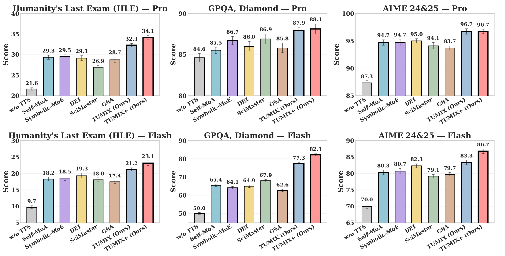

**图 1. 在 HLE、GPQA 和 AIME 24&25 上，比较基于 Gemini-2.5-Pro（第一行）与 Gemini-2.5-Flash（第二行）的工具增强测试时扩展方法。除不采用测试时扩展的方法（w/o TTS）和额外扩大规模的方法（TUMIX+）外，同一子图中的各方法使用的推理次数和 token 数量近乎相同。为公平比较，原本不使用工具的方法也采用能力较强的工具增强智能体运行，而非纯文本智能体。每项得分均为三次重复运行的平均值。**

## 1. 引言

基于强化学习的微调大幅改善了 LLM 的推理能力（Guo et al., 2025），但模型仍然难以处理某些看似简单的任务（Chen et al., 2024b）。这些任务往往更适合通过代码（Madaan et al., 2022；Chen et al., 2022）或搜索（Jin et al., 2025；Li et al., 2025b）解决。文本推理擅长语义理解与常识推断，但在精确计算以及获取、更新最新知识方面存在不足。

面对特征各异的问题，充分发挥文本推理、编程和搜索的潜在能力，是一个关键挑战。大多数输入问题并不会明确提示哪种方法最合适，而文本、代码和搜索组合形成的解空间又非常庞大。ChatGPT、Claude、Gemini 和 Grok 等前沿 LLM 产品均报告在测试时利用代码和搜索增强推理，但没有公布详细方法。近期研究（Chen et al., 2024b）表明，OpenAI 模型当前的代码解释器实现往往无法平衡文本与代码，导致编程能力未被充分利用，附录图 11 给出了例子。此外，公开研究仍未清楚说明如何将代码解释器与搜索结合起来，以改善 LLM 推理。

为了更充分地利用工具使用能力和 LLM 自身推理能力，我们提出 TUMIX，通过测试时扩展将代码解释器和搜索整合进 LLM。TUMIX 并行运行多个不同的智能体，每个采用不同的工具使用策略，其输出在多轮迭代中不断聚合、改进。每一轮，每个智能体都同时考虑原始问题和上一轮所有智能体的推理与答案，生成新的解答。

TUMIX 利用多样化智能体和工具增强推理策略探索广泛的潜在解法，随后的迭代过程促进多样化推理路径和更深入的整合。这一设计受到 Mixture-of-Agents（MoA）（Wang et al., 2024）等既有测试时扩展方法启发。MoA 在同一框架中使用多个 LLM，但不引入外部工具。相比之下，TUMIX 使用同一个 LLM，同时运行纯文本智能体与工具增强智能体框架，更易推广到实际应用。

此外，在工具增强的多智能体测试时扩展中，我们发现，一组多样化智能体优于对单个最佳智能体的重复使用；这一结论不同于 MoA 相关研究（Li et al., 2025a）。后文进一步表明，可以让 LLM 根据当前智能体自行设计更加多样、质量更高的新智能体，从而继续优化人工预先设计的智能体组；在不增加成本的情况下，平均准确率额外提升 1.2%。

问题的难度不同，所需的迭代改进程度也不同。我们询问 LLM 是否应提前终止改进，同时规定最低轮数，以维持答案质量。与原来的两种设置——固定轮数终止，或根据跨轮多数投票的一致性终止——相比，这种自适应提前终止策略将推理成本降至 49%，同时保持甚至改善性能。其原因在于，过度改进很少改变最终结果，有时还会因错误丢弃正确答案而损害性能。

与不采用测试时扩展的模型相比，TUMIX 在 Humanity’s Last Exam（HLE）（Phan et al., 2025）、Graduate-Level Google-Proof Q&A（GPQA，Diamond）（Rein et al., 2024）以及 American Invitational Mathematics Examination（AIME 24&25）上，基于 Gemini-2.5-Pro 和 Gemini-2.5-Flash 分别获得平均 +7.8% 和 +17.4% 的准确率提升。

在相同推理成本下，TUMIX 也优于 Self-MoA、Symbolic-MoE、DEI、SciMaster 和 GSA 等具有代表性的测试时扩展方法，相对于表现最好的基线，平均提升 +3.55%。进一步扩大规模后，TUMIX 将 Gemini-2.5-Pro 在 HLE 上的准确率从 21.6% 提高至 34.1%，超过 Gemini-2.5-Pro Deep Research 的 26.9%，也超过其在更高计算量下的 32.4%（Comanici et al., 2025）。

测试时扩展依赖两个阶段（Brown et al., 2024）：生成多样化候选解，以及从中选出正确解。无论答案空间较小，例如选择题，还是答案空间较大，多样化采样都能显著提高覆盖率。尽管在 HLE 上取得了很高的覆盖率——对于至少 65% 的问题，整轮生成的答案中至少有一个正确答案——最终准确率仍停留在约 34%，因为 LLM 难以从带有噪声的候选答案中识别正确答案。我们识别并研究了四个关键因素：智能体质量、智能体多样性、改进终止，以及答案选择。

本文的贡献如下：

1. **TUMIX：一种具有竞争力的工具增强测试时扩展方法。** 我们提出将工具增强整合到测试时扩展中的新框架。大量实验表明，TUMIX 持续优于强基线，相对于既有最佳方法平均提升 +3.55%。
2. **工具增强扩展中的关键因素与机制。** 我们系统分析了它与传统测试时扩展的区别。智能体多样性与质量比单纯扩大规模更重要：高温采样可以提高覆盖率，但与重复采样单个最佳智能体相比，采用异质策略的智能体能够以更低成本取得更高准确率。工具增强同样提升性能：配备代码解释器、搜索等工具的智能体组，其覆盖率与准确率均优于纯文本智能体组。
3. **将 LLM 用作智能体设计者。** 通过提示 LLM 基于现有智能体自动生成多样化、高质量智能体，可以进一步改善 TUMIX，额外带来平均 +1.2% 的准确率提升。
4. **利用 LLM-as-Judge 决定改进终止。** 我们引入基于 LLM 的评判器，自适应确定迭代改进的最佳停止轮次，以避免过度改进导致多样性下降及正确答案被错误丢弃。规定最低改进深度并询问评判器是否终止，可在取得近乎最优准确率的同时，将推理成本降至原来的约 49%。

## 2. 相关工作

**代码解释器与搜索。** 许多基准任务实际上更适合通过代码（Gao et al., 2023）和搜索（Li et al., 2025b）解决，近期研究还将编程扩展到推理和语义分析（Li et al., 2023a；Weir et al., 2024）。以往多数方法仅输出文本（Yao et al., 2024）或仅输出代码（Bairi et al., 2024；Zhou et al., 2023）。近期研究（Chen et al., 2024b）强调在不同模态之间动态切换的必要性，并提出 CodeSteer（Chen et al.）作为引导模型。加入检索（Jin et al., 2025；Li et al., 2025b）和工具使用（Qian et al., 2025）可进一步改善推理，但仍未充分发掘代码解释器与搜索工具的能力。

OpenAI 的 ChatGPT Agent、Google 的 Gemini-Pro（Comanici et al., 2025）和 xAI 的 Grok4 等领先模型，都报告在测试时使用代码和搜索增强推理，却未公布详细方法。ToRL（Li et al., 2025c）和 ReTool（Feng et al., 2025）等开放研究探索通过训练，让推理模型与代码解释器相结合。不过，其训练和评估仅限于数学问题，与要求在更广泛基准上有效工作的真实应用仍存在明显差距。

ToolRL（Qian et al., 2025）则侧重教模型在多个工具之间作出选择，其生成代码和搜索查询相对简单，评估任务对推理能力的要求也较低。SciMaster（Chai et al., 2025）对同一个预先设计的工具使用智能体采样五次，再让其他预先设计的智能体批评、改进并聚合答案。与单次推理的纯文本基线相比，这种方式有明显改善，但工具应被利用到什么程度、应如何利用，仍缺乏充分探索。将代码解释器与搜索融入 LLM 推理既重要又困难，学术界目前仍缺少充分利用 LLM 自身推理、代码执行和搜索三者优势的方法与研究，这正是本文的重点。

**测试时扩展。** LLM 的自我探索、反思和评估能够改善不同领域的任务表现（Yang et al., 2022；Welleck et al., 2022；Madaan et al., 2023）。OpenAI o1（Jaech et al., 2024）和 DeepSeek R1（Guo et al., 2025）等模型通过思维链（CoT）推理与自我反思展现出智能体行为，这些能力由采用基于规则的结果奖励的强化学习训练获得（Shao et al., 2024；Wei et al., 2025）。

除了通过训练扩大能力，许多研究还通过预先设计提示词和智能体框架，在 LLM 推理时进行扩展。在这些研究中，多智能体推理已成为一种有前景的范式，可增强 AI 系统解决复杂问题和作出决策的能力（Wu et al., 2023；Li et al., 2023b；Topsakal & Akinci, 2023）。先前研究发现，汇集不同 LLM 的答案可以改善性能（Du et al.）。MoA（Wang et al., 2024）进一步在 LLM 之间共享、汇集答案。Self-MoA（Li et al., 2025a）则认为 LLM 多样性未必关键，因为用表现最好的单个 LLM 替代不同类型的 LLM，反而取得了更好表现。Symbolic-MoE（Chen et al., 2025b）进一步将不同问题分配给不同的专业 LLM。

DEI（Zhang et al., 2024）、GSA（Li et al., 2025d）和 SETS（Chen et al., 2025a）等许多方法，采用同一个 LLM 构建不同智能体，而非使用不同类型的 LLM，进行大规模测试时扩展；相关工作还探索智能体类型与框架（Chen et al., 2024a）。与本文相似，既有测试时扩展研究也发现，正确答案的选择是主要瓶颈（Brown et al., 2024）。不过，以往这些方法并未整合代码解释器和搜索的工具使用；本文研究如何利用测试时扩展，更充分发挥每种推理模式的优势。

## 3. 工具使用混合

附录 B 给出了完整 TUMIX 算法，附录 C 列出了所有智能体的提示词。

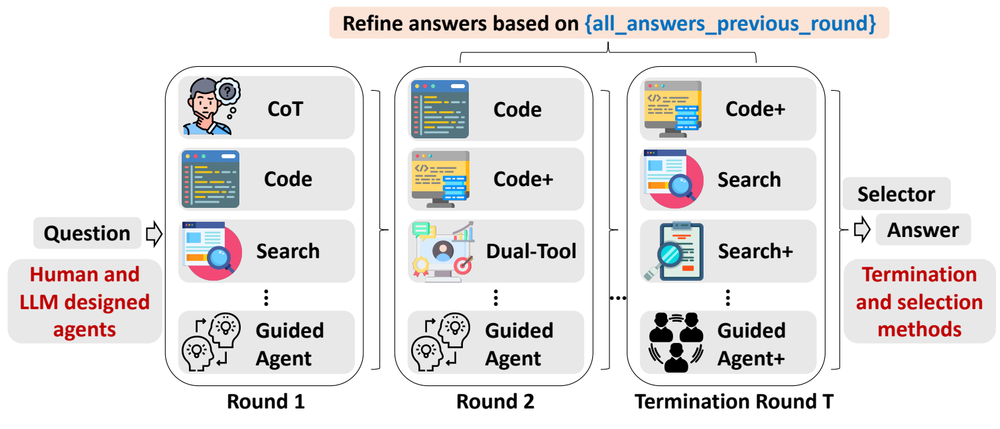

**图 2. TUMIX 框架总览。每次迭代中，将上一轮所有智能体的回答与原问题拼接，形成下一轮的联合提示词，再将其提供给所有智能体——可以沿用原智能体组，也可以使用新组——以生成改进后的答案。后续提示词遵循图示结构。智能体设计、数量与专业分工、改进终止条件，以及选择策略，是决定框架有效性的关键因素。**

> 图内文字：Question——问题；Human and LLM designed agents——人工及 LLM 设计的智能体；Round——轮次；Termination Round——终止轮次；Refine answers based on {all_answers_previous_round}——根据上一轮全部答案改进回答；Selector——选择器；Answer——答案；Termination and selection methods——终止与选择方法。Code、Search、Dual-Tool、Guided Agent 分别表示代码、搜索、双工具和受引导智能体。

### 3.1. 预先设计的多样化智能体

如图 2 所示，我们将 TUMIX 视为计算预算约束下，利用多样且相互关联的专家（智能体）进行序贯决策。每轮都要选择运行哪些智能体、允许它们读取什么内容（通信策略）、何时停止（最优停止），以及如何聚合（决策规则），从而权衡准确率与成本。

设 $q$ 为一个任务，其未知正确答案 $a^\star$ 位于答案空间 $\mathcal A$ 中。智能体池为 $\mathcal S=\{s_1,\ldots,s_K\}$。智能体 $s_i$ 以成本 $c_i$ 输出答案 $Y_i\in\mathcal A$，其能力为 $p_i(q)=\mathbb P\{Y_i=a^\star\mid q\}$。令 $Z_i=\mathbf1\{Y_i=a^\star\}$ 表示答案是否正确。它们之间的依赖关系，以及由此体现的集成多样性，可以用 $\{Z_i\}$ 上的相关性或互信息结构描述。

策略 $\pi$ 是本文的重点。它在每一轮选择：（i）运行哪些智能体；（ii）通信图，即各智能体可读取前几轮的哪些内容；（iii）停止规则；（iv）产生最终答案 $\hat a_\pi$ 的聚合规则。一个典型目标为：

$$
\max_\pi\ \mathbb P\{\hat a_\pi=a^\star\}-\lambda\,\mathrm{Cost}_\pi.
\tag{1}
$$

其中，$\lambda>0$ 用于权衡计算与准确率。本文的 $\mathrm{Cost}_\pi$ 指生成最终答案所需的总推理次数，以及输入、输出 token 总量。在默认 TUMIX 设置中，每轮答案改进都采用同样的 15 个预先设计智能体。这些智能体具有不同的推理与工具使用策略，见表 1。可使用搜索的智能体有三种搜索方式：Google Search API（gs）、LLM 内置搜索功能（llm），或二者结合（com），因此每类有三个变体。对于需要与搜索或代码解释器进行多轮交互的智能体，最大工具交互轮数设为 5。第 5.3 节讨论如何继续让 LLM 自动优化、设计更加多样的智能体，以改善性能。我们也与每轮改变智能体类型的动态设置进行比较。

**表 1. TUMIX 使用的 15 个预先设计智能体。**

| 全称 | 简称 | 描述（共 15 个智能体） |
|---|---|---|
| 不采用测试时扩展（w/o TTS） | Base | 直接提示。 |
| 思维链智能体（CoT Agent） | CoT | 思维链提示（Wei et al., 2022）。 |
| 思维链代码智能体（CoT-Code Agent） | CoT-code | 要求输出代码的思维链提示。 |
| 搜索智能体（Search Agent） | S | 使用网页搜索，仅使用 LLM 内置工具。 |
| 代码智能体（Code Agent） | C | 使用代码解释器，基础版本。 |
| 增强代码智能体（Code Agent+） | C+ | 使用代码解释器，提示增强版本，加入额外人工预设先验。 |
| 双工具智能体（Dual-Tool Agent） | CS | 使用代码解释器和网页搜索，具有三种搜索变体。 |
| 受引导智能体（Guided Agent） | CSG | 由引导模块（Chen et al.）指导双工具智能体 CS，具有三种搜索变体。 |
| 增强受引导智能体（Guided Agent+） | CSG+ | 使用增强／额外提示的受引导智能体 CSG，具有三种搜索变体。 |

### 3.2. 将改进视为消息传递：准确率提高，多样性缩小

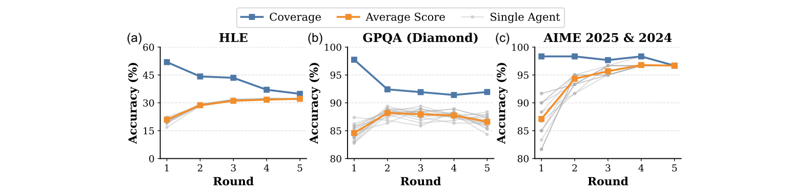

**图 3. 覆盖率、单个智能体得分和平均得分随改进轮次的变化。在各个基准上，覆盖率均单调下降。HLE 和 AIME 的平均得分在最初几轮上升，随后趋于稳定；GPQA 的平均得分在早期改善，但随着进一步改进而下降。**

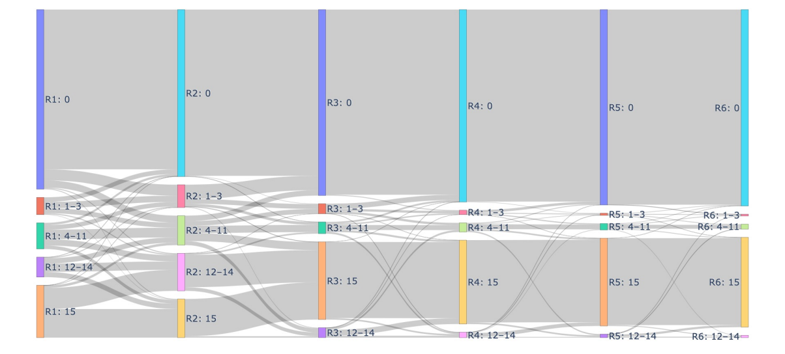

**图 4. 在 2500 道 HLE 问题上，能够正确作答的智能体数量随改进轮次变化的桑基图。根据分布动态，划分为五类：全部错误（0 个正确）、少量正确（1～3 个）、中等数量正确（4～11 个）、大量正确（12～14 个），以及全部正确（15 个）。**

如图 2 所示，每一轮中，各智能体独立地同时考虑原问题和上一轮所有智能体提供的解答，生成新的解答。我们用每轮智能体的平均准确率和覆盖率，即至少有一个答案正确的概率，评估改进过程。这两个指标反映群体答案的质量与多样性（Brown et al., 2024）。对一个集合 $S\subseteq\mathcal S$，覆盖率为：

$$
\mathrm{Coverage}(S)=\mathbb P\!\left(\bigcup_{i\in S}\{Y_i=a^\star\}\right).
\tag{2}
$$

在相互独立的条件下，$\mathrm{Coverage}(S)=1-\prod_{i\in S}(1-p_i)$。存在正相关时，覆盖率会缩小。图 3 展示了覆盖率、单个智能体准确率和平均得分随改进轮次变化的典型动态。在三个基准上，覆盖率持续下降，表明一些正确答案在迭代改进时被错误丢弃。需要指出，GPQA 从第 4 轮到第 5 轮的覆盖率略有回升；延长到第 6、7 轮后，覆盖率又按预期下降，说明这一反常只是暂时现象。

HLE 和 AIME 的平均得分在早期轮次上升，随后趋于稳定；GPQA 则从第 1 轮到第 2 轮改善，之后下降。图 4 展示了 2500 道 HLE 问题上的动态。从第 1 轮到第 2 轮，部分正确的情形——少量、中等数量、大量正确——增多，而全部错误和全部正确的情形均减少。这说明，初始的思路共享扩大了探索范围，促进了多样性。然而第 2 轮之后，部分正确的情形逐渐减少到接近零，全部错误和全部正确的情形则增加。这表明，随着轮次推进，智能体逐渐收敛到单一共享答案，而这一答案既可能正确，也可能错误。

### 3.3. 在最佳轮次终止，并选择最终答案

上述演变说明，逐轮改进不仅能在最初几轮改善答案，还会推动收敛，因为每个智能体都基于先前回答进行选择。然而，LLM 的推理能力有限，许多正确答案被过早丢弃。在早期轮次之后，继续改进很少进一步提高准确率，有时反而降低性能。因此，为兼顾稳健表现与成本效率，必须确定有效的终止策略。

令 $A_r$ 表示第 $r$ 轮后的准确率，再进行一轮的预期边际价值定义为：

$$
\Delta_r=\mathbb E\!\left[A_{r+1}-A_r\mid\text{截至第 }r\text{ 轮的信号}\right].
\tag{3}
$$

当首次出现 $\Delta_r\leq\lambda\times\text{边际成本}$ 时停止，这里的边际成本是增加的推理成本。实际的终止策略根据预估未来收益 $\Delta_r$ 决定是否停止，估计所依据的第 $r$ 轮统计信息包括：（i）多样性坍缩，例如覆盖率下降、意见一致程度上升；（ii）领先答案之间的票数差距；（iii）答案熵。

在 TUMIX 中，我们的终止判定策略是询问 LLM 是否应该停止改进，并根据当前轮次确定答案，同时规定最低轮数为 2。该策略仅需 49% 的推理成本，就能获得几乎相同的性能。第 5.2 节还研究了其他终止方法，例如连续两轮多数答案稳定时停止，或基于 LLM 置信度得分（Fu et al., 2025）停止，但这些方式的表现都较差。终止后，对智能体回答进行多数投票得到最终答案，并由 Gemini-2.5-Pro 选择最一致的输出。

## 4. 实验

### 4.1. 实验设置

**基准。** 为全面评估、比较各方法，我们选取三个有代表性的基准。这些基准都要求充分的推理与规划能力，尤其要求有效使用代码解释器和搜索。HLE（Phan et al., 2025）包含 2500 道极具挑战性的问题，涵盖数学、生物学、工程、计算机科学和社会科学等领域，被设计为衡量广泛学术能力的终极封闭式基准。我们评估了其纯文本和多模态子集。后续主要用 HLE 研究不同机制，因为它问题数量多、跨领域，而且最具挑战性。

GPQA（Rein et al., 2024）是由生物、物理和化学领域专家编写的选择题数据集。我们重点采用最常用的 GPQA Diamond 子集，其中包含 198 道经过精心筛选、难度最高的问题。AIME 2024&2025 则由 2024 和 2025 年 AIME 考试中的 60 道题组成，AIME 是一项难度很高的高中数学竞赛。所有报告结果均为三次独立运行的平均值。

**基线、TUMIX 消融与扩展、测试模型。** 如附录表 11 所示，我们比较以下方法：（1）Majority-Vote（Brown et al., 2024）；（2）GSA（Li et al., 2025d）；（3）Self-Reflection（Ji et al., 2023）；（4）SETS（Chen et al., 2025a）；（5）Self-MoA（Li et al., 2025a）；（6）Symbolic-MoE（Chen et al., 2025b）；（7）DEI（Zhang et al., 2024）；（8）SciMaster（Chai et al., 2025）。

对基线（1）至（4），我们采用 CS 智能体，它可完整访问代码解释器和搜索，首轮准确率也相对较高，见附录表 19。对基线（5）至（7），依照各方法原本的方式选择智能体。对 SciMaster，保留原始提示词与智能体，确保与已发表结果一致。通过调整智能体数量与采样重复次数，使所有基线的总推理次数与 TUMIX 匹配，保证公平比较。所有基线均可完整访问代码解释器和搜索。

我们还评估具有不同设计选择的 TUMIX 变体，既包括对框架组件的消融，也包括对现有 TUMIX 的改进，见附录表 20。TUMIX+ 使用更高推理成本测试扩展效果；其他变体的推理次数和 token 数量则近乎相同。我们在推理型 LLM Gemini-2.5-Pro 和 Gemini-2.5-Flash 上进行评估。

**评估流程。** 将答案与标准解比较，必要时由 Gemini-2.5-Pro 协助归一化答案格式，或直接担任答案比较的评判器。如果模型最终输出代码，则使用预定义算法提取代码并执行，得到最终结果。为避免无限循环，无论中间轮次还是最后一轮，所有代码执行均限制为 60 秒。中间轮次超时后，向模型返回“代码运行时错误”，让其重新生成；最后一轮超时则将任务判为失败。主要评估指标为成功率。除任务性能外，后文还分析各方法的 token 使用量和推理耗时。

### 4.2. 整体性能更优

**表 2. 基线与所提方法在 HLE、GPQA、AIME 24&25 上的实验结果。除单次推理的 w/o TTS 和扩大规模的 TUMIX+ 外，各方法的扩展推理成本相当。部分方法利用 Gemini-2.5-Pro 的 HLE 结果来选择其框架内的智能体，因此预先了解了 HLE，其结果不能严格视为测试性能；这些情形在 HLE 结果中以 * 标出。所有数值均为三次重复运行的平均值。准确率单位为 %。**

**Gemini-2.5-Pro**

| 方法 | HLE | GPQA | AIME 24&25 | 平均（归一化） |
|---|---:|---:|---:|---:|
| w/o TTS | 21.6 | 84.6 | 87.3 | 64.5 |
| Majority-Vote | 28.4 | 84.9 | 94.3 | 69.2 |
| Self-MoA | 29.3\* | 85.5 | 94.7 | 69.8 |
| Symbolic-MoE | 29.5\* | 86.7 | 94.7 | 70.3 |
| DEI | 29.1\* | 86.0 | 95.0 | 70.0 |
| Self-Reflection | 23.5 | 84.9 | 88.3 | 65.6 |
| SETS | 27.9 | 85.3 | 94.7 | 69.3 |
| SciMaster | 26.9 | 86.9 | 94.1 | 69.3 |
| GSA | 28.7 | 85.8 | 93.7 | 69.4 |
| TUMIX | 32.3 | 87.9 | 96.7 | 72.3 |
| TUMIX-FixedR | 32.4 | 86.8 | 95.6 | 71.6 |
| TUMIX-Evolve | 32.7\* | 88.1 | 96.7 | 72.5 |
| TUMIX+ | 34.1 | 88.3 | 96.7 | 73.0 |

**Gemini-2.5-Flash**

| 方法 | HLE | GPQA | AIME 24&25 | 平均（归一化） |
|---|---:|---:|---:|---:|
| w/o TTS | 9.7 | 50.0 | 70.0 | 43.2 |
| Majority-Vote | 17.9 | 63.1 | 80.0 | 53.7 |
| Self-MoA | 18.2 | 65.4 | 80.3 | 54.7 |
| Symbolic-MoE | 18.5 | 64.1 | 80.7 | 54.4 |
| DEI | 19.3 | 64.9 | 82.3 | 55.5 |
| Self-Reflection | 10.4 | 53.2 | 72.3 | 45.3 |
| SETS | 18.5 | 63.2 | 74.0 | 51.9 |
| SciMaster | 18.0 | 67.9 | 79.1 | 55.0 |
| GSA | 17.4 | 62.6 | 79.7 | 53.2 |
| TUMIX | 21.2 | 77.3 | 83.3 | 60.6 |
| TUMIX-FixedR | 20.9 | 76.8 | 83.3 | 60.3 |
| TUMIX-Evolve | 21.9 | 79.8 | 86.7 | 62.8 |
| TUMIX+ | 23.1 | 82.1 | 86.7 | 64.0 |

表 2 表明，TUMIX 优于全部基线。在 Gemini-2.5-Pro 和 Gemini-2.5-Flash 上，相对于最佳方法，平均准确率分别提高 2.0% 和 5.9%。与不共享答案的方法 Self-Reflection、SETS 相比取得更好表现，说明答案共享对多轮测试时扩展很重要。与不进行多轮改进的方法 Majority-Vote、Symbolic-MoE、DEI、GSA 的比较，体现了改进过程的益处；与缺少智能体多样性的方法 Self-MoA、SciMaster 的比较，则证实多样化智能体的价值。

SciMaster 在 HLE 上的准确率提升小于其作者报告的幅度。我们推测，这一差异源于工具不同，因为其搜索与代码解释器模块并未开源。附录表 12 同时报告均值与标准差；TUMIX 相对于最强基线的性能增益超过了报告的偏差，说明提升稳定、一致。采用其他 LLM 类型的补充实验（附录表 17）进一步证实了结果的稳健性和普适性。

为验证这些提升的统计可靠性，我们还根据多次运行得分进行了双侧配对 t 检验，见附录表 13。在几乎所有基准和模型上，所得 p 值均低于 0.05，表明 TUMIX 的改进具有统计显著性。

## 5. 讨论

### 5.1. 智能体多样性与质量至关重要

为研究多样性和质量对 TUMIX 性能的作用，我们比较了多样性与能力不同的智能体组，见图 5 和附录表 21。在相同改进轮数与推理次数下，将智能体数量从 1 增加到 3，再增加到 15，可使 HLE 和 GPQA 各轮次的覆盖率与平均得分显著提高，说明多样性对性能有明显帮助。此外，比较单个强智能体和单个弱智能体时，也可以观察到，更高质量的智能体持续带来更高覆盖率和平均得分。附录表 19 显示，CS-gs 的首轮得分高于 w/o TTS。

**代码解释器与搜索增加答案多样性。** 图 6 评估了三种设置，每组包含三个智能体，每个智能体每轮采样五次。不同组的工具权限不同：Code Text 组不能访问搜索，Search Text 组不能访问代码解释器，Code Search Text 组则可完整访问两种工具。尽管按附录表 19 的首轮得分衡量，各组智能体平均质量相当，但同时访问代码解释器与搜索的一组具有明显更高的覆盖率和平均得分。这表明，在智能体中整合互补工具可以同时增强推理和答案多样性，从而更有效地解决问题。

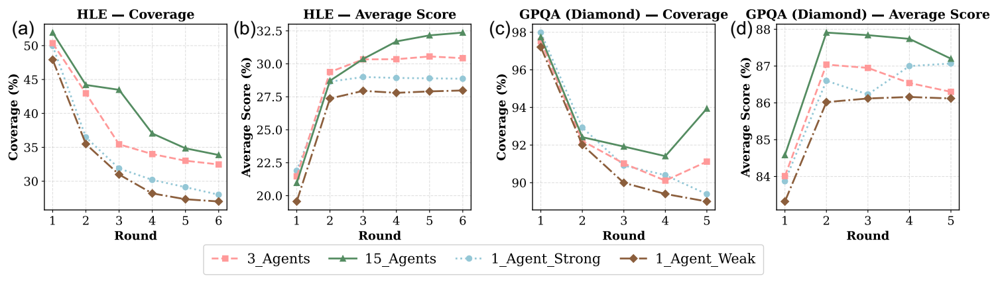

**图 5. 不同智能体多样性和质量设置下，覆盖率与平均得分随轮次的变化。15 Agents：全部 15 个不同的预设智能体，每轮各生成一个答案。3 Agents：三个强智能体 C+、CS-gs 和 CSG-gs，每轮各采样五次，它们是附录表 19 所示首轮表现最好的三个智能体。1 Agent Strong 和 1 Agent Weak：分别对 CS-gs 和 w/o TTS 采样 15 次。**

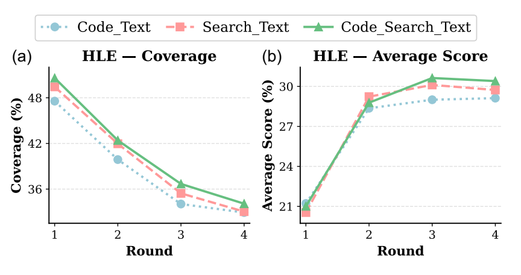

**图 6. 各组均包含三个智能体，但只能部分或完整使用文本推理、编程和搜索：Code Text（CoT、C、C+）、Search Text（CoT、S、CS-gs），以及 Code Search Text（CS-gs、C+、CSG-gs）。**

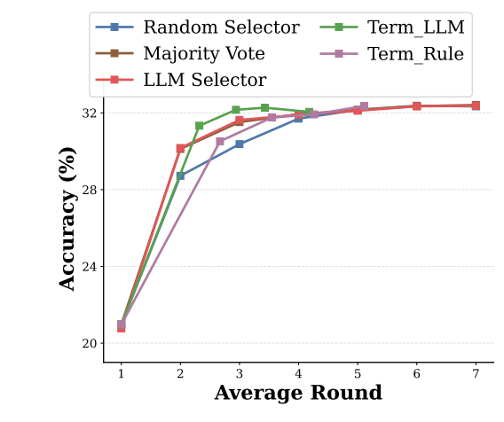

**图 7. 比较改进终止与答案选择策略，以更低成本取得更高准确率。**

> 图 3 至图 7 中的通用标注：Coverage——覆盖率；Average Score——平均得分；Single Agent——单个智能体；Round——轮次；Accuracy——准确率；Average Round——平均轮数；Random Selector——随机选择器；Majority Vote——多数投票；LLM Selector——LLM 选择器；Term_LLM 和 Term_Rule 分别表示基于 LLM 与基于规则的终止策略。

### 5.2. 终止与选择方法

**以 49% 的成本实现最优性能。** 难度不同的任务需要不同改进轮数，过度改进甚至可能降低准确率，见图 3b。因此，平衡性能与成本需要有效的终止策略。我们评估了第 3.3 节的两种策略：（1）Term_LLM，在满足最低轮数的前提下，询问 LLM 何时停止改进；（2）Term_Rule，同样规定最低轮数，在连续两轮多数答案稳定后停止。

我们改变最低轮数，在图 7 中观察性能随轮数增加的变化，并在附录表 21 比较峰值性能。Term_LLM 几乎达到了无限制改进的峰值准确率，却显著减少了轮数。平均而言，Term_LLM 保持了最优性能，但只需生成最终答案所需 LLM 推理次数的 49%，其中已计入 LLM 评判成本。token 成本更低，约为原来的 46%，因为后续轮次消耗的推理 token 多于最初两轮。这说明，用 LLM-as-Judge 判断改进是否充分、答案是否可以定稿，是有效的。

不过，Term_LLM 仍需规定最低改进轮数，本文在所有基准上均设为两轮。这是因为我们观察到，LLM 容易过度自信，即便继续改进能提升性能，也可能过早停止。附录 F 专门讨论最低改进轮数对 TUMIX 性能与效率的影响。

答案选择方面，我们比较三种策略：随机选择一个智能体答案、多数投票，以及使用 LLM-as-Selector 的 LLM 选择。图 7 显示，多数投票和 LLM 选择持续优于随机选择，尤其是在早期智能体答案尚有分歧时。然而，当后续轮次答案收敛后，各种选择方法的结果都相近，其影响可以忽略。多轮改进过程本身也是一种选择过程。我们还探索了基于 LLM token 置信度的改进选择（Fu et al., 2025），但未观察到显著差异，见附录图 13。

### 5.3. 人工预设智能体与 LLM 生成智能体

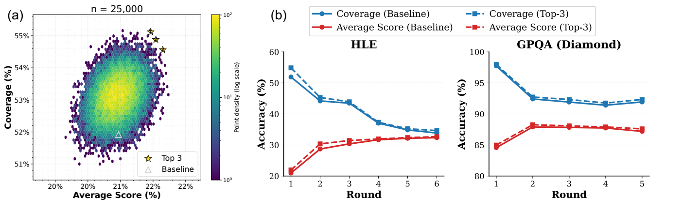

**图 8. 从 30 个智能体——15 个人工预设、15 个 LLM 生成——中采样 25000 个包含 15 个智能体的组合，评估覆盖率与平均得分。Baseline 为最初的 15 个人工预设智能体；Top-3 为在覆盖率与平均得分联合指标上表现最好的三个采样组合。**

人工设计的智能体及其工具使用策略基于已有框架或直觉。为探索能否自动发现更强智能体，我们将当前智能体代码示例提供给 Gemini-2.5-Pro，要求它生成更加多样、质量更高的智能体完整实现，完整输入提示见附录表 5。智能体的提示词与框架均由 LLM 决定。由此在 15 个人工设计智能体之外，生成了 25 个不同的新智能体，再保留其中在 HLE 首轮答案生成中表现最好的 15 个。

随后，将 15 个人工智能体和 15 个 LLM 智能体合并为 30 个智能体的池，随机采样每组 15 个的组合，并评估平均得分与覆盖率，见图 8a。与 15 个人工智能体构成的基线组，即灰色三角形相比，许多混合组在平均得分与覆盖率两方面都更高。我们按以下联合指标选出前三组：

$$
\mathrm{Combined\ Score}_i=
\frac{\mathrm{Coverage}_i}{\mathbb E[\mathrm{Coverage}]}
+\frac{\mathrm{Average\ Score}_i}{\mathbb E[\mathrm{Average\ Score}]}.
\tag{4}
$$

如图 8b 所示，这些组在 HLE 与 GPQA 上均优于原始 TUMIX。这表明，提高智能体多样性与质量可以改善有效性，LLM 生成智能体也有很大潜力进一步增强 TUMIX。附录表 22 描述了每种新智能体；其策略与原始智能体存在实质差异，而非仅改变提示词。附录表 23 列出前三个组合中的智能体，其中约一半与原组重合。

**每轮演化智能体以增强多样性。** 前述实验中，各改进轮次使用的智能体集合始终固定。现在研究每轮动态改变智能体类型是否能改善性能。如附录表 21 所示，每轮从前三组中随机选择智能体的变体 TUMIX-EvolveD，在三个基准上均略逊于固定组变体 TUMIX-Evolve。原因可能是有用的专业智能体被替换，导致智能体质量下降，解读或反思其他答案的能力减弱。不过，这一影响很小，因此我们认为智能体演化没有实质性影响。

**智能体类型数量的影响。** 接下来考察增加 TUMIX 智能体数量的边际收益。智能体从 30 个候选中随机采样，每个每轮贡献一次推理。为单独考察这一因素，我们去掉终止与选择环节，报告各轮平均准确率峰值的变化。图 10 显示，智能体少于 12 个时，准确率快速上升，此后增益则很小。这说明，超过一定规模后，继续增加智能体类型与推理预算作用不大。

在工具集合受限的情况下，智能体多样性与可行工具使用策略本身就有限，额外增加类型的边际收益会逐渐接近零；与此同时，候选答案增多，使逐轮选择越来越困难。基于这些结果，我们决定 TUMIX 只采用 15 个智能体，以平衡性能与成本。

### 5.4. 扩展曲线：性能与成本

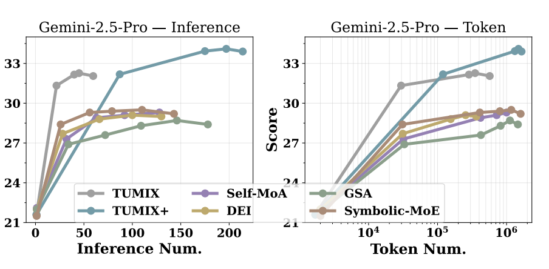

**图 9. 不同工具增强测试时扩展方法中，HLE 得分随推理成本和 token 总数的变化。token 数包括输入与输出 token。**

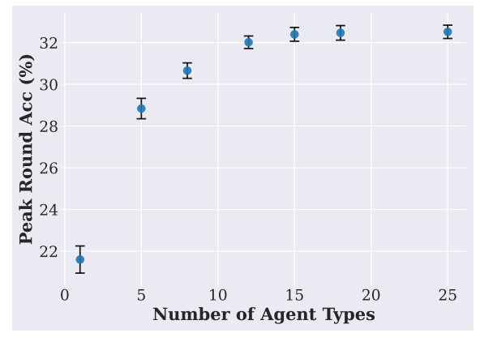

**图 10. 各轮准确率峰值与智能体类型数量的关系。智能体类型从 30 个表现良好的智能体中随机采样，重复三次。每个智能体每轮推理一次。**

> 图 8 至图 10 中的通用标注：Baseline——基线；Top-3——前三组合；Combined Score——联合得分；Inference Num.——推理次数；Token Num.——token 数量；Number of Agent Types——智能体类型数量；Peak Round Acc——各轮准确率峰值。

我们从推理成本与 token 成本两方面比较不同工具增强测试时扩展方法的扩展行为。在 TUMIX 和 Self-MoA 中，扩展来自增加改进轮数；在 GSA、DEI 和 Symbolic-MoE 中，来自重复推理；TUMIX+ 则同时使用两种方式。

如图 9 和附录图 12 所示，TUMIX 始终优于其他方法，以更少的推理步骤和 token 获得最高得分。TUMIX+ 在前两轮改进中各重复推理四次，可进一步提高峰值性能，但成本大幅增加、效率更低。附录 G 报告了工具延迟、代码执行时间和 API 费用，表明相对于 LLM 推理时间，全部工具操作的开销都较小，且 TUMIX 的经济成本低于或接近各基线。总体而言，测试时扩展需要多得多的推理次数，以及大约多两个数量级的 token；这一权衡似乎难以避免。

## 6. 结论

我们提出 TUMIX，利用多样化工具使用策略改善 LLM 推理。通过协调多个在文本推理、编程和搜索方面互补的智能体，TUMIX 在 HLE、GPQA 和 AIME 等高难度基准上显著提升性能。结果表明，这些增益来自智能体的多样性与质量，而非单纯扩大规模。

此外，自动生成智能体以及有依据的终止策略，既能提高准确率，又能显著改善效率，在不损害性能的情况下将推理成本减少近一半。我们揭示，有组织的多样性与有选择的改进，是最大程度发挥工具增强 LLM 潜力的关键。

## 伦理声明

本文通过测试时扩展，以代码解释器和搜索工具增强语言模型，推动基础模型发展，有望改善性能并提升与人类偏好的对齐程度。然而，这些能力本质上具有双重用途：相同技术本可增强模型生成无害输出的能力，但稍作修改也可能被滥用于生成有害内容。尽管存在滥用风险，我们认为其更广泛的社会收益超过风险。

## 可复现性声明

为提高可复现性，表 1 和表 22 详细描述了 15 个预设智能体与 15 个 LLM 生成智能体。全部智能体的提示词见附录 C，TUMIX 完整算法见附录 B。论文接收后，代码与数据集将以开源许可公开。

## 写作中使用大语言模型的说明

本文使用 LLM，具体为 Gemini 和 ChatGPT，作为通用写作辅助工具。我们将草稿交给模型进行语法纠正和结构优化，随后核查输出，必要时进一步编辑。使用范围严格限于文本润色，未用其生成新内容或参考文献。

## 致谢

作者感谢 Zifeng Wang 提供有益讨论与意见。本工作还受到美国海军研究办公室 ONR 项目 N00014-22-1-2478 和 MIT-IBM Watson AI Lab 的部分支持。本文仅反映作者的结论，不代表资助方。

## References

Ramakrishna Bairi, Atharv Sonwane, Aditya Kanade, Arun Iyer, Suresh Parthasarathy, Sriram Rajamani, B Ashok, and Shashank Shet. Codeplan: Repository-level coding using llms and planning. Proceedings of the ACM on Software Engineering, 1(FSE):675–698, 2024.

Bradley Brown, Jordan Juravsky, Ryan Ehrlich, Ronald Clark, Quoc V Le, Christopher Ré, and Azalia Mirhoseini. Large language monkeys: Scaling inference compute with repeated sampling. arXiv preprint arXiv:2407.21787, 2024.

Jingyi Chai, Shuo Tang, Rui Ye, Yuwen Du, Xinyu Zhu, Mengcheng Zhou, Yanfeng Wang, Yuzhi Zhang, Linfeng Zhang, Siheng Chen, et al. Scimaster: Towards general-purpose scientific ai agents, part i. x-master as foundation: Can we lead on humanity’s last exam? arXiv preprint arXiv:2507.05241, 2025.

Jiefeng Chen, Jie Ren, Xinyun Chen, Chengrun Yang, Ruoxi Sun, Jinsung Yoon, and Sercan Ö Arık. Sets: Leveraging self-verification and self-correction for improved test-time scaling. arXiv preprint arXiv:2501.19306, 2025a.

Justin Chih-Yao Chen, Sukwon Yun, Elias Stengel-Eskin, Tianlong Chen, and Mohit Bansal. Symbolic mixture-of-experts: Adaptive skill-based routing for heterogeneous reasoning. arXiv preprint arXiv:2503.05641, 2025b.

Wenhu Chen, Xueguang Ma, Xinyi Wang, and William W Cohen. Program of thoughts prompting: Disentangling computation from reasoning for numerical reasoning tasks. arXiv preprint arXiv:2211.12588, 2022.

Yongchao Chen, Yilun Hao, Yueying Liu, Yang Zhang, and Chuchu Fan. Codesteer: Symbolic-augmented language models via code/text guidance. In Forty-second International Conference on Machine Learning.

Yongchao Chen, Jacob Arkin, Yang Zhang, Nicholas Roy, and Chuchu Fan. Scalable multi-robot collaboration with large language models: Centralized or decentralized systems? In 2024 IEEE International Conference on Robotics and Automation (ICRA), pp. 4311–4317. IEEE, 2024a.

Yongchao Chen, Harsh Jhamtani, Srinagesh Sharma, Chuchu Fan, and Chi Wang. Steering large language models between code execution and textual reasoning. arXiv preprint arXiv:2410.03524, 2024b.

Gheorghe Comanici, Eric Bieber, Mike Schaekermann, Ice Pasupat, Noveen Sachdeva, Inderjit Dhillon, Marcel Blistein, Ori Ram, Dan Zhang, Evan Rosen, et al. Gemini 2.5: Pushing the frontier with advanced reasoning, multimodality, long context, and next generation agentic capabilities. arXiv preprint arXiv:2507.06261, 2025.

Yilun Du, Shuang Li, Antonio Torralba, Joshua B Tenenbaum, and Igor Mordatch. Improving factuality and reasoning in language models through multiagent debate. In Forty-first International Conference on Machine Learning.

Jiazhan Feng, Shijue Huang, Xingwei Qu, Ge Zhang, Yujia Qin, Baoquan Zhong, Chengquan Jiang, Jinxin Chi, and Wanjun Zhong. Retool: Reinforcement learning for strategic tool use in llms. arXiv preprint arXiv:2504.11536, 2025.

Yichao Fu, Xuewei Wang, Yuandong Tian, and Jiawei Zhao. Deep think with confidence. arXiv preprint arXiv:2508.15260, 2025.

Luyu Gao, Aman Madaan, Shuyan Zhou, Uri Alon, Pengfei Liu, Yiming Yang, Jamie Callan, and Graham Neubig. Pal: Program-aided language models. In International Conference on Machine Learning, pp. 10764–10799. PMLR, 2023.

Nicholas Glaser, Maxime Peyrard, and Robert West. Summscreen: A dataset for abstractive screenplay summarization. In Proceedings of the 60th Annual Meeting of the Association for Computational Linguistics (ACL), pp. 8565–8580, Dublin, Ireland, 2022. Association for Computational Linguistics. URL https://aclanthology.org/2022.acl-long.589.

Daya Guo, Dejian Yang, Haowei Zhang, Junxiao Song, Ruoyu Zhang, Runxin Xu, Qihao Zhu, Shirong Ma, Peiyi Wang, Xiao Bi, et al. Deepseek-r1: Incentivizing reasoning capability in llms via reinforcement learning. arXiv preprint arXiv:2501.12948, 2025.

Luyang Huang, Shuyang Cao, Nikolaus Parulian, Heng Ji, and Jonathan May. Efficient attentions for long document summarization. arXiv preprint arXiv:2104.02112, 2021. URL https://arxiv.org/abs/2104.02112.

Aaron Jaech, Adam Kalai, Adam Lerer, Adam Richardson, Ahmed El-Kishky, Aiden Low, Alec Helyar, Aleksander Madry, Alex Beutel, Alex Carney, et al. Openai o1 system card. arXiv preprint arXiv:2412.16720, 2024.

Ziwei Ji, Tiezheng Yu, Yan Xu, Nayeon Lee, Etsuko Ishii, and Pascale Fung. Towards mitigating llm hallucination via self reflection. In Findings of the Association for Computational Linguistics: EMNLP 2023, pp. 1827–1843, 2023.

Bowen Jin, Hansi Zeng, Zhenrui Yue, Jinsung Yoon, Sercan Arik, Dong Wang, Hamed Zamani, and Jiawei Han. Search-r1: Training llms to reason and leverage search engines with reinforcement learning. arXiv preprint arXiv:2503.09516, 2025.

Chengshu Li, Jacky Liang, Andy Zeng, Xinyun Chen, Karol Hausman, Dorsa Sadigh, Sergey Levine, Li Fei-Fei, Fei Xia, and Brian Ichter. Chain of code: Reasoning with a language model-augmented code emulator. arXiv preprint arXiv:2312.04474, 2023a.

Guohao Li, Hasan Hammoud, Hani Itani, Dmitrii Khizbullin, and Bernard Ghanem. Camel: Communicative agents for” mind” exploration of large language model society. Advances in Neural Information Processing Systems, 36:51991–52008, 2023b.

Wenzhe Li, Yong Lin, Mengzhou Xia, and Chi Jin. Rethinking mixture-of-agents: Is mixing different large language models beneficial? arXiv preprint arXiv:2502.00674, 2025a.

Xiaoxi Li, Guanting Dong, Jiajie Jin, Yuyao Zhang, Yujia Zhou, Yutao Zhu, Peitian Zhang, and Zhicheng Dou. Search-o1: Agentic search-enhanced large reasoning models. arXiv preprint arXiv:2501.05366, 2025b.

Xuefeng Li, Haoyang Zou, and Pengfei Liu. Torl: Scaling tool-integrated rl. arXiv preprint arXiv:2503.23383, 2025c.

Zichong Li, Xinyu Feng, Yuheng Cai, Zixuan Zhang, Tianyi Liu, Chen Liang, Weizhu Chen, Haoyu Wang, and Tuo Zhao. Llms can generate a better answer by aggregating their own responses. arXiv preprint arXiv:2503.04104, 2025d.

Chin-Yew Lin. Rouge: A package for automatic evaluation of summaries. In Text Summarization Branches Out: Proceedings of the ACL-04 Workshop, pp. 74–81, Barcelona, Spain, 2004. Association for Computational Linguistics.

Aman Madaan, Shuyan Zhou, Uri Alon, Yiming Yang, and Graham Neubig. Language models of code are few-shot commonsense learners. arXiv preprint arXiv:2210.07128, 2022.

Aman Madaan, Niket Tandon, Prakhar Gupta, Skyler Hallinan, Luyu Gao, Sarah Wiegreffe, Uri Alon, Nouha Dziri, Shrimai Prabhumoye, Yiming Yang, et al. Self-refine: Iterative refinement with self-feedback. arXiv preprint arXiv:2303.17651, 2023.

Long Phan, Alice Gatti, Ziwen Han, Nathaniel Li, Josephina Hu, Hugh Zhang, Chen Bo Calvin Zhang, Mohamed Shaaban, John Ling, Sean Shi, et al. Humanity’s last exam. arXiv preprint arXiv:2501.14249, 2025.

Cheng Qian, Emre Can Acikgoz, Qi He, Hongru Wang, Xiusi Chen, Dilek Hakkani-Tür, Gokhan Tur, and Heng Ji. Toolrl: Reward is all tool learning needs. arXiv preprint arXiv:2504.13958, 2025.

David Rein, Betty Li Hou, Asa Cooper Stickland, Jackson Petty, Richard Yuanzhe Pang, Julien Dirani, Julian Michael, and Samuel R Bowman. Gpqa: A graduate-level google-proof q&a benchmark. In First Conference on Language Modeling, 2024.

Uri Shaham, Yonatan Belinkov, Jonas Pfeiffer, Emanuele Bugliarello, Pasquale Minervini, Ryan Cotterell, Anders Søgaard, Felix Reutner, Andreas Rücklé, Ivan Vulic, Hinrich Schütze, Iryna Gurevych, Yulia Tsvetkov, Tom McCoy, Yonatan Bisk, and Gabriel Stanovsky. Scrolls: Standardized comparison over long language sequences. In Proceedings of the 2022 Conference on Empirical Methods in Natural Language Processing (EMNLP), pp. 11892–11912, Abu Dhabi, United Arab Emirates, 2022. Association for Computational Linguistics. URL https://aclanthology.org/2022.emnlp-main.823.

Zhihong Shao, Peiyi Wang, Qihao Zhu, Runxin Xu, Junxiao Song, Xiao Bi, Haowei Zhang, Mingchuan Zhang, YK Li, Y Wu, et al. Deepseekmath: Pushing the limits of mathematical reasoning in open language models. arXiv preprint arXiv:2402.03300, 2024.

Oguzhan Topsakal and Tahir Cetin Akinci. Creating large language model applications utilizing langchain: A primer on developing llm apps fast. In International Conference on Applied Engineering and Natural Sciences, volume 1, pp. 1050–1056, 2023.

Junlin Wang, Jue Wang, Ben Athiwaratkun, Ce Zhang, and James Zou. Mixture-of-agents enhances large language model capabilities. arXiv preprint arXiv:2406.04692, 2024.

Jason Wei, Xuezhi Wang, Dale Schuurmans, Maarten Bosma, Fei Xia, Ed Chi, Quoc V Le, Denny Zhou, et al. Chain-of-thought prompting elicits reasoning in large language models. Advances in neural information processing systems, 35:24824–24837, 2022.

Yuxiang Wei, Olivier Duchenne, Jade Copet, Quentin Carbonneaux, Lingming Zhang, Daniel Fried, Gabriel Synnaeve, Rishabh Singh, and Sida I Wang. Swe-rl: Advancing llm reasoning via reinforcement learning on open software evolution. arXiv preprint arXiv:2502.18449, 2025.

Nathaniel Weir, Muhammad Khalifa, Linlu Qiu, Orion Weller, and Peter Clark. Learning to reason via program generation, emulation, and search. arXiv preprint arXiv:2405.16337, 2024.

Sean Welleck, Ximing Lu, Peter West, Faeze Brahman, Tianxiao Shen, Daniel Khashabi, and Yejin Choi. Generating sequences by learning to self-correct. In The Eleventh International Conference on Learning Representations, 2022.

Qingyun Wu, Gagan Bansal, Jieyu Zhang, Yiran Wu, Shaokun Zhang, Erkang Zhu, Beibin Li, Li Jiang, Xiaoyun Zhang, and Chi Wang. Autogen: Enabling next-gen llm applications via multi-agent conversation framework. arXiv preprint arXiv:2308.08155, 2023.

Kevin Yang, Yuandong Tian, Nanyun Peng, and Dan Klein. Re3: Generating longer stories with recursive reprompting and revision. In Proceedings of the 2022 Conference on Empirical Methods in Natural Language Processing, pp. 4393–4479, 2022.

Shunyu Yao, Dian Yu, Jeffrey Zhao, Izhak Shafran, Tom Griffiths, Yuan Cao, and Karthik Narasimhan. Tree of thoughts: Deliberate problem solving with large language models. Advances in Neural Information Processing Systems, 36, 2024.

Kexun Zhang, Weiran Yao, Zuxin Liu, Yihao Feng, Zhiwei Liu, Rithesh Murthy, Tian Lan, Lei Li, Renze Lou, Jiacheng Xu, et al. Diversity empowers intelligence: Integrating expertise of software engineering agents. arXiv preprint arXiv:2408.07060, 2024.

Aojun Zhou, Ke Wang, Zimu Lu, Weikang Shi, Sichun Luo, Zipeng Qin, Shaoqing Lu, Anya Jia, Linqi Song, Mingjie Zhan, et al. Solving challenging math word problems using gpt-4 code interpreter with code-based self-verification. arXiv preprint arXiv:2308.07921, 2023.

# 附录：TUMIX——基于工具使用混合的多智能体测试时扩展

| 附录 | 内容 | 原文页码 |
|---|---|---:|
| A | GPT-5 在代码／文本选择中失败的例子 | 16 |
| B | TUMIX 算法 | 17 |
| C | TUMIX 提示词 | 18 |
| D | 基线方法 | 19 |
| E | TUMIX 与基线测试结果的统计显著性 | 21 |
| F | 最低改进轮数对 TUMIX 性能与效率的影响 | 23 |
| G | 运行稳定性与经济效率分析 | 23 |
| H | 四种不同基座模型上的 w/o TTS、DEI、TUMIX 实验结果 | 24 |
| I | TUMIX 在开放式摘要任务上的表现 | 25 |
| J | HLE 多轮答案改进中的智能体准确率与覆盖率 | 26 |
| K | TUMIX 变体的说明与实验结果 | 27 |
| L | 完全由 Gemini-2.5-Pro 自动设计的 TUMIX 新智能体 | 28 |
| M | Gemini-2.5-Flash 的扩展行为 | 29 |
| N | 通过不同类型 LLM 及其混合提高性能 | 30 |
| O | TUMIX 在开放式任务中的应用：摘要 | 30 |
| P | LLM 对生成回答的 token 置信度 | 31 |

## A. GPT-5 在代码／文本选择中失败的例子

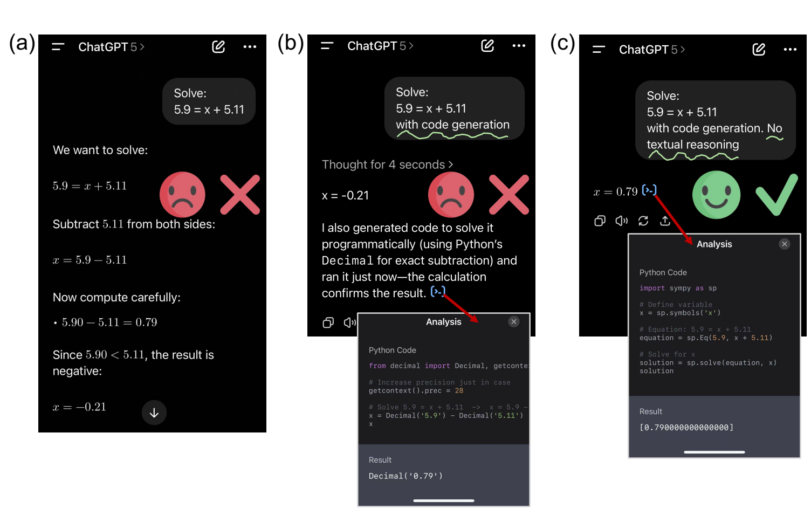

**图 11. GPT-5 在代码／文本选择中失败的例子。本例中，文本推理给出了错误解答（a），而通过生成代码可以轻松解决（c）。然而，GPT-5 仍对文本推理过度自信，即使被提示使用代码，且生成的代码已给出正确解答，它依然依赖文本推理（b）。**

> 图中问题为求解 $5.9=x+5.11$。（a）模型先正确写出 $x=5.9-5.11$，随后却将差值的符号判断错误，最终给出 $x=-0.21$。（b）用户要求生成代码后，模型仍回答 $x=-0.21$，尽管其使用 Python `Decimal` 执行的结果是 `Decimal('0.79')`。（c）用户明确要求“生成代码，不进行文本推理”后，模型给出正确答案 $x=0.79$。

## B. TUMIX 算法

**算法 1. TUMIX：多智能体测试时扩展，仅保留答案。**

```text
输入：问题 q；智能体池 S = {s_1, ..., s_K}
      ▷ 15 个预设智能体，包括代码、搜索与双工具变体
输入：最低轮数 r_min = 2；最高轮数 r_max；工具交互预算 R_tool = 5；
      代码时间限制 τ = 60 秒

 1: A_0 ← ∅                              ▷ 上一轮答案
 2: 对 r = 1, 2, ..., r_max：
      // 第 r 轮消息传递：各智能体读取 q 与上一轮答案
 3:   对每个 s ∈ S，并行执行：
 4:       p_r^s ← BuildPrompt(q, A_(r-1)) ▷ 将 q 与上一轮全部答案拼接
 5:       y_r^s ← AgentCall(s, p_r^s, R_tool, τ)
                                          ▷ 工具增强推理，见算法 2
 6:   A_r ← {y_r^s : s ∈ S}
 7:   若 r ≥ r_min，且 LLMTerminate(q, A_r) = STOP：
 8:       跳出循环
 9:   结束条件判断
10: 结束循环
11: a* ← MajorityVote(A_r)
12: 返回 a*
```

**算法 2. `AgentCall(s, p, R_tool, τ)`：智能体 s 的工具增强推理，仅返回答案。**

```text
 1: h ← p；b ← 0                         ▷ h 为当前上下文，b 统计工具交互次数
 2: 当 b < R_tool 时：
 3:   o ← LLMGenerate(s, h)              ▷ 按智能体 s 的策略／提示词运行
 4:   若 o 包含最终答案 y：
 5:       返回 o
 6:   否则，若 o 提出代码，且 s 允许使用代码解释器：
 7:       r ← ExecuteCode(o, τ)          ▷ 硬限制 60 秒；收集标准输出、图像和文件
 8:       若 RuntimeError(r)：
 9:           h ← h ∥ “运行时错误：”r；b ← b + 1；继续循环
10:       否则：
11:           h ← h ∥ “代码结果：”r；b ← b + 1；继续循环
12:       结束条件判断
13:   否则，若 o 发出搜索查询，且 s 允许搜索：
14:       E ← WebSearch(o)              ▷ 支持 gs、llm、com 三种变体
15:       h ← h ∥ “检索证据：”E；b ← b + 1；继续循环
16:   否则：
17:       h ← h ∥ “利用当前上下文继续推理。” ▷ 鼓励自我反思
18:   结束条件判断
19: 结束循环
20: o ← LLMGenerate(s, h)               ▷ 预算耗尽，要求作出决定
21: 返回 o
```

## C. TUMIX 提示词

**表 3. 根据上一轮所有智能体答案进行答案改进的提示词。**

```text
任务：根据下列其他智能体给出的答案，确定最终答案。

问题：
{question}

多种方法提供的候选答案：
{joined answers}

根据上述候选答案，逐步分析问题，并尽量列出所有需要仔细注意的要点。
在回答末尾，直接以 <<<answer content>>> 的格式输出问题答案。
```

**表 4. 将 LLM 用作改进终止评判器的提示词。**

```text
任务：仔细评估下列用 <<< >>> 包围的答案是否已形成清晰且强烈的共识，
或是否还需要一轮推理，以提高一致性。

重要：如果在推理、措辞、强调重点、结论或关键细节的解释方面存在任何差异，
应保守地决定继续改进。

当前轮数为 {round num}。注意：除非答案在逻辑和语言两方面完全一致，
否则在第 3 轮之前定稿并不常见，也不鼓励这样做。

问题：
{question}

不同方法提供的候选答案：
{joined answers}

指示：
1. 识别措辞、结构或逻辑上的任何差异。
2. 尤其注意结论或强调重点上的细微变化。
3. 宁可谨慎：只要存在任何含糊或分歧，就建议再进行一轮。

首先输出你的判断理由，然后明确以 <<<YES>>> 结束，表示答案高度一致，
可以安全定稿；或以 <<<NO>>> 结束，表示仍需进一步改进。
```

**表 5. 让 Gemini-2.5-Pro 根据人工预设智能体代码，合成多样化、高质量智能体的提示词。**

```text
任务：根据现有智能体的完整代码，生成新的、多样化、高质量智能体。
你可以完整使用代码解释器与搜索工具。输出每个新智能体的完整实现代码。
将智能体框架代码和提示词代码分成两个文件。

指示：生成在推理与工具使用策略上完全不同的智能体，而非仅限于优化提示词。

现有智能体代码：
{agent code}

输出：
```

**表 6. 思维链智能体（CoT Agent）的前置提示词。**

```text
• 逐步分析问题，并尽量列出所有需要仔细注意的要点。
• 然后通过逐步分析，尝试得到最终答案。
• 在回答末尾，直接输出问题答案。

不要输出用于执行的代码。
```

**表 7. 思维链代码智能体（CoT-Code Agent）的前置提示词。**

````text
你是一位乐于助人的 AI 助手。使用你的编程技能解决任务。

在以下情况下，向用户提供可执行的 Python 代码，放在 Python 代码块内。
• 一次回答中不要包含多个代码块，只包含一个。
• 不要要求用户复制粘贴运行结果。适当时应使用 print 函数输出结果。

如果需要，可逐步思考任务。如果没有提供计划，先解释你的计划。
你可以先用文字输出思考步骤，再给出最终 Python 代码。

记住，在最终代码中，仍需在最后的 print 中输出每个数字或选项！

使用 ```python 开始 Python 代码块。
````

**表 8. 代码智能体（Code Agent）的前置提示词。**

````text
用户提出问题，由你解决。你首先生成推理和思考过程，然后向用户提供最终答案。

在思考过程中，你可以生成 Python 代码，用于高效搜索、优化与计算，
代码块以 ```python 开始。一次代码请求必须只包含一个脚本，
并使用 print 函数输出结果。代码脚本完成后，停止生成。

随后，代码解释器平台会执行代码，并返回执行输出与错误。
一旦你认为已准备好最终答案，就在回答末尾直接以 <<<answer content>>> 格式返回答案。
否则，可以继续推理，并可能进一步生成代码请求来解决问题。
````

**表 9. 双工具智能体（Dual-Tool Agent）的前置提示词。**

````text
用户提出问题，由你解决。你首先生成推理和思考过程，然后向用户提供最终答案。

在思考过程中，你可以生成 Python 代码，用于高效搜索、优化与计算，
代码块以 ```python 开始。一次代码请求必须只包含一个脚本，
并使用 print 函数输出结果。代码脚本完成后，停止生成。
随后，代码解释器平台会执行代码，并返回执行输出与错误。

如果缺少相关知识，可以使用 Google 搜索工具搜索网页、获取信息。
搜索查询的调用格式为 <search>你的搜索查询</search>，
例如 <search>现任美国总统是谁？</search>。
搜索结果将放在 <information> 与 </information> 之间返回。
搜索查询完成后，停止生成，由搜索平台返回检索结果。

如果需要搜索网页，不要在同一次回答中生成代码，反之亦然。
也可以不使用代码和搜索，只通过文本推理解决问题。

一旦你认为已准备好最终答案，就在回答末尾直接以 <<<answer content>>> 格式返回答案。
否则，可以继续推理，并可能生成更多代码或搜索查询来解决问题。
````

**表 10. 受引导智能体（Guided Agent）的前置提示词。**

````text
你正在引导另一个 TaskLLM 解决任务。你将看到一个可通过文本推理、编程和网页搜索
解决的任务。有时，TaskLLM 需要额外帮助，例如生成代码或搜索网页。
在提出查询和返回答案时，都必须遵循以下规则：

在思考过程中，你可以生成 Python 代码，用于高效搜索、优化与计算，
代码块以 ```python 开始。一次代码请求必须只包含一个脚本，
并使用 print 函数输出结果。代码脚本完成后，停止生成。
随后，代码解释器平台会执行代码，并返回执行输出与错误。

如果缺少相关知识，可以使用 Google 搜索工具搜索网页、获取信息。
搜索查询的调用格式为 <search>你的搜索查询</search>，
例如 <search>现任美国总统是谁？</search>。
搜索结果将放在 <information> 与 </information> 之间返回。
搜索查询完成后，停止生成，由搜索平台返回检索结果。

如果需要搜索网页，不要在同一次回答中生成代码，反之亦然。
也可以不使用代码和搜索，只通过文本推理解决问题。

一旦你认为已准备好最终答案，就在回答末尾直接以 <<<answer content>>> 格式返回答案。
否则，可以继续推理，并可能生成更多代码或搜索查询来解决问题。

你的目标是确定哪种方法最适合解决任务，然后生成指导提示词，
让 TaskLLM 在下一轮遵循。最终返回的指导提示词应放在 <<< 与 >>> 之间，
例如 <<<你需要生成更复杂的代码来解决……>>>。

现在，任务如下：
````

## D. 基线方法

**表 11. 与 TUMIX 比较的基线方法。**

| 方法 | 处理类型 | 描述 |
|---|---|---|
| Majority-Vote | 投票 | 单个智能体并行进行多次推理，通过多数投票决定最终答案，不共享中间结果。使用 CS 智能体。 |
| GSA | 聚合 | 类似 Majority-Vote，但让同一 LLM 以多个样本为条件生成新回答。使用 CS 智能体。 |
| Self-Reflection | 迭代改进 | 单个智能体通过反思过去回答来迭代改进答案，每轮最多访问 10 条历史回答；实验中改为 8 或 15 条，性能没有变化。使用 CS 智能体。 |
| SETS | 多次试验投票 | 同一 LLM 多次进行自我反思试验，以多数投票选出最终答案。使用 CS 智能体。 |
| Self-MoA | 最佳智能体选择 | 从 15 个候选中选择表现最好的智能体，用于并行采样、答案共享和多轮改进。原方法在不同 LLM 中选最佳 LLM；本文改为在同一 LLM 内选择最佳智能体。 |
| Symbolic-MoE | 专家选择 | 将问题分类，例如代数、概率、编程、生物学，预先测试每类最好的三个智能体；再由 LLM 判断问题类别，将测试题分配给对应的三个智能体进行采样、聚合。 |
| DEI | 委员会启发式 | 选择最好的五个智能体，通过重复采样生成多个答案，再由预定义智能体委员会结合启发式规则选出最佳答案。 |
| SciMaster | 批评与改进 | 对同一个预设工具使用智能体采样五次，再让其他智能体批评、改进并聚合答案。保留原始提示词和智能体。 |

**表 12. 基线与所提方法在 HLE、GPQA、AIME 24&25 上的实验结果。除单次推理 w/o TTS 和扩大规模的 TUMIX+ 外，各方法扩展推理成本相当。一些方法用 Gemini-2.5-Pro 的 HLE 结果选择框架内智能体，因此已预先了解 HLE，其结果不能严格视为测试性能，对应 HLE 结果以 * 标注。数值为三次重复运行的平均值；此处同时给出均值与标准差，覆盖约 68% 的置信区间。**

**Gemini-2.5-Pro**

| 方法 | HLE | GPQA | AIME 24&25 | 平均 |
|---|---:|---:|---:|---:|
| w/o TTS | 21.6 ± 0.3 | 84.6 ± 0.5 | 87.3 ± 0.4 | 64.5 ± 0.4 |
| Self-MoA | 29.3 ± 0.5\* | 85.5 ± 0.4 | 94.7 ± 0.5 | 69.8 ± 0.5 |
| Symbolic-MoE | 29.5 ± 0.4\* | 86.7 ± 0.5 | 94.7 ± 0.6 | 70.3 ± 0.5 |
| DEI | 29.1 ± 0.6\* | 86.0 ± 0.6 | 95.0 ± 0.4 | 70.0 ± 0.5 |
| SciMaster | 26.9 ± 0.4 | 86.9 ± 0.6 | 94.1 ± 0.6 | 69.3 ± 0.5 |
| GSA | 28.7 ± 0.7 | 85.8 ± 0.6 | 93.7 ± 0.4 | 69.4 ± 0.6 |
| TUMIX | 32.3 ± 0.4 | 87.9 ± 0.4 | 96.7 ± 0.5 | 72.3 ± 0.4 |
| TUMIX+ | 34.1 ± 0.5 | 88.3 ± 0.6 | 96.7 ± 0.4 | 73.0 ± 0.5 |

**Gemini-2.5-Flash**

| 方法 | HLE | GPQA | AIME 24&25 | 平均 |
|---|---:|---:|---:|---:|
| w/o TTS | 9.7 ± 0.5 | 50.0 ± 0.5 | 70.0 ± 0.7 | 43.2 ± 0.6 |
| Self-MoA | 18.2 ± 0.6 | 65.4 ± 0.6 | 80.3 ± 0.7 | 54.7 ± 0.6 |
| Symbolic-MoE | 18.5 ± 0.7 | 64.1 ± 0.7 | 80.7 ± 0.8 | 54.4 ± 0.7 |
| DEI | 19.3 ± 0.8 | 64.9 ± 0.7 | 82.3 ± 0.6 | 55.5 ± 0.7 |
| SciMaster | 18.0 ± 0.6 | 67.9 ± 0.7 | 79.1 ± 0.6 | 55.0 ± 0.6 |
| GSA | 17.4 ± 0.5 | 62.6 ± 0.7 | 79.7 ± 0.6 | 53.2 ± 0.6 |
| TUMIX | 21.2 ± 0.5 | 77.3 ± 0.7 | 83.3 ± 0.7 | 60.6 ± 0.6 |
| TUMIX+ | 23.1 ± 0.7 | 82.1 ± 0.6 | 86.7 ± 0.7 | 64.0 ± 0.7 |

## E. TUMIX 与基线测试结果的统计显著性

**配对显著性检验。** 为计算 p 值，我们对各次运行的得分差 $d_i=x_i-y_i$ 进行双侧配对 t 检验。检验统计量为：

$$
t=\frac{\bar d}{s_d/\sqrt n},\qquad
s_d=\sqrt{\frac{\sum_i(d_i-\bar d)^2}{n-1}}.
$$

自由度为 $\mathrm{df}=n-1$，相应 p 值为：

$$
p=2\left[1-F_t\!\left(|t|;\mathrm{df}=n-1\right)\right].
$$

其中，$F_t$ 为 t 分布的累积分布函数。当 $p<0.05$ 时，认为差异具有统计显著性。

**表 13. 各数据集上 TUMIX 与基线 DEI、SciMaster、Symbolic-MoE、GSA、Self-MoA 的统计显著性。p 值来自三次运行（$n=3$）的逐次得分差 $d_i=x_i-y_i$ 的双侧配对 t 检验。✓ 表示 $p<0.05$，即具有统计显著性；○ 表示差异不显著。**

| 模型 | 任务 | TUMIX | 对比 DEI：p 值／显著性 | 对比 SciMaster | 对比 Symbolic-MoE | 对比 GSA | 对比 Self-MoA |
|---|---|---:|---:|---:|---:|---:|---:|
| Gemini-2.5-Pro | HLE | 32.3 ± 0.4 | <0.01 ✓ | $<10^{-4}$ ✓ | <0.01 ✓ | <0.01 ✓ | <0.01 ✓ |
| Gemini-2.5-Pro | GPQA | 87.9 ± 0.4 | 0.014 ✓ | 0.084 ○ | 0.034 ✓ | 0.010 ✓ | 0.002 ✓ |
| Gemini-2.5-Pro | AIME | 96.7 ± 0.5 | 0.011 ✓ | <0.01 ✓ | 0.012 ✓ | 0.002 ✓ | 0.008 ✓ |
| Gemini-2.5-Flash | HLE | 21.2 ± 0.5 | 0.033 ✓ | <0.01 ✓ | <0.01 ✓ | <0.01 ✓ | <0.01 ✓ |
| Gemini-2.5-Flash | GPQA | 77.3 ± 0.7 | $<10^{-4}$ ✓ | $<10^{-4}$ ✓ | $<10^{-4}$ ✓ | $<10^{-4}$ ✓ | $<10^{-4}$ ✓ |
| Gemini-2.5-Flash | AIME | 83.3 ± 0.7 | 0.135 ○ | <0.01 ✓ | 0.014 ✓ | 0.003 ✓ | 0.006 ✓ |

## F. 最低改进轮数对 TUMIX 性能与效率的影响

为避免半自适应改进过程中过早终止，我们规定最低改进轮数。表 14 对这一超参数进行了消融研究。我们发现，至少进行两轮改进，可以显著改善 Gemini-2.5-Pro 与 Gemini-2.5-Flash 的表现。继续将最低轮数提高到两轮以上，HLE 得分增益很小，却大幅增加 token 消耗。因此，默认采用最低两轮，以取得性能与计算效率之间的最佳权衡。

**表 14. 半自适应终止机制中最低改进轮数要求的消融研究。最低轮数设为 2，可以持续改善各模型 HLE 得分，并保持较好的 token 成本。继续增加轮数，性能增益很小，计算成本却显著上升。**

| 最低轮数 | 1 | 2 | 3 | 4 |
|---|---:|---:|---:|---:|
| HLE 得分，Gemini-2.5-Pro | 31.3 | 32.2 | 32.3 | 32.1 |
| token 成本，Gemini-2.5-Pro，单位：千 token | 29.6 | 285 | 350 | 570 |
| HLE 得分，Gemini-2.5-Flash | 21.7 | 23.0 | 23.1 | 23.0 |
| token 成本，Gemini-2.5-Flash，单位：千 token | 22.7 | 230 | 300 | 522 |

## G. 运行稳定性与经济效率分析

对于实际运行时间，我们选择了更稳定、更可复现的衡量方式。实际经过时间会受到网络延迟、服务器负载和具体硬件条件等因素影响，波动较大，难以公平比较。为了实现标准化且不依赖硬件的比较，论文报告 API token 数量和 LLM 推理次数，将其直接作为计算成本的代理指标。这样，评估可以反映方法自身的内在效率，而不依赖实验环境。

虽然总体实际耗时不是可靠的性能指标，我们仍在表 15 补充报告平均代码执行时间与搜索延迟。这些时间受到生成代码及搜索查询内容的影响，但 TUMIX 与基线的平均延迟非常接近。所有工具每次查询的平均运行时间都小于 7 秒，远低于 LLM 推理时间，后者对 Gemini-2.5-Pro 通常超过 50 秒。由于每次工具使用均对应一次 LLM 推理，这说明工具使用延迟不是计算瓶颈。

**表 15. 每次查询的平均工具延迟。虽然不同任务的工具延迟略有变化，但均远低于典型 LLM 推理时间，说明调用工具的额外开销可忽略。**

| 工具 | 平均运行时间，秒 |
|---|---:|
| 代码解释器执行 | 2.3 |
| Google Search API | 1.2 |
| Gemini-2.5-Pro 搜索 | 6.9 |
| Gemini-2.5-Flash 搜索 | 4.5 |

我们还在表 16 报告 TUMIX 与强基线每个样本的平均 API 费用，包括输入／输出 token、Google Search API 和 Gemini Search API。尽管性能与效率更高，TUMIX 的成本却低于或接近大多数基线。

这些分析说明，TUMIX 在保持更优性能的同时，具有较好的计算效率与经济效率。延迟与费用分析进一步支持了该方法的实用性。

**表 16. HLE／GPQA／AIME 中每个样本的平均 API 费用，单位为美元。TUMIX 在保持更好性能和计算效率的同时，费用与基线相当或更低。**

| 方法 | Gemini-2.5-Pro | Gemini-2.5-Flash |
|---|---:|---:|
| TUMIX | 1.70 | 0.82 |
| DEI | 1.59 | 0.84 |
| SciMaster | 1.93 | 0.92 |
| Symbolic-MoE | 2.19 | 0.99 |
| GSA | 2.25 | 0.99 |
| Self-MoA | 2.23 | 0.96 |

## H. 四种不同基座模型上的 w/o TTS、DEI、TUMIX 实验结果

**表 17. 四种不同基座模型上的 w/o TTS、DEI、TUMIX 实验结果。每个单元格中的三个数值依次对应 w/o TTS、DEI 和 TUMIX。**

| 模型 | HLE | GPQA | AIME 2024&2025 |
|---|---|---|---|
| Claude-sonnet-4-20250514 | 8.2，15.8，**21.8** | 44.6，61.4，**72.3** | 34.4，55.0，**70.8** |
| DeepSeek-R1 | 15.2，23.7，**29.0** | 74.7，78.0，**81.2** | 69.3，85.0，**88.3** |
| GPT-oss-120B | 13.6，15.4，**17.8** | 66.3，70.1，**72.3** | 60.2，82.7，**89.1** |
| Qwen3-32B | 13.1，16.0，**18.0** | 54.6，64.1，**68.3** | 59.6，84.4，**88.1** |

## I. TUMIX 在开放式摘要任务上的表现

**表 18. TUMIX 在 SCROLLS 开放式摘要任务上的表现。TUMIX 在不同数据集与模型上持续优于不采用测试时扩展的 w/o TTS 和最佳基线 DEI，取得最好的 ROUGE-1／2／L F1 得分。**

| 指标（数据集） | 模型 | w/o TTS | DEI（Zhang et al., 2024） | TUMIX |
|---|---|---:|---:|---:|
| ROUGE-1（GovReport） | Gemini-2.5-Flash | 0.440 | 0.458 | 0.466 |
| ROUGE-1（GovReport） | GPT-oss-120B | 0.447 | 0.462 | 0.468 |
| ROUGE-2（GovReport） | Gemini-2.5-Flash | 0.162 | 0.176 | 0.182 |
| ROUGE-2（GovReport） | GPT-oss-120B | 0.152 | 0.169 | 0.175 |
| ROUGE-L（GovReport） | Gemini-2.5-Flash | 0.204 | 0.216 | 0.222 |
| ROUGE-L（GovReport） | GPT-oss-120B | 0.203 | 0.214 | 0.220 |
| ROUGE-1（SummScreen-FD） | Gemini-2.5-Flash | 0.282 | 0.315 | 0.323 |
| ROUGE-1（SummScreen-FD） | GPT-oss-120B | 0.273 | 0.304 | 0.310 |
| ROUGE-2（SummScreen-FD） | Gemini-2.5-Flash | 0.056 | 0.064 | 0.063 |
| ROUGE-2（SummScreen-FD） | GPT-oss-120B | 0.051 | 0.058 | 0.060 |
| ROUGE-L（SummScreen-FD） | Gemini-2.5-Flash | 0.137 | 0.149 | 0.153 |
| ROUGE-L（SummScreen-FD） | GPT-oss-120B | 0.134 | 0.146 | 0.149 |

## J. HLE 多轮答案改进中的智能体准确率与覆盖率

**表 19. HLE 上各智能体准确率、平均准确率及覆盖率随轮次的变化。双工具智能体、受引导智能体、增强受引导智能体分别有三种搜索策略变体：Google Search API（gs）、LLM 内置搜索功能（llm），或二者结合（com）。**

| HLE 指标／智能体 | 第 1 轮 | 第 2 轮 | 第 3 轮 | 第 4 轮 | 第 5 轮 | 第 6 轮 |
|---|---:|---:|---:|---:|---:|---:|
| 覆盖率 | 51.92 | 44.20 | 43.48 | 37.04 | 34.85 | 33.87 |
| 平均准确率 | 21.13 | 28.72 | 30.37 | 31.70 | 32.16 | 32.37 |
| w/o TTS | 20.32 | 28.08 | 30.88 | 31.60 | 32.18 | 32.36 |
| 思维链智能体（CoT） | 20.84 | 28.16 | 30.40 | 31.12 | 32.30 | 32.48 |
| 思维链代码智能体（CoT-code） | 18.36 | 28.28 | 31.40 | 31.52 | 31.96 | 32.40 |
| 搜索智能体（S） | 21.72 | 29.04 | 28.84 | 32.08 | 32.08 | 32.20 |
| 代码智能体（C） | 21.16 | 29.68 | 31.40 | 31.96 | 32.12 | 32.36 |
| 增强代码智能体（C+） | 22.96 | 29.00 | 31.44 | 31.88 | 32.20 | 32.40 |
| 双工具智能体（CS-gs） | 22.96 | 28.60 | 30.84 | 31.72 | 32.24 | 32.36 |
| 双工具智能体（CS-llm） | 21.36 | 28.36 | 31.28 | 31.20 | 32.48 | 32.32 |
| 双工具智能体（CS-com） | 20.76 | 28.56 | 30.36 | 31.44 | 32.32 | 32.48 |
| 受引导智能体（CSG-gs） | 22.04 | 28.72 | 29.96 | 32.24 | 32.00 | 31.96 |
| 受引导智能体（CSG-llm） | 21.20 | 28.64 | 29.20 | 31.52 | 32.16 | 32.32 |
| 受引导智能体（CSG-com） | 20.76 | 28.92 | 29.88 | 31.88 | 32.20 | 32.40 |
| 增强受引导智能体（CSG+-gs） | 20.56 | 29.32 | 30.36 | 31.92 | 31.84 | 32.52 |
| 增强受引导智能体（CSG+-llm） | 21.56 | 28.80 | 29.20 | 31.64 | 32.16 | 32.52 |
| 增强受引导智能体（CSG+-com） | 20.44 | 28.68 | 30.08 | 31.72 | 32.28 | 32.48 |

## K. TUMIX 变体的说明与实验结果

**表 20. TUMIX 框架及其变体，用于消融核心组件。**

| 方法 | 消融的组件 | 描述 |
|---|---|---|
| TUMIX | 主方法，默认设置 | 询问 LLM 决定最佳终止轮次，最低两轮；最终采用多数投票。 |
| TUMIX-Rule | 终止 | 将 LLM 终止判断替换为规则：连续两轮多数答案稳定时停止。 |
| TUMIX-Fixed | 终止 | 将智能终止替换为固定五轮，然后多数投票。 |
| TUMIX-FixedR | 终止与选择 | 固定五轮，然后随机选择答案。 |
| TUMIX-Evolve | 智能体组成 | 将 15 个人工设计智能体替换为表现最好的 LLM 生成智能体构成的静态组，各改进轮次沿用该组。 |
| TUMIX-EvolveD | 智能体组成 | 在上述变体基础上，每轮从演化智能体的前三组中动态采样一个新组。 |
| TUMIX-Single | 智能体多样性 | 用 CS 系列中的单一智能体类型替换 15 个不同智能体，以消融多样性。 |
| TUMIX-Three | 智能体多样性 | 仅使用三种智能体类型 CS、C+ 和 CSO，每轮每种采样五次，以降低多样性。 |
| TUMIX+ | 推理扩展 | 扩展 TUMIX，在最初两轮中，每个智能体以不同温度推理四次。 |

> 译注：表 20 的第三种智能体在原文中写作“CSO”，此处保留原文记法。

**表 21. TUMIX 各变体的实验结果。所有数值均为三次重复运行的平均值，成功率单位为 %。**

**Gemini-2.5-Pro**

| 方法 | HLE | GPQA | AIME 24&25 | 平均（归一化） |
|---|---:|---:|---:|---:|
| TUMIX | 32.3 | 87.9 | 96.7 | 72.3 |
| TUMIX-Single | 29.0 | 86.1 | 95.0 | 70.0 |
| TUMIX-Three | 30.2 | 86.6 | 95.3 | 70.7 |
| TUMIX-FixedR | 32.4 | 86.8 | 95.6 | 71.6 |
| TUMIX-Fixed | 32.4 | 86.7 | 96.7 | 71.9 |
| TUMIX-Rule | 32.4 | 87.7 | 96.7 | 72.3 |
| TUMIX-Evolve | 32.7 | 88.1 | 96.7 | 72.5 |
| TUMIX-EvolveD | 32.1 | 87.4 | 96.1 | 71.9 |
| TUMIX+ | 34.1 | 88.3 | 96.7 | 73.0 |

**Gemini-2.5-Flash**

| 方法 | HLE | GPQA | AIME 24&25 | 平均（归一化） |
|---|---:|---:|---:|---:|
| TUMIX | 21.2 | 77.3 | 83.3 | 60.6 |
| TUMIX-Single | 18.2 | 65.8 | 80.6 | 54.9 |
| TUMIX-Three | 18.6 | 67.1 | 81.2 | 55.6 |
| TUMIX-FixedR | 20.9 | 76.8 | 83.3 | 60.3 |
| TUMIX-Fixed | 20.8 | 77.1 | 83.3 | 60.4 |
| TUMIX-Rule | 21.3 | 77.4 | 83.3 | 60.7 |
| TUMIX-Evolve | 21.9 | 79.8 | 86.7 | 62.8 |
| TUMIX-EvolveD | 21.3 | 78.3 | 86.7 | 62.1 |
| TUMIX+ | 23.1 | 82.1 | 86.7 | 64.0 |

## L. 完全由 Gemini-2.5-Pro 自动设计的 TUMIX 新智能体

**表 22. 15 个 LLM 生成智能体的概览，按框架特征分类。**

**迭代型智能体：多轮对话框架。**

| 全称 | 简称 | 描述 |
|---|---|---|
| 规划－验证－改进（Plan-Verify-Refine） | PVR | 迭代地制定计划、执行一个动作（代码或搜索），再根据检查器反馈改进。 |
| 先搜索后代码（SearchThenCode） | S→C | 在迭代循环中，强制先搜索，再执行代码。 |
| 先代码后搜索（CodeThenSearch） | C→S | 在迭代循环中，强制先执行代码，再搜索。 |
| 约束剪枝求解器（ConstraintPrune-Solver） | CP-solv | 在检查器及代码／搜索工具引导下，利用约束迭代裁剪解空间。 |
| 蒙特卡洛验证（MonteCarlo-Verify） | MCV | 通过代码进行蒙特卡洛采样，寻找可能答案，再用确定性方法验证。 |
| 辩论交叉质询（Debate-CrossExam） | DCE | 模拟提议者与怀疑者辩论，以引导工具使用，并由检查器进行交叉质询。 |
| 多跳搜索聚合（MultiHop-Search-Aggregate） | $S_m\to C$ | 强制至少连续执行两次搜索，之后才允许执行代码。 |
| 测试驱动代码求解器（TDD-Code-Solver） | TDD-solv | 列出测试、编写能通过测试的代码，并用检查器进行迭代改进。 |

**顺序型智能体：少样本、非对话框架。**

| 全称 | 简称 | 描述 |
|---|---|---|
| 先搜索后回答（SearchThenAnswer） | S→A | 两步智能体，强制先进行一次网页搜索，再形成最终答案。 |
| 先规划后代码（PlanThenCode） | P→C | 两步智能体，先生成计划，再生成单个代码块执行计划。 |
| 验证器改进（VerifierRefine） | VR | 三步智能体，先生成文本答案，再通过检查器验证，最后改进。 |
| 工具选择器（ToolSelector） | TS | 第一步明确选择搜索、代码或文本中的一种，随后完成作答。 |
| 假设剪枝代码（HypothesisPruner-Code） | HP-code | 生成代码，依据问题约束枚举并裁剪候选解假设。 |
| 双搜索共识（DualSearch-Consensus） | $S^2_{\mathrm{con}}$ | 发出两个不同的搜索查询，再综合结果形成共识答案。 |
| 测试驱动代码再修复（TDD-CodeThenFix） | TDD-fix | 采用测试驱动开发：编写测试与代码，测试失败时再生成修复。 |

**表 23. TUMIX 中原始智能体组与表现最好的三个组的比较。每组有 15 个智能体，来自预设或 LLM 生成智能体。各智能体名称对应表 1 和表 22。**

| 原始组 | Top-3-1 | Top-3-2 | Top-3-3 |
|---|---|---|---|
| w/o TTS | HypothesisPruner-Code | TDD-Code-Solver | w/o TTS |
| CoT Agent | CoT Agent | CoT Agent | CoT Agent |
| CoT-Code Agent | Plan-Verify-Refine | CoT-Code Agent | CoT-Code Agent |
| Search Agent | Search Agent | Search Agent | SearchThenCode |
| Code Agent | Code Agent | Code Agent | TDD-Code-Solver |
| Code Agent+ | SearchThenCode | Code Agent+ | HypothesisPruner-Code |
| Dual-Tool Agent (gs) | Dual-Tool Agent (gs) | SearchThenCode | DualSearch-Consensus |
| Dual-Tool Agent (llm) | ConstraintPrune-Solver | Plan-Verify-Refine | MonteCarlo-Verify |
| Dual-Tool Agent (com) | MonteCarlo-Verify | Dual-Tool Agent (com) | ConstraintPrune-Solver |
| Guided Agent (gs) | Guided Agent (gs) | Guided Agent (gs) | Debate-CrossExam |
| Guided Agent (llm) | Guided Agent (llm) | Guided Agent (llm) | Guided Agent (llm) |
| Guided Agent (com) | Debate-CrossExam | Guided Agent (com) | Guided Agent (com) |
| Guided Agent+ (gs) | Guided Agent+ (gs) | MonteCarlo-Verify | Guided Agent+ (gs) |
| Guided Agent+ (llm) | SearchThenAnswer | Guided Agent+ (llm) | Plan-Verify-Refine |
| Guided Agent+ (com) | DualSearch-Consensus | DualSearch-Consensus | Guided Agent+ (com) |

## M. Gemini-2.5-Flash 的扩展行为

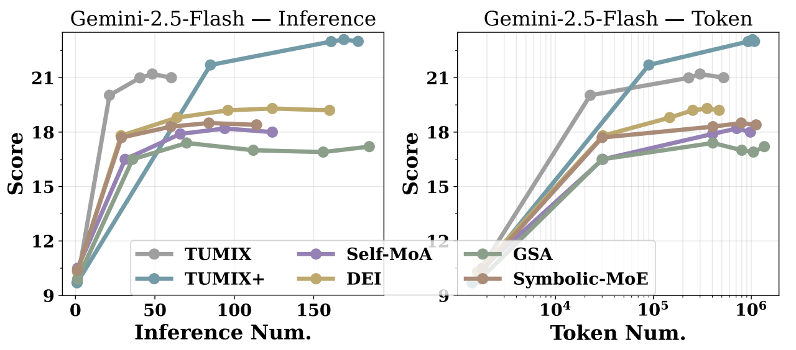

**图 12. 不同工具增强测试时扩展方法中，Gemini-2.5-Flash 的 HLE 得分随推理成本和 token 总数的变化。token 数包括输入与输出 token。**

## N. 通过不同类型 LLM 及其混合提高性能

附录表 17 将评估扩展到四种新基座模型：Claude-sonnet-4-20250514、DeepSeek-R1、GPT-oss-120B 和 Qwen3-32B。我们将 TUMIX 与基础方法 w/o TTS、最强基线 DEI 比较。在三个基准和四个基座模型上，TUMIX 始终能以相近 token 成本获得更好表现，体现了它在不同 LLM 上的稳健性与广泛适用性。

我们也研究异质模型混合，即让不同 LLM 驱动不同智能体。具体而言，将智能体平均分配给 GPT-oss-120B 和 Qwen3-32B，它们在附录表 17 中的能力接近。如表 24 所示，混合智能体配置在各轮次上均优于对应的单模型配置，说明异质性增强了推理多样性与协作。

不过，当模型能力差距很大时，例如 DeepSeek-R1 与较弱模型结合，性能会下降。这说明，当参与模型能力相近时，混合最有效。这些发现再次强调多样性的重要性，也表明 TUMIX 能较好地推广到不同模型家族和异质智能体设置。

**表 24. 混合 LLM 与单一 LLM 智能体的比较。上半部分为能力相近模型 GPT-oss-120B、Qwen3-32B 的混合；下半部分为能力差距较大的混合，即 DeepSeek-R1 与 GPT+Qwen。**

| 组合类型 | 基座模型 | 设置 | HLE | GPQA | AIME 2024&2025 |
|---|---|---|---:|---:|---:|
| 能力相近 | GPT-oss-120B | 单一模型 | 17.8 | 72.3 | 89.1 |
| 能力相近 | GPT-oss-120B | 混合 GPT+Qwen | 19.8 | 75.5 | 90.6 |
| 能力相近 | Qwen3-32B | 单一模型 | 18.0 | 68.3 | 88.1 |
| 能力相近 | Qwen3-32B | 混合 GPT+Qwen | 19.0 | 70.0 | 91.4 |
| 能力差距较大 | DeepSeek-R1 | 单一模型 | 29.0 | 81.2 | 88.3 |
| 能力差距较大 | DeepSeek-R1 | 混合 DeepSeek+GPT+Qwen | 22.6 | 73.4 | 91.8 |

## O. TUMIX 在开放式任务中的应用：摘要

为了进一步检验该方法能否超越结构化推理基准、适用于更一般场景，我们在答案正确性可能不明确的开放式真实任务中测试 TUMIX。我们采用长文档摘要这一同时要求理解与抽象能力的代表性开放任务。

具体使用 SCROLLS 套件（Shaham et al., 2022）的两个基准：（1）GovReport（Huang et al., 2021），由美国政府的多页报告 CRS／GAO 组成；（2）SummScreen-FD（Glaser et al., 2022），包含电视剧集转录文本及人工撰写的剧情摘要。这些数据集由真实、长篇文档和人工参考答案构成，支持可复现、客观的评估。

我们报告标准的 ROUGE-1／2／L F1 指标（Lin, 2004），分别衡量一元词、二元词及序列层面的重叠程度。如附录表 18 所示，在两个数据集上，以 Gemini-2.5-Flash 和 GPT-oss-120B 为基座模型时，TUMIX 相比 w/o TTS 与 DEI 持续改善 ROUGE-1／2／L 得分，体现了它对开放式真实任务的稳健适应能力。

## P. LLM 对生成回答的 token 置信度

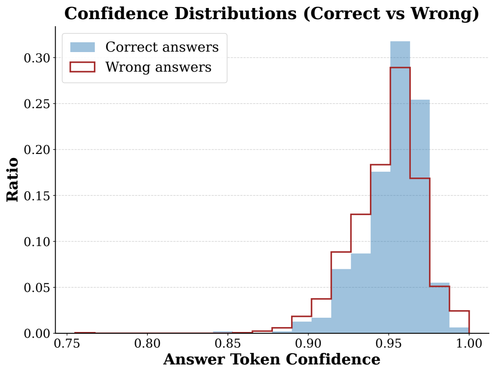

**图 13. 正确与错误答案的 LLM 回答置信度分布。回答置信度根据整个生成回答的平均 token 概率计算。此处以 CoT 智能体回答为代表，因为我们发现不同智能体的分布特征非常接近。**

> 图内文字：Confidence Distributions (Correct vs Wrong)——置信度分布：正确与错误对比；Correct answers——正确答案；Wrong answers——错误答案；Ratio——比例；Answer Token Confidence——答案 token 置信度。
