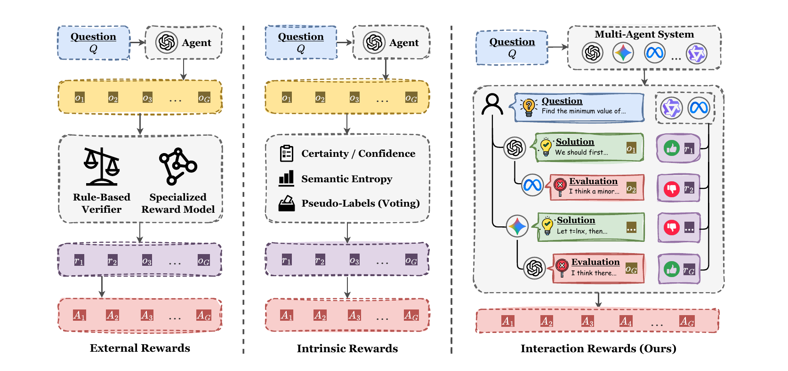
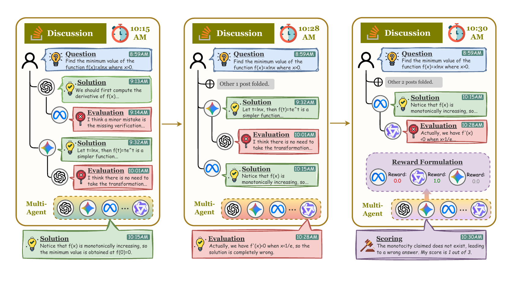
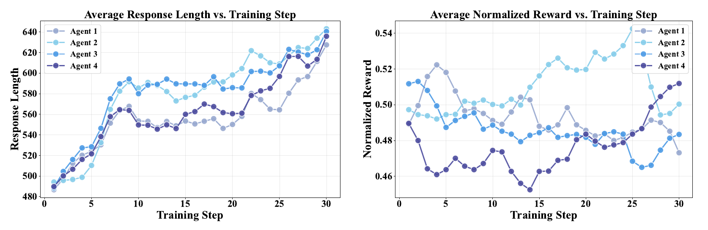
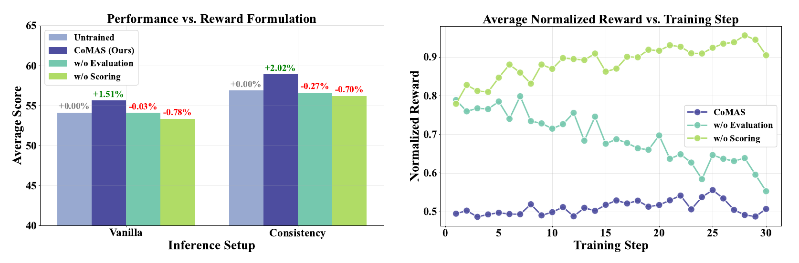
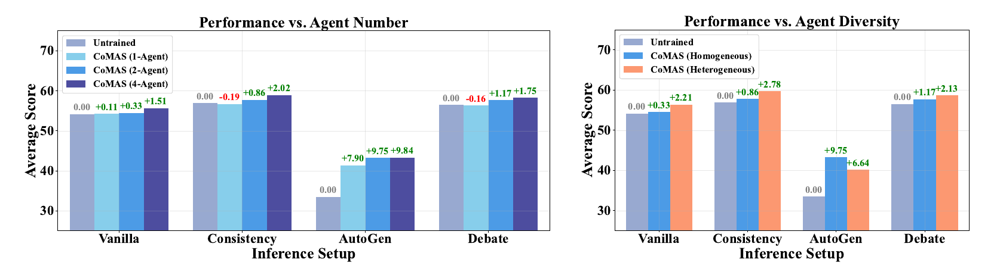

# CoMAS：通过交互奖励实现多智能体系统协同演化

**原文题目：** CoMAS: Co-Evolving Multi-Agent Systems via Interaction Rewards  
**作者：** Xiangyuan Xue¹˒²、Yifan Zhou³、Guibin Zhang⁴、Zaibin Zhang⁵˒⁶、Yijiang Li⁷、Chen Zhang²、Zhenfei Yin⁶（通信作者）、Philip Torr⁶、Wanli Ouyang¹˒²˒⁸（通信作者）、Lei Bai²（通信作者）  
**单位：** ¹香港中文大学；²上海人工智能实验室；³佐治亚大学；⁴新加坡国立大学；⁵大连理工大学；⁶牛津大学；⁷加利福尼亚大学圣迭戈分校；⁸Shenzhen Loop Area Institute（原文机构名）  
**通信邮箱：** jeremyyin@robots.ox.ac.uk；wlouyang@ie.cuhk.edu.hk；baisanshi@gmail.com  
**会议：** 第 14 届国际学习表征会议（ICLR 2026），32373-32394 页，共 22 页  
**免费正式版：** [会议论文页面](https://proceedings.iclr.cc/paper_files/paper/2026/hash/372593bd318ad8b34b3a8da77e20272b-Abstract-Conference.html)；[全文 PDF](https://proceedings.iclr.cc/paper_files/paper/2026/file/372593bd318ad8b34b3a8da77e20272b-Paper-Conference.pdf)  
**代码：** [作者仓库](https://github.com/xxyQwQ/CoMAS)

> 版本与翻译说明：采用 ICLR 2026 当前提供的正式发表版，并核对 [arXiv 最新 v2](https://arxiv.org/abs/2510.08529v2)（2026 年 2 月 9 日；截至 2026 年 11 月 2 日无更新版本）。两版正文方法与实验结果一致；以正式版的作者单位、附录排版和提示模板为准。正文译为中文，参考文献及附录保留英文并转为 Markdown 文本、表格和代码块；保留公式及图表编号、相对位置。图内文字沿用原图，表中增减值和最佳值标记予以保留。本文件为中文翻译及格式改编，非作者官方译本。

> 版权与改编：原文 © 作者；[原文预印本](https://arxiv.org/abs/2510.08529v2)采用 [CC BY-SA 4.0](https://creativecommons.org/licenses/by-sa/4.0/) 许可。本中文翻译与格式改编以相同许可提供。

## 摘要

自我演化是基于大语言模型（LLM）的智能体研究中的核心主题，目标是使智能体能够在预训练之后持续提升能力。近期研究已从不采用强化学习（RL）的方法转向基于强化学习的方法。现有 RL 方法要么依赖密集的外部奖励信号，要么从 LLM 自身提取内在奖励。然而，这些方法与人类智能的自我演化机制有所不同：人类个体通过相互讨论与协作学习、改进。

本文提出协同演化多智能体系统（Co-Evolving Multi-Agent Systems，CoMAS），一种无须外部监督、使智能体通过学习彼此交互而自主改进的新框架。CoMAS 从丰富的讨论动态中生成内在奖励，利用 LLM 评审（LLM-as-a-judge）机制构造奖励，再通过 RL 优化各智能体的策略，从而实现去中心化、可扩展的协同演化。实验表明，CoMAS 持续优于未训练的智能体，并在大多数评估设置中达到最先进性能。消融实验确认，基于交互的奖励信号不可或缺；随着智能体数量和多样性增加，框架也展现出良好的扩展潜力。这些结果使 CoMAS 成为基于 LLM 的智能体自我演化的一种新颖、有效的范式。

## 1 引言

自我演化已成为基于 LLM 的智能体的重要研究主题，旨在使其能够通过与环境交互持续增强能力（Tao et al., 2024；Gao et al., 2025b；Fang et al., 2025），而不在预训练后停滞不前。早期探索主要采用非 RL 策略，例如扩展外部知识库（Zhang et al., 2023；Tang et al., 2025）、集成多个智能体（Ong et al., 2024；Frick et al., 2025）、优化任务工作流（Hu et al., 2024b；Zhang et al., 2024b, 2025c），以及引入符号学习（Zhuge et al., 2024；Zhou et al., 2024）。然而，这些方法的效果在根本上受到基础模型能力固定不变的限制。后续工作虽然引入智能体微调（Yuan et al., 2024b；Zhao et al., 2025a），但往往仍不足以支持真正持续、具有自举性质的演化改进。

强化学习为克服这些局限提供了有前景的方向。此类方法可按奖励信号来源分类。如图 1 所示，多数现有方法依赖外部奖励，通常来自基于规则的验证器（Wan et al., 2025；Estornell et al., 2025）或专门训练的奖励模型（Motwani et al., 2024；Park et al., 2025）。近期，研究开始探索利用内部信号、摆脱外部监督的内在奖励。例如，自确定性（Zhao et al., 2025b）、置信度（Prabhudesai et al., 2025）、语义熵（Zhang et al., 2025e）或多数投票伪标签（Zuo et al., 2025）可以鼓励智能体避开低概率区域，或者强化高置信度预测。这使不以外部奖励为前提的自我演化成为可能。



**图 1** CoMAS 与现有基于 RL 的自我演化方法的比较。左栏为利用验证器或奖励模型提供外部奖励的方法；中栏为利用自确定性、置信度、语义熵和多数投票伪标签等指标获取内在奖励的方法；右栏为从多智能体交互中获得奖励的 CoMAS。

尽管基于 RL 的方法已有明显进展，其设计仍主要围绕单个模型的自我奖励展开。与之相比，人类智能是一种集体现象，源于个体的多样性及相互作用，而非某个单一、完美的原则（Minsky, 1986）。在人类团队中，个体通过相互讨论和协作学习改进，并不需要一个外部裁判评估每次贡献（Barron, 2003）。因此，我们提出关键问题：**基于 LLM 的智能体能否像人类一样，仅通过多智能体系统内部的交互学习，实现不依赖外部奖励信号的自我演化？**

为回答这一问题，我们提出 CoMAS，使智能体通过交互自主改进（第 3 节）。框架包含三个核心部分：首先，**交互**围绕提出解答、评估和评分展开协作性、批判性讨论，生成丰富的对话数据；其次，**奖励构造**通过 LLM 评审机制，直接从讨论历史提取内在奖励信号；最后，**策略优化**使用 RL 更新各智能体策略，使其内化交互数据中的经验。

作为一种新的自我演化范式，CoMAS 具有以下优势：（1）从智能体交互内部生成奖励，无须验证器或奖励模型；（2）学习范式普遍适用于多种任务，包括答案难以验证的开放式问题；（3）去中心化训练使异构系统能够协同演化，避免共享模型的瓶颈；（4）所培养的能力能够迁移到领域外任务及多样的多智能体协作设置。

我们在多个基准上评估 CoMAS，涵盖单智能体和多智能体设置（第 4 节）。CoMAS 表现稳定，在很多情况下达到最先进水平；相较未训练智能体，在 Vanilla、Consistency、AutoGen、Debate 设置下的绝对提升最高分别为 2.20%、3.66%、19.80%、6.10%。基线在多种情况下表现不稳定、性能下降。消融实验确认，基于交互的奖励构造可防止训练崩溃和奖励投机，并表明随着智能体数量和多样性增加，CoMAS 具有良好的可扩展性。

## 2 相关工作

### 2.1 多智能体系统

多智能体系统（MAS）是基于 LLM 的智能体研究的核心方向：多个 LLM 在共享环境中进行集成、协作或竞争，完成单个智能体难以完成的任务（Guo et al., 2024；Li et al., 2024；Tran et al., 2025）。早期研究侧重智能体角色和拓扑固定的静态系统（Hong et al., 2023；Li et al., 2023；Wu et al., 2024；Du et al., 2023；Liang et al., 2023；Wang et al., 2024；Qian et al., 2024），通过设计改善复杂推理。随后研究日益转向动态系统，利用基于图的优化克服静态结构限制（Zhuge et al., 2024；Zhang et al., 2024a, 2025a；Zhou et al., 2025；Hu et al., 2025b；Zhang et al., 2025f）。

近期，可验证奖励强化学习（RLVR；Shao et al., 2024；Guo et al., 2025）支持了真正可学习的多智能体系统，智能体参数能够通过 RL 主动更新（Liu et al., 2025a；Liao et al., 2025；Gao et al., 2025a；Wan et al., 2025；Estornell et al., 2025；Motwani et al., 2024；Park et al., 2025）。不过，这些工作主要增强系统的集体推理能力，对如何促进系统内部个体智能体演化，研究仍不充分。

### 2.2 自我演化智能体

自我演化是一种基础范式（Tao et al., 2024；Gao et al., 2025b；Fang et al., 2025；Zhang et al., 2025b），指智能体通过与环境持续交互自主提升能力。早期方法常将智能体视为由工作流组织的复合系统，通过更新外部模块（Zhang et al., 2023；Tang et al., 2025；Ong et al., 2024；Frick et al., 2025）或引入符号学习（Hu et al., 2024b；Zhang et al., 2024b, 2025c；Yuan et al., 2024a；Zhou et al., 2024；Ma et al., 2025a）实现演化。

近期研究则通过监督微调（SFT）或 RL 更新内部参数，直接使智能体演化。按奖励来源看，主流方法依赖基于规则的验证器或奖励模型提供的外部奖励（Wan et al., 2025；Estornell et al., 2025；Motwani et al., 2024；Park et al., 2025），但受制于外部奖励信号是否可获取。另一方向通过自我奖励、伪标签等技术探索内在奖励（Yuan et al., 2024b；Zhao et al., 2025b；Prabhudesai et al., 2025；Zhang et al., 2025e；Zuo et al., 2025）。CoMAS 则从多智能体交互中获得奖励，模拟人类智能中的集体演化过程。

## 3 方法

为探索智能体能否像人类一样，通过多智能体系统内部的交互学习实现自我演化，我们提出 CoMAS：智能体在共享环境中交互、学习和适应，模拟协作性与批判性讨论。

CoMAS 的交互式多智能体工作流包括**交互、奖励构造、策略优化**。交互通过讨论生成对话数据；奖励构造从对话历史中提取奖励信号并分配给相应动作；策略优化利用 RL 更新智能体权重，实现自我演化。图 2 展示包含交互和奖励构造的采样过程。

### 3.1 交互

受 Reddit、GitHub、Stack Overflow 等技术社区讨论形式启发，本框架支持分层、去中心化交互。环境包含 $l$ 个智能体 $\mathcal U=\{u_1,u_2,\ldots,u_l\}$，每个智能体 $u_k$ 的策略为 $\pi_{\theta_k}$，由 $\theta_k$ 参数化。该设计允许异构性：各智能体可基于不同基础模型，无须共享同一骨干。



**图 2** CoMAS 采样过程概览。配备同构或异构 LLM 的多个智能体，通过交互共同生成附带奖励的对话数据。对于每个问题，智能体迭代提出解答、提供评估并评分，形成动态的社区式讨论轨迹。分数随后转为奖励，分配给采样经验，用于进一步策略优化。

从动作层面看，策略将输入提示 $p$ 映射为回答 $o$：

$$
o=\pi_{\theta_k}(p).
\tag{1}
$$

$p$ 表示完整输入上下文，随交互类型改变。从词元层面看，输出 $o$ 是以自回归方式生成的 $T$ 个词元 $\{o_t\}_{t=1}^{T}$。每个词元在给定提示及先前生成词元 $o_{<t}$ 的条件下，从策略概率分布采样：

$$
o_t\sim\pi_{\theta_k}(\cdot\mid p,o_{<t}).
\tag{2}
$$

两种视角等价。描述交互时使用较高层次的函数记法，第 3.3 节策略优化时使用词元级视角。

CoMAS 定义三种主要交互模式：

1. **解答（Solution）：** 给定问题 $q$ 及讨论历史 $h_q$，生成解答 $s_i$：

$$
s_i=u_k(q,h_q),
\tag{3}
$$

其中 $i$ 表示该问题的解答序号。

2. **评估（Evaluation）：** 给定问题、讨论历史和解答，提供批判性评估 $e_{i,j}$：

$$
e_{i,j}=u_k(q,h_q,s_i),
\tag{4}
$$

其中 $j$ 表示解答 $s_i$ 的评估序号。明确提示智能体识别潜在缺陷，而非简单同意，以减轻 LLM 常见的迎合偏差，并与奖励设计相匹配。

3. **评分（Scoring）：** 给定问题、解答及其评估，依据评估对解答评分：

$$
\tau_{i,j}=u_k(q,s_i,e_{i,j}).
\tag{5}
$$

智能体被明确要求以特定格式输出，便于准确提取分数。评分是独立的交互模式，专门用于生成奖励，与解答和评估不同，它不会写入讨论历史。详见第 3.2 节。

每次交互都从智能体池中均匀随机选择执行动作的智能体，即 $u_k\sim\operatorname{Uniform}(\mathcal U)$。假设每个智能体对讨论具有同等贡献机会；均匀分布也使每个智能体获取数量相近的经验，平衡训练负载。

给定从数据集中采样的问题 $q$，交互连续进行 $m$ 轮。每轮 $i\in\{1,\ldots,m\}$ 根据讨论历史生成解答，再生成 $n$ 条试图发现错误的评估 $\{e_{i,j}\}_{j=1}^{n}$。随后，将解答与评估追加到讨论历史，为后续轮次提供上下文。讨论历史仅保留最近 $\kappa$ 轮，以避免超过上下文长度限制。此外，对每个解答-评估对执行评分，得到 $\tau_{i,j}$。最终产生 $m$ 个解答、$m\cdot n$ 条评估和 $m\cdot n$ 个评分结果。

### 3.2 奖励构造

交互过程生成丰富的轨迹。为导出学习信号，我们采用 LLM 评审方法分配奖励（Gu et al., 2024）。对于每个解答-评估对，利用评分步骤得到的结果，解析出分数：

$$
\hat\tau_{i,j}=\operatorname{Extract}(\tau_{i,j}).
\tag{6}
$$

Extract 是预定义的格式化分数提取函数。分数是 1 至 3 的整数，含义为：

- **3：** 解答正确，评估没有帮助或存在错误。
- **2：** 解答基本正确，但有评估指出的轻微缺陷。
- **1：** 解答错误，评估识别出了致命错误。

将分数归一化到 $[0,1]$，计算解答与评估的互补奖励，在求解者和评估者之间建立零和博弈，鼓励正确性与批判性思考：

$$
r(s_i)=\frac{\hat\tau_{i,j}-1}{2},\qquad
r(e_{i,j})=1-r(s_i)=\frac{3-\hat\tau_{i,j}}{2}.
\tag{7}
$$

若评分输出格式无效，则惩罚执行评分的智能体：

$$
r(\tau_{i,j})=
\begin{cases}
0,&\text{正确提取出 }\tau_{i,j}\in\{1,2,3\},\\
-1,&\text{其他情况。}
\end{cases}
\tag{8}
$$

成功评分时奖励为零，既促进格式遵循，又鼓励评分智能体保持中立，提高训练稳定性。

### 3.3 策略优化

现有 LLM 强化学习常采用 GRPO（Shao et al., 2024）及其变体（Liu et al., 2025b；Yu et al., 2025）。但 CoMAS 包含多种交互模式，而非从单一提示生成多条轨迹，因此采用 REINFORCE++（Hu et al., 2025a）：一种天然适配本文方法的有效 RL 算法，只需对底层架构进行很少修改。

所有智能体使用相同训练过程。为简洁，仅描述智能体 $u_k$ 的更新。它作为求解者、评估者或评分者参与的交互，存入经验回放缓冲区 $\mathcal D_k=\{(p,o,r(o))\}$，其中 $p$ 为上下文，$o$ 为生成输出，$r(o)$ 为分配的奖励。

对于每个样本，目标基于词元级贡献分配。词元 $o_t$ 的优势 $A_t$ 由轨迹级奖励减去累积 KL 散度惩罚构成，以正则化策略：

$$
A_t=r(o)-\beta\sum_{\lambda=t}^{|o|}
\log\frac{\pi_{\theta_k}(o_\lambda\mid p,o_{<\lambda})}
{\pi_{\mathrm{ref}}(o_\lambda\mid p,o_{<\lambda})}.
\tag{9}
$$

其中，$\pi_{\mathrm{ref}}$ 为固定参考策略，通常是初始预训练模型，用于约束更新幅度；$\beta$ 控制 KL 惩罚强度。随后，在回放缓冲区的批次中对优势归一化，以稳定更新：

$$
\hat A_t=\frac{A_t-\operatorname{Mean}(\{A_t\})}
{\operatorname{Std}(\{A_t\})+\epsilon}.
\tag{10}
$$

使用代理目标改进策略：

$$
\mathcal J(\theta_k)=\mathbb E_{(p,o,r(o))\sim\mathcal D_k}
\left[\sum_{t=1}^{|o|}\min\left(
\rho_t(\theta_k)\hat A_t,
\operatorname{clip}(\rho_t(\theta_k),1-\epsilon,1+\epsilon)\hat A_t
\right)\right].
\tag{11}
$$

其中，$\rho_t(\theta_k)=\pi_{\theta_k}(o_t\mid p,o_{<t})/\pi_{\mathrm{old}}(o_t\mid p,o_{<t})$ 为重要性采样比率，$\pi_{\mathrm{old}}$ 为本次更新前的策略。代理目标的梯度指向策略更新方向，鼓励产生更高优势的动作词元，同时将策略更新限制在信赖区域内，确保稳定学习。

## 4 实验

### 4.1 实验设置

#### 4.1.1 实现细节

**基础设施。** CoMAS 基于 MARTI（Zhang et al., 2025d）实现。MARTI 是从 OpenRLHF（Hu et al., 2024a）分支开发的 LLM 多智能体 RL 框架，训练流程包含轨迹采样、经验构建和智能体训练三个阶段，与第 3 节相匹配。为公平比较，CoMAS 及基线均仅采用 REINFORCE++ 进行 RL 训练。

**参数。** 采用 Qwen2.5-3B-Instruct（Yang et al., 2024）作为同构基础模型，平衡模型能力与训练预算。主要实验的智能体数量 $l=4$，消融实验 $l=2$；交互轮数 $m=2l$、$n=1$，历史范围 $\kappa=2$。详细参数见附录 C，训练成本随智能体数量变化的分析见附录 D。

**数据集。** 训练集共 2000 个样本，涵盖三个领域：MATH（Hendrycks et al., 2021）中难度 4 或 5 的 600 道数学题；KodCode（Xu et al., 2025）中中等和困难级别的 600 道编程题；WebInstruct-verified（Ma et al., 2025b）中物理、化学、生物类别的 800 道科学题。这些数据集已被证明适合 RL 训练，且与评估基准完全不同。

#### 4.1.2 评估细节

**基线。** 比较四种基线：未训练智能体作为弱基线，以及自我奖励语言模型 SRLM（Yuan et al., 2024b）、MAPoRL（Park et al., 2025）、TTRL（Zuo et al., 2025）三种强基线。SRLM 通过自我奖励生成偏好对，用于直接偏好优化（DPO）训练；MAPoRL 在辩论框架中实现多智能体 RL（Du et al., 2023；Liang et al., 2023），为适配本文任务，将其奖励模型替换为验证器；TTRL 以多数投票生成伪标签，用于测试时训练。对于多数投票无法发挥作用的编程和科学任务，使用虚拟奖励确保方法可运行。

**表 1** CoMAS 训练后智能体在不同推理设置和基准上的评估结果，并与所选基线比较。括号内为相对未训练基线的变化，正值／负值／零值分别对应原表中的绿色／红色／灰色；最佳结果保留粗体。CoMAS 在几乎所有设置中均能改善智能体表现。

| 设置 | 方法 | GSM8K | MATH-500 | HumanEval | MBPP | SciBench | GPQA | MMLU |
| --- | --- | --- | --- | --- | --- | --- | --- | --- |
| Vanilla | 未训练 | 84.00 | 51.40 | 68.90 | 54.00 | 32.67 | 26.79 | 61.40 |
| Vanilla | SRLM | 83.40 (-0.60) | 52.20 (+0.80) | 68.29 (-0.61) | 53.80 (-0.20) | 32.67 (+0.00) | 27.01 (+0.22) | 61.00 (-0.40) |
| Vanilla | MAPoRL | 84.80 (+0.80) | 52.60 (+1.20) | 69.51 (+0.61) | 56.00 (+2.00) | 34.07 (+1.40) | **28.12** (+1.34) | 61.40 (+0.00) |
| Vanilla | TTRL | 84.40 (+0.40) | **53.40** (+2.00) | 68.29 (-0.61) | **57.40** (+3.40) | 34.47 (+1.80) | 25.45 (-1.34) | 61.60 (+0.20) |
| Vanilla | CoMAS（本文） | **85.40** (+1.40) | 52.80 (+1.40) | **70.73** (+1.83) | 56.20 (+2.20) | **34.67** (+2.00) | 27.46 (+0.67) | **62.40** (+1.00) |
| Consistency | 未训练 | 85.40 | 55.00 | 73.78 | 55.80 | 36.47 | 28.79 | 63.20 |
| Consistency | SRLM | 86.40 (+1.00) | 55.40 (+0.40) | 75.00 (+1.22) | 56.20 (+0.40) | 36.67 (+0.20) | 29.24 (+0.45) | 65.20 (+2.00) |
| Consistency | MAPoRL | 85.80 (+0.40) | 55.40 (+0.40) | 75.61 (+1.83) | 57.00 (+1.20) | **39.08** (+2.61) | **31.47** (+2.68) | 63.20 (+0.00) |
| Consistency | TTRL | **88.20** (+2.80) | **56.80** (+1.80) | 73.78 (+0.00) | 59.00 (+3.20) | 38.48 (+2.00) | 27.23 (-1.56) | 63.80 (+0.60) |
| Consistency | CoMAS（本文） | 87.20 (+1.80) | 55.80 (+0.80) | **77.44** (+3.66) | **59.20** (+3.40) | 37.68 (+1.20) | 29.69 (+0.89) | **65.60** (+2.40) |
| AutoGen | 未训练 | 52.60 | 38.40 | 39.63 | 29.80 | 20.24 | 16.29 | 37.40 |
| AutoGen | SRLM | 58.00 (+5.40) | 41.80 (+3.40) | 44.51 (+4.88) | 32.00 (+2.20) | 21.24 (+1.00) | 17.86 (+1.56) | 42.40 (+5.00) |
| AutoGen | MAPoRL | 50.00 (-2.60) | 37.40 (-1.00) | 39.63 (+0.00) | 34.60 (+4.80) | 20.64 (+0.40) | 21.65 (+5.36) | 40.40 (+3.00) |
| AutoGen | TTRL | 41.00 (-11.60) | 37.80 (-0.60) | 23.17 (-16.46) | 22.80 (-7.00) | 19.64 (-0.60) | 14.06 (-2.23) | 34.00 (-3.40) |
| AutoGen | CoMAS（本文） | **72.40** (+19.80) | **45.80** (+7.40) | **50.61** (+10.98) | **38.00** (+8.20) | **22.85** (+2.61) | **22.99** (+6.70) | **50.60** (+13.20) |
| Debate | 未训练 | 84.60 | 55.00 | 71.34 | 54.80 | 38.68 | 28.35 | 62.80 |
| Debate | SRLM | 84.60 (+0.00) | 54.80 (-0.20) | 72.56 (+1.22) | 53.60 (-1.20) | 38.68 (+0.00) | 28.57 (+0.22) | 64.60 (+1.80) |
| Debate | MAPoRL | 85.40 (+0.80) | 53.60 (-1.40) | 74.39 (+3.05) | 55.60 (+0.80) | **39.88** (+1.20) | **31.47** (+3.12) | 64.80 (+2.00) |
| Debate | TTRL | **86.20** (+1.60) | 55.20 (+0.20) | 73.78 (+2.44) | **58.00** (+3.20) | 37.88 (-0.80) | 29.02 (+0.67) | 64.00 (+1.20) |
| Debate | CoMAS（本文） | 85.20 (+0.60) | **55.40** (+0.40) | **77.44** (+6.10) | 55.60 (+0.80) | 39.08 (+0.40) | 29.91 (+1.56) | **65.20** (+2.40) |



**图 3** CoMAS 的训练动态。左图为各智能体在训练过程中的平均回答长度，右图为各智能体的平均归一化奖励。二者共同表明，CoMAS 能稳定、有效地训练并提升智能体能力。

**评估基准。** 数学任务采用 GSM8K（Cobbe et al., 2021）和 MATH-500（Hendrycks et al., 2020），编程采用 HumanEval（Chen et al., 2021）和 MBPP（Austin et al., 2021），科学采用 SciBench（Wang et al., 2023）和 GPQA（Rein et al., 2024），通用知识采用 MMLU（Hendrycks et al., 2020）。为提高评估效率，当基准包含超过 500 个任务时，随机保留 500 个样本。

**推理设置。** 使用多种设置评估训练后的智能体：单智能体设置包括 Vanilla（直接推理）和 Consistency（Wang et al., 2022），多智能体设置包括 AutoGen（Li et al., 2023；Wu et al., 2024）和 Debate（Du et al., 2023；Liang et al., 2023）。全部采用 MASLab（Ye et al., 2025）的标准实现。

### 4.2 主要结果

表 1 给出 CoMAS 在各基准和设置下的表现，以及与基线的全面比较。性能提升的统计显著性分析见附录 E；附录 F 还报告 Qwen2.5-7B-Instruct 的结果，以验证 CoMAS 的普适有效性。

在单智能体设置中，CoMAS 持续优于未训练基础模型，并能与依赖规则验证器提供外部奖励的 MAPoRL 竞争。在 Vanilla 设置下，CoMAS 在 GSM8K（85.40%）、HumanEval（70.73%）、SciBench（34.67%）、MMLU（62.40%）上取得最佳结果，其余数据集也接近最佳。在 Consistency 设置下，CoMAS 在 HumanEval（77.44%）、MBPP（59.20%）、MMLU（65.60%）上最优，其他基准表现相当。虽然 TTRL 在 GSM8K（88.20%）和 MATH-500（56.80%）上表现突出，但在 HumanEval（73.78%）和 GPQA（27.33%）上失效，说明它特别适用于数学，却在通用任务上存在明显局限。

> 译注：本段 GPQA 的 TTRL 分数按原文保留为 27.33%；表 1 对应值为 27.23%。

在多智能体设置中，CoMAS 优势明显。在 AutoGen 设置下，TTRL 训练显著崩溃，MAPoRL 也带来有正有负的变化；CoMAS 则在全部基准上大幅提升，尤其是 GSM8K（72.40%）、HumanEval（50.61%）、MMLU（50.60%）。在 Debate 设置下，所有方法均受益于较强的协作模式，但 CoMAS 总体达到最佳或接近最佳水平，尤其在 MATH-500（55.40%）、HumanEval（77.44%）、MMLU（65.20%）领先。这说明 CoMAS 能在不同交互机制下提供稳健、可泛化的收益，尤其适用于其他方法可能较脆弱的多智能体协作。

图 3 展示训练动态。左图中，各智能体的平均回答长度在训练中持续增长，反映解答生成与评估能力提高，与既有 LLM 推理规律一致（Yeo et al., 2025）。右图显示各智能体平均归一化奖励：尽管训练中期存在波动，奖励始终在 0.5 附近，最终在各智能体间收敛到相近数值，说明对抗性交互奖励设计成功建立了稳定训练环境。

### 4.3 消融研究

#### 4.3.1 奖励构造



**图 4** 奖励构造的消融结果。左图比较原始 CoMAS 与两种变体（移除评估、移除评分）的性能；右图为训练过程中的平均归一化奖励。结果表明，对抗性奖励设计是 CoMAS 成功的关键。

为验证第 3.2 节对抗性奖励设计的有效性，构建两种变体，分别移除评估或评分步骤。第一种变体中，奖励直接由智能体自身充当评审给出；第二种变体中，评估直接判断解答，以支持比例作为奖励信号，而评估本身的奖励依据彼此一致性计算。

在 Vanilla 与 Consistency 设置下，对全部基准分数取平均，结果见图 4。左图表明，两种变体都不及未训练基础模型，说明精心设计的对抗性奖励构造至关重要，任意设计奖励并不能带来同样效果。

为理解原因，我们分析右图中的奖励动态。原始 CoMAS 将奖励稳定在 0.5 附近；两种变体则从约 0.8 的高奖励开始，随后沿不同方向变化。移除评估时，奖励曲线随时间意外下降，说明智能体变成越来越严苛的评审，而不是生成有用奖励信号。移除评分时，奖励稳定增长到上限 1.0，暴露出奖励投机策略：智能体一致支持所有解答，使解答和评估步骤都得到最高奖励。附录 J 给出两条失败轨迹示例。

#### 4.3.2 框架可扩展性



**图 5** 框架可扩展性的消融结果。左图展示智能体数量对不同推理设置下 CoMAS 性能的影响；右图比较同构与异构智能体。结果表明，CoMAS 能随智能体数量和多样性扩展。

我们先考察数量变化。全部智能体使用相同基础模型，分别设置 $l=1,2,4$，比较对全部基准平均后的表现。图 5 左图显示，性能通常随数量增加而提高。Consistency 和 Debate 尤为明显：单智能体 CoMAS 的性能分别下降 0.19%、0.16%，四智能体时则分别提高 2.02%、1.75%。Vanilla、AutoGen 也出现类似的平稳提升。这突出多智能体交互的重要作用，并说明框架具有内在可扩展性。

我们还评估多样性的影响，保持 $l=2$，分别用 Qwen2.5-3B-Instruct 和 Llama-3.2-3B-Instruct 作为两个智能体的基础模型。右图比较同构和异构设置，对全部基准取平均。异构智能体始终优于同构对应设置，在 Vanilla（2.21%）、Consistency（2.78%）、Debate（2.13%）中尤为明显。这表明，不同基础模型的知识与能力能够改善整体性能，CoMAS 促进了智能体相互取长补短，更丰富的异构设置有望进一步提升性能。

## 5 结论

本文研究一个受人类智能启发的基本问题：智能体能否仅通过多智能体系统内部的交互，在不依赖外部奖励信号的情况下实现自我演化？为此提出 CoMAS，将提出解答、评估、评分组织为交互，通过 LLM 评审机制从讨论动态中导出内在奖励，再用 RL 优化各智能体策略。

在多个基准和协作设置中，CoMAS 持续优于未训练智能体，并在多数评估场景中达到最先进性能。消融研究表明，交互奖励对于防止训练崩溃和奖励投机必不可少。此外，性能随智能体数量和多样性增加而提高，展现可扩展潜力。这些结果为基于 LLM 的智能体自我演化建立了一种新颖、有效的范式，也为自主多智能体学习系统研究开辟了方向。

## 伦理声明

本文受人类社会协作智能启发开发 CoMAS。虽然动机来自自然社会动态，实际实现与实验严格限于数学、编程、科学领域的标准 LLM 推理任务，并未模拟真实社会交互或场景。基于这一有限范围，本文研究本身不直接引发伦理问题。不过，所提出的多智能体协同演化范式有可能用于真实应用，对人类福祉产生更广泛影响。因此，我们鼓励读者及后续研究者在将该范式扩展到学术基准之外时，认真考虑伦理影响。

## 可复现性声明

我们尽力确保可复现性，并在正文与附录提供全面细节。第 3 节详细介绍 CoMAS 的理论基础与实现工作流；第 4.1 节介绍实验参数、数据集构建和评估设置，附录 C 补充详细配置；附录 H 提供完整实验结果；附录 B 提供提示模板，附录 I 提供示例轨迹，便于理解和复现。[代码已公开](https://github.com/xxyQwQ/CoMAS)。

## 致谢

本工作在第一作者于上海人工智能实验室实习期间完成，得到上海市政府地方委托任务支持。同时，得到赛马会科学与工程人工智能实验室（JC STEM Lab of AI for Science and Engineering）的支持，该实验室由香港赛马会慈善信托基金及香港研究资助局资助（项目编号 CUHK14213224）。

## 参考文献（英文原文）

- Jacob Austin, Augustus Odena, Maxwell Nye, Maarten Bosma, Henryk Michalewski, David Dohan, Ellen Jiang, Carrie Cai, Michael Terry, Quoc Le, et al. Program synthesis with large language models. arXiv preprint arXiv:2108.07732, 2021.

- Brigid Barron. When smart groups fail. The journal of the learning sciences, 2003.

- Mark Chen, Jerry Tworek, Heewoo Jun, Qiming Yuan, Henrique Ponde De Oliveira Pinto, Jared Kaplan, Harri Edwards, Yuri Burda, Nicholas Joseph, Greg Brockman, et al. Evaluating large language models trained on code. arXiv preprint arXiv:2107.03374, 2021.

- Karl Cobbe, Vineet Kosaraju, Mohammad Bavarian, Mark Chen, Heewoo Jun, Lukasz Kaiser, Matthias Plappert, Jerry Tworek, Jacob Hilton, Reiichiro Nakano, et al. Training verifiers to solve math word problems. arXiv preprint arXiv:2110.14168, 2021.

- Yilun Du, Shuang Li, Antonio Torralba, Joshua B Tenenbaum, and Igor Mordatch. Improving factuality and reasoning in language models through multiagent debate, 2023. arXiv preprint arXiv:2305.14325, 2023.

- Andrew Estornell, Jean-Francois Ton, Muhammad Faaiz Taufiq, and Hang Li. How to train a leader: Hierarchical reasoning in multi-agent llms. arXiv preprint arXiv:2507.08960, 2025.

- Jinyuan Fang, Yanwen Peng, Xi Zhang, Yingxu Wang, Xinhao Yi, Guibin Zhang, Yi Xu, Bin Wu, Siwei Liu, Zihao Li, et al. A comprehensive survey of self-evolving ai agents: A new paradigm bridging foundation models and lifelong agentic systems. arXiv preprint arXiv:2508.07407, 2025.

- Evan Frick, Connor Chen, Joseph Tennyson, Tianle Li, Wei-Lin Chiang, Anastasios N AngelopouarXiv preprint arXiv:2502.14855

- Hongcheng Gao, Yue Liu, Yufei He, et al. Flowreasoner: Reinforcing query-level meta-agents. arXiv preprint arXiv:2504.15257, 2025a.

- Huan-ang Gao, Jiayi Geng, Wenyue Hua, Mengkang Hu, Xinzhe Juan, Hongzhang Liu, Shilong Liu, Jiahao Qiu, Xuan Qi, Yiran Wu, et al. A survey of self-evolving agents: On path to artificial super intelligence. arXiv preprint arXiv:2507.21046, 2025b.

- Jiawei Gu, Xuhui Jiang, Zhichao Shi, Hexiang Tan, Xuehao Zhai, Chengjin Xu, Wei Li, Yinghan Shen, Shengjie Ma, Honghao Liu, et al. A survey on llm-as-a-judge. arXiv preprint arXiv:2411.15594, 2024.

- D Guo et al. Deepseek-r1: Incentivizing reasoning capability in llms via reinforcement learning. arXiv preprint arXiv:2501.12948, 2025.

- Taicheng Guo, Xiuying Chen, Yaqi Wang, Ruidi Chang, Shichao Pei, Nitesh V Chawla, Olaf Wiest, and Xiangliang Zhang. Large language model based multi-agents: A survey of progress and challenges. arXiv preprint arXiv:2402.01680, 2024.

- Dan Hendrycks, Collin Burns, Steven Basart, Andy Zou, Mantas Mazeika, Dawn Song, and Jacob Steinhardt. Measuring massive multitask language understanding. arXiv preprint arXiv:2009.03300, 2020.

- Dan Hendrycks, Collin Burns, Saurav Kadavath, Akul Arora, Steven Basart, Eric Tang, Dawn Song, and Jacob Steinhardt. Measuring mathematical problem solving with the math dataset. arXiv preprint arXiv:2103.03874, 2021.

- Sirui Hong, Mingchen Zhuge, Jonathan Chen, Xiawu Zheng, Yuheng Cheng, Jinlin Wang, Ceyao Zhang, Zili Wang, Steven Ka Shing Yau, Zijuan Lin, et al. Metagpt: Meta programming for a multi-agent collaborative framework. In The Twelfth International Conference on Learning Representations, 2023.

- Jian Hu, Xibin Wu, Wei Shen, Jason Klein Liu, Zilin Zhu, Weixun Wang, Songlin Jiang, Haoran Wang, Hao Chen, Bin Chen, et al. Openrlhf: An easy-to-use, scalable and high-performance rlhf framework. arXiv preprint arXiv:2405.11143, 2024a.

- Jian Hu, Jason Klein Liu, Haotian Xu, and Wei Shen. Reinforce++: An efficient rlhf algorithm with robustness to both prompt and reward models. arXiv preprint arXiv:2501.03262, 2025a.

- Mengkang Hu, Yuhang Zhou, Wendong Fan, Yuzhou Nie, Bowei Xia, Tao Sun, Ziyu Ye, Zhaoxuan Jin, Yingru Li, Qiguang Chen, et al. Owl: Optimized workforce learning for general multi-agent assistance in real-world task automation. arXiv preprint arXiv:2505.23885, 2025b.

- Shengran Hu, Cong Lu, and Jeff Clune. Automated design of agentic systems. arXiv preprint arXiv:2408.08435, 2024b.

- Guohao Li, Hasan Hammoud, Hani Itani, Dmitrii Khizbullin, and Bernard Ghanem. Camel: Communicative agents for” mind” exploration of large language model society. Advances in Neural Information Processing Systems, 2023.

- Xinyi Li, Sai Wang, Siqi Zeng, Yu Wu, and Yi Yang. A survey on llm-based multi-agent systems: workflow, infrastructure, and challenges. Vicinagearth, 2024.

- Tian Liang, Zhiwei He, Wenxiang Jiao, Xing Wang, Yan Wang, Rui Wang, Yujiu Yang, Shuming Shi, and Zhaopeng Tu. Encouraging divergent thinking in large language models through multi-agent debate. arXiv preprint arXiv:2305.19118, 2023.

- Junwei Liao, Muning Wen, Jun Wang, and Weinan Zhang. Marft: Multi-agent reinforcement fine-tuning. arXiv preprint arXiv:2504.16129, 2025.

- Shuo Liu, Zeyu Liang, Xueguang Lyu, and Christopher Amato. Llm collaboration with multi-agent reinforcement learning. arXiv preprint arXiv:2508.04652, 2025a.

- Zichen Liu, Changyu Chen, Wenjun Li, Penghui Qi, Tianyu Pang, Chao Du, Wee Sun Lee, and Min Lin. Understanding r1-zero-like training: A critical perspective. arXiv preprint arXiv:2503.20783

- Xiaowen Ma, Chenyang Lin, Yao Zhang, Volker Tresp, and Yunpu Ma. Agentic neural networks: Self-evolving multi-agent systems via textual backpropagation. arXiv preprint arXiv:2506.09046, 2025a.

- Xueguang Ma, Qian Liu, Dongfu Jiang, Ge Zhang, Zejun Ma, and Wenhu Chen. General-reasoner: Advancing llm reasoning across all domains. arXiv preprint arXiv:2505.14652, 2025b.

- Marvin Minsky. Society of mind. Simon and Schuster, 1986.

- Sumeet Ramesh Motwani, Chandler Smith, Rocktim Jyoti Das, et al. Malt: Improving reasoning with multi-agent llm training. arXiv preprint arXiv:2412.01928, 2024.

- Isaac Ong, Amjad Almahairi, Vincent Wu, Wei-Lin Chiang, Tianhao Wu, Joseph E Gonzalez, M Waleed Kadous, and Ion Stoica. Routellm: Learning to route llms with preference data. arXiv preprint arXiv:2406.18665, 2024.

- Chanwoo Park, Seungju Han, Xingzhi Guo, Asuman Ozdaglar, Kaiqing Zhang, and Joo-Kyung Kim. Maporl: Multi-agent post-co-training for collaborative large language models with reinforcement learning. arXiv preprint arXiv:2502.18439, 2025.

- Mihir Prabhudesai, Lili Chen, Alex Ippoliti, Katerina Fragkiadaki, Hao Liu, and Deepak Pathak. Maximizing confidence alone improves reasoning. arXiv preprint arXiv:2505.22660, 2025.

- Chen Qian, Zihao Xie, Yifei Wang, Wei Liu, Kunlun Zhu, Hanchen Xia, Yufan Dang, Zhuoyun Du, Weize Chen, Cheng Yang, et al. Scaling large language model-based multi-agent collaboration. arXiv preprint arXiv:2406.07155, 2024.

- David Rein, Betty Li Hou, Asa Cooper Stickland, Jackson Petty, Richard Yuanzhe Pang, Julien Dirani, Julian Michael, and Samuel R Bowman. Gpqa: A graduate-level google-proof q&a benchmark. In First Conference on Language Modeling, 2024.

- Zhihong Shao, Peiyi Wang, Qihao Zhu, Runxin Xu, Junxiao Song, Xiao Bi, Haowei Zhang, Mingchuan Zhang, YK Li, Yang Wu, et al. Deepseekmath: Pushing the limits of mathematical reasoning in open language models. arXiv preprint arXiv:2402.03300, 2024.

- Xiangru Tang, Tianyu Hu, Muyang Ye, Yanjun Shao, Xunjian Yin, Siru Ouyang, Wangchunshu Zhou, Pan Lu, Zhuosheng Zhang, Yilun Zhao, et al. Chemagent: Self-updating library in large language models improves chemical reasoning. arXiv preprint arXiv:2501.06590, 2025.

- Zhengwei Tao, Ting-En Lin, Xiancai Chen, Hangyu Li, Yuchuan Wu, Yongbin Li, Zhi Jin, Fei Huang, Dacheng Tao, and Jingren Zhou. A survey on self-evolution of large language models. arXiv preprint arXiv:2404.14387, 2024.

- Khanh-Tung Tran, Dung Dao, Minh-Duong Nguyen, Quoc-Viet Pham, Barry O’Sullivan, and Hoang D Nguyen. Multi-agent collaboration mechanisms: A survey of llms. arXiv preprint arXiv:2501.06322, 2025.

- Ziyu Wan, Yunxiang Li, Xiaoyu Wen, et al. Rema: Learning to meta-think for llms with multi-agent reinforcement learning. arXiv preprint arXiv:2503.09501, 2025.

- Junlin Wang, Jue Wang, Ben Athiwaratkun, et al. Mixture-of-agents enhances large language model capabilities. arXiv preprint arXiv:2406.04692, 2024.

- Xiaoxuan Wang, Ziniu Hu, Pan Lu, Yanqiao Zhu, Jieyu Zhang, Satyen Subramaniam, Arjun R Loomba, Shichang Zhang, Yizhou Sun, and Wei Wang. Scibench: Evaluating college-level scientific problem-solving abilities of large language models. arXiv preprint arXiv:2307.10635, 2023.

- Xuezhi Wang, Jason Wei, Dale Schuurmans, Quoc Le, Ed Chi, Sharan Narang, Aakanksha Chowdhery, and Denny Zhou. Self-consistency improves chain of thought reasoning in language models. arXiv preprint arXiv:2203.11171, 2022.

- Qingyun Wu, Gagan Bansal, Jieyu Zhang, Yiran Wu, Beibin Li, Erkang Zhu, Li Jiang, Xiaoyun Zhang, Shaokun Zhang, Jiale Liu, et al. Autogen: Enabling next-gen llm applications via multi-First Conference on Language Modeling

- Zhangchen Xu, Yang Liu, Yueqin Yin, Mingyuan Zhou, and Radha Poovendran. Kodcode: A diverse, challenging, and verifiable synthetic dataset for coding. arXiv preprint arXiv:2503.02951, 2025.

- An Yang, Baosong Yang, Beichen Zhang, Binyuan Hui, Bo Zheng, Bowen Yu, Chengyuan Li, Dayiheng Liu, Fei Huang, Haoran Wei, Huan Lin, Jian Yang, Jianhong Tu, Jianwei Zhang, Jianxin Yang, Jiaxi Yang, Jingren Zhou, Junyang Lin, Kai Dang, Keming Lu, Keqin Bao, Kexin Yang, Le Yu, Mei Li, Mingfeng Xue, Pei Zhang, Qin Zhu, Rui Men, Runji Lin, Tianhao Li, Tingyu Xia, Xingzhang Ren, Xuancheng Ren, Yang Fan, Yang Su, Yichang Zhang, Yu Wan, Yuqiong Liu, Zeyu Cui, Zhenru Zhang, and Zihan Qiu. Qwen2.5 technical report. arXiv preprint arXiv:2412.15115, 2024.

- Rui Ye, Keduan Huang, Qimin Wu, Yuzhu Cai, Tian Jin, Xianghe Pang, Xiangrui Liu, Jiaqi Su, Chen Qian, Bohan Tang, et al. Maslab: A unified and comprehensive codebase for llm-based multi-agent systems. arXiv preprint arXiv:2505.16988, 2025.

- Edward Yeo, Yuxuan Tong, Morry Niu, Graham Neubig, and Xiang Yue. Demystifying long chainof-thought reasoning in llms. arXiv preprint arXiv:2502.03373, 2025.

- Qiying Yu, Zheng Zhang, Ruofei Zhu, Yufeng Yuan, Xiaochen Zuo, Yu Yue, Weinan Dai, Tiantian Fan, Gaohong Liu, Lingjun Liu, et al. Dapo: An open-source llm reinforcement learning system at scale. arXiv preprint arXiv:2503.14476, 2025.

- Siyu Yuan, Kaitao Song, Jiangjie Chen, Xu Tan, Dongsheng Li, and Deqing Yang. Evoagent: Towards automatic multi-agent generation via evolutionary algorithms. arXiv preprint arXiv:2406.14228, 2024a.

- Weizhe Yuan, Richard Yuanzhe Pang, Kyunghyun Cho, Sainbayar Sukhbaatar, Jing Xu, and Jason Weston. Self-rewarding language models. arXiv preprint arXiv:2401.10020, 2024b.

- Guibin Zhang, Yanwei Yue, Xiangguo Sun, Guancheng Wan, Miao Yu, Junfeng Fang, Kun Wang, Tianlong Chen, and Dawei Cheng. G-designer: Architecting multi-agent communication topologies via graph neural networks. arXiv preprint arXiv:2410.11782, 2024a.

- Guibin Zhang, Muxin Fu, Guancheng Wan, Miao Yu, Kun Wang, and Shuicheng Yan. G-memory: Tracing hierarchical memory for multi-agent systems. arXiv preprint arXiv:2506.07398, 2025a.

- Guibin Zhang, Hejia Geng, Xiaohang Yu, Zhenfei Yin, Zaibin Zhang, Zelin Tan, Heng Zhou, Zhongzhi Li, Xiangyuan Xue, Yijiang Li, et al. The landscape of agentic reinforcement learning for llms: A survey. arXiv preprint arXiv:2509.02547, 2025b.

- Jenny Zhang, Shengran Hu, Cong Lu, Robert Lange, and Jeff Clune. Darwin godel machine: Open-ended evolution of self-improving agents. arXiv preprint arXiv:2505.22954, 2025c.

- Jiayi Zhang, Jinyu Xiang, Zhaoyang Yu, Fengwei Teng, Xionghui Chen, Jiaqi Chen, Mingchen Zhuge, Xin Cheng, Sirui Hong, Jinlin Wang, et al. Aflow: Automating agentic workflow generation. arXiv preprint arXiv:2410.10762, 2024b.

- Kaiyan Zhang, Runze Liu, Xuekai Zhu, Kai Tian, Sihang Zeng, Guoli Jia, Yuchen Fan, Xingtai Lv, Yuxin Zuo, Che Jiang, Ziyang Liu, Jianyu Wang, Yuru Wang, Ruotong Zhao, Ermo Hua, Yibo Wang, Shijie Wang, Junqi Gao, Xinwei Long, Youbang Sun, Zhiyuan Ma, Ganqu Cui, Lei Bai, Ning Ding, Biqing Qi, and Bowen Zhou. Marti: A framework for multi-agent llm systems reinforced training and inference, 2025d. URL [https://github.com/TsinghuaC3I/MARTI](https://github.com/TsinghuaC3I/MARTI).

- Qingyang Zhang, Haitao Wu, Changqing Zhang, Peilin Zhao, and Yatao Bian. Right question is already half the answer: Fully unsupervised llm reasoning incentivization. arXiv preprint arXiv:2504.05812, 2025e.

- Wenqi Zhang, Yongliang Shen, Weiming Lu, and Yueting Zhuang. Data-copilot: Bridging billions arXiv preprint arXiv:2306.07209

- Wentao Zhang, Ce Cui, Yilei Zhao, Rui Hu, Yang Liu, Yahui Zhou, and Bo An. Agentorchestra: A hierarchical multi-agent framework for general-purpose task solving. arXiv preprint arXiv:2506.12508, 2025f.

- Wanjia Zhao, Mert Yuksekgonul, Shirley Wu, and James Zou. Sirius: Self-improving multi-agent systems via bootstrapped reasoning. arXiv preprint arXiv:2502.04780, 2025a.

- Xuandong Zhao, Zhewei Kang, Aosong Feng, Sergey Levine, and Dawn Song. Learning to reason without external rewards. arXiv preprint arXiv:2505.19590, 2025b.

- Heng Zhou, Hejia Geng, Xiangyuan Xue, et al. Reso: A reward-driven self-organizing llm-based multi-agent system for reasoning tasks. arXiv preprint arXiv:2503.02390, 2025.

- Wangchunshu Zhou, Yixin Ou, Shengwei Ding, Long Li, Jialong Wu, Tiannan Wang, Jiamin Chen, Shuai Wang, Xiaohua Xu, Ningyu Zhang, et al. Symbolic learning enables self-evolving agents. arXiv preprint arXiv:2406.18532, 2024.

- Mingchen Zhuge, Wenyi Wang, Louis Kirsch, Francesco Faccio, Dmitrii Khizbullin, and Ju ̈rgen Schmidhuber. Gptswarm: Language agents as optimizable graphs. In Forty-first International Conference on Machine Learning, 2024.

- Yuxin Zuo, Kaiyan Zhang, Li Sheng, Shang Qu, Ganqu Cui, Xuekai Zhu, Haozhan Li, Yuchen Zhang, Xinwei Long, Ermo Hua, et al. Ttrl: Test-time reinforcement learning. arXiv preprint arXiv:2504.16084, 2025.

## 附录（英文原文）

## A The Use of LLMs

We employ LLMs exclusively for manuscript refinement. Specifically, LLMs are utilized to correct typographical errors, address grammatical issues, and enhance linguistic expression. All content generated or refined through LLMs has been rigorously reviewed and validated by the authors. LLMs are not involved in any other aspects of this research, including conceptual development, data collection, code implementation, experimental design, or result interpretation.

## B Prompt Templates

In this section, we provide the prompt templates used in our CoMAS framework. Note that they may vary slightly across different task domains. Here we present the science tasks as an example.

### Prompt Template for Solution

```text
The problem is presented as follows:
{problem}

Current discussion on the problem is presented as follows for your reference:
{discussion}

Provide your step-by-step solution to the problem. The final answer should be a decimal number enclosed within \boxed{}, e.g. \boxed{1}, \boxed{0.1}, or \boxed{0.01}. The unit part given in the problem should not be enclosed.
```

### Prompt Template for Evaluation

```text
The problem is presented as follows:
{problem}

Current discussion on the problem is presented as follows for your reference:
{discussion}

You are required to evaluate the following solution:
{solution}

You should point out every possible error and defect in the solution. Provide your evaluation by listing all the mistakes you find in the solution, specifying what is wrong and why. Keep your evaluation concise and clear. Avoid using a lot of words to retell the reasoning process.
```

### Prompt Template for Scoring

```text
The problem is presented as follows:
{problem}

You are required to score the following solution:
{solution}

The evaluation on the solution is presented as follows:
{evaluation}

You should consider the rationality of the evaluation and score the solution. The score should be an integer between 1 and 3 with the following standards:
3: The solution is completely correct, and none of the mistakes mentioned in the evaluation is effective.
2: Some minor mistakes mentioned in the evaluation do exist, but they do not affect the overall correctness.
1: Some of the mistakes mentioned in the evaluation are fatal, which directly lead to an incorrect answer.

Your score should be enclosed within "<score>" and "</score>" tags. You should also briefly explain the reasons before providing your score. Keep your decision concise and clear. Avoid using a lot of words to retell the reasoning process.
For example: The calculation error mentioned in the evaluation cannot be ignored and leads to an incorrect answer. <score>1</score>
```

## C Details for Parameter Settings

The core parameter settings have been described in Section 4.1.1. Here, we provide the detailed parameter settings for main results when implementing our CoMAS framework.

**Table 2:** The detailed parameter settings when implementing our CoMAS framework.

| Parameter | Setting |
| --- | --- |
| Foundation model | Qwen2.5-3B-Instruct |
| Number of trained agents | 4 |
| Number of solution rounds | 8 |
| Number of evaluation rounds | 1 |
| Horizon for discussion history | 2 |
| Token limit for prompts | 28672 |
| Token limit for responses | 4096 |
| Training temperature | 1.0 |
| Evaluation temperature | 0.7 |
| Discount factor | 1.0 |
| Clipping epsilon | 0.2 |
| Weight of KL penalty | 0.0 |
| Number of training epochs | 1 |
| Number of prompt reuse | 4 |
| Macro training batch size | 64 |
| Micro training batch size | 2 |
| Macro rollout batch size | 64 |
| Micro rollout batch size | 2 |
| Optimizer name | AdamW |
| Learning rate | 1e-6 |
| Weight decay | 0.0 |
| Gradient norm | 1.0 |
| Gradient clipping | True |
| Gradient checkpoint | True |
| Flash Attention | True |
| Mixed precision | True |
| Enable vLLM | True |
| Enable DeepSpeed | True |

## D Analysis of Training Cost

In this section, we analyze the training cost of CoMAS with respect to the number of agents. With fixed solution rounds $m$ and evaluation rounds $n$, increasing the number of agents $l$ leads to an approximate $l^2$ growth in both interaction samples and generated tokens, while memory consumption increases linearly with $l$. Notably, the wall-clock training time remains nearly unchanged, as all agents' sampling processes are executed in parallel. These empirical findings are presented in Table 3. Therefore, scaling up the number of agents demands significantly more computational resources, yet CoMAS maintains high training efficiency due to its parallelizable structure.

**Table 3:** Empirical analysis of training cost for CoMAS as the number of agents increases. While adding more agents substantially raises computational resource demands, CoMAS preserves relatively high training efficiency by leveraging its parallelizable architecture.

| Agent Number | Interaction Sample | Generated Token | Memory Consumption | Wall-clock Time |
| --- | --- | --- | --- | --- |
| 1 | 48k | 1.6B | 120GB | 11.7h |
| 2 | 192k | 6.3B | 240GB | 12.1h |
| 4 | 768k | 25.2B | 480GB | 12.5h |

## E Significance of Performance Improvement

While Section 4.2 demonstrates that CoMAS consistently outperforms the untrained baseline, some individual performance improvements are relatively modest in magnitude. To assess the statistical significance of these gains, we repeated the evaluation under the Vanilla setup using five random seeds, reporting both the mean and standard deviation in Table 4. The small standard deviations observed indicate a consistent and reliable performance gap between CoMAS and the untrained baseline, thereby confirming the statistical significance of the improvements.

**Table 4:** Detailed main results under the Vanilla setup. The evaluation is repeated with five random seeds to demonstrate the statistical significance, and the mean and standard deviation are reported.

| Method | GSM8K | MATH-500 | HumanEval | MBPP | SciBench | GPQA | MMLU |
| --- | --- | --- | --- | --- | --- | --- | --- |
| Untrained | 83.68 ± 0.35 | 51.52 ± 0.57 | 69.76 ± 1.37 | 54.52 ± 0.45 | 32.30 ± 0.68 | 26.38 ± 1.05 | 60.96 ± 0.39 |
| SRLM | 83.52 ± 0.48 | 52.16 ± 0.66 | 70.12 ± 1.02 | 54.04 ± 0.79 | 32.38 ± 0.86 | 26.65 ± 0.69 | 60.64 ± 2.19 |
| MAPoRL | 84.20 ± 0.33 | 52.08 ± 0.84 | 72.07 ± 1.98 | 56.64 ± 0.67 | 33.59 ± 0.37 | 28.66 ± 0.54 | 60.80 ± 0.61 |
| TTRL | 84.36 ± 0.67 | 52.92 ± 1.27 | 71.22 ± 1.05 | **58.32 ± 0.30** | **34.07 ± 0.92** | 26.21 ± 1.34 | 61.64 ± 0.95 |
| CoMAS (Ours) | **84.68 ± 0.37** | **53.12 ± 0.10** | **74.15 ± 2.06** | 56.32 ± 0.47 | 33.87 ± 0.13 | **29.06 ± 0.83** | **62.12 ± 0.72** |

## F Results on 7B Model

As a model-agnostic framework, CoMAS facilitates multi-agent co-evolution through interaction-driven rewards, and we anticipate that its effectiveness will generalize across foundation models of varying scales. To validate this, we further trained CoMAS with Qwen2.5-7B-Instruct following the same experimental protocol and evaluated its performance under different setups. As presented in Table 5, CoMAS continues to deliver consistent and sometimes even greater performance gains on the 7B model, further demonstrating its broad applicability and scalability.

**Table 5:** Performance of CoMAS trained on Qwen2.5-7B-Instruct across different setups. Values in parentheses indicate the change relative to the untrained baseline. The results with performance improvements are highlighted in green, drops in red, and neutral changes in gray.

| Setup | Method | GSM8K | MATH-500 | HumanEval | MBPP | SciBench | GPQA | MMLU |
| --- | --- | --- | --- | --- | --- | --- | --- | --- |
| Vani | Untrained | 88.40 | 58.80 | 82.32 | 66.00 | 46.29 | 31.25 | 70.20 |
| Vani | CoMAS (Ours) | 91.40 (+3.00) | 61.00 (+2.20) | 82.93 (+0.61) | 67.20 (+1.20) | 47.49 (+1.20) | 32.81 (+1.56) | 70.80 (+0.60) |
| Cons | Untrained | 90.80 | 62.80 | 82.93 | 67.00 | 52.51 | 35.71 | 72.20 |
| Cons | CoMAS (Ours) | 92.00 (+1.20) | 63.40 (+0.60) | 82.93 (+0.00) | 68.20 (+1.20) | 53.31 (+0.80) | 38.17 (+2.46) | 74.00 (+1.80) |
| Auto | Untrained | 87.40 | 57.20 | 75.00 | 61.80 | 44.49 | 34.15 | 68.80 |
| Auto | CoMAS (Ours) | 90.00 (+2.60) | 59.60 (+2.40) | 77.44 (+2.44) | 62.40 (+0.60) | 46.29 (+1.80) | 34.82 (+0.67) | 69.20 (+0.40) |
| Deba | Untrained | 92.00 | 62.20 | 82.93 | 67.00 | 51.30 | 37.72 | 72.40 |
| Deba | CoMAS (Ours) | 92.40 (+0.40) | 63.20 (+1.00) | 83.54 (+0.61) | 68.00 (+1.00) | 51.90 (+0.60) | 38.39 (+0.67) | 73.60 (+1.20) |

## G Analysis of Reward Effectiveness

To further evaluate the effectiveness of rewards generated by CoMAS, we examine the consistency between evaluation accuracy and the precision and recall of the generated rewards. Here, precision and recall are computed by mapping rewards to binary predictions and comparing them with verifier-provided ground truth. As shown in Table 6, both precision and recall increase alongside task accuracy. This indicates that performance improvements stem from increasingly accurate reward signals rather than reward hacking, thereby validating the soundness of our reward formulation.

**Table 6:** Empirical evaluation of the reward effectiveness in CoMAS. Accuracy is directly measured on the validation set, while precision and recall are calculated by mapping rewards to binary predictions and comparing them against verifier-provided ground truth.

| Step | 0 | 5 | 10 | 15 | 20 | 25 | 30 |
| --- | --- | --- | --- | --- | --- | --- | --- |
| **Accuracy** | 38.38 | 40.98 | 42.05 | 40.90 | 43.30 | 43.92 | 45.75 |
| **Precision** | 39.52 | 45.16 | 46.31 | 45.30 | 46.68 | 48.57 | 50.10 |
| **Recall** | 20.29 | 33.36 | 38.11 | 37.65 | 34.97 | 33.20 | 28.95 |

## H Results for Ablation Studies

Due to space constraints, our ablation studies in Section 4.3 only provide averages over all benchmarks across different setups. Here we present the details for experimental results. Table 7 shows the experimental results of using simplified reward formulations in CoMAS. Table 8 shows the experimental results of using different numbers of agents in CoMAS. Table 9 shows the experimental results of using homogeneous and heterogeneous agents in CoMAS.

**Table 7:** Detailed experimental results for the ablation study on reward formulation. The results with performance improvements are highlighted in green, drops in red, and neutral changes in gray.

| Setup | Method | GSM8K | MATH-500 | HumanEval | MBPP | SciBench | GPQA | MMLU |
| --- | --- | --- | --- | --- | --- | --- | --- | --- |
| Vanilla | Untrained | 84.00 | 51.40 | 68.90 | 54.00 | 32.67 | 26.79 | 61.40 |
| Vanilla | CoMAS (Ours) | **85.40** (+1.40) | **52.80** (+1.40) | **70.73** (+1.83) | **56.20** (+2.20) | **34.67** (+2.00) | 27.46 (+0.67) | **62.40** (+1.00) |
| Vanilla | w/o Evaluation | 82.60 (-1.40) | 50.60 (-0.80) | 63.41 (-5.49) | 55.00 (+1.00) | 32.87 (+0.20) | 27.01 (+0.22) | 62.20 (+0.80) |
| Vanilla | w/o Scoring | 83.60 (-0.40) | 50.60 (-0.80) | 68.90 (+0.00) | 55.40 (+1.40) | 31.66 (-1.00) | **28.12** (+1.34) | 60.60 (-0.80) |
| Consistency | Untrained | 85.40 | 55.00 | 73.78 | 55.80 | 36.47 | 28.79 | 63.20 |
| Consistency | CoMAS (Ours) | **87.20** (+1.80) | **55.80** (+0.80) | **77.44** (+3.66) | **59.20** (+3.40) | **37.68** (+1.20) | 29.69 (+0.89) | **65.60** (+2.40) |
| Consistency | w/o Evaluation | 85.00 (-0.40) | 53.60 (-1.40) | 71.34 (-2.44) | 55.20 (-0.60) | 36.87 (+0.40) | 28.35 (-0.45) | 63.20 (+0.00) |
| Consistency | w/o Scoring | 85.80 (+0.40) | 54.20 (-0.80) | 71.95 (-1.83) | 56.00 (+0.20) | 36.27 (-0.20) | **29.91** (+1.12) | 62.40 (-0.80) |

**Table 8:** Detailed experimental results for the ablation study on agent number. The results with performance improvements are highlighted in green, drops in red, and neutral changes in gray.

| Setup | Method | GSM8K | MATH-500 | HumanEval | MBPP | SciBench | GPQA | MMLU |
| --- | --- | --- | --- | --- | --- | --- | --- | --- |
| Vanilla | Untrained | 84.00 | 51.40 | 68.90 | 54.00 | 32.67 | 26.79 | 61.40 |
| Vanilla | CoMAS (1-Agent) | 83.20 (-0.80) | 50.40 (-1.00) | 69.51 (+0.61) | 53.00 (-1.00) | 33.07 (+0.40) | **27.90** (+1.12) | **62.80** (+1.40) |
| Vanilla | CoMAS (2-Agent) | 83.40 (-0.60) | **52.80** (+1.40) | 67.68 (-1.22) | 54.00 (+0.00) | 33.87 (+1.20) | 27.46 (+0.67) | 62.20 (+0.80) |
| Vanilla | CoMAS (4-Agent) | **85.40** (+1.40) | **52.80** (+1.40) | **70.73** (+1.83) | **56.20** (+2.20) | **34.67** (+2.00) | 27.46 (+0.67) | 62.40 (+1.00) |
| Consistency | Untrained | 85.40 | 55.00 | 73.78 | 55.80 | 36.47 | 28.79 | 63.20 |
| Consistency | CoMAS (1-Agent) | 84.40 (-1.00) | 55.20 (+0.20) | 71.95 (-1.83) | 55.80 (+0.00) | 37.88 (+1.40) | 25.67 (-3.12) | **66.20** (+3.00) |
| Consistency | CoMAS (2-Agent) | 85.80 (+0.40) | 55.40 (+0.40) | 74.39 (+0.61) | 56.40 (+0.60) | **38.28** (+1.80) | 29.02 (+0.22) | 65.20 (+2.00) |
| Consistency | CoMAS (4-Agent) | **87.20** (+1.80) | **55.80** (+0.80) | **77.44** (+3.66) | **59.20** (+3.40) | 37.68 (+1.20) | **29.69** (+0.89) | 65.60 (+2.40) |
| AutoGen | Untrained | 52.60 | 38.40 | 39.63 | 29.80 | 20.24 | 16.29 | 37.40 |
| AutoGen | CoMAS (1-Agent) | **73.40** (+20.80) | 44.20 (+5.80) | 46.34 (+6.71) | **39.20** (+9.40) | 21.64 (+1.40) | 18.30 (+2.01) | 46.60 (+9.20) |
| AutoGen | CoMAS (2-Agent) | 71.20 (+18.60) | **45.80** (+7.40) | **50.61** (+10.98) | 37.40 (+7.60) | **24.65** (+4.41) | 22.54 (+6.25) | 50.40 (+13.00) |
| AutoGen | CoMAS (4-Agent) | 72.40 (+19.80) | **45.80** (+7.40) | **50.61** (+10.98) | 38.00 (+8.20) | 22.85 (+2.61) | **22.99** (+6.70) | **50.60** (+13.20) |
| Debate | Untrained | 84.60 | 55.00 | 71.34 | 54.80 | 38.68 | 28.35 | 62.80 |
| Debate | CoMAS (1-Agent) | 85.20 (+0.60) | 55.00 (+0.00) | 70.73 (-0.61) | 55.40 (+0.60) | 36.67 (-2.00) | 29.46 (+1.12) | 62.00 (-0.80) |
| Debate | CoMAS (2-Agent) | **85.60** (+1.00) | **56.20** (+1.20) | 72.56 (+1.22) | **56.60** (+1.80) | 38.88 (+0.20) | **29.91** (+1.56) | 64.00 (+1.20) |
| Debate | CoMAS (4-Agent) | 85.20 (+0.60) | 55.40 (+0.40) | **77.44** (+6.10) | 55.60 (+0.80) | **39.08** (+0.40) | **29.91** (+1.56) | **65.20** (+2.40) |

**Table 9:** Detailed experimental results for the ablation study on agent diversity. The results with performance improvements are highlighted in green, drops in red, and neutral changes in gray.

| Setup | Method | GSM8K | MATH-500 | HumanEval | MBPP | SciBench | GPQA | MMLU |
| --- | --- | --- | --- | --- | --- | --- | --- | --- |
| Vanilla | Untrained | 84.00 | 51.40 | 68.90 | 54.00 | 32.67 | 26.79 | 61.40 |
| Vanilla | Homogeneous | 83.40 (-0.60) | 52.80 (+1.40) | 67.68 (-1.22) | 54.00 (+0.00) | 33.87 (+1.20) | 27.46 (+0.67) | **62.20** (+0.80) |
| Vanilla | Heterogeneous | **85.20** (+1.20) | **53.20** (+1.80) | **73.78** (+4.88) | **58.00** (+4.00) | **34.47** (+1.80) | **28.12** (+1.34) | 61.80 (+0.40) |
| Consist | Untrained | 85.40 | 55.00 | 73.78 | 55.80 | 36.47 | 28.79 | 63.20 |
| Consist | Homogeneous | 85.80 (+0.40) | 55.40 (+0.40) | 74.39 (+0.61) | 56.40 (+0.60) | 38.28 (+1.80) | 29.02 (+0.22) | 65.20 (+2.00) |
| Consist | Heterogeneous | **87.00** (+1.60) | **57.40** (+2.40) | **76.83** (+3.05) | **60.20** (+4.40) | **38.48** (+2.00) | **30.58** (+1.79) | **67.40** (+4.20) |
| AutoGen | Untrained | 52.60 | 38.40 | 39.63 | 29.80 | 20.24 | 16.29 | 37.40 |
| AutoGen | Homogeneous | **71.20** (+18.60) | **45.80** (+7.40) | **50.61** (+10.98) | **37.40** (+7.60) | **24.65** (+4.41) | **22.54** (+6.25) | **50.40** (+13.00) |
| AutoGen | Heterogeneous | 63.00 (+10.40) | 40.40 (+2.00) | 48.17 (+8.54) | 37.20 (+7.40) | **24.65** (+4.41) | 21.21 (+4.91) | 46.20 (+8.80) |
| Debate | Untrained | 84.60 | 55.00 | 71.34 | 54.80 | 38.68 | 28.35 | 62.80 |
| Debate | Homogeneous | 85.60 (+1.00) | **56.20** (+1.20) | 72.56 (+1.22) | 56.60 (+1.80) | 38.88 (+0.20) | 29.91 (+1.56) | 64.00 (+1.20) |
| Debate | Heterogeneous | **86.20** (+1.60) | 56.00 (+1.00) | **73.78** (+2.44) | **57.80** (+3.00) | **40.28** (+1.60) | **31.03** (+2.68) | **65.40** (+2.60) |

## I Example Trajectory

In this section, we present an example trajectory generated by our CoMAS framework to illustrate the complete pipeline and enhance readers' understanding of the process.

### Example Trajectory

```text
Question:

Suppose a copper wire (density = 8.96 g/cm^3) has a diameter of 0.25 mm. If a sample of this copper wire has a mass of 22 g, how long is the wire?
The unit of the answer should be "cm".

Solution:

To find the length of the copper wire, we need to follow these steps:
1. Calculate the volume of the copper wire:
   The mass of the copper wire is given as 22 g, and the density of copper is given as 8.96 g/cm³. The formula to find the volume V of an object is: V = \frac{\text{mass}}{\text{density}}
   Substituting the given values: V = \frac{22 g}{8.96 g/cm^3}
   Performing the division: V = 2.457 cm^3
2. Determine the volume of a single segment of the wire:
   The wire is cylindrical in shape. The volume V of a cylinder is given by: V = \pi r^2 h, where r is the radius of the cylinder and h is the height (or length) of the cylinder.
   The diameter of the wire is 0.25 mm, so the radius r is half of the diameter: r = \frac{0.25 mm}{2} = 0.125 mm = 0.125 cm.
   Substituting V and r: 2.457 cm^3 = \pi (0.125 cm)^2 h.
3. Solve for the length h:
   First, calculate (0.125 cm)^2: (0.125 cm)^2 = 0.015625 cm^2.
   Now, substitute this into the volume equation: 2.457 cm^3 = \pi \times 0.015625 cm^2 \times h.
   Solve for h by dividing both sides by \pi \times 0.015625 cm^2: h = \frac{2.457 cm^3}{\pi \times 0.015625 cm^2}.
   Using the approximation \pi \approx 3.14159: h = \frac{2.457 cm^3}{3.14159 \times 0.015625 cm^2}.
   Perform the multiplication in the denominator: 3.14159 \times 0.015625 \approx 0.05000.
   Now, divide: h = \frac{2.457}{0.05000} \approx 49.14 cm.
Therefore, the length of the wire is \boxed{49.14}.

Evaluation:

The solution contains several errors:
1. The volume calculation is incorrect because the given mass (22 g) is not the volume, but the mass of the wire. The correct volume should be calculated as V = \frac{22 g}{8.96 g/cm^3} \approx 2.457 cm^3.
2. The radius calculation is incorrect. The diameter is given as 0.25 mm, which is 0.025 cm, so the radius should be 0.0125 cm, not 0.125 cm.
3. The formula for the volume of a cylinder is V = \pi r^2 h, but the solution incorrectly uses V = \pi r^2 without the h term.
4. The final calculation for h is incorrect. It should be h = \frac{2.457 cm^3}{\pi \times (0.0125 cm)^2} \approx 49.14 cm, not h = \frac{2.457}{0.05000} \approx 49.14 cm.
These errors lead to an incorrect final length of the wire.

Scoring:

The solution is fundamentally correct but contains a critical error in the final step due to the incorrect value of \pi. This error directly leads to an incorrect final length of the wire. Therefore, the score is 1, indicating that some of the mistakes mentioned in the attack are fatal.
<score>1</score>

Solution:

Let's go through the problem step-by-step to find the correct length:
1. Calculate the Volume of the Wire:
   The volume V of the wire can be calculated using the formula: V = \frac{m}{\rho}.   
   Substituting the given values: V = \frac{22 g}{8.96 g/cm^3} \approx 2.457 cm^3
2. Relate the Volume to the Cross-Sectional Area and Length:
   The volume V of a cylinder (which the wire can be considered as) is given by: V = A \times h, where A is the cross-sectional area and h is the length of the wire.
   The cross-sectional area A of a circular wire is: A = \pi \left( \frac{diameter}{2} \right)^2.
   Given the diameter of the wire is 0.25 mm, convert it to cm: diameter = 0.25 mm = 0.025 cm.
   So, the radius r is: r = \frac{0.025 cm}{2} = 0.0125 cm.
   Now, calculate the cross-sectional area A: A = \pi \left( 0.0125 cm \right)^2 = \pi \times 0.00015625 cm^2 \approx 0.000490873852123405 cm^2.
3. Solve for the Length of the Wire:
   Using the volume formula V = A \times h, solve for h: h = \frac{V}{A}.
   Substitute the values of V and A: h = \frac{2.457 \text{ cm}^3}{0.000490873852123405 \text{ cm}^2} \approx 499.9999999999999 \text{ cm}.
4. Round to a Reasonable Number of Significant Figures:
   Given the precision of the provided values, we can round the length to a reasonable number of significant figures. The length is already very close to 5000 cm, so we can simply state: h \approx 5000 \text{ cm}.
Thus, the length of the wire is \boxed{5000}.

Evaluation:

Here are the mistakes in the solution:
1. Volume Calculation: The volume calculation is correct, but the intermediate step of converting the diameter to cm is unnecessary and complicates the calculation. The diameter is 0.25 mm, which is 0.025 cm, and the radius is 0.0125 cm. The cross-sectional area should be calculated as A = \pi (0.0125)^2 \approx 4.91 \times 10^{-5} cm^2.
2. Length Calculation: The length of the wire should be calculated as h = \frac{V}{A} = \frac{2.457 cm^3}{4.91 \times 10^{-5} cm^2} \approx 49999.99999999999 cm. Rounding to a reasonable number of significant figures, the length is approximately 50000 cm or 5000 cm.
3. Units Consistency: The final answer should be rounded to a sensible number of significant figures. Given the precision of the provided values, 5000 cm is a reasonable and accurate answer.
So, the correct length of the wire is \boxed{5000}.

Scoring:

The solution contains minor mistakes that are not fatal to the overall correctness. The volume calculation and cross-sectional area calculation are correct, and the length calculation, while slightly rounded, is reasonable and does not affect the final answer.
<score>2</score>

Solution:

To solve this problem, we need to determine the length of the copper wire given its mass and diameter. Let's follow the steps to find the solution:
1. Determine the Volume of the Copper Wire:
   First, convert the diameter from millimeters to centimeters: diameter = 0.25 mm = 0.025 cm.
   The radius (r) of the wire is half of the diameter: r = \frac{0.025}{2} cm = 0.0125 cm.
   The cross-sectional area (A) of the wire can be calculated using the formula for the area of a circle: A = \pi r^2 = \pi (0.0125)^2 cm^2 \approx 0.00050685 cm^2.
2. Calculate the Length of the Wire:
   Using the density formula: \rho = \frac{m}{V}.
   Rearrange the formula to solve for the volume (V): V = \frac{m}{\rho}.
   Substitute the given values: V = \frac{22 g}{8.96 g/cm^3} \approx 2.455 cm^3.
3. Relate Volume to Length:
   The volume of a cylinder (wire) is given by: V = A \times L.
   Solve for the length: L = \frac{V}{A} = \frac{2.455 cm^3}{0.00050685 cm^2} \approx 4840 cm.
Thus, the length of the wire is \boxed{4840}.

Evaluation:

The solution contains a significant error in the calculation of the volume of the wire. Specifically:
The volume calculation is incorrect because the cross-sectional area A = \pi r^2 should be squared, but the final volume calculation does not reflect this. The correct area is A = \pi (0.0125)^2 \approx 0.00049087 cm^2, and the correct volume is V = 0.00049087 \times 2.455 \approx 0.00121 cm^3.
The length L should then be calculated as L = \frac{0.00121 cm^3}{0.00050685 cm^2} \approx 2.38 cm.
Therefore, the correct length of the wire is approximately 2.38 cm.

Scoring:

The original solution is completely correct, and none of the mistakes mentioned in the attack are effective. The volume and length calculations are accurate, and the final length of the wire is 4840 cm.
<score>3</score>
```

## J Failure Modes

To illustrate the failure modes described in Section 3.2, we present two examples of failure trajectories. When evaluation is absent, agents become progressively stricter critics during self-learning, leading to monotonically decreasing rewards. When scoring is absent, evaluations receive rewards only for self-consistency and quickly exploit the reward signal by labeling all solutions as correct.

### Failure Mode without Evaluation

```text
Question:

At 700 degrees Celsius, Kc = 0.534. Calculate the number of moles of H_2that are present at equilibrium if a mixture of 0.770 moles of CO and 0.770 moles of H_2O is heated to 700 degrees Celsius in a 50.0 L container.
The unit of the answer should be "mol".

Solution:

To solve this problem, we need to follow these steps:
1. Write the balanced chemical equation for the reaction:
   CO(g) + H_2O(g) \rightleftharpoons CO_2(g) + H_2(g)
2. Set up an ICE (Initial, Change, Equilibrium) table:
                         CO(g)       H_2O(g)     CO_2(g)   H_2(g)
   Initial (moles)       0.770       0.770       0         0
   Change (moles)        -x          -x          +x        +x
   Equilibrium (moles)   0.770 - x   0.770 - x   x         x
3. Write the expression for the equilibrium constant K_c:
   K_c = \frac{[CO_2][H_2]}{[CO][H_2O]}
4. Substitute the equilibrium concentrations into the K_c expression:
   0.534 = \frac{x \cdot x}{(0.770 - x)(0.770 - x)}
   0.534 = \frac{x^2}{(0.770 - x)^2}
5. Take the square root of both sides to simplify the equation:
   \sqrt{0.534} = \frac{x}{0.770 - x}
   0.731 = \frac{x}{0.770 - x}
6. Solve for x:
   0.731(0.770 - x) = x
7. Determine the number of moles of H_2 at equilibrium:
   \text{Moles of } H_2 = x
Therefore, the number of moles of H_2 present at equilibrium is \boxed{0.323}.

Scoring:

The solution contains significant errors in the equilibrium concentration calculation and the interpretation of the equilibrium constant. The approximation 0.770 - x \approx 0.770 is not valid for the equilibrium concentrations, and the volume of the container is not used effectively in the final mole calculation.
<score>1</score>
```

### Failure Mode without Scoring

```text
Question:

A strip of copper 150 \mu m thick and 4.30 mm wide is placed in a uniform magnetic field of magnitude B = 0.95 T, that is perpendicular to the strip. A current i = 34 A is then sent through the strip such that a Hall potential difference V appears across the width. Calculate V.
The unit of the answer should be "V".

Solution:

To solve the problem, we need to determine the Hall potential difference V across the width of the copper strip due to the Hall effect. We will follow these steps:
1. Calculate the Hall charge density \sigma_H:
   The Hall charge density \sigma_H is given by:
   \sigma_H = \frac{e n q}
   where: e is the elementary charge (e = 1.602 \times 10^{-19} C), n is the number of charge carriers per unit volume, q is the charge of a single electron (q = e).
   Given: n = 8.47 \times 10^{28} electrons/m^3
   Substituting values:
   \sigma_H = \frac{(1.602 \times 10^{-19} C) \times (8.47 \times 10^{28} electrons/m^3)}{1.602 \times 10^{-19} C}
   Simplifying: \sigma_H = 8.47 \times 10^{28} C/m^3
2. Determine the Hall voltage V:
   The Hall voltage V is given by: V = \frac{\sigma_H B}{n}
   Substituting values: V = \frac{(8.47 \times 10^{28} C/m^3) \times (0.95 T)}{8.47 \times 10^{28} electrons/m^3}
   Simplifying: V = 0.95 V
Therefore, the Hall potential difference V is \boxed{0.95}.

Evaluation 1:

The provided solution appears to be correct. Let's break it down and verify the steps:
\sigma_H = \frac{e n q}{e} = n q = 8.47 \times 10^{28} C/m^3
The elementary charge e = 1.602 \times 10^{-19} C and the charge of a single electron q = e.
V = \frac{\sigma_H B}{n} = \frac{(8.47 \times 10^{28} C/m^3) \times (0.95 T)}{8.47 \times 10^{28} electrons/m^3} = 0.95 V
The unit of the number density n is indeed electrons/m^3, and the units cancel appropriately.
The calculations are correct, and the final answer is indeed 0.95 V.
<judgment>correct</judgment>

Evaluation 2:

There is a calculation error in the simplification step. The correct Hall charge density \sigma_H is indeed 8.47 \times 10^{28} C/m^3, but the Hall voltage V should be calculated as follows:
V = \frac{\sigma_H B}{n}
Substituting the values: V = \frac{(8.47 \times 10^{28} C/m^3) \times (0.95 T)}{8.47 \times 10^{28} electrons/m^3}
The number of charge carriers per unit volume n is 8.47 \times 10^{28} electrons/m^3, which cancels out in the numerator and the denominator. Thus, we get: V = 0.95 V
The calculation is correct, and the final answer is indeed 0.95 V.
<judgment>correct</judgment>
```
