# 多智能体推理中通信的收益与局限

**原题：** Benefits and Limitations of Communication in Multi-Agent Reasoning  
**发表信息：** ICLR 2026 会议论文  
**作者：** Michael Rizvi-Martel¹（通信作者），Satwik Bhattamishra²，Neil Rathi³，Guillaume Rabusseau¹，Michael Hahn⁴  
**机构：** ¹Mila 与蒙特利尔大学；²牛津大学；³斯坦福大学；⁴萨尔大学。  
**通信邮箱：** michael.rizvi-martel@mila.quebec  
**代码：** [coa-algorithmic](https://github.com/michaelrizvi/coa-algorithmic)

> 译文说明：保留原文结构、图表编号、公式、证明与实验提示词；参考文献保持英文。插图保留原图，图注及子图说明译为中文。原文存在少量索引、交叉引用与数值表述不一致，译文保留并在必要处注明。

## 摘要

思维链提示使大语言模型中的逐步推理得到普及，但随着问题复杂度和上下文长度增加，模型性能仍会下降。近期多智能体范式将具有长上下文的困难任务分解为更短、更易处理的任务，为这一问题提供了有前景的近期解决方案。然而，我们对这类系统的基础能力仍缺乏理解。本文提出一个理论框架，用于分析多智能体系统的表达能力。我们将其应用于三类算法任务：状态跟踪、召回与 $k$ 跳推理。我们推导了以下方面的界：（i）精确求解任务所需的智能体数量；（ii）智能体间通信的数量与结构；（iii）问题规模与上下文扩展时能够实现的加速。结果识别出通信能够被证明有益的情形，刻画智能体数量与带宽之间的权衡，并揭示任一资源受限时的内在局限。我们还使用受控合成基准，在预训练 LLM 上开展实验，以补充理论分析。经验结果证实了理论预测的关键量之间的权衡。总体而言，本分析为设计可扩展的多智能体推理系统提供了有原则的指导。

## 1 引言

思维链（Chain-of-Thought，CoT）提示已成为处理复杂推理问题的事实标准。通过鼓励模型“逐步思考”，CoT 显著改善了需要数学和逻辑推理的任务表现（Wei et al., 2022）。在此基础上，近期方法将推理视为对思维的结构化遍历，探索了自一致性（Wang et al., 2022）、思维树（Yao et al., 2023）和搜索流（Gandhi et al., 2024）等方法。与此同时，大型推理模型（LRM）的后训练越来越依赖对生成 CoT 的强化学习（OpenAI, 2025; Guo et al., 2025）。

尽管取得这些进展，一些局限也逐渐显现。随着问题实例复杂度或上下文长度增加，LRM 的推理能力会下降（Shojaee et al., 2025; Sun et al., 2025）。为应对这一问题，新的多智能体协作方法（如 Zhang et al., 2024b; Tran et al., 2025; Xiao et al., 2025; Hsu et al., 2025）将复杂任务分解为更简单的子问题，协调多个智能体以获得更强性能。这些框架是有前景的近期方案，但其表达能力的理论基础仍知之甚少。尽管带有 CoT 提示的 Transformer 表达能力已得到深入研究（Merrill & Sabharwal, 2023; Amiri et al., 2025），我们对多智能体推理方案中通信与资源分配的基础极限和权衡仍缺乏认识。这一空白引出了本文的核心问题：

**从算法角度看，是否存在能够被证明受益于多智能体推理系统中的通信和动态资源分配的任务？**

我们提出一个理论框架，分析协作式多智能体推理策略的表达能力，从而回答这一问题。分析适用于问题复杂度与上下文规模同时扩展的情形，并聚焦三类代表性算法任务：状态跟踪、召回和 $k$ 跳推理。对于每类任务，我们建立智能体数量与通信量的界，并刻画这些量之间的权衡。最后，我们使用预训练大语言模型进行经验验证，以补充理论结果。本文贡献如下：

- 基于丰富的 Transformer 表达能力文献，提出多智能体推理系统的形式化描述。
- 针对召回、状态跟踪和 $k$ 跳推理三类不同算法任务，推导所需智能体数量和通信量的界，突出资源之间的权衡。这些任务涵盖实际推理问题的关键方面，因此结果具有广泛适用性。
- 实现理论给出的最优通信协议，对理论洞见进行经验验证。准确率、通信量和词元使用量方面的表现与理论预测高度一致。

本文研究基于 Transformer 的多智能体系统，它将大小为 $N$ 的输入平均划分给 $w$ 个智能体。这抽象了许多由多个智能体分别负责输入不同部分并协作的场景，例如：长上下文摘要或问答中的不同文档块，多智能体 RAG 中的语料分片或知识图谱子图，浏览器式智能体中的网页或站点部分，以及由工作智能体处理互不相交分区、再由协调者聚合部分结果的 MapReduce 流水线（如 Zhou et al., 2025; Chang et al., 2025; Zhang et al., 2024a; Guo et al., 2024; Salve et al., 2024; Yang et al., 2025b; Xiao et al., 2025; Liu et al., 2025; Xu et al., 2025）。

结果揭示多智能体任务的三种不同情形，每一种都对应具有广泛意义的自然任务（表 1）。第一，即使将输入划分给不同智能体，某些任务也几乎不需要通信开销，例如按键查询检索。第二，某些任务不但允许划分，还能从中受益，相比单智能体减少实际运行时间，状态跟踪就是典型例子。最后，某些任务虽可通过划分求解，但需要智能体之间进行大量通信，例如多跳推理。

**表 1.** 结果汇总。$w$ 表示智能体数量，$N$ 表示输入长度。规模对应总计算量；深度大致对应实际运行时间；通信指智能体间的总通信量。第 3 节将给出正式定义。$O(\cdot)$ 表示存在相应协议；$\Theta(\cdot)$ 表示我们证明了其最优性。

| 任务 | 规模（Size） | 深度（Depth） | 通信（Communication） |
| --- | --- | --- | --- |
| 关联召回 | $\Theta(w)$ | $\Theta(1)$ | $\Theta(1)$ |
| 状态跟踪 | $\Theta(N)$ | $O(N/w+\log w)$ | $\Theta(w)$ |
| $k$ 跳推理 | $O(wk)$ | $O(k)$ | $\Theta(k)$（当 $w>1$） |

## 2 Transformer 模型

我们采用带因果掩码（仅解码器）的唯一硬注意力 Transformer（UHAT）（如 Hahn, 2020; Hao et al., 2022; Yang et al., 2024a; Amiri et al., 2025; Jerad et al., 2025a; Bergsträßer et al., 2024）。这是一种常见抽象：注意力头将注意力集中在注意力分数最大的那个位置。一些工作表明，预训练模型只会将注意力集中于少数位置（Voita et al., 2019; Clark et al., 2019）。UHAT 的表达能力涵盖固定精度的普通 softmax Transformer（Jerad et al., 2025a），因此它是长上下文与大规模推理问题下合理的 Transformer 模型（见附录 I）。

每层 Transformer 由注意力模块和随后的 MLP 模块组成。注意力模块接收输入 $\mathbf X\in\mathbb R^{N\times d}$，执行操作：

$$
\operatorname{Att}(\mathbf X)=
f_{\mathrm{Att}}(\mathbf X\mathbf W_Q\mathbf W_K^{\top}\mathbf X^{\top})
\mathbf X\mathbf W_V^{\top},
$$

其中，$\mathbf W_Q,\mathbf W_K,\mathbf W_V\in\mathbb R^{d\times m}$，$f_{\mathrm{Att}}(\cdot)=\operatorname{UHAT}(\cdot)$。对于任意矩阵 $\mathbf A\in\mathbb R^{N\times M}$：

$$
\operatorname{UHAT}(\mathbf A)_{i,j}=
\begin{cases}
1,&j=\arg\max\mathbf A_{i,:},\\
0,&\text{否则}.
\end{cases} \tag{1}
$$

出现并列最大值时选择最右侧元素。具有 $H$ 个头的多头注意力定义为 $\operatorname{M\text{-}Att}_H(\mathbf X)=[\operatorname{Att}_1(\mathbf X),\ldots,\operatorname{Att}_H(\mathbf X)]\mathbf W_O$，其中每个 $\operatorname{Att}_i$ 有独立参数。矩阵 $\mathbf W_O\in\mathbb R^{mH\times d}$ 将拼接向量投影至 $d$ 维。对输入 $\mathbf X\in\mathbb R^{N\times d}$，一层 Transformer 的输出为 $\psi(\operatorname{M\text{-}Att}_H(\mathbf X))\in\mathbb R^{N\times d}$，其中 $\psi:\mathbb R^d\to\mathbb R^d$ 对应 MLP 计算的函数。模型能够使用任意位置嵌入向量 $\mathbf p_i\in\mathbb R^d$，其中 $i\in[N_{\max}]$；$N_{\max}$ 是模型上下文窗口，$[N_{\max}]=\{1,\ldots,N_{\max}\}$。

## 3 多智能体系统的形式化

我们将多智能体系统形式化为图：节点表示某个时间步上的某个智能体，边描述 CoT 词元的生成以及不同智能体间的通信。第 3.1 节讨论与应用系统的联系，图 1 展示这一定义。

**定义 3.1（多智能体系统）。** 设 $\Sigma$ 为有限或无限的输入字母表，$\Xi\supset\Sigma$ 为无限的 CoT 字母表。为尽可能一般化，根据任务不同，允许输入和 CoT 字母表随输入长度增长，满足 $\Sigma_1\subset\Sigma_2\subset\cdots\subset\Sigma$、$\Xi_1\subset\Xi_2\subset\cdots\subset\Xi$，其中 $|\Sigma_N|,|\Xi_N|\in O(\operatorname{poly}(N))$。输入字符串集合记为 $S:=\bigcup_{N=1}^{\infty}(\Sigma_N)^N$。预留智能体标识符 $\mathrm{ID}_1,\ldots,\mathrm{ID}_N\in\Xi_N$。

多智能体系统 $\mathcal A$ 将字符串 $x\in S$ 映射为标记有向无环图 $\mathcal A(x)$，包含 $w(x)\le|x|$ 个智能体，满足：

1. 每个节点有唯一标记 $T_i^{(t)}$，其中 $i\in[w(x)]$、$t\in\mathbb N$。直观上，它表示智能体 $i$ 在时刻 $t$ 的状态。对每个 $i$，存在 $D_i\in\mathbb N$，使得节点 $T_i^{(t)}$ 恰好在 $t\in[D_i]$ 时存在，在其他时刻不存在。
2. 定义两类边：**通信边** $\{c,\sigma\}$（$\sigma\in\Xi_{|x|}$）从 $T_i^{(t)}$ 指向 $T_j^{(t+1)}$，表示在两个不同智能体（$i\ne j$）之间传递一个符号；**CoT 边** $\{a,\sigma\}$（$\sigma\in\Xi_{|x|}$）从 $T_i^{(t)}$ 指向 $T_i^{(t+1)}$，对应模型的自回归解码。
3. 每个 $T_i^{(t)}$（$t>1$）恰有一条入边。
4. 每个 $T_i^{(t)}$ 可以：（i）没有出边；（ii）有一条出边；（iii）向每个其他智能体 $j\ne i$ 各有一条标记相同的出边 $\{c,\sigma\}$。
5. 指定某个智能体 $i\in[w(x)]$ 为**管理智能体**。

根据定义，智能体每次只能发送或接收一个词元 $v\in\Xi$。每个智能体每次至多接收一条入边。直观上，时刻 $t$ 的入边所提供的符号（无论来自 CoT 边还是通信边）会在该步追加到智能体上下文。

> 原文脚注：扩展到有界长度词串 $v\in\Xi^{\le C}$ 很直接，但单词元消息最便于形式化。理论结果不受这一选择影响（附录 G）。

**定义 3.2（多智能体系统的复杂度）。** 用以下概念刻画复杂度：

- **计算深度：** 图中最长路径的长度，不区分边类型。$\operatorname{Depth}(N)$ 表示所有 $|x|\le N$ 输入上的最大深度。计算深度是实际运行时间的代理量。
- **图的宽度：** 系统中的智能体数量。当其随输入长度变化时，通常使用 $w(N)$。输入被划分为大小为 $N/w$ 的块，因此考虑 $w(N)\in[N]$。
- **规模：** 图中的节点数量。$\operatorname{Size}(N)$ 表示大小为 $N$ 的输入上的最大规模。
- **通信预算：** 具有通信出边的节点数量。

若对所有 $x\in S$，$\mathcal A(x)$ 中管理智能体的最后一条 CoT 边标记为 $f(x)\in\Sigma$，则称系统 $\mathcal A$ 计算函数 $f:S\to\Sigma$。

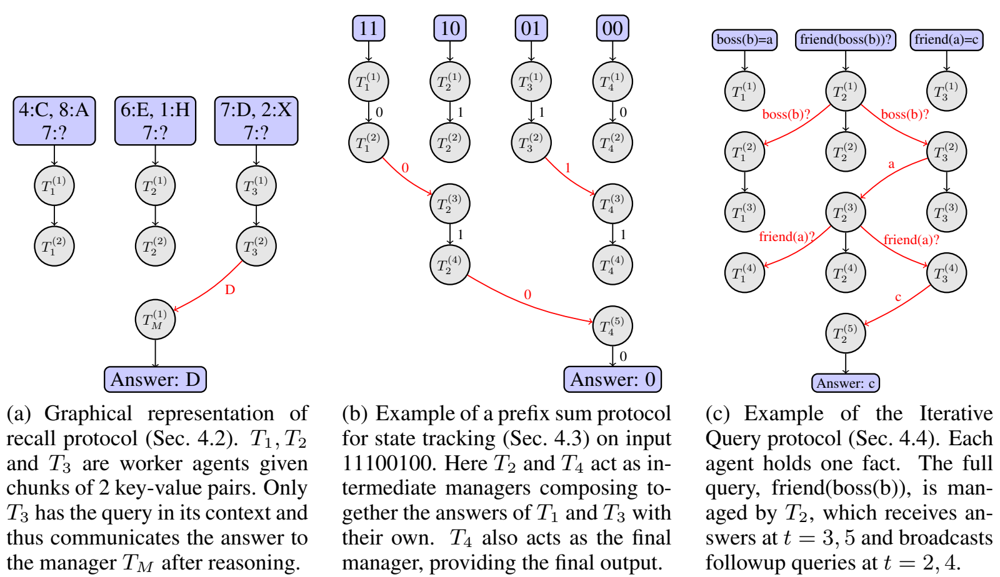

**图 1.** 第 4 节所分析协议的图表示。（a）召回协议（第 4.2 节）：工作智能体 $T_1,T_2,T_3$ 分别得到含 2 个键值对的块。只有 $T_3$ 的上下文包含被查询的键，因此它推理后将答案传给管理者 $T_M$。（b）输入 11100100 上的状态跟踪前缀和协议（第 4.3 节）。$T_2$、$T_4$ 作为中间管理者，分别把 $T_1$、$T_3$ 的答案与自身答案复合；$T_4$ 同时作为最终管理者给出结果。（c）迭代查询协议（第 4.4 节）。每个智能体持有一个事实。完整查询 friend(boss(b)) 由 $T_2$ 管理，它在 $t=3,5$ 接收答案，在 $t=2,4$ 广播后续查询。

**定义 3.3（智能体计算）。** 给定输入 $x\in S$ 上的系统 $\mathcal A(x)$，对每个智能体 $i\in[w(x)]$，构造字符串 $\xi(i)\in(\Xi_{|x|})^*$。直观上，这是该智能体在推理过程中处理的词元序列。构造方式如下：

1. 首先取输入块。原文此处写为 $x_{\lceil|x|\cdot i/w\rceil,\ldots,\lceil|x|\cdot(i+1)/(w-1)\rceil}\in S$。
2. 追加 $\mathrm{ID}_i\in\Xi_{|x|}$。
3. 遍历与该智能体关联的节点（原文记为 $T_1^{(i)},T_2^{(i)},\ldots$）。若存在通信入边 $\{c,\sigma\}$，追加词元 `RECEIVE_σ`；若存在 CoT 出边 $\{a,\sigma\}$，追加符号 $\sigma$；若存在通信出边：发给单个智能体 $j$ 时，追加 `SEND_σ_ID_j`；向全体广播时，追加 `BROADCAST_σ`。
4. 追加 EOS 符号。

> 译注：定义 3.3 第 1 项的块边界及第 3 项的上下标与前文记号存在排印不一致；原式保留。正文设定始终是将输入划分为约 $|x|/w$ 大小的互不相交块。

假设全部词元都属于 $\Xi_{|x|}$（为简洁采用单词元；换成有界长度词串不会改变结果）。当且仅当每个 $\xi(i)$ 都能放入 Transformer 的上下文窗口，且 Transformer 在 $\xi(i)$ 上自回归运行时能够预测所有由出边及 EOS 产生的词元（步骤 3 的 CoT 与通信出边，以及步骤 4），称 Transformer $T$ 在输入 $x\in S$ 上**实现** $\mathcal A(x)$。直观上，在每一步推理中，Transformer 生成下一个词元，除非该步被传入的通信覆盖。

若对每个输入长度 $n$，存在 UHAT Transformer $T_n$，能对所有 $|x|\le n$ 的输入实现 $\mathcal A(x)$，且所有 $T_n$ 的头数和层数均有统一上界，则称协议 $\mathcal A$ **可由 UHAT 表达**。我们不要求宽度 $d$ 有界；例如，宽度增长可以使位置编码区分无界数量的位置。

上述设定将 Amiri et al.（2025）的框架推广至多智能体情形。要求模型在不同输入长度上具有有界层数和头数，是一个很弱的假设，远弱于 CoT 理论研究常要求的不同输入长度之间 Transformer 的一致性（如 Pérez et al., 2019; Merrill & Sabharwal, 2023）。尽管如此，它仍使我们能够证明多智能体系统成本的上下界基本匹配。

### 3.1 与应用工作的联系

我们的形式化覆盖了大量基于 LLM 的协议，它们：（i）把长上下文划分为互不重叠的块；（ii）使用工作智能体并行处理这些块；（iii）将信息传给管理者以生成最终答案。主要差异在于协调方式：CoA（Zhang et al., 2024b）、LLM×MapReduce（Zhou et al., 2025）、NexusSum（Kim & Kim, 2025）、AgentSimp（Fang et al., 2025）和 Multi²（Cao et al., 2025）通过极少通信并行运行工作智能体；LongAgent（Zhao et al., 2024）、XpandA（Xiao et al., 2025）、AgentGroupChat-V2（Gu et al., 2025）及某些任务专用流水线（如 DocAgent，Yang et al., 2025a；Multi-Agent QG，Wang et al., 2025a）则支持有针对性的消息通信，以消解冲突。这些方法都能用图 1 这样的通信图描述。所有这些系统均通过将消息写入接收方上下文实现通信，与我们的框架一致。

## 4 结果

### 4.1 一般结果：深度与通信的三种情形

本节给出适用于所有遵循定义 3.1 的任务和多智能体系统的理论结果。全文中的“多智能体系统”均指由 Transformer 计算的系统。首先考虑系统规模：

**命题 4.1（规模守恒）。** 任意协议都可转换为等价的单智能体协议，其规模至多相差常数因子。

证明思路是构造一个单智能体，交替模拟原协议中的各个智能体，见附录 C.2。因此，使用多个智能体不能使协议规模的减少超过常数因子。不过，我们将看到某些任务的规模可能随智能体数量增加而增大。在多智能体协议中，成本的另外两个关键决定因素是：（i）深度；（ii）通信预算。对于这两个量，有两点基本的先验观察。首先，任意满足定义 3.1 的协议都有：

$$
\frac{\operatorname{Size}(N)}{w(N)}\le\operatorname{Depth}(N). \tag{2}
$$

**证明。** 规模不超过智能体数量乘以分配给任一单个智能体的最大节点数，而后者又不超过最长路径的长度。□

这一不等式可能让人期待：即使规模无法缩减，多智能体协议也能降低深度。我们表明，这种深度收益在某些任务中可以实现（第 4.3 节），但另一些任务不存在渐近意义上的深度收益（第 4.4 节）。第二个基本观察是，多智能体推理只有增加通信量，才可能降低深度。事实上，任何可在有界通信成本下求解的任务，已经可以由单个智能体在有界深度下求解，因此排除了多智能体设置在深度上的收益：

**命题 4.2。** 若一个任务存在多智能体系统，对所有 $w\in[N]$，其通信预算关于 $N$ 均为 $O(1)$，则该任务存在深度（因而规模）为 $O(1)$ 的单智能体 CoT。

证明见附录 C.2。综合上述结果，多智能体推理有三种不同的可行情形（原文此处指称“表 2”，对应图 2）。第一种（第 4.2 节）中，随着智能体数量增加，深度和通信量都保持 $O(1)$；此时多智能体设置仅使处理更长上下文成为可能，不带来相应成本。第二种（第 4.3 节）中，使用更多智能体能够降低深度，几乎达到式（2），但代价是增加通信量，即存在深度—通信权衡。第三种（第 4.4 节）中，至少在最坏情况下，多智能体设置需要大量通信，却不能降低所需深度；它允许处理更长上下文，但通信成本高且深度无收益。看似存在的第四种情形——通信保持 $O(1)$ 而深度按式（2）下降——由命题 4.2 排除。接下来将展示，自然任务中确实存在上述三种情形。

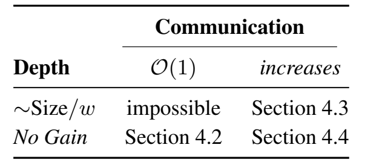

**图 2.** 深度—通信权衡中三种可能、一种不可能的情形。通信为 $O(1)$ 时，深度不变对应第 4.2 节，深度降至约 $\operatorname{Size}/w$ 不可能；通信增加时，深度降低对应第 4.3 节，深度不变对应第 4.4 节。

### 4.2 关联召回

首先考虑简单的关联召回任务：给定多个键值对及一个被查询的键，智能体必须返回关联值。此时多智能体设置允许处理更大的输入，而不增加通信或深度成本：

**命题 4.3。** 给定由 $N$ 个键值对 $(x_i,y_i)\in\Sigma_N\times\Sigma_N$ 构成的输入和查询 $x$，任务是检索满足 $(x,y)$ 出现在输入中的唯一 $y$。假设输入被不相交地划分给 $k$ 个智能体，它们同时能访问查询。那么该任务可在深度 $O(1)$、通信量 $O(1)$ 下求解。

**证明概要（完整证明见附录 C.3）。** 每个智能体使用注意力检查查询 $x$ 是否出现在其输入中，并在出现时使用归纳头检索关联的 $y$。根据设计，只有一个智能体能找到这样的 $y$；它随后将其报告给指定管理者，管理者输出 $y$。□

**简单检索的权衡：** 以下指标对检索任务均可实现，且是最优的：

1. 计算深度：$O(1)$。
2. 智能体数量：$w(N)$；块大小：$N/w(N)$。
3. 通信预算：$O(1)$。
4. 规模：$O(w(N))$。

### 4.3 状态跟踪

另一个基础任务是状态跟踪，它是许多推理问题的核心，例如跟踪以起点—终点记号表示的国际象棋走子、执行 Python 代码或进行实体跟踪（Kim & Schuster, 2023; Merrill et al., 2024）。状态跟踪可以方便地形式化为有限幺半群上的求值（如 Merrill et al., 2024; Grazzi et al., 2025）：

**定义 4.1（状态跟踪问题）。** 设 $M$ 为有限集合，$(M,\cdot)$ 为有限幺半群（即运算具有单位元并满足结合律）。$M$ 上的状态跟踪问题定义为将序列 $m_0m_1\ldots m_k\in M^*$ 映射为 $m_0\cdot m_1\cdots m_k\in M$。这里输入字母表为 $\Sigma:=M$。

幺半群元素表示操作（如 Python 列表操作指令或国际象棋走子）。将操作复合得到新的幺半群元素，例如指令的复合或一串走子。这类问题涵盖所有正则语言的成员判定，例如对应幺半群 $(\{0,1\},\oplus)$ 的 PARITY（奇偶性）。Amiri et al.（2025）证明，PARITY 需要长度为 $\Omega(N)$ 的 CoT。拥有大量总通信资源的多智能体系统能否做得更好？就图规模而言，答案是否定的：

**命题 4.4。** 任何计算 PARITY 的多智能体系统都需要 $\Omega(N)$ 的规模。

证明见附录 C.4。但若考虑并行计算预算，则可在计算图深度上获得加速。假设每个智能体接收输入中一段互不相交的连续子串，则：

**命题 4.5。** 设 $M$ 为有限幺半群。存在一个使用 $w(N)=N$ 个智能体、深度为 $O(\log N)$ 的通信协议，计算 $M$ 上的状态跟踪。

该协议的关键思路是用 LLM 智能体执行前缀和（或递归并行扫描）算法，如图 1 所示（原文此处写为图 1(c)，实际状态跟踪子图为图 1(b)）。上述协议宽度为 $N$，还可推广到由输入长度 $N$ 的某个函数 $w(N)$ 给定的其他宽度：

**命题 4.6。** 给定有限幺半群 $M$ 和任意智能体数量（$w:\mathbb N\to\mathbb N$，且 $w(N)\in[N]$），存在计算 $M$ 上状态跟踪的多智能体系统，其深度为 $O(\log w(N)+N/w(N))$，规模为 $O(N)$，通信预算为 $w(N)$。

这意味着，在拥有足够并行计算预算时，确实能够获得有效时间或实际运行时间上的加速。证明见附录 C.4；命题 4.5 是其推论。上述结果本质上最优，因为基本无法获得更低深度：

**命题 4.7（最优性，证明见附录 C.4）。** 假设有限幺半群 $M$ 是非平凡群，$\mathcal A$ 是计算 $M$ 上状态跟踪的多智能体系统。则 $\mathcal A$ 的通信预算为 $\Omega(w(N))$，计算深度为 $\Omega(N/w(N))$。

**状态跟踪的权衡：** 假设有 $w(N)\in[N]$ 个智能体，每个智能体接收输入中互不相交的一段连续部分，则以下指标可实现：

1. 计算深度：$O(\log w(N)+N/w(N))$。
2. 智能体数量：$w(N)$；块大小：$N/w(N)$。
3. 通信预算：$O(w(N))$。
4. 规模：$N$。

通信预算与规模是最优的；计算深度至少在相差 $O(\log w(N))$ 的意义下最优。

### 4.4 多跳推理

我们用 $k$ 跳推理实例化第三种情形（如 Yang et al., 2024b; Wang et al., 2025b; Yao et al., 2025）。该任务具有对象域 $D$ 和表示函数的词汇表 $\mathcal F$。上下文给出 $N$ 个形如 $f(x)=y$（$f,x,y\in\Sigma_N$）的事实，对于每个 $x$ 和 $f$ 至多包含一个这样的事实。各智能体接收事实集合的等大、不相交分区，并得到公共查询 $f_1(\ldots(f_k(x))\ldots)$，其中 $f_i\in\mathcal F$、$x\in D$。输入总大小为 $N+k$；每个智能体拥有 $N/w$ 个事实和该 $k$ 跳查询。

**命题 4.8。** 设智能体数量为 $w:\mathbb N\to\mathbb N$（$w(N)\in[N]$）。具有 $N$ 个事实的 $k$ 跳复合任务，可在计算深度 $O(k)$、通信预算 $O(k)$、规模 $O(w(N)\cdot k)$ 下求解。通信预算是最优的；计算深度 $O(k)$ 至少在相差 $\log(N+k)$ 因子的意义下最优。

证明见附录 C.5。思路是工作智能体执行迭代查找：每个智能体尝试在自身上下文中查找下一个答案，对 $k$ 跳中的每一步 $f_k(x),f_{k-1}(f_k(x)),\ldots,f_1(\ldots(f_k(x))\ldots)$ 各执行一次。该任务不同于前两种情形：在最坏情况下，增加智能体数量不能降低计算深度。根据事实在智能体间的分布，只要涉及多个智能体，计算深度与通信预算最坏情况下就可能为 $\Omega(k)$。直觉是相关事实可能分散在不同智能体中，使迭代查找成为最优策略。因此有：

**$k$ 跳复合的权衡：** 对具有 $N$ 个事实的 $k$ 跳复合任务，当 $w(k)>1$ 时，以下指标可以实现（本框中 $w(k)$ 记法沿用原文）：

1. 计算深度：$O(k)$。
2. 智能体数量：$w(k)$；块大小：$N/w(k)$。
3. 通信预算：$O(k)$。
4. 规模：$O(wk)$。

通信预算最优；计算深度至少在相差 $\log(N+k)$ 因子的意义下最优。

## 5 实验验证

本节通过实验验证第 4 节协议能否在实践中工作，以及计算深度和通信是否呈现预测的三种情形。我们在关联召回、状态跟踪和 $k$ 跳推理任务上评估 Llama-3.3-70B-Instruct-Turbo 与 Llama-3.1-8B-Instruct-Turbo（结果见附录 F），以验证理论分析的各类情形。使用预训练 LLM，通过提示告知其协议角色和解题指令。通信协议采用硬编码实现，类似 Zhang et al.（2024b）中的协议实现。更多细节见附录 E。

### 5.1 召回

我们使用“大海捞针”测试（Kamradt, 2024）验证不同多智能体系统的关联召回能力。该任务要求在大型文档（“海”）中找出“针”（某个查询的答案）。基线为多数投票自一致性（Wang et al., 2022）；考虑到其相似性，我们以 Chain-of-Agents（CoA）实现最优协议。

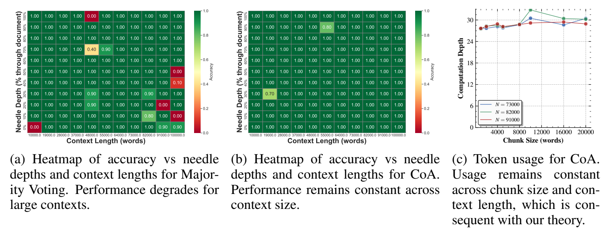

**图 3.** 大海捞针测试结果。（a）多数投票的准确率随“针”深度和上下文长度变化的热图，大上下文下性能下降。（b）CoA 的对应热图，性能随上下文大小保持稳定。（c）CoA 的词元使用量；其随块大小和上下文长度保持稳定，与理论一致。图中 Context Length 为上下文长度（词），Needle Depth 为“针”在文档中的相对位置，Chunk Size 为块大小，Computation Depth 为计算深度。

**大海捞针。** 图 3 展示多数投票与 CoA 在不同“针”深度（它在语料中的位置）和上下文长度下的表现。如图 3(a) 所示，多数投票的性能随序列长度增加而下降。语料两端也略有问题：“针”位于开头或结尾时，多数投票也会失败。CoA 没有出现这种退化，协议的“分而治之”策略使任务更易处理。

### 5.2 状态跟踪

接着，我们在状态跟踪任务上评估多智能体系统。具体任务是 PARITY，即判断比特串中 1 的数量为偶数还是奇数。

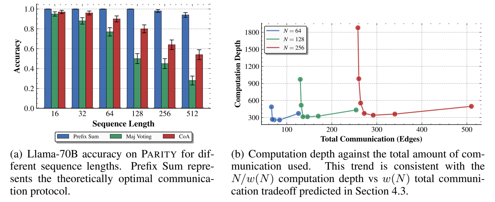

**图 4.** PARITY 的经验验证。（a）不同序列长度下 Llama-70B 的准确率。Prefix Sum（前缀和）表示理论最优通信协议。（b）计算深度与总通信量的关系，与第 4.3 节预测的计算深度 $N/w(N)$ 和总通信量 $w(N)$ 之间的权衡一致。图中 Sequence Length 为序列长度，Total Communication (Edges) 为总通信量（边数）。

图 4(a) 表明，Prefix Sum 持续优于所有其他方法，尤其在序列较长时。相比多数投票，CoA 在长序列上的退化更少，支持了“将复杂推理切分为更短部分会有所帮助”的直觉。在通信方面，图 4(b) 展示 Prefix Sum 的计算深度与总通信量的权衡；计算时将各层的平均词元使用量相加。这一趋势与理论预测一致。第 4.3 节确实预测了深度 $N/w(N)$ 与总通信量 $w(N)$ 的权衡。不过，在通信量较高时，计算深度略有上升。这是因为模型指令遵循不佳，会重复查询、解释过程，增加常数词元开销，这在高通信情形中特别明显。

### 5.3 $k$ 跳推理

最后，我们评估 $k$ 跳推理任务：给定事实（如“Paula 是 Mary 的老板”）和查询（如“George 的朋友的老板是谁？”）。难度取决于事实数量与查询跳数。我们比较多数投票与 Iterative Query（迭代查询）；后者实现了第 4.4 节证明最优的协议。如图 5 所示，迭代查询通常优于多数投票，且跳数越多，这一趋势越明显。跳数最少（4 跳）时，存在多数投票优于迭代查询的情况；我们推测，在该情形下，每一轮出错的概率似乎超过了从更大语料中检索事实的难度所造成的影响。最后考察计算深度与查询跳数的关系。如图 5(c) 所示，趋势与理论一致：查询深度增加，计算深度也增加。

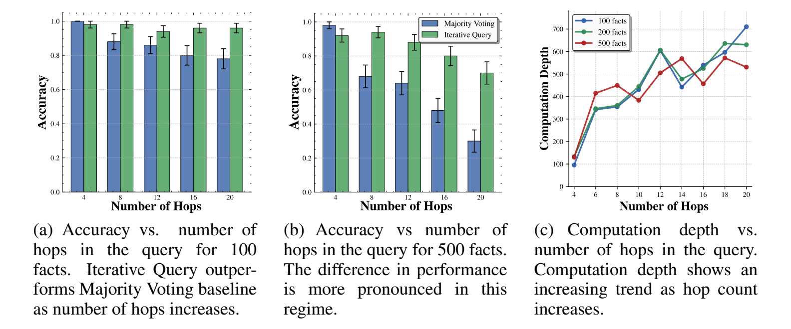

**图 5.** $k$ 跳推理的经验验证。（a）100 个事实时，准确率与查询跳数的关系。跳数增加时，迭代查询优于多数投票基线。（b）500 个事实时的对应结果，性能差异更明显。（c）计算深度与查询跳数的关系，计算深度随跳数增加而上升。

## 6 讨论与结论

本工作为理解协作式多智能体系统在算法层面的收益与局限提供了有原则的基础。通过形式化通信与资源的权衡，我们将理论分析与经验观察联系起来，阐明协作何时提升推理效率、何时带来内在成本。这些结果为设计兼顾扩展性、表达能力和性能的推理系统开辟了新方向。

**与自一致性的关系。** 结果表明，具有精细通信协议的多智能体系统优于多数投票策略。Mirtaheri et al.（2025）发现，在 Transformer 难以处理的任务上，使用多项式数量智能体的自一致性收益有限。附录 H 给出最优协议与多数投票策略之间的分离结果。简要而言，多数投票策略使用 $w(N)$ 个智能体，每个智能体在完整输入上运行，并以单词元回复结束；整体系统返回最常见的回复。基于这一定义，我们证明多数投票与 PrefixSum 之间存在超多项式分离：

**命题 6.1（非正式表述）。** 考虑使用 $w(N)$ 个智能体、以长度为 $O(\log N)$ 的 CoT（或计算深度）计算长度为 $N$ 输入的 PARITY 的多数投票方案。对于某个常数 $c>0$，该方案必须具有 $w(N)=2^{\Omega(N^c)}$ 个智能体。

相比之下，PrefixSum 在计算深度 $O(\log N)$、智能体数量 $w(N)=N$ 时即可达到完美准确率。证明及其含义的详细讨论见附录 H。

**对协议设计的启示。** 结果刻画了深度（实际运行时间）与通信成本，识别出多智能体系统的三种情形（图 2），对多智能体 LLM 设计具有意义。许多工作智能体配一个管理者的系统（如 CoA，Zhang et al., 2024b；LLM×MapReduce，Zhou et al., 2025；NexusSum，Kim & Kim, 2025；AgentSimp，Fang et al., 2025；Multi²，Cao et al., 2025）只是将上下文瓶颈转移到管理者，聚合大量回复时可能出错。为此，我们提出前缀和式级联：通过迭代摘要减轻最终智能体瓶颈，并将分支因子和深度作为可调超参数。我们还认为，$k$ 跳推理的迭代查询协议可能具有实践意义。对于复杂查询，可以采用类似架构：管理者先将主查询分解为子查询，各子查询通过工作智能体与管理者之间的迭代通信轮次处理，管理者在每轮之后更新查询。

**与并行计算框架的关系。** 我们的设定与通信复杂度、PRAM（Fortune & Wyllie, 1978）、大规模并行计算（Im et al., 2023）、BSP（Valiant, 1990）和 LOCAL（Peleg, 2000）等经典并行与协作计算模型相关。在概念上，计算深度和规模对应 PRAM 的时间（并行步数）和工作量（总操作数）。关键差异是，我们的分析依赖 Transformer 架构的表达能力。这一形式化使关联召回（第 4.2 节）与状态跟踪（第 4.3 节）形成鲜明差异：Transformer 可在一次注意力步骤中完成召回，而状态跟踪更困难，需要明确的多步推理链。选择其他智能体会给出不同预测：递归网络构成的系统会使检索更难（Bhattamishra et al., 2024; Arora et al., 2023），但可能比 Transformer 更高效地执行状态跟踪；不受约束的智能体能在常数时间完成两者；图灵机或 RAM 则在两者上均需要线性时间。将智能体视为无约束处理器、以存储和通信为主要瓶颈的框架，会预测两类任务深度都低；将智能体视为类似 RAM 单元的框架则预测两者深度都高。只有考虑 Transformer 的具体能力，才能得到适合 LLM 多智能体系统的更精细分析，并预测实际 LLM 所呈现的权衡。

**局限与未来工作。** 本工作可沿多个方向扩展。经验方面，可将上述思想用于设计新的多智能体系统。理论方面，可推广到其他算法任务，例如图可达性；或其他多智能体范式，例如对抗博弈与协作强化学习任务，在这些任务中智能体协作以实现共同目标。

## 可复现性声明

我们提供完整的复现包。重现全部实验的代码见 [coa-algorithmic](https://github.com/michaelrizvi/coa-algorithmic)。附录 E 详述实验设置，包括超参数、所考察的参数范围和全部系统提示词。文中所有命题的完整证明均包含在附录中（原文此处统一指称附录 C.2）。

## References

Alireza Amiri, Xinting Huang, Mark Rofin, and Michael Hahn. Lower bounds for chain-of-thought reasoning in hard-attention transformers. In Forty-second International Conference on Machine Learning, 2025. URL https://openreview.net/forum?id=Oh9sG5ae2b.

Simran Arora, Sabri Eyuboglu, Aman Timalsina, Isys Johnson, Michael Poli, James Zou, Atri Rudra, and Christopher Ré. Zoology: Measuring and improving recall in efficient language models. arXiv preprint arXiv:2312.04927, 2023.

James Aspnes, Richard Beigel, Merrick Furst, and Steven Rudich. The expressive power of voting polynomials. In Proceedings of the twenty-third annual ACM symposium on Theory of Computing, pp. 402–409, 1991.

Pascal Bergsträßer, Chris Köcher, Anthony Widjaja Lin, and Georg Zetzsche. The power of hard attention transformers on data sequences: A formal language theoretic perspective. In The Thirty-eighth Annual Conference on Neural Information Processing Systems , 2024. URL https://openreview.net/forum?id=NBq1vmfP4X.

Satwik Bhattamishra, Michael Hahn, Phil Blunsom, and Varun Kanade. Separations in the representational capabilities of transformers and recurrent architectures. In The Thirty-eighth Annual Conference on Neural Information Processing Systems, 2024.

Juntai Cao, Xiang Zhang, Raymond Li, Chuyuan Li, Shafiq Joty, and Giuseppe Carenini. Multi2: Multi-agent test-time scalable framework for multi-document processing. arXiv preprint arXiv:2502.20592, 2025. doi: 10.48550/arXiv.2502.20592. URL https://arxiv.org/abs/2502.20592.

Chia-Yuan Chang, Zhimeng Jiang, Vineeth Rakesh, Menghai Pan, Chin-Chia Michael Yeh, Guanchu Wang, Mingzhi Hu, Zhichao Xu, Yan Zheng, Mahashweta Das, and Na Zou. MAIN-RAG: Multi-agent filtering retrieval-augmented generation. In Wanxiang Che, Joyce Nabende, Ekaterina Shutova, and Mohammad Taher Pilehvar (eds.), Proceedings of the 63rd Annual Meeting of the Association for Computational Linguistics (Volume 1: Long Papers) , pp. 2607–2622, Vienna, Austria, July 2025. Association for Computational Linguistics. ISBN 979-8-89176-251-0. doi: 10.18653/v1/2025.acl-long.131. URL https://aclanthology.org/2025.acl-long.131/.

Kevin Clark, Urvashi Khandelwal, Omer Levy, and Christopher D Manning. What does BERT look at? an analysis of BERT’s attention. arXiv preprint arXiv:1906.04341, 2019.

Shehzaad Dhuliawala, Mojtaba Komeili, Jing Xu, Roberta Raileanu, Xian Li, Asli Celikyilmaz, and Jason Weston. Chain-of-verification reduces hallucination in large language models. In Lun-Wei Ku, Andre Martins, and Vivek Srikumar (eds.), Findings of the Association for Computational Linguistics: ACL 2024 , pp. 3563–3578, Bangkok, Thailand, August 2024. Association for Computational Linguistics. doi: 10.18653/v1/2024.findings-acl.212. URL https://aclanthology.org/2024.findings-acl.212/.

Yilun Du, Shuang Li, Antonio Torralba, Joshua B. Tenenbaum, and Igor Mordatch. Improving factuality and reasoning in language models through multiagent debate, 2023. URL https://arxiv.org/abs/2305.14325.

Dengzhao Fang, Jipeng Qiang, Xiaoye Ouyang, Yi Zhu, Yunhao Yuan, and Yun Li. Collaborative document simplification using multi-agent systems. In Owen Rambow, Leo Wanner, Marianna Apidianaki, Hend Al-Khalifa, Barbara Di Eugenio, and Steven Schockaert (eds.), Proceedings of the 31st International Conference on Computational Linguistics, pp. 897–912, Abu Dhabi, UAE, January 2025. Association for Computational Linguistics. URL https://aclanthology.org/2025.coling-main.60/.

Steven Fortune and James Wyllie. Parallelism in random access machines. In Proceedings of the tenth annual ACM symposium on Theory of computing, pp. 114–118, 1978.

Kanishk Gandhi, Denise Lee, Gabriel Grand, Muxin Liu, Winson Cheng, Archit Sharma, and Noah D Goodman. Stream of search (SOS): Learning to search in language. arXiv preprint arXiv:2404.03683, 2024.

Riccardo Grazzi, Julien Siems, Arber Zela, Jörg KH Franke, Frank Hutter, and Massimiliano Pontil. Unlocking state-tracking in linear RNNs through negative eigenvalues. In The Thirteenth International Conference on Learning Representations, 2025.

Zhouhong Gu, Xiaoxuan Zhu, Yin Cai, Hao Shen, Xingzhou Chen, Qingyi Wang, Jialin Li, Xiaoran Shi, Haoran Guo, Wenxuan Huang, Hongwei Feng, Yanghua Xiao, Zheyu Ye, Yao Hu, and Shaosheng Cao. AgentGroupChat-V2: Divide-and-conquer is what llm-based multi-agent system need. arXiv preprint arXiv:2506.15451, 2025. doi: 10.48550/arXiv.2506.15451. URL https://arxiv.org/abs/2506.15451.

Daya Guo, Dejian Yang, Haowei Zhang, Junxiao Song, Ruoyu Zhang, Runxin Xu, Qihao Zhu, Shirong Ma, Peiyi Wang, Xiao Bi, et al. DeepSeek-R1: Incentivizing reasoning capability in LLMs via reinforcement learning. arXiv preprint arXiv:2501.12948, 2025.

Tiezheng Guo, Chen Wang, Yanyi Liu, Jiawei Tang, Pan Li, Sai Xu, Qingwen Yang, Xianlin Gao, Zhi Li, and Yingyou Wen. Leveraging inter-chunk interactions for enhanced retrieval in large language model-based question answering. 2024. doi: 10.48550/arXiv.2408.02907. URL https://arxiv.org/abs/2408.02907v1. Version v1.

Michael Hahn. Theoretical limitations of self-attention in neural sequence models. Transactions of the Association for Computational Linguistics, 8:156–171, 2020.

Michael Hahn and Mark Rofin. Why are sensitive functions hard for transformers? arXiv preprint arXiv:2402.09963, 2024.

Yiding Hao, Dana Angluin, and Robert Frank. Formal language recognition by hard attention transformers: Perspectives from circuit complexity. Transactions of the Association for Computational Linguistics, 10:800–810, 2022.

Chan-Jan Hsu, Davide Buffelli, Jamie McGowan, Feng-Ting Liao, Yi-Chang Chen, Sattar Vakili, and Da-shan Shiu. Group think: Multiple concurrent reasoning agents collaborating at token level granularity. arXiv preprint arXiv:2505.11107, 2025.

Sungjin Im, Ravi Kumar, Silvio Lattanzi, Benjamin Moseley, Sergei Vassilvitskii, et al. Massively parallel computation: Algorithms and applications. Foundations and Trends® in Optimization, 5 (4):340–417, 2023.

Selim Jerad, Anej Svete, Jiaoda Li, and Ryan Cotterell. Unique hard attention: A tale of two sides. In Wanxiang Che, Joyce Nabende, Ekaterina Shutova, and Mohammad Taher Pilehvar (eds.), Proceedings of the 63rd Annual Meeting of the Association for Computational Linguistics (Volume 2: Short Papers), pp. 977–996, Vienna, Austria, July 2025a. Association for Computational Linguistics. ISBN 979-8-89176-252-7. doi: 10.18653/v1/2025.acl-short.76. URL https://aclanthology.org/2025.acl-short.76/.

Selim Jerad, Anej Svete, Jiaoda Li, and Ryan Cotterell. Unique hard attention: A tale of two sides. arXiv preprint arXiv:2503.14615, 2025b.

William B Johnson, Joram Lindenstrauss, et al. Extensions of Lipschitz mappings into a Hilbert space. Contemporary mathematics, 26(189-206):1, 1984.

Greg Kamradt. Llmtest needleinahaystack: Doing simple retrieval from LLM models at various context lengths to measure accuracy. https://github.com/gkamradt/LLMTest_NeedleInAHaystack, 2024.

Hyuntak Kim and Byung-Hak Kim. NexusSum: Hierarchical LLM agents for long-form narrative summarization. In Wanxiang Che, Joyce Nabende, Ekaterina Shutova, and Mohammad Taher Pilehvar (eds.), Proceedings of the 63rd Annual Meeting of the Association for Computational Linguistics (Volume 1: Long Papers), pp. 10120–10157, Vienna, Austria, July 2025. Association for Computational Linguistics. ISBN 979-8-89176-251-0. doi: 10.18653/v1/2025.acl-long.500. URL https://aclanthology.org/2025.acl-long.500/.

Najoung Kim and Sebastian Schuster. Entity tracking in language models. arXiv preprint arXiv:2305.02363, 2023.

Jiaoda Li and Ryan Cotterell. Characterizing the expressivity of fixed-precision transformer language models. In The Thirty-ninth Annual Conference on Neural Information Processing Systems, 2025. URL https://openreview.net/forum?id=29LwAgLFpj.

Bingbin Liu, Jordan T Ash, Surbhi Goel, Akshay Krishnamurthy, and Cyril Zhang. Transformers learn shortcuts to automata. arXiv preprint arXiv:2210.10749, 2022.

Pei Liu, Xin Liu, Ruoyu Yao, Junming Liu, Siyuan Meng, Ding Wang, and Jun Ma. HM-RAG: Hierarchical multi-agent multimodal retrieval augmented generation, 2025. URL https://arxiv.org/abs/2504.12330.

William Merrill and Ashish Sabharwal. The expressive power of transformers with chain of thought. arXiv preprint arXiv:2310.07923, 2023.

William Merrill, Jackson Petty, and Ashish Sabharwal. The illusion of state in state-space models. arXiv preprint arXiv:2404.08819, 2024.

Parsa Mirtaheri, Ezra Edelman, Samy Jelassi, Eran Malach, and Enric Boix-Adsera. Let me think! A long chain-of-thought can be worth exponentially many short ones. arXiv preprint arXiv:2505.21825, 2025.

Phuong Nguyen and Stephen Cook. Theories for TC0 and other small complexity classes. Logical Methods in Computer Science, 2, 2006.

Thang Nguyen, Peter Chin, and Yu-Wing Tai. Ma-rag: Multi-agent retrieval-augmented generation via collaborative chain-of-thought reasoning. arXiv preprint arXiv:2505.20096, 2025. URL https://arxiv.org/abs/2505.20096.

OpenAI. OpenAI o3 and o4-mini System Card. Technical report, OpenAI, San Francisco, CA, April 2025. URL https://cdn.openai.com/pdf/2221c875-02dc-4789-800b-e7758f3722c1/o3-and-o4-mini-system-card.pdf . PDF available online.

David Peleg. Distributed computing: a locality-sensitive approach. SIAM, 2000.

Jorge Pérez, Javier Marinkovi ć, and Pablo Barcel ó. On the turing completeness of modern neural network architectures. arXiv preprint arXiv:1901.03429, 2019.

Michael Rizvi-Martel, Maude Lizaire, Clara Lacroce, and Guillaume Rabusseau. Simulating weighted automata over sequences and trees with transformers. In International Conference on Artificial Intelligence and Statistics, pp. 2368–2376. PMLR, 2024.

Aniruddha Salve, Saba Attar, Mahesh Deshmukh, Sayali Shivpuje, and Arnab Mitra Utsab. A collaborative multi-agent approach to retrieval-augmented generation across diverse data. 2024. doi: 10.48550/arXiv.2412.05838. URL https://arxiv.org/abs/2412.05838. Version v1.

Parshin Shojaee, Iman Mirzadeh, Keivan Alizadeh, Maxwell Horton, Samy Bengio, and Mehrdad Farajtabar. The illusion of thinking: Understanding the strengths and limitations of reasoning models via the lens of problem complexity. arXiv preprint arXiv:2506.06941, 2025.

Yiyou Sun, Shawn Hu, Georgia Zhou, Ken Zheng, Hannaneh Hajishirzi, Nouha Dziri, and Dawn Song. Omega: Can llms reason outside the box in math? evaluating exploratory, compositional, and transformative generalization. arXiv preprint arXiv:2506.18880, 2025.

Pascal Tesson and Denis Thérien. Diamonds are forever: The variety DA. In Semigroups, algorithms, automata and languages, pp. 475–499. World Scientific, 2002.

Khanh-Tung Tran, Dung Dao, Minh-Duong Nguyen, Quoc-Viet Pham, Barry O’Sullivan, and Hoang D Nguyen. Multi-agent collaboration mechanisms: A survey of llms. arXiv preprint arXiv:2501.06322, 2025.

Leslie G Valiant. A bridging model for parallel computation. Communications of the ACM, 33(8): 103–111, 1990.

Gal Vardi, Daniel Reichman, Toniann Pitassi, and Ohad Shamir. Size and depth separation in approximating benign functions with neural networks. In Conference on Learning Theory , pp. 4195–4223. PMLR, 2021.

Elena Voita, David Talbot, Fedor Moiseev, Rico Sennrich, and Ivan Titov. Analyzing multi-head self-attention: Specialized heads do the heavy lifting, the rest can be pruned. arXiv preprint arXiv:1905.09418, 2019.

Haotian Wang, Xiyuan Du, Weijiang Yu, Qianglong Chen, Kun Zhu, Zheng Chu, Lian Yan, and Yi Guan. Learning to break: Knowledge-enhanced reasoning in multi-agent debate system, 2024a. URL https://arxiv.org/abs/2312.04854.

Junlin Wang, Jue Wang, Ben Athiwaratkun, Ce Zhang, and James Zou. Mixture-of-agents enhances large language model capabilities, 2024b. URL https://arxiv.org/abs/2406.04692.

Kesen Wang, Daulet Toibazar, Abdulrahman Alfulayt, Abdulaziz S. Albadawi, Ranya A. Alkahtani, Asma A. Ibrahim, Haneen A. Alhomoud, Sherif Mohamed, and Pedro J. Moreno. Multi-agent interactive question generation framework for long document understanding. arXiv preprint arXiv:2507.20145, 2025a. doi: 10.48550/arXiv.2507.20145. URL https://arxiv.org/abs/2507.20145.

Xuezhi Wang, Jason Wei, Dale Schuurmans, Quoc Le, Ed Chi, Sharan Narang, Aakanksha Chowdhery, and Denny Zhou. Self-consistency improves chain of thought reasoning in language models. arXiv preprint arXiv:2203.11171, 2022.

Zixuan Wang, Eshaan Nichani, Alberto Bietti, Alex Damian, Daniel Hsu, Jason D Lee, and Denny Wu. Learning compositional functions with transformers from easy-to-hard data. arXiv preprint arXiv:2505.23683, 2025b.

Jason Wei, Xuezhi Wang, Dale Schuurmans, Maarten Bosma, Fei Xia, Ed Chi, Quoc V Le, Denny Zhou, et al. Chain-of-thought prompting elicits reasoning in large language models. Advances in neural information processing systems, 35:24824–24837, 2022.

Sibo Xiao, Zixin Lin, Wenyang Gao, and Yue Zhang. Long context scaling: Divide and conquer via multi-agent question-driven collaboration. arXiv preprint arXiv:2505.20625, 2025.

Zhen Xu, Shang Zhu, Jue Wang, Junlin Wang, Ben Athiwaratkun, Chi Wang, James Zou, and Ce Zhang. When does divide and conquer work for long context llm? a noise decomposition framework. 2025. doi: 10.48550/arXiv.2506.16411. URL https://arxiv.org/abs/2506.16411v1. Version v1.

Andy Yang, David Chiang, and Dana Angluin. Masked hard-attention transformers recognize exactly the star-free languages. In The Thirty-eighth Annual Conference on Neural Information Processing Systems, 2024a. URL https://openreview.net/forum?id=FBMsBdH0yz.

Dayu Yang, Antoine Simoulin, Xin Qian, Xiaoyi Liu, Yuwei Cao, Zhaopu Teng, and Grey Yang. Docagent: A multi-agent system for automated code documentation generation. In Proceedings of the 63rd Annual Meeting of the Association for Computational Linguistics (Volume 3: System Demonstrations), pp. 460–471, Vienna, Austria, 2025a. Association for Computational Linguistics. URL https://aclanthology.org/2025.acl-demo.44/.

Ruiyi Yang, Hao Xue, Imran Razzak, Hakim Hacid, and Flora D. Salim. Divide by question, conquer by agent: Split-rag with question-driven graph partitioning. arXiv preprint arXiv:2505.13994 , 2025b. doi: 10.48550/arXiv.2505.13994. URL https://arxiv.org/abs/2505.13994.

Sohee Yang, Nora Kassner, Elena Gribovskaya, Sebastian Riedel, and Mor Geva. Do large language models perform latent multi-hop reasoning without exploiting shortcuts? arXiv preprint arXiv:2411.16679, 2024b.

Shunyu Yao, Dian Yu, Jeffrey Zhao, Izhak Shafran, Tom Griffiths, Yuan Cao, and Karthik Narasimhan. Tree of thoughts: Deliberate problem solving with large language models. Advances in neural information processing systems, 36:11809–11822, 2023.

Yuekun Yao, Yupei Du, Dawei Zhu, Michael Hahn, and Alexander Koller. Language models can learn implicit multi-hop reasoning, but only if they have lots of training data. arXiv preprint arXiv:2505.17923, 2025.

Yizhou Zhang, Lun Du, Defu Cao, Qiang Fu, and Yan Liu. Prompting large language models with divide-and-conquer program for discerning problem solving. 2024a. doi: 10.48550/arXiv.2402.05359. URL https://arxiv.org/abs/2402.05359v3. Version v3.

Yusen Zhang, Ruoxi Sun, Yanfei Chen, Tomas Pfister, Rui Zhang, and Sercan Arik. Chain of agents: Large language models collaborating on long-context tasks. Advances in Neural Information Processing Systems, 37:132208–132237, 2024b.

Jun Zhao, Can Zu, Xu Hao, Yi Lu, Wei He, Yiwen Ding, Tao Gui, Qi Zhang, and Xuanjing Huang. LONGAGENT: Achieving question answering for 128k-token-long documents through multi-agent collaboration. In Yaser Al-Onaizan, Mohit Bansal, and Yun-Nung Chen (eds.), Proceedings of the 2024 Conference on Empirical Methods in Natural Language Processing , pp. 16310–16324, Miami, Florida, USA, November 2024. Association for Computational Linguistics. doi: 10.18653/v1/2024.emnlp-main.912. URL https://aclanthology.org/2024.emnlp-main.912/.

Zihan Zhou, Chong Li, Xinyi Chen, Shuo Wang, Yu Chao, Zhili Li, Haoyu Wang, Qi Shi, Zhixing Tan, Xu Han, Xiaodong Shi, Zhiyuan Liu, and Maosong Sun. LLM ×MapReduce: Simplified long-sequence processing using large language models. In Wanxiang Che, Joyce Nabende, Ekaterina Shutova, and Mohammad Taher Pilehvar (eds.), Proceedings of the 63rd Annual Meeting of the Association for Computational Linguistics (Volume 1: Long Papers) , pp. 27664–27678, Vienna, Austria, July 2025. Association for Computational Linguistics. ISBN 979-8-89176-251-0. doi: 10.18653/v1/2025.acl-long.1341. URL https://aclanthology.org/2025.acl-long.1341/.

## 附录目录

以下页码为原始 PDF 的页码。

- A 大语言模型的使用（16）
- B 澄清说明（16）
- C 证明（18）：C.1 记号（18）；C.2 一般结果的证明（19）；C.3 关联召回的证明（19）；C.4 状态跟踪结果的证明（21）；C.5 $k$ 跳推理的证明（23）
- D 奇偶性错误分析（25）
- E 实验细节（26）：E.1 关联召回任务（26）；E.2 奇偶性计算任务（27）；E.3 $S_5$ 置换跟踪任务（29）；E.4 $k$ 跳推理任务（31）；E.5 大海捞针（33）
- F 补充实验（33）：F.1 召回（33）；F.2 奇偶性（34）；F.3 $S_5$ 置换（34）；F.4 $k$ 跳推理（35）
- G 超越单词元通信（39）
- H 与自一致性及投票方法的比较（39）
- I 对固定精度 Transformer 的启示（40）

## A 大语言模型的使用

在本文研究与写作中，我们以两种方式使用了大语言模型 GPT-5。第一，用于润色措辞和对论文草稿提出修改建议。第二，用于开展初步文献调研。研究思想、证明和经验分析均由作者完成。

## B 澄清说明

**（i）并行计算和通信复杂度文献中已有类似工作，这里的关键区别是什么？**

确实，已有多种并行与协作计算建模框架，例如通信复杂度、并行 RAM（Fortune & Wyllie, 1978）、大规模并行计算（Im et al., 2023）、BSP（Valiant, 1990）和 LOCAL（Peleg, 2000）。在概念上它们存在一些相似性，例如，我们对计算深度和规模的分析，对应并行 RAM 模型中的时间（并行步数）和工作量（所有处理器的总操作数）。

不同之处在于，我们实质性地使用了 Transformer 架构表达能力的论证；任何先前框架都无法帮助我们得到本文这一组结果。例如，关联召回（第 4.2 节）与状态跟踪（第 4.3 节）截然不同的行为建立在 Transformer 特性之上：Transformer 可通过注意力一步检索，而状态跟踪在没有完整推理链时很困难。相比之下，若用递归网络构成多智能体系统，检索会很困难（Bhattamishra et al., 2024; Arora et al., 2023），状态跟踪却可能比 Transformer 系统更高效。无约束智能体能在常数时间完成两者；图灵机或 RAM 在两者上都需线性步数。以不受约束的个体智能体为基础、将存储与通信作为主要瓶颈的模型（原文举例 PRAM）预测两者计算深度都低；将个体智能体建立在 RAM 上的模型（如 PRAM）预测两者深度都高。只有考虑 Transformer 的具体能力，才能获得适用于 LLM 多智能体系统的更细致分析，并预测真实 LLM 中实现的权衡。

**（ii）实验结果对实践者有什么影响或启示？**

实验的主要目标是验证理论主张。因此，我们提供实验结果，印证词元使用量与计算深度的理论预测。同时报告准确率并与自一致性基线比较，以说明使用任务最优协议也能带来性能收益。我们强调，实验采用的协议实现保持简单。本文是分析性论文而非方法论文，主要目标是更好理解多智能体系统中智能体数量、词元使用量和通信的相互作用。协议细化与工程优化留待未来研究。

**（iii）这些结果有什么实际影响？是否关联特定 NLP 任务？**

RECALL、PARITY 和 $k$ 跳推理都是基础问题，可作为推理任务的简单模型，具有广泛研究价值。Arora et al.（2023）表明，RECALL 在现代 Transformer LLM 卓越的语言能力中发挥重要作用。PARITY 及其他状态跟踪问题与代码执行、语言学中的实体跟踪等推理问题直接相关，并通常需要某种世界建模能力（Merrill et al., 2024; Kim & Schuster, 2023; Rizvi-Martel et al., 2024）。此外，PARITY 是敏感函数的典型例子，而这类函数已被证明难以由 Transformer 处理（Hahn, 2020; Hahn & Rofin, 2024）。最后，$k$ 跳推理是涉及多个推理步骤复合的许多推理过程的基础。

**（iv）为什么不在 OpenAI-o3 或 DeepSeek-R1 等大型推理模型上实验？**

为保持一致，实验通常通过提示要求模型使用特定推理策略。LRM 一般会以其认为最佳的方式推理，不一定遵循提示给出的策略。此外，在 TogetherAI API 中，这类模型通常使用用户不可见的长 CoT，因此无法监测其实际使用的精确 CoT。我们在许多实验中用词元使用量作为某些指标（如计算深度）的代理，这些模型产生的长推理链会使问题复杂度增长时的词元使用趋势难以观察。

**（v）第 3 节假设每个智能体每步只能接收有界通信。若像 GroupThink（Hsu et al., 2025）一样，每个智能体都能看见其他智能体的词元呢？**

一个关键目标是理解多智能体设置引入的通信成本，以及它与计算深度的权衡。使用明确计算每条通信连接的框架最便于实现这一点。相比之下，所有智能体都能访问相同信息时，这一点并不直接。当前框架可能扩展到无界通信协议，但需要仔细考虑 Transformer 如何访问所有智能体的上下文，以及当所有智能体原则上都能访问同一信息时，如何量化通信量与成本。

**（vi）论文假设输入在智能体间划分。对于多智能体辩论和投票等多个智能体处理同一输入的框架呢？**

确实，已有许多论文提出让不同智能体处理同一输入，并通过辩论或投票求解（Wang et al., 2022; Dhuliawala et al., 2024; Du et al., 2023; Wang et al., 2024b）。一个重要特例是自一致性（Wang et al., 2022）：各智能体独立解题，最后投票。

这些技术不属于本文主要范围；我们关注协作式多智能体推理策略的表达能力。相比之下，这些策略从根本上利用受训 LLM 内在的随机性，减少噪声并克服失败。但它们不增加系统的内在表达能力，例如，让多个智能体解决同一状态跟踪问题再投票，可能降低错误率，却不能增加模型最坏情况下的表达能力。附录 H 进一步讨论这一点。

**（vii）某些理论协议似乎相当复杂。它们能与应用文献中的协议联系起来吗？**

可以。结果为某些与应用文献有关的方法提供了严格基础。对应第一种情形（第 4.2 节），多项研究广播单个查询，工作智能体仅检查本地分片，向轻量聚合器返回候选答案和置信度，由后者选择或融合输出（如 Zhou et al., 2025; Chang et al., 2025; Zhang et al., 2024a; Salve et al., 2024; Yang et al., 2025b）。第二种情形（第 4.3 节）中，递归聚合最优；这对应现有方法中的树形 reduce/merge 操作，例如并行扫描、前缀和与分治。智能体迭代复合局部状态，以较浅的（例如对数级）通信深度从局部摘要组装全局答案（如 Kim & Kim, 2025; Zhou et al., 2025; Xiao et al., 2025; Xu et al., 2025）。第三种情形（第 4.4 节）中，我们证明顺序、多跳交接最优；它对应系统必须反复查询不同智能体分片、将中间事实作为状态传递的往返链式方法，因此通信深度随跳数增长（如 Yang et al., 2025b; Liu et al., 2025; Nguyen et al., 2025; Wang et al., 2024a）。

我们的结果严格澄清了这些通信协议在哪些情形下最优。同时，如第 6 节所述，结果还严格表明，这些更精细的协议如何优于较简单但流行的智能体链或多数投票策略。

## C 证明

### C.1 记号

使用 $\mathbb N,\mathbb Z,\mathbb R$ 分别表示自然数、整数和实数集合。向量使用粗体小写字母，如 $\mathbf v\in\mathbb R^{d_1}$；矩阵使用粗体大写字母，如 $\mathbf M\in\mathbb R^{d_1\times d_2}$。除非另有说明，所有向量均为列向量。矩阵 $\mathbf M$ 的第 $i$ 行和第 $j$ 列记为 $\mathbf M_{i,:}$、$\mathbf M_{:,j}$。设 $\Sigma$ 为固定有限符号字母表；$\Sigma^*$ 为由 $\Sigma$ 中符号构成的全部有限字符串（词）的集合，$\Sigma^n$ 为全部长度为 $n$ 的字符串集合。$\varepsilon$ 表示空串。给定 $p,s\in\Sigma^*$，其拼接记为 $ps$。

### C.2 一般结果的证明（第 4.1 节）

**命题 C.1（规模守恒，重述命题 4.1）。** 任意协议都可转换为等价的单智能体协议，其规模至多相差常数因子。

**证明。** 构造一个单智能体，交替模拟原协议的每个智能体，由 Transformer $T_{\mathrm{SingleAgent}}$ 计算。回顾所有智能体都具有相同的 Transformer 参数 $T_{\mathrm{MultiAgent}}$。

在 $\Xi$ 中加入词元 `⟨AgentID⟩`，每个智能体 ID 对应一个词元，并在所有 ID 上固定任意顺序。推理链词元记录每一步关联的智能体，交替由 `⟨AgentID⟩` 和 `⟨CoT/communication token⟩` 构成。设偶数位置是 CoT/通信词元（原始链的节点），奇数位置是智能体索引。

然后，$T_{\mathrm{SingleAgent}}$ 根据位置在两种模式间切换。在 `⟨AgentID⟩` 位置，Transformer 从输入知道应模拟哪个智能体，将注意力限制在与它有关的词元上，并执行 $T_{\mathrm{MultiAgent}}$ 的计算。顶层随后输出 $T_{\mathrm{MultiAgent}}$ 本应输出的内容。

另一种模式中，$T_{\mathrm{SingleAgent}}$ 需要确定下一轮轮到哪个智能体：它是顺序上位于上一个智能体之后、且尚未终止的第一个智能体。为此，先用单个注意力头检索上一个智能体此前最后一次轮次，然后找到该轮次之后第一个非 `TERMINATE` 动作，从而得到下一位智能体。Transformer 随后将其 ID 输出为下一个词元。□

**命题 C.2（重述命题 4.2）。** 若某任务有一个多智能体系统，对所有 $w\in[N]$，通信预算关于 $N$ 均为 $O(1)$，则该任务存在深度（从而规模）为 $O(1)$ 的单智能体 CoT。

**证明。** 令 $w$ 趋向 $N$，块大小变为 1。假设对所有 $w\in[N]$，通信预算关于 $N$ 都是 $O(1)$。于是可找到一个通信预算为 $O(1)$ 的协议，使 $w=N$ 时深度也是 $O(1)$，因为每个智能体只处理有界数量词元，其计算可硬编码到 UHAT Transformer 中。

利用这一点，构造在 $w=1$ 时以 $O(1)$ 深度计算该函数的协议。增大 Transformer 层数，使其在上下文窗口中处理输入时，立即计算相关智能体的 $O(1)$ 个计算步骤；把智能体标识符编码进位置嵌入。唯一例外是通信边：Transformer 标记本应生成通信边的位置。读完完整上下文后，执行 $O(1)$ 个 CoT 步骤来模拟 $O(1)$ 次通信，并重新模拟受影响的智能体。□

下面给出源自 Vardi et al.（2021）的技术引理，部分构造中的 MLP 将使用它。

**引理 C.1（改编自 Vardi et al., 2021 的引理 22）。** 设 $T$ 是具有 $d$ 个输入、$q$ 个输出、深度 $m$、规模 $s$ 的阈值电路。存在具有 $q$ 个输出、深度 $m+1$、规模 $2s+q$ 的神经网络 $N$，使得对任意 $x\in\{0,1\}^d$，有 $N(x)=T(x)$。此外，对任意 $x\in\mathbb R^d$，$N$ 的输出均在 $[0,1]$ 内。

### C.3 关联召回的证明（第 4.2 节）

**引理 C.2。** 给定由 $N$ 个键值对 $(x_i,y_i)$ 组成的输入和被查询的键 $x_{\mathrm{query}}$，存在宽度为 $O(\log N)$ 的两层 Transformer，能够返回关联值。

**证明。** 假设 Transformer 智能体接收输入：

$$
\mathbf X=[\mathbf x_1\ \mathbf y_1\ \ldots\ \mathbf x_n\ \mathbf y_n\ \mathbf x_{\mathrm{query}}]^\top
\in\mathbb R^{(2n+1)\times d}. \tag{3}
$$

其中 $\mathbf x_i$ 表示键，$\mathbf y_i$ 表示值。假设每个键 $x_i$ 都有唯一关联值 $y_i$。采用如下词元嵌入：

$$
\mathbf x_i=[\mathcal T(i)\ \mathcal T(y_\varnothing)\ P_1(t)\ P_2(t)], \tag{4}
$$

$$
\mathbf y_i=[\mathbf0\ \mathcal T(y_i)\ P_1(t)\ P_2(t)]. \tag{5}
$$

两个向量的维数均为 $\log n+\log(n+1)+2$。前 $\log n$ 维是 Johnson–Lindenstrauss（J-L）向量（Johnson et al., 1984），满足：当 $i\ne j$ 时，$\langle\mathcal T(i),\mathcal T(j)\rangle\le1/4$；当 $i=j$ 时，$\langle\mathcal T(i),\mathcal T(j)\rangle\ge3/4$。它们用于嵌入位置 $i$ 并执行检索。接下来的 $\log(n+1)$ 维用于嵌入各值向量的语义信息，也满足上述性质。不同值嵌入不同向量。此外，$\mathcal T(y_\varnothing)$ 对应“未找到值”的嵌入。位置编码定义为 $P_1(t)=\cos(\pi t/N)$、$P_2(t)=\sin(\pi t/N)$。

这里 $t\in[2n+1]$ 是词元索引，不要与键值对索引 $i$ 混淆。证明使用两层 Transformer。第一层将 $\mathbf y_i$ 中的 $\mathcal T(y_i)$ 复制到相应的 $\mathbf x_i$，通过标记为 $(L)$、$(R)$ 的两个头（分别表示左、右）完成。设置：

$$
\mathbf W_Q^{(L)}=\mathbf W_Q^{(R)}=\mathbf W_K^{(R)}
=[\mathbf0\ \mathbf I_2]^\top, \tag{6}
$$

$$
\mathbf W_K^{(L)}=[\mathbf0\ \boldsymbol\rho_\theta]^\top, \tag{7}
$$

其中旋转矩阵为：

$$
\boldsymbol\rho_\theta=
\begin{bmatrix}\cos\theta&\sin\theta\\-\sin\theta&\cos\theta\end{bmatrix}, \tag{8}
$$

并定义：

$$
\theta=-\frac\pi N, \tag{9}
$$

其中 $N$ 是完整序列长度。前三个矩阵直接选择输入的位置嵌入，最后一个矩阵选择位置嵌入并将其平移一个位置。最后设置：

$$
\mathbf W_V^{(L)}=
\begin{bmatrix}\mathbf I_n&\mathbf0&\mathbf0\\\mathbf0&\mathbf0&\mathbf0\\\mathbf0&\mathbf0&\mathbf0\end{bmatrix}, \tag{10}
$$

$$
\mathbf W_V^{(R)}=
\begin{bmatrix}\mathbf0&\mathbf0&\mathbf0\\\mathbf0&\mathbf I_{|D|}&\mathbf0\\\mathbf0&\mathbf0&\mathbf0\end{bmatrix}. \tag{11}
$$

第一层 MLP 直接计算恒等映射。第二层使用与命题 4.7 证明中检索头类似的构造：键矩阵和查询矩阵都选择向量前 $\log n$ 维，由此得到一个注意力矩阵，选择与查询相同的键值向量，并将其放入最后一个分量。然后第二层 MLP 提取 $\mathcal T(y_i)$。映射到词元的输出矩阵定义为每一行都是一个 J-L 向量 $\mathcal T(y_i)$，$i\in[n+1]$。因此，与提取出的 J-L 向量计算点积时，大部分概率质量都放在正确输出词元上。若键 $\mathbf x_i$ 不在该智能体的块中，最后词元应仍编码 $\mathcal T(y_\varnothing)$，它在输出矩阵中对应特殊的“未找到查询”词元。使用 argmax 解码即可得到正确行为。

**关于 MLP。** 计算恒等映射和从向量中选择常数个值，都是 $\mathrm{TC}^0$ 电路能够直接计算的任务。由引理 C.1，可得到同样执行这些操作的 ReLU 前馈网络。□

**引理 C.3。** 给定词元序列 $\{x_1,\ldots,x_n\}$，除一个词元外均满足 $x_i=x_\varnothing$，则存在一层 Transformer 可检索出 $x_i\ne x_\varnothing$。

**证明。** 考虑输入：

$$
\mathbf X=[\mathbf x_1\ \ldots\ \mathbf x_n]^\top\in\mathbb R^{n\times d}, \tag{12}
$$

其中对某个 $i^*\in[n]$，$\mathbf x_{i^*}$ 是 $D$ 中实体的独热编码，其余 $x_i=x_\varnothing$。使用词元嵌入：

$$
\mathbf x_i=[\mathcal T(i)\ \mathcal T(x_i)]. \tag{13}
$$

两个向量合计维数为 $\log n+\log(n+1)$。前 $\log n$ 维是与命题 4.7 证明中类似的 J-L 向量，满足 $i\ne j$ 时内积不超过 $1/4$，$i=j$ 时内积至少 $3/4$。后 $\log(n+1)$ 维是对应所有可能实体以及“未找到”词元 $x_\varnothing$ 的 J-L 编码。构造基本与引理 C.2 的第二层一致；关键差别是这里只有“值”向量、没有键，因此无需第一层将值向量的独热向量复制到键向量。□

**命题 C.3。** 给定 $N$ 个键值对 $(x_i,y_i)$ 及查询 $x$，检索满足 $(x,y)$ 出现在输入中的唯一 $y$。若输入被互不相交地划分给 $k$ 个也能访问查询的智能体，则可在深度 $O(1)$、通信量 $O(1)$ 下求解。

**证明。** 由引理 C.2 和 C.3 得出。协议如下：设有 $w$ 个智能体，输入含 $N$ 个键值对。每个智能体接收大小为 $N/w$ 的连续、不重叠块和同一查询 $x$，搜索自己的键值对子集。找到正确键的智能体将关联值传给管理者。其他智能体均返回特殊的 null 词元，表示未找到键。管理者随后搜索工作智能体的输出并返回该值。

工作智能体可由引理 C.2 模拟；从全部返回词元中提取正确答案的管理智能体可由引理 C.3 模拟。□

### C.4 状态跟踪结果的证明（第 4.3 节）

**命题 C.4（重述命题 4.4）。** 任何计算 PARITY 的多智能体系统都需要 $\Omega(N)$ 的规模。

**证明。** 由命题 4.1，任何计算 PARITY 的协议都可转换为某个 CoT 长度为 $L$ 的等价单智能体协议。由 Amiri et al.（2025）的定理 4.2，任何计算 PARITY 的 UHAT CoT 都具有长度 $\Omega(N)$。因此 $L\in\Omega(N)$。□

**命题 C.5（重述命题 4.6）。** 给定有限幺半群 $M$ 和任意智能体数量（$w:\mathbb N\to\mathbb N$，$w(N)\in[N]$），存在计算 $M$ 上状态跟踪的多智能体系统，其深度为 $O(\log w(N)+N/w(N))$，规模为 $O(N)$，通信预算为 $w(N)$。

**证明。** 给定长度为 $N$ 的输入 $x$，每个符号均为 $M$ 中的元素。为简洁起见，假设 $N$ 是智能体数量 $w$ 的倍数，否则进行填充。构造如下 DAG。

智能体 $j$ 的上下文为 $x_{1,j},\ldots,x_{N/w,j},\mathrm{EOS}$。EOS 是序列结束词元，因此每个智能体的上下文长度为 $N/w+1$（块大小加 EOS）。对每个智能体 $j$，创建节点 $n_{1,j},n_{2,j},\ldots,n_{N/w,j}$，并添加标记为 $\{t,x_{1,j}\cdots x_{i+1,j}\}$ 的 CoT 边 $n_{i,j}\to n_{i+1,j}$。

智能体可调用 `SENDσ`，其中 SEND 是向其他智能体传递信息的特殊词元。不失一般性，假设此命令将符号 $\sigma$ 发给 ID 为 $j+1$ 的下一个智能体。最后一个智能体称为接收者，只接收不发送。协议执行分支因子为 2 的前缀和算法：起初所有智能体计算各自 $N/w$ 个元素的复合；然后奇数索引 $j$ 的智能体将结果发给偶数索引智能体，后者将自己的结果与奇数邻居的结果复合，依此前缀和方式继续。

下面证明，这可由单层、3 个头、宽度为 $O(\log N)$ 的 UHAT 实现。核心是用两个头提取幺半群元素的值，将它们存入 EOS 词元，再由 MLP 完成其余处理。

**嵌入。** 使用准正交向量跟踪序列中不同元素的位置。形式上，令 $\mathcal T(1),\ldots,\mathcal T(2N/w+1)$ 为 $2N/w+1$ 个 $k=O(\log N)$ 维向量，使得 $i\ne j$ 时内积不超过 $1/4$、$i=j$ 时内积至少 $3/4$。可由 Johnson–Lindenstrauss 引理获得这些向量。令 $E(\sigma)$ 为符号 $\sigma\in\Xi$ 的嵌入，其结构为：

$$
E(\sigma)=[\operatorname{ohe}(\sigma)\ \operatorname{ohe}(\sigma)\ \mathcal T(i)\ \mathbf0\ \mathbf0\ \mathrm{SEND}]. \tag{14}
$$

其中，$\operatorname{ohe}(\sigma)\in\{0,1\}^{|\Xi|}$ 为独热编码；$\mathcal T(i)$ 为准正交向量；后两个向量分量也具有维数 $k$；$\mathrm{SEND}\in\{0,1\}$ 是默认设为 0 的标志。同样定义序列结束词元嵌入：

$$
E(\mathrm{EOS})=[\mathbf0\ \mathbf0\ \mathbf0\ \mathcal T(1)\ \mathcal T(2)\ \mathrm{SEND}]. \tag{15}
$$

**幺半群元素复合的构造。** 构造需要一层、三个头。关键是用两个头提取某步要复合的两个元素，再将其拼接进终止标记词元（原文以美元符号表示）的嵌入。MLP 随后执行复合，将结果返回至最后词元的嵌入。第三个头仅负责复制其余嵌入值。第一个头的查询、键、值矩阵为：

$$
\mathbf W_Q=\begin{bmatrix}\mathbf0\\\mathbf0\\\mathbf0\\\mathbf I\\\mathbf0\end{bmatrix},\quad
\mathbf W_K=\begin{bmatrix}\mathbf0\\\mathbf0\\\mathbf I\\\mathbf0\\\mathbf0\end{bmatrix},\quad
\mathbf W_V=\begin{bmatrix}
\mathbf I&\mathbf0&\mathbf0&\mathbf0&\mathbf0\\
\mathbf0&\mathbf0&\mathbf0&\mathbf0&\mathbf0\\
\mathbf0&\mathbf0&\mathbf0&\mathbf I&\mathbf0\\
\mathbf0&\mathbf0&\mathbf0&\mathbf0&\mathbf0\\
\mathbf0&\mathbf0&\mathbf0&\mathbf0&\mathbf0
\end{bmatrix}. \tag{16}
$$

因此，注意力层输出除 EOS 位置的嵌入外全部为零，而该位置为：

$$
E(\mathrm{EOS})=[\operatorname{ohe}(\sigma)\ \mathbf0\ \mathbf0\ \mathcal T(i)\ \mathbf0\ \mathrm{SEND}]. \tag{17}
$$

第二个头的构造很相似，主要区别是查询矩阵除最后一个块为单位阵外其余为零，值矩阵与前一个头相比交换最后两列。结果同样除 EOS 外全为零，而 EOS 嵌入为：

$$
E(\mathrm{EOS})=[\mathbf0\ \operatorname{ohe}(\sigma)\ \mathbf0\ \mathbf0\ \mathcal T(i)\ \mathrm{SEND}]. \tag{18}
$$

第三个头通过键与查询矩阵提取“第三”嵌入块中的 J-L 向量，直接计算恒等矩阵（但 EOS 位置为零）。然后用 $\mathbf W_O$ 从各头中选择相关部分，再用 MLP 计算复合。

**MLP。** 当 $\mathrm{SEND}=0$ 时，MLP 计算映射：

$$
\begin{aligned}
&[\operatorname{ohe}(\sigma_1)\ \operatorname{ohe}(\sigma_2)\ \mathbf0\ \mathcal T(i_1)\ \mathcal T(i_2)\ \mathrm{SEND}]\\
&\quad\mapsto[\operatorname{ohe}(\sigma_1)\circ\operatorname{ohe}(\sigma_2)\ \ 
\operatorname{ohe}(\sigma_1)\circ\operatorname{ohe}(\sigma_2)\ \mathbf0\ \mathcal T(i_1+c)\ \mathcal T(i_2+c)\ \mathrm{SEND}],
\end{aligned}
$$

其中，$c$ 为第一个词元与 EOS 之间的词元数，且在最后两个 J-L 位置上使用 $\operatorname{ohe}(\sigma)\circ\operatorname{ohe}(\sigma)\mapsto\operatorname{ohe}(\sigma)$ 和 $\mathbf0\mapsto\mathbf0$。

若 $\mathcal T(i_2+c)=\mathcal T(2N/w)$，模型计算略有不同的映射：

$$
\begin{aligned}
&[\operatorname{ohe}(\sigma_{2N/w-1})\ \operatorname{ohe}(\sigma_{2N/w})\ \mathbf0\ \mathcal T(2N/w-1)\ \mathcal T(2N/w)\ \mathrm{SEND}]\\
&\quad\mapsto[\operatorname{ohe}(\mathrm{SEND})\ \operatorname{ohe}(\sigma_{2N/w-1})\circ\operatorname{ohe}(\sigma_{2N/w})\ \mathcal T(2N+1)\ \mathcal T(2N/w+1)\ \mathbf0\ \mathrm{SEND}].
\end{aligned}
$$

于是下一步解码时最终向量保持不变。若 SEND 标志为 1，MLP 只交换前 $|\Xi|$ 维与随后 $|\Xi|$ 维的值，因此到通信时模型输出 `SENDσ`。

这样的映射可由阈值电路定义。有限幺半群元素的复合可表述为常数规模查表，从而在常数时间求值。索引平移也属于 $\mathrm{TC}^0$，因为它可归约到计数或加法，而这些已知属于 $\mathrm{TC}^0$（Nguyen & Cook, 2006）。此外，$\mathrm{TC}^0$ 对布尔组合封闭，因此根据标志值条件选择电路也属于 $\mathrm{TC}^0$。最后由引理 C.1，这样的电路可转换为参数规模与电路线性相关的 MLP。

**输出矩阵。** 输出矩阵每行都是 $\Xi$ 中某符号的独热编码。它是一种组合变换：先选择前 $|\Xi|$ 维，再用其中的独热向量在输出词汇表向量的相应位置置 1。仅用最后词元进行预测。

**接收与发送通信。** 假设所有智能体同步解码。某智能体接收符号时，协议取它的最后一个符号，再追加收到的符号与 EOS。为简洁起见，假设每轮通信开始时各智能体得到全新上下文。可通过增加一层，将前一次查询向量的嵌入值清零，轻易扩展该构造。为确保智能体仅在适当时刻发送符号，可调整智能体收到的 J-L 向量数量，因为它们决定发送信息的时刻。□

**命题 C.6。** 设 $L$ 为字母表 $\Sigma$ 上的正则语言。对每个 $w:\mathbb N\to\mathbb N$（$w(N)\in[N]$），存在具有 $w(N)$ 个智能体、计算 $L$ 中成员资格的多智能体系统。

**证明。** 该结论是命题 4.6 的直接推论。□

**命题 C.7（最优性，重述命题 4.7）。** 假设有限幺半群 $M$ 为非平凡群，$\mathcal A$ 计算 $M$ 上的状态跟踪。那么通信预算 $O(w(N))$ 与计算深度 $\Omega(N/w(N))$ 各自最优（渐近记号沿用原文）。

**证明。** 通信预算的最优性来自每个智能体的输入部分都会影响结果：每个智能体至少发送一条消息，因此通信预算随智能体数量线性增长。计算深度下界由命题 4.1 的规模守恒得出：

$$
N=\operatorname{Size}\le\operatorname{Computation\text{-}Depth}\cdot\operatorname{Agents}. \tag{19}
$$

所以：

$$
\frac N{w(N)}\le\operatorname{Computation\text{-}Depth}. \tag{20}
$$

结论由此成立。□

### C.5 $k$ 跳推理的证明（第 4.4 节）

**命题 C.8。** 设智能体数量为 $w:\mathbb N\to\mathbb N$（$w(N)\in[N]$）。具有 $N$ 个事实的 $k$ 跳复合任务，可在计算深度 $O(k)$、通信预算 $O(k)$、规模 $O(w(N)\cdot k)$ 下求解。通信预算最优；计算深度 $O(k)$ 至少在相差 $\log(N+k)$ 因子的意义下最优。

**证明。** 先展示将被证明最优的通信协议，再给出实现它的工作智能体与管理智能体构造。设上下文共含 $N$ 个键值对、共有 $w$ 个工作智能体。每个工作智能体接收大小为 $N/w$ 的块以及首个查询 $f_1(x_{\mathrm{query}})$。第一轮各智能体在本地搜索该查询，找到键的智能体将关联值传给管理者。管理者随后更新查询，使 $f_2(f_1(x_{\mathrm{query}}))=f_1(x'_{\mathrm{query}})$，并将新的查询键广播给全部工作智能体。总共重复 $k$ 次，直到完整 $k$ 跳查询得到解答。

**工作智能体构造。** 工作智能体本质上对一串键值向量执行召回。令：

$$
\mathbf X=[f(\mathbf x_1)\ \mathbf y_1\ \ldots\ f(\mathbf x_n)\ \mathbf y_n\ f(\mathbf x_{\mathrm{query}})]^\top
\in\mathbb R^{(2n+1)\times d}, \tag{21}
$$

即可直接应用引理 C.2。同一个智能体可跨跳使用：只需把新查询键追加到当前序列末尾，工作智能体构造就会返回最右侧查询键的值，因为注意力在并列时取最右侧位置。

**管理智能体构造。** 管理者接收函数序列：

$$
[\mathbf f_1\ \ldots\ \mathbf f_n\ \mathbf y_{\mathrm{query}}\ E(\#)], \tag{22}
$$

其中 $\mathbf f_i$ 是根据关系将实体映射为另一个实体的函数嵌入，$\mathbf y_{\mathrm{query}}$ 为当前已知实体，$E(\#)$ 为 EOS 嵌入。关键思路是将最后一个函数与查询实体复合，以返回新的实体值。定义转移映射：

$$
\mathbf q_i=\sum_{x\in D}f(x)\mathbf e_{i_x}\in\mathbb R^{|D|}, \tag{23}
$$

完整嵌入向量为：

$$
\mathbf f_i=[\mathbf q_i\ \mathbf0\ \mathcal T(i)\ \mathbf0]
\in\mathbb R^{2|D|+2\log N}. \tag{24}
$$

其中，$\mathbf e_{i_x}$ 是某个索引映射 $\mathcal I$ 下对应实体 $x$ 的标准基向量。因此 $\mathbf y_{\mathrm{query}}=[\mathbf0\ \mathbf e_{i_y}\ \mathcal T(n+1)\ \mathbf0]\in\mathbb R^{2|D|+2\log N}$，即向量后半部分对应实体位置为 1 的标准基向量。与工作智能体类似，定义 EOS 嵌入：

$$
E(\#)=[\mathbf0\ \mathbf0\ \mathcal T(n)\ \mathcal T(n+1)]. \tag{25}
$$

其中 $\mathcal T(1),\ldots,\mathcal T(n+1)$ 是 J-L 向量，满足不同索引的内积不超过 $1/4$，相同索引的内积至少 $3/4$。注意力层以类似命题 4.7 证明的方式定义，使用两个头，根据 J-L 位置编码检索序列第 $n$、$n+1$ 个元素。随后 MLP 计算 $\mathbf q_n$ 与 $\mathbf e_{i_y}$ 的复合，并输出所得词元的独热向量。利用 Liu et al.（2022）的引理 5 即可实现。

**最优性。** 上述协议规模为 $\Theta(wk)$，通信预算为 $\Theta(k)$，计算深度为 $\Theta(k)$。

通信预算最优，是因为在一个智能体持有偶数位置、另一个持有奇数位置的模型中，复合 $\{1,\ldots,5\}$ 上的 $k$ 个置换的通信复杂度为 $\Omega(k)$（Tesson & Thérien, 2002）。因此即使 $w(N)\equiv2$，通信预算也为 $\Omega(k)$。考虑所有相关事实恰好分布于两个智能体的情形，即可推广到更大的 $w(N)$。

为证明深度在最坏情况下至多相差对数因子地最优，同样考虑相关事实全部分布于两个智能体。两者必须共同生成 $\Omega(k)$ 个通信比特。由于单个智能体每步最多生成 $O(\log|\Xi_{N+k}|)=O(\log(N+k))$ 个比特，两者之间的通信步数（从而计算深度）下界为 $\Omega(k/\log(N+k))$。□

## D 奇偶性错误分析

**定义。** 固定整数 $k\ge2$、$c\ge1$，令 $N:=k^c$。奇偶函数 $P:\{0,1\}^m\to\{0,1\}$ 定义为：

$$
P(x_1,\ldots,x_m):=x_1\oplus\cdots\oplus x_m,
$$

其中 $\oplus$ 表示 XOR（异或），即 $\mathbb F_2$ 中的加法。设随机算法 $f:\{0,1\}^k\to\{0,1\}$ 接收恰好长度为 $k$ 的输入 $x$，以概率 $1-\epsilon$ 输出 $P(x)$、以概率 $\epsilon$ 输出 $1-P(x)$，即以错误率 $\epsilon$ 计算奇偶性。也可写为：

$$
f(x)=P(x)\oplus e,
$$

其中节点错误 $e\in\{0,1\}$ 以概率 $\epsilon$ 为 1、以概率 $1-\epsilon$ 为 0。假设 $f$ 的不同调用相互独立，因此其错误比特独立同分布，服从 $\operatorname{Bernoulli}(\epsilon)$。

给定输入 $z\in\{0,1\}^N$，定义复合算法 $F$：先将 $z$ 分为 $N/k$ 个长度为 $k$ 的块，对每块应用 $f$，得到 $N/k$ 个输出，再递归执行直至最终输出。可将计算视为深度为 $c$、有 $N$ 个叶子（$z$ 的各比特）的 $k$ 叉树；每个内部节点对其 $k$ 个子节点输出应用 $f$。$F(z)$ 是根节点比特。树中计算节点数 $M$ 为：

$$
M=\sum_{j=0}^{c-1}k^j=\frac{N-1}{k-1}.
$$

每个内部节点通过独立调用 $f$ 计算。

**引理 D.1（独立同分布翻转下的奇偶树错误）。** 对任意固定 $z\in\{0,1\}^N$，设 $f$ 的错误率为 $\epsilon$，则算法 $F$ 出错的概率为：

$$
\Pr[F(z)\ne P(z)]=\frac{1-(1-2\epsilon)^M}{2},\qquad M=\frac{N-1}{k-1}.
$$

因此，假设分支因子为 $k=2$，前缀和协议在长度为 $N$ 的串上出错的概率为：

$$
\Pr[F(z)\ne P(z)]=\frac{1-(1-2\epsilon)^{N-1}}2.
$$

注意，当 $N\to\infty$ 时，即使 $\epsilon$ 很小，这一概率也渐近趋于 $1/2$。但 $k$ 很小时，每个智能体处理的词元数也很少，因此性能仅在非常大的 $N$ 下才退化。这正是实践中采用的情形，因此该理论模型与实验结果相吻合。

**证明。** 首先证明，算法 $F$ 当且仅当计算树节点中发生奇数次错误时才出错。

对每个节点 $u$，令 $s(u)$ 表示其子树叶子的真实奇偶值，$\hat s(u)$ 为 $F$ 在 $u$ 处计算的值。定义节点错误指示量 $\delta(u):=\hat s(u)\oplus s(u)\in\{0,1\}$。对具有子节点 $u_1,\ldots,u_k$ 的内部节点 $v$，令 $e_v$ 是在 $v$ 处调用 $f$ 的独立错误比特，则：

$$
\hat s(v)=f(\hat s(u_1),\ldots,\hat s(u_k))
=P(\hat s(u_1),\ldots,\hat s(u_k))\oplus e_v.
$$

利用异或的线性性：

$$
\begin{aligned}
\delta(v)&=\hat s(v)\oplus s(v)\\
&=\left(\bigoplus_{i=1}^{k}\hat s(u_i)\oplus e_v\right)
\oplus\left(\bigoplus_{i=1}^{k}s(u_i)\right)\\
&=\left(\bigoplus_{i=1}^{k}\delta(u_i)\right)\oplus e_v.
\end{aligned}
$$

由于 $\delta(\mathrm{leaf})=0$，沿树向上归纳得 $\delta(\mathrm{root})=\bigoplus_v e_v$。因此当且仅当奇数个节点调用出错时，$F$ 出错。

令 $S=\delta(\mathrm{root})=\bigoplus_v e_v\in\{0,1\}$；$F$ 出错时 $S=1$，否则为 0。引入随机变量 $Y_v=(-1)^{e_v}\in\{-1,+1\}$，并令 $Y:=(-1)^S=\prod_vY_v$。将奇偶性改写为乘积是便于计算的标准做法。由于调用独立：

$$
\mathbb E[Y]=\prod_v\mathbb E[Y_v]
=((1-\epsilon)\cdot1+\epsilon\cdot(-1))^M=(1-2\epsilon)^M.
$$

由于 $Y=+1$ 当且仅当 $S=0$，$Y=-1$ 当且仅当 $S=1$：

$$
\mathbb E[Y]=\Pr[S=0]-\Pr[S=1],\qquad
\Pr[S=0]+\Pr[S=1]=1.
$$

解这两个方程得：

$$
\Pr[S=1]=\Pr[F(z)\ne P(z)]=\frac{1-(1-2\epsilon)^M}2.
$$

□

## E 实验细节

**通用细节：**

- 所有实验通过 TogetherAI API 运行。
- 使用的模型：Llama-3.1-8B-Instruct-Turbo、Llama-3.3-70B-Instruct-Turbo、EXAONE-3.5-32B-Instruct。
- 所有实验运行 100 次，随机种子设为 42，以保持一致性。
- 测试三种多智能体架构：多数投票、Chain-of-Agents 和 Prefix Sum。
- 所有实验均根据脚本指定的长度与难度参数即时生成样本。

全文多数投票设置使用 8 个智能体。我们对所有任务在 [2, 4, 8, 16] 个智能体之间做消融，发现超过 8 个后，各任务均无显著收益。任务专用超参数的选择见相应小节。

### E.1 关联召回任务

随机生成键值字符串，再从键中均匀采样召回查询。通过提示告诉模型其角色（管理者或工作智能体）及应执行的操作，通信采用确定性处理。

实验测试的序列长度（键值对数量）为 $2^4$ 至 $2^{11}$ 之间的 2 的幂。多数投票使用 8 个智能体。对于 Chain-of-Agents，每个序列长度均从 8 至 64 之间的 2 的幂中选择最优块大小。

**关联召回：多数投票智能体提示词**

```text
你是一个推理智能体，负责分析文档的一部分。
给定相应的键，你的任务是在一串键值对中找出特定值。步骤如下：
1. 判断该键是否存在于键值对序列中。
2. 若存在，返回该键对应的值。
3. 若不存在，返回“NOT FOUND”。
4. 按格式“The answer is: [your answer]”给出最终答案。

必须使用以下模板。只输出答案。
对于“23 42 12 34 56 78 90 12 | Query: 56”，示例如下：
The answer is: 78
```

**关联召回：Chain-of-Agents 工作智能体提示词**

```text
你是一个推理智能体，负责分析文档的一部分。
给定相应的键，你的任务是在一串键值对中找出特定值。步骤如下：
1. 判断该键是否存在于键值对序列中。
2. 若存在，返回该键对应的值。
3. 若不存在，返回“NOT FOUND”。
4. 按格式“The answer is: [your answer]”给出最终答案。

必须使用以下模板。只输出答案。
对于“23 42 12 34 56 78 90 12 | Query: 56”，示例如下：
The answer is: 78
```

**关联召回：Chain-of-Agents 管理智能体提示词**

```text
你是一个管理智能体，负责综合多个工作智能体的信息。
你的任务是合并它们提供的值，确定查询对应的值。步骤如下：
1. 收集全部工作智能体的值结果。
2. 每个工作智能体将返回一个值或“NOT FOUND”。
3. 恰好一个工作智能体将返回查询对应的值，其余返回“NOT FOUND”。
4. 将查询对应的值作为输出。
5. 按格式“The answer is: [your answer]”给出最终答案。

必须使用以下模板。只输出答案。
对于“NOT FOUND NOT FOUND 78 NOT FOUND”，示例如下：
The answer is: 78
```

### E.2 奇偶性计算任务

均匀随机采样固定长度比特串，用计算奇偶性的函数获得真实答案。通过提示指定模型角色（管理者或工作智能体）及其操作，通信采用确定性处理。

实验测试 $2^4$ 至 $2^9$ 的 2 的幂序列长度（原文括注“即长度 8”，与该范围不一致，按原文注明），并支持索引提示辅助推理。多数投票共使用 8 个智能体。Chain-of-Agents 将二进制串分为大小为 8 的块；Prefix Sum 使用分支因子 4 进行分层处理。Chain-of-Agents 的最优块大小通过 [2, 4, 8, 16] 范围内的消融确定；Prefix Sum 的最优分支因子通过 [2, 4, 8] 范围内的消融确定。任务评估不同架构准确统计 1 比特数量并判断奇偶性的能力。

Pareto 前沿图（计算深度与总通信量）的数据通过改变前缀和协议的分支因子生成。总通信量（边数）可直接通过对相应分支因子的对数深度树的全部边求和得到。序列长度取 2 的幂；对每个长度 $2^n$，考察从 $2$ 到 $2^{n-1}$ 的 2 的幂作为分支因子。

**奇偶性：多数投票智能体提示词**

```text
你是一个推理智能体，负责分析文档的一部分。
请分析你所分配块中的二进制串，判断其奇偶性。步骤如下：
1. 统计二进制串中 1 的数量。
2. 若数量为偶数，返回 0。
3. 若数量为奇数，返回 1。
4. 按格式“The answer is: [your answer]”给出最终答案。

必须使用以下模板。“1011”的示例如下：
1: 1 (count: 1)
2: 0 (count: 1)
3: 1 (count: 2)
4: 1 (count: 3)
Final count: 3
The answer is: 1
```

**奇偶性：Prefix Sum 提示词**

```text
你是一个管理智能体，负责综合先前工作智能体的结果。
你的任务是返回它们提供的二进制串的奇偶性。
可以逐步思考，但最终答案应简洁清楚。步骤如下：
1. 收集工作智能体的结果；应为一个二进制数字（0 或 1）列表。
2. 若列表的奇偶性为偶，返回 0。
3. 若列表的奇偶性为奇，返回 1。
4. 在新行按格式“The answer is: [your answer]”给出最终答案。

重要：逐步展示过程，体现充分分析：
1. 遍历每个比特位置并记录其值。
2. 持续统计遇到的 1 的数量。
3. 给出最终计数。
4. 判断计数为偶数还是奇数。

必须使用以下模板。“1011”的示例如下：
1: 1
0: 1
1: 2
1: 3
Final count: 3
The answer is: 1
```

**奇偶性：Chain-of-Agents 工作智能体提示词**

```text
你是一个工作智能体，负责分析文档的一部分。
请分析你所分配块中的二进制串，判断其奇偶性。步骤如下：
1. 统计二进制串中 1 的数量。
2. 若数量为偶数，返回 0。
3. 若数量为奇数，返回 1。
4. 清楚、简洁地给出结果。
5. 按格式“The answer is: [your answer]”给出最终答案。

必须使用以下模板。“1011”的示例如下：
1: 1
0: 1
1: 2
1: 3
Final count: 3
The answer is: 1
```

**奇偶性：Chain-of-Agents 管理智能体提示词**

```text
你是一个管理智能体，负责综合多个工作智能体的信息。
请合并它们提供的奇偶性，确定整个二进制串的奇偶性。步骤如下：
1. 收集所有工作智能体的奇偶性结果。
2. 每个工作智能体将返回 0 或 1。
3. 统计返回 1 的数量。
4. 若该数量为偶数，总体奇偶值为 0。
5. 若该数量为奇数，总体奇偶值为 1。
6. 按格式“The answer is: [your answer]”给出最终答案。

必须使用以下模板。“1011”的示例如下：
1: 1
0: 1
1: 2
1: 3
Final count: 3
The answer is: 1
```

### E.3 $S_5$ 置换跟踪任务

我们将 $S_5$ 置换任务表述为文字题：提示告诉各智能体，有 5 个球放在 5 个不同的箱子中，并给出一系列交换命令，例如“交换球 1 和球 3，交换球 2 和球 4”。智能体必须返回每个箱子中球的正确编号。箱号仅在任务开始时给出，因此这是一个困难的状态跟踪问题（Merrill et al., 2024）。

实验测试交换次数从 4 到 12、步长为 2 的置换。默认通过强制偶数次交换，将任务限制为 $A_5$（仅偶置换）。Chain-of-Agents 将交换序列按每个工作智能体 2 次交换分块；Prefix Sum 使用分支因子 2，每个工作智能体恰好处理一次交换。两者的块大小与分支因子分别在 [2, 4] 范围内调节。该任务序列较短，因此更大的块大小或分支因子不可行。任务评估模型通过顺序更新球位置，维持准确状态跟踪的能力。

**置换：多数投票智能体提示词**

```text
你是一个推理智能体，负责跟踪一系列交换后的球位置。
请执行全部给定交换操作，确定每个球的最终位置。
初始状态：每个球位于对应箱子（球 1 在箱 1，球 2 在箱 2，依此类推）。

求解步骤：
1. 先确定交换操作提及哪些球——只跟踪这些球。
2. 从初始位置开始（如提及球 1、2、3，则为 {1:1, 2:2, 3:3}）。
3. 对每个“Swap ball X and ball Y”操作：
   找到球 X 和球 Y 当前所在箱子；交换它们的位置。
4. 继续处理，直至全部交换完成。
5. 最终答案使用字典，仅将交换中提及的球映射到其最终位置。

重要：仅包含交换操作中出现的球，不要添加其他球。
最终答案格式为“The answer is: {ball1:bin1, ball2:bin2, ...}”，
其中只包含参与交换的球。
```

**置换：Chain-of-Agents 工作智能体提示词**

```text
你是一个工作智能体，负责处理较大交换序列中的一部分操作。
请仔细跟踪分配给你的交换操作中的球位置，并报告准确的当前状态。
你将收到：
• 当前球位置字典（例如 {1:2, 2:1, 3:3}）。
• 一串待处理的交换操作。

指令：
1. 严格从给定位置开始；这是此前交换后的状态。
2. 按顺序处理每个“Swap ball X and ball Y”：
   找到球 X 和球 Y 当前所在的箱子；仅交换它们的位置；
   其余球的位置保持不变。
3. 仔细跟踪每次交换，一次错误就会影响最终结果。
4. 报告处理完分配给你的全部交换后的状态。

关键：仅包含输入位置中出现的球，必须完全相同，不多不少。
最终答案格式为“The answer is:{ball1:bin1, ball2:bin2, ...}”，
球编号必须与输入完全一致。
```

**置换：Chain-of-Agents 管理智能体提示词**

```text
你是一个管理智能体，负责从工作智能体结果确定球的最终位置。
请识别工作智能体处理完全部交换后所有球的最终状态。
你将收到多个工作智能体的位置字典，它们按顺序处理了交换序列的不同部分。
工作智能体是顺序处理交换的，因此：

1. 处理按时间顺序进行（工作智能体 1 → 2 → 3，依此类推）。
2. 每个工作智能体从前一个工作智能体留下的位置开始。
3. 最后一个工作智能体的结果包含全部交换后的最终位置。
4. 直接将最后一个工作智能体的位置字典作为最终答案。

关键：只取最后一个工作智能体的位置字典，它代表完整最终状态。
最终答案格式为“The answer is:{ball1:bin1, ball2:bin2, ...}”，
必须与最后一个工作智能体报告的内容完全一致。
```

**置换：Prefix Sum 工作智能体提示词**

```text
你是分层系统中的一个工作智能体，只处理一次交换操作。
重要：最初，各球位于其对应的箱子（球 1 在箱 1，球 2 在箱 2，依此类推）。
通过交换，球可以移至其他箱子。
请恰好执行一次交换，以完全准确的方式报告结果位置。
你将收到：
• 当前球位置字典（例如 {1:3, 2:1, 3:2, 4:5, 5:4}）。
• 一次交换操作：“Swap ball X and ball Y”。

严格按以下推理模板逐步处理：
1. 当前状态：[复制输入字典]
2. 操作：[复制交换操作]
3. 球 X 当前所在箱子：[识别箱号]
4. 球 Y 当前所在箱子：[识别箱号]
5. 交换后：球 X 移至 [Y 原先的箱子]，球 Y 移至 [X 原先的箱子]
6. 验证：只有这两个球改变位置，所有其他球保持不变
7. 最终状态：[完整更新后的字典]

关键概念：你跟踪的是哪个球位于哪个箱子。
• 球是移动对象，编号为 1、2、3、4、5。
• 箱子是固定位置，编号为 1、2、3、4、5。
• “交换球 X 和球 Y”意味着把这两个球移入不同箱子。
• 箱子留在原位，只有球在箱子间移动。

关键：包含输入中的全部球，编号完全一致。一次交换恰好影响两个位置。
最终答案格式为“The answer is: {ball1:bin1, ball2:bin2, ...}”，
其中包含输入中的全部球。
```

**置换：Prefix Sum 管理智能体提示词**

```text
你是分层球跟踪系统中的管理智能体，负责合并工作智能体结果。
重要：最初，各球位于对应箱子（球 1 在箱 1，球 2 在箱 2，依此类推）。
通过交换，球移动到不同箱子。
请确定各工作智能体顺序处理分配的交换之后，球的最终位置。
你将收到按时间顺序处理交换的工作智能体的位置字典。每个工作智能体：
• 从前一个工作智能体留下的球位置开始。
• 恰好应用一次交换。
• 报告更新后的位置。

你需要仔细验证并明确推理：
1. 验证每个结果都是前一个工作智能体输出的合理延续。
2. 展示从初始状态到最终状态的完整状态序列。
3. 验证每一步恰好对应一次交换。
4. 将最后一个工作智能体的结果作为最终输出。

使用以下推理模板：
1. 初始状态：[第一个工作智能体的输入状态]
2. 工作智能体 1 之后：[它的结果]——验证相对初始状态恰好交换一次
3. 工作智能体 2 之后：[它的结果]——验证相对工作智能体 1 结果恰好交换一次
4. 最终结果：[最后一个工作智能体的结果]

关键：准确输出最后一个工作智能体的位置字典，
它包含全部交换的累积效果。
最终答案格式为“The answer is:{ball1:bin1, ball2:bin2, ...}”，
必须与最后一个工作智能体报告的内容完全一致。
```

### E.4 $k$ 跳推理任务

创建实体列表和关系列表。通过随机采样两个实体与一个关系，再确定性生成字符串，建立事实库；按所需事实数量重复此过程。随后采样关系，形成一个答案确实位于事实库中的有效查询。

实验测试不同跳数（需遍历的关系数）下模型遵循多步推理链的能力。使用 50 个性别平衡的单词元实体名字（25 男、25 女）及 20 个不同的单词元关系（如 boss、instructor、teacher）。生成的查询跳数 $k$ 从 4 至 20，步长为 2；分别在事实总数为 100、200、500 时重复实验。IterativeQueryAgents 将事实按每个工作智能体 20 个事实分块。在全部三种情形下，我们对 [10, 20, 50] 进行消融，发现 20 的准确率最佳。

**$k$ 跳：多数投票智能体提示词**

```text
你擅长逻辑推理和关系链跟踪。
请根据给定事实中的连接链，回答人与人之间关系的问题。
你将收到：
1. 描述人际关系的一组事实（如“Alice 的老板是 Bob”）。
2. 一个询问多步关系链的查询。

指令：
• 仔细阅读全部事实。
• 逐步跟踪关系链。
• 跟踪每个连接，找到最终答案。
• 严格使用输出格式：Answer: [PersonName]

例如：事实：“John 的老板是 Mary。Mary 的主管是 Tom。”
查询：“John 的老板的主管是谁？”
推理：John 的老板是 Mary → Mary 的主管是 Tom
Answer: Tom

系统地处理，并再次检查推理链。
```

**$k$ 跳：IterativeQuery 工作智能体提示词**

```text
你是一个有帮助的助手，只根据给定事实回答问题。
重要：你仅获得全部事实中的很小一个子集。
回答查询所需的事实很可能不在你的子集中。
你将收到：
1. 一组有限的人际关系事实。
2. 一个针对某个关系的具体查询。

指令：
• 只查阅提供给你的事实。
• 若找到回答查询所需的完全匹配事实，则提取答案。
• 若该事实不在你的子集中（这很常见），回复“Not Found”。
• 不要根据类似事实猜测或推断答案。
• 不要假设任何未明确陈述的关系。
• 再次检查：在最终回答前仔细重读事实，确保匹配正确。
• 始终使用格式：Answer: [YourAnswer]

示例（找到）：
事实：“John 的老板是 Mary。Alice 的老师是 Bob。”
查询：“John 的老板是谁？”
回复：Answer: Mary

示例（未找到，很常见）：
事实：“John 的老板是 Mary。Alice 的老师是 Bob。”
查询：“Sarah 的导师是谁？”
回复：Answer: Not Found

示例（未找到，不要猜测）：
事实：“John 的老板是 Mary。Alice 的老师是 Bob。”
查询：“Mary 的主管是谁？”
回复：Answer: Not Found

关键：回复前再次检查：
1. 重读查询，准确理解问的是什么。
2. 再扫描全部事实，验证答案或确认未找到。
3. 确保关系类型完全匹配（如“老板”和“主管”不同）。
4. 只有完全确定答案出现在事实中才作答。

记住：大部分查询的答案不会在你的事实子集中。
只有精确事实存在且再次核查后才给出答案。
```

**$k$ 跳：IterativeQuery 管理智能体提示词**

```text
你是一个协调多跳推理查询的管理智能体。
请接收前一个查询的答案，生成推理链中的下一个查询。
你将收到：
1. 原始多跳问题。
2. 当前中间答案。
3. 当前步骤编号。

指令：
• 使用中间答案构建下一个查询。
• 使用回复格式：Next Query: [YourQuery]

例如：原始问题：“John 的老板的主管是谁？”
当前答案：“Mary”（John 的老板）
回复：Next Query: Mary 的主管是谁？
```

### E.5 大海捞针

大海捞针测试遵循 Kamradt（2024）的实现。查询为“在旧金山最值得做的事情是什么？”，关联答案为“在旧金山最值得做的事情是在晴天吃一个三明治，坐在 Dolores 公园里。”嵌入“针”的文本来自 Paul Graham 文章语料（约 1.4 万词）。当所需上下文超过 1.4 万词时，简单地多次拼接语料，直至达到目标长度；原始实现也如此操作。

每个实验重复 10 次，报告 10 次运行的平均准确率。多数投票使用 8 个智能体，CoA 使用块大小 2000。智能体数量从 [3, 5, 8] 中选取，块大小从 [200, 1000, 2000] 中选取。完整热图的数据点过多，因此仅在最后 4 个上下文长度、深度从 0% 到 50% 的子集上调参；根据文献，这些点似乎最容易出现问题。所有相关实验使用 Meta-Llama-3.1-8B-Instruct-Turbo。

## F 补充实验

本节给出正文未展示的任务与模型实验。

### F.1 召回

图 6 展示不同序列长度下的准确率。较短序列（64–512）时，性能相近，多数投票有时优于 CoA；随着长度增加，多智能体方法逐渐占优。这与理论认识一致。召回是 Transformer 即使在有限 CoT 下也容易解决的任务（Arora et al., 2023; Bhattamishra et al., 2024）。因此，序列较短时通信开销可能有害，例如导致上下文中不含目标键值对的模型产生幻觉。

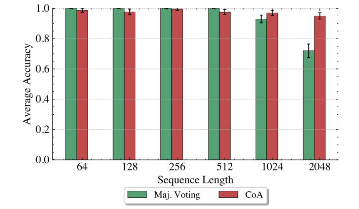

**图 6.** Llama-70B 在不同序列长度下执行 RECALL 的准确率。CoA 是理论最优协议。横轴为序列长度，纵轴为平均准确率。

### F.2 奇偶性

本节给出与正文类似的 PARITY 结果，但智能体基础模型改为 Llama-8B。图中的趋势与正文类似。Llama-8B 在该任务上的准确率更低，因为它更频繁地偏离提示指导并犯错（即翻转比特）。

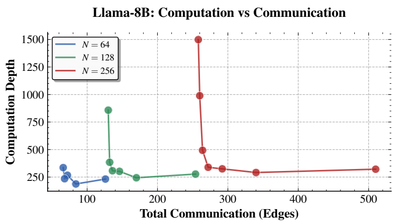

**图 7.** Llama-8B 的通信—计算权衡，展示奇偶性任务中不同多智能体协议的通信预算与计算深度之间的关系。横轴为总通信边数，纵轴为计算深度。

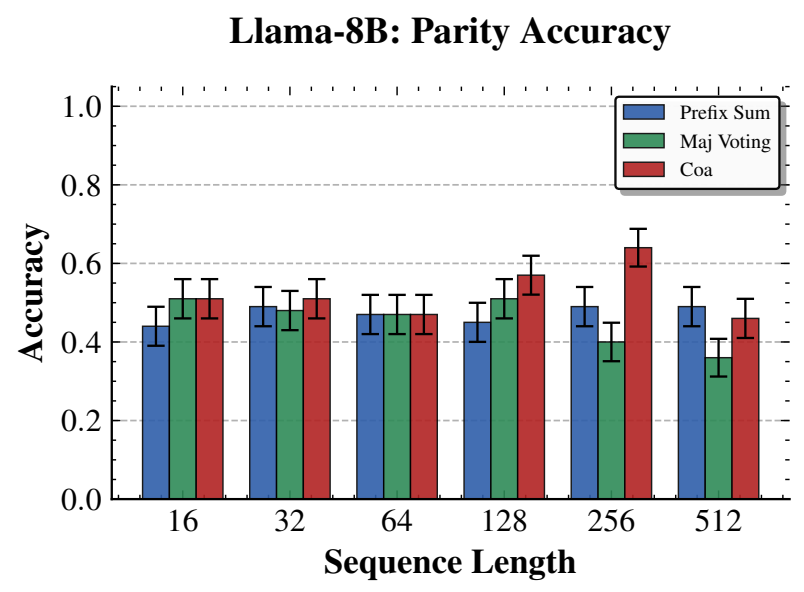

**图 8.** Llama-8B 在不同序列长度下的奇偶性计算准确率，比较单智能体与多智能体表现。图例包括前缀和、多数投票和 CoA。

### F.3 $S_5$ 置换

图 9 和图 10 在三种多智能体方法下，详细比较 Llama-8B 与 Llama-70B 模型。

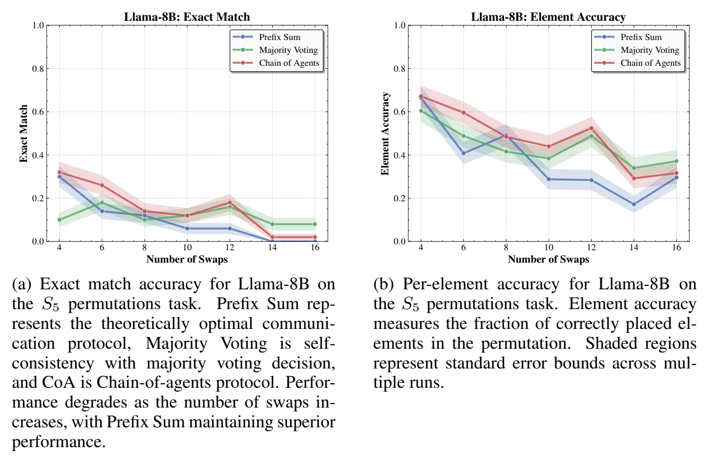

**图 9.** 使用 Llama-8B 时，多智能体方法在 $S_5$ 置换任务上的性能比较。（a）完全匹配准确率。Prefix Sum 表示理论最优通信协议；Majority Voting 是通过多数投票决策的自一致性；CoA 是智能体链协议。随着交换次数增加，性能下降，Prefix Sum 保持更优表现。（b）逐元素准确率，衡量置换中位置正确的元素比例；阴影区域表示多次运行的标准误差界。横轴为交换次数。

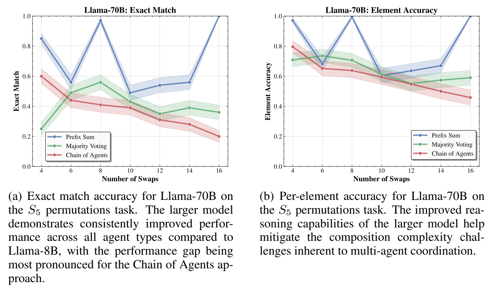

**图 10.** 使用 Llama-70B 时，多智能体方法在 $S_5$ 置换任务上的性能比较。（a）完全匹配准确率。与 Llama-8B 相比，较大模型在所有智能体类型上都表现出持续改进，智能体链方法的性能差距最明显。（b）逐元素准确率。较大模型更强的推理能力有助于缓解多智能体协调中固有的复合复杂性挑战。

### F.4 $k$ 跳推理

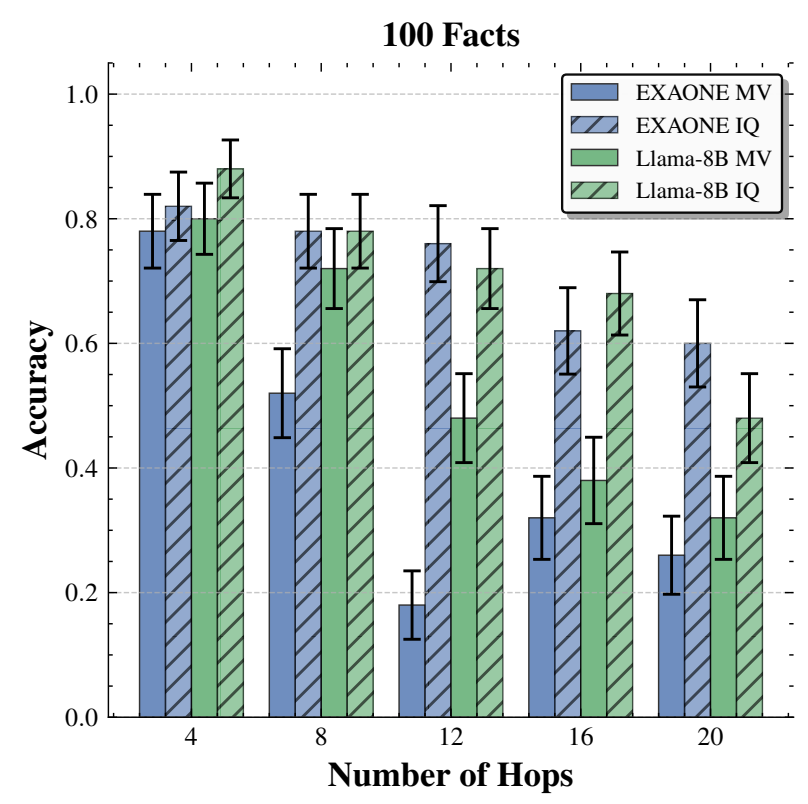

**图 11.** 100 个事实时，多智能体方法的 $k$ 跳推理比较。展示 Llama-8B 和 EXAONE 在不同跳数下的性能。横轴为跳数，纵轴为准确率；MV 表示多数投票，IQ 表示迭代查询。

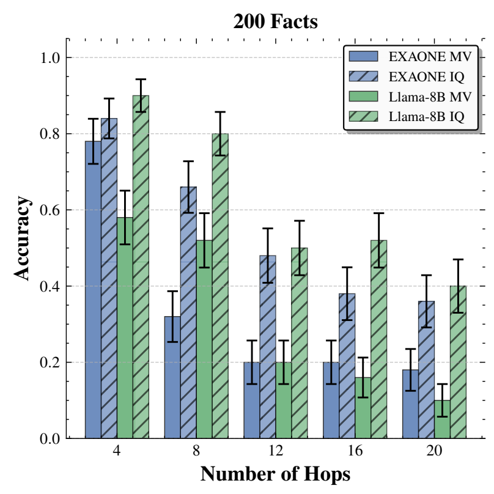

**图 12.** 200 个事实时，多智能体方法的 $k$ 跳推理比较。展示 Llama-8B 和 EXAONE 在不同跳数下的性能。横轴为跳数，纵轴为准确率；MV 表示多数投票，IQ 表示迭代查询。

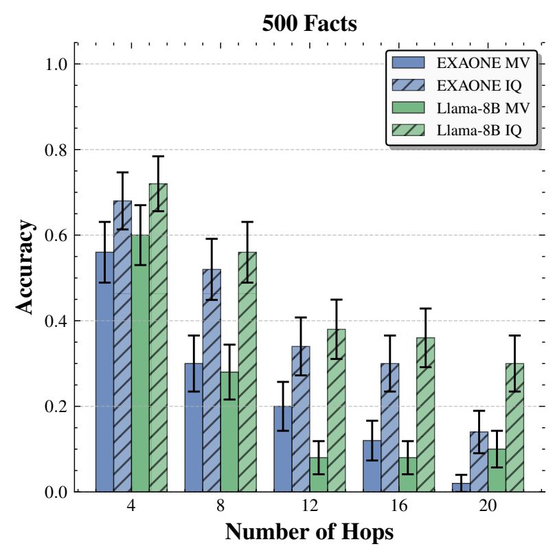

**图 13.** 500 个事实时，多智能体方法的 $k$ 跳推理比较。展示 Llama-8B 和 EXAONE 在不同跳数下的性能。横轴为跳数，纵轴为准确率；MV 表示多数投票，IQ 表示迭代查询。

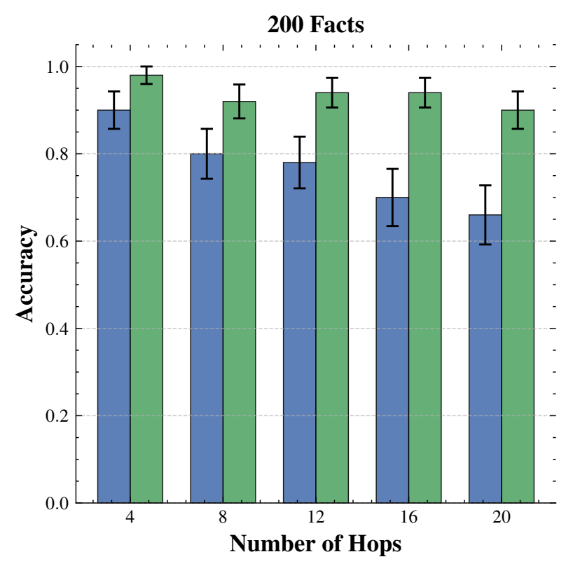

**图 14.** 200 个事实时，Llama-70B 的 $k$ 跳推理准确率。横轴为跳数，纵轴为准确率。

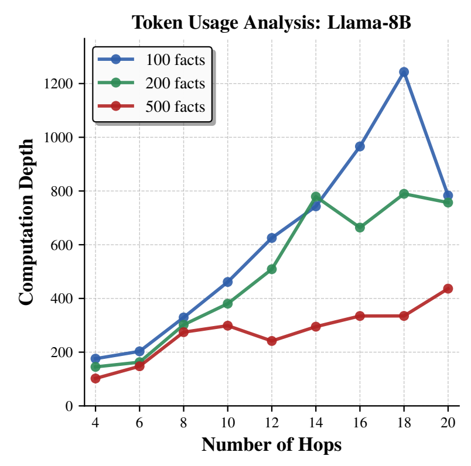

**图 15.** Llama-8B 的计算深度与查询跳数之间的关系。三条曲线分别对应 100、200、500 个事实。原文图注将模型写作 Lama-8B，图内标题为 Llama-8B。

## G 超越单词元通信

定义 3.1 假设智能体每步只能发送和接收一个词元。这是数学上的便利条件，并非结果的根本要求。真实多智能体系统可能交换跨多个词元的消息。这里解释，分析如何推广到单条消息包含多个词元的情形。

**多词元消息下的形式化。** 假设智能体 $T_i$ 要向 $T_j$ 发送多词元消息 $\sigma_1\ldots\sigma_k$，每个词元都属于 $\Xi_{|x|}$。最简单的形式化是将其视为多条单词元消息：$T_i$ 在总共 $k$ 个时间步中依次发送 $\sigma_1,\ldots,\sigma_k$。这是自然合理的方法，因为 Transformer 智能体本就能在每步生成和消费一个词元。若希望明确划分哪些单词元序列属于同一条多词元消息，可要求发送者在消息前后分别输出 `START MESSAGE` 与 `END MESSAGE` 词元。

**对结果的影响。** 根据上述讨论，多词元消息协议可等价转换为单词元消息协议，而不改变规模、宽度、计算深度或通信词元数量。因此，规模、宽度和计算深度的界完全不受多词元消息推广的影响。通信预算（即消息词元数量）同样不变。由此，即使消息跨越多个词元，全部理论结果仍保持不变。

## H 与自一致性及投票方法的比较

如引言所述，本文结果关注各智能体访问输入互不相交部分的多智能体系统的表达能力。因此，将同一输入交给多个智能体、再对其答案多数投票的流行策略（如 Wang et al., 2022）不属于主要范围。这里表明，框架中的多智能体系统可以实现显著优于多数投票方法的权衡。

论证在概念上与 Mirtaheri et al.（2025）相关，但后者仅比较不带 CoT 的投票与单智能体、无通信的长 CoT，并依赖有关 $\mathrm{TC}^0$ 的未证明猜想。我们则在相同计算深度下，比较多数投票与更精细的多智能体系统 PrefixSum（第 4.3 节）。

考虑简单的 PARITY 状态跟踪，将 PrefixSum 与智能体间多数投票比较；两者允许深度（每个智能体顺序生成的词元数）均为 $O(\log N)$。首先给出框架中多数投票的一般定义。为使结果尽可能强，并覆盖异构智能体投票，不假设智能体共享参数，甚至允许由不同模型给定的智能体之间投票。

**定义 H.1（多数投票）。** 考虑 $w(N)$ 个不同智能体，各自由 UHAT Transformer $T_1,\ldots,T_{w(N)}$ 给定。为保持一般性，允许每个智能体有自己的参数，仅假设所有智能体的层数和头数具有统一上界。每个智能体在完整输入上运行，产生长度（计算深度）为 $\operatorname{depth}(N)$ 的 CoT，并以单词元回复结束。最后输出最常见回复；并列时任意选择。

尽管这一定义很一般，我们仍可通过对计算 PARITY 所需的多数投票智能体数量给出下界，证明其与 PrefixSum 之间存在超多项式分离。考虑系统精确计算 PARITY 状态跟踪的情况，这与我们要求多智能体系统完美完成任务的整体框架一致。

**命题 H.1。** 考虑由 $w(N)$ 个智能体组成、在长度为 $N$ 的输入上计算 PARITY，且计算深度为 $\operatorname{depth}(N)=O(\log N)$ 的多数投票方案。则对于某个取决于智能体 Transformer 头数与层数的 $c>0$，必须有 $w(N)=2^{\Omega(N^c)}$ 个智能体。

关键结论是智能体数量的近指数下界 $w(N)=2^{\Omega(N^c)}$。相比之下，如命题 4.5，PrefixSum 在 $O(\log N)$ 计算深度和 $w(N)=N$ 个智能体下获得完美准确率。这形成了 PrefixSum 线性智能体数量与多数投票近指数智能体数量之间的超多项式分离。

上述结果针对零错误精确计算 PARITY 的多数投票方案，基于 Aspnes et al.（1991）关于投票多项式的结果。我们猜测，这些技术也可推广，为高准确率计算 PARITY 的任意投票方案给出智能体数量下界，但该推广超出本文范围。由于 PrefixSum 确定性地求解 PARITY，无错误计算的界在此最为相关。

**证明。** 有 $w(N)$ 个 UHAT 智能体，各产生长度（原文此处称通信深度）$\operatorname{depth}(N)=O(\log N)$ 的 CoT。对于 CoT 字母表上任意长度为 $\operatorname{depth}(N)$ 的给定字符串，可以在 $\mathrm{AC}^0$ 中检查它是否由某个 UHAT Transformer 生成。该电路层数由 Transformer 层数和头数界定，规模关于 $N$ 为多项式。

这样的字符串数量为 $O(\operatorname{poly}(N))^{O(\log N)}=O(N^{C\log N})$。为每个字符串复制一次该电路，分别检查是否由 Transformer 生成。Transformer 恰好生成其中一个字符串。检测到与实际 CoT 匹配的那个副本发出信号并输出结果（0 或 1），其余副本输出 0。用一个无界扇入 OR 门提取唯一匹配副本的答案。这样得到一个计算单个智能体输出的 AND-OR 电路，规模为 $O(N^{C\log N})$，其中 $C\ge1$，层数为在所有 $N$ 上有界的 $d$。

为执行多数投票，将全部智能体电路接到根节点的一个多数门。所得电路规模为 $s(N)=O(w(N)\cdot N^{C\log N})$，除根节点的最终多数门外，其余为 AND-OR 门。假设电路正确计算 PARITY。由 Aspnes et al.（1991）的引理 5.4：

$$
s(N)=2^{\Omega(N^{1/(4d)})}. \tag{26}
$$

因此：

$$
\log w(N)+\log N^{C\log N}=\Omega(N^{1/(4d)}), \tag{27}
$$

即：

$$
\log w(N)+C\cdot(\log N)^2=\Omega(N^{1/(4d)}). \tag{28}
$$

这意味着：

$$
\log w(N)=\Omega\bigl(N^{1/(4d)}-(\log N)^2\bigr), \tag{29}
$$

从而：

$$
w(N)=2^{\Omega(N^{1/(4d)})}. \tag{30}
$$

结论得证。□

## I 对固定精度 Transformer 的启示

理论结果针对 UHAT，这是一种使用硬注意力的常见理论模型。审稿人询问，这些结果对有限精度、固定宽度的软注意力 Transformer 有何意义。Li & Cotterell（2025）研究了软注意力、固定精度、固定宽度的因果 Transformer 的表达能力，表明其对应词上一阶逻辑双变量片段 $\mathrm{PFO}^2[<]$ 的一个子类。Jerad et al.（2025b）证明，它又可以由 UHAT 模拟。虽然他们研究的是无位置编码（NoPE）的 Transformer，但将结果推广到绝对位置编码（APE）很直接：

**命题 I.1。** 设 $T$ 是有限精度、有限宽度的软注意力 Transformer，其绝对位置编码 $\mathbf p_1,\mathbf p_2,\ldots\in\mathbb R^d$ 的范数有界，即 $\sup_i\|\mathbf p_i\|_2<\infty$。则 $T$ 可以由 UHAT Transformer 模拟。

**证明。** 这些假设意味着向量 $\mathbf p_1,\mathbf p_2,\ldots$ 遍历一个有限集合 $A$，可将它与 $\{1,\ldots,|A|\}$ 建立双射。为模拟 $T$ 在字符串上的操作，可将其视为 NoPE Transformer，在字符串每个位置 $i$ 上标注对应于 $\mathbf p_i\in A$ 的索引。该 NoPE Transformer 可以转换为 UHAT，随后为所得 UHAT 添加位置编码，即可模拟原始 APE Transformer $T$。□

因此，本文对基于 UHAT 的多智能体系统给出的全部下界，都可迁移到这种有限精度 softmax Transformer。另一方面，第 5 节实验表明，达到渐近最优权衡的协议确实能够由真实 Transformer 实现。
