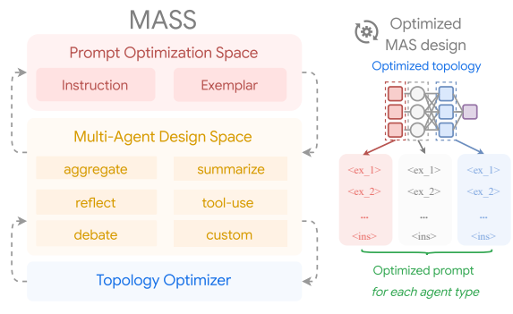
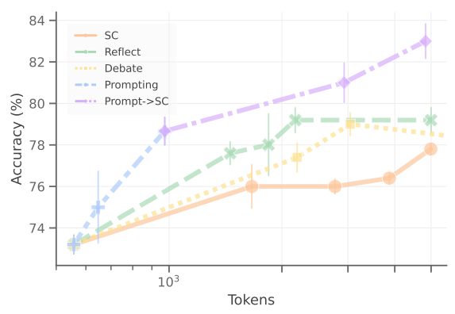
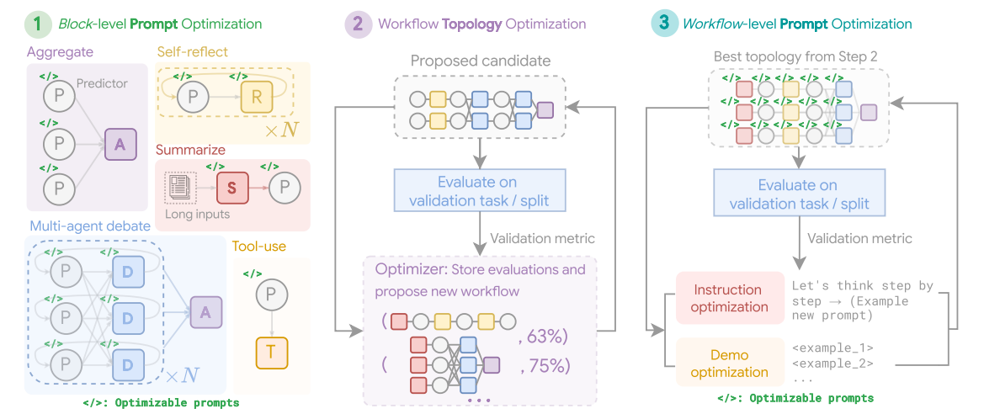
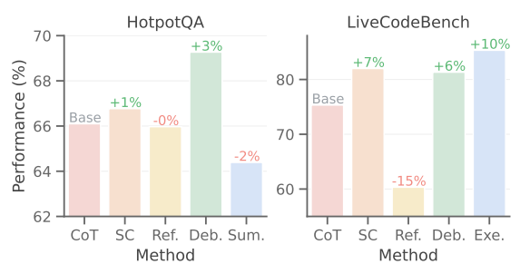
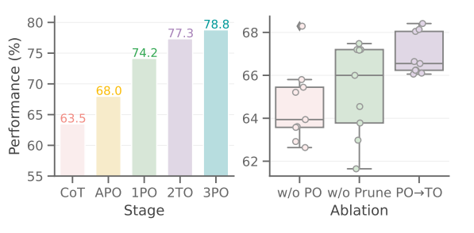
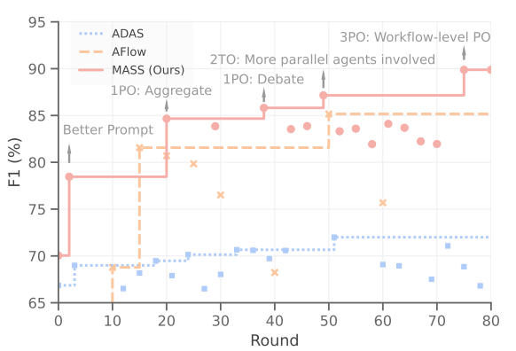
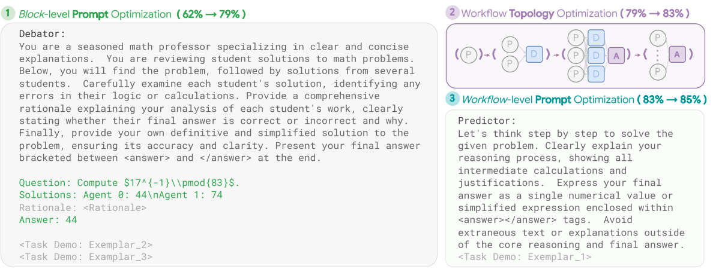
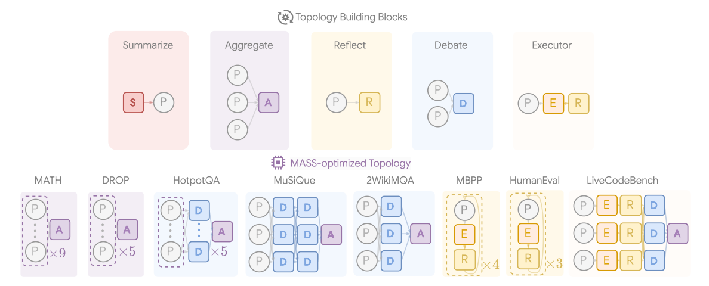
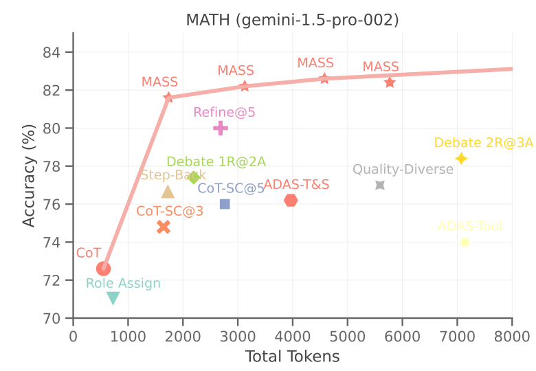

# 多智能体设计：利用更优提示词与拓扑结构优化智能体

**原题：** Multi-Agent Design: Optimizing Agents with Better Prompts and Topologies  
**发表会议：** ICLR 2026（原文标注：Published as a conference paper at ICLR 2026）

**作者：** Han Zhou<sup>1,3,*</sup>，Xingchen Wan<sup>2</sup>，Ruoxi Sun<sup>2</sup>，Hamid Palangi<sup>1</sup>，Shariq Iqbal<sup>2</sup>，Ivan Vulić<sup>2,3</sup>，Anna Korhonen<sup>3</sup>，Sercan Ö. Arık<sup>1</sup>

<sup>1</sup> Google；<sup>2</sup> Google DeepMind；<sup>3</sup> 剑桥大学。  
**邮箱：** {hzhouml,soarik}@google.com  
<sup>*</sup> 本工作在 Google 学生研究员任职期间完成。

> 译文说明：保留原文的章节编号、插图及图注、表格、算法和附录；参考文献保持英文原文。插图内的英文标注保留原样。提示词模板中的自然语言译为中文，变量名、字段名、占位符、输出标记和程序代码予以保留。数字与公式依原文转录，未擅自修正原文内部的不一致。

## 摘要

将大语言模型用作相互交互、协作的多个智能体，已经在解决复杂任务方面取得优异表现。智能体通过提示词定义其功能，并通过拓扑结构组织彼此之间的交互。为多智能体系统（MAS）设计提示词与拓扑结构，本身是一项复杂任务。为自动化整个设计过程，我们首先深入分析设计空间，力求理解构建有效 MAS 的关键因素。我们发现，提示词与拓扑结构共同对更有效的 MAS 设计起着关键作用。

基于这些认识，我们提出多智能体系统搜索（Multi-Agent System Search，MASS），这是一种 MAS 优化框架。它通过交错进行优化阶段，由局部到全局、由提示词到拓扑结构，高效探索复杂的 MAS 设计空间，具体包括三个阶段：（1）模块级（局部）提示词优化；（2）工作流拓扑优化；（3）工作流级（全局）提示词优化。每个阶段均以前面阶段迭代优化得到的提示词或拓扑结构为条件。结果表明，MASS 优化得到的多智能体系统以显著优势超过一系列现有替代方法。最后，我们基于 MASS 发现的系统，提出构建有效多智能体系统的设计原则。

## 1. 引言

大语言模型（LLM）在理解、推理以及根据用户提示生成连贯回答方面展现出非凡能力，推动了广泛应用的变革（Ouyang et al., 2022; Kojima et al., 2022）。基于 LLM 的智能体能够自主处理不同领域的复杂任务，从而提升可用性，包括代码生成与调试（Jimenez et al., 2023）、检索增强生成（Singh et al., 2025; Wang et al., 2024a）、数据分析（Hu et al., 2024b; Guo et al., 2024）和交互式决策（Su et al., 2025; Li et al., 2025）。这类智能体通常通过提示词编程，引导其与环境交互、利用可用工具，并经过多轮交互逐步实现目标（Yao et al., 2023）。除单个智能体外，还可以通过复杂拓扑组织 LLM，协调多个智能体朝共同目标行动。多智能体系统（MAS）通过引入更多样的智能体视角或角色，例如验证者智能体（Shinn et al., 2024）与多智能体辩论（Wang et al., 2024b; Qian et al., 2024），通常能够超过相应的单智能体系统。



**图 1.** 提出的多智能体系统搜索（MASS）框架，通过在可定制的多智能体设计空间中交错进行提示词优化与拓扑优化，发现有效的多智能体系统设计。左侧展示主要组成部分；右侧为同时优化了拓扑结构和提示词的系统。

然而，为新领域设计有效的 MAS 往往具有挑战性。首先，单个智能体可能对提示词敏感（Verma et al., 2024），即使简单修改提示词，也可能导致显著且出乎意料的性能下降（Zhou et al., 2024b; Liu et al., 2024a）。在 MAS 中，当敏感的智能体级联时，提示词敏感性的累积效应可能进一步放大。除提示词设计外，构建有效拓扑也可能需要大量基于试错的人工实验。整个组合搜索空间进一步加剧了问题复杂性：既包括无界的提示词设计空间，也包括将哪些智能体纳入拓扑的设计决策。

尽管近期研究已探索智能体设计不同方面的自动化，我们对于究竟哪些因素最能提升 MAS 性能，仍缺乏充分理解。例如，DSPy（Khattab et al., 2024）自动设计示例，以改进提示词编程；Li et al.（2024a）提出通过增加多数投票中的智能体数量优化 MAS；ADAS（Hu et al., 2024a）利用基于 LLM 的元智能体，以代码形式编写新拓扑；AFlow（Zhang et al., 2024b）则在一组预定义算子中，使用蒙特卡洛树搜索寻找更优拓扑。然而，包括提示词和拓扑在内的多个设计空间如何相互作用，仍不清楚。

本文首先深入分析 MAS 中常见的设计空间，考察优化提示词、增加智能体数量以及引入不同拓扑类型等因素的影响。分析表明，提示词往往是构建高性能 MAS 的重要设计组成，而真正有影响的拓扑仅占完整搜索空间的一小部分。基于这些认识，我们旨在将有效 MAS 组成部分的精髓提炼到经过剪枝的搜索空间中，从而降低整个搜索过程的复杂性。

我们提出多智能体系统搜索（MASS），这是一种新颖的多阶段优化框架，在高效搜索空间内自动优化 MAS。MASS 在可配置的拓扑空间中，整合即插即用的提示词优化器与工作流优化器。它通过交错进行优化阶段，克服 MAS 联合优化的复杂性：由局部到全局、由提示词到拓扑，依次进行（1）对每个拓扑模块开展模块级（局部）提示词“预热”；（2）在经过剪枝的拓扑空间集合中优化工作流拓扑；（3）在已找到的最佳拓扑条件下，进行工作流级（全局）提示词优化。

通过优化已识别的关键组成部分，MASS 得到的 MAS 达到最先进性能，在推理、多跳理解和代码生成等广泛任务上，以显著优势超过现有人工设计 MAS 基线与自动生成方法。根据 MASS 找到的最强 MAS，我们进一步提出构建有效 MAS 的认识与指导原则。总体而言，本文贡献可概括为：（1）深入分析影响基于 LLM 的 MAS 性能的设计因素，突出提示词的重要性，并识别有影响的拓扑；（2）提出新型多阶段优化器 MASS，在关键搜索空间中交错优化提示词和拓扑，自动完成 MAS 设计；（3）MASS 在多种评测基准上取得显著性能提升，并为未来构建有效多智能体系统提供指导。

## 2. 多智能体系统设计

本节首先形式化描述 MAS 设计问题，然后分析提示词与拓扑设计的影响。我们将智能体的结构安排称为智能体的**拓扑**，将不同拓扑之间构成 MAS 的逻辑执行序列定义为**工作流**。因此，MAS 设计可大体划分为两个层次：模块级设计和工作流级编排。

在模块层面，一个构建模块表示为完成某项特定功能（例如辩论）而协同工作的一组智能体；我们的目标是通过更好的提示词设计，构建最能发挥预期角色的有效个体智能体。另一方面，在工作流层面，优化需要决定包含哪些类型、多少数量的智能体，以及如何最有效地安排它们，这称为拓扑优化。

形式上，给定搜索空间 $\mathcal A=\{a_i\}$，它沿构建模块搜索维度 $a_i$ 定义所有有效的智能体配置（见图 3），个体智能体及其组合拓扑均可参数化为该空间中的具体配置。为得到最佳工作流 $W^*(a)$，在已定义搜索空间 $\mathcal A$ 中，以目标输入输出集合 $(x,y)\sim\mathcal D$ 上的目标函数 $f(\cdot,\cdot)$，将工作流拓扑优化表述为：

$$
W^*(a)=\underset{a\sim\mathcal A}{\arg\max}\;\mathbb E_{(x,y)\sim\mathcal D}\left[f\left(W(a(x)),y\right)\right]. \tag{1}
$$

本节其余部分对 MAS 设计的各组成部分进行深入分析。

### 2.1. 模块级分析：智能体的提示词设计

在模块层面，显著影响下游性能的主要“可优化组成部分”是提示词。它定义智能体的角色，例如“你是一名擅长反思错误的专家……”；提供额外指令来塑造其行为，例如“你应当逐步思考……”；还可以选择加入少样本演示，即上下文示例，以引导回答（Wan et al., 2024）。例如，一种最先进的提示词优化器会同时搜索指令和少样本演示：演示根据验证指标，从模型自身在验证集上的正确预测中自举获得；然后，优化器以这些演示为条件，结合数据集摘要或不同提示来提出若干指令候选，提高候选多样性（Opsahl-Ong et al., 2024）。随后对指令与演示进行联合优化。

虽然 LLM 对提示词敏感已广为人知（Zhou et al., 2024a; Verma et al., 2024），将自动提示词优化（APO）直接应用于 MAS 却并不容易。在单轮任务中，只需将提示词视为优化变量，将验证集性能作为目标，就能方便地进行 APO。但在 MAS 中，智能体之间存在相互依赖，例如级联中一个智能体的输出可能成为另一个智能体的输入，而中间输出通常没有真实答案；同时，参与智能体数量 $n$ 增加时，组合优化的复杂性呈指数增长。随着 $n$ 增大，奖励信号也更加稀疏，使我们无法在可控预算内直接对 MAS 实施 APO。因此，许多先前 MAS 工作（Zhang et al., 2024f; Xia et al., 2024）仍主要使用人工编写的提示词，并未将提示词作为 MAS 设计中的可优化组成部分。

为系统理解提示词设计在 MAS 中的影响，我们具体、定量地分析提示词优化的效果，并与 MAS 文献中其他常见操作比较，例如在保持默认提示词的情况下增加智能体数量。我们利用最先进的提示词优化器 MIPRO（Opsahl-Ong et al., 2024），对思维链（Kojima et al., 2022）智能体进行 APO，同时优化指令与单样本示例，并公平比较其推理 Token 总成本与自一致性（Kojima et al., 2022）、自我改进（Madaan et al., 2024）以及多智能体辩论（Du et al., 2024）的成本，具体配置见附录 C。



**图 2.** Gemini 1.5 Pro 在 MATH 上针对每道问题的准确率与 Token 总数关系：比较优化提示词后的智能体，与仅通过自一致性（SC）、自我改进（Reflect）和多智能体辩论（Debate）扩展智能体规模的方法。误差条表示一个标准差。结果表明，通过更有效的提示词，增加计算量可以获得更高准确率。

图 2 中，通过信息更丰富的指令和示例增强智能体的提示词方法，在 Token 使用效率方面明显优于其他构建模块。此外，在经过提示词优化的智能体上进一步应用自一致性，可改善随 Token 成本增加的扩展表现；相较之下，通过增加智能体数量进行扩展的标准方法，例如 SC 或 Reflect，会更早饱和。这一实证结果揭示了提示词的重要性，也为有效 MAS 设计提供早期证据：**先在局部优化智能体，再扩展其拓扑结构。**

### 2.2. 工作流级搜索空间设计

在工作流层面，主要关注如何有效编排智能体以获得最佳性能，拓扑优化近期受到广泛重视（Li et al., 2024c; Zhang et al., 2024b）。然而，现有研究大多强调**搜索方法**，即如何以最高效、最有效的方式识别最佳配置，却较少关注**搜索空间的设计**；后者决定了任何搜索算法所能探索的边界和范围。

这种不平衡与神经架构搜索（NAS）的历史发展相似（White et al., 2023）。该领域最初关注复杂的搜索方法，例如贝叶斯优化（Kandasamy et al., 2018; Ru et al., 2021）和可微搜索（Liu et al., 2018）；后续工作则强调了常被忽略的搜索空间设计的重要性，认为它即使不是更关键，也至少同样关键（Wan et al., 2022; Zhou et al., 2023a）。

受此启发，我们认为人工构建的拓扑可能并非最优；通过合理设计 MAS 搜索空间，自动拓扑优化也可发挥同样关键的作用，并可形式化为严谨的优化问题。为此，我们首先定义一个具有较强表达能力的搜索空间，与先前工作类似，它由以下构建模块之间的连接组成，形成 MASS 的统一搜索空间。

- **聚合（Aggregate）：** 智能体并行协作，生成多样化预测，再由聚合算子获取最一致的预测。聚合模块可由智能体数量 $N_a$ 参数化，它同时定义并行运行的智能体链数量。多数投票（Li et al., 2024a）和自一致性（Chen et al., 2024c）均属于此类拓扑。
- **反思（Reflect）：** 智能体充当验证者，针对已有预测提出批评和改进建议。反馈再传回预测者或反思者自身，进行迭代改进。反思可由 $N_r$ 参数化，表示自我反思轮数。Self-Refine（Madaan et al., 2024）和 Reflexion（Shinn et al., 2024）是此模块的代表，$N_r$ 也可理解为影响 MAS 网络深度的参数。
- **辩论（Debate）：** 辩论中的智能体可能比单个智能体产生更真实的预测（Du et al., 2024; Liang et al., 2024）。每个辩论智能体收集其他所有智能体的意见，再给出更新后的回答。此拓扑包含混合式智能体连接，$N_d$ 定义辩论轮数，即拓扑空间中全连接智能体层的数量。
- **自定义智能体（Custom Agents）：** 前三种形式覆盖了绝大多数由并行、串行及混合连接组成的智能体拓扑，但仍可将更灵活的智能体定义纳入 MAS 设计空间。例如，对于特定任务，我们在可定制设计空间中引入摘要智能体（Summarize），增强长上下文处理能力，其中 $N_s$ 表示信息抽象轮数。
- **工具使用（Tool-use）：** 为构建有效 MAS，使智能体能够使用工具获取外部信息，对系统性能十分重要，例如 RAG 中的检索器（Lewis et al., 2020），以及编码任务中配合测试用例的执行器（Chen et al., 2024d）。我们将工具使用，例如代码执行，作为与预测者配套的可优化二元“插入”决策 $N_T\in\{0,1\}$。

## 3. MASS：多智能体系统搜索

第 2 节分析强调了为个体智能体设计良好提示词，以及谨慎定义搜索空间，对实现有效 MAS 性能的重要性。在此基础上，我们提出多阶段优化算法**多智能体系统搜索（MASS）**，超越了仅优化工作流拓扑、而没有适当提示词设计的先前方法。我们的方法表明，经过充分优化的提示词与精心设计的搜索空间，能够带来更有效的 MAS 设计。MASS 框架见算法 1 和图 3。其直觉是由局部到全局、由模块级到工作流级，通过下文所述的有效分阶段优化，克服组合优化的复杂性。



**图 3.** MASS 框架、搜索空间及优化过程。搜索空间结合提示词（Instruction、Demo）与可配置的智能体构建模块（Aggregate、Reflect、Debate、Summarize、Tool-use）。**［1PO：模块级提示词优化］**对每个智能体模块独立进行提示词优化，图中以 `</>` 标记可优化提示词。**［2TO：工作流拓扑优化］**以阶段 1 为各模块找到的最佳提示词为条件，MASS 从按影响力加权的设计空间中采样有效配置，并融合阶段 1 各构建模块的提示词。**［3PO：工作流级提示词优化］**以找到的最佳工作流为条件，再对该最优 MAS 进行工作流级提示词优化。图中拓扑仅用于示意。

**（1）模块级提示词优化。**在组合智能体之前，首先确保各个智能体在模块层面得到充分优化，如第 2.1 节和图 2 所强调的那样。这一步以最可控的计算预算，为每个智能体配备最有效的指令，使其能够发挥预期角色。

为进一步克服在大型 MAS 空间中联合优化的复杂性，我们首先对初始预测者进行单智能体 APO 预热：

$$
a_0^*\leftarrow\mathcal O_{\mathcal D}(a_0).
$$

模块化提示词优化器 $\mathcal O$ 联合优化指令和示例。随后，以预热后的预测者为条件，继续采用最少智能体数量来优化各类拓扑：

$$
a_i^*\leftarrow\mathcal O_{\mathcal D}(a_i\mid a_0^*).
$$

例如，两个预测者配一个辩论者构成辩论拓扑的最小构建模块，从而降低优化复杂性。之后可通过增加预测者和辩论者扩展该拓扑，同时让所有智能体使用已优化提示词。为衡量各构建模块的影响，完成优化后保存其验证性能。

尽管阶段（1）是各构建模块的预热阶段，它仍十分关键：它保证后续拓扑优化在有效空间内搜索，组合性能良好的智能体，避免人工提示词下设计不佳的智能体带来的累积负面影响。

**（2）工作流拓扑优化。**本阶段优化 MAS 整体结构，确定智能体之间最有效的排列与连接方式。为理解个体模块的影响，图 4 报告不同拓扑的性能。并非所有拓扑都有利于 MAS 设计，而有积极影响的拓扑只占全部拓扑的一小部分。例如，在 HotpotQA（Yang et al., 2018）上，只有辩论带来 3% 的增益，其他模块没有改善，甚至降低系统性能。在 LiveCodeBench（Jain et al., 2024）的测试输出预测子任务中，也可观察到类似趋势。



**图 4.** 在 Gemini 1.5 Pro 上，不同拓扑相对于基准智能体的性能，各拓扑均使用 APO 优化。Sum.（Summarize，摘要）和 Exe.（Executor，执行器）是图 3 所示的任务特定拓扑。结果表明，并非所有拓扑都对 MAS 设计产生积极影响。

这突出说明，应在搜索空间中有实际作用的子集内进行搜索。加入会使性能下降的构建模块，不仅增加搜索复杂性，也可能降低性能。图 4 表明，有益拓扑仅占完整设计空间的一小部分。因此，我们将高性能拓扑的精髓提炼到经过剪枝的空间中，提高工作流级拓扑搜索效率。

**算法 1. MASS：多智能体系统搜索**

| 步骤 | 操作 |
|---:|---|
| 1 | **输入：** 搜索空间中的智能体模块 $a_i\in\mathcal A$，智能体工作流 $W(a)$，提示词优化器 $\mathcal O$，评估器 $\mathcal E$，验证集 $\mathcal D$，温度 $t$，候选数量 $N$，预算 $B$。 |
| 2 | **输出：** 优化后的多智能体系统 $W^*$。 |
| 3 | **［1PO：模块级提示词优化］** |
| 4 | 优化初始智能体的提示词：$a_0^*\leftarrow\mathcal O_{\mathcal D}(a_0)$。 |
| 5 | 对 $\mathcal A\setminus\{a_0\}$ 中的每个 $a_i$： |
| 6 | 对设计空间中的各构建模块进行局部提示词优化：$a_i^*\leftarrow\mathcal O_{\mathcal D}(a_i\mid a_0^*)$。 |
| 7 | 获得增量影响：$I_{a_i}\leftarrow\mathcal E(a_i^*)/\mathcal E(a_0^*)$。 |
| 8 | 结束循环。 |
| 9 | **［2TO：工作流拓扑优化］** |
| 10 | 得到选择概率 $p_a\leftarrow\operatorname{Softmax}(I_a,t)$。 |
| 11 | 当 $n<N$ 时： |
| 12 | 搜索空间剪枝：对 $\mathcal A$ 中满足 $u<p_{a_i}$ 的 $a_i$，构成 $\mathcal A_p=\{a_i\}$，其中 $u\sim\operatorname{Uniform}(0,1)$。 |
| 13 | 通过拒绝采样，获得预算内的智能体配置：$a\sim\mathcal A_p$，满足 $\mathcal N(a)<B$。 |
| 14 | 按预定义规则顺序，以优化提示词构建工作流 $W_c\leftarrow(a_i^*(\cdot),a_{i+1}^*(\cdot),\ldots)$。 |
| 15 | 评估并记录得分 $\mathcal E_{\mathcal D}(W_c)$。 |
| 16 | 结束循环。 |
| 17 | 取得性能最佳工作流 $W_c^*\leftarrow\arg\max_{c\in\mathcal C}\mathcal E_{\mathcal D}(W_c)$。 |
| 18 | **［3PO：工作流级提示词优化］** |
| 19 | 对性能最佳拓扑进行工作流级提示词优化：$W^*\leftarrow\mathcal O_{\mathcal D}(W_c^*)$。 |
| 20 | 返回优化后的多智能体系统 $W^*$。 |

我们定义增量影响：

$$
I_{a_i}=\frac{\mathcal E(a_i^*)}{\mathcal E(a_0^*)},
$$

用于量化相对于初始智能体 $a_0$，引入搜索维度 $a_i$ 带来的相对收益。依据“影响较大的维度应具有更高选择概率”的直觉，当 $u>p_{a_i}$ 时，拒绝相应拓扑搜索维度 $a_i$，形成经过剪枝的搜索空间。其中：

$$
u\sim\operatorname{Uniform}(0,1),\qquad p_a=\operatorname{Softmax}(I_a,t),
$$

$t$ 为 Softmax 温度。随后，在最大预算约束内，从经过剪枝的配置空间随机采样工作流：

$$
a\sim\mathcal A_p\quad\text{s.t.}\quad\mathcal N(a)<B.
$$

其中，$\mathcal N(a)$ 用于限制智能体总数，$B$ 是最大预算。例如，原配置空间为 $\mathcal A=\{a_i\}$，拓扑构建模块搜索维度 $a_i$ 由第 2.2 节所定义的属性 $N_{a_i}$ 参数化。每个搜索维度按该维度影响力对应的概率 $p_{a_i}$ 加权；当从均匀分布采得的 $u>p_{a_i}$ 时，拒绝该维度，从而形成 $\mathcal A_p$。

在 $\mathcal A_p$ 中采样有效配置后，按预定义规则排列智能体，构造工作流 $W(a)=(a_i,a_{i+1},\ldots)$。基于规则的流程消除不同排列顺序中的设计冗余，降低优化复杂性。该规则采用符合智能体设计实践的简单预定义顺序：**［摘要、反思、辩论、聚合］**。详细构造规则、MAS 可视化及各任务搜索空间见附录 C。

**（3）工作流级提示词优化。**最后，将整个 MAS 设计视为一个整体，在阶段（2）发现的最佳拓扑条件下，对所有智能体同时进行一轮联合提示词优化：
$$
W^*=\mathcal O_{\mathcal D}(W_c^*).
$$

虽然阶段（1）已经优化个体层面的提示词，本阶段仍发挥适配或微调作用，使提示词适合 MAS 内的编排，并恰当优化智能体之间的相互依赖。实验（图 5、6）表明，这一步通常能带来实际收益，性能收敛情况见表 6。

## 4. 实验

**模型与评测数据。**除自动化 MAS 研究中常用的基准（Hu et al., 2024a; Zhang et al., 2024b）外，我们还在广泛任务上开展实验：（1）推理任务，包括 Hendrycks 的 MATH（Hendrycks et al., 2021）和 DROP（Dua et al., 2019）；（2）长上下文理解任务，包括 LongBench（Bai et al., 2024）中的 HotpotQA（Yang et al., 2018）、MuSiQue（Trivedi et al., 2022）和 2WikiMultiHopQA（Ho et al., 2020）；（3）编码任务，包括 MBPP（Austin et al., 2021）、HumanEval（Chen et al., 2021）和 LiveCodeBench（LCB）的“测试输出预测”子任务（Jain et al., 2024）。数据划分与提示词模板详见附录 C 和 E。

所有主要实验主要采用 Gemini 1.5 的两种规模（Reid et al., 2024），即 `gemini-1.5-{pro,flash}-002`；同时在附录 D 中，使用 Claude 3.5 Sonnet（`claude-3-5-sonnet@20240620`）（Anthropic, 2024）和 Mistral Nemo（`mistral-nemo-12b`）（Mistral, 2024）进一步验证关键发现。

**表 1. 使用 Gemini 1.5 Pro 与 Gemini 1.5 Flash 的评测集结果。**所有结果报告三次评测的均值与标准差。MATH 和 LiveCodeBench（LCB）测试输出预测子任务使用准确率（%）；DROP、HotpotQA、MuSiQue 和 2WikiMQA 使用 F1；MBPP、HumanEval 使用 pass@1。AFlow* 的元提示词只有在 Claude 3.5 Sonnet 上才能正常工作，因此复现时以 Gemini 1.5 Pro 为执行器、Claude 3.5 Sonnet 为优化器；星号表示该结果仅供参考。推理成本控制在可比范围，见表 7。下表以“均值 ± 标准差”呈现原文下标所表示的标准差。

**Gemini-1.5-pro-002**

| 方法 | MATH | DROP | HotpotQA | MuSiQue | 2WikiMQA | MBPP | HumanEval | LCB | 平均值 |
|---|---:|---:|---:|---:|---:|---:|---:|---:|---:|
| CoT | 71.67 ± 3.30 | 70.59 ± 1.67 | 57.43 ± 0.52 | 37.81 ± 1.43 | 63.39 ± 1.12 | 68.33 ± 0.47 | 86.67 ± 0.94 | 66.33 ± 0.62 | 65.28 |
| 自一致性 | 77.33 ± 1.25 | 74.06 ± 0.90 | 58.60 ± 2.19 | 41.81 ± 1.00 | 67.79 ± 1.19 | 69.50 ± 0.71 | 86.00 ± 0.82 | 70.33 ± 0.94 | 68.18 |
| 自我改进 | 79.67 ± 2.36 | 71.03 ± 1.31 | 60.62 ± 3.33 | 42.15 ± 1.34 | 66.74 ± 2.43 | 63.67 ± 0.24 | 84.00 ± 1.63 | 67.33 ± 1.31 | 66.90 |
| 多智能体辩论 | 78.67 ± 0.94 | 71.78 ± 0.71 | 64.87 ± 0.23 | 46.00 ± 0.80 | 71.78 ± 0.63 | 68.67 ± 0.85 | 86.67 ± 1.25 | 73.67 ± 1.65 | 70.26 |
| ADAS | 80.00 ± 0.82 | 72.96 ± 0.90 | 65.88 ± 1.29 | 41.95 ± 1.24 | 71.14 ± 0.66 | 73.00 ± 1.08 | 87.67 ± 1.70 | 65.17 ± 1.25 | 69.72 |
| AFlow* | 76.00 ± 0.82 | 88.92 ± 0.63 | 68.62 ± 0.47 | 32.05 ± 1.29 | **76.51 ± 1.05** | - | 88.00 ± 0.00 | - | - |
| MASS（本文） | **84.67 ± 0.47** | **90.52 ± 0.64** | **69.91 ± 1.11** | **51.40 ± 0.42** | 73.34 ± 0.67 | **86.50 ± 0.41** | **91.67 ± 0.47** | **82.33 ± 0.85** | **78.79** |

**Gemini-1.5-flash-002**

| 方法 | MATH | DROP | HotpotQA | MuSiQue | 2WikiMQA | MBPP | HumanEval | LCB | 平均值 |
|---|---:|---:|---:|---:|---:|---:|---:|---:|---:|
| CoT | 66.67 ± 2.36 | 71.79 ± 0.69 | 57.82 ± 1.10 | 37.10 ± 1.35 | 63.40 ± 0.68 | 63.33 ± 1.25 | 75.67 ± 1.89 | 51.17 ± 0.24 | 60.87 |
| 自一致性 | 69.33 ± 1.25 | 73.42 ± 0.19 | 60.19 ± 1.01 | 41.94 ± 0.93 | 67.98 ± 0.72 | 63.67 ± 0.62 | 77.67 ± 1.89 | 53.83 ± 1.18 | 63.50 |
| 自我改进 | 71.33 ± 0.94 | 73.71 ± 1.09 | 58.84 ± 3.04 | 41.21 ± 1.99 | 65.56 ± 1.57 | 63.33 ± 1.25 | 81.67 ± 1.89 | 52.00 ± 1.41 | 63.46 |
| 多智能体辩论 | 71.67 ± 0.94 | 74.79 ± 0.87 | 64.17 ± 1.69 | 46.27 ± 1.33 | 72.19 ± 0.54 | 63.00 ± 0.71 | 79.67 ± 1.25 | 55.50 ± 0.41 | 65.91 |
| ADAS | 68.00 ± 1.41 | 75.95 ± 1.18 | 61.36 ± 2.89 | **48.81 ± 1.03** | 66.90 ± 1.00 | 65.83 ± 0.24 | 80.67 ± 2.49 | 50.50 ± 1.63 | 64.75 |
| MASS（本文） | **81.00 ± 2.45** | **91.68 ± 0.14** | **66.53 ± 0.38** | 43.67 ± 1.21 | **76.69 ± 0.50** | **78.00 ± 0.82** | **84.67 ± 0.47** | **72.17 ± 0.85** | **74.30** |

**基线。**我们考察以下基线：（1）CoT（Kojima et al., 2022），通过零样本提示直接进行思维链推理；（2）CoT-SC（Wang et al., 2023），使用 9 个智能体，通过自一致性从多样化推理轨迹中找到最一致答案；（3）Self-Refine（Madaan et al., 2024; Shinn et al., 2024），两个智能体、5 轮交互，由反思智能体验证并自我改进预测；（4）多智能体辩论（Du et al., 2024; Liang et al., 2024），3 个智能体、3 轮辩论，加 1 个裁决者，各智能体在多轮辩论中论证答案并整合其他智能体的信息；（5）ADAS（Hu et al., 2024a），由基于 LLM 的元智能体根据先前评估迭代提出新智能体的自动设计框架；（6）AFlow（Zhang et al., 2024b），通过在一组预定义算子上开展蒙特卡洛树搜索，自动设计工作流。

我们在每个查询推理成本可比、智能体数量上限为 10 的条件下公平比较全部基线。详细 Token 消耗见表 7，全部配置见附录 C。

**设置。**MASS 可与任意提示词优化器即插即用。我们集成 MIPRO（Opsahl-Ong et al., 2024）进行指令与示例联合优化，并在表 9 中消融比较接入 MASS 的其他提示词优化器。每个智能体在 10 轮中，自举演示数量上限为 3，指令候选数量上限为 10。对于所有任务的拓扑优化，通过拒绝采样搜索 10 个不同拓扑。拓扑优化过程中，每个拓扑在验证集上评估 3 次，以稳定预测。然后，在保留测试集上对优化后的 MAS 运行三次并报告结果。

模型温度 $T$ 设为 0.7，最大输出 Token 数为 4096，Softmax 温度 $t$ 设为 0.05，以使各搜索维度的选择概率 $p_a$ 更集中。评估器与优化器采用相同 LLM 骨干。

**主要结果。**表 1 给出了 MASS 与各基线在评测集上的主要结果。相比自一致性、自我改进和多智能体辩论等常见系统，MASS 取得显著收益；这些常见方法扩展规模时，并未优化协作智能体的提示词。MASS 得到高性能 MAS，在 Gemini 1.5 Pro 和 Flash 上的平均表现分别为 78.8% 和 74.3%；Claude 3.5 Sonnet 与 Mistral Nemo 上也观察到一致改善，见表 4、5。

与最先进的自动智能体设计基线 ADAS、AFlow 比较时，我们首先注意到，尽管 ADAS 的元智能体生成已经以常见智能体形式为条件，它仍只带来小幅收益。元智能体不断提出复杂拓扑，却没有优化提示词设计。另一方面，AFlow 与 MASS 具有较强竞争力，尤其是在 2WikiMQA 和 HumanEval 上。

我们将 AFlow 的性能归因于：（1）其“扩展”阶段根据将预测与真实答案对照的错误日志生成新节点，从而提供隐式文本梯度（Pryzant et al., 2023），反思提示词设计中的格式错误；（2）在预定义算子集合内采用更精细的搜索空间。虽然 AFlow 与 MASS 同样重视搜索空间设计，但它仍缺少专门的提示词优化阶段，无法充分优化预定义算子，导致其在 MATH 和 MuSiQue 上的 MAS 搜索结果较差。与这些基线不同，MASS 带来的一致改善，凸显了同时搜索提示词与拓扑设计空间的重要性。



**图 5.** **左：** MASS 在 Gemini 1.5 Pro 上，八个评测任务中各优化阶段的平均性能。以单智能体 CoT 起点为参照，并比较使用 MIPROv2（Opsahl-Ong et al., 2024）优化单智能体的 APO 基线。各任务详细消融结果见附录 D。**右：** 在 HotpotQA 上比较工作流拓扑优化（2TO）的消融结果，分别不进行剪枝，或不进行前一阶段提示词优化（1PO）。



**图 6.** 在 DROP 上，MASS 与智能体设计基线随验证轮次变化的优化轨迹。MASS 的一项独特优势是，阶段（1）与（2）内部的优化可完全并行；相比之下，ADAS、AFlow 是迭代算法，必须等待先前轨迹完成后才能提出新智能体。

**优化阶段消融。**为理解 MASS 各优化阶段的增量收益，图 5 给出逐阶段消融研究。我们列出 MASS 从模块级到工作流级优化的平均性能，并与单智能体 APO 基线 MIPROv2 比较。模块级优化性能表示 APO 后表现最佳构建模块 $a\in\mathcal A$ 的性能。

首先，模块级优化与单智能体 APO 之间存在较大差距，平均增益达 6%，表明在各构建模块内部优化智能体，能够使 MAS 获得显著收益，明显超过单独 APO。其次，从阶段（1）到阶段（2），通过组合有效拓扑并搜索最佳配置，可再获得约 3% 增益。我们还消融比较了在事先不优化提示词、或不剪枝搜索空间的情况下进行阶段（2）。图 5 右侧表明，两者对于有效探索搜索空间都十分重要。最后，MASS 对已找到的最佳拓扑进行工作流级提示词优化，进一步提高约 2%，说明通过优化提示词来建模智能体之间的相互依赖，对 MAS 有益。

**MASS 的成本效益。**我们分析 MASS 的成本效益，具体将其优化轨迹可视化于图 6。MASS 通过交错搜索更优提示词与拓扑，呈现稳定的优化趋势，逐步提高验证性能。相比之下，没有显式提示词优化阶段的自动设计基线中，AFlow 因 MCTS 本身的性质表现出更大优化方差，ADAS 则陷入发现过于复杂的拓扑，而这些拓扑似乎不如提示词设计空间有效。

总体而言，MASS 的优化轨迹凸显了在有效设计空间中优化的重要性；交错优化进一步解决复杂性问题，在与基线相同的训练成本下，获得更连续的收益。继第 2.1 节分析之后，MASS 还表现出更高的推理 Token 使用效率和可比训练成本，详见图 9 与表 7。

**发现的最佳 MAS 架构与设计原则。**图 7 进一步展示优化提示词的一个例子，以及 MASS 发现更有效拓扑的轨迹。优化从零样本 CoT 智能体开始，阶段（1）很快识别出采用优化提示词的高性能辩论拓扑；但阶段（2）发现，聚合更多并行智能体实际上超过了多智能体辩论的性能。随后，工作流级提示词优化得到用于聚合的最优预测者。



**图 7.** MASS 在 MATH 上的优化轨迹示例。（1）模块级优化中，多智能体辩论是性能最佳拓扑；（2）工作流拓扑优化中，聚合更多并行智能体的性能超过辩论智能体；最后，（3）工作流级优化在最佳拓扑条件下发现最优提示词。图中三个阶段的性能分别为 62%→79%、79%→83%、83%→85%。

整体优化流程揭示了构建有效 MAS 的指导原则：（1）组合为 MAS 之前，恰当优化各个智能体十分重要；（2）通过组合有影响的拓扑，可以构建更有效的 MAS；（3）建模智能体间的相互依赖是有益的，可通过工作流级联合优化实现。

## 5. 相关工作

**基于 LLM 的智能体系统形式。**最简单的基于 LLM 的智能体系统，由能够动态与环境交互和响应的单个智能体构成（Yao et al., 2023）。近期进展为智能体赋予不同角色与工具（Wu et al., 2023），并编排多个智能体协作（Chen et al., 2024b）。标准智能体协作形式，即拓扑，通常包含并行和串行信息流。

并行形式通常利用多个并行智能体实现多样化探索（Li et al., 2024a），自一致性（SC）（Wang et al., 2023）是并行扩展智能体的代表方法。串行形式旨在通过智能体链深化对任务的利用，LLM 可作为反思智能体，对先前预测进行自我论证与修正（Madaan et al., 2024; Shinn et al., 2024）。随后，聚合智能体可以总结多个智能体的意见，取得最一致答案（Chen et al., 2024c; Lin et al., 2024）。

此外，多智能体辩论包含更复杂的信息流（Chen et al., 2024a; Wang et al., 2024c; Zhang et al., 2024c），近期研究表明，辩论可以促使模型给出更真实的预测（Khan et al., 2024; Du et al., 2024）。近期的智能体拓扑已扩展到上述连接形式之外（Wang et al., 2024b; Qian et al., 2024），而 MASS 可以在前述空间中自动搜索最佳拓扑。

**MAS 自动优化。**近期研究开始通过将智能体功能理解为可学习策略（Zhang et al., 2024d;e），以及合成用于智能体微调的轨迹（Qiao et al., 2024），实现智能体设计自动化。与单智能体相比，自动多智能体优化面临更高复杂性，因此需要更精细的搜索空间与算法设计。

==近期多智能体优化的空间已经覆盖提示词（Khattab et al., 2024; Wang et al., 2024d）、工具（Zhou et al., 2024c）、工作流（Li et al., 2024c）和思考策略（Shang et al., 2024）。与我们的拓扑搜索空间更接近的方法包括：DyLAN（Liu et al., 2024b）动态激活智能体组合；Archon（Saad-Falcon et al., 2024）将 MAS 表述为超参数优化问题。两者均未考虑重要的提示词空间，而第 3 节已展示提示词优化的重要性。==

此外，GPTSwarm（Zhuge et al., 2024）通过策略梯度算法优化智能体节点之间的连接。最先进的自动智能体设计方法 ADAS（Hu et al., 2024a）与 AFlow（Zhang et al., 2024b），也尝试使用先进搜索算法以及作为优化器的 LLM，优化智能体工作流。与我们同期的 MaAS（Zhang et al., 2025）优化智能体超网络，以获得依赖查询的 MAS。然而，我们观察到，上述先前工作对提示词设计重要性的研究仍相对不足。

## 6. 结论

我们首先全面分析庞大的设计空间，以研究如何设计有效 MAS，揭示提示词的关键作用，并识别 MAS 搜索空间设计中的冗余。基于这些发现，提出新型多阶段优化框架 MASS：在经过剪枝的设计空间中，交错进行提示词与拓扑优化，高效生成高性能 MAS。

MASS 不依赖特定的定制提示词优化器或拓扑设计空间。实验表明，MASS 优化的 MAS 在广泛任务上显著超过现有人工和自动化方法。最后，我们根据 MASS 发现的优化系统，提炼有价值的设计原则，为未来 MAS 开发提供指导；同时期待将未来有潜力的提示词与拓扑设计整合到 MASS 中，构建更高效、更有效的基于 LLM 的智能体。

## 致谢

感谢 Jinsung Yoon 及 Google Cloud AI Research 的其他同事提供宝贵反馈。本工作获得英国研究与创新署（UKRI）授予剑桥大学 Anna Korhonen 的前沿研究基金 EP/Y031350/1 支持，该基金属于英国政府对欧洲研究理事会（ERC）高级研究基金的资助保障计划。本工作还部分获得授予 Ivan Vulić 的英国皇家学会大学研究员基金（编号 221137，2022 年起），以及英国工程与自然科学研究理事会（EPSRC）项目 EP/T02450X/1 支持。

## 可复现性声明

第 4 节和附录 C 提供包含超参数设置在内的详细实现说明。数据集配置列于表 2。MASS 搜索空间见表 3，多智能体构造规则见附录 C.3。此外，图 8 可视化了最小构建模块和优化后的拓扑。附录 E 提供各智能体的完整提示词模板，以完整复现主要实验。

## References

Anthropic. The claude 3 model family: Opus, sonnet, haiku. 2024.

Jacob Austin, Augustus Odena, Maxwell Nye, Maarten Bosma, Henryk Michalewski, David Dohan, Ellen Jiang, Carrie Cai, Michael Terry, Quoc Le, et al. Program synthesis with large language models. arXiv preprint arXiv:2108.07732, 2021.

Yushi Bai, Xin Lv, Jiajie Zhang, Hongchang Lyu, Jiankai Tang, Zhidian Huang, Zhengxiao Du, Xiao Liu, Aohan Zeng, Lei Hou, Yuxiao Dong, Jie Tang, and Juanzi Li. LongBench: A bilingual, multitask benchmark for long context understanding. In Lun-Wei Ku, Andre Martins, and Vivek Srikumar (eds.), Proceedings of the 62nd Annual Meeting of the Association for Computational Linguistics (Volume 1: Long Papers) , pp. 3119–3137, Bangkok, Thailand, August 2024. Association for Computational Linguistics. doi: 10.18653/v1/2024.acl-long.172. URL https://aclanthology.org/2024.acl-long.172/.

Justin Chen, Swarnadeep Saha, and Mohit Bansal. ReConcile: Round-table conference improves reasoning via consensus among diverse LLMs. In Lun-Wei Ku, Andre Martins, and Vivek Srikumar (eds.), Proceedings of the 62nd Annual Meeting of the Association for Computational Linguistics (Volume 1: Long Papers) , pp. 7066–7085, Bangkok, Thailand, August 2024a. Association for Computational Linguistics. doi: 10.18653/v1/2024.acl-long.381. URL https://aclanthology.org/2024.acl-long.381/.

Mark Chen, Jerry Tworek, Heewoo Jun, Qiming Yuan, Henrique Ponde De Oliveira Pinto, Jared Kaplan, Harri Edwards, Yuri Burda, Nicholas Joseph, Greg Brockman, et al. Evaluating large language models trained on code. arXiv preprint arXiv:2107.03374, 2021.

Weize Chen, Yusheng Su, Jingwei Zuo, Cheng Yang, Chenfei Yuan, Chi-Min Chan, Heyang Yu, Yaxi Lu, Yi-Hsin Hung, Chen Qian, Yujia Qin, Xin Cong, Ruobing Xie, Zhiyuan Liu, Maosong Sun, and Jie Zhou. Agentverse: Facilitating multi-agent collaboration and exploring emergent behaviors. In The Twelfth International Conference on Learning Representations, 2024b. URL https://openreview.net/forum?id=EHg5GDnyq1.

Xinyun Chen, Renat Aksitov, Uri Alon, Jie Ren, Kefan Xiao, Pengcheng Yin, Sushant Prakash, Charles Sutton, Xuezhi Wang, and Denny Zhou. Universal self-consistency for large language models. In ICML 2024 Workshop on In-Context Learning, 2024c. URL https://openreview.net/forum?id=LjsjHF7nAN.

Xinyun Chen, Maxwell Lin, Nathanael Schärli, and Denny Zhou. Teaching large language models to self-debug. In The Twelfth International Conference on Learning Representations, 2024d. URL https://openreview.net/forum?id=KuPixIqPiq.

Ching-An Cheng, Allen Nie, and Adith Swaminathan. Trace is the next autodiff: Generative optimization with rich feedback, execution traces, and LLMs. In The Thirty-eighth Annual Conference on Neural Information Processing Systems, 2024. URL https://openreview.net/forum?id=rYs2Dmn9tD.

Yilun Du, Shuang Li, Antonio Torralba, Joshua B. Tenenbaum, and Igor Mordatch. Improving factuality and reasoning in language models through multiagent debate. In Forty-first International Conference on Machine Learning, ICML 2024, Vienna, Austria, July 21-27, 2024. OpenReview.net, 2024. URL https://openreview.net/forum?id=zj7YuTE4t8.

Dheeru Dua, Yizhong Wang, Pradeep Dasigi, Gabriel Stanovsky, Sameer Singh, and Matt Gardner. DROP: A reading comprehension benchmark requiring discrete reasoning over paragraphs. In Jill Burstein, Christy Doran, and Thamar Solorio (eds.), Proceedings of the 2019 Conference of the North American Chapter of the Association for Computational Linguistics: Human Language Technologies, Volume 1 (Long and Short Papers), pp. 2368–2378, Minneapolis, Minnesota, June 2019. Association for Computational Linguistics. doi: 10.18653/v1/N19-1246. URL https://aclanthology.org/N19-1246/.

Siyuan Guo, Cheng Deng, Ying Wen, Hechang Chen, Yi Chang, and Jun Wang. Ds-agent: Automated data science by empowering large language models with case-based reasoning, 2024. URL https://arxiv.org/abs/2402.17453.

Dan Hendrycks, Collin Burns, Saurav Kadavath, Akul Arora, Steven Basart, Eric Tang, Dawn Song, and Jacob Steinhardt. Measuring mathematical problem solving with the math dataset. NeurIPS, 2021. URL https://openreview.net/forum?id=7Bywt2mQsCe.

Xanh Ho, Anh-Khoa Duong Nguyen, Saku Sugawara, and Akiko Aizawa. Constructing a multi-hop QA dataset for comprehensive evaluation of reasoning steps. In Donia Scott, Nuria Bel, and Chengqing Zong (eds.), Proceedings of the 28th International Conference on Computational Linguistics, pp. 6609–6625, Barcelona, Spain (Online), December 2020. International Committee on Computational Linguistics. doi: 10.18653/v1/2020.coling-main.580. URL https://aclanthology.org/2020.coling-main.580/.

Shengran Hu, Cong Lu, and Jeff Clune. Automated design of agentic systems. arXiv preprint arXiv:2408.08435, 2024a.

Xueyu Hu, Ziyu Zhao, Shuang Wei, Ziwei Chai, Qianli Ma, Guoyin Wang, Xuwu Wang, Jing Su, Jingjing Xu, Ming Zhu, Yao Cheng, Jianbo Yuan, Jiwei Li, Kun Kuang, Yang Yang, Hongxia Yang, and Fei Wu. Infiagent-dabench: Evaluating agents on data analysis tasks, 2024b. URL https://arxiv.org/abs/2401.05507.

Naman Jain, King Han, Alex Gu, Wen-Ding Li, Fanjia Yan, Tianjun Zhang, Sida Wang, Armando Solar-Lezama, Koushik Sen, and Ion Stoica. Livecodebench: Holistic and contamination free evaluation of large language models for code. arXiv preprint arXiv:2403.07974, 2024.

Carlos E Jimenez, John Yang, Alexander Wettig, Shunyu Yao, Kexin Pei, Ofir Press, and Karthik Narasimhan. Swe-bench: Can language models resolve real-world github issues? arXiv preprint arXiv:2310.06770, 2023.

Kirthevasan Kandasamy, Willie Neiswanger, Jeff Schneider, Barnabas Poczos, and Eric P Xing. Neural architecture search with bayesian optimisation and optimal transport. Advances in neural information processing systems, 31, 2018.

Akbir Khan, John Hughes, Dan Valentine, Laura Ruis, Kshitij Sachan, Ansh Radhakrishnan, Edward Grefenstette, Samuel R. Bowman, Tim Rocktäschel, and Ethan Perez. Debating with more persuasive LLMs leads to more truthful answers. In Forty-first International Conference on Machine Learning, 2024. URL https://openreview.net/forum?id=iLCZtl7FTa.

Omar Khattab, Arnav Singhvi, Paridhi Maheshwari, Zhiyuan Zhang, Keshav Santhanam, Sri Vardhamanan A, Saiful Haq, Ashutosh Sharma, Thomas T. Joshi, Hanna Moazam, Heather Miller, Matei Zaharia, and Christopher Potts. DSPy: Compiling declarative language model calls into state-of-the-art pipelines. In The Twelfth International Conference on Learning Representations, 2024. URL https://openreview.net/forum?id=sY5N0zY5Od.

Takeshi Kojima, Shixiang Shane Gu, Machel Reid, Yutaka Matsuo, and Yusuke Iwasawa. Large language models are zero-shot reasoners. Advances in neural information processing systems, 35: 22199–22213, 2022.

Patrick Lewis, Ethan Perez, Aleksandra Piktus, Fabio Petroni, Vladimir Karpukhin, Naman Goyal, Heinrich Küttler, Mike Lewis, Wen-tau Yih, Tim Rocktäschel, et al. Retrieval-augmented generation for knowledge-intensive nlp tasks. Advances in Neural Information Processing Systems, 33: 9459–9474, 2020.

Junyou Li, Qin Zhang, Yangbin Yu, QIANG FU, and Deheng Ye. More agents is all you need. Transactions on Machine Learning Research, 2024a. ISSN 2835-8856. URL https://openreview.net/forum?id=bgzUSZ8aeg.

Manling Li, Shiyu Zhao, Qineng Wang, Kangrui Wang, Yu Zhou, Sanjana Srivastava, Cem Gokmen, Tony Lee, Li Erran Li, Ruohan Zhang, Weiyu Liu, Percy Liang, Li Fei-Fei, Jiayuan Mao, and Jiajun Wu. Embodied agent interface: Benchmarking llms for embodied decision making, 2025. URL https://arxiv.org/abs/2410.07166.

Yunxuan Li, Yibing Du, Jiageng Zhang, Le Hou, Peter Grabowski, Yeqing Li, and Eugene Ie. Improving multi-agent debate with sparse communication topology. In Yaser Al-Onaizan, Mohit Bansal, and Yun-Nung Chen (eds.), Findings of the Association for Computational Linguistics: EMNLP 2024 , pp. 7281–7294, Miami, Florida, USA, November 2024b. Association for Computational Linguistics. doi: 10.18653/v1/2024.findings-emnlp.427. URL https://aclanthology.org/2024.findings-emnlp.427/.

Zelong Li, Shuyuan Xu, Kai Mei, Wenyue Hua, Balaji Rama, Om Raheja, Hao Wang, He Zhu, and Yongfeng Zhang. Autoflow: Automated workflow generation for large language model agents. arXiv preprint arXiv:2407.12821, 2024c.

Tian Liang, Zhiwei He, Wenxiang Jiao, Xing Wang, Yan Wang, Rui Wang, Yujiu Yang, Shuming Shi, and Zhaopeng Tu. Encouraging divergent thinking in large language models through multi-agent debate. In Yaser Al-Onaizan, Mohit Bansal, and Yun-Nung Chen (eds.), Proceedings of the 2024 Conference on Empirical Methods in Natural Language Processing, pp. 17889–17904, Miami, Florida, USA, November 2024. Association for Computational Linguistics. doi: 10.18653/v1/2024.emnlp-main.992. URL https://aclanthology.org/2024.emnlp-main.992/.

Lei Lin, Jiayi Fu, Pengli Liu, Qingyang Li, Yan Gong, Junchen Wan, Fuzheng Zhang, Zhongyuan Wang, Di Zhang, and Kun Gai. Just ask one more time! self-agreement improves reasoning of language models in (almost) all scenarios. In Lun-Wei Ku, Andre Martins, and Vivek Srikumar (eds.), Findings of the Association for Computational Linguistics: ACL 2024 , pp. 3829–3852, Bangkok, Thailand, August 2024. Association for Computational Linguistics. doi: 10.18653/v1/2024.findings-acl.230. URL https://aclanthology.org/2024.findings-acl.230/.

Fengyuan Liu, Nouar AlDahoul, Gregory Eady, Yasir Zaki, Bedoor AlShebli, and Talal Rahwan. Self-reflection outcome is sensitive to prompt construction. arXiv preprint arXiv:2406.10400, 2024a.

Hanxiao Liu, Karen Simonyan, and Yiming Yang. Darts: Differentiable architecture search. arXiv preprint arXiv:1806.09055, 2018.

Zijun Liu, Yanzhe Zhang, Peng Li, Yang Liu, and Diyi Yang. A dynamic LLM-powered agent network for task-oriented agent collaboration. In First Conference on Language Modeling, 2024b. URL https://openreview.net/forum?id=XII0Wp1XA9.

Aman Madaan, Niket Tandon, Prakhar Gupta, Skyler Hallinan, Luyu Gao, Sarah Wiegreffe, Uri Alon, Nouha Dziri, Shrimai Prabhumoye, Yiming Yang, et al. Self-refine: Iterative refinement with self-feedback. Advances in Neural Information Processing Systems, 36, 2024.

Mistral. Mistral nemo. 2024. URL https://mistral.ai/news/mistral-nemo.

Krista Opsahl-Ong, Michael J Ryan, Josh Purtell, David Broman, Christopher Potts, Matei Zaharia, and Omar Khattab. Optimizing instructions and demonstrations for multi-stage language model programs. In Yaser Al-Onaizan, Mohit Bansal, and Yun-Nung Chen (eds.), Proceedings of the 2024 Conference on Empirical Methods in Natural Language Processing, pp. 9340–9366, Miami, Florida, USA, November 2024. Association for Computational Linguistics. doi: 10.18653/v1/2024.emnlp-main.525. URL https://aclanthology.org/2024.emnlp-main.525/.

Long Ouyang, Jeffrey Wu, Xu Jiang, Diogo Almeida, Carroll Wainwright, Pamela Mishkin, Chong Zhang, Sandhini Agarwal, Katarina Slama, Alex Ray, et al. Training language models to follow instructions with human feedback. Advances in neural information processing systems, 35:27730– 27744, 2022.

Reid Pryzant, Dan Iter, Jerry Li, Yin Lee, Chenguang Zhu, and Michael Zeng. Automatic prompt optimization with “gradient descent” and beam search. In Houda Bouamor, Juan Pino, and Kalika Bali (eds.), Proceedings of the 2023 Conference on Empirical Methods in Natural Language Processing, pp. 7957–7968, Singapore, December 2023. Association for Computational Linguistics. doi: 10.18653/v1/2023.emnlp-main.494. URL https://aclanthology.org/2023.emnlp-main.494/.

Chen Qian, Zihao Xie, Yifei Wang, Wei Liu, Yufan Dang, Zhuoyun Du, Weize Chen, Cheng Yang, Zhiyuan Liu, and Maosong Sun. Scaling large-language-model-based multi-agent collaboration. arXiv preprint arXiv:2406.07155, 2024.

Shuofei Qiao, Ningyu Zhang, Runnan Fang, Yujie Luo, Wangchunshu Zhou, Yuchen Jiang, Chengfei Lv, and Huajun Chen. AutoAct: Automatic agent learning from scratch for QA via self-planning. In Lun-Wei Ku, Andre Martins, and Vivek Srikumar (eds.), Proceedings of the 62nd Annual Meeting of the Association for Computational Linguistics (Volume 1: Long Papers) , pp. 3003– 3021, Bangkok, Thailand, August 2024. Association for Computational Linguistics. doi: 10.18653/v1/2024.acl-long.165. URL https://aclanthology.org/2024.acl-long.165/.

Machel Reid, Nikolay Savinov, Denis Teplyashin, Dmitry Lepikhin, Timothy P. Lillicrap, Jean-Baptiste Alayrac, Radu Soricut, Angeliki Lazaridou, Orhan Firat, Julian Schrittwieser, Ioannis Antonoglou, Rohan Anil, Sebastian Borgeaud, Andrew M. Dai, Katie Millican, Ethan Dyer, Mia Glaese, Thibault Sottiaux, Benjamin Lee, Fabio Viola, Malcolm Reynolds, Yuanzhong Xu, James Molloy, Jilin Chen, Michael Isard, Paul Barham, Tom Hennigan, Ross McIlroy, Melvin Johnson, Johan Schalkwyk, Eli Collins, Eliza Rutherford, Erica Moreira, Kareem Ayoub, Megha Goel, Clemens Meyer, Gregory Thornton, Zhen Yang, Henryk Michalewski, Zaheer Abbas, Nathan Schucher, Ankesh Anand, Richard Ives, James Keeling, Karel Lenc, Salem Haykal, Siamak Shakeri, Pranav Shyam, Aakanksha Chowdhery, Roman Ring, Stephen Spencer, Eren Sezener, and et al. Gemini 1.5: Unlocking multimodal understanding across millions of tokens of context. CoRR, abs/2403.05530, 2024. doi: 10.48550/ARXIV .2403.05530. URL https://doi.org/10.48550/arXiv.2403.05530.

Binxin Ru, Xingchen Wan, Xiaowen Dong, and Michael Osborne. Interpretable neural architecture search via bayesian optimisation with weisfeiler-lehman kernels. International Conference on Learning Representations (ICLR), 2021.

Jon Saad-Falcon, Adrian Gamarra Lafuente, Shlok Natarajan, Nahum Maru, Hristo Todorov, Etash Guha, E Kelly Buchanan, Mayee Chen, Neel Guha, Christopher Ré, et al. Archon: An architecture search framework for inference-time techniques. arXiv preprint arXiv:2409.15254, 2024.

Yu Shang, Yu Li, Keyu Zhao, Likai Ma, Jiahe Liu, Fengli Xu, and Yong Li. Agentsquare: Automatic llm agent search in modular design space. arXiv preprint arXiv:2410.06153, 2024.

Noah Shinn, Federico Cassano, Ashwin Gopinath, Karthik Narasimhan, and Shunyu Yao. Reflexion: Language agents with verbal reinforcement learning. Advances in Neural Information Processing Systems, 36, 2024.

Aditi Singh, Abul Ehtesham, Saket Kumar, and Tala Talaei Khoei. Agentic retrieval-augmented generation: A survey on agentic rag. arXiv preprint arXiv:2501.09136, 2025.

Hongjin Su, Ruoxi Sun, Jinsung Yoon, Pengcheng Yin, Tao Yu, and SercanÖ Arık. Learn-by-interact: A data-centric framework for self-adaptive agents in realistic environments. arXiv preprint arXiv:2501.10893, 2025.

Harsh Trivedi, Niranjan Balasubramanian, Tushar Khot, and Ashish Sabharwal. MuSiQue: Multihop questions via single-hop question composition. Transactions of the Association for Computational Linguistics, 10:539–554, 2022. doi: 10.1162/tacl a 00475. URL https://aclanthology.org/2022.tacl-1.31/.

Mudit Verma, Siddhant Bhambri, and Subbarao Kambhampati. On the brittle foundations of react prompting for agentic large language models. arXiv preprint arXiv:2405.13966, 2024.

Xingchen Wan, Binxin Ru, Pedro M Esperanca̧, and Zhenguo Li. On redundancy and diversity in cell-based neural architecture search. In International Conference on Learning Representations, 2022. URL https://openreview.net/forum?id=rFJWoYoxrDB.

Xingchen Wan, Ruoxi Sun, Hootan Nakhost, and Sercan O Arik. Teach better or show smarter? on instructions and exemplars in automatic prompt optimization. In The Thirty-eighth Annual Conference on Neural Information Processing Systems, 2024. URL https://openreview.net/forum?id=IdtoJVWVnX.

Fei Wang, Xingchen Wan, Ruoxi Sun, Jiefeng Chen, and SercanÖ Arık. Astute rag: Overcoming imperfect retrieval augmentation and knowledge conflicts for large language models.arXiv preprint arXiv:2410.07176, 2024a.

Junlin Wang, Jue Wang, Ben Athiwaratkun, Ce Zhang, and James Zou. Mixture-of-agents enhances large language model capabilities. arXiv preprint arXiv:2406.04692, 2024b.

Qineng Wang, Zihao Wang, Ying Su, Hanghang Tong, and Yangqiu Song. Rethinking the bounds of LLM reasoning: Are multi-agent discussions the key? In Lun-Wei Ku, Andre Martins, and Vivek Srikumar (eds.), Proceedings of the 62nd Annual Meeting of the Association for Computational Linguistics (Volume 1: Long Papers), pp. 6106–6131, Bangkok, Thailand, August 2024c. Association for Computational Linguistics. doi: 10.18653/v1/2024.acl-long.331. URL https://aclanthology.org/2024.acl-long.331/.

Wenyi Wang, Hisham A Alyahya, Dylan R Ashley, Oleg Serikov, Dmitrii Khizbullin, Francesco Faccio, and Jürgen Schmidhuber. How to correctly do semantic backpropagation on language-based agentic systems. arXiv preprint arXiv:2412.03624, 2024d.

Xuezhi Wang, Jason Wei, Dale Schuurmans, Quoc V Le, Ed H. Chi, Sharan Narang, Aakanksha Chowdhery, and Denny Zhou. Self-consistency improves chain of thought reasoning in language models. In The Eleventh International Conference on Learning Representations , 2023. URL https://openreview.net/forum?id=1PL1NIMMrw.

Colin White, Mahmoud Safari, Rhea Sukthanker, Binxin Ru, Thomas Elsken, Arber Zela, Debadeepta Dey, and Frank Hutter. Neural architecture search: Insights from 1000 papers. arXiv preprint arXiv:2301.08727, 2023.

Qingyun Wu, Gagan Bansal, Jieyu Zhang, Yiran Wu, Shaokun Zhang, Erkang Zhu, Beibin Li, Li Jiang, Xiaoyun Zhang, and Chi Wang. Autogen: Enabling next-gen llm applications via multi-agent conversation framework. arXiv preprint arXiv:2308.08155, 2023.

Chunqiu Steven Xia, Yinlin Deng, Soren Dunn, and Lingming Zhang. Agentless: Demystifying llm-based software engineering agents. arXiv preprint arXiv:2407.01489, 2024.

Chengrun Yang, Xuezhi Wang, Yifeng Lu, Hanxiao Liu, Quoc V Le, Denny Zhou, and Xinyun Chen. Large language models as optimizers. In The Twelfth International Conference on Learning Representations, 2024. URL https://openreview.net/forum?id=Bb4VGOWELI.

Zhilin Yang, Peng Qi, Saizheng Zhang, Yoshua Bengio, William Cohen, Ruslan Salakhutdinov, and Christopher D. Manning. HotpotQA: A dataset for diverse, explainable multi-hop question answering. In Ellen Riloff, David Chiang, Julia Hockenmaier, and Jun’ichi Tsujii (eds.), Proceedings of the 2018 Conference on Empirical Methods in Natural Language Processing, pp. 2369–2380, Brussels, Belgium, October-November 2018. Association for Computational Linguistics. doi: 10.18653/v1/D18-1259. URL https://aclanthology.org/D18-1259/.

Shunyu Yao, Jeffrey Zhao, Dian Yu, Nan Du, Izhak Shafran, Karthik R Narasimhan, and Yuan Cao. React: Synergizing reasoning and acting in language models. In The Eleventh International Conference on Learning Representations, 2023. URL https://openreview.net/forum?id=WE_vluYUL-X.

Mert Yuksekgonul, Federico Bianchi, Joseph Boen, Sheng Liu, Pan Lu, Zhi Huang, Carlos Guestrin, and James Zou. Optimizing generative ai by backpropagating language model feedback. Nature, 639:609–616, 2025.

Guibin Zhang, Yanwei Yue, Zhixun Li, Sukwon Yun, Guancheng Wan, Kun Wang, Dawei Cheng, Jeffrey Xu Yu, and Tianlong Chen. Cut the crap: An economical communication pipeline for llm-based multi-agent systems. arXiv preprint arXiv:2410.02506, 2024a.

Guibin Zhang, Luyang Niu, Junfeng Fang, Kun Wang, Lei Bai, and Xiang Wang. Multi-agent architecture search via agentic supernet. arXiv preprint arXiv:2502.04180, 2025.

Jiayi Zhang, Jinyu Xiang, Zhaoyang Yu, Fengwei Teng, Xionghui Chen, Jiaqi Chen, Mingchen Zhuge, Xin Cheng, Sirui Hong, Jinlin Wang, et al. Aflow: Automating agentic workflow generation. arXiv preprint arXiv:2410.10762, 2024b.

Jintian Zhang, Xin Xu, Ningyu Zhang, Ruibo Liu, Bryan Hooi, and Shumin Deng. Exploring collaboration mechanisms for LLM agents: A social psychology view. In Lun-Wei Ku, Andre Martins, and Vivek Srikumar (eds.), Proceedings of the 62nd Annual Meeting of the Association for Computational Linguistics (Volume 1: Long Papers), pp. 14544–14607, Bangkok, Thailand, August 2024c. Association for Computational Linguistics. doi: 10.18653/v1/2024.acl-long.782. URL https://aclanthology.org/2024.acl-long.782/.

Shaokun Zhang, Jieyu Zhang, Jiale Liu, Linxin Song, Chi Wang, Ranjay Krishna, and Qingyun Wu. Offline training of language model agents with functions as learnable weights. In Forty-first International Conference on Machine Learning, 2024d. URL https://openreview.net/forum?id=2xbkWiEuR1.

Wenqi Zhang, Ke Tang, Hai Wu, Mengna Wang, Yongliang Shen, Guiyang Hou, Zeqi Tan, Peng Li, Yueting Zhuang, and Weiming Lu. Agent-pro: Learning to evolve via policy-level reflection and optimization. In Lun-Wei Ku, Andre Martins, and Vivek Srikumar (eds.), Proceedings of the 62nd Annual Meeting of the Association for Computational Linguistics (Volume 1: Long Papers), pp. 5348–5375, Bangkok, Thailand, August 2024e. Association for Computational Linguistics. doi: 10.18653/v1/2024.acl-long.292. URL https://aclanthology.org/2024.acl-long.292/.

Yusen Zhang, Ruoxi Sun, Yanfei Chen, Tomas Pfister, Rui Zhang, and Sercan O Arik. Chain of agents: Large language models collaborating on long-context tasks. In The Thirty-eighth Annual Conference on Neural Information Processing Systems, 2024f. URL https://openreview.net/forum?id=LuCLf4BJsr.

Han Zhou, Xingchen Wan, Ivan Vulić, and Anna Korhonen. Survival of the most influential prompts: Efficient black-box prompt search via clustering and pruning. In Houda Bouamor, Juan Pino, and Kalika Bali (eds.), Findings of the Association for Computational Linguistics: EMNLP 2023, pp. 13064–13077, Singapore, December 2023a. Association for Computational Linguistics. doi: 10.18653/v1/2023.findings-emnlp.870. URL https://aclanthology.org/2023.findings-emnlp.870/.

Han Zhou, Xingchen Wan, Yinhong Liu, Nigel Collier, Ivan Vulić, and Anna Korhonen. Fairer preferences elicit improved human-aligned large language model judgments. In Yaser Al-Onaizan, Mohit Bansal, and Yun-Nung Chen (eds.), Proceedings of the 2024 Conference on Empirical Methods in Natural Language Processing , pp. 1241–1252, Miami, Florida, USA, November 2024a. Association for Computational Linguistics. doi: 10.18653/v1/2024.emnlp-main.72. URL https://aclanthology.org/2024.emnlp-main.72/.

Han Zhou, Xingchen Wan, Lev Proleev, Diana Mincu, Jilin Chen, Katherine A Heller, and Subhrajit Roy. Batch calibration: Rethinking calibration for in-context learning and prompt engineering. In The Twelfth International Conference on Learning Representations , 2024b. URL https://openreview.net/forum?id=L3FHMoKZcS.

Wangchunshu Zhou, Yixin Ou, Shengwei Ding, Long Li, Jialong Wu, Tiannan Wang, Jiamin Chen, Shuai Wang, Xiaohua Xu, Ningyu Zhang, et al. Symbolic learning enables self-evolving agents. arXiv preprint arXiv:2406.18532, 2024c.

Yongchao Zhou, Andrei Ioan Muresanu, Ziwen Han, Keiran Paster, Silviu Pitis, Harris Chan, and Jimmy Ba. Large language models are human-level prompt engineers. In The Eleventh International Conference on Learning Representations, 2023b. URL https://openreview.net/forum?id=92gvk82DE-.

Mingchen Zhuge, Wenyi Wang, Louis Kirsch, Francesco Faccio, Dmitrii Khizbullin, and Jürgen Schmidhuber. GPTSwarm: Language agents as optimizable graphs. In Forty-first International Conference on Machine Learning, 2024. URL https://openreview.net/forum?id=uTC9AFXIhg.

## 附录 A. 大语言模型的使用

本工作将大语言模型（LLM）作为通用辅助工具。具体而言，LLM 用于润色写作，以提高清晰度和可读性。

## 附录 B. 局限性与未来工作

MASS 是一种多智能体设计元框架，与具体提示词优化器和拓扑优化器相互独立。通过在可定制拓扑空间中搜索，MASS 相比单智能体设计取得显著改善。尽管我们提出的拓扑空间已覆盖绝大多数有效 MAS 设计，包括串行、并行与混合连接，纳入其他拓扑仍可能进一步改善 MASS 的最终性能，并与 MASS 的发展形成互补。

例如，MASS 提出的辩论拓扑采用智能体间全连接。近期工作已开始识别智能体通信的稀疏性（Li et al., 2024b; Zhang et al., 2024a），剪除冗余通信可能进一步提高 MASS 发现的最强设计的整体效率。尽管 MASS 拓扑优化器已经能够高效遍历提出的拓扑空间，在面对更复杂设计空间时，加入贝叶斯优化器等更先进搜索算法（Kandasamy et al., 2018; Ru et al., 2021），仍可能进一步提高样本效率。

类似地，以错误日志中的文本反馈为条件（Pryzant et al., 2023; Cheng et al., 2024），可能提高提示词优化器的样本效率，我们将在未来工作中继续探索。这些有前景的未来拓扑与提示词设计方法将进一步增强 MASS；MASS 本身则已为识别有影响的智能体设计组成部分提供可泛化指导，并为可扩展 MAS 优化提供系统框架。

## 附录 C. 实现细节

### C.1. 数据集

本文使用以下数据集：（1）包含竞赛级数学题的 MATH（Hendrycks et al., 2021），以及要求对段落进行离散和符号推理的 DROP（Dua et al., 2019）；（2）用于评估智能体系统长上下文推理的 HotpotQA（Yang et al., 2018）、MuSiQue（Trivedi et al., 2022）和 2WikiMultiHopQA（Ho et al., 2020），使用 LongBench（Bai et al., 2024）中的标准化版本；（3）成熟编码基准 MBPP（Austin et al., 2021）、HumanEval（Chen et al., 2021）和 LiveCodeBench（Jain et al., 2024）。

对于 LiveCodeBench，将“测试输出预测”作为智能体协作任务。与 AFlow（Zhang et al., 2024b）一致，使用 MBPP、HumanEval 的公开测试用例，使执行器获得可靠外部反馈。为节省计算资源，从原始验证集与测试集划分中随机抽取子集开展全部实验，具体配置见表 2。

**表 2. 评测任务配置：数据集划分、拓扑搜索空间，以及 MASS 在 Gemini 1.5 Pro 上优化得到的 MAS。**最后一列配置向量按该行搜索空间所列模块的顺序对应。

| 任务 | 类型 | 验证集数量 | 测试集数量 | 拓扑搜索空间 | MASS 配置 |
|---|---|---:|---:|---|---|
| MATH | 数学推理 | 60 | 100 | {聚合，反思，辩论} | {9, 0, 0} |
| DROP | 离散推理 | 60 | 200 | {聚合，反思，辩论} | {5, 0, 0} |
| HotpotQA | 长上下文理解 | 50 | 100 | {摘要，聚合，反思，辩论} | {0, 5, 0, 1} |
| MuSiQue | 长上下文理解 | 50 | 100 | {摘要，聚合，反思，辩论} | {0, 3, 0, 2} |
| 2WikiMQA | 长上下文理解 | 50 | 100 | {摘要，聚合，反思，辩论} | {0, 3, 0, 1} |
| MBPP | 编码 | 60 | 200 | {聚合，反思，辩论，执行器} | {1, 4, 0, 1} |
| HumanEval | 编码 | 50 | 100 | {聚合，反思，辩论，执行器} | {1, 3, 0, 1} |
| LiveCodeBench | 编码：测试输出预测 | 100 | 200 | {聚合，反思，辩论，执行器} | {3, 1, 1, 1} |



**图 8.** 拓扑构建模块，以及 MASS 在 Gemini 1.5 Pro 上发现的最佳拓扑的可视化。

**表 3. 各拓扑的搜索维度。**最小拓扑定义了 MASS 阶段（1）优化的构建模块。搜索空间定义见第 2.2 节。

| 拓扑 | 搜索空间 | 最小拓扑构建模块 | 定义 |
|---|---|---|---|
| 摘要（Summarize） | $N_s\in\{0,1,2,3,4\}$ | 1 个摘要者 + 1 个预测者 | 摘要轮数 |
| 聚合（Aggregate） | $N_a\in\{1,3,5,7,9\}$ | 3 个预测者 + 1 个聚合者 | 并行智能体数量 |
| 反思（Reflect） | $N_r\in\{0,1,2,3,4\}$ | 1 个预测者 + 1 个反思者 | 自我反思轮数 |
| 辩论（Debate） | $N_d\in\{0,1,2,3,4\}$ | 2 个预测者 + 1 个辩论者 | 辩论轮数 |
| 执行（Execute） | $N_t\in\{0,1\}$ | 1 个预测者 + 1 个执行器 + 1 个反思者 | 是否使用代码执行 |

### C.2. 基线

本节给出全部基线的具体配置。CoT、SC、Self-Refine 与多智能体辩论的提示词，遵循 ADAS（Hu et al., 2024a）提供的提示词。

**（1）思维链（CoT）（Kojima et al., 2022）。**使用零样本提示直接进行思维链推理：“请逐步思考，然后解决任务。”

**（2）自一致性（SC）（Wang et al., 2023）。**以 0.8 温度生成多样化思维链推理轨迹，再通过基于规则的多数投票选择最一致答案。表 1 报告 SC@9，以公平比较各基线。

**（3）自我改进（Self-Refine）（Madaan et al., 2024）。**由持续接收反馈的预测者与提供批评的自我反思者组成。当反思者输出“correct”时停止。最大反思轮数设为 5，因此最坏情况下涉及 11 次调用，即 $1+2\times5$。

**（4）多智能体辩论（Du et al., 2024; Liang et al., 2024）。**三个智能体进行三轮推理与辩论，最后由聚合者裁决各轮意见并给出最终预测。因此共包含 10 个智能体，即 $3\times3+1$。

**（5）智能体系统自动设计（ADAS）（Hu et al., 2024a）。**与主要实验设置一致，复现全部 ADAS 结果时，使用 Gemini 1.5 同时作为 LLM 优化器和评估器。ADAS 的生成以 CoT、SC、Self-Refine 和多智能体辩论等基线的先前评估为条件。ADAS 搜索 30 轮，每轮在验证集上评估 3 次，以稳定预测。

**（6）AFlow（Zhang et al., 2024b）。**在预定义算子集合上通过蒙特卡洛树搜索自动设计工作流。与 ADAS 类似，AFlow 也依赖 LLM 优化器生成以代码表示的新节点和拓扑。然而，我们发现 AFlow 的元提示词无法泛化到其他 LLM 骨干。因此，保留其原始优化器 Claude 3.5 Sonnet，并使用 Gemini 1.5 Pro 作为 LLM 执行器复现实验。

由此，比较并非完全公平，我们将 AFlow 结果视为有价值的参考。表 1 中的“-”表示超时错误：LLM 执行器意外运行包含无限循环的脚本，并陷入执行。我们仍努力按照 AFlow 默认设置报告其大部分结果，见表 1 和图 6；默认设置为 20 轮、每轮验证 5 次，$k=3$。

### C.3. MASS 细节与构造规则

本节提供 MASS 的额外细节。各任务的拓扑搜索空间定义于表 2；阶段（1）模块级提示词优化的构建模块配置定义于表 3。MASS 遵循简单的预定义规则，依次构建不同拓扑。

在整个研究中，我们发现，不同智能体配置的影响显著大于排列顺序的影响。因此，依据智能体设计实践，采用固定顺序构建拓扑：**［摘要、反思、辩论、聚合］**。当多个搜索维度保持激活时，聚合主要控制并行智能体链数量，而链的长度由预定义顺序决定。图 8 展示最小构建模块与优化后拓扑。用于定义各智能体类型的提示词模板，以及发现的最佳提示词，分别见附录 E 和 F。

## 附录 D. 额外实验

### D.1. 跨 LLM 骨干的泛化

**表 4. Claude 3.5 Sonnet 上的评测集结果。**实验设置与表 1 一致。由于 Claude 3.5 Sonnet 不支持与 Gemini 相同大小的上下文窗口，因此使用标准 HotpotQA，而不是 LongBench 版本。将各智能体提示词模板从 Gemini 迁移到 Claude 后，可以观察到部分任务上的基本拓扑导致严重性能下降，而 MASS 成功恢复性能，相比初始智能体带来显著提升。

**Claude-3.5-Sonnet**

| 方法 | MATH | DROP | HotpotQA | MBPP | HumanEval | LCB | 平均值 |
|---|---:|---:|---:|---:|---:|---:|---:|
| CoT | 57.33 ± 0.94 | 55.52 ± 0.42 | 23.56 ± 1.52 | 67.50 ± 1.47 | 88.67 ± 1.70 | 72.67 ± 2.39 | 60.21 |
| 自一致性 | 61.67 ± 1.89 | 57.86 ± 0.45 | 25.69 ± 0.44 | **69.17 ± 0.62** | 90.00 ± 0.82 | 72.67 ± 2.39 | 62.84 |
| 自我改进 | 57.00 ± 1.63 | 56.26 ± 0.56 | 23.57 ± 2.56 | 68.00 ± 0.82 | 87.00 ± 1.41 | 49.33 ± 1.65 | 56.86 |
| 多智能体辩论 | 45.00 ± 3.74 | 26.62 ± 0.11 | 31.41 ± 3.30 | 0.00 ± 0.00 | 84.33 ± 3.30 | 72.82 ± 1.84 | 43.36 |
| MASS | **63.00 ± 0.00** | **68.93 ± 0.38** | **66.98 ± 0.99** | 68.83 ± 0.62 | **93.00 ± 0.82** | **73.73 ± 1.43** | **72.43** |

**表 5. 开源模型 Mistral-Nemo-12B 上的评测集结果。**实验设置与表 4 一致；为节约资源，评估代表性编码任务的一个子集。在 Mistral Nemo 上，MASS 相对于基线也表现出一致改善。

| 方法 | MATH | DROP | HotpotQA | MBPP | 平均值 |
|---|---:|---:|---:|---:|---:|
| CoT | 13.3 | 49.0 | 55.9 | 43.5 | 40.4 |
| 自一致性 | 22.0 | 57.6 | 58.9 | 46.5 | 46.3 |
| 自我改进 | 14.3 | 48.6 | 52.5 | 48.0 | 40.9 |
| 多智能体辩论 | 26.0 | 61.4 | 59.5 | 40.5 | 46.9 |
| MASS | **43.7** | **68.4** | **62.6** | **48.7** | **55.9** |

### D.2. 对 MASS 所发现拓扑的讨论

图 8 表明，MASS 发现的最佳拓扑在不同任务族中呈现一定规律，某些拓扑在特定任务上明显优于其他拓扑。

**表 6. MASS 各优化阶段的详细消融结果。**在最佳拓扑上进一步进行工作流级提示词优化（3PO），可以带来实际收益。模型为 Gemini-1.5-pro-002。

| 方法 | MATH | DROP | HotpotQA | MuSiQue | 2WikiMQA | MBPP | HumanEval | LCB | 平均值 |
|---|---:|---:|---:|---:|---:|---:|---:|---:|---:|
| 基础智能体 | 62.33 ± 0.94 | 71.65 ± 0.61 | 56.96 ± 1.26 | 43.32 ± 0.13 | 49.20 ± 0.61 | 68.83 ± 0.85 | 89.33 ± 1.70 | 66.33 ± 2.09 | 63.54 |
| + APO | 79.33 ± 1.89 | 77.51 ± 0.38 | 59.72 ± 0.00 | 43.97 ± 0.00 | 61.49 ± 0.24 | 67.00 ± 1.08 | 86.33 ± 1.25 | 68.50 ± 1.22 | 67.44 |
| + 1PO | 80.00 ± 0.00 | 86.45 ± 0.90 | 62.52 ± 1.86 | 48.86 ± 0.61 | 67.40 ± 0.58 | 80.33 ± 1.25 | 91.67 ± 1.25 | 76.00 ± 0.00 | 74.56 |
| + 2TO | 83.00 ± 1.63 | 86.75 ± 1.32 | 65.22 ± 1.34 | 52.61 ± 0.52 | 72.82 ± 0.86 | 85.00 ± 1.08 | 92.00 ± 0.82 | 81.33 ± 0.00 | 77.55 |
| + 3PO | 84.67 ± 0.47 | 90.52 ± 0.64 | 69.91 ± 1.11 | 51.40 ± 0.42 | 73.34 ± 0.67 | 86.50 ± 0.41 | 91.67 ± 0.47 | 82.33 ± 0.85 | 78.40 |

**表 7. MASS 与基线的训练和推理成本。**MASS 的训练成本与实际运行时间，与自动智能体设计基线的训练成本相当。自一致性、自我改进和多智能体辩论的性能已经饱和，继续增加其推理成本只带来边际收益；而 MASS 发现的 MAS 在推理 Token 成本可比时，显著超过基线。

| 方法 | 训练输入 Token | 训练输出 Token | 训练成本（美元） | 每查询推理输入 Token | 每查询推理输出 Token | 每查询推理成本（美元） | 准确率（%） |
|---|---:|---:|---:|---:|---:|---:|---:|
| 自一致性 | - | - | - | 1538 | 3013 | 0.0010 | 69.3 |
| 自我改进 | - | - | - | 2051 | 850 | 0.0004 | 71.3 |
| 多智能体辩论 | - | - | - | 6536 | 2483 | 0.0012 | 71.7 |
| AFlow | 11M | 8M | 3.89 | 2523 | 1481 | 0.0006 | 64.3 |
| ADAS | 23M | 13M | 5.61 | 7850 | 3335 | 0.0016 | 72.7 |
| MASS | 24M | 11M | 5.09 | 6645 | 3263 | 0.0014 | 81.0 |

检查图 8 可发现，对于需要事实知识的所有多跳任务，即 HotpotQA、MuSiQue 和 2WikiMQA，“辩论”拓扑都带来显著收益。这与先前多智能体辩论工作（Khan et al., 2024）所认为的“辩论能够促成更真实回答”一致。推理任务 MATH、DROP 则受益于更多探索，因此 SC 更有效。编码任务的共同模式是结合工具使用的反思。

然而，即使属于同一任务族，其最佳配置仍存在差异，说明自动优化是必要的。因此，无论依赖任务的拓扑底层复杂性如何，MASS 的独特优势在于：能够为任意定制搜索空间，自动识别最有影响的拓扑。

### D.3. 成本分析

为估算计算成本，提示词优化器对 MAS 进行 $K$ 轮评估，每轮包含 $M$ 个提示词候选，而每次推理根据 MAS 中智能体数量，需要 $\mathcal N(a)$ 次 API 调用。因此，1PO 成本随构建模块数量 $J$ 线性增长，可计算为：

$$
\mathcal C(\mathrm{1PO})=\sum_{j=1}^{J}\mathcal N(a_j)\times M\times K.
$$

拓扑优化评估 $N$ 个拓扑候选，因此：

$$
\mathcal C(\mathrm{2TO})=\sum_{n=1}^{N}\mathcal N(W_n).
$$

与 1PO 类似，3PO 对最佳工作流 $W^*$ 进行提示词优化，因此：

$$
\mathcal C(\mathrm{3PO})=\mathcal N(W^*)\times M\times K.
$$

3PO 的成本随网络中的智能体数量线性增长。最终计算成本为各阶段成本之和。

表 7 报告 MASS 训练以及每查询推理的详细 Token 成本，并提供基线参考成本，表明 MASS 的训练成本与自动智能体设计基线相当。应注意，无须训练的基线，例如自一致性@9，性能已饱和，继续增加推理成本只会带来边际收益，而 MASS 发现的 MAS 显著超过这些基线。

此外，图 9 记录 MASS 优化设计的帕累托前沿。尽管本文主要目标是单目标优化，即在相同训练预算内最大化任务表现，但结果表明，MASS 能生成 Token 使用效率更高、优于基线的 MAS 设计帕累托前沿；用户可从该前沿的关键点选择成本效率更高的工作流。



**图 9.** MASS 优化设计与多智能体基线的帕累托前沿比较。Token 总数同时包括推理输入与输出 Token。图中还包含来自 ADAS（Hu et al., 2024a）的额外多智能体基线，以及 ADAS 找到的两个最佳设计。

### D.4. 图优化基线

我们进一步在原始工作与本文重合的任务上，将 MASS 与图优化基线 GPTSwarm（Zhuge et al., 2024）比较。观察表明，图优化更擅长通过将全连接图变为稀疏图来改善推理效率，而非提高任务表现；MASS 的提示词优化组成部分则带来更显著贡献。总体而言，相比图优化方法，MASS 在代表性推理与编码任务上取得显著提升：MATH 约提高 8%，HumanEval 约提高 6%。

**表 8. MASS 与图优化基线的比较。**依据 Zhang et al.（2024a）复现 GPTSwarm；Pro 和 Flash 分别表示 Gemini 1.5 Pro 与 Gemini 1.5 Flash 的优化结果。

| 方法 | MATH（%） | HumanEval（%） | 平均值（%） |
|---|---:|---:|---:|
| GPTSwarm（Pro） | 76.0 | 85.0 | 80.5 |
| MASS（Pro） | 84.7 | 91.7 | 88.2 |
| GPTSwarm（Flash） | 61.0 | 73.0 | 67.0 |
| MASS（Flash） | 81.0 | 84.7 | 82.9 |

### D.5. 提示词优化器消融

MASS 是可接入任意提示词优化器的即插即用框架。我们采用 MIPRO（Opsahl-Ong et al., 2024）作为代表性优化器，因为同时优化指令与示例十分重要；Wan et al.（2024）和 Opsahl-Ong et al.（2024）均证明，这种方法优于仅优化指令的 OPRO 类方法（Yang et al., 2024）。

还应注意，MASS 框架本身不依赖具体提示词优化器，因此未来出现的更好方法只会进一步增强其整体性能。表 9 还消融比较常见提示词优化器 APE（Zhou et al., 2023b）和 DSPy（Khattab et al., 2024）。结果表明，通过 DSPy 加入示例优化，也能带来显著收益。未来可将现有提示词优化扩展为基于反馈的优化器，例如 ProTeGi（Pryzant et al., 2023）或 TextGrad（Yuksekgonul et al., 2025），以获得更高样本效率。

**表 9. Gemini 1.5 Flash 上，MASS 接入不同提示词优化器的消融结果。**

| 指标 | CoT | MASS（APE） | MASS（DSPy） | MASS（MIPRO） |
|---|---:|---:|---:|---:|
| MATH（%） | 66.7 | 73.3 | 78.2 | 81.0 |

## 附录 E. 提示词模板

以下给出定义 MASS 搜索空间所用的全部提示词模板。原文使用 `<>` 包围为便于展示而省略的文本。智能体模板的构建遵循 DSPy（Khattab et al., 2024）。下列内容均为论文中的提示词材料。

指令、示例及输入输出字段的通用模板如下：

```text
<Instruction>

---

遵循以下格式。

Input: ${Input}
...
Output: ${output}

---

<example_1>

---

Input: <Input>
...
Output: <output>
```

### MATH

**预测者（Predictor）**

```text
让我们逐步思考。
---
Question: ${question}
Reasoning: 让我们逐步思考，以便 ${produce the answer}。我们……
Answer: ${answer}
```

**反思者（Reflector）**

```text
请审查上面的答案，指出可能出错的地方。如果你绝对确信答案正确，请在“correctness”中输出“True”。
---
Question: ${question}
Text: ${text}
Reasoning: 让我们逐步思考，以便 ${produce the correctness}。我们……
Feedback: ${feedback}
Correctness: 用 True/False 表示给定问题下答案是否正确。
```

**改进者（Refiner）**

```text
结合先前尝试与反馈，仔细考虑你最新一次尝试中可能出错的地方。利用先前尝试提供的认识，更好地解决任务。最后，将最终答案放在 <answer> 与 </answer> 之间。
---
Question: ${question}
Previous answer: ${previous_answer}
Reflection: ${reflection}
Correctness: ${correctness}
Thinking: ${thinking}
Answer: ${answer}
```

**辩论者（Debator）**

```text
以下是其他智能体对该问题的解答。在你的分析中检查这些解答，最后给出更新后的答案。将最终答案放在末尾的 <answer> 与 </answer> 之间。
---
Question: ${question}
Solutions: 其他智能体对该问题的解答。
Reasoning: 让我们逐步思考，以便 ${Examine the solutions from other agents}。我们……
Answer: 更新后的问题答案。不要重复输出 Answer:
```

### DROP

**预测者（Predictor）**

```text
请逐步思考，然后解决任务。
# 你的任务：
请根据给定上下文回答以下问题。
---
Question: ${question}
Context: ${context}
Thinking: ${thinking}
Answer: 直接回答问题，保持非常简洁。
```

**反思者（Reflector）**

```text
验证答案是否以提供的上下文为依据。在分析中给出你的反思。
---
Question: ${question}
Context: ${context}
Text: ${text}
Reasoning: 让我们逐步思考，以便 ${produce the correctness}。我们……
Correctness: 用 True/False 表示给定观察内容和问题下，答案是否正确。
```

**改进者（Refiner）**

```text
请逐步思考，然后解决任务。
# 你的任务：
再次结合反思、先前答案的正确性以及上下文，给出更新后的答案。
---
Question: ${question}
Context: ${context}
Previous answer: ${previous_answer}
Reflection: ${reflection}
Correctness: ${correctness}
Thinking: ${thinking}
Answer: 直接回答问题，保持非常简洁。
```

**辩论者（Debator）**

```text
以下是其他智能体对该问题的解答。依据上下文，在你的分析中检查这些解答，最后给出更新后的答案。
---
Question: ${question}
Context: ${context}
Solutions: 其他智能体对该问题的解答。
Reasoning: 让我们逐步思考，以便 ${Examine the solutions from other agents}。我们……
Answer: 更新后的问题答案。不要重复输出 Answer:
```

### HotpotQA、MuSiQue 和 2WikiMQA

**预测者（Predictor）**

```text
依据上下文中的信息回答问题。输出中只返回答案。
---
Question: ${question}
Context: ${context}
Answer: 只给出答案，不要输出任何其他文字。
```

**摘要者（Summarizer）**

```text
根据问题，从上下文中检索仅与回答问题有关的信息。包含全部关键信息，不要重复上下文。
---
Question: ${question}
Context: ${context}
Summary: 仅生成摘要，以 Summary: 开头。
```

**反思者（Reflector）**

```text
验证答案是否以提供的上下文为依据。
---
Question: ${question}
Context: ${context}
Text: ${text}
Reasoning: 让我们逐步思考，以便 ${produce the correctness}。我们……
Correctness: 用 True/False 表示给定观察内容和问题下，答案是否正确。
```

**辩论者（Debator）**

```text
以下是其他智能体对该问题的解答。依据上下文，在你的分析中检查这些解答，最后给出更新后的答案。
---
Question: ${question}
Context: ${context}
Solutions: 其他智能体对该问题的解答。
Reasoning: 让我们逐步思考，以便 ${Examine the solutions from other agents}。我们……
Answer: 更新后的问题答案。不要重复输出 Answer:
```

### MBPP

**预测者（Predictor）**

```text
让我们逐步思考。提供完整且正确的 Python 代码实现。
---
Question: ${question}
Thinking: ${thinking}
Answer: 仅给出代码实现，不包含使用示例或说明。
```

**反思者（Reflector）**

```text
请判断解答能否通过全部测试用例。如果不能，请根据错误消息与回溯信息逐步思考，在答案输出中仔细提出更新后的解答，并提供正确的 Python 代码实现。
---
Question: ${question}
Previous solution: ${previous_solution}
Traceback: 包含测试用例、执行结果与真实答案。如果发生错误，还会给出相关回溯信息。
Correctness: 根据执行反馈的正确性填写“True/False”；如果有错误消息，输出“False”。
Thinking: ${thinking}
Answer: ${answer}
```

**辩论者（Debator）**

```text
以下是其他智能体对该问题的解答。在你的分析中检查这些解答，最后给出更新后的答案。让我们逐步思考，提供完整且正确的 Python 代码实现。
---
Question: ${question}
Solutions: 其他智能体对该问题的解答。
Reasoning: 让我们逐步思考，以便 ${Examine the solutions from other agents}。我们……
Answer: ${answer}
```

### HumanEval

**预测者（Predictor）**

```text
让我们逐步思考。提供完整且正确的 Python 代码实现。
---
Question: ${question}
Thinking: ${thinking}
Answer: ${answer}
```

**反思者（Reflector）**

```text
请判断解答能否通过全部测试用例。如果不能，请根据错误消息与回溯信息逐步思考，在答案输出中仔细提出更新后的解答，并提供正确的 Python 代码实现。
---
Question: ${question}
Previous solution: ${previous_solution}
Traceback: ${traceback}
Thinking: ${thinking}
Answer: ${answer}
```

**辩论者（Debator）**

```text
以下是其他智能体对该问题的解答。在你的分析中检查这些解答，最后给出更新后的答案。让我们逐步思考，提供完整且正确的 Python 代码实现。
---
Question: ${question}
Solutions: 其他智能体对该问题的解答。
Reasoning: 让我们逐步思考，以便 ${Examine the solutions from other agents}。我们……
Answer: ${answer}
```

### LiveCodeBench

**预测者（Predictor）**

```text
你是一位乐于助人的编程助手，也是一名 Python 编程专家。用户已经写好了测试用例输入。请逐步思考，依据问题要求生成代码，计算测试用例输出，并在 Markdown 代码块中写出包含正确输出的完整断言语句。
---
Question: ${question}
Thinking: ${thinking}
Code: ${code}
Answer: 使用断言补全测试用例。
```

**反思者（Reflector）**

```text
如果回溯信息中包含执行输出，请根据该执行输出，将结果解析为答案中的断言。
---
Question: ${question}
Previous solution: ${previous_solution}
Traceback: 包含测试用例、执行结果与真实答案。如果发生错误，还会给出相关回溯信息。
Correctness: 根据执行反馈的正确性填写“True/False”；如果有错误消息，输出“False”。
Thinking: ${thinking}
Answer: ${answer}
```

**辩论者（Debator）**

```text
以下是其他智能体对该问题的解答。在你的分析中检查这些解答，最后给出更新后的答案。
---
Question: ${question}
Solutions: 其他智能体对该问题的解答。
Reasoning: 让我们逐步思考，以便 ${Examine the solutions from other agents}。我们……
Answer: assert ${function(input)} == {executive_output}
```

## 附录 F. 发现的最佳提示词

本节展示 MASS 发现的一些典型提示词。同样，原文使用 `<>` 表示省略的部分内容。以下均为论文收录的提示词与任务示例。

### MATH

**预测者（Predictor）**

```text
让我们逐步思考，解决给定问题。清楚说明推理过程，展示全部中间计算与依据。将最终答案写成单个数值或化简后的表达式，并放在 <answer></answer> 标签内。除核心推理和最终答案外，避免加入无关文字或解释。
---
遵循以下格式。
Question: ${question}
Reasoning: 让我们逐步思考，以便 ${produce the answer}。我们……
Answer: ${answer}
---
```

下面是同一提示词中包含的任务示例。为使数学公式正常显示，将示例按 Markdown 数学格式排版。

**Question：** 下列同余方程最小的两个正整数解的平均值是多少？

$$
14u\equiv46\pmod{100}.
$$

**Reasoning：** 让我们逐步思考，求该同余方程最小两个正整数解的平均值。我们要寻找上述方程的解。将同余式两边除以 2，得到：

$$
7u\equiv23\pmod{50}.
$$

需要求 7 模 50 的逆元。使用欧几里得算法：

$$
\begin{aligned}
50&=7\cdot7+1,\\
1&=50-7\cdot7.
\end{aligned}
$$

因此：

$$
7(-7)\equiv1\pmod{50},
$$

所以：

$$
7^{-1}\equiv-7\equiv43\pmod{50}.
$$

将同余式两边乘以 43，得到：

$$
u\equiv23\cdot43\pmod{50}.
$$

又因为：

$$
23\cdot43=989=50\cdot19+39,
$$

因此：

$$
23\cdot43\equiv39\pmod{50},\qquad u\equiv39\pmod{50}.
$$

最小的两个正整数解为：

$$
u=39,\qquad u=39+50=89.
$$

它们的平均值为：

$$
\frac{39+89}{2}=\frac{128}{2}=64.
$$

**Answer：** 64。

---

在下面的提示词中，我们观察到一个有趣现象：将 MIPRO（Opsahl-Ong et al., 2024）用于提出新候选的数据摘要、任务演示和过去指令保留在提示词内，实际上能够改善最终性能。因此，我们保留了这些带来较强任务表现的提示词。

### DROP

**预测者（Predictor）**

```text
该数据集用于抽取式问答，重点是从短文本中获取简洁、基于事实的答案。许多问题涉及抽取数值信息和进行简单计算，表明其适用于体育分析或金融数据分析等领域。然而，数据集的西方文化偏向以及缺少复杂推理问题，限制了它的泛化性与现实应用能力。

TASK DEMO(S):
<example_1>

Question: 马刺在与独行侠的第4场比赛中赢了多少分？

Context:
独行侠以49胜33负结束常规赛，领先菲尼克斯一场，获得第八个也是最后一个季后赛席位。这意味着他们再次面对同州宿敌圣安东尼奥马刺，后者以62胜20负位列西部头号种子。

在圣安东尼奥进行的第1场比赛中，达拉斯在第四节以81比71领先，但马刺随后反扑，以85比90拿下第1场。独行侠在第2场迫使马刺出现22次失误，以113比92大胜；系列赛转至达拉斯前，双方战成1比1。

第3场中，马努·吉诺比利在还剩1.7秒时命中一球，使马刺以108比106领先，但文斯·卡特的压哨球帮助独行侠获胜，使其在系列赛中以2比1领先。第4场，马刺一度领先20分，尽管达拉斯最后反扑，马刺仍在达拉斯以93比89获胜；之后又在主场以109比103拿下第5场，取得3比2领先。

独行侠在主场第6场第四节反扑，以111比113获胜，避免被淘汰。第7场在马刺主场进行，马刺以119比96击败独行侠，结束了独行侠的赛季。

Thinking:
马刺在第4场得到93分，独行侠得到89分，两者相差4分。

Answer: 4

BASIC INSTRUCTION:
```

```text
你是一名高度专业化的 AI，负责为紧急新闻报道提取关键数值信息。直播依赖你的准确性和速度。请逐步思考，重点关注上下文提供的数值信息，然后以抽取出的数值答案简洁回答问题。未能提供正确数值信息将导致直播中断。
Question: {question}
Context: {context}
```

```text
TIP: 保持指令清晰、简洁。

PROPOSED INSTRUCTION:
```

```text
抽取以下问题的数值答案。通过识别上下文中的相关数字，并完成必要计算，展示你的推理。仅返回最终数值答案。
Question: {question}
Context: {context}
```

示例中的差值计算为：

$$
93-89=4.
$$

### HotpotQA

**预测者（Predictor）**

```text
这个多段落问答数据集关注复杂问题，需要综合多个类似维基百科来源的信息，常常涉及命名实体与时间推理。它强调信息整合、歧义处理和现实知识利用，对仅依赖所提供文本的模型构成重大挑战。该数据集似乎适合评估先进语言模型在不同领域和不同复杂度下的推理能力。

TASK DEMO(S):
Question: 在《环游世界八十天》中扮演菲利亚斯·福格的演员，曾与加里·库珀共同出演1939年高德温制片公司的一部电影；该电影改编自哪位作家的小说？
Context: 已在提示词中提供。
Answer: Charles L. Clifford

BASIC INSTRUCTION: 从提供的文本中抽取问题答案。只输出答案。

TIP: 保持指令清晰、简洁。强调只能依赖所提供的文本。

PROPOSED INSTRUCTION: 仅使用所提供的上下文回答问题。不要使用外部知识。
---
<example_1>
```

**辩论者（Debator）**

```text
这个多段落问答数据集关注复杂问题，需要综合多个类似维基百科来源的信息，常常涉及命名实体与时间推理。它强调信息整合、歧义处理和现实知识利用，对仅依赖所提供文本的模型构成重大挑战。该数据集似乎适合评估先进语言模型在不同领域和不同复杂度下的推理能力。

TASK DEMO(S):
已在上文提供。

BASIC INSTRUCTION: 以下是其他智能体对该问题的解答。依据上下文，在你的分析中检查这些解答，最后给出更新后的答案。

TIP: 创建新指令时，不要害怕发挥创造力！

PROPOSED INSTRUCTION:
你是一家重要出版机构的专业事实核查员。你的任务是细致审查一个复杂研究问题的候选答案，确保准确并纠正错误。你将获得原始问题、来自可信来源的多段上下文，以及不同研究助理提出的若干候选答案。请仔细分析每个候选答案，与给定上下文交叉核对，识别不一致、不准确或缺乏支持的主张。

**Question:** [Insert Question Here]
**Context Passages:**
[Insert Passages Here]
**Proposed Answers:**
* Assistant 1: [Insert Assistant 1’s Answer]
* Assistant 2: [Insert Assistant 2’s Answer]
...
* Assistant N: [Insert Assistant N’s Answer]

**Instructions:**
1. **事实核查与分析：**逐一评估各候选答案。对每个答案：
   * **判断：**指出该答案是“正确”“错误”“部分正确”，还是“上下文不支持”。
   * **证据：**引用上下文中的具体文本及段落编号来支持判断。说明证据如何支持或反驳候选答案，突出研究助理作出的任何歧义处理、假设或逻辑跳跃。
   * **纠正/改进（如适用）：**对部分正确或错误的答案，提出具体纠正或改进，说明这些修改如何与上下文一致。
2. **综合与完善：**综合事实核查所得信息，形成对问题最准确、最全面的回答。这可能包括：
   * 选择最准确的候选答案。
   * 组合多个候选答案中的内容。
   * 根据证据分析提出全新答案。
3. **最终答案：**清晰陈述最终经过核实的答案。
4. **置信程度：**以“高”“中”或“低”表明你对最终答案的信心，并简要说明影响置信程度的因素。

这一修订指令强调更严格的事实核查过程，鼓励语言模型批判性评估各候选答案，并详细说明判断依据。加入置信程度，促使语言模型反思最终答案的确定性，从而产生更细致、可靠的回答。“专业事实核查员”这一角色，进一步强调准确性和细节的重要性。
---
<example_1>
<example_2>
```

### MBPP

**预测者（Predictor）**

````text
你是一名技术熟练的 Python 程序员，负责根据给定的自然语言问题描述，生成正确、高效的 Python 函数。请逐步思考，在呈现代码解答之前概述推理过程。你的回答应遵循以下结构：

**Thinking:** 清楚、简洁地分解思考过程，包括解决问题将采取的步骤。过程应体现通向最终解答的逻辑推进，可考虑数据类型、算法和边界情况。例如：
1. 识别输入数据类型与预期输出。
2. 确定所需核心逻辑或算法。
3. 考虑潜在边界情况或特殊情形。
4. 概述在 Python 中实现解答的步骤。

**Answer:** 在使用三个反引号的代码块中，给出完整、正确的 Python 实现。代码应格式良好、高效，并直接解决问题描述。若提供了函数签名，请确保函数遵循该签名。例如：

```python
def function_name(input_arguments):
    # Code implementation here
    # ...
    return output
```

重点生成能够准确解决问题的可运行代码。不要在“Answer”部分加入不必要的解释或示例。如果问题描述包含隐含或明确的测试用例，请确保代码通过测试。在思考和代码中都追求清晰、简洁与正确。
---
<example_1>
<example_2>
<example_3>
````

**反思者（Reflector）**

````text
该数据集用于 Python 代码生成，将自然语言问题描述转化为简单函数及相应测试用例。“answer”与“test”字段相同，表明可能存在冗余，也可能是一项同时关注代码与测试生成的特殊任务。数据集可能来源于编程挑战网站，强调基础编程概念和正确性，但在输入和错误处理方面缺乏复杂性。

TASK DEMO(S):
Question: 编写一个函数，接收两个数字，返回一个先包含第二个数字、再包含第一个数字的元组。
def swap_numbers(a,b):

Previous Solution:
def swap_numbers(a,b):
    return (b, a)

Traceback:
Test case: print(swap_numbers(10,20))
Output: (20, 10)
Ground Truth: (20,10)

Correctness: True

Thinking: 提供的解答正确交换了两个输入数字的顺序，并将其作为元组返回。测试用例展示了该功能，输出与真实答案一致。因此，无须修改。

Answer:
```python
def swap_numbers(a,b):
    return (b, a)
```

<example_2>
<example_3>

BASIC INSTRUCTION: 请判断解答能否通过全部测试用例。如果不能，请根据错误消息与回溯信息逐步思考，在答案输出中仔细提出更新后的解答，并提供正确的 Python 代码实现。

TIP: 指令应加入一个语言模型必须完成任务的高风险情境！

PROPOSED INSTRUCTION:
你是一套关键卫星控制系统的自动代码审查员。代码缺陷可能导致灾难性故障，因此绝对正确至关重要。你将获得一个 Python 函数及其关联测试用例，包括预期输出。分析所提供的
<example_1>
<example_2>
````

*译注：原文最后一段提示词在“Analyze the provided”处结束，未给出完整后文；译文保留这一截断状态。*
