# 物理引导的生成式设计：基于流匹配的梯度源空间优化

**原题：** Physics-guided generative design with gradient-based source-space optimization on flow matching  
**作者：** Aobo Yang¹ · Zhen Wei² · Rhea P. Liem³ · Pascal Fua²  
**发表期刊：** *Structural and Multidisciplinary Optimization*，2026 年，第 69 卷，文章号 136  
**DOI：** [10.1007/s00158-026-04318-6](https://doi.org/10.1007/s00158-026-04318-6)  
**收稿：** 2025 年 8 月 1 日；**修回：** 2026 年 3 月 8 日；**录用：** 2026 年 3 月 21 日；**在线发表：** 2026 年 5 月 16 日  
**版权：** © 作者，2026 年。  
**责任编辑：** Zhen Hu。

¹ 中国香港特别行政区，香港科技大学机械及航空航天工程学系，清水湾。  
² 瑞士洛桑联邦理工学院（EPFL）计算机视觉实验室，Rte Cantonale，Lausanne 1015，Vaud。  
³ 英国伦敦帝国理工学院航空系，London SW7 2AZ。  
**通信作者：** Rhea P. Liem，r.liem@imperial.ac.uk。

> 译注：本译稿保留原文的章节层级、图表编号、公式编号及算法步骤。原始插图保留英文图内文字，图注译为中文；主要流程图另附中文说明。参考文献保持英文，仅修复排版断行和文本提取产生的空格。原文部分公式符号、统计数值和提升比例存在不一致，译稿按原文保留，并在相应位置作简短说明。

## 摘要

生成式设计能够快速提出多样化且满足约束的候选方案，在物理评估成本高昂的情况下支持实时分析和闭环优化。然而，要实现可靠生成，必须通过物理引导生成有效地融入物理约束。在许多先进的、基于流的物理引导方法中，物理优化无法在生成过程的时间调度范围内充分收敛，因而生成样本满足约束的精度有限。我们将这一问题称为**不同步性（asynchronicity）**。当扩散模型、流匹配模型等去噪生成范式将基于能量的目标用作物理损失时，就会出现这种现象。

为此，我们提出 Dflow-SUR，一种新的物理引导流匹配框架。该框架利用代理模型，直接在用于初始化流推理的初始源空间中进行梯度驱动优化。与现有物理引导方案相比，Dflow-SUR 将物理损失最小化的效果改善了四至六个数量级，使生成样本更好地满足物理约束；在三维机翼设计中，还能获得更平滑的展向压力分布。此外，在二维翼型案例中，Dflow-SUR 将实际运行时间缩短了 74%；在三维机翼案例中，相比拉丁超立方采样，其平均升阻比提高了 11.8%。

总体而言，Dflow-SUR 具有三个实用优势：更好的引导可控性、对含噪样本引起的代理模型不确定性更不敏感，以及对超参数选择具有鲁棒性。本文结果所展示的效率和鲁棒性表明，Dflow-SUR 能够实现精确、高效且符合物理规律的生成式设计，从而有效支持优化、数字孪生等需要快速评估物理系统的设计与分析过程。

**关键词：** 生成式逆向设计 · 基于流的生成模型 · 物理引导流匹配 · 气动设计

## 1 引言

生成式气动逆向设计是一种数据驱动方法，利用生成模型提出高性能设计方案。它已成为传统判别式设计的一种替代方法；后者通过优化寻找单个最优解（Li et al. 2022；Lyu et al. 2024），有时还依赖代理模型估计性能。判别式设计过程通常需要高质量的初始猜测，例如概念设计，而这种初始方案可能难以获得或获取成本较高。相比之下，生成式设计不依赖这一前提，能够更广泛地探索设计空间。它通过现有数据学习有效气动外形的隐式分布，从而以概率采样的方式获得可行构型。

深度生成模型的典型例子包括变分自编码器（VAE）（Kingma and Welling 2014）、生成对抗网络（GAN）（Goodfellow et al. 2014），以及基于流的生成模型。最后一类方法依赖归一化流定义具有较强表达能力的概率分布，并从中生成数据（Papamakarios et al. 2021）。随着扩散模型（Ho et al. 2020；Song et al. 2021）和流匹配（Lipman et al. 2022）等流模型的发展，去噪范式实现了更可控、保真度更高的生成过程。此外，还可以在外形生成过程中提供基于物理的引导，使生成过程倾向于产生几何有效且气动性能优良的外形。这种过程可能突破传统参数范围，产生不直观的创新设计，同时仍然满足性能目标。

物理约束可以通过两种方式融入生成模型：一是在训练期间显式地对模型施加条件，即条件训练策略；二是在生成模型的推理过程中施加物理信息引导。这些概念将在第 3.2.1 节进一步阐述，并在图 2 中说明。条件训练范式已广泛用于既有研究（Yang et al. 2024；Lu et al. 2023）。然而，它存在一些根本局限，阻碍了其向大规模问题扩展。具体而言，条件训练缺乏灵活性，因为引入新数据，或对设计目标、约束作出任何修改，都会要求重新训练模型。因此，与在训练阶段引入物理约束相比，在生成推理过程中施加物理引导，为解决此类问题提供了更大的灵活性。

当前先进范式使用基于能量的模型（energy-based model，EBM）构造这类损失（LeCun et al. 2006），通过最小化能量损失方程完成学习与推理。在仅利用几何数据进行无条件预训练后，该范式在扩散或流匹配推理期间引入基于 EBM 的物理损失（Wu et al. 2024；Mazé and Ahmed 2023；Giannone et al. 2023），引入时机可以是生成过程的初始化阶段，也可以是中间阶段。我们将这一范式称为**基于能量的策略**。

然而，基于能量的策略精度有限，通常是因为物理损失优化无法在生成模型的推理时间调度内充分完成。我们将此称为**不同步性**。如图 1 所示，为基于能量的方法分配的有限推理预算，会从根本上限制物理损失优化。推理时间调度过短，可能导致物理损失优化不充分；过长则会增加推理计算成本。不同步性的根源在于，几乎无法保证物理损失优化与生成推理恰好同时终止。因此，必须手动校准多个超参数，包括能量系数 $\lambda$、推理步数 $T$ 和注入时刻 $t_c$，以确保生成样本服从合理分布，并在既定推理预算内实现期望的物理损失下降。

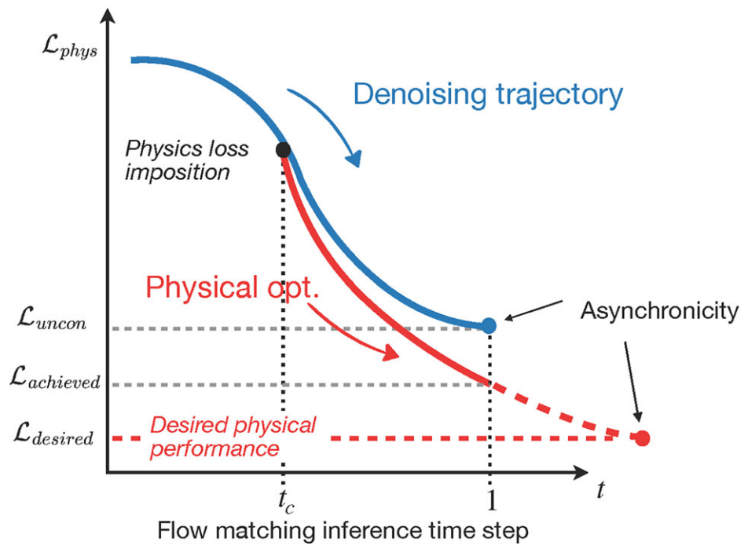

**图 1.** 流匹配去噪与物理损失优化之间的不同步性。$L_{\mathrm{uncon}}$ 表示无条件生成的最终物理损失，$L_{\mathrm{achieved}}$ 表示基于能量的引导下达到的最终物理损失，$L_{\mathrm{desired}}$ 表示施加于生成模型的目标物理约束。图中的蓝色曲线对应去噪轨迹，红色曲线对应物理损失，箭头标出了二者无法同步收敛所形成的差距。

此外，不同步性还会带来严重问题：在推理阶段，生成模型充当去噪器，会产生大量几何不合理的中间样本。不能指望代理模型准确评估这些样本，因为代理模型通常是在干净、状态良好的几何外形上训练的；其中一个主要原因是，高保真计算流体力学（CFD）求解器只有对这类外形才能产生有意义的结果。因此，代理模型对含噪样本的预测具有较高不确定性，使物理损失优化难以在推理时间调度内准确收敛。

为解决这些问题，我们在可微流匹配 D-Flow（Ben-Hamu et al. 2024）的近期进展基础上提出 Dflow-SUR。其中，“SUR”表示代理模型（surrogate），用于表明流模型与代理模型之间的耦合；代理模型提供物理估计信息。其核心思想是将物理损失优化与流匹配推理过程解耦，以缓解代理模型评估不确定性导致的优化困难。具体而言，D-Flow 表明，对流匹配进行贯穿式微分会产生朝向数据流形的隐式正则化作用。我们利用这一性质，确保基于代理模型的优化不会漂移到分布外样本。

我们将物理引导生成表述为一种射击法形式的约束优化问题：流的常微分方程（ODE）充当动力学约束，物理目标则施加于终端设计。该表述使流推理与物理损失优化在实际操作中得以解耦，提高了代理模型存在不确定性时的稳定性。

本文的主要贡献在于证明：将 D-Flow 与物理代理建模相结合，能够增强可控性并减轻代理预测的不确定性，从而建立比以往方法显著更有效的生成式逆向设计框架。更具体地说，我们通过对条件训练与基于能量的推理进行大量对比实验，展示了 Dflow-SUR 的三项主要优势：

- **更高的一致性。** 将物理损失优化与流匹配推理解耦，使 Dflow-SUR 完全避免梯度冲突，从而提高生成精度。
- **减轻代理模型不确定性。** Dflow-SUR 的解耦特性减小了物理引导生成过程中，评估中间含噪样本时代理模型不确定性的影响。
- **对超参数选择不敏感。** Dflow-SUR 无需大量手动调整引导超参数，即可给出高质量设计。

本文组织如下：第 2 节回顾相关工作；第 3 节介绍本文采用的基础生成模型，即流匹配，以及作为实验基准的几种先进物理引导生成框架；第 4 节介绍所提出的 Dflow-SUR 方法；第 5 节在二维翼型和三维机翼设计问题上进行数值实验；最后，第 6 节总结主要发现，讨论本文的贡献、局限和未来研究方向。

## 2 相关工作

Dflow-SUR 的实现需要三个关键组成部分：设计表示、借助代理模型进行物理引导，以及生成式逆向设计。下面围绕这三个方面回顾相关研究。

### 2.1 设计表示

几何参数化是一种设计表示方法，它将复杂几何映射到低维潜在空间，在保留关键特征的同时实现高效学习和优化。非均匀有理 B 样条（NURBS）（Systèmes 2023；Zhao et al. 2024）、自由形变（FFD）（Sederberg and Parry 1986；Hajdik et al. 2023）等控制点方法已被证明适用于设计优化，并具有较高效率。然而，在试验设计（DoE）采样过程中，控制点样本经常落在合理设计空间之外，破坏几何连续性。这一缺点又会掩盖潜在规律或约束，使基于学习的优化变得困难。

既有研究采用数据子空间技术，例如奇异值分解（SVD）（Masters et al. 2017）、本征正交分解（POD）（Wu et al. 2019）和类形状变换（CST）（Kulfan 2008），提高设计表示的可控性。对于三维几何，紧凑模态参数化（Li and Zhang 2021）等全局特征参数化方法被用于捕捉几何模态。随后，潜在表示方法（Wei et al. 2023a, b）和基于神经网络的方法（Wei et al. 2024, 2025）等更先进方法，通过扩展设计自由度，进一步增强了表示的鲁棒性和灵活性。

本研究采用 CST 进行翼型参数化，并采用紧凑模态参数化方案表示三维机翼几何。这些方法在以往气动外形优化研究中已被证明有效（Lyu et al. 2024；Yang et al. 2025）。此外，其导数计算插件的有效性也已得到验证（Li and Zhang 2021；Hajdik et al. 2023）。

### 2.2 代理模型辅助设计

物理信息生成式设计的关键支撑之一，是能够快速近似高成本物理评估行为的代理模型（Liem et al. 2015；Li et al. 2022；Paiva et al. 2010）。代理模型提供的低成本梯度信息，对于计算效率至关重要的快速概念设计阶段很有价值。构建代理模型时，可以采用高斯过程（Liem et al. 2015；Bouhlel et al. 2019；Hwang and Martins 2018）、多层感知机（Li and Zhang 2021）、测地卷积神经网络（Baqué et al. 2018），以及结合不同神经网络形式的迁移学习（Yang et al. 2026）等方法。

利用深度神经网络增强代理模型，可以在复杂气动场景中，提高物理状态表示的保真度和维度，例如机翼外形的激波抑制（Li and Zhang 2021）、抖振起始约束建模（Li et al. 2022）、多点性能优化（Lin et al. 2025），以及跨声速减阻（Zhang et al. 2021）。

代理模型融入生成建模后，可以在生成过程中施加物理约束，或即时评估候选方案，而无需进行完整仿真。这种结合已使新型翼型（Li et al. 2019；Chen et al. 2020）和拓扑结构（Giannone et al. 2023）的探索成为可能。在这一背景下，代理模型的优势在于：可以通过高维插值，在现有数据空间内快速近似设计变量。然而，其处理分布外数据的能力存在关键局限，此时不确定性会显著传播（Owen et al. 2017）。

### 2.3 生成式气动设计

使用生成模型的主要目的是探索新的设计空间。以往的变分自编码器（VAE）（Kingma and Welling 2014）和生成对抗网络（GAN）（Goodfellow et al. 2014）已被用于外形参数化，例如 Bézier GAN（Chen et al. 2020）和 PaDGAN（Chen and Ahmed 2021），也用于几何筛选（Li et al. 2020）以及生成满足约束的设计候选方案（Achour et al. 2020；Wang et al. 2022；Lei et al. 2021）。

近年来，扩散模型（Ho et al. 2020；Song et al. 2021）已成为强大的深度生成模型，在计算机视觉、自然语言处理和多种数据建模任务中表现出色。该方法采用逐步去噪的概率框架，保证训练稳定性和精确似然评估，从而减轻模式坍塌，并生成比 GAN 和 VAE 保真度更高的样本（Ho et al. 2020；Song et al. 2021）。通过 DiffAirfoil，Wei et al.（2024, 2026）证明了在数据稀缺条件下，扩散模型优于 GAN。

在气动设计领域，我们先前的研究证明，条件扩散模型作为几何采样方法，能够生成具有高保真气动性能的机翼（Yang et al. 2024）。还有一些研究在类似设计问题的多点设置（Lin et al. 2025）和多体设置（Wu et al. 2024）中使用条件扩散模型。另一种生成建模方法是流匹配（Ben-Hamu et al. 2024）：它直接学习连续速度场，将基础分布样本映射到目标分布。本文采用这一方法，并将在第 3.1 节进一步讨论。

## 3 生成模型概述

本节首先在第 3.1 节介绍流匹配模型，再在第 3.2 节介绍物理引导生成。

### 3.1 基础生成模型：流匹配

本文采用流匹配作为基础生成框架。流匹配（Lipman et al. 2022）是一种训练连续归一化流（CNF）的方法，其核心是对固定条件概率路径的向量场进行回归。CNF 通过参数化随时间变化的速度场 $u_t^\theta:\mathbb{R}^d\times[0,1]\rightarrow\mathbb{R}^d$，学习高斯分布 $\mathcal{N}(0,I)$ 与目标分布 $\mathcal{X}$ 之间的复杂数据分布，并通过求解以下 ODE 生成最终状态 $\mathbf{x}_1$：

$$
\frac{\mathrm{d}\mathbf{x}_t}{\mathrm{d}t}
=u_t^\theta(\mathbf{x}_t,t),\qquad
\mathbf{x}_0\sim\mathcal{N}(0,I),\qquad
\mathbf{x}_1=\Phi_{[0,1]}(\mathbf{x}_0).
\tag{1}
$$

其中，$u_t^\theta(\mathbf{x}_t,t)$ 是学习得到的速度场，$\mathbf{x}_0$ 是初始噪声，$\theta$ 是定义该速度场的神经网络参数。典型的无条件流匹配训练过程见算法 1，其中 $\eta$ 为对 $\theta$ 进行梯度下降时的学习率。

**算法 1. 流匹配训练**

**输入：** 数据分布 $\mathcal{X}$、噪声分布 $\mathcal{N}(0,I)$。

初始化向量场 $u_t^\theta(\mathbf{x})$ 的参数 $\theta$。对每一次训练迭代，执行：

1. 采样 $\mathbf{x}_0\sim\mathcal{N}(0,I)$、$\mathbf{x}_1\in\mathcal{X}$，以及 $t\sim\mathcal{U}(0,1)$。
2. 计算插值点：

$$
\mathbf{x}_t=(1-t)\mathbf{x}_0+t\mathbf{x}_1.
$$

3. 计算目标速度：

$$
\dot{\mathbf{x}}_t=\frac{\mathbf{x}_1-\mathbf{x}_0}{1-t}.
$$

4. 计算回归损失：

$$
\mathcal{L}(\theta)=\left\|u_t^\theta(\mathbf{x}_t)-\dot{\mathbf{x}}_t\right\|^2.
$$

5. 更新参数：

$$
\theta\leftarrow\theta-\eta\nabla_\theta\mathcal{L}(\theta).
$$

结束循环。

> 译注：以上目标速度公式按原算法保留。按照同一算法中给出的线性插值，直接对时间求导会得到 $\dot{\mathbf{x}}_t=\mathbf{x}_1-\mathbf{x}_0$；原文此处额外出现了分母 $1-t$。

选择流匹配作为基础生成框架主要有两个原因。首先，流匹配在生成质量和训练稳定性之间取得了良好平衡，能够缓解其他生成模型的常见局限，例如 GAN 训练不稳定，以及 VAE 可能牺牲样本质量（Lipman et al. 2022；Liu et al. 2022；Song et al. 2023）。其次，流匹配将生成过程表述为 ODE（Chen et al. 2018），从而为生成过程提供连续时间描述。借助这一结构，我们可以通过时间调度和梯度施加，控制物理引导的生效时机，以有原则且可解释的方式干预生成过程，同时不改变学习得到的生成动力学。下一节进一步说明这一机制。

### 3.2 物理引导生成

物理引导生成是指在生成过程中融入物理约束，引导样本达到期望性能目标。本节首先在第 3.2.1 节概述并比较四种代表性的物理引导生成方法，随后在第 3.2.2 节和第 3.2.3 节，简要介绍条件训练策略与先进的基于能量的策略。这两类策略作为本文的基准算法，代表了现有方法中最通用、应用最广泛的范式。

表 1 首先汇总了推理与物理优化过程中使用的主要数学符号。在预训练流匹配模型的推理过程中融入物理损失 $\mathcal{L}_{\mathrm{phys}}$，会引入两个与迭代有关的参数：推理时间离散参数 $T$，以及物理损失优化迭代参数 $K$。它们分别作用于算法的不同阶段，在本文提出的框架中可以独立调整。

**表 1. 物理引导生成中的主要数学符号**

| 符号 | 含义 |
|---|---|
| $T$ | 流匹配推理阶段积分的时间离散参数 |
| $\Delta t$ | 时间步长，定义为 $\Delta t=1/T$ |
| $K$ | 物理损失优化的迭代次数 |
| $\Delta k$ | 单次优化迭代的步长 |
| $\mathbf{x}_0$ | 初始噪声样本 |
| $\mathbf{x}_1$ | 最终生成样本 |
| $\mathcal{L}_{\mathrm{phys}}$ | 编码目标性能约束的物理损失函数 |

#### 3.2.1 物理引导生成方法概述

本节介绍四种主要的物理引导生成方法，其中包括新提出的 Dflow-SUR。图 2 展示了生成式设计中四种代表性的物理引导策略。图 2a 是条件训练策略，它在模型训练期间将物理损失 $\mathcal{L}_{\mathrm{phys}}$ 与流匹配损失结合。其余策略在推理阶段施加物理引导：图 2b、2c 为基于能量的方法，将在第 3.2.3 节讨论；图 2d 为 Dflow-SUR，将在第 4 节详述。

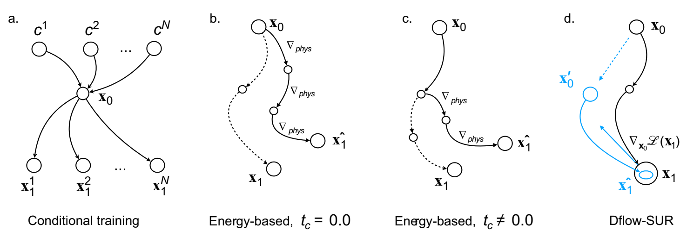

**图 2.** 四种物理引导生成策略：条件训练（a）在流匹配训练期间使用条件引导；（b）和（c）为采用不同 $t_c$ 设置的基于能量的方法；最后一种（d）为新提出的 Dflow-SUR。图内标签依次为“条件训练”“基于能量，$t_c=0.0$”“基于能量，$t_c\ne0.0$”以及“Dflow-SUR”。

表 2 比较了这四种策略。我们从影响优化行为和鲁棒性的四个基本维度组织比较：（i）物理损失施加于生成过程的阶段；（ii）物理驱动优化所针对的变量；（iii）生成模型与物理代理模型之间的耦合强度；（iv）生成过程暴露于代理模型不确定性的程度。

通过在这一统一分类体系下比较不同方法，我们强调了条件训练、基于能量的推理策略以及 Dflow-SUR 的关键结构差异，并说明这些差异如何影响优化稳定性、可控性，以及对代理模型不确定性的敏感程度。这种视角使那些在算法形式上看似不同的方法能够得到公平、可解释的比较，同时将设计性能直接联系到生成过程与物理过程之间的相互作用机制。

**表 2. 图 2 所示物理引导生成式设计策略的方法比较**

| 方法 | 施加物理引导的阶段 | 优化变量 | 生成与物理过程的耦合 | 暴露于代理模型不确定性的程度 |
|---|---|---|---|---|
| 条件训练 | 训练阶段 | 网络参数 | 完全耦合 | 高 |
| 基于能量（$t_c=0$） | 推理阶段（全程） | $\mathbf{x}_t$ | 强耦合 | 高 |
| 基于能量（$t_c\ne0$） | 推理阶段（部分过程） | $\mathbf{x}_t$ | $t_c$ 之后耦合 | 中至高 |
| **Dflow-SUR** | **推理阶段（终端）** | $\mathbf{x}_0$ | **解耦** | **低** |

#### 3.2.2 条件训练策略

图 2a 展示了条件训练策略：在模型训练期间，将物理损失 $\mathcal{L}_{\mathrm{phys}}$ 与流匹配损失结合。该策略已广泛应用于既有研究（Lu et al. 2023；Yang et al. 2024）。在条件训练中，$\mathcal{L}_{\mathrm{phys}}$ 通常与流匹配损失合并为单个复合目标，并作为条件信号，与设计变量 $\mathbf{x}$ 一起用于联合学习速度场的参数化表示。

在气动逆向设计中，条件训练已用于多点问题（Lin et al. 2025）和多保真问题（Yang et al. 2024）。Lin et al.（2025）在扩散训练中随机丢弃并拼接性能目标，采用无分类器条件化，使模型可以在有无显式引导的情况下生成翼型，同时无需辅助分类器。Yang et al.（2024）以性能目标为条件，在含噪外形上优化得分网络来训练条件扩散模型，同时通过对比学习学习价值函数，引导采样趋向期望的气动特性。

尽管该策略有效，但其训练范式带来了根本局限。首先，它缺乏灵活性，因为设计目标或约束的任何变化都需要重新训练模型。其次，同时学习设计空间和底层物理规律需要显著更多的数据，从而增加数据获取成本和模型复杂度。

#### 3.2.3 基于能量的策略

图 2b 和 2c 展示了基于能量的策略的两种变体。二者的区别在于流匹配推理期间引入物理损失的时机，具体如下。如第 1 节所述，基于能量的模型（EBM）（LeCun et al. 2006；Teh et al. 2003）通过能量函数定义概率分布：

$$
p(\mathbf{x}\mid c)\propto p(\mathbf{x})\cdot e^{-\lambda\mathcal{E}(\mathbf{x})}.
\tag{2}
$$

其中，设计 $\mathbf{x}$ 的物理约束编码于 $\mathcal{E}(\mathbf{x})$ 中，并由能量系数 $\lambda$ 加权。$\lambda$ 源于统计热力学，用于控制数据保真度与物理引导之间的平衡：较小的值更强调数据分布 $p(\mathbf{x})$，较大的值则增强 $\mathcal{E}(\mathbf{x})$ 的影响。

给定预训练流匹配速度场 $u_t^\theta(\mathbf{x}_t,t)$，物理引导生成可以写为：

$$
\frac{\mathrm{d}\mathbf{x}_t}{\mathrm{d}t}
=u_t^\theta(\mathbf{x}_t,t)-\lambda\nabla_{\mathbf{x}_t}\mathcal{E}(\mathbf{x}_t).
\tag{3}
$$

根据在 $t\in[0,1]$ 的哪个时刻引入 $\mathcal{E}(\mathbf{x}_t)$，可得到两种策略。将切换时刻定义为 $t_c$，这两种策略分别对应 $t_c=0$（图 2b）和 $t_c\ne0$（图 2c）。当 $t_c=0$ 时，物理引导从一开始就生效，通过式（3）在整条轨迹上施加约束。然而，早期阶段的强噪声使优化对代理模型的梯度不确定性较为敏感，可能降低性能。

为缓解这一问题，inter-drifting 策略（Mazé and Ahmed 2023；Giannone et al. 2023）将物理信息的注入推迟到完成部分去噪之后：

$$
\frac{\mathrm{d}\mathbf{x}_t}{\mathrm{d}t}=
\begin{cases}
u_t^\theta(\mathbf{x}_t,t),&t<t_c,\\
u_t^\theta(\mathbf{x}_t,t)-\lambda\nabla_{\mathbf{x}_t}\mathcal{E}(\mathbf{x}_t),&t\ge t_c.
\end{cases}
\tag{4}
$$

此时，物理损失的有效优化步数与推理时间范围绑定：

$$
K=\frac{t-t_c}{\Delta t},\qquad\Delta k=\Delta t.
\tag{5}
$$

因此，在固定推理预算下，物理项越晚激活，可用的梯度步数就越少。

中途注入策略（$t_c\ne0$）通过避开高噪声样本，提高了代理模型梯度的可靠性，但也从根本上限制了物理损失优化。推理调度过短无法充分最小化物理损失，过长又会增加计算成本。这就导致了第 1 节介绍的不同步性：物理损失优化与流匹配推理在不同时间尺度上演化，并追求不同目标，因而无法自然同步。

概括而言，不同步性源于基于能量的优化（由 $\nabla\mathcal{E}(\mathbf{x})$ 驱动）与流匹配去噪（由 $u_t(\mathbf{x})$ 驱动）之间的不匹配。因此，实现同步依赖于对两个超参数的仔细调整：控制物理引导强度的能量系数 $\lambda$，以及决定生成过程时长的推理总步数 $T$。

## 4 方法：Dflow-SUR

本节介绍 Dflow-SUR，一种在流匹配框架内进行梯度源空间优化的新型物理引导生成式设计框架，旨在克服现有物理引导生成策略的局限。具体而言，Dflow-SUR 的主要目标是提高生成过程中物理损失优化的求解精度，解决前文讨论的不同步性问题。

Dflow-SUR 将梯度优化与流匹配结合，建立在两个原则之上。第一，受 D-Flow（Ben-Hamu et al. 2024）启发，利用数据流形上的隐式正则化实现可控生成。第二，利用代理模型引导的梯度优化，提高优化精度。

第 4.1 节给出 Dflow-SUR 的整体算法流程；第 4.2 节说明如何利用 D-Flow 的可控生成性质；第 4.3 节进一步解释如何利用这一性质，并强调 D-Flow 与 Dflow-SUR 的根本差异。

### 4.1 Dflow-SUR 算法

图 3 展示了 Dflow-SUR 算法的完整工作流程，以下分别说明（a）至（d）四个部分。

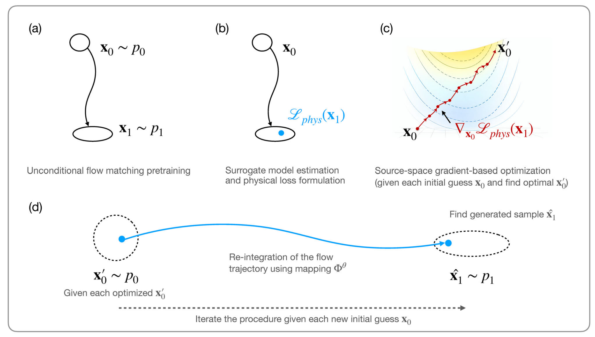

**图 3.** Dflow-SUR 生成式设计框架的关键步骤。

图中文字对应为：（a）无条件流匹配预训练；（b）代理模型估计与物理损失构造；（c）源空间中的梯度优化：对于每个初始猜测 $\mathbf{x}_0$，寻找最优 $\mathbf{x}'_0$；（d）对于优化后的 $\mathbf{x}'_0$，利用映射 $\Phi^\theta$ 重新积分流轨迹，得到生成样本 $\hat{\mathbf{x}}_1$。每次给定新的初始猜测 $\mathbf{x}_0$，重复上述过程。

**（a）无条件流匹配预训练。** 仅利用几何数据进行无条件流匹配预训练，学习随时间变化的速度场 $u^\theta(\mathbf{x},t)$，该速度场定义从源分布 $p_0$ 到目标数据分布 $p_1$ 的连续变换。通过积分相应的 ODE 进行采样：

$$
\frac{\mathrm{d}\mathbf{x}_t}{\mathrm{d}t}=u_t^\theta(\mathbf{x}_t,t),\qquad
\mathbf{x}_0\sim p_0,
\tag{6}
$$

从而得到终端样本：

$$
\mathbf{x}_1=\Phi^\theta(\mathbf{x}_0).
\tag{7}
$$

其中，$\Phi^\theta$ 表示由流诱导的、从源变量到目标设计的映射。

**（b）代理模型估计与物理损失构造。** 令 $\mathrm{SUR}_\phi(\mathbf{x})$ 为一个以权重 $\phi$ 参数化的可微代理模型，用于近似底层基于物理的性能评估器。对于生成的设计样本 $\mathbf{x}_1$，代理模型预测其物理响应 $f(\mathbf{x}_1)=\mathrm{SUR}_\phi(\mathbf{x}_1)$。随后，将物理损失定义为相对于目标 $\mathbf{y}$ 的平方误差：

$$
\mathcal{L}_{\mathrm{phys}}(\mathbf{x}_1)=\left\|f(\mathbf{x}_1)-\mathbf{y}\right\|_2^2.
\tag{8}
$$

其中，$\mathbf{y}$ 表示期望的物理性能指标。这种形式提供了平滑、可微的目标，使高效梯度优化以及贯穿代理模型与生成流的稳定反向传播成为可能。

**（c）源空间中的梯度优化。** 建立物理损失表达式后，我们将物理引导生成表述为源空间中的约束优化问题，并采用梯度方法求解。具体而言，相对于源变量 $\mathbf{x}_0$，最小化生成终端状态上的物理损失 $\mathcal{L}_{\mathrm{phys}}(\mathbf{x}_1)$：

$$
\begin{aligned}
&\min_{\mathbf{x}_0}\ \mathcal{L}_{\mathrm{phys}}(\mathbf{x}_1);\\
&\text{优化变量为 }\mathbf{x}_0;\\
&\text{约束为 }\mathbf{x}_1=\Phi^\theta(\mathbf{x}_0).
\end{aligned}
\tag{9}
$$

约束 $\mathbf{x}_1=\Phi^\theta(\mathbf{x}_0)$ 保证所有候选设计都由预训练流模型 $\Phi^\theta$ 生成；该模型将源分布中的样本映射到数据分布。

为求解这一约束优化问题，我们采用源空间中的梯度优化策略。由于流映射 $\Phi^\theta$ 与基于代理模型的物理损失都可微，因此可以通过贯穿流的反向传播，高效计算目标函数相对于源变量的梯度。具体地，依据链式法则，物理损失对 $\mathbf{x}_0$ 的梯度为：

$$
\nabla_{\mathbf{x}_0}\mathcal{L}_{\mathrm{phys}}(\mathbf{x}_1)=
\left(\frac{\partial\mathbf{x}_1}{\partial\mathbf{x}_0}\right)^\top
\nabla_{\mathbf{x}_1}\mathcal{L}_{\mathrm{phys}}(\mathbf{x}_1).
\tag{10}
$$

其中，$\nabla_{\mathbf{x}_1}\mathcal{L}_{\mathrm{phys}}(\mathbf{x}_1)$ 由可微代理模型提供，雅可比矩阵 $\partial\mathbf{x}_1/\partial\mathbf{x}_0$ 则通过对预训练流进行贯穿式微分获得。

利用这一梯度，采用梯度下降等标准一阶优化方法迭代更新源变量：

$$
\mathbf{x}_0^{(k+1)}=\mathbf{x}_0^{(k)}-\tau\nabla_{\mathbf{x}_0}\mathcal{L}_{\mathrm{phys}}(\mathbf{x}_1),
\tag{11}
$$

其中，$\tau$ 为对应的步长，即学习率。在整个过程中，流参数 $\theta$ 保持不变，物理引导仅通过源空间更新引入。

在 Dflow-SUR 的实际应用中，初始猜测从高斯分布采样获得。可以根据应用要求指定物理损失的满足阈值。如果某次初始化导致收敛缓慢，或在合理迭代次数内未能达到损失阈值，则重新采样初始猜测，并重新启动优化。该过程消除了方法对初始样本的敏感性，并保证收敛，从而确保鲁棒性和灵活性。

**（d）流匹配中流轨迹的重新积分。** 给定上一步得到的优化源变量 $\mathbf{x}'_0$（其中 $\mathbf{x}'_0\sim p_0$），我们重新运行预训练流匹配模型 $\Phi^\theta$ 的推理，生成最终样本，即重新积分流轨迹。具体而言，将优化后的源变量通过固定的流传播，在终端状态生成新的设计样本：

$$
\hat{\mathbf{x}}_1=\Phi^\theta(\mathbf{x}'_0).
\tag{12}
$$

其中，$\hat{\mathbf{x}}_1$ 表示源空间优化后的生成样本。对不同的 $\mathbf{x}'_0$ 初始化重复这一过程，流模型会诱导出优化设计的分布，记为 $\hat{\mathbf{x}}_1\sim p_1$。

按照上述（a）至（d）执行 Dflow-SUR 框架，即可实现高精度物理引导生成式设计。相应算法形式化为算法 2。

**算法 2. Dflow-SUR：通过源空间优化实现物理引导生成式设计**

**输入：** 预训练流匹配速度场 $u_t^\theta(\mathbf{x},t)$、可微代理模型 $\mathrm{SUR}_\phi(\mathbf{x})$、目标物理性能 $\mathbf{y}$、步长 $\tau$、优化步数 $K$。

1. 初始化源变量 $\mathbf{x}_0^{(0)}\sim p_0$。
2. 对 $k=0,\ldots,K-1$，执行下列第 3 至第 7 步。
3. **流积分（前向推理）。**
4. 求解流 ODE，获得终端设计：

$$
\mathbf{x}_1^{(k)}\leftarrow\Phi^\theta\!\left(\mathbf{x}_0^{(k)}\right).
$$

5. **物理损失评估：**

$$
\mathcal{L}_{\mathrm{phys}}\!\left(\mathbf{x}_1^{(k)}\right)
=\left\|\mathrm{SUR}_\phi\!\left(\mathbf{x}_1^{(k)}\right)-\mathbf{y}\right\|_2^2.
$$

6. **源空间梯度计算：**

$$
\nabla_{\mathbf{x}_0}\mathcal{L}_{\mathrm{phys}}
=\left(\frac{\partial\mathbf{x}_1^{(k)}}{\partial\mathbf{x}_0^{(k)}}\right)^\top
\nabla_{\mathbf{x}_1}\mathcal{L}_{\mathrm{phys}}\!\left(\mathbf{x}_1^{(k)}\right).
$$

7. **源空间更新：**

$$
\mathbf{x}_0^{(k+1)}\leftarrow\mathbf{x}_0^{(k)}-\tau\nabla_{\mathbf{x}_0}\mathcal{L}_{\mathrm{phys}}.
$$

8. 结束循环。
9. **使用优化后的源变量重新积分流：**

$$
\hat{\mathbf{x}}_1\leftarrow\Phi^\theta\!\left(\mathbf{x}_0^{(K)}\right).
$$

10. 返回优化后的生成设计 $\hat{\mathbf{x}}_1$。

### 4.2 可控生成

下面讨论可控生成，这也是本文采用并扩展 D-Flow 范式的主要动机。D-Flow 的关键性质是隐式流形正则化，它在保持样本合理性的同时实现可控生成。回顾式（10），雅可比矩阵 $\partial\mathbf{x}_1/\partial\mathbf{x}_0$ 与数据分布的协方差耦合。具体而言，在仿射高斯概率路径（affine Gaussian probability path，AGPP）假设下，该矩阵计算为：

$$
\frac{\partial\mathbf{x}_1}{\partial\mathbf{x}_0}
=\sigma_1\,\mathcal{T}\exp\!\left[
\int_0^1\gamma_t\operatorname{Var}_{1\mid t}(\mathbf{x}(t))\,\mathrm{d}t
\right].
\tag{13}
$$

其中，$\sigma_1$ 为终端噪声尺度，$\mathcal{T}\exp[\cdot]$ 为时间有序指数，$\gamma_t$ 是由信噪比调度决定的标量函数，$\operatorname{Var}_{1\mid t}(\mathbf{x}(t))$ 表示在时刻 $t$ 沿概率路径的数据分布条件协方差。

通过式（13），从数据空间传播回来的梯度会自然地与训练数据中的主要变化方向对齐，从而隐式约束优化轨迹，使其保持在数据流形附近。因此，这种可控生成确保生成过程被限制在目标分布 $p_1$ 内，防止生成样本漂移到分布外区域。

### 4.3 将物理优化与设计生成解耦

与 D-Flow 处理的一般可控生成问题不同，Dflow-SUR 所考虑的物理引导设计问题具有根本不同的结构。具体而言，物理目标仅定义在终端设计上，而非整条生成轨迹上；生成的中间状态既没有物理解释，也无需满足物理约束。此外，物理性能评估通常计算成本高昂，因此经常使用代理模型进行近似。当在整个生成过程中施加物理引导时，代理模型的不确定性可能被显著放大。

这些特征从根本上区分了物理引导设计与一般可控生成，也构成了本文核心方法贡献的动机。为体现这一思想，我们将物理引导生成重新表述为**源空间中的梯度设计优化问题**，通过显式优化满足物理目标，而非采用轨迹层面的控制。

具体而言，我们构建一个约束优化问题：源变量充当设计变量，预训练流模型充当固定、可微的可行性映射，物理性能仅通过代理模型在终端生成设计上评估。物理损失梯度经过流映射反向传播，用于更新源变量，从而在不修改生成动力学的情况下实现高效、稳定的优化。

这一表述与 D-Flow 的梯度传播机制存在根本差异。D-Flow 将任务梯度注入生成过程，以控制采样轨迹；而本文方法仅使用梯度求解源空间中的显式设计优化问题。因此，优化与推理完全解耦：生成模型在优化过程中保持不变，物理引导仅通过源空间更新引入。这种解耦符合经典设计优化原则，对于在高成本、存在不确定性的物理评估下实现稳健物理引导设计至关重要。

## 5 数值实验

本节分别在二维翼型和三维机翼案例中展示 Dflow-SUR 的有效性，见第 5.1 节和第 5.2 节。较简单的二维案例主要用于研究该方法在物理引导下的可控性，以及减轻代理模型不确定性影响的能力，包括相对于现有基于能量的范式，它如何避免梯度碰撞现象，并降低对引导强度的敏感性。三维机翼案例进一步展示该方法在高维设置下的有效性：它能够生成具有平滑表面压力分布的高保真设计。

### 5.1 二维翼型逆向设计案例

本案例的生成式逆向设计过程，旨在产生满足以下条件的翼型候选方案：马赫数 $M=0.2$、迎角 $\alpha=2^\circ$、雷诺数 $Re=1\times10^6$ 时，升力系数 $C_L=0.7$。

我们采用 NeuralFoil（原文脚注 1）作为代理模型，进行快速翼型气动分析。NeuralFoil 将解析模型与神经网络相结合，其神经网络基于数千万次 XFoil（原文脚注 2）运行结果训练。NeuralFoil 支持自动微分，并已在多种梯度设计优化案例中被证明有效（Sharpe 2024）。既有研究表明，NeuralFoil 在广泛运行条件下与 XFoil 结果高度一致：对于表现良好的案例，其平均相对阻力误差约为 0.37%；即使是在包含失速后流动和转捩流动的困难测试数据集上，误差也低于 2.0%（Sharpe and Hansman 2023）。

翼型外形采用 CST 方法（Kulfan 2008）参数化。几何总共由 16 个参数控制，上表面和下表面各配置 8 个形状系数。对于流匹配 ODE，我们在 $t\in[0,1]$ 上采用固定步长的中点法积分，步长为 0.02，因此时间离散约包含 50 个均匀时间步。对于第 4.1 节（c）部分介绍的源空间优化问题，我们采用 L-BFGS 优化器（Liu and Nocedal 1989）求解。

**原文脚注 1：** [NeuralFoil 代码仓库](https://github.com/peterdsharpe/NeuralFoil)，最后访问于 2025 年 7 月 22 日。  
**原文脚注 2：** [XFoil 网页](https://web.mit.edu/drela/Public/web/xfoil/)，最后访问于 2025 年 7 月 22 日。

#### 5.1.1 引导可控性

为评估引导可控性，我们首先研究图 2（第 3.2.1 节）中四种策略的 $\mathcal{L}_{\mathrm{phys}}$ 曲线及其达到的精度。所有模型性能的定量结果见附录 B.1 的表 5。以下讨论重点关注基于能量的方法所得到的结果。

对于基于能量的方法，我们设置 $\lambda=10$，在不同物理注入切换时刻 $t_c=0.0,0.2,0.6,0.8$，以及不同推理总步数 $T=200,1000,2000$ 下生成 200 个样本。图 4 展示了 $T=1000$ 时的损失下降曲线。

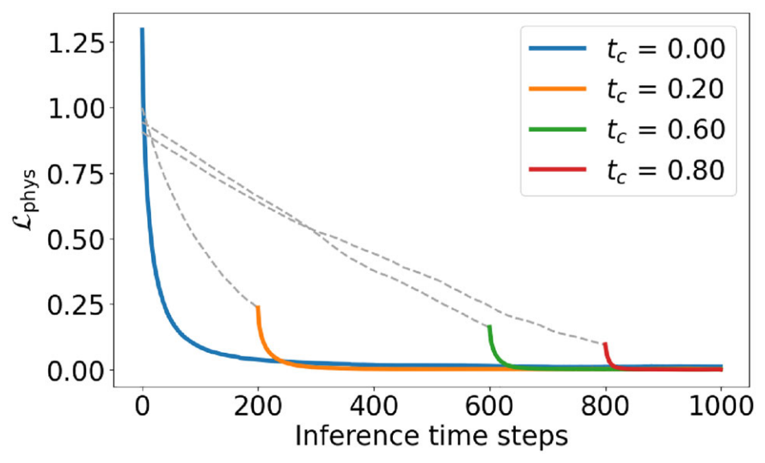

**图 4.** 当 $t_c=0.0,0.2,0.6,0.8$、$T=1000$ 时，基于能量的方法的平均损失曲线。灰色虚线表示伪损失曲线。

我们计算了不同 $t_c$ 下代理模型的**伪损失**，即无条件生成过程中的 $\mathcal{L}_{\mathrm{phys}}$，并以灰色虚线表示。这些曲线展示了基于能量的方法在推理与物理过程耦合优化下的 $\mathcal{L}_{\mathrm{phys}}$ 衰减行为。先进行一定步数的无条件生成，可以获得更低的初始 $\mathcal{L}_{\mathrm{phys}}$，从而提供良好的初始化。

接下来，我们将 Dflow-SUR 应用于 200 个样本。具体而言，随机抽取 200 个初始猜测，分别执行 Dflow-SUR，并记录其轨迹。随后，我们比较基于能量的方法与 Dflow-SUR 的 $\mathcal{L}_{\mathrm{phys}}$、$C_L$ 精度以及推理时间，如图 5 所示。总体而言，与基于能量的方法相比，Dflow-SUR 在满足 $C_L=0.7$ 气动约束的同时，将 $\mathcal{L}_{\mathrm{phys}}$ 从 $10^{-3}$ 降低至 $10^{-8}$，并实现最短推理时间。

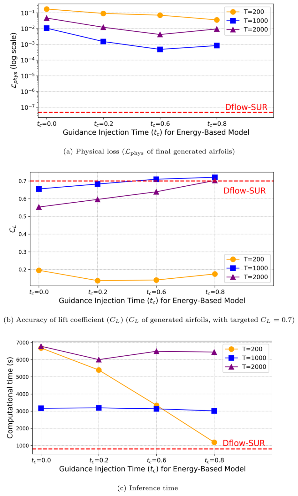

**图 5.** 基于能量的方法与 Dflow-SUR 在三个指标上的性能比较。

这一改进主要来自 Dflow-SUR 将推理过程与 $\mathcal{L}_{\mathrm{phys}}$ 优化解耦。与基于能量的方法的紧耦合机制相比，解耦提高了梯度利用效率。解耦之所以有效，是因为推理目标与物理损失目标在联合优化时会发生梯度碰撞。为详细说明这一现象，我们进行了以下实验。

参照 Wang et al.（2025）的研究，我们将每个推理时刻 $t_k$ 上，速度场和物理损失项相对于生成样本 $\mathbf{x}_k$ 的梯度分别记为 $\mathbf{g}_k^v$ 和 $\mathbf{g}_k^p$：

$$
\mathbf{g}_k^v=\nabla_{\mathbf{x}}f_\theta(\mathbf{x}_k,t_k),\qquad
\mathbf{g}_k^p=\nabla_{\mathbf{x}}\mathcal{L}_{\mathrm{phys}}(\mathbf{x}_k).
\tag{14}
$$

随后，定义二者的对齐得分为：

$$
\operatorname{Align}(\mathbf{g}_k^v,\mathbf{g}_k^p)
=\frac{\left\langle\mathbf{g}_k^v,\mathbf{g}_k^p\right\rangle}
{\left\|\mathbf{g}_k^v\right\|\left\|\mathbf{g}_k^p\right\|}.
\tag{15}
$$

具体而言，当两个梯度完全同向时，对齐得分为 $+1$；当二者完全反向时，得分为 $-1$；当它们正交或彼此抵消时，得分为零或接近零。

我们将 $t_c=0.0$、$T=1000$ 时基于能量的方法的对齐得分绘制于图 6。可以清楚看到，得分在大多数时间内为负，仅在推理初始阶段出现较小的正值。这表明，优化过程中 $\mathbf{g}^v$ 与 $\mathbf{g}^p$ 的方向大多相反。我们将这一行为称为**梯度碰撞（gradient collision）**。

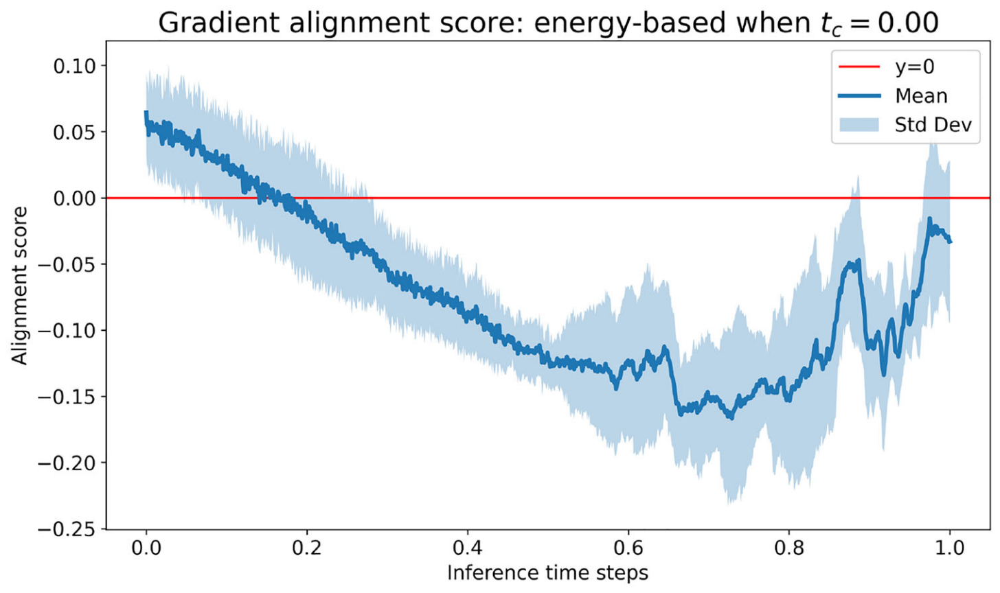

**图 6.** 当 $t_c=0.0$、$T=1000$ 时，基于能量的方法的梯度对齐得分。

梯度碰撞持续存在，说明在大多数迭代中，流匹配推理与物理损失最小化的优化方向不一致。值得注意的是，基于能量的推理与物理损失之间的耦合加剧了这种冲突。相比之下，Dflow-SUR 将推理过程与物理损失优化解耦，允许二者独立运行。这种解耦机制是 Dflow-SUR 相对于耦合的基于能量的方法具有更高精度的关键原因之一。

总之，通过将推理与物理损失优化解耦，Dflow-SUR 实现了无梯度碰撞的引导，并增强了引导可控性，使物理损失降低数个数量级。

#### 5.1.2 代理模型不确定性量化

接下来，我们讨论并量化代理模型在估计生成轨迹上的样本时的不确定性。参照 Gal and Ghahramani（2016）的研究，我们对代理模型深度网络中的神经元采用蒙特卡洛 dropout，神经元失活率为 1%。对于每个生成样本，独立执行 20 次前向传播，收集 20 个预测值。我们使用每个样本这 20 次代理模型估计结果的标准差进行不确定性量化（uncertainty quantification，UQ）。因此，对每个生成样本 $\mathbf{x}^k$，定义：

$$
\operatorname{UQ}(\mathbf{x}^k)=\sigma(\mathbf{x}^k)
=\sqrt{\frac{1}{N-1}\sum_{i=1}^N
\left(f^{(i)}(\mathbf{x}^k)-\mu(\mathbf{x}^k)\right)^2}.
\tag{16}
$$

其中，$N=20$ 为随机前向传播次数，$f^{(i)}(\mathbf{x})$ 为第 $i$ 次传播的预测结果，$\mu(\mathbf{x})=\frac{1}{T}\sum_{i=1}^T f^{(i)}(\mathbf{x})$ 为多次预测的均值。蒙特卡洛 dropout 的样本数量，是在计算成本与估计稳定性之间权衡后选择的。采用 $N\in\{20,50,80,100\}$ 的收敛性研究得到平均 UQ 为 0.11，方差为 $5.6\times10^{-3}$，表明不确定性估计在数值上稳定，并在 $N\ge20$ 时有效收敛。

> 译注：原文在式（16）中用 $N$ 表示随机前向传播次数，但随后均值表达式使用 $T$。此处按原文保留，未将其统一改写为 $N$。

为评估生成设计的整体不确定性特征，我们对全部 200 个样本的 UQ 值绘制小提琴图。图 7 展示了沿无条件生成轨迹、在不同时间步上，代理模型对生成样本给出的 UQ 分布统计。红线表示代理模型对 UIUC 训练数据集（原文脚注 3）的预测结果的平均 UQ。可以观察到，在生成轨迹的大多数早期阶段，生成样本显著偏离该均值线，表明其不确定性较大。因此，此阶段与代理模型关联的 $\mathcal{L}_{\mathrm{phys}}$ 梯度会变得不准确。

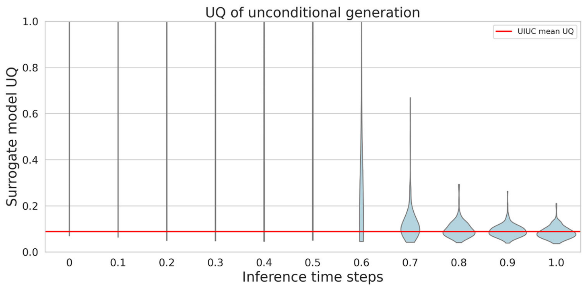

**图 7.** 归一化小提琴图展示了无条件生成样本沿去噪轨迹的不确定性（UQ），红线表示 UIUC 翼型的平均 UQ。

结合附录 B.2 的图 12 中对基于能量的方法四种物理注入策略的其他观察，仍然很难找到最佳物理注入时刻 $t_c$，使其既能平衡模型不确定性，又能确保 $\mathcal{L}_{\mathrm{phys}}$ 得到充分优化。

接下来，图 8 展示 Dflow-SUR 在首次和最终迭代生成样本时的代理模型 UQ。这两个数据集的样本分布均集中在均值线（红线）附近，从而保证代理模型梯度的稳定性。D-Flow 的定理 4.2（Ben-Hamu et al. 2024）对此提供了形式化保证：该方法会内在地生成被限制在数据流形内的样本。

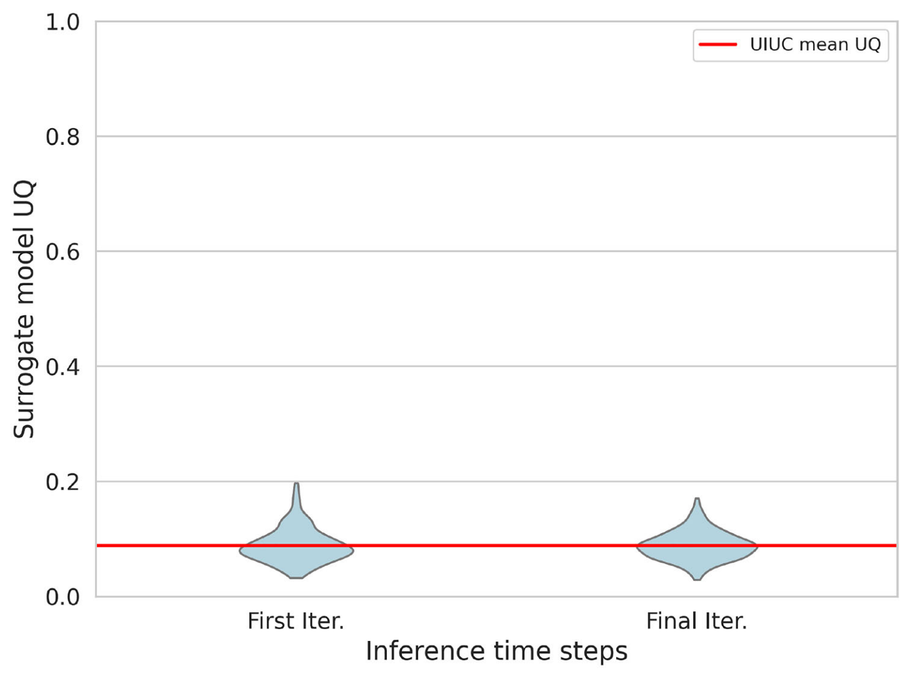

**图 8.** Dflow-SUR 首次和最终迭代生成样本的 UQ；红线表示 UIUC 翼型 UQ 的均值。

在 AGPP 假设下，即 Lipman et al.（2022）中的式（12），从噪声输入 $\mathbf{x}_0$ 到输出 $\mathbf{x}_1$ 的映射雅可比矩阵，可以表示为局部协方差矩阵的时间有序指数，见式（13）。在这一具体情况下，$\gamma_t=\frac{1}{2}\frac{\mathrm{d}}{\mathrm{d}t}\frac{\alpha_t^2}{\sigma_t^2}$，其中 $\alpha_t$ 为定义 AGPP 的均值缩放系数，用于在噪声与数据之间插值。式（13）表明，每个无穷小更新都会将梯度投影到数据方差的主方向上，即数据流形上。采用 $N_s$ 个均匀欧拉步、步长 $h=1/N_s$ 离散化此 ODE，可得到 $\mathbf{x}_1$ 相对于 $\mathbf{x}_0$ 的雅可比矩阵：

$$
\frac{\partial\mathbf{x}_1}{\partial\mathbf{x}_0}
=\prod_{m=0}^{N_s-1}\left[
(1+h a_{mh})I+h\gamma_{mh}\operatorname{Var}_{1\mid mh}(\mathbf{x}_{mh})
\right].
\tag{17}
$$

其中，$a_{mh}$ 是在 $t=mh$ 处取值的时变标量系数，$I$ 为单位矩阵。因此，通过迭代应用上述基于协方差的投影，优化轨迹始终被限制在数据分布内。

根据以上解释，我们可以推断，基于能量的方法生成的推理轨迹具有较大不确定性，削弱了代理模型为物理损失优化提供可靠梯度引导的能力。相比之下，Dflow-SUR 约束生成过程沿数据流形进行，使不确定性保持在模型均值附近，并避免流形漂移。实际应用中，代理模型不确定性可以指出预测不可靠的区域，为设计决策提供依据。而 Dflow-SUR 的设计使搜索过程自然转向低不确定性区域，从而避免不切实际的几何外形，提高生成设计的可靠性。

**原文脚注 3：** [UIUC 翼型坐标数据库](https://m-selig.ae.illinois.edu/ads.html)，最后访问于 2025 年 7 月 23 日。该数据库由伊利诺伊大学厄巴纳-香槟分校应用空气动力学研究组建立。

#### 5.1.3 引导强度的敏感性

基于能量的方法需要大量手动超参数调整，这使整个过程非常敏感。表 3 汇总了不同能量系数 $\lambda$ 下基于能量的方法的生成实验。如第 3.2.3 节所述，$\lambda$ 控制该方法对数据的利用与探索。将此参数设置得过低或过高，都会严重降低生成性能，甚至导致模型失败。

**表 3. 不同 $\lambda$ 设置下，基于能量的方法的物理损失与升力系数（$t_c=0.6$，$T=1000$）**

| 能量系数 $\lambda$ | $\mathcal{L}_{\mathrm{phys}}$ | $C_L$ |
|---|---|---|
| 1 | $2.032\times10^{-2}$ | 0.565 |
| 10 | $4.91\times10^{-4}$ | 0.706 |
| 100 | $1.765\times10^{-4}$ | 0.711 |
| 1000 | $1.02\times10^{-5}$ | 0.703 |
| 10000 | 失败 | 失败 |

我们进一步在图 9 中可视化了不同 $\lambda$ 和 $t_c$ 设置的基于能量的方法，以及 Dflow-SUR 生成的翼型。可以看到，超参数取值过小，或物理引导施加过早，例如 $\lambda=0.1$ 或 $t_c=0.0$，虽然不会降低样本多样性，却会显著增加失败率，并无法满足物理约束。相反，超参数过大，或物理引导施加过晚，例如 $\lambda=100$ 或 $t_c=0.8$，虽然能够保证高质量、满足约束的输出，却会严重限制生成多样性。而 Dflow-SUR 生成的样本，则能够在多样性、约束满足程度和输出质量之间取得恰当平衡。

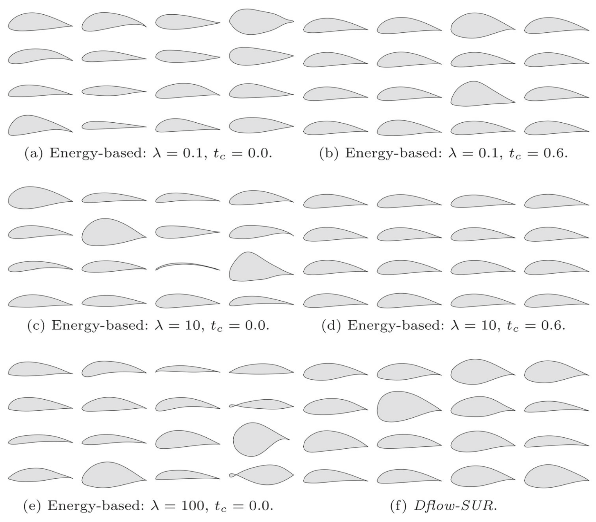

**图 9.** 使用不同设置的基于能量的方法，以及 Dflow-SUR 随机生成的翼型。

总之，基于能量的方法对引导强度的敏感性，使可靠生成变得困难。相比之下，Dflow-SUR 只需要随机初始猜测，其解耦执行机制自然保证了生成样本的物理有效性和较高几何质量。

#### 5.1.4 解决不同步性

如第 1 节所述，不同步性源于有限生成时间调度与物理优化收敛之间的内在不匹配。实验结果为这一论断提供了明确支持。如图 4 所示，在基于能量的引导下，$\mathcal{L}_{\mathrm{phys}}$ 能够下降的程度，受到从 $t_c$ 激活时刻起所剩余推理窗口的限制；而无条件去噪中的伪损失呈现出不同的衰减特征，说明物理优化无法在预先设定的去噪调度内充分收敛。

与此一致，图 5 表明，在不同 $(t_c,T)$ 设置下，基于能量的引导必须在约束满足精度与推理预算之间作出权衡。这说明，如果不仔细调整超参数，物理损失收敛就无法与去噪调度同步。此外，附录 B.3 的图 13 展示了去噪动力学与物理损失下降之间持续存在的梯度碰撞，进一步加剧了这种不匹配，阻碍生成与物理优化之间的有效同步。

这些结果共同为不同步性提供了明确证据，并突出了现有先进物理引导生成方法的根本局限，从而说明了采用 Dflow-SUR 所引入的解耦表述的必要性。

### 5.2 三维机翼逆向设计案例

本节使用生成式逆向模型，在三维机翼外形设计中探索具有高气动性能的候选方案。需要说明的是，本案例并不是利用生成模型直接求解设计优化问题，而是用它在给定约束下生成期望的设计候选方案。参照美国航空航天学会（AIAA）气动设计优化讨论组（ADODG，原文脚注 4）的案例 4.1，以及先前基准研究（Lyu et al. 2015；Li and Zhang 2021），我们为生成模型设置多维约束，以达到升阻比 $L/D=21.8$。这是使用伴随 CFD 求解器所达到的最高性能，具体对应升力系数 $C_L=0.5$、阻力系数 $C_D=0.0229$ 的设计。

我们进一步使用 ADflow（Mader et al. 2020；Kenway et al. 2019，原文脚注 5）CFD 求解器验证所有机翼样本，并将两个样本的压力系数 $C_P$ 分布可视化，如图 10 所示。这两个代表性样本仅用于说明，详细统计分析将在下文给出。

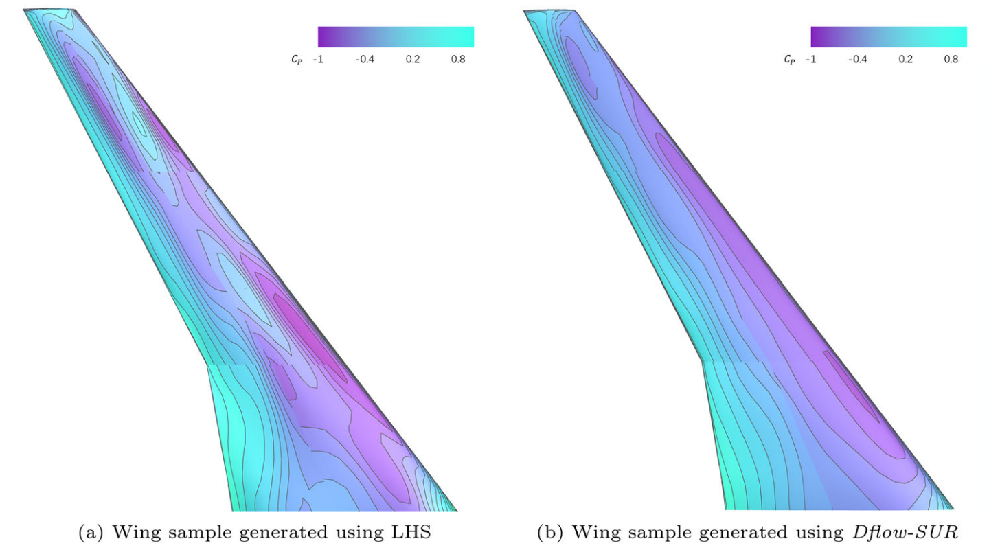

**图 10.** 两个代表性机翼样本通过 ADflow 验证得到的 $C_P$ 分布。

从图 10 的 $C_P$ 分布可以明显看到，与传统方法相比，Dflow-SUR 生成的外形在气动方面更加协调，从前缘到后缘的 $C_P$ 变化更均匀。这一观察与其他样本一致，为简洁起见，这里不再展示。

图 11 给出了采用拉丁超立方采样（LHS）、基于能量的方法和 Dflow-SUR 三种方法时，机翼样本 $L/D$ 分布的概率密度图（图 11a）和小提琴图（图 11b）。在相同运行条件和约束下，代理模型预测的三维机翼气动系数分布统计汇总于表 4。这里展示的数据在观测到的最小值和最大值处截断。

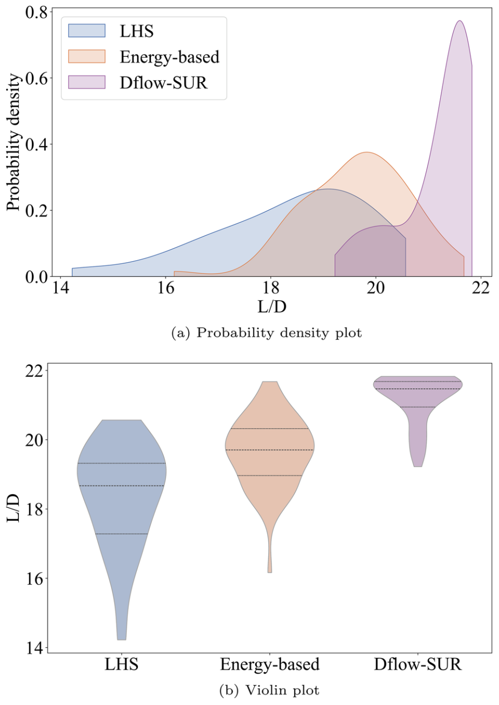

**图 11.** 使用三种采样方法得到的机翼样本 $L/D$ 分布的概率密度图和小提琴图。每个小提琴图中的三条水平线分别表示第 25 百分位数、中位数和第 75 百分位数。

**表 4. 相同运行条件和约束下，代理模型预测的三维生成机翼气动系数分布统计**

| 方法 | $C_L$：均值 ± 标准差 | $C_L$：[最小值，最大值] | $C_D$：均值 ± 标准差 | $C_D$：[最小值，最大值] | $L/D$：均值 ± 标准差 | $L/D$：[最小值，最大值] |
|---|---|---|---|---|---|---|
| LHS | 0.4457 ± 0.0899 | [0.2778, 0.6302] | 0.0238 ± 0.0051 | [0.0165, 0.0411] | 18.24 ± 1.50 | [14.50, 20.64] |
| 基于能量 | 0.5008 ± 0.0072 | [0.4813, 0.5206] | 0.0254 ± 0.0014 | [0.0235, 0.0314] | 19.76 ± 0.86 | [18.16, 21.44] |
| Dflow-SUR | 0.4949 ± 0.0160 | [0.3765, 0.5000] | 0.0238 ± 0.0025 | [0.0229, 0.0418] | 21.18 ± 0.70 | [19.22, 21.83] |

结果表明，作为采样方法，Dflow-SUR 优于 LHS 和基于能量的方法：它的平均 $L/D$ 更高，为 21.1845，而 LHS 和基于能量的方法分别为 18.3998 和 19.8416；其标准差更低，为 0.7020，而另两种方法分别为 1.4641 和 1.0201。这表明，Dflow-SUR 不仅将分布移向更高气动性能，还使候选设计更加集中于较高 $L/D$ 附近，从而更高效地生成高性能几何外形。

> 译注：原文正文给出的部分 $L/D$ 均值和标准差，与表 4 的对应数值不完全一致；摘要及结论中的 11.8% 提升比例，也不能由这里列出的均值直接复算得到。译稿均按原文分别保留。

这些机翼样本和代理模型已在 Li and Zhang（2021）的既有工作中得到验证，并被用于通用研究模型（Common Research Model，CRM，原文脚注 6）机翼的代理模型辅助外形优化。机翼样本使用紧凑模态参数化方法，围绕 CRM 基准外形进行 LHS 生成；该参数化方法同样基于 Li and Zhang（2021）的另一项研究。

气动估计代理模型以机翼几何、机翼扭转角、马赫数、飞行高度和迎角作为输入，输出升力系数、阻力系数和力矩系数，即 $C_L$、$C_D$ 和 $C_M$。代理模型采用多层感知机（MLP）实现，包含五个隐藏层，每层 100 个神经元。既有验证（Li and Zhang 2021）表明，该机翼代理模型具有较高精度：相对于 CFD 计算，$C_L$、$C_D$ 和 $C_M$ 预测的平均相对误差均低于 0.4%。优化采用 L-BFGS，有限记忆历史包含 10 至 20 次更新，使用强 Wolfe 线搜索策略，并以梯度范数容差 $10^{-6}$ 作为停止准则。

需要指出，本文重点研究如何更好地将物理引导融入流模型。所得生成模型的性能依赖于代理模型的精度，因此可能与 CFD 结果存在偏差。不过，这一问题属于代理模型与 CFD 之间更广泛的讨论，超出了本文范围。

**原文脚注 4：** [AIAA ADODG 网页](https://sites.google.com/view/mcgill-computational-aerogroup/adodg)，最后访问于 2025 年 7 月 26 日。  
**原文脚注 5：** [ADflow 代码仓库](https://github.com/mdolab/adflow.git)，最后访问于 2025 年 7 月 26 日。  
**原文脚注 6：** [NASA 通用研究模型（CRM）网页](https://commonresearchmodel.larc.nasa.gov/)，最后访问于 2025 年 7 月 26 日。

## 6 结论

本文提出了 Dflow-SUR，一种适用于物理引导生成式逆向设计的数据驱动方法。该方法通过对整个生成轨迹进行贯穿式微分，将流匹配推理与物理损失优化解耦。传统条件训练与基于能量的推理方法受到梯度碰撞和不同步性的影响，而 Dflow-SUR 仅在终端样本上评估物理损失，并将其梯度反向传播至初始噪声输入。

我们在二维翼型和三维机翼设计任务上验证了 Dflow-SUR 的有效性。在翼型案例中，与表现最好的传统方法相比，Dflow-SUR 的生成精度最多提高四个数量级，同时将生成时间缩短 74.47%。在三维机翼案例中，作为高性能气动采样器，Dflow-SUR 在给定气动约束下生成了更集中、更准确的分布：平均 $L/D$ 比 LHS 提高 11.8%，比基于能量的方法提高 6.5%。相应地，生成样本的 $C_P$ 分布表明，Dflow-SUR 能产生气动上更加合理的构型。

一系列对比实验表明，新的 Dflow-SUR 框架为物理信息生成式逆向设计带来三项主要收益。

第一，**更好的引导可控性**。通过分离流匹配推理与物理损失优化，Dflow-SUR 消除了紧耦合方法固有的梯度碰撞，使生成与物理优化过程能够更充分地完成。

第二，**对早期去噪中的不确定性进行控制**。在这一背景下，Dflow-SUR 仅评估最终设计 $\mathbf{x}_1$，并通过链式法则，将物理梯度反向传播到初始噪声 $\mathbf{x}_0$，从而避免分布外中间状态引起的代理模型不确定性。

第三，**超参数鲁棒性**。与需要仔细调整系数和切换时刻的基于能量的方法不同，Dflow-SUR 运行时基本不需要额外超参数，便于直接进行批量部署。

重申一下，Dflow-SUR 的主要目标，是以更高精度和效率将物理信息融入生成过程，而不是替代传统基于高保真 CFD 的设计优化。生成模型旨在探索物理上合理的概念设计，作为设计空间探索的前端工具。不同于典型机器学习任务，计算力学中的物理评估具有很高计算成本。Dflow-SUR 将物理损失与流匹配分离，并将物理评估限制于合理设计，因而提供了实用解决方案。本文结果所展示的效率和鲁棒性，说明 Dflow-SUR 有潜力支持优化、数字孪生等需要快速评估物理系统的设计与分析过程。

Dflow-SUR 的局限主要来自两个方面。

首先，Dflow-SUR 的生成质量高度依赖代理模型的准确性。如果代理模型无法提供可靠的物理性能估计，所得设计可能无法真正满足期望的物理目标。本文物理引导生成机制所用的代理模型，基于理想化几何外形的物理解训练，并经过充分验证，具有足够预测精度。将 Dflow-SUR 扩展至其他应用场景，需要仔细构建并验证相应代理模型。

将含噪数据纳入代理模型训练，以进一步增强泛化能力和梯度稳定性，是未来研究的重要方向。这也将有助于建立系统性定量研究，分析代理模型准确性与不确定性水平如何影响最终结果。

其次，当前表述中的物理约束仅限于单学科目标。随着设计问题日益大型化和多学科化，需要更先进的策略，在耦合物理与设计变量之间高效构造并传播雅可比矩阵。未来工作将通过在物理信息损失中推导适当的约束处理策略，使 Dflow-SUR 纳入多目标和多学科约束。

从根本上说，Dflow-SUR 的源空间优化只要求一个可微的物理信息损失。实际应用中，可以使用标准标量化方法，例如多个目标的加权组合，并通过罚函数或增广拉格朗日方法处理约束，从而扩展本文表述，同时保持生成模型和优化流程不变。验证这一方法还需要开展深入研究。

## 附录 A 基于能量的方法算法

算法 3 给出了基于能量的物理注入流匹配算法的伪代码，涵盖全轨迹注入与中途轨迹注入两种策略。

**算法 3. 基于能量的引导流匹配**

**输入：** 预训练速度场 $u_t^\theta$、能量 $\mathcal{E}(\cdot)$、系数 $\lambda$、总步数 $T$、切换时刻 $t_c\in[0,1]$。

1. 设置 $\Delta t=1/T$。
2. 初始化 $\mathbf{x}_0\sim\mathcal{N}(0,I)$。
3. 对 $i=0,\ldots,T-1$ 执行循环。
4. 令 $t_i=i\Delta t$。
5. 如果 $t_i<t_c$：
6. 令 $\dot{\mathbf{x}}\leftarrow u_{t_i}^\theta(\mathbf{x}_i,t_i)$。
7. 否则：
8. 令 $\dot{\mathbf{x}}\leftarrow u_{t_i}^\theta(\mathbf{x}_i,t_i)-\lambda\nabla_{\mathbf{x}_i}\mathcal{E}(\mathbf{x}_i)$。
9. 结束条件判断。
10. 更新 $\mathbf{x}_{i+1}\leftarrow\mathbf{x}_i+\Delta t\,\dot{\mathbf{x}}$。
11. 结束循环。
12. 返回 $\mathbf{x}_1$。

## 附录 B 翼型案例

### B.1 模型性能

模型性能比较结果见表 5。我们主要比较最终降低后的物理损失 $\mathcal{L}_{\mathrm{phys}}$、达到的 $C_L$ 精度，以及计算时间。为保证涉及代理模型的比较公平，所有实验均在 CPU 上进行。

总体而言，与基于能量的基准方法（$t_c=0.6$、$T=1000$）相比，Dflow-SUR 在物理损失上取得了四个数量级的改善，同时将运行时间缩短 74.47%，展现出其学习和施加物理约束的突出能力。

**表 5. 不同方法与推理步数（$T$）下的模型性能比较**

| 方法 | $T$ | $\mathcal{L}_{\mathrm{phys}}$ | $C_L$ | 峰值等效计算量（PFLOPs） |
|---|---:|---|---|---:|
| 条件训练 | 2000 | $(5.35\pm0.86)\times10^{-3}$ | $0.627\pm0.028$ | 75.90 |
| 基于能量（$t_c=0.0$） | 200 | 0.1766 | 0.1957 | 39.67 |
| 基于能量（$t_c=0.0$） | 1000 | $(1.07\pm0.60)\times10^{-2}$ | $0.655\pm0.023$ | 18.82 |
| 基于能量（$t_c=0.0$） | 2000 | $(4.69\pm0.86)\times10^{-2}$ | $0.553\pm0.026$ | 40.26 |
| 基于能量（$t_c=0.2$） | 200 | 0.0927 | 0.1373 | 32.04 |
| 基于能量（$t_c=0.2$） | 1000 | $(1.51\pm0.79)\times10^{-3}$ | $0.683\pm0.008$ | 18.96 |
| 基于能量（$t_c=0.2$） | 2000 | $(1.22\pm0.10)\times10^{-2}$ | $0.596\pm0.005$ | 35.65 |
| 基于能量（$t_c=0.6$） | 200 | 0.0716 | 0.1407 | 19.85 |
| 基于能量（$t_c=0.6$） | 1000 | $(4.80\pm6.91)\times10^{-4}$ | $0.710\pm0.0045$ | 18.63 |
| 基于能量（$t_c=0.6$） | 2000 | $(4.24\pm0.81)\times10^{-3}$ | $0.639\pm0.006$ | 38.52 |
| 基于能量（$t_c=0.8$） | 200 | 0.0361 | 0.1748 | 7.05 |
| 基于能量（$t_c=0.8$） | 1000 | $(8.40\pm4.0)\times10^{-4}$ | $0.721\pm0.004$ | 17.91 |
| 基于能量（$t_c=0.8$） | 2000 | $(9.54\pm1.20)\times10^{-3}$ | $0.703\pm0.017$ | 38.25 |
| **Dflow-SUR** | **50** | $(4.80\pm6.91)\times10^{-8}$ | $0.699\pm6\times10^{-9}$ | **4.76** |

最后一列的峰值等效计算量估计为 $t_{\mathrm{sec}}\times P_{\mathrm{peak,FP32}}$。本文使用 AMD Threadripper 3990X，其 $P_{\mathrm{peak,FP32}}=64\times2.9\,\mathrm{GHz}\times32=5.94\,\mathrm{TFLOP/s}$。这一指标提供了经过硬件归一化的计算成本上界估计。

### B.2 基于能量的方法的不确定性量化

图 12 进一步给出了基于能量的方法所生成样本在每个推理时间步上，由代理模型评估得到的 UQ。分析可见，在生成过程中，该方法生成的样本在推理阶段仍具有较高的代理模型评估 UQ，因而会误导损失引导。

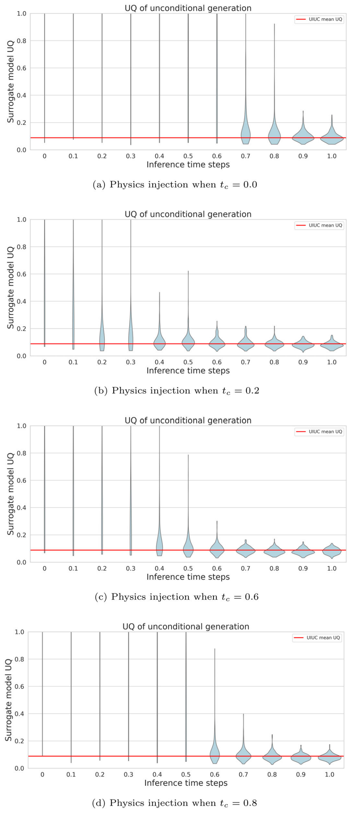

**图 12.** 基于能量的方法在不同物理注入切换时刻 $t_c$ 下生成样本的 UQ，推理总步数为 1000。红线表示 UIUC 翼型 UQ 的均值。

### B.3 梯度对齐得分

图 13 给出基于能量的方法在 $t_c=0.20,0.60,0.80$ 时的梯度对齐得分，相关定义见第 5.1.1 节。可以观察到，在主要推理阶段，梯度碰撞现象持续存在。这表明，物理损失与流匹配损失始终在竞争对设计 $\mathbf{x}$ 的影响，其原因在于两种引导耦合注入所带来的问题。

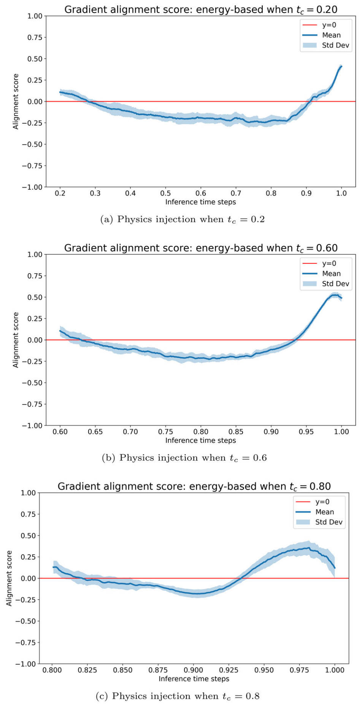

**图 13.** 当 $T=1000$、$\lambda=10$，采用不同 $t_c$ 时，基于能量的推理在 $\mathcal{L}_{\mathrm{phys}}$ 注入阶段的梯度对齐得分。横轴已经对齐，其中 0 表示开始注入 $\mathcal{L}_{\mathrm{phys}}$ 的时刻。

## 致谢

计算流体力学仿真在北京并行科技超级计算平台上完成。

## 作者贡献

所有作者均参与了研究构思与设计。数据收集、编程、验证和可视化主要由 Aobo Yang 完成。Aobo Yang 和 Zhen Wei 参与了正式分析与研究工作。论文初稿由 Aobo Yang 撰写，所有作者均对较早版本提出了意见。最终审阅与编辑主要由通信作者 Rhea Liem 完成，并得到其他作者批准。

## 资助

感谢香港研究资助局优配研究金的支持，项目编号为 16207523。

## 数据可用性

本文所用翼型数据公开可用，来源已在文中注明。为便于复现实验，所用开源代码的信息已在文中提供；Dflow-SUR 的 Python 封装脚本可按需索取。

## 开放获取

本文采用知识共享署名 4.0 国际许可协议（Creative Commons Attribution 4.0 International License）。该协议允许以任何媒介或格式使用、分享、改编、传播和复制本文，但须适当署名原作者并注明来源，提供知识共享许可协议链接，以及说明是否作出修改。

除非材料的版权说明另有注明，本文的图片或其他第三方材料也包含在本文的知识共享许可协议之内。如果某项材料未被纳入该许可协议，而您的拟议使用不受法律许可或超出法定使用范围，则须直接向版权持有人取得许可。协议全文见 [CC BY 4.0](http://creativecommons.org/licenses/by/4.0/)。

## References

Achour G, Sung WJ, Pinon-Fischer OJ, Mavris DN (2020) Development of a Conditional Generative Adversarial Network for Airfoil Shape Optimization. In: Proceedings of the AIAA Scitech 2020 Forum, Orlando, FL, USA, p. 2261. https://doi.org/10.2514/6.2020-2261

Baqué P, Remelli E, Fleuret F, Fua P (2018) Geodesic Convolutional Shape Optimization. In: Proceedings of the 35th International Conference on Machine Learning. Proceedings of Machine Learning Research, vol. 80, pp. 472–481. https://doi.org/10.48550/arXiv.1802.04016

Ben-Hamu H, Puny O, Gat I, Karrer B, Singer U, Lipman Y (2024) D-Flow: Differentiating through Flows for Controlled Generation. In: Proceedings of the 41st International Conference on Machine Learning, pp. 3462–3483

Bouhlel MA, Hwang JT, Bartoli N, Lafage R, Morlier J, Martins JRRA (2019) A Python surrogate modeling framework with derivatives. Adv Eng Softw 135:102662. https://doi.org/10.1016/j.advengsoft.2019.03.005

Chen RTQ, Rubanova Y, Bettencourt J, Duvenaud DK (2018) Neural Ordinary Differential Equations. In: Advances in Neural Information Processing Systems, vol. 31. https://doi.org/10.48550/arXiv.1806.07366

Chen W, Ahmed F (2021) PaDGAN: learning to generate high-quality novel designs. J Mech Des 143(3):031703. https://doi.org/10.1115/1.4048626

Chen W, Chiu K, Fuge MD (2020) Airfoil design parameterization and optimization using Bézier generative adversarial networks. AIAA J 58(11):4723–4735. https://doi.org/10.2514/1.J059317

Gal Y, Ghahramani Z (2016) Dropout as a Bayesian Approximation: Representing Model Uncertainty in Deep Learning. In: Proceedings of The 33rd International Conference on International Conference on Machine Learning - Volume 48. ICML’16, pp. 1050–1059. JMLR.org, New York, NY, USA

Giannone G, Srivastava A, Winther O, Ahmed F (2023) Aligning Optimization Trajectories with Diffusion Models for Constrained Design Generation. In: Proceedings of the 37th Conference on Neural Information Processing Systems (NeurIPS), pp. 51830–51861. Curran Associates, Inc., Red Hook, NY, USA. https://doi.org/10.48550/arXiv.2305.18470

Goodfellow I, Pouget-Abadie J, Mirza M, Xu B, Warde-Farley D, Ozair S, Courville A, Bengio Y (2014) Generative Adversarial Networks. Adv Neural Inf Process Syst 27:2672–2680

Hajdik HM, Yildirim A, Wu E, Brelje BJ, Seraj S, Mangano M, Anibal JL, Jonsson E, Adler EJ, Mader CA, Kenway GKW, Martins JRRA (2023) pyGeo: A geometry package for multidisciplinary design optimization. J Open Source Software 8(87):5319. https://doi.org/10.21105/joss.05319

Ho J, Jain A, Abbeel P (2020) Denoising Diffusion Probabilistic Models. Adv Neural Inf Process Syst 33:6840–6851. https://doi.org/10.48550/arXiv.2006.11239

Hwang JT, Martins JRRA (2018) A fast-prediction surrogate model for large datasets. Aerosp Sci Technol 75:74–87. https://doi.org/10.1016/j.ast.2017.12.030

Kenway GKW, Mader CA, He P, Martins JRRA (2019) Effective adjoint approaches for computational fluid dynamics. Prog Aerosp Sci 110:100542. https://doi.org/10.1016/j.paerosci.2019.05.002

Kingma DP, Welling M (2014) Auto-encoding variational bayes. In: International Conference on Learning Representations. https://doi.org/10.48550/arXiv.1312.6114

Kulfan BM (2008) Universal parametric geometry representation method. J Aircr 45(1):142–158. https://doi.org/10.2514/1.29958

LeCun Y, Chopra S, Hadsell R, Ranzato M, Huang F (2006) A Tutorial on Energy-Based Learning. In: Bakir G (ed) Predicting Structured Data. MIT Press, USA

Lei R, Bai J, Wang H, Zhou B, Zhang M (2021) Deep learning based multistage method for inverse design of supercritical airfoil. Aerosp Sci Technol 119:107101. https://doi.org/10.1016/j.ast.2021.107101

Li J, Zhang M (2021) Adjoint-free aerodynamic shape optimization of the common research model wing. AIAA J 59(6):1990–2000. https://doi.org/10.2514/1.J059921

Li J, Zhang M (2021) Data-based approach for wing shape design optimization. Aerosp Sci Technol 112:106639. https://doi.org/10.1016/j.ast.2021.106639

Li J, Bouhlel MA, Martins JRRA (2019) Data-based approach for fast airfoil analysis and optimization. AIAA J 57(2):581–594. https://doi.org/10.2514/1.J057129

Li J, Zhang M, Martins JRRA, Shu C (2020) Efficient aerodynamic shape optimization with deep-learning-based geometric filtering. AIAA J 58(10):4243–4259. https://doi.org/10.2514/1.J059254

Li J, Du X, Martins JRRA (2022) Machine learning in aerodynamic shape optimization. Prog Aerosp Sci 134:100849. https://doi.org/10.1016/j.paerosci.2022.100849

Li J, He S, Zhang M, Martins JRRA, Khoo BC (2022) Physics-based data-driven buffet-onset constraint for aerodynamic shape optimization. AIAA J 60(8):4775–4788. https://doi.org/10.2514/1.J061519

Liem RP, Mader CA, Martins JRRA (2015) Surrogate models and mixtures of experts in aerodynamic performance prediction for mission analysis. Aerosp Sci Technol 43:126–151. https://doi.org/10.1016/j.ast.2015.02.019

Lin J-H, Chen S-S, Jin S-Y, Jiang Q-F, Jia M-L, Li D (2025) Multi-point aerodynamic inverse design of flying wing using the conditional diffusion model. Phys Fluids 37(7):077116. https://doi.org/10.1063/5.0271723

Lipman Y, Chen RTQ, Ben-Hamu H, Nickel M, Le M (2022) Flow matching for generative modeling. https://doi.org/10.48550/arXiv.2210.02747

Liu DC, Nocedal J (1989) On the limited memory BFGS method for large scale optimization. Math Program 45:503–528. https://doi.org/10.1007/BF01589116

Liu X, Gong C, Liu Q (2022) Flow Straight and Fast: Learning to Generate and Transfer Data with Rectified Flow. Adv Neural Inf Proc Syst. https://doi.org/10.48550/arXiv.2209.03003

Lu C, Chen H, Chen J, Su H, Li C, Zhu J (2023) Contrastive Energy Prediction for Exact Energy-Guided Diffusion Sampling in Offline Reinforcement Learning. In: International Conference on Machine Learning, pp. 22825–22855. https://doi.org/10.48550/arXiv.2304.12824

Lyu Z, Kenway GKW, Martins JRRA (2015) Aerodynamic shape optimization investigations of the common research model wing benchmark. AIAA J 53(4):968–985. https://doi.org/10.2514/1.J053318

Lyu Y, Seth A, Liem RP (2024) Fuel consumption and trailing-edge noise tradeoff studies via mission-based airfoil shape optimization. Aerosp Sci Technol 151:109331. https://doi.org/10.1016/j.ast.2024.109331

Mader CA, Kenway GKW, Yildirim A, Martins JRRA (2020) ADflow: an open-source computational fluid dynamics solver for aerodynamic and multidisciplinary optimization. J Aerospace Inf Syst 17(9):508–527. https://doi.org/10.2514/1.I010796

Masters DA, Taylor NJ, Rendall TCS, Allen CB, Poole DJ (2017) Geometric comparison of aerofoil shape parameterization methods. AIAA J 55(5):1575–1589. https://doi.org/10.2514/1.J054943

Mazé F, Ahmed F (2023) Diffusion Models Beat GANs on Topology Optimization. In: Proceedings of the AAAI Conference on Artificial Intelligence, vol. 37, pp. 9602–9610. AAAI Press, Washington, DC, USA. https://doi.org/10.1609/aaai.v37i8.26093

Owen NE, Challenor P, Menon PP, Bennani S (2017) Comparison of surrogate-based uncertainty quantification methods for computationally expensive simulators. SIAM/ASA J Uncertainty Quant 5(1):403–435. https://doi.org/10.1137/15M1046812

Paiva RM, Carvalho ARD, Crawford C, Suleman A (2010) Comparison of surrogate models in a multidisciplinary optimization framework for wing design. AIAA J 48(5):995–1006. https://doi.org/10.2514/1.45790

Papamakarios G, Nalisnick E, Rezende DJ, Mohamed S, Lakshminarayanan B (2021) Normalizing flows for probabilistic modeling and inference. J Mach Learn Res 22(57):1–64. https://doi.org/10.48550/arXiv.1912.02762

Sederberg TW, Parry SR (1986) Free-form deformation of solid geometric models. In: Proceedings of the 13th Annual Conference on Computer Graphics and Interactive Techniques. SIGGRAPH ’86, pp. 151–160. Association for Computing Machinery, New York, NY, USA. https://doi.org/10.1145/15922.15903

Sharpe PD (2024) Accelerating Practical Engineering Design Optimization with Computational Graph Transformations. PhD thesis, Massachusetts Institute of Technology

Sharpe P, Hansman RJ (2023) NeuralFoil: An Airfoil Aerodynamics Analysis Tool Using Physics-Informed Machine Learning. arXiv preprint arXiv:2503.16323 https://doi.org/10.48550/arXiv.2503.16323

Song Y, Dhariwal P, Chen M, Sutskever I (2023) Consistency Models. Adv Neural Inf Process Syst https://doi.org/10.48550/arXiv.2303.01469

Song Y, Sohl-Dickstein J, Kingma DP, Kumar A, Ermon S, Poole B (2021) Score-Based Generative Modeling through Stochastic Differential Equations. In: International Conference on Learning Representations. https://doi.org/10.48550/arXiv.2011.13456

Systèmes D (2023) Sophisticated NURBS software solutions. https://www.3ds.com/products-services/catia/products/nurbs-software/ . Accessed: 2025-06-12

Teh YW, Welling M, Osindero S, Hinton GE (2003) Energy-based models for sparse overcomplete representations. J Mach Learn Res 4:1235–1260

Wang J, Li R, He C, Chen H, Cheng R, Zhai C, Zhang M (2022) An inverse design method for supercritical airfoil based on conditional generative models. Chin J Aeronaut 35(3):62–74. https://doi.org/10.1016/j.cja.2021.03.006

Wang S, Bhartari AK, Li B, Perdikaris P (2025) Gradient Alignment in Physics-informed Neural Networks: A Second-Order Optimization Perspective. arXiv preprint arXiv:2502.00604 https://doi.org/10.48550/arXiv.2502.00604

Wei Z, Guillard B, Fua P, Chapin V, Bauerheim M (2023) Latent representation of computational fluid dynamics meshes and application to airfoil aerodynamics. AIAA J 61(8):3507–3525. https://doi.org/10.2514/1.J062533

Wei Z, Yang A, Li J, Bauerheim M, Liem RP, Fua P (2025) Automated parameterization for aerodynamic shape optimization via deep geometric learning. AIAA J 63(12):5430–5447. https://doi.org/10.2514/1.J065203

Wei Z, Dufour ER, Pelletier C, Fua P, Bauerheim M (2024) DiffAirfoil: An Efficient Novel Airfoil Sampler Based on Latent Space Diffusion Model for Aerodynamic Shape Optimization. In: Proceedings of the AIAA AVIATION FORUM AND ASCEND 2024, Las Vegas, NV, USA, pp. 2024–3755. https://doi.org/10.2514/6.2024-3755

Wei Z, Dufour E, Pelletier C, Bauerheim M, Fua P (2026) Aerodynamic shape design space exploration with deep latent diffusion model. AIAA Journal. In Press

Wei Z, Fua P, Bauerheim M (2023) Automatic Parameterization for Aerodynamic Shape Optimization via Deep Geometric Learning. In: Proceedings of the AIAA AVIATION 2023 FORUM, San Diego, CA, USA. https://doi.org/10.2514/6.2023-3471

Wei Z, Yang A, Li J, Bauerheim M, Liem RP, Fua P (2024) DeepGeo: Deep Geometric Mapping for Automated and Effective Parameterization in Aerodynamic Shape Optimization. In: Proceedings of the AIAA AVIATION FORUM AND ASCEND 2024, Las Vegas, NV, USA. https://doi.org/10.2514/6.2024-3839

Wu X, Zhang W, Peng X, Wang Z (2019) Benchmark aerodynamic shape optimization with the POD-based CST airfoil parametric method. Aerosp Sci Technol 84:632–640. https://doi.org/10.1016/j.ast.2018.08.005

Wu T, Maruyama T, Wei L, Zhang T, Du Y, Iaccarino G, Leskovec J (2024) Compositional Generative Inverse Design. In: International Conference on Learning Representations. https://doi.org/10.48550/arXiv.2401.13171

Yang A, Lyu Y, Li J, Liem RP (2025) Operation-aware aircraft wing design using cluster-based multipoint aerodynamic shape optimization. J Aircr 62(6):1531–1547. https://doi.org/10.2514/1.C038291

Yang A, Li J, Liem RP (2026) Generalizable Multifidelity Aerodynamic Wing Shape Design Optimization. J Aircr

Yang A, Zhang J, Li J, Liem R (2024) Data-driven aerodynamic shape optimization and multi-fidelity design exploration using conditional diffusion-based geometry sampling method. In: 33rd Congress of the International Council of the Aeronautical Sciences (ICAS). International Council of the Aeronautical Sciences

Zhang X, Xie F, Ji T, Zhu Z, Zheng Y (2021) Multi-fidelity deep neural network surrogate model for aerodynamic shape optimization. Comput Methods Appl Mech Eng 373:113485. https://doi.org/10.1016/j.cma.2020.113485

Zhao H, Kamensky D, Hwang JT, Chen J-S (2024) Automated shape and thickness optimization for non-matching isogeometric shells using free-form deformation. Engineering with Computers 40:3495–3518. https://doi.org/10.1007/s00366-024-01947-7

**出版者声明：** Springer Nature 对已发表地图和机构隶属关系中的司法管辖权主张持中立立场。
