# 面向快速可靠形状优化的不确定性感知数据驱动方法

**原文题目：** Uncertainty-aware data-based method for fast and reliable shape optimization  
**作者：** Yunjia Yang¹、Runze Li¹、Yufei Zhang¹、Haixin Chen¹  
**期刊：** *Structural and Multidisciplinary Optimization*（《结构与多学科优化》，简称 SMO），2026 年，第 69 卷，文章号 95  
**DOI：** [10.1007/s00158-026-04259-0](https://doi.org/10.1007/s00158-026-04259-0)  
**文章类型：** 研究论文  
**收稿：** 2025 年 9 月 17 日；**修回：** 2025 年 12 月 19 日；**录用：** 2026 年 1 月 17 日；**在线发表：** 2026 年 3 月 27 日  
**单位：** ¹清华大学航天航空学院，中国北京 100084  
**通信作者：** Haixin Chen，chenhaixin@tsinghua.edu.cn  
**版权：** © 作者，2026；独家许可 Springer-Verlag GmbH Germany（Springer Nature 旗下）。

> 译文说明：依据用户提供的 23 页期刊正式发表版 PDF 翻译，保留原有章节、公式编号、图表编号及相对位置。图内文字沿用原图，图题译为中文；参考文献及附录保留英文。Markdown 按正文阅读顺序排版，双栏、页眉页脚和分页不重复。期刊信息已对照[出版社页面](https://link.springer.com/article/10.1007/s00158-026-04259-0)核实；[免费预印本](https://arxiv.org/abs/2601.21956)截至 2026 年 10 月 28 日的最新版本为 v1（2026 年 1 月 29 日），该链接为预印本，译文内容以所附正式发表版为准。

## 摘要

基于数据的优化（data-based optimization，DBO）通过在迭代过程中利用预训练代理模型进行离线评估，为高效优化外形、改善气动性能提供了一种有前景的方法。然而，DBO 高度依赖训练数据库的质量。优化过程中遇到的训练分布之外的样本可能产生显著的预测误差，进而误导优化过程。因此，将不确定性量化纳入优化，对于识别异常样本和增强鲁棒性至关重要。本文提出一种不确定性感知的基于数据的优化（uncertainty-aware data-based optimization，UA-DBO）框架，用于在 DBO 过程中监测并降低代理模型的不确定性。研究构建了一种概率编码器-解码器代理模型，预测其输出所对应的不确定性，并将这些不确定性纳入模型置信度感知目标函数，以在 DBO 过程中惩罚预测误差较大的样本。本文在两个分别旨在改善翼型阻力发散特性和抖振性能的多点优化问题上评估 UA-DBO 框架。结果表明，UA-DBO 能够持续降低优化所得样本的预测误差，并获得优于原始 DBO 的性能提升。此外，与完全基于计算仿真的优化相比，UA-DBO 在显著加快优化速度的同时，实现了相近的优化效果。

**关键词：** 形状优化；不确定性量化；机器学习；基于代理模型的优化

## 1 引言

计算机技术的进步不断重塑着气动设计方法。近年来，大量研究致力于采用机器学习（machine learning，ML）技术加速优化过程（Brunton et al. 2021；Li et al. 2022a）。一种常用策略是利用机器学习构建代理模型，预测气动性能或流场。其中一个代表性框架是基于数据的优化（DBO）（Li et al. 2019a），部分文献也将其称为交互式优化（Du et al. 2021）。在 DBO 中，首先利用规模大、样本多样且广泛覆盖目标设计空间的数据集预训练代理模型，随后将其以离线方式部署到优化循环中，从而大幅减少甚至完全消除优化过程中对计算流体力学（computational fluid dynamics，CFD）评估的需求。

与在优化过程中不断迭代更新代理模型的高效全局优化（efficient global optimization，EGO）相比，DBO 的离线特性既带来优势，也带来挑战。一方面，由于迭代过程中无须额外仿真，DBO 能显著加快优化速度，这在多点优化任务中尤为有益（Li et al. 2019a；Yang et al. 2024）。此外，DBO 中的预训练模型具有很高的复用性，同一个模型可用于相近领域内的多个下游优化问题，从而分摊生成预训练数据集的高昂成本（Renganathan et al. 2021；Kovani et al. 2023；Yang et al. 2024）。凭借这些优势，DBO 已成功应用于翼型和机翼优化（Yang et al. 2024；Li and Zhang 2021）、喷管设计（Yang et al. 2023）以及飞机总体构型优化（Secco and Mattos 2017）。然而，一个关键挑战依然存在：DBO 在优化过程中完全依赖离线模型，会给结果的可靠性带来风险。由于无法获取真实值评估来修正离线代理模型，当遇到训练数据库分布之外的样本时，优化可能受到误导，产生显著误差。

为降低这一风险，引入不确定性量化（uncertainty quantification，UQ）是增强 DBO 鲁棒性的一条有前景的途径。不过，现有的不确定性感知优化方法大多是在 EGO 背景下发展起来的，其中不确定性估计主要通过采集函数引导探索和主动采样（Gaudrie et al. 2020；Laurenceau and Sagaut 2008；Li et al. 2019b）。相比之下，由于优化过程中无法获取新数据，DBO 不能采用这样的策略。因此，不确定性需要以不同的方式发挥作用：通过调控对已有模型的利用，并防止对不可靠预测的过度自信，直接为优化过程本身提供信息。这一细微却关键的区别，在现有文献中受到的关注仍然有限。

此外，DBO 通常需要利用大规模、高维数据集预训练代理模型，这给基于高斯过程（Gaussian process，GP）的方法带来了可扩展性挑战（Bouhlel et al. 2020；Liu et al. 2020）。尽管近年来深度神经网络的不确定性量化取得了进展，例如集成方法（Yang et al. 2022a）、蒙特卡洛 dropout（Mufti et al. 2024）、贝叶斯网络（Anhichem et al. 2025）和生成模型（Jabón et al. 2024；Saetta et al. 2024；Liu and Thuerey 2024），展现出处理大规模问题的潜力，但它们在 DBO 框架中的应用仍鲜有研究。

针对上述不足，本文提出一种不确定性感知的基于数据的优化（UA-DBO）框架。其核心思想是将模型置信度显式纳入优化目标，使优化器能够在性能提升与不可靠代理预测所带来的风险之间进行权衡。这一概念受到鲁棒优化的启发；但在本文中，不确定性来自预训练代理模型，而不是系统输入的变化。

本文还研究了如何高效估计预训练模型预测不确定性这一问题。为此，提出一种高斯随机编码器-解码器（Gaussian stochastic encoder-decoder，GS-ED）模型。该模型以 DBO 中常用于预测的编码器-解码器（encoder-decoder，ED）架构为基础，并引入变分近似技术。本文通过两个翼型多点气动优化问题验证所提出 UA-DBO 框架的有效性；DBO 在这类问题中已展现出明显优势。

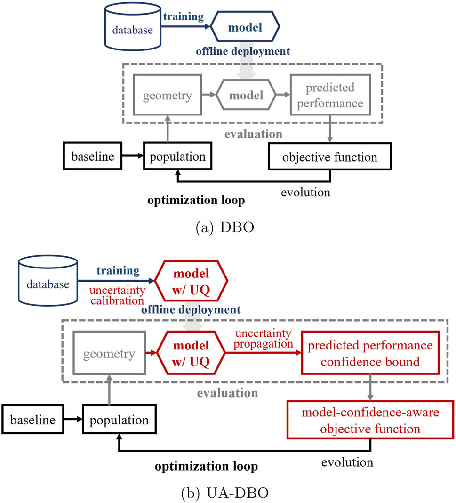

**图 1** DBO 与 UA-DBO 框架的比较。

## 2 不确定性感知的基于数据的优化框架

### 2.1 总体框架

图 1 比较了传统 DBO 框架与本文提出的 UA-DBO 框架。在 DBO 中，模型训练的目标是预测性能，不提供有关预测不确定性或可靠性的额外信息，优化目标函数也仅基于这些预测值。随后，优化算法（本文采用进化算法）在迭代过程中使用这些目标函数，直至获得最优结果。这会带来模型预测误差误导优化的风险。

UA-DBO 利用不确定性量化降低这一风险。代理模型经过预训练后，对每次预测同时给出性能指标及相应的不确定性指标，例如置信限。因此，需要引入不确定性量化、传播和校准技术。优化过程中采用模型置信度感知目标函数，在最优位置同时最大化性能、最小化不确定性，以获得鲁棒的结果。

以下各节将介绍模型置信度感知目标函数的构建，以及模型不确定性的量化、传播和校准方法。

### 2.2 模型置信度感知目标函数

考虑一个以设计变量 $\boldsymbol{x}$ 为自变量、使性能指标 $Y(\boldsymbol{x})$ 最小化的优化问题。DBO 预先训练代理模型 $\mathcal{F}_D$，学习设计变量 $\boldsymbol{x}$ 与性能变量 $Y(\boldsymbol{x})$ 之间的确定性映射关系，即 $\hat{Y}(\boldsymbol{x})=\mathcal{F}_D(\boldsymbol{x})$。随后，将该代理模型离线部署于优化问题中，通过下式寻找最优值：

$$
\begin{aligned}
\min_{\boldsymbol{x}}\hat{Y}(\boldsymbol{x})
&=\min_{\boldsymbol{x}}\mathcal{F}_D(\boldsymbol{x}),\\
\text{s.t.}\quad &\mathcal{G}(\boldsymbol{x})\geq 0.
\end{aligned}
\tag{1}
$$

在 UA-DBO 中，概率模型取代原有的确定性模型，给出模型预测性能指标的置信区间。对于最小化问题，采用代理模型 $\mathcal{F}_{P,UB}$ 预测置信区间的上界（upper bound，UB）$UB(Y(\boldsymbol{x}))$。在优化过程中离线使用该模型时，模型置信度感知目标函数采用 $UB(Y(\boldsymbol{x}))$，替代均值预测 $Y(\boldsymbol{x})$：

$$
\begin{aligned}
\min_{\boldsymbol{x}}UB(Y(\boldsymbol{x}))
&=\min_{\boldsymbol{x}}\mathcal{F}_{P,UB}(\boldsymbol{x}),\\
\text{s.t.}\quad &\mathcal{G}(\boldsymbol{x})\geq 0.
\end{aligned}
\tag{2}
$$

这一策略使实际优化性能 $Y^{*(\mathrm{CFD})}$ 受到约束，优于（低于）预测上界，从而降低模型误差误导优化过程的风险。

图 2 说明了将不确定性量化（UQ）纳入 DBO 后的影响。两个子图中的蓝色虚线均表示优化过程中代理模型预测的性能指标，红色虚线则表示每次迭代中由模型预测为最优的设计所对应的实际性能指标。如图 2a 所示，不考虑 UQ 时，优化过程可能收敛至一个代理模型预测性能良好、实际性能却因模型误差而较差的区域。相比之下，图 2b 展示了纳入 UQ 后的优化轨迹；在置信区间准确的前提下，实际性能（红色实线）保持在置信界限内，从而避免误差积累和优化方向受到误导。

所提目标函数的核心思想在于适用于 DBO 范式，即先预训练代理模型，再将其离线用于优化。因此，可以从两个角度理解这一过程中的不确定性。从代理建模的角度看，模型捕捉的不确定性源于训练数据有限和模型近似，因而本质上属于认知不确定性。然而，一旦模型被部署到优化过程中，从优化器的角度看，它就是一个固定的外部系统，其作用在功能上类似于随机不确定性。

基于这种理解，可以自然地将优化问题纳入鲁棒优化框架：将系统不确定性视为外生扰动，目标是在模型误差的最坏情形或高概率实现下，寻找仍然有效的解。当代理模型的输出由均值为 $\mu(\boldsymbol{x})$、标准差为 $\sigma(\boldsymbol{x})$ 的预测分布表示时，置信水平为 $\alpha$ 的置信区间上界可由这些分布参数直接推得：

$$
UB(Y(\boldsymbol{x}))
=\mu(\boldsymbol{x})
+\frac{t_{\alpha,N_s-1}}{\sqrt{N_s}}\sigma(\boldsymbol{x}),
\tag{3}
$$

其中，$t_{\alpha,N_s-1}$ 表示置信水平为 $\alpha$、自由度为 $N_s-1$ 的 Student $t$ 分布对应值，$N_s$ 是用于估计预测统计量的样本数。

在这一表述下，所提模型置信度感知目标函数等价于一个采用加权求和形式的期望-方差权衡问题：

$$
\min_{\boldsymbol{x}}\bigl(\mu(Y)+w\cdot\sigma(Y)\bigr),
\qquad Y=\mathcal{F}(\boldsymbol{x}),
\tag{4}
$$

其中，权重系数为 $w=t_{\alpha,N_s-1}/\sqrt{N_s}$。以往研究因加权求和形式简单且有效而广泛采用它，但选择合适的权重系数始终是一项关键挑战，而且通常取决于具体问题（Yao et al. 2011；Du and Leifsson 2019）。本文方法将权重选择问题转化为置信水平 $\alpha$ 的选择，为权衡参数赋予了明确的概率解释，从而能够以更直观、更有依据的方式，控制基于离线代理模型优化时的风险规避程度。

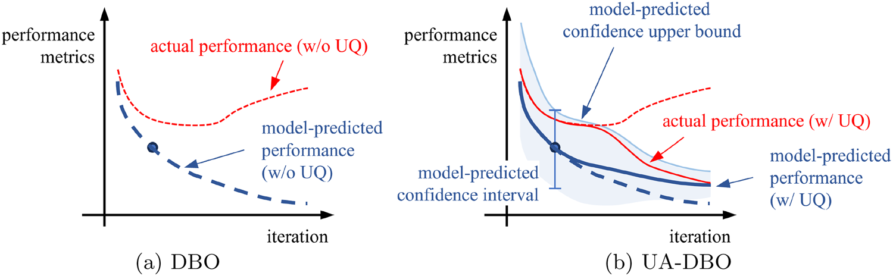

**图 2** 考虑与不考虑 UQ 时可能出现的优化轨迹示意。

### 2.3 机器学习模型的不确定性量化

图 3a 展示了 DBO 框架中常用的确定性代理模型，其采用编码器-解码器（encoder-decoder，ED）架构。模型以几何形状 $\boldsymbol{x}$ 和工况 $c$ 作为输入。编码器将这些输入映射为低维潜在表示 $\boldsymbol{z}$，将其与 $c$ 拼接后送入解码器，以预测流场或性能指标 $\boldsymbol{y}$。

在 UA-DBO 框架中，我们引入能够提供 UQ 的高斯随机编码器-解码器（Gaussian stochastic encoder-decoder，GS-ED）模型，对上述架构进行扩展。GS-ED 模型受到 Kingma and Welling（2014）提出的常用变分自编码器（variational autoencoder，VAE）的启发。如图 3b 所示，它保留 ED 结构，并将确定性的潜在空间替换为概率潜在空间。通过变分近似训练模型，再从概率潜在空间中进行蒙特卡洛采样以估计不确定性，即可实现 UQ。这样设计旨在尽量减少对现有 DBO 流程的改动；同时，本文提出的 UA-DBO 框架也兼容其他 UQ 方法。

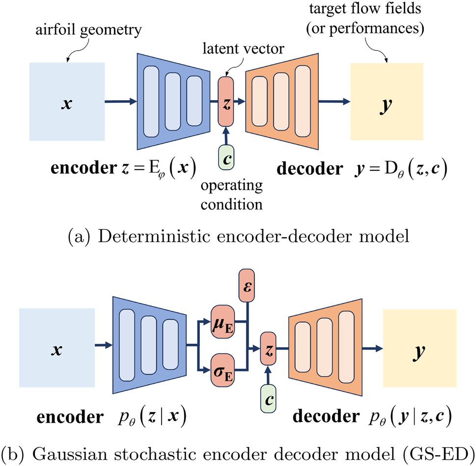

**图 3** 所提出的机器学习模型架构：（a）确定性编码器-解码器模型；（b）高斯随机编码器-解码器模型（GS-ED）。

#### 2.3.1 GS-ED 模型的训练

与确定性 ED 的主要区别在于潜在表示：编码器现在预测潜变量的条件分布 $q_\phi(\boldsymbol{z}\mid\boldsymbol{x})$，并将其建模为由 $\bigl(\boldsymbol{\mu}_E(\boldsymbol{x}^{(i)}),\boldsymbol{\sigma}_E(\boldsymbol{x}^{(i)})\bigr)$ 参数化的高斯分布。类似地，解码器网络现在预测条件后验分布 $p_\theta(\boldsymbol{y}\mid\boldsymbol{z},c)$。

与 VAE 类似，GS-ED 模型的损失函数通过变分近似最大化证据似然推导而得。然而，VAE 主要用于降维，GS-ED 则针对 UA-DBO 所需的预测任务设计。具体而言，它最大化条件证据似然 $\log p_\theta(\boldsymbol{y}\mid\boldsymbol{x},c)$，而非普通的证据似然 $\log p_\theta(\boldsymbol{y})$。附录 A 给出了详细推导，最终得到的损失函数为：

$$
\mathcal{L}_{\mathrm{GS-ED}}(\boldsymbol{y};\theta,\phi)
=-\mathbb{E}_{\boldsymbol{z}\sim q_\phi(\boldsymbol{z}\mid\boldsymbol{y})}
\log p_\theta(\boldsymbol{y}\mid\boldsymbol{z},c).
\tag{5}
$$

在实验中，我们发现仅使用似然损失可能导致较大的预测误差，尤其是不确定性估计误差。一个重要原因是，学习得到的潜变量分布不再能保证为高斯分布，因而降低了预测精度。为缓解这一问题，我们重新引入条件先验 $q_\phi(\boldsymbol{z}\mid\boldsymbol{x})$ 与标准正态分布之间的 KL 散度 $KL\bigl(q_\phi(\boldsymbol{z}\mid\boldsymbol{x}),\mathcal{N}(\boldsymbol{0},\boldsymbol{I})\bigr)$ 作为正则项，并以超参数 $\beta$ 加权。

为实现基于梯度的优化，采用重参数化技巧。对于每个输入 $(\boldsymbol{y}^{(i)};\boldsymbol{x}^{(i)},c^{(i)})$，从识别分布 $q_\phi(\boldsymbol{z}\mid\boldsymbol{y})$ 中采样 $N_l$ 个潜变量 $\{\boldsymbol{z}^{(i,l)}\}_{i=1,\ldots,N_l}$。假设后验分布 $p_\theta(\boldsymbol{y}\mid\boldsymbol{z})$ 服从高斯分布，其均值 $\boldsymbol{\mu}_D(\boldsymbol{z}^{(i,l)})$ 由解码器预测，协方差为单位矩阵，则每个训练样本的损失为：

$$
\begin{aligned}
\mathcal{L}_{\mathrm{GS-ED}}(\boldsymbol{y}^{(i)};\theta,\phi)
={}&\frac{1}{N_l}\sum_{l=1}^{N_l}\frac{1}{2}
\left\|\boldsymbol{y}^{(i)}-
\boldsymbol{\mu}_D(\boldsymbol{z}^{(i,l)},c^{(i)})\right\|_2^2\\
&-\frac{1}{2}\left(
1+\log\boldsymbol{\sigma}_E^2(\boldsymbol{x}^{(i)})
-\boldsymbol{\mu}_E^2(\boldsymbol{x}^{(i)})
-\boldsymbol{\sigma}_E^2(\boldsymbol{x}^{(i)})
\right).
\end{aligned}
\tag{6}
$$

其中，$\boldsymbol{z}^{(i,l)}$ 采样自 $\mathcal{N}\bigl(\boldsymbol{\mu}_E(\boldsymbol{x}^{(i)}),\boldsymbol{\sigma}_E(\boldsymbol{x}^{(i)})\bigr)$，即编码器给出的先验分布。Kingma and Welling（2014）建议，训练时采用 $L=1$ 即已足够；但我们的实验发现，较大的 $L$ 尤其有利于不确定性估计。附录 B 将通过消融研究，考察本节提出的额外 KL 损失项和较大采样规模的作用。

> 译注：本节保留原文的符号用法。式（5）及相关文字使用 $q_\phi(\boldsymbol{z}\mid\boldsymbol{y})$，而编码器的描述使用 $q_\phi(\boldsymbol{z}\mid\boldsymbol{x})$；原文采样集合下标写为 $i=1,\ldots,N_l$。此外，正文说明 KL 项以 $\beta$ 加权，但印刷版式（6）未显式写出 $\beta$。

#### 2.3.2 使用 GS-ED 模型进行推断

模型参数学习完成后，由输入 $\boldsymbol{x}$ 和 $c$ 推断输出 $\boldsymbol{y}$ 的过程，遵循 GS-ED 模型的生成过程。编码器给出潜变量分布 $p_\theta(\boldsymbol{z}\mid\boldsymbol{x})\sim\mathcal{N}\bigl(\boldsymbol{\mu}_E(\boldsymbol{x}^{(i)}),\boldsymbol{\sigma}_E(\boldsymbol{x}^{(i)})\bigr)$。随后，从这一先验分布进行蒙特卡洛采样，估计输出 $\boldsymbol{y}$ 的后验分布。假设采得 $N_s$ 个潜变量 $\{\boldsymbol{z}^{(s)}\}_{s=1,\ldots,N_s}$，且 $\hat{\boldsymbol{y}}^{(s)}=\boldsymbol{\mu}_D(\boldsymbol{z}^{(s)},c)$ 是第 $s$ 个样本对应的解码器输出，则 $p_\theta(\boldsymbol{y}\mid\boldsymbol{z},c)$ 的均值和标准差可估计为：

$$
\begin{aligned}
\mu(\hat{\boldsymbol{y}})
&=\frac{1}{N_s}\sum_{s=1}^{N_s}\hat{\boldsymbol{y}}^{(s)},\\
\sigma(\hat{\boldsymbol{y}})
&=\sqrt{\frac{1}{N_s-1}\sum_{s=1}^{N_s}
\left(\hat{\boldsymbol{y}}^{(s)}-\mu(\hat{\boldsymbol{y}})\right)^2}.
\end{aligned}
\tag{7}
$$

在实际应用中，通常仍需进行若干后处理步骤，才能从模型的直接输出预测性能指标。为使不确定性通过这些步骤传播，将蒙特卡洛采样扩展到后处理过程。假设在一系列工况 $c$ 下，根据模型的直接输出 $\boldsymbol{y}$，经由确定性的后处理 $\mathcal{B}$ 得到性能指标 $Y$：

$$
Y=\mathcal{B}\left(
\{c_j,\boldsymbol{y}_j\}_{j=1,\ldots,N_j}
\right).
\tag{8}
$$

性能指标的不确定性量化仍从潜在空间采样开始。对于每个采样潜向量 $\boldsymbol{z}^{(s)}$，利用解码器在指定工况下生成直接输出：$\hat{\boldsymbol{y}}_j^{(s)}=\boldsymbol{\mu}_D(\boldsymbol{z}^{(s)},c_j)$。随后，按照式（8）计算该采样点对应的性能指标 $Y^{(s)}$。采用与式（7）类似的过程，估计其概率分布：

$$
\begin{aligned}
\mu(Y)&=\frac{1}{N_s}\sum_{s=1}^{N_s}Y^{(s)},\\
\sigma(Y)&=\sqrt{\frac{1}{N_s-1}\sum_{s=1}^{N_s}
\left(Y^{(s)}-\mu(Y)\right)^2}.
\end{aligned}
\tag{9}
$$

由于优化中需要使用置信区间上界，可以根据 $\mu(Y)$ 和 $\sigma(Y)$，通过式（3）求得该上界。

#### 2.3.3 不确定性校准

如第 2.2 节所述，相对于优化过程，模型不确定性可视为不可约的。因此，模型训练完成后必须进行校准，使其离线部署时能够更准确地估计不确定性。对于训练集和测试集中的样本，如果预测置信区间准确，那么由 CFD 模拟流场得到的实际性能，应以预期频率落在预测置信界限内，即 $p(LB_\alpha\leq Y^{(\mathrm{CFD})}\leq UB_\alpha)\rightarrow\alpha$。

校准通过对所有训练样本的下界（LB）和上界（UB）进行线性调整来完成。具体而言，引入校准系数 $\kappa_L$ 和 $\kappa_U$，确保误差落在 LB 以下或 UB 以上的比例分别为 $\tfrac{1}{2}(1-\alpha)$。

$$
\begin{aligned}
LB'_\alpha&=\mu(Y)-\kappa_L
\frac{t_{\alpha,N_s-1}}{\sqrt{N_s}}\cdot\sigma(Y),\\
UB'_\alpha&=\mu(Y)+\kappa_U
\frac{t_{\alpha,N_s-1}}{\sqrt{N_s}}\cdot\sigma(Y),\\
\text{s.t.}\quad
p\left(Y^{(\mathrm{CFD})}\leq LB'_\alpha\right)
&\rightarrow\frac{1}{2}(1-\alpha),\\
p\left(UB'_\alpha\leq Y^{(\mathrm{CFD})}\right)
&\rightarrow\frac{1}{2}(1-\alpha).
\end{aligned}
\tag{10}
$$

## 3 实验设置

### 3.1 形状优化问题

多点气动形状优化为展示 DBO 和 UA-DBO 框架提供了良好算例。对于下一代民用飞机，在非设计工况下保持较高的气动效率和鲁棒性至关重要（Martins 2022）。然而，高效的多点气动优化仍面临重大挑战。传统的基于 CFD 的框架需要进行多次模拟以评估多点性能，计算开销较大。相比之下，DBO 框架利用预训练模型，使性能预测不再依赖于设计点的数量，从而显著加快优化速度（Li et al. 2019c, 2022b）。

本文采用超临界翼型阻力发散性能优化问题，展示所提 UA-DBO 方法的表现。随着马赫数 $Ma_\infty$ 或迎角 $AOA$ 增大，翼型上表面的激波增强，导致阻力急剧上升，这一现象称为阻力发散。本文对模型训练、不确定性量化、优化过程及结果进行全面分析。

该优化问题以气动设计优化讨论组（ADODG）的第二个基准算例为基础（Martins 2022）。

优化目标是在满足截面面积 $A$ 和巡航俯仰力矩 $C_{M,\mathrm{cruise}}$ 约束的条件下，最小化 RAE2822 翼型在六个马赫数（0.710 至 0.760）下的平均阻力系数 $\bar C_D$。所有马赫数下的升力系数 $C_{L,\mathrm{cruise}}$ 均固定为 0.824。为保证工程实用性，翼型在 15% 弦长位置处的厚度 $t_{0.15c}$ 不得小于基准翼型的对应厚度。翼型上下表面分别采用两组九阶类函数/形状函数变换（CST）参数进行参数化，记为 $\{u_i\}_{i=0,\ldots,9}$ 和 $\{l_i\}_{i=0,\ldots,9}$。该优化问题可表示为：

$$
\begin{aligned}
\min_{\{u_i,l_i\}_{i=0,\ldots,9}}\quad
&\bar C_D=\frac{1}{6}\sum_{Ma_\infty=0.71,0.72,\ldots,0.76}C_{D,Ma_\infty}\\
\mathrm{s.t.}\quad
&C_{L,\mathrm{cruise}}=0.824,\\
&A\geq A^{(0)},\quad C_{M,\mathrm{cruise}}\geq C_{M,\mathrm{cruise}}^{(0)},\\
&1.0\leq AOA_{\mathrm{cruise}}\leq5.0,\\
&t_{0.15c}>0.9\cdot t_{0.15c}^{(0)}.
\end{aligned}
\tag{11}
$$

其中，上标 $(\cdot)^{(0)}$ 表示基准翼型的对应取值。

> 译注：原文文字称该处厚度“不得小于基准翼型”，但式（11）给出的约束为大于基准厚度的 0.9 倍；此处保留原文两种表述。

为进一步展示 UA-DBO 在多目标优化中的表现，我们还对另一项抖振起始优化问题进行了测试，该问题与我们此前关于抖振起始优化的研究相同（Yang et al. 2024）。限于篇幅，该问题的设置和结果见附录 C。

### 3.2 优化问题的模型设置

#### 3.2.1 基于先验的多工况气动性能预测策略

本文采用 Yang et al.（2024）提出的基于先验的策略，构建用于评估多工况性能的代理模型。图 4 给出了该代理模型的示意图。直接预测方法仅根据翼型几何估计非设计工况下的流场和性能指标，而基于先验的方法则引入一次 CFD 仿真，计算准确的巡航流场。随后，训练代理模型，使其根据翼型几何与 CFD 仿真得到的巡航流场预测非设计工况性能。由于该策略仅改变模型输入，因此可同时用于确定性和概率型基于数据的优化框架。具体的模型输入、输出及架构见附录 C.2。

基于先验的方法缓解了优化过程中完全依赖预训练模型的局限，从而增强了模型的泛化能力，提高了 DBO 框架的鲁棒性。同时，该方法保持了计算效率，能够在数秒内评估非设计工况性能，并以与单工况优化相当的时间成本实现多工况优化。

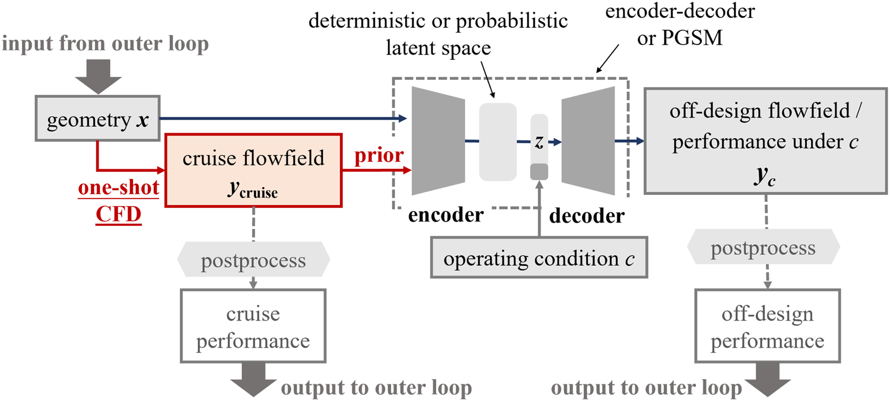

**图 4** 基于先验的多工况性能预测框架。

#### 3.2.2 模型架构

用于阻力预测的模型架构如图 5 所示。该模型旨在预测翼型在给定马赫数下的阻力系数，从而可直接计算一定马赫数范围内的平均阻力系数。在此问题中，仅马赫数发生变化，其他工况参数均保持不变。

模型输入包括翼型几何，以及表面 $C_p$ 和 $C_f$ 分布。按照前文所述，各表面的压力和摩擦分布均在固定的 $x$ 坐标处采样。这里，我们利用这些 $x$ 坐标处的表面 $y$ 坐标描述翼型几何，以保证所有输入向量具有相同的形状，并能够由基于一维卷积层的编码器处理。编码后，将目标工况对应的马赫数拼接到 18 维潜在向量 $\boldsymbol z$ 上，再通过多层感知机（MLP）解码，生成输出。

编码器包含三个模块，每个模块均由一个卷积核大小为 3、步长为 2 的一维卷积层、一个平均池化层，以及一个斜率为 0.2 的 LeakyReLU 激活层组成。各模块输出的张量尺寸标于图 5 的括号内，第一个数值表示通道数，第二个数值表示特征图长度。在最后一个编码器模块之后，通过全连接层将展平的输出映射至潜在向量 $\boldsymbol z$。在概率模型中，两个全连接层分别预测 $\boldsymbol z$ 的均值和对数方差，并利用重参数化技巧，通过加入经过缩放的白噪声 $\boldsymbol\epsilon$ 对 $\boldsymbol z$ 进行采样。

解码器包含三个隐藏层，维数依次为 128、256 和 128，并采用批归一化与 LeakyReLU 激活。最后通过一个不含激活函数的全连接输出层预测阻力系数。

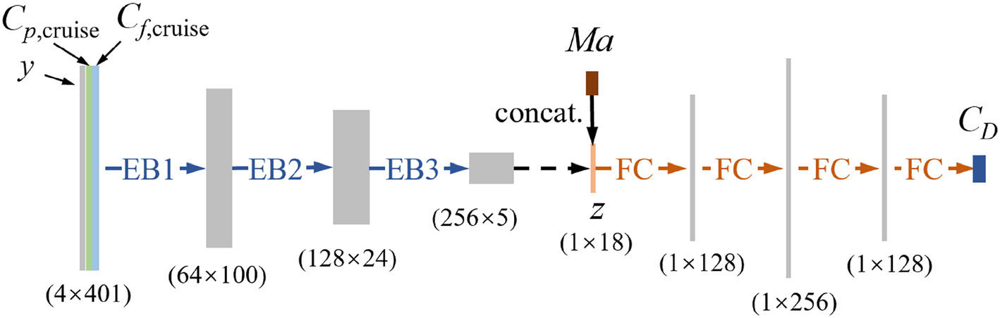

**图 5** 阻力发散优化模型的架构。EB# 表示编码器模块，FC 表示全连接层。括号内的数值表示张量的通道数与特征图尺寸。

### 3.3 代理模型的预训练设置

#### 3.3.1 翼型数据库

通过对翼型形状和工况进行采样，构建用于预训练代理模型的翼型数据集。

**翼型形状采样**

采用 Li et al.（2022c）提出的输出空间采样（OSS）方法，对翼型形状及其巡航工况进行采样，以保证几何与压力分布模式的多样性。数据集共包含 1420 种翼型形状，与我们此前研究使用的翼型集合相同（Yang et al. 2024）。图 6a 展示了这些几何形状，其中用黑色突出显示了一个代表性翼型。

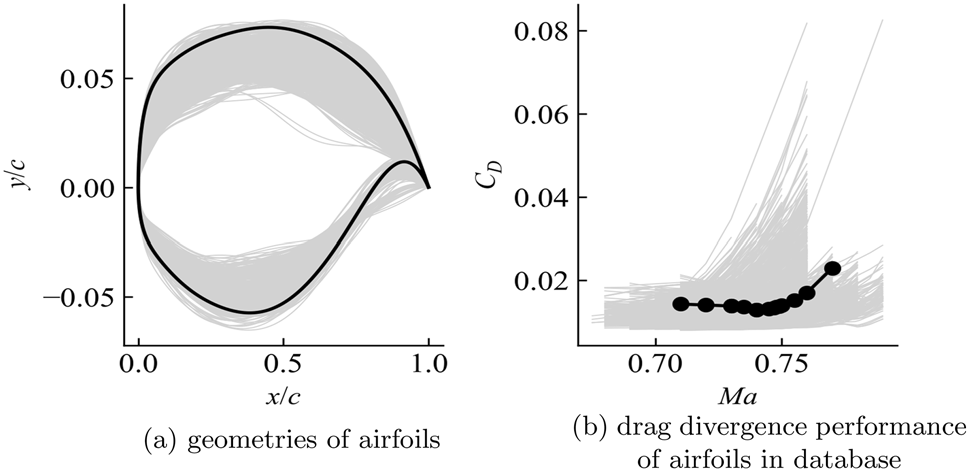

**图 6** 数据库中的翼型几何与性能：（a）翼型几何；（b）数据库中翼型的阻力发散性能。

**工况采样**

确定翼型及其巡航工况后，根据各优化任务对非设计工况进行采样。由于需要获得多个马赫数下的非设计工况阻力性能，因此针对每种翼型，在 0.65 至 0.80 范围内随机采样马赫数，并保持升力系数与巡航工况相同。图 6b 给出了所得的 $C_D-Ma_\infty$ 关系。

**CFD 仿真**

采用开源雷诺平均 Navier-Stokes 求解器 CFL3D 计算流场，并利用剪切应力输运（SST）模型模拟湍流。仿真采用由自主开发程序自动生成的结构化 C 型网格。为加快收敛，采用 W 循环多重网格策略，依次在三级网格上分别执行 1000、1000 和 4000 次迭代。雷诺数和自由来流温度分别固定为 2000 万和 $580\,{}^\circ\mathrm R$。仅收集收敛的 CFD 结果用于构建数据集，共获得 17386 组结果。

随后，从仿真流场中提取 $C_p$ 和 $C_f$ 分布，并根据各自的最大值和最小值将其归一化至 $[-1,1]$。通过将计算表面网格点上的分布插值到一组专门设计的 $x$ 坐标位置，实现分布对齐；这些位置在前缘和后缘附近更加密集。由 $C_p$ 和 $C_f$ 即可进一步计算升力系数 $C_L$ 和阻力系数 $C_D$。

数据库采样与 CFD 仿真的更多细节见我们此前的研究（Yang et al. 2024）。

#### 3.3.2 训练设置

DBO 与 UA-DBO 框架中的确定性模型和概率模型采用相同的训练设置。对于确定性模型，训练目标为 CFD 仿真结果与模型预测结果之间的均方误差（MSE）。对于概率模型，损失函数由式（6）给出。通过试算，额外 KL 损失项的权重 $\beta$ 和采样数 $N_l$ 分别确定为 $1\times10^{-5}$ 和 4。推理阶段的采样数为 16。

训练时，将数据库中 82% 的流场用于模型训练，其余 18% 用于测试。每项训练过程重复三次，以进行交叉验证。在每次运行中，随机选取 10% 的训练样本用于验证，并采用随机初始化的权重和偏置，在其余样本上训练模型。批大小设为 16，采用 Adam 优化器。通过学习率预热策略，在前 20 个训练轮次内将学习率从 $1\times10^{-4}$ 逐渐提高至 $1\times10^{-3}$，随后以 0.95 为底进行指数衰减。持续监测验证损失，以防止过拟合，最大训练轮次设为 300。

### 3.4 优化设置

#### 3.4.1 基准翼型

采用三种基准翼型进行验证：RAE2822 翼型，以及通过沿 $y$ 方向缩放 RAE2822 翼型得到的两种变体，其最大相对厚度分别为 0.081 和 0.101。基于先验模型的巡航工况设为 $C_L=0.824$、$Ma_\infty=0.730$。图 7 展示了基准翼型的几何形状及其对应的巡航压力系数 $C_p$ 分布。基准翼型以蓝色表示，并叠加以灰色表示的训练数据集样本。值得注意的是，最大相对厚度为 0.08 的翼型（算例 A1）位于训练数据集范围之外。

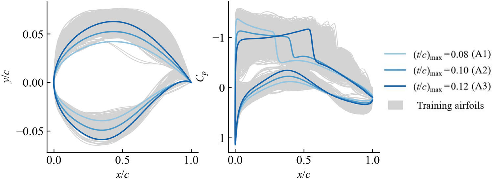

**图 7** 用于阻力发散优化的基准翼型几何与巡航表面压力分布。

#### 3.4.2 优化算法

本文主要采用多目标差分进化算法。这是一种全局、无梯度的随机方法，根据由目标函数得到的个体适应度，通过变异、交叉和选择迭代更新种群，以寻找最优样本。该算法由 Li et al.（2018）开发的自主程序 AeroOPT 实现。三种优化过程均从包含 64 个翼型的初始种群开始：在基准几何上添加随机鼓包，再利用 CST 函数重新拟合扰动后的形状，以生成初始种群。随后进行 50 次优化迭代，每次迭代的种群规模为 32。

## 4 结果

### 4.1 预训练代理模型的性能

在将模型用于优化之前，先评估其气动指标预测性能，并展示所提出 GS-ED 模型的优势。如前所述，附录 B 还给出了详细的模型消融研究。

#### 4.1.1 气动系数预测精度

本节比较所提出的 GS-ED 模型与确定性基准模型的预测精度。基准模型的编码器和解码器与 GS-ED 模型完全相同，区别仅在于其编码器只输出确定性的潜在值 $\boldsymbol z$，而非预测潜在高斯分布的均值和对数标准误差。

表 1 给出了模型预测误差。其中，第一项误差列表示全部训练样本或测试样本中，模型预测阻力系数与真实阻力系数之间的平均绝对误差（MAE），即

$$
\frac{1}{N_{\mathrm{sample}}}\sum_i^{N_{\mathrm{sample}}}
\left|C_D^{(\mathrm{Model})}-C_D^{(\mathrm{CFD})}\right|,
$$

其中，$N_{\mathrm{sample}}$ 表示样本总数。第二项误差列给出了优化中所用阻力发散性能指标的 MAE，即对各翼型的误差取平均：

$$
\frac{1}{N_{\mathrm{airfoils}}}\sum_i^{N_{\mathrm{airfoils}}}
\left|\bar C_D^{(\mathrm{Model})}-\bar C_D^{(\mathrm{CFD})}\right|.
$$

**表 1** 模型对 $C_D$ 的预测误差，单位为阻力单位（count，$1\ \mathrm{count}=10^{-4}$）。

| 模型 | 数据集 | 全部样本 $C_D$ 的 MAE | $\bar C_D$ 的 MAE |
|---|---|---:|---:|
| 确定性 ED | 训练集 | 1.69 | 0.86 |
| 确定性 ED | 测试集 | 1.85 | 0.96 |
| GS-ED | 训练集 | 1.72 | 0.93 |
| GS-ED | 测试集 | 1.83 | 0.96 |

比较确定性模型和概率模型的误差可以发现，引入 UQ 后，模型在训练数据集上的表现略有下降。这一方面是由于概率损失项较为复杂，增加了优化难度，另一方面也源于对真实后验分布建模时固有的近似。不过，两类模型在测试数据集上的表现相近，说明概率模型具有更好的泛化能力。

#### 4.1.2 不确定性量化精度

本节进一步比较预训练模型的 UQ 结果。除所提出的 GS-ED 外，还采用传统的非侵入式 UQ 方法，即深度集成方法，从确定性模型获得不确定性指标。具体而言，深度集成方法采用不同的训练数据子集（每个子集包含训练数据的 90%）和不同的初始化随机种子，分别训练 $n$ 个确定性模型。推理时，仍分别使用这 $n$ 个模型获得预测值 $\{\hat y^{(i)}\}_{i=1,\ldots,n}$。集成预测为其均值 $\frac1n\sum_{i=1,\ldots,n}\hat y^{(i)}$，其不确定性由下式得到：

$$
\sqrt{\frac{1}{n-1}\sum_{i=1,\ldots,n}
\left(\hat y^{(i)}-\mu(\hat y)\right)}.
$$

> 译注：上述原文公式在求和项中未写偏差的平方，按原式保留；通常的样本标准差公式应包含偏差平方。

对于深度集成和 GS-ED，均使用式（10）进行不确定性校准，使训练数据集上 90% 置信区间的覆盖率与目标一致。为展示 UQ 结果，在模型未见过的测试数据集上，使用 90% 置信区间覆盖率和更具一般性的期望校准误差（ECE）指标，评估校准后的模型。这里根据置信区间计算 ECE。选取九个置信水平 $\alpha=0.1,\ldots,0.9$，针对每个样本 $(x_i,y_i)$，模型给出相应置信水平下的区间，即 $\{[LB_\alpha(x_i),UB_\alpha(x_i)]\}_{\alpha=0.1,\ldots,0.9}$。令

$$
\hat c_\alpha=\frac1N\sum_{i=1}^N
\boldsymbol 1\!\left(y_i\in[LB_\alpha(x_i),UB_\alpha(x_i)]\right),
$$

其中，$\boldsymbol 1(\cdot)$ 为示性函数。因此，$\hat c_\alpha$ 表示真实值落在预测区间内的比例。随后，对 $\hat c_\alpha$ 与目标值 $\alpha$ 之间的距离取平均，定义 ECE：

$$
ECE=\sum_{\alpha=0.1,\ldots,0.9}w_\alpha
\left|\hat c_\alpha-\alpha\right|,\qquad w_\alpha=\frac19.
$$

表 2 给出了训练数据集（用于校准模型）与测试数据集（模型未见过的数据）上的校准结果。如果模型得到完全校准，真实值落入预测区间的比例应等于目标置信水平。这意味着，对于 90% 置信区间，低于下界、位于区间内和高于上界的样本比例应分别为 5%、90% 和 5%。完全校准的模型对应的 ECE 为 0。这里分别测试了 $n=3$ 和 $n=6$ 的深度集成。对于 GS-ED 模型，只需训练一次即可同时获得预测值和不确定性。不过，为保证结果的稳健性，我们沿用前述测试流程，通过三次独立运行进行交叉验证，并在表 2 中给出平均性能。为更好地比较这些方法，表中最后两列还列出了在 NVIDIA P2000 GPU 上测得的训练与推理成本。

总体而言，GS-ED 与深度集成在预测不确定性估计方面具有相近的能力，所有模型均取得了良好的校准效果。具体来说，两种方法得到的区间覆盖率都接近 90% 的目标值，ECE 也保持在较低水平。GS-ED 模型的 ECE 介于 $n=3$ 和 $n=6$ 的集成模型之间，同时在测试集上提供了更准确的 90% 区间覆盖率。$n=6$ 的深度集成取得了最低的 ECE，但其 90% 区间覆盖率并不特别准确。

在计算效率方面，GS-ED 具有明显优势。它只需训练一个模型，并通过一次前向传播完成推理。尽管其涉及采样步骤，并需要解码多个潜在向量，但这些操作的计算成本很低。相比之下，深度集成需要训练多个独立网络，训练和推理时间随网络数量成比例增加。虽然集成成员可以在多块 GPU 上并行训练，但仍会带来额外的硬件成本。综合来看，这些结果表明，所提出的 GS-ED 是一种高效且准确的不确定性估计方法。

后续各节采用 90% 区间覆盖率表现最佳的 GS-ED 模型进行优化。

**表 2** 用于 $\bar C_D$ 预测的模型在校准后的不确定性量化结果。

| 模型 | 数据集 | $Y<LB_{90\%}$ 的频率 | $LB_{90\%}\leq Y\leq UB_{90\%}$ 的频率 | $UB_{90\%}<Y$ 的频率 | ECE | GPU 训练时间 | GPU 推理时间 |
|---|---|---:|---:|---:|---:|---:|---:|
| 集成（$n=3$） | 训练集 | 5.0% | 90.0% | 5.0% | 0.0786 | 1.41 h | 0.27 s |
| 集成（$n=3$） | 测试集 | 4.6% | 89.2% | 6.2% | 0.0599 | — | — |
| 集成（$n=6$） | 训练集 | 5.0% | 90.0% | 5.0% | 0.0354 | 2.82 h | 0.54 s |
| 集成（$n=6$） | 测试集 | 3.1% | 87.6% | 9.2% | 0.0345 | — | — |
| GS-ED | 训练集 | 5.0% | 90.0% | 5.0% | 0.0528 | 0.53 h | 0.10 s |
| GS-ED | 测试集 | 3.6% | 89.5% | 6.9% | 0.0491 | — | — |

### 4.2 优化结果

本文比较以下三种优化框架：

- **基于 CFD 的框架：** 不采用代理模型，通过六次 CFD 仿真评估马赫数 0.71 至 0.76 范围内的阻力性能。
- **原始 DBO 框架：** 采用确定性编码器-解码器预测多工况性能，优化目标仅基于模型预测的性能指标。
- **本文提出的 UA-DBO 框架：** GS-ED 模型同时预测多工况性能及其不确定性，并通过模型置信度感知目标函数引导优化。

采用以不同基准翼型构建的三个测试算例，评估这三种优化框架。为考虑随机性并避免偶然因素的影响，对每项基于模型的优化（DBO 和 UA-DBO），均采用不同初始种群和随机种子重复运行五次。

**UA-DBO 获得了更好且更稳定的实际优化结果**

表 3 定量比较了三种框架实现的 $\bar C_D$ 降低量。对于基于模型的方法（DBO 和 UA-DBO），前三项数据列汇总了模型认为最优的设计的性能，包括模型预测的降低量、对应的 CFD 验证降低量，以及二者之间的预测误差。对于 UA-DBO，模型预测值表示其不确定性感知建模形式下的期望值。

由于存在模型误差，代理模型认定的最优样本可能并非实际最优样本。因此，随后对最终种群中的全部样本进行 CFD 评估，找出基于模型的优化所发现的实际性能最佳个体。最后一列给出了其 $\bar C_D$ 降低量，并直接与基于 CFD 的优化结果比较。所有报告的数值均包含五次独立优化运行的均值和标准误差。

对于每个优化算例，还从五次运行中选取一次，在图 8 中展示目标函数随迭代的收敛过程。以基准几何的 $\bar C_D$（灰色圆点）为起点，黑线表示基于 CFD 的优化所达到的最小 $\bar C_D$。蓝色和红色虚线分别表示 DBO 与 UA-DBO 获得的模型预测“表观”最小 $\bar C_D$。粉色阴影区域表示 UA-DBO 中概率模型给出的相应 90% 置信区间。DBO 直接优化模型预测的最小值，而 UA-DBO 优化置信区间上界，即图中粉色区域的上缘。

我们还通过 CFD 仿真验证优化轨迹，得到每次迭代中最优样本的实际 $\bar C_D$，从而重建实际优化轨迹，并以红色和蓝色实线绘出。最终种群中的实际最优解（对应表 3 的最后一列）分别以黑色方块（基于 CFD）、蓝色三角形（DBO）和红色三角形（UA-DBO）表示；图中点划线的左端表示发现这些样本的时刻。需要说明，实际最优样本并不一定都位于该轨迹上，因为种群中可能存在模型预测性能更好的其他样本。

表 3 和图 8 的结果表明，不确定性感知框架具有一致的优势。在所有算例中，DBO 与 UA-DBO 均得到优于基准翼型的设计，但 DBO 的预测误差随优化推进而增大，最终产生虚假极小值：预测性能更好，实际性能却出现恶化。UA-DBO 通过纳入不确定性信息，提高了全部三个算例的实际优化性能。在整个优化过程中，UA-DBO 的性能预测误差更小，因此，当 UA-DBO 与 DBO 的模型预测降低量接近时，前者得到的减阻量更加准确。在算例 A1 和 A3 中，其改善尤为明显：UA-DBO 所发现的实际最佳样本比 DBO 低约 13 至 17 个阻力单位。平均而言，UA-DBO 实现的减阻量为 DBO 的 1.47 倍，并将优化样本的模型误差降低了 39.6%。

**表 3　模型预测与实际的平均阻力系数 $\bar C_D$ 降低量比较（单位：阻力单位，1 count = $10^{-4}$）**

| 算例 | 方法 | 基于模型选出的最优解：模型预测 | 基于模型选出的最优解：CFD 评估 | 基于模型选出的最优解：误差 | 最后一代种群中的实际最优解 |
| --- | --- | --- | --- | --- | --- |
| A1¹ | 基于 CFD | — | — | — | 33.5 |
| A1¹ | DBO | $22.6\pm11.4$ | $12.7\pm8.0$ | $9.9\pm9.3$ | $15.3\pm8.1$ |
| A1¹ | UA-DBO | $33.2\pm8.7$ | $26.9\pm7.4$ | $8.1\pm3.8$ | $28.9\pm7.0$ |
| A2 | 基于 CFD | — | — | — | 23.4 |
| A2 | DBO | $19.8\pm5.3$ | $16.0\pm2.4$ | $4.5\pm2.7$ | $17.9\pm3.0$ |
| A2 | UA-DBO | $20.9\pm5.5$ | $22.7\pm4.6$ | $3.3\pm1.5$ | $22.8\pm4.7$ |
| A3 | 基于 CFD | — | — | — | 91.5 |
| A3 | DBO | $92.9\pm11.0$ | $65.4\pm23.3$ | $27.5\pm14.6$ | $69.9\pm20.9$ |
| A3 | UA-DBO | $91.6\pm3.9$ | $87.5\pm6.0$ | $7.2\pm6.0$ | $87.7\pm5.7$ |

¹ 基准翼型的最大相对厚度超出训练数据集的范围。

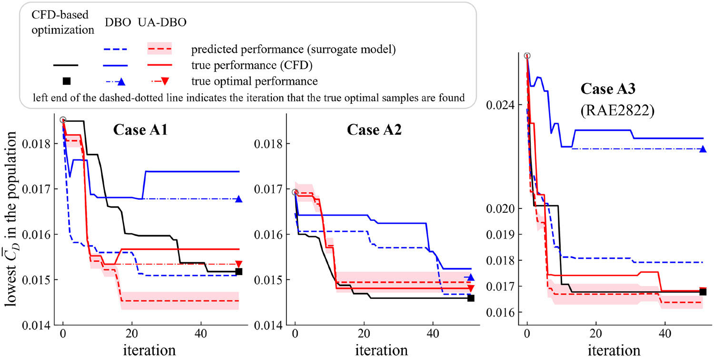

**图 8　基于 CFD 和基于代理模型的框架在阻力发散优化中的优化过程。**

同时，UA-DBO 还显著降低了所有算例中预测误差的方差。这表明，不确定性引导的选取不仅提高了模型估计的可靠性，而且使多次独立运行中的优化轨迹更加稳定。

**不确定性信息可防止模型预测过度自信**

下面进一步分析预训练 GS-ED 模型的不确定性估计如何影响优化行为。对于图 8 所示的同一次实验运行，我们评估了 DBO 和 UA-DBO 产生的初始种群及最终种群中每个个体的预测不确定性。对于每个个体，GS-ED 模型给出预测均值及其相应的置信区间。图 9 展示了模型误差与预测的 90% 置信区间宽度之间的关系。灰色标记表示初始种群的个体，红色和蓝色标记分别表示 DBO 和 UA-DBO 获得的最终种群。两条虚线表示理想校准边界：对于完全校准的模型，90% 的误差应落在这些边界之间。黑色虚线对应优化中使用的置信上界；若样本的真实误差越过这一边界，则说明模型低估了该样本的性能指标，可能使优化器走向误导性的解。

在三个算例的初始种群中，模型的不确定性量化都较为准确，因为大多数样本落在预测的 90% 置信区间内。相比之下，几何形状处于分布外（OOD）的算例 A1 并未出现显著增大的误差。这是因为优化框架不仅输入几何形状，还将巡航流场作为输入的一部分，从而有效降低了几何分布外样本的预测难度。另一方面，算例 A3 中相对较大的误差可能源于其基准阻力系数较高。

最终种群的误差分布清楚地表明了引入不确定性的优势。在算例 A3 中，GS-ED 模型为 DBO 的最终个体（红色点）赋予了明显更宽的预测区间，使 UA-DBO 避免被这些由于预测值偏低而形成的虚假最优解误导。事实上，UA-DBO 的结果（蓝色点）既具有更小的置信区间宽度，也具有更低的实际误差，说明它成功地走向了更可靠的解。

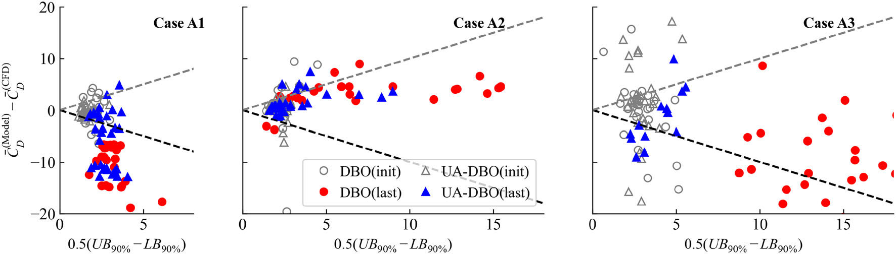

**图 9　初始种群和最终种群的模型预测置信区间与实际误差（坐标轴数值的单位均为阻力单位）。**

算例 A2 则表现出另一种情况：DBO 和 UA-DBO 的误差都很小，而且不确定性量化最为准确。算例 A2 中的大多数误差对应于预测偏高；不过，UA-DBO 会推动种群向预测不确定性较小的区域移动，因此相较于 DBO 的改进幅度较小。对于算例 A1，模型的校准效果相对较差，因此 DBO 和 UA-DBO 都包含一些落入误导性低估区域的样本。尽管如此，不确定性估计仍能使 UA-DBO 保留一部分低误差个体，从而有助于改善优化性能。

总体而言，这些分析表明，UA-DBO 能够有效避免模型预测过度自信，并利用不确定性信息引导搜索走向稳健可靠的最优解；对于 A3 这类涉及分布偏移的算例，这一点尤为明显。

**引入不确定性不会限制发现最优解的能力**

我们进一步将 UA-DBO 与基于 CFD 的多点优化进行比较。表 3 的结果表明，UA-DBO 获得的 $\bar C_D$ 平均降低量达到基于 CFD 优化结果的 93.2%。图 10 比较了 UA-DBO 和基于 CFD 的优化得到的最佳样本，其中图 10a 展示几何形状和巡航压力系数，图 10b 展示阻力系数随马赫数的变化。图 11 给出了基准 RAE2822 翼型与优化翼型在不同马赫数下的表面压力分布及马赫数云图，可以直观观察激波强度和流动分离。

在三个算例中，基于 CFD 的优化和 UA-DBO 都呈现出一致的激波减弱趋势，这一点可以从巡航压力分布中看出。随着马赫数增加，激波增强被推迟，高马赫数下的流动分离也被消除，从而明显改善了阻力发散性能。

另一方面，较弱的激波会引起其他气动特征的变化，以维持升力，巡航压力分布反映了这些变化，包括：（i）上表面激波后的流动加速；（ii）前缘附近吸力峰增强；（iii）前缘附近下表面形成浅凹区，即前部加载，导致流动减速。这些不同机制产生了不同的阻力系数局部极小值，有助于解释不同优化框架之间的性能差异。

这些结果表明，引入不确定性不会限制搜索区域，也不会妨碍优化过程找到最优解。

> 译注：原文此处写作 “and hinders”，与本段小标题及上下文相矛盾；此处依据上下文，将其理解为“也不会妨碍”。上文的 93.2% 按结论第 3 点明确的比较基准译出。

### 4.3 计算成本

表 4 汇总了基于 CFD、DBO 和 UA-DBO 三种框架进行模型建立与优化所需的计算时间，包括各环节的详细用时、完成一个完整优化算例的总实际运行时间，以及 CFD 评估总次数。所有 CFD 模拟均使用 8 个 Intel Xeon Gold 6145 CPU 核心，而机器学习训练和推理（表中带下划线的项目）在一块 NVIDIA P2000 GPU 上执行。

与我们此前的研究（Yang et al. 2024）一致，即使考虑数据库构建成本，DBO 相较于传统的基于 CFD 的优化仍具有显著的效率优势。在基于 CFD 的框架中，每次优化迭代均需进行多点 CFD 评估，因此单个优化算例共需调用 CFD 9,984 次，实际运行时间为 41.6 h。对于附录 C 给出的抖振起始优化，需要用更多非设计工况点评估抖振性能，因而优化时间更长，接近 110 h。这样的计算负担妨碍了实际应用，尤其是考虑到优化通常需要重复数次。相比之下，DBO 和 UA-DBO 均将大部分计算投入离线模型训练阶段。训练完成后，完成优化所需的时间大幅减少，几乎等同于单点优化的用时，因为相较于巡航工况下的一次 CFD 评估，机器学习模型的推理时间可以忽略不计。

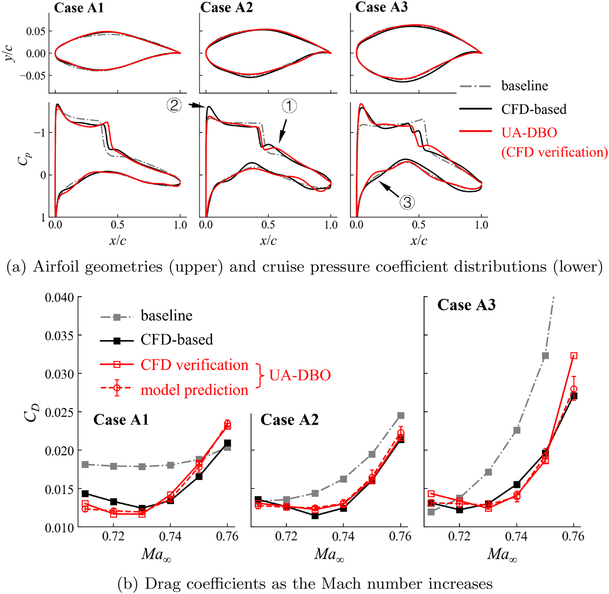

**图 10　基于 CFD 的优化与 UA-DBO 优化结果的比较。（a）翼型几何形状（上）与巡航压力系数分布（下）；（b）阻力系数随马赫数增加的变化。**

**表 4　计算效率比较**

| 项目 | 基于 CFD | DBO | UA-DBO |
| --- | --- | --- | --- |
| 数据准备 | / | 830 h | 830 h |
| 模型训练 | / | <u>0.47 h</u> | <u>0.53 h</u> |
| 巡航评估（单个样本¹） | 0.03 h | 0.03 h | 0.03 h |
| 非设计工况评估（单个样本） | 0.20 h | <u>0.09 s</u> | <u>0.10 s</u> |
| 最优样本验证² | / | 0.83 h | 0.83 h |
| CFD 调用总次数（单个算例）¹˒³ | 9,984 | 1,696 | 1,696 |
| 总优化时间（单个算例）³ | 41.6 h | 7.7 h | 7.7 h |

¹ 此处每个样本的性能评估时间按使用一个处理器计算；并行计算在每代种群的不同样本之间进行。

² 对 DBO 和 UA-DBO 最后一代种群中的样本进行 CFD 验证，以获得实际性能。

³ 此处给出使用 8 个处理器完成一个优化算例的实际运行时间；初始种群规模为 64，后续 50 次迭代的种群规模均为 32。

所提出的 UA-DBO 框架带来的额外计算成本，主要来自概率模型训练及每次模型预测时的不确定性量化。与确定性模型相比，概率方法包含重参数化和采样步骤，因而训练时间略有增加；实验中的增幅为 13%。在优化过程中的模型推理阶段，UQ 需要采样 $N_s$ 个潜在向量，并将它们输入解码器以生成预测流场，因此会增加计算量。然而，解码和后处理过程可以很好地并行化。从理论上说，当 $N_s$ 较小时，这只会使内存开销增大至 $N_s$ 倍，而使训练时间基本不受影响。因此，UA-DBO 保持了 DBO 的效率。

> 译注：本段正在讨论推理过程，但原文末句使用 “training time”（训练时间）；此处保留原文表述。

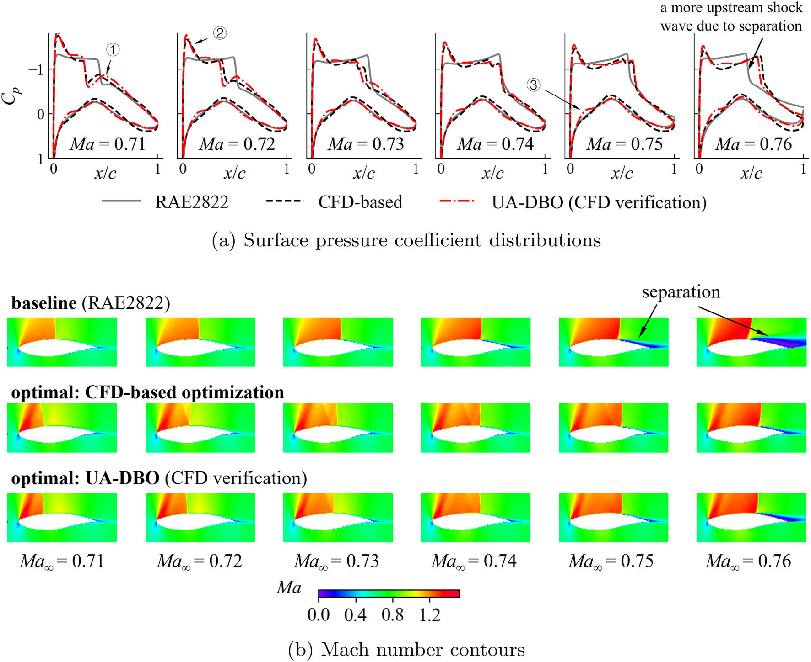

**图 11　RAE2822 算例（算例 A3）中基于 CFD 的优化与 UA-DBO 优化结果的比较。（a）表面压力系数分布；（b）马赫数云图。**

## 5 局限性与未来工作

尽管所提出的 UA-DBO 框架已表现出有效性，但仍存在一些局限性，也为未来研究指出了方向。将巡航流场纳入输入，并采用 GS-ED 的概率建模形式，能够增强代理模型的泛化能力；然而，当优化所产生的几何形状大幅偏离训练分布时，所提出的 GS-ED 模型仍无法始终保持较强的泛化性能。对于训练数据集中覆盖稀疏的参数组合，这一问题尤为明显。在本文研究的优化算例中，这一局限性并未显著削弱 UA-DBO 的有效性，但也说明该方法仍有进一步改进的空间。

未来可以探索用物理嵌入的度量来增强纯数据驱动的置信度估计，例如从流场残差或物理一致性约束导出不确定性指标，从而进一步提高针对未见过的几何形状进行置信度预测时的稳健性与泛化能力。

## 6 结论

DBO 是一种很有前景的快速气动优化方法，但它缺乏内在机制来量化优化过程中所使用的模型预测的不确定性。为解决这一局限，本文提出 UA-DBO 框架，旨在同时提高 DBO 的性能与可靠性。本文的主要贡献概括如下。

1. 提出一种用于基于数据的优化的模型置信度感知目标函数。以最小化问题为例，原始目标函数直接采用待优化的性能指标，而 UA-DBO 使用概率模型预测其预测结果的置信区间上界，并将这一上界作为目标。这样可以在最优解处同时寻求性能最大化与模型不确定性最小化，从而避免优化被虚假最优样本误导的风险。

2. 为了在尽量少改动原始 DBO 框架的条件下预测不确定性，本文开发了 GS-ED 模型，采用变分近似技术量化代理模型在离线部署时的不确定性。本文还提出加入额外的 KL 损失项并增加采样数量，以提高不确定性量化性能。与相应的确定性模型相比，GS-ED 模型保持了相近的预测精度，证实引入不确定性量化不会损害模型性能。本文进一步比较了校准后的 GS-ED 模型与深度集成方法的不确定性估计结果。GS-ED 获得 0.049 的 ECE，精度相近，同时将训练成本降低了 1/5。〔译注：原文为 “reducing training cost by 1/5”；按表 2 的 0.53 h 与 2.82 h 计算，应为训练成本约降至六模型集成方法的 1/5。〕

3. 将 DBO 与 UA-DBO 框架应用于阻力发散优化任务。与 DBO 相比，UA-DBO 的平均减阻量为 DBO 的 1.47 倍。与基于 CFD 的多点优化相比，UA-DBO 获得了其平均减阻量的 93.2%，同时保持了与单点优化相当的计算成本。本文还在更复杂的多目标抖振起始问题上展示了 UA-DBO 的性能：它同样能够获得比 DBO 更优且更可靠的实际 Pareto 前沿。

4. 进一步分析了模型预测不确定性与相应实际预测误差之间的关系。UA-DBO 所采用的 GS-ED 模型会为 DBO 偏好的候选解预测出较高的不确定性，而这些解在多数算例中确实表现出更大的实际误差。通过在优化过程中显式惩罚这类高不确定性预测，UA-DBO 避免了被虚假乐观解误导。

本研究表明，引入不确定性量化能够显著提高 DBO 的效率与可靠性，为数据驱动模型在工程气动优化中的更广泛应用铺平道路。

## 附录 A-C（英文原文）

按要求不翻译附录。以下按原文阅读顺序保留第 15-21 页的附录内容，包含模型推导、消融研究、抖振起始多目标优化算例，以及图 12-18、表 5-6。与正文共用的第 15 页按栏截取，第 21 页仅保留附录部分。

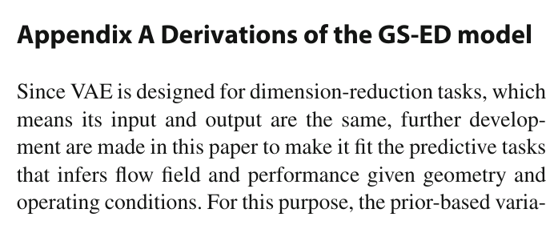

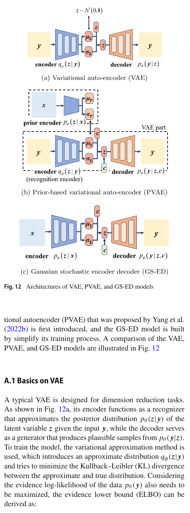

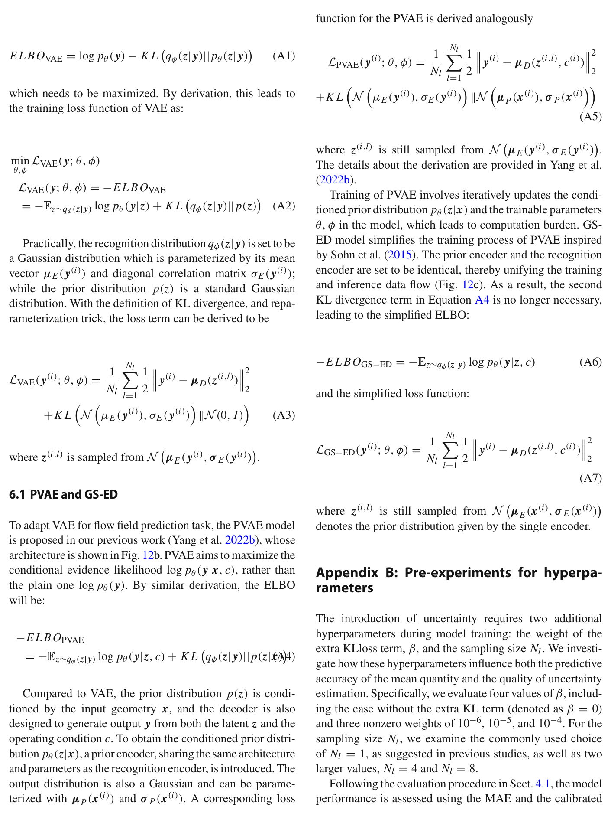

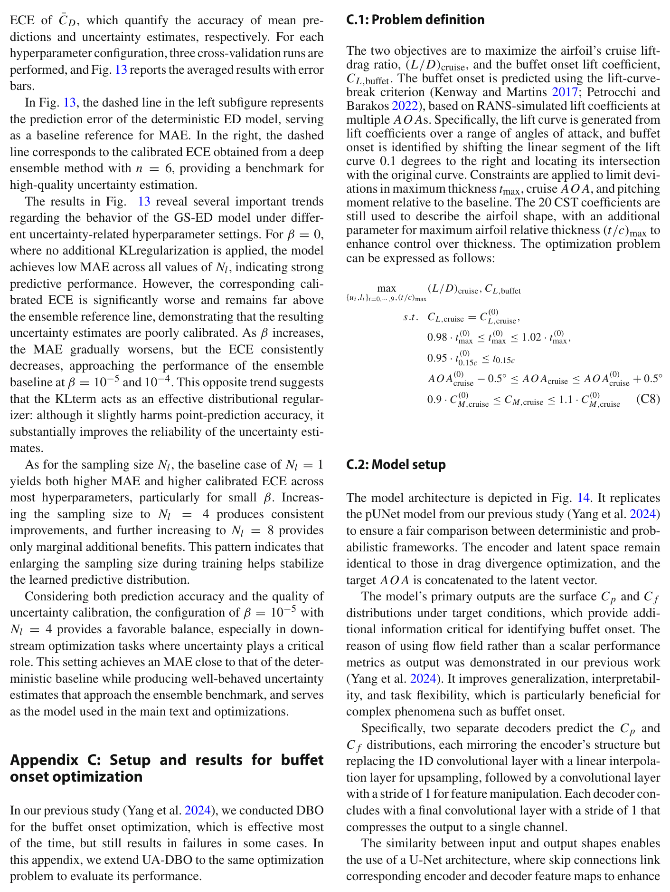

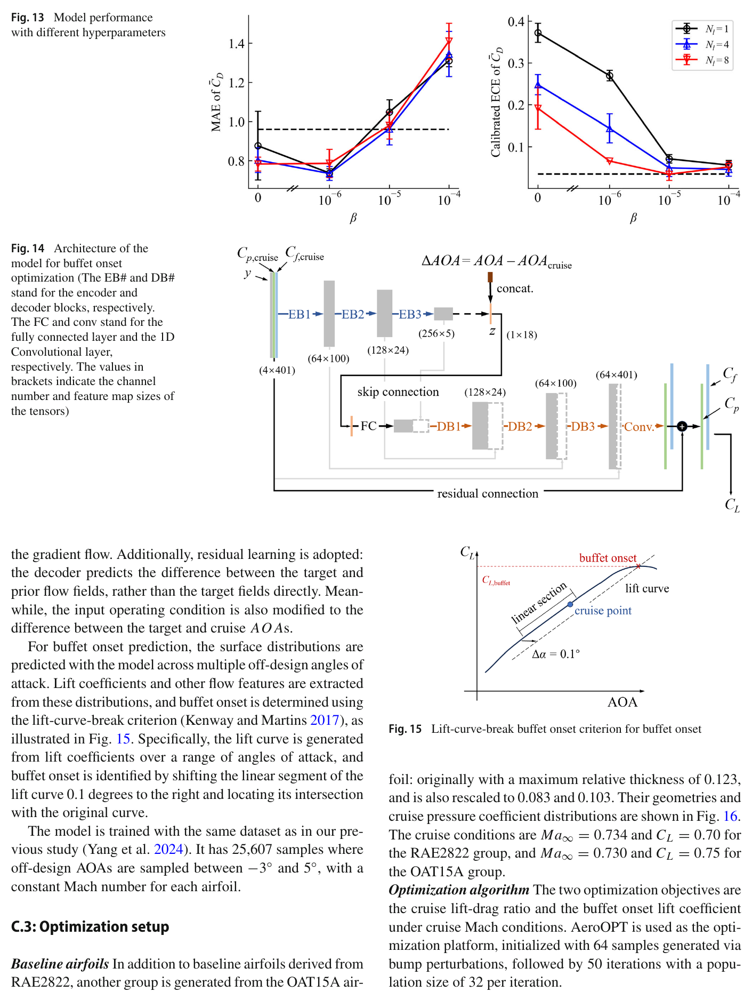

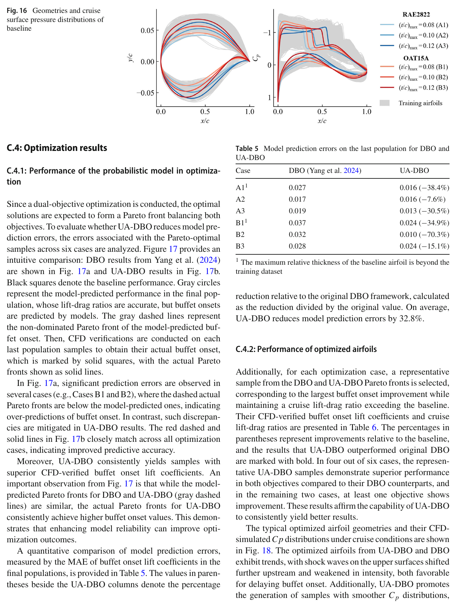

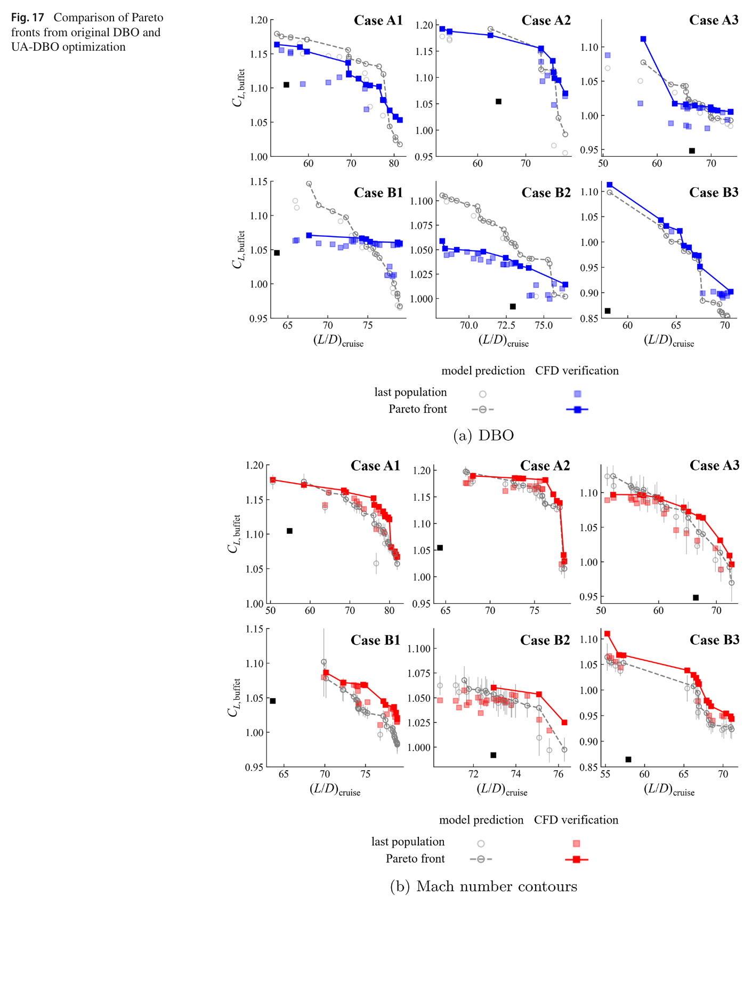

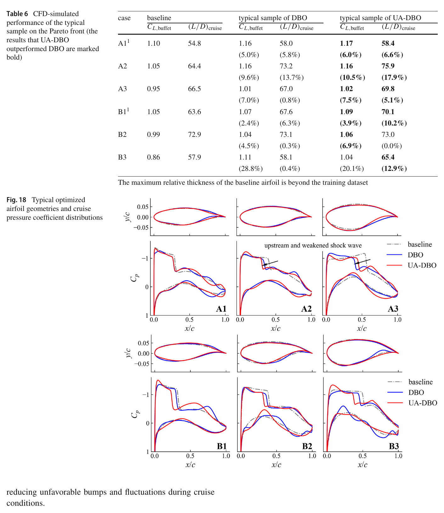

## 致谢

作者感谢清华大学的 Weishao Tang，以及耶鲁大学的助理教授 Lu Lu、Pengpeng Xiao 和 Rui Chen 提出的启发性意见。Yunjia Yang 感谢慕尼黑工业大学 Nils Thuerey 教授的支持，使其能够在博士后期间完成本文的部分修订工作。在写作过程中，本文部分内容使用人工智能进行了语言润色。

## 作者贡献

**Yunjia Yang：**概念构思（共同）；数据整理（主导）；方法学（主导）；可视化（主导）；初稿撰写（主导）。

**Runze Li：**概念构思（共同）；数据整理（辅助）；审阅与编辑（共同）。

**Yufei Zhang：**经费获取（辅助）；审阅与编辑（共同）。

**Haixin Chen：**经费获取（主导）；指导（共同）；审阅与编辑（共同）。

## 经费资助

本工作得到国家自然科学基金（NSFC）资助，项目编号为 12202243、12372288、12388101 和 U23A2069。

## 数据可用性

用于模型训练的数据集可在向作者提出合理请求后获取，更多信息请参见[该网站](https://flogen.readthedocs.io/en/latest/airfoildataset.html)。

## 声明

**结果复现：**模型训练与优化代码已采用开源许可在线发布于 [GitHub](https://github.com/YangYunjia/floGen)。

## 参考文献（英文原文）

- Anhichem M, Timme S, Castagna J Peace AJ, Maina M (2025) Bayesian machine learning for predicting wing pressure distributions at transonic flow conditions. AIAA J. [https://doi.org/10.2514/1.J064617](https://doi.org/10.2514/1.J064617)

- Bouhlel MA, He S, Martins JRRA (2020) Scalable gradient-enhanced artificial neural networks for airfoil shape design in the subsonic and transonic regimes. Struct Multidisc Optim 61(4):1363–1376. [https://doi.org/10.1007/s00158-020-02488-5](https://doi.org/10.1007/s00158-020-02488-5)

- Brunton SL, Nathan Kutz J, Manohar K Aravkin AY, Morgansen K (2021) Data-driven aerospace engineering: reframing the industry with machine learning. AIAA J. [https://doi.org/10.2514/1.J060131](https://doi.org/10.2514/1.J060131)

- Du X, Leifsson L (2019) Optimum aerodynamic shape design under uncertainty by utility theory and metamodeling. Aerosp Sci Technol 95:105464. [https://doi.org/10.1016/j.ast.2019.105464](https://doi.org/10.1016/j.ast.2019.105464)

- Du X, He P, Martins JR (2021) Rapid airfoil design optimization via neural networks-based parameterization and surrogate modeling. Aerosp Sci Technol 113:106701. [https://doi.org/10.1016/j.ast.2021.106701](https://doi.org/10.1016/j.ast.2021.106701)

- Gaudrie D, Le Riche R, Picheny V Enaux B, Herbert V (2020) Modeling and optimization with Gaussian processes in reduced eigenbases. Struct Multidisc Optim 61(6):2343–2361. [https://doi.org/10.1007/s00158-019-02458-6](https://doi.org/10.1007/s00158-019-02458-6)

- Jabón J, Corbera S, Álvarez R Barea R (2024) Aerodynamic shape optimization using graph variational autoencoders and genetic algorithms. Struct Multidisc Optim 67(3):32. [https://doi.org/10.1007/s00158-024-03771-5](https://doi.org/10.1007/s00158-024-03771-5)

- Kenway GKW, Martins JRRA (2017) Buffet-onset constraint formulation for aerodynamic shape optimization. AIAA J 55(6):1930–1947. [https://doi.org/10.2514/1.J055172](https://doi.org/10.2514/1.J055172)

- Kingma DP, Welling M (2014) Auto-encoding variational bayes.arXiv: 1312.6114

- Kovani KG, Kontou MG, Asouti VG Giannakoglou K (2023) DNN-driven gradient-based shape optimization in fluid mechanics. In: Iliadis L, Maglogiannis I, Alonso S et al (eds) Engineering applications of neural networks, vol 1826. Springer, Cham, pp 379–390

- Laurenceau J, Sagaut P (2008) Building efficient response surfaces of aerodynamic functions with Kriging and Cokriging. AIAA J 46(2):498–507. [https://doi.org/10.2514/1.32308](https://doi.org/10.2514/1.32308)

- Li J, Zhang M (2021) Data-based approach for wing shape design optimization. Aerosp Sci Technol 112:106639. [https://doi.org/10.1016/j.ast.2021.106639](https://doi.org/10.1016/j.ast.2021.106639)

- Li J, Bouhlel MA, Martins JRRA (2019) Data-based approach for fast airfoil analysis and optimization. AIAA J 57(2):581–596. [https://doi.org/10.2514/1.J057129](https://doi.org/10.2514/1.J057129)

- Li J, Cai J, Qu K (2019) Surrogate-based aerodynamic shape optimization with the active subspace method. Struct Multidisc Optim 59(2):403–419. [https://doi.org/10.1007/s00158-018-2073-5](https://doi.org/10.1007/s00158-018-2073-5)

- Li J, He S, Martins JR (2019) Data-driven constraint approach to ensure low-speed performance in transonic aerodynamic shape optimization. Aerosp Sci Technol 92:536–550

- Li J, Du X, Martins JR (2022) Machine learning in aerodynamic shape optimization. Prog Aerosp Sci 134:100849. [https://doi.org/10.1016/j.paerosci.2022.100849](https://doi.org/10.1016/j.paerosci.2022.100849)

- Li J, He S, Zhang M Martins JRRA, Khoo B (2022) Physics-based data-driven buffet-onset constraint for aerodynamic shape optimization. AIAA J 60(8):4775–4788. [https://doi.org/10.2514/1.J061519](https://doi.org/10.2514/1.J061519)

- Li R, Deng K, Zhang Y Chen H (2018) Pressure distribution guided supercritical wing optimization. Chin J Aeronaut 31(9):1842–1854

- Li R, Zhang Y, Chen H (2022) Pressure distribution feature-oriented sampling for statistical analysis of supercritical airfoil aerodynamics. Chin J Aeronaut 35(4):134–147

- Liu H, Ong YS, Shen X Cai J (2020) When Gaussian process meets big data: a review of scalable GPs. IEEE Trans Neural Netw Learn Syst 31(11):4405–4423. [https://doi.org/10.1109/TNNLS.2019.2957109](https://doi.org/10.1109/TNNLS.2019.2957109)

- Liu Q, Thuerey N (2024) Uncertainty-aware surrogate models for airfoil flow simulations with denoising diffusion probabilistic models. AIAA J doi 10(2514/1):J063440

- Martins JR (2022) Aerodynamic design optimization: challenges and perspectives. Comput Fluids. [https://doi.org/10.1016/j.compfluid.2022.105391](https://doi.org/10.1016/j.compfluid.2022.105391)

- Mufti B, Bhaduri A, Ghosh S, Wang L, Mavris DN (2024) Shock wave prediction in transonic flow fields using domain-informed probabilistic deep learning. Phys Fluids 36(1):016121

- Petrocchi A, Barakos GN (2022) Buffet boundary prediction using RANS-based criteria and adjoint methods. Aerosp Sci Technol 126:107664

- Renganathan SA, Maulik R, Ahuja J (2021) Enhanced data efficiency using deep neural networks and Gaussian processes for aerodynamic design optimization. Aerosp Sci Technol 111:106522

- Saetta E, Tognaccini R, Iaccarino G (2024) Uncertainty quantification in autoencoders predictions: applications in aerodynamics. J Comput Phys 506:112951

- Secco NR, Mattos BS (2017) Artificial neural networks to predict aerodynamic coefficients of transport airplanes. Aircr Eng Aerosp Technol 89(2):211–230. [https://doi.org/10.1108/AEAT-05-2014-0069](https://doi.org/10.1108/AEAT-05-2014-0069)

- Sohn K, Yan X, Lee H (2015) Learning structured output representation using deep conditional generative models. In: Proceedings of the 28th International Conference on Neural Information Processing Systems-Volume 2. MIT Press, NIPS’15, pp 3483–3491

- Yang Y, Kissas G, Perdikaris P (2022) Scalable uncertainty quantification for deep operator networks using randomized priors. Comput Methods Appl Mech Eng 399:115399

- Yang Y, Li R, Zhang Y, Chen H (2022) Flowfield prediction of airfoil off-design conditions based on a modified variational autoencoder. AIAA J 60(10):5805–5820. [https://doi.org/10.2514/1.J061972](https://doi.org/10.2514/1.J061972)

- Yang Y, Li J, Li R, Zhang Y, Chen H (2023) Interactive optimization of fluidic injection for single expansion ramp nozzle based on a modified autoencoder. In: Aerospace Europe Conference 2023— 10th EUCASS - 9th CEAS, Laussane, Switzerland. [https://doi.org/10.13009/EUCASS2023-343](https://doi.org/10.13009/EUCASS2023-343)

- Yang Y, Li R, Zhang Y Chen H (2024) Fast buffet-onset prediction and optimization method based on pretrained Flowfield prediction model. AIAA J 62(8):2979–95. [https://doi.org/10.2514/1.J063634](https://doi.org/10.2514/1.J063634)

- Yao W, Chen X, Luo W van Tooren M, Guo J (2011) Review of uncertainty-based multidisciplinary design optimization methods for aerospace vehicles. Prog Aerosp Sci 47(6):450–479

## 出版社声明

Springer Nature 对已发表地图及机构所属关系中的司法管辖权主张保持中立。

Springer Nature 或其许可方（例如学会或其他合作方）依据与作者或其他权利人签订的出版协议，享有本文的专有权利；作者对本文录用稿版本进行自存档，仅受该出版协议条款及适用法律约束。
