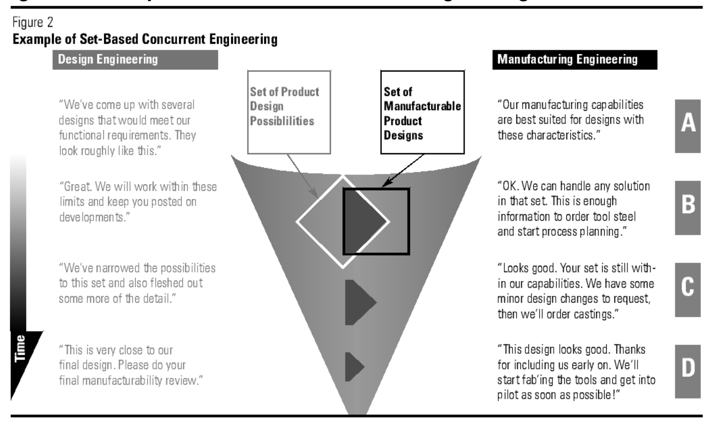
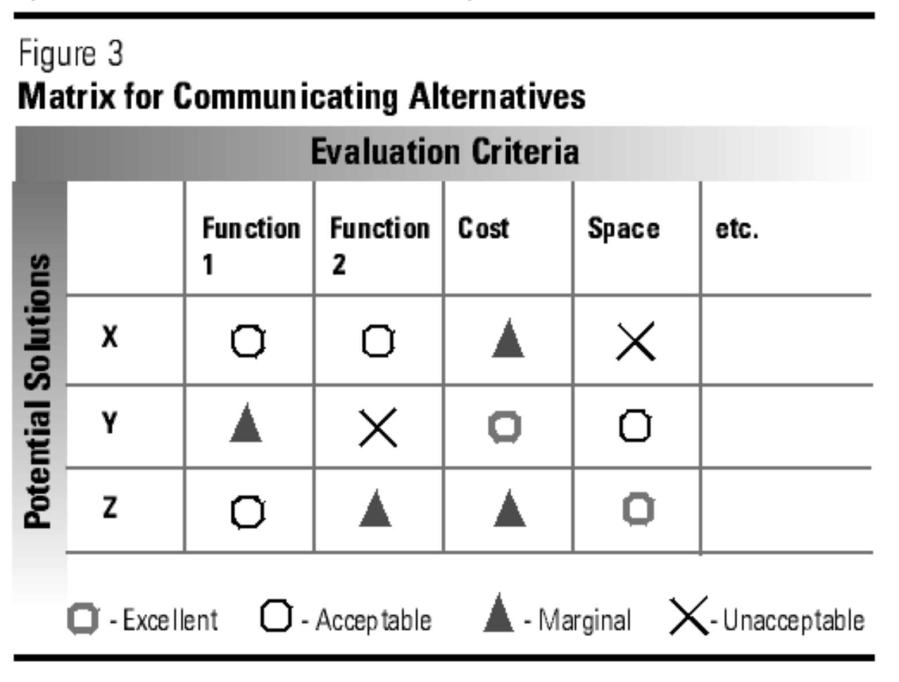

# 丰田基于集合的并行工程原则

**Toyota's Principles of Set-Based Concurrent Engineering**

**作者：** Durward K. Sobek II、Allen C. Ward、Jeffrey K. Liker。

**发表日期：** [1999 年 1 月 15 日（出版方记录）](https://shop.sloanreview.mit.edu/store/toyotas-principles-of-set-based-concurrent-engineering)。

**译文说明：** 依据所附 26 页 PDF 全文翻译，保留章节顺序、三幅原图及引文编号。图内文字在相邻中文译释中呈现；参考文献保留英文原文。文中的数据、作者职务和研究判断均按原文译出。

**丰田的产品设计与开发流程，如何帮助企业找到最佳方案并开发成功的产品。**

丰田汽车公司的产品开发周期处于行业领先水平，而使用的工程师数量却少于美国竞争对手。丰田在市场份额增长和单车利润方面也表现出显著的稳定性，因此积累了210亿美元的现金储备，超过“三大”汽车制造商的现金储备总和。[1] 被称为“精益制造”的丰田生产方式（TPS），对于这些成就起到了关键作用，[2] 但我们认为，丰田的产品设计与开发体系也是一个重要的贡献因素。[3]

虽然大野耐一（Taiichi Ohno）等人对TPS作了详尽描述，但丰田开发体系并未得到充分记载。[4] 实际上，许多通常被认为是成功实施并行工程的关键、并与日本制造商联系在一起的做法，丰田并未采用。丰田的开发团队并不集中在同一地点办公。除总工程师及其工作人员外，其他人员并不专门服务于单一车型项目。工程师职业生涯的前10至20年，跨职能岗位轮换并不常见。工程设计和试验部门很少使用质量功能展开（QFD）及田口方法。丰田擅长价值工程（VE）和价值分析（VA），但丰田工程师表示，他们并未使用教科书中任何VE或VA工具及矩阵。丰田的CAD或CAE系统也没有什么特别之处。因此，这些做法无法解释丰田在新车型开发方面的高效表现。

在此前的一篇文章中，我们把丰田的产品开发体系称为“丰田的第二个悖论”。[5] TPS是第一个悖论：它的一些特点看似浪费，却使整体系统更加高效。例如，为缩短制造周期而更频繁地切换制造工艺，而这种切换通常被认为缺乏效率。第二个悖论可以概括为：丰田考虑的可能设计方案范围更广，而且某些决策比其他汽车公司更晚作出，但其车型开发周期却可能是行业中最快、最高效的。

传统设计实践，无论是否采用并行方式，都倾向于迅速收敛到一个方案，也就是解空间中的一个点，然后不断修改该方案，直到它满足设计目标。只要没有选错起点，这似乎就是一种有效的方法；但如果起点选错，后续为完善该方案而进行的迭代，可能非常耗时，并导致次优设计。[6]

我们所称的“基于集合的并行工程”（SBCE）则首先广泛考虑可能方案的集合，再逐步缩小可能方案的集合，收敛到最终方案。一开始广撒网，然后逐渐淘汰较差方案，会提高找到最佳或更好方案的可能性。因此，丰田在前期界定方案时可能花费更多时间，但此后朝着收敛以及最终投产推进的速度，却可以快于采用基于点的方法的同行。

本文通过描述指导丰田设计决策的三项原则，进一步发展SBCE的理念。我们更详细地介绍SBCE的概念框架，将它与丰田开发体系的其他特点联系起来，并讨论为什么SBCE原则会带来高效的产品开发体系。

## 背景

我们此前关于“丰田的第二个悖论”的文章，引起了人们对丰田做什么、如何做的浓厚兴趣，也引发了许多质疑：丰田真的像我们所说的那样做吗？许多质疑针对的是我们举出的较为极端的例子。例如，我们说丰田广泛探索车身造型，可能考虑5至20种不同的造型设计备选方案。我们还提出，在最极端的情况下，最终造型设计决策甚至可以推迟到第二个整车原型完成时。这些极端情况本来就只是极端情况，意在说明一个观点，而非代表平均水平。

比具体数字更重要的，是丰田所遵循的基本设计原则。我们选择这些例子，是为了阐明理念，并不是说一家公司只要制作大量原型，或者等到最后一刻才作出决策，开发流程就会改善。事实上，在一个项目中充分探索方案，可以使后续项目的搜索更加集中，并更迅速地收敛到一个设计。

这种理念的新颖性，以及我们所遇到的质疑，促使我们进一步发展SBCE范式。我们首先收集更多数据。第一作者Durward Sobek学习了日语，并赴日本停留六个月，以更深入地了解丰田的开发流程。他访谈了来自广泛设计专业领域的管理人员和工程师，涉及造型设计、车身工程、底盘工程、动力总成工程、车辆评价、生产工程和原型制作，也访谈了若干与丰田联系密切的供应商。他很快证实了我们此前的说法，并得出结论：丰田实际上在比我们最初认识到的更多方面采用了“基于集合”的方式。

此外，我们还访谈了位于美国密歇根州安娜堡的丰田技术中心（TTC）的日本及美国管理人员和工程师。TTC是丰田首次尝试在日本以外开发车型的机构，曾与丰田在日本的技术中心共同开发亚洲龙（Avalon）和1997款凯美瑞（Camry）。将其开发体系引入美国，促使丰田明确表述其设计理念与原则。针对美国工程师的培训材料和培训流程，为理解丰田产品开发提供了深入的认识。

## 什么是基于集合的并行工程？

我们发现丰田并未采用许多通常被认为是成功实施并行工程的关键做法时，解释丰田产品开发实践的难题便出现了：丰田怎么能把并行工程做得如此出色？

传统的串行工程，是一系列职能部门依次工作，每个部门都针对单一方案或单个点进行设计（见图1上部）。在图示中，造型设计部门 [7] 根据自身标准生成其最佳单一方案，然后“把它扔过墙”交给市场营销部门，后者根据造型设计部门交来的内容制定最佳营销计划，其他部门依此类推。当然，这是一种简化；实际存在反馈回路，但下游部门的反馈来得较晚，往往是在上游部门已经确定采用某个特定方案之后。而且，这种反馈通常由具体的批评意见构成，导致对基本设计作出小幅修改。Smith和Eppinger为工程设计中的“顺序迭代”开发了一个定量模型，在不同任务相互依赖的情况下，帮助确定设计任务的最优顺序。[8] 这种方法有助于缩短关键相互依赖关系中的反馈回路，但它仍然只是基于点的工程范式内的渐进改进。由于反馈回路延迟，串行工程存在许多缺点。实际上，并行工程（CE）的主要依据，就是从串行的“扔过墙”方法转向各项活动的并行处理。通常实践中的CE，试图更早地把更多反馈带到上游，一般通过面对面会议实现。

**图1. 传统的基于点的产品开发方法。**

图中文字与流程译释：

- 上部为“基于点的串行工程”（Point-Based Serial Engineering）：造型设计（Styling）→市场营销（Marketing）→车身（Body）→底盘（Chassis）→制造（Manufacturing）。
- 下部为“基于点的并行工程”，以造型设计为例（Point-Based Concurrent Engineering / Styling）：设计方案〔造型设计〕（Design Solution / Styling）→分析与评议（Analyze and Critique）→修改（Modify）→返回设计方案。市场营销、车身、底盘和制造部门向分析与评议环节提供意见。

美国典型的CE，是对基于点的设计方法的完善，但仍未摆脱这一范式。典型CE流程大致如图1下部所示。造型设计之类的职能部门提出一个设计方案，并在流程非常早的阶段展示给其他部门，征求意见。这些下游部门从各自角度分析和评议设计。（例如，克莱斯勒设计团队的高层成员每周用一整天开会。）由于这些工作开展得早，对造型设计的修改相对容易，成本也较低；理想情况下，设计团队很快就能得到令各方满意的方案。虽然这比串行工程有所改善，但基本情况仍然相同：设计团队始终围绕一个方案迭代。我们称之为“基于点的并行工程”。

当工程师尝试与其他开发团队成员并行开展工作时，这种方法的问题就出现了。设计从一个小组传到另一个小组，由不同职能视角进行评议，即使评议是在跨职能团队中进行，每次修改也都会引起进一步的修改和分析，带来返工和额外的沟通需求。理论上，并不能保证这个流程最终会收敛；数百位工程师告诉我们，它常常并不收敛：团队只是因为时间用尽而停止设计。由于开发组织始终未能清楚地了解各种可能性，最终设计可能远非最优。

尽管存在这些缺点，许多公司采用迭代式、看起来基于点的模型，仍取得了成功。Cusumano把微软的软件开发方法描述为“同步与稳定化”方法。[9] 微软开发团队非常频繁地编译代码，通常即使不是每天，也至少每周编译一次。将这种极快的迭代与模块化产品架构、技艺非常娴熟的程序员结合起来，使微软能够持续居于软件行业的领先地位。同样，Terwiesch等人在一个汽车空调系统开发的案例研究中提出，当迭代或反馈周期很快、返工成本很低、且初始起点（即“第一次猜测”）质量很高时，迭代策略可能是最优策略。[10] 此外，在Eisenhardt和Tabrizi对计算机行业的研究中，快速迭代也是成功企业的一个关键要素。[11]

不过，丰田的SBCE流程与图1中的两种模型都有显著差异。设计参与者并行且相对独立地对方案集合进行推理、开发和沟通。随着设计推进，他们根据来自开发、试验、客户以及其他参与者方案集合的补充信息，逐渐缩小各自的方案集合。随着设计收敛，参与者承诺，除非出现极端情况，否则将始终留在该集合或这些集合的范围内，这样其他人就可以信赖他们传达的信息。

图2的例子说明了SBCE的关键特点。在A部分，设计工程和制造工程这两个职能部门，分别根据自身专业领域界定广泛的可行方案集合（原则1——描绘设计空间）。在B部分，设计工程部门通过淘汰从制造角度看不可行的构想，随时间逐步、平稳地缩小集合（原则2——以交集实现集成）。设计工程部门继续通过进一步的设计与开发工作细化集合，制造工程部门在这个阶段也开展设计和细化工作。在C部分，两个小组继续沟通正在考虑的集合，确保产品设计可以生产，同时使制造部门能够提前启动生产过程的设计和构建（原则3——在定案前确认可行性）。在D部分，逐渐收敛到最终设计，有助于开发团队在每个阶段作出合理的设计决策。逐步收敛也使两个部门能够协同工作，返工风险很小。图2作了高度简化，只包含两个参与者。实际SBCE的环境中，许多参与者共同界定集合、沟通集合，并收敛到各方都能接受的方案，从而优化系统性能，而非单个子系统的性能。

**图2. 基于集合的并行工程示例。**

图中文字译释：Design Engineering为“设计工程”；Manufacturing Engineering为“制造工程”；Set of Product Design Possibilities为“产品设计可能方案集合”；Set of Manufacturable Product Designs为“可制造产品设计集合”；Time为“时间”。图中的时间箭头向下，表示随着时间推进，方案集合逐渐缩小。A至D四个阶段的完整对话如下：

| 阶段 | 设计工程 | 制造工程 |
| --- | --- | --- |
| A | “我们提出了几种能够满足功能要求的设计。它们大致是这样的。” | “我们的制造能力最适合具有这些特征的设计。” |
| B | “很好。我们将在这些限制范围内开展工作，并随时向你们通报进展。” | “好的。那个集合中的任何方案，我们都能处理。这些信息已经足够让我们订购工具钢，并开始工艺规划。” |
| C | “我们已经把可能方案缩小到这个集合，并进一步充实了一些细节。” | “看起来不错。你们的集合仍然处于我们的能力范围内。我们还想提出一些小的设计修改要求，随后就会订购铸件。” |
| D | “这已经非常接近我们的最终设计了。请你们进行最后的可制造性评审。” | “这个设计看起来不错。感谢你们早早就让我们参与进来。我们将开始制作工装，并尽快进入试生产！” |

SBCE假定，相比一次只处理一个构想，对构想集合进行推理和沟通，能够带来更稳健、优化程度更高的系统，以及更高的整体效率，即使单个步骤看起来可能缺乏效率。[12] 理论上，SBCE可以完全不发生回退或重做。实践中，完全消除所有回退所需的成本，恐怕无法证明是合理的。但把重点放在收敛上，而不是反复微调一个好构想来优化它，可以大幅减少流程中的回退。

也许，解释SBCE的最佳方式，是举例说明丰田如何实践它。下面的例子展示了多种方法，后文将详细探讨；它们都符合基本理念：

> 在开发车辆的造型设计时，丰田制作的1∶5比例油泥模型，比大多数竞争对手更多。丰田至少同时保留两个全尺寸模型，通常来自两个设计工作室；而大多数竞争对手会选择一个造型设计，制作一个全尺寸油泥模型，然后立即进入详细设计。在开发两至三个全尺寸模型的同时，丰田工程师为多个造型设计构想制定结构方案，并分析它们的可制造性。这个例子说明，与其他汽车公司相比，丰田造型设计人员和工程师更广泛地探索解空间，随后再以更渐进的方式缩小范围。

> 当一个车型项目进入模具制造阶段时，美国汽车制造商早已冻结公称尺寸和公差。但丰田及其他日本汽车制造商，仍把规格视为供模具制造人员进一步完善的目标。模具制造人员尽可能按照CAD数据库制作模具，冲压出零件，再修改模具，使车身零件能够相互装配，这称为“功能性装配”（functional build）。制造工程师随后根据对当前制造能力的理解设定公差。从客户角度看，装配配合和外观比严格匹配规格更重要。因此，最终模具决定了车辆的最终规格，而非CAD数据库。这个例子说明，他们相信，一个看似固定单点的公称尺寸，实际上隐含着一系列可以接受的方案。模具制造人员，对于产品工程部门交来的设计中允许变化的范围，形成了默会的理解。

> 对于汽车的每一个主要部件，负责该部件的工程师都会制定、维护和更新一份工程检查清单，代表当前能力，即可行设计的集合。产品工程师和生产工程师也维护各自的检查清单。当产品工程师开始一个设计时，生产工程师会发送最新的检查清单，使产品工程师了解当前解空间的约束。只要产品工程师的设计满足这些约束，该设计通常就能为制造部门所接受。这个例子说明，通过描绘可行解空间，可以促进组织记忆的形成。从设计和制造两个角度，在前期花时间探索并记录可行方案，能够在流程后期以及后续开发周期中，大幅提高效率和产品集成程度。

这三个例子都涉及对备选方案集合的推理，以及对解空间边界的深入理解。后文我们将更深入地描述SBCE的基本原则，并结合丰田汽车开发的其他详细例子进行说明。

## 相关研究

设计与创造力研究者传统上一直强调考察多种构想。[13] 许多研究者也认识到，从一个大型集合中选出最佳构想很困难，往往需要多次缩小范围的迭代。例如，Pugh针对概念设计提出了一种“受控收敛”方法：把所有概念放进一个评价矩阵，尝试生成新概念（扩大集合），再尝试根据相对优势和劣势改进概念方案，淘汰确实薄弱的概念方案，并不断迭代，直到形成最终的概念方案。[14] Pugh 指导设计者在逐步收敛到最佳方案的过程中，将概念方案展开到越来越详细的层次。他认为，这种方法可以用于设计过程的任何阶段，而不仅仅用于概念选择。Ulrich 和 Eppinger 提出了非常类似的方法，Wheelwright 和 Clark 的“开发漏斗”以及 Dubinskas 的“发酵槽”也是如此。[15]

近期研究表明，开发系统的“灵活性”是成功的重要因素，尤其是在难以预测、快速变化的环境中。[16] 灵活性是指以很小的代价或不付出代价，针对环境变化作出设计变更的能力。[17] 保持灵活性的一种方式，是同时培育多个想法，并在作出关键设计决策时，尽可能接近产品投放市场的时间才收敛到最终方案。Iansiti 描述了 NEC 的一个产品开发团队，该团队并行推进四种不同的产品概念，并开展了两年的设计与开发工作，才确定最终概念。[18]

SBCE 的原则以及丰田的实践，更明确地聚焦于使用集合开展工作的思想。例如，上述许多作者似乎假定，一个在同一地点办公的团队会共同考察这些集合，因此可以进行非正式交流。但我们观察到，团队往往会迅速聚焦于一个方案（图 1）。在丰田，围绕集合的交流是明确进行的。这些作者还暗示，集合就是由备选方案构成的离散列表，忽略了其他表示集合的方式。而且，文献强调仅在流程的“概念阶段”使用集合，尽管有几位作者建议，让概念开发与后续开发阶段相互重叠，尤其是 Iansiti 和 Bhattacharya 等人。[19]

Clark 和 Fujimoto 将日本汽车工业开展并行工程的能力，归因于丰富、双向且频繁的交流。[20] 在丰田，围绕方案集合、围绕设计空间区域开展交流，似乎增加了交流内容的丰富程度，同时减少了会议时长和频率。Liker 等人的数据显示，尽管丰田的供应商似乎承担了更多设计责任，交流问题也更少，但丰田与供应商开会的频率比美国或日本其他主要汽车企业更低，会议时间也更短。[21]

Otto 和 Antonsson、Ward、Lozano-Perez 和 Seering，以及其他研究者，重点研究了可能性集合的形式化表示及其推理。[22] Smith 和 Eppinger 对“并行迭代”进行了定量建模，以帮助管理工程设计项目。[23] 然而，丰田基于集合的方法并不依赖新的计算机工具。

大量文献从宏观层面考察了基础科学和工程创新随时间的演化。[24] 对技术进行长期跟踪，就会发现一种主导设计逐渐形成，并且在一段时间内，新产品是对这种设计的渐进修改。技术周期由主导设计及其后续的技术不连续变化来界定。[25] Nelson 和 Winter 认为，某项技术的设计者，对于什么在技术上可行、什么值得尝试，有着自己的观念；他们对备选方案的搜索通常受到主导设计的约束。[26] 因而，围绕某个起点进行有限的方案探索，在这里，这个起点就是主导设计，似乎是一种自然倾向。

本文关注的是丰田使用经过验证的技术，对成熟产品进行的详细开发，而不是根本性的技术不连续变化。成熟技术的产品开发，需要将涉及数千个零件和相互关联子系统的详细设计决策集成起来。丰田之所以擅长这种集成，是因为它更长时间地保留可选方案，围绕集合开展交流，并摆脱了 Nelson 和 Winter 所描述的某些认知约束。[27]

## SBCE 的背景

许多因素共同促成了丰田产品开发系统的有效性；没有任何一个秘诀能够解释其成功。SBCE 是该系统的一个关键方面，但它与系统设计和知识运用方面的其他同样重要的原则共同发挥作用。详细讨论这些因素超出了本文的范围，[28] 但我们强调，与所研究的大多数美国企业相比，丰田基于集合的实践所在的工程文化，在许多方面都具有独特性。例如，丰田在工程师和管理者队伍中都培养深厚的技术专长。管理者本身是优秀且经验丰富的工程师，他们仍将工程技术工作视为其岗位职责中至少排在第二位的重要任务；最重要的任务，可能是培养他们所管理的工程师。相应地，这些原则既要求供应商具备很强的工程能力，也要求主机厂与供应商之间形成紧密、但要求严格的关系。[29]

丰田的总工程师制度是另一个关键因素。丰田的三个车辆开发中心采用矩阵结构：总经理领导职能组织，总工程师（CE）领导车型项目。Clark 和 Fujimoto 将总工程师称为“重量级项目经理”。[30] 我们更倾向于使用丰田的称谓，因为总工程师实际上是车辆的系统架构师，即首席设计者，也是团队中最重要的技术决策者。除了他们规模很小的直属团队之外，他们对向职能总经理汇报的职能工程师，没有直接管理权。

然而，总工程师对所负责的车辆承担全部责任，从早期概念阶段一直到上市，并延续至最初的营销活动。他们承担至关重要的系统集成工作，因为每个职能部门负责自己的子系统，而总工程师负责整辆汽车。[31] 因此，他们及其团队的工作聚焦于跨职能集成。总工程师通过控制集合的收缩过程，坚持广泛探索，解决职能部门之间的分歧，并在必要时根据权衡分析，对相互竞争的备选方案作出决策，使基于集合的流程得以有效运行。

## 基于集合的并行工程原则

在此前的文章中，我们描述了许多 SBCE 的例子，但尚未将这些实践系统化为一个总体框架。[32] 现在，我们识别出了三个广义原则，每个原则都有三种不同的实施方式，见侧栏。这些原则共同形成一个框架，使设计参与者能够并行开展各部分的设计，同时将这些部分组合成一个系统。本文余下部分将详细讨论这些原则。

> **基于集合的并行工程原则**
>
> **1. 描绘设计空间。**
>
> - 定义可行区域。
> - 通过设计多个备选方案探索权衡。
> - 交流可能方案集合。

## 原则 1：描绘设计空间

“描绘设计空间”是丰田发展并刻画备选方案集合的方式，这些集合用于收敛过程。在产品开发中，丰田在两个层面应用这一原则。首先，在单个项目中，丰田的工程师和设计者探索并交流许多备选方案。这些探索、分析与交流，帮助开发团队“描绘出”与车辆及其生产有关的系统和子系统的各种可能性，以及相应的可行性和相对收益或成本。目标是透彻理解适用于该问题的设计可能性集合，也就是设计理论家所说的“设计空间”。其次，丰田工程师通过记录备选方案、权衡和技术设计标准，保存从各个项目中学到的知识，因此这一原则也得到持续应用。下面，我们考察描绘设计空间的三个要素。

### 定义可行区域

丰田开发系统中的各职能部门，同时从自己的角度定义可行区域。每个职能部门，例如车身工程、底盘工程或生产工程，都以并行且相对独立的方式，根据以往经验、分析、试验与测试，以及外部信息，例如来自总工程师和生产工程等其他部门的信息，确定其子系统的主要设计约束：什么能做或不能做，什么应该做或不应该做。

工程检查清单，也称设计标准，是这一原则的一种体现。[33] 每个工程职能部门都维护检查清单，详细列出多个领域中的设计指导原则，包括：功能，例如标准材料的活塞环厚度应至少为 1.8 毫米，以保证适当密封；可制造性，例如钣金弯曲可接受的曲率半径界限；政府法规，例如车门构件为通过侧面碰撞试验而必须满足的最低强度特性；可靠性，等等。举例来说，造型设计部门可能为牌照安装凹槽准备一份检查清单，其中包括尺寸、螺栓孔位置、世界各市场对倾斜角度和照明的法规要求，以及曲率半径和拉深深度的限制等。这些文件还可能描述哪些东西能够或不能够经济地生产，并包含过去问题的解决方法、如何适应新的生产方法，例如新型自动化，的信息，以及提高质量、降低成本、增强可制造性的建议等。

在车型项目的最早期阶段，各职能部门相互传递检查清单，更新彼此的信息，包括哪些事情可行、自上一个项目以来有哪些新技术可以使用，以及已经解决了哪些新问题。例如，当总工程师要求生产工程部门参与车辆开发时，第一步就是从档案中取出检查清单，针对该车型项目作出调整。完成后，正如一位生产工程经理所说：“我们把自己的经验交给”车身工程部门。随后，车身工程部门根据这些文件更新自身的检查清单，为车身设计阶段作准备，并再将更新后的清单交给造型设计部门。

我们访谈过的大多数美国制造工程师，通常要等到看到图纸之后，才提供产品设计可制造性的约束信息，也就是围绕单一方案进行迭代。书面的可制造性指导文件充其量也只是粗略的，制造工程与设计工程之间的大多数交流通过口头进行。

在丰田，工程检查清单不只是由某个支持部门强加的一长串设计规则或指导原则。它们明确界定了负责该设计的设计者所理解的当前能力。例如，车身上的每个零件都有单独的制造检查清单，由为该零件设计冲压模具的工程团队维护。其中列出的内容包括：能够制造出良好零件的翻边角度范围，哪些接口形式能够避免装配问题，如何设计滑动接头以实现稳健的配合，零件的哪些区域容易出现成形性问题，以及对曲率和变形风险的快速计算等。工程师并不维护详细的产品历史，而是从每次设计经验中提炼知识，用来修改检查清单，进一步细化各种可能性。

在整个车辆开发过程中，设计工程师都使用检查清单指导设计，并辅助设计评审。如果设计符合检查清单，零件几乎肯定会达到一定水平的功能、可制造性、质量等要求。如果不符合，检查清单与设计之间的差异，就会成为职能团队之间有针对性讨论的焦点。

我们对美国汽车企业的研究发现，大多数企业并不维护设计标准，尽管一些年长的工程师告诉我们，这在 20 世纪 80 年代以前曾是标准做法。一个可能的原因是，美国的设计标准往往规定单一方案，例如“活塞环应满足 xxx 规范”或“翻边角度应为 y”，而不是描述一系列可接受的备选方案，从而形成僵化、压抑设计的环境。不保存设计标准的企业，必须高度依赖职能团队之间的口头交流，以及通过经验形成的、头脑中的设计空间地图。

### 通过设计多个备选方案探索权衡

仅仅识别备选方案是不够的。为了明智地在备选方案之间作出决策，丰田及其供应商的工程师通过设计备选系统，尤其是子系统，并制作原型或开展仿真，来探索权衡。[34] 只有在决策显而易见、不重要或属于主观判断时，他们才会根据判断与经验作出“最佳猜测”；否则，他们会按需要投入资源，收集可量化的数据。

与两三个备选方案的权衡数据相比，建立两个或更多参数之间关系的权衡曲线，往往更有用。只要可能，工程师就会从原型数据中提炼规律，建立设计参数与性能结果之间的数学关系，或者使用多个试件的测试数据，通过插值建立关系。

许多美国管理者不愿接受把时间和资源“浪费”在永远不会实现、或者会被“丢弃”的想法或项目上的做法。而我们在美国观察到的工程流程，往往迅速收敛到一个“最佳猜测”，然后测试它是否可行。结果通常并不可行，于是迭代开始。但丰田十分重视在同时推进多个想法时获得的学习。它似乎相信，由此产生的技能和知识会在以后带来回报：或者直接应用于下一个项目，或者通过拓展技能与知识而间接发挥作用。丰田似乎高度重视确认所选方案确实最佳所带来的把握，并认为为获得这种把握投入资源是值得的。

探索多个子系统备选方案最突出的例子，或许出现在工程设计的规划阶段，[35] 该阶段位于概念设计与详细设计之间。在车身工程中，规划阶段的主要输出是 kozo-keikaku 文件（K4），大致可译为“结构设计计划”；该文件会传送给所有受影响的工程团队，供其了解情况并审批。在 K4 发布之前，车身工程师会在详细规划层次上，对车身结构开展许多子系统研究。这些 K4 之前的研究，探索车辆造型设计的工程影响。到车身工程部门准备为某个车型项目制定 K4 时，工程师已经为车身结构的关键子系统创建了两种、三种或更多设计，以支持整体结构规划的备选方案。这些设计已由车身结构专家，以及生产工程部门和其他受影响的团队评估，并吸收了反馈；例如，行李厢设计会涉及底盘工程部门。

克莱斯勒的车身设计流程明显不同，而且具有非常鲜明的基于点的特征。[36] 尽管造型设计团队可能正在考虑多个备选方案，车身工程团队却只会深入研究“最有可能”的设计。而即便这种研究，也不过是一个简单的车身结构梁—接头模型。造型设计一旦确定，车身工程部门才开始开展详细设计工作。车身结构的各子系统逐一完成详细设计后，被纳入整体结构模型。工程师定期分析该模型，分析往往导致变更和进一步修改。因此，克莱斯勒的流程往往围绕一个最佳想法进行迭代，而丰田的流程则通过并行开发，明确探索工程上的权衡。

从这种描述来看，丰田的流程似乎缓慢而繁琐；但实际上，丰田车身设计所需时间平均比克莱斯勒少几个月。我们认为，一个主要原因是，丰田工程师最初作出的设计决策，比许多竞争对手的决策更加可靠，因而用于对设计作“小修小补”的时间少得多。

“通过设计多个备选方案探索权衡”这一原则，也体现在丰田的供应商关系中，这种做法被称为“design-in”，即供应商参与设计。丰田的一家排气系统供应商表示，对于丰田一个车型项目的第一辆原型车，它会提供 10–20 套排气系统。因为总工程师希望了解各种权衡，这家供应商曾为一个车型项目制作多达 50 套，这是一个极端案例。相比之下，日产和克莱斯勒的供应商，每个车型项目只制作一套排气系统原型。

这家丰田供应商在丰田借给它的发动机上测试各个系统原型，因此每个排气系统设计都附有测试数据。供应商将这些系统集合的数据整合起来，生成不同变量的权衡曲线，例如在某个变量取不同值时，背压与降噪量之间的梯度。丰田结合这些数据与车辆上的测试，确定最优子系统。多类供应商都采用类似流程，包括提供纯功能性零件，例如制动器、动力转向泵等，的供应商，以及提供外观零件，例如外部装饰件，的供应商。不过，排气系统的原型数量可能更多，因为制作其原型相对简单且成本低廉。

丰田在为车型项目选择供应商时，也应用这一原则。例如，在外部塑料饰件方面，丰田要求有意参与的供应商，根据一些初步信息提供五到六个设计想法。提交的方案包括对材料成本与性能、质量、工具与模具投资、总重量和总成本等的详细比较。丰田研究相互竞争企业提出的方案，判断哪家供应商最适合承担这项工作。随后，丰田与该供应商开始讨论设计细节，例如最终造型、安装位置、分隔等，逐步缩小集合，直到确定最终规格。

在这种情况下，丰田在作出由谁供应该零件的基本决策之前，就从供应商群体中收集想法和权衡信息。选择已经生产类似零件的供应商，可能减少模具开发所需的时间和投资，但另一家供应商的新技术可能抵消这些成本。选定供应商后，设计与价格谈判仍会继续。设计可能直到全面投产前 11 个月才最终确定，价格的确定时间甚至可能更晚。

美国通常采用的投标流程有很大不同。例如，德尔福从通用汽车获得图纸或详细规格，再提交报价，也就是一个设计想法，承诺以固定价格供应该零件。[37] 在这种制度下，客户从每个潜在供应商那里，只能得到其最佳想法，对各种可能性及其权衡的了解十分有限。丰田则明确寻求了解各种可能性，以选择最符合车辆需求和公司长期利益的供应商，以及最终设计。

### 交流可能方案集合

丰田工程师围绕想法集合和设计空间区域开展交流，而不是一次只交流一个想法。如果可行区域勾勒出可能方案集合，权衡帮助人们理解选择某个备选方案而不是另一个的影响，那么交流集合就能使各职能部门了解其他部门的可行区域。从一种角度看非常出色的方案，从另一种角度看可能很差，因而对整体系统而言并非最优。此外，只包含一个想法的提案，会引发对设计的批评，以及为了照顾另一方的考虑而提出的修改建议。这样就启动了不断作出决策与变更的迭代过程。当某个职能部门只提出自己最好的想法时，其他部门并不能清楚了解各种可能性，因此迭代过程很可能产生大量浪费。

正如知识创造包含将隐性知识显性化的过程，希望实施基于集合的策略的美国企业，必须认识到交流这一功能需要明确化。[38] 最直观的集合是离散备选方案，包括想法列表、图纸和模型。子系统选项往往很重要，接口约束也是如此。集合还可以是参数的有界区间，例如降噪量将处于 15–30 分贝之间；或无上界的区间，例如这个零件至少需要 x 立方厘米的空间。[39] 交流备选方案集合信息的其他方式，可以包括权衡曲线、列线图、性能图表，以及附有“设计容差”的最佳估计值。

丰田的工程团队使用标准设计矩阵，交流子系统的备选方案，或针对某个设计问题提供反馈与建议。矩阵的一条轴列出各种设计备选方案，另一条轴列出评估的关键标准。矩阵中的各单元格列出各备选方案在这些标准上的相对表现。图中的示例矩阵使用定性评价尺度，但矩阵也可以包含具体数值（见图3）。Pugh 等人也主张采用类似的选择矩阵。[40] 但丰田的工程师用它们来交流设计各个层次的备选方案，而不仅仅用于概念选择。

**图3　用于交流备选方案的矩阵**

图中文字译释：“Matrix for Communicating Alternatives”为“用于交流备选方案的矩阵”；“Evaluation Criteria”为“评估标准”；“Potential Solutions”为“候选方案”；“Function 1”“Function 2”“Cost”“Space”“etc.”依次为“功能1”“功能2”“成本”“空间”“等等”。候选方案标记为 X、Y、Z。图例中，灰色粗线空心八边形表示“优异”（Excellent），黑色细线空心八边形表示“可接受”（Acceptable），实心三角形表示“勉强达标”（Marginal），叉号表示“不可接受”（Unacceptable）。矩阵各项的评价如下：

| 候选方案 | 功能1 | 功能2 | 成本 | 空间 | 等等 |
| --- | --- | --- | --- | --- | --- |
| X | 可接受 | 可接受 | 勉强达标 | 不可接受 | |
| Y | 勉强达标 | 不可接受 | 优异 | 可接受 | |
| Z | 可接受 | 勉强达标 | 勉强达标 | 优异 | |

总之，丰田实施基于集合的并行工程（SBCE）的一个重要起点是描绘设计空间。这一原则通过以下方式实现：界定可行区域（而不只是确定一个最佳构想），通过并行设计与开发充分理解各种权衡，以及交流备选方案的集合（而不只是交流最佳构想）。

## 原则 2：以交集实现集成

当各个职能部门开始理解自身和其他部门所考虑的因素时，设计团队就通过找出对所有部门都可行的方案来集成各个子系统。丰田采用三种不同的方法来实现系统集成。

### 寻找可行集合的交集

交流过各种可能方案之后，团队就可以寻找不同职能部门之间的交集，即可行区域相互重叠之处。如果丰田能够找出一个交集，就找到了一种所有部门都可以接受的方案。不交流集合、因而无法寻找交集的组织，往往到头来只能试图把各自独立优化过的部件拼接起来。

而丰田寻找的是能够优化整个系统性能的方案。

丰田开展事先协调（nemawashi）的方式体现了这一原则。Nemawashi 广义上指日本人在正式提出某项具体行动方案之前，先做“铺垫工作”（即与所有受影响的各方会面并讨论），以取得共识的做法。[41] 在丰田，事先协调的重点不只是形成共识或找到共同点，而是为整个系统找到最佳方案。发起方概述各个备选方案，并向受影响的职能领域征求意见，以确定最佳方案。接收方研究并评议这些提案，指出从自己的角度来看哪些方案最好以及原因，提出修改建议，也可能提出新方案。然后，发起方收集这些反馈，并将其整合成一套满足各方要求的方案，例如，在各个可行区域的交集中找到一个方案。[42]

造型设计的开发过程就是一个例子。[43] 丰田的造型设计开发通常从总工程师的整车概念开始。造型设计团队依据这一概念，采用二维媒介（草图、效果图、立面图等）形成许多构想。团队通常从这一大集合中，为每种车身类型选出五至十个构想，进入 1∶5 比例油泥模型阶段。所有职能部门都查看这些油泥模型，评估各个备选方案，并将信息反馈给评审委员会。与此同时，车身工程部门开始为最有希望的备选方案设计结构布局。

评审委员会通常选择两个备选方案，进入全尺寸模型阶段的第一阶段。随后，造型设计团队为外覆盖面创建 CAD 数据（如果此前尚未创建），并将数据发送给设计工程和制造工程部门。工程部门利用这些数据，探索各自子系统设计的备选方案。对车身工程部门而言，这可能包括在 CAD 中开展车身结构设计，详细设计所有结构板件的截面、紧固件及焊点的位置，开展初步碰撞分析等。其他职能部门也采取类似做法（不过，车身工程部门受造型设计决策的影响最大）。因此，工程部门向造型设计部门提供的反馈，是以这些初步但全面的设计规划为基础的。设计工程师在造型设计开发的同时，并行开发自己的子系统；这往往意味着工程师需要为不止一个造型设计备选方案制订计划。评审委员会根据工程、制造、营销及其他方面的反馈，决定最终的造型设计；它可能是其中一个方案，也可能是两个方案的组合。造型设计部门制作主油泥模型，提交董事会批准。

造型设计开发过程体现了若干原则。造型设计部门开发并交流一组造型设计的可能方案。车身工程部门也并行开发自己的一组结构布局的可能方案。这些设计研究帮助车身工程部门理解各个造型设计备选方案对结构的影响，并将这些信息传达给造型设计团队和总工程师。这一设计—反馈—协商循环，明确地寻找从美观和结构两个角度都可接受的设计之间的交集。此外，在设计评审中，生产工程师确保设计符合工程检查清单。这些清单界定了可行区域。设计评审明确查找造型设计提案集合中的不相容之处。

### 施加最少约束

按美国的传统做法，为了简化子系统之间的交互，关键决策会在早期作出。这些决策尽可能地约束设计，以达到预期效果。例如，一位美国总工程师告诉我们，尽早冻结硬点（关键的车辆尺寸，例如车窗角度），对于避免造型设计、车身工程和制造工程部门之间出现混乱至关重要。接下来，造型设计获批后，所有外部形状就被冻结；随后，车身工程部门提供零件图纸和公差，以确保正确的装配配合。

相比之下，丰田往往只施加当时所需的最少约束，保留进一步探索或调整的灵活性，以改善集成。“在适当的时候作出每一项决策”更能体现丰田的思路，而美国的做法似乎是“尽早作出决策，以免出现混乱”。Bhattacharya 等人以及 Kalyanaram 和 Krishnan 也认为，在许多情况下，过早冻结规格可能是不利的。[44] 他们描述了规格冻结时机所涉及的权衡：及早明确规格，可以留下更多时间满足集成需求并降低产品成本；但有意推迟规格确定，则使开发团队能够在最后时刻作出调整（从而降低市场风险）。不过，我们曾指出，有意推迟决策有助于改善集成。[45] 如果团队只施加足以使自己的系统正常工作的约束，从而为与其接口相连的部门留出调整和优化的空间，就比较不容易被“锁定”在次优方案中。

丰田对“造型设计批准”的理解，可以说明最少约束原则。即使造型设计已经获批，车辆的硬点仍然保留一厘米左右的调整余地，以便解决问题。只要不影响顾客对车辆造型的感知，车身工程部门就可以对外部钣金件作出小幅修改。相比之下，在美国企业中，造型设计一经批准，硬点就不能再移动。

丰田的功能性试装（functional build）过程或许是最少约束原则更鲜明的例子。[46] 车身工程师将已完成的图纸（CAD 数据）发送给制造工程部门，图纸上只有名义尺寸，没有公差。制造部门设计模具，使所制造的零件尽可能接近名义尺寸。它先制造模具，随后在试模过程中冲压出零件，并将零件铆接成一个车身。制造部门检查这个试装车身（screw body）的缺陷，并决定需要修改哪些模具，才能实现完美的装配配合。它对模具作出最具成本效益的调整，获批的试装车身零件随后成为标准样件。之后，CAD 数据也被更新，以反映模具实际生产的零件。制造部门根据工艺能力设定零件公差。

在美国的典型做法中，制造工程师必须“按图制造”，即设计并制造模具，使模具生产的零件满足设计规格（车身工程师规定的名义尺寸加减公差）。在试模过程中，零件必须先达到规格要求，才能进入装配阶段；这意味着，在冲压件装配之前，就可能需要对模具作出昂贵的修改。模具通过这一试模阶段后，便进入装配阶段；此时，为使零件能够彼此配合，很可能还需要进一步修改。结果，这一过程的成本和耗时都明显高于丰田的过程。在美国汽车工业中，让制造工程师设定产品尺寸的公差，是闻所未闻的。

丰田的功能性试装过程体现了最少约束原则，因为车身工程师对零件的规定不会超过必要的程度。他们认识到，对顾客而言，最重要的是车身整体的配合与外观，而不是任何一个单独零件。既然制造部门拥有精细调整车身的专家，那么由它来负责配合与外观的精细调整以及最终公差的设定，也就合乎情理。因此，车身工程师施加给制造部门的约束不是“把所有零件都制造到名义尺寸加减 0.5 毫米的范围内”，而是“制造出外观出色、间隙紧密而均匀的车身，并以名义尺寸作为指导”。任何单个零件偏离规定尺寸几毫米，相比系统的外观和整体性，都是次要的。

丰田在向供应商传达“黑箱”要求时，也常常采用最少约束原则。[47] 丰田向供应商提供性能要求、接口要求以及成本和重量目标等信息。只要供应商满足丰田的要求和预期，它就可以在没有丰田干预的情况下设计这个“黑箱”。丰田施加实现所需性能水平必不可少的最少约束，然后由供应商完成具体细节。最少约束之所以重要，是因为采用这一原则时，开发团队成员实际上承认，可能有不止一种方案能够奏效。

### 追求概念稳健性

田口推广了稳健设计的概念，即无论磨损、制造差异和天气等物理变化如何，设计都能发挥功能。[48] 近来，对市场变化的稳健性也有所增强。[49] 缩短开发周期、提高制造灵活性以及标准化等策略，有助于让产品构想更快进入市场，从而降低设计对市场需求或竞争变化的敏感性。[50] 概念稳健性原则涵盖这两个方向，并进一步纳入设计的不确定性：创建这样的设计，使其无论团队其他成员决定怎样做，都能正常工作。如果一个职能部门能够创建一种设计，与另一个职能部门集合中的所有可能方案都能良好配合，它就可以继续开展进一步开发，而不必等待那个部门提供更多信息。这类具有“概念稳健性”的策略可以显著缩短开发时间，同时带来其他益处，例如便于模块升级和维修。[51]

我们所见的稳健开发实践中，最好的例子来自丰田的主要散热器供应商电装（Denso）。几年前，电装的设计团队规划了未来十年散热能力相对于尺寸的改进，目标是取得足够出色的改善，使顾客为了在自己的车辆中采用这项技术，愿意围绕电装的产品进行设计。随后，团队梳理了所有顾客的当前要求，并在可能的情况下预测未来要求。接着，团队将问题分解为两部分，分别处理散热器芯体（实际的冷却机构），以及上、下水箱和附属管路。它设计出一系列芯体，以满足先前梳理出的所有顾客要求，同时设计一条能够生产整个芯体系列的生产线，换型只需几分钟。水箱和管路则为各款车辆单独定制。

在这个例子中，对市场变化的稳健性与对设计变化的稳健性是一回事。电装不再需要为每一款新车设计散热器芯体或新的生产线。相反，一组规定的芯体变型就能满足所有顾客要求。水箱和管路很容易通过设计提供适当的接口；同一条生产线能够处理所有芯体。

## 原则 3：在定案前确认可行性

Iansiti 认为，“灵活”的产品开发方法能够实现整个系统的优化，因为设计参与者在确定某项具体设计之前，会设法理解所有可能方案及其相互作用。[52] 实际上，丰田整个基于集合的开发过程，可以看作一个实现第三条、也是最后一条原则的系统：在定案前确保设计可行。

通过并行探索多种设计，并逐步收敛到其中一种，丰田不仅避免了后期出现问题，而且能够明智地作出优化系统整体性能的决策。下面，我们介绍丰田在定案前确保可行性的另外三种方式。

### 在增加细节的同时逐步缩小集合

基于集合的过程不仅包括生成和交流集合，还包括一个逐步排除各种可能方案、直到留下最终方案的决策过程，而不是仅仅从集合中挑出最好的方案。随着集合不断缩小，设计人员使用越来越详细的模型（例如，从草图到 CAD 图纸，再到仿真、非功能性原型，最后到完全具备功能的原型），使集合中的每个构想或设计越来越清晰。这样，设计团队在对某项设计定案之前，就能更充分地理解相关因素。

各个职能部门并行缩小各自的集合，并在整个过程中保持沟通，确保每个部门最终收敛到一个能够与整个系统集成的方案（例如，上述造型设计与早期车身开发的例子）。分阶段淘汰构想，使参与者能够更充分地考虑最重要的备选方案，并给他们留出时间，去影响彼此缩小集合的过程。Iansiti 发现，在他研究的计算机制造商中，这种逐步淘汰备选方案的方式，是灵活产品开发系统的关键。[53]

不过，要及时完成设计，就需要一定程度的决断力；团队总得在某个时候作出决策，否则设计永远无法完成。因此，工程团队必须在更深入地理解问题与为获得这种理解所需的时间和资源之间进行权衡。知道何时应当作出决策，成为项目经理（在丰田是总工程师）的一项核心任务。每个项目都不同，因此，总工程师常常会推迟决策，以收集更多数据，或催促作出决策，以确保项目按进度推进。

丰田与一家主要供应商的互动，提供了逐步缩小集合的例子。某个整车项目的空调系统开发，从供应商收到根据总体概念提出的一般设计要求开始。在接下来的几个月中，供应商通常依据这些比较笼统的设计信息，提出五至七个不同构想，并与丰田讨论。之后，在造型设计批准时（即丰田高层管理人员批准整车外部和内部设计之时），丰田已将范围缩小到三至四种空调设计。随后，供应商为每个剩余的备选方案制作原型并进行测试，将设计、测试结果和权衡数据提交给丰田。丰田在评估每个空调系统备选方案时会考虑这些数据。通常，丰田先将设计缩小到两个，再决定最终设计。供应商将这一设计细化，并提供原型进行装车测试。在整个过程中，丰田和供应商协商子系统的规格与设计。

通常，在首次正式的整车原型试制时，丰田只订购一种空调系统的原型；不过，总工程师经常要求供应商继续保留第二种备用设计，直到整车测试已经进行相当一段时间。丰田在车辆上测试空调系统时，可能要求修改设计；但随着时间推移，允许的修改范围越来越小。当丰田满意时，最终规格（包括成本）就被确定，项目进入试生产和正式生产。

这家空调供应商也向一家美国汽车制造商供货。当美国工程师看到那五至七个初步构想时，几乎立即选出当时看起来最好的设计，并启动开发。不可避免的是，客户会针对最初的设计发出工程变更指令，其中一些可能到很晚才发出，而且成本很高。

### 定案后保持在集合之内

如果某个团队成员突然转向最初所交流的集合之外的方案，交流集合的价值就会受到限制。参与者必须始终留在逐渐收窄的漏斗之内，这样其他团队成员就知道，自己可以继续开展后续设计工作，而不必担心变化引起返工。只有当设计团队维持稳健的集合，确保其中至少包含一个可行方案时，才能遵循这种方法。确保集合稳健的一种技巧，是始终保留一个后备设计。如果新方案到规定的截止日期仍不能奏效，团队就采用备用方案。

当电装针对某项产品开展战略性开发——在性能和成本上实现根本性进步，以取得决定性的市场优势——时，它采用这一原则。首先，它将问题分解成可处理的部分。针对每个子问题，工程团队开发多个备选方案，其中一个必须是保守方案（例如，现有设计或类似设计）。各要素采用模块化设计，使其能与其他要素的任意组合配合工作。[54] 到截止日期时，团队判断某个要素的突破性方案是否成功。如果没有成功，团队就搁置该突破性方案，集中于保守方案。

### 通过在流程关口管理不确定性实施控制

美国企业把设计过程视为任务网络，并通过安排任务之间信息移交的时机来控制这些过程，如常见的 PERT（计划评审技术）图所示。[55] 但丰田将其过程视为连续流动的过程，根据需要交换信息。

丰田通过一系列关口来管理这一过程，每个关口都与一个汇集所有组成部分的集成事件相联系，例如整车原型。丰田控制这些关口上的不确定性水平，并在每个后续关口进一步降低不确定性。不确定性既包括仍在考虑的集合的大小，也包括所获得知识的深度。在不同阶段，车辆的各个部分对不确定性的要求不同。

变速器与排气系统可以作为两个极端的例子。变速器成本很高，而且交付周期很长。在大多数整车项目中，变速器很早就会被确定。因此，“变速器关口”位于整车概念阶段，此时，在投入生产的数年前，不确定性就已降为零。另一方面，排气系统的设计和制造相对简单，到了第一辆汽车原型车阶段仍可能尚未确定；此时，不确定性被缩小到最终规格的 5% 以内，而随后的原型车阶段，会在投产前仅剩几个月时将不确定性降为零。

丰田似乎依据经验和一些简单的、往往没有写下来的规则判断不确定性，例如：“如果只有一个解决方案，而我们还没有确定生产它需要多少成本，那么这个集合就太小了。”丰田的标准流程提供了相当充分的指导，但总工程师可以根据自己的具体情况调整这一标准。如果没有在恰当的时间把不确定性降到足够低的程度，就会形成紧急问题，所有力量都会集中到解决这个问题上。

与美国的标准做法相比，这种方法似乎能够更好地控制流程。这种控制可能有助于解释丰田开发进度表的严格性。在美国的体系中，各职能部门把部分解决方案移交给其他部门，同时知道以后还会发生变更。因此，很难评估所传递信息的质量，管理者也经常抱怨各阶段关口没有得到认真对待。但在丰田，每一个关口实际上都要求每个职能部门报告：“我们知道，在这里所界定的可能方案集合中，存在一个好的解决方案。”因此，管理者能够更准确地判断开发状态。

Eisenhardt 和 Tabrizi 的研究似乎支持丰田的理念。[56] 他们发现，更频繁的里程碑或阶段关口、更短的关口间隔，以及更多的子系统层面测试，与更快的开发速度、更快地适应环境变化，以及更高的创新率高度相关。

## 结论

许多公司似乎都在寻找一本设计流程“食谱”：一种按步骤执行的方法，只要执行正确，就能快速、高效地生产出高质量产品。但试图重新设计开发流程的团队往往感到沮丧，因为仅仅重新排列步骤，并不能带来多大改善。

上面概述的原则并非步骤、处方或食谱。相反，丰田的总工程师针对每个设计项目，以不同方式运用这些原则。设计工程师则利用这些原则来开发和评估设计流程。成功的关键既在于原则本身，也在于这些思想如何落实。我们仍在努力理解所有决定性因素，希望据此为如何实施这一体系提供指导。未来的工作将研究如何在美国公司中实施这些原则，同时进一步深化我们对丰田的理解。不过，有几个问题似乎已经很清楚。

首先，孤立地实施少数几个原则，往往会失败，因为这个体系高度集成。其次，许多美国管理者和工程师根深蒂固的反应方式，既来自他们所受的教育，也来自他们惯常的工作方法，而这些反应方式与上述原则相抵触。例如，把资源投入到最终没有采用的设计上，可能需要相当大的文化转变。第三，我们并不认为，蕴含在这些设计原则中的文化差异，是美国与日本文化之间根本差异的结果。事实上，我们提出一个假设：第二次世界大战之前，这些原则在美国已经得到广泛理解和实践，例如托马斯·爱迪生广为人知的电灯发明过程。在美国计算机产业，或许还有其他产业中，这些原则也可能正在得到广泛而有效的实践。[57]

实际上，我们越来越多地听说一些美国公司成功采用了基于集合的方法。例如，通用电气公司的航空发动机部门希望缩短开发周期时，转向了一种基于集合的策略：各职能部门共同选择可行方案，以并行方式推进这些方案，直到优选方案得到验证后，再缩小集合。这一流程使开发团队能够避免通常可能在项目后期出现的大量返工，并实现要求很高的开发周期目标。

工程工作转向分布式、并行的环境时，设计方法也应相应地转向基于集合的流程。基于集合的并行工程原则，与丰田关于系统集成和组织知识培育的原则一道，似乎构成了丰田卓越汽车开发能力的基础。[58] 更重要的是，任何能够掌握这些原则及其应用的产品开发组织，都可能大幅改善自身的设计和开发流程。

## 作者简介

Durward K. Sobek II 是蒙大拿州立大学机械与工业工程系助理教授。Allen C. Ward 是 Ward Synthesis, Inc. 公司总裁。Jeffrey K. Liker 是密歇根大学工业与运筹工程系副教授。

## 参考文献（保留英文原文）

[1] A. Taylor III, “How Toyota Defies Gravity,” Fortune, volume 136, 18 December 1997, pp. 100–108.

[2] J.P. Womack, D.T. Jones, and D. Roos, The Machine That Changed the World (New York: HarperPerennial, 1990).

[3] Taylor (1997).

[4] T. Ohno, Toyota Production System: Beyond Large-Scale Production (Portland, Oregon: Productivity Press, 1988); and S. Shingo, A Study of the Toyota Production System from an Industrial Engineering Viewpoint (Cambridge, Massachusetts: Productivity Press, 1989).

[5] A.Ward, J. Liker, J. Cristiano, and D. Sobek, “The Second Toyota Paradox,” Sloan Management Review, volume 36, Spring 1995, pp. 43–61.

[6] M. Iansiti, “Shooting the Rapids: Managing Product Development in Turbulent Environments,” California Management Review, volume 38, Fall 1995, pp. 37–58; and G. Kalyanaram and V. Krishnan, “Deliberate Product Definition: Customizing the Product Definition Process,” Journal of Marketing Research, volume 34, May 1997, pp. 276–285.

[7] The first phase of automotive development is usually the design of the vehicle styling by industrial designers.

[8] R.P. Smith and S.D. Eppinger (a), “A Predictive Model of Sequential Iteration in Engineering Design,” Management Science, volume 43, August 1997, pp. 1104–1120

[9] M.A. Cusumano, “How Microsoft Makes Large Teams Work like Small Teams,” Sloan Management Review, volume 39, Fall 1997, pp. 9–20; and M.A. Cusumano and R.W. Selby, “How Microsoft Builds Software,” Communications of the ACM, volume 40, June 1997, pp. 53–61.

[10] C. Terwiesch, C.H. Loch, and A. DeMeyer, “A Framework for Exchanging Preliminary Information in Concurrent Development Processes” (San Diego, California: University of California, working paper, 1997).

[11] K.M. Eisenhardt and B.N. Tabrizi, “Accelerating Adaptive Processes: Product Innovation in the Global Computer Industry,” Administrative Science Quarterly, volume 40, March 1995, pp. 84-10.

[12] J.K. Liker, D.K. Sobek II, A.C. Ward, and J.J. Cristiano, “Involving Suppliers in Product Development in the United States and Japan: Evidence for Set-Based Concurrent Engineering,” IEEE Transactions on Engineering Management, volume 43, May 1996, pp. 165–178; and Ward et al. (1995).

[13] H.R. Buhl, Creative Engineering Design (Ames, Iowa: Iowa State University Press, 1960); and D.H. Edel, ed., Introduction to Creative Design (Englewood Cliffs, New Jersey: Prentice-Hall, 1967).

[14] S. Pugh, Total Design (Reading, Massachusetts: Addison-Wesley, 1991).

[15] K. Ulrich and S. Eppinger, Product Design and Development (New York: McGraw-Hill, 1995); S.C. Wheelwright and K.B. Clark, Revolutionizing Product Development (New York: Free Press, 1992); and F.A. Dubinskas, “Modeling Cultures of Project Management,” Journal of Engineering and Technology Management, volume 10, June 1993, pp. 129–160.

[16] S. Bhattacharya, V. Krishnan, and V. Mahajan, “Managing New Product Definition in Highly Dynamic Environments” (Austin, Texas, University of Texas, working paper, 1997); Eisenhardt and Tabrizi (1995); Iansiti (1995); and Kalyanaram and Krishnan (1997).

[17] S.H. Thomke, “The Role of Flexibility in the Development of New Products: An Empirical Study,” Research Policy, volume 26, March 1997, pp. 105–119.

[18] Iansiti (1995).

[19] Ibid; and Bhattacharya et al. (1997).

[20] K.B. Clark and T. Fujimoto, Product Development Performance (Boston: Harvard Business School Press, 1991). See also: R.L. Daft and R.H. Lengel, “Organizational Information Requirements, Media Richness and Structural Design,” Management Science, volume 32, May 1986, pp. 554–571.

[21] J.K. Liker, R.R. Kamath, S.N. Wasti, and M. Nagamachi, “Integrating Suppliers into Fast-Cycle Product Development,” in J.K. Liker, J.E. Ettlie, and J.C. Campbell, eds., Engineered in Japan: Japanese Technology-Management Practices (New York: Oxford University Press, 1995), pp. 152–191.

[22] K.N. Otto and E.K. Antonsson, “Tradeoff strategies in Engineering Design,” Research in Engineering Design, volume 3, number 2, 1991, pp. 87–103; A. Ward, T. Lozano-Perez, and W. Seering, “Extending the Constraint Propagation of Intervals,” Artificial Intelligence in Engineering Design, Analysis, and Manufacturing, volume 4, January 1990, pp. 47–54; W.W. Finch, “Predicate Logic Representations for Design Constraints on Uncertainty Supporting the Set-Based Design Paradigm” (Ann Arbor, Michigan: University of Michigan, Ph.D. dissertation, 1997); A.C. Ward, “A Formal System for Quantitative Inferences of Sets of Artifacts” (Colorado Springs, California: Proceedings of the First International Workshop on Formal Methods in Engineering Design, Manufacturing, and Assembly, 1990); and K.L. Wood, K.N. Otto, and E.K. Antonsson, “Engineering Design Calculation with Fuzzy Parameters, Fuzzy Sets and Systems,” Fuzzy Sets and Systems, volume 52, November 1992, pp. 1–20.

[23] R.P. Smith and S.D. Eppinger (b), “Identifying Controlling Features of Engineering Design Iteration,” Management Science, volume 43, March 1997, pp. 276–293.

[24] M. Tushman and R. Nelson, “Technology, Organizations and Innovation: An Introduction,” Administrative Science Quarterly, volume 35, March 1990, pp. 1–8; and P. Anderson and M. Tushman, “Technological Discontinuities and Dominant Designs: A Cyclical Model of Technological Change,” Administrative Science Quarterly, volume 35, December 1990, pp. 1–8.

[25] Anderson and Tushman (1990).

[26] R. Nelson and S. Winter, An Evolutionary Theory of Economic Change (Cambridge, Massachusetts: Harvard University Press, 1982).

[27] Ibid.

[28] For an in-depth look at the Toyota system, see: D.K. Sobek II, “Principles That Shape Product Development Systems: A Toyota-Chrysler Comparison” (Ann Arbor, Michigan: University of Michigan, Ph.D. dissertation, 1997); and D.K. Sobek II, J.K. Liker, and A.C. Ward, “Another Look at How Toyota Integrates Product Development,” Harvard Business Review, volume 76, July–August 1998, pp. 36–49.

[29] R.R. Kamath and J.K. Liker, “A Second Look at Japanese Product Development,” Harvard Business Review, volume 72, November–December 1994, pp. 154–173.

[30] Clark and Fujimoto (1991).

[31] Sobek et al. (1998).

[32] Ward et al. (1995).

[33] This Toyota practice is remarkably consistent with Funk’s finding that a key learning tool in Japanese product development organizations is decentralized groups studying, standardizing, and documenting processes and designs, then making the documentation publicly available to development team members. Engineering checklists are also consistent with observations of numerous researchers on organizational learning in Japanese companies. See: J.L. Funk, “Japanese Product Development Strategies: A Summary and Propositions about Their Implementation,” IEEE Transactions on Engineering Management, volume 40, August 1993, pp. 224–236; K. Imai, I. Nonaka, and H. Takeuchi, “Managing the New Product Development Process: How Japanese Companies Learn and Unlearn,” in K.B. Clark, R.H. Hayes, and C. Lorenz, eds., The Uneasy Alliance (Boston: Harvard Business School Press, 1985), pp. 337–375; K. Nobeoka and M.A. Cusumano, “Multiproject Strategy, Design Transfer, and Project Performance: A Survey of Automobile Development Projects in the U.S. and Japan,” IEEE Transactions on Engineering Management, volume 42, November 1995, pp. 397–409; and I. Nonaka and H. Takeuchi, The Knowledge Creating Company: How Japanese Companies Create the Dynamics of Innovation (New York: Oxford University Press, 1995).

[34] Our emphasis on subsystem exploration is crucial. Toyota engineers explore the implications of a proposed system design by designing alternatives of the subsystems that make up the larger system. Only in this way can engineers truly understand the ramifications of making certain system-level decisions.

[35] Some authors call this the “system design” phase of development, which is virtually nonexistent in the development systems of many U.S. companies. See: Ulrich and Eppinger (1995).

[36] This based on a study by Sobek. The Chrysler development process is still undergoing significant change in how CAD technology is being used, so the process today may be more set-based. See: Sobek (1997).

[37] Delphi engineers, incidentally, report considerable difficulty working with Toyota’s more set-based approach of broad guidelines and late assignment of prices.

[38] Nonaka and Takeuchi (1995).

[39] Finch (1997).

[40] Pugh (1991); and Ulrich and Eppinger (1995).

[41] S.J. Black and M. Mendenhall, “Resolving Conflict with the Japanese: Mission Impossible?,” Sloan Management Review, volume 34, Spring 1993, pp. 49–58.

[42] Of course, in reality, finding this intersection may require several iterations that gradually converge on the final solution.

[43] The term “styling” in the automotive industry refers to the design of the exterior and interior “look” of the vehicle. Stylists are typically industrial designers, not engineers, by training.

[44] Bhattacharya et al. (1997); and Kalyanaram and Krishnan (1997).

[45] Ward et al. (1995).

[46] P.C. Hammett, W.M. Hancock, and J.S. Baron, “Producing a World-Class Automotive Body,” in Liker et al. (1995), pp. 237– 262.

[47] Clark and Fujimoto (1991); and Liker et al. (1995).

[48] G. Taguchi, “The Development of Quality Engineering,” ASI Journal, volume 1, Fall 1988, pp. 5–29.

[49] Iansiti (1995); and Eisenhardt and Tabrizi (1995).

[50] Bhattacharya et al. (1997).

[51] T.S. Chang, A. Ward, J. Lee, and E.H. Jacox, “Conceptual Robustness in Simultaneous Engineering: An Extension of Taguchi’s Parameter Design,” Research in Engineering Design, volume 6, November 1994, pp. 211–222.

[52] Iansiti (1995).

[53] Ibid.

[54] Modularity involves breaking the product into semiautonomous chunks with standard interfaces which allow different “modules” to be replaced. A good example is the personal computer. Most computers have a modular architecture that allows customers to swap out memory, monitors, hard drives, and so on without loss of functionality. See: K. Ulrich, “The Role of Product Architecture in the Manufacturing Firm,” Research Policy, volume 24, May 1995, pp. 419–440.

[55] For examples, see: Smith and Eppinger (1997a) (1997b).

[56] Eisenhardt and Tabrizi (1995).

[57] For evidence in support of our hypothesis, see: Iansiti (1995); and Eisenhardt and Tabrizi (1995).

[58] See Sobek et al. (1998).

## 致谢

本文的早期版本刊载于 1996 年美国机械工程师学会设计工程技术会议的设计理论与方法学分会论文集中，ASME 论文编号为 96-DETC/DTM-1510。感谢丰田汽车公司的大力支持，允许我们接触工程师并开展访谈。特别感谢丰田技术中心总裁 Mike Masaki 提供的建议、支持和宝贵帮助。本研究由美国空军科学研究办公室合同 DOD G-F49620-93-1-0612 资助，该合同由密歇根大学日本技术管理项目管理。

**标签：** 商业模式、设计、产品开发、产品战略、研发、丰田。
