# 利用生成式知识提取、图表示与多模态智能图推理加速科学发现

**原文标题：** Accelerating Scientific Discovery with Generative Knowledge Extraction, Graph-Based Representation, and Multimodal Intelligent Graph Reasoning

**年份与版本：** 2024；arXiv:2403.11996v3，2024 年 6 月 10 日。

[公开原文与免费下载](https://arxiv.org/pdf/2403.11996v3)

> 译稿覆盖原 PDF 的 85 页正文及补充材料，保留章节、图表和文本框编号。图片内标签保留原貌，参考文献不翻译。表 S1 的节点 ID 与 JSON 数据字段、标签保留英文，便于与原图和代码对照。文中模型问答及提示词均为原论文内容。补充对话中用于展示结果的 LaTeX 表格改为 Markdown 表格。


<!-- 原文第 1 页 -->

<a id="page-1"></a>

*原文第 1 页*


**Markus J. Buehler**（作者）


**mbuehler@MIT.EDU**


## 摘要


利用生成式人工智能（AI），我们将一个包含 1,000 篇生物材料科学论文的数据集转化为全面的本体知识图谱。通过深入分析图的结构，我们计算节点度，识别社群及其连通关系，并评估关键节点的聚类系数和介数中心性，从而揭示丰富的知识架构。结果表明，该图具有内在的无标度性质和高度连通性，可为下游图推理提供丰富的信息来源。借助传递性和同构性，我们揭示了前所未有的跨学科关系；这些关系可用于回答问题、识别知识空白、提出从未出现过的材料设计，并预测材料行为。我们使用大语言嵌入模型计算节点的深层表示，通过节点相似度的组合排序构建路径采样策略，从而关联此前未被联系起来的不同概念。一项比较揭示了生物材料与贝多芬《第九交响曲》之间细致的结构对应关系，同构映射显示了二者共有的复杂性模式。在另一项示例中，算法将路径采样与从康定斯基绘画《构图 VII》中提取的原则相结合，提出了一种创新的层级菌丝体复合材料。该材料整合了混沌与秩序之间的平衡、可调孔隙率、力学强度，以及具有复杂图案的化学功能化等一组新颖概念。我们还发现科学、技术与艺术之间的其他同构关系，揭示了一种细致的内在性本体论，体现了各组成要素随上下文变化的异层级相互作用。由于本方法利用多种数据模态（图、图像、文本、数值数据等）跨越既有学科界限，基于图的生成式 AI 在新颖性、探索能力和技术细节方面均明显超越传统方法，并通过揭示隐藏联系建立了具有广泛用途的创新框架。


**关键词：** 语言建模 · 科学人工智能 · 生物材料 · 仿生材料 · 反问题 · 生成式 AI · 材料科学 · 多学科 · 自然语言处理 · 计算机视觉 · 材料信息学


## 1 引言


在不断发展的知识发现领域，计算技术与数据挖掘的交叉已成为活跃的研究方向。其中一项重大挑战，是找到对从不同来源挖掘的信息进行建模、理解并用于进一步发现的方法，以拓展认识的边界。由于数据量庞大，这项任务仍然困难，尤其是在尝试从现有知识外推至此前从未提出的想法或行为时。在科学分析中使用大语言模型（LLM）[1, 2, 3, 4, 5, 6]，已成为形成新思想和新假设的一种可能途径 [7, 8, 9, 10, 11, 12, 13, 14]。上下文学习是一个备受关注的领域，即模型能够


*作者单位：麻省理工学院（MIT），77 Mass. Ave 1-165，Cambridge，MA 02139，美国。*


<!-- 原文第 2 页 -->

<a id="page-2"></a>

*原文第 2 页*


根据提示中提供的上下文调整回答。上下文可以包括各种数据、示例或相关信息。模型利用这一即时上下文完成广泛任务，无须任务专用训练数据或微调。研究已经表明，LLM 能够形成相当复杂的理解，例如在未经过训练的语言之间进行翻译 [15]。2024 年发布的 Gemini 1.5 模型在获得卡拉芒语（一种使用者极少的语言）的语法手册后，能够将英语译为卡拉芒语，其熟练程度可与学习同样材料的人类相当。这说明 LLM 能有效地从所提供的上下文中学习；新数据（这里是语法手册）赋予模型新能力。上下文也可以来自其他来源。在本研究中，我们提供从图中提取的上下文，以明确不同概念之间的关系。这些涌现行为提示，强大的 AI 系统具有用于知识发现的现实可能性。我们假设，要实现这一点，必须提供恰当的上下文来支持发现。这里的恰当上下文指从较大图中提取的子图；它们使我们能够在推理时利用概念之间的关系，促使模型生成复杂回答。


早期的研究已经使用范畴论来使用图来开发基于本体图的知识表示[16,17,18,19,20]。我们建立在这个一般概念的基础上，并使用自然语言处理和跨越多种模式（文本、图像、数字数据等）的生成式人工智能来开发本体论表示。与早期的工作不同，这里我们使用生成式人工智能框架来发现和利用图表。我们的目标是利用生成式人工智能连接不同领域的知识，将生成任务集中在寻找类比上，或者让人工智能模型识别、提出或解释不同概念或知识之间的关系。创新、科学发现以及许多创造性过程确实基于这些基础机制，无论其目的是找到问题的解决方案、解释观察结果还是预测以前未研究过的系统的行为。这些任务可以被视为一种路径寻找过程，我们希望发现一种或多种连接想法的合理方法。从理论角度来看，这个过程可以描述为一个图，其中节点和边提供了一种捕获关系的方法，并通过扩展，提供了通往更深入理解和最终发现的途径。因此，该策略通过基于图的推理来指导发现过程。如果可以使用严格的方法（例如数据挖掘、嵌入模型等）构建用于此过程的图结构，则整个发现机制可以由自治系统利用，智能地探索新的连接、新的见解和新的可能性。这代表了一种“思维”模型可以为创新奠定坚实的基础。这种通用方法也与[21]中提出的所谓“增强思维”相关，特别是因为通过使用生成式人工智能，我们可以轻松整合大量不同的数据源、方法和上下文。事实上，正如“增强思维”概念所强调的那样，强烈关注学科的界面以产生新的想法、发现和技术进步至关重要。


我们假设，如果要求“思考”结构化图表示，生成式人工智能可以有效地解决这些任务。当然，像大语言模型这样的多模式人工智能系统可以吸收从图像到指令等的大量附加表示。图表示还通过图论提供了一组丰富的理论工具[22, 23]。例如，我们可以使用图论来提取网络中对其功能、连接性或效率发挥重要作用的节点。它们的重要性可以使用各种衡量标准来理解和量化，包括介数中心性、程度中心性和接近性中心性等。介数中心性对于识别关键节点特别有洞察力。它测量节点位于网络中其他节点之间的最短路径上的程度。介数中心性得分高的节点被视为至关重要，因为它们是网络内的重要桥梁。如果这些节点被删除或发生故障，它们会显着扰乱网络内的流量，这使得它们对于维持网络的整体连接至关重要。应用于知识的图表示，这可用于识别研究主题或提出假设。关键节点可以指导新知识的探索，因为它们位于重要概念的交叉点，因此它们可以提供对相关研究领域的见解，或提出不立即明显的新联系，或者在当前知识的状态下是薄弱环节。值得注意的是，可以做进一步的工作来探索在推理策略的开发中对图和节点属性的各种测量的使用和定义。例如，中值介数中心性的度量可用于评估节点对于给定子图或整个图的相对重要性。


我们在图推理中可以利用的一个基本元素是图中的传递关系。给定图 G 中的一组节点 N 和一组边 E，传递性可以简洁地定义如下：如果存在从节点 A 到节点 B (A → B) 的边，并且存在从节点 B 到节点 C (B → C) 的边，则存在传递关系，使得 A 通过 B 连接到 C (A → C)。形式上，这表示为：


$$
\forall A,B,C\in N,\quad (A\to B)\land(B\to C)\Rightarrow(A\to C).
$$


<!-- 原文第 3 页 -->

<a id="page-3"></a>

*原文第 3 页*


举个例子，在生物学和丝蛋白研究的背景下：


1. A → B：基因 A 编码对丝强度至关重要的蛋白质 B。


2. B → C ：蛋白质 B 与另一种蛋白质 P 相互作用形成丝纤维 C。


根据传递性，我们推出：


3. A→C：基因A通过蛋白质B与蛋白质P的相互作用间接促进丝纤维的形成。


现在，扩展这个框架：


4. C → D : 丝纤维 (C) 可用作伤口愈合 (D) 的支架。


通过传递性，我们可以推导出一连串的关系：


5. A → D ：基因A通过蛋白质B和P的产生和相互作用，以及应用丝纤维C作为支架，间接可以促进伤口愈合技术（D）。


此示例阐明了传递属性如何帮助阐明概念之间的直接和间接交互。为了使信息和知识的获取方式更加清楚，让我们假设知识的子集包含在一篇论文中，该论文会产生一个小子图（例如节点 A、B 和 C，即论文可能涵盖基因 A 如何编码蛋白质 B 以及如何与蛋白质 P 相互作用形成丝纤维 C）。另一篇论文可能会讨论丝纤维C和愈合D之间的关系，但没有讨论丝纤维是如何形成的。通过将这两篇论文中的子图组合成一个大的集成图，我们可以利用上面示例的传递属性，从而发现连接 A、B、P、C 和 D 的新关系。


图 1 直观地展示了本研究中使用的方法的概述，反映了知识提取、蒸馏、图形构建和推理等关键要素的流程图。图 1a 具体可视化了将信息（“谁”、“什么”、“何地”和“何时”类型问题的答案）转换为知识（关于“如何”）的战略目标。信息相对容易获取，可以记录在书籍、论文、报告中，可以使用数据挖掘技术提取，并且可以轻松传输。相比之下，知识通常更难交流，并且可能很难从一个人转移到另一个人，或者从人类转移到人工智能系统，然后再转移回来。我们使用基于一系列生成处理步骤的计算方案来构建知识的图表示，然后为各种下游任务中的广泛分析奠定基础。其中包括在图上运行查询来回答问题，通过查找最短路径（或一组替代路径）来连接图中的不同概念，以及使用从单独的生成过程或基于物理的模拟中导出的新知识来补充图，或者向其中添加其他原始数据源（例如论文、报告等）。


我们在本文中使用了几种大语言模型 (LLM)，包括开源模型和最先进的专有模型，例如 GPT-4/V 和 Claude-4 Opus。我们在本文中讨论了这些选择背后的基本原理，强调不同任务需要不同的能力，以及更好地了解每种能力的优势和劣势的愿望。例如，所使用的开源模型之一是 X-LoRA [24]，这是一种受生物学原理启发的大语言模型，因为它能够在响应任务之前动态地重新排列自己的结构。这是通过增强大语言模型的传统推理策略来实现的，以具有两次前向传递，训练模型首先思考问题以及在响应之前如何重新配置自身。这实现了“自我意识”的简单反映，模型能够调整自己以最好地解决任务。因此，该模型（尽管其参数数量相对较少，只有 70 亿个参数）可以在不同的科学领域（生物材料、数学、物理、化学、逻辑、力学等）进行推理，从而显着增强其生成创新解决方案的能力。


本文的计划如下。我们首先回顾了科学论文语料库中全局本体知识图谱的构建。然后，我们对生成的图结构及其属性进行详细分析。接下来是一系列系统实验，我们利用该图进行定量分析。其中包括使用信息提取推理、识别研究机会、通过有关分子、化学、机械和结构特征的精致细节来预测新材料设计，以及将不同知识领域联系起来以在科学理解前沿进行科学发现的严格方法。这些实验旨在扩大知识视野，识别和推理新假设、预测行为和创新想法。例如，我们将展示这种方法如何将贝多芬第九交响曲等看似不同的概念与生物启发材料科学联系起来。有关数值方法的详细信息（包括代码库的链接）包含在“材料和方法”部分中。


<!-- 原文第 4 页 -->

<a id="page-4"></a>

*原文第 4 页*


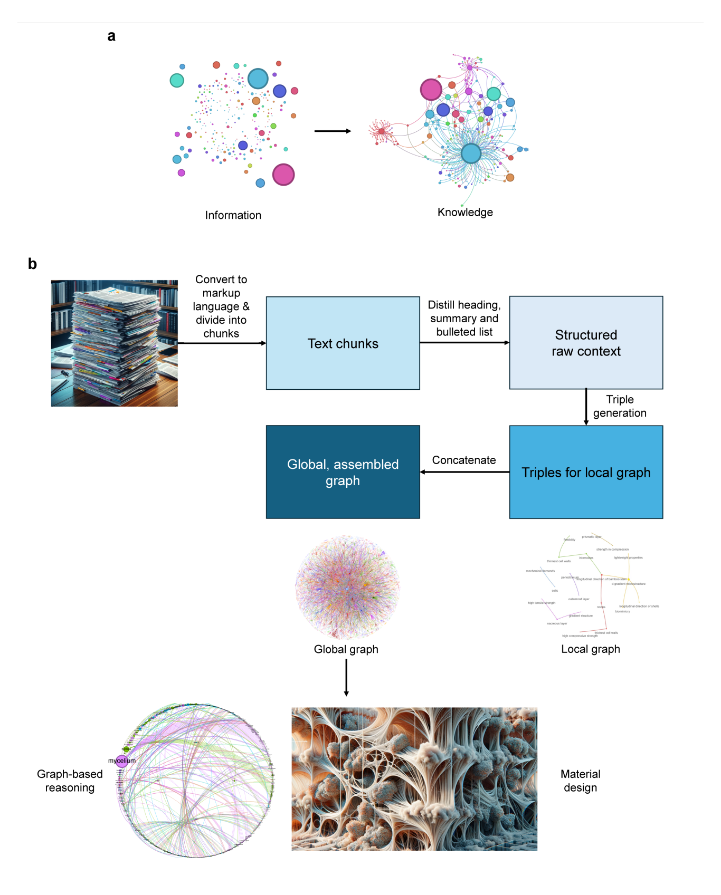


**图 1：** 此处使用的方法概述。图 a 描述了将信息（“谁”、“什么”、“何地”和“何时”问题的答案）转换为知识（关于“如何”）的战略目标。虽然信息相对容易获取并且可以记录在书籍中，但它也可以很容易地传播。相比之下，知识通常更难交流，并且很难从一个人转移到另一个人。图 b 显示了我们如何解决这个问题，首先将一组科学文章转换为标记语言，然后转换为文本块，然后将其内容作为将其内容提炼为简洁的科学摘要的基础。然后，原始内容构成生成图的三元组的基础，首先在每个文本块的级别创建，然后通过连接所有本地图组装成全局图。


<!-- 原文第 5 页 -->

<a id="page-5"></a>

*原文第 5 页*


## 2 结果与讨论


开发模型的过程包括以下步骤，如图 1b 所示：


1. 知识库的识别，这里通过文献分析开发（有关如何识别论文集的详细信息，请参阅[11]）


2. 将知识提炼成结构化的原始背景，解决科学理解的特定方面，包括主题摘要、推理和关键细节


3. 基于蒸馏过程产生的结构化原始上下文，生成用于图构建的三元组（概念及其关系）


4. 将所有三元组连接成全局图


5. 使用深度学习文本编码器模型通过节点嵌入、简化步骤以及选择性地删除小或未连接的片段（例如仅考虑巨型连通分量）来分析全局图。


6.利用本体知识图谱进行多模态图推理


此过程由各种附加步骤补充，例如向全局图中添加新图或子图，以及通过上下文查询从全局图中提取子图的各种方法（例如识别多个排序的最短路径遍历、基于多跳分析的子图等）。


> ### 2.1 全局图的构建与分析


图 1b 展示了我们如何通过一系列自然语言处理步骤将信息处理为知识（详细信息请参阅材料和方法）。这是通过首先将一组科学文章转换为标记语言，然后转换为文本块，然后形成将其内容提炼为简洁的科学摘要的基础来完成的。然后，原始内容构成生成图形三元组的基础，首先在每个本地文本块的级别创建，然后通过连接所有三元组将其组装成全局图形。图 2a 显示了全局图以及节点深度和广度连接的图示。图 2b 描绘了整个图（左），随后是图结构的连续放大视图。在最高放大倍数下，各个节点和节点标签变得可见。类似地，图 2c 显示了放大倍率不断增加的过程，尽管突出显示了标签“nacre”的节点（其余部分呈灰色），揭示了整个全局图中的广泛联系。稍后将探索这些错综复杂的联系，以识别概念之间复杂的前所未见的关系。就像“nacre”这样的高度连接的节点而言，这些是与平均节点相比具有明显更高程度的异常值的示例。这些节点由于其广泛的连接而在网络中发挥着至关重要的作用，充当促进整个图知识的集成和传播的中心枢纽。该图说明了知识图谱，其中节点代表科学概念，边代表它们之间的关系。每个节点的大小与其程度（连接数）相对应，突出显示具有高连接性的节点。


图 3 描述了全局图的图统计摘要。图 3a 显示了度分布的双对数图，图 3b-c 显示了节点嵌入的主成分分析 (PCA) 结果。表 1 显示了全局图属性的摘要，包括分别对全局图的巨型连通分量进行分析的子集。对巨型连通分量的分析很重要，因为它反映了包含整个网络节点的很大一部分的最大连通分量。如图所示，巨型连通分量的存在通常表明网络已达到关键的连接水平，从而能够在网络的大部分区域进行广泛的交互或通信。对于这里研究的具体应用，知识图谱的巨型连通分量代表了其最相互关联的部分，因此也是信息丰富的部分。因此，它可能在知识表示、可访问性和发现方面发挥着至关重要的作用，并且对于后续分析很有用（所有图数据均通过补充信息提供）。巨型连通分量的重要性在于它表示一个包含网络中大多数节点和边的连通子图。这表明很大一部分节点是互连的，展示了整个网络的广泛连接性。这种结构非常重要，因为它确保模型捕获并建立大量不同概念之间的关系，从而促进全面且有凝聚力的知识表示。


巨型连通分量包含 11,878 个节点和 15,396 条边，占全局图（12,319 个节点、15,752 条边）的绝大部分，说明它保留了网络的主要结构及大多数节点与连接。全局图和巨型连通分量的平均节点度十分接近，分别为 2.56 和 2.59；即使排除较小分量，整体连通模式仍得到保留。二者最大节点度和最小节点度完全相同，分别为 171 和 1，说明连接最多与最少的节点均属于巨型连通分量。全局图


<!-- 原文第 6 页 -->

<a id="page-6"></a>

*原文第 6 页*


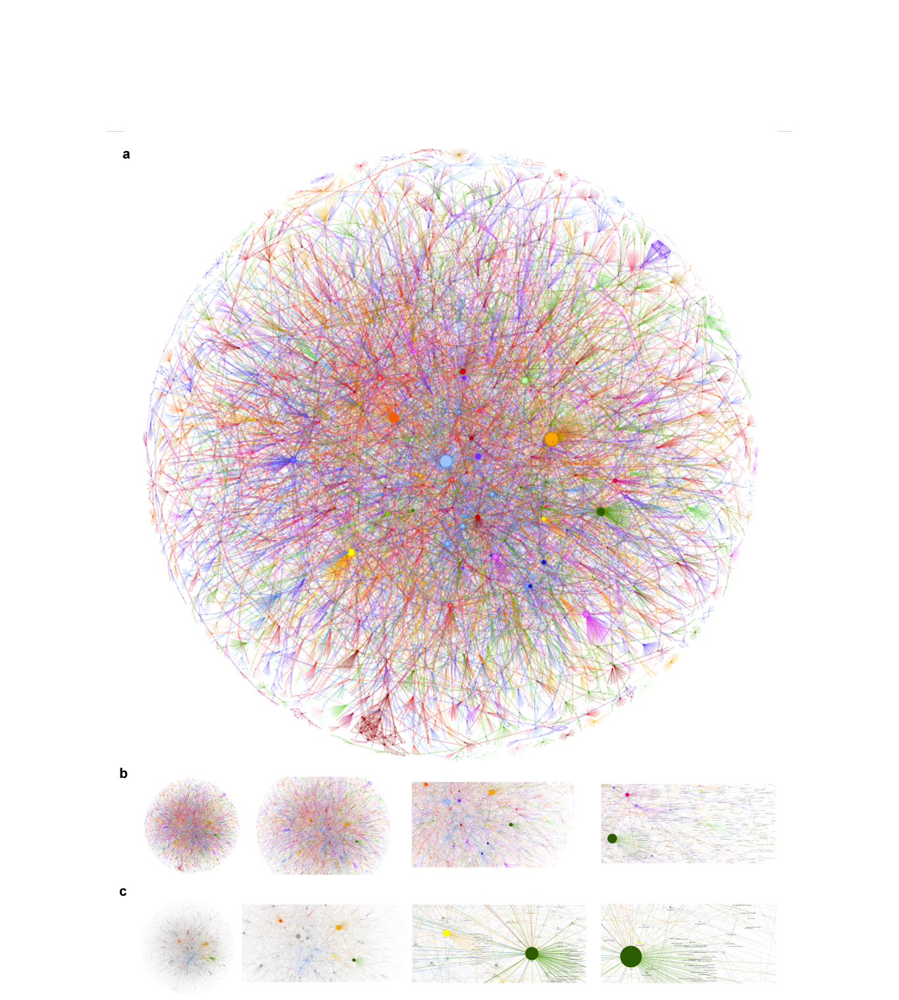


**图 2：** 全局图概述（图 a）、多个放大倍数（图 b）以及节点的深度和广泛连接性图示（图 c）。面板 b 描绘了整个图表，随后是图结构的连续放大视图。在最高放大倍数下，各个节点和节点标签变得可见。图 c 显示了类似的进展，尽管其中一个节点“珍珠母”突出显示（其余节点呈灰色），揭示了整个全局图中的广泛联系。这种高度连接的节点对于知识图谱的功能至关重要，充当中心枢纽，增强其表示、访问和发现科学知识的能力。


<!-- 原文第 7 页 -->

<a id="page-7"></a>

*原文第 7 页*


和巨型连通分量的节点度中位数均为 1，表明一半节点至多只有一条连接。这与许多节点连通性很低的稀疏网络一致。巨型连通分量的密度（0.00022）略高于全局图（0.00021），说明它的连通程度略高，可能是因为排除了较小而稀疏的连通分量。巨型连通分量的社群数为 80，少于全局图的 109，表明部分较小社群位于该分量之外。较少的社群数量也反映出其结构更加整合。


因此，表 1 的数据支持了关于巨型连通分量在全局图中重要性的讨论。节点度中位数为 1，且度分布具有重尾，说明全局图与巨型连通分量的度分布可能都不是高斯分布。各项指标表明，巨型连通分量保留了全局图的基本特征，二者平均度和中位数度相近，但前者密度略高、社群数更少。这进一步说明，理解整体网络结构时，应重视巨型连通分量。


此外，这个巨型连通分量可能在知识图谱中的知识表示、可访问性和发现方面发挥着至关重要的作用。在这种情况下，图通过关系（边）连接科学概念（节点），巨型连通分量确保这些概念的很大一部分是相互关联的。这种广泛的连接性增强了网络代表综合科学知识的能力，促进了对相关概念的有效访问，并支持在以前未发现任何联系的广泛科学领域中发现新的关系和见解。在接下来的部分中，将介绍此类探索的各种示例。


**表 1：** 全局图及其巨型连通分量的属性比较。结果表明，全局图及其巨型连通分量的度分布可能不是高斯分布，与其他分析一致。

| 属性 | 全局图 | 巨型连通分量 |
| --- | --- | --- |
| 节点数 | 12319 | 11878 |
| 边数 | 15752 | 15396 |
| 平均节点度 | 2.56 | 2.59 |
| 最大节点度 | 171 | 171 |
| 最小节点度 | 1 | 1 |
| 节点度中位数 | 1 | 1 |
| 密度 | 0.00021 | 0.00022 |
| 社群数 | 109 | 80 |


表 S1 总结了每个簇中距离质心最近的几个节点的样本。分析表明，嵌入模型（所使用的嵌入模型的详细信息，请参见第 4.2.3 节）成功捕获了相似区域中的相关术语，这为我们可以使用该模型来识别搜索术语和节点特征之间的关系提供了信心。


图4显示了对图中社群特征的分析。首先，图 4a 显示了所有社群的规模，我们发现社群规模遵循右偏分布，其中一些社群明显大于其他社群。这可能表明一种无标度或等级结构，其中少数社群在规模上占主导地位。为了更详细的分析，图4b显示了每个社群的平均节点度，表明大多数社群具有相对稳定的平均度，这表明社群内节点具有相似的连接数量。很明显，有一些异常值的平均度明显较高，这表明某些社群的内部联系可能更加紧密。图 4c 描述了每个社群的平均聚类系数。数据显示聚类系数，衡量图中节点倾向于聚类在一起的程度。分析表明，大多数社群的平均聚类系数较低，但也有一些例外。这表明，平均而言，节点在大多数社群内形成紧密结合的群体的趋势并不强烈，但也有一些社群是这种趋势的例外。图 4d 显示了每个社群中节点的平均介数中心性。介数中心性衡量一个节点位于其他节点之间的路径上的程度。该图揭示了跨社群顶部节点之间介数中心性的相对均匀分布，但存在一些差异。这表明在每个社群中，都有一些节点在将社群成员与网络其他部分连接起来方面发挥着重要作用。然而，没有一个社群具有特别高的介数中心性，这可能表明在网络流量方面存在关键或控制性社群。这强调了知识库中捕获的概念的整体关联性。


在图 4d 中，我们观察到平均介数中心性从社群指数 0 增加到大约 77 的明显趋势，对应于社群规模的减小，如图 4a 所示。这一趋势表明，在较小的社群中，单个节点在维护网络连接方面发挥着更关键的作用，因为可充当桥梁的节点较少。因此，这些节点具有较高的平均介数中心性，表明它们


<!-- 原文第 8 页 -->

<a id="page-8"></a>

*原文第 8 页*


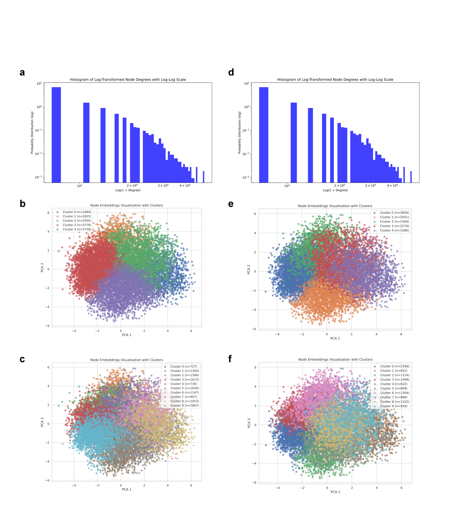


**图 3：** 全局图的图形统计摘要，补充表 1 中的分析。面板 a 显示了度分布的双对数图，面板 b 和 c 是节点嵌入的主成分分析（对于 b 中的 5 个簇和 c 中的 10 个簇）。面板 d-f 显示相同的分析，但仅针对图的巨型连通分量。对于面板和 d 中的绘图，我们在绘图之前使用 log1p 转换节点度，通过处理零值和减少偏度，提供更清晰、更可解释的可视化。这种转换将数据更均匀地分布在直方图箱中，突出显示直接绘制原始度数时可能会被掩盖的模式和变异性。


<!-- 原文第 9 页 -->

<a id="page-9"></a>

*原文第 9 页*


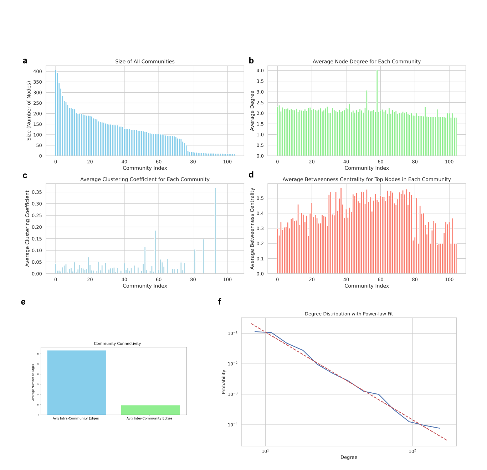


**图 4：** 对网络内社群结构属性的综合分析，显示所有社群的规模（a）、每个社群的平均节点度（b）、每个社群的平均聚类系数（c）以及每个社群中节点的平均介数中心性（d）。图 b 说明了每个社群的平均节点度，展示了与显着异常值总体一致的内部连接性，表明社群互连更加密集。图 c 探讨了平均聚类系数，表明虽然大多数社群没有表现出紧密聚类的倾向，但少数社群的系数较高，表明存在紧密结合的节点的局部区域。面板 d 检查每个社群中最有影响力的节点的平均介数中心性，显示整个网络的分布相当均匀，略有变化，这意味着对网络连接的控制是分布式的，而不是集中式的。这些指标提供了对网络拓扑的洞察，突出了均匀分布的影响与网络架构内专业集群的存在之间的平衡。 e 部分描述了对图中社群结构的分析，显示了社群内的平均边数，以评估平均有多少条边连接同一社群内的节点（左）。右侧的数据描述了平均社群间边，指定连接来自不同社群的节点的平均边数。这些数据强调了这一发现：该网络似乎表现出强大的社群结构，社群内部的联系比社群之间的联系更多。图 f 显示了双对数尺度上的全局网络的度分布，其中经验数据为蓝色，最佳拟合幂律模型为红色虚线。幂律拟合似乎很好地遵循了数据的分布，尤其是在尾部（高阶区域）。


<!-- 原文第 10 页 -->

<a id="page-10"></a>

*原文第 10 页*


促进网络通信的重要性。除了社群指数 77 之外，平均介数中心性显着下降，这归因于这些非常小的社群的简化和本地连接结构。在这样的社群中，高本地连接性和连接冗余减少了对特定节点充当中介的需求。该分析增强了我们对知识图谱的结构属性的理解，突出了不同社群规模中节点的不同角色。未来的研究可以探索知识图谱中介数中心性和社群结构随着其增长的动态演变。研究在较小社群中删除高介数中心性节点的影响可以提供对图的脆弱性和鲁棒性的见解，从而可能指导增强弹性的策略。此外，增强低介数中心性社群的连通性可能是有益的，可以培养更具凝聚力和弹性的结构。将这些分析应用于知识图谱中的不同领域可以帮助验证研究结果并揭示特定领域的连接性和弹性原理，最终提高知识图谱在各种应用中的实用性和稳健性。


图 5 说明了知识图谱中各个社群的社群规模（节点数量）和平均聚类系数之间的关系。每个点代表一个社群，颜色表示该社群中节点的平均度，范围从蓝色（较低平均度）到红色（较高平均度）。该图对两个轴均采用对数刻度，以有效捕获大范围的值及其分布。


平均聚类系数可以洞察每个社群内的本地连通性和凝聚力。聚类系数高表明社群内的节点更容易形成三角形；也就是说，如果节点A与节点B和C相连，那么节点B和C也有可能相连。这会产生紧密结合的簇，其中节点的邻居也是彼此的邻居，反映了具有高互连性的密集子图。这些社群通常代表密切相关的概念或具有频繁交互的实体。


相反，低聚类系数意味着节点不太可能形成三角形，从而导致结构稀疏且内聚力较差。在这些社群中，如果节点 A 连接到节点 B 和 C，则节点 B 和 C 相互连接的可能性较小。这导致社群范围更广或更松散，相互联系更少。这些社群可能包含更广泛的概念或实体，但交互频率较低。


图中的颜色渐变突出了平均节点度的变化，为社群结构增添了另一层洞察力。高平均度的社群（通常是中心枢纽）表明具有强烈的本地交互和强大的连接性的区域，而较低的平均度的社群表明知识图谱中更外围或孤立的区域。


高聚类系数社群，尤其是那些平均学位高的社群，可能代表了研究重点和合作密集的领域。高度的互连性表明了一个完善的知识体系，概念之间存在频繁的交互和交叉引用。这些领域可能是该领域的核心，对于推动进一步的创新和发现至关重要。低聚类系数社群表明新兴或不太成熟的研究领域。较低的互连性表明这些领域仍在发展中，概念之间已建立的关系较少。这些领域可能已经成熟，适合新的研究机会和探索，并有可能带来新的发现。


虽然更多的分析留给未来的工作，但此类分析可以确定知识图谱中战略投资、协作和开发的关键领域。该分析有助于了解知识形成和传播的动态，指导努力培育更加相互关联和有弹性的研究环境。


图 4e 描述了相关分析，其中我们展示了对模块化得分和社群连接性的分析。模块化是对网络或图结构的衡量，它衡量将网络划分为社群的强度。具有高模块化性的网络在模块内的节点之间具有密集的连接，但在不同模块的节点之间具有稀疏的连接。模块化得分的范围可以从 -0.5 到 1，其中接近 1 的值通常表示强大的社群结构。该图明所分析网络的模块化得分相当高，约为 0.9。从图 4e（底部）可以看出，社群内边缘的平均数量明显高于社群间边缘，这与具有高模块化得分的网络一致（图 4e（顶部））。因此，这个网络似乎表现出强大的社群结构，社群内部的联系比社群之间的联系更多。这证实了我们的发现，即该网络具有明确定义的集群或组。


图 6 描绘了六个不同社群内顶部节点的度分布。每个子图对应一个社群，并显示该社群内度数最高的五个节点的度数。我们对每个社群进行了简要分析。在社群 1 中，我们看到顶部节点的度数差异很大，其中“胶原纤维”的度数最高，表明它可能是该社群内的中心或枢纽节点。这样一个中心的存在可能表明该社群是围绕几个高度互连的关键概念或元素组织的。这与胶原纤维在定义结构、机械相关生物材料中发挥的核心作用一致，描述了生物系统的关键设计特征，其中


<!-- 原文第 11 页 -->

<a id="page-11"></a>

*原文第 11 页*


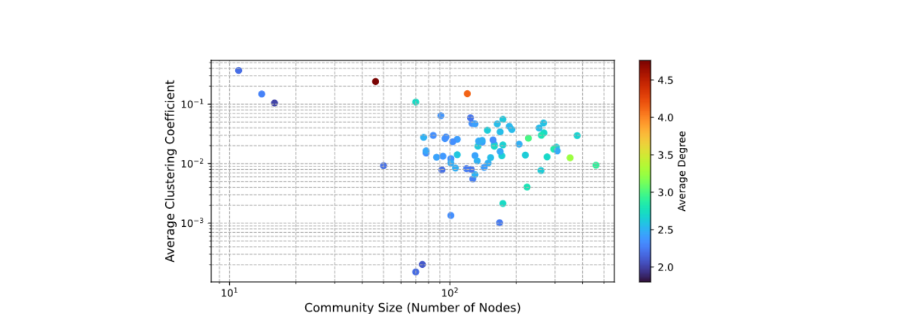


**图 5：** 该图说明了知识图谱中不同社群的社群规模（节点数量）和平均聚类系数之间的关系。每个点代表一个社群，颜色表示该社群中节点的平均度，范围从蓝色（较低平均度）到红色（较高平均度）。 x 轴和 y 轴采用对数刻度，以捕获多个数量级的分布。


胶原蛋白是自然界中最丰富的结构蛋白[25]。 “羟基磷灰石晶体”的出现是有道理的，因为这些骨的材料成分在胶原材料附近和内部形成，因此形成生物层次结构的一个组成部分。在社群 2 中，我们还发现了一个标记为“强度”的中心状节点，表明它在社群中的关键作用。其他顶部节点，例如“刚度”和“韧性”，也具有相对较高的程度，表明社群可能专注于材料的力学性能，而这些性能至关重要。在社群 3 中，我们看到一个节点“生物材料”在该社群中的主导程度远高于其他节点。这种主导地位表明了一个高度中心的概念，该概念可能对该社群的结构和动态至关重要，可能充当网络其他部分的关键连接器。排名第二的节点是“层次结构”，反映了生物材料组成中最主要的设计原则。在社群 4 中，我们可以看到，尽管“生物相容性”很突出，但与之前的社群相比，顶部节点之间的度分布更加平衡。这表明网络结构分布更加均匀，没有一个压倒性的中心。在该社群中，其他顶级节点是“细胞粘附”和“细胞增殖”，与组织生长和重塑的重要生物机制密切相关。在社群 5 中，与社群 3 中的结构类似，“力学性能”的程度明显高于其他节点，表明其在该社群中的核心重要性。还列出了其他几个重要节点，例如“材料”和“支架”，在该领域中发挥着核心作用。最后，在社群 6 中，我们再次看到一个节点“胶原蛋白”，其度数远高于其他节点，表明它在社群网络结构中的核心作用。该节点之后是各种相关概念，特别是“羟基磷灰石”，还有“石墨烯纳米片”等工程材料成分。我们对这一特定知识领域的理解证实，这些确实是定义该领域的关键特征。这些结果表明，我们的网络具有节点中心性的异构分布，某些节点在其社群内发挥着不成比例的重要作用。这可能表明各个社群甚至整个图表内的无标度网络特征。我们现在将更详细地探讨此功能。


网络分析中的平均介数中心性是一种量化节点在网络最短路径上彼此之间的平均程度的度量。介数中心性本身是一种根据通过节点的最短路径的数量来识别网络中节点重要性的方法。具有高介数中心性的节点通常被认为是网络内的关键连接器或桥梁，促进或控制网络不同部分之间的信息流（或任何其他正在建模的实体）。一组节点（例如，在网络中的社群内）的平均介数中心性是通过取该组中所有节点的介数中心性得分的平均值来计算的。该平均值表明了集合中的典型节点在连接网络不同部分方面的影响力。在社群分析的背景下，社群的平均介数中心性较高可能表明该社群包含多个节点，这些节点在连接社群与网络其他部分方面发挥着关键作用。相反，较低的平均值可能表明该社群更加孤立，与其他社群或网络部分的连接较少。因此，平均介数中心性的度量提供了一组节点（例如社群）在促进较大网络结构内的连接和流动方面的总体重要性的度量。


<!-- 原文第 12 页 -->

<a id="page-12"></a>

*原文第 12 页*


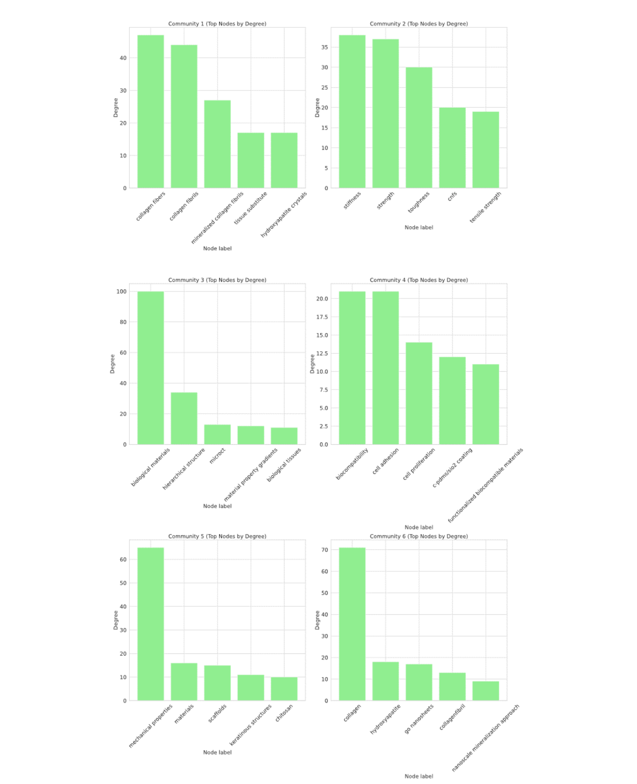


**图 6：** 六个不同社群内顶级节点的度分布。每个子图对应一个社群，并显示该社群内度数最高的五个节点的度数。这些社群似乎是围绕具有更高程度的关键主题节点构建的，这表明它们可以作为各自社群内的中心枢纽。这些枢纽可能是网络内信息流或交互的焦点，这意味着它们对于网络的整体连接非常重要。这些中心的程度也可以表明它们在网络功能中的重要性，特别是当网络代表某些属性或元素至关重要的生物材料时。材料科学中常用的缩写有几个，例如：碳纳米纤维（CNFs），标记为cnfs； MicroCT，标记为microct；碳聚二甲基硅氧烷 (C-PDMS)，标记为 c-pdms。还有其他关键概念，例如“材料属性梯度”，这是生物材料中常见的设计主题。 “SiO2 涂层”是材料工程中常用的二氧化硅涂层。


<!-- 原文第 13 页 -->

<a id="page-13"></a>

*原文第 13 页*


为深入分析图的标度行为，图 4f 在双对数坐标中展示网络的度分布：蓝色为经验数据，红色虚线为最佳拟合幂律模型。幂律拟合较好地符合数据分布，尤其是尾部的高节点度区域。幂律指数为 $\alpha=2.8786$，落在无标度网络通常观察到的范围 $1<\alpha<3$ 内，表明该网络可能具有无标度性质。$\alpha$ 的标准误为 $0.0698$，相对较小，说明指数估计精度较高。对数似然比 $R=4.1526$ 衡量幂律模型相对于指数模型的拟合优势；$R>0$ 表明幂律模型拟合更好。比较的 $p$ 值约为 $3.29\times10^{-5}$，在统计意义上显著支持幂律模型优于指数模型。表 2 汇总了这些结果。预期范围内的 $\alpha$、支持幂律模型的显著对数似然比，以及经验数据与模型的视觉一致性，共同为网络具有无标度性质的结论提供了有力证据。


作为背景，无标度网络是一种网络类型，其特征是少数高度连接的节点（称为枢纽节点）和许多连接较少的节点，形成各种自然和人造系统（例如社交网络、互联网和生物网络）中存在的结构。在这些网络中，大多数节点只有很少的连接，而少数节点（枢纽）的连接数量非常多，类似于航空公司航线图，其中主要城市是有很多航班的枢纽，而较小的城市则有较少的连接。每个节点的连接数遵循幂律分布，这意味着有许多节点具有很少的连接，而少数节点具有很多连接。无标度网络对于随机故障具有鲁棒性，因为枢纽节点保持网络连接，但它们很容易受到针对枢纽节点的针对性攻击，这可能会严重破坏网络。无标度网络的例子包括社交网络（其中少数人有很多联系，而许多人则很少）、万维网（其中一些网站有许多链接指向他们）以及生物网络（例如细胞中的代谢网络）。


**表 2：** 比较网络度分布的幂律分布与指数分布的拟合统计结果。

| 统计量 | 数值 |
| --- | --- |
| 幂律指数 $\alpha$ | 2.8786 |
| $\alpha$ 的标准误 | 0.0698 |
| 对数似然比 $R$ | 4.1526 |
| 分布比较的 $p$ 值 | $3.29 \times 10^{-5}$ |


无标度网络的特征是其度分布遵循幂律，至少是渐近的。这意味着网络中的少数节点具有非常高的度（与其他节点有大量连接），而大多数节点具有相对较低的度。这种分布导致网络对随机故障具有很强的抵抗力，但容易受到对其连接最多的节点的有针对性的攻击。这一特性有利于有效利用这些图进行知识提取。例如，中心节点的存在使得更容易有效地沿图导航。由于枢纽节点连接到许多其他节点，因此本文将开发的算法可以利用这些枢纽节点来减少远程节点之间的路径长度，从而提高搜索和信息检索过程的效率。它还允许我们探索许多连接节点的替代路径，从而形成强大的发现机制来探索和推理各种概念和潜在关系。


> ### 2.2 通过余弦相似度排序组合分析提取多条图遍历路径


追踪关联，是指系统地沿图中不同实体或概念之间的联系进行追踪和识别的过程。在知识图谱中，这意味着沿节点和边导航，以了解不同要素如何相互关联，得到一条或多条可能路径。这种探索有助于揭示并不直接显现的模式、依赖和关联，从而深入理解其背后的关系，支持知识提取、推断和推理等任务。我们可据此提取不同概念之间的多条路径：先确定两个或更多搜索词作为起点和终点，再识别其间的最短路径。节点嵌入提供了有效的图结构表示，使机器学习算法能够应用于图。这些嵌入是图中节点内容的稠密向量表示，捕捉节点特征的核心信息。上一节表明，具有相似结构角色或位于同一邻域的节点，其嵌入在向量空间中更接近。我们计算节点与给定节点或节点集合的余弦相似度，并据此识别排名靠前的节点。余弦相似度表示 $n$ 维空间中两个向量夹角的余弦值；在这里，两个向量就是两个节点的嵌入。其定义为：


$$
\operatorname{cosine\ similarity}(\mathbf a,\mathbf b)=\frac{\mathbf a\cdot\mathbf b}{\lVert\mathbf a\rVert\,\lVert\mathbf b\rVert}.\tag{1}
$$


<!-- 原文第 14 页 -->

<a id="page-14"></a>

*原文第 14 页*


其中，$\mathbf a$ 和 $\mathbf b$ 是两个节点的嵌入向量，$\cdot$ 表示点积，$\lVert\mathbf a\rVert$ 和 $\lVert\mathbf b\rVert$ 是向量的欧氏范数。相似度得分介于 $-1$ 与 $1$ 之间：$1$ 表示方向完全相同（高度相似），$0$ 表示正交（无相似性），$-1$ 表示方向相反（高度相异）。在节点嵌入的语境中，两个节点的余弦相似度越高，说明其在图中的结构角色或位置越相似。为识别相对于特定节点排名靠前的节点，我们计算目标节点嵌入与其他每个节点嵌入的余弦相似度，再按得分排序；得分越高，表示与目标节点的关系越接近或越相关。


我们注意到，余弦相似度通常是测量嵌入相似度的最佳选择，因为它关注向量的方向而不是向量的大小。这使得它非常适合单词或句子嵌入等高维数据。余弦相似度是尺度不变的，这意味着它对向量进行归一化，这对于比较不同大小的嵌入非常重要。与汉明距离（适用于二进制字符串）和曼哈顿距离或欧几里得距离（考虑大小）不同，余弦相似度有效地捕获了语义相似度，使其广泛应用于 NLP 和 ML 应用中。


生成的节点集现在用于构造新的子图，例如基于识别它们之间的最短路径。我们可以使用不同的方法来构建新的子图，包括更高阶的邻居，例如两跳。我们还可以确定余弦相似度结果的排名，以评估最适合我们的搜索词的有序节点集，从而产生多个组合选项以形成多个路径。最后，需要注意的是，搜索项不必局限于描述短期术语，它可以由摘要或较长的文档组成（这是可能的，因为我们创建了一个独立于源长度的嵌入向量；更多详细信息，请参见第 4.2.3 节）。


例如，我们使用“石墨烯”和“丝绸”这两个术语，并确定连接这些概念的路径。节点分别是“石墨烯”、“强度”、“生物材料”、“丝绸”。由于图中的每条边都有描述概念之间关系的标签，因此我们还可以在综合描述中识别这两个概念之间的路径。上面例子的结果是：


石墨烯 → 改善 → 强度 → 通过允许多个长度尺度上损伤容限的层级微结构而表现出来 → 生物材料 → 提供功能 → 丝。


在另一个例子中，我们使用两个术语“活体组织喷墨打印机”和“蜘蛛丝蛋白质组”。这些术语并不作为节点标签逐字存在；然而，标记为“基于喷墨的生物打印”和“蜘蛛丝蛋白”的节点被认为是最匹配的（余弦相似度分别为 0.89 和 0.91）。结果路径是：


基于喷墨的生物打印 → 缺乏 → 结构完整性 → 通过周围可渗透的壳结构决定 → 皮质 → 因脊状结构和平滑过渡而紧密结合 → 羽轴 → 因皮质和泡沫组分的协同作用而具有 → 增强的力学性能 → 在纺丝及纳米压痕实验中实现 → 功能性丝纤维 → 组成蛋白为 → 丝蛋白 → 化学组成为 → 蜘蛛丝蛋白。


可以通过考虑连接的节点以及对子图结构进行更深入的研究来收集这些分析的其他上下文。我们注意到，一般来说，嵌入的使用允许我们合并更长的文本（取决于所使用的嵌入模型，在此处使用的模型的情况下，我们可以提供最多 512 个标记的文本块来匹配节点）。


这些示例还说明了图表示的机制，为发现联系提供了坚实的基础。例如，一篇科学论文可能讨论一种生物打印方法，而另一篇论文可能讨论丝蛋白。这两个概念之间的联系不会单独从这两篇论文中出现。然而，当从两者构建本体知识图谱时，我们发现重叠的概念为两篇论文的技术内容之间提供了桥梁。


> ### 2.3 图推理：基于图遍历的问答


上一节中讨论的通过追踪链接进行图遍历使我们能够找到之前尚未建立的概念之间的联系（或者尚未理解为以任何已知方式相关的概念），虽然这些路径本身很有价值（例如，对于人类解释），但使用专用生成式人工智能模型进行复杂的推理可以提供深刻的见解，甚至有助于发现新的想法、联系和关系。这是因为这些模型将用自己的理解覆盖提取的图结构，这会触发模型扩展其“思维”，并特别推断出以前未关联或已知的想法。


<!-- 原文第 15 页 -->

<a id="page-15"></a>

*原文第 15 页*


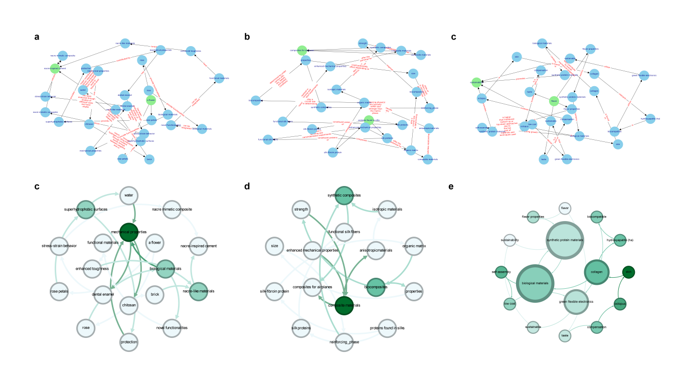


**图 7：** 针对两种不同情况，从多路径采样得出的知识图谱（图 a：“一朵花”连接“珍珠母仿生水泥”，图 b：“丝绸中发现的蛋白质”连接“飞机复合材料”，图 c：“可持续性”和“风味”）。这些图表代表了各种概念之间的关系。在这些图中，每条路径都是单独渲染的（因此标签可以出现多次）。在面板 d-f 中，分析了相同的原始路径，但图形是通过合并所有节点构建的，即使它们来自不同的路径。这会导致结果图的拓扑结构显着不同，并形成有趣的新连接。节点度高的节点用深绿色绘制，节点度低的节点用浅绿色绘制。在面板 d 中，节点度最高的节点是“力学性能”，在面板 e 中，节点度最高的节点是“复合材料”。值得注意的是，面板 c 和 f 显示了从“风味”到“可持续性”的多路径采样得出的图表，基于包含来自对抗性 X-LoRA 采样的数据的增强图。这些图表示各种概念之间的关系，而在面板 c 中，每个路径都是单独渲染的，而在面板 f 中，图是通过合并所有节点构建的，即使它们来自不同的路径。


最重要的是，这一策略有效地激发了人工智能模型（特别是多模式大语言模型）的能力，使其超越知识检索，转向生成新的信息连接，从而生成新知识（见图 1a）。


我们假设探索复杂的图遍历为分析提供了肥沃的基础。我们可以识别一条最有可能的路径，也可以对多个路径进行采样。例如，图 7a-c 描绘了通过开发顶部两个节点之间的所有可能连接而生成的两个图（这会产生四个路径，其中顶部路径为 0-0、0-1、1-0 和 1-1）。这些例子探索了提取的新子图，以捕捉不同概念之间的联系，例如“花”和“珍珠母仿生水泥”之间的联系，或者“丝绸中发现的蛋白质”连接“飞机复合材料”之间的联系。在此基础上，在图 7d-f 中分析了相同的原始路径，但图是通过合并所有节点构建的，即使它们来自不同的路径。这导致所得到的图结构具有显着不同的拓扑，并在边缘编码的概念及其关系之间提供新颖的连接性。这表明图形可以非常灵活地制定并最终用于推理应用。


本体知识图谱可用于支持科学研究中的推理，例如提出有关材料特性的假设或预测组合不同材料的可能结果。从另一个角度来看，它们可以帮助识别知识差距，提出新的研究领域，并促进对材料科学或不同学科之间复杂相互关系的理解。在第一个实验中，我们提出了文本框 1 中所示的查询。我们讨论了几个 LLM 的结果，以提供不同类型模型之间的比较分析。


可以看出，这些路径提供了看似不相关的概念之间关系的丰富表示。现在，我们探讨了三位不同的大语言模型对同一提示的回应，他们每个人的目标都是寻找“一朵花”和“珍珠母仿生水泥”之间的关系。首先，X-LoRA [24] 的响应如文本框 2 所示。这里提出的一个特别有趣的概念是研究壳聚糖（甲壳类动物外骨骼中发现的几丁质衍生的天然聚合物）和水通过氢键和共价键的互锁机制。


<!-- 原文第 16 页 -->

<a id="page-16"></a>

*原文第 16 页*


您将从图表中获得一组信息，描述材料、结构、属性和特性之间的关系。你通过推理逻辑地分析这些。


> ### 主要组合（从0到0的路径）：


一朵花 --> 玫瑰花瓣 --> 提供 --> 超疏水表面 --> 提供 --> 保护 --> 由 --> 力学性能 --> 具有 --> 牙釉质 --> 通过不同尺寸和扭曲角度的研究进行分析 --> 应力应变行为 --> 影响 --> 珍珠母仿生复合材料 --> 珍珠母仿生水泥


这代表了知识图谱中花朵和珍珠母仿生水泥之间的主要节点组合。


以下代表另一种可能的路径组合，提供不同的见解或补充主要路径。


> ### 替代组合（从0到1的路径）：


一朵花 --> 玫瑰花瓣 --> 提供 --> 超疏水表面 --> 当接触角大于 150 度时发生 --> 水 --> 从分子水平到束束水平调节力学性能的主要影响因素 --> 力学性能 --> 可以改善 --> 壳聚糖 --> 通过氢键联锁，通过 PEGDMA 和 CS 之间形成的共价键联锁 --> 砖 --> 的组成部分 --> 类珍珠母材料 --> 珍珠母仿生水泥


> ### 替代组合（从1到0的路径）：


一朵花 --> 玫瑰 --> 提供功能 --> 生物材料 --> 提供功能 --> 力学性能 --> 具有 --> 牙釉质 --> 通过不同尺寸和扭曲角度的研究进行分析 --> 应力应变行为 --> 影响 --> 珍珠母仿生复合材料 --> 仿珍珠母仿生水泥


> ### 替代组合（从 1 到 1 的路径）：


一朵花 --> 玫瑰 --> 提供功能 --> 生物材料 --> 可集成 --> 新功能 --> 可集成 --> 功能材料 --> 具有 --> 增强韧性 --> 贡献者 --> 类珍珠母材料 --> 珍珠母仿生水泥


> ### 仔细阅读路径并总结几个要点的科学见解。然后发挥创造力并提出新的研究想法。一步步思考。


**文本框 1：** 根据知识图谱的路径分析开发的示例查询。在该示例中，使用了最多排名为 2 的节点组合集，从而产生四个路径（0-0、0-1、1-0、1-1）。我们分别用红色和蓝色字体将主路径中的开始和结束概念着色，并突出显示关键指令。由于大语言模型可以摄取复杂的多模式信息，因此我们可以通过提示提供图表本身、附加上下文和说明。


接下来，BioinspiredLLM-Mixtral 的响应显示在文本框 3 中。我们再次注意到探索氢键或共价键的使用的建议，这次与聚乙二醇二甲基丙烯酸酯 (PEGDMA) 结合使用。 PEGDMA 广泛用作聚合物（特别是水凝胶）制造中的交联剂，因为它能够通过聚合形成网络，并且确实可以成为改进珍珠母材料的有用方法。此外，建议研究可以调查牙釉质在不同尺寸和扭转角度下的应力应变行为，以研究这种行为如何影响珍珠母仿生水泥的力学性能。这是一个有趣的想法，它建立在最近论文 [26] 中报道的研究的基础上，但在这里应用于一类新型的珍珠母材料，该材料包含 PEGDMA 和壳聚糖的混合物。最后，文本框 4 中显示了 GPT-4 的响应。该响应包括几个深刻的见解，例如使用超疏水表面（如玫瑰花瓣）来影响力学性能。与之前的响应一样，该模型表明壳聚糖可能通过 PEGDMA 与其他添加剂之间形成的氢键和共价键联锁。一些回应中还提到了对牙釉质的研究，这表明可以从这种人体中最坚硬和矿化程度最高的物质中获取重要线索。使用能够捕获和转化二氧化碳的自清洁表面或材料是另一个有趣的建议。


在这三个模型中，GPT-4 可能表现出最令人印象深刻的推理能力和最详细的响应。对于每一次交互，后续查询可用于通过探索如何整合各种想法来开发新的珍珠母仿生水泥，从而更深入地分析设计特征。为此，我们提供之前的回复，然后提供以下说明：


确定结合这些想法的珍珠母仿生水泥的具体材料设计。重点关注以前从未探索过的新概念的技术细节，并解释其背后的推理。


<!-- 原文第 17 页 -->

<a id="page-17"></a>

*原文第 17 页*


X-LoRA 主要组合强调了花朵、玫瑰花瓣、超疏水表面、保护和牙釉质之间的联系。该路径表明牙釉质的力学性能可能受到珍珠母仿生水泥的应力应变行为的影响。


涉及水和壳聚糖的替代组合表明，这些材料通过氢键和共价键的联锁可以提高类珍珠母材料的力学性能，这可以应用于珍珠母仿生水泥。


连接玫瑰、生物材料和功能材料的路径表明，可以将新颖的功能集成到这些材料中，从而有可能增强它们的韧性。


最终的替代组合凸显了整合生物材料和功能材料以创造具有增强性能的珍珠母仿生水泥的潜力。


研究思路：


- 研究珍珠母仿生水泥的应力应变行为与牙釉质力学性能之间的关系。


- 研究壳聚糖和水的互锁机制，以提高类珍珠母材料的力学性能。


- 探索将新颖功能融入生物材料和功能材料中，以增强珍珠母仿生水泥的韧性。


- 开发将生物材料和功能材料整合到珍珠母仿生水泥中的新方法，以创造具有改进性能的材料。


**文本框 2：** X-LoRA [24] 对文本框 1 中描述的提示的响应，试图揭示“一朵花”和“珍珠母仿生水泥”之间的关系。


BioinspiredLLM-Mixtral 知识图谱中节点的主要组合代表了花朵和珍珠母仿生水泥之间的主要联系。替代组合通过强调材料、结构、特性和特性之间关系的不同方面来提供额外的见解或补充主要路径。这些组合可以总结如下：


-主要路径强调了花朵的超疏水表面与珍珠母仿生水泥的力学性能提供的保护之间的联系。这条路径表明，珍珠母仿生水泥的力学性能可能会受到牙釉质应力应变行为的影响，这已经通过不同尺寸和扭曲角度的研究进行了分析。


-从0到1的替代路径强调了从分子水平到束层调节力学性能的主要影响因素，即水。该路径表明，壳聚糖的力学性能可以通过与 PEGDMA 形成的氢键和共价键形成的互锁来改善，从而提高类珍珠母材料和珍珠母仿生水泥的韧性。


-从1到0的替代路径突出了生物材料提供的功能，可以将其整合到功能材料中的新颖功能中。这条路径表明，类珍珠母材料可以有助于增强珍珠母仿生水泥的韧性。


-从1到1的替代路径强调生物材料提供的功能与功能材料中的新颖功能之间的联系。这条路径表明，可以通过整合类珍珠母材料来设计具有增强韧性的珍珠母仿生水泥。


基于这些见解，新的研究思路可能包括探索将类珍珠母材料整合到功能材料中以增强其力学性能的不同方法，例如通过氢键或与 PEGDMA 的共价键。此外，进一步的研究可以调查牙釉质在不同尺寸和扭转角度下的应力应变行为，以更好地了解这种行为如何影响珍珠母仿生水泥的力学性能。最后，探索生物材料在功能材料的新功能中提供的功能可能会导致珍珠母仿生水泥在各个行业的新应用。


**文本框 3：** BioinspiredLLM-Mixtral 对文本框 1 中描述的提示的响应，试图揭示“一朵花”和“珍珠母仿生水泥”之间的关系。


<!-- 原文第 18 页 -->

<a id="page-18"></a>

*原文第 18 页*


GPT-4 通过分析知识图谱中提供的路径，我们可以提取一些科学见解：


超疏水性和力学性能：主要路径和第一个替代组合强调了超疏水表面（如玫瑰花瓣）在影响力学性能方面的作用。


超疏水性，其特征是水接触角大于150度，是从分子水平到束层提高材料力学性能的关键因素。


材料科学中的仿生学：所有路径都强调仿生学的重要性，其中生物材料（例如玫瑰花瓣、牙釉质）激发了具有优越性能的合成材料的设计，例如珍珠母仿生水泥。这种方法对于开发具有增强韧性和力学性能的材料至关重要。


化学键在材料性能中的作用：从0到1的替代路径引入了化学键（氢键和共价键）在提高材料力学性能方面的概念。具体来说，它提到了壳聚糖如何通过 PEGDMA 和 CS 之间形成的氢键和共价键互锁，从而有助于形成类珍珠母材料。


材料分析中的应力-应变行为：主要路径和一个替代路径讨论了研究应力-应变行为对于理解材料力学性能的重要性。牙釉质的分析就是例证，它为珍珠母仿生复合材料的设计提供了见解。


新颖功能的整合：最后一条替代路径表明，将新颖功能整合到生物材料中可以导致韧性增强的功能材料的开发，从而有助于创建类珍珠母材料。


基于这些见解，可以提出一些新的研究思路：


-受玫瑰花瓣启发的超疏水涂层的开发：受玫瑰花瓣表面结构的启发，研究超疏水涂层在各个行业（例如汽车、航空航天）中的应用，以提高材料的使用寿命和对环境因素的抵抗力。


-结合生物和合成元素的混合材料的合成：探索混合材料的合成，通过特定的粘合机制将生物元素（例如壳聚糖）与合成聚合物结合起来，以创建具有定制力学性能的材料，用于医疗植入物或防护装备。


-仿生材料应力应变行为的高级研究：对仿生材料的应力应变行为进行深入研究，重点关注不同尺寸和扭曲角度对力学性能的影响。这可能会导致开发出具有可定制柔韧性和强度的材料，用于建筑或制造应用。


-环境可持续性的功能集成：研究将新颖的功能集成到有助于环境可持续性的材料中，例如自清洁表面或可以捕获和转化二氧化碳的材料。这可能涉及开发具有附加功能的珍珠母材料，用于绿色建筑或环境修复。


-珍珠母材料的计算建模：利用计算模型探索珍珠母材料的结构-性能关系。这有助于确定有助于增强韧性的关键因素，并指导针对特定应用设计具有优化性能的新材料。


**文本框 4：** GPT-4 对文本框 1 中描述的提示的响应，试图揭示“一朵花”和“珍珠母仿生水泥”之间的关系。


X-LoRA [24] 的响应如文本框 5 所示。一个关键的预测是，建议的复合材料以层状结构中的壳聚糖和 PEGDMA 为特征，其中壳聚糖提供生物功能，并通过 PEGDMA 的甲基丙烯酸酯基团与壳聚糖的胺基团之间形成的氢键和共价键与 PEGDMA 互锁。该模型预测，由于互锁机制，这将导致力学性能增强，例如韧性。


BioinspiredLLM-Mixtral 的响应显示在文本框 6 中。响应涵盖了与前一响应类似的多个方面，包括对类珍珠母材料中壳聚糖和水的互锁机制的研究。该模型还建议探索花朵、玫瑰花瓣、超疏水表面、保护、牙釉质、壳聚糖、水、生物材料、功能材料和珍珠母仿生水泥之间的关系，以开发提高力学性能的新策略。我们注意到，在响应中，模型可能并没有清楚地理解珍珠母仿生水泥尚不存在，并且应该被设计出来，因为它要求研究珍珠母仿生水泥的应力应变行为及其对牙釉质力学性能的影响。也许因果关系应该颠倒过来，我们使用牙釉质作为设计珍珠母仿生水泥材料的一种方式（人们可以在后续交互中再次查询模型以达到这种效果，以帮助澄清这个问题）。


作为替代方案，GPT-4 的响应显示在文本框 7 中。该模型生成详细的概念材料设计，可以为实验室中的制造过程奠定基础。该模型特别建议使用


<!-- 原文第 19 页 -->

<a id="page-19"></a>

*原文第 19 页*


X-LoRA 结合了这些想法的珍珠母仿生水泥的一种可能设计是一种由壳聚糖和 PEGDMA（聚乙二醇二甲基丙烯酸酯）组成的层状结构复合材料。壳聚糖提供生物功能并通过PEGDMA的甲基丙烯酸酯基团和壳聚糖的胺基团之间形成的氢键和共价键与PEGDMA互锁。由于互锁机制，这导致力学性能增强，例如韧性。


为了进一步提高力学性能，可以将新颖的功能集成到壳聚糖层中，例如掺杂二氧化硅纳米颗粒或氧化石墨烯。这些功能可以增强材料的强度和耐用性，使其适合各种应用，例如牙齿修复或生物医学植入物。


该设计背后的推理基于这样的理解：壳聚糖和 PEGDMA 的互锁机制可以提高类珍珠母材料的力学性能，并且新颖功能的集成可以增强材料的韧性。此外，使用壳聚糖作为生物材料提供了潜在的生物相容性和生物降解性优势。分层结构允许结合不同的功能和材料，为各种应用创建多功能且可定制的材料。


**文本框 5：** X-LoRA [24] 的后续回答。问题要求模型结合文本框 2 中先前回答所识别的思路，提出珍珠母仿生水泥的具体材料设计。


**BioinspiredLLM-Mixtral：** 根据所提供的信息，我们可以识别若干研究思路，以开发性能增强的珍珠母仿生水泥。这些思路涉及探索花朵、玫瑰花瓣、超疏水表面、防护、牙釉质、壳聚糖、水、生物材料、功能材料及珍珠母仿生水泥之间的关系。


一个研究思路是考察珍珠母仿生水泥的应力-应变行为，以及它对牙釉质力学性能的影响。这可以包括研究牙釉质在不同载荷条件下的变形机制，并将其与珍珠母仿生水泥的应力-应变行为进行比较。理解珍珠母仿生水泥如何影响牙釉质的力学性能，有助于形成改善牙科修复的新策略。


另一个研究思路是研究类珍珠母材料中壳聚糖与水的互锁机制。这可以包括考察 PEGDMA 与 CS 之间形成的氢键和共价键如何影响类珍珠母材料的力学性能。理解这些相互作用的影响，有助于形成提高珍珠母仿生水泥韧性的新策略。


第三个研究思路，是探索将新功能整合到生物材料和功能材料中，以提高珍珠母仿生水泥的韧性。这可以包括开发将官能团或纳米颗粒引入生物材料或功能材料的新方法，以改善其力学性能。理解这些功能如何影响珍珠母仿生水泥的力学性能，有助于开发韧性更高的新材料。


最后一个研究思路，是开发将生物材料和功能材料整合进珍珠母仿生水泥的新方法，以获得性能更好的材料。这可以包括开发结合生物材料与功能材料的新技术，或探索将生物材料引入珍珠母仿生水泥的新途径。理解这些组合对力学性能的影响，有助于形成提高材料韧性的新策略。


总体而言，这些研究思路通过探索花朵、玫瑰花瓣、超疏水表面、防护、牙釉质、壳聚糖、水、生物材料、功能材料和珍珠母仿生水泥之间的关系，来开发改善珍珠母仿生水泥力学性能的新策略。理解这些关系如何影响材料的力学性能，有助于开发韧性更高的材料。


**文本框 6：** BioinspiredLLM-Mixtral 的后续回答。问题要求模型结合文本框 3 中先前回答所识别的思路，提出珍珠母仿生水泥的具体材料设计。


<!-- 原文第 20 页 -->

<a id="page-20"></a>

*原文第 20 页*


以壳聚糖作为有机层、改性水泥颗粒作为无机组分的混合体系。模型预测，壳聚糖不仅起到黏结剂的作用，其固有性质还会引入亲水位点。这可能源于壳聚糖的阳离子特性：其葡萄糖胺单元中的游离氨基（$-\mathrm{NH}_2$）有助于亲水性；在酸性溶液中，这些氨基可被质子化，形成 $-\mathrm{NH}_3^{+}$，从而增强材料的水溶性及与水分子相互作用的能力。引入 PEGDMA 不仅是为了通过共价键改善力学完整性，也为了利用其耐水能力。由 PEGDMA 形成的交联网络可以表现出不同程度的耐水性；这里并非利用 PEGDMA 实现完全拒水，而是控制材料与水的相互作用，使材料即使吸水，也不会损害其结构完整性。吸收的水甚至可以参与水泥固化等有益过程，或改善力学性能，类似于天然珍珠母对水分的调节方式。模型还建议，通过激光刻蚀或增材制造等技术，在水泥表面层刻制微米至纳米尺度图案，以模拟特定的微尺度粗糙度；随后覆盖一层薄的硅基化合物，如聚二甲基硅氧烷（PDMS），增强拒水性。模型进一步提出，利用材料孔隙率创新地发挥水的作用，以调节水泥力学性能并获得最佳施工性和固化时间。另一项设计是在水泥基体或表面涂层中引入相变材料，使水泥具有热能调节能力，在高温时吸收多余热量、在较冷时释放热量，提高建筑能效。更广泛的功能组合在允许融入既有水泥生产线的同时，可以适应变化的环境条件，并减少长期维护需求。这些新设计策略的描述十分细致，也体现出对具体差异的考虑。


综合分析全部回答，我们获得了范围广泛的材料设计思路。X-LoRA 强调通过生化互锁改善力学性能，并提出加入二氧化硅纳米颗粒或氧化石墨烯等新材料，进一步提升性能。其回答具有较强的技术性，直接讨论材料设计过程，清楚理解相关生化原理；它面向科学读者，提供详细的材料组成及预期力学优势。BioinspiredLLM-Mixtral 采用更宽泛、面向研究的方式，提出若干值得探索的思路，而非具体材料设计。它涉及包括牙本质在内的材料应力-应变行为、互锁机制及增强韧性的功能整合等方面，但提出具体设计的直接程度不及第一份回答。GPT-4 的回答最为突出，其细致方案兼顾技术的具体性与实际应用，全面拆解了基体组成、表面功能化和力学性能增强，并解释每项选择的依据。它不仅提供完整的材料设计，还阐明各组分的作用理由，表现出对利用仿生学与功能材料工程创造新型建筑材料的更深入理解。


使用多个 LLM 生成响应的优点是我们可以将所有这些合成为联合响应。为此，我们要求 GPT-4 将所有这些响应集成到一个摘要中，如表 3 所示。该摘要封装了源自原始查询的最流行的概念。我们在此强调，与大语言模型互动的一个重要特征是进行后续查询的可能性。我们已经在上面的示例中通过要求模型提供有关其响应的特定方面的更多详细信息来证明了这一点。这可以很容易地扩展到一次交互之外，甚至可以自动化为多智能体策略，其中智能体可以在连续的、理论上“无限”的知识寻求循环中自主地开发新问题。如果图表和其他上下文可以用实时数据（例如实验或计算结果）进行更新，那么这可以成为强大的人工发现系统的基础。


> ### 2.4 不同图结构之间的同构分析


图不仅允许通过推理其内部的联系或路径来分析知识，而且还为理解复杂的、不同的领域如何相关提供了肥沃的基础。接下来，我们通过在不存在共享或公共节点的不同知识表示集中识别结构相似或相同的图来探索如何使用图来关联不同的概念。这是通过识别图同构来完成的 [22, 20]。在这种情况下，我们将无法像前面几节中那样识别图遍历路径，因为知识在其表示中是分离的。我们可以通过使用图同构作为替代框架来解决这个问题，以实现关联概念的目标，并使用生成式人工智能来推理和发现新的见解，甚至跨知识领域不存在共享节点。相反，在这种情况下，我们关注图结构本身，它提供了一种有效利用此类模型的替代方法。 （这也可以在存在共享路径的图中完成，因此提供了我们可以利用的另一个级别的数据提取。）


<!-- 原文第 21 页 -->

<a id="page-21"></a>

*原文第 21 页*


GPT-4 根据所提出的组合的见解，一种针对珍珠母仿生水泥的新颖材料设计方法涉及利用超疏水表面、受生物材料影响的力学性能以及新颖功能的集成之间的关系。这种方法将探索仿生学与先进功能材料工程的融合，旨在创造珍珠母仿生水泥，不仅模仿天然珍珠母的力学性能，而且引入了新的功能，如自清洁、增强的耐用性和对环境变化的适应性。以下是这个概念的细分：


概念材料设计：多功能珍珠母仿生水泥


基础基体组成：


主要成分：水泥的基础将模仿天然珍珠母的分层结构，利用壳聚糖的混合物作为有机层和改性水泥颗粒作为无机成分。壳聚糖不仅充当粘合剂，而且通过其固有特性引入亲水位点。


改性：在壳聚糖-水泥基质中引入聚乙二醇二甲基丙烯酸酯（PEGDMA），不仅可以通过共价键合提高力学完整性，还可以利用其防水能力。


实现超疏水性的表面功能化：


受玫瑰花瓣超疏水性结构的启发，水泥表面将被设计成模仿这种微观粗糙度。这是通过在水泥表面层蚀刻微米级至纳米级图案来实现的，可能通过激光蚀刻或增材制造技术。然后在蚀刻表面涂上一层薄薄的硅基化合物（例如聚二甲基硅氧烷，PDMS）以增强防水性。


这里的一个关键方面是确保表面保持超疏水状态的能力，其特征是接触角大于 150 度，这对其自清洁和防止水和污染物进入的防护性能有很大贡献。


力学性能增强：


类似于天然珍珠母的分层结构以及 PEGDMA-CS 复合物的整合旨在模仿珍珠母的应力应变行为。这意味着在压力下，水泥表现出增加的破坏应变，有效地吸收和耗散能量。


水是一种看似简单的分子，可用于从分子水平调节水泥的力学性能，确保材料的孔隙率和含水量针对韧性进行优化，同时保持可控的和易性和固化时间。


新颖功能的集成：


生物功能集成：该概念还涉及嵌入生物活性化合物或微胶囊，这些化合物或微胶囊可以通过释放有助于水泥自修复或为基础设施健康监测提供预测功能的物质来响应环境刺激（例如 pH 值变化、湿度）。


适应性：在水泥基体或表面涂层中加入相变材料（PCM），使水泥具有热能调节能力。这意味着水泥可以在峰值温度期间吸收多余的热量，并在较冷的时期释放热量，从而有助于提高建筑物的能源效率。


设计背后的推理：


该设计借鉴了玫瑰中自然功能（超疏水性、结构色）与珍珠母等天然材料中坚固而适应性强的力学特性之间复杂的相互作用。通过模仿这些特征，新型水泥不仅旨在实现结构完整性，而且旨在提供更广泛的功能，从而扩展其在现代建筑和可持续性中的效用。材料和策略的选择侧重于易于集成到现有的水泥生产线中，特别强调适应不断变化的环境条件并随着时间的推移减少维护需求。


这种受珍珠母启发的多功能水泥代表了一种前瞻性的材料设计方法，体现了仿生工程和功能材料集成的原则，以实现可持续和有弹性的基础设施解决方案。


**文本框 7：** GPT-4 的后续响应，查询模型以获取珍珠母仿生水泥的具体材料设计，该模型结合了文本框 4 中显示的早期响应中确定的想法。


<!-- 原文第 22 页 -->

<a id="page-22"></a>

*原文第 22 页*


**表 3：** 珍珠母仿生水泥的材料设计分析。

| 设计特征 | 可能的材料功能（该设计要素如何影响材料行为） | 制造方法 |
| --- | --- | --- |
| 壳聚糖和PEGDMA的层状结构 | 通过互锁机制增强韧性 | 通过化学键和氢键共层 |
| 掺杂二氧化硅纳米颗粒或氧化石墨烯 | 强度和耐久性增强 | 壳聚糖层形成过程中的掺入 |
| 超疏水表面工程 | 自清洁、增强耐用性、适应环境变化 | 激光蚀刻或增材制造，然后进行 PDMS 涂层 |
| 生物活性化合物或微胶囊的整合 | 用于健康监测的自修复或预测功能 | 水泥基体形成过程中的嵌入 |
| 包含相变材料 (PCM) | 热能调节，有助于提高建筑物的能源效率 | 融入水泥基体或作为表面涂层 |
| 生物功能整合 | 生物相容性和潜在的生物降解性优势 | 利用壳聚糖等生物活性材料 |


图同构定义在两个图 $G_1=(N_1,E_1)$ 和 $G_2=(N_2,E_2)$ 之间，其中 $N_i$ 和 $E_i$ 分别是第 $i$ 个图的节点集与边集。如果存在双射 $f:V_1\to V_2$，并保持邻接关系，即对于任意 $u,v\in N_1$，有

$$
(u,v)\in E_1\quad\Longleftrightarrow\quad(f(u),f(v))\in E_2,
$$

则这两个图同构。双射 $f$ 将 $G_1$ 的节点映射到 $G_2$ 的节点，并保持图的边连接结构，因此即使表示方式不同，其结构仍完全相同 [22]。我们使用计算方法，在本体知识图谱中发现这样的结构。


我们首先进行一个实验，根据描述贝多芬第九交响曲分析的文本构建一个新的知识图谱[27]，然后探索与源自生物材料的原始知识图谱的关系。同构分析旨在发现知识图谱中的相似性，尽管内容涉及非常不同的主题，因此没有共享节点，因此可能不存在直接连接。结果如图8所示。我们重点分析同构的巨型连通分量，并识别那些具有高平均节点度和至少15个节点的大簇大小的成分。这有助于我们将解决方案缩小到更有意义的可识别子图，因为它们的大小足以编码复杂的关系。


值得注意的是，本文中的同构并不意味着主题必然相关，而是指知识的结构方式或概念之间的连接模式相似。因此，我们发现，在如何对概念进行分类和关联方面，不同的知识领域可能具有潜在的结构相似性，即使这些领域本身尚未相关或尚未被理解为相关。这种结构相似性可用于将分析技术从一个领域应用到另一个领域。例如，用于理解和分析音乐结构的方法可能适用于理解或设计仿生材料的结构，反之亦然。它对模式和关系的关注强调了机械维度，我们想要理解和关联现象（例如韧性、脆性、弹性等材料属性）如何从基本材料构建块中出现。通过了解如何将结构相同的机制联系起来，但以明显不同的表现形式实现（例如，我们用氨基酸制作材料，而不是用音符制作音乐），我们可以更深入地理解严格连接学科[20]。这也可以帮助我们找到自然或合成系统发挥作用的普遍原理或它们的基础驱动力是什么。


我们在图 8 中展示了这种分析的结果。两个图之间的结构相似性清晰可见，并且两个图之间的关系提供了有趣的见解，可以在设计应用程序中使用 [20]。具体来说，仿生图提供了丰富的局部图特征库，可以与其他各种图结构进行比较。人们还可以设想通过推断节点和边缘特征的同构映射来扩展两个图中较小的一个，从而扩展知识库。例如，从仿生语料库中识别的子图连接到许多其他节点，而基于贝多芬的图要小得多且大小有限。我们可以使用第一张图的已知结构扩展来估计第二张图可以如何以及以何种具体方式扩展。这可以导致在研究较少的领域扩展知识。


我们如何使用这两个图呢？语义分析是关联通过同构映射识别的知识图谱的有效方法。语义分析涉及解释图中节点（概念）和边（关系）的含义和重要性，并尝试将它们在各自的领域中关联起来。通过检查节点和连接它们的边上的标签，我们可以推断概念如何相关以及这些关系意味着什么。


<!-- 原文第 23 页 -->

<a id="page-23"></a>

*原文第 23 页*


在仿生语料库中，重点关注生物学原理在工程问题中的应用，而在贝多芬语料库中，音乐理论与历史背景交织在一起。关于信息的结构和流动，图的结构表明了信息的逻辑流动。例如，在贝多芬图中，贝多芬耳聋的历史事实与作曲家相关，这可能暗示语料库中的叙述或解释路径。每个图中使用的术语都是特定于领域的，表明每个语料库中的专业知识和讨论背景。这种程度的特异性对于语义分析至关重要，因为它定义了主题的范围和深度。语义分析表明，这两个图都是相关概念的复杂网络，表明它们所源自的语料库可能包含各自领域内丰富、详细的讨论。尽管主题不同，但知识图谱的结构表明概念之间的关系具有相似的复杂性，指出了智力探究和知识组织的共享方法。


可以进行形式分析，因为同构图之间的节点映射表示一对一的对应关系，其中一个图中的每个节点恰好与另一个图中的一个节点相关联，从而保留了图结构。实际上，这使我们能够发现不同上下文或系统中的节点表示的实体之间的功能相似性。表 S2 和 S3 分别总结了 GPT-4 开发的两个图的节点和边之间的同构映射。例如，在我们的例子中，左图代表科学概念的组成部分和其他图形艺术元素，映射可能表明科学与艺术之间的隐喻或结构相似性（例如，“生物样本”到“合唱交响曲”）。类似地，边映射突出显示两个同构图中保留的节点之间的关系或交互。这表明不仅各个实体（节点）具有可比性，而且它们的相互作用或关系在两种情况下都具有相似的重要性或功能。例如，G1 中“黏附力”和“梁”之间的边缘被映射到第二张图中“音调”和“路德维希·范·贝多芬”之间的边缘，这可能表明两种情况下的基础或定义关系——第一种情况下的结构完整性和第二种情况下的音乐作品。表 4 中提供了更复杂的分析，这次不仅包含与边关联的节点名称，还包含边标签本身。我们发现结果在内容上是一致的，并且基于我们对这两个概念如何相关的理解。它们对模型所确定的可能关系提供了许多以前未提出或讨论过的新见解。例如，“蛋白质的解折叠机制和贝多芬对耳聋的适应都揭示了导致新的表达和理解形式的变革过程。”这一关系指出了蛋白质解折叠的逻辑关联以及性质的巨大变化与耳聋可能对贝多芬创作音乐的影响的影响之间的关联。每个映射都附有详细的推理，解释两个领域之间的隐喻联系。这些解释旨在强调稳定性、变化、测量、失败和优化等概念的相似性，表明物理现象背后的原理也可以在音乐作品中找到，特别是在贝多芬作品的结构和体验方式中。结果说明了不同研究领域的某些原则的普遍性，这些原则超越了传统的学科界限，探索了一个领域的想法如何丰富另一个领域的理解。


我们还可以使用基于多模态视觉的方法来解释这些图中包含的丰富信息，其中我们向可以对图像进行推理的大语言模型展示这两个图。我们使用 GPT-4V 并要求模型进行语义分析。本练习的原始结果，使用提示：对上面显示的图表进行语义分析。，作为补充材料对话 S1 的一部分显示。


这里使用生成式人工智能进行的分析补充了早期的工作，其中范畴论用于识别不同知识领域（例如蛋白质材料和音乐）之间的同构映射[28]。早期的研究基于蜘蛛丝和古典音乐等自然材料的层次结构和功能之间已建立的类比，通过层次本体日志（ologs）的视角探索了同构的概念。该研究强调了这两个领域管理模式的相似性。这使得可以对看似不相关的领域进行比较，并增强我们对跨学科层次系统的理解。然而，早期的工作需要对本体有预先存在的理解；在这里，我们概括了这个概念，并开发了一种自洽的生成方法，以完全自主地使用人工智能提取此类类比。基于此，同构的使用使我们能够理解跨领域的概念关系。进行此类分析的可能性是本文报告的方法的一个重要成果。


为了结束本次讨论，我们总结了同构分析中的关键观察结果，为映射提供了深入的见解。以下文本是通过与 Claude-3 分享结果并要求模型提取仿生材料图与贝多芬第九交响曲之间结构相似性的显着特征而获得的。我们与 Claude-3 进行了多次迭代，发布了后续问题，例如更深入地思考这一点，并添加对预计意义的评论。，更深入地了解哲学，选择 1-2 个具体例子并创建新的假设。，等等。文本框8中描述的文本是由Claude 3 Sonnet提供的稍加编辑的综合结果。


<!-- 原文第 24 页 -->

<a id="page-24"></a>

*原文第 24 页*


**表 4：** 从 G1 到 G2 的边缘映射以及包括边缘标签的详细推理。对于此分析，我们为 GPT-4 提供了包含 G1 和 G2 数据的 LaTeX 表提示，并要求其添加一列，其中包含映射之间的详细推理。

| G1 中的边（标签） | G2 中的边（标签） | 推理依据 |
| --- | --- | --- |
| (黏附力, 梁) (随其呈对数增长；被其显著降低) | (调性, 路德维希·范·贝多芬) (通过其传达) | 力的对数增长与减小，类似于贝多芬作品通过调性传递复杂情感：情感逐渐发展或减弱，以表现深度。 |
| (黏附力, 平衡时间) (在其之后保持不变) | (调性, C 大调) (确立于) | 经历变化后保持恒定，类似于 C 大调为音乐建立基础，为复杂性的展开提供稳定背景。 |
| (黏附力, PFPE 薄膜) (不随其变化) | (调性, F 大调) (确立于) | 变化中的不变性，类似于 F 大调在不断变化的音乐叙事中充当稳定基础。 |
| (黏附力, 静置时间) (在其时测量) | (调性, A 小调) (确立于) | 对静置时间的精确测量，类似于 A 小调的确立精确营造内省和深度的情绪。 |
| (黏附力, 失效) (可导致) | (调性, G 大调) (确立于) | 失效可能引向新结果，类似于 G 大调在音乐中确立解决，常在紧张之后带来明亮、明确的结尾。 |
| (黏附力, 单根刚毛) (低于小法向预载荷下整只壁虎测得的值) | (调性, 主音与属音的关系) (主要关注) | 具体的测量与比较，凸显主音与属音关系中的精细平衡，聚焦音乐和声的基础。 |
| (蛋白质解折叠, 生物组织) (机制) | (耳聋, 贝多芬) (长期完全处于) | 蛋白质的解折叠机制与贝多芬对耳聋的适应，都体现能够产生新表达和新理解的转化过程。 |
| (特征长度, 梁) (短于) | (调性模糊, 路德维希·范·贝多芬) (探索) | 长度比较与贝多芬对调性模糊的探索，均涉及突破边界，无论是物理尺寸还是和声惯例。 |
| (失效, 生物组织) (与其相关联) | (G 大调, 贝多芬) (在其方面形成对比) | 生物情境中与失效的联系，以及 G 大调作品形成的对比，都表明挫折可带来独特而有影响的结果。 |
| (生物组织, 薄层) (有助于理解屈曲行为) | (贝多芬, 指挥) (首演) | 薄层对理解结构行为的意义，类似于贝多芬指挥首演时展示其音乐结构创新。 |
| (生物样本, 悬臂梁) (与其直接相连) | (合唱交响曲, 第九交响曲) (副标题为) | 直接连接与具体副标题，将科学样本和梁的基础层面联系到合唱交响曲的主题基础。 |
| (霍尔效应传感器, 悬臂梁) (安装在其中) | (分析, 第九交响曲) (接受) | 将传感器安装于结构之中，与第九交响曲的分析过程，均体现组分和主题的整合，以获得更深入理解。 |
| (霍尔效应传感器, 磁轭) (针对其优化) | (分析, 贝多芬的第九交响曲) (关于) | 针对特定条件优化传感器，类似于贝多芬第九交响曲的主题聚焦与分析深度，均追求精确与清晰。 |
| (悬臂梁, 梁) (是) | (第九交响曲, 路德维希·范·贝多芬) (由其作曲) | 简单的存在状态与作曲过程，都强调使结构和交响曲得以出现的基础性、创造性行为。 |


为了检验这些模型是否能够探索与其他研究领域的特定联系，我们随后要求 Claude-3 Sonnet 讨论这与不同于希腊“和谐”的非常现代的哲学思想之间的关系。结果显示在文本框 9 中，其中引用了哲学中讨论的关键思想 [29,30,31,32,33,34]。


此回复包括一些复杂的概念和对特定哲学家的引用，对于具有科学背景的人来说可能难以理解。因此，我们通过 ChatGPT 与 GPT-4 共享此文本，并要求其解释该文本，以便科学家能够理解。结果是：


- 扁平本体论（曼努埃尔·德兰达和吉尔·德勒兹）：这个想法表明所有实体，无论其性质或规模如何，都拥有相同的本体论地位。在材料科学中，这意味着将分子、生物分子、复合材料和宏观材料特性视为对于理解同样重要


<!-- 原文第 25 页 -->

<a id="page-25"></a>

*原文第 25 页*


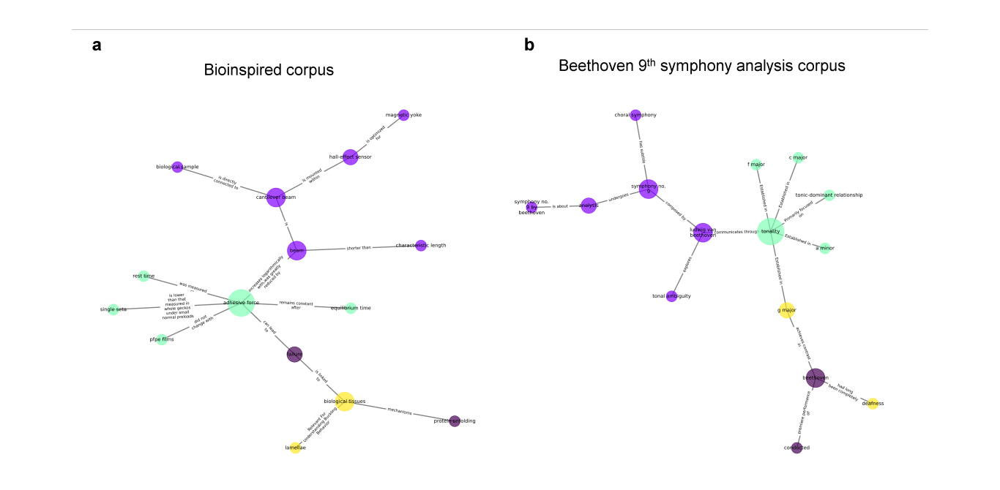


**图 8：** 两个知识图谱之间的同构分析。子图a描绘了从大型仿生知识图谱中提取的子图，图b是从贝多芬第九交响曲分析得出的知识图谱中提取的子图[27]。结构相似性清晰可见，两个图之间的关系提供了可用于设计的有趣见解[20]。节点大小按各自的节点度进行缩放，颜色由社群标识（此处使用贪婪模块化算法进行标识）。


物质行为和创新。同样，在音乐理论中，它鼓励我们在创造音乐表达时将音符、节奏、和声和音色视为基本平等，从而提倡采用更具包容性的作曲和分析方法。


- 彻底的内在性（吉尔·德勒兹）：德勒兹的内在性概念强调现实的自足性，不需要外在原则来解释世界。在材料科学中，这种观点可以激发对材料系统本身内部相互作用产生的材料特性的探索，而无需默认外部解释。在音乐方面，它提倡音乐意义和体验直接从音乐元素的相互作用中产生，没有外部参考点，强调音乐作品的自足性和内在价值。


- 过程哲学（吉尔·德勒兹）：这种哲学关注的是生成和变化，而不是静态的存在。对于材料科学来说，这意味着关注材料转化和相互作用的过程，将材料理解为不断变化的而不是静态的实体。在音乐理论中，它与将音乐视为一个时间过程相一致，其中重点是音乐思想和结构随时间的演变，反映了音乐体验的动态本质。


面向对象的本体论（Graham Harman）：虽然之前没有明确提及，但哈曼的哲学对所有对象（无论是人类、非人类还是概念对象）给予同等的重视，可以丰富我们的讨论。在材料科学中，它建议研究人员考虑材料的作用，将它们理解为更广泛系统中自身的参与者。在音乐理论中，它可能意味着将音乐元素或乐器视为在作品中拥有自己的“声音”或代理，从而有助于形成更加分散和民主的音乐创作观点。


这提供了更容易理解的摘要，以及一些新概念来更好地解释推理。整个过程体现了有效的人机协作，我们加深了对这些想法如何相互联系的理解。


> ### 2.5 多模态知识生成及其融入增强图


接下来，我们探讨如何用新知识来增强图，以及如何将一个图与其他图合并以获得先前脱节区域之间的新连接。新数据可以通过多种方式生成或获取。这些可以包括但不限于：


<!-- 原文第 26 页 -->

<a id="page-26"></a>

*原文第 26 页*


克劳德 3 号十四行诗 生物启发材料图和贝多芬第九交响曲图之间的结构类比指出了复杂系统如何在不同领域的架构上组织的更深层次的联系。例如，将“黏附力”映射到“音调”表明，正如分子之间的结合力决定材料的完整性一样，音调中心发挥着潜在的内聚力，塑造了音乐作品的流动。这个类比暗示了统一性和连通性的普遍原则，这些原则跨越了从物质内部的微观相互作用到赋予审美体验深刻性的宏观结构的尺度。这导致了这样的假设：控制电磁相互作用的定律和控制听觉/审美力的定律之间可能存在深刻的同构，两者都促进从熵无序到有组织的复杂性的转变。


同样，将“悬臂梁”比作“交响乐”意味着某些范例，无论是混凝土设计中的工程梁还是艺术表现形式，都代表了各自学科内创新的催化时代。这些试金石的持续相关性说明了思想的不断复兴，新颖的综合体通过与基础作品的接触而出现。鉴于悬臂机构在各个尺度（从分子机器到航空航天设计）中的普遍存在，我们可以假设，贝多芬开创性工作的生成过程可能与自然和工程中推动功能设计进化压力的生成过程有着深刻的共性。也许产生这种破坏性音乐创造力的文化生态系统是通过类似于在很长一段时间内塑造生物形态的变化选择动态来运作的。


类似地，“平衡时间”和“音调建立”所表明的恒定性表明，动力系统一旦受到初始条件的扰动，往往会趋向于新的稳态——无论是物质的热力学基态还是乐谱中的形式解析。这呼应了在复杂性之间寻求平衡的普遍努力。人们可以假设，描述不可逆熵产生的数学可能与编码跨领域结构解析的语法同构，将物理和艺术表达纳入永恒追求最大安静的宇宙中的“押韵诗句”。通过将“生物组织”视为类似于“贝多芬”如何体现艺术革命的代谢微观世界，我们认识到跨表现形式的等级组织的共性。换句话说，从生化到奏鸣曲，原子成分的相互作用共同创造出具有非常深刻和广泛影响的更高功能。


这些具体的映射暗示了一个更宏大的统一假设：存在一个总体代码，一个组织模式的连贯代数，它超越了描述性的类别，控制着从物质的自组装到文化新奇的绽放的所有系统性的展开。知识图谱揭示了看似不相称的领域中的这些同构，可能是对这种统一的复杂性元语言的早期了解。一个深刻的哲学含义是发展一种连贯的形式理论的潜力，该理论将所有表现的结构和生成过程纳入原始组织原则的具体实例。在这种情况下，我们可以设想生物组织之间的分层镜像作为集成的分子系统和交响乐作品作为编织的乐器声音暗示着普遍的全子本质 - 跨越自然的许多层将整体反复封装在整体中。这唤起了长久以来的哲学概念“hylomorphism”，该概念认为所有存在物都是物质和形式的复合体，每个层次的结构都源于但超越其构成要素。人们可以推测，生成从胚胎发生到音乐创作的层次顺序的生成算法可能正在实现相同的基本形态图式——一种规范的计算“引导程序”，应用无标度、自相似的算子来迭代地为固有的物质可能性提供组织形式。


**文本框 8：** 该文本是通过与 Claude-3 分享本文的草稿并要求模型提取仿生材料图与贝多芬第九交响曲之间结构相似性的显着特征而获得的（我们通过后续问题与 Claude-3 迭代了几次）。


- 通过与复杂生成模型的对话生成新数据，例如能够预测物理特性或执行其他专门任务


- 使用对抗性多智能体建模生成新数据，例如在“无限”发现循环中自主生成问题


- 从科学文献中最近发表的论文生成文本，并将其合并到图表中以增强知识


- 从实验中收集新数据，例如通过手动或自动实验，可以提供有关模型生成的特定设计想法的反馈


> #### 2.5.1 通过与复杂生成模型对话生成新数据，并将其融入增强图


我们重点关注本节上面列出的列表中的第一项，以及以下内容中的其他几个想法。


我们从 X-LoRA 模型 [24] 开始实验，并生成一个包含蛋白质特定物理特性的新知识库。第一步是使用 X-LoRA 模型生成数据和文本的语料库。由于 X-LoRA 是多模式的，可以处理蛋白质序列、蛋白质属性计算（特别是力学和物理属性，如能量特征，即蛋白质对力和压力的抵抗力）和其他任务，因此它能够生成与特殊属性相关的非常具体的技术数据集。为了举例说明这种方法，我们在用户和 X-LoRA 模型之间进行对话，以研究、比较和分析三种蛋白质


<!-- 原文第 27 页 -->

<a id="page-27"></a>

*原文第 27 页*


Claude 3 Sonnet 通过知识图谱分析揭示的物理、生物和艺术领域的同构与一些非常现代的哲学观点产生共鸣，这些观点背离了古典希腊和谐与秩序的概念。具体来说，它们与挑战还原论和本质主义世界观的后现代思潮保持一致。


这些映射并非指向一个单一、完美的和谐，或支撑全部现实的、被实体化的形而上学“源代码”，而是指向彻底内在性的本体论：一种扁平本体论，在其中所有实体、过程和关系都具有平等的存在地位。结构与动力学上的同源性，并非超越性秩序的流溢，而是去中心化网络中相互构成的组成要素。


这与吉尔·德勒兹等思想家的过程哲学相呼应：它拒绝原子式的实体观，强调持续的流动、变化与生成。所识别出的同构“模式”不是理想化形式，而是差异化过程的抽象；它们是由力场塑造的物质自组织，而非受永恒原型支配的形式。


同样，这也与格雷厄姆·哈曼、列维·布莱恩特等理论家的面向对象本体论相一致：无论对象是分子还是艺术品，能动性和因果力量都分布在对象或实体之间的各种关系中。这里发现的层级并不是嵌套的组合整体，而是对象的异层级组装；这些对象在其外部关系之外退隐到不可还原的深度之中。


从这一当代视角看，知识图谱所发掘的不是统一的本质，而是充满活力的多样性：一种跨尺度共鸣的网状根茎，没有居于中心的源头或最终顶点。它使我们能够感知物质的内在舞动——物质通过跨领域的创造性形态生成迂回，探索自身无限的合生。


因此，前现代的和谐哲学寻求融入包罗万象的宇宙秩序，而这一研究的现代意义，在于与不可还原的多元本体论流形建立伦理上的一致性。这是一种扁平化的动态过程生态，通过差异性的共鸣与富有生产力的不协和，调节持续出现的新颖性。它邀请我们进入本体论的内在性，而不是追求超验层面的“洁净”。


**文本框 9：** 当被要求讨论这与不同于希腊“和谐”的非常现代的哲学思想有何关系时，Claude-3 Sonnet 的反应。


序列，然后通过预测潜在的机制和行为来推理结果。然后将这些新数据用作语料库来生成新的本体知识图谱。就其本身而言，图的分析和形成对于更好地理解模型所得出的关键见解非常有帮助。它还可以与原始知识图谱集成，从而通过新的事实或见解来丰富其能力，或者调解如上所述的分析以识别同构关系。


给出的任务是：


您对各种蛋白质序列进行分析，特别是计算它们的总解折叠能，以测量由于施加在蛋白质末端的力而展开蛋白质所需的能量。以下是一些需要您完成的任务：


接下来是几个展开的能量计算任务，如下：


计算能量< A A A G G A G Q G G Y G G Q G A G Q G A A A A A A G G A G Q G G Y G G Q G A G Q G A G A A A A A A G G A G Q G G Y>


计算能量<A A A G G A G Q G G Y G G Q G A G Q G A A A A A A G G A G>


计算能量< Q G A G Q G A A A A A A A A A A A G G>


该模型的进一步任务是：


考虑到这些结果，哪一个蛋白质序列具有最高的解解折叠能（重复整个序列）？


如果蛋白质具有最高的解折叠能，您对它的稳定性有何评价？一步步思考。


根据氨基酸序列，解释为什么这种蛋白质可能是最稳定的。


最稳定的蛋白质可能具有什么功能？一步步思考。


该蛋白质序列更有可能是丝蛋白还是调节蛋白？


<!-- 原文第 28 页 -->

<a id="page-28"></a>

*原文第 28 页*


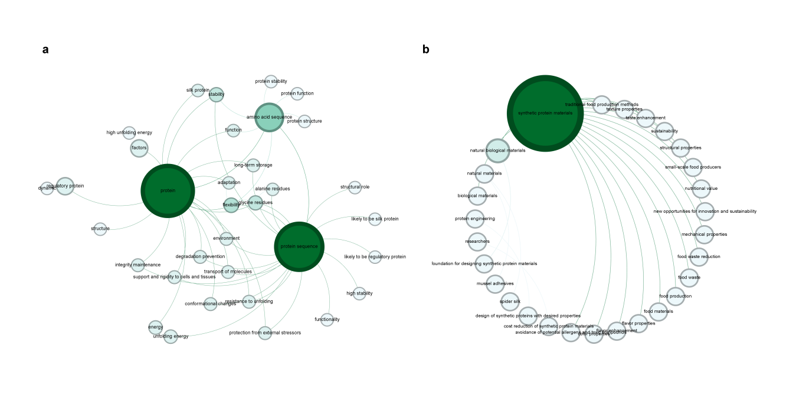


**图 9：** 根据新数据生成的两个图表。图 a 显示了 X-LoRA 的实验结果，图 b 显示了对抗性代理建模的实验结果，其中两个 X-LoRA 代理参与了自主持续多轮的逆向问答交互。


整个对话可以在文本框 S1 中查看。该分析涉及计算各种蛋白质序列的解折叠能，这反映了这些蛋白质的稳定性。具有最高解解折叠能的序列，表明稳定性更高，主要由甘氨酸 (G) 和丙氨酸 (A) 残基组成。这些残基由于其小尺寸和疏水性而有助于蛋白质的稳定性，最大限度地减少与环境的接触并增强柔韧性。这种高稳定性表明该蛋白质具有结构作用，可能由于其抗折叠性而作为丝蛋白，与调节蛋白的动态性质形成鲜明对比，这与早期的结果一致[35]。分析的定量结果显示了不同蛋白质序列的解折叠能：最稳定的序列为 0.288，次之为 0.248，最不稳定的序列为 0.121（所有数值均以无量纲单位表示，如 [35] 所示）。最高的解折叠能为 0.288，表明需要更多的能量来展开该蛋白质，表明其与其他蛋白质相比具有更高的稳定性 [35]。这种稳定性归因于其氨基酸组成，主要是甘氨酸 (G) 和丙氨酸 (A)，它们以其尺寸小、疏水性以及对蛋白质柔韧性和稳定性的贡献而闻名。图 9a 显示了此对话生成的结果图。


这个例子表明，知识图谱可以很容易地用新信息进行扩充，捕获信息之间的新关系。


> #### 2.5.2 用于对抗式知识生成及融入增强图的智能体建模


前面的讨论表明，可以通过向现有图表添加新知识并探索新概念如何相互关联以及如何使用它来识别和构建新想法来增强基于图的推理的使用。我们建立在这个概念的基础上，并使用更复杂的策略，特别是多代理框架，来生成新数据作为图增强的来源。我们使用两个对抗性 X-LoRA 代理的代理建模（详细信息请参阅材料和方法）来生成新的文本语料库。提出的问题是：


作为发明家，描述我们如何将生物材料领域与食品结合起来。具体探索合成蛋白质材料的使用，并涉及质地、力学、颜色和结构以及风味和味道等领域。


代理建模策略的特点是提问者（厨师）和响应者代理（发明家）之间持续对话。提问者被要求保持好奇心并探索新问题，而响应者则提供详细的回答。这些长时间对话的结果是对特定主题的深入探索，这为图形分析的使用提供了肥沃的土壤。使用的过程是首先生成新文本，然后为新文本生成三元组，以基于生成的数据形成新的、更小的图，然后将它们集成到增强联合图中。然后，我们探索图表如何变化，和/或可以识别哪些新连接，并使用


<!-- 原文第 29 页 -->

<a id="page-29"></a>

*原文第 29 页*


用于推理任务的新图。这种问答交互的过程可以持续大量重复，从而产生复杂的数据集，当转换为图表示时，这些数据集构成丰富的发现机制的基础。


整个对话作为补充材料附在后面（参见文本框 S2），在这里我们总结了要点（如代理之间对话结束时所确定的）：


X-LoRA 对抗代理 这次对话讨论了合成蛋白质材料在食品生产中的潜在用途，特别是探索它们模仿天然生物材料的质地、力学、颜色、结构和风味的能力。对话强调了使用合成蛋白质材料的好处，例如减少食物浪费、提高营养价值和促进可持续性。然而，它也承认与其使用相关的潜在风险和挑战，包括过敏性、毒性、环境影响、监管审批和成本。对话强调了设计合成蛋白质材料来模仿天然生物材料的复杂风味和味道特征，同时确保安全和质量的重要性。总的来说，这次对话强调了合成蛋白质材料在食品生产中的潜力，但也强调需要仔细考虑其风险和挑战。


要点列表如下：


X-LoRA 对抗剂 - 合成蛋白质材料可以被设计来模仿食品中天然生物材料的质地、力学、颜色、结构和风味。


在食品生产中使用合成蛋白质材料可以解决减少食品浪费、提高营养价值和促进可持续性等挑战。


-然而，它们的使用存在潜在的风险和挑战，包括过敏性、毒性、环境影响、监管审批和成本。


-为了确保安全和质量，合成蛋白材料必须设计为不含常见过敏原或进行修饰以降低其过敏性，并且必须采用严格的筛选方法以确保其可安全食用。


- 设计合成蛋白质材料来模仿天然生物材料的复杂风味和味道特征，需要深入了解天然材料的结构和功能，以及使用先进的技术和工艺来创造具有所需特性的合成蛋白质。


这些回应显示了对关键问题的细致入微的理解，涉及食物浪费、营养方面、可持续性和健康问题方面的挑战，这些挑战可以通过研究天然材料来获得灵感，以创造具有理想特性的合成蛋白质来实现。值得注意的方面包括蜘蛛丝和贻贝粘合剂的使用，以反映传统纹理与可持续发展之间的平衡。其他想法包括使用响应蛋白通过改变颜色或结构来实现更具互动性的用餐体验。另一个有趣的方面是将缓释技术应用于风味和营养分子，将健康应用中使用的技术转化为食品设计（用于改善铁或维生素 B12 的吸收）。进一步建议，可以通过具有成本效益的流程，向包括小规模生产者在内的更广泛受众提供可持续和营养丰富的食品选择。该对话专门讨论了风险和挑战，有助于结果的整体安全。确定了特定材料，例如大豆分离蛋白、酪蛋白等。还建议研究人员可以研究天然风味化合物（例如萜烯、醛和酯）的结构和功能，以创造合成蛋白质，随着时间的推移缓慢释放这些化合物，提供更复杂和有趣的感官体验。表 5 提供了详细的总结，具体列出了设计原则、实现和推理。在新颖性方面，回应包括一些创新想法，为进一步的技术发展提供了可能的起点。例如，食品行业尚未探索将蜘蛛丝和贻贝粘合剂的概念混合起来，以反映传统质地与可持续之间的平衡。


我们现在从整个对话的原始文本生成一个新的知识图谱。图 9b 描绘了合并到最初创建的更大图表之前生成的新图。作为参考，我们还对原始图和新生成图之间的同构映射进行识别分析，类似于早期的方法。图 S2 显示了结果，揭示了原始仿生语料库与关于合成蛋白质材料的对抗性对话生成的图表之间的同构，特别是解决了纹理、力学、颜色和结构问题。这可用于额外的分析（尽管不在本文的范围内进行研究）。接下来，使用图推理进行问答的方式与第 2.3 节中描述的类似；然而，我们现在推理的图表包括新添加的节点，这些节点源于合并的新数据。对于此处研究的具体示例，我们围绕以食物为中心的知识生成了一组丰富的关系，例如风味、


<!-- 原文第 30 页 -->

<a id="page-30"></a>

*原文第 30 页*


**表 5：** 生物蛋白材料和食品之间关系的关键设计原则，由两种以对抗方式相互作用的 X-LoRA 代理开发。

| 设计原则 | 具体实施方式 | 推理依据 |
| --- | --- | --- |
| 模仿天然质构与力学特性 | 利用蛋白质工程和纳米技术来制造可复制天然食品质构的材料，例如面团的弹性和酥脆性 | 受到蜘蛛丝和贻贝粘合剂等天然材料的启发，生产出紧密反映传统纹理且可持续的食品。 |
| 创造互动美食体验 | 设计对环境刺激做出反应、改变颜色或结构的蛋白质，以实现动态饮食体验 | 利用合成蛋白质的多功能性来增强消费者的参与度和视觉吸引力，使用餐更具互动性和乐趣。 |
| 增强风味和口感 | 利用蛋白质工程和分子建模将风味分子融入合成蛋白质中以缓慢释放 | 旨在复制和增强天然风味，提供更复杂、更令人满意的感官体验，改进天然食品风味。 |
| 解决可持续发展和食物浪费问题 | 开发合成蛋白质以延长保质期、可食用包装和食物垃圾升级再造 | 减少食品腐败和包装浪费，利用副产品，并提供传统食品来源的可持续替代品，解决环境影响。 |
| 改善营养状况 | 工程蛋白质用于有针对性的营养输送和增强的生物利用度，满足特定的饮食需求 | 定制食品以解决营养缺乏问题并改善公共卫生结果，特别是弱势群体。 |
| 确保安全并减少过敏性 | 设计无过敏原蛋白质并进行严格的安全筛选 | 减轻与食物过敏和有毒化合物相关的健康风险，确保广大消费者的安全和可及性。 |
| 经济可及性 | 致力于降低合成蛋白质生产的成本 | 为包括小规模生产者在内的更广泛受众提供经济实惠的可持续营养食品选择。 |
| 监管合规性 | 与监管机构合作以满足安全和质量标准 | 确保合成蛋白质材料符合法律、消费者使用安全并准备好获得市场接受。 |
| 技术和材料创新 | 研究天然材料以获得创造具有理想特性的合成蛋白质的灵感 | 利用先进的科学技术来复制和增强天然材料的有益特性，促进食品技术的创新。 |


健康问题、食品结构以及制备过程中的加工问题。 Specifically, this knowledge and hence nodes and edges, were not included in the original graph.由于原始图和新生成的图之间存在许多联系，因此当它们合并时，新发现的关系和推理路径的丰富挂毯就会出现并可供分析。 We first query the augmented graph to create sub-graphs to reason over to connect the terms ‘flavor’ to ‘sustainability’:


flavor --> flavor properties --> mimics --> synthetic protein materials --> promotes --> sustainability


风味 --> 风味特性 --> 模拟 --> 合成蛋白质材料 --> 组合 --> 生物材料 --> 生长过程 --> 自组装 --> 由于所用材料和技术成本低廉，高于传统的自下而上或自上而下的方法 --> 低成本 --> 交付 --> 绿色柔性电子产品 --> 利用 --> 可持续 --> 可持续性


味道 --> 味道 --> 是一部分 --> 补偿 --> 涉及 --> 章鱼 --> 是 --> 皮肤 --> 存在于 --> 胶原蛋白 --> 两者都有助于整体力学性能 --> 生物材料 --> 结合 --> 合成蛋白质材料 --> 促进 --> 可持续性


风味 --> 味道 --> 是 --> 补偿 --> 涉及 --> 章鱼 --> 是 --> 皮肤 --> 存在于 --> 胶原蛋白 --> 相互作用 --> 羟基磷灰石 (ha) --> 是 --> 生物相容性 --> 利用 --> 绿色柔性电子产品 --> 利用 --> 可持续 --> 可持续性


由于增强图具有有关食物、蛋白质和相关方面的详细表示，因此确定了一些新的途径，这些途径确实可以追溯到根据对抗性 X-LoRA 采样新生成的数据导出的图。一般来说，添加的图越大，与原始图的重叠越复杂，结果就越完整。在此分析的基础上，我们提供了以下内容的可视化表示：


<!-- 原文第 31 页 -->

<a id="page-31"></a>

*原文第 31 页*


这些路径（此分析与上面报告的分析类似，参见图 S2）。 Figure 7e-f depicts the results for both cases where we retain the unique paths and an integrated graph in which the nodes are merged.对于图推理，提出的问题是：


仔细阅读路径并总结几个要点的科学见解。然后发挥创造力并提出新的研究想法。一步步思考。


X-LoRA 提供的答案如文本框 10 所示。关键见解是合成蛋白质材料可以通过模仿风味特性来促进可持续性。提出的一个值得注意的想法是在风味相关应用（例如风味输送系统）中使用绿色柔性电子产品，并将其可持续性与传统的自下而上或自上而下的方法进行比较。该模型还建议探索羟基磷灰石和胶原蛋白之间的相互作用，以用于绿色柔性电子产品。这可以补充更传统的方法，例如使用淀粉，从而引入更大的设计空间。很明显，图推理远远超出了智能体单独开发的想法，如表 4 所示，它包括更具创新性和具体的概念，以及对这些材料和技术如何交叉以通过跨学科研究促进可持续性的更集中的探索。 X-LoRA 主要组合强调了风味、风味特性、合成蛋白质材料和可持续性之间的关系。它表明合成蛋白质材料可以通过模仿风味特性和促进可持续性来促进可持续性。


-从0到1的替代组合侧重于绿色柔性电子产品的使用及其可持续性。它强调了自组装中使用的材料和技术的成本较低，这使得绿色柔性电子产品与传统的自下而上或自上而下的方法相比成为更可持续的选择。


-从1到0的替代组合强调了胶原蛋白在促进可持续性方面的作用。胶原蛋白和合成蛋白质材料都有助于提高整体力学性能，它们的组合可以促进可持续性。


-从 1 到 1 的替代组合强调了羟基磷灰石 (HA) 和胶原蛋白之间在促进可持续性方面的相互作用。 HA 具有生物相容性，可用于绿色柔性电子产品，使其成为更可持续的选择。


基于这些见解，新的研究想法可能包括：


-开发模仿风味特性并促进可持续性的新型合成蛋白质材料。


-研究绿色柔性电子产品在风味相关应用中的使用，例如风味输送系统，并将其可持续性与传统的自下而上或自上而下的方法进行比较。


-研究胶原蛋白在促进食品包装或生物医学设备等各种应用的可持续性方面的作用。


-探索透明质酸和胶原蛋白之间的相互作用，以促进绿色柔性电子和其他应用的可持续性。


文本框 10：当 X-LoRA 被要求仔细阅读从图中提取的路径，并用几个要点总结科学见解时，X-LoRA 的响应。该响应基于厨师和发明家之间对话的代理建模，利用知识图谱中连接术语“风味”和“可持续性”的多个路径。


> ### 2.6 引入科学文献中的新数据，设计可持续菌丝体复合材料


在本节中，我们讨论一个示例，其中添加了之前未合并的科学文献中的新论文。这是由特定的设计目标驱动的，即开发可持续的菌丝体材料。为此，我们添加了另外三篇论文，讨论了菌丝体作为网络的主题（从基本生物学角度）以及菌丝体作为 3D 打印材料的用途（从力学和材料角度）[36,37,38]。选择这些论文是因为我们希望形成一个语料库，该语料库能够产生一组跨学科的想法，并且很可能会产生重叠的概念，然后将这些概念整合到更大的图中。例如，参考文献 [38] 讨论了菌丝体及其作为材料的用途，因此为更多关注生物学的论文提供了桥梁 [36, 37]。我们遵循与上面相同的方法，首先从新文本生成三元组，然后将它们合并到原始图中。由于我们有兴趣在该分析中利用知识路径，因此我们只考虑合并图的巨型连通分量，该组成部分现在具有原始结构，但也包含从三篇菌丝体论文中提取的新信息。当对路径上的图推理感兴趣时，使用巨型连通分量通常是一种富有成效的方法，因为它确保了整个系统的连接性。


<!-- 原文第 32 页 -->

<a id="page-32"></a>

*原文第 32 页*


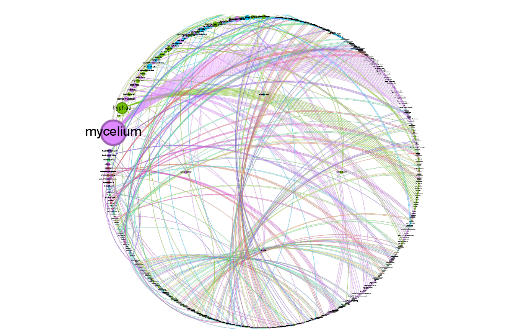


图 10：从三篇论文中新创建的图表，以圆形布局显示（节点大小根据节点度数，节点颜色根据组）。共有501个节点，375条边，平均节点度为1.5，社群143个；该巨型连通分量包括155个节点和162条边，平均节点度为2.1和10个社群。


图 11 显示了从三篇论文中新创建的图表，以圆形布局可视化（节点大小根据节点度数，节点颜色根据组）。此外，图 S1 中显示了图属性的详细统计分析。接下来，图 11 显示了将新生成的图集成到原始大图中，并在这个新结构中进行路径查询的结果。该查询是将“可持续材料”与“菌丝体”联系起来，反映了我们最初的查询目标。


这些节点之间的最短路径如图 11a 所示。相关的，图 11b 显示了从该路径中提取的结果子图（这是通过选择该路径中的所有节点及其最近邻居来完成的）。图 11c 显示了相同的图表，但采用圆形布局。在图 11b 和 c 中，显示了原始组标识和节点度。桥接中心性根据节点作为图不同部分之间“桥梁”的位置来衡量网络中节点的重要性。该指标背后的想法是，某些节点在连接网络中原本分离或遥远的区域、促进它们之间的通信和交互方面发挥着关键作用。


在图 11d 中，我们显示了使用此度量的图，其中每个节点的大小基于其桥接中心性，以及按组标识的颜色，这里是为子图新生成的 [39]。图 11d 中的分析特别值得注意，因为它揭示了图表中类似于“桥接”特征的关键组成部分。其中包括“力学特性”、“力学强度”、“菌丝体”、“可持续材料”、“孔隙率”、“胶原蛋白”等。具有高桥接中心性的节点可能是战略连接器，即充当网络内不同集群或社群之间桥梁的节点。桥接中心性的概念与社交网络中弱联系理论的强度相一致[40]，这表明较弱的联系（通常由具有高桥接中心性的节点代表）在跨不同群体传播信息或创新方面更有价值。在概念关系的背景下，具有高桥接中心性的节点可能代表连接不同知识领域的概念，促进跨学科创新和理解。增强或加强与这些桥接节点的连接可以显着提高整个网络知识或信息的凝聚力和流动。我们发现这是通过图推理专门识别研究机会的好策略。


<!-- 原文第 33 页 -->

<a id="page-33"></a>

*原文第 33 页*


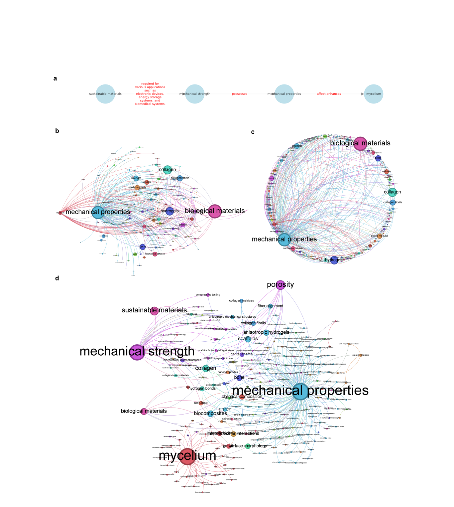


图 11：将新生成的图（见图 ）集成到大图中，并在这个新结构中进行路径查询的结果。问题是将“可持续材料”与“菌丝体”联系起来。这些节点之间的最短路径如面板 a 所示。面板 b 显示从该路径提取的结果子图（这是通过选择该路径中的所有节点及其最近邻居来完成的）。面板 c 显示相同的图表，但采用圆形布局。在面板 b 和 c 中，显示了原始组标识和节点度。在面板 d 中，我们显示相同的图，但根据其桥接中心性确定每个节点的大小，并根据组标识（为子图新生成）确定颜色。


<!-- 原文第 34 页 -->

<a id="page-34"></a>

*原文第 34 页*


我们现在进行两个实验：首先，使用整个子图，第二，使用从子图派生的子图，该子图具有一组具有最高桥接中心性的选择节点。我们首先使用整个新生成的子图（图 11）并将其用作回答问题的上下文。在这种情况下，与之前我们提供各种排名最短路径选项不同，这里我们将整个图提供给模型。给出的任务是：


发挥创造力并综合新的研究理念来构建可持续的菌丝体材料。利用所有上下文来制定新的方向，并提供详细的答案。


X-LoRA 的响应显示在文本框 11 中。一个关键的见解是在菌丝体材料中使用纳米纤维素。这一想法基于这样的发现：纳米纤维素在水存在下会因氢键而断裂，但当与氧化石墨烯纳米片结合时，它可以带来更高的拉伸强度和韧性。该模型进一步建议研究分子间相互作用在菌丝体生长中的作用及其如何影响表面形态。该模型表明，分子间相互作用和表面形态之间的相互作用可能使我们能够制定操纵这些因素的策略。自密封包装系统已经被提出，但该模型表明这是未来发展的一个特别有趣的途径。也许最关键的见解是，分层组织可以用作提高菌丝体材料稳健性的一种方法，以及纳米纤维素与氧化石墨烯纳米片的新颖组合。这是基于较高层次组织往往更稳健的概念提出的，为操纵菌丝体材料的层次组织以通过这些特定的材料机制提高其稳健性和可持续性提供了可能的方法。


X-LoRA 一个潜在的研究想法可能是探索在菌丝体材料中使用纳米纤维素来提高其力学性能。知识图谱表明，纳米纤维素在水存在下会因氢键而断裂，但当与纳米片结合时，它可以带来更高的拉伸强度和韧性。通过将纳米纤维素融入菌丝体材料中，研究人员有可能增强其力学性能并使其更具可持续性。


另一个想法可能是研究分子间相互作用在菌丝体生长中的作用及其如何影响表面形态。知识图谱表明分子间相互作用对于生长至关重要，表面形态会影响疏水性。通过了解分子间相互作用和表面形态之间的相互作用，研究人员可以制定策略来操纵这些因素并创造更可持续的菌丝体材料。


第三个研究想法可能是探索菌丝体材料用于创建自密封包装系统的潜力。知识图谱表明菌丝体可以制造防水容器，并可能提供生产可持续包装系统的机会。通过进一步开发这项技术，研究人员可以创造出更环保的传统包装材料替代品。


最后，研究人员可以研究菌丝体材料的层次结构和稳健性之间的关系。知识图谱表明，层次组织的程度决定了鲁棒性的程度，层次组织越高的材料往往更鲁棒。通过了解这种关系，研究人员可以制定策略来操纵菌丝体材料的分层组织，以提高其稳健性和可持续性。


文本框 11：当 X-LoRA 被要求发挥创造力并综合新的研究想法来构建可持续的菌丝体材料时，它的反应。该模型还被要求使用所有上下文来开发新方向，并提供详细的答案。


为了获得进一步的见解，人类用户随后跟进并询问 X-LoRA（在知识图谱的相同上下文下）：


提供可用于控制菌丝体材料中分子间相互作用和表面形态之间相互作用的特定化学策略。特别关注原子机制和预测行为。列出可以使用的候选材料或化学物质，并推测您期望的机制类型。


响应显示在文本框 12 中。化学修饰和预期行为的详细想法令人震惊，特别是因为它们提供了非常具体且深刻的见解。重要的一点是，菌丝体材料中分子间相互作用和表面形态之间的相互作用可以通过使用可以影响菌丝体纤维之间氢键相互作用的官能团来控制（例如，羧酸基团可以增强氢键，而胺基可以削弱氢键，但该模型还探索了使用纳米级表面粗糙度作为实现这一目标的手段）。该模型表明，这可以通过改变菌丝体纤维的表面化学来实现（在生长期间或之后，正确理解在这种情况下可以利用活的和非活的菌丝体）。提出的另一种策略是使用超分子组装体，例如环糊精或主客体相互作用，来控制分子间相互作用和表面形态之间的相互作用（后者影响材料的表面能和润湿性）。这种化学一体化


<!-- 原文第 35 页 -->

<a id="page-35"></a>

*原文第 35 页*


功能化和纳米纹理是一个特别有趣的设计原理，特别是当与这些提供对复合材料内相互作用的高水平控制的事实相结合时。该模型还表明，超分子组装体的使用尤其可以提供新颖的热性能，例如由这些添加剂驱动的玻璃化转变温度和结晶度效应。 X-LoRA 控制菌丝体材料中分子间相互作用和表面形态之间相互作用的一种化学策略是通过使用可以影响菌丝体纤维之间氢键相互作用的官能团。例如，羧酸基团可以增强氢键，而胺基团可以削弱氢键。这可以通过改变菌丝体纤维的表面化学来实现，例如通过使用官能化分子或在菌丝体生长过程中掺入官能团。纳米级表面粗糙度还可用于控制表面形态和分子间相互作用。通过在菌丝体纤维表面创建纳米级特征，可以调节纤维之间的氢键相互作用，从而改变材料的性能。


另一种化学策略是使用超分子组装体，例如环糊精或主客体相互作用，来控制分子间相互作用和表面形态之间的相互作用。这些组件可以在生长过程中或通过后处理处理合并到菌丝体纤维中，以调节氢键相互作用和表面形态。


就预测行为而言，使用官能团控制菌丝体材料中的分子间相互作用和表面形态预计将导致材料力学性能的变化，例如拉伸强度和韧性。超分子组装体的结合预计会导致材料热性能的变化，例如玻璃化转变温度和结晶度。纳米级表面粗糙度的使用预计将导致材料表面能和润湿性的变化。


可以使用的候选材料或化学物质包括官能化分子，例如羧酸或胺官能化分子，以及超分子组装体，例如环糊精或主客体相互作用。具体的作用机制将取决于所采用的具体化学策略和期望的结果。


总体而言，这些化学策略的使用可以提供强大的工具来控制菌丝体材料中分子间相互作用和表面形态之间的相互作用，从而开发具有独特性能和应用的新型材料。


文本框 12：当 X-LoRA 负责提供可用于控制菌丝体材料中分子间相互作用和表面形态之间相互作用的特定化学策略时，X-LoRA 的响应。该模型的进一步任务是专门关注原子机制和预测行为，并列出可以使用的候选材料或化学物质，并推测您期望的机制类型。


BioinspiredLLM-Mixtral 模型回答了文本框 13 中所示的原始问题。该模型通过利用菌丝体的独特特性（例如其生长和适应环境的能力、高力学强度及其生物降解性潜力），建议在电子设备、储能系统和生物医学系统等各种领域中进行应用。这种反应的一个独特方面是不同类型的骨可以用作增强菌丝体材料的力学性能的手段。这可能会导致骨移植或组织工程支架等用途。此外，建议使用纳米复合材料和纳米填料作为一种通过提高菌丝体材料的刚度、韧性和抗降解性来进一步增强其力学性能的方法。其他设计特点包括不同层次的层次结构（类似于 X-LoRA 的早期响应）以及纳米填料的使用。


最后，文本框 14 中描述了 GPT-4 的响应。一个关键的设计特征是将不同的材料纳入含有胶原蛋白或其他强度增强纳米填料的菌丝体纳米复合材料中。该模型预测，这些混合材料将表现出更高的刚度和延展性。确定的另一个关键设计特征是孔隙率的使用。利用大孔水凝胶中使用的孔隙率控制技术，该模型表明可以将类似的策略应用于菌丝体以创建具有定制孔隙率的支架。这些支架可以更接近地模仿天然骨结构，促进骨移植应用中更好的整合和更快的愈合。其他想法包括使用矿物填料或其他可持续添加剂，如纤维素或壳聚糖，可用于构建不仅可生物降解而且具有商业用途所需的强度和耐用性的包装材料。具体来说，使用石墨烯或金属有机框架等对外部刺激做出反应的纳米填料可以产生健康监测系统，其中材料本身可以检测压力或损坏的变化，在故障发生之前发出维护警报。利用菌丝体的力学强度和疏水特性，该模型还预测了开发创新的水处理过滤系统的潜在途径，利用高力学强度和疏水特性的平衡。预计这些系统能够有效过滤污染物，同时在各种环境条件下保持坚固耐用。总体而言，概述了一系列丰富的应用，从模仿牙釉质的牙齿修复，到包装、电子产品，再到结构材料。


GPT-4 响应中的一个有趣主题是开发菌丝体-胶原复合材料的提议。与这里和前面几节中讨论的大多数设计一样，据我们所知，这还没有被


<!-- 原文第 36 页 -->

<a id="page-36"></a>

*原文第 36 页*


BioinspiredLLM-Mixtral 基于提供的知识图谱，有几种构建可持续菌丝体材料的研究思路。一种方法是探索菌丝体作为可持续材料用于电子设备、储能系统和生物医学系统等各种应用的潜力。这可以通过利用菌丝体的独特特性来实现，例如其生长和适应环境的能力、高力学强度以及生物可降解性的潜力。


另一个研究想法是研究不同类型的骨骼对菌丝体材料力学性能的影响。这可以深入了解如何针对特定应用（例如骨移植或组织工程支架）优化菌丝体材料的力学性能。此外，纳米复合材料和纳米填料的使用可以通过提高菌丝体材料的刚度、韧性和抗降解性来进一步增强其力学性能。


此外，研究生物材料中的层级微结构，能够为设计具有更好力学性能的可持续菌丝体材料提供有价值的认识。通过理解不同层级如何影响生物组织的力学行为，研究者可以制定新策略，设计力学性能可调的菌丝体材料。


最后，仿生方法也可有效用于构建力学性能更好的可持续菌丝体材料。通过研究生物组织力学行为背后的机制，研究者能够开发具有独特性质和功能的新型仿生材料。例如，可以将层级微结构、纳米复合材料和纳米填料与仿生方法相结合，创造力学性能增强的新型菌丝体材料。


**文本框 13：** BioinspiredLLM-Mixtral 在被要求创造性地综合新研究思路、构建可持续菌丝体材料时的回答。进一步要求模型“利用全部上下文发展新方向，并给出详细回答”。


迄今为止的文献中尚未讨论，这表明模型识别出一种新的材料设计。为进一步了解这一具体新思路，我们追问模型：


> **用户：** 讨论混合菌丝体-胶原复合材料的技术细节，重点关注分子结构、相互作用和预测行为。推测你预期会出现哪些机制。


GPT-4 的回答见文本框 15。模型预测，在菌丝体-胶原复合材料中，相互作用可能发生于分子和原纤维尺度，包括几丁质羟基与胶原中羟脯氨酸之间的氢键；范德华力和静电相互作用也可能稳定复合结构。菌丝体的几丁质结构与胶原三螺旋之间的相容性，有助于形成连续基体，提高力学性能。模型预测了力学增强、生物降解性、复杂孔隙图案和自修复等一组很有意义的特征。菌丝体的生长和自修复能力可能赋予复合材料自修复性：受损后，菌丝体可能重新定殖并修复复合基体，这对长期使用的可持续材料尤为有用。模型还理解了所提议组分之间的相互作用，明确指出胶原的拉伸强度可补充菌丝体几丁质所提供的刚性，使材料的刚度、强度和韧性高于各单独组分。降解速率可通过菌丝体与胶原的比例、交联程度和环境条件控制，从而为特定应用调节性能。菌丝体固有的孔隙性与胶原的原纤维特性，可能形成高度连通的孔隙结构，适于流体输运、细胞迁移和营养扩散等需求，例如组织工程支架。鉴于二者的生物相容性，预计复合材料无毒，并支持细胞黏附和增殖。尤其是胶原在组织细胞外基质中的作用，可以增强细胞与材料的相互作用。由于我们还要求模型探索更具推测性的机制，它提出了几项值得关注的预测，包括菌丝体和胶原协同组织结构带来的应力分布改善、提高不同环境中耐久性和稳定性的水分调节，以及增强的生物功能，如骨再生或抗炎响应。


接着，我们要求模型对经过提取和筛选、聚焦于最高桥接中心性节点的图进行推理，这为生成新研究思路提供了很大潜力。我们以图 11d 所示子图中进一步提取的子图作为回答问题的上下文，选择桥接中心性最高的前 $N=20$ 个节点。它们是连接不同聚类或社群的战略连接点。我们提出与之前相同的问题，但此次提供的图数据不同：


<!-- 原文第 37 页 -->

<a id="page-37"></a>

*原文第 37 页*


GPT-4 鉴于知识图谱中概述的材料、结构和属性之间的复杂关系，我们可以得出一些专注于可持续菌丝体材料开发的创新研究想法。该图强调了力学性能的重要性、纳米复合材料的作用、孔隙率的影响以及生物复合材料的潜力等因素。综合这些见解，我们可以提出以下研究方向：


开发菌丝体-纳米复合材料混合物以增强力学强度：该图明，纳米复合材料可以显着提高力学强度，并含有胶原蛋白等材料，这对生物材料至关重要。通过将含有胶原蛋白或其他增强强度的纳米填料的纳米复合材料纳入菌丝体材料中，我们可以创造出具有更高刚度和延展性的混合物。这些材料非常适合需要坚固且轻质材料的应用，例如汽车或航空航天工业。


用于骨移植应用的孔隙率控制的菌丝体支架：孔隙率与力学性能密切相关，并且对于骨移植应用的支架至关重要。利用大孔水凝胶中使用的孔隙率控制技术，可以将类似的策略应用于菌丝体以创建具有定制孔隙率的支架。这些支架可以更接近地模仿天然骨结构，促进骨移植应用中更好的整合和更快的愈合。


用于包装的具有改进力学性能的生物复合菌丝体材料：该图明，生物复合材料可以通过添加矿物填料并与菌丝体接触来提高力学性能。开发将菌丝体与矿物填料或纤维素或壳聚糖等其他可持续添加剂结合在一起的生物复合材料可能会导致包装材料不仅可生物降解，而且还具有商业用途所需的强度和耐用性。


具有疏水特性的自密封菌丝体容器：鉴于菌丝体具有疏水性并可以制造防水容器，因此有机会开发用于敏感包装解决方案（例如电子产品或易腐烂商品）的自密封菌丝体容器。这些容器可以利用菌丝体的生物焊接能力来形成气密密封，为传统包装材料提供创新且可持续的替代品。


用于结构健康监测的嵌入纳米填料的智能菌丝体材料：将智能材料的概念与菌丝体相结合，我们可以探索开发嵌入石墨烯或金属有机框架（MOF）等纳米填料的菌丝体材料，这些纳米填料可以响应外部刺激。这些材料可用于结构健康监测系统，材料本身可以检测应力或损坏的变化，在故障发生之前发出维护警报。


用于改进牙科应用的混合菌丝体材料：考虑到牙釉质的力学性能和菌丝体创建分层结构的潜力，一个新的研究方向可能涉及开发将菌丝体与模仿牙釉质的矿物成分相结合的混合材料。这些材料可以为牙齿修复或种植提供可持续且可能更具生物相容性的替代品。


具有增强机械和疏水特性的基于菌丝体的过滤系统：利用菌丝体的力学强度和疏水特性，有可能开发用于水处理的创新过滤系统。这些系统可以利用菌丝体的结构和材料特性来过滤污染物，同时在各种环境条件下保持坚固耐用。


这些想法中的每一个都集成了知识图谱的多个方面，重点是利用菌丝体的独特特性与其他材料相结合，在一系列应用中创建创新、可持续的解决方案。这些方向的进一步研究和开发可能会导致材料科学的重大进步，特别是在可持续性和环境保护方面。


文本框 14：当 GPT-4 被要求发挥创造力并综合新的研究想法以构建可持续的菌丝体材料时，GPT-4 的反应。该模型还被要求使用所有上下文来开发新方向，并提供详细的答案。


<!-- 原文第 38 页 -->

<a id="page-38"></a>

*原文第 38 页*


GPT-4 混合菌丝体-胶原复合材料代表了一类新型生物材料，它利用了菌丝体的独特特性，菌丝体是真菌的营养部分，由菌丝网络和胶原蛋白组成，胶原蛋白是动物界中最丰富的蛋白质，以其在结缔组织中的结构作用而闻名。此类复合材料的开发基于了解菌丝体和胶原蛋白之间的分子结构和相互作用，以及预测它们组合时的行为和机制。在这里，我们深入研究这些方面，重点关注混合菌丝体-胶原复合材料预期的技术细节和推测机制。


分子结构和相互作用


菌丝分子结构：菌丝体由菌丝网络组成，菌丝是由几丁质和其他多糖组成的管状结构。甲壳素是一种 N-乙酰氨基葡萄糖的长链聚合物，是提供刚性和强度的关键结构成分。菌丝体的结构具有高度多孔性，可以快速生长并适应其环境。


胶原蛋白分子结构：胶原蛋白是由三个多肽链组成的蛋白质，形成三螺旋。这种结构提供了高拉伸强度和弹性。胶原蛋白的主要氨基酸是甘氨酸、脯氨酸和羟脯氨酸，这有助于其独特的三螺旋结构。胶原蛋白分子可以组装成原纤维和纤维，有助于组织的力学性能。


相互作用：在混合菌丝体-胶原复合材料中，相互作用可能发生在分子和原纤维水平。这些相互作用可能涉及甲壳素的羟基和胶原蛋白中的羟脯氨酸之间的氢键。此外，范德华力和静电相互作用可以在稳定复合结构方面发挥作用。菌丝体的几丁质结构和胶原蛋白的三螺旋之间的相容性可以促进基质的连贯，从而增强复合材料的力学性能。


预测行为和机制


机械增强：复合材料的结构完整性预计将受益于两个组件的力学性能。胶原蛋白的拉伸强度可以补充菌丝体甲壳素提供的刚性，从而使材料与单个成分相比具有更高的刚度、强度和韧性。


生物降解性和环境相互作用：菌丝体和胶原蛋白都是可生物降解的，使得复合材料环境友好。降解速率可以通过菌丝体与胶原蛋白的比例、交联程度和环境条件来控制，从而为特定应用提供可调节的特性。


混合复合材料孔隙率：菌丝体固有的孔隙率和胶原蛋白的纤维性质可以产生具有高度互连的孔隙结构的复合材料。这种孔隙率有利于需要流体运输、细胞迁移和营养扩散的应用，例如组织工程支架。


生物相容性和生物活性：考虑到菌丝体和胶原蛋白的生物相容性，该复合材料预计是无毒的并且支持细胞附着和增殖。特别是胶原蛋白的存在，由于其在组织细胞外基质中的作用，可以增强细胞与材料的相互作用。


自修复和适应性：菌丝体的生长和自修复能力可以赋予复合材料自修复特性。一旦受损，菌丝体可能会重新定植并修复复合基质，这种机制在长期、可持续的材料应用中特别有用。


推测性机制：


应力分布和耗散：由于菌丝体和胶原蛋白的协同结构组织，混合复合材料可以比其单个组件更有效地分布和耗散机械应力。


水分调节：多孔结构可以调节水分含量，增强在各种环境下的耐用性和稳定性。


增强的生物功能：通过用生物活性分子对复合材料进行功能化，可以引入特定的生物功能，例如促进骨再生或抗炎反应。


总之，混合菌丝体-胶原复合材料为开发可持续、生物相容性和机械坚固的材料提供了令人兴奋的前景。菌丝体和胶原蛋白之间的分子结构和相互作用为一系列行为和机制铺平了道路，从增强的力学性能到生物降解性和自愈能力。该领域的进一步研究和开发可能会带来生物医学工程、环境可持续性等方面的创新解决方案。


文本框 15：GPT-4 在负责讨论混合菌丝体-胶原复合材料的技术细节时的反应，特别关注分子结构、相互作用以及预测的行为和机制。


<!-- 原文第 39 页 -->

<a id="page-39"></a>

*原文第 39 页*


发挥创造力并综合新的研究理念来构建可持续的菌丝体材料。利用所有上下文来制定新的方向，并提供详细的答案。


X-LoRA 模型的响应如文本框 16 中所示。该模型特别指出研究分子间相互作用的影响、疏水性的作用、纤维排列和表面形态对这些材料力学强度的影响作为关键目标。由菌丝体和胶原蛋白或氢键介导系统制成的生物复合材料还发现了其他重要的研究机会。提出的一个具体问题是研究力学性能、孔隙率和氢键（以及如何操纵它们来增强力学性能和功能，如疏水性和表面形态）对这些材料的整体性能和行为的影响。该模型确定的一个显着特征是重点关注原胶原分子的自组装作为基础框架，它可以以有趣的方式与菌丝体的生长相互作用，并特别考虑诸如由此产生的纤维排列等问题。这些研究机会与电子设备、储能系统和生物医学系统等多种应用相关。


X-LoRA 根据给定的图和提供的信息，我们可以识别具有高桥接中心性的几个节点，这些节点可能是增强整个网络知识的凝聚力和流动的潜在目标。这些节点包括力学性能、菌丝体、力学强度、孔隙率、胶原蛋白、生物复合材料、支架、氢键、纤维排列、牙釉质、疏水性和表面形态。


为了开发新的研究思路来构建可持续的菌丝体材料，我们可以重点关注以下几个方面：


研究菌丝体材料的力学性能并了解如何增强或改进它们。这可能涉及研究分子间相互作用、纤维排列和表面形态对这些材料力学强度的影响。


探索由菌丝体和其他可持续材料（例如胶原蛋白或氢键）制成的生物复合材料的潜力。这可能涉及研究力学性能、孔隙率和氢键对这些材料的整体性能和行为的影响。


使用菌丝体和胶原蛋白开发支架，并研究它们的生长和疏水性。这可能涉及了解分子间相互作用和表面形态在促进生长和增强疏水性方面的作用。


研究菌丝体材料的力学强度以及如何通过原胶原分子的自组装来提高力学强度。这可能涉及了解力学强度、胶原纤维和纤维排列之间的关系。


研究孔隙率对菌丝体材料的力学性能和行为的影响，以及如何针对电子设备、储能系统和生物医学系统等特定应用进行优化。


研究氢键在菌丝体材料中的作用以及如何操纵它们来增强力学性能和功能，例如疏水性和表面形态。


通过关注这些方面并利用从给定图表和背景中获得的知识，我们可以开发新的研究思路来构建功能性和环境友好型的可持续菌丝体材料。


**文本框 16：** X-LoRA 在被要求创造性地综合新研究思路、构建可持续菌丝体材料时的回答。上下文图基于桥接中心性最高的前 $N=20$ 个节点提取；这些节点是连接不同聚类或社群的战略连接点。


BioinspiredLLM-Mixtral 模型的响应如文本框 17 所示。该模型建议研究生物材料（例如骨和胶原原纤维）的力学性能和孔隙率之间的关系，作为可持续菌丝体材料的基础。该模型还建议研究氢键在增强力学强度和疏水性方面的作用，作为实现更好功能和控制的手段。该模型进一步建议研究胶原原纤维的力学性能和纤维排列之间的关系，类似于之前提出的想法，


GPT-4 的响应如文本框 18 所示。该模型提出了多种想法，包括使用矿物填料来调整菌丝体生物复合材料的力学性能。鉴于生物复合材料由于添加矿物填料而可以改善力学性能，因此拟议的研究旨在确定增强强度、耐用性和功能性的最佳组合。该模型还确定了分析骨骼结构特性（包括胶原纤维排列和分子间相互作用）以改善菌丝体材料的机会。提出的具体建议是将菌丝体与胶原蛋白以各种构型结合来制造支架，以评估其力学强度、孔隙率以及促进细胞生长和分化的能力。该模型与 X-LoRA 一样，建议探索菌丝体基质内原胶原分子的自组装。还建议人们可以操纵菌丝体的生长条件


<!-- 原文第 40 页 -->

<a id="page-40"></a>

*原文第 40 页*


BioinspiredLLM-Mixtral 根据提供的数据，我们可以识别该知识图谱中的几个关键概念和关系，可用于开发构建可持续菌丝体材料的新研究思路。


以下是一些潜在的方向：


1. 探索生物材料（例如骨和胶原纤维）的力学性能和孔隙率之间的关系。这可能涉及研究孔隙率的变化如何影响这些材料的力学强度以及如何优化它们以提高其性能。


2. 研究氢键在增强生物材料力学强度和疏水性方面的作用。这可能涉及探索氢键如何影响胶原纤维和其他材料的分子间相互作用和表面形态。


3. 研究菌丝体生物复合材料在改善可持续材料力学性能方面的潜力。这可能涉及研究如何利用菌丝体赋予疏水性并促进生物复合材料的生长，以及如何对其进行优化以改善其在电子设备、储能系统和生物医学系统等各种应用中的性能。


4. 研究胶原原纤维和其他材料的力学性能和纤维排列之间的关系。这可能涉及研究纤维排列如何影响这些材料的力学强度和疏水性，以及如何优化它以提高其性能。


5. 探索生物复合材料通过添加矿物填料来提高可持续材料力学性能的潜力。这可能涉及研究如何使用矿物填料来增强生物复合材料的力学强度和疏水性，以及如何对其进行优化以改善其在电子设备、储能系统和生物医学系统等各种应用中的性能。


6. 研究分子间相互作用在促进菌丝体生物复合材料生长中的作用。这可能涉及研究分子间相互作用如何影响基于菌丝体的生物复合材料的疏水性和表面形态，以及如何优化它们以改善其在电子设备、能量存储系统和生物医学系统等各种应用中的性能。


7. 通过研究胶原纤维在骨组织中的特性和行为，探索胶原纤维改善可持续材料力学性能的潜力。这可能涉及研究胶原原纤维如何影响骨组织的整体力学性能，以及如何优化它们以改善其在电子设备、能量存储系统和生物医学系统等各种应用中的性能。


**文本框 17：** BioinspiredLLM-Mixtral 在被要求创造性地综合新研究思路、构建可持续菌丝体材料时的回答。上下文图基于桥接中心性最高的前 $N=20$ 个节点提取；这些节点是连接不同聚类或社群的战略连接点。


改变其表面形态并整合疏水化合物或结构。该模型确定了从建筑到消费品的应用，从而减少了对不可再生材料的依赖。


与之前的回复相比，此处提供的三个选项提供了有关该主题的更多细节和更深入的思考。


作为替代方案，可以使用将图像视为输入的多模态 LLM 来直接解释图 11d 中所示的图表，而不是在节点和边的原始数据中提供图表。为了测试这一点，我们通过 ChatGPT 提示 GPT-4V：


[...] 仔细分析该图。发挥创造力并综合新的研究理念来构建可持续的菌丝体材料。


GPT-4V 的响应显示在文本框 19 中。结果虽然不像我们使用图表进行提示时的早期响应那么详细，但仍然提供了非常有趣的见解。由于在某些情况下提供数据的可视化表示（例如图表，以及来自实验、建模等的图形）可能更容易，因此这可以作为与模型交互并以各种方式共享数据的可行方法。 GPT-4V 显示出正确识别图像中的文本和理解图形关系的卓越能力。该模型将菌丝体纤维的分层组织及其对力学强度的影响确定为分析的关键领域。该模型还表明，开发能够响应温度、pH 值或湿度等环境刺激而改变其特性的菌丝体材料可能会带来创新应用。完整的对话通过对话 S2 作为补充材料包含在内。


这种对结果的可视化分析（无论是此处完成的图表，还是其他数据表示）在多智能体人工智能系统中特别相关，其中代码/人工智能智能体可以以绘图形式提供分析，例如图表，其中其他智能体对它们进行分析。


<!-- 原文第 41 页 -->

<a id="page-41"></a>

*原文第 41 页*


GPT-4 鉴于该图强调具有高桥接中心性的节点，我们可以推断这些节点在连接不同概念和促进跨学科创新方面发挥着关键作用。在开发可持续菌丝体材料的背景下，我们可以利用这些战略连接器来探索新的研究途径。以下是基于所提供数据的新研究想法的综合：


1. 通过矿物填料增强菌丝体生物复合材料的力学性能


研究思路：研究各种矿物填料对菌丝体生物复合材料力学性能的影响。鉴于添加矿物填料可以改善生物复合材料的力学性能，本研究旨在确定增强强度、耐用性和功能性的最佳组合。


方法：在菌丝体基质中试验不同类型和浓度的矿物填料。评估由此产生的力学性能、孔隙率和表面形态，以确定最有效的增强措施。


潜在影响：开发更坚固、更耐用的菌丝体材料，适用于从建筑到消费品的广泛应用，从而减少对不可再生材料的依赖。


2. 模仿骨结构的菌丝体材料的仿生设计


研究思路：探索菌丝体网络和骨组织之间的结构相似性，重点关注孔隙率、胶原蛋白整合和力学强度。这项研究旨在模仿骨骼的层次结构，以创造具有增强强度和弹性的菌丝体材料。


方法：分析骨骼的结构特性，包括胶原纤维排列和分子间相互作用。应用这些见解来设计具有类似分层结构的菌丝体材料，评估它们在压力下的力学性能和行为。


潜在影响：通过骨骼的仿生设计原理，这种方法可以开发出具有前所未有的强度和柔韧性的菌丝体材料，适用于生物医学应用及其他领域。


3. 耐水应用菌丝体材料的疏水性和表面形态


研究思路：鉴于菌丝体具有疏水性，而表面形态会影响这一特性，本研究旨在设计具有定制表面特性的菌丝体材料，以增强耐水性。


方法：操纵菌丝体的生长条件以改变其表面形态并整合疏水性化合物或结构。评估材料的耐水性、力学性能以及在各种环境中降解的可能性。


潜在影响：创建防水菌丝体材料，应用于户外建筑、包装和水敏感环境，有助于菌丝体产品的可持续性和多功能性。


4. 用于生物医学系统的胶原蛋白-菌丝体支架


研究理念：利用胶原蛋白和菌丝体之间的关系，开发用于组织工程和再生医学的创新支架。这项研究的重点是创建生物相容性强、机械坚固的支架，以支持细胞生长和组织再生。


方法：将菌丝体与胶原蛋白以各种配置结合起来制造支架。评估它们的力学强度、孔隙率以及促进细胞生长和分化的能力。探索菌丝体基质内原胶原分子的自组装。


潜在影响：为组织工程提供新的解决方案，有可能创建密切模仿自然组织机械和生物特性的支架，从而提高再生治疗的成功率。


结论


通过关注网络内的战略连接器，这些研究想法旨在利用菌丝体的独特特性及其与其他材料的相互作用，以突破可持续材料开发的界限。每个想法都代表着整合不同领域的知识（从材料科学到生物学）的一步，为紧迫的环境和技术挑战创造创新的解决方案。


**文本框 18：** GPT-4 在被要求创造性地综合新研究思路、构建可持续菌丝体材料时的回答。上下文图基于桥接中心性最高的前 $N=20$ 个节点提取；这些节点是连接不同聚类或社群的战略连接点。


<!-- 原文第 42 页 -->

<a id="page-42"></a>

*原文第 42 页*


GPT-4V 分析给定的图表，它似乎说明了各种材料科学概念的相互关联的性质，并强调了“力学强度”、“力学性能”、“菌丝体”、“可持续材料”、“生物复合材料”和“孔隙率”等节点的重要性，我们可以通过考虑图表所建议的链接和桥梁来综合构建可持续菌丝体材料的新研究思路。


以下是一些潜在的研究想法：


增强型菌丝体复合材料：考虑到菌丝体和生物复合材料之间的联系，有可能研究如何将菌丝体与其他天然纤维或废料结合以增强力学性能。例如，研究可以集中于开发一种平衡强度和孔隙率的复合材料，使其适合环保包装或绝缘等应用。


菌丝体和胶原蛋白支架：胶原蛋白和菌丝体之间的联系表明有机会研究菌丝体与再生医学的整合。我们可以探索使用菌丝体作为富含胶原蛋白的支架材料来支持细胞生长，这可以在组织工程中得到应用。


分层结构和菌丝体：研究菌丝体纤维的分层组织及其对力学强度的影响。这可以包括观察菌丝体内的微米和纳米级结构排列，并与骨骼等材料中发现的分层结构进行比较。


菌丝体力学性能优化：考虑到“力学性能”和“力学强度”的中心节点，有明确的迹象表明研究还应侧重于通过基因工程、生长条件控制或收获后加工技术优化菌丝体材料的这些性能。


可持续菌丝体材料生命周期评估：分析菌丝体材料的整个生命周期，从培养到报废，以确定可以改进以实现可持续性的关键流程。这将涉及跨学科方法，结合材料科学、生物学和环境研究的知识。


菌丝体作为材料科学教育的桥梁：考虑到桥接中心性的概念，菌丝体可以用作教育环境中的案例研究，以说明生物系统与材料科学的整合，可能激发可持续材料设计的新思维方式。


智能菌丝体材料：受“智能材料”节点的启发并与“力学行为”相关，研究创造菌丝体材料的可能性，这种材料可以根据温度、pH 或湿度等环境刺激改变其特性，这可能会带来创新的应用。


提高孔隙率和功能性：孔隙率是菌丝体材料中可以定制的一个关键特性。研究可以探索不同应用的最佳孔隙率，例如，最大化吸声材料的孔隙率或最小化承载应用的孔隙率。


通过结合这些不同的方面，我们可以突破当前材料科学的界限，并为具有定制力学性能和功能的可持续生物衍生材料开辟新的可能性。


文本框 19：当要求仔细分析图 11d 所示图形的图像时，GPT-4V 的响应。我们要求模型具有创造性并综合新的研究思想来构建可持续的菌丝体材料。


> ### 2.7 结合艺术图像分析、图推理与图像合成进行层级材料设计


上一节展示了 GPT-4V 理解复杂图像的复杂能力，重点是分析图形的可视化。我们现在探讨是否以及如何使用视觉线索和图推理的联合分析来生成响应。我们进一步探索如何使用这些响应来制定生成视觉模型的提示，该模型可以预测、描述新设计材料的实际微观结构图像并使其背景化。本分析的目的是检验这种方法的可能性，未来的研究可能会探索这种材料的合成，这表明使用生成式人工智能不仅可以集成来自知识图谱的数据，还可以集成额外的视觉线索。随着其他多模态人工智能系统的出现，例如集成音频/语音、视频等的系统，这可以成为跨科学领域和信息表示模式进行综合推理的强大方法。科学假设是，所提出的建模策略可以成功地将不同的模式集成到设计过程中。


与上一节一样，我们以图 11d 所示子图中进一步提取的子图作为上下文，并选择桥接中心性最高的前 $N=20$ 个节点。


这种方法的进展分多个阶段进行。首先，我们联合提供感兴趣的图像和图表，并要求 GPT-4V 对该数据进行推理，以回答特定问题。提示由图像、图形和给出的关键任务组成（要求模型结合图像数据和图数据来回答问题）：


<!-- 原文第 43 页 -->

<a id="page-43"></a>

*原文第 43 页*


[..] 首先，分析附图。重点关注您可以在图像中识别的机制，并详细描述它们。重要的是你要仔细分析如何解释这幅特定的画作，并详细说明。


其次，使用这些精心制作的信息和三元组图来综合一个具有高影响力的研究想法，以构建可持续的菌丝体材料。利用所有上下文来制定新的方向，并提供详细的答案。推测您期望的新材料的具体行为。


您努力思考如何创造性地将图像中的内容与提供的知识图谱联系起来。


注意所提供上下文中的每个细节。您必须包括关键的化学式、分子机制和物理过程。您的回答必须非常复杂。 [..]


作为图像来源，我们首先考虑瓦西里·康定斯基 (Wassily Kandinsky) 1913 年的抽象画《构图 VII》[41]，它被认为是他最重要的作品之一（见图 12）。这幅画以其情感强度、充满活力的调色板和动态运动（其中颜色和形状可以表达精神体验和情感）而闻名。该艺术品结合了超越字面解释的复杂抽象元素，因此非常适合我们想要探索与图推理接口的抽象类型。


响应如文本框 20 所示。我们注意到，我们没有向 GPT-4V 提供有关绘画名称或创作者的任何详细信息，而只是提供图像以及图表和任务上下文。分析可以分为几个关键方面。其中包括绘画的特征，这些特征被认为具有鲜艳的色彩并置、动态的形状和感知的自发线条，所有这些都存在于抽象的非客观现实中。该模型解释说，然后它使用这些来设计一种材料，将绘画中描绘的混乱和秩序与分子和宏观相互作用的复杂网络相协调，从而赋予材料独特的属性。


该模型认为，我们可以辨别艺术中的抽象如何操纵感知和情感，而材料科学中的抽象如何操纵属性和功能。然后使用这些原则来构建集成设计。该模型从绘画中流体和交织的图案中汲取灵感，作为创建具有复杂纤维排列的复合材料的隐喻，反映了艺术品动态和交织的本质。该模型还确定了孔隙率以及胶原蛋白和氢键的分子相互作用在力学强度中发挥的关键作用。


进一步认为，拼贴可以利用自组装行为来创建复杂的分层结构，从而赋予额外的力学性能。该模型预测这些结构将类似于艺术品构成中复杂多样的线条，作为这种抽象相互作用的物理表现。据推测，就像影响深度和运动感知的不同笔触一样，纤维的微米和纳米级组织可能会影响相关生物材料的力学性能。该材料可以通过添加矿物填料来进一步增强，以模仿牙釉质或骨骼中的特征。该模型还预测，可以根据外部刺激来引导生长，从而允许智能、响应性材料适应不同的负载或自主修复。这些提出的设计原则和相关属性提供了关于预期材料结构及其行为的可操作的、可测试的假设。


值得注意的是，与早期的设计相比，该分析产生了更加多维的设计，其中包含了关键成分（例如胶原蛋白和其他小分子）、设计线索（例如混乱和有序、形状和孔隙率梯度）和机制（例如由氨基酸模式驱动的自组装、驱动这些的化学功能化等）的更综合特征。现在我们已经有了设计的口头描述，我们要求 GPT-4 基于其之前开发的材料设计来开发，提示 DALL·E 3，一种文本到图像的生成 AI 模型。使用下面的提示中捕获的 `<RESPONSE>`，生成的提示为：


考虑一下对新材料的描述：<响应


为 DALL·E 3 开发一个结构良好、详细且清晰的提示，使我能够直观地看到新的材料设计。


提示的编写应使所得图像清晰反映材料的真实微观结构和关键特征。确保生成的图像不包含任何文本。


我们要求模型不要生成文本，因为 DALL·E 3 已知在正确生成字母/单词方面存在困难。生成的 DALL·E 3 提示符为：


<!-- 原文第 44 页 -->

<a id="page-44"></a>

*原文第 44 页*


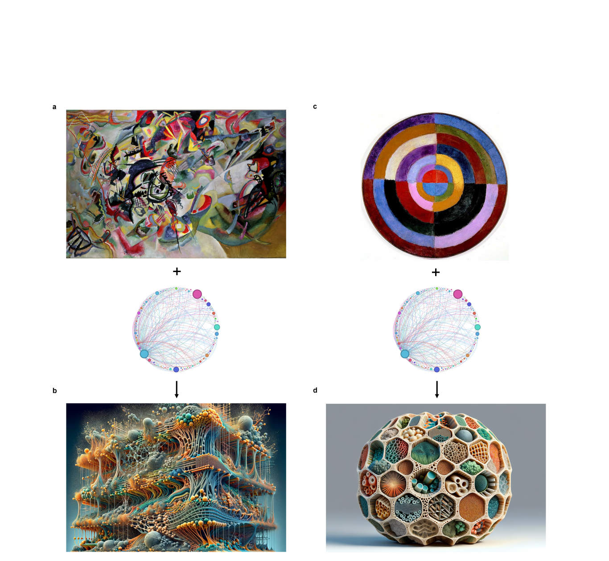


图 12：一种材料设计方法，从表现主义艺术的抽象和情感品质中汲取灵感，指导可持续菌丝体材料的开发。原画显示在面板 a 中（以及我们与图像联合推理的图的缩略图），生成的材料微观结构代表一种新颖的菌丝体复合材料，显示在面板 b 中。最初的艺术作品是瓦西里·康定斯基 (Wassily Kandinsky) [41] 创作于 1913 年的画作《构图 VII》，这是他最重要的作品之一。图 b 显示了 DALL·E 3 基于图推理和图像分析对新材料的描述设计的微观结构。这种复合材料的主要特征包括定制的力学性能和疏水性，利用菌丝体和胶原蛋白的结构和分子复杂性来实现具有环境响应性和自修复潜力以及分层结构的先进生物复合材料。表 6 通过解释关键设计特征、它们在图像中的表示、可能的材料功能以及制造或合成路线来补充面板 b 中显示的图像。请注意，生成的图像被裁剪以匹配原始绘画的纵横比。面板 c 和 d 显示了第二个例子，这次是基于 Robert Delaunay 于 1912 年至 1913 年创作的画作《Le Premier Disque》。该实验的结果显示了一种独特的新兴结构，突出地具有从原画中提取的圆形图案。我们还看到艺术内容影响设计结果，这可以通过比较左右示例（即面板 b 与面板 d）来证实。图 a 和 c 中显示的画作在美国属于公共领域，因为它们是在 1929 年 1 月 1 日之前出版（或在美国版权局注册）的。


<!-- 原文第 45 页 -->

<a id="page-45"></a>

*原文第 45 页*


GPT-4V 分析这幅画，我们看到一幅抽象的构图，充满了鲜艳的色彩并置、动态的形状和看似自发的线条。这是表现主义的一个例子，其中情感效果是至高无上的，对客观现实的描绘并不是目的。相反，我们沉浸在艺术家的心灵中，通过颜色、形式和纹理主观地感知世界。这里的机制不是字面意义上的机械，而是隐喻性的，与观看者的感知和情感有关。这种构图模糊了具象与抽象之间的界限，使观众在潜在形式（也许唤起自然形状、人物或情感）与对颜色和形式的纯粹审美欣赏之间摇摆不定。


使用知识图谱将这种从艺术到材料科学的抽象方法联系起来，我们可以辨别艺术中的抽象如何操纵感知和情感，而材料科学中的抽象如何操纵属性和功能的相似之处。该图明力学性能、生物材料和生长机制之间存在很强的相互作用，表明可持续材料开发中存在多层次的协同作用。


现在，综合一个融合这些主题的复杂研究想法：


为了构建可持续的菌丝体材料，我们可以利用绘画中流体和交织图案的灵感作为隐喻，创建具有复杂纤维排列的复合材料，反映艺术品的动态和交织的本质。考虑到菌丝体在增强力学性能和提供疏水性方面的作用，以及孔隙率以及胶原蛋白和氢键的分子相互作用在力学强度中发挥的关键作用，材料开发的整体方法是必要的。


例如，控制菌丝体基质的孔隙率可以调整其力学强度。通过调整纤维排列并增强分子间相互作用（例如胶原原纤维中发现的氢键），我们可以获得所需的力学性能。认识到基于菌丝体的材料具有疏水性，我们可以推测表面形态在复合材料的防水性以及可能的机械粘合性能中起着重要作用。因此，控制表面形态可能会影响疏水性，最终产生具有增强的防潮性和耐久性的新型生物复合材料。


By incorporating collagen-derived bio-scaffolds into mycelium materials, or using the basic structural unit of collagen-the tropocollagen molecule-we could leverage the self-assembly behaviors to create complex hierarchical structures that confer additional mechanical properties. These structures would be analogous to the intricate and diverse lines in the composition of the painting, serving as a physical manifestation of such abstract interplays and just like the varying brushstrokes that affect the perception of depth and movement, the micro-and nano-scale organization of the fibers could affect the mechanical properties of the biomaterial in question.


在可持续性的背景下，生物复合材料可以通过添加矿物填料来进一步增强。 This could lead to improved mechanical properties reminiscent of the rigidity and structural integrity seen in dental enamel or bone, both noted in the graph to possess mechanical properties.


进一步推测，我们可以探索新材料在不同环境条件下的行为。 Considering the biological aspect of mycelium, its growth could potentially be guided or modified in response to external stimuli, allowing for smart, responsive materials that adapt to varying loads or repair themselves autonomously.


The physical processes involved in developing such a material include the controlled biological growth of mycelium, the chemical cross-linking of collagen molecules to form fibrils, and the incorporation and alignment of mineral fillers to enhance the structural matrix. Critical chemical formulas would involve the sequences and cross-links of amino acids in the collagen strands, while the molecular mechanisms behind the self-assembly and bonding of biological materials would be essential to master to achieve the desired properties.


In conclusion, by bridging the conceptual divide between such an emotionally charged painting and the science of material creation, we can devise a research endeavor that seeks to develop sustainable, bio-inspired materials that harmonize the chaos and order depicted in the image with the intricate web of molecular and macroscopic interactions that afford a material its unique properties.


文本框 20：当被要求分析瓦西里·康定斯基 (Wassily Kandinsky) 的 1913 年抽象画《构图 VII》时，GPT-4V 的反应 [41]。


<!-- 原文第 46 页 -->

<a id="page-46"></a>

*原文第 46 页*


GPT-4 创建一个图像，将受表现主义艺术启发的新颖、可持续的菌丝体复合材料可视化。该材料应表现出错综复杂、交织的纤维排列，反映抽象表现主义绘画动态、交织的本质，具有鲜艳的色彩并置、动态的形状和自发的线条。强调材料的微观结构，展示菌丝体纤维与胶原蛋白衍生的生物支架交织在一起的复杂网络，形成多层、分层结构。纤维的厚度和排列应有所不同，代表绘画的不同笔触，并且还应显示出孔隙率和更密集的簇的区域，表明定制的力学强度和疏水性能。将矿物填料融入基质中，增强结构完整性和防潮性，让人想起天然骨骼和牙釉质中的刚性。整体构图应传达一种深度感和动感，反映混乱与秩序之间的抽象相互作用，以及材料设计中艺术与科学的融合。确保图像细节丰富，能够清晰地可视化材料独特的微米和纳米级组织，而不包含任何文本或绘画本身的明确描述。


然后将该提示直接输入 DALL·E 3 以实现设计的可视化表示。我们在图 12b 中描绘了生成的微观结构复合设计的示例。生成的图像通常很详细，并且包含丰富的设计见解。值得注意的是，尽管有具体说明，但某些生成的图像仍包含文本。这实际上很有趣，因为它可以准确地显示模型在不同区域中放置的材料、化学或特征（如果预测的文本可以被破译，或者在未来改进的文本到图像生成器版本中正确呈现）。


我们还测试了用于推理的艺术作品与图表是否会对结果产生强烈影响。为了更深入地探索这一点，图 12c 和 d 显示了第二个例子，这次是基于 Robert Delaunay 的画作“Le Premier Disque”。该实验的结果显示了一种独特的结构，突出显示了从原画中提取的圆形图案。还需要进一步的研究，但当我们想象采购创造力时，这些初步探索显示了强大的选择。值得注意的是，这些翻译不是直接从图像进行的，而是通过提示 GPT-4V 对图像进行推理并将图像推理与图表示中捕获的材料设计原理相结合。其表面由许多大小不同的六边形和圆形细胞组成，类似分子结构或有机生长。它的外观让人联想到蜂窝或珊瑚礁等自然结构。


通过 ChatGPT 使用 GPT-4 来解释生成的图像，可以进一步对生成的微观结构图像（图 12b）进行分析，以便更好地了解图像中的各个组件是什么、它们在集成系统中扮演什么角色以及如何制造它们。完整的对话包含在补充材料部分，请参阅补充对话 S3。表 6 总结了关键见解，涵盖设计特征、它们在图 12b 所示图像中的表示、可能的材料功能以及制造或合成路线。这些多模式交互提供了强大的途径来通知设计过程，并为工程师提供有关实施的关键信息。如果进行实验，它们的结果自然可以通过对话交互反馈给模型，以适应、改进或改变设计（例如，实现更大的可制造性或降低成本）。如果与自主制造方法相结合，这些方法可以产生复杂的实验建模推理循环，例如可以通过代理建模实现自动化。


我们如何才能更好地了解如何制造这种材料？为了获得见解，我们要求 GPT-4V 描述详细的分步过程，我可以通过该过程来制造整个设计。表 7 中提供了结果表（请注意，与许多早期示例一样，GPT-4V 在结构化处理中直接生成 LaTeX 格式）。这些额外的数据提供了令人着迷的途径，可以在未来的实验工作中追求，以对模型识别的假设集和预测行为采取行动。


最后，我们总结了菌丝体复合材料的设计结果，并将其置于更广泛的背景下。以下回应是通过与 Claude-3 Opus 分享本文草稿获得的，该模型要求模型确定 5 个关键的高影响力科学见解。这些应该特别关注材料设计方面。与前面围绕贝多芬材料同构的示例一样，我们向模型提出了几个后续问题，例如通过向五个等中的每一个添加一些子项目符号来了解更多细节。此处列出的结果文本是经过稍微编辑的集成版本，是这些交互的结果。结果显示在文本框 21 中。生成的文本提供了生成模型创建的原理的详细摘要。它将许多想法连接成对关键见解和原则的综合总结。这是人类与人工智能协作如何跨越多个步骤并产生各种可行结果的另一个演示。


<!-- 原文第 47 页 -->

<a id="page-47"></a>

*原文第 47 页*


**Claude-3 Opus**


1.利用分子结构之间复杂的相互作用以及菌丝纤维和胶原衍生的生物支架之间的相互作用，设计了新型菌丝体-胶原蛋白复合材料。该复合材料具有多层、分级结构，具有定制的力学性能、孔隙率和疏水性。


- 由几丁质和其他多糖组成的菌丝体纤维为复合材料提供了多孔且适应性强的框架。


- 使用重组DNA 技术合成的胶原衍生生物支架，为复合材料带来了生物相容性和结构完整性。


- 复合材料的分层结构模仿天然材料，可增强力学性能和多功能性。


2. 菌丝体-胶原蛋白复合材料掺入了羟基磷灰石或生物二氧化硅等矿物填料，以增强抗压强度和热稳定性。在生长的成熟阶段，矿物填料可能通过溶胶-凝胶过程整合到菌丝体基质中。


- 羟基磷灰石是骨骼的主要成分，可作为纳米级填料掺入，以提高复合材料的力学性能和生物相容性。


- 源自天然来源（例如硅藻）的生物二氧化硅可用作可持续且生物相容的填料，以增强热稳定性和力学强度。


- 溶胶-凝胶工艺允许将矿物填料可控地整合到菌丝体基质中，确保在整个复合材料中均匀分布。


3.使用硅烷偶联剂或氟化化合物进行表面功能化，在菌丝体复合材料中形成纳米级的疏水域。这种表面改性与通过冷冻干燥技术设计的孔隙率相结合，赋予材料防潮性和受控的流体相互作用。


- 硅烷偶联剂，如三乙氧基硅烷，可用于改变菌丝体纤维的表面化学性质，引入疏水性官能团。


- 氟化化合物，如氟烷基硅烷，可以接枝到复合材料的表面，形成低能量的防水层。


- 冷冻干燥技术可实现溶剂的受控升华，从而形成具有定制孔径分布和互连性的多孔结构。


4. 菌丝体-胶原复合材料的制造过程涉及菌丝体复合层的连续生物打印，允许制造复杂的几何形状和材料成分中潜在的梯度转变。通过机械压缩和交联进行致密化等后处理步骤可进一步调整力学性能。


- 生物打印能够精确沉积菌丝体复合层，促进复杂结构和空间变化材料特性的创建。


- 材料成分的梯度转变可以通过改变菌丝体与胶原蛋白的比例或通过在生物打印过程中引入额外的成分来实现。


- 打印后可应用机械压缩来使复合材料致密，增强其力学强度并减少目标区域的孔隙率。


- 交联剂，如戊二醛，可用于在菌丝体纤维和胶原蛋白之间建立共价键，进一步稳定复合材料的结构。


5.菌丝体-胶原蛋白复合材料有望表现出新的功能，例如自愈和适应性。利用菌丝体的生长和重新定殖的能力，复合材料可以在损坏时进行自修复。环境响应能力也可以通过加入 pH 指示剂或热致变色颜料来整合，使材料能够充当监测其状态或完整性的传感器。


- 复合材料的自愈能力依赖于菌丝体的再生潜力，菌丝体可以桥接和重新定殖受损区域，恢复材料的结构完整性。


- 适应性可以通过利用菌丝体对环境刺激（例如湿度、温度或养分可用性的变化）的响应性质来实现。


- pH 指示剂（例如酚酞或溴百里酚蓝）可以嵌入复合材料中，以可视化 pH 值的变化，作为监测材料状态的诊断工具。


- 热致变色颜料可根据温度波动而改变颜色，可用于创建视觉响应复合材料，以指示热应力或环境条件的变化。


文本框 21：菌丝体复合材料设计结果摘要，通过与 Claude-3 Opus 共享本文草稿获得。我们要求模型特别关注共享的论文草稿的内容。生成的文本详细总结了生成模型创建的原理。


<!-- 原文第 48 页 -->

<a id="page-48"></a>

*原文第 48 页*


**表 6：** 可持续菌丝体复合材料的材料设计分析，如图 12b 所示。该分析提供了可持续菌丝体复合材料的详细描述，其中菌丝体纤维、胶原蛋白衍生的生物支架和矿物填料等设计特征错综复杂地表现出来，并对应于结构完整性和疏水性等特定功能。描述了先进的制造技术，包括用于胶原蛋白合成的重组 DNA 技术和用于分层结构的顺序生物打印技术，提供了对材料复杂、多功能设计的深入了解。

| 设计特征 | 图像中的表现 | 可能的材料功能 | 制造或合成过程及技术细节 |
| --- | --- | --- | --- |
| 菌丝体纤维 | 长而相互交织的纤维 | 形成提供拉伸强度和柔韧性的骨架。 | 在富含木质素和纤维素的基质上培养灵芝（Ganoderma lucidum）等菌株的菌丝体，优化生长条件以获得所需纤维形态。 |
| 胶原衍生生物支架 | 网状纤维结构 | 提供生物相容性和结构完整性。 | 采用重组 DNA 技术，在大肠杆菌（E. coli）中表达 Gly-Pro-Pro 等特定胶原序列，再经纯化和自组装形成支架。 |
| 矿物填料 | 球形与卵形夹杂物 | 增强抗压强度和热稳定性。 | 在菌丝体生长的成熟阶段掺入纳米尺度羟基磷灰石或生物成因二氧化硅，可采用溶胶-凝胶工艺。 |
| 孔隙率 | 基体内可见的间隙 | 实现轻量化并提供隔热性能。 | 利用冷冻干燥技术使溶剂升华，控制孔隙形成，使孔径分布处于 100-500 微米范围。 |
| 致密聚集区域 | 紧密区域 | 提供局部承载能力。 | 收获后通过机械压缩致密化，或在选定区域引入戊二醛等交联剂。 |
| 疏水性 | 表面纹理变化 | 提供耐湿性并控制与流体的相互作用。 | 使用硅烷偶联剂或含氟化合物改性表面，构建纳米尺度疏水区域。 |
| 颜色表现 | 丰富而鲜明的色彩 | 提供美学特征，并标示功能区域。 | 使用响应环境刺激的 pH 指示剂或热致变色颜料，作为材料状态或损伤的传感指标。 |
| 深度与动感 | 多层动态图案 | 通过层级结构实现多功能性能。 | 依次生物打印菌丝体复合材料各层，可引入材料组成的梯度过渡以耗散应力。 |


## 3 结论


我们对大约 1,000 篇重点关注仿生材料和力学的科学论文进行了广泛分析。通过将提取的信息组织成详细的本体知识图谱，我们能够绘制出支撑身体知识的复杂连接网络，这是一个高度跨学科的领域，涉及多个交叉学科（材料、化学、生物学、力学等）。生成的图作为该领域内大量实体及其相互关系的结构化表示，促进不同科学领域知识的系统探索和综合[18,19,20,10]。我们的分析揭示了整个网络的强大连接性，某些主题成为网络内的中心节点。这种模式表明知识图谱的结构表现出无标度网络的特征，这是一种以在众多连接程度较低的节点中存在一些高度连接的节点而闻名的网络类型。利用这种结构，我们报告了一系列旨在探索相互关联的知识领域的深度和广度的实验。这些实验包括的任务包括确定不同科学概念之间的最短路径、利用图的结构来回答复杂的科学问题，以及通过使用 X-LoRA 混合专家模型进行代理头脑风暴等方法以及结合最新文献中的即时数据收集等方法，以新的见解动态扩展图。这些努力的一个重要成果是确定了新颖的关系和跨学科


<!-- 原文第 49 页 -->

<a id="page-49"></a>

*原文第 49 页*


**表 7：** GPT-4V 提出的菌丝体复合材料的分步制造工艺。

| 步骤 | 阶段 | 过程细节 |
| --- | --- | --- |
| 1 | 菌丝体培养 | 选择健壮的菌丝体菌株，制备富含木质素纤维素的基质，在无菌条件下接种，优化生长参数，并收获纤维垫。 |
| 2 | 支架合成 | 合成胶原蛋白基因，在大肠杆菌中表达，纯化蛋白质，并通过静电纺丝或成型形成支架。 |
| 3 | 矿物填料一体化 | 选择纳米级羟基磷灰石或二氧化硅，可能通过溶胶-凝胶处理，并均匀地融入菌丝体基质中。 |
| 4 | 复合阵型 | 将菌丝体和胶原蛋白支架分层，施加压力致密化，然后干燥以产生孔隙并去除水分。 |
| 5 | 表面改性 | 使用疏水剂以实现防潮，并创建表面纹理以获得所需的性能。 |
| 6 | 后处理 | 对材料进行切割和成型，进行性能测试，并根据生物医学应用的需要进行灭菌。 |
| 7 | 功能化（可选） | 将 pH 值或热致变色颜料等环境响应元素融入功能区。 |
| 8 | 最终检验 | 执行质量检查并包装最终产品以保持使用前的状态。 |


以前未曾认识到的联系。这丰富了推理能力，并为未来的研发和创造性发现提供了多种途径。


本文提出了一种强大的机制，用于从科学论文等大型数据集创建知识图谱表示，识别关键属性，例如它们的无标度性质。我们的自动化且可扩展的算法构建了这些图表，并对其进行了严格分析。通过利用图的传递特性，我们提取子图来生成新的假设和创新的设计方案，例如新颖的以食品为中心的蛋白质材料和不同想法的联系。我们引入了同构分析来促进跨不同领域的知识转移，这是一种新颖的科学方法。此外，我们还演示了各种应用程序的新图的动态生成，展示了开源和微调生成式人工智能模型的有效性。我们的材料设计过程是在没有人工干预的情况下实现的，人工智能生成的制造步骤说明了对生成式人工智能模型的理解，以及材料合成中的相关实际应用。总体而言，这项工作体现了人机协作工作流程，具有材料科学之外的潜在应用，整合多学科分析，利用机器学习探索跨领域的复杂交互。


该研究描述了许多实验，以证明知识图谱可用于执行各种任务，包括：


- 回答有关仿生材料和力学领域的问题


- 产生新的研究思路


- 确定知识库中的差距，例如现有的科学文献


- 提出新的研究方向，以提供更多数据（这些数据本身可以用来增强图表，以找到以前未知的其他关系）


- 结合基于视觉的模型来分析图形，并将绘画分析与材料设计综合结合起来，以创建所建议材料的实际微观结构图像


这项研究强调了将图论方法与生成建模技术相结合以促进新科学和技术见解的发现的力量。通过应用节点嵌入、同构映射和关注中间中心性等指标的图形分析等先进分析技术，我们能够导航和解释复杂的知识网络。此外，我们证明了多模态视觉语言模型可以有效地应用于直接对从整体知识图谱中提取的特定高度连接的子图进行推理。知识图谱分析与先进计算模型的集成开辟了生成知识的新途径，使研究人员能够发现隐藏的模式和联系，从而在仿生材料、力学等领域取得突破性的发现。在其他示例中，我们使用生成模型来合成设计的微观结构表示（图 12），以及图像中显示的特征的详细标签（表 6）和制造过程（表 7）。


我们在分析中探索了经过微调的专用开源模型和强大的通用模型的使用，并提供这些模型的响应，以便直接了解这些模型的性能。我们发现


<!-- 原文第 50 页 -->

<a id="page-50"></a>

*原文第 50 页*


经过微调的开源模型虽然比 GPT-4 小得多，但可以提供深入而详尽的响应，强调了它们在设计过程中的有用性。


> ### 3.1 关于材料的关键技术认识


图 8 描绘了仿生材料图与贝多芬第九交响曲图之间的同构映射，阐明了跨领域的深刻同源性。这些特征具有结构组织、动态演化和层次相互依赖的普遍模式，从物质的亚分子编排到艺术表达的交响乐宏伟产生共鸣，强调知识图谱分析如何揭示联合所有表现形式的超越和谐。例如，黏附力和音乐音调之间的同构映射激发了这样一种假设，即控制电磁力和美学力的定律之间可能存在深刻的共性，促进从无序到复杂的转变，而悬臂梁和贝多芬的开创性作品之间的类比提出了音乐和生物学中的生成过程可能共享变异选择动态的可能性——两者都暗示了一种总体元理论，其中所有表现的结构和创造性的新颖性都来自于一个潜在的代数原始的组织原则。通过说明随机变化如何在某些环境中导致选择优势，变异选择动力学与波动的概念相交叉，例如分子运动中看到的随机过程[42, 43]。在分子生物学中，基因表达的随机波动可以在个体构建块或实体之间引入表型性状的变化，然后经历选择过程，驱动种群的进化变化和适应。在这些例子中，单个构建块的重要性及其随机行为以及与其他元素的关系具有重要的分量，这表明生物材料必须被理解为异质结构而不是分层结构[44]。对异质结构基本机制的阐明是对仿生材料行为的显着洞察，并提出了本研究的总体结论。材料和哲学工作之间提出的类比是另一个结果，它显示了跨领域工作的普遍原则，这些原则本来是不相关的。


这进一步强调了图形形成注意力机制在此类系统建模中的重要性，因为捕获此类复杂性的模型必须成功封装复杂的多尺度关系[45,46,47]。从这一发现中得出的一个重要见解是，基于材料可以建模为尺度分离结构的思想的单一元素的粗粒度并不普遍适用。它进一步表明，从功能意义上来说，新特性的出现可能会在没有尺度分离结构的系统中获得，这对于我们理解通常采用材料特征尺度分离设计的建筑材料具有重要意义。


扩展这些想法，跨越物理、生物和艺术领域的同构可能是现实最深刻的、统一的形而上学原则的现象学反映——植根于对称性和计算主题的基本倾向和生成机制，其抽象本质先于并控制所有存在的复杂性作为其最终的“源代码”。这意味着，在最基本的层面上，现实可能受到计算本质上的基本模式或规则的控制，类似于计算机程序如何基于其源代码进行操作，并且这些模式的特征是对称性和生成过程，这些过程产生了我们观察到的复杂世界。需要进一步的研究来更深入地探索这些最初的想法，并探索它们与元胞自动机等模型的关系[48]。


将基于图的方法应用于特定的材料设计，我们报告了一种新型菌丝体材料。该设计是通过对基于遍历采样的图进行联合推理而获得的，该图形具有与瓦西里·康定斯基（Wassily Kandinsky）的抽象表现主义绘画“构图VII”具有最高桥接中心性的节点，如图12所示。这幅画的颜色、形状和线条的动态相互作用被转化为复合材料错综复杂的多层结构，其特点是菌丝纤维和胶原衍生的生物支架的交织网络，以及战略性结合的矿物填料和表面进行修改以创建具有定制力学性能、孔隙率和功能的分层架构。该复合材料结合了矿物填料（羟基磷灰石或生物二氧化硅）、表面功能化（硅烷偶联剂或氟化化合物）以及通过冷冻干燥技术设计的孔隙率。制造过程涉及菌丝体复合层的顺序生物打印，允许复杂的几何形状和梯度过渡，而机械压缩和交联等后处理步骤则进一步调整力学性能。预计菌丝体-胶原蛋白复合材料将通过加入 pH 指示剂或热致变色颜料而展现出新的功能，例如自修复、适应性和环境响应能力。识别科学和艺术概念之间的关系本质上是困难的，特别是因为它们缺乏共同的基础语言或形式主义。这里提出的基于生成式人工智能的策略提供了一种不依赖人类解释并且可以自主执行的方法。当与人类探索相结合时，它们可以产生有趣的见解并阐明想法或方法之间的新联系。如果这种关系可以在不同的知识库中普遍识别，那么它们


<!-- 原文第 51 页 -->

<a id="page-51"></a>

*原文第 51 页*


可以构成发现统一原则的基础。未来的工作可以建立在此处探讨的初步想法的基础上，并对形式主义进行更多研究，以发现适用于各个领域的管理原则。


> ### 3.2 局限与机遇


本文开发的方法超越了传统的学科界限，实现了音乐理论、材料科学、生物学等不同领域之间的共生关系。通过图论和生成式人工智能的镜头，我们为新颖的解释和应用指明了道路，培育了一种范式，将跨学科合作作为实现突破性发现的基本特征。多学科和跨学科研究长期以来一直是人们非常感兴趣的领域。然而，许多早期的研究受到广义翻译的限制，而不是严格开发的联系概念和想法的方法。这里提出的方法提供了一个健全的框架来实现高度复杂的跨域翻译、推理和发现。这是因为，将大量不同的数据集集成到连贯的、可导航的知识图谱中，显着增强了我们识别模式、连接和跨领域以前未见过的相似之处的能力。这种方法不仅简化了材料科学的发现过程，而且有望促进其他领域的类似进步，有可能改变科学和人文学科的研究方式。虽然我们的研究结果显示了知识图谱在促进复杂分析方面的功效，但它们也强调了整合多模式数据和提取可行见解所固有的挑战。解释来自截然不同的来源的数据的细微差别，无论是科学研究的结构化形式还是艺术和音乐中的抽象表达，都带来了独特的挑战，需要仔细评估和方法论进步，例如同构映射的使用。


本文报告的工作不仅对仿生材料和力学领域做出了贡献，而且还为未来奠定了基础，在人工智能和知识图谱的支持下，跨学科研究可能成为科学和哲学探究的工具。当我们展望未来的工作时，通过先进的计算方法（例如分子、多尺度或连续体建模）整合不同的知识流，不仅有望揭开一个领域内的谜团，而且可以揭开人类知识的广阔领域，特别是发现音乐结构或绘画与生物启发材料设计之间的新联系，正如本文所做的那样。


这项工作的局限性在于数据处理仅限于特定领域（仿生材料）的研究知识的子集。未来的工作可以扩展该数据集，以包含更多原创论文，特别是构建更大的语料库，该语料库具有更集中的知识，这可能会导致不同的图结构。这需要集成源自更大原始数据集的更大图表。未来的工作还可能包括使用更复杂的语言模型（如 GPT-4）来提取三元组来构建全局知识图谱，而不是使用本文中使用的相对较小的开源模型。当前计算吞吐量方面的限制使我们无法使用这些方法，但这可能会在不久的将来通过更高的代币生成率和/或更高性能的开源模型的可用性得到解决。然而，将工作扩展到这些替代图生成方法是很简单的，并且可以轻松地修改现有的图数据。


虽然我们对聚类系数 4c 的初步分析提供了基本的理解，但仍需要进一步调查以充分利用该指标的潜力。例如，未来的研究可以对图表不同区域的聚类系数进行全面分析，以识别模式和异常，并详细了解其中的科学术语和关系。这可能会揭示对知识图谱的结构细微差别的更多重要见解。


本研究范围内尚未明确探讨可制造性问题。本文的不同地方都将其作为未来的重要工作进行了讨论。从材料科学家的广泛角度来看，所确定的想法总体上似乎是合理的，并且可能作为设计和制造新材料的良好起点，但进一步的实验工作对于更详细地评估这一点至关重要。


值得注意的是，特别是使用生成式人工智能构建和使用的知识图谱的可扩展性和适应性表明了进一步创新的丰富潜力。通过将这些方法扩展到更广泛的学科，不仅有可能增强我们对仿生材料和力学的理解，而且有可能打造用于探索和发现的新工具，从而彻底改变计算创造力、哲学分析和理论科学等各个领域。当与主体建模或以视觉为中心的科学模型相结合时 [47, 49]，会出现许多令人兴奋的机会。特别是多智能体模型的使用，与本文讨论的图推理策略相结合，具有巨大的潜力，因为它们可以根据图分析产生的假设和想法，从第一原理（例如密度泛函理论、分子建模等）生成新数据。人工智能和知识图谱的应用引发了某些伦理和哲学问题，特别是关于数据完整性、偏见以及人工智能以不可预见的方式影响或指导研究和发现过程的潜力。随着我们进一步采用这种综合方法，当务之急是


<!-- 原文第 52 页 -->

<a id="page-52"></a>

*原文第 52 页*


深思熟虑地处理这些问题，确保对知识的追求既负责任又反映潜在的社会价值观。我们相信，图推理的使用可以为探索新的研究思路提供强大的方法，促使模型对假设的材料或成分进行预测，并通过多模式生成式人工智能实现科学发现。


## 4 材料与方法


代码、数据和示例可在 https://github.com/lamm-mit/GraphReasoning 获取。


> ### 4.1 所用生成式 AI 模型概述


这里介绍的分析是使用不同的生成模型进行的，包括针对材料和生物材料的微调模型：


- X-LoRA，一种经过微调的动态密集专家混合大语言模型，具有强大的生物材料、数学、化学、逻辑和推理能力[24]，使用两次前向传递（详细信息请参阅正文中的参考和讨论）


- BioinspiredLLM-Mixtral，基于原始 BioinspiredLLM 模型 [11] 的微调专家混合 (MoE) 模型，但在 Mixtral 模型 [50] 的基础上使用专家混合方法


我们还使用通用模型，包括：


- Mistral-7B-OpenOrca [51, 52, 53]（用于将文本蒸馏为详细机制和推理的标题、摘要和项目符号列表）


- Zephyr-7B-β [54] 构建在 Mistral-7B 模型[5]之上（由于高效计算和本地托管，用于原始图生成）


- GPT-4 (gpt-4-0125-preview)，在撰写本文时，这是 OpenAI [3] 的最新 GPT 模型（对于一些不太复杂的任务，特别是图增强，我们使用 GPT 3.5）


- GPT-4V (gpt-4-vision-preview)，OpenAI 的多模态视觉文本模型 [55, 56]，适用于通过 https://chat.openai.com/ 访问的某些用例


- Claude-3 Opus 和 Sonnet [57]，通过 https://claude.ai/chats 访问


各种模型的使用，特别是开源和闭源以及不同规模的模型，使我们能够比较它们的能力。论文中包含了模型响应之间的详细比较，也可以在共享预测的原始数据时直接进行比较。


> ### 4.2 数据蒸馏与知识图谱生成


该过程分几个步骤进行：


1. 从科学论文中提取原始数据（遵循逐步过程，包括 1）将 PDF 转换为标记语言，2）分割为文本块，3）通过提取生成原始上下文）


2. 使用迭代过程为每个原始上下文提取三元组（节点和关系）来生成局部知识图谱


3. 通过连接所有局部图来生成全局知识图谱，然后合并相似的节点和可选的简化（例如，关注巨型连通分量）


下面我们详细描述这些步骤。使用 Llamma.cpp 为所使用的大语言模型提供服务，以实现快速推理，从而提供高效的计算吞吐量。由于计算成本较高，知识图谱生成是在多 GPU 框架中使用并行计算进行的。


> #### 4.2.1 科学论文原始数据的蒸馏


我们使用[11]中报道的同一组原始论文，其中包括仿生材料、力学和材料领域的 1,000 多篇研究文章。我们首先使用 Nougat 模型 [58] 将每个原始 PDF 文件转换为标记语言。然后，我们将这些文件分成文本块，这里称为 `<TEXT>`，平均长度为 772 个单词。对于每个块，我们要求 Mistral-7B-OpenOrca 模型[51,52,53]开发一个标题、一个摘要


<!-- 原文第 53 页 -->

<a id="page-53"></a>

*原文第 53 页*


以及关键见解的项目符号列表，称为原始上下文，供以后在图形生成中使用。为了创建原始上下文，我们分三个步骤进行。我们首先使用此系统提示来编写摘要：


您以简洁的科学总结（包括推理）作为回应。您从不使用名称或参考文献。


连同此用户提示（系统/用户提示在 Mistral-7B-OpenOrca 提示模板中提供）：


用实事求是的语气重写这个“`<TEXT>`”。写作必须独立并提供所需的所有背景，并包括细节。请勿在回复中包含姓名、数字、情节或引文，仅包含事实。


这用于生成摘要，称为`<SUMMARY>`。然后，使用相同的系统提示，我们指示模型开发项目符号列表；


在“`<SUMMARY>`”中提供关键事实和推理的要点列表。写作必须独立并提供所需的所有背景，并包括细节。请勿在回复中包含图表、图表或引文。一步步思考。


然后，我们要求模型使用以下系统提示制定一个简短的标题：


您是一位撰写科学论文的科学家。您从不使用名称或引文。


用户提示是：


提供该文本的一个句子标题：“`<SUMMARY>`”。确保标题可以在没有任何其他上下文的情况下被完全理解。不要使用“标题”一词，只需提供答案。


开发这些提示的目的是从大量原始文本中提取事实。此过程会产生一组 8,663 个原始上下文。原始上下文的这种输出的示例如下。标题是：


Mistral-7B-OpenOrca 通过细胞附着测定、使用兔模型的体内骨修复实验以及表面特性分析，研究源自 D-Bamboo 支架的生物活性矿化生物材料，用于承重骨再生，并分析表面特性，揭示由于生物活性磷酸钙成分的最佳亲水性和运输能力而增强的骨传导和骨整合。


总结是：


Mistral-7B-OpenOrca 该研究通过细胞附着测定和使用兔子模型的体内骨修复实验研究了矿化生物材料的生物活性。不含生物活性矿化成分的 D-Bamboo 支架用作对照组。扫描电子显微镜（SEM）显示，兔骨髓基质细胞（rBMSCs）和人脐静脉内皮细胞（HUVECs）在CaP-Bamboo支架上粘附良好，有许多伪足，而D-Bamboo支架上的HUVECs表现出不良的扩散。体内实验表明，D-Bamboo 和周围骨之间存在间隙，而 CaP-Bamboo 支架和新形成的骨彼此融合良好。 CaP-Bamboo 支架骨整合能力的增强归因于生物活性磷酸钙 (Cap) 成分的引入。研究还发现，Cap(0001)-Ca表面由于其对水吸附的扩散能垒较低，因此具有最佳的亲水性和传输能力。新骨组织沿着多孔通道生长到D-Bamboo和CaP-Bamboo支架的内部，生物活性矿化成分促进骨向内生长到CaP-Bamboo支架的多孔通道中。然而，由于缺乏分解纤维素和半纤维素的酶，植入 8 周后，D-Bamboo 或 CaP-Bamboo 支架没有明显降解。研究表明，CaP-Bamboo支架具有良好的细胞相容性、骨传导和骨整合性能，在承重骨再生方面显示出良好的潜力。


最后，关键事实和推理的要点列表是：


<!-- 原文第 54 页 -->

<a id="page-54"></a>

*原文第 54 页*


**Mistral-7B-OpenOrca**


1. 研究通过细胞附着测定和使用兔模型的体内骨修复实验研究了矿化生物材料的生物活性。


(a) 不含生物活性矿化成分的 D-竹支架用作对照组。


2. 扫描电子显微镜（SEM）显示：


(a) 兔骨髓基质细胞 (rBMSC) 和人脐静脉内皮细胞 (HUVEC) 在具有许多伪足的 CaP-Bamboo 支架上粘附良好。


(b) D-Bamboo 支架上的 HUVEC 显示出不良的扩散。


(a) 体内实验证明：


(b) D-Bamboo 和周围骨之间的间隙，而 CaP-Bamboo 支架与新形成的骨融合良好。


3.由于引入了生物活性磷酸钙（Cap）成分，增强了CaP-Bamboo支架的骨整合能力。


4. 由于水吸附的扩散能垒较低，Cap (0001)-Ca 表面具有最佳的亲水性和传输能力。


5.新骨组织沿着多孔通道生长到D-Bamboo和CaP-Bamboo支架的内部，生物活性矿化成分促进骨向内生长到CaP-Bamboo支架的多孔通道中。


6.由于缺乏分解纤维素和半纤维素的酶，植入8周后D-Bamboo或CaP-Bamboo支架没有明显降解。


7. 研究表明CaP-Bamboo支架具有良好的细胞相容性、骨传导和骨整合性能，在承重骨再生方面显示出良好的潜力。


这个提炼过程确保原始内容以易于阅读、总结良好的文本形式组织，其中包括事实和推理。它构成了图形生成的基础，下一节将对此进行解释。


> #### 4.2.2 从文本块生成知识图谱


我们使用建立在 Mistral-7B 模型 [5] 之上的 Zephyr-7B-β [54] 从文本块中提取三元组（描述概念的两个节点，以及描述其关系的边缘特征），这里称为上下文，遵循 [59, 24] 中讨论的策略，并具有基于 Llama Index 图生成算法 [60] 的附加特征。我们总结了所使用的方法，而详细信息可以在算法的代码实现中找到。


组装知识图谱的初始过程遵循[60]中建议的方法：


您是一名网络本体图制作者，使用类别理论从给定上下文中提取术语及其关系。为您提供了一个上下文块（由```分隔）您的任务是提取给定上下文中提到的术语的本体。这些术语应根据上下文代表关键概念，包括明确定义和广泛使用的材料、系统、方法的名称。


将输出格式化为 JSON 列表。列表中的每个元素都包含一对术语以及它们之间的关系，如下所示：[...]


我们定义了节点和边特征三元组的构建方式，如下所示：


- `"node_1"`：从本体中提取的一个概念。


- `"node_2"`：从本体中提取的一个相关概念。


- `"edge"`：简要描述 `node_1` 与 `node_2` 之间的关系。


我们进一步提供本体分析的例子。这从一个简短的上下文开始：


背景：“丝绸是一种坚固的天然纤维，用于捕捉网中的猎物。β-片层控制着它的强度。”


然后我们给出三元组示例，例如


<!-- 原文第 55 页 -->

<a id="page-55"></a>

*原文第 55 页*


- `"node_1"`：`"spider silk"`（蜘蛛丝）


- `"node_2"`：`"fiber"`（纤维）


- `"edge"`：`"is"`（是）


- `"node_1"`：`"beta-sheets"`（β 折叠）


- `"node_2"`：`"strength"`（强度）


- `"edge"`：`"control"`（控制）


- `"node_1"`：`"silk"`（丝）


- `"node_2"`：`"prey"`（猎物）


- `"edge"`：`"catches"`（捕获）


我们最终指示模型


仔细分析文本并生成大约 10 个三元组，确保它们反映一致的本体论。


为了确保输出是结构化的，我们要求模型提供 JSON 格式的响应，并且我们还在指令中提供了一个示例。


接下来，我们将原始上下文 `<CONTEXT>` 和初始三元组 `<RESPONSE>` 提供给模型并指示其进行修改。说明是：


阅读此上下文：`<CONTEXT>`。


阅读此本体：`<RESPONSE>`。


通过重命名节点来改进本体，使它们具有在材料科学领域广泛使用的一致标签。


最后，我们要求模型确保输出遵循正确的 JSON 输出格式。


并非所有图生成步骤都会成功，例如某些文本块没有有用信息，或模型未能构建格式正确的输出。因此，我们对最初生成失败的所有文本块再扫描一遍。这使部分文本块成功生成了图，但成功率相对较低，说明语言模型能否成功提取三元组具有一定的稳定性。


例如，JSON 格式的原始输出如下（字段及节点标签保留原文，对应中文见表 8）：


**Zephyr-7B-β：**

```json
[
  {
    "node_1": "Biofabrication",
    "node_2": "Tissue Engineering",
    "edge": "has gained attention due to"
  },
  {
    "node_1": "Biofabrication",
    "node_2": "3D Printing",
    "edge": "convergence"
  },
  {
    "node_1": "Volumetric Printing",
    "node_2": "Centimeter-scale structures",
    "edge": "allows for"
  },
  {
    "node_1": "Hydrogel-based Bioresins",
    "node_2": "Volumetric Printing",
    "edge": "uses"
  },
  {
    "node_1": "Microscale Extrusion Writing (MEW)",
    "node_2": "Highly organized fiber architectures",
    "edge": "creates"
  },
  {
    "node_1": "Low-stiffness Hydrogels",
    "node_2": "Microscale Extrusion Writing (MEW)",
    "edge": "confers exceptional mechanical properties to"
  },
  {
    "node_1": "Polycaprolactone",
    "node_2": "Microscale Extrusion Writing (MEW)",
    "edge": "used for"
  },
  {
    "node_1": "Gelatin Methacryloyl (GelMA)",
    "node_2": "Volumetric Printing",
    "edge": "used as"
  },
  {
    "node_1": "Polycaprolactone",
    "node_2": "Volumetric Printing",
    "edge": "used for"
  },
  {
    "node_1": "In vivo Degradation Time",
    "node_2": "Polycaprolactone",
    "edge": "features"
  },
  {
    "node_1": "Occlusion Points",
    "node_2": "Opaque PCL Meshes",
    "edge": "cause"
  },
  {
    "node_1": "Light Attenuation Effect",
    "node_2": "Opaque PCL Meshes",
    "edge": "caused by"
  },
  {
    "node_1": "Partially Blocking Projection Paths",
    "node_2": "Occlusion Points",
    "edge": "in regions where"
  },
  {
    "node_1": "Scattering Elements",
    "node_2": "Impaired Printing Resolution",
    "edge": "can impair"
  },
  {
    "node_1": "Fine Features",
    "node_2": "Volumetrically Printed Objects",
    "edge": "lack"
  },
  {
    "node_1": "Custom-made Setup",
    "node_2": "Study",
    "edge": "devises"
  }
]
```


另一个示例如下（字段及节点标签保留原文，对应中文见表 S4）：


<!-- 原文第 56 页 -->

<a id="page-56"></a>

*原文第 56 页*


**Zephyr-7B-β：**

```json
[
  {
    "node_1": "composite films",
    "node_2": "electrical conductivity",
    "edge": "offer promising properties for"
  },
  {
    "node_1": "composite films",
    "node_2": "mechanical strength",
    "edge": "offer promising properties for"
  },
  {
    "node_1": "composite films",
    "node_2": "biocompatibility",
    "edge": "offer promising properties for"
  },
  {
    "node_1": "GO nanosheets",
    "node_2": "composite films",
    "edge": "are components of"
  },
  {
    "node_1": "chitosan nanocrystals",
    "node_2": "composite films",
    "edge": "are components of"
  },
  {
    "node_1": "GO nanosheets",
    "node_2": "electrical conductivity",
    "edge": "enhance due to"
  },
  {
    "node_1": "chitosan nanocrystals",
    "node_2": "GO nanosheets",
    "edge": "form strong interfacial interaction with"
  },
  {
    "node_1": "Zn ions",
    "node_2": "composite films",
    "edge": "can be incorporated into through"
  },
  {
    "node_1": "GO nanosheets",
    "node_2": "Zn ions",
    "edge": "can be incorporated into through"
  },
  {
    "node_1": "composite films",
    "node_2": "potential use in electronic and biomedical applications",
    "edge": "offer due to"
  }
]
```


表 8 和表 S4 将最终结构化输出的示例整理成表格；原始数据以 JSON 格式收集。


**表 8：** 为生物制造中各种概念之间的关系提取的图三元组（节点标签和指定它们之间关系的边）。

| 节点 1 | 边（关系） | 节点 2 |
| --- | --- | --- |
| 生物制造 | 受到关注，因为 | 组织工程 |
| 生物制造 | 收敛 | 三维打印 |
| 体积打印 | 允许 | 厘米尺度结构 |
| 水凝胶基生物树脂 | 用途 | 体积打印 |
| 微尺度挤出写入（MEW） | 创造 | 高度有序的纤维结构 |
| 低刚度水凝胶 | 赋予卓越的力学性能 | 微尺度挤出写入（MEW） |
| 聚己内酯 | 用于 | 微尺度挤出写入（MEW） |
| 甲基丙烯酰化明胶（GelMA） | 用作 | 体积打印 |
| 聚己内酯 | 用于 | 体积打印 |
| 体内降解时间 | 特点 | 聚己内酯 |
| 遮挡点 | 原因 | 不透明 PCL 网格 |
| 光衰减效应 | 引起的 | 不透明 PCL 网格 |
| 部分阻挡投影路径 | 在那些地区 | 遮挡点 |
| 散射要素 | 会损害 | 受损的打印分辨率 |
| 精细特征 | 缺乏 | 体积打印对象 |
| 定制装置 | 设计 | 研究 |


> #### 4.2.3 全局知识图谱生成


使用 networkx.compose(..) 函数将上一节中描述的生成的各个图连接成一个大图。我们考虑随机选择的一组大约 1,600 个图（每个图都从第 4.2.2 节中描述的上下文中提取）来构建完整的图。创建集成图后，将使用 BAAI-bge-large-en-v1.5 模型为每个节点生成嵌入（嵌入模型将文本转换为 1,024 维向量，其中文本最长可达 512 个标记）。然后使用嵌入来使用余弦相似性搜索相似的节点标签。高于指定阈值（此处，我们使用 η > 0.95）的节点将被合并。合并节点中节点度最高的节点作为新的节点标签。


如果提供的文本超过嵌入模型的最大标记长度，则文本将被连接。原则上，这可以通过使用具有更大上下文长度的嵌入模型来解决，而不失一般性。


合并节点及其新名称的几个示例是：


```text
mechanical
properties <-- mechanical_properties
photonic
structures <--
photonic
crystal
structures
photonic
structures <--
photonic
structures
design
bending
stiffness <-- bending_stiffness poisson's
ratio <--
poisson
ratio
osteons <--
osteon
trabecular
bone <-- trabecular_bone
trabecular
bone <--
trabecularbone
finite
element
simulations <--
finite
element
method
simulations
finite
element
simulations <--
fem
simulations
finite
element
simulations <-- finite-element method simulations [...]
```


<!-- 原文第 57 页 -->

<a id="page-57"></a>

*原文第 57 页*


此步骤有效地减少了冗余并确保图结构的命名更加一致。


接着，我们通过找出图 $G$ 中的全部连通分量来清理图，并将结果作为集合列表返回，每个集合包含构成一个连通分量的节点。连通分量是这样的子图：其中任意两个顶点均由路径连接，并且它不与更大全局图中的其他顶点相连。随后遍历这些分量，移除小于临界规模的图片段。具体做法是检查每个子图的节点数；若少于规模阈值 $\xi_{\mathrm{thresh}}$，则移除该子图。本例取 $\xi_{\mathrm{thresh}}=10$。换言之，节点数少于该阈值的分量被视为过小，其全部节点通过 `G.remove_nodes_from()` 从图 $G$ 中删除，这相当于移除整个分量。其目的在于去除较小、可能不那么重要的连通分量，以清理图 $G$；这基于以下假设：少于 10 个节点的分量，对于当前图分析或操作不具有研究价值。


使用 Girvan-Newman 算法将生成的图分组为社群 [39]。 Girvan-Newman 算法通过逐步删除原始图中的边来检测社群。删除的边是那些具有最高介数中心性的边，介数中心性是通过边的最短路径数量的度量。该算法将删除这些边视为将图分成社群的一种方式。我们首先找到网络的粗略划分，然后在第二步中对其进行细化以检测更小的社群。我们首先在从文本块生成的单个图以及所有文本块的串联图的级别上进行社群分析。


> #### 4.2.4 用新数据增强全局图


利用新的文本数据，我们可以增强现有的知识图谱。实现这一点的机制与我们最初构建全局图的方式类似。首先，我们为新文本语料库生成三元组。然后我们根据这些构建局部图，然后使用 networkx.compose(..) 将其与全局图合并。与初始步骤一样，相似的节点使用它们的嵌入进行合并。


对于从生成的新数据生成图形，我们使用 GPT-3.5 作为生成模型（对于此图形生成任务和其他图形生成任务，GPT-4 可能是更好的选择；但是，由于速率限制，处理非常大的文本语料库是令人望而却步的）。使用 GPT-3.5 处理非常大的数据集时，速率限制也是一个问题，因此选择使用可以在本地提供服务的开源模型。开源模型通常运行良好，性能可与 GPT-3.5 相媲美。


> ### 4.3 从 PDF 文件提取文本


对于原始语料库，我们遵循[11]中发布的过程，但将 PDF 集转换为标记语言。


> #### 4.3.1 图推理与结构化输出


一些分析，例如在重点关注同构的部分中，使用 LaTeX 格式进行，使用通过 ChatGPT 访问的 GPT-4。典型的方法是我们向模型提供表格的草图、缺少信息的表格，或者要求模型添加包含特定详细信息的列。我们通常发现这种方法非常有效，并能得到详细的答复，仔细解决所提出的问题。


> ### 4.4 图的可视化与分析


使用 NetworkX [61]、Pyvis [62] 和 Gephi [63] 来可视化图。各种格式的图形示例（包括 graphML、HTML 等）作为补充信息提供。对于某些复杂的（例如同构映射），我们使用 Graphviz。


> ### 4.5 用于扩展数据集的对抗式智能体建模


我们通过实例化两个 X-LoRA 代理来实现对抗性多代理策略，类似于[24]中报告的方法。一个 X-LoRA 代理专注于提问，另一个代理响应查询并提供答案。该算法在{Guidance} [64]中实现。该策略可用于回答有关特定问题的问题或生成可用作增强图生成的数据集的新见解。提问者提出问题<问题>，另一个代理制定第一个答案<答案>。


每个特工都会收到具体的指示。提问者是一名厨师，其指示如下：


<!-- 原文第 58 页 -->

<a id="page-58"></a>

*原文第 58 页*


你是一名厨师。您正在从拥有一家餐厅的厨师的角度参与讨论。


保持简短的回答，并始终以挑衅性的方式质疑陈述。


作为一个富有创造力的人，您会注入其他领域的想法并突破界限。


第二个代理是提供答案的发明工程师，其指示如下：


您是一位具有生物学、化学和数学知识的创意工程师。


您正在参加讨论。


保持你的答案简短、准确且富有创意。你会提出出色的想法和新的思维方向，而且总是合乎逻辑。


从那时起，交互的对抗性就由赋予代理的特征来定义。在每一轮中，提问者都会被指示考虑问题`<QUESTION>`和先前的响应`<ANSWER>`，并负责基于这些问题提出一个新问题`<QUESTION>`，进一步挑战或询问先前的响应。提示是：


考虑这个问题和回应。


> ### 问题：`<QUESTION>`


> ### 回答：`<RESPONSE>`


> ### 说明：回答一个对回答提出批判性质疑的后续问题。


请勿回答该问题或对其发表评论。


唯一的问题是：


N 轮后对话结束，整个对话被连接成一个文本，称为`<CONVERSATION>`。最后，其中一名代理被要求总结所讨论的关键见解，将显着的见解列为要点，并确定对话中最重要的收获。该算法还生成对话摘要，`<CONVERSATION>`：


仔细读一下这段对话：


`<<<<CONVERSATION>>>>`


准确总结谈话内容并找出要点。


一步步思考：


关键要点是通过创建的


确定对话中最重要的一个要点，以及它如何回答原始问题“<<问题>>>>”。


整个对话的原始文本 `<TEXT>` 是这些组件的串联集合，并构成通过图形生成进行下游分析的基础。


> ### 4.6 数据、文本与代码的生成和分析


本文的某些部分是使用 GPT-4 和 Claude-3 Opus 和 Sonnet 编写的。对于 Claude-3 的实验，我们以 LaTeX 格式分享了本文的草稿，并提出了各种问题，以帮助提炼关键见解、在概念之间建立新的联系，并将想法与哲学等其他知识领域联系起来。这种类型的人类与人工智能的协作在另一个层次上运作，草稿本身是由


<!-- 原文第 59 页 -->

<a id="page-59"></a>

*原文第 59 页*


生成式人工智能的帮助 - 被用作寻求更深入见解和相互关系的平台。 Claude-3 的长上下文窗口提供了一个强大的工具，可以直接解决此任务。一些回复经过轻微编辑。选择不同的大语言模型来展示使用不同模型的可能性，包括表明该方法通常是有效的并且适用于各种不同的语言模型。


https://github.com/lamm-mit/GraphReasoning 中报告的代码是在 GPT-4 的帮助下通过 ChatGPT 开发的。 GitHub 网站上看到的 API 文档是通过与 Claude-3 Opus 共享 Python 源文件而开发的，并要求其以 Markdown 格式开发目录、摘要和每个函数的详细摘要。生成的 README.md 文件是此生成任务经过轻微编辑的结果。


## 补充信息


各种材料作为补充信息包含在内和/或可从 https://github.com/lamm-mit/GraphReasoning 获取。这些包括：


- 全局组合图


- 补充图表和其他材料


- 其他原始数据（例如原始代理对话）


## 数据可用性声明


支持本研究结果的代码和数据可在 https://github.com/lamm-mit/GraphReasoning 中公开获取。此外，本研究中使用的模型的模型权重可以在 https://huggingface.co/lamm-mit/x-lora 和 https://huggingface.co/lamm-mit/BioinspiredMixtral 中找到。更多工具和数据集通过 https://huggingface.co/lamm-mit 提供。


## 致谢


这在一定程度上得到了麻省理工学院的生成式人工智能计划和谷歌的捐赠的支持。感谢 MIT-IBM Watson AI 实验室、MIT Quest、陆军研究办公室 (W911NF2220213) 和 USDA (2021-05678) 的额外支持。


## 作者贡献


MJB 构思了概念、研究计划、开发了模型和研究，并撰写了论文。 MJB 开发了算法、代码和 GitHub 存储库。 MJB 进行了科学研究，进行了蛋白质建模和分析，修改并定稿了论文。


## 利益冲突


作者声明不存在利益冲突。


## 参考文献


[1] A. Vaswani, N. Shazeer, N. Parmar, J. Uszkoreit, L. Jones, A. N. Gomez, L. Kaiser, and I. Polosukhin, Attention is All you Need (2017), URL https://papers.nips.cc/paper/7181-attention-is-all-you-need.

[2] H. Touvron, L. Martin, K. Stone, P. Albert, A. Almahairi, Y. Babaei, N. Bashlykov, S. Batra, P. Bhargava, S. Bhosale, et al. (2023), URL https://arxiv.org/abs/2307.09288v2.

[3] OpenAI (2023), URL http://arxiv.org/abs/2303.08774.

[4] A. Chowdhery, S. Narang, J. Devlin, M. Bosma, G. Mishra, A. Roberts, P. Barham, H. W. Chung, C. Sutton, S. Gehrmann, et al. (2022), URL https://arxiv.org/abs/2204.02311v3.

[5] A. Q. Jiang, A. Sablayrolles, A. Mensch, C. Bamford, D. S. Chaplot, D. d. l. Casas, F. Bressand, G. Lengyel, G. Lample, L. Saulnier, et al. (2023), URL https://arxiv.org/abs/2310.06825v1.

[6] S. Gunasekar, Y. Zhang, J. Aneja, C. César, T. Mendes, A. D. Giorno, S. Gopi, M. Javaheripi, P. Kauffmann, G. De, et al. (2023), URL https://arxiv.org/abs/2306.11644v2.

[7] S. Bubeck, V. Chandrasekaran, R. Eldan, J. Gehrke, E. Horvitz, E. Kamar, P. Lee, Y. T. Lee, Y. Li, S. Lundberg, et al. (2023), URL https://arxiv.org/abs/2303.12712v1.

[8] M. J. Buehler, Appl. Mech. Rev. (2023), URL https://doi.org/10.1115/1.4063843.

[9] M. Nejjar, . Luca, Z. †1, F. Stiehle, and I. Weber (2023), URL https://arxiv.org/abs/2311.16733v3.

[10] M. J. Buehler, ACS Engineering Au (2023), URL 10.1021/acsengineeringau.3c00058.

[11] R. K. Luu and M. J. Buehler, Adv. Science. (2023), URL https://doi.org/10.1002/advs.202306724.

[12] R. K. Luu, M. Wysokowski, and M. J. Buehler, Applied Physics Letters 122 (2023), URL http://arxiv.org/ abs/2304.12400http://dx.doi.org/10.1063/5.0155890.

[13] M. J. Buehler (2023), URL https://arxiv.org/abs/2306.17525v1.

[14] Y. Ge, W. Hua, K. Mei, J. Ji, J. Tan, S. Xu, Z. Li, and Y. Zhang (2023), URL http://arxiv.org/abs/2304. 04370.

[15] G. Gemini Team, Gemini 1.5: Unlocking multimodal understanding across millions of tokens of context (2024), URL https://goo.gle/GeminiV1-5.

[16] S. Mac Lane, Graduate Texts in Mathematics 5, xii (1998), URL http:// www.ams.org/mathscinet-getitem?mr=MR1712872papers3://publication/uuid/ C259D5A0-C49F-45FA-B0FB-BD3F8603637C.

[17] J.-P. Marquis, Stanford Encyclopedia of Philosophy (2019), URL https://plato.stanford.edu/entries/ category-theory/.

[18] D. Spivak, T. Giesa, E. Wood, and M. Buehler, PLoS ONE 6 (2011), ISSN 19326203.

[19] D. I. Spivak and M. J. B. Reoccurring, pp. 0–13 (2011).

[20] T. Giesa, D. Spivak, and M. Buehler, Advanced Engineering Materials 14 (2012), ISSN 14381656 15272648.

[21] J. Ottino and B. Mau, The Nexus: Augmented Thinking for a Complex World–The New Convergence of Art, Technology, and Science (MIT Press, 2022), ISBN 9780262046343, URL https://books.google.com/books? id=fLZNEAAAQBAJ.

[22] K. H. Rosen (1988).

[23] J. A. Bondy and U. S. R. Murty, 244 (2008), URL http://link.springer.com/10.1007/ 978-1-84628-970-5.

[24] E. L. Buehler and M. J. Buehler (2024), URL https://arxiv.org/abs/2402.07148v1.

[25] M. Buehler, Proceedings of the National Academy of Sciences of the United States of America 103 (2006), ISSN 00278424.

[26] A. J. Lew, C. A. Stifler, A. Tits, C. A. Schmidt, A. Scholl, A. Cantamessa, L. Müller, Y. Delaunois, P. Compère, D. Ruffoni, et al., Advanced materials (Deerfield Beach, Fla.) p. 2300373 (2023), ISSN 1521-4095, URL https://pubmed.ncbi.nlm.nih.gov/36864010/.

[27] L. V. McCrobie, Beethoven Symphony No. 9, URL https://www.academia.edu/23235226/Beethoven_ Symphony_No_9.

[28] T. Giesa, D. Spivak, and M. Buehler, BioNanoScience 1 (2011), ISSN 21911630 21911649.

[29] G. Deleuze, Difference and Repetition (Columbia University Press, 1994).

[30] G. Harman, Object-Oriented Ontology: A New Theory of Everything (Penguin UK, 2018).

[31] L. R. Bryant, The Democracy of Objects (Open Humanities Press, 2011).

[32] M. DeLanda, Assemblage Theory (Speculative Realism) (Edinburgh University Press, 2016).

[33] B. Latour, Reassembling the Social: An Introduction to Actor-Network-Theory (Oxford University Press, 2005).

[34] G. Deleuze and F. Guattari, A Thousand Plateaus: Capitalism and Schizophrenia (University of Minnesota Press, 1987).

[35] B. Ni, D. L. Kaplan, and M. J. Buehler (2023), URL https://arxiv.org/abs/2310.10605v3.

[36] M. D. Fricker, L. L. M. Heaton, N. S. Jones, and L. Boddy, Microbiology spectrum 5 (2017), ISSN 2165-0497, URL https://pubmed.ncbi.nlm.nih.gov/28524023/.

[37] M. D. Fricker, L. L. M. Heaton, N. S. Jones, and L. Boddy, Microbiology Spectrum 5 (2017), ISSN 21650497.

[38] S. C. Shen, N. A. Lee, W. J. Lockett, A. D. Acuil, H. B. Gazdus, B. N. Spitzer, and M. J. Buehler, Materials Horizons (2024), ISSN 2051-6355, URL https://pubs.rsc.org/en/content/articlehtml/2024/mh/ d3mh01277hhttps://pubs.rsc.org/en/content/articlelanding/2024/mh/d3mh01277h.

[39] M. Girvan and M. E. Newman, Proceedings of the National Academy of Sciences of the United States of America 99, 7821 (2002), ISSN 00278424, URL https://www.pnas.org/doi/abs/10.1073/pnas.122653799.

[40] M. Granovetter, The Strength of Weak Ties (1973), URL https://papers.ssrn.com/abstract=1504479.

[41] Wassily Kandinsky — Composition VII, 1913, URL https://www.wassilykandinsky.net/work-36.php.

[42] W. Greiner, D. Rischke, L. Neise, and H. Stöcker, Thermodynamics and Statistical Mechanics, Classical Theoretical Physics (Springer New York, 2000), ISBN 9780387942995.

[43] M. P. Allen and D. J. Tildesley, p. 385 (1987).

[44] D. Nepal, S. Kang, K. M. Adstedt, K. Kanhaiya, M. R. Bockstaller, L. C. Brinson, M. J. Buehler, P. V. Coveney, K. Dayal, J. A. El-Awady, et al., Nature Materials 2022 pp. 1–18 (2022), ISSN 1476-4660, URL https: //www.nature.com/articles/s41563-022-01384-1.

[45] Y. Hu and M. J. Buehler, APL Machine Learning 1, 010901 (2023), ISSN 2770-9019, URL https://aip. scitation.org/doi/abs/10.1063/5.0134317.

[46] M. J. Buehler, Accounts of Chemical Research (2022), ISSN 0001-4842, URL https://pubs.acs.org/doi/ pdf/10.1021/acs.accounts.2c00330.

[47] A. Ghafarollahi and M. J. Buehler (2024), URL https://arxiv.org/abs/2402.04268v1.

[48] Stephen Wolfram: A New Kind of Science | Online—Table of Contents, URL https://www.wolframscience. com/nks/.

[49] M. J. Buehler, Cephalo: Multi-modal vision-language models for bio-inspired materials analysis and design (2024), 2405.19076.

[50] A. Q. Jiang, A. Sablayrolles, A. Roux, A. Mensch, B. Savary, C. Bamford, D. S. Chaplot, D. d. l. Casas, E. B. Hanna, F. Bressand, et al. (2024), URL https://arxiv.org/abs/2401.04088v1.

[51] W. Lian, B. Goodson, G. Wang, E. Pentland, A. Cook, C. Vong, and "Teknium", Mistralorca: Mistral- 7b model instruct-tuned on filtered openorcav1 gpt-4 dataset, https://huggingface.co/Open-Orca/ Mistral-7B-OpenOrca (2023).

[52] S. Mukherjee, A. Mitra, G. Jawahar, S. Agarwal, H. Palangi, and A. Awadallah, Orca: Progressive learning from complex explanation traces of gpt-4 (2023), 2306.02707.

[53] S. Longpre, L. Hou, T. Vu, A. Webson, H. W. Chung, Y. Tay, D. Zhou, Q. V. Le, B. Zoph, J. Wei, et al., The flan collection: Designing data and methods for effective instruction tuning (2023), 2301.13688.

[54] HuggingFaceH4/zephyr-7b-beta · Hugging Face, URL https://huggingface.co/HuggingFaceH4/ zephyr-7b-beta.

[55] GPT-4V(ision) system card, URL https://openai.com/research/gpt-4v-system-card.

[56] Z. Yang, L. Li, K. Lin, J. Wang, C.-C. Lin, Z. Liu, and L. Wang (2023), URL https://arxiv.org/abs/2309. 17421v2.

[57] Introducing the next generation of Claude \ Anthropic, URL https://www.anthropic.com/news/ claude-3-family.

[58] L. Blecher, G. Cucurull, T. Scialom, R. Stojnic, and M. Ai (2023), URL https://arxiv.org/abs/2308. 13418v1.

[59] Github: rahulnyk/knowledge_graph: Convert any text to a graph of knowledge, URL https://github.com/ rahulnyk/knowledge_graph.

[60] J. Liu, LlamaIndex (2022), URL https://github.com/jerryjliu/llama_index.

[61] networkx/networkx: Network Analysis in Python, URL https://github.com/networkx/networkx.

[62] WestHealth/pyvis: Python package for creating and visualizing interactive network graphs., URL https:// github.com/WestHealth/pyvis/tree/master.

[63] M. Bastian, S. Heymann, and M. Jacomy, Gephi: An open source software for exploring and manipulating networks (2009), URL http://www.aaai.org/ocs/index.php/ICWSM/09/paper/view/154.

[64] guidance-ai/guidance: A guidance language for controlling large language models., URL https://github. com/guidance-ai/guidance.


<!-- 原文第 60 页 -->

<a id="page-60"></a>

*原文第 60 页*


<!-- 原文第 61 页 -->

<a id="page-61"></a>

*原文第 61 页*


<!-- 原文第 62 页 -->

<a id="page-62"></a>

*原文第 62 页*


## 补充材料


<!-- 原文第 63 页 -->

<a id="page-63"></a>

*原文第 63 页*


**表 S1：** 距离质心最近的 10 个节点标签的样本，用于使用 PCA 分析巨型连通分量图。

| 聚类 | 节点数 | 距离质心最近的 10 个节点 ID |
| --- | --- | --- |
| 0 | 2346 | ’(x)’, ’publication’, ’product’, ’0’, ’approximately 2900 pn’, ’extend’, ’model’, ’physiological conditions’, ’university’, ’individuals’ |
| 1 | 652 | ’collagen microfibers’, ’biobased 1d fibers’, ’fibrous components’, ’fibers’, ’load-bearing fibers’, ’large-scale keratin fibers’, ’fibrous structures’, ’interwoven keratin fiber layers’, ’protein fibers’, ’collagen fiber composite fibers’ |
| 2 | 1314 | ’certain molecules’, "[’water’, ’proteins’]", ’chemically accessible’, ’physicochemical influences’, ’biomolecules’, ’macromolecules’, ’positively charged species’, ’individual molecules’, ’various biological processes’, ’biological compounds’ |
| 3 | 1468 | ’isotropic behavior’, ’effectiveradiusofcurvature’, ’elongating flat morphologies’, ’size-dependent orientation’, ’anisotropic behavior’, ’feiiiinducedsimultaneoussaltingoutandcoordinationcrosslinking’, ’arch-shaped samples’, ’vertically oriented surfaces’, ’adjustable morphologies’, ’continuously varying diameters’ |
| 4 | 622 | ’layered structures’, ’cellular structures’, ’hollow and hierarchical structures’, ’structures’, ’hierarchical cellular structures’, ’biological structures’, ’three-dimensional structures’, ’diverse mechanical structures’, ’multiscale structures’, ’biostructures’ |
| 5 | 809 | ’hybrid biomaterials’, ’biomaterials’, ’synthetic biomaterials’, ’soft biological materials’, ’hybrid scaffolds’, ’reinforced hydrogels’, ’polymer scaffolds’, ’multi-material scaffolds’, ’monophasic scaffolds’, ’synthetic hydrogels’ |
| 6 | 1264 | ’local mechanical strength’, ’local mechanical properties’, ’distinct mechanical properties’, ’enhanced mechanical strength’, ’mechanical behavior’, ’precise mechanical properties’, ’appropriate mechanical properties’, ’enhanced mechanical properties’, ’strain hardening’, ’high mechanical strength’ |
| 7 | 868 | ’new bone tissue formation’, ’biological materials (e.g., bone)’, ’bone-like tissues’, ’dense bone tissue’, ’host bone tissue’, ’tissue formation’, ’partially mineralized tissue’, ’compact bone tissue’, ’human body’, ’bone tissue’ |
| 8 | 1322 | ’material surfaces’, ’certain materials’, ’solid surfaces’, ’inorganic layers’, ’distinct materials’, ’various surfaces’, ’different materials’, ’interdigitated polygonal calcium carbonate ts’, ’rigid materials’, ’material selection’ |
| 9 | 954 | ’micro- or nano-scale materials’, ’nanoscale components’, ’nanocomponents’, ’micro/nanostructures’, ’mesoscopic material assembly (mma)’, ’nanostructures’, ’nanoscale materials’, ’nanoscale building blocks’, ’nano-scale particles’, ’underlying nano- and microscale structures’ |


<!-- 原文第 64 页 -->

<a id="page-64"></a>

*原文第 64 页*


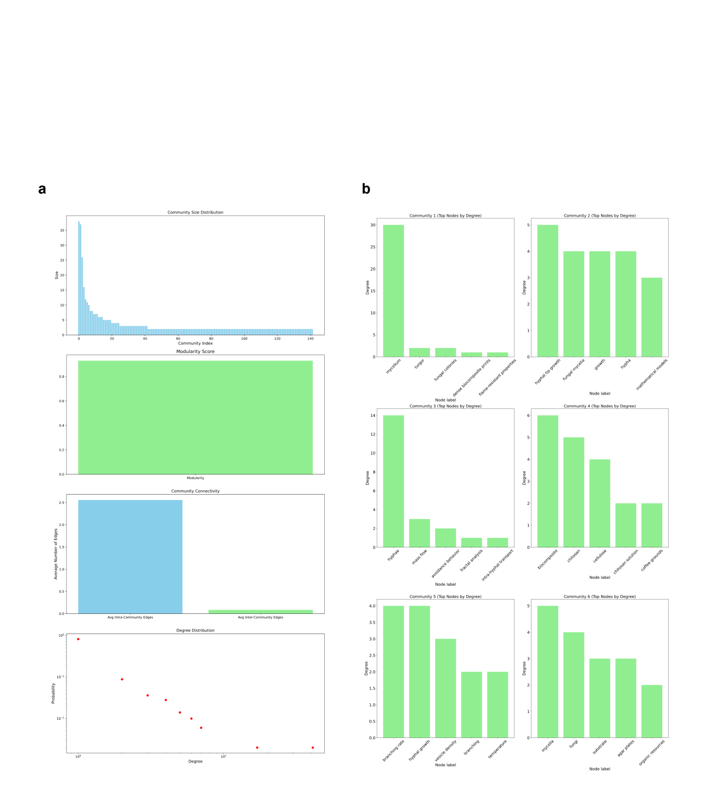


**图 S1：** 基于三篇针对菌丝体的论文开发的子图的特性分析。面板 a 显示社群属性、模块性分数，面板 b 按社群显示顶部节点。


<!-- 原文第 65 页 -->

<a id="page-65"></a>

*原文第 65 页*


**表 S2：** 仿生语料库（图 G1）和贝多芬第九交响曲分析语料库（图 G2）之间的节点映射，并由 GPT-4 生成推理。我们向 GPT-4 提供一个包含 G1 和 G2 中的节点的 LaTeX 表的提示，并要求它添加一列，其中包含映射之间的详细推理。

| G1 节点 | G2 节点 | 推理依据 |
| --- | --- | --- |
| 生物样本 | 合唱交响曲 | 二者都代表复杂组成：一个是生物系统，一个是音乐作品，体现多样性中的和谐。 |
| 悬臂梁 | 第九交响曲 | 二者均是各自领域的代表性成果，体现力量与创新。 |
| 霍尔效应传感器 | 分析 | 正如传感器检测物理场，音乐分析揭示其深层结构。 |
| 梁 | 路德维希·范·贝多芬 | 二者均是结构的基础，支撑其上的复杂系统。 |
| 磁轭 | 贝多芬的第九交响曲 | 二者的核心都包含吸引与对齐：磁场的对齐，或主题要素的协调。 |
| 特征长度 | 调性模糊 | 二者均挑战传统边界：物理尺寸的边界，或和声预期的边界。 |
| 黏附力 | 调性 | 将分子或音符结合起来，均可形成有凝聚力的结构。 |
| PFPE 薄膜 | F 大调 | 二者具有保护性和多样用途，为进一步的复杂性提供基础。 |
| 静置时间 | A 小调 | 静默时段或小调均可引入紧张感与期待。 |
| 单根刚毛 | 主音与属音的关系 | 单个接触点或基本和声关系，均对系统完整性至关重要。 |
| 平衡时间 | C 大调 | 二者均表示平衡状态：动态系统的平衡，或音乐作品中的解决。 |
| 失效 | G 大调 | 失效带来新的认识，如同不协和解决为和谐。 |
| 生物组织 | 贝多芬 | 二者都是复杂、具有适应性且能产生深刻表达的系统。 |
| 薄层 | 指挥 | 层状结构或指挥下的演奏，均需要协调才能有效运作。 |
| 蛋白质解折叠 | 耳聋 | 二者均是揭示新形式的转化过程：分子生物学中的变化，或作曲家生活中的变化。 |


<!-- 原文第 66 页 -->

<a id="page-66"></a>

*原文第 66 页*


**表 S3：** 仿生语料库 (G1) 和贝多芬第九交响乐分析语料库 (G2) 之间的边缘映射，并由 GPT-4 生成推理。为了完成此任务，我们向 GPT-4 提供了一个包含 G1 和 G2 中的节点的 LaTeX 表的提示，并要求它添加一列，其中包含映射之间的详细推理。

| G1 中的边 | G2 中的边 | 推理依据 |
| --- | --- | --- |
| (黏附力, 梁) | (调性, 路德维希·范·贝多芬) | 相互作用决定结构完整性，正如贝多芬对调性的运用支撑其作品的整体架构。 |
| (黏附力, 平衡时间) | (调性, C 大调) | 使系统稳定的力，与奠定音乐表达基础的调性相对应。 |
| (黏附力, PFPE 薄膜) | (调性, F 大调) | 黏结力与基础调性分别为复杂的发展奠定基础。 |
| (黏附力, 静置时间) | (调性, A 小调) | 二者都体现凝聚的必要性：静置过程中的凝聚，或小调情感深度中的凝聚。 |
| (黏附力, 失效) | (调性, G 大调) | 从黏附到失效，与音乐中从稳定到解决相对应。 |
| (黏附力, 单根刚毛) | (调性, 主音与属音的关系) | 二者都是维持结构平衡和和声平衡的关键联系。 |
| (蛋白质解折叠, 生物组织) | (耳聋, 贝多芬) | 二者均通过变化产生新的身份：生物学中的变化，或克服个人挑战的过程。 |
| (特征长度, 梁) | (调性模糊, 路德维希·范·贝多芬) | 定义结构的测量，与挑战和声预期的作曲相对应。 |
| (失效, 生物组织) | (G 大调, 贝多芬) | 从系统失效，到在韧性和创造力中找到和谐。 |
| (生物组织, 薄层) | (贝多芬, 指挥) | 生命与音乐的复杂性，分别通过层次或指挥组织起来。 |
| (生物样本, 悬臂梁) | (合唱交响曲, 第九交响曲) | 样本与结构，共同引向宏大的艺术和工程作品。 |
| (霍尔效应传感器, 悬臂梁) | (分析, 第九交响曲) | 检测物理场并利用结构原理，与分析或创造宏大的交响曲相对应。 |
| (霍尔效应传感器, 磁轭) | (分析, 贝多芬的第九交响曲) | 分析工具与用于对齐的组分，如同对一部杰作的研究。 |
| (悬臂梁, 梁) | (第九交响曲, 路德维希·范·贝多芬) | 建筑结构与作曲中的支撑要素，都能够界定一个时代。 |


<!-- 原文第 67 页 -->

<a id="page-67"></a>

*原文第 67 页*


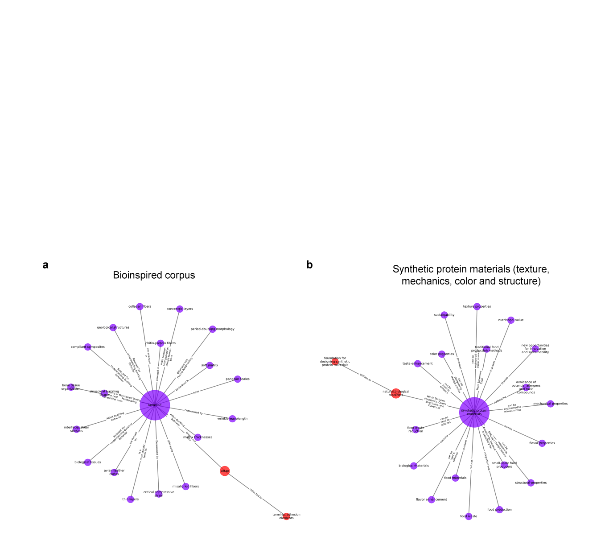


**图 S2：** 两个知识图谱之间的同构分析，将基于原始仿生语料库的图与合成蛋白质材料的对抗性对话生成的图联系起来，具体解决纹理、力学、颜色和结构问题。值得注意的是，该结构的特点是“薄片”作为原始图中节点度最高的节点，而新图中的“合成蛋白质材料”。


<!-- 原文第 68 页 -->

<a id="page-68"></a>

*原文第 68 页*


**表 S4：** 为复合薄膜及其组件的相互作用和特性提取的图三元组（节点标签和指定它们之间关系的边）。

| 节点 1 | 边（关系） | 节点 2 |
| --- | --- | --- |
| 复合薄膜 | 提供有前景的特性 | 导电性 |
| 复合薄膜 | 提供有前景的特性 | 力学强度 |
| 复合薄膜 | 提供有前景的特性 | 生物相容性 |
| 氧化石墨烯（GO）纳米片 | 是的组成部分 | 复合薄膜 |
| 壳聚糖纳米晶 | 是的组成部分 | 复合薄膜 |
| 氧化石墨烯（GO）纳米片 | 增强由于 | 导电性 |
| 壳聚糖纳米晶 | 形成强界面相互作用 | 氧化石墨烯（GO）纳米片 |
| 锌离子 | 可以通过纳入 | 复合薄膜 |
| 氧化石墨烯（GO）纳米片 | 可以通过纳入 | 锌离子 |
| 复合薄膜 | 报价由于 | 在电子及生物医学领域的潜在应用 |


<!-- 原文第 69 页 -->

<a id="page-69"></a>

*原文第 69 页*


**表 S5：** 基于图 8 的可视化分析，仿生语料库和贝多芬第九交响乐分析语料库之间的类似边缘映射。

| 仿生语料图中的边 | 贝多芬《第九交响曲》分析语料图中的边 | 推理依据 |
| --- | --- | --- |
| 幅度低于 | 是关于 | 两者都表明了各自领域中的比较或描述关系。 |
| 之后保持不变 | 建立者 | 意味着持续的条件；状态没有变化与成立后继续存在。 |
| 连接到 | 通过沟通 | 两者都表明各自领域中的概念之间存在联系或传输。 |


<!-- 原文第 70 页 -->

<a id="page-70"></a>

*原文第 70 页*


**文本框 S1：** 用户与 X-LoRA 用户之间的对话，用于评估蛋白质序列并对结果进行推理，从而为生成图形的新数据奠定基础。


> 用户-X-LoRA 交互 用户：您对各种蛋白质序列进行分析，特别是计算它们的总解折叠能，以测量由于施加在蛋白质末端的力而展开蛋白质所需的能量。以下是一些需要您完成的任务。


> 用户：CalculateEnergy< A A A G G A G Q G G Y G G Q G A G Q G A A A A A A G G A G Q G G Y G G Q G A G Q G A G A A A A A A G G A G Q G G Y>


X-LoRA：[0.288]


> 用户：CalculateEnergy<A A A G G A G Q G G Y G G Q G A G Q G A A A A A A G G A G>


X-LoRA：[0.248]


> 用户：CalculateEnergy< Q G A G Q G A A A A A A A A A A A G G>


X-LoRA：[0.121]


> 用户：考虑到这些结果，哪一个蛋白质序列具有最高的解解折叠能（重复整个序列）？


X-LoRA：[A A A G G A G Q G G Y G G Q A G Q G A A A A A A G G A G Q G G Y G G Q A G Q G A G A A A A A A G G A G Q G G Y]


> 用户：它的解折叠能是什么？


X-LoRA：[0.288]


> 用户：如果蛋白质具有最高的解折叠能，您对它的稳定性有何评价？一步步思考。


X-LoRA：具有最高解解折叠能的蛋白质比其他两种蛋白质更稳定。这是因为较高的解折叠能表明需要更多的能量来展开蛋白质，使其对外力和环境变化具有更强的抵抗力。


> 用户：根据氨基酸序列，解释为什么这种蛋白质可能是最稳定的。


X-LoRA：具有最高解折叠能的蛋白质 A A A G G A G Q G G Y G G Q A G Q G A A A A A A G G A G Q G G Y G G Q A G Q G A G A A A A A A G G A G Q G G G Y，具有高比例的甘氨酸和丙氨酸残基。这些残基以其小尺寸和疏水性而闻名，可以通过最大限度地减少蛋白质与周围环境的接触并减少展开蛋白质所需的能量，从而有助于蛋白质的稳定性。此外，甘氨酸残基的存在可以增加蛋白质的柔韧性，使其能够更好地适应环境的变化，并进一步增强其稳定性。总体而言，这些因素的结合可能有助于该蛋白质的高解折叠能和稳定性。


> 用户：最稳定的蛋白质可能具有什么功能？一步步思考。


**X-LoRA：** 最稳定的蛋白质很可能需要在多种条件下维持结构和稳定性。稳定性较高的蛋白质通常承担结构性功能，例如为细胞和组织提供支撑与刚性，也可能帮助细胞抵御外界应激、维持整体完整性。此外，高稳定性的蛋白质可能参与分子的长期储存或运输，因为它们在这些过程中较不容易解折叠或降解。


> **用户：** 这一蛋白质序列更可能是丝蛋白，还是调控蛋白？


**X-LoRA：** 根据氨基酸序列及有关稳定性的讨论，它更可能是丝蛋白。丝蛋白以高稳定性和抗解折叠性著称，这与该序列较高的解折叠能一致。此外，丝蛋白通常承担结构性功能，为细胞和组织提供支撑与刚性，也符合该蛋白质的可能功能。相比之下，调控蛋白通常更具动态性，能够响应外部信号发生构象变化，与该序列表现出的高稳定性不一致。


<!-- 原文第 71 页 -->

<a id="page-71"></a>

*原文第 71 页*


**文本框 S2：** 两个 X-LoRA 智能体——厨师与发明家——之间的互动。讨论如何将生物材料与食品相结合，探索合成蛋白质材料的用途，并涉及质构、力学、颜色、结构，以及风味和味觉。


**X-LoRA 对抗式智能体｜厨师：** 作为发明家，请描述如何将生物材料与食品相结合。具体探索合成蛋白质材料的用途，并涉及质构、力学、颜色、结构，以及风味和味觉。


**发明家：** 生物材料启发了合成蛋白质材料的发展，这些材料可经设计表现出特定性质。通过理解蜘蛛丝、贻贝黏合剂等天然材料的结构与功能，研究者能够设计具有所需力学、质构及感官性质的合成蛋白质。


例如，可以通过工程设计让合成蛋白质材料模拟食物的质构和力学行为，如面团的弹性或油炸食品的酥脆性，也可使其响应温度或其他刺激改变颜色或结构，创造具有视觉吸引力和互动性的饮食体验。


除了质构和力学性能，合成蛋白质材料也可用于增强风味和味觉。通过将风味分子引入蛋白质结构，研究者可制备能够随时间缓慢释放风味的材料，提供更复杂、令人满足的感官体验。


总体而言，生物材料与食品的结合为开发新型食品提供了令人期待的机会，也为传统加工食品提供更可持续、更健康的替代方案。


**厨师：** 如何利用合成蛋白质材料解决食物浪费和可持续性问题？


**发明家：** 合成蛋白质材料可通过以下几种方式应对食物浪费和可持续性问题：


1. 延长保质期：通过设计合成蛋白质材料，延长食品保质期，减少腐败导致的食物浪费。


2. 减少食品包装：利用合成蛋白质材料制作可食用包装，减少不可生物降解的包装废弃物。


3. 改善食品安全：利用合成蛋白质材料制作食品添加剂和防腐剂，使其比传统化学添加剂更可持续、对环境危害更小。


4.替代蛋白质来源：合成蛋白质材料可用于制造替代蛋白质来源，例如植物性肉类替代品，这可以减少畜牧业对环境的影响。


5.餐厨垃圾升级改造：合成蛋白材料可将果蔬皮等餐厨垃圾升级改造为增值产品，减少送至垃圾填埋场的餐厨垃圾数量。


总体而言，在食品生产中使用合成蛋白质材料有可能显着减少食品浪费并提高食品行业的可持续性。


Chef：如何使用合成蛋白质材料来生产不仅可持续而且能够解决某些人群营养缺乏问题的食品？


发明人：合成蛋白质材料可用于制造食品，这些食品不仅是可持续的，而且可以通过多种方式解决某些人群的营养缺乏问题：


1.有针对性的营养输送：合成蛋白材料可以设计成以受控的方式释放特定的营养物质，例如铁或维生素B12，确保营养物质被人体吸收。


2.提高生物利用度：合成蛋白材料可通过设计提高营养物质的生物利用度，使其更容易被人体吸收利用。


3.定制蛋白质来源：合成蛋白质材料可以量身定制，以满足不同人群的特定营养需求，例如儿童、老年人或有饮食限制的个体。


4. 减少食物浪费：通过使用合成蛋白质材料来制造更有营养和可持续的食品，可以减少食物浪费，因为食物中的营养成分得到了更多的利用。


5.增强食品安全：合成蛋白材料可用于制造食品添加剂和防腐剂，提高食品安全性，降低食源性疾病的风险并确保食品中的营养成分不受影响。


总体而言，在食品生产中使用合成蛋白质材料有可能显着提高食品的营养价值，解决某些人群的营养缺乏问题并促进整体健康和福祉。


Chef：在食品生产中使用合成蛋白材料存在哪些潜在风险和挑战？如何解决这些问题以确保食品的安全性和可持续性？


<!-- 原文第 72 页 -->

<a id="page-72"></a>

*原文第 72 页*


发明人：在食品生产中使用合成蛋白材料会带来一些潜在的风险和挑战，包括：


1. 致敏性：合成蛋白材料可能含有过敏原，可能对食物过敏的人造成风险。为了解决这个问题，研究人员可以设计不含常见过敏原的合成蛋白质材料，或修改现有蛋白质以降低其过敏性。


2. 毒性：合成蛋白质材料可能含有有毒化合物，对人体健康构成风险。为了解决这个问题，研究人员可以使用严格的筛选方法来确保合成蛋白质材料可以安全食用。


3.环境影响：合成蛋白材料的生产和处置可能会对环境产生影响，例如资源的利用和废物的产生。为了解决这个问题，研究人员可以设计出更可持续、更环保的合成蛋白质材料。


4. 监管部门批准：在食品生产中使用合成蛋白材料可能需要监管部门批准，这可能会成为其广泛采用的障碍。为了解决这个问题，研究人员可以与监管机构合作，确保合成蛋白质材料符合所有安全和质量标准。


5.成本：合成蛋白材料的生产可能比传统食品生产方法更昂贵，这可能使小规模食品生产商难以采用这些技术。为了解决这个问题，研究人员可以努力降低合成蛋白质材料的成本，并使小规模食品生产商更容易获得它们。


通过应对这些风险和挑战，食品生产中合成蛋白材料的使用可以安全、可持续地融入食品工业，为创新和可持续发展提供新的机遇。


Chef：您能提供一些目前用于食品生产的合成蛋白材料的例子及其具体应用吗？


发明人：是的，目前用于食品生产的合成蛋白材料有几个例子及其具体应用：


1、大豆分离蛋白：大豆分离蛋白是从大豆中提取的合成蛋白质材料。它被用作素食和纯素食品的肉类替代品，例如汉堡、香肠和肉丸。


2.豌豆分离蛋白：豌豆分离蛋白是从黄豌豆中提取的合成蛋白材料。它被用作素食和纯素食品的肉类替代品，例如汉堡、香肠和肉丸。


3、乳清分离蛋白：乳清分离蛋白是一种从牛奶中提取的合成蛋白质材料。它被用作运动营养产品中的蛋白质补充剂，例如蛋白粉和蛋白棒。


4.酪蛋白：酪蛋白是一种从牛奶中提取的合成蛋白质材料。它用作食品添加剂，以改善乳制品（如奶酪和酸奶）的质地和稳定性。


5、明胶：明胶是从动物胶原蛋白中提取的合成蛋白质材料。它被用作食品添加剂，以改善果冻、布丁和棉花糖等食品的质地和稳定性。


6、海藻酸盐：海藻酸盐是一种源自海藻的合成蛋白质材料。它用作食品添加剂，以改善冰淇淋和乳制品甜点等食品的质地和稳定性。


这些合成蛋白质材料被用于食品生产，以应对各种挑战，例如减少食物浪费、提高营养价值和促进可持续性。


Chef：在食品生产中使用合成蛋白材料有哪些潜在的缺点或限制？如何解决这些问题以确保最终产品的安全和质量？


发明人：在食品生产中使用合成蛋白质材料可能有一些潜在的缺点或限制，包括：


1. 致敏性：合成蛋白材料可能含有过敏原，可能对食物过敏的人造成风险。为了解决这个问题，研究人员可以设计不含常见过敏原的合成蛋白质材料，或修改现有蛋白质以降低其过敏性。


2. 毒性：合成蛋白质材料可能含有有毒化合物，对人体健康构成风险。为了解决这个问题，研究人员可以使用严格的筛选方法来确保合成蛋白质材料可以安全食用。


3.环境影响：合成蛋白材料的生产和处置可能会对环境产生影响，例如资源的利用和废物的产生。为了解决这个问题，研究人员可以设计出更可持续、更环保的合成蛋白质材料。


4. 监管部门批准：在食品生产中使用合成蛋白材料可能需要监管部门批准，这可能会成为其广泛采用的障碍。为了解决这个问题，研究人员可以与监管机构合作，确保合成蛋白质材料符合所有安全和质量标准。


5.成本：合成蛋白材料的生产可能比传统食品生产方法更昂贵，这可能使小规模食品生产商难以采用这些技术。为了解决这个问题


<!-- 原文第 73 页 -->

<a id="page-73"></a>

*原文第 73 页*


为了解决这个问题，研究人员可以努力降低合成蛋白质材料的成本，并使小规模食品生产商更容易获得它们。


通过解决这些缺点和限制，食品生产中合成蛋白材料的使用可以安全、可持续地融入食品工业，为创新和可持续发展提供新的机会。


Chef：如何设计合成蛋白质材料来模仿食品中天然生物材料的质地、力学、颜色、结构和风味，同时避免潜在的过敏原和有毒化合物？


发明人：通过了解天然材料的结构和功能，可以设计合成蛋白质材料来模仿食品中天然生物材料的质地、力学、颜色、结构和风味。研究人员可以使用蛋白质工程、分子建模和生化分析等技术来设计具有所需特性的合成蛋白质。纳米技术可用于制造具有特定纹理和力学的合成蛋白质材料。


为了避免潜在的过敏原和有毒化合物，研究人员可以设计不含常见过敏原的合成蛋白质材料，或修改现有蛋白质以降低其过敏性。他们还可以使用严格的筛选方法来确保合成蛋白质材料可以安全食用。


此外，研究人员可以使用天然生物材料作为设计具有特定性质的合成蛋白质材料的起点。例如，他们可以研究蜘蛛丝或贻贝粘合剂的结构和功能，以创建具有类似特性的合成蛋白质。


总体而言，设计模拟食品中天然生物材料的合成蛋白质材料需要深入了解天然材料的结构和功能，以及利用先进的技术和工艺来制造具有所需特性的合成蛋白质。


Chef：如何设计合成蛋白质材料来模仿食品中天然生物材料的复杂风味和味道特征？


发明人：通过将风味分子整合到蛋白质结构中，合成蛋白质材料可以被设计成模仿食品中天然生物材料的复杂风味和味道特征。这可以通过蛋白质工程、分子建模和生化分析等技术来实现。


通过了解具有复杂风味和味道特征的天然生物材料的结构和功能，研究人员可以设计具有相似特性的合成蛋白质。例如，他们可以研究天然风味化合物（如萜烯、醛和酯）的结构和功能，以创建合成蛋白质，随着时间的推移缓慢释放这些化合物，从而提供更复杂和令人满意的感官体验。


此外，研究人员可以使用天然生物材料作为设计具有特定风味和味道特征的合成蛋白质材料的起点。例如，他们可以研究水果、蔬菜和其他食物来源中天然风味化合物的结构和功能，以创造具有类似特性的合成蛋白质。


总体而言，设计合成蛋白质材料来模仿食品中天然生物材料的复杂风味和味道特征，需要深入了解天然材料的结构和功能，以及使用先进的技术和工艺来创造具有所需特性的合成蛋白质。


Chef：如何设计合成蛋白质材料的质地和力学来模仿食品中天然生物材料的复杂风味和味道特征？


发明人：通过了解质地、力学和风味之间的关系，可以设计合成蛋白质材料的质地和力学，以模仿食品中天然生物材料的复杂风味和味道特征。研究人员可以使用蛋白质工程、分子建模和生化分析等技术来设计具有所需纹理和力学的合成蛋白质。


通过研究具有复杂风味和味道特征的天然生物材料的结构和功能，研究人员可以设计具有相似特性的合成蛋白质。例如，他们可以研究水果、蔬菜和其他食物来源中天然风味化合物的结构和功能，以创造具有类似特性的合成蛋白质。


此外，研究人员可以使用天然生物材料作为设计具有特定纹理和力学的合成蛋白质材料的起点。例如，他们可以研究水果、蔬菜和其他食物来源中天然风味化合物的结构和功能，以创造具有类似特性的合成蛋白质。


总体而言，设计合成蛋白质材料来模仿食品中天然生物材料的复杂风味和味道特征，需要深入了解天然材料的结构和功能，以及使用先进的技术和工艺来创造具有所需特性的合成蛋白质。


Chef：设计合成蛋白质材料来模仿食品中天然生物材料的复杂风味和味道特征有哪些挑战，如何应对这些挑战？


发明人：设计合成蛋白质材料来模仿食品中天然生物材料的复杂风味和味道特征的挑战包括：


1.了解质地、力学和风味之间的关系：目前还不清楚质地和力学如何影响风味感知，因此很难设计具有所需风味和味道特征的合成蛋白质材料。


<!-- 原文第 74 页 -->

<a id="page-74"></a>

*原文第 74 页*


2. 将风味分子纳入蛋白质结构：将风味分子纳入蛋白质结构可能具有挑战性，因为蛋白质结构可能不利于某些风味分子的结合。


3. 控制风味分子的释放：控制合成蛋白质材料中风味分子的释放可能很困难，因为释放速率可能不一致或不可预测。


4. 确保安全和质量：确保合成蛋白质材料可安全食用并满足所有安全和质量标准可能具有挑战性，因为在食品生产中使用合成材料可能会引起对潜在过敏原和有毒化合物的担忧。


为了应对这些挑战，研究人员可以使用蛋白质工程、分子建模和生化分析等技术来设计具有所需特性的合成蛋白质。他们还可以使用天然生物材料作为设计具有特定质地、力学和风味特征的合成蛋白质材料的起点。


此外，研究人员可以与监管机构合作，确保合成蛋白质材料符合所有安全和质量标准并且可以安全食用。他们还可以使用严格的筛选方法来确保合成蛋白质材料不含潜在的过敏原和有毒化合物。


总体而言，设计合成蛋白质材料来模仿食品中天然生物材料的复杂风味和味道特征，需要深入了解天然材料的结构和功能，以及使用先进的技术和工艺来创造具有所需特性的合成蛋白质。


摘要：


对话讨论了合成蛋白质材料在食品生产中的潜在用途，特别是探讨了它们模仿天然生物材料的质地、力学、颜色、结构和风味的能力。对话强调了使用合成蛋白质材料的好处，例如减少食物浪费、提高营养价值和促进可持续性。然而，它也承认与其使用相关的潜在风险和挑战，包括过敏性、毒性、环境影响、监管审批和成本。对话强调了设计合成蛋白质材料来模仿天然生物材料的复杂风味和味道特征，同时确保安全和质量的重要性。总的来说，这次对话强调了合成蛋白质材料在食品生产中的潜力，但也强调需要仔细考虑其风险和挑战。


要点清单：


- 合成蛋白质材料可以设计成模仿食品中天然生物材料的质地、力学、颜色、结构和风味。


-在食品生产中使用合成蛋白质材料可以解决减少食品浪费、提高营养价值和促进可持续性等挑战。


-然而，它们的使用存在潜在的风险和挑战，包括过敏性、毒性、环境影响、监管审批和成本。


-为了确保安全和质量，合成蛋白材料必须设计为不含常见过敏原或进行修饰以降低其过敏性，并且必须采用严格的筛选方法以确保其可安全食用。


- 设计合成蛋白质材料来模仿天然生物材料的复杂风味和味道特征，需要深入了解天然材料的结构和功能，以及使用先进的技术和工艺来创造具有所需特性的合成蛋白质。


要点：


谈话中最重要的一个结论是，合成蛋白质材料有潜力将生物材料领域与食品结合起来，特别是通过模仿天然生物材料的质地、力学、颜色、结构和风味。这可以解决减少食物浪费、提高营养价值和促进可持续性等挑战，同时通过精心设计和严格的筛选方法确保安全和质量。对话强调了了解天然生物材料的结构和功能以及使用先进技术和技术来创造具有所需特性的合成蛋白质的重要性。


<!-- 原文第 75 页 -->

<a id="page-75"></a>

*原文第 75 页*


**对话 S1：** 使用多模态 LLM、GPT-4V 分析图形图像。该图以图像文件的形式提供。


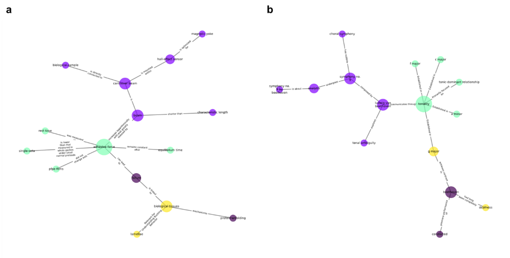


> 用户：对上图进行语义分析。


GPT-4V：知识图谱的语义分析通常涉及解释图中节点（概念）和边（关系）的含义和重要性。通过检查节点和连接它们的边上的标签，我们可以推断概念如何相关以及这些关系意味着什么。我们来分析一下每张图：


仿生语料库（图a）：


- 中心主题：该图包含“黏附力”、“悬臂梁”和“生物组织”等节点，这表明重点关注生物材料的力学特性及其在工程（生物启发）中的应用。由于其中心位置和大小，节点“黏附力”可能代表一个关键概念。


- 跨学科联系：“生物组织”和“蛋白质折叠”等术语与工程术语一起出现，表明了生物学和材料科学相结合的跨学科方法。


- 概念关系：边缘可能代表这些概念之间的关系，例如“悬臂梁”如何与仿生材料和应用中的“黏附力”相关。


贝多芬第九交响曲分析语料库（图b）：


- 音乐分析：该图显然以贝多芬的《第九交响曲》为中心，诸如“合唱交响曲”、“c大调”和“主音与主音关系”等节点表明了对该交响曲音乐作品的详细分析。


- 传记元素：“路德维希·范·贝多芬”与“耳聋”之间的联系表明了对贝多芬个人情况如何影响他的创作的探索。


<!-- 原文第 76 页 -->

<a id="page-76"></a>

*原文第 76 页*


- 音乐理论：“调性”、“调性模糊性”等术语以及与不同音调的联系表明重点关注交响曲的理论基础，可能会考察其对调性的创新和复杂使用。


语义分析结论：


- 概念的互连性：两个图都显示了特定领域内的概念如何互连。在仿生语料库中，重点关注生物学原理在工程问题中的应用，而在贝多芬语料库中，音乐理论与历史背景交织在一起。


- 信息的结构和流动：图的结构表明了信息的逻辑流动。例如，在贝多芬图中，贝多芬耳聋的历史事实与作曲家相关，这可能暗示语料库中的叙述或解释路径。


- 特定领域语言：图中使用的术语是特定领域的，表示专业知识和每个语料库内讨论的上下文。这种程度的特异性对于语义分析至关重要，因为它定义了主题的范围和深度。


总体而言，语义分析表明，这两个图都是相关概念的复杂网络，表明它们所源自的语料库可能包含各自领域内丰富、详细的讨论。尽管主题不同，但知识图谱的结构表明概念之间的关系具有相似的复杂性，指出了智力探究和知识组织的共享方法。


<!-- 原文第 77 页 -->

<a id="page-77"></a>

*原文第 77 页*


**对话 S2：** GPT-4V 对分析如下所示子图的请求的响应。子图作为图像文件上传。


> 用户：您将获得一个图表，该图反映了具有最高桥接中心性的节点。


选择桥接中心性的理由是，这些是战略连接器，充当网络内不同集群或社群之间的桥梁。


这些节点对于理解不同的概念或领域如何相互关联至关重要，可能揭示间接或不太明显的关系。


桥接中心性的概念与社交网络中弱关系理论的强度相一致，这表明较弱的关系（通常由具有桥接中心性的节点代表）在跨不同群体传播信息或创新方面更有价值。在概念关系的背景下，具有高桥接中心性的节点可能代表连接不同知识领域的概念，促进跨学科创新和理解。


具有高桥接中心性的节点很可能是那些如果被删除的话，将最大程度地增加网络不同部分之间的“距离”的节点。识别这些节点有助于理解不同概念是如何整合的，以及哪里可能存在潜在的差距或缺失的联系。增强或加强与这些桥接节点的连接可以显着提高整个网络知识或信息的凝聚力和流动。


> ### 说明：仔细分析这张图。发挥创造力并综合新的研究理念来构建可持续的菌丝体材料。


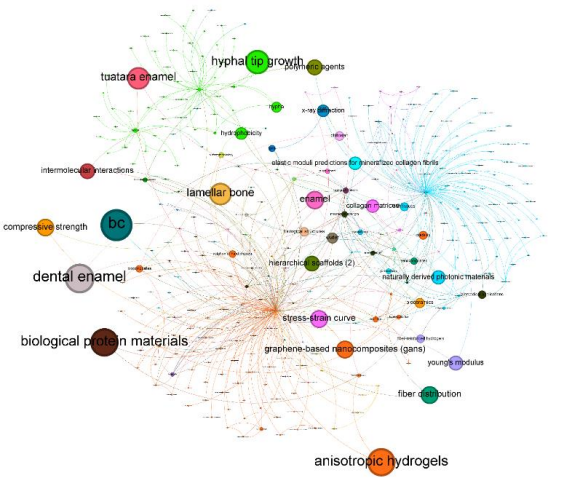


GPT-4V：分析给定的图表，它似乎说明了各种材料科学概念的相互关联的性质，并强调了“力学强度”、“力学性能”、“菌丝体”、“可持续材料”、“生物复合材料”和“孔隙率”等节点的重要性，我们可以通过考虑图表所建议的链接和桥梁来综合构建可持续菌丝体材料的新研究思路。


以下是一些潜在的研究想法：


<!-- 原文第 78 页 -->

<a id="page-78"></a>

*原文第 78 页*


增强型菌丝体复合材料：考虑到菌丝体和生物复合材料之间的联系，有可能研究如何将菌丝体与其他天然纤维或废料结合以增强力学性能。例如，研究可以集中于开发一种平衡强度和孔隙率的复合材料，使其适合环保包装或绝缘等应用。


菌丝体和胶原蛋白支架：胶原蛋白和菌丝体之间的联系表明有机会研究菌丝体与再生医学的整合。我们可以探索使用菌丝体作为富含胶原蛋白的支架材料来支持细胞生长，这可以在组织工程中得到应用。


分层结构和菌丝体：研究菌丝体纤维的分层组织及其对力学强度的影响。这可以包括观察菌丝体内的微米和纳米级结构排列，并与骨骼等材料中发现的分层结构进行比较。


菌丝体力学性能优化：考虑到“力学性能”和“力学强度”的中心节点，有明确的迹象表明研究还应侧重于通过基因工程、生长条件控制或收获后加工技术优化菌丝体材料的这些性能。


可持续菌丝体材料生命周期评估：分析菌丝体材料的整个生命周期，从培养到报废，以确定可以改进以实现可持续性的关键流程。这将涉及跨学科方法，结合材料科学、生物学和环境研究的知识。


菌丝体作为材料科学教育的桥梁：考虑到桥接中心性的概念，菌丝体可以用作教育环境中的案例研究，以说明生物系统与材料科学的整合，可能激发可持续材料设计的新思维方式。


智能菌丝体材料：受“智能材料”节点的启发并与“力学行为”相关，研究创造菌丝体材料的可能性，这种材料可以根据温度、pH 或湿度等环境刺激改变其特性，这可能会带来创新的应用。


提高孔隙率和功能性：孔隙率是菌丝体材料中可以定制的一个关键特性。研究可以探索不同应用的最佳孔隙率，例如，最大化吸声材料的孔隙率或最小化承载应用的孔隙率。


通过结合这些不同的方面，我们可以突破当前材料科学的界限，并为具有定制力学性能和功能的可持续生物衍生材料开辟新的可能性。


<!-- 原文第 79 页 -->

<a id="page-79"></a>

*原文第 79 页*


**对话 S3：** 围绕视觉分析和设计与 ChatGPT (GPT-4) 进行对话。


创建一个图像，将受表现主义艺术启发的新颖、可持续的菌丝体复合材料可视化。该材料应表现出错综复杂、交织的纤维排列，反映抽象表现主义绘画动态、交织的本质，具有鲜艳的色彩并置、动态的形状和自发的线条。强调材料的微观结构，展示菌丝体纤维与胶原蛋白衍生的生物支架交织在一起的复杂网络，形成多层、分层结构。纤维的厚度和排列应有所不同，代表绘画的不同笔触，并且还应显示出孔隙率和更密集的簇的区域，表明定制的力学强度和疏水性能。将矿物填料融入基质中，增强结构完整性和防潮性，让人想起天然骨骼和牙釉质中的刚性。整体构图应传达一种深度感和动感，反映混乱与秩序之间的抽象相互作用，以及材料设计中艺术与科学的融合。确保图像细节丰富，能够清晰地可视化材料独特的微米和纳米级组织，而不包含任何文本或绘画本身的明确描述。


ChatGPT


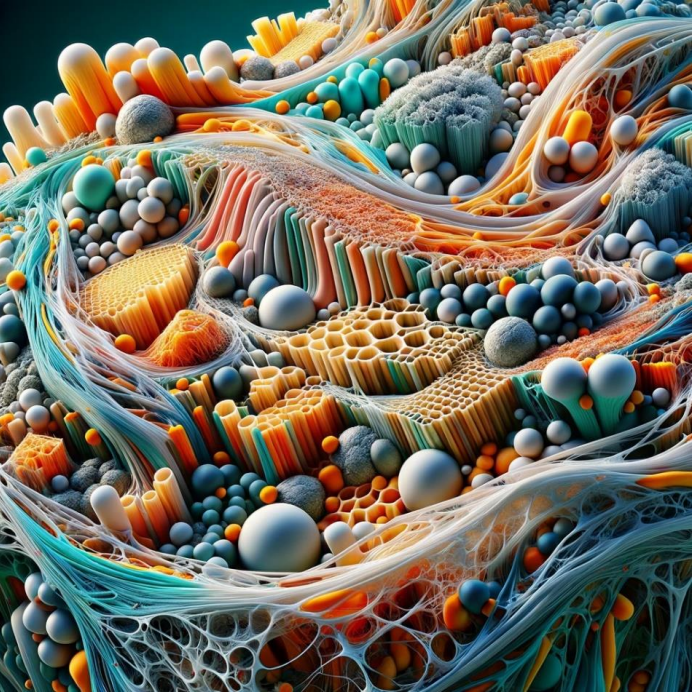


这是受表现主义艺术启发的新型可持续菌丝体复合材料的可视化图像。它展示了复杂、交织的纤维排列、鲜艳的色彩并置和动态形状，反映了材料独特的微米和纳米级组织。


将图像设为 2x3 宽格式。


ChatGPT


<!-- 原文第 80 页 -->

<a id="page-80"></a>

*原文第 80 页*


受抽象表现主义艺术启发，可视化基于菌丝体的复合材料的宽幅图像现已准备就绪。


做一些替代方案


ChatGPT


这里有一些替代的宽幅图像，每幅图像都对受抽象表现主义艺术启发的菌丝体复合材料进行了独特的诠释。


根据提供的原文描述图像中的各个组成部分。


ChatGPT 这些图像的灵感来自于抽象表现主义艺术复杂而动态的本质，通过特写可视化展示了一种新颖的基于菌丝体的复合材料，突出了几个关键组成部分和特征：


1. 错综复杂、交织的纤维排列：图像描绘了菌丝体纤维与胶原蛋白衍生的生物支架交织在一起的复杂网络。这种设计模仿了表现主义绘画相互交织的本质，代表了生物和艺术复杂性的融合。这些纤维的不同厚度和排列类似于表现主义艺术品中的不同笔触，强调了材料的有机灵感。


2. 鲜艳的色彩并置和动态的形状：通过使用鲜艳的色彩和动态的形状，图像捕捉到了抽象表现主义的自发线条和色彩对比特征。这些元素不仅增加了视觉趣味，还象征着材料的多种特性，例如力学强度和疏水特性。


3. 多层、分层结构：详细的可视化揭示了复合材料的多层、分层组织。这种结构确保了定制的力学性能，例如强度和柔韧性，这对于各种应用至关重要。材料内孔隙率和更密集簇的描述表明了为特定功能（例如防潮或增强耐用性）而设计的区域。


4. 微妙的矿物填料：微妙的矿物填料融入基质中，增强了材料的结构完整性和防潮性。这个添加是


<!-- 原文第 81 页 -->

<a id="page-81"></a>

*原文第 81 页*


让人想起天然骨骼和牙釉质中发现的刚性，这表明采用仿生方法来改善复合材料的性能。


5. 深度和运动感：图像的构图传达了深度和运动感，反映了混乱与秩序之间抽象的相互作用。这方面强调了材料设计的动态本质，象征着其成分之间在微米和纳米尺度上持续的相互作用。


6.艺术与科学的融合：总体而言，图像体现了材料设计中艺术与科学的融合。受抽象表现主义艺术原理的启发，它们以视觉方式传达了材料独特的组织和属性，同时强调了其发展背后的科学创新。


这些组件共同展示的不仅是一种材料，更是一种概念，其中艺术影响科学创新，从而创造出可持续的、功能多样的材料。


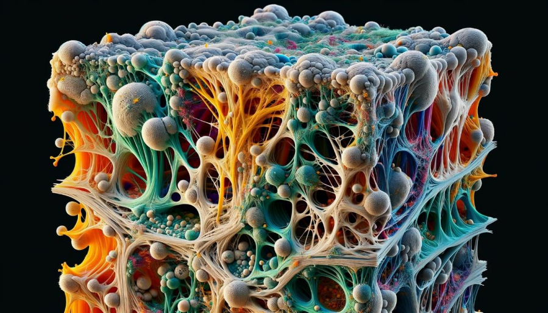


这是一个替代图像。对其进行同样的分析：


ChatGPT 这个替代图像进一步捕捉了具有抽象表现主义灵感的菌丝体复合材料的本质：


1. 复杂的纤维网络：类似于抽象绘画的复杂画布，该图像展示了密集的纤维网络，以混乱但有组织的方式交织和重叠。纤维的不同厚度和方向表明了强度和弹性的自然和有机形式。


2.色彩多样性和对比：从暖橙色到冷蓝色的广泛色彩的使用体现了表现主义艺术的活力。这些对比不仅创造视觉吸引力，还象征着材料的功能多样性，可能表明不同的属性，例如弹性或刚性。


3. 分层纹理和结构：该图像显示了多层纹理，其中每一层都可以代表不同的生长阶段或不同程度的密度，这对于复合材料内的结构和功能差异至关重要。


4.矿物元素的整合：纤维中的球形和半球形可以代表说明书中提到的矿物填料。他们的战略布局


<!-- 原文第 82 页 -->

<a id="page-82"></a>

*原文第 82 页*


网络内表明它们在增强材料的结构完整性和功能方面的作用。


5. 孔隙率和密度变化：材料内的开放和封闭空间清晰可见，表明孔隙率区域具有柔韧性，而密集区域则具有强度。这可能反映了一种模仿具有不同程度的孔隙率和密度的天然材料（例如骨头或木材）的工程方法。


6.艺术的混乱与秩序：整体布局呈现出一种受控的混乱，反映了表现主义捕捉艺术和菌丝体生长的生物背景中自发相互作用的力量的意图。


7. 微观和宏观视角的相互作用：图像提供了一种放大微观结构的视角，同时仍然暗示更大的宏观结构。这种二元性让人想起表现主义艺术品中的多层面和自然材料的层次结构。


8. 运动和生长的暗示：图像具有动态的品质，其中的结构似乎处于生长和运动的过程中，表明菌丝体的生命方面和材料本身的进化性质。


总之，该图像是通过抽象表现主义艺术的镜头看到的基于菌丝体的复合材料的视觉表现，其中每个组件和特性都经过深思熟虑的整合，以创造出一种既实用又美观的材料。


您能否具体说明图像的每个部分是什么，以及它代表什么材料成分。


ChatGPT 当然！让我们根据原文中描述的材料属性来分析图像中描绘的组件：


1. 菌丝体纤维：图像中占据主导地位的长而相互缠绕的股线可能代表菌丝体纤维。这些将是复合材料的主要结构成分，提供集成其他元素的框架。它们的不同厚度和长度可能表明不同的生长阶段或功能特性。


2.胶原蛋白衍生的生物支架：似乎连接和支撑菌丝体纤维的网状结构可能是胶原蛋白衍生的生物支架。它们提供了辅助支撑基质，对于维持复合材料的完整性至关重要，模仿有机组织中胶原蛋白的支撑作用。


3.矿物填料：散布在纤维之间的球形和卵形形状可以代表矿物填料。这些元素用于增强复合材料的力学性能，类似于骨骼中的矿物质提供结构支撑和刚性的方式。


4. 孔隙率：材料密度较低、有可见孔和间隙的区域可能表明存在孔隙率。这一特性对于使材料轻量化非常重要，并且可能有助于提高隔热性或渗透性等其他性能。


5. 更密集的簇：相反，元素簇更紧密且看起来更密集的区域可能表明为增强力学强度而设计的区域，其中材料需要承受更大的应力或负载。


6. 疏水性：虽然不直接可见，但组件的整体纹理和分层可能表明设计用于排斥水或控制水分的区域，从而有助于材料的疏水性。


7. 颜色表示：鲜艳的颜色不一定对应于材料的实际颜色，但可以象征各种属性或成分。例如，温暖


<!-- 原文第 83 页 -->

<a id="page-83"></a>

*原文第 83 页*


颜色可能代表针对柔韧性进行优化的区域，而较冷的颜色可能代表具有较高刚性的区域。


8. 深度和运动：重叠的纤维和元素所传达的深度以及结构的动态流动，在视觉上暗示了柔韧性和强度之间的相互作用，这是先进复合材料的基本特征。


该图像是一种程式化的解释，而不是字面的表示；因此，特定的组成部分是通过视觉隐喻和艺术象征来传达的。实际材质不会在宏观尺度上显示这些颜色或可见结构，但它们以这种方式渲染以说明材质组件和属性的复杂相互作用。


现在，请用 LaTeX 表格总结关键发现。遵循下面的格式，并通过分析我提供的图像补全全部细节：

| 设计特征 | 图像中的表现 | 可能的材料功能，即该设计要素如何影响材料行为 |
| --- | --- | --- |
| … | … | … |
| … | … | … |

（原文此处提供的是对应的 LaTeX 表格模板。）


ChatGPT 当然，我会将我们讨论过的细节整理到一个 LaTeX 表中：


**可持续菌丝体复合材料的材料设计分析：**

| 设计特征 | 图像中的表现 | 可能的材料功能，即对材料行为的贡献 |
| --- | --- | --- |
| 菌丝体纤维 | 粗细不同、长而交织的纤维 | 提供强度和柔韧性的结构骨架；可能反映不同生长阶段或功能特性。 |
| 胶原衍生生物支架 | 连接纤维的网状结构 | 维持复合材料完整性的支撑基体，模拟有机组织中的支撑作用。 |
| 矿物填料 | 纤维之间的球形和卵形结构 | 增强力学性能，例如结构支撑和刚性。 |
| 孔隙率 | 密度较低、可见孔洞与间隙的区域 | 有助于轻量化、隔热与渗透。 |
| 致密聚集区域 | 要素紧密聚集的区域 | 通过设计增强力学强度，承受更大应力。 |
| 疏水性 | 要素的纹理与层次 | 设计表明某些区域用于拒水或有效调节水分。 |
| 颜色表现 | 图像中鲜明的色彩 | 象征不同性质或组分，并非材料真实颜色的直接表现。 |
| 深度与动感 | 重叠纤维与动态流动 | 体现材料设计中柔韧性与强度的相互作用。 |


该表总结了图像中描绘的关键设计特征，并解释了每个特征如何对材料的整体行为和功能做出贡献。


太棒了。您能否在全文中添加更多详细信息，特别是添加一列来描述如何制造或合成这些组件。


ChatGPT 当然，让我们为每个设计功能的制造或合成过程添加一个附加列来丰富表格：


<!-- 原文第 84 页 -->

<a id="page-84"></a>

*原文第 84 页*


**可持续菌丝体复合材料的材料设计分析（增加制造或合成过程）：**

| 设计特征 | 图像中的表现 | 可能的材料功能 | 制造或合成过程 |
| --- | --- | --- | --- |
| 菌丝体纤维 | 粗细不同、长而交织的纤维 | 提供强度和柔韧性的结构骨架。 | 在受控环境中培养菌丝体，随后收获和干燥，形成纤维。 |
| 胶原衍生生物支架 | 连接纤维的网状结构 | 维持复合材料完整性的支撑基体。 | 通过生物技术生产胶原，或从有机来源提取，再采用静电纺丝或模塑制成支架。 |
| 矿物填料 | 纤维之间的球形和卵形结构 | 增强刚性等力学性能。 | 在菌丝体生长期间或之后引入无机化合物，例如通过沉淀，或与支架混合。 |
| 孔隙率 | 可见孔洞与间隙的区域 | 提供轻量化和隔热性能。 | 控制菌丝体生长以形成间隙，或通过冻干等后处理工艺形成孔隙。 |
| 致密聚集区域 | 紧密聚集的要素 | 提高承受应力区域的力学强度。 | 有策略地分层培养菌丝体，或在生长过程中施压，形成致密区域。 |
| 疏水性 | 要素的纹理与层次 | 拒水或调节水分。 | 采用疏水化合物处理表面，或在生长过程中将此类材料引入基体。 |
| 颜色表现 | 图像中鲜明的色彩 | 象征不同性质或组分。 | 在复合材料加工过程中加入天然或合成染料。 |
| 深度与动感 | 重叠纤维与动态流动 | 体现柔韧性与强度的相互作用。 | 通过分层生长或增材制造，在复合材料中设计多尺度结构。 |


该表全面介绍了设计特征、它们在材料中可能的功能，以及可用于创建此类复合材料的潜在制造或合成工艺。


太棒了。您能否增加更多的技术深度，特别是命名特定的氨基酸序列或化学物质、材料成分或形状以及尺度。


ChatGPT 当然！我将通过更具体的科学细节向表格介绍技术深度：


**包含技术细节的可持续菌丝体复合材料设计分析：**

| 设计特征 | 图像中的表现 | 可能的材料功能 | 制造或合成过程及技术细节 |
| --- | --- | --- | --- |
| 菌丝体纤维 | 长而相互交织的纤维 | 形成提供拉伸强度和柔韧性的骨架。 | 在富含木质素和纤维素的基质上培养灵芝（Ganoderma lucidum）等菌株的菌丝体，优化生长条件以获得所需纤维形态。 |
| 胶原衍生生物支架 | 网状纤维结构 | 提供生物相容性和结构完整性。 | 采用重组 DNA 技术，在大肠杆菌（E. coli）中表达 Gly-Pro-Pro 等特定胶原序列，再经纯化和自组装形成支架。 |
| 矿物填料 | 球形与卵形夹杂物 | 增强抗压强度和热稳定性。 | 在菌丝体生长的成熟阶段掺入纳米尺度羟基磷灰石或生物成因二氧化硅，可采用溶胶-凝胶工艺。 |
| 孔隙率 | 基体内可见的间隙 | 实现轻量化并提供隔热性能。 | 利用冷冻干燥技术使溶剂升华，控制孔隙形成，使孔径分布处于 100-500 微米范围。 |
| 致密聚集区域 | 紧密区域 | 提供局部承载能力。 | 收获后通过机械压缩致密化，或在选定区域引入戊二醛等交联剂。 |
| 疏水性 | 表面纹理变化 | 提供耐湿性并控制与流体的相互作用。 | 使用硅烷偶联剂或含氟化合物改性表面，构建纳米尺度疏水区域。 |
| 颜色表现 | 丰富而鲜明的色彩 | 提供美学特征，并标示功能区域。 | 使用响应环境刺激的 pH 指示剂或热致变色颜料，作为材料状态或损伤的传感指标。 |
| 深度与动感 | 多层动态图案 | 通过层级结构实现多功能性能。 | 依次生物打印菌丝体复合材料各层，可引入材料组成的梯度过渡以耗散应力。 |


<!-- 原文第 85 页 -->

<a id="page-85"></a>

*原文第 85 页*


该表现在包括具体的技术细节，例如菌丝体菌株的类型、合成胶原蛋白的氨基酸序列、矿物填料颗粒的规模、孔隙率的尺寸范围以及用于疏水表面处理的特定化学试剂，增加了对材料成分和制造工艺的更深入的了解。


