# 多智能体通信的五个 W：谁与谁通信、何时通信、通信什么以及为何通信

## 从多智能体强化学习、涌现语言到大语言模型的综述

**原文标题：** The Five Ws of Multi-Agent Communication: Who Talks to Whom, When, What, and Why — A Survey from MARL to Emergent Language and LLMs

**作者：** Jingdi Chen、Hanqing Yang、Zongjun Liu、Carlee Joe-Wong  
**年份：** 2026  
**原文版本：** arXiv:2602.11583v1，2026 年 2 月 12 日  
**免费原文：** [arXiv 论文页面](https://arxiv.org/abs/2602.11583) · [PDF](https://arxiv.org/pdf/2602.11583v1)

Jingdi Chen：亚利桑那大学，美国亚利桑那州图森市 85719，jingdic@arizona.edu。  
Hanqing Yang：卡内基梅隆大学，美国宾夕法尼亚州匹兹堡市 15213，hanqing3@andrew.cmu.edu。  
Zongjun Liu：亚利桑那大学，美国亚利桑那州图森市 85719，msnliu@arizona.edu。  
Carlee Joe-Wong：卡内基梅隆大学，美国宾夕法尼亚州匹兹堡市 15213，cjoewong@andrew.cmu.edu。

\* 本文工作在 Jingdi Chen 于卡内基梅隆大学从事博士后研究期间完成。

## 摘要

多智能体序贯决策是众多现实系统的基础，涵盖自动驾驶车辆、机器人以及协作式人工智能助手。在动态且部分可观测的环境中，有效通信对于降低不确定性和实现协调至关重要。多智能体通信（MA-Comm）研究涉及多种范式，本综述明确以 *通信的五个 W* 为主线：谁与谁通信、通信什么、何时通信，以及通信为何有益。这一视角为整合不同方法、揭示跨范式的共同设计原则提供了统一结构。在 *多智能体强化学习（MARL）* 中，早期研究依赖人工设计或隐式通信协议，随后发展为针对奖励与控制目标优化的、可训练的端到端机制。这些方法虽有效，却往往产生任务特定且可解释性较弱的通信，因此推动了 *涌现语言（EL）* 研究：智能体通过交互形成结构更清晰或具有符号性质的协议。然而，EL 方法仍面临语义扎根、泛化和可扩展性方面的挑战，促使研究者日益关注 *大语言模型（LLMs）*，利用自然语言先验支持开放式多智能体环境中的推理、规划和协调。上述演进构成本综述的动机：我们分析通信范式如何针对早期方法的局限性不断发展，以及 MARL、EL 与基于 LLM 的系统如何从互补角度应对多智能体通信问题。本文统一综述了 MARL、EL 和基于 LLM 的多智能体系统中的 MA-Comm。围绕 *五个 W*，我们考察不同范式如何确立通信动机、组织通信结构并实现通信，揭示跨范式的权衡关系，识别通信、协调与学习中尚待解决的挑战。通过系统比较和面向设计的分析，本综述帮助研究社区提炼有效的通信设计模式，并支持开发融合学习、语言与控制的混合系统，以满足不同任务、可扩展性和可解释性需求。

## 目录

- [1 引言](#sec-1)
  - [1.1 多智能体通信学习的演进](#sec-1-1)
  - [1.2 开展专门综述的必要性](#sec-1-2)
- [2 智能体通信的基础](#sec-2)
  - [2.1 将通信视为行动的理论基础](#sec-2-1)
  - [2.2 从言语行为到通过学习获得的消息动作](#sec-2-2)
- [3 相关工作：多智能体通信三个维度的综述](#sec-3)
  - [3.1 多智能体强化学习通信的综述](#sec-3-1)
  - [3.2 涌现通信的综述](#sec-3-2)
  - [3.3 基于大语言模型的通信综述](#sec-3-3)
- [4 综述的方法与范围](#sec-4)
  - [4.1 检索策略与时间范围](#sec-4-1)
  - [4.2 纳入与排除标准](#sec-4-2)
  - [4.3 跨领域覆盖与详细讨论对象的选择](#sec-4-3)
  - [4.4 综述范围的局限性](#sec-4-4)
- [5 多智能体强化学习中的通信](#sec-5)
  - [5.1 MARL-Comm 的背景](#sec-5-1)
  - [5.2 MARL-Comm 概述与分类体系](#sec-5-2)
  - [5.3 谁与谁通信、通信什么：信息与接收者的选择](#sec-5-3)
    - [5.3.1 消息与接收者的相关性筛选](#sec-5-3-1)
    - [5.3.2 通过定向通信减少冗余](#sec-5-3-2)
    - [5.3.3 通过消息加权进行压缩与编码](#sec-5-3-3)
  - [5.4 何时通信：约束下的时机选择与适应](#sec-5-4)
    - [5.4.1 学习在约束下何时通信](#sec-5-4-1)
    - [5.4.2 消息整合的时机](#sec-5-4-2)
  - [5.5 为何通信、如何通信：目标驱动的协议设计](#sec-5-5)
    - [5.5.1 通信学习的训练框架](#sec-5-5-1)
    - [5.5.2 通信目标与控制行为塑造](#sec-5-5-2)
    - [5.5.3 通信形式为何重要及其影响方式](#sec-5-5-3)
  - [5.6 讨论](#sec-5-6)
    - [5.6.1 谁与谁通信、共享什么](#sec-5-6-1)
    - [5.6.2 何时需要通信](#sec-5-6-2)
    - [5.6.3 通信为何有益及其使用方式](#sec-5-6-3)
  - [5.7 衔接：从 MARL-Comm 到涌现语言](#sec-5-7)
- [6 多智能体系统中的涌现语言](#sec-6)
  - [6.1 涌现语言的背景与基础](#sec-6-1)
  - [6.2 涌现语言概述与分类体系](#sec-6-2)
  - [6.3 谁与谁通信、通信什么：初步考量](#sec-6-3)
    - [6.3.1 群体规模与通信角色](#sec-6-3-1)
    - [6.3.2 合作程度与接收者选择](#sec-6-3-2)
    - [6.3.3 通信内容编码的架构机制](#sec-6-3-3)
    - [6.3.4 多步交互与对话结构](#sec-6-3-4)
    - [6.3.5 词汇量与消息结构](#sec-6-3-5)
    - [6.3.6 迈向类人语言的消息结构与组合性](#sec-6-3-6)
    - [6.3.7 通信内容的评价指标](#sec-6-3-7)
    - [6.3.8 讨论：涌现语言中谁与谁通信、通信什么](#sec-6-3-8)
  - [6.4 何时、何地通信：实验环境](#sec-6-4)
    - [6.4.1 控制交互时序与拓扑的标准化工具包](#sec-6-4-1)
    - [6.4.2 单次通信与迭代通信](#sec-6-4-2)
    - [6.4.3 语义扎根环境与具身环境](#sec-6-4-3)
    - [6.4.4 讨论：通信发生的时间与环境](#sec-6-4-4)
  - [6.5 为何通信、如何通信：动机与机制](#sec-6-5)
    - [6.5.1 涌现通信的动机](#sec-6-5-1)
    - [6.5.2 可解释性与结构化协议](#sec-6-5-2)
    - [6.5.3 鲁棒性与泛化能力](#sec-6-5-3)
    - [6.5.4 讨论：通信为何涌现以及如何涌现](#sec-6-5-4)
  - [6.6 讨论](#sec-6-6)
    - [6.6.1 谁与谁通信、共享什么](#sec-6-6-1)
    - [6.6.2 智能体何时、何地通信](#sec-6-6-2)
    - [6.6.3 通信为何涌现以及如何通过学习获得](#sec-6-6-3)
  - [6.7 衔接：从 MARL-Comm 和涌现语言到基于大语言模型的通信](#sec-6-7)
- [7 大语言模型驱动的多智能体通信](#sec-7)
  - [7.1 大语言模型与大语言模型智能体的背景和基础](#sec-7-1)
    - [7.1.1 大语言模型（LLM）](#sec-7-1-1)
    - [7.1.2 大语言模型智能体](#sec-7-1-2)
  - [7.2 谁与谁通信、通信什么](#sec-7-2)
    - [7.2.1 通信拓扑与交互结构](#sec-7-2-1)
    - [7.2.2 智能体配置与通信能力](#sec-7-2-2)
    - [7.2.3 消息设计与通信内容](#sec-7-2-3)
    - [7.2.4 通信结构在框架层面的设计](#sec-7-2-4)
  - [7.3 大语言模型智能体何时、何地通信](#sec-7-3)
    - [7.3.1 通信时机的动机](#sec-7-3-1)
    - [7.3.2 环境触发条件与上下文](#sec-7-3-2)
    - [7.3.3 通信的评估场景](#sec-7-3-3)
  - [7.4 大语言模型智能体为何通信、如何通信](#sec-7-4)
    - [7.4.1 通信结构](#sec-7-4-1)
    - [7.4.2 为何通信：静态与动态通信协议](#sec-7-4-2)
  - [7.5 讨论](#sec-7-5)
    - [7.5.1 谁与谁通信、共享什么](#sec-7-5-1)
    - [7.5.2 何时、何地需要通信](#sec-7-5-2)
    - [7.5.3 为何使用通信及其实现方式](#sec-7-5-3)
  - [7.6 衔接：由大语言模型提供语义具有语义扎根的 MARL 及其局限性](#sec-7-6)
    - [7.6.1 LLM–MARL 混合系统中的通信为何涌现以及如何涌现](#sec-7-6-1)
    - [7.6.2 混合系统比较中的共同模式](#sec-7-6-2)
    - [7.6.3 大语言模型在 MARL 场景中的局限性](#sec-7-6-3)
    - [7.6.4 分散式控制视角下的大语言模型局限性](#sec-7-6-4)
- [8 讨论、开放问题与未来方向](#sec-8)
  - [8.1 多智能体通信的讨论](#sec-8-1)
  - [8.2 超越机器学习：智能体通信的认识论视角](#sec-8-2)
  - [8.3 未来方向展望](#sec-8-3)
    - [8.3.1 理论保证方面的未来研究](#sec-8-3-1)
    - [8.3.2 算法发展方面的未来研究](#sec-8-3-2)
    - [8.3.3 基准测试方面的未来工作](#sec-8-3-3)
    - [8.3.4 以人为中心的多智能体通信的未来研究](#sec-8-3-4)
- [9 结论](#sec-9)
- [参考文献](#references)

## 1 引言

多智能体决策在广泛的现实应用中发挥着关键作用，包括机器人技术 (Gu et al., 2016; Zhang et al., 2015)，如导航 (Candido and Hutchinson, 2011) 和操作 (Pajarinen and Kyrki, 2017)；自主系统 (Talpaert et al., 2019)，如自动驾驶 (Wang et al., 2019a)；以及不确定性条件下的规划 (Wang et al., 2019b; Cheng et al., 2018)。在这些场景中，多个智能体必须独立行动，同时与环境及其他智能体交互。根据任务要求，智能体可能合作实现共同目标、竞争有限资源，或参与同时包含合作与竞争的混合动机交互。这些系统面临的核心挑战是不确定性，其来源包括：对全局状态或其他智能体意图的观测有限或不完整，以及环境动力学固有的随机性。因此，有效的多智能体系统必须解决协调、分散式控制以及不确定性条件下的决策问题，并且通常需要在实时性要求和通信受限的条件下完成这些任务。

为应对这些挑战，强化学习（RL）已被广泛研究，用于训练智能体通过试错进行序贯决策。其中，深度强化学习（DRL）在仿真 (Mnih et al., 2013; Lillicrap et al., 2015) 和现实 (Gu et al., 2016; Zhang et al., 2015; Qureshi et al., 2017; Meng et al., 2019) 场景中都得到了深入研究。许多 DRL 算法假定环境完全可观测，并将其建模为马尔可夫决策过程（MDP）(Lample and Chaplot, 2016; Schulman et al., 2015; Pipattanasomporn et al., 2009; Li et al., 2002)；但现实多智能体系统往往涉及部分可观测马尔可夫决策过程（POMDP），每个智能体只能获得系统状态的局部信息。在这种情况下，智能体间通信能够支持信息交换，帮助构建更完整的环境表示，从而缓解部分可观测性带来的影响 (Chen et al., 2024b)。因此，设计有效的通信策略以改善复杂环境中的决策，成为 MARL 的一个重要研究方向。

有效通信是多智能体系统的核心能力，尤其适用于自主智能体之间需要协调、协商或竞争的场景。在 MARL 中，智能体必须依据局部观测作出决策，同时在部分可观测且通常具有随机性的环境中与其他智能体交互。通信使智能体能够交换与任务相关的信息，例如观测、目标、意图或策略，帮助它们协调行动、消除不确定性并更有效地协同。这对多机器人协作 (Li et al., 2002) 或智能电网控制 (Pipattanasomporn et al., 2009) 等完全合作场景至关重要；在竞争和混合动机场景中，通信同样发挥着复杂而重要的作用。例如，在 StarCraft (Samvelyan et al., 2019) 或 Dota (Berner et al., 2019) 等对抗性游戏中，智能体可能通过策略性信号、虚假信息或协商影响对手，或建立临时联盟。在这些情况下，通信不仅是合作工具，也是策略交互中影响、欺骗他人或适应其行为的机制。

为突破人工设计协议的局限，近期研究转向 **通过学习获得通信机制**，使智能体通过交互形成通信策略。一种常见方法是在训练期间允许梯度在智能体之间传播，从而根据任务表现同时优化消息内容与通信时机。这类方法为人工制定的规则提供了可扩展且灵活的替代方案，使智能体能够发现适应自身目标和环境动力学的高效、自适应消息传递机制，无论场景是合作、竞争，还是介于二者之间。

### 1.1 多智能体通信学习的演进

##### 多智能体强化学习中的通信

多智能体通信学习研究取得了显著发展，反映了人工智能与多智能体系统领域的整体进步。 **早期研究** 主要在 **MARL** 中引入通信，以改善部分可观测条件下的协调，并探讨 *谁应当通信* 、 *应当共享什么信息* 等基础问题 (Paulos et al., 2019; Lowe et al., 2017; Foerster et al., 2016a; Sukhbaatar et al., 2016; Jiang and Lu, 2018; Das et al., 2018; Rangwala and Williams, 2020)。许多早期方法采用 *集中式训练与分散式执行* ：训练阶段由集中式协调器促进通信，执行阶段智能体则独立行动。例如， *CommNet* (Sukhbaatar et al., 2016) 和 *IC3Net* (Singh et al., 2018) 聚合多个智能体的隐藏状态，生成共享表示。后续方法引入了更灵活的机制，例如 *TarMAC* (Das et al., 2018) 中基于注意力的消息路由，以及 *DICG* (Li et al., 2020) 中基于图结构的消息传播，使智能体能够动态选择通信伙伴。这些模型通常在训练阶段依赖集中式组件，但仍支持分散式执行，保留了部署时的可扩展性和自主性。上述神经网络架构实现了可学习通信，却往往 **缺乏可解释性**，因为深度神经网络产生的复杂消息难以分析 (Brown et al., 2020; LeCun et al., 2015)。此外，大多数方法假定智能体能够交换 **连续的实值消息**，忽略了现实通信网络的 **实际约束** ：这些网络通常采用离散传输且带宽有限 (Foerster et al., 2016a; Lowe et al., 2017; Mordatch and Abbeel, 2018; Freed et al., 2020b; Freed et al., 2020a)。这些 **局限性** 推动了 **涌现离散通信** 研究，使智能体通过结构化、可解释的协议交换信息。

虽然 **MARL** 在强化学习框架内学习通信协议方面取得了显著进展，但实现智能体合作的其他方法也日益受到关注。其中一个方向是 **涌现语言（EL）**，研究智能体如何通过反复交互形成结构化的通信协议。这类研究揭示了有意义的通信如何在合作场景中自然 **涌现**，而无须预先定义语言或协议 (Lazaridou and Baroni, 2020; Li et al., 2022)。这一转变源于传统 MARL 通信的若干局限：（1）端到端学习的通信虽然对任务优化十分有效，却往往产生连续且不透明的消息表示，难以解释、验证，也难以跨任务或智能体群体复用。（2）MARL 通信协议通常与特定环境和奖励结构紧密耦合，因此在智能体组成、任务语义或部署条件改变时容易失效。这些挑战促使研究者在 **EL** 中将通信本身视为学习的结果，而不只是 **MARL** 场景下为优化奖励而形成的内部信号。

##### 涌现语言中的通信

EL 中的通信学习为改善多智能体系统的可解释性与结构性提供了有前景的途径。为突破不透明的连续消息空间，早期研究探索智能体如何通过交互形成离散通信协议，例如使用独热编码消息 (Chaabouni et al., 2019; Kottur et al., 2017; Havrylov and Titov, 2017; Lazaridou et al., 2016; Lee et al., 2017)、二进制信号 (Foerster et al., 2016a) 或其他受约束的消息格式 (Eccles et al., 2019)。这些研究使人类更容易理解智能体通信，但也暴露了协调方面的挑战，例如零样本协作失败：独立训练的智能体无法理解彼此学到的协议 (Hu et al., 2020b)。为解决这一问题，研究者开始设计环境和训练方法，促进更鲁棒、更具泛化能力且与人类语义对齐的通信 (Bullard et al., 2021; Bullard et al., 2020)。虽然许多研究始于 MARL，但其意义延伸至更广泛的多智能体决策，包括传统强化学习以外的场景。例如，一些工作尝试将涌现通信与自然语言对齐 (Lee et al., 2019; Lowe et al., 2020)，另一些则引入预训练语言模型，以提供语言先验并促进结构化、可解释的协调 (Lazaridou et al., 2020; Tucker et al., 2021)。

这些发展反映了将学习的通信协议与人类语言联系起来的 **日益增长的趋势**，不仅支持 MARL 中的高效协调，而且支持更广泛的 **智能体协作和人机交互**。

近期， **大语言模型（LLMs）** 成为上述演进的自然下一步。LLMs 凭借强大的语言理解和推理能力，以及大规模预训练获得的丰富世界知识，为多智能体通信提供了新的基础。 **与传统 MARL 或 EL 智能体不同**，基于 LLM 的系统能够直接使用自然语言通信、推断共同目标，并以极少的额外训练适应新任务和新队友 (Yang et al., 2025)。这使 LLMs 特别适合需要灵活协调、零样本泛化和人类交互的场景。

##### 大语言模型中的通信

LLMs 的兴起为多智能体通信带来了超越传统 MARL 框架的新范式。在 MARL 中，智能体通过强化学习从零开始形成协议；基于 LLM 的智能体则利用预训练获得的语言知识，开展结构化的自然语言交流与决策 (Du et al., 2023; Liang et al., 2023; Wang et al., 2023c)。这也不同于 EL 研究，后者关注没有既有语言知识的智能体如何在任务驱动的场景中形成通信协议。近期研究提出了多种基于 LLM 的多智能体通信架构，包括直接消息传递、思维链交互、层级结构以及基于图的交流 (Zhang et al., 2023c; Du et al., 2023; Qian et al., 2023; Hong et al., 2023; Holt et al.; Wu et al., 2023b; Jiang et al., 2023; Chan et al., 2023; Qian et al., 2024b; Zhuge et al., 2024a)。这些框架支持智能体在多种环境中 **协作、辩论、规划和推理**，同时具有跨任务的可扩展性与适应性。

两者的关键区别在于：EL 研究通信如何通过交互与学习 *从零开始涌现*，而基于 LLM 的通信建立在既有自然语言能力之上。尽管如此，EL 仍为基于 LLM 的系统提供了有价值的认识，尤其有助于理解协调需求如何促使结构化、具有组合性且与任务相关的通信产生。连接这两类研究，有望构建融合学习行为、涌现结构和预训练语言模型表达能力的混合通信框架。LLMs 对多智能体系统具有吸引力，部分原因在于它们缓解了 EL 方法仍然存在的若干局限。EL 相比纯粹依赖潜在表示的 MARL 通信改善了可解释性，但通常 **需要从零开始训练**，精心设计环境，并通过大量交互使有意义的协议稳定下来。相比之下，LLMs 让智能体能够直接利用丰富的语言结构、常识推理与世界知识，无须显式学习协议即可实现零样本或少样本协调。因此，通信由任务特定的信号机制转变为可复用且具有语义具有语义扎根的接口，支持跨任务和智能体的灵活协调。

**EL** 和 **基于 LLM 的智能体** 体现了对多智能体通信理解方式的更广泛转变，超越了传统 **MARL** 框架的假设。这些研究方向并非取代早期范式，而是分别回应任务和交互复杂性提高时，在表达性、可解释性、可扩展性或适应性方面出现的具体局限。综合来看，通信不是固定的设计选择，而是与智能体能力、环境和协调需求共同适应的演进机制。这一发展推动了 **对多智能体通信的统一研究**，明确梳理系统从封闭、任务特定的场景走向开放式、面向人类且面向部署的场景时，通信机制如何随之变化。

### 1.2 开展专门综述的必要性

尽管已经取得显著进展，多智能体通信的现有研究大多仍作为更广泛 MARL 综述中的一个子主题讨论 (Wong et al., 2023; Gronauer and Diepold, 2022; Oroojlooy and Hajinezhad, 2023; Nguyen et al., 2020; Hernandez-Leal et al., 2019; Zaı̈em and Bennequin, 2019)。随着方法日益复杂和多样——从基于 MARL 的通信、EL 到 LLM 驱动的协调——领域越来越需要 *专门且结构化的 MA-Comm 综述*。本综述旨在系统梳理该领域、突出关键研究挑战，并为强化学习、自然语言处理和多智能体合作的交叉研究提供未来路线图。本文的主要贡献如下：

- **跨范式多智能体通信的统一综述：** 我们提出了第一项系统地统一 **基于 MARL 的通信** 、 **EL** 和 **LLM 支持的多智能体系统** 的综述，超越了传统的以 MARL 为中心的视图，捕捉多智能体决策中通信的完整演变。

- **五W驱动的分析框架：** 我们使用 **通信的五W** 、 **谁** 与 **谁** 、 **通信什么** 、 **何时** 发生通信、 **为何** 需要通信以及 **如何** 进行激励和操作来组织文献，为跨范式的比较提供一致的视角。

- **跨范式综合和桥接分析：** 除了编目方法之外，我们还引入了专用的 **桥接部分**，解释了 MARL-Comm 中的限制如何激发 EL，以及 MARL 和 EL 中的差距如何导致基于 LLM 和混合 LLM–MARL 系统，澄清互补的角色，而不是孤立地对待范式。

- **基础、形式和博弈论视角：** 我们将现代通信方法建立在通信作为行动的经典观点之上，添加了通信结构的简洁数学形式化，并将混合动机和竞争环境与 Nash 和贝叶斯 Nash 均衡概念联系起来，在没有过度形式主义的情况下加强了理论清晰度。

- **开放挑战和未来方向：** 我们确定了跨越 **语义扎根、可解释性、泛化、效率和理论保证** 的关键开放问题，并概述了在日益开放和安全关键的环境中算法设计、基准测试和以人为中心的多智能体通信的未来研究方向。

##### 综述的结构与组织

本文依次讨论具有通信机制的 MARL、EL 以及基于 LLM 的多智能体系统，结构安排如下。第 2 节回顾智能体通信的基础，说明现代 MARL、EL 和基于 LLM 的方法如何扩展经典理论，将通信视为目标导向且能够塑造信念的行动。第 3 节回顾 MARL、涌现通信和基于 LLM 的智能体领域的现有综述，指出多智能体通信（MA-Comm）需要统一视角。第 4 节介绍本综述选取论文的方法框架及纳入、排除标准。第 5、6、7 节分别讨论多智能体通信的三个核心范式： **采用可学习通信协议的 MARL** 、 **EL** 和 **LLM 驱动的多智能体通信**。各节均明确围绕 **通信的五个 W** 组织，即 **谁与谁通信** 、 **通信什么** 、 **何时通信** 、 **为何需要通信**，以及 **通信如何形成动机并付诸实现**，提供跨范式的统一分析视角。我们首先介绍必要背景，再按这些维度归类代表性方法，重点说明不同通信动机（ **为何** ）如何塑造具体设计选择（ **如何** ）。为进一步加强跨范式的连贯性，我们在各主要章节末尾设置专门的 **衔接小节**，并加入综合性的 **衔接章节**，整合基于 MARL、EL 和 LLM 的通信，阐明它们的关系、局限及互补作用。

最后，第 8 节综合了整个综述的见解，讨论了多智能体通信中的关键挑战、局限性和开放性问题，从实现层面的问题扩展到认知视角，并概述了基于 MARL、EL 和 LLM 的系统的理论、算法、基准测试和以人为中心的通信的未来研究方向。

## 2 智能体通信的基础

### 2.1 将通信视为行动的理论基础

智能体通信的研究建立在早于现代多智能体系统、强化学习和大语言模型 (Russell et al., 1995) 之前的悠久的知识传统之上。早期的语言哲学将通信视为“行动”的一种形式，而不是被动的信息传递。言语行为理论通过认为话语执行目标导向的行为(例如请求、承诺或命令 (Searle, 1969; Austin, 1975))来形式化这一观点。维特根斯坦和格赖斯的相关工作进一步强调，意义取决于上下文、意图和共享约定，而不仅仅是语法 (Grice, 1957; Arrington, 2016)。这些想法共同奠定了 **基础，将通信视为一种依赖决策的行为**，选择影响他人的信念、意图和行动。

这种观点强烈影响了关于情境语言使用的 **早期人工智能研究**，其中交流嵌入在感知、推理和行动中，而不是被视为孤立的符号过程 (Hobbs et al., 1993)。与此同时，语言结构的形式模型(例如上下文无关语法及其计算扩展)提供了用于表示和处理语言结构 (Chomsky, 1956; Pereira and Warren, 1980; Colmerauer, 2005) 的工具，而形式语义则通过显式含义表示 (Tarski, 1956; Montague, 1970; Montague and Thomason, 1978; Woods, 1978) 将语言与逻辑和推理连接起来。这些框架实现了有关通信的原则推理，但严重依赖于手工制定的规则和特定于域的表示，限制了动态和多智能体环境中的可扩展性。

现代基于学习的方法 **在新的计算机制下重新审视这些基本思想**。 MARL 和 EL 研究不是先验地规定通信语义，而是允许通过交互和优化 (Sukhbaatar et al., 2016; Lazaridou et al., 2018) 来产生通信协议。最近对 **基础智能体** 的综述通过将通信框架作为模块化的、受大脑启发的智能体架构的一个组成部分，进一步将这种演变置于背景中，该架构集成了记忆、世界建模、目标、奖励处理和社交互动 (Liu et al., 2025a)。从这个角度来看，当代基于 LLM 的多智能体系统并没有放弃将通信视为行动的经典观点，而是通过在可扩展、自适应和协作的智能体社会中耦合语言、学习和协调来扩展它们。因此，许多持续存在的挑战，例如语义扎根、可解释性、信念一致性和不确定性下的协调，可以被视为长期存在的基本问题的现代实例，这些问题涉及智能体如何行动、推理和通信以实现集体目标。

### 2.2 从言语行为到通过学习获得的消息动作

经典言语行为理论将通信视为一种行动形式，通过选择行动实现特定的社会或语用效果，例如请求、承诺或影响信念 (Austin, 1975; Searle, 1969)。这一观点自然对应现代 MARL：消息被视为智能体选择的 *决策变量*，用于影响系统未来轨迹 (Bernstein et al., 2002; Sukhbaatar et al., 2016)。在 MARL-Comm 中，发送消息可理解为执行一种学得的言语行为，其价值由它对长期奖励、协调稳定性或信念对齐的贡献决定 (Singh et al., 2018; Das et al., 2018)。经典言语行为依赖共享语言惯例和意图推理 (Grice, 1957)；MARL 中消息行动的语义则通过交互与优化隐式形成。这一转变以奖励驱动学习取代显式语用规则，却保留了核心认识：通信并非被动交换信息，而是在不确定性下塑造其他智能体行为的行动 (Russell et al., 1995)。这也说明了可学习通信为何面临语义扎根、可解释性和泛化问题：缺少显式语义约束时，类似言语行为的行为必须通过经验重新发现，而不能被视为先验成立 (Kottur et al., 2017; Lazaridou et al., 2018)。

**表 1：** 经典人工智能、基于 MARL 的系统与基于大语言模型的多智能体系统对通信的基础假设。

| **方面** | **经典智能体通信** | **基于 MARL 的通信** | **基于 LLM 的通信** |
| --- | --- | --- | --- |
| 对通信的理解 | 由显式规则（言语行为、逻辑）支配的符号动作 | 以奖励优化为目标的学习动作 | 以提示与上下文为条件的语言生成 |
| 语义 | 显式、人工定义、基于逻辑 | 隐式，由交互涌现 | 隐式，继承自预训练 |
| 语义扎根 | 借助符号世界模型预设语义扎根 | 通过环境交互实现语义扎根 | 语义扎根较弱；依赖文本抽象 |
| 可解释性 | 高（人类可读的规则与含义） | 低至中等（学习得到的潜在或离散信号） | 表层较高，控制层面尚不确定 |
| 适应方式 | 人工规则设计 | 通过强化信号学习策略 | 提示、微调或与强化学习混合整合 |
| 主要局限性 | 可扩展性差且脆弱 | 任务专用性与较低的数据利用效率 | 缺乏控制保证与语义扎根 |

表 1 对比了经典 AI、基于 MARL 的系统和基于 LLM 的多智能体系统对通信的基本假设。经典方法将通信视为语义及其扎根方式均被明确定义的符号行动，具有较强可解释性，但可扩展性和适应性有限 (Russell et al., 1995; Austin, 1975; Searle, 1969)。MARL 将通信重新表述为直接针对奖励优化的可学习行动，使智能体能够通过交互调整通信，但常常牺牲可解释性，以及超出共同训练团队范围的泛化能力 (Sukhbaatar et al., 2016; Singh et al., 2018; Kottur et al., 2017; Lazaridou et al., 2018)。基于 LLM 的系统从大规模预训练中继承丰富的语言结构，能够产生流畅且人类可读的通信，却缺少与环境动力学的充分语义扎根及形式化控制保证 (Park et al., 2023; Mahowald et al., 2024)。这一比较表明，现代 LLM–MARL 混合系统处于中间地带，试图结合可学习通信与语言先验，在表达性、语义扎根和控制之间取得平衡 ((FAIR)† et al., 2022; Slumbers et al., 2023; Estornell et al., 2025)。

## 3 相关工作：多智能体通信三个维度的综述

先前综述多智能体系统中的通信的努力已经沿着多个方向发展。在这项工作中，我们重点关注三个突出且相互关联的维度：MARL 中的通信、涌现语言系统和 LLM 驱动的通信框架。虽然并不详尽，但这些维度涵盖了近期研究的广泛内容，探索智能体如何交换信息以支持协调、学习和推理。现有的 MARL 综述通常仅间接解决通信问题，强调策略学习，而忽视了特定于通信的挑战。关于涌现交流的综述重点关注语言发展和可解释性，但通常与更广泛的多智能体学习讨论无关。最近对基于 LLM 的智能体的评论强调了架构工作流程和协调功能，但通常仍然与先前的框架脱节。我们的综述旨在通过一个统一的框架(图 1)来弥合这些观点，该框架支持比较分析，并强调多智能体通信研究的这三个有影响力的线索中的共同趋势、挑战和悬而未决的问题。

### 3.1 多智能体强化学习通信的综述

之前对 MARL 的综述主要提供了该领域的广泛概述，只是偶尔将通信作为次要或支持主题。埃尔南德斯-莱尔等人。 (Hernandez-Leal et al., 2019) 回顾了各种 MARL 方法，强调算法框架及其批评，对智能体通信策略的探索有限。同样，Nguyen 等人。 (Nguyen et al., 2020) 对 MARL 进行了全面分析，强调了挑战和一般解决方案，但很少关注通信机制的细节。

Gronauer 和 Diepold (Gronauer and Diepold, 2022) 进行了一项广泛的综述，主要关注深度强化学习技术及其多智能体扩展。他们主要在智能体协调任务的背景下简要讨论了通信，但没有提供深入或结构化的探索。黄等人。 (Wong et al., 2023) 还概述了多智能体系统中的各种挑战和未来方向，简要介绍了通信，但主要关注一般强化学习问题，而不是系统地回顾通信技术。

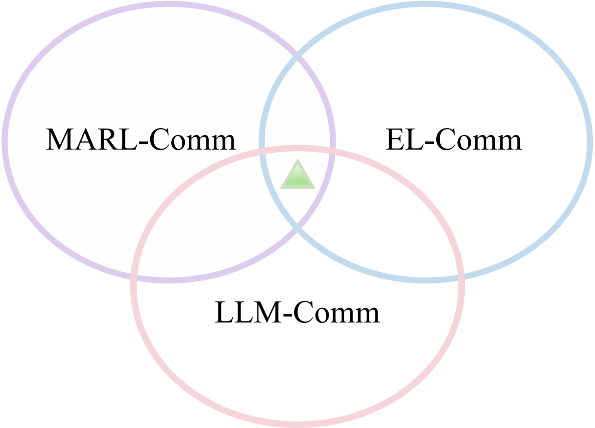

**图 1：** 本综述讨论多智能体通信的三个核心维度：基于多智能体强化学习的通信、涌现语言通信和大语言模型驱动的通信。

Oroojlooy 和 Hajinezhad (Oroojlooy and Hajinezhad, 2023) 等最近的综述延续了这一趋势，广泛审查了合作机制，但仅表面处理了通信方法，而 Beikmohammadi (Beikmohammadi, 2024) 对 2016 年至 2021 年 16 项 MARL 通信研究进行了系统回顾，重点关注其方法的严谨性，并找出诸如缺乏标准化环境和考虑现实世界等差距。通信限制。即使是专门针对通信的作品，例如 Zaiem 等人。 (Zaı̈em and Bennequin, 2019) 和 Zhu 等人。 (Zhu et al., 2024) 存在局限性，要么狭隘地关注 MARL 特定方法，要么没有纳入涉及涌现语言和大语言模型 (LLMs) 的最新进展。

相比之下，我们的工作通过提供第一个明确关注通信的专门的、结构化的综述，独特地解决了文献中的重大空白。我们的贡献在几个方面与之前的综述有很大不同。首先，我们建立了一个新颖的三维审查框架，该框架集成了基于 MARL 的通信方法、涌现语言范式以及 LLM 驱动的智能体通信的最新进展。其次，我们对这些维度的关键作品进行了系统分类和全面分析，突出了基本趋势、相同点和不同点。最后，我们明确概述了开放的挑战，并提出了明确的研究方向，以提高 MA-Comm 在现实世界多智能体系统中的效率、可解释性、可扩展性和适用性。

### 3.2 涌现通信的综述

多智能体系统中的涌现语言研究作为实现可解释且具有语义具有语义扎根的通信的一条有前途的途径而受到关注。虽然 Boldt 和 Mortensen (Boldt and Mortensen, 2024) 提供了涵盖机器学习、自然语言处理和认知科学领域的涌现通信的广泛综述，但他们的评论超出了决策范围。相比之下，我们的重点特别集中在涌现语言如何促进序贯决策环境中的协调和策略学习。他们强调涌现通信在可解释性和人机交互方面的潜力，同时也对实践和理论用例进行了分类。彼得斯等人。 (Peters et al., 2024) 对 181 篇论文进行了大规模综述，提出了离散涌现语言的分类法。他们系统地分析评估指标并识别语言可比性、组合性和语义对齐方面的挑战。他们的贡献是方法论上的，旨在标准化涌现语言的评估方式。沃尔夫等人。 (Wolff et al., 2024) 解决了传统指称游戏的局限性，并为涌现语言学习引入了更真实的情境环境。他们的工作强调了双向和稀疏通信策略的出现，这种策略在复杂的 MARL 设置中的协调压力下自然出现。其他重点综述和特定领域的工作包括 Chafii 等人的 (Chafii et al., 2023)(探索未来 6G 无线网络中的 EC-MARL)和 Gupta 等人的 (Gupta et al., 2020)(分析基于图的多智能体拓扑的涌现通信)。虽然这些作品很有价值，但它们受到上下文的限制，并且没有提供通用的、综合的视角。

先前对涌现语言的综述主要集中在通信协议的语言和结构特性上，例如语法、语义、组成以及它们与人类语言的相似性。这些研究通常受到认知科学和语言理解的推动，旨在研究结构化语言如何通过交互在人工智能体中出现，而不必将这种交流建立在任务驱动的决策基础上。相比之下，Boldt 和 Mortensen 最近的综述 (Boldt and Mortensen, 2024) 是为数不多的明确解决多智能体协调背景下的涌现通信问题的综述之一，即当多个智能体相互交互和通信时，结构化语言如何通过智能体交互出现。这凸显了它不仅作为一种语言现象，而且作为一种促进有效联合决策的机制的作用。

将EL纳入本次综述的动机是(Mordatch and Abbeel, 2018)的开创性工作，该工作首先通过MADDPG (Lowe et al., 2017)在涌现通信和MARL方法之间建立了联系。这项工作展示了如何在智能体之间出现具有语义具有语义扎根的组合语言，作为在多智能体环境中完成任务和实现目标的机制。在此背景下开发的通信协议的符号和离散性质随后激发了一系列 MARL 通信方法，例如 (Havrylov and Titov, 2017; Chen et al., 2024b)，它采用离散消息传递来减少通信开销并增强可解释性。总结多智能体通信背景下的 EL 研究，为智能体协作提供了一个可解释的框架，并促进了人类可理解的通信协议的开发，为实现以人为中心的人工智能的更广泛目标做出了贡献。

因此，我们的综述通过将 EL 作为多智能体通信的三个核心维度之一来补充和扩展这些努力。与之前强调孤立的涌现通信的评论不同，我们提供了一个统一的框架，将 MARL 通信、涌现语言和 LLM 驱动的通信策略联系起来。这种更广泛的集成促进了比较，突出了跨领域的挑战，并为未来多智能体系统中设计通用且人性化的通信协议奠定了基础。

### 3.3 基于大语言模型的通信综述

**表 2：** 跨多智能体通信维度的综述比较：本综述将 MARL-Comm、涌现语言（EL）和基于大语言模型的多智能体系统（MAS）三个领域联系起来，提供统一框架，突出跨领域趋势、系统化方法以及构建可扩展、可解释、以人为中心的多智能体通信系统所面临的开放挑战。

| 综述 | 关注领域 | 侧重通信 | 侧重 LLM | 涌现语言 | 系统性框架 |
| :---: | :---: | :---: | :---: | :---: | :---: |
| (Hernandez-Leal et al., 2019) | MARL | 否 | 否 | 否 | 否 |
| (Nguyen et al., 2020) | MARL | 否 | 否 | 否 | 否 |
| (Gronauer and Diepold, 2022) | MARL | 部分 | 否 | 否 | 否 |
| (Wong et al., 2023) | MARL | 部分 | 否 | 否 | 否 |
| (Oroojlooy and Hajinezhad, 2023) | MARL | 部分 | 否 | 否 | 否 |
| (Beikmohammadi, 2024) | MARL-Comm | 是 | 否 | 否 | 是 |
| (Zaı̈em and Bennequin, 2019) | MARL-Comm | 是 | 否 | 否 | 是 |
| (Zhu et al., 2024) | MARL-Comm | 是 | 否 | 否 | 是 |
| (Boldt and Mortensen, 2024) | 涌现语言 | 部分 | 否 | 是 | 是 |
| (Peters et al., 2024) | 涌现语言 | 是 | 否 | 是 | 是 |
| (Wolff et al., 2024) | 涌现语言 | 是 | 否 | 是 | 是 |
| (Chafii et al., 2023) | 涌现语言（无线通信） | 部分 | 否 | 是 | 否 |
| (Gupta et al., 2020) | 涌现语言（图） | 部分 | 否 | 是 | 是 |
| (Wang et al., 2024a) | LLM | 部分 | 是 | 否 | 是 |
| (Li et al., 2024e) | LLM | 是 | 是 | 否 | 是 |
| (Guo et al., 2024a) | LLM | 部分 | 是 | 否 | 是 |
| (Yi et al., 2024) | LLM（对话） | 部分 | 是 | 否 | 是 |
| (Guan et al., 2025) | LLM（对话评估） | 部分 | 是 | 否 | 是 |
| (Hu et al., 2024b) | LLM（游戏） | 部分 | 是 | 否 | 是 |
| (Tran et al., 2025a) | LLM（协作） | 是 | 是 | 否 | 是 |
| (Sun et al., 2025b) | LLM（协调） | 部分 | 是 | 否 | 是 |
| (Sun et al., 2024a) | LLM（MARL） | 部分 | 是 | 否 | 是 |
| (Mosquera et al., 2024) | LLM（评估） | 是 | 是 | 否 | 否 |
| (Cemri et al., 2025a) | LLM（评估） | 是 | 是 | 否 | 否 |
| (Liu et al., 2025a) | LLM（未来发展） | 部分 | 是 | 否 | 是 |
| (Aratchige and Ilmini, 2025) | LLM（技术层面） | 是 | 是 | 否 | 是 |
| **本综述** | **上述所有领域** | 是 | 是 | 是 | 是 |

最近的综述广泛探索了 LLMs 与多智能体系统 (MAS) 的集成，特别关注增强智能体间的通信、协调和协作。王等人。 (Wang et al., 2024a) 对基于 LLM 的自主智能体进行了全面审查，对通信、规划、内存和工具使用等核心功能进行了分类。李等人。 (Li et al., 2024e) 提供以工作流为中心的视角，概述了基于 LLM 的 MAS 中的关键基础设施组件，包括配置文件建模、自我行动推理、感知、交互和学习。

郭等人。 (Guo et al., 2024a) 综述了基于大语言模型的多智能体的进展和挑战，涵盖推理、协作和智能体模块化等方面。在对话系统的背景下，Yi 等人。 (Yi et al., 2024) 和关等人。 (Guan et al., 2025) 分析了基于 LLM 的多轮对话的最新进展和评估策略，强调了通信瓶颈和协调失败。胡等人。 (Hu et al., 2024b) 重点关注游戏环境中基于 LLM 的智能体，讨论规划、交互动态和决策复杂性。虽然这些综述强调了 LLMs 在多智能体决策中日益重要的作用，但它们在很大程度上将通信视为次要问题而不是主要关注点，因此需要在 LLM 支持的多智能体系统中更有针对性地综合通信策略。

多项综述更直接地考察了 LLM 智能体之间的协作和协调。特兰等人。 (Tran et al., 2025a) 使用 LLMs 审查多智能体协作机制，而 Sun 等人。 (Sun et al., 2025b) 综述跨不同应用领域的协调策略。孙等人。 (Sun et al., 2024a)

具体探讨了LLMs如何与MARL集成，总结当前进展并提出未来的研究方向。 Aratchige 和 Ilmini (Aratchige and Ilmini, 2025) 进一步研究了构建有效的基于 LLM 的多智能体系统的技术挑战，解决了通信可靠性、共享内存和不确定性处理等问题。

作为这些广泛综述的补充，一些评估研究综述了基于 LLM 的多智能体合作的基本局限性。莫斯克拉等人。 (Mosquera et al., 2024) 使用 Melting Pot 基准对 LLM 增强智能体中的合作行为进行实证评估，而 Cemri 等人。 (Cemri et al., 2025a) 深入分析了多智能体 LLM 系统经常失败的原因，识别了对齐、通信一致性和鲁棒性方面的关键弱点。此外，刘等人。 (Liu et al., 2025a)呈现了“基础智能体”更广阔的愿景，探索类脑架构、进化协作机制，追求安全、可扩展的多智能体智能。

与主要关注基于 LLM 的多智能体系统中的架构功能、评估基准或新兴挑战的现有综述相比，我们的工作将支持 LLM 的通信视为 MA-Comm 更广泛分类中的三个中心范例之一。通过将 LLM 驱动的交互与传统 MARL 通信协议和 EL 系统连接起来，我们提供了跨越不同研究社区的综合视角。虽然 MA-Comm 解决了人类参与之外的广泛协调和决策目标，但 LLMs 的加入为更自然、可解释和潜在的人性化通信带来了新的机会。这种更广泛的视角有助于发现共同的挑战和有希望的方向，以推进跨智能体类型和应用程序领域的通信策略。

表 2 对 MA-Comm 关键维度的主要综述进行了结构化比较。虽然早期的工作主要集中在 MARL 通信、涌现语言或基于 LLM 的系统，但没有一个能够全面地同时解决所有三种范式。相比之下，我们的综述以独特的方式弥合了这些领域，提供了一个统一的框架，突出了跨领域趋势、系统方法论以及构建可扩展、可解释和以人为中心的多智能体通信系统的开放挑战。

## 4 综述的方法与范围

本综述采用系统文献综述方法来分析三个紧密相关但传统上独立的领域的多智能体通信研究：多智能体强化学习中的通信(MARL-Comm)、涌现语言(MA-EL)和基于大语言模型的多智能体通信(LLM-Comm)。我们的目标不是详尽列举这些领域的每一篇论文，而是提供一个有原则的、有代表性的综合，突出核心建模假设、方法论趋势和跨领域的开放挑战。

### 4.1 检索策略与时间范围

我们对 2025 年之前发表的作品进行了结构化文献检索。为了捕捉基础背景，在必要时纳入了少量早期的开创性作品(例如 Dec-POMDPs、经典团队决策理论和通信约束控制)，为以后的发展奠定基础。主要搜索是使用 Google Scholar 结合关键字组合进行的，例如 *多智能体通信* 、 *MARL 通信* 、 *涌现语言* 、 *信号游戏* 、 *多智能体 LLM* 和 *基于语言的协调*。此外，我们还手动检查了主要人工智能和机器学习场所(NeurIPS、ICML、ICLR、AAAI、AAMAS)和相关研讨会的会议记录。向后和向前引用跟踪用于识别仅通过关键词搜索无法出现的有影响力的作品。对于每个搜索词，停止标准是完整结果页面上没有新的相关论文。

### 4.2 纳入与排除标准

论文基于以下标准被 **纳入** 本次综述：(1)该工作明确将 **智能体之间的通信** 视为问题表述或解决方案的核心组成部分，而不是外围的实施细节； (2) 该环境涉及 **多个决策智能体**，包括合作、竞争或混合动机场景； (3) 论文提出了与传播学习、表征或使用相关的 **方法论贡献** 、实证评估或正式框架； (4) 该作品发表在同行评审的期刊、会议、研讨会、论文或书籍章节中，或者是 **技术上实质性的 arXiv 预印本**，有选择性地包含在内，以反映快速发展的子领域(例如，基于 LLM 的多智能体通信)的最新进展，这些进展尚未在档案馆中得到充分体现。

相反，如果出现以下情况，论文将被 **排除** :(1)仅表面提及通信而没有进行建模或分析； (2) 工作仅专注于单智能体学习或完全集中控制，而没有去中心化执行； (3) 论文纯粹是概念性的或没有技术实质的立场性文章； (4) 尽管新兴领域(例如基于 LLM 的多智能体通信)具有快节奏的性质，但该工作仅作为未经同行评审的预印本提供，并且缺乏足够的技术深度、实证验证或方法论清晰度来保证纳入。

这些纳入和排除标准在本次综述中考虑的所有三个领域(MARL-Comm、MA-EL 和 LLM-Comm)中一致应用，特定领域的判断仅用于解释术语、实验惯例和评估实践方面的差异。

### 4.3 跨领域覆盖与详细讨论对象的选择

最初的搜索产生了这三个领域的数百篇候选论文。应用纳入和排除标准后，我们​​保留了涵盖 MARL-Comm、涌现语言和基于 LLM 的多智能体系统的代表性作品的精选语料库。在该语料库中，正文和表格中深入讨论了论文的子集。这些论文的选择基于以下一个或多个因素：(1)介绍了广泛采用的通信架构、框架或基准； (2)对 **谁与谁** 、 **什么** 、 **何时** 、 **为什么** 和 **如何** 进行通信的显式或隐式调查，尤其是分析通信动机( **为什么** )如何直接影响通信机制设计( **如何** )的工作；正文对这些作品进行了深入的讨论和比较； (3) 对后续研究产生明显的影响，通过引用模式或后续工作来证明； (4) 能够说明跨域的对比或联系(例如，MARL-Comm 和 LLM-Comm 之间)。其余的作品被更简短地引用或总结，以提供广度和上下文覆盖而没有冗余。这种平衡反映了全面覆盖范围和分析深度之间的有意权衡，确保核心思想得到严格审查，同时将它们置于更广泛的文献中。

### 4.4 综述范围的局限性

我们注意到，研究的快速发展——尤其是基于 LLM 的多智能体系统——意味着新的结果不断出现，超出了任何固定综述的时间范围。因此，这项综述反映了截至 2024 年 8 月的文献状况，并优先考虑阐明基本建模假设、通信机制和设计权衡的工作，而不是试图详尽覆盖所有同期结果。上述方法标准旨在使这些选择决策透明、有原则且可重复。总的来说，本次综述考虑了 MARL-Comm、MA-EL 和 LLM-Comm 的约 400 篇作品，其中约 100-130 篇代表性论文通过详细的分类法、比较表和重点讨论进行了深入研究。

## 5 多智能体强化学习中的通信

**多智能体强化学习 (MARL-Comm)** 中的通信在使智能体能够在动态和部分可观测的环境中协调、共享信息和集体行动方面发挥着核心作用。由于智能体在分散执行下运行，有效的通信必须解决基本挑战，例如有限的可观测性、带宽限制以及学习队友引起的非平稳性。早期的 MARL 系统依赖于手工设计的协议，但最近的进步使智能体能够“学习何时、什么以及如何进行端到端通信”，作为决策过程的一部分。这种转变将通信定位为一流的控制机制，与策略学习和长期协调紧密结合。

##### 综述范围与结构

本节首先介绍 MARL-Comm 中的背景和基本概念(第 5.1 节)，然后概述相关工作和关键研究方向(第 5.2 节)。然后，我们使用更新的“五个 W”视角来组织 MARL-Comm 文献。具体来说，我们通过消息相关性、接收者选择和信息编码来检查 **谁与谁通信以及共享什么** (第 5.3 节)； **当通信在时间、频率和资源限制下发生时** (第 5.4 节)；以及 **为什么通信是有益的以及如何通过培训目标、协议设计和控制塑造来实施通信** (第 5.5 节)。我们最后进行了一次讨论，综合了五个 W 的见解(第 5.6 节)，以及一个促进从 MARL-Comm 过渡到涌现语言的过渡部分(第 5.7 节)。图 2 和图 3 总结了最终的分类法和端到端 MARL 通信管道。在整个部分中，我们重点介绍代表性算法、评估设置和设计权衡，将所有讨论建立在马尔可夫决策过程框架 (Puterman, 2014) 内，为以通信为中心的 MARL 研究提供统一且可扩展​​的基础。

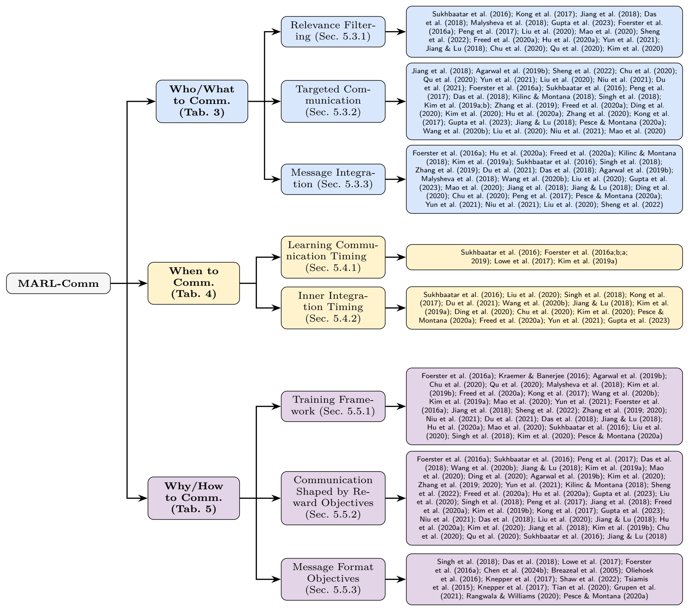

**图 2：** MARL-Comm 智能体分类体系。

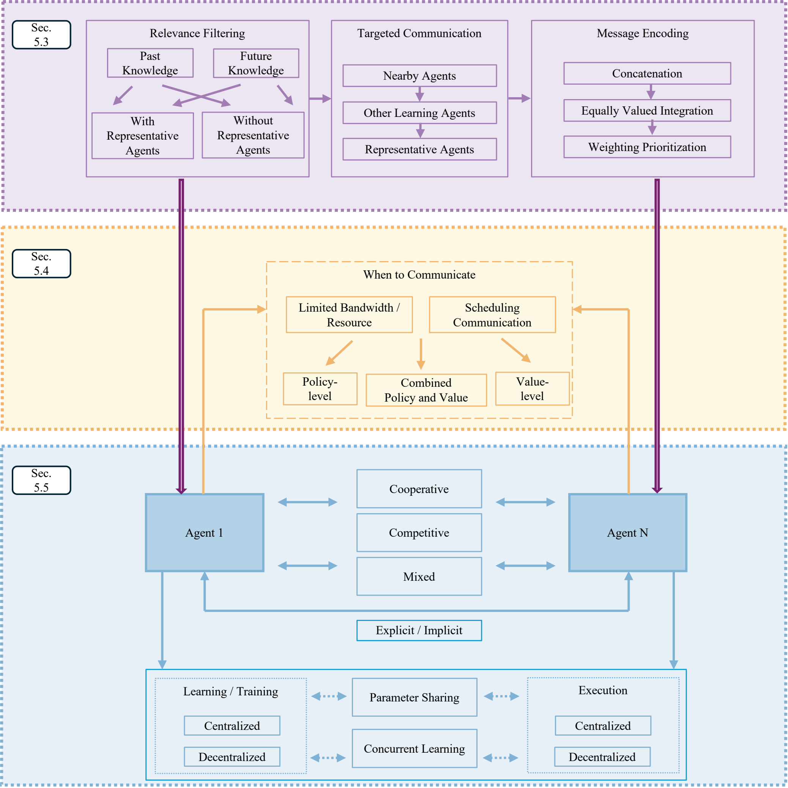

**图 3：** 第 5 节通信设计关键维度的组织结构：通信什么、与谁通信（第 5.3 节），资源约束下何时通信（第 5.4 节），为何通信，以及交互场景和学习架构如何塑造通信（第 5.5 节）。图中突出展示了各种通信机制如何受到任务结构、带宽限制、智能体关系以及训练与执行范式的制约。

### 5.1 MARL-Comm 的背景

强化学习通过反复试验最大化累积奖励，训练模型在不确定的环境中做出序贯决策 (Sutton and Barto, 2018)。虽然它传统上是为单个智能体设计的，但许多强化学习应用程序涉及多个智能体，这使得 MARL 成为更合适的框架 (Busoniu et al., 2008)。 MARL 研究共享环境中智能体之间的决策，并应用于网络物理系统 (Adler and Blue, 2002; Wang et al., 2016)、通信网络 (Cortes et al., 2004; Choi et al., 2009) 和社会科学 (Castelfranchi, 2001; Leibo et al., 2017)。 MARL 问题可以是完全合作的、完全竞争的或混合的，具体取决于智能体的目标。多智能体通信是 MARL 的一个基本方面，使智能体能够共享信息、协调策略并有效地实现集体目标。在 MARL 中，智能体在共享环境中运行，他们的联合行动影响状态转换和奖励。通信使智能体能够克服部分可观测性，调整其策略，并避免冲突或多余的操作。

##### 形式化框架

分散式部分可观测马尔可夫决策过程 (Dec-POMDPs) (Bernstein et al., 2002) 是部分可观测马尔可夫决策过程的多智能体扩展，它对合作 MARL 进行建模，其中智能体缺乏有关环境的完整信息，只有局部观测。在这种情况下，通信对于战略协调至关重要。具有通信功能的 Dec-POMDP 通常被建模为元组 (Chen et al., 2024b) $D=\langle S, A, P, \Omega, O, I, n, R, \gamma, f \rangle$，其中 $I = \{1,2,\dots,n\}$ 是一组 $n$ 智能体，$S$ 是联合 *状态* 空间，$A=A_1\times A_2 \times \dots \times A_n$ 是联合 *动作* 空间。这里$\boldsymbol{a}=(a_1,a_2,\dots,a_n)\in A$表示所有智能体的联合动作，$A_i$是智能体$i$的个体动作空间。联合行动影响环境，环境转变为新状态并提供全局奖励 $r$。 $P(\boldsymbol{s}'|\boldsymbol{s},\boldsymbol{a}): S \times A \times S \to [0,1]$ 是 *状态转换函数*。 $\Omega$ 是 *观察* 空间。 $O(\boldsymbol{s}, i): S \times I \to \Omega$ 是从联合状态空间映射到每个智能体 $i$ 的观测分布的函数。 $R(\boldsymbol{s}, \boldsymbol{a}): S \times A \to \mathbb{R}$ 是状态 $\textit{s}$ 和联合行动 $\boldsymbol{a}$ 方面的“奖励函数”，$\gamma$ 是折扣因子。通信可以建模为额外的操作空间，智能体在其中发送和接收消息 $m_i$ 以共享信息。在每个时间步，智能体 $i$ 基于其本地观察 $o_i \in O$ 和内部状态 $h_i \in H$ 生成消息 $m_i = f_i(o_i, h_i)$，其中 $f_i: O \times H \rightarrow M$ 是消息生成函数，它将观察和内部状态映射到消息空间 $M$，通常作为神经网络实现。每个智能体 $i$ 从其他智能体 $\mathcal{N}_i \subseteq \{1, \dots, N\} \setminus \{i\}$ 的(可能是动态的)子集接收消息 $\{m_j\}_{j \in \mathcal{N}_i}$，并将它们聚合到上下文向量 $c_i = g_i(\{m_j\}_{j \in \mathcal{N}_i})$ 中，其中 $g_i$ 是聚合函数，例如平均、串联或注意力。智能体的策略 $\pi_i$ 使用聚合上下文 $c_i$ 及其本地观察 $o_i$ 来选择操作 $a_i \sim \pi_i(o_i, c_i)$。该框架强调了通信的双重作用：(1)使智能体能够共享当地观测结果；(2)通过基于共享信息调整策略来促进协调。

基于此背景，我们在以下小节中对基于通信的 MARL 算法进行回顾，特别关注主要新颖性在于通信策略设计的作品。此类算法的一类旨在通过提高通信过程的效率和相关性来增强协作多智能体学习。这些工作要么引入门控和选择性消息过滤等机制来减少冗余通信，要么利用注意力机制和基于图的通信协议等先进技术来确保有意义的消息交换。另一类侧重于扩展的 MARL 设置，例如分层或特定于任务的通信，利用通信消息可以充当多智能体系统内任务或角色的嵌入或表示的想法。

### 5.2 MARL-Comm 概述与分类体系

通信在 MARL 中发挥着至关重要的作用，使智能体能够共享信息、有效协调并在部分可观测的环境中处理复杂的任务。早期的基础性工作，例如 CommNet (Sukhbaatar et al., 2016)、DIAL 和 RIAL (Foerster et al., 2016a)，开创了合作智能体的通信学习。 CommNet 使用共享神经网络来处理本地观测结果，并通过均值池聚合消息以进行分散决策。虽然在小规模环境中有效，但它在可扩展性和通信延迟方面遇到了困难。 DIAL 和 RIAL 引入了更明确的通信协议，其中智能体交换离散或连续消息，并通过强化学习共同学习其策略和通信策略。这些方法虽然具有创新性，但需要完全连接的通信网络，随着智能体数量的增加，导致对带宽的需求很高。

为了解决可扩展性和效率挑战，后续研究主要集中在自适应和选择性通信机制上。例如，IC3Net (Singh et al., 2018)采用门控机制，允许智能体根据当前状态动态决定是否进行通信，从而减少冗余消息。 TarMAC (Das et al., 2018) 引入多头注意力来提高通信信息的相关性，从而实现智能体之间的选择性共享。同样，ATOC (Jiang and Lu, 2018) 根据座席邻近度形成动态通信组，并采用双向 LSTMs 聚合组内的消息。更先进的方法，例如 SARNet (Rangwala and Williams, 2020)，结合了结构化推理和注意力机制来评估接收到的消息和过去记忆的相关性，从而实现更细致的决策。这些方法共同探讨了智能体应“何时”、“什么”和“与谁”进行通信等关键问题，从而显着提高了 MARL 任务的性能。

最近的工作还探讨了通信限制，例如有限的带宽和嘈杂的通道。例如，SchedNet (Kim et al., 2019a) 仅选择智能体的子集进行通信，在带宽限制内进行优化，而 IMAC (Wang et al., 2020b) 规范消息熵以减少通信开销。这些方法强调通信效率和性能之间的权衡，为现实场景中实用的 MARL 系统铺平了道路。为了进一步推进 MARL-Comm，新方法必须解决 (Chen et al., 2024b) 现实约束下的可扩展性、可解释性和性能保证等挑战。未来的工作应探索将稀疏、离散的通信协议与理论保证(例如悔损最小化)相结合，以增强大规模环境中的鲁棒性和适用性(Chen et al., 2024b)。

基于 MARL-Comm 的基础性进步，我们在以下小节中对基于通信的 MARL 算法进行了回顾，特别关注其主要新颖性在于设计高效且可扩展的通信策略的作品。此类算法的一类旨在通过引入注意力或门控等机制来优化智能体应在何时、以什么方式以及与谁进行通信来增强 MARL-Comm。这些方法旨在减少冗余通信、提高消息相关性并解决实际限制，例如有限的带宽或噪声信道。

##### 关键挑战

尽管具有潜力，MARL 中的多智能体通信仍面临几个核心挑战： **(1)。大型状态和智能体空间中的可扩展性：** 在大型环境中，每个智能体通常仅观察全局状态的一小部分。智能体的局部观测通常有限，因此很难推断全局状态或其他智能体的意图。通信对于在这些条件下实现协调至关重要，但在许多智能体之间交换高维或未经过滤的观测结果可能效率低下且计算量巨大 (Cao et al., 2013)。挑战在于设计可扩展的协议，选择性地共享信息，同时保留与任务相关的信号。 **(2)。通信开销：** 随着智能体数量的增加，通信复杂性迅速增加，从而导致显着的开销。消息过滤、注意力机制和分层结构等技术旨在缓解这种情况。例如，CommNet (Sukhbaatar et al., 2016) 使用共享集中式架构来实现持续通信，但它不能很好地随着智能体数量的扩展而扩展。 MADDPG (Lowe et al., 2017) 引入了集中式评价网络和分散式策略网络，其中智能体生成通信作为其行为的一部分。然而，其策略网络经常过度适应特定的智能体配置，限制了大规模场景中的通用性。 **(3)。非平稳性：** 在 MARL 中，每个智能体在非平稳环境中运行，因为其他智能体正在同时学习和更新其策略。这种动态环境使得学习稳定的通信策略变得困难，因为消息的含义和效用可能会随着时间的推移而改变。 **贡献归因：** 在合作环境中，确定每个智能体对集体奖励的贡献并非微不足道，但对于有效学习至关重要。如果没有适当的贡献归因，智能体就无法根据个人影响准确更新其策略，这可能会导致学习动态不佳或不稳定。通信可以帮助智能体更好地协调他们的行动，但它也引入了智能体行为和消息之间的额外依赖关系，使得将成功或失败归因于特定贡献变得更加复杂。 **(5)。可解释性：** MARL 中学习的通信协议通常嵌入到潜在的连续空间中，使得它们难以解释。与具有明确语义的手工协议不同，学习到的消息缺乏透明度，因此很难分析其含义、对决策的影响或与人类推理的一致性。 **(6)。缺乏理论保证：** 许多 MARL-Comm 方法依赖于启发式机制来学习连续或离散通信 (Foerster et al., 2016a; Singh et al., 2018; Jiang and Lu, 2018; Das et al., 2018; Rangwala and Williams, 2020; Havrylov and Titov, 2017; Mordatch and Abbeel, 2018)。虽然一些方法对离散的、类人的消息进行建模，但它们通常缺乏策略收敛或悔损最小化等正式保证，从而限制了它们的理论稳健性和实践可靠性。

##### 主要方法

已经提出了几种方法来应对这些挑战，这些方法可以大致分为： **(1)。集中式通信**，例如 CommNet ((Sukhbaatar et al., 2016))，使用共享神经网络来聚合来自所有智能体的消息并计算全局上下文。消息生成和聚合步骤形式化为：$m_i = f_i(o_i, h_i); \quad c_i = \frac{1}{N-1} \sum_{j \neq i} m_j,$，其中 $c_i$ 是来自所有其他智能体的平均消息。虽然这种方法简化了协调，但它引入了单点故障，并且可能无法很好地扩展到大型系统。 **(2)。去中心化通信**，例如 TarMAC ((Das et al., 2018))，使智能体能够使用注意力机制直接相互通信。消息聚合步骤形式化为：$c_i = \sum_{j \neq i} \alpha_{ij} m_j, \quad \alpha_{ij} = \text{softmax}(u_i^T W u_j),$，其中$\alpha_{ij}$是智能体$i$和$j$之间的注意力权重，$u_i$和$u_j$是学习的嵌入，$W$是学习的权重矩阵。这种方法更具可扩展性，但需要强大的协议来处理消息延迟和冗余。 **(3)。学习通信**，例如 IC3Net ((Singh et al., 2018))，侧重于通信协议的端到端学习。策略更新步骤形式化为：$a_i \sim \pi_i(o_i, c_i), \quad c_i = g_i(\{m_j\}_{j \neq i}),$，其中$g_i$是学习的聚合函数。这种方法允许智能体制定适合特定任务和环境的通信策略。 **(4)。涌现通信**，例如 (Mordatch and Abbeel, 2018; Lazaridou et al., 2016)，研究智能体如何在没有明确监督的情况下通过交互开发涌现通信协议。消息生成步骤形式化为：$m_i = f_i(o_i, h_i), \quad f_i \text{ is learned through reinforcement learning}.$ 这种方法通常在合作游戏或语言学习任务的背景下进行研究。我们将在第 2 节中使用单独的部分来介绍这一系列工作。 6.

**(5)。 LLM 引导通信：** (Li et al.) 等方法利用大语言模型 (LLMs) 来引导智能体通信朝着更可解释、类似自然语言的结构进行。消息生成过程被形式化为 $m_i = f_i(o_i, h_i, \text{LLM})$，其中 $f_i$ 是一个函数，不仅以智能体的观察 $o_i$ 和内部状态 $h_i$ 为条件，而且还由预训练的 LLM 通知。这种集成允许智能体生成结构化的、人类可理解的消息，同时保持甚至增强任务性能。 LLM 引导的通信在协作规划和临时团队合作等任务中显示出了前景，从而提高了泛化能力并加快了通信的出现。我们在第二节中对此研究方向进行了详细讨论。 7. **(6)。回报差距最小化**，例如在 (Chen et al., 2024b) 中，量化了具有完全可观测性的理想策略(即 $\pi^*=[\pi_i^*(a_i|o_1,\ldots,o_n),\forall i]$)的最佳预期平均回报与支持通信、部分可观测的策略(即 $\pi=[\pi_i(a_i|o_i,\boldsymbol{m_{-i}}),\forall i]$)的最佳预期平均回报之间的差距。这一结果使得此类工作能够将多智能体通信重新转化为基于每个智能体的本地观察的新型在线聚类问题，其中消息作为聚类标签，返回间隙的上限作为聚类损失。

### 5.3 谁与谁通信、通信什么：信息与接收者的选择

MARL-Comm 的主要挑战之一是确定哪些智能体应共享哪些信息，以便最大限度地提高协调性，同时最大限度地减少冗余或不必要的通信。以前的综述经常将“通信什么”和“与谁通信”或“与谁通信”视为单独的主题，尽管两者在问题表述和算法设计中都紧密耦合。在实践中，选择消息内容和选择接收方通常是联合处理的 (Das et al., 2018; Rangwala and Williams, 2020)，并且许多方法一起学习这些选择。因此，本节提出了一个统一的讨论，其中 **信息选择和接收者选择** 都被视为“通信什么”问题的一部分。我们确定了共同确定“通信内容”和“与谁通信”的三个关键挑战：(1)。 **相关性过滤：** 确定哪些信息对于协调至关重要，并选择将从接收该信息中受益的接收者。 (2)。 **避免冗余：** 确保消息仅发送给无法独立推断信息的智能体，从而减少不必要或重复的通信。 (3)。 **压缩和编码：** 构造适合目标接收者的紧凑消息表示形式，同时满足带宽和可扩展性限制。

#### 5.3.1 消息与接收者的相关性筛选

确定“通信内容”的核心组成部分是确定“哪些智能体”应该接收每条信息。因此，相关性过滤涉及联合选择消息内容和适当的接收者，确保通信既提供信息又针对信息可操作的智能体。通过通信策略建立通信链路后，智能体必须确定应共享哪些信息以及哪些接收者将从接收该信息中受益。在部分可观测性下，局部观测变得特别有价值，智能体通常依靠历史经验、预期行动或预期的未来计划来生成针对特定接收者的信息消息。

##### 对过去知识的编码

过去的观察、行动和内部状态为相关性过滤提供了丰富的信息源。这些信号经常被编码成紧凑的消息，并有选择地路由到相关接收者。循环神经网络 (RNN) 系列的模型(例如，长短期记忆 (LSTM)、门控循环单元 (GRU))对于此目的特别有效，因为它们捕获时间结构并有选择地保留可能对下游决策有用的信息。代表性作品编码历史观察 (Sukhbaatar et al., 2016; Kong et al., 2017; Jiang et al., 2018; Das et al., 2018; Malysheva et al., 2018; Kilinc and Montana, 2018; Singh et al., 2018; Pesce and Montana, 2020a; Zhang et al., 2019; Wang et al., 2020b; Liu et al., 2020; Mao et al., 2020; Sheng et al., 2022; Freed et al., 2020a; Hu et al., 2020a; Zhang et al., 2020; Gupta et al., 2023; Niu et al., 2021; Du et al., 2021; Yun et al., 2021) 或动作观察历史 (Foerster et al., 2016a; Peng et al., 2017)，具体取决于如何为不同接收者定义消息相关性。然而，如果存在代表智能体，则消息将被生成并从智能体传输到代表智能体，然后从代表智能体传输到智能体。因此，我们将最近使用现有知识作为消息的工作分为以下两种情况。

- **通过代表智能体：** 使用代表智能体时，通信消息分两个阶段生成。首先，本地观测可以编码为 (Sukhbaatar et al., 2016; Kong et al., 2017; Jiang et al., 2018; Das et al., 2018; Malysheva et al., 2018) 或直接发送 (Das et al., 2018; Malysheva et al., 2018) 给代表智能体。然后，代表智能体聚合这些本地(编码)观测结果，并为所有智能体 (Gupta et al., 2023) 生成单个全局消息，或者为每个智能体 (Sukhbaatar et al., 2016; Kong et al., 2017; Jiang et al., 2018; Das et al., 2018; Malysheva et al., 2018) 定制个性化消息。这种集中式机制消除了各个智能体的消息集成负担。由于代表智能体负责确定聚合信息的结构和路由，因此该设计本质上链接了“什么”信息与“谁”通信的信息。 CommNet (Sukhbaatar et al., 2016) 和 MS-MARL-GCM (Kong et al., 2017) 等系统生成共享的全局消息，捕获与所有队友相关的信息，而 HAMMER (Gupta et al., 2023) 或 TarMAC (Das et al., 2018) 等架构则支持特定于座席的消息，反映差异化的信息接受者之间的需求。在这些设置中，代表模块通过同时塑造消息的内容和分发来操作接收方选择。

- **没有代表智能体：** 如果没有代表智能体，消息将在智能体之间直接交换。 DIAL 和 RIAL (Foerster et al., 2016a) 将过去的观察和操作编码为消息。 BiCNet (Peng et al., 2017) 在智能体之间共享本地和全局观测结果。其他方法直接传达原始观测值 (Liu et al., 2020)，或依赖前馈网络 (Liu et al., 2020; Mao et al., 2020; Sheng et al., 2022; Freed et al., 2020a)、MLP (Freed et al., 2020a; Hu et al., 2020a)、自动编码器 (Freed et al., 2020a)、CNNs (Liu et al., 2020; Mao et al., 2020)、RNNs (Sukhbaatar et al., 2016; Kong et al., 2017; Jiang et al., 2018; Das et al., 2018; Malysheva et al., 2018) 或 GNNs (Liu et al., 2020; Freed et al., 2020a) 对本地观测值进行编码以进行通信。在去中心化设置中，选择消息内容与确定哪些智能体需要该信息密不可分：广播、基于邻域的路由或注意力引导消息传递都隐式定义了信息的“谁”。诸如 DIAL (Foerster et al., 2016a)、BiCNet (Peng et al., 2017) 或基于 GNN 的通信 (Liu et al., 2020; Freed et al., 2020a) 等方法共同学习信息和适当接收者的相关性，反映了“传输内容”和“谁”从中受益之间的直接耦合。
  
  此外，一些方法传达更专业的信息。例如，在 GAXNet (Yun et al., 2021) 中，智能体交换注意力权重以协调来自相邻智能体的隐藏状态的组合，从而提供细粒度的接收方感知消息内容。

##### 对未来知识的编码

我们使用“未来知识”来指代预期行动 (Jiang and Lu, 2018)、策略指纹(即特定状态下的当前行动概率)(Chu et al., 2020; Qu et al., 2020) 或未来计划 (Kim et al., 2020)，其可以通过模拟环境动态 (Kim et al., 2020) 模型来生成。由于意图和计划与国家相关，最近的工作通常将意图与当地观测结果一起编码，以生成更多相关信息。由于面向未来的信号仅对决策依赖于预测发送者行为的智能体有意义，因此这一类别自然地将“什么”通信与“谁”通信联系起来。在基于意图的方法(例如 ATOC (Jiang and Lu, 2018) 或指纹共享方法 (Chu et al., 2020; Qu et al., 2020))中，共享信息有选择地传输给策略必须与发送者紧密协调的团队成员。基于规划的通信 (Kim et al., 2020) 同样将预测性部署或抽象计划引导给未来行动相互依赖的智能体。在这些方法中，未来知识充当有针对性的通信机制，其中消息内容由从预测信息中受益最多的特定接收者塑造。

#### 5.3.2 通过定向通信减少冗余

人类通信的一个关键特征是进行有针对性的互动的能力。正如之前的工作 CommNet (Sukhbaatar et al., 2016)、RIAL 和 DIAL (Foerster et al., 2016a) 和 IC3Net (Singh et al., 2018) 中所探索的那样，将特定消息定向到预期接收者可以增强复杂环境中的协作，而不是向所有智能体广播消息。例如，在一个搜救机器人团队中，“厨房冒烟”之类的消息与消防员相关，但与拆弹器无关。因此，有针对性的通信直接反映了“谁”的维度，指定哪些智能体预计接收给定的信息并根据给定的信息采取行动。在本节中，我们重点关注智能体如何在部分可观测的环境中执行合作任务时学习 **与谁通信**。通信类型定义哪些智能体是 MARL-Comm 系统中消息的潜在接收者。在文献中，通信者类型可以根据智能体之间是直接通信还是通过代表智能体进行通信来分类。

##### 与邻近智能体通信

在许多 MARL 系统中，仅允许在附近的智能体之间进行通信。附近的智能体有多种定义方式，例如可观察的智能体 (Yun et al., 2021)、一定距离内的智能体 (Jiang et al., 2018; Agarwal et al., 2019b; Sheng et al., 2022) 或图 (Chu et al., 2020; Qu et al., 2020) 上的邻居智能体。相邻智能体也可以在学习过程中出现，而不是预先定义，如 GA-Comm (Liu et al., 2020)、MAGIC (Niu et al., 2021) 和 FlowComm (Du et al., 2021) 中，它们显式地学习智能体之间的图结构。在这些作品中，“谁”是通过空间接近度或学习的交互图来确定的，将消息相关性与特定的接收者集绑定起来。然而，在 GA-Comm 和 MAGIC 中，中央单元(例如 GNN)学习图结构并协调消息，因此智能体不直接通信，而是通过代表智能体进行管理。动态图网络 (DGN) (Jiang et al., 2018) 根据预定义的距离度量限制与三个最近邻居的通信。这种基于位置的通信在动态环境中尤其重要，在动态环境中，智能体的位置和状态频繁变化，需要及时且针对特定上下文的消息交换以保持有效的协调并避免通信瓶颈。类似地，智能体实体图 (Agarwal et al., 2019b) 也使用距离来衡量接近度，只要智能体之间距离较近，就允许智能体之间进行通信。 MAGNet-SA-GS-MG (Malysheva et al., 2018) 使用注意力机制通过选择最相关的消息来优化通信，并使用预训练图限制与相邻智能体的通信。学习结构化通信 (LSC) (Sheng et al., 2022) 使集群半径内的智能体能够决定是否成为领导智能体，所有非领导智能体与该集群中的领导智能体进行通信。这种结构化通信协议提高了通信效率和可解释性。 NeurComm (Chu et al., 2020) 和意图传播 (IP) (Qu et al., 2020) 在学习过程中限制与预设图结构上的邻居的通信，通过与邻居智能体共享决策策略和意图(即行动概率)来促进协调。 FlowComm (Du et al., 2021) 在基于流的系统中使用消息传递技术动态管理通信，根据环境流优化信息路由，同时还学习图形结构来识别相邻智能体。最后，GAXNet (Yun et al., 2021) 使用注意力机制来组合来自可观察的相邻智能体的隐藏状态，允许选择性消息传递，帮助智能体专注于关键信息，同时过滤掉不相关的数据。在这些方法中，消息内容和所选接收者都是由空间、结构或学习的邻接关系共同确定的。

##### 与其他学习智能体通信

当附近的智能体没有明确定义时(例如，通过基于邻近度的图)，通信通常发生在所有学习智能体之间或通过有选择地确定接收者的机制。有多种方法通过广播消息或学习与谁通信来支持这种情况下的通信。 DIAL(可微分智能体间学习)(Foerster et al., 2016a) 支持智能体之间的可微分通信，允许它们通过反向传播共同优化消息内容。 RIAL(强化智能体间学习)(Foerster et al., 2016a) 相反，使用强化学习来选择能够最大化集体奖励的消息(假设有一组固定的接收者)。 CommNet (Sukhbaatar et al., 2016) 通过平均所有智能体的隐藏状态来促进通信，隐式假设队友之间进行完全通信。 BiCNet(双向协调网络) (Peng et al., 2017) 应用 RNNs 来支持本地和全局观测的循环通信，再次依赖于所有智能体之间的共享消息交换。 TarMAC(定向多智能体通信)(Das et al., 2018) 引入学习注意力权重，确定每一步向“谁”发送消息，从而实现定向通信并减少不必要的消息传递。 MADDPG-M(带消息的多智能体 DDPG) (Kilinc and Montana, 2018) 通过连续消息交换扩展了 MADDPG 框架，但假设所有智能体都可以访问消息，则不会显式控制接收方选择。 IC3Net(集体智能中的隐式通信) (Singh et al., 2018) 通过允许智能体学习确定“何时”通信的门控机制来提高通信效率，从而减少带宽使用。 SchedNet (Kim et al., 2019a) 实现了一个调度程序，该调度程序选择哪些智能体可以在每个时间步中进行通信，从而有效地了解“何时”和“谁”在受限带宽下进行通信。 DCC-MD (Kim et al., 2019b) 通过根据重要性动态丢弃消息来扩展消息交换，从而间接控制接收方集。 VBC(基于值的通信)(Zhang et al., 2019) 使用值函数信息来确定要共享的状态信息的优先级，通过突出显示关键状态来帮助智能体进行协调，而无需广播所有消息。 Diff 离散 (Freed et al., 2020a) 和 I2C(意向信息通信) (Ding et al., 2020) 通过鼓励稀疏或目标相关的通信来减少通信负载。特别是，I2C 引导智能体仅共享与其当前意图相符的信息，这可以隐式过滤接收者。信息共享 (IS) (Kim et al., 2020) 专注于传输内部状态表示以同步协作任务中的行为。 ETCNet(事件触发通信网络) (Hu et al., 2020a) 仅在检测到重大环境变化时触发通信，从而减少冗余消息广播。最后，可变长度编码 (Freed et al., 2020a) 和 TMC(临时消息压缩)(Zhang et al., 2020) 将历史信息压缩为简洁的消息，提高了效率，但仍然假设充分通信，除非与选择性机制配对。在所有这些设置中，冗余减少取决于选择“发送内容”和“发送对象”，将内容相关性与预期接收者联系起来。

##### 通过代表性智能体通信

在智能体通过代表性智能体进行通信的系统中，智能体之间的通信由中间人或代表性智能体进行调解。该中介协调、处理和分发来自各个智能体的消息，从而提高通信效率并通常简化协调过程。对于这种类型的通信，已经提出了几种方法，如下所述。 MS-MARL-GCM (Kong et al., 2017) 引入了一个主智能体，该主智能体从环境中的智能体收集本地观测结果和隐藏状态。然后，主智能体将公共消息发送回每个智能体，从而减少各个智能体之间直接通信的需要。这种集中式通信模型改善了部分可观测环境中的协调。类似地，HAMMER (Gupta et al., 2023) 采用中央代表性智能体，该智能体从多智能体系统 (MAS) 中的智能体收集本地观测结果，并将全局消息和个性化消息分发给每个智能体。这通过聚合相关信息并将其分发给智能体来确保有效的通信，从而促进更好的决策。 ATOC (Jiang and Lu, 2018) 使用 LSTM 链接选择加入通信组的附近座席。该系统中的代表智能体向群组成员发送协调的消息，简化了通信并提高了智能体基于共享信息一致行动的能力。 MD-MADDPG (Pesce and Montana, 2020a) 在智能体之间维护共享内存，允许它们有选择地将本地观测值存储在内存中。然后，代表智能体加载并中继该信息，促进通信，同时减少消息过载。此方法可确保仅将相关信息传达给必要的智能体。 IMAC (Wang et al., 2020b) 定义了一个调度程序，该调度程序聚合来自所有智能体的编码信息并将个性化消息发送回每个智能体。这种集中的通信调度有助于座席专注于各自的任务，同时仍然受益于全局知识。在 GA-Comm (Liu et al., 2020) 和 MAGIC (Niu et al., 2021) 中，全局消息处理器用于聚合来自智能体的信息，然后根据智能体特定的权重分发消息。这可以实现更加定制化的通信，每个智能体都会收到针对其在系统内的独特上下文而定制的消息。最后，Gated-ACML (Mao et al., 2020) 采用了稍微不同的方法，允许智能体决定是否通过消息协调器进行通信。这引入了额外的决策级别，智能体根据手头信息的相关性评估通信的必要性。这些方法说明了使用代表性智能体通过以提高整体系统效率和智能体协调的方式集中、过滤和分发消息来增强多智能体系统中的通信的实用性。由于代表智能体明确确定接收者，因此有针对性的通信成为中心设计选择的一部分：中介决定每个合成消息的“谁”，将“谁”维度嵌入到通信架构本身中。

#### 5.3.3 通过消息加权进行压缩与编码

最近对 MARL-Comm 的研究经常集中处理多个传入消息。消息集成是指在将收到的消息传递到智能体的内部模型之前将其组合的方法。在使用代表智能体的情况下，代表智能体通常会合并和协调消息，向每个智能体提供统一的单个消息，这消除了各个智能体管理消息组合的需要。然而，当不涉及代表智能体时，每个智能体必须独立地确定如何合并多个传入消息。由于传达的消息反映了发送者对学习过程或环境的个人解释，因此某些消息可能会优先于其他消息。这些集成机制主要决定了最终保留、压缩或强调什么信息，尽管在某些架构中，例如基于注意力的加权，消息的优先级可以间接影响哪些智能体的信息在协调过程中变得最有影响力。

##### 消息拼接

在这种方法中，传入的消息被连接成单个输入向量，而不应用显式的偏好或加权。这确保了不会丢弃任何信息，但它增加了输入维度，随着智能体数量的增长，这可能会成为问题。 DIAL (Foerster et al., 2016a)、RIAL (Foerster et al., 2016a)、ETCNet (Hu et al., 2020a)、变长编码(Freed et al., 2020a)、MADDPG-M (Kilinc and Montana, 2018)、Diff Discrete (Freed et al., 2020a)等方法均采用此方法方法。例如，DIAL 和 ETCNet 连接标量消息值，在保留基本信息的同时保持简单性。 SchedNet (Kim et al., 2019a) 使用较短的消息向量来减少串联之前的通信开销，从而允许智能体在有限的带宽设置内更有效地运行。由于所有消息都被平等对待，没有优先级，因此该方法特别适合小规模系统，在小规模系统中，保留传输数据的整体比选择性过滤或压缩消息更有利。由于串联保留了完整的传入消息集，因此它直接决定“什么”信息进入智能体的策略，而不对保留的内容源自“谁”进行任何区分；因此，串联反映了内容保存选择而不是接收者选择机制。

##### 消息的等权整合

当假设智能体做出同等贡献时，他们的消息将使用排列不变运算(例如求和或平均)而不是串联来集成。虽然串联也以包含每个消息的方式统一处理消息，但它保留了顺序并增加了维度，而求平均或求和则将消息压缩为固定大小的表示形式，而不假设任何顺序。 CommNet (Sukhbaatar et al., 2016)、IC3Net (Singh et al., 2018) 和 VBC (Zhang et al., 2019) 等技术采用了这种形式的集成。在 CommNet 中，对所有传入消息进行平均以生成单个向量，确保每个发送者的影响相等。 IC3Net 对来自相邻智能体的消息使用类似的平均机制。 FlowComm (Du et al., 2021) 对消息进行求和，保持相等的贡献，同时启用基于梯度的消息细化。这种方法在协作任务中特别有效，其中假设所有智能体都具有类似的相关信息，从而允许简单而有效的消息集成，而无需注意或学习权重。由于每条传入消息的权重相同，因此此集成策略反映了智能体保留“什么”信息的特定选择，即所有输入的聚合摘要，同时隐式地将所有发送者视为同等相关，而不引入任何机制来区分信息来自“谁”或“谁”。

##### 通过加权确定消息优先级

在此类别中，智能体根据接收到的消息与当前任务的相关性或实用性，为它们分配不同的重要性级别。一些方法依赖于手工制定的规则来选择性地修剪被认为不太有用的消息。例如，DCC-MD (Kim et al., 2019b) 和 TMC (Zhang et al., 2020) 对消息大小或相关性分数实施手动阈值，以丢弃低显着性消息，从而减少通信开销。更常见的是，现代方法利用注意力机制来动态学习这些权重。基于注意力的模型(例如 TarMAC (Das et al., 2018)、智能体实体图 (Agarwal et al., 2019b) 和 MAGNet-SA-GS-MG (Malysheva et al., 2018))计算每条传入消息的相关性分数，并使用加权和将它们组合起来。这使得接收智能体能够专注于信息最丰富的消息，同时抑制来自不太重要的来源的噪音。通过为消息分配不同的权重，此方法指定应强调什么信息以及应忽略什么信息。它还引入了智能体关注的“谁”的隐含概念，因为来自更相关的发送者的消息具有更高的重要性，并且对最终表示有更强的影响。

##### 神经网络的应用

神经网络经常被用来自动学习消息的重要性，使智能体能够提取有用的信息并确定其优先级，而无需手工制定规则。在 IMAC (Wang et al., 2020b)、GA-Comm (Liu et al., 2020) 和 HAMMER (Gupta et al., 2023) 中，简单的多层感知器 (MLP) 用于集成消息，同时隐式学习哪些消息最有价值。 Gated-ACML (Mao et al., 2020) 采用类似的方法，但引入了门控机制来调节与中央代表智能体的通信链路。对于更复杂的设置，卷积神经网络 (CNNs) 用于捕获智能体之间的空间依赖性，如 DGN (Jiang et al., 2018)，这在智能体位置频繁变化且更新空间上下文至关重要的动态环境中特别有用。循环神经网络 (RNNs)，包括长短期记忆 (LSTM) 变体，广泛应用于以通信为中心的协调中的序贯决策任务。这些用于 ATOC (Jiang and Lu, 2018)、I2C (Ding et al., 2020)、NeurComm (Chu et al., 2020)、BiCNet (Peng et al., 2017)、MD-MADDPG (Pesce and Montana, 2020a) 和 GAXNet (Yun et al., 2021)，它们捕获跨通信轮次的时间依赖性，允许智能体根据不断变化的消息历史做出明智的决策。最后，图神经网络(GNNs)在 MAGIC (Niu et al., 2021)、GA-Comm (Liu et al., 2020) 和 LSC (Sheng et al., 2022) 等作品中广受欢迎。这些方法利用智能体上学习的图结构来建模交互并分配与相邻消息的相关性，通常将拓扑信息与注意机制相结合以提高通信效率和任务性能。这些模型决定应该从消息中提取什么信息，因为它们学会突出显示有用的模式并抑制噪音。它们还影响智能体有效地倾听的 **谁**，因为学习的图边缘、注意力分数或循环依赖性决定了哪些发送者对最终通信表示有更大的影响。

**表 3：** MARL-Comm 中“通信什么”（第 5.3 节）的方法分类。该分类也表明，消息内容与预期接收者紧密相关，因为相关性筛选、定向通信与加权机制都取决于每条消息的接收对象。

| **类别** | **方法** | **代表性工作** |
| --- | --- | --- |
| **相关性筛选与接收者匹配（第 5.3.1 节）** | *对过去知识的编码* （信息选择与固定或学习得到的接收者相关）（有／无代表性智能体） | • 有代表性智能体： (Sukhbaatar et al., 2016; Kong et al., 2017; Jiang et al., 2018; Das et al., 2018; Malysheva et al., 2018; Gupta et al., 2023) • 无代表性智能体： (Foerster et al., 2016a; Peng et al., 2017; Liu et al., 2020; Mao et al., 2020; Sheng et al., 2022; Freed et al., 2020a; Hu et al., 2020a; Yun et al., 2021) |
| **相关性筛选与接收者匹配（第 5.3.1 节）** | *对未来知识的编码* （与特定下游接收者共享）（预期动作、指纹、计划） | (Jiang and Lu, 2018; Chu et al., 2020; Qu et al., 2020; Kim et al., 2020) |
| **定向通信与接收者选择（第 5.3.2 节）** | *邻近智能体* （基于邻近关系选择接收者）（静态／动态邻近关系） | • 静态： (Jiang et al., 2018; Agarwal et al., 2019b; Sheng et al., 2022; Chu et al., 2020; Qu et al., 2020; Yun et al., 2021) • 动态： (Liu et al., 2020; Niu et al., 2021; Du et al., 2021) |
| **定向通信与接收者选择（第 5.3.2 节）** | *其他学习智能体* （学习得到的接收者集合）（学习得到的通信对象集合） | (Foerster et al., 2016a; Sukhbaatar et al., 2016; Peng et al., 2017; Das et al., 2018; Kilinc and Montana, 2018; Singh et al., 2018; Kim et al., 2019a; Kim et al., 2019b; Zhang et al., 2019; Freed et al., 2020a; Ding et al., 2020; Kim et al., 2020; Hu et al., 2020a; Zhang et al., 2020) |
| **定向通信与接收者选择（第 5.3.2 节）** | *代表性智能体* （接收者的集中式路由）（集中式消息处理） | (Kong et al., 2017; Gupta et al., 2023; Jiang and Lu, 2018; Pesce and Montana, 2020a; Wang et al., 2020b; Liu et al., 2020; Niu et al., 2021; Mao et al., 2020) |
| **消息整合与面向接收者的加权（第 5.3.3 节）** | *拼接* （标量／短向量）（不区分接收者） | (Foerster et al., 2016a; Hu et al., 2020a; Freed et al., 2020a; Kilinc and Montana, 2018; Kim et al., 2019a) |
| **消息整合与面向接收者的加权（第 5.3.3 节）** | *等权重* （求平均／求和）（认为所有发送者具有相同相关性） | (Sukhbaatar et al., 2016; Singh et al., 2018; Zhang et al., 2019; Du et al., 2021) |
| **消息整合与面向接收者的加权（第 5.3.3 节）** | *加权确定优先级* （人工规则或注意力机制）（消息重要性取决于接收者） | • 人工剪枝： (Kim et al., 2019b; Zhang et al., 2020) • 注意力机制： (Das et al., 2018; Agarwal et al., 2019b; Malysheva et al., 2018) |
| **消息整合与面向接收者的加权（第 5.3.3 节）** | *神经消息整合模型* （MLP、CNN、RNN、GNN）（学习发送者与接收者的相关性模式） | • MLP： (Wang et al., 2020b; Liu et al., 2020; Gupta et al., 2023; Mao et al., 2020) • CNN： (Jiang et al., 2018) • RNN／LSTM： (Jiang and Lu, 2018; Ding et al., 2020; Chu et al., 2020; Peng et al., 2017; Pesce and Montana, 2020a; Yun et al., 2021) • GNN： (Niu et al., 2021; Liu et al., 2020; Sheng et al., 2022) |

表 3 列出了 MARL-Comm 中“通信什么”问题的代表性方法的分类。它将关键策略分为三个总体类别：相关性过滤、有针对性的通信和消息集成。在每个类别中，我们重点介绍智能体如何通过关注不同的通信设计选择来解决信息选择和压缩问题。对于相关性过滤，方法根据是否编码过去的知识(例如历史或观察)或未来的知识(例如意图或计划)以及是否通过代表性智能体或以点对点方式进行通信进行分组。有针对性的通信进一步按照基于邻近的策略(静态与动态邻域)、与其他学习智能体的交互以及通过代表性智能体的集中通信进行分类。最后，消息集成方法根据智能体如何组合接收到的消息进行分类：串联、等权、加权优先级(手动或基于注意力)以及神经架构，例如 MLP、CNNs、RNNs 和 GNNs。在所有类别中，选择要传达的“什么”信息与信息发送给“谁”密切相关，因为消息相关性、过滤和权重取决于预期的接收者。此连接说明了在设计可扩展且有效的 MARL-Comm 系统时必须如何同时考虑通信内容和通信合作伙伴。这种结构化概述揭示了如何有选择地管理通信以平衡多智能体系统中的信息性、效率和可扩展性的趋势。

### 5.4 何时通信：约束下的时机选择与适应

MARL-Comm 的一个基本挑战是确定智能体应“何时”交换信息。虽然持续的通信可以让智能体充分了解情况，但在带宽或计算资源有限的去中心化环境中，它可能成本高昂、效率低下，甚至适得其反。因此，有效的通信时机对于平衡协调的好处与实际限制至关重要。智能体必须学会识别通信提供有意义优势的关键时刻，而不是在每个时间步骤进行通信，从而在资源限制下实现更好的决策和协作。除了一般的带宽限制之外，共享通信介质还会带来额外的复杂性，特别是当多个智能体必须避免消息冲突时。虽然 Wi-Fi 和 LTE 等协议通过完善的调度机制在数据包级别对此进行管理，但此类低级访问控制通常与 MARL 系统中的决策分开处理。相反，MARL-Comm 中的关键挑战是更高级别的：确定“何时”进行通信，以便有效且有意义地共享信息，而不会压垮渠道。这涉及两个主要问题：(1) 选择简洁、与任务相关的消息，以及 (2) 协调通信时序以最大限度地减少冗余和干扰 (Kim et al., 2019a)。最近的 MARL 方法不是直接优化通信协议，而是通过将消息选择和调度集成到智能体的学习策略中来解决这些问题。

#### 5.4.1 学习在约束下何时通信

某些约束，例如关于是否或何时进行通信的离散决策，可能会使通信时间不可微，从而给基于梯度的学习算法带来挑战。这种不可微性阻碍了通信协议的端到端训练。一种常见的解决方法是“集中训练和分散执行”(CTDE)，其中智能体以集中方式进行训练，可以完全访问全局信息和离散选择的可微近似(例如，通过软门控或策略梯度)。这使得智能体能够在训练期间学习有效的通信策略，即使消息传输在执行期间受到限制或约束。在测试时，智能体在更严格、通常不可微分的条件下部署这些学习策略。本节回顾通过学习“何时”和“如何”进行通信来解决通信约束的方法，包括基于 CTDE、可微门控机制、公共信念建模和分布式通信调度的方法。

##### 通过反向传播学习通信

苏赫巴托尔等人。 (Sukhbaatar et al., 2016) 引入了“通信网络”(CommNet)，可处理来自多个智能体的部分观测结果以确定其操作。该多层网络中的每一层都有多个单元，其中每个单元将其自己先前的隐藏状态 $h_m^{i-1}$ 和来自其他智能体隐藏状态的聚合消息 $c_m^i$ 作为输入。更新后的隐藏状态计算为 $h_m^{i+1} = \sigma(C^i c_m^i + H^i h_m^i)$，其中 $\sigma$ 是非线性激活函数。最后一层输出智能体的动作，整个网络使用基于奖励信号的反向传播进行训练。这种方法优于通过离散符号进行网络内通信的基线模型。随后的研究转向“集中​​式训练和分散式执行”，正如深度循环 Q 网络 (DRQN) (Hausknecht and Stone, 2015) 所证明的那样。与独立的深度 Q 网络 (DQN) (Hasselt et al., 2015) 不同，DRQN 不假设完全可观测性，更适合部分可观测的多智能体环境。通过循环单元维护内部记忆，DRQN 有助于缓解跨智能体并发策略更新引起的非平稳性问题，使其在去中心化多智能体设置中更加稳健。

福斯特等人。 (Foerster et al., 2016b) 通过提出以下两种集中式通信方案来扩展这一点，其中智能体共享网络权重并学习在部分可观测的环境中通过共享奖励进行有效通信。

- **深度分布式循环 Q 网络 (Foerster et al., 2016b):** 深度分布式循环 Q 网络 (DDRQN) 通过修改独立 Q 学习范式使其适应多智能体设置，从而扩展了深度循环 Q 网络 (DRQN)。具体来说，DDRQN 对标准独立 Q 学习引入了三个关键修改：(1)禁用经验重播，因为同时学习的智能体会使彼此过去的经验无效； (2) 每个智能体之前的动作被附加到当前输入以捕获时间依赖性； (3)单个 Q 网络在所有智能体之间共享，而不是维护单独的网络。这种权重共享提高了学习效率并减少了计算开销。
  
  尽管使用共享网络，每个智能体接收的输入仍各不相同，包括自身的观测、上一时刻的动作以及智能体标识符，因此共享 Q 网络能够针对不同智能体形成专门化的行为。循环神经网络（RNN）学习的 Q 函数定义为：
  
  $$
  Q(o_t^m, h_{t-1}^m, m, a_{t-1}^m, a_t^m; \theta), \tag{1}
  $$
  
   其中，$o_t^m$ 和 $a_t^m$ 分别表示智能体 $m$ 在时刻 $t$ 的观测和当前动作，$a_{t-1}^m$ 是其上一时刻的动作，$h_{t-1}^m$ 是隐藏状态，$\theta$ 表示共享网络的参数。
  
  训练分两个阶段进行：(1) 智能体使用基于当前 Q 函数的 $\epsilon$ 贪婪策略与环境进行交互，(2) 使用贝尔曼方程更新共享网络，优化各片段的时间差误差。

- **可微分智能体间学习 (DIAL) (Foerster et al., 2016a):** DIAL 引入了一个框架，其中在每个时间步，智能体 $m$ 不仅输出环境操作 $a_t^m$，还输出通信操作 $c_t^m$。在集中训练过程中，通信不受限制且可微分，从而实现跨智能体的梯度流；在分散执行期间，消息被限制在低带宽离散通道中。与仅估计价值函数的传统 Q 网络不同，DIAL 的 Q 网络还输出实值消息 $c_t^m$，这些消息在 $t+1$ 时间发送到其他智能体的 Q 网络(所有智能体共享权重)。
  
  两种类型的梯度流经网络：(1)来自智能体自身 Q 学习损失的奖励梯度；(2)来自消息接收者的误差梯度，该误差梯度通过通信通道传播回来。这允许发送智能体直接调整其消息以最小化下游 DQN 丢失，从而加速有效通信的出现。
  
  实验结果表明，DIAL 和 DDRQN 最终收敛到相似的性能 — $n = 3$ 智能体获得 100% 的 Oracle 奖励，$n = 4$ 获得 90% 的 Oracle 奖励。然而，DIAL 的收敛速度要快得多，与 DDRQN 的 500，000 集相比，仅需要 20，000 集。对于 $n = 4$，DIAL 保持可靠的收敛，而 DDRQN 可能无法完全收敛。性能提升归功于 DIAL 的可微分消息传递，它可以在训练过程中实现更直接、更高效的协调学习。

##### 通过参数共享学习通信

除 (Foerster et al., 2016a) 提出的可微智能体间学习（DIAL）外，该文作者还提出了另一种采用集中式学习、分散式执行的通信方法，即强化智能体间学习（RIAL）。该方法使用带有循环网络的深度 Q 学习，以应对部分可观测性。RIAL 有两种变体，分别采用独立 Q 学习和集中式 Q 学习。在独立 Q 学习中，每个智能体学习自己的网络，并将其他智能体视为环境的一部分。另一种变体则为所有智能体训练一个共享网络。执行时，智能体根据各自的观测独立行动。RIAL 将 DRQN 与独立 Q 学习相结合，同时学习环境动作和通信动作。每个智能体的 Q 网络 $Q^a$ 以隐藏状态 $h_t^a$、观测 $o_t^a$ 以及上一时间步从其他智能体接收到的消息 $m_{t-1}^a$ 为输入。为应对可能很大的动作空间，RIAL 将 $Q^a$ 分解为两个独立的输出头：$Q_u^a$ 对应环境动作 $u_t^a \in U$，$Q_m^a$ 对应通信动作 $m_t^a \in M$，其中 $U$ 和 $M$ 分别表示相应的动作空间。两类动作均通过 $\epsilon$-贪心策略选择，因此 Q 网络在每个时间步需要产生 $|U| + |M|$ 个输出。$Q_u$ 和 $Q_m$ 均使用 DQN 训练，并作了两项关键修改：禁用经验回放，以应对非平稳性；将动作 $u_t$ 和 $m_t$ 作为下一时间步的输入，以应对部分可观测性。尽管智能体独立学习，但分散式执行与训练阶段的方式完全一致。

##### 通过公共信念学习通信

DIAL 方法 (Foerster et al., 2016a) 假设存在一个理想化的通信信道，智能体可以自由交换信息，而不影响环境。然而，在许多实际场景中，显式通信不可用或受到限制。为此，Foerster 等人 (Foerster et al., 2019) 引入了 *公共信念* 的概念：它基于共同观测，刻画对潜在状态特征的共享概率估计。在时间步 $t$，推断得到潜在特征 $f_t$，其可被公开观测的部分记为 $f_t^{pub}$。公共信念按如下方式更新：

$$
\mathcal{B}_t = P(f_t | f_1^{pub}, f_2^{pub}, \dots, f_t^{pub}).
$$

在此基础上，他们提出了 **贝叶斯动作解码器（Bayesian Action Decoder，BAD）**，利用公共信念在不进行直接通信的情况下实现协调。每个智能体根据其私有观测和共享的虚拟策略 $\hat{\pi}_t$ 选择动作；该虚拟策略由公共信念和所有智能体的已知策略计算得到。虚拟策略将私有观测映射为可能采取的动作，使智能体能够根据其他智能体的可观测动作推断其私有状态。具体而言，在观测到动作 $a_t^m$ 后，智能体使用下式更新对另一智能体私有状态 $f_t^m$ 的信念：

$$
P(f_t^m | a_t^m, \mathcal{B}_t, f_t^{pub}, \hat{\pi}_t) \propto \mathbf{1}(\hat{\pi}_t(f_t^m) = a_t^m) P(f_t^m | \mathcal{B}_t, f_t^{pub}).
$$

该方法在合作纸牌游戏 *Hanabi* 中进行了评估。在这一游戏中，玩家看不到自己的手牌，必须依靠提示和推断。BAD 在双人游戏中达到了当时最先进的性能，智能体学会了隐式约定，例如用“红色”这样的提示来传达应当打出哪张牌，从而促进非言语协调。BAD 的成功表明，即使没有显式通信信道，共享信念也能支持有效通信。

##### 以分布式方式调度通信

增强多智能体系统协调的一种常见方法是启用分布式通信，其中智能体交换信息以一致地行动，而不依赖于集中控制器。这通常是通过 CTDE 范例 (Lowe et al., 2017) 来实现的，本节前面讨论的许多方法也采用了该范例。 **SchedNet** (Kim et al., 2019a) 通过使用强化学习来学习调度策略来举例说明这种方法，该策略确定哪些智能体应该在每个时间步进行通信。这种动态调度在通过共享介质(例如无线频道)进行通信的实际场景中尤其重要，这引入了两个关键约束：有限的带宽和介质访问的争用。 SchedNet 通过联合学习(1)消息编码器、(2)调度哪些智能体可以广播的策略以及(3)使用本地观察和接收到的消息来做出决策的动作选择器来解决这些约束。

#### 5.4.2 消息整合的时机

消息集成不仅在确定“如何”以及“何时”传达的信息影响智能体在学习和执行过程中的行为方面发挥着关键作用。通过消息集成，我们指的是在训练轮次或决策周期期间将接收到的通信合并到智能体的内部计算中的过程，例如在其策略或价值函数中。在大多数 MARL-Comm 方法中，通信被视为附加输入并合并到策略网络、价值网络或两者中。这种集成的具体时间(消息是否影响立即行动选择、延迟值更新或两者兼而有之)会影响智能体适应新信息和协调其行为的速度。整合时机不当可能会延迟对关键线索的响应或导致协调失调。为了研究这些影响，我们将最近的方法分为三种策略：策略层面整合、价值层面整合以及策略与价值联合整合 (Zhu et al., 2022)。

##### 在策略层面整合通信消息

将通信消息纳入策略模型会直接影响智能体“何时”根据收到的信息调整决策。通过根据其他智能体的最新消息调整下一步行动，策略可以实时动态地适应不断变化的环境和协调需求。通常，消息与智能体的本地观察或隐藏状态连接起来并输入策略网络。这种集成允许智能体根据最新传达的信息在每个决策步骤立即更新其行为，而不是仅仅依赖其自己的部分观察。在 **策略梯度方法** 中，例如 REINFORCE (Sukhbaatar et al., 2016; Liu et al., 2020; Singh et al., 2018; Kong et al., 2017)，通信的时间会影响整个轨迹分布：智能体在各个回合中收集奖励，同时根据正在进行的消息交换不断调整其策略。通信会影响学习过程中动作序列的概率，因此及时的消息集成对于有效的梯度估计和协调至关重要。 **Actor–Critic 方法** (Du et al., 2021; Wang et al., 2020b; Jiang and Lu, 2018; Kim et al., 2019a; Ding et al., 2020; Chu et al., 2020; Kim et al., 2020; Pesce and Montana, 2020a; Freed et al., 2020a; Yun et al., 2021; Gupta et al., 2023) 通过使用评价网络来进一步强调时机，评价网络根据本地观察和通信信息来评估未来的回报。在这里，智能体可以根据新收到的消息调整每一步的行动选择，不仅针对即时奖励进行优化，而且还针对基于共享信息的长期合作进行优化。因此，在策略级集成中，通信时机决定了新信息“何时”影响智能体的决策流程，使智能体能够在整个学习和执行过程中对其队友状态和策略的动态变化做出反应。

##### 在价值层面整合通信消息

在价值层面整合中，通信消息被纳入价值函数(或行动价值函数)中，直接影响智能体如何评估其行动的长期效用。通过根据本地观测和收到的消息调整价值估计，智能体可以更好地评估部分可观测性和动态条件下的预期回报。许多遵循 DQN 风格框架的作品都采用了这种策略 (Foerster et al., 2016a; Jiang et al., 2018; Zhang et al., 2019; Agarwal et al., 2019b; Sheng et al., 2022; Kim et al., 2019b)。通常，消息与本地观测结果连接起来或作为价值网络的附加功能嵌入。这允许传入的通信立即影响智能体的 Q 值估计，进而通过 $\epsilon$ 贪婪或类似策略指导未来的操作选择。与策略层面的整合(消息直接影响行动分布)不同，价值层面的整合通过改变不同行动的估计回报来间接影响行为。在这两种情况下，消息接收的时间都很重要。然而，在价值层面的整合中，更新通常在收到奖励反馈后发生，从而导致所传达的信息影响未来决策的时间延迟。这种滞后会影响智能体何时从新信息中受益，特别是在动态快速变化的环境中。将通信纳入价值函数可以让智能体推理出同伴输入所告知的行动的长期后果，从而增强序贯决策任务中的协调。

##### 结合策略与价值层面的通信消息整合

在组合集成方法中，通信消息被纳入策略和价值模型中，使智能体不仅可以调整其立即行动选择，还可以根据收到的信息调整对未来结果的评估。这种双重集成增强了智能体在收到新消息时动态调整其决策的能力，从而影响短期反应和长期规划。这种方法通常基于Actor–Critic 方法，其中消息被视为策略网络和评价网络的额外输入。一些工作将消息分别馈送到策略和价值网络 (Agarwal et al., 2019b; Peng et al., 2017) 中，允许在行动生成和价值估计中独立处理通信信息。其他人首先将消息与局部观测相结合，形成共享的内部表示，然后由策略模型和评价网络模型 (Niu et al., 2021; Das et al., 2018; Liu et al., 2020; Freed et al., 2020a) 联合使用。通过将通信集成到决策的多个阶段，智能体可以在策略层面对新信息做出迅速反应，同时完善其价值预测。因此，通信的时机具有复合效应：当消息到达关键决策点时，它们可以立即影响智能体的行为，或者通过直接改变动作概率(在策略级集成中)，或者通过更新驱动动作选择的价值估计(在价值级集成中，例如通过 Q 学习)。与此同时，这些更新可以改变智能体对长期奖励的期望，从而增强当前和未来时间范围内的协调。

**表 4：** MARL-Comm 中“何时通信”的方法分类。

| **类别** | **方法** | **代表性工作** |
| --- | --- | --- |
| **学习通信时机（第 5.4.1 节）** | 基于反向传播的通信 | (Sukhbaatar et al., 2016; Foerster et al., 2016a; Foerster et al., 2016b) |
| **学习通信时机（第 5.4.1 节）** | 参数共享（RIAL/DRQN） | (Foerster et al., 2016a) |
| **学习通信时机（第 5.4.1 节）** | 公共信念建模 | (Foerster et al., 2016a; Foerster et al., 2019) |
| **学习通信时机（第 5.4.1 节）** | 分布式调度（MAC） | (Lowe et al., 2017; Kim et al., 2019a) |
| **内部消息整合时机（第 5.4.2 节）** | 策略层面的整合 | • REINFORCE (Sukhbaatar et al., 2016; Liu et al., 2020; Singh et al., 2018; Kong et al., 2017) • 策略网络—评价网络方法 (Du et al., 2021; Wang et al., 2020b; Jiang and Lu, 2018; Kim et al., 2019a; Ding et al., 2020; Chu et al., 2020; Kim et al., 2020; Pesce and Montana, 2020a; Freed et al., 2020a; Yun et al., 2021; Gupta et al., 2023) |
| **内部消息整合时机（第 5.4.2 节）** | 价值层面的整合 | • 类似 DQN 的框架 (Foerster et al., 2016a; Jiang et al., 2018; Zhang et al., 2019; Agarwal et al., 2019b; Sheng et al., 2022; Kim et al., 2019b) |
| **内部消息整合时机（第 5.4.2 节）** | 结合策略与价值的整合 | • 将消息分别输入策略网络与价值网络 (Agarwal et al., 2019b; Peng et al., 2017) • 将消息与局部观测结合，形成共享内部表示，再由策略网络与评价网络共同使用 (Niu et al., 2021; Das et al., 2018; Liu et al., 2020; Freed et al., 2020a) |

表 4 总结了确定智能体何时应在多智能体强化学习系统中进行通信的关键方法。该表的第一部分重点介绍了在带宽或资源限制下适应通信的基于学习的策略，包括支持反向传播的框架(如 CommNet 和 DIAL)、使用共享参数的集中训练、针对没有显式通道的环境的公共信念建模以及使用强化学习的分布式调度。第二部分重点关注智能体学习模型中消息集成的时机，无论是在策略层面(直接影响行动选择)，还是在价值层面(形成回报估计)，或两者兼而有之。这些方法共同旨在平衡及时有效的通信与协调需求，特别是在动态、部分可观测或带宽受限的环境中。

### 5.5 为何通信、如何通信：目标驱动的协议设计

在确定了要通信的内容、应该与谁通信、与谁通信以及何时应该进行通信之后，剩下的问题是智能体应该如何构建和交换信息。协议的选择不仅仅是实现的问题。它揭示了通信的根本目的以及智能体寻求获得的具体优势。在实践中，智能体的通信方式反映了他们最初通信的原因。例如，智能体可以通过通信来减少不确定性、协调联合行动或在部分可观测性下稳定学习，而这些目标中的每一个都会激发不同的协议设计。因此，我们在本小节中一起讨论如何以及为什么，并将协议设计视为将通信结构与通信意图联系起来的目的驱动的过程。有效的协议必须支持协调、保持可解释性，并随着智能体数量的增加而保持可扩展性。他们还必须确定信息交换是否应该依赖中心化支持，还是通过完全去中心化的交互来实现，以及消息是否应该使用明确的人类可解释的符号或针对学习而优化的隐式潜在表示。

#### 5.5.1 通信学习的训练框架

MARL-Comm 系统中的培训框架定义了智能体如何使用收集的经验(包括观察、操作、奖励和消息)来提高性能。它还隐式地确定了 **为什么** 需要通信以及 **如何** 应该设计通信机制，因为不同的框架会产生不同的信息需求和协调要求。不同的框架指定了学习过程中如何处理和共享这些信息，从而塑造了通信的动机以及智能体交换信息的机制。

在 **去中心化学习** 中，每个智能体仅使用其各自的经验进行独立训练。由于没有可用的集中信息，因此需要减少由部分可观测性和非平稳性引起的不确定性，从而激发了通信。智能体进行交流是为了稳定学习并预测他人的行为。这种方法允许智能体仅根据本地观察和奖励来学习他们的个人策略。然而，去中心化学习在多智能体环境中面临着重大挑战，这主要是由于不断适应智能体引入的非平稳环境。随着智能体的发展，每个智能体感知的环境都在不断变化，使学习过程变得复杂。

在 **集中学习** 中，所有智能体都使用每个智能体的综合经验进行联合训练。在这里，不需要执行期间的通信来提供缺失的全局上下文，因为全局信息已经用于构建联合策略。相反，通信的原因转向使中心学习者能够塑造协调的局部行为。这种方法将多智能体系统转变为一个固定环境，可以利用全局信息来指导训练过程。然而，集中式学习受到维度灾难的困扰，因为联合策略空间随着智能体数量呈指数级增长，导致计算成本高昂且难以搜索。

为了解决纯粹分散式或集中式学习的缺点， **集中式训练与分散式执行 (CTDE)** 范例 (Foerster et al., 2016a; Kraemer and Banerjee, 2016) 已成为 MARL-Comm 的主要培训框架。在 CTDE 中，通信有两个不同的目的。在培训期间，通信是由指导当地策略学习的集中信息形成的。在执行过程中，通信可以帮助智能体重建或近似不再可用的集中信息。这种双重目的导致了多样化的通信机制，包括学习消息编码器、基于注意力的路由和由评价网络指导的消息使用。在 CTDE 中，智能体在训练期间利用集中信息来学习本地策略，例如访问全局观测结果或其他智能体的操作。然而，在执行过程中，智能体仅使用本地信息自主运行。这种方法平衡了集中训练的好处和分散执行的灵活性，使智能体能够学习更强大的策略，同时避免执行期间联合策略搜索的挑战。

此外， **参数共享** 方案 (Foerster et al., 2016a) 已经作为进一步降低多智能体系统复杂性的解决方案出现。在这里，通信的动机是不同的：因为所有智能体共享相同的模型，通信成为共享策略区分智能体角色或上下文行为的一种手段。这种动机影响了通信机制的设计，这些机制有助于区分遵循相同网络参数的智能体。在这些方法中，智能体共享一组通用参数(例如神经网络权重)，有效地训练可以控制所有智能体的单个模型。虽然这减少了训练多个策略的计算开销，但它可能会限制智能体行为的多样性，因为所有智能体都由同一模型控制。

最后， **并发学习** 解决了智能体必须在管理自己的策略的同时同时学习彼此交互的情况。 MD-MADDPG (Pesce and Montana, 2020a) 和 IS (Kim et al., 2020) 等方法允许智能体进行串联训练，协调他们的学习过程，同时保持决策的个性。在这里，通信的动机是智能体需要在没有共享重放缓冲区或中央控制器的情况下跟踪彼此不断变化的行为，这导致了在智能体之间传播最新观测结果、行动或意图的机制。

在详细检查每个培训框架之前，重要的是要澄清它们如何共同确定 **为什么** 智能体进行通信以及 **如何** 最终设计通信机制。培训设置决定了哪些信息可用，哪些信息在执行时不可用，以及智能体必须通过通信来填补哪些空白。集中学习减少了训练期间的通信需求，但在执行时产生了通信压力，以近似不再可访问的全局上下文。去中心化学习产生了相反的压力：智能体一开始只持有本地观点，因此通信对于稳定学习和减少不确定性变得必要。 CTDE 通过使用集中信息来训练策略，同时要求智能体在执行过程中重建或近似该信息，从而融合了这些动机。在这些框架中，需要通信的根本原因各不相同，这种差异自然会产生不同的通信机制。当需要通信来克服部分可观测性时，智能体交换本地信号。当需要传播集中训练期间学到的全局结构时，通信就变得批评型或隐式的。当需要在共享参数下实现行为多样化时，通信强调身份和角色差异。在接下来的内容中，我们深入研究每个训练框架，比较它们的假设和通信含义，并强调它们不同的动机如何导致智能体通信方式的不同选择。

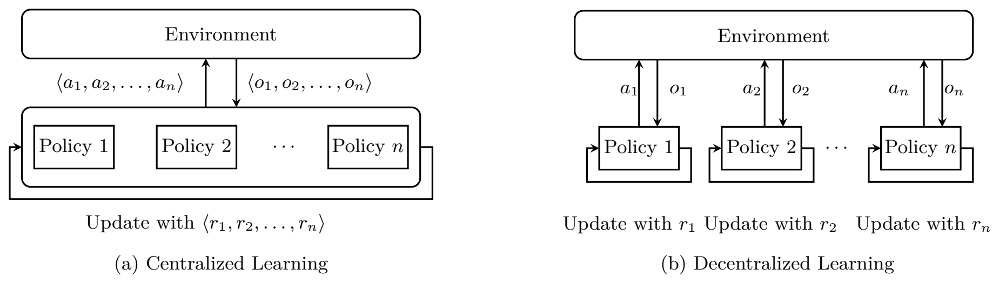

**图 4：** 集中式学习与分散式学习。在集中式学习（a）中，通过共享知识与梯度流联合优化策略。在分散式学习（b）中，每个智能体依据局部观测与奖励独立运行和学习。

##### 集中式学习

在集中学习范式中，所有智能体的经验，包括他们的观察、行动、奖励和消息，都由一个中央单元聚合，该中央单元学习优化系统的集体行为。如图 4a 所示，该集中控制器利用环境的全局视图来协调智能体并计算联合策略或价值函数。通过访问系统范围的信息，学习过程可以利用在去中心化设置中可能无法访问的依赖性和相关性。这种全球访问也决定了执行时需要通信的原因。由于中央学习器在训练期间整合了来自所有智能体的信息，因此单个智能体不会学会自行推断缺失的全局上下文。一旦中央单元在执行时被移除，通信就成为智能体重建他们在训练期间所依赖的全局结构的机制。通过这种方式，集中学习隐含地激发了通信作为使用分散信号来近似训练时间信息的工具。

从历史上看，早期的集中学习通信作品(例如 CommNet (Sukhbaatar et al., 2016))提供了通过集中反向传播训练的单个连续通信通道。这解决了“为什么”通过假设所有智能体都受益于共享统一的全局特征空间来进行通信，并且解决了“如何”通过平均智能体之间的隐藏状态来进行通信。 BiCNet (Peng et al., 2017) 通过引入跨智能体的循环结构改进了这一点，其动机是需要通过集中式模型传播更丰富的依赖关系。因此，通信机制变得顺序和上下文相关，反映了集中式模型需要捕获智能体之间的有序交互。

DIAL (Foerster et al., 2016a) 通过使通信渠道可微分，加强了 **为什么** 和 **如何** 之间的联系。由于集中学习使用梯度流来塑造消息内容，因此 DIAL 证明了为什么需要通信作为传达直接支持联合优化的表示的方式。然后，它的通信机制变成了由梯度信号形成的实值消息。 IC3Net (Singh et al., 2018) 添加了门控模块以了解通信何时有帮助。这回应了这样的观察：集中训练揭示了某些任务中的混合激励，这激发了选择性通信的需要，作为方法的一部分。

下一代集中学习作品使用了注意力。 TarMAC (Das et al., 2018) 表明集中梯度可以训练注意力权重来选择信息发送者。这在原因和方式之间建立了紧密的联系：通信的原因变成了在全球监督下捕获目标相关性的需要，而通信架构成为一种学习的注意力机制。类似地，基于图的方法(例如 ATOC (Jiang et al., 2018))使用集中式反馈来发现智能体的哪些邻域应该进行交互。这促使通信成为共享本地群体特定上下文的一种方式，而通信协议则成为由集中训练引导的图注意力。 MAGIC (Niu et al., 2021) 通过学习集中梯度下的动态图结构延续了这一趋势，再次将通信的动机与使用基于本地图的消息传递恢复全局信息的需求联系起来。最后，代表智能体模型(例如 HAMMER (Gupta et al., 2023))使用中央模块来聚合信息并广播处理后的指导，从而使通信成为分发中央计算策略所必需的。因此，通信机制变成了从中心化到去中心化的广播路径。

在实践中，集中学习通常仅限于训练阶段。最近的研究假设，在执行过程中，智能体独立运行，无需访问中央控制器。这种解耦通常称为 **CTDE**，反映了这样一个事实：在实际部署中，尤其是在动态、分布式或带宽受限的环境中，在运行时维护集中式控制器通常是不可行的。因此，集中学习是一种实用的方法，可以促进训练过程中的协调，同时在执行过程中保持可扩展性和自主性。

由于集中学习不需要智能体在训练期间交换显式消息，因此随后出现的通信通常是隐式的、由评价网络塑造的或编码在潜在向量中，而不是显式的符号消息中。这解释了为什么集中学习方法经常产生依赖于隐藏表示、共享评价网络或集中指导而不是显式消息结构的通信协议。 **为什么需要通信** 和 **如何实现** 之间的区别变得更加清晰：训练过程揭示了全局信息智能体必须重建的内容，而通信架构成为允许他们在没有中央控制器的情况下恢复这些信息的工具。

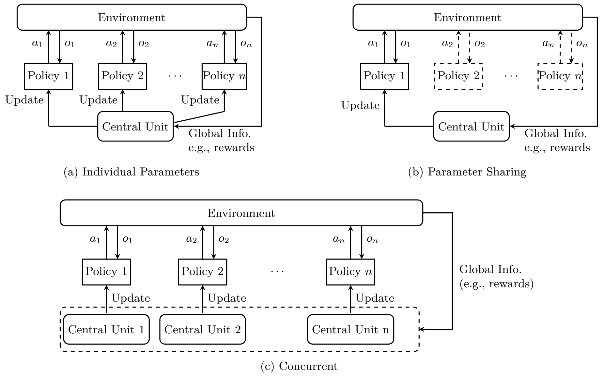

**图 5：** 三类集中式训练与分散式执行（CTDE）方案。

##### 分散式学习

如图 4b 所示，去中心化学习框架使每个智能体能够仅使用本地可用信息来独立收集经验并优化其策略。智能体从自己的观察-行动-奖励-消息轨迹中学习，而不依赖于集中控制器或共享的全局知识。这种范式适用于通信受限、延迟或不可靠的场景，以及智能体必须在部分可观测性或本地化视角下运行的场景。在去中心化的环境中，通信出现的原因与智能体无法访问其他智能体观察到的信息直接相关。因此，智能体必须创建消息交换来补偿丢失的状态信息。这些消息的结构反映了去中心化系统如何尝试仅共享支持协调所需的内容。

最近的几种方法采用了这种去中心化的公式，包括 MAGNet-SA-GS-MG (Malysheva et al., 2018)、Agent-Entity Graph (Agarwal et al., 2019b)、DCC-MD (Kim et al., 2019b)、NeurComm (Chu et al., 2020)、意图传播 (IP) (Qu et al., 2020) 和 Diff Discrete (Freed et al., 2020a)。这些工作面临着一个共同的挑战：每个智能体必须在没有集中学习器的情况下推断来自同伴的缺失信息，这阐明了 **为什么** 显式通信变得至关重要，以及 **如何** 不同的解决方案尝试编码所需的信息。

MAGNet-SA-GS-MG (Malysheva et al., 2018) 采用模块化注意力机制来选择相关的发送器和接收器。挑战在于确定哪些信息应该交换，哪些信息应该被忽略，并阐明 **为什么** 通信必须是选择性的而不是统一的。该架构指定了如何通过对空间变化环境的多尺度关注来实现这种选择性。通过启用动态发送器-接收器分配而不是固定通信通道，这比早期的工作有所改进。

智能体实体图 (Agarwal et al., 2019b) 引入了动态图表示来处理基于邻近度的交互。激励通信的挑战是智能体无法从局部视图共同跟踪实体关系。该方法阐明了 **为什么** 需要消息：智能体必须共享揭示结构化依赖关系的关系线索。它还指定了如何实现这一点：通过智能体实体节点之间基于图的消息传递。与早期的完全连接的通信方案相比，这项工作通过允许消息仅沿着相关边缘而不是跨所有智能体对来提高可扩展性。

DCC-MD (Kim et al., 2019b) 解决了在大型多智能体群体中扩展通信的困难。这里的挑战是带宽，这解释了 **为什么** 只应传输消息的子集。该方法定义了如何通过相关性驱动的消息丢弃来执行修剪。与 MAGNet-SA-GS-MG 相比，DCC-MD 更直接关注通信效率和可扩展性，而不是关系或空间结构。

NeurComm (Chu et al., 2020) 直接通过神经编码器学习去中心化通信策略。这里的挑战是智能体无法预测其队友的未来行为，这解释了 **为什么** 通信必须对与策略相关的潜在信息进行编码。该方法解释了智能体如何交换近似其内部策略状态的紧凑神经消息。相对于 Agent-Entity Graph，NeurComm 通过学习潜在意图线索而不是仅依赖于结构接近度来提高表达能力。

意图传播（Intention Propagation，IP）(Qu et al., 2020) 针对的是难以预测其他智能体即时动作的问题。这明确揭示了 **为何** 使用通信：智能体需要一种方式，降低对队友下一步行动的不确定性。该方法通过在局部邻域中传递明确的预期动作，规定了 **如何** 实现这一目标。与使用潜在嵌入的 NeurComm 相比，IP 通过交换明确的单步动作预测，提高了透明度和可解释性。

Diff Discrete (Freed et al., 2020a) 旨在生成紧凑的离散通信协议，以提高可解释性。促进通信的挑战是需要在噪声下具有鲁棒性的离散协调信号。这澄清了 **为什么** 软连续消息可能不够。该方法展示了 **如何** 通过可微分的 Gumbel-softmax 松弛生成离散消息。这种方法通过生成结构化的、可解释的消息而不是仅仅修剪连续的消息来改进 DCC-MD。

这些去中心化方法共同表明，智能体在部分可观测性下面临的挑战决定了“为什么需要通信”以及“如何设计通信”。随着该领域按时间顺序发展，方法从结构消息传递(智能体实体图)发展到潜在策略感知消息传递(NeurComm)、显式意图共享(IP)、选择性注意机制(MAGNet-SA-GS-MG)、可扩展修剪技术(DCC-MD)，以及最后的离散、可解释协议(Diff Discrete)。每个步骤都通过解决表达性、可扩展性或可解释性方面的限制来完善先前的方法。

##### 集中式训练与分散式执行（CTDE）

在 CTDE 框架(图 5)中，所有智能体的经验都可用于优化其个人策略。这种设计解决了多智能体学习的核心挑战：尽管在执行过程中仅接收到部分观察，但智能体必须进行协调。 CTDE 阐明了 **为什么** 在执行时需要通信。在训练期间，智能体通过中心化评价网络从全局信息中受益，但在执行过程中，这种全局结构消失了。因此，智能体必须交换消息来重建或近似他们在训练期间所依赖的信息。通过使用根据所有智能体的综合经验计算出的梯度，CTDE 指导每个智能体的本地策略，同时仍然允许在环境中分散执行。主要优点是 CTDE 在训练期间利用丰富的全局信息，而无需在运行时进行集中控制。

CTDE 的一个关键组件是 *参数共享* (Foerster et al., 2016a)，它通过跨智能体使用一组参数(例如共享 Q 函数或共享策略)而不是维护单独的模型来提高数据效率。即使使用共享参数，智能体仍然可以学习不同的行为，因为它们在环境中遇到不同的观察和角色。参数共享还告知 **如何** 通信的结构。由于智能体在相同的模型下运行，因此通信通常侧重于交换角色识别信息或上下文线索，以帮助他们在执行过程中打破对称性。

基于这些机制，最近基于 CTDE 的工作可以分为三种主要方法：

**(1)。单独的策略参数。** 在此类别中，每个智能体维护自己的策略参数，而中央单元汇总所有智能体的经验以计算全局指导信号，如图 5a 所示。该方法系列通常使用策略梯度算法，例如 REINFORCE (Kong et al., 2017) 或 actor-critic 变体 (Wang et al., 2020b; Kim et al., 2019a; Mao et al., 2020; Yun et al., 2021)。这里激励通信的挑战是，即使训练依赖于访问完整的系统信息，智能体也必须在部分可观测性下采取行动。这解释了 **为什么** 智能体后来需要进行通信：它们必须使用消息来近似中心化梯度的影响。训练设置还决定了通信的“方式”，通常以评价网络塑造的消息或模仿学习过程中收到的集中反馈智能体的潜在信号的形式出现。相对于去中心化学习方法，这些方法通过将每个局部更新都基于全局训练数据来提高稳定性，从而减少了并发学习策略引起的非平稳性。

**(2)。参数共享。** 这里，一组参数在所有智能体策略或评价网络之间共享，如图 5b 所示。参数共享提高了数据效率并可以加速训练。当使用类似 DQN 的方法时，智能体可以从所有经验 (Foerster et al., 2016a; Jiang et al., 2018; Sheng et al., 2022) 中学习统一的 Q 函数，或者可以添加第二个全局 Q 函数来补充本地更新 (Zhang et al., 2019; Zhang et al., 2020)。相反，Actor–Critic 方法使用所有观察动作样本来训练一个共享策略网络，同时依赖集中式评价网络提供梯度 (Niu et al., 2021; Du et al., 2021; Das et al., 2018; Jiang and Lu, 2018; Hu et al., 2020a; Mao et al., 2020)。在某些情况下，仍然使用REINFORCE式的更新，仅依赖于回合级别的奖励(Sukhbaatar et al., 2016; Liu et al., 2020; Singh et al., 2018)。参数共享凸显了通信变得至关重要的原因：如果所有智能体都由同一网络管理，则它们必须交换上下文信息以区分其行为。该方法还影响通信的设计方式，通常会产生身份指示消息或本地消歧信号，以帮助智能体专业化。与单独参数方法相比，参数共享技术提高了样本效率并降低了计算成本，但需要更加深思熟虑的通信以避免同质化行为。

**(3)。并发学习。** 在将所有经验存储在集中式缓冲区中不切实际的情况下，每个智能体维护自己的缓冲区，同时假设可以访问其他智能体的操作和观察。这些分散的备份用于训练每个智能体的集中式评价网络，如图 5c 所示。 (Kim et al., 2020; Pesce and Montana, 2020a)等方法就采用了这种变体。当智能体必须同时学习但在训练期间仍然使用全局信息时，就会出现挑战。这解释了 **为什么** 需要通信：智能体需要一种方法来保持协调，尽管在不同时间更新策略。它还决定了交流的方式，通常是通过隐式同步信号或消息来提高评价网络的预测准确性。相对于参数共享方法，并发 CTDE 提供了更大的行为多样性，并避免了共享策略类的限制，同时仍然保持集中式评价网络指导的优势。

CTDE平衡了集中训练和分散执行，成为多智能体强化学习的标准框架。这种灵活性在智能体必须有效协调同时在执行过程中保持个人自主权的环境中特别有价值。在所有 CTDE 变体中，底层培训架构阐明了 **为什么** 需要通信，以及 **如何** 通过学习期间可用的集中信息的结构来塑造通信协议。

#### 5.5.2 通信目标与控制行为塑造

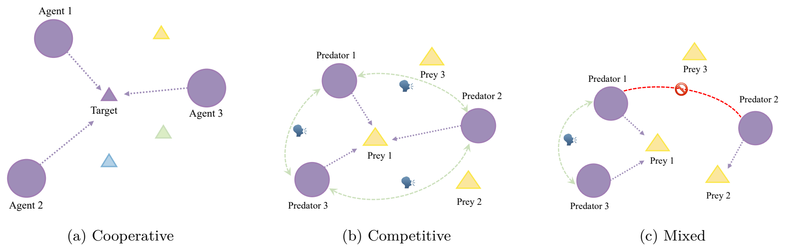

**图 6：** 奖励目标对通信的塑造：合作（a）、竞争（b）与混合（c）。

奖励函数的设计在塑造多智能体系统中智能体如何通信和协调方面发挥着核心作用。通过定制这些奖励信号，可以激励智能体追求特定的交互模式和群体动态。根据这些奖励的结构方式，智能体交互往往属于三个主要类别之一： *合作* 、 *竞争* 或两者的组合，称为 *混合* 或 *合作-竞争* 场景 (Ning and Xie, 2024; Busoniu et al., 2008; Matignon et al., 2012)。每种范式都需要不同的通信策略来支持基本目标。例如，完全合作的任务鼓励智能体共享信息丰富的消息，从而最大限度地提高联合效用，而竞争性任务可能会阻碍通信或助长欺骗。最近的许多方法通过跨多个行为机制 (Liu et al., 2020; Das et al., 2018; Singh et al., 2018; Jiang et al., 2018; Sheng et al., 2022) 进行测试来验证其适应性。奖励结构之间的这些差异阐明了 **为什么** 在每种情况下鼓励或抑制通信，以及 **如何** 智能体调整其消息传递模式以适应潜在的激励环境。在 **合作环境** (图6a)中，鼓励智能体共同努力以最大限度地实现共同目标。一种常见的方法是为所有智能体分配相同的奖励，即 $r_1 = r_2 = \dots = r_N$，以便集体绩效优先于个人收益。这种平等的奖励分配激励智能体相互支持，避免可能损害团队整体成果的失败，从而促进更强有力的协调。在这种激励结构下，通信变得有用，因为智能体从共享信息中共同受益，并且以协调为导向的消息传递自然成为改善集体成果的最有效机制。相比之下， **竞争环境** (图 6b)强调个人成功。每个智能体都寻求最大化自己的回报，这可能会以牺牲其他智能体为代价。在完全竞争的任务中(通常被建模为零和游戏)，总奖励是固定的，例如 $\sum_{i=1}^{N} r_i = 0$。在这里，一个智能体的收益直接来自另一个智能体的损失，目标变成超越对手而不是合作。这创造了一种截然不同的通信动机：共享信息可能对发送者不利，因此智能体通常会减少、控制或策略性地安排他们的消息。因此，由此产生的通信协议反映了对抗性激励而不是合作性激励。 **混合设置** (图 6c)，也称为一般和游戏，结合了合作和竞争的动态。在这些环境中，智能体具有部分一致或独立的目标，奖励既不是完全共享的也不是严格反对的。混合环境中的智能体可能会发现自己在任务的某些部分进行合作，而在其他部分进行竞争，而不是涉及多个任务。例如，在自动驾驶中，车辆可以合作避免碰撞并保持交通畅通(共同的安全目标)，但会争夺有限的道路资源，例如合并车道或停车位。类似地，在多人视频游戏或机器人足球中，团队在与对方团队竞争时可能会表现出内部合作。这些场景反映了许多现实的多智能体应用程序，并且需要更细致的通信策略来管理协作和竞争之间的权衡。由于激励随着时间的推移而变化，智能体必须了解 **为什么** 通信在某些情况下是有益的，但在其他情况下却有风险，以及 **如何** 相应地调整消息内容、时间或选择性。与纯粹合作或竞争环境中的通信模式相比，这会导致更复杂、上下文感知的通信模式。在下面的内容中，我们深入回顾每个类别的代表性方法，并分析它们的通信策略是如何从底层奖励结构中产生的。

##### 合作场景

在合作场景中，核心挑战是智能体必须调整其行为以最大化共享目标，通常是在部分可观测性或有限的本地信息下。这种结构为通信创造了明确的理由：智能体在共享减少不确定性并改善群体协调的信息时受益，这解释了 **为什么** 在这些环境中鼓励通信。常见的公式分配共享的团队奖励，其中所有智能体都会收到相同的信号，无论个人贡献如何 (Foerster et al., 2016a; Sukhbaatar et al., 2016; Peng et al., 2017; Das et al., 2018; Wang et al., 2020b; Jiang and Lu, 2018; Kim et al., 2019a; Mao et al., 2020; Ding et al., 2020; Agarwal et al., 2019b; Kim et al., 2020; Zhang et al., 2019; Zhang et al., 2020; Yun et al., 2021; Kilinc and Montana, 2018; Sheng et al., 2022; Freed et al., 2020a; Hu et al., 2020a; Gupta et al., 2023)。这种平等的奖励结构自然会促进合作，因为只有团队成功，智能体才能成功。

另一种设计使用个性化奖励，该奖励仍然取决于其他人的表现 (Liu et al., 2020; Singh et al., 2018; Peng et al., 2017; Jiang et al., 2018; Freed et al., 2020a; Kim et al., 2019b; Kong et al., 2017; Gupta et al., 2023)。这不会强制采取相同的激励措施，但智能体仍然有动力支持队友，因为他们自己的回报与整体团队绩效挂钩。许多工作通过添加惩罚项来加强这种耦合，例如碰撞成本或低效率惩罚 (Niu et al., 2021; Das et al., 2018; Liu et al., 2020; Jiang and Lu, 2018; Hu et al., 2020a; Kim et al., 2020; Jiang et al., 2018; Kim et al., 2019b)，而其他工作则使用基于邻域的奖励共享来促进附近智能体 (Chu et al., 2020; Qu et al., 2020) 之间的本地合作。这些奖励设计强调了通信变得有用的原因：智能体需要了解彼此的观察、计划的行动或意图，以避免惩罚并改善联合结果。

早期的协作通信框架通过简单的可微分消息传递来满足这一需求。 DIAL (Foerster et al., 2016a) 和 CommNet (Sukhbaatar et al., 2016) 引入了端到端可训练通信协议，允许智能体交换连续消息。这些方法是第一个证明通信如何通过共享潜在表征来直接提高集体绩效的方法。它们的简单性使其广泛适用，但消息交换密集且通常是不必要的。

后来的工作通过选择性地交换消息来提高通信效率。 ATOC (Jiang and Lu, 2018) 引入了一种注意力机制，让智能体可以决定何时通信有用。这项创新解决了不必要通信的挑战，并提供了更具可扩展性的解决方案。 IC3Net (Singh et al., 2018) 对此进行了扩展，为每个智能体提供了通信门控功能，该功能可以根据个人回报学习打开或关闭通信通道，这提供了一种使消息传递适应不同合作任务的原则性方法。

随后的方法开发了更加结构化的通信，以改善复杂环境中的协调。 GA-Comm (Liu et al., 2020) 通过奖励塑形将个人激励与团队成果结合起来，从而减少智能体之间的冲突并鼓励传递更有意义的信息。 TarMAC (Das et al., 2018) 引入了使用多头注意力的有针对性的通信，允许智能体将消息的不同部分定向到不同的接收方。 MAGIC (Niu et al., 2021) 基于这些思想构建，具有模块化通信组件和动态注意力，可以更有效地处理密集的多智能体交互。

从这些发展来看，趋势是显而易见的。早期的方法提供了没有结构的连续消息传递。后来的方法引入了选择性的、有针对性的和模块化的机制，更好地匹配合作激励结构。这些改进反映了随着潜在的合作挑战变得更加复杂，以及智能体学习何时以及共享什么以最大化联合性能，通信策略如何演变。

##### 竞争场景

竞争性 MARL 提出了一个独特的挑战，因为智能体追求相互冲突的目标。每个智能体的目标是最大化自己的奖励，同时可能阻碍其他智能体的进步。这造成了学习的不稳定，因为政策必须适应不断改变其行为的动态对手。这些对抗性激励解释了通信变得微妙的原因。消息可以帮助特工预测威胁或机会，但它们也可以揭示对手可能利用的私人意图。因此，通信必须有选择性并有策略地控制，以避免损害个人绩效。

大多数竞争性 MARL 基准测试，例如星际争霸多智能体挑战赛 (SMAC) (Zhang et al., 2019; Zhang et al., 2020; Samvelyan et al., 2019)，主要评估单个团队在对抗压力下的协调性。他们不会模拟敌对团队之间的通信，因为与对手分享意图很少有好处。这意味着，尽管对抗性动态凸显了选择性信息共享的重要性，但明确的竞争性通信仍未得到充分研究。

IC3Net (Singh et al., 2018) 提供了 **如何** 在竞争环境中出现受控通信的具体示例之一。它引入了一种可学习的门控机制，允许每个智能体决定何时进行通信是有利的。这种机制可以帮助智能体避免泄露不必要的信息，同时仍然可以在直接提高自身效用的时刻交换有用的信号。 IC3Net 表明，即使是自私的智能体也可以从条件通信中受益，例如在实现目标或逃避追捕之前共享信息。与早期面向合作的方法相比，IC3Net 通过允许智能体在产生漏洞时抑制通信来提高鲁棒性。

MADDPG (Lowe et al., 2017) 解决了竞争性任务中的另一个基本挑战：由于相互依赖的策略而导致的不稳定学习。它采用 CTDE 范式，带有集中式评价网络，观察训练期间的全局状态和所有智能体行为。这有助于智能体在对手的决策强烈影响最佳响应的环境中学习稳定的策略。尽管 MADDPG 没有强加显式的通信通道，但其训练结构阐明了 **为什么** 通信稍后会变得有用。智能体在训练期间学习依赖于全局信息的策略，而执行时的消息传递提供了一种去中心化的方法来重建丢失的上下文。

可微分智能体间学习 (DIAL) (Foerster et al., 2016a) 通过可微分通道实现端到端的通信学习，提供了补充视角。在竞争环境中，此功能可以产生私有或编码的通信策略，从而改善团队内部的协调，而不会泄露可利用的信息。这反映了在对抗性环境中通信如何运作的不同概念：不仅共享原始信息，还传输由竞争压力形成的抽象或加密信号。

进一步的见解来自 Deka 和 Sycara (Deka and Sycara, 2021) 的工作，他们探索了竞争团队中多样化角色的出现。他们的图神经网络架构和去中心化训练过程鼓励智能体专业化，从而产生应对不同对手策略的异构策略。专业化提供了另一条改善通信的途径，因为智能体可以定制消息来补充不同的角色，而不是共享统一的信号。

这些工作共同说明了竞争性 MARL 中的通信遵循与合作环境中不同的原则。它必须是有选择性的、有战略动机的，而且往往是隐性的。 IC3Net提供条件共享，MADDPG稳定对抗性学习并激发执行过程中的通信，DIAL探索优化的潜在通道，角色专业化方法强调竞争下的结构化协调。尽管竞争性通信仍处于早期阶段，但这些基础研究揭示了对抗性压力如何重塑通信需求，并为未来的研究提供了有前景的方向，包括抗欺骗、隐私维护和选择性信号传递。

##### 混合场景

混合场景涉及追求个体奖励功能的智能体，这些功能可能部分一致、完全独立或冲突。这些环境融合了合作和竞争的动态，要求智能体根据上下文调整其策略和通信行为。这种混合结构解释了 **为什么** 通信比纯粹合作或竞争任务中的通信变得更加微妙。智能体必须决定共享信息是否会产生互惠互利或暴露漏洞，并且他们必须认识到通信如何影响短期和长期激励。混合设置也可以被视为竞争场景的概括，因为它们放宽了零和约束，允许合作和对抗行为同时出现。核心挑战是确定通信何时有益、应共享哪些信息以及智能体如何平衡自身利益与协作机会。

混合设置的基础工作之一是 MADDPG (Lowe et al., 2017)，它引入了 CTDE 范例。通过允许每个智能体在训练期间通过集中式评价网络根据其他智能体的行为来调整其策略，同时保留去中心化执行，MADDPG 为合作竞争环境中的学习提供了一个强大的框架。这种结构阐明了稍后在执行时如何使用通信：智能体在训练期间依赖全局信息，一旦集中式评价网络被移除，消息传递就成为近似该结构的一种方式。

RIAL 和 DIAL (Foerster et al., 2016a) 通过支持私有和共享通信通道扩展了这一视角，使智能体能够隐式协商并采用动态角色。尽管最初是为合作任务而设计的，但它们的通信灵活性有助于解释智能体如何使信号适应混合奖励条件，根据不断变化的激励措施有选择地共享或保留信息。

刘等人。 (Liu et al.) 通过分散的基于人群的训练和奖励塑形，探索竞技性多智能体足球中以团队为导向的行为的出现。他们的结果表明，智能体可以在没有明确通信的情况下从自利策略发展到合作模式，这突显了一种不同的协调机制，可以补充基于消息的方法。

DGN (Jiang et al., 2018) 考虑智能体在收集食物以获得积极奖励或攻击他人以获得更大收益之间进行选择的环境。其基于图的通信机制使智能体能够从竞争行为转变为合作行为，通过利用关系结构和基于邻近度的交互展示了对早期架构的改进。 IC3Net (Singh et al., 2018) 通过允许智能体学习何时进行通信来贡献另一个维度，这在信号必须以奖励上下文为条件的混合任务中特别有用。

TarMAC (Das et al., 2018) 提出了有针对性的通信，并在捕食者-猎物设置中对其进行了评估，结果表明，当合作与竞争必须共存时，寻址特定接收者可以提高性能。 I2C (Ding et al., 2020) 在此基础上引入了基于激励的消息传递，该消息传递考虑了通信成本，鼓励智能体仅在预期收益超过开销时才交换信息。 MAGIC (Niu et al., 2021) 通过将模块化通信与动态注意力相结合，进一步扩展了可扩展性，帮助智能体在不断变化的合作和竞争压力下集中信息流。

柳等人。 (Ryu et al., 2021) 将合作和竞争偏见纳入培训中，以提高适应性，提供塑造通信倾向的原则性方法。桑托斯等人。 (Santos et al., 2022) 研究执行时的动态通信可用性，展示智能体如何适应带宽或连接的波动。

这些研究共同表明，混合环境中的通信取决于奖励设计、环境结构和时间背景。他们强调了智能体如何学习确定何时合作有益、何时需要独立，以及如何应对合作与竞争共存时出现的不确定性。

#### 5.5.3 通信形式为何重要及其影响方式

在多智能体强化学习中，通信格式决定了智能体如何在部分可观测性下共享信息并解决协调挑战。这使得了解 **为什么智能体需要通信** 以及 **所选格式如何实现该需求** 至关重要。主要困难来自分散执行，智能体仅持有部分且常常不一致的局部环境视图。因此，出现了通信格式作为该问题的不同解决方案。显式通信通过直接消息交换来补偿丢失的信息，而隐式通信则通过允许智能体从观察到的行为中解释或推断隐藏的意图来进行补偿。接下来，我们将研究这两种格式，并展示每种方法如何应对特定的挑战、为什么在该场景中需要通信，以及架构如何实现其解决方案。事实证明，协作多智能体强化学习对于不同领域的协作决策是有效的 (Canese et al., 2021; Oroojlooy and Hajinezhad, 2023)。多智能体环境引入了额外的挑战，例如部分可观测性和非平稳性。为了解决这些问题，许多方法采用集中式训练和分散式执行范例，其中智能体接受访问全局信息的培训，但在执行过程中必须仅基于本地观察进行操作 (Rashid et al., 2018; Wang et al., 2020a; Yu et al., 2022a)。这种信息差距解释了 **为什么通信变得必要** :智能体在执行时失去对全局状态的访问，并且必须通过交互重建丢失的信息。 **如何** 取决于系统是否使用明确的消息或行为线索。

##### 显式通信协议

显式通信通过使智能体能够传输结构化消息来直接解决部分可观测性的挑战。 **为什么** 是提供无法在本地推断的缺失信息，而 **如何** 是通过可微的消息传递、注意力机制或选择性路由模块来实现的。每种方法根据部分可观测性的严重性和任务的协调需求来选择其架构。显式通信允许智能体交换观测结果、潜在特征或意图。虽然这增强了协调性，但它增加了带宽成本并可能削弱去中心化。下面，我们回顾代表性方法并解释他们的挑战， **为什么要通信**， **如何通信**，以及每种方法如何相对于早期工作进行改进。

- **DIAL** (Foerster et al., 2016a)。挑战在于学习支持协调的有意义的信息。 **原因** 是智能体需要超出其本地视图的信息。 **如何** 是通过可微分的通信渠道，允许梯度来塑造消息内容。通过实现紧凑和任务特定消息的端到端学习，这比早期的离散协议有所改进。

- **CommNet** (Sukhbaatar et al., 2016)。当许多智能体同时通信时，挑战在于可扩展性。 **原因** 是智能体必须共享聚合上下文以调整行为。 **如何** 是通过将隐藏状态平均为共享表示。这提高了效率，但牺牲了表达能力，激励了后来的进步。

- **ATOC** (Jiang and Lu, 2018)。面临的挑战是消除导致噪音或拥塞的不必要的通信。 **为什么** 是只有当协调难度很高时才应该进行通信。 **如何** 是通过学习的注意力门来识别有益的通信时刻。通过引入选择性和减少冗余消息传递，这比 CommNet 有所改进。

- **TarMAC** (Das et al., 2018)。挑战是将消息路由到异构团队中的正确接收方。 **原因** 是智能体通常需要来自特定队友的信息而不是广播消息。 **如何** 是通过使用注意力进行多头目标寻址。通过使通信具有定向性和角色感知性，这比 ATOC 有所改进。

- **IC3Net** (Singh et al., 2018)。挑战在于处理通信可能有害或有风险的环境。 **原因** 是，智能体只有在提高自身效用时才应该共享信息。 **如何** 是通过一个可学习的通信门来决定是说话还是保持沉默。通过启用上下文相关的通信抑制，这比 TarMAC 有所改进，这在竞争或嘈杂的环境中非常有价值。

从 CommNet 到 ATOC 到 TarMAC 到 IC3Net 的演变表明， **为何发生通信** 以及 **如何构建和路由消息**。早期的作品使用简单的广播通信，而后来的作品则仔细规范消息的时间、方向和必要性。

##### 隐式通信协议

隐式通信始于不同的挑战。在许多环境中，显式消息传递受到带宽、连接性或战略问题的限制。因此，通信的 **原因** 是为了在通信限制下保持协调。 **如何** 是将信息编码为可观察的行为或学习的潜在信念，从而允许智能体从行为中推断意图。隐式通信避免了显式消息传递。相反，智能体学习将运动、动作或表征形状的线索解释为信息信号 (Oliehoek et al., 2016)。这降低了带宽成本，但需要更强的推理能力。下面，我们总结了主要方法及其挑战、 **为什么** 、 **如何** 和改进。

- **基于行动的隐式通信**。克内珀等人。 (Knepper et al., 2017)，肖等人。 (Shaw et al., 2022) 和 Tsiamis 等人。 (Tsiamis et al., 2015)。挑战在于当显式消息传递不可用时进行协调。 **为什么** 是需要通过可观察的行为来揭示意图。 **如何** 是选择对信息进行编码以供队友解释的操作。这些作品通过将意图揭示行为形式化，改进了纯粹的反应行为。

- **基于表示的隐式通信**。田等人。 (Tian et al., 2020)引入信念模块和辅助奖励来帮助智能体推断隐藏信息。挑战在于在没有明确信号的情况下重建他人的状态。 **原因** 是在没有通信渠道的环境中进行协调的需求。 **如何** 是学习总结推断信息的内部信念。通过提供更具表现力的内部模型，这改进了基于行动的方法。
  
  格鲁彭等人。 (Grupen et al., 2021) 表明空间线索可以在完全分散的系统中充当隐式信号。他们的改进是消除对集中式组件的依赖。
  
  李等人。 (Li et al., 2023a) 提出 TACO，它从显式通信开始，但随着智能体学习推断缺失的上下文而逐渐删除这些信息。挑战在于从显式通信转变为隐式通信。 **原因** 是减少对全球信息的依赖，同时保持协调质量。 **如何** 是通过训练智能体通过局部推理来近似全局信息。这提高了去中心化设置中的可扩展性和稳健性。

总之，这些方法从简单的行为线索发展到日益复杂的潜在推理，展示了如何在没有专用渠道的情况下隐式嵌入通信。

##### 比较与讨论

显式通信和隐式通信反映了对“为什么需要通信”这个问题的不同答案。显式通信通过交换结构化消息来补偿严重的部分可观测性。内隐通信通过在行为或习得的信念中编码信号来补偿通信限制或战略风险。它们还反映了对 **如何进行通信** 的不同答案。显式通信强调消息内容、路由和压缩。内隐通信强调行为表达和推理。在这两个类别中，改进都朝着更大的选择性、稳健性和去中心化方向发展。

**表 5：** MARL-Comm 中“如何通信”的方法汇总。

| **类别** | **子类别** | **代表性方法** |
| --- | --- | --- |
| **训练框架（第 5.5.1 节）** | 集中式学习 | (Foerster et al., 2016a; Kraemer and Banerjee, 2016) |
| **训练框架（第 5.5.1 节）** | 分散式学习 | Agent-Entity Graph (Agarwal et al., 2019b)、NeurComm (Chu et al., 2020)、意图传播（IP）(Qu et al., 2020)、MAGNet-SA-GS-MG (Malysheva et al., 2018)、DCC-MD (Kim et al., 2019b)、Diff Discrete (Freed et al., 2020a)。 |
| **训练框架（第 5.5.1 节）** | 集中式训练与分散式执行（CTDE） | • 各自独立的策略参数：REINFORCE (Kong et al., 2017)、基于策略网络—评价网络的方法 (Wang et al., 2020b; Kim et al., 2019a; Mao et al., 2020; Yun et al., 2021) • 参数共享：局部 Q 函数 (Foerster et al., 2016a; Jiang et al., 2018; Sheng et al., 2022)、全局 Q 函数 (Zhang et al., 2019; Zhang et al., 2020)、接受集中式评价网络梯度指导的共享策略网络 (Niu et al., 2021; Du et al., 2021; Das et al., 2018; Jiang and Lu, 2018; Hu et al., 2020a; Mao et al., 2020)、通过 REINFORCE 利用完整回合采样奖励 (Sukhbaatar et al., 2016; Liu et al., 2020; Singh et al., 2018) • 并行学习：利用集中式评价网络指导局部策略的优化 (Kim et al., 2020; Pesce and Montana, 2020a) |
| **奖励目标塑造的通信（第 5.5.2 节）** | 合作场景 | • 共享团队奖励：所有智能体接收相同奖励信号，不论其个体贡献如何 (Foerster et al., 2016a; Sukhbaatar et al., 2016; Peng et al., 2017; Das et al., 2018; Wang et al., 2020b; Jiang and Lu, 2018; Kim et al., 2019a; Mao et al., 2020; Ding et al., 2020; Agarwal et al., 2019b; Kim et al., 2020; Zhang et al., 2019; Zhang et al., 2020; Yun et al., 2021; Kilinc and Montana, 2018; Sheng et al., 2022; Freed et al., 2020a; Hu et al., 2020a; Gupta et al., 2023) • 个体化奖励，但仍依赖其他智能体的表现 (Liu et al., 2020; Singh et al., 2018; Peng et al., 2017; Jiang et al., 2018; Freed et al., 2020a; Kim et al., 2019b; Kong et al., 2017; Gupta et al., 2023) • 加入惩罚项 (Niu et al., 2021; Das et al., 2018; Liu et al., 2020; Jiang and Lu, 2018; Hu et al., 2020a; Kim et al., 2020; Jiang et al., 2018; Kim et al., 2019b) • 基于邻域共享奖励，以增强局部合作 (Chu et al., 2020; Qu et al., 2020; Sukhbaatar et al., 2016; Jiang and Lu, 2018) |
| **奖励目标塑造的通信（第 5.5.2 节）** | 竞争场景 | • 通过可学习门控机制，使智能体有选择地通信：IC3Net (Singh et al., 2018) • 训练期间使用集中式评价网络：MADDPG (Lowe et al., 2017) • 通过可微通道端到端学习通信消息：DIAL (Foerster et al., 2016a) • 结合图神经网络与分散式训练 (Deka and Sycara, 2021) |
| **奖励目标塑造的通信（第 5.5.2 节）** | 混合场景 | • 集中式训练与分散式执行范式：MADDPG (Lowe et al., 2017) • 同时学习共享与私有通信通道，支持目标部分一致场景中的隐式协商与角色涌现：RIAL 和 DIAL (Foerster et al., 2016a) • 基于群体的分散式训练与奖励塑形 (Liu et al.; Jiang et al., 2018) • 通信门控机制：IC3Net (Singh et al., 2018) • 在混合场景中评估的定向通信架构：TarMAC (Das et al., 2018; Ding et al., 2020) • 在智能体训练中引入合作与竞争偏置 (Ryu et al., 2021) • 执行阶段动态变化的通信可用性 (Santos et al., 2022) |
| **消息形式的目标（第 5.5.3 节）** | 显式通信 | (Singh et al., 2018; Das et al., 2018; Lowe et al., 2017; Foerster et al., 2016a; Chen et al., 2024b; Breazeal et al., 2005) |
| **消息形式的目标（第 5.5.3 节）** | 隐式通信 | (Oliehoek et al., 2016; Knepper et al., 2017; Shaw et al., 2022; Tsiamis et al., 2015; Knepper et al., 2017; Tian et al., 2020; Grupen et al., 2021) |

表 5 提供了解决 MARL-Comm 中如何通信问题的关键方法的结构化摘要。该分类法分为四大类：培训框架、奖励型通信策略、通信消息格式和协议设计。每个类别又进一步细分为具体方法，例如集中式学习、分散式学习以及日益流行的集中式培训和分散式执行。为每个子类别提供了代表性作品，突出了文献中有影响力的算法和方法。该表捕获了显式和隐式通信协议，以及针对合作、竞争和混合动机场景定制的变体。本摘要为了解如何在 MARL 系统中操作通信机制、平衡协调性、可扩展性和可解释性提供了全面的参考。

### 5.6 讨论

为了提供 MARL-Comm 的统一视角，本小节使用结构化镜头综合了通信方法：交换 *什么* 信息、 *谁* 说话、 *谁* 发送信息、 *何时* 发生通信，以及最后 *如何* 和 *为什么* 进行通信。虽然为了清晰起见，表 6 保留了原来的三列，但我们的讨论将这些类别扩展为更完整的框架，反映了 MARL-Comm 中最近的概念发展。

**表 6：** 按照通信内容、通信对象，以及消息编码或聚合方式，对代表性的 MARL-Comm 方法进行分类。

| **方法** | **通信什么** | **与谁通信** | **如何通信** |
| --- | --- | --- | --- |
| DIAL (Foerster et al., 2016a) | 过去知识（无代表性智能体） | 其他学习智能体 | 拼接 |
| RIAL (Foerster et al., 2016a) | 过去知识（无代表性智能体） | 其他学习智能体 | 拼接 |
| CommNet (Sukhbaatar et al., 2016) | 过去知识（有代表性智能体） | 其他学习智能体 | 等权重 |
| IC3Net (Singh et al., 2018) | 过去知识（有代表性智能体） | 其他学习智能体 | 等权重 |
| TarMAC (Das et al., 2018) | 过去知识（有代表性智能体） | 其他学习智能体 | 加权 |
| MADDPG-M (Kilinc and Montana, 2018) | 过去知识（无代表性智能体） | 其他学习智能体 | 拼接 |
| ETCNet (Hu et al., 2020a) | 过去知识（无代表性智能体） | 其他学习智能体 | 拼接 |
| HAMMER (Gupta et al., 2023) | 过去知识（有代表性智能体） | 代表性智能体 | 加权 |
| GA-Comm (Liu et al., 2020) | 过去知识（有代表性智能体） | 代表性智能体 | 加权 |
| MAGIC (Niu et al., 2021) | 过去知识（有代表性智能体） | 代表性智能体 | 加权 |
| ATOC (Jiang and Lu, 2018) | 未来知识 | 代表性智能体 | 基于 RNN |
| FlowComm (Du et al., 2021) | 过去知识（无代表性智能体） | 邻近智能体 | 等权重 |
| GAXNet (Yun et al., 2021) | 过去知识（无代表性智能体） | 邻近智能体 | RNN 与注意力机制 |
| DGN (Jiang et al., 2018) | 过去知识（无代表性智能体） | 邻近智能体 | CNN |
| I2C (Ding et al., 2020) | 未来知识 | 其他学习智能体 | RNN |
| MD-MADDPG (Pesce and Montana, 2020a) | 过去知识（有代表性智能体） | 代表性智能体 | RNN |
| Gated-ACML (Mao et al., 2020) | 过去知识（有代表性智能体） | 代表性智能体 | 门控神经网络 |
| MAGNet-SA-GS-MG (Malysheva et al., 2018) | 过去知识（有代表性智能体） | 邻近智能体 | 基于注意力机制 |
| NeurComm (Chu et al., 2020) | 未来知识 | 邻近智能体 | RNN |
| Agent-Entity Graph (Agarwal et al., 2019b) | 过去知识（无代表性智能体） | 邻近智能体 | 基于注意力机制 |

表 6 说明了通信设计选择的多样性。早期的方法强调简单的消息内容和统一的广播，而最近的工作则引入了选择性角色、结构化接收者和更具表现力的编码机制。下面，我们按照“什么”、“何时”和“如何”的顺序重新解释这些趋势，每个部分都包含“谁”、“谁”和“为什么”的相关维度。

#### 5.6.1 谁与谁通信、共享什么

第一个设计决策涉及所交换信息的性质。方法传输本地观测结果、潜在编码、预测意图或学习到的与值相关的特征。智能体选择广播的内容与负责发言的人和消息的目标对象紧密相关。

在 DIAL (Foerster et al., 2016a) 和 RIAL (Foerster et al., 2016a) 等早期系统中，所有智能体共享低级隐藏状态，反映了一个简单的假设，即每个智能体既充当发送者又充当接收者。 CommNet (Sukhbaatar et al., 2016) 引入了基于表示的共享，使智能体能够对池化潜在特征进行推理，但仍保持完全包容的广播模式。随着该领域的发展，新的模型完善了内容和路由结构。例如，TarMAC (Das et al., 2018) 根据角色或空间相关性将消息分配给特定的队友。 MAGIC (Niu et al., 2021) 和 GA-Comm (Liu et al., 2020) 通过指定压缩组级信息的代表智能体来减少冗余。 IC3Net (Singh et al., 2018) 和 Gated-ACML (Mao et al., 2020) 进一步引入了学习的说话决策，其中只有期望其信息有用的智能体才会选择进行通信。这一进展反映了向更加深思熟虑和目的驱动的信息传递的转变。

#### 5.6.2 何时需要通信

时序越来越被视为一个独立的设计维度。在许多经典架构中，通信是连续且无条件的。然而，始终在线的通信效率很低，并且会压倒学习动力。最近的方法仅在信息变得有价值时才确定传输信息的需要。

事件驱动的通信(如 ETCNet (Hu et al., 2020a) 中所示)仅在发生重大环境变化时才激活消息传递。 ATOC (Jiang and Lu, 2018) 中的预测通信会在智能体进入协作交互之前触发信息交换。 IC3Net (Singh et al., 2018) 和其他选择性框架中的门控机制学会在无信息时刻抑制通信，从而减少带宽并提高鲁棒性。这些进展表明，通信的时间方面不仅仅是优化细节，而且是多智能体协调的基本组成部分。

#### 5.6.3 通信为何有益及其使用方式

通信的根本原因决定了通信协议的结构。当目的是减少部分可观测性时，方法倾向于使用表达编码器和可学习聚合函数进行显式消息传递。当目标是协调分布式表示或协调长期规划时，模型会采用基于注意力或角色感知的机制来塑造消息的影响。当通信必须保守或战略上安全时，选择性门控或基于代表性的设计变得更可取。

串联、等权重和简单池化主导了早期算法，例如 DIAL (Foerster et al., 2016a)、RIAL (Foerster et al., 2016a) 和 MADDPG-M (Kilinc and Montana, 2018)，提供可扩展但粗略的消息集成。基于注意力的方法(例如 TarMAC (Das et al., 2018)、MAGIC (Niu et al., 2021)、GAXNet (Yun et al., 2021) 和 MAGNet-SA-GS-MG (Malysheva et al., 2018))引入了反映任务相关性的更细粒度的路由。 I2C (Ding et al., 2020) 和 NeurComm (Chu et al., 2020) 中使用的 RNNs、DGN (Jiang et al., 2018) 中使用的 CNNs 等神经架构以及 Gated-ACML (Mao et al., 2020) 中的门控网络提供更丰富的时间或空间结构。在所有这些方法中，如何编码和聚合消息的选择与为什么通信首先是有益的密切相关。

总体而言，通过什么、何时以及如何构建 MARL-Comm 阐明了每个设计元素的作用。未来的工作可能会探索更具适应性的消息内容、更丰富的时间调度以及通信目的和通信协议之间更紧密的一致性。

### 5.7 衔接：从 MARL-Comm 到涌现语言

**表 7：** 从基于 MARL 的通信到涌现语言：推动涌现语言研究的 MARL-Comm 局限性。

| **方面** | **基于 MARL 的通信** | **转向涌现语言的动机** |
| --- | --- | --- |
| **消息形式** | • 连续向量或潜在向量； • 与策略网络耦合。 | • 离散符号或词元； • 显式通信单元。 |
| **可解释性** | • 任务性能高； • 对人类而言可解释性低。 | • 关注语义结构； • 人类可读的协议。 |
| **泛化** | • 联合训练的智能体； • 零样本迁移能力较弱。 | • 对新伙伴的泛化； • 群体层面的一致性。 |
| **语义扎根** | • 隐式、奖励驱动的语义。 | • 显式的符号与状态对齐。 |
| **核心局限性** | • 不透明、无法迁移的信号。 | • 研究语言为何涌现以及如何涌现。 |

尽管 MARL-Comm 在协作控制方面取得了强大的经验表现，但这些进展很大程度上依赖于学习与环境、奖励设计和训练群体紧密耦合的特定任务信号协议。因此，学到的信息通常难以解释、难以验证，并且难以转移到新任务或看不见的队友中。此外，许多 MARL-Comm 方法假设连续或高带宽通信信道，这可以掩盖正在通信的语义结构并抽象出实际约束。

这些局限推动了涌现语言研究，将关注点从优化任务回报转向理解离散、结构化的通信协议如何通过交互产生。特别是，涌现语言研究试图刻画通信何时变得必要、能够涌现怎样的组合结构，以及协议稳定性和泛化能力在不同游戏、环境和智能体群体中的表现。该视角将可解释性与泛化视为首要目标，而非任务优化的副产品，从而与 MARL-Comm 形成互补。表 7 说明，基于 MARL 的通信在 **可解释性** 和 **泛化** 方面的局限，如何推动离散且具有语义具有语义扎根的通信研究兴起。

## 6 多智能体系统中的涌现语言

自然语言处理和多智能体强化学习方面的深度学习进步为研究通信系统如何通过交互产生提供了新的范式。这一研究领域通常被称为 **涌现语言 (EL)** 或涌现通信，使用基于学习的智能体来模拟类人信号行为的形成，而无需预定义语义 (Boldt and Mortensen, 2024)。大型自我游戏系统，例如 AlphaZero (Silver et al., 2017) 和 OpenAI 的捉迷藏智能体 (Baker et al.)，已经证明复杂的协调策略可以纯粹从环境动态和奖励反馈中产生。基于这些见解，早期的 EL 研究将自我游戏扩展到离散通信设置，展示了符号协议如何从任务驱动的交互 (Foerster et al., 2016a; Lazaridou et al., 2016; Havrylov and Titov, 2017; Mordatch and Abbeel, 2018) 中产生。虽然建模语言的出现为理解通信提供了令人信服的视角，但 EL 研究对于在人工多智能体系统中设计可扩展、可解释的协调机制也变得越来越重要。

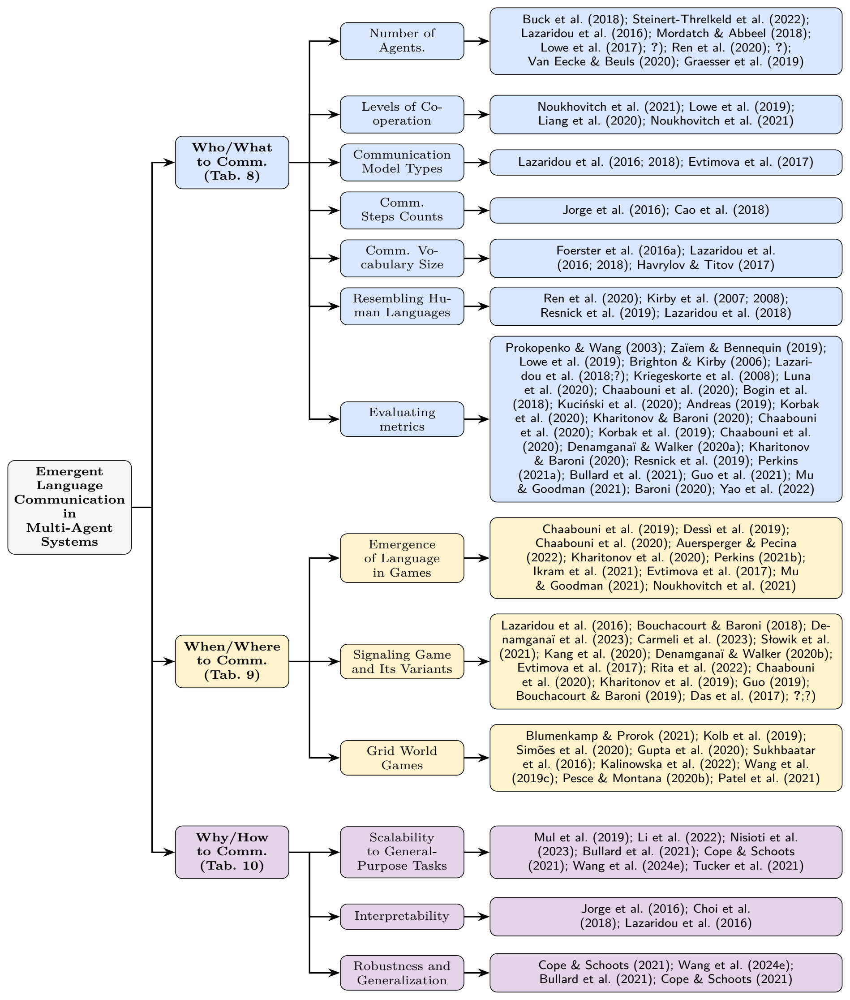

**图 7：** EL-Comm 智能体分类体系。

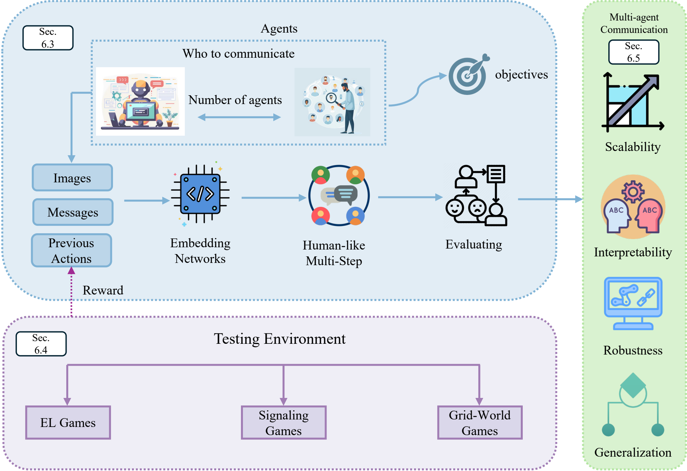

**图 8：** 从通信的五个 W 视角展示第 6 节的组织结构。通过群体角色、接收者选择以及消息编码与评价指标，分析谁与谁通信、通信什么（第 6.3 节），其中包括多步对话与组合性。随后，通过标准化工具包、单次与迭代协议，以及语义扎根环境或具身环境，考察何时、何地通信（第 6.4 节）。最后，讨论通信为何涌现，以及通信如何通过学习获得并受到塑造，内容涵盖动机、可解释性与结构化协议、鲁棒性与泛化能力（第 6.5 节）。

##### 综述范围与结构

涌现语言通信（EL-Comm）研究智能体如何 *仅通过交互* 形成通信协议，而无须显式监督或预定义含义。本节首先介绍基础背景与核心概念（第 6.1 节），随后概述 EL 文献并给出分类（第 6.2 节）。然后，我们以五个 W 为视角组织已有研究： **谁与谁通信，以及共享什么** （第 6.3 节）；交互结构与环境设计决定的 **何时、何地通信** （第 6.4 节）；以及通过学习目标、协议结构和泛化性质分析的 **通信为何、如何涌现** （第 6.5 节）。第 6.6 节综合这些维度，第 6.7 节连接 EL-Comm 与基于 LLM 的通信，指出推动语言语义扎根方法和混合方法发展的局限。图 7 和图 8 总结了分类体系及端到端 EL 流程，帮助读者了解关键设计选择、环境和评价标准。

### 6.1 涌现语言的背景与基础

涌现语言已成为人工智能领域快速发展的研究领域，特别是在多智能体强化学习领域。从历史上看，语言涌现的研究主要集中在理解人类语言的起源，而很少关注其对人工智能的适用性。然而，强化学习的最新进展旨在使智能体能够开发出具有与人类语言相当甚至超过人类语言的能力的通信协议。这些努力超出了自然语言处理中常用的统计方法，引发了关于语言出现的条件以及如何有效评估其成功的关键问题。为了提供分类和分析的背景，本小节概述了传播和语言学的基本概念，并提供了涌现语言研究 (Peters et al., 2024) 的背景知识。

通信从根本上涉及传达信息的信号交换，无论是有意的(例如言语)还是无意的(例如身体反应)。根据 Watzlawik 的“交互观”(Watzlawick et al., 2011)，所有行为都会进行交流，使交流变得普遍且必不可少。它通过各种渠道发生，根据其目的和受众，可以大致分为个人内部、人际、团体、公共和大众传播 (Peters et al., 2024)。在涌现语言研究中，通常研究两种形式的交流：人际交流和群体交流。人际通信涉及相互影响的实体之间的互动，每个实体感知自己的环境，通常通过共享的通信渠道重叠。噪音可能会通过扭曲感知或通信来影响过程。团体通信将其扩展到多个实体，专注于集体目标或任务，使其比人际通信更加正式，而人际通信通常具有社交特征。大多数基于人群的 EL 研究侧重于群体传播，而个人内部、公共和大众传播在很大程度上仍未得到探索。

自然语言是人类最伟大的成就之一，是所有形式交流的基础。它使我们能够通过离散且易于管理的话语量来传达高度复杂的信息。许多人工智能研究侧重于开发用于翻译和文本生成等任务的自然语言模型 (Wolf et al., 2020; Brown et al., 2020; Lauriola et al., 2022; Khurana et al., 2023)。然而，人工智能社区的许多人认为，当前在静态数据集上训练的统计模型缺乏真正的语言理解，无法实现有效的人类合作 (Mordatch and Abbeel, 2018; Choi et al., 2018; Lazaridou et al., 2021; Merrill et al., 2021)。人工智能领域的新兴 EL 研究旨在使智能体能够像人类一样进行交流，增强合作、性能和泛化能力，并促进人类与人工智能 (Mordatch and Abbeel, 2018) 之间有意义的交互。虽然 EC 的显式形式得到了广泛研究，但一些综述论文排除了隐式通信 (Peters et al., 2024)，例如多智能体系统中的空间定位 (Grupen et al., 2022)。

涌现语言(EL)是人工智能体之间通过交互自然发展的一种通信形式，无需显式编程。它源于智能体需要在其环境中合作和解决任务 (Brandizzi, 2023)。 EL 涉及智能体创建、调整和完善语言结构以有效交换信息 (Lipowska and Lipowski, 2022)。研究重点是了解语法 (Ueda et al., 2022)、语义 (Colas et al., 2020; Qiu et al., 2022) 和语用学 (Lowe et al., 2019) 等元素如何出现并增强智能体性能和合作。类似自然语言的通信系统将使人工智能体更容易访问、更容易理解并且更强大 (Iocchi and others, 2022; Noukhovitch et al., 2021; Lazaridou and Baroni, 2020)。 EL 研究最初专注于语言 (Steels, 1997) 的起源，现在强调使智能体能够利用类似于自然语言 (Lazaridou and Baroni, 2020) 的通信机制。计算机科学中的现代 EL 涉及自学、可重用、可教学和可解释的通信协议 (Nowak and Krakauer, 1999; Lazaridou et al., 2016; Li and Bowling, 2019)。最终目标是机器与人类之间的无缝且可扩展的通信 (Lazaridou and Baroni, 2020; Yao et al.)。

在本节中，我们回顾了提出基于智能体的计算机模型的论文，其中通信作为协调多智能体系统 (Boldt and Mortensen, 2024) 行为的通用范例。这些模型的特点是具有可生成离散消息符号的通信通道的智能体，旨在模仿类人语言。消息的结构和内容不是预先定义的，而是在训练过程中自然出现的，由智能体的交互和环境特征决定。此类方法已在各种智能体框架中进行了探索，通常利用深度学习方法和通过梯度下降优化的神经网络。

### 6.2 涌现语言概述与分类体系

通信源于因协调的需要或利益而制定的惯例和规则。 Lewis (Lewis, 2008) 将此类场景形式化为“协调问题”，并引入了一个简单的信号游戏，其中说话者描述一个对象，听者在选项中识别它。这个游戏极大地影响了计算机科学中的涌现语言(EL)研究。早期的研究主要通过手工模拟 (Wagner et al., 2003; Steels, 1997; Nowak and Krakauer, 1999; Kirby, 2002; Cangelosi and Parisi, 2012; Christiansen and Kirby, 2003; Batali, 1998; Oliphant and Batali, 1997; Steels, 1995; Skyrms, 2002; Smith et al., 2003) 来关注涌现交流(EC)的特定方面，通常依赖于监督学习和非情境设置，这限制了他们对复杂语言特征 (Wagner et al., 2003) 的探索。最近，EL 研究取得了势头，(Foerster et al., 2016a; Lazaridou et al., 2016; Havrylov and Titov, 2017; Bouchacourt and Baroni, 2018; Cao et al., 2018; Mordatch and Abbeel, 2018; Das et al., 2017) 利用多智能体强化学习 (MARL) 方法 (Agarwal et al., 2019a; Blumenkamp and Prorok, 2021; Brandizzi et al., 2022; Iocchi and others, 2022; Chaabouni et al., 2022; Gupta et al., 2021; Lo and Sengupta; Lowe et al., 2019; Vanneste et al., 2022b; Yu et al., 2022b) 来研究语言涌现的更复杂特征。

EL MARL 研究的一个关键目标是使智能体能够自主开发通信系统，以类似自然语言 (NL) 的方式支持智能体到智能体和智能体到人的交互 (Wagner et al., 2003; Bouchacourt and Baroni, 2018; Iocchi and others, 2022; Lo and Sengupta; Bogin et al., 2018; Noukhovitch et al., 2021)。强化学习(RL)方法对于此目的特别有前景。他们不仅创建了能够进行灵活、实用通信的智能体 (Lazaridou and Baroni, 2020)，而且还提供了对 NL 本身 (Galke et al.) 演变的见解。与依赖静态数据集来模仿 NL (Steinert-Threlkeld et al., 2022; Bender and Koller, 2020) 的 NLP 模型不同，EL 专注于智能体通过主动、目标驱动的体验 (Lemon, 2022) 来设计和学习自己的通信系统。这种体验式方法与大语言模型 (LLMs) (Manning and Schutze, 1999; Qiu et al., 2020; Wolf et al., 2020) 中对语言的浅层理解形成鲜明对比。在 EL 中，智能体在解决任务的同时开发通信，镜像自然过程 (Lewis, 2008)，从而更深入地掌握其环境 (Bogin et al., 2018)。 EL 的进步为创新的多智能体系统和更加以人为本的人工智能应用 (Lazaridou and Baroni, 2020) 铺平了道路。

EL 中出现了各种研究领域和问题。最近的研究探索了不同的设置，包括半合作环境 (Noukhovitch et al., 2021; Liang et al., 2020)、对手 (Blumenkamp and Prorok, 2021; Yu et al., 2022b)、消息中的噪音 (Cope and Schoots, 2020) 和社会结构 (Dubova et al.; Fitzgerald and Tagliabue, 2022)。通过表示学习 (Lin et al., 2021)、将监督学习与自博弈 (Lowe et al., 2020) 相结合或使用 EL 智能体对 NL 模型 (Yao et al.) 进行微调，奠定了 EL 的基础。其他工作研究了类 NL 特征的出现，例如内部和外部压力 (Luna et al., 2020; Kalinowska et al., 2022; Dagan et al., 2021; Iocchi and others, 2022; Rita et al., 2022)、组合性 (Resnick et al., 2020)、泛化性 (Chaabouni et al., 2022)、表达性 (Guo et al.) 以及组合性和泛化性 (Chaabouni et al., 2020) 之间的联系。与 LLMs 等 NLP 模型不同，LLMs 是在统计上模仿语言，而不解决通信 (Mordatch and Abbeel, 2018) 的功能目的，EL 将语言视为实现有意义的结果 (Brandizzi et al., 2022) 的工具。智能体必须在鼓励通信的环境中(例如合作场景 (Noukhovitch et al., 2021))通过必要性或好处 (Luna et al., 2020) 来学习 EL。然而，EL 面临着重大挑战。鼓励通信可能会导致特定于任务的胡言乱语，而不是类似于 NL 的语言 (Mu and Goodman, 2021)，因此适当的激励至关重要。此外，衡量成功的通信和评估语法、语义和语用等语言属性对于指导和评估 EL 开发 (Lowe et al., 2019; Chaabouni et al., 2020) 至关重要。以下部分将深入探讨这些挑战和相关方法。

关于 EL 研究的现有综述出版物涉及类似的主题，但范围不同。彼得斯等人。 (Peters et al., 2024) 将这些综述分为三个主要方向，我们通过包含更多最近的作品并提供更广泛的描述来扩展此框架。关注学习环境的综述探索环境和学习过程的设计，如作品 (Van Eecke and Beuls, 2020; Lipowska and Lipowski, 2022; Denamganaı̈ and Walker, 2020b) 中所示。那些强调方法的人回顾了学习和评估技术，包括研究 (Lowe et al., 2019; Lemon, 2022; Korbak et al., 2020; LaCroix, 2019; Mihai and Hare, 2021; Galke and Raviv, 2024; Vanneste et al., 2022a)。最后，提供一般概述的综述提供了对 EL 领域的广泛见解，如 (Iocchi and others, 2022; Lazaridou and Baroni, 2020; Galke et al.; Hernandez-Leal et al., 2019; Fernando et al., 2020; Brandizzi, 2023; Boldt and Mortensen, 2024; Peters et al., 2024) 中所示。

还有几篇综述论文回顾了 EL 研究。一些综述侧重于学习问题、环境和语言学习设计。 van Eecke 和 Beuls (Van Eecke and Beuls, 2020) 回顾了语言游戏范例，对实验进行了分类，并强调了对称智能体角色和自主行为等属性。我们的综述超出了语言游戏范式，提供了有关基于强化学习的通信协议的更多详细信息。同样，Lipowska 和 Lipowski (Lipowska and Lipowski, 2022) 在 MARL 中探索了 EL，强调命名游戏、原始语言可解释性以及社会文化因素(如迁移和可教性)。虽然这些都包含在我们的分析中，但我们将它们整合到更广泛的背景中。 Denamganaï 和 Walker (Denamganaı̈ and Walker, 2020b) 审查了指代游戏，介绍了 ReferentialGym 框架和指标，例如积极信号和倾听 (Lowe et al., 2019)。我们的综述包括指代游戏，但涵盖更广泛的指标和方法。

一些综述侧重于学习和评估方法。科尔巴克等人。 (Korbak et al., 2020) 讨论了组合性度量，引入了树重建误差来解决分析语义方面的差距。 LaCroix (LaCroix, 2019) 批评了 EL 中对组合性的关注，认为自反性是一个更好的方向，尽管其指标尚未开发。 Lemon (Lemon, 2022) 回顾了语言的语义扎根，强调需要更好的数据收集，但没有提出指标。洛等人。 (Lowe et al., 2019) 强调语言实用性高于语义，提出积极信号和倾听等指标，Mihai 和 Hare (Mihai and Hare, 2021) 强调探索语义因素而不是低级哈希，但没有引入新指标。 Galke 和 Raviv (Galke and Raviv, 2024) 确定了神经 EL 与人类 NL 的压力和偏差，重点关注 NL 现象而不是训练偏差。瓦内斯特等人。 (Vanneste et al., 2022a) 回顾了基于 MARL 的 EL 的离散化方法，建议一般使用 DRU、直通 DRU 和 Gumbel-Softmax，尽管这些不是我们综述的核心。

还有更多现有综述提供一般概述或重点关注 EL 研究的独特方面，这些方面不适合设置或方法类别。埃尔南德斯-莱尔等人。 (Hernandez-Leal et al., 2019) 对多智能体强化学习 (MARL) 进行了广泛的回顾，将工作分类为涌现行为、通信、合作和智能体建模。虽然他们的综述对于了解 MARL 的历史背景很有价值，但缺乏对 EL 特定指标的详细分析，而我们在这项工作中对此进行了解决。 Brandizzi 和 Iocchi (Iocchi and others, 2022) 强调了 EC 研究中的人机交互，强调了人机交互的代表性不足。他们探索了交互类型，但没有像我们一样对 EL 论文进行全面审查。 Moulin-Frier 和 Oudeyer (Moulin-Frier and Oudeyer, 2020) 将 MARL 与语言理论联系起来，识别了分散学习和内在动机等挑战，但省略了详细的度量讨论。加尔克等人。 (Galke et al.) 回顾了基于强化学习的 EC 方法，重点关注自然语言和人类语言之间的差距，特别是在组合性方面。费尔南多等人。 (Fernando et al., 2020) 提出了一种新颖的基于绘图的通信系统，虽然很有趣，但超出了我们的综述范围。苏利亚等人。 (Suglia et al., 2024) 回顾了基于视觉的语言游戏，对任务和模型进行了分类，但主要关注多模态语义扎根，而不是 EL 本身。朱等人。 (Zhu et al., 2024) 结构化 EC 沿着九个维度工作，但比 EL 的出现更关注学习任务。 Lazaridou 和 Baroni (Lazaridou and Baroni, 2020) 提供了 EL 字段的摘要，但没有强调指标或分类法，而这些是我们工作的核心。同样，Brandizzi (Brandizzi, 2023) 对 EC 研究进行了分类并确定了开放的挑战，但缺乏结构化的分类法或系统的文献方法，我们将其纳入更多出版物中。博尔特等人。 (Boldt and Mortensen, 2024) 对 EL 研究进行了回顾，但是，它主要专门针对 EL 研究的目标和应用。

### 6.3 谁与谁通信、通信什么：初步考量

在涌现通信系统中， **谁与谁通信** 以及交换 **什么** 信息等基本问题在确定是否会出现结构化协议方面发挥着决定性作用。与 MARL-Comm 不同，MARL-Comm 的这些维度通常由显式架构设计决定，而涌现语言设置要求通过交互来发现这些组件。因此，沿着“ **谁/谁** ”和“ **什么** ”的轴分开分析对于理解通信如何从最小假设中产生至关重要。

我们在本小节中将“谁/谁”和“什么”归为一类，因为这些维度在涌现通信中紧密耦合：交互智能体的身份和数量直接限制了必须传输的信息内容，相反，信息结构的性质决定了哪些智能体必须进行通信以及通信频率。孤立地研究它们会掩盖这些依赖性，而统一的处理使我们能够描述智能体角色、任务结构和消息表示如何共同演化。

为了提供这个空间的原则性组织，我们研究了以下维度，共同解决了核心 **谁/谁/什么** 挑战：(1)指定通信方(谁/谁)，(2)确定社会激励如何影响通信何时以及为何有益(为什么+谁)，(3)识别用于编码消息的表示(什么)，(4)构建信息交换的交互协议(什么+谁)，(5)调节通信渠道的表达能力(什么)，(6)塑造涌现消息的形式和语言结构(什么)。 (7) 通过评估信息性、组合性和概括性(什么)的正式指标来评估结果消息的结构和功能属性。这些维度中的每一个都反映了任何涌现通信系统都必须解决的独特的基本挑战。

因此，我们围绕这些观点构建本小节，因为每组作品都解决了更广泛的“谁/谁/什么”问题的不同组成部分。在以下段落中，我们总结了每个类别中的代表性研究，并重点介绍了它们如何完善我们对智能体如何决定谁与谁通信以及传输哪些信息的理解。

#### 6.3.1 群体规模与通信角色

涌现通信的一个核心挑战是确定 **哪些智能体参与通信** 以及 **他们的角色如何构建共享协议的出现**。与 MARL-Comm(其中通信角色通常与任务驱动的协调需求相关)不同，EL 的研究历来将“谁与谁通信”视为结构设计选择。这种选择直接限制了可以产生什么消息、如何展开交互以及由此产生的通信系统的表达能力。 EL 文献中的解决方案通常实例化三种通信配置之一：单智能体、双智能体或群体设置 (Peters et al., 2024)，每种配置都逐渐增加 who/whom 结构的复杂性以及可用于出现类似语言行为的灵活性。

早期工作采用 **单智能体设置**，这种设置相对较少，但当目标是建模“人机界面”时很有用。巴克等人。 (Buck et al., 2018) 使用单个智能体来学习可解释的表示，以促进人类与人工智能的交互，而 Steinert 等人。 (Steinert-Threlkeld et al., 2022) 专注于模型微调，其中涌现消息充当内部脚手架而不是智能体间通信。这些作品通过有效地消除多智能体交互来解决“谁/谁”的挑战，表明即使没有对话伙伴，涌现符号结构也可能出现，但代价是忽视真正的对话动态。

然后该领域朝着 **双智能体通信** 发展，这成为研究涌现协议的主导范例。拉扎里杜等人。 (Lazaridou et al., 2016) 引入了规范的说话者-听者指代游戏，建立了明确的通信角色：一个智能体选择一条消息，另一个智能体解释它。这种结构化的“谁/谁”配置使得能够对符号通信如何从合作压力中产生进行严格的研究。随后的工作 (Mordatch and Abbeel, 2018) 加深了这一分析，研究输入分布和训练动态的变化如何影响涌现的话语。后来，相同的说话者-听众范式在 (Lowe et al., 2017) 等扎根环境中被采用，其中消息来自固定的 K 维单热词汇表。虽然这限制了可以传达的内容，但它隔离了角色不对称如何塑造涌现消息的形式。在这些双智能体系统中，相对于单智能体设计的改进在于引入角色专业化，这使得研究人员能够将消息生成与消息解释分开，从而研究涌现语言的结构特性。

近期研究进一步探索 **基于群体的通信**，让多个智能体同时交互。这类场景提出了新的挑战：当大量智能体需要协调或竞争时，协议如何扩展并保持稳定。Agarwal 等人 (?) 表明，群体能够实现 *群体正则化*，使涌现语言稳定下来，并防止退化的约定占据主导地位。Ren 等人 (Ren et al., 2020) 证明，多智能体群体通过迭代学习自然支持 *语言演化*，使组合结构能够在智能体的代际更替中涌现。其他研究 (Graesser et al., 2019; Van Eecke and Beuls, 2020) 考察了更大群体如何通过有选择地与伙伴交互、改变角色以及接触异质通信伙伴，提供更多塑造涌现协议的机会。因此，相比早期范式，群体场景揭示了社会结构如何影响协议的选择、传播与稳定，而不只关注两个智能体之间的协调。

这些研究共同勾勒出“谁／与谁”的研究图景，说明交互智能体的数量、角色的对称性或不对称性，以及群体的社会结构，如何约束交互动态并塑造可能涌现的消息空间。

#### 6.3.2 合作程度与接收者选择

涌现通信研究的另一个挑战是了解通过奖励结构编码的社会激励如何塑造“谁”与“谁”进行通信以及必须交换哪些信息。由于通信成本高昂、模棱两可或可在策略上操纵，因此不同的合作结构对消息的出现、稳定性和语义内容施加了不同的压力。因此，环境中的 **合作程度** 不仅仅是上下文细节，而且是何时需要通信以及哪些通信策略可行的主要决定因素。

为了研究这一挑战，之前的工作分析了三种主要激励结构下的涌现通信： **完全合作** 、 **半合作** 和 **完全竞争** 环境。每种结构都为“ **谁/谁** ”和“ **什么** ”维度提供了不同的答案，因为奖励拓扑规定了哪些智能体相互依赖以及哪些类型的信息有利于共享。

在早期工作中，“完全合作”的设置在文献中占主导地位，因为智能体共享全局奖励，因此依赖通信来共同减少不确定性并协调任务的成功完成。 Noukhovitch 等人的研究。 (Noukhovitch et al., 2021) 表明，当所有智能体都获得相同的奖励并且没有个人激励时，通信自然会成为协调信念和行动的工具。在这里，“谁与谁通信”维度很简单：每个智能体的收益都是相互交织的，而“什么”维度则集中于传递团队成功所需的与任务相关的参考或关系特征。

**半合作** 环境，在 Lowe 等人的作品中进行了研究。 (Lowe et al., 2019) 和梁等人。 (Liang et al., 2020)，引入共享奖励和个人奖励。这种激励结构使 **谁** 应该与 **谁** 通信变得复杂：智能体必须决定共享信息是否有利于团队、他们自己，或者潜在地增强竞争对手的能力。因此，挑战转向平衡合作信息交换与利己决策。这些研究表明，通信内容变得更具选择性和战略性，这意味着智能体经常共享部分或压缩的信号，从而提高个人和集体效用。

**完全竞争的** 环境在涌现通信研究中相对罕见。努霍维奇等人。 (Noukhovitch et al., 2021) 是唯一的系统检查之一。在这里，激励结构使得“谁/谁”维度具有对抗性：智能体可能会选择隐藏信息，甚至进行欺骗性通信，因为分享准确的消息会直接使对手受益。因此，除非存在某种合作基础，否则有意义的通信往往无法出现。这些结果凸显了纯粹竞争激励下的涌现通信的局限性，并强调所传达的“ **内容** ”被战略性压制或故意误导。

总而言之，这些工作表明，合作级别从根本上决定了通信拓扑( **谁与谁交谈** )和消息的语义结构( **必须传达什么** )。合作环境鼓励广泛、信息丰富的通信；半合作环境会诱导选择性和自利性的信号传导；竞争环境会完全抑制通信或促进欺骗性策略。

#### 6.3.3 通信内容编码的架构机制

表征选择强烈影响涌现通信的发展方式：在智能体形成协议之前，他们必须首先确定来自原始感知输入的“什么”信息应该被编码和传输。现有的 EL 系统通过设计提取、压缩和构建通信证据的神经架构来解决这个问题。我们将这些作品归为一类，因为它们解决了相同的基本问题，即架构选择如何决定消息内容，它们的设计决策也共同定义了用于指定“ **什么** ”进行通信的主导策略，以及它如何与说话者和听众的角色交互。

##### 基于 CNN 的通信架构

早期的一项工作重点是改进说话者可用的感知编码，从而改进进入通信渠道的“什么”信息。在 Lazaridou 等人的参考博弈中。 (Lazaridou et al., 2016)，卷积神经网络用于将原始图像转换为更高质量的视觉特征。这种架构上的变化通过确保消息基于更具辨别力的感知表示来加强通信的“ **什么** ”，使听众能够更可靠地解决目标。

##### 基于注意力机制的通信架构

Evtimova 等人的后续工作。 (Evtimova et al., 2017) 将注意力机制纳入消息生成过程，允许编码网络强调显着对象区域。注意力不仅阐明了消息中应突出显示的“什么”信息，而且还隐式地指出了说话者正在通知的“谁”，因为该机制会优先考虑对听众决策过程最有用的功能。由此产生的消息可以更好地推广到看不见的对象，因为它们反映了特征相关性而不是统一编码。

##### 基于 LSTM 的通信架构

拉扎里杜等人。 (Lazaridou et al., 2018) 通过引入基于 LSTM 的循环解码器(借鉴 DRQN 原理 (Hausknecht and Stone, 2015))，进一步扩展了表征管道。与早期的一次性符号生成不同，循环策略保留了先前生成的令牌和中间状态的临时记忆。这使得消息能够形成多令牌序列，丰富了可用于通信的表达空间，并允许“ **什么** ”随着时间的推移而展开。因此，循环编码支持更加结构化和组合的消息形成，这对于后来的 EL 工作很重要。

在这些研究中，架构模板是一致的：CNN 编码器产生隐藏状态 $h_{LR}$；循环解码器生成消息 $m = g(h_{LR}, \theta_g)$；侦听器端 LSTM 将此消息编码为 $z = h(m, \theta_h)$，然后将其与候选图像进行比较以选择正确的目标。 **说话者和听者** 参数在没有权重共享的情况下联合优化，反映了它们对通信管道的不对称贡献。

总的来说，这些架构通过展示感知编码器、注意力机制和循环策略如何影响消息的语义内容并确定信息在智能体之间传递的有效性，阐明了涌现通信的“ **什么** ”维度。

#### 6.3.4 多步交互与对话结构

上面概述了一种完善的语言出现模型，但此后文献已扩展到包括多种变体，这些变体融入了更具互动性、类人的交流模式。以 (Jorge et al., 2016) 和 (Cao et al., 2018) 为例的一系列工作引入了更类似于对话的多步骤交换。

在 (Jorge et al., 2016) 中，任务仍然是参考性的，识别目标图像(名人)，但两个智能体都参与消息生成。猜测智能体通过提出从候选图像中得出的问题来开始交互。知道目标的应答智能体会用“是”或“否”等二进制信号进行响应，类似于猜猜谁游戏的机制。最有效的表演是通过两轮问答来实现的。作者报告说，提问者倾向于关注两个问题的不同视觉属性，从而以结构化的方式积累信息。

曹等人。 (Cao et al., 2018) 还检查多步通信，但从参考博弈转向谈判任务，在谈判任务中，智能体与不同的公用事业公司讨价还价。他们的框架引入了两种互补的通信渠道：用于交换抽象信息的符号渠道和用于传达合作伙伴可能接受或拒绝的贸易报价的提案渠道。在合作奖励结构下，符号渠道帮助智能体揭示偏好信息，从而实现更有效的谈判。他们的研究结果表明，这种额外的交流结构有助于智能体趋向 Nash 均衡，并减少联合最优性的可变性，从而提高所学讨价还价策略的稳健性。

总而言之，这些研究证明了多步骤对话如何通过允许智能体迭代地完善交换的信息来拓宽“什么”可以交流的空间，并且它们阐明了在交互协议的不同阶段每条消息针对“谁”。

#### 6.3.5 词汇量与消息结构

涌现通信中的一个持续挑战是确定智能体需要多少表达带宽来传达任务相关信息。词汇量大小直接限制 **智能体可以通信的内容** :太小的符号集限制了表达能力并强制过度压缩的编码策略，而较大的词汇量或基于序列的消息允许更丰富的语义区别和结构化通信的出现。我们将这些工作组合在一起，因为它们研究了扩展或限制通道容量如何塑造消息的语义空间，从而定义了信息智能体可以可靠交换的 **内容** 的限制。

##### 简单的 1 比特消息

词汇量的大小显着影响智能体之间通信的有效性。福斯特等人。 (Foerster et al., 2016a) 最初在仅需要最少信息交换的场景中尝试了简单的 **1 位消息**，例如解决开关谜语或确定数字奇偶校验。这些设置说明了极其有限的词汇表如何限制智能体传输单个二进制区别，仅足以完成信息复杂性较低的任务。

##### 采用较大词汇表的单符号消息

随着任务变得更加复杂，研究人员调查了智能体是否需要 **更大的符号集** 来传达更细微的区别。拉扎里杜等人。 (Lazaridou et al., 2016) 探索了 **词汇大小范围从 0 到 100** 的单符号消息，表明增加消息空间的基数允许智能体编码更细粒度的参考信息。这一系列工作表明，词汇量大小可以作为控制智能体可以表示的属性类型或关系区别的设计杠杆。

##### 引入自然语言处理的消息序列

随后的研究受到**自然语言的启发，引入了能够生成符号 *序列* 而不是孤立的令牌(Havrylov and Titov, 2017; Lazaridou et al., 2018)的循环架构**。在这些模型中，词汇保持固定，但序列的组合能力极大地扩展了潜在的消息空间。值得注意的是，这些符号最初缺乏内在含义；它们与感知或特定任务特征的关联完全是通过训练而出现的。基于序列的通信的主要优点之一是它能够出现组合结构。例如，说话者可以通过组合“红色”和“盒子”的学习表示来产生诸如“红色盒子”的描述，即使在训练期间没有看到该特定属性组合。

综合来看，这些研究说明，词汇表大小与消息结构决定了智能体通信的表达边界。研究者通过调节符号数量限制或允许符号组合成序列，塑造涌现语言的粒度、组合性与泛化能力，从而回答通信通道能够承载哪些信息这一基本问题。

#### 6.3.6 迈向类人语言的消息结构与组合性

涌现通信面临的一个持续挑战，是理解智能体从零开始学习通信时，语言会获得怎样的结构性质。早期 EL 研究主要关注智能体能否传递与任务有关的信号，重点考察指称准确率或合作成功率。然而，形成的协议往往脆弱、难以解释，并且高度依赖训练环境。这些局限促使研究转向探讨：涌现语言能否形成支持泛化、可解释性及概念系统性复用的 **类人结构性质**。这一方向不只关注 **谁** 与 **谁** 通信及传递 **什么** 信息，而是进一步追问 **通信系统本身最终形成怎样的结构**，以及它是否类似于人类语言系统。

人类语言既表现出组合语义、形态和句法等底层规律，也表现出由社会交互和文化传播塑造的高层语用行为。这些性质使人类能够泛化到未见情境，创造性地组合意义，并与不同伙伴有效协调。因此，研究者探索涌现协议能否形成类似语言结构，并识别促使这些结构产生的环境、架构或学习压力。研究这些问题不仅旨在深化理论理解，也旨在以自然通信系统的原则指导涌现语言设计，解决早期 EL 系统长期存在的问题，包括组合性不足、迁移能力有限以及学得消息不透明。

因此，涌现通信研究试图理解某些语言特征如何产生、为何产生，范围从组合语义和句法规律，到受社会情境影响的语用行为。目标并非逐字复现人类语言，而是研究不同任务设置、智能体架构和学习动态如何产生压力，使涌现协议更具结构性和可解释性。这一视角将语言涌现视为由智能体交互塑造的复杂适应过程，而非显式设计语言规则的结果。

尽管这一研究方向目标宏大，现有研究尚未尝试完整重建人类语言。大多数工作一次只关注一种语言性质，因此可能忽视不同语言现象之间深层的相互依赖。例如，Ren 等人 (Ren et al., 2020) 表明，迭代学习——语言在代际间的不完美传递——会诱导组合性，这与认知科学的长期研究结果一致 (Kirby et al., 2007; Kirby et al., 2008)。然而，许多组合性研究采用没有代际传递的固定群体场景。因此，观察到的组合结构究竟源自表示能力 (Resnick et al., 2019) 或感知特征 (Lazaridou et al., 2018) 等因素，还是研究遗漏了重要的文化压力，仍值得追问。

这种碎片化凸显了一个更广泛的挑战：只有当多种压力共同存在时，例如表达性、可学习性、文化传播、环境多样性和社会激励，类人语言结构才可能出现。因此，仅孤立其中一个因素的研究可能会产生与自然通信系统相似度有限的语言，即使它们在特定任务上取得了成功。

总而言之，这些研究解决了“ **什么** ”维度的最高层组成部分：不仅是信息智能体选择传达什么，还包括通信系统本身获得的“什么结构形式”。他们共同证明，类人语言特性只有在环境压力和学习动态的特定组合下才会出现，这凸显了需要更综合和全面的方法来研究涌现语言。

#### 6.3.7 通信内容的评价指标

评估涌现通信需要的不仅仅是验证智能体是否成功完成任务。早期的研究在很大程度上依赖于任务准确性(例如，正确的图像选择)作为成功通信的主要指标，但这些措施对于所学到的信息是否可解释、结构化或是否能够在训练环境之外进行推广的了解有限。这种限制促使人们转向正式的评估指标，以捕获 **涌现消息本身表现出的属性**。通过超越任务奖励，这些指标实现了五-W框架的“ **什么** ”维度，并为诊断通信协议中的弱点、比较竞争方法以及评估涌现语言是否拥有有意义的语言结构而不是特定于任务的启发法提供了原则基础。

##### 熵

选择准确率仍是广泛使用的基准指标，但纯度等指标评估可解释性的能力有限。例如，强制智能体描述粗粒度类别（如“狗”），而非颜色或形状等细粒度特征，可能提高成功率，却掩盖通信的实际内容。这一局限推动了独立于下游任务奖励的通信评价指标发展。例如，Prokopenko 和 Wang (Prokopenko and Wang, 2003) 分析公共信念熵，发现它随着通信约定趋于稳定而降低。同样，Zaiem 等人 (Zaı̈em and Bennequin, 2019) 量化了消息减少的不确定性，遵循 Lowe 等人 (Lowe et al., 2019) 的建议：衡量信息量，而非仅考察任务奖励。

除了信息论指标之外，研究人员还开发了越来越细粒度的工具来衡量涌现语言的结构特性。虽然词汇量等具体属性很容易量化，但 **组合性** 和 **概括性** 等抽象属性需要仔细的形式化，它们的评估已成为该领域的核心。

##### 组合性

组合性是指复杂的话语从更简单的组件的组合中获得意义的原则(例如，“红色汽车”=红色的汽车)，区分结构化通信和整体信号。最常见的度量是拓扑相似度 (Brighton and Kirby, 2006; Lazaridou et al., 2018)，它测量参考特征空间和消息空间中的距离之间的相关性。拉扎里杜等人。 (Lazaridou et al., 2018) 应用 Spearman 等级相关性 ($\rho$)，使用余弦距离作为指示对象，使用 Levenshtein 距离作为消息字符串。更复杂的指标包括表示相似性分析 (Kriegeskorte et al., 2008; Luna et al., 2020)，它将内部智能体表示与参考特征进行比较。基于解缠结的指标通过位置和词袋解缠结 (Chaabouni et al., 2020)、上下文独立性 (Bogin et al., 2018) 或冲突计数 (Kuciński et al., 2020) 来评估消息组件是否对应于独立属性。树重建错误 (Andreas, 2019) 检查学习良好的消息与组合语义语法的匹配程度。 Korbak 等人的荟萃分析。 (Korbak et al., 2020) 表明许多指标仅捕获组合性的基本形式，而 Kharitonov 和 Baroni (Kharitonov and Baroni, 2020) 和 Chaabouni 等人。 (Chaabouni et al., 2020) 质疑此类指标是否能够可靠地预测对新对象的泛化。

##### 泛化能力

泛化衡量智能体在训练期间未见过的条件下的通信情况。在涌现通信中，一个常见的基准是智能体是否可以描述由新颖的属性组合组成的对象 (Korbak et al., 2019; Chaabouni et al., 2020; Denamganaı̈ and Walker, 2020a; Kharitonov and Baroni, 2020; Resnick et al., 2019; Perkins, 2021a)。其他形式的泛化包括对新通信伙伴的鲁棒性 (Bullard et al., 2021)、对新环境的适应 (Guo et al., 2021; Mu and Goodman, 2021) 以及语法与语义的分离 (Baroni, 2020)。姚等人。 (Yao et al., 2022) 提出了一种数据驱动的指标，将涌现语言的机器翻译性能与人类语言进行比较，直觉是更接近自然语言的涌现协议可以更好地支持传输和广泛的适用性。

总体而言，评估研究指定了涌现通信系统必须具备哪些属性才能被视为成功。通过评估信息性、组合结构和概括性的指标，这一工作澄清了“什么”维度的操作意义，并为分析和比较涌现语言提供了严格的标准。

#### 6.3.8 讨论：涌现语言中谁与谁通信、通信什么

**表 8：** 涌现通信中“谁与谁通信”及“通信什么”的要素分类：群体、激励、架构、协议、表达能力、结构与评价指标（第 6.3 节）。

| **类别** | **子类别** | **代表性方法** |
| --- | --- | --- |
| **群体规模与通信角色结构（谁／与谁）（第 6.3.1 节）** | 单智能体 | • 人机交互接口 (Buck et al., 2018) • 模型微调 (Steinert-Threlkeld et al., 2022) |
| **群体规模与通信角色结构（谁／与谁）（第 6.3.1 节）** | 双智能体设置／说话者与听者 | • 两者具有不同角色，涌现话语来自固定集合，通信符号表示为 K 维独热编码样本 (Lazaridou et al., 2016; Mordatch and Abbeel, 2018; Lowe et al., 2017) • 更大的智能体群体：正则化 (?)、语言演化 (Ren et al., 2020)、对涌现过程的影响 (?; Van Eecke and Beuls, 2020; Graesser et al., 2019)。 |
| **社会激励结构及其对通信的影响（谁／与谁＋什么）（第 6.3.2 节）** | 完全合作场景 | 智能体完全共享奖励，没有个体激励，依赖共享语言进行协调；如果不使用语言也能占据优势，通信就不会发展 (Noukhovitch et al., 2021) |
| **社会激励结构及其对通信的影响（谁／与谁＋什么）（第 6.3.2 节）** | 半合作场景 | 同时使用共享奖励与个体奖励，带来平衡集体目标和个人目标的挑战 (Lowe et al., 2019; Liang et al., 2020) |
| **社会激励结构及其对通信的影响（谁／与谁＋什么）（第 6.3.2 节）** | 完全竞争场景 | 智能体在没有共同目标的情况下竞争奖励，往往产生欺骗性语言；缺少合作因素时，有意义的通信难以形成 (Noukhovitch et al., 2021) |
| **通信内容编码的架构机制（什么）（第 6.3.3 节）** | 基于 CNN 的视觉特征提取 | (Lazaridou et al., 2016) 使用 CNN 处理图像输入，得到信息更丰富的特征，从而提升指代任务性能。 |
| **通信内容编码的架构机制（什么）（第 6.3.3 节）** | 用于时间编码的循环策略 | (Lazaridou et al., 2018) 引入基于 RNN 的解码器，保留时间记忆并增强较长通信序列的生成能力。 |
| **通信内容编码的架构机制（什么）（第 6.3.3 节）** | 注意力增强的通信 | (Evtimova et al., 2017) 加入注意力机制引导符号生成，聚焦视觉输入中的显著特征，从而改善泛化能力。 |
| **通信内容编码的架构机制（什么）（第 6.3.3 节）** | 联合优化的发送者与接收者架构 | 这些工作仅以最终任务成功为学习信号，端到端训练说话者与听者网络，而不在智能体间共享权重。 |
| **多步对话协议与交互结构（谁／与谁＋什么）（第 6.3.4 节）** | 目标识别任务 (Jorge et al., 2016) | • 任务：识别目标图像（如名人）。 • 智能体角色：不对称——猜测者发问，回答者作答。 • 通信：在两轮交互中给出二元回答（“是”／“否”）。 • 架构：使用 MLP 感知，使用两层 GRU 更新状态／消息，使用 DRU 离散化。 • 主要发现：后续问题细化先前猜测；多步对话提高目标识别准确率与对话一致性。 |
| **多步对话协议与交互结构（谁／与谁＋什么）（第 6.3.4 节）** | 智能体就对双方具有不同效用的物品进行讨价还价 (Cao et al., 2018) | • 任务：就效用不同的物品进行协商。 • 智能体角色：对称——两个智能体合作协商。 • 通信：两个通道——符号通道（语言）与动作通道（交易提议）。 • 架构：具有价值网络与离散消息机制的强化学习智能体。 • 主要发现：语言消息澄清偏好；促成 Nash 均衡并降低联合奖励方差。 |
| **通道的表达能力：词汇与消息结构（什么）（第 6.3.5 节）** | 简单的 1 比特消息 | Foerster 等人 (Foerster et al., 2016a) 最初在只需极少信息的场景中尝试简单的 1 比特消息。 |
| **通道的表达能力：词汇与消息结构（什么）（第 6.3.5 节）** | 单符号消息 | Lazaridou 等人 (Lazaridou et al., 2016) 探索了词汇表大小为 0 至 100 的单符号消息。 |
| **通道的表达能力：词汇与消息结构（什么）（第 6.3.5 节）** | 消息序列 | 相关研究 (Lazaridou et al., 2018; Havrylov and Titov, 2017) 受到自然语言启发，提出使用基于 LSTM 的编码器—解码器架构生成消息序列。 |
| **涌现消息的语言结构与类人特征（什么）（第 6.3.6 节）** | 跨代语言的不完美传递驱动组合性 | Ren 等人 (Ren et al., 2020) 证明，迭代学习——语言在不同世代之间的不完美传递——能够驱动组合性，早期研究 (Kirby et al., 2007; Kirby et al., 2008) 也支持这一结论。 |
| **涌现消息的语言结构与类人特征（什么）（第 6.3.6 节）** | 固定群体设置 | 许多研究固定群体规模，忽略迭代学习足以驱动组合性，由此使将组合性归因于模型容量 (Resnick et al., 2019) 或感知 (Lazaridou et al., 2018) 的说法受到质疑。 |
| **通信属性的评价指标（什么）（第 6.3.7 节）** | 公共信念熵 | Prokopenko 和 Wang (Prokopenko and Wang, 2003) 分析了公共信念熵；随着通信惯例形成，该熵会下降。 |
| **通信属性的评价指标（什么）（第 6.3.7 节）** | 利用熵量化消息减少不确定性的程度 | Zaiem 等人 (Zaı̈em and Bennequin, 2019) 利用熵衡量消息减少不确定性的程度；Lowe 等人 (Lowe et al., 2019) 也建议使用这一指标，在任务性能之外评价通信协议。 |
| **通信属性的评价指标（什么）（第 6.3.7 节）** | 组合性 | • *拓扑相似度* ：衡量指代对象特征空间与消息空间中距离的相关性 (Brighton and Kirby, 2006; Lazaridou et al., 2018) • *Spearman 秩相关系数（$\rho$）* ：特征空间距离使用余弦相似度，消息空间距离使用 Levenshtein 距离 (Lazaridou et al., 2018)。 • *表示相似性分析* ： (Kriegeskorte et al., 2008; Luna et al., 2020) • *基于解耦的指标* ：评价各消息组成部分是否表示不同属性，包括： • 位置解耦与词袋解耦 (Chaabouni et al., 2020) • 上下文独立性 (Bogin et al., 2018) • 冲突计数 (Kuciński et al., 2020) • *树重建误差* ：衡量组合语义模型重建智能体所生成语言结构的效果 (Andreas, 2019) • *指标的元分析* ：Korbak 等人 (Korbak et al., 2020) 发现，现有指标能够捕捉基本组合性，但难以识别更复杂的形式。 • *组合性指标的局限性* ：Kharitonov 和 Baroni (Kharitonov and Baroni, 2020) 以及 Chaabouni 等人 (Chaabouni et al., 2020) 质疑现有指标能否可靠评估对新对象的泛化。 |
| **通信属性的评价指标（什么）（第 6.3.7 节）** | 泛化能力 | • *未见属性* ：智能体泛化至新的对象属性组合 (Korbak et al., 2019; Chaabouni et al., 2020; Denamganaı̈ and Walker, 2020a; Kharitonov and Baroni, 2020; Resnick et al., 2019; Perkins, 2021a) • *新伙伴与新环境* ：智能体适应不熟悉的伙伴 (Bullard et al., 2021) 和环境 (Guo et al., 2021; Mu and Goodman, 2021)。 • *句法与语义分离* ：跨语言结构的泛化 (Baroni, 2020) • *基于机器翻译的人类对齐* ：利用翻译性能评估与人类语言的相似性 (Yao et al., 2022) |

总体而言，表 8 综合了第 6.3 节提出的 **七个基本视角**，统一展示涌现通信系统如何应对 **谁与谁通信** 及 **通信什么** 这两个相互关联的问题。该表对应本小节的概念结构：首先是（1）群体规模与角色结构，决定基本通信拓扑；随后是（2）合作程度，塑造决定通信何时及为何有益的激励；接着是（3）架构机制，规定 **哪些** 感知特征或潜在特征进入通信通道；（4）多步骤对话协议，明确不同交互阶段每条消息面向 **谁**，并逐轮细化交换的 **信息** ；（5）表达能力约束，例如词汇表大小与序列结构，限制可通信 **内容** 的丰富程度；（6）类人语言结构，考察整个通信系统形成 **怎样的结构形式** ；最后是（7）评价指标，通过规定如何衡量信息量、组合性和泛化能力，将 **通信什么** 这一维度具体化。这些视角共同说明，涌现通信并非由某一个设计选择单独产生，而是由社会结构、表示能力、交互协议、表达约束及评价最终语言的标准共同塑造。表 8 将代表性研究纳入统一分类体系，阐明各研究方向如何分别应对更广泛的 **谁／与谁／什么** 问题，并共同推进我们对多智能体系统中结构化通信的理解。

### 6.4 何时、何地通信：实验环境

除了澄清谁与谁通信以及通信什么（第 6.3 节）之外，涌现语言研究还必须规定智能体 **何时** 可以交换消息，以及这些交互发生在环境中的 **何处**。在实践中，交互的时间安排（例如单次交换与多轮交换、回合式任务与持续任务），以及通信获得语义具有语义扎根的空间或任务背景（例如图像、文本、图或导航世界），共同决定了智能体发展和完善协议的机会。 **因此，我们将“何时”与“何处”视为紧密耦合的维度：** 实验环境的设计既规定了一个回合中 **何时** 能够发送消息，也规定了通信在观测—动作循环中的 **何处** 影响行为。

从这个角度来看，标准化的实验环境不仅可以简化实施，而且可以明确关于何时何地发生通信的假设。精心设计的环境允许研究人员改变消息的时间、交互的序列长度和语义扎根情境，同时保持其他因素固定。这支持可重复性，减少实施错误，并实现更可靠的跨论文比较。与此同时，涌现通信对此类设计选择高度敏感，因此需要小心避免通过环境默认引入系统偏差。以下小节回顾了三个著名的环境和游戏系列，强调每个系列如何编码有关通信的时间和空间结构的假设。

#### 6.4.1 控制交互时序与拓扑的标准化工具包

第一个挑战是提供可重用的基础设施，研究人员可以在其中灵活指定在情节中的哪些点交换消息以及它们引用哪些观测空间。通用工具包通过将常见的涌现通信模式抽象为可配置模块来应对这一挑战，从而标准化将通信插入学习循环的 **何时** 和 **何处**。

游戏中语言的出现 (EGG) (Kharitonov et al., 2019) 是基于深度学习的涌现通信使用最广泛的框架。它为常见的涌现通信游戏、智能体架构和指标提供了一个简单的 Python 接口，可以轻松定义发送者在哪个时间步骤观察刺激、何时生成消息以及接收者何时对其采取行动。使用 EGG(例如 (Chaabouni et al., 2019; Dessı̀ et al., 2019; Chaabouni et al., 2020; Auersperger and Pecina, 2022; Kharitonov et al., 2020))实现新游戏的研究扩大了工具包支持的时间和环境配置的范围，并丰富了用于探测所得协议的指标库。

其他工具针对涌现交流实验的特定方面，同时仍然提供语言具有语义扎根的时间和地点的受控设置。 TexRel (Perkins, 2021b) 提供了一个合成数据集，其中组合语言可以描述构建的图像，有效地固定视觉“ **位置** ”，同时允许研究人员改变消息时间表。 HexaJungle (Ikram et al., 2021) 引入了一套用于涌现通信的语义扎根环境，展示了更丰富的空间结构和更长的交互视野。对于标准平台之外的实验，许多研究人员在 PyTorch (Paszke et al., 2019) 等通用深度学习库之上开发了游戏和智能体 (Evtimova et al., 2017; Mu and Goodman, 2021; Noukhovitch et al., 2021) 的自定义实现，在相对于环境转换发送消息时显式编码。

在这些努力中，标准化框架主要解决基础设施层面的“何时/何地”问题：它们提供了通用的钩子，用于将通信插入感知-行动周期的不同阶段，并提供一致的抽象，以便将消息扎根于视觉、文本或其他方式。这使得能够系统地探索改变通信的时间和背景如何影响学习协议的出现和稳定性。

#### 6.4.2 单次通信与迭代通信

第二个挑战是设计暴露特定时间结构以进行交流的互动游戏。信号游戏及其变体通过定义可以发送多少消息、以什么顺序以及在何种刺激背景下来解决这一挑战。在这些游戏中，“ **何时** ”通过轮数及其顺序进行操作，而“ **哪里** ”则由消息要描述的输入形式(例如图像、文本、图形)决定。

经典的信令游戏通常涉及两个智能体，即发送方和接收方 (Lazaridou et al., 2016)。接收者必须仅使用发送者的消息从可能包含干扰项的集合中识别目标样本。样本集可以包含图像 (Lazaridou et al., 2016; Bouchacourt and Baroni, 2018; Denamganaı̈ et al., 2023)、对象特征向量(文本)(Carmeli et al., 2023) 或图形 (Słowik et al., 2021)。在这里，通信通常发生在单轮中：发送者观察目标(有时是干扰物)，然后产生一条消息，同时确定通信发生的 **时间** (每集一次，在接收者选择之前)和 **地点** (在刺激的表征空间中)。关键设计决策包括发送者是否只看到正确的样本或干扰因素(可能与接收者 (Lazaridou et al., 2016) 的样本不同)，以及接收者必须在 (Kang et al., 2020) 中选择多少干扰因素或近似重复样本。尽管信号游戏 (Denamganaı̈ and Walker, 2020b) 的参考 Gym 实现存在，但在实践中 (Evtimova et al., 2017) 的采用有限。

一个密切相关的变体是“重建游戏”。接收者必须从发送者的消息中重建样本，而不是从集合中进行选择。目的是尽可能准确地重现向发送者显示的原始样本 (Rita et al., 2022; Chaabouni et al., 2020)。此设置类似于自动编码器，其中潜在瓶颈模仿或支持语言，如 EGG (Kharitonov et al., 2019) 中实现的那样。与参考博弈相比，重构博弈改变了通信发生的时间和地点：消息产生一次，但通过重构质量而不是离散选择来评估，并且“ **where** ”是输入的连续特征空间而不是离散索引集(Guo, 2019)。

问答游戏通过引入多轮迭代双边通信来扩展这些设计 (Bouchacourt and Baroni, 2019)。与原始的信令和重建游戏不同，该框架允许接收​​者提出后续或澄清问题(Das et al., 2017; ?)，从而使消息的时间变得动态：智能体交替决定何时查询和何时回复。这种设置激发了人们对涌现语言 (Das et al., 2017) 的对称性的兴趣，尽管它仍然没有被广泛采用。通过使智能体能够在几个回合中调整他们的信息，问答游戏为“ **何时** ”维度提供了更丰富的答案，并允许研究人员研究协议如何在扩展对话中演变。

总体而言，信号游戏及其变体通过交互回合的数量和顺序来操作“何时进行通信”，并通过选择参照物或重建目标来指定“ **在哪里** ”通信的基础。因此，他们揭示了不同的时间安排(从单次对话到多轮对话)如何影响学习通信协议的出现、完善和对称性。

#### 6.4.3 语义扎根环境与具身环境

第三个挑战是理解时间延伸、空间结构化的世界中的通信，在这些世界中，智能体必须在多个步骤中采取行动和协调。网格世界和连续环境通过在导航、控制或操作任务中嵌入通信来应对这一挑战。在这些设置中，“ **何时** ”指的是情节智能体选择(或允许)进行通信的时间步骤，而“ **地点** ”指的是其消息所依据的物理或模拟环境。

网格世界游戏模拟简化的二维环境，用于建模仓库路径规划 (Blumenkamp and Prorok, 2021)、物体移动 (Kolb et al., 2019)、交通管理 (Simões et al., 2020; Gupta et al., 2020) 或迷宫导航 (Sukhbaatar et al., 2016; Kalinowska et al., 2022) 等场景。这类游戏为设计提供了充分灵活性：智能体可以一边在网格中移动，一边与队友通信，也可以作为发布指令的外部监督者。设计者可以规定在每个时间步、仅在特定事件发生时，或在稀疏决策点发送消息，从而显式决定信息何时流动。环境复杂性、局部邻域的可观测性及通信通道的位置，共同决定消息扎根于何处，以及必须编码哪些空间关系。尽管网格世界应用广泛，各种实现之间仍有很大差异，因此这一类别具有高度多样性。

连续世界游戏将上述思想扩展到更丰富的物理机制与观测空间，使学习过程更加复杂 (Wang et al., 2019c; Pesce and Montana, 2020a)。在涌现语言方法中，这类环境通常支持多任务学习：智能体既要与环境交互，也要学习通信策略。连续的二维或三维环境 (Patel et al., 2021) 提高了真实感：智能体需要在部分可观测且动力学含噪声的条件下，一边导航、操作物体或与其他智能体协调，一边决定何时交换信息。时间与空间复杂性的增加提高了有效设计“何时／何地”通信的要求，也增强了将涌现通信部署到现实场景的潜力。

总而言之，网格世界和连续环境在具体交互中奠定了涌现通信的基础。它们揭示了长范围内的消息时间安排和世界的空间结构如何共同影响智能体可以发现的协议类型，并强调有关何时何地进行通信的决策与嵌入通信的任务密不可分。

#### 6.4.4 讨论：通信发生的时间与环境

**表 9：** 涌现通信中“何时、何地通信”（实验环境设置）的汇总（第 6.4 节）。

| **类别** | **描述** | **代表性工作** |
| --- | --- | --- |
| 用于控制智能体何时、何地交互的标准化工具包（何时＋何地）（第 6.4.1 节） | 设计用于在涌现通信任务中构建、培训和评估智能体的通用框架和工具包。这些平台标准化了接口、简化了开发并鼓励了可重复性。 | • EGG：符号智能体与神经智能体工具包 (Kharitonov et al., 2019) • 利用 EGG 实现新游戏的研究，如 (Chaabouni et al., 2019; Dessı̀ et al., 2019; Chaabouni et al., 2020; Auersperger and Pecina, 2022; Kharitonov et al., 2020)，扩展了其支持的游戏与指标范围。 • TexRel：具有组合性的图像—语言基准 (Perkins, 2021b) • HexaJungle：多样化的语义扎根通信任务 (Ikram et al., 2021) • 使用 PyTorch 的自定义代码库 (Evtimova et al., 2017; Mu and Goodman, 2021; Noukhovitch et al., 2021) |
| 单次与迭代信号博弈：调度消息交换的时机（何时）（第 6.4.2 节） | 发送者-接收者交互游戏，其目标是识别目标、重建消息或迭代地完善通信。这些变体在消息结构、智能体角色和交互级别方面有所不同。 | • 信号博弈：发送者编码目标，接收者作出选择 (Lazaridou et al., 2016; Bouchacourt and Baroni, 2018; Denamganaı̈ et al., 2023; Carmeli et al., 2023; Słowik et al., 2021; Kang et al., 2020) • Referential Gym 中的信号博弈 (Denamganaı̈ and Walker, 2020b; Evtimova et al., 2017) • 重建博弈：接收者重建输入 (Rita et al., 2022; Chaabouni et al., 2020) • 问答博弈：多轮澄清 (Bouchacourt and Baroni, 2019; Das et al., 2017; ?) |
| 时间上延展的具身环境：通信在空间与时间中的语义扎根（何地＋何时）（第 6.4.3 节） | 用于具有语义具有语义扎根的交互、物体操作或路径规划的二维空间环境。这类游戏涵盖离散与连续场景，常用于研究导航或合作任务中的具身性与通信。 | • 路径搜索与物体移动 (Kolb et al., 2019; Sukhbaatar et al., 2016) • 交通协调与网络控制 (Simões et al., 2020; Gupta et al., 2020) • 迷宫中的复杂规划 (Blumenkamp and Prorok, 2021) • 用于提升真实性的连续 2D／3D 世界 (Wang et al., 2019c; Pesce and Montana, 2020a; Patel et al., 2021) |

表 9 综合了第 2 节中介绍的三个主要观点。 6.4，每个都解决了智能体交换消息的“何时”和“在何处”进行通信的互补方面。这些观点共同强调，实验环境不仅仅是实施涌现通信系统的平台；而且是实现涌现通信系统的平台。它们积极“塑造”通信的时间结构、观测的空间扎根以及决定通信是否出现的协调压力。

第一类， **标准化工具包**，为研究人员提供了一个环境，通过可配置的交互循环和消息调度使“ **何时** ”的概念变得明确，同时还指定“ **在哪里** ”通信的锚定：无论是在符号参考设置、基于图像的基准还是自定义的语义扎根任务中。这些框架降低了实验障碍并确保可重复性，但它们也强加了关于影响语言出现的时间顺序和感知上下文的默认假设。

第二类， **信号游戏及其变体**，通过精心设计的通信协议直接操作 **何时** 维度。一次性信号游戏定义了一个单一的、固定的通信时刻，而多轮问答变体则引入了迭代时间结构，使智能体能够随着时间的推移完善和协商含义。这些设置指定通过符号输入、图像、图形或特征向量进行通信的“ **地点** ”，但它们的定义特征是对 **通信时间** 的明确控制，这使得研究人员能够探究涌现语言如何依赖于交互顺序和可用的交换轮次。

第三类， **空间和连续环境**，将通信整合到具身任务中，使“ **哪里** ”成为学习问题的核心组成部分。在这里，智能体在观察、目标和通信机会随时间和空间展开的环境中运作。这些设置自然会暴露出更复杂的“何时”进行通信决策：智能体不仅必须确定“什么”信息有用，还要确定“何时”在轨迹中该信息变得相关以及在环境中的“何处”必须扎根。随着任务复杂性的增加——从离散的网格世界到丰富的连续域，推动结构化通信出现的时间和空间依赖性也随之增加。

综合来看，这三个类别说明“ **何时** ”和“ **何处** ”不能独立对待。时间安排限制了哪些观测结果是可用的，从而限制了哪些地方的通信必须扎根；相反，环境的空间结构决定了何时需要通信来进行协调。通过将代表性环境组织到这个统一的分类中，表 9 阐明了实验设计选择如何隐含地规定了涌现通信的不同压力，并在此过程中塑造了多智能体系统学习的语言。

### 6.5 为何通信、如何通信：动机与机制

在第 2 节中检查了谁与谁通信以及通信内容。 6.3，以及第 6 节中的实验设置。 6.4，下一个基本观点涉及 **为什么在多智能体系统中需要通信** 以及 **如何实施通信** 来满足这些需求。这两个维度紧密相连：智能体必须通信的原因直接影响通信机制的设计，而可用的机制则限制了可以满足的动机。共同对待这些维度可以阐明通信如何不是作为可选功能而是作为任务驱动、效率驱动和鲁棒性驱动的行为而出现。

传统的多智能体系统依赖于手工设计的通信协议或学习的潜在向量协议 (Boldt and Mortensen, 2024)。手工制作的协议指定了如何通信的严格规则，但需要大量的专家努力，并且无法扩展到开放式的动态环境。自动学习的连续通信放松了这些限制，但通常会产生无法解释的、脆弱的表示。

涌现通信提供了一种替代方案：智能体根据任务激励学习 **为什么** 进行通信，并根据环境中的结构压力学习 **如何** 进行通信。本小节研究了三个观点，共同解释了为什么通信是必要的以及如何构建有效的通信协议：(1)用于通用任务可扩展性的通信，(2)用于可解释性和结构化含义的通信，以及(3)用于稳健性和泛化的通信。

#### 6.5.1 涌现通信的动机

智能体进行通信的一个根本原因是为了在过于复杂而无法进行孤立推理的环境中实现协调。当任务表现出部分可观测性、动态不确定性或异构角色时，通信就变得必要。在这种情况下，智能体必须交换信息以协调信念、协商目标或分配子任务。因此， **原因** 取决于个人观察和计划的不足。

为了应对这些挑战，涌现通信研究调查了“如何”设计通信协议以适应不同情况的扩展。 Minecraft、星际争霸或 Dota 2 等开放世界或开放式环境包含丰富的上下文变化，迫使智能体学习灵活适应不同状态和任务阶段的通信策略。参考和导航任务中的分层或结构化通信协议 (Mul et al., 2019; Li et al., 2022; Nisioti et al., 2023) 说明了开发可扩展机制的早期尝试。

在基于信号的环境 (Bullard et al., 2021; Cope and Schoots, 2021; Wang et al., 2024e; Tucker et al., 2021) 中，适应性来自于在不同合作伙伴或环境之间实施通信。符号重新映射或信道随机化等技术揭示了如何构建通信机制以避免过度适应单个合作伙伴或环境。

因此，通信通过提供交换情境相关信息的灵活方式来提高可扩展性(为什么)，并且可扩展机制(如何)必须支持通用的、依赖于上下文的适应。

#### 6.5.2 可解释性与结构化协议

通信的第二个动机是需要 **可解释的协调**。当智能体必须协作、相互监控或向人类提供解释时，消息必须携带结构化、有意义的内容。通信不仅是为了交换信息，而且是为了使信息易于理解和验证。

实现可解释性的机制围绕“如何”限制通信。离散符号词汇、有界消息长度和结构化组合提高了清晰度和透明度，减少了与连续向量协议相关的不透明度。这些机制使研究人员能够检测消息何时编码属性、偏好或任务意图等属性。

实证研究说明了符号通信的可解释性优势：Jorge 等人。 (Jorge et al., 2016) 分析智能体消息以识别与头发颜色等特征的语义对齐。崔等人。 (Choi et al., 2018) 证明动态环境挑战稳定的意义形成，凸显了对结构化协议的需求。纯度分析 (Lazaridou et al., 2016) 表明，符号消息有时可以与类人的分类区别相一致。

总之，可解释性通过促进透明协调来激发通信(为什么)，而结构化符号协议为智能体提供机制(如何)产生可分析、可组合且有意义的消息。

#### 6.5.3 鲁棒性与泛化能力

通信的第三个动机源于对 **强大且可概括的协调** 的需要。现实世界的多智能体系统会遇到不确定性、噪音、新合作伙伴和不断变化的环境。智能体必须以在这种变化下保持可靠的方式进行通信。通信很有价值，因为它允许智能体共享稳定信息、纠正误解并即使在新条件下也能保持协调。

为了支持鲁棒性，通信机制必须防止过度拟合并鼓励通用的消息结构。文献中探索的技术包括： 通道噪声注入、符号排列或消息加扰 (Cope and Schoots, 2021)，这些技术迫使智能体依赖稳定的关系结构而不是任意编码；群体循环和瓶颈架构 (Wang et al., 2024e)，防止协调变得特定于智能体；支持与看不见的合作伙伴进行零次通信的协议 (Bullard et al., 2021)。

因此，鲁棒性解释了为什么通信在不可预测的环境中至关重要，而噪声容忍、群体多样性和结构化瓶颈等机制则解释了系统如何在不同环境下保持通信有效性。

**表 10：** 涌现多智能体系统中为何需要通信以及如何实现通信的汇总（第 6.5 节）。

| **挑战类别** | **方法** | **代表性工作** |
| --- | --- | --- |
| **通信为何提升可扩展性、协议如何适应（第 6.5.1 节）（为何＋如何）** | 使用开放世界与任务丰富的环境，促使适应性强、可扩展的通信策略形成 | • 指代博弈中的层次化协议学习 (Mul et al., 2019) • 在导航中通过自编码器实现通信的语义扎根 (Li et al., 2022) • 用于自适应目标生成的自主目标生成强化学习（Autotelic RL） (Nisioti et al., 2023) • 协商场景中的双通道通信 (Tucker et al., 2021) |
| **通信为何提升可扩展性、协议如何适应（第 6.5.1 节）（为何＋如何）** | 促进协议在不同伙伴或情境间保持通用性的技术 | • 符号重映射与通道随机化 (Cope and Schoots, 2021) • 跨智能体群体的准等价训练 (Bullard et al., 2021) |
| **可解释性为何重要、结构化协议如何支持意义（第 6.5.2 节）（为何＋如何）** | 使用离散符号与有限词汇表设计协议，以模仿人类语言 | • 将符号扎根于可解释特征（如发色） (Jorge et al., 2016) • 符号纯度与语言结构分析 (Lazaridou et al., 2016) • 零样本组合语言评估 (Choi et al., 2018) |
| **鲁棒性为何关键、通信机制如何促进泛化（第 6.5.3 节）（为何＋如何）** | 引入智能体轮换、瓶颈与符号层面的约束，避免共同适应并促进泛化 | • 群体轮换与瓶颈架构 (Wang et al., 2024e) • 与未见过的智能体进行零样本通信 (Bullard et al., 2021) • 信道噪声注入与消息扰乱 (Cope and Schoots, 2021) |

#### 6.5.4 讨论：通信为何涌现以及如何涌现

总体而言，表 10 综合了第 6.5 节提出的三个基本视角，从互补角度说明多智能体系统为何需要通信，以及如何设计通信机制以满足这些需求。本小节首先讨论（1）可扩展性视角，解释通信为何在开放式或任务多样的场景中不可或缺，并强调智能体如何形成能够跨伙伴、任务和环境泛化的自适应协议。随后讨论（2）可解释性视角，说明类人结构为何有助于透明性与验证，以及离散、具有组合性的协议如何支持有意义的通信。最后，（3）鲁棒性视角关注通信为何必须承受扰动、智能体更替及环境噪声，并说明群体轮换、瓶颈结构或噪声注入等设计干预如何促进泛化，而非共同适应。

这些观点共同表明，涌现的多智能体通信是由通信动机(为什么智能体需要交换信息)和通信机制(如何实现这种交换)之间的一致性决定的。可扩展性促进了灵活的协议形成；可解释性激发了符号和结构化的信息空间；稳健性促使架构和培训制度在培训分布之外仍然有效。通过根据这些原因和方式维度组织文献，第二节。 6.5 强调了不同的研究线索如何有助于构建能够进行可靠、可解释和通用通信的多智能体系统。

### 6.6 讨论

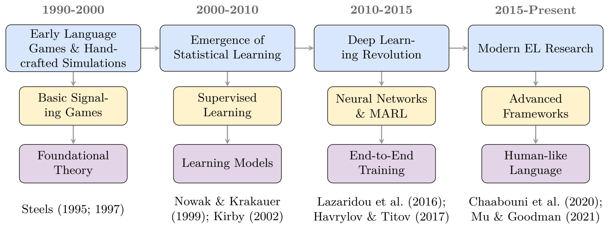

**图 9：** 涌现语言研究的演进：展示重要里程碑、方法与成果的时间线。

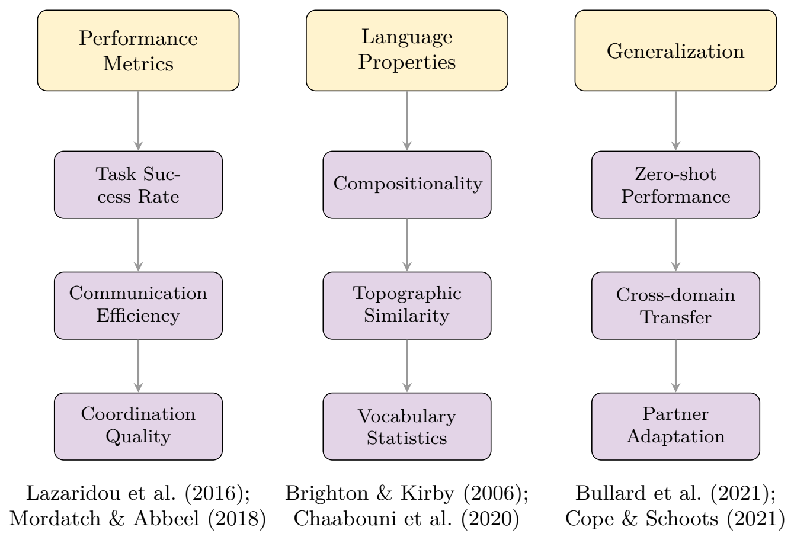

**图 10：** 涌现语言研究中评价指标的分类体系。

#### 6.6.1 谁与谁通信、共享什么

涌现通信的第一组考量涉及谁参与通信、消息面向谁，以及智能体能够交换哪些信息。如第 6.3 节所述，群体规模、角色结构、合作程度及消息设计共同决定通信过程的拓扑与信息带宽。这些假设规定了通信协议可以涌现的空间。

图 9 说明了研究如何逐步扩展上述基本假设。早期信号博弈研究主要关注两个智能体之间的、具有特定角色的通信，以及符号词汇表。后续神经网络方法引入更丰富的架构机制（CNNs、RNNs 和注意力），扩展了可通信的内容。多步骤协议与表达能力更强的词汇选择，进一步塑造了消息面向哪些接收者，以及信息在对话中如何组织。

评估实践(图 10)随着这些发展而成熟。诸如组合性、拓扑相似度和词汇统计等指标作为量化消息结构和语义内容的工具而出现，提供了对智能体通信内容以及其是否类似于人类抽象的见解。这些基本的“谁-谁-什么”维度构成了通信的更多动态方面的基础。

#### 6.6.2 智能体何时、何地通信

第二个维度关注通信的时机与情境，即通信何时有用，以及环境或任务结构中的何处出现通信瓶颈。第 6.4 节说明，涌现语言对实验设置的结构高度敏感。通信并不会均匀地出现；当协调行为依赖无法从局部观测或被动线索推断的信息时，通信才会产生。

参考、重建、问答、网格世界和连续环境都为交流创造了不同的时间和空间机会。多轮对话游戏可以随着时间的推移进行澄清，而连续的控制任务需要在导航或操作过程中进行通信。网格世界任务依赖于空间语义扎根，限制了信息必须共享的位置才能成功。这些设计选择不仅影响通信的可用性，还影响通信的必要性和战略价值。

图9所示的历史发展反映了从静态符号设置到动态、具身环境的进展，在动态、具身环境中，时间、位置和部分可观测性决定了通信何时变得有利。因此，有效的评估需要能够捕捉不同环境背景和任务结构绩效的指标，如图 10 所示。

#### 6.6.3 通信为何涌现以及如何通过学习获得

第三个维度捕捉了涌现通信背后的功能驱动因素：为什么通信在任务中是有益的，以及智能体如何实施通信策略来提高协调性、泛化性或鲁棒性，如第 6.5 节中所讨论的。当独立决策不足以解决开放式或高度不确定性的任务时，当智能体面临合作伙伴的可变性或噪音时，或者当必须抽象和共享概念以实现稳定的协调时，就会出现通信。

“如何”这一维度涵盖支持通信的架构与算法机制，包括离散词汇表、消息瓶颈、注意力模块、智能体轮换和多轮协商方案。这些机制影响可解释性的涌现，使消息能够形成类似自然语言的结构，同时也有助于提高可扩展性与鲁棒性。例如，群体轮换或噪声注入能够防止共同适应，增强跨智能体和环境的泛化能力。

如图 10 所示，这些功能属性的评估指标已经扩展到任务成功之外，还包括组合性、合作伙伴适应、零样本泛化和跨域转移。这些指标反映了不仅需要评估智能体是否进行通信，还需要评估最终的协议是否提供连续或手工系统无法提供的好处。确定涌现通信明显优于此类基线的基准仍然是一个重要的开放方向。

### 6.7 衔接：从 MARL-Comm 和涌现语言到基于大语言模型的通信

**表 11：** 从 MARL-Comm 和涌现语言到基于大语言模型的通信：推动 LLM-Comm 研究的局限性。

| **方面** | **MARL-Comm 的局限性** | **涌现语言的局限性** | **LLM-Comm 的动机** |
| --- | --- | --- | --- |
| **语义结构** | • 潜在或连续信号； • 语义难以解释。 | • 离散符号； • 表达能力有限。 | • 丰富、具有组合性的语言； • 与人类对齐的语义。 |
| **泛化** | • 联合训练的智能体； • 跨任务迁移能力较弱。 | • 群体专用的语言； • 零样本协调失败。 | • 较强的跨任务泛化能力； • 预训练的语言先验。 |
| **可扩展性** | • 通信成本随智能体数量增加。 | • 从头学习语言成本高昂。 | • 可复用的语言表示； • 可扩展至不同智能体角色。 |
| **人类对齐** | • 难以解释或审计。 | • 自然语言中的语义扎根有限。 | • 适合人类的自然交互接口； • 支持解释与监督。 |
| **核心差距** | • 针对任务优化，但不透明（MARL）； • 可解释，但脆弱且适用范围狭窄（EL）。 | • 针对任务优化，但不透明（MARL）； • 可解释，但脆弱且适用范围狭窄（EL）。 | • 开放式、可复用的通信基础。 |

虽然涌现语言研究解决了基于 MARL 的通信的关键局限性(最明显的是可解释性和离散结构)，但它引入了与可扩展性、泛化和语义丰富性相关的新挑战。涌现通信协议通常是通过任务驱动的交互从头开始学习的，这使得它们对训练环境、智能体群体和奖励结构敏感。因此，许多涌现语言很难在任务之间进行泛化，适应看不见的合作伙伴，或者支持超越狭义定义的协调问题的开放式推理。

与此同时，基于 MARL 的通信继续面临可解释性、验证以及与以人为中心的决策流程集成方面的挑战。连续或潜在的消息空间仍然难以审核或与人类语义保持一致，从而限制了它们在安全关键或人机交互设置中的适用性。这些限制共同揭示了任务优化的通信与语义丰富、可重用的语言之间的差距。

基于 LLM 的多智能体通信的出现就是为了解决这一问题。通过利用自然语言的大规模预训练，LLMs 为智能体提供了强大的语义先验、组合结构以及跨任务和领域泛化的能力，而无需针对特定任务进行再训练。与涌现语言系统不同，基于 LLM 的智能体不需要通过交互重新发现语言结构，并且与基于 MARL 的通信不同，它们的消息本质上是可解释的且与人类一致的。这些特性促使越来越多的人采用 LLMs 作为多智能体系统中协调、规划和推理的通信骨干。表 11 总结了 MARL-Comm 和 EL-Comm 中的限制如何共同推动向基于 LLM 的多智能体通信的转变。

## 7 大语言模型驱动的多智能体通信

大语言模型（LLMs）在规模庞大且内容多样的语料库上训练，由此形成涌现的常识推理能力，以及较强的人类语言理解和生成能力，并在多个领域表现突出 (Liang et al., 2022)。人类语言是一种通用而灵活的知识与意图表示媒介，因此为推理、协调和信息交换提供了自然接口。基于这些能力，LLMs 日益被部署为能够规划、推理和行动的自主智能体，近期又被用于通过自然语言通信的多智能体系统（MAS）团队。基于语言的通信支持智能体以可解释且不依赖特定任务的方式协调和协作，无须人工设计协议，因而能够实现灵活交互和广泛泛化 (Guo et al., 2024a; Liu et al., 2025a)。尽管仍面临幻觉和语义扎根不足等挑战 (Ahn et al., 2022)，多模态 LLMs 通过融合语言与感官输入进一步提高了鲁棒性 (Durante et al., 2024)。相较采用固定协议的传统 RL 智能体，基于 LLM 的智能体提供了通用通信框架；LLM–RL 混合方法则尝试结合语言推理与扎根于环境的学习 (Sun et al., 2024a; Wu et al., 2022; Feng et al., 2024)。

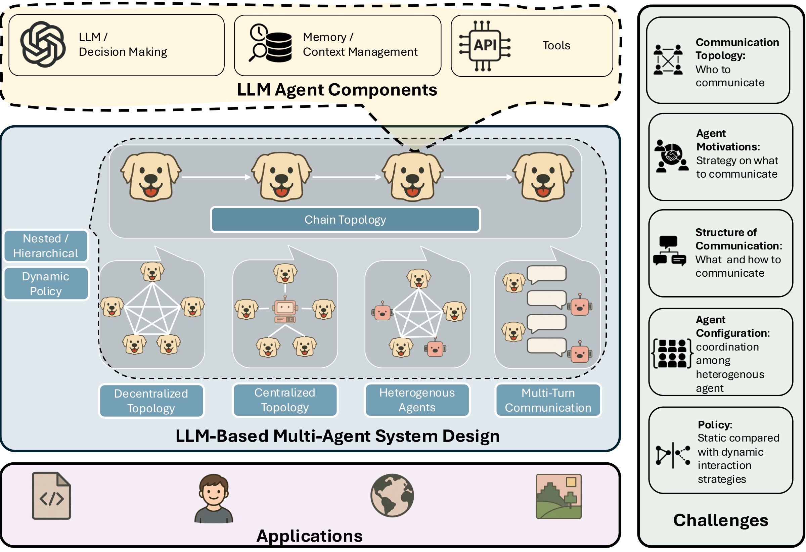

**图 11：** 基于大语言模型的多智能体系统设计与挑战。在这类系统中，每个智能体都会输出决策，而记忆、上下文管理和领域专用工具能够增强其决策能力。智能体通过不同拓扑进行通信，可采用静态或动态配置，应用覆盖多个领域。构建能够有效运行的多智能体系统仍然面临众多设计问题；图中总结了若干关键挑战。

##### 综述范围与结构

随着 LLM 驱动的多智能体系统受到越来越多关注，通信成为组织系统的核心主题。自然语言为智能体与环境交互、智能体间协调及人类与智能体协作提供了统一接口。本节先介绍 LLMs 和基于 LLM 的智能体的基础（第 7.1 节），再依次按谁与谁通信及共享什么（第 7.2 节）、何时何地通信（第 7.3 节）、通信为何以及如何组织（第 7.4 节）系统梳理已有工作。第 7.5 节进一步讨论这些维度，最后连接基于 LLM 的通信与多智能体强化学习，强调 LLM–MARL 混合系统中的涌现通信模式，以及它们在去中心化场景中的局限（第 7.6 节）。图 11 提供系统层面的总体视图，说明 LLM 智能体组件、通信拓扑、智能体配置与策略如何共同塑造多智能体系统的设计与挑战；图 12 给出详细分类，按照通信拓扑、动机场景、智能体异质性和通信结构归类现有研究。最后，我们连接基于 LLM 的通信与多智能体强化学习，强调 LLM–MARL 混合系统中的涌现模式及其在去中心化场景中的局限。

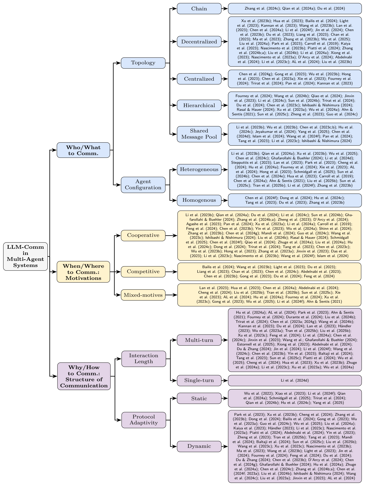

**图 12：** 大语言模型智能体通信的分类体系。

### 7.1 大语言模型与大语言模型智能体的背景和基础

#### 7.1.1 大语言模型（LLM）

LLMs 已成为基于智能体的系统的变革性工具，提供推理、规划和自然语言理解等高级功能。这些功能不是来自显式编程，而是来自大规模、多样化的语料库 (Liang et al., 2022) 训练的涌现性质。当部署为决策智能体时，LLMs 通过实现超越基于规则的约束的灵活协调和通信，在动态多智能体环境中展现出强大的适应性：(1)。 **涌现行为。** LLMs 显示涌现能力，例如战略规划、抽象推理和社交模拟，这些能力在训练期间未明确编码。这些行为使智能体能够参与高级任务，包括谈判、合作解决问题和情境感知决策。在多智能体系统中，这种行为对于在不可预测的环境中培养稳健的协调策略特别有价值。 (2)。 **上下文、少样本和零样本学习。** LLMs 能够通过上下文学习适应新任务，直接从提示中解释任务说明和示例，无需更新参数。这种灵活性扩展到少样本和零样本设置，其中智能体可以使用最少或不使用先前的训练数据来执行新颖的任务。这些功能显着减少了开发开销，并使智能体能够在开放式、不断发展的环境中运行，并具有与任务无关的泛化能力。 (3)。 **自然语言通信。** 理解和生成人类语言的能力使 LLMs 非常适合促进多智能体系统内以及智能体与人类之间的可解释通信。智能体可以使用自然语言阐明目标、策略和理由，从而改善智能体间的协调和人类监督。这对于混合智能体团队的协作、透明度和信任至关重要。 (4)。 **跨环境的通用推理。** 重要的是，LLMs 并未经过预先训练来优化任何特定环境(例如特定游戏或图形界面)的行为。相反，它们充当通用认知引擎，可以进行微调或搭建以满足特定领域的要求。此属性支持跨不同智能体应用程序(从基于 GUI 的助手到战略游戏智能体)的可重用性，同时保持任务灵活性。总之，LLMs 的涌现推理、灵活的学习范式和语言驱动的通信使它们成为下一代多智能体系统的基础组件。通过利用这些属性，智能体可以动态地适应新的目标，通过可解释的对话进行协作，并在复杂、不确定的环境中有效地发挥作用。

#### 7.1.2 大语言模型智能体

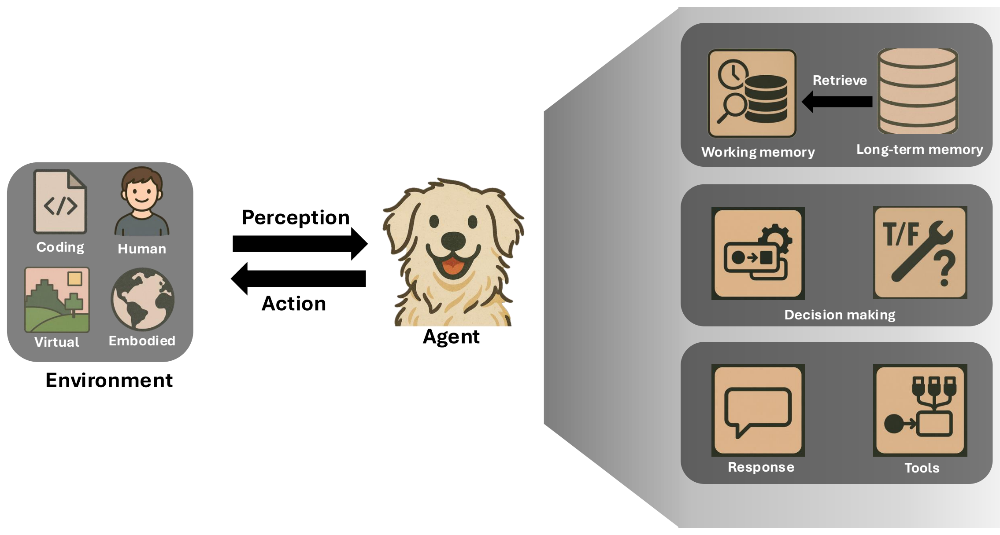

**图 13：** 基于大语言模型的智能体的一般架构。图中展示了智能体如何通过感知与行动循环，与编程环境、人类环境、虚拟环境及具身环境交互。智能体内部可采用定制模块处理记忆、决策、响应生成和工具使用，从而在不同领域中实现灵活、可适应的表现。

基于 LLM 的智能体是一个模块化系统，围绕中央语言模型 (Durante et al., 2024; Wang et al., 2024a) 集成了推理、内存和任务执行。如图 13 所示，这些智能体被构造为四个核心组件，每个组件都有助于它们在动态环境中一致和自适应地行动的能力：(1)。 *个人资料。* 该组件对智能体的身份、个性特征和社交属性进行编码。配置文件影响交互风格和决策偏好，允许智能体模拟不同的角色或角色。配置文件可以手工制作、学习或与外部数据集对齐。 (2)。 *内存。* 内存系统使智能体能够保存和检索历史信息，例如过去的交互或任务结果。该组件以嵌入、文本日志或数据库的形式实现，通过读/写操作和反思推理支持长期一致性和任务连续性。 (3)。 *规划。* 规划模块支持将目标分解为可操作的步骤，并支持制定实现这些目标的策略。可以根据智能体自我评估、其他智能体的反馈或环境输入迭代地完善计划，从而实现对动态任务上下文的响应。 (4)。 *行动。* 该组件将计划落实为具体行动。行动可能涉及环境操纵、通信、工具使用或内部推理。通过整合内存和规划的输出，该模块允许智能体有效地执行任务并实时调整行为。这些组件共同构成了基于 LLM 的智能体的内聚架构，能够进行多轮推理、人机交互和分散协调。这种模块化设计促进了广泛的多智能体设置的可扩展性和定制。

### 7.2 谁与谁通信、通信什么

多 LLM 智能体系统中的通信带来了与传统 MARL 或涌现语言场景显著不同的挑战。LLM 智能体不同于通过梯度训练得到的策略，它们 **通过开放式自然语言进行通信**，因此会产生歧义、冗长表述、幻觉、不受控制的信息流，以及异构智能体之间难以协调角色等问题。这些问题往往源于通信结构的规定不充分： **谁** 有权或有机会发言，每个智能体应向 **谁** 发送消息或作出回应，以及为实现有效协调应交换 **什么** 信息，均不明确。通过在通信设计中明确分析 **谁** 、 **与谁** 及 **什么** 这三个维度，我们可以系统地约束交互模式、降低不确定性，并促进多智能体行为的一致性。具体而言，这些维度有助于应对若干核心 **挑战** ： **（1）** 不受控制或重复的消息生成， **（2）** 发言者与预期接收方之间的错配， **（3）** 因消息内容不明确而造成的信息过载或遗漏， **（4）** 大型团队中职责重叠导致的协调退化，以及 **（5）** 无法维持共享上下文或稳定的交互协议。以下各小节将考察 **通信拓扑** 、 **智能体角色配置** 、 **消息结构** 和 **通信框架** 如何分别落实“谁—与谁—什么”这三个维度，以及这些设计选择如何缓解上述基本挑战。

#### 7.2.1 通信拓扑与交互结构

通信拓扑是主要结构机制，基于 LLM 的多智能体系统通过它定义允许或期望发言的人、他们针对的对象以及因此与交换最相关的信息。与 MARL(通信边缘通常反映空间邻接或带宽限制)不同，也与智能体角色由游戏结构固定的涌现语言设置不同，LLM-MAS 拓扑是逻辑和设计驱动的。他们强加组织架构，防止自由形式的自然语言交流变得混乱、冗余或与任务需求不一致。下面，我们综合了五个主要的拓扑类别(图 14-18)，并分析每个类别如何控制“谁→谁”交互并影响“通信内容”。

**图 14：** 链式拓扑。

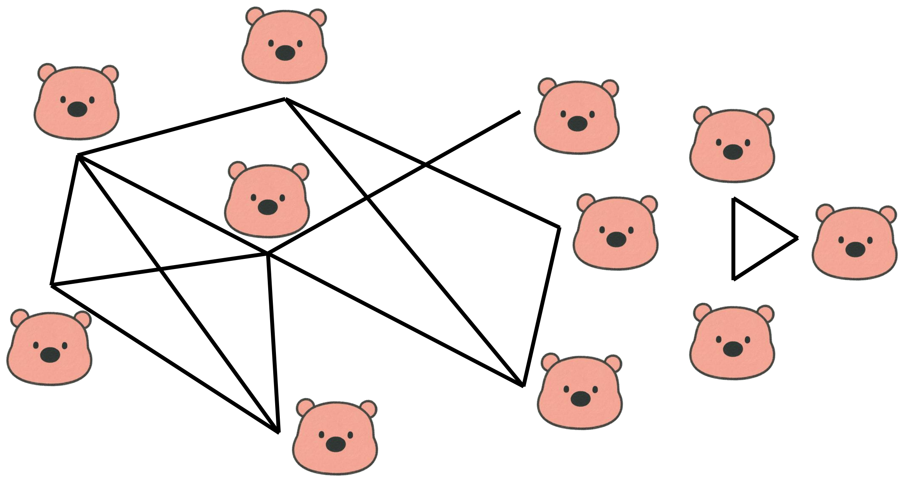

**图 15：** 分散式拓扑。

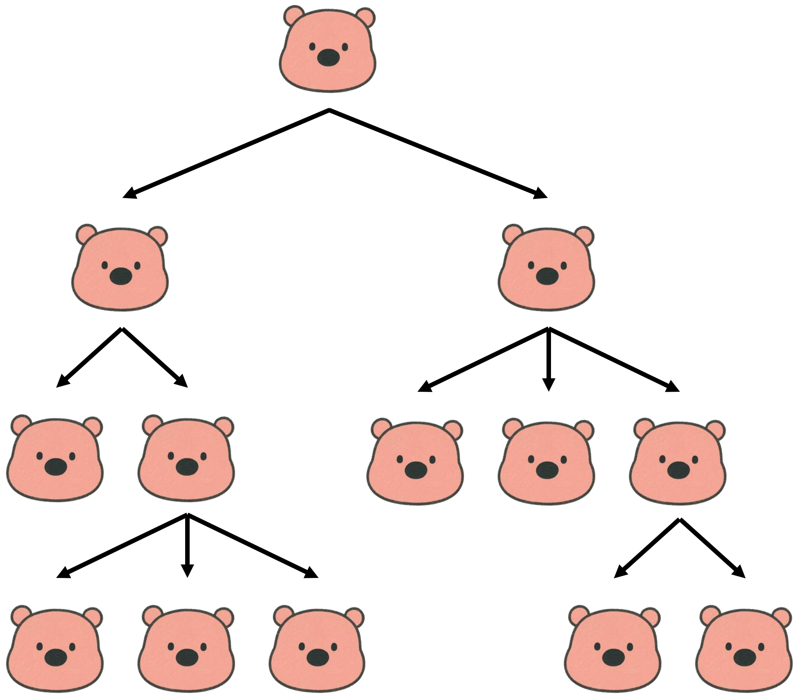

**图 16：** 层次式拓扑。

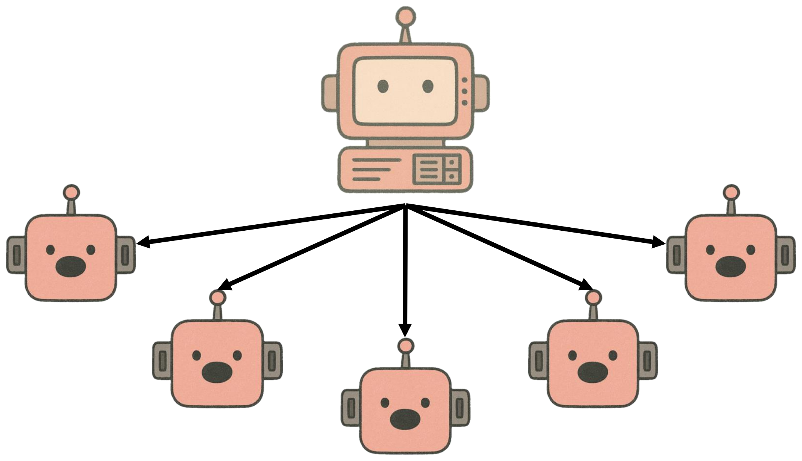

**图 17：** 集中式拓扑。

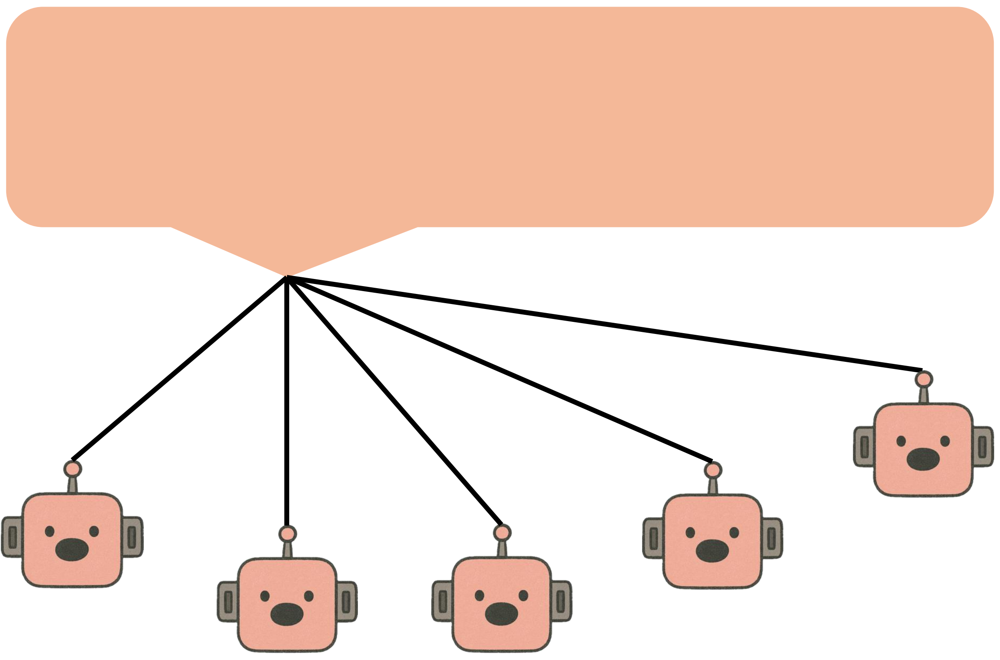

**图 18：** 共享消息池拓扑。

##### 链式与流水线拓扑

(图 14)描述了一种线性通信模式，其中每个智能体仅与其直接邻居进行通信。这种结构特别适合管道或顺序工作流，确保消息以有组织的方式流动。在顺序通信中，智能体在逐步链中运行，其中每个智能体处理任务的一部分并将结果传递给下一个 (Zhang et al., 2024c)。在这个固定的管道中，智能体可以听的 **人** 是其直接前任，而它可以与之交谈的 **人** 是其直接后继者。这种严格的配对决定了要传达的内容：智能体必须仅传递下一阶段所需的中间工件或推理，并且不能依赖全局上下文或来自非相邻智能体的交叉检查。这种设置将较长或复杂的问题分解为更易于处理的较小部分。某些系统遵循此模式进行多步骤工作流程(例如软件开发)，使用不同的智能体以清晰的顺序处理设计、编码、测试和审核 (Qian et al., 2024a; Du et al., 2024)。在这些系统中，链通过将每个阶段绑定到单个上游提供商和单个下游消费者来明确解决“谁与谁对话”的问题，这减少了通信冗余，但也限制了可以传输的“什么”信息，通常是结构化规范、代码草案或为下一个专门智能体格式化的测试结果。与去中心化或共享内存方法相比，这些基于链的工作流程改进了模块化和控制，但限制了全局协调或纠正反馈的机会，使它们在早期输出有缺陷时更容易出现级联错误。

##### 分散式拓扑

(图15)

去中心化拓扑允许智能体直接与多个对等点通信，无需集中协调，形成完全或部分连接的交互图。与“谁”与“谁”对话很大程度上由执行顺序或角色分配固定的链式或分层设计不同，去中心化系统允许根据本地决策、战略激励或环境背景动态选择通信伙伴。这种灵活性可以实现更丰富、更具适应性的交互模式，但它也将协调、一致性和过滤的负担转移到智能体本身身上。

第一类去中心化系统出现在 **社会互动和策略博弈环境** 中，例如 Werewolf (Bailis et al., 2024)、Avalon (Wang et al., 2023b) 及相关角色扮演场景 (Xu et al., 2023b; Hua et al., 2023; Light et al., 2023; Kannan et al., 2023; Lan et al., 2023; Chen et al., 2024a)。在这些场景中， **谁与谁通信** 的模式由两方面共同塑造：一方面是显式游戏机制，如轮流行动、投票轮次和阶段切换，这些机制在 Avalon 和 Werewolf 类基准中得到了形式化描述 (Light et al., 2023; Bailis et al., 2024; Wang et al., 2023b)；另一方面是隐式社会角色或人物设定，例如村民、对手或具有特殊能力的智能体，它们影响智能体的通信动机 (Xu et al., 2023b; Hua et al., 2023; Lan et al., 2023; Chen et al., 2024a)。在指控、辩护或试探他人时，智能体会主动选择向 **谁** 发言。研究表明，这一决策对于施加策略性影响和塑造信念至关重要 (Xu et al., 2023b; Kannan et al., 2023)。通信对象的选择直接决定了 **通信什么** ：智能体会生成有说服力的论证、欺骗性叙述和明确的信念陈述，以影响群体决策或掩盖私有信息 (Hua et al., 2023; Bailis et al., 2024; Chen et al., 2024a)。这些研究呈现出一致的趋势：去中心化交互能够支持由意图驱动、富于社会表达的通信，但也带来了更大的歧义和对错误信息的易感性，因为在缺少中央协调或核验机制时，相互冲突的叙述会持续存在 (Light et al., 2023; Wang et al., 2023b; Lan et al., 2023)。

第二类是 **辩论式和基于批评的框架** (Li et al., 2024f; Jin et al., 2024; Chen et al., 2023b; Du et al., 2023; Liang et al., 2023; Chan et al., 2023)。这类框架通常采用全连接通信图，任何智能体都可以向其他任意智能体发言。在 LLM-Debate 及其相关变体等系统中 (Du et al., 2023; Liang et al., 2023)， **谁** 向 **谁** 发言由明确的辩论协议决定，例如挑战者与辩护者的分工；基于裁判或以协调一致为目标的设计还会通过评估者角色进一步组织交互 (Li et al., 2024f; Chen et al., 2023b)。在这些场景中， **通信什么** 具有明确的论辩性质，包括批评、反例、基于证据的主张和元推理步骤 (Jin et al., 2024; Chan et al., 2023)。实证评估一致表明，相较于单智能体基线，这些方法能够提升推理质量和错误检测能力，体现了去中心化同伴批评对复杂决策的益处 (Du et al., 2023; Liang et al., 2023; Chan et al., 2023)。同时，这些研究也揭示了去中心化辩论设计的一项关键局限：若没有精心设计的轮流发言规则、聚合机制或停止条件，通信可能变得重复或发散 (Li et al., 2024f; Chen et al., 2023b)，而且难以将性能提升归因于特定的 **谁** 与 **谁** 之间的交互，或个别智能体的论辩贡献。

相比之下， **具身且以任务为依据的去中心化系统** (Ma et al., 2023; Zhang et al., 2023b; Wu et al., 2025; Kannan et al., 2023; Liu et al., 2024a) 通过物理邻近性、互补角色或局部任务依赖关系，为 **谁** 与 **谁** 通信施加隐式结构。例如，在具身规划和导航任务中，智能体主要与空间上邻近的同伴或角色互补的伙伴进行协调 (Ma et al., 2023; Zhang et al., 2023b)；多机器人和使用工具的系统则往往根据导航与操作、感知与动作耦合等功能依赖关系限制通信连接 (Kannan et al., 2023; Liu et al., 2024a)。这种通信对象选择机制形成了 **稀疏但具有明确功能意义的通信图**，在减少冗余的同时保持与任务的相关性。因此，这些系统中 **通信什么** 与环境和任务动态紧密关联，通常包括实现即时协调所需的空间描述、动作提议、可供性信息或局部状态更新 (Ma et al., 2023; Wu et al., 2025)。与基于社会推理或辩论的去中心化场景相比，这些系统有意以表达的丰富性和开放式对话为代价，换取更清晰的语义扎根，以及消息与环境动态之间更紧密的联系 (Zhang et al., 2023b; Liu et al., 2024a)。实证结果表明，这一设计带来了更可预测、更稳定的行为，但评估通常局限于较少数量的智能体和较窄的任务分布，反映出以任务为依据的去中心化通信在可扩展性与语义扎根之间固有的权衡。

最后， **大规模智能体社会和通用去中心化框架** (Park et al., 2023; Carroll et al., 2019; Kaiya et al., 2023; Nascimento et al., 2023b; Piatti et al., 2024; Zhang et al., 2024b; Zhang et al., 2024a; Liu et al., 2024b; Li et al., 2024a; Xiong et al., 2023; Nascimento et al., 2023a; D’Arcy et al., 2024; Abdelnabi et al., 2024; Li et al., 2023c; AL et al., 2024; Liu et al., 2023b) 研究种群规模的通信。在这里， **谁** 与 **谁** 通信不再由任务结构固定，而是由学习得到的效用、社会关系，或文化及角色信号涌现形成。例如，基于智能体的社会仿真和生成式社会允许智能体根据其感知到的社会关系、记忆或长期偏好主动发起通信 (Park et al., 2023; Nascimento et al., 2023b; Nascimento et al., 2023a)。另一些系统则显式建模交互动机或由效用驱动的通信对象选择，使智能体联系能够最大化预期收益或协调收益的同伴 (Carroll et al., 2019; Piatti et al., 2024; Abdelnabi et al., 2024)。在这些场景中， **通信什么** 超越了即时观测或动作，还包括建议、共享规范、角色期望，以及用于调节集体行为的高层策略 (Li et al., 2024a; Zhang et al., 2024b; Zhang et al., 2024a)。多项研究表明，此类去中心化交流能够在没有集中控制的情况下产生涌现的劳动分工、社会约定和适应性的群体组织 (Kaiya et al., 2023; Liu et al., 2024b; Li et al., 2023c; AL et al., 2024)。然而，实证分析也揭示了种群规模去中心化所特有的局限：随着智能体数量增加，通信中的噪声和冗余日益增多，难以对单次交互进行因果归因，系统层面的评估也需要采用聚合指标或统计指标，而非轨迹层面的分析 (Xiong et al., 2023; D’Arcy et al., 2024)。

总体而言，与固定的流水线或层级结构相比，去中心化拓扑通常能支持更灵活、依赖上下文的 **通信发起者与通信对象** 选择，以及更丰富的 **通信内容**。与此同时，现有文献揭示了一种普遍的设计矛盾：更强的表达能力和适应性，需要以更多的歧义、更高的协调开销和更大的稳定化难度为代价，因此实际系统往往引入过滤、聚合或混合控制机制。

##### 层次式拓扑

(图 16)将通信分层，为智能体分配不同的角色：较高级别的智能体处理规划、抽象和任务分配，而较低级别的智能体专门用于执行子任务或特定于域的操作。这种设计通过分解复杂的任务来实现模块化和可扩展的协调。然而，有效的使用依赖于强大的角色专业化、跨层的连贯协调以及对任务结构和进展的共同理解。

在层级系统中，通信的“谁”和“谁”是有意预先确定的：主管决定“谁”发言、“谁”指令的目标，而这些交互的结构强烈限制了“通信内容”。在 Magentic-One (Fourney et al., 2024)、MegaAgent (Wang et al., 2024b)、AutoAct (Qiao et al., 2024) 和 CGMI (Jinxin et al., 2023) 等多层管道中，较高级别的智能体发布抽象计划或任务分解，而较低级别的智能体则以执行详细信息或本地更新进行响应。这些作品明确地编码了 **内容** 的向下流动：计划、约束和目标；以及向上流动的 **内容** :进度报告、澄清或例外情况。与 **谁与谁交谈** 动态出现的去中心化系统相比，这些方法消除了通信伙伴的模糊性，减少了协调开销并产生更可靠的任务依从性。

基于角色的分层模拟进一步强化了固定的“谁与谁交谈”映射如何塑造“交换什么”。在医院模拟 (Li et al., 2024c)、法律服务工作流程 (Sun et al., 2024b) 和 AutoML 管道 (Trirat et al., 2024; Du et al., 2024) 中，智能体嵌入到反映现实世界机构的组织结构中。在这里，“谁”通信是由工作角色决定的，而“谁”是由机构层次结构定义的，例如，医生向协调员报告诊断，分析师将模型结果返回给管道经理。因此， **什么** 变得高度结构化：特定领域的证据、预测、摘要或结构化更新。与分散式拓扑相比，这些系统提高了可靠性和可解释性，分散式拓扑会生成更多样化但更难以预测的消息。

AgentVerse (Chen et al., 2023c) 及相关智能体编排框架 (Ishibashi and Nishimura, 2024; Rasal and Hauer, 2024; Xu et al., 2023a) 等通用层级式环境，将层级通信从固定流水线扩展到 **自适应组队与组织协调一致**。这些系统强调明确的角色分配和监督协调，表明当任务需要结构化分解、全局监督，或要求不同智能体遵循一致的执行标准时，层级结构尤其有效 (Chen et al., 2023c; Zheng et al., 2023)。多项研究进一步展示了层级控制如何支持复杂工作流中的可靠性和可扩展性。例如，嵌套式或监督者—工作者设计 (Ahn and Sentis, 2021; Wu et al., 2024a)，以及多智能体编排框架 (Sun et al., 2025b; Guo et al., 2024c)，表明固定 **谁与谁通信** 能够简化协调，并稳定 **通信什么**，其内容通常是结构化计划、约束或摘要，从而使系统在较长时间跨度内表现出可预测的行为。同时，这些研究也一致揭示了层级通信的一项关键局限：由于交互模式被严格规定，智能体能够表达的 **内容** 空间也相应受限，限制了横向信息共享、同伴之间的批评，以及观点的创造性重组 (Xu et al., 2023a; Rasal and Hauer, 2024)。因此，对于能够从自发协作或探索式推理中获益的场景，层级拓扑的效果较弱；在这些场景中，去中心化设计或共享消息池设计可以支持更丰富、更多样的通信策略。综合来看，这一研究方向阐明了一个基本权衡：层级系统倾向于可预测性、可控性和可解释性，但需要牺牲表达灵活性。与去中心化设计相比，它们往往实现了更高的可靠性和任务遵循程度，却具有更低的通信行为多样性，以及更弱的涌现式同伴驱动推理能力。

##### 集中式拓扑

（图 17）由单个中央智能体协调所有智能体之间的通信。该中央协调者管理信息流、分配任务并同步动作，从而简化协调并提高一致性，尤其有利于大规模部署。

集中式系统明确界定了 **谁** 与 **向谁** 这两个维度：中央规划者始终是发起通信的 **智能体**，所有下级智能体则是其通信的 **对象**。这一固定映射强烈约束了 **通信什么**。例如，在 Scalable Multi-Robot Collaboration (Chen et al., 2024g) 中，中央控制器分配角色并同步多机器人团队，因此，向下传递的 **内容** 由结构化的任务分配和协调指令构成，而向上返回的 **内容** 仅限于进度报告或传感器摘要。与智能体独立决定通信伙伴和消息类型的去中心化方案相比，这种方式降低了消息的多样性，却大幅提高了可预测性和任务遵循程度。

MindAgent (Gong et al., 2023) 中也呈现出类似模式：中央管理者通过分发观测并确保动作协调一致，来编排游戏智能体。由于 **谁与谁通信** 的映射固定，智能体很少需要协商或推断通信伙伴，其 **通信内容** 由管理者的要求塑造，包括局部状态、策略建议或执行反馈。这些系统凸显了集中式拓扑的优势与局限：尽管效率和一致性较高，但如果中央智能体误解了上下文或负载过重，系统的适应性就会急剧下降。

集中协调也广泛应用于通用 LLM-MAS 框架，包括 AutoGen、MetaGPT、AutoAgents 和 OpenAgents (Wu et al., 2023b; Hong et al., 2023; Chen et al., 2023a; Xie et al., 2023)。在这些系统中，中央计划者将高级目标分解为子任务，选择专门的智能体并汇总输出。这里， **who** 是生成分解指令的规划器； **谁** 是特定技能智能体； **什么** 成为计划、执行跟踪和工具输出的结构化交换。由于所有通信都通过规划器进行，因此这些框架获得了强大的全局监督，但在嘈杂或模糊的下游消息下牺牲了鲁棒性。

同样，工作流程自动化和系统集成平台(例如 Magentic-One、AutoML-Agent 和 AgentCoord (Fourney et al., 2024; Trirat et al., 2024; Pan et al., 2024))嵌入了一个集中控制器来安排子任务、管理依赖关系并强制执行执行顺序。与信息沿多个级别流动的分层拓扑相比，这些系统将层次结构折叠为单一权限，简化了“谁与谁交谈”，但增加了中央智能体正确解释和路由“内容”的压力。这种集中提高了协调效率，但也缩小了消息的表达带宽，因为智能体会根据控制器的期望定制它们报告的内容。

在具体的战略游戏环境 (Kannan et al., 2023; Gong et al., 2023) 中，集中监督可确保高层目标的一致性，并防止在复杂空间或对抗性环境中运行的智能体之间出现分歧。然而，这种可靠性是以牺牲灵活性为代价的：与去中心化拓扑不同，在去中心化拓扑中，智能体根据本地需求动态选择“谁”来解决并决定共享“什么”，集中式系统强加了严格的通信渠道，在高任务复杂性下可能会成为瓶颈。

总体而言，集中式拓扑与链式、分层式和分散式结构形成鲜明对比：它们最大限度地减少了“谁与谁交谈”映射的不确定性，从而将“什么”限制为明确定义的任务原语，从而以适应性和涌现协调为代价实现一致性和故障检测。因此，它们的有效性取决于中央智能体的能力和可靠性，这既成为促成因素，又成为主要故障点。

##### 共享消息池拓扑

(图 18)采用全局广播通道或共享存储库，其中智能体异步发布消息并检索相关信息。这种拓扑提供了灵活性和松散耦合，但在高流量场景中可能面临消息过载或延迟等挑战。

与链式或分层拓扑不同，在链式或分层拓扑中， **谁** 与 **谁** 由固定边指定，而共享消息池完全删除了显式寻址。相反，智能体向共同记忆广播并检索他们认为相关的任何内容。这种间接性强烈地决定了所传达的内容，因为消息必须是独立的、可解释的，并且对事先可能不知道的接收者有用。

基于对话的协作系统(例如 CAMEL (Li et al., 2023b)、AutoGen (Wu et al., 2023b)、AgentVerse (Chen et al., 2023c) 和 Reconcile (Chen et al., 2023b))清楚地说明了这种模式。由于智能体无法针对特定合作伙伴，因此“谁”是对共享缓冲区做出贡献的任何智能体，而“谁”是能够从中读取数据的每个智能体。因此， **内容** 往往包括可以支持不同协作者工作的基本原理、中间推理轨迹和共享任务上下文。与链式拓扑相比，这些系统提高了鲁棒性，因为任何智能体都可以加入或离开而不会中断通信路径。然而，它们对于哪些消息与哪个智能体相关存在模糊性，这就产生了检索启发式和内存修剪的需要。

基于图的协调系统 (Hu et al., 2024c; Jeyakumar et al., 2024; Yang et al., 2025) 使用结构化共享内存，例如知识图。在这里， **who** 是更新智能体， **whom** 是全局状态。因此，智能体通信的内容采用结构化更新的形式，例如节点建议或约束断言。这提高了可扩展性并创建了更可解释的全局表示，但要求所有智能体在模式和更新规则上保持一致，这降低了自由形式自然语言消息的灵活性。

面向任务的协作框架(例如 CommAI (Chen et al., 2024d)、MapCoder (Islam et al., 2024)、MACRec (Wang et al., 2024f)、AgentCoord (Pan et al., 2024) 和 MedAgents (Tang et al., 2023))依赖于智能体发布计划、中间结果或工具输出的共享存储库。由于没有明确指定“谁”，因此所传达的“内容”必须是预期的和模块化的，以便异构智能体可以重用信息。与去中心化辩论相比，这些系统减少了消息冲突并支持更高级别的并行性，但如果太多智能体产生未经过滤的内容，可能会遇到协调瓶颈。

涌现组织方法(例如心智理论智能体和自组织社会 (Li et al., 2023c; Ishibashi and Nishimura, 2024))使用消息池来调解适应性角色和规范。由于“谁”和“谁”的关系是流动的，因此“什么”包括元级别信息，例如推断意图或社会期望。这使得丰富的涌现行为成为可能，但也增加了噪音和不稳定的风险。

相对于去中心化拓扑， **谁** 选择 **谁**，共享池通过允许完全隐式的合作伙伴选择来简化协调，但消除了合作伙伴的特殊性。相对于层级结构，“什么”是由经理和员工关系决定的，共享池鼓励更多的对称通信，但对消息相关性的控制较少。此拓扑的有效性依赖于相关性过滤、内存组织以及智能体在许多并发消息中确定优先级的能力。

#### 7.2.2 智能体配置与通信能力

基于 LLM 的多智能体系统可以与异构或同构智能体一起运行。这些配置决定系统如何指定 **谁** 与 **谁** 通信以及交换什么类型的信息。图 19 和 20 说明了这两种设置。

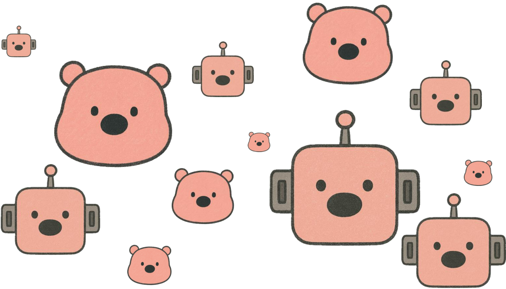

**图 19：** 异构智能体。

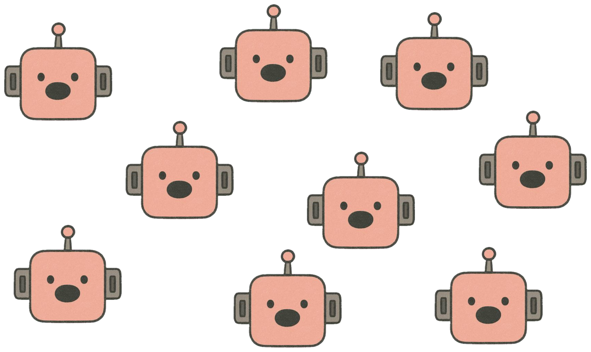

**图 20：** 同构智能体。

##### 异构智能体

在异构系统中，智能体具有不同的角色、技能、知识来源或身份。这种多样性使系统设计者能够根据功能依赖关系指定 **谁** 与 **谁** 交互，同时也塑造了 **通信什么**，因为消息必须适合特定接收者的需求。许多基于角色的多智能体系统都依赖这一结构。CAMEL (Li et al., 2023b)、ChatDev (Qian et al., 2024a)、社会推理智能体 (Xu et al., 2023b; Hua et al., 2023; Lan et al., 2023; Park et al., 2023; Chen et al., 2024c; Li et al., 2024d; Ghafarollahi and Buehler, 2024; Cheng et al., 2024; Chen et al., 2024e)、具身协作者 (Wu et al., 2025; Stepputtis et al., 2023; Hu et al., 2024a; Cheng et al., 2024) 和多阶段任务团队 (Fourney et al., 2024; Xie et al., 2023; Hong et al., 2023; Sun et al., 2024b; AL et al., 2024; Schmidgall et al., 2025) 等研究，通过明确的角色提示构建异构性。这决定了 **谁** 发起通信、其通信 **对象是谁**，以及 **什么** 内容适合该角色。例如，在 ChatDev (Qian et al., 2024a) 中，设计者智能体将规格说明发送给编码者智能体，后者再将代码返回给测试者智能体。因此， **谁与谁通信** 的映射是固定的，而 **通信内容** 则针对各阶段的需要进行专门化。CAMEL (Li et al., 2023b) 同样规定了明确的双方角色，以塑造双方交换的理由和计划。

一些作品通过工具调用或环境访问(Chen et al., 2024e; Schmidgall et al., 2025; Hua et al., 2023)引入了更强的异构性。在这里， **谁与谁交谈** 结构从能力边界中出现。智能体将消息发送给那些唯一能够执行网页浏览或模拟控制等操作的人。由于工具需要精确的输入，因此所传达的“内容”变得更加结构化，并且通常仅限于可参数化的指令。与纯粹基于提示的异构性相比，这些系统减少了冗余并提高了可靠性，尽管它们也缩小了通信灵活性。

异构系统的不同分支使用角色变化来模拟社会多样性 (Carroll et al., 2019; Chen et al., 2024a; Ahn and Sentis, 2021; Liu et al., 2025a; Sun et al., 2025b; Tran et al., 2025a; Li et al., 2024f; Zhang et al., 2023b)。在这些设置中， **谁** 与 **谁** 通信受到社会兼容性、信任或推断偏好的影响，而不是静态管道。因此，所传达的“内容”通常包括信念、意图或基于文化的推理。与角色固定团队相比，这些系统提高了现实性和突发动态，但引入了更高的可变性和降低的可预测性。

策略异构性出现在辩论、谈判或意见塑造场景中 (Li et al., 2024f; Xu et al., 2023b; Chen et al., 2024a)。智能体在推理风格、论辩能力或决策启发式方面有所不同，从而产生更丰富的信息交流。在这里，由于每个智能体都必须回应所有其他智能体， **谁与谁通信** 的模式变为全连接。因此， **通信什么** 往往包括证据、反驳论点和论证理由。与基于人物设定的异构性相比，策略异构性更有利于达成一致和开展批评，但在建模长时间跨度的社会动态方面效果较弱。

总体而言，异构智能体设置可实现有针对性的、角色相关的通信，并通过明确的路径指定 **谁** 与 **谁** 交谈。它们还塑造了所传达的内容，以实现专业化、合理性、工具使用或基于角色的交互。他们的主要优势是增强协调能力和表现力。它们的主要限制是可扩展性降低以及对准确角色规范的更大依赖。

##### 同构智能体

同构系统使用架构相同、能力相当的智能体，不预先分配角色，也不设定固定的通信层级。在这类场景中，并不存在预先规定的 **谁与谁通信** 结构；相反，对称性使任何智能体都可以与其他任意智能体通信，交互模式由任务需求和环境上下文涌现形成，而非由角色差异决定。例如，Optima (Chen et al., 2024f) 展示了同构 LLM 智能体如何在没有指定领导者的情况下，通过同伴之间的通信协调规划和决策；可扩展的图式规划器 (Hu et al., 2024c) 则表明，相同的智能体能够根据任务相关性和依赖结构，动态形成稀疏通信图。VillagerAgent (Dong et al., 2024) 具体展示了 **通信发起者与通信对象** 选择的涌现：尽管所有智能体共享相同的架构和推理能力，但在社会推理游戏环境中，通信连接会由空间邻近性、共享观测和即时协调需求产生。在这种情况下， **通信什么** 主要包括局部观测、怀疑信号和协调请求，而非针对特定角色的命令。同样，MedAgents (Tang et al., 2023) 使用同构医疗智能体交换观测、假设和中间结论；尽管能力相同，智能体仍会根据病例上下文和信息需求自然地形成不同的交互方式。这些研究呈现出一种共同模式：同构性简化了系统设计，避免了脆弱的角色设计，但也将 **通信内容** 限制在较为通用的信号，例如请求、观测和协调提示，因为没有任何智能体被明确赋予专门规划或监督的职责。因此，有意义的交互结构仍然可以涌现，但它们高度依赖任务结构和环境信号，才能形成有效的 **谁与谁通信** 模式。

即使在实体环境中，同质协作仍然有效。模块化具身智能体 (Zhang et al., 2023b) 表明，当通信基于共享感知时，相同的智能体可以联合执行对象操作和导航。这将传达的内容转向空间描述或行动建议，而不是战略划分。

与异构系统相比，同构设计更容易扩展，简化消息格式，并减少对准确角色提示的依赖。然而，它们可能缺乏复杂任务分解所需的表达能力，并且通常需要额外的协调机制来防止冗余或冲突。

总之，异质与同质的区别直接影响 **谁** 与 **谁** 交互的规范以及通信 **内容** 的结构。异构团队擅长专业化和结构化管道通信，而同质团队擅长可扩展性、对称性和涌现协调。适当的选择取决于基于 LLM 的多智能体系统的需求。

#### 7.2.3 消息设计与通信内容

除了交互频率之外，通信结构还决定了智能体交换的消息类型以及内容如何与寻址假设保持一致。结构化消息限制了可以将 **什么** 传达给预定义的模式，从而减少歧义并在固定 **谁** 和 **谁** 时实现可靠的执行。相比之下，非结构化消息允许智能体传达细致入微的推理和上下文信息，当寻址模式灵活或动态确定时，这变得必要。

不同消息内容类型反映了不同假设： **谁** 需要获取信息，以及需要 **什么** 抽象层次。任务执行消息明确协调智能体之间的职责。例如，在 AutoGen 和 GPT-in-the-Loop 中，通信的 **内容** 是发送给特定执行者的可执行指令或任务状态 (Wu et al., 2023b; Nascimento et al., 2023a)。知识交换机制强调共同理解和集体推理，智能体会广播中间认识，而不只面向单个接收者，CoMM (Chen et al., 2024d) 就是此类系统。当发送者（ **谁** ）与接收者（ **与谁** ）的目标部分不一致时，会出现面向协商和策略的通信，使通信的 **内容** 转向影响与妥协，LLM-Deliberation (Abdelnabi et al., 2023) 是典型例子。

状态更新、反馈和角色维护进一步说明了消息内容如何取决于结构假设。 MetaGPT 和 ReConcile 等系统依靠频繁的状态报告来维持智能体之间的全局一致性 (Hong et al., 2023; Chen et al., 2023b)，而角色驱动的系统要求智能体进行自洽反射通信以保持身份和角色稳定性 (Baltaji et al., 2024; Wang et al.)。这些设计隐含地假设接收消息的人可以在共享上下文框架内解释它，从而加强了寻址结构和消息语义之间的耦合。

总而言之，基于 LLM 的多智能体系统中的通信结构揭示了关于“谁”与“谁”通信的决策直接激励“必须通信什么”。环境背景进一步限制了这些选择，因为具有语义具有语义扎根的具身环境需要空间和时间上的局部交换，而抽象的工作流程则有利于广播或汇集通信。因此，有必要共同组织交互结构和消息内容，以了解通信如何支持复杂多智能体系统中的协调、可扩展性和鲁棒性。

#### 7.2.4 通信结构在框架层面的设计

本小节重点介绍现有的基于 LLM 的多智能体框架，因为它们为 **谁** 与 **谁** 通信、交换 **什么** 信息以及最终 **为什么** 首先引入通信等基本问题提供了具体的系统级答案。与隔离通信模块的算法研究不同，框架通过显式设计决策(例如智能体角色、编排逻辑、消息路由和内存共享)来操作通信选择。因此，每个框架都隐式地编码了关于“谁”应该被允许发言、“谁”应该向谁讲话以及支持协调、推理或任务执行需要什么类型的信息的假设。因此，检查这些框架揭示了不同的应用程序需求如何激发对 **为什么通信** 问题的不同答案，以及这些动机如何塑造最终的 **谁** - **谁** - **什么** 配置。

表 12 从通信拓扑、智能体数量和应用领域的角度总结了代表性的 LLM 多智能体框架，提供了这些系统如何大规模实例化通信结构的简洁视图。拓扑列明确描述了对 **谁** 可以与 **谁** 进行通信的约束，范围从刚性链和层次结构到分散和共享内存设计。应用领域进一步将 **为什么** 选择这些通信模式联系起来，例如，软件工程工作流程中的可靠性、辩论环境中推理的多样性或具身环境中的自主性。通过并列这些维度，该表强调支持类似任务的框架通常会集中对 **谁** - **谁** 问题的类似答案，而主要不同之处在于交换 **什么** 信息以及如何严格地监管通信。这一概述为接下来的详细分析奠定了基础，我们在其中比较不同类别的框架如何在实践中解决这些权衡。

**表 12：** 大语言模型多智能体框架的比较。

| 框架 | 拓扑：链式 | 拓扑：层次式 | 拓扑：去中心化 | 拓扑：中心化 | 拓扑：共享消息池 | 智能体数量 | 应用领域 |
| --- | :---: | :---: | :---: | :---: | :---: | :---: | --- |
| LangGraph (LangGraph) | 是 | 是 | 是 | 是 | 是 | 可灵活配置 | 通用 |
| CrewAI (CrewAI) | 是 | 是 | — | 是 | — | 可灵活配置 | 通用 |
| OpenAI Swarm (OpenAI) | 是 | — | — | — | — | 可灵活配置 | 通用 |
| SuperAGI (SuperAGI) | — | — | — | 是 | — | 可灵活配置 | 通用 |
| CAMEL (Li et al., 2023b) | 是 | — | — | — | 是 | 2 | 通用 |
| AutoGen (Wu et al., 2023b) | 是 | 是 | — | 是 | 是 | 可灵活配置 | 推理任务 |
| AgentVerse (Chen et al., 2023c) | — | 是 | 是 | — | 是 | 可灵活配置 | 通用 |
| MetaGPT (Hong et al., 2023) | 是 | 是 | — | 是 | — | 5 | 软件开发与编程 |
| MegaAgent (Wang et al., 2024b) | — | 是 | — | — | — | 590+ | 软件开发与编程；政策模拟 |
| ProAgent (Zhang et al., 2024a) | — | — | 是 | — | — | 2 | 具身环境：Overcooked |
| AgentCF (Zhang et al., 2024b) | — | — | 是 | — | — | 用户与物品 | 推荐系统 |
| ChatDev (Qian et al., 2024a) | 是 | — | — | — | — | 5 | 软件开发与编程 |
| COLEA (Zhang et al., 2023b) | — | — | 是 | — | — | 2 | 具身环境：WAH 与 TDW-MAT |
| MedAgents (Tang et al., 2023) | — | — | 是 | — | 是 | 3 | 临床推理任务 |
| ReConcile (Chen et al., 2023b) | — | — | 是 | — | 是 | 3 | 推理任务 |
| AutoAgents (Chen et al., 2023a) | — | 是 | — | 是 | — | 可灵活配置 | 通用任务自动化 |
| DyLAN (Liu et al., 2024b) | — | — | 是 | — | — | 可灵活配置 | 通用 |
| OpenAgents (Xie et al., 2023) | — | — | — | 是 | — | 3 | 数据分析／API 工具／网页助手 |
| MACRec (Wang et al., 2024f) | — | — | 是 | — | — | 5 | 推荐系统 |
| Magentic-One (Fourney et al., 2024) | — | — | — | 是 | — | 5 | 通用 |
| AgentCoord (Pan et al., 2024) | 是 | 是 | 是 | 是 | 是 | 可灵活配置 | 协调策略可视化 |
| AutoML-Agent (Trirat et al., 2024) | — | — | — | 是 | — | 5 | 机器学习流水线（数据$\rightarrow$部署） |
| GPT-Swarm (Zhuge et al., 2024a) | — | — | 是 | — | — | 可灵活配置 | 推理任务 |
| MACNet (Qian et al., 2024b) | 是 | 是 | 是 | — | — | 可灵活配置 | 通用 |
| Theory-of-Mind (Li et al., 2023c) | — | 是 | — | — | 是 | 3 | 定制文本游戏（搜寻与救援） |
| Self-Organized (Ishibashi and Nishimura, 2024) | — | — | 是 | — | — | 可灵活配置 | 软件开发与编程 |
| SMART-LLM (Kannan et al., 2023) | — | — | — | 是 | — | 1 个 LLM + N 个机器人 | 多机器人任务规划 |

##### 面向工作流的框架

面向工作流程的系统，例如 LangGraph (LangGraph)、CrewAI (CrewAI)、AutoAgents (Chen et al., 2023a)、Magentic-One (Fourney et al., 2024)、AutoML-Agent (Trirat et al., 2024)、MetaGPT (Hong et al., 2023)、ChatDev (Qian et al., 2024a)、MegaAgent (Wang et al., 2024b)、自组织 (Ishibashi and Nishimura, 2024)、OpenAI Swarm (OpenAI) 和 OpenAgents (Xie et al., 2023) 定义了相对严格的 **谁** 通信模式 **谁**。中央计划者或经理智能体通常接收用户目标，将其分解为子任务，并将这些子任务分配给专门的工作智能体，然后由工作智能体报告其输出。此设计限制了与结构化工件(例如任务规范、中间结果、错误报告和工具调用日志)通信的内容。 MetaGPT (Hong et al., 2023)、MegaAgent (Wang et al., 2024b) 和 ChatDev (Qian et al., 2024a) 强调软件工程设置中强大的角色专业化，这缩小了每个角色通信的 **内容**，并提高了代码生产和审查的可靠性。相比之下，LangGraph (LangGraph)、CrewAI (CrewAI)、OpenAI Swarm (OpenAI) 和 OpenAgents 提供更灵活的智能体和工具组合，扩大了可交换内容的范围，但增加了协调开销。 AutoAgents (Chen et al., 2023a)、Magentic-One (Fourney et al., 2024)、AutoML-Agent (Trirat et al., 2024) 和自组织进一步强调，中央编排简化了调试和监控，但当许多智能体依赖于单个协调器时可能会产生瓶颈。在这些系统中，主要的权衡在于严格控制“谁”与“谁”交谈以实现可预测的行为，以及支持更丰富但更难管理的通信的宽松结构。

##### 协作推理与决策框架

协作推理框架，例如 CAMEL (Li et al., 2023b)、ReConcile (Chen et al., 2023b)、AutoGen (Wu et al., 2023b)、GPT-Swarm (Zhuge et al., 2024a)、MACNet (Qian et al., 2024b) 和MedAgents (Tang et al., 2023) 放宽一些工作流程限制，以鼓励更丰富的对话。它们通常依赖于链或共享消息池拓扑，以便每个智能体都可以观察并响应不断发展的对话。这扩大了每个智能体可能的“谁”目标，并将传达的“内容”转变为理由、批评、反驳和信心评估。 CAMEL (Li et al., 2023b) 通过将两个角色扮演智能体配对，使“谁”和“谁”变得简单，从而促进收敛与具有语义具有语义扎根的协作。 AutoGen (Wu et al., 2023b) 和 MACNet (Qian et al., 2024b) 将其扩展到具有互补角色的多个智能体，增加了推理深度，但在许多智能体解决同一问题时也引入了冗余。 ReConcile (Chen et al., 2023b) 和 MegaAgent (Wang et al., 2024b) 分别使用共享消息池来支持推理和临床环境中的多视角批判，将 **内容** 推向基于证据的论证和错误检查。 GPT-Swarm (Zhuge et al., 2024a) 强调合作智能体数量的可扩展性，表明更多智能体可以增加解决方案空间的覆盖范围，但需要过滤低质量贡献的机制。总体而言，这些框架说明了如何扩大可能的“谁”接收者集合并促进争论性“什么”内容可以提高解决方案质量，但代价是更复杂的聚合和共识程序。

##### 具身环境与交互环境框架

ProAgent (Zhang et al., 2024a)、COLEA (Zhang et al., 2023b)、基于心智理论的智能体 (Li et al., 2023c) 和 SMART-LLM (Kannan et al., 2023) 等具体化和交互式框架主要在模拟或物理环境中运行，其中通信以行动和感知为基础。在这里， **谁** 与 **谁** 通信通常是由空间关系、任务分配或推断的能力动态确定的。例如，在 ProAgent (Zhang et al., 2024a) 和 COLEA (Zhang et al., 2023b) 中，少量智能体在 Overcooked 或操作环境中进行协调，并且通信的 **内容** 侧重于本地状态、预期移动或避免冲突和死锁的高级意图。心智理论系统引入了其他智能体更丰富的内部模型，因此消息可以包括信念、目标或推断的心理状态，将 **内容** 从纯粹面向行动的内容更改为推理解释。 SMART-LLM (Kannan et al., 2023) 使用带有多个机器人的中央 LLM 规划器，但在机器人层面，通信仍然以运动计划和任务分配为中心。与工作流和推理框架相比，实体系统在必须通信的内容方面受到更多限制，但它们对“谁”与“谁”对话的错误更加敏感，因为错误的信息路由会直接降低物理协调性。

##### 个性化框架

面向个性化的系统(例如 AgentCF (Zhang et al., 2024b) 和 MACRec (Wang et al., 2024f))将 **who** 定义为专门的推荐器，每个推荐器捕获有关用户、项目或上下文的不同视角，而 **whom** 是将这些视角组合成最终推荐的聚合机制。由于目标是保持系统高效且可解释，因此所传达的内容通常是轻量级的，包括分数、嵌入或简短的基本原理，而不是长的自由格式消息。 AgentCF (Zhang et al., 2024b) 允许智能体关注彼此的中间输出，这通过结合跨智能体批评和调整来丰富 **内容**，从而产生更多样化的建议。 MACRec (Wang et al., 2024f) 有意限制智能体之间的通信以控制噪声并保持稳定性，用 **what** 的一些表现力换取更高的鲁棒性。比较这两个框架凸显了专业智能体之间的通信密度如何影响个性化任务的准确性和可解释性。

##### 通用框架

通用基础设施(例如 LangChain (LangChain)、SuperAGI (SuperAGI)、AutoGen (Wu et al., 2023b)、AgentVerse (Chen et al., 2023c))公开灵活的构建块，而不是固定的通信模式。他们通过可配置的图表、路由策略或编排逻辑将“谁”与“谁”通信很大程度上置于开发人员的控制之下。因此，可以传达的内容涵盖工具调用、环境观察、中间推理跟踪和元级控制信号。 AgentVerse 说明了这种灵活性如何支持在不同拓扑下运行的异构智能体团队，而 AgentCoord 可视化涌现通信模式，以帮助诊断信息是否有效路由。 LangChain 和 SuperAGI 专注于工具集成和工作流程构建，让开发人员针对特定应用程序调整 **who** 和 **whom**。 AutoGen 也出现在这里，因为它提供了现成的交互模式和较低级别的原语。这些框架展示了高度灵活性的好处和风险：它们可以快速试验通信结构，但也给从业者带来了设计稳定的 **谁** - **谁** - **什么** 配置的负担。

总之，现有的基于 LLM 的多智能体框架在如何组织 **谁** 与 **谁** 通信以及从而构建 **什么** 信息流经系统方面存在系统性差异。工作流和集中式框架固定这些维度以确保可靠性和可调试性，协作推理框架拓宽它们以支持批评和共识，具体化框架将它们与环境和物理约束联系起来，个性化框架优化它们以实现高效的用户建模。通用平台涵盖了这些制度，但暴露了在不失去一致性的情况下扩展通信方面尚未解决的挑战。这种多样性表明，在基于 LLM 的多智能体系统中设计通信从根本上讲是控制“谁”、“谁”和“什么”之间的交互，而不是仅仅选择孤立的拓扑。

### 7.3 大语言模型智能体何时、何地通信

#### 7.3.1 通信时机的动机

动机设置不仅决定了智能体目标的一致性，更重要的是，决定了智能体在交互过程中选择进行通信的时间。在基于 LLM 的多智能体系统中，通信通常是选择性的且成本高昂，因此智能体不会连续交换消息。相反，动机结构控制着通信的时机，例如智能体是否先发制人、反应性、战略性地说话，还是只在关键决策点说话。我们将动机设置分为三种主要类型：竞争型、合作型和混合动机(图 21-23)。

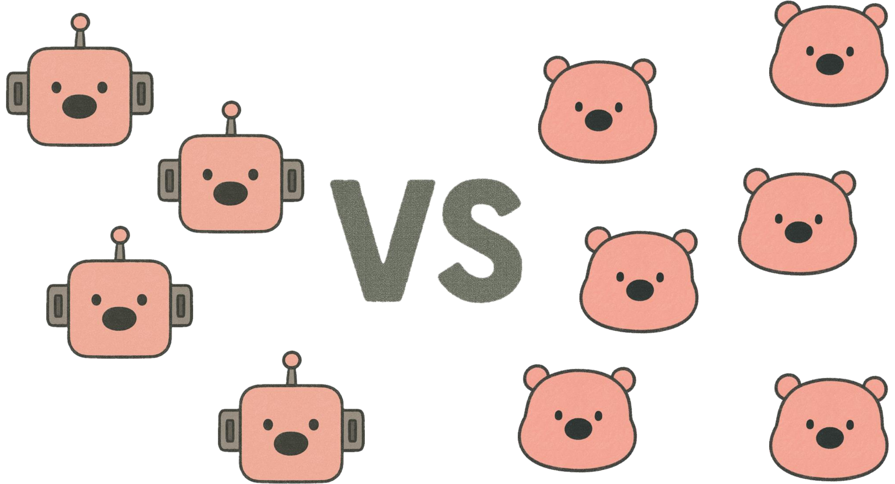

**图 21：** 竞争。

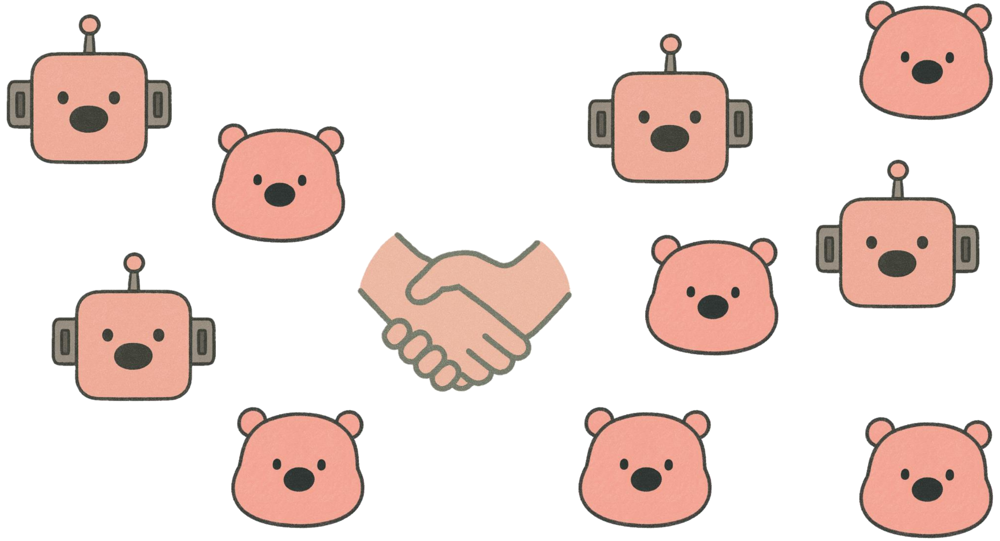

**图 22：** 合作。

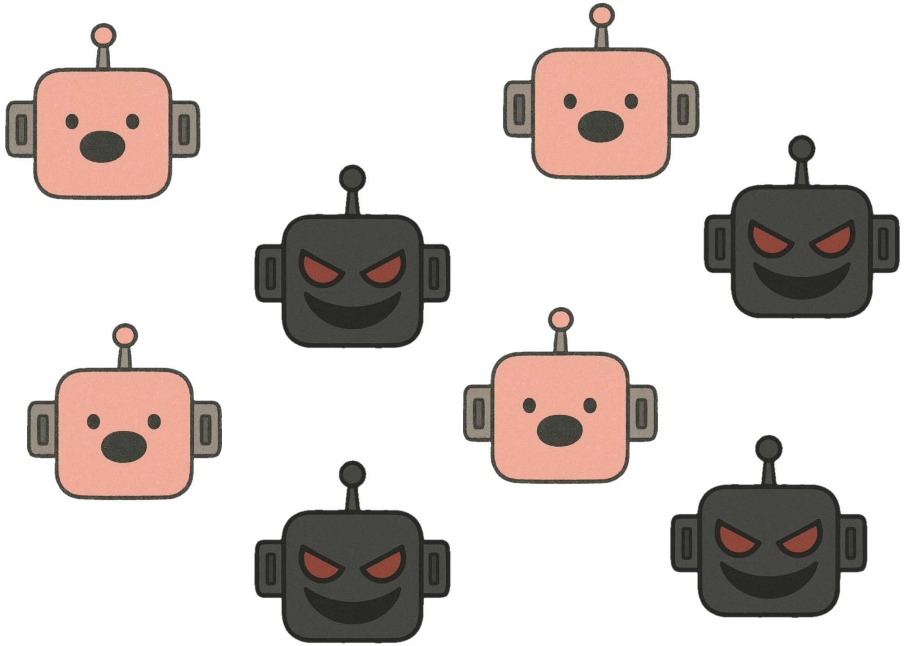

**图 23：** 混合动机。

##### 竞争场景

这种设置(图 21)出现在对抗性或目标冲突的环境中，从根本上改变了通信的功能和时间安排。与通信支持同步的合作系统不同，在竞争环境中，“何时”进行通信成为一项战略决策：智能体在消息可以影响信念、承诺或结果的时刻有选择地进行通信。因此，通信是稀疏的、高风险的，并且与战略杠杆而不是常规的状态共享紧密耦合。 **(1)隐藏角色和社交演绎游戏**，包括Werewolf (Bailis et al., 2024)、Avalon (Wang et al., 2023b)和AvalonBench (Light et al., 2023)，就是这种制度的例证。在这些环境中，智能体何时进行通信很大程度上取决于明确的游戏阶段，例如指控、辩护和投票。通信集中在影响最大的地方，揭露、扭曲或隐瞒信息可以决定性地改变集体信念。这些作品中反复出现的趋势是，通信优先考虑说服和欺骗，而不是信息完整性，这使得时机比消息频率更为重要。 **(2) 面向辩论的竞争框架**，例如 LLM-Debate (Du et al., 2023)、MAD (Liang et al., 2023) 和 ChatEval (Chan et al., 2023)，强制执行外部安排的通信回合。在这里，通信发生的 **时间** 由辩论协议(批评、反驳和判断阶段)确定，这提高了智能体之间的公平性、可比性和评估一致性。然而，这种结构限制了自适应计时策略，防止智能体根据对手的行为机会主义地延迟、保留或升级争论。 **(3) 重复的对抗性基准测试**，包括 LLM Arena (Chen et al., 2024c)，将智能体嵌入到持续的竞争中，其中 **何时** 进行通信必须做出反应性决定。与回合制辩论不同，这里的智能体根据不断变化的对手策略和表现反馈来选择通信时机。这些设置暴露了过度说服、延迟响应或无效升级等失败模式，凸显了开放式竞争互动中把握通信时机的困难。 **(4)战略对话和基于批评的系统**，例如谈判与和解框架(Abdelnabi et al., 2023; Chen et al., 2023b)，将冲突检测本身视为通信的触发因素。与奖励欺骗的隐藏角色游戏相比，这些系统鼓励智能体在发现分歧或不一致时进行通信，将时间目标从信念操纵转向冲突解决和结果稳定。 **(5)动态竞争环境**，包括MindAgent (Gong et al., 2023)和扩展的Arena风格设置(Chen et al., 2024c)，进一步强调时间适应性。在这些系统中，智能体根据环境状态或对手策略的变化进行通信，使得通信何时发生取决于上下文，而不是基于阶段或回合。这凸显了快速检测和响应相对于深思熟虑的调度的重要性。 **(6) 基于学习的竞争框架** (Du et al., 2024; Feng et al., 2024) 引入通过自我对弈或强化学习学习的自适应计时策略。在这里，智能体根据任务难度、不确定性和对手实力发现 **何时** 进行通信，通常优于固定或提示驱动的时间表。这一趋势表明，竞争环境中的最佳通信时序本身就是一个学习控制问题，而不是静态设计选择。总体而言，竞争环境始终将通信集中在战略关键时刻。与合作系统相比，通信频率较低，但影响更大：不合时宜的消息会直接降低性能，而适时的干预可以决定性地改变信念、投票或战略平衡。

##### 合作场景

这类场景（图 22）假定各方目标一致，使通信的作用从说服或协商转向协调、同步及错误恢复。即使在完全合作的系统中，智能体也不会持续通信。相反，通信 **何时** 发生通常由事件驱动，在任务分解边界、依赖关系需要解决、需要重新规划，或执行结果存在不确定性时触发。 **（1）结构化任务驱动系统** 用于软件工程、医疗、法律和科学发现，例如 CAMEL (Li et al., 2023b)、ChatDev (Qian et al., 2024a)、AutoML 式流水线 (Du et al., 2024)、医院仿真 (Li et al., 2024c)、法律工作流 (Sun et al., 2024b) 和科学发现智能体 (Ghafarollahi and Buehler, 2024)，表现出高度规律的通信时序。在这些系统中，智能体 **何时** 通信与角色交接点紧密耦合，例如从规划者交给执行者，或从执行者交给审查者。这提高了可靠性与可追溯性，但在任务结构或执行顺序变化时限制了灵活性。 **（2）通用合作基准与协调框架**，包括 AgentCF (Zhang et al., 2024b)、ProAgent (Zhang et al., 2024a)、AgentCoord (Pan et al., 2024)、Gentopia (Xu et al., 2023a)、MARG (D’Arcy et al., 2024) 和大规模评价研究 (Agashe et al., 2023; Zheng et al., 2023; Li et al., 2024a)，将通信时机从固定流水线转向协调边界。智能体在需要协调共同计划、重新分配职责或解决冲突 **时** 通信，体现了向自适应但仍有结构的同步机制发展的趋势，而非持续交换信息。 **（3）人类与智能体合作研究**，例如效用对齐 (Carroll et al., 2019)、偏好获取 (Feng et al., 2024)、调和与批评 (Chen et al., 2023b)、协商 (Yin et al., 2023)、反思推理 (Shinn et al., 2024) 和混合主动式协作 (Wu et al., 2024a)，强调不同的时机驱动因素：降低不确定性。在这些场景中，通信 **何时** 发生较少由任务阶段决定，更多取决于意图、偏好或信任方面的模糊性；通信质量依据减少不一致的能力评价，而非仅依据任务完成情况。 **（4）具身合作环境**，包括机器人建造 (Zhang et al., 2023b)、可扩展多机器人协调 (Chen et al., 2024g)、现实物体操作 (Mandi et al., 2024)、具身智能体团队 (Guo et al., 2024c) 和面向控制的 LLM 系统 (Wang et al., 2023c)，具有严格的实时约束。这些研究中的智能体主要在联合动作边界、重新规划事件或故障恢复时刻通信，因此通信 **何时** 发生对安全性、效率和物理可行性至关重要。 **（5）自组织与自适应团队框架**，如自组织智能体 (Ishibashi and Nishimura, 2024)、动态协调模型 (Liu et al., 2024b)、自适应导航系统 (Rasal and Hauer, 2024)、长期任务智能体团队 (Schmidgall et al., 2025)、Optima (Chen et al., 2024f)、AutoAct (Qiao et al., 2024)、GPT-Swarm (Zhuge et al., 2024a)、自主多智能体控制 (Liu et al., 2024a)、可扩展规划器 (Hu et al., 2024c)、VillagerAgent (Dong et al., 2024)、AutoML 协调 (Trirat et al., 2024) 和 MedAgents (Tang et al., 2023)，进一步放宽了固定调度。相较静态合作流水线，这些系统在能力发现、任务委派及长期状态维护期间触发通信，体现了以更高协调开销换取自适应时机的趋势。最后， **（6）可复用基础设施**，例如 AgentVerse (Chen et al., 2023c)、AutoGen (Wu et al., 2023b)、MetaGPT (Hong et al., 2023) 和 ProAgent (Zhang et al., 2023a)，将合作通信模式推广到不同任务与领域。它们扩大了协调场景的覆盖范围，也暴露出反复出现的设计张力：若缺乏通过记忆、调度或注意力机制进行的显式时机控制，合作系统可能过度通信，降低效率而非改善协调。

##### 混合动机场景

这种设置(图 23)结合了合作和竞争激励，使通信时间本质上依赖于上下文。与纯粹的合作或对抗场景不同，智能体必须不断评估通信是否会加强联盟、发出承诺、修复信任或暴露战略漏洞。因此，通信的 **时间** 既不固定也不稀疏，而是通过不断发展的社会关系和激励结构进行适应性调节。 **(1) 生成智能体社会和社会模拟**，例如基于角色和角色驱动的环境 (Lan et al., 2023; Hua et al., 2023; Chen et al., 2024a; Abdelnabi et al., 2024)，清楚地说明了这种紧张关系。在这些系统中，通信经常由社会事件触发，例如联盟形成、声誉修复、背叛或冲突升级，而不仅仅是任务分解。一个反复出现的模式是，早期通信用于建立社会定位和意图，而后期通信则反映了信任和战略联盟的转变。 **(2) 大规模自组织和开放平台** (Cheng et al., 2024; Liu et al., 2025a; Tran et al., 2025a; Sun et al., 2025b; Xie et al., 2023; AL et al., 2024; Hu et al., 2024a) 强调规模和时间演化的作用。在这些系统中，通信发生的时间会随着时间的推移而发生变化：早期交互侧重于合作伙伴发现、规范形成和角色协商，而后期通信则转向保持一致性、解决争端和管理许多智能体之间的长期依赖关系。这种通信时序的时间分层在较小或静态的环境中基本上不存在。 **(3)嵌套、模块化、多层次架构** (Fourney et al., 2024; Xu et al., 2023c; Gong et al., 2023; Wu et al., 2025; Li et al., 2024f; Ahn and Sentis, 2021)通过引入结构层进一步细化通信时序。在这些系统中，智能体在本地组内频繁通信以进行协调和执行，但当激励分歧或需要全球协调时，有选择性地跨组进行通信。这会产生分层的通信时间表，其中通信的 **时间** 共同取决于团队成员资格、任务阶段和战略一致性。总体而言，混合动机设置表明，通信时机不能由单一原则规定。与强调协调事件的合作系统和将通信集中在杠杆点的竞争系统相比，混合动机环境要求智能体在通信时动态适应，以响应不断变化的激励、社会结构和长期战略考虑。

##### 从博弈论视角看混合动机场景中的通信时机

混合动机的通信设置可以通过“信息不完整的动态游戏”的视角来正式解释。让智能体 $i \in \mathcal{N}$ 在由状态 $s_t$、私人信息 $\theta_i$、动作 $a_i^{(t)}$ 和消息 $m_i^{(t)}$ 表征的扩展形式博弈中进行交互。通信行为修改智能体的信息集和信念，$\mu_i^{(t)} = \Pr(\theta_{-i} \mid h_i^{(t)}, m_{-i}^{(t)})$，从而重塑战略激励和均衡行为。从这个角度来看，决定“何时”进行通信相当于在博弈树的特定节点选择信号动作，平衡信息披露与战略漏洞。混合动机多智能体系统中的均衡行为通常是“涌现且异构的”。在大型或角色结构环境中，智能体的不同子集可能会收敛到本地 Nash 或贝叶斯 Nash 均衡，而更高级别的协调则通过聚合、调解或层次结构产生。许多基于 MARL 和 LLM 的系统通过自我对弈或强化学习隐式逼近 Nash 或贝叶斯 Nash 均衡，即使均衡未明确求解。最近的工作，例如 (Yi et al., 2025)，将多 LLM 协调形式化为不完全信息博弈，并明确以贝叶斯 Nash 均衡为目标，证明相对于非均衡协调而言，效率和悔损界有所提高。除了基于学习的近似之外，一些研究还直接检验 LLMs“计算”或推理均衡的能力。席尔瓦等人。 (Silva, 2024) 研究了 LLM 在混合策略 Nash 均衡游戏中的性能，并表明，虽然 LLMs 可以识别标准场景中的均衡，特别是在配备代码执行和结构化提示时，但在游戏结构或随机策略的轻微扰动下，其性能会急剧下降。这些发现凸显了 LLMs 作为均衡推理机的前景和脆弱性，强调了表面战略能力和强大的博弈论推理之间的差距。最近的框架进一步将均衡分析扩展到“推理水平”。 LLM-Nash 框架 (Zhu, 2025) 定义了提示或推理空间的均衡，通过将 LLM 推理本身视为战略过程的一部分来建模有限理性。在这种观点中，行动作为均衡推理轨迹的行为输出而出现，并且由于认知限制和认知学习，均衡结果可能与经典的 Nash 预测有所不同。这些观点表明，混合动机环境中的“通信时机”最好理解为跨多个级别的均衡一致策略：智能体说话、延迟或隐瞒消息，这样做可以提高不断变化的信念下的预期效用，无论均衡是通过学习、显式计算来近似，还是通过推理级别的适应来实现。这将基于 MARL 和 LLM 的现代通信与信号、廉价通信和均衡选择的经典概念统一起来，同时保持与数据驱动的多智能体学习的兼容性。

#### 7.3.2 环境触发条件与上下文

LLM 智能体运行的环境在确定 **何时** 通信是必要的、可选的或成本高昂的方面发挥着核心作用。与描述智能体目标的动机设置不同，应用程序域对可观测性、时间耦合、动作依赖性和反馈延迟施加了具体的约束。这些因素直接影响 **何时进行通信** :智能体可能需要在行动之前、执行期间、观测结果之后或仅在出现协调失败时交换信息。因此，我们将应用领域组织为“何时”通信由环境结构而不是仅由激励触发的镜头。

表 13 总结了基于 LLM 的多智能体系统的主要应用领域，并强调了不同环境如何产生不同的通信时序模式。跨领域的通信并不是一致连续的。相反，智能体何时进行通信取决于不确定性出现的位置、智能体之间的依赖关系最强的位置以及信息延迟或丢失的位置会导致协调崩溃。

**表 13：** 基于大语言模型的多智能体系统分类：将应用领域与通信特征联系起来，并分析通信时机驱动的设计启示。

| **应用领域** | **关键通信特征** | **时机、结构与设计启示** |
| --- | --- | --- |
| **编程系统** | • 基于角色的任务分解（规划者、程序员、审阅者）： (Qian et al., 2024a; Li et al., 2023b) • 以代码、测试或模型等产物为中心进行协调： (Trirat et al., 2024; Islam et al., 2024) • 越来越多地使用自组织或自适应团队： (Ishibashi and Nishimura, 2024; Li et al., 2024d) | • 在依赖关系边界或产物就绪时触发通信； • 固定流水线提升可靠性，但降低适应能力； • 自适应时机选择提升鲁棒性，但增加协调开销。 |
| **虚拟环境** | • 事件驱动的社会交互与记忆更新： (Park et al., 2023; Kaiya et al., 2023) • 游戏中的回合制策略性通信： (Bailis et al., 2024; Light et al., 2023) • 开放式探索与长时程规划： (Lan et al., 2023; Hua et al., 2023) | • 由状态变化或社会事件驱动通信时机； • 严格的交互轮次便于评估，但限制适应能力； • 可扩展性需要有选择地通信并允许延迟通信。 |
| **具身环境** | • 具有语义具有语义扎根的语言—动作耦合： (Ahn et al., 2022; Zhang et al., 2023b) • 物理与时间约束下的协调： (Mandi et al., 2024; Guo et al., 2024c) • 混合集中式与分散式控制策略： (Kannan et al., 2023) | • 通信与感知—行动循环对齐； • 较早的通信有助于规划，较晚的通信有助于恢复； • 过度通信降低实时性能。 |
| **人类与智能体的工作流** | • 混合主动式对话与偏好获取： (Feng et al., 2024; Wu et al., 2022) • 考虑角色与人物设定的交互： (Chen et al., 2024a; Li et al., 2024a) • 结构化辩论与评议机制： (Xu et al., 2023b; Jin et al., 2024) | • 通过选择通信时机减少不确定性或认知负担； • 轮流交互提升推理能力，但限制响应速度； • 有效的时机选择平衡信息量与用户信任。 |

##### 编程

在面向编码的多智能体系统中，通信发生的 **时间** 主要由任务分解、工件依赖性和错误传播决定，而不是社会激励或说服。因此，通信是事件驱动的，并且与软件开发生命周期紧密耦合，当中间工件变得可用、不一致或不足以进度时，智能体会交换信息。 **(1) 基于阶段和角色驱动的编码管道**，以 ChatDev (Qian et al., 2024a) 等早期系统为例，采用预定义的工作流程，在固定阶段(例如设计、实现、测试和审核)明确安排通信。在这些系统中，智能体通信的 **时间** 由角色切换点决定，确保信息流的清晰度和可追溯性。这种结构化的计时提高了可靠性并减少了歧义，但它也限制了任务需求变化或出现意外依赖性时的适应性。 **(2) 并行和多团队编码框架**，包括放宽严格阶段排序 (Du et al., 2024; Li et al., 2024d)、将通信时序转向周期性同步和冲突解决事件的系统。在这里，智能体或子团队同时工作，并在检测到不一致、集成冲突或不同的设计选择时进行通信。这种趋势通过分集和冗余提高了鲁棒性，但引入了额外的协调开销，并且需要明确的机制来管理同步频率。 **(3) 自组织和不确定性驱动的编码智能体**，例如 (Ishibashi and Nishimura, 2024) 中探索的那些，进一步将通信与预定义的时间表解耦。在这些系统中，通信的 **时间** 是由需求驱动的：智能体仅在检测到不确定性、进度停滞或对其本地解决方案信心不足后才发起通信。这种自适应计时减少了不必要的交换，但给不确定性估计和进度监控带来了更大的负担。 **(4) 特定领域的编码环境**，包括自动化机器学习管道 (Trirat et al., 2024) 和竞争性编程智能体 (Islam et al., 2024)，说明了工件准备情况如何直接控制通信时序。当具体输出(例如经过训练的模型、功能集、编译器错误或失败的测试用例)可用时，智能体进行通信，从而使 **何时** 与工件成熟度而不是抽象任务阶段紧密结合。总体而言，编码环境始终有利于依赖边界处的通信，而不是持续的对话。在这些系统中，通信发生的 **时间** 由工件可用性、集成风险和不确定性决定，反映了事件驱动和需求感知通信策略的更广泛趋势，而不是固定或社会动机的时间表。

##### 虚拟环境

虚拟环境具有世界状态持续演化、部分可观测性和长时间跨度交互等特征，因此， **何时** 通信取决于环境事件和状态转移，而非固定的任务阶段。在这类场景中，通信时机主要由事件驱动，并受到社会情境、空间邻近性、资源可用性或智能体信念变化的影响。 **（1）生成式智能体仿真与社会世界**，例如 Smallville 类环境 (Park et al., 2023; Kaiya et al., 2023)，强调由社会动机决定通信时机。在这些系统中，智能体会在获取新信息、社会关系发生变化或长期计划被修改 **之时** 进行通信。通信由遇到其他智能体、记忆或目标更新、社会情境变化等事件触发，体现了由内部状态更新驱动通信、而非由外部施加的时间表安排通信的趋势。 **（2）社会推理与策略博弈环境**，包括 Avalon 和 Werewolf 基准 (Lan et al., 2023; Light et al., 2023; Bailis et al., 2024)，对通信施加明确的时间约束。在这里，智能体 **何时** 可以通信受到讨论轮次或投票阶段等游戏机制的严格规定。这种结构化的时机安排能够支持对推理、欺骗和信念操纵开展受控评估，但也限制了依赖持续状态监测的自适应通信策略。 **（3）竞争性与评估性虚拟基准**，例如 LLMArena 及相关平台 (Chen et al., 2024c; Agashe et al., 2025)，通过系统地改变交互安排来检验智能体的稳健性。这些研究发现，当通信机会稀少、延迟或受到严格时间限制时，智能体往往表现不佳，凸显了其对信息交换被允许发生的 **时机** 的敏感性，而不仅仅是对消息内容的敏感性。 **（4）大规模虚拟社会与面向任务的仿真**，包括制度性环境和基于项目的环境 (Li et al., 2024c; AL et al., 2024; Wang et al., 2023a; Zhu et al., 2023; Wu et al., 2024b)，揭示了由可扩展性要求驱动的通信时机变化。随着智能体和交互数量增加，通信变得更有选择性，延迟也更明显，通常由资源争用、协调失败或重大环境变化触发。这一趋势体现了从频繁交互转向稀疏而影响重大的通信事件。总体而言，虚拟环境凸显了通信时机作为核心设计变量的地位。在社会仿真、策略博弈和大规模虚拟世界中，通信发生的 **时机** 由环境动态和可扩展性约束决定，揭示了响应能力与处理可行性之间的基本矛盾；这种矛盾在结构更明确的任务驱动场景中并不显现。

##### 具身环境

具身环境将通信与实时感知-行动循环紧密结合，使得通信何时发生成为物理动力学、感知不确定性和安全约束的函数，而不是抽象任务阶段的函数。在这些环境中，通信会耗费大量的时间和精力，而且不合时宜的消息会直接降低性能或安全性。 **(1) 早期的体现协调系统**，包括多机器人和体现 LLM 智能体 (Ahn et al., 2022; Agashe et al., 2023; Zhang et al., 2023b)，表明在行动执行之前主动通信通常是有益的。 **何时** 计划必须在空间上对齐(例如，共享导航目标或操纵目标)，智能体进行通信，从而减少下游冲突和冗余运动。这些工作建立了一个基线洞察力：在紧密耦合的物理任务中，早期通信可以防止代价高昂的错误。 **(2) 集中式与分散式规划研究** (Mandi et al., 2024; Kannan et al., 2023; Chen et al., 2024g; Dong et al., 2024; Guo et al., 2024c) 揭示了通信时序的系统性差异。集中式或基于协调器的系统倾向于尽早进行通信，汇总观测结果并在执行前发布联合计划。相比之下，去中心化系统会延迟通信，直到局部不确定性、预测误差或协调风险超过阈值。这种比较突出了一个关键的权衡：早期通信提高了全局一致性，而延迟通信则保留了反应性和可扩展性。 **(3) 合作体现基准**，例如 Overcooked 式环境和相关评估 (Agashe et al., 2023; Zhang et al., 2024a)，强调仅凭通信频率并不能预测成功。相反，性能与通信发生的 **时间** 密切相关，特别是在联合行动边界、任务切换或故障恢复时刻。这些基准测试表明，稀疏但及时的消息优于连续或不一致的通信。总体而言，具身环境使得“何时通信”与感知和行动时机密不可分。在集中式规划器、分散式智能体和合作基准中，文献集中在一个共同的设计原则上：有效的具体通信是事件触发的和环境感知的，优先考虑安全性、协调性和响应性而不是消息量 (Mandi et al., 2024; Agashe et al., 2023; Guo et al., 2024c)。

##### 人类与智能体的工作流和协作

在人类智能体工作流程中，通信发生的 **时间** 从根本上受到人类注意力、信任校准和认知负荷的限制，这使得时间与内容一样重要。与纯粹的自动化系统不同，过多或不及时的通信会直接降低人类的表现和信任。 **(1) 任务驱动的人类智能体工作流程**，例如 CAMEL 式协作问题解决 (Li et al., 2023b) 和偏好感知辅助系统 (Feng et al., 2024)，表明在决策关键时刻而不是连续触发时通信最为有效。这些系统表明，延迟通信直到出现不确定性、模糊性或不可逆转的选择可以减轻认知负担，同时保持决策质量。 **(2) 交互式和混合主动系统**，包括人机循环人工智能接口 (Wu et al., 2022) 和自适应指导策略 (Feng et al., 2024)，明确建模 **何时** 将通信作为控制问题。在这里，只有当信心低于阈值或预测结果出现分歧时，智能体才学会请求反馈或干预，这凸显了需求驱动而非日程驱动的通信趋势。 **(3) 基于角色和文化的智能体** (Chen et al., 2024a; Li et al., 2024a) 通过适应用户期望、角色和社会规范进一步细化通信时间。这些研究表明，通信何时被认为是适当的不仅取决于任务状态，还取决于社会背景，即使信息正确，不合时宜的消息也会损害参与度。 **(4) 人机循环多智能体辩论和基于团队的推理环境** (Xu et al., 2023b; Stepputtis et al., 2023; Jin et al., 2024; Du and Zhang, 2024; Xiong et al., 2023; Chen et al., 2023b) 强调结构化计时机制，例如轮流、调节或干预窗口。这些研究一致发现，外部调节的通信时间可以提高推理质量并减少冗余，而不受限制的通信会导致重复和认知超载。总体而言，人机协作重新定义了“何时通信”，以平衡响应能力和认知效率。在任务驱动的工作流程、混合主动系统、角色感知智能体和辩论环境中，文献都集中在一个共同的设计原则上：有效的人与智能体通信是稀疏的、事件触发的和社会意识的，优先考虑人类信任和可用性而不是最大的信息交换。

#### 7.3.3 通信的评估场景

评估基于 LLM 的多智能体系统需要明确推理通信的 **何时** 以及发生的 **位置**，因为通信很少是孤立的工件。相反，它嵌入到环境动态、任务结构和智能体交互计划中。与可以独立评估输出的单智能体评估不同，多智能体评估必须考虑信息交换如何随着时间的推移而展开，以及环境如何暴露或限制这种交换。

至关重要的是，评估环境的选择决定了通信可以在何处发生，例如文本渠道、具体行动或共享状态，而这又决定了通信何时变得可观察、必要或必然。因此，即使通信本身不是明确的评估目标，基准也会隐式编码有关通信时序的假设。

##### 规划与协作基准

面向规划的基准(例如 Collab-Overcooked (Sun et al., 2025a) 和大规模协调任务 (Chen et al., 2024g))强调联合规划和协作执行，使得 **何时** 通信发生与计划形成紧密耦合。在这些环境中，智能体通常在采取行动之前进行通信，以调整目标、分配角色或同步计划。

与强调执行时间适应的基准相比，这些设置优先考虑早期、前置的通信，并隐含地假设大多数协调可以在行动之前解决。

这些基准测试中的 **where** 维度通常是具有明确规划和执行阶段的结构化交互循环。任务完成率和效率等指标间接奖励及时的通信，但不能区分通信是否最少、冗余或延迟。因此，这些基准低估了执行期间而非计划期间发生的纠正或机会主义通信的价值。

##### 具身交互与导航基准

与以计划为中心的基准相比，AI2-THOR (Kannan et al., 2023)、C-WAH 和 TDW-MAT (Zhang et al., 2023b) 等具体基准将注意力从计划形成转移到实时感知-动作耦合，其中 **何时** 发生通信受到物理动力学的严格限制。

智能体必须决定是在采取行动之前进行通信以协调意图，还是在采取行动之后进行修复错误，从而在主动和被动通信之间引入持续的权衡。

在这里，通信嵌入在动作序列中，而不是孤立的对话回合中。任务成功和效率等评估指标隐含地惩罚了迟到的通信，因为不合时宜的交流会直接转化为身体效率低下。与象征性规划基准相比，具身环境更清楚地暴露了延迟或不充分通信的成本，尽管它们很少明确地测量通信时间。

##### 社会推断与策略性通信基准

与面向规划的基准和具体化基准不同，Werewolf Arena (Bailis et al., 2024) 和 Avalon (Stepputtis et al., 2023) 等社交推理基准通过强制实施离散的、基于回合的讨论和投票阶段，将“何时”进行通信的决定具体化。

因此，通信时机不再是适应性的，而是制度性强加的，将学习问题从决定“何时”通信转变为决定在战略关键时刻通信“什么”。

**where** 方面仅限于共享的基于文本的对话渠道，从而能够对信念建模、说服和欺骗进行受控评估。胜率和角色识别准确度等指标反映了通信在特定时刻是否有效，而不是座席是否频繁通信。与连续环境相比，这些基准允许在通信时间和结果之间进行更清晰的归因，但仅限于具有固定时间结构的程式化社交互动。

##### 长时程与开放式环境

超越固定的时间结构，MindCraft (Bara et al., 2021) 和 MineLand (Yu et al., 2024) 等长时程环境使得 **何时** 通信发生在延长的时间范围内成为明确的战略选择。

智能体必须决定是尽早通信以建立共同理解，还是推迟通信，直到出现不确定性、冲突或分歧，从而引入短期或回合基准中不存在的临时贡献归因挑战。

在这些设置中，通信分布在持久的世界状态和重复的交互中，这掩盖了各个通信事件。生存率或资源积累等指标可以捕获总体性能，但无法揭示通信时间如何促进协调。与情景基准相比，这些环境凸显了对时间敏感的评估指标的需求，这些指标可以将长期结果归因于早期的通信决策。

##### 大规模智能体群与基础设施基准

在更大的规模上，SwarmBench (Ruan et al., 2025) 和智能路灯物联网 (Nascimento et al., 2023a) 等群体和基础设施基准测试引入了可扩展性，作为通信发生时塑造的主要约束。

与小团队或长期环境中的通信支持共享理解不同，这些基准要求智能体有选择性地进行通信，通常仅当本地决策产生系统级后果时才进行。

**地点** 维度是分散和本地化的，限制了通信模式的全球可观测性。协调效率和能源使用等指标间接反映通信定时决策，但不隔离通信事件 (Zhu et al., 2025; Chen et al., 2024c)。与小团队基准相比，这些环境突出了通信频率、可扩展性和鲁棒性之间的权衡，强调有效的系统不仅必须学习何时进行通信，还必须学习何时“不”进行通信。

**表 14：** 多智能体环境基准及其特征。

| **环境** | **智能体数量** | **观测空间** | **动作空间** | **评估方法** |
| --- | --- | --- | --- | --- |
| TextStarCraft II (Ma et al., 2023) | 2 | 部分可观测；基于文本 | 离散（宏观／微观文本命令） | 胜率；群体比率；资源比率 |
| LLM-Coordination (Agashe et al., 2023) | 2 | 部分可观测；基于文本 | 离散（文本命令） | 得分；心智理论准确率；规划准确率 |
| C-WAH and TDW-MAT (Zhang et al., 2023b) | 2 | 部分可观测；RGB-D | 离散（导航；交互；通信） | 任务完成率；效率 |
| AI2-THOR (Kannan et al., 2023) | 4 | 部分可观测；符号表示 | 离散（基本 API 调用） | 成功率；任务完成情况；目标召回率 |
| GAIA (Mialon et al., 2023) | 无限制 | 部分可观测；多模态 | 离散（使用工具；浏览；推理） | 答案准确率 |
| BoxNet， Warehouse， BoxLift (Chen et al., 2024g) | 32 | 完全可观测；符号表示；基于网格 | 离散（移动；拾取；放置） | 成功率；词元用量；执行步数 |
| CuisineWorld (Gong et al., 2023) | 4 | 完全可观测；基于文本 | 离散（移动；获取／放置；使用工具） | 任务得分；效率 |
| RoCoBench (Mandi et al., 2024) | 3 | 部分可观测；符号表示 | 离散（移动；拾取；放置） | 成功率；协调表现 |
| GOVSIM (Piatti et al., 2024) | 5 | 部分可观测；基于文本 | 离散 | 存活率；效率；平等程度 |
| VillagerBench (Dong et al., 2024) | 3 | 部分可观测；基于文本 | 离散（移动；放置；制作；管理） | 完成率；效率；工作负载均衡 |
| Smart Streetlight IoT (Nascimento et al., 2023a) | 100 | 部分可观测；模拟感知输入 | 离散（开关；调节；通信） | 适应度得分；延迟；能耗 |
| Werewolf Arena (Bailis et al., 2024) | 8 | 部分可观测；基于文本 | 离散（投票；行动；通信） | 胜率；策略质量；游戏表现指标 |
| GraphInstruct (Hu et al., 2024c) | 无限制 | 部分可观测；基于图（局部邻域） | 离散（消息传递） | 任务准确率 |
| Agent Hospital (Li et al., 2024c) | 100 | 部分可观测；基于文本 | 离散（诊断；开具处方；检查） | 诊断准确率；MedQA 得分 |
| LLMArena (Chen et al., 2024c) | 5 | 部分可观测；基于文本 | 离散（游戏行动；通信） | TrueSkill 得分；胜率；技能指标 |
| BOLAA (Liu et al., 2023a) | 3 | 部分可观测；基于文本 | 离散（网页导航；查询工具） | 最终奖励；中间召回率 |
| Avalon (Role Identification) (Stepputtis et al., 2023) | 6 | 部分可观测；基于文本 | 离散（投票；提议；通信） | 胜率；角色识别准确率 |
| SwarmBench (Ruan et al., 2025) | 无限制 | 部分可观测；基于网格 | 离散（移动；通信） | 成功率；协调指标 |
| Collab-Overcooked (Sun et al., 2025a) | 2 | 部分可观测；基于网格 | 离散（移动；拾取；放置；交互） | 交付菜品数量；效率 |
| BattleAgentBench (Wang et al., 2024d) | 4 | 部分可观测；基于网格 | 离散（移动；射击） | 任务进展；动作准确率；任务得分 |
| PARTNR (Chang et al., 2024) | 2 | 部分可观测；3D | 离散（导航；操作；指导） | 成功率；相对于人类的步数；错误恢复能力 |
| MultiAgentBench (Zhu et al., 2025) | 无限制 | 部分可观测；基于文本 | 离散（任务相关动作；通信） | 任务完成情况；里程碑关键绩效指标；协作质量 |
| MindCraft (Bara et al., 2021) | 2 | 部分可观测；3D | 离散（移动；建造；通信） | 心智理论准确率；任务成功率 |
| MineLand (Yu et al., 2024) | 48 | 部分可观测；3D | 离散（移动；采集；建造；通信） | 存活率；资源收集；社会动态 |
| MeltingPot (Agapiou et al., 2022) | 8 | 部分可观测；多模态 | 离散（移动；标记；收集） | 回合回报；对新伙伴的泛化能力 |

表 14 提供了代表性多智能体基准的横截面视图，揭示了环境设计如何从根本上决定了可以评估通信的哪些方面。在这些基准中，智能体规模、可观测性、动作抽象和评估指标的变化导致关于智能体“如何”、“何时”和“为何”进行通信的假设存在明显不同。

在较高层面上，表 14 中的环境涵盖四大基准体系。 **小团队、面向任务的环境** (例如，Collab-Overcooked、AI2-THOR、RoCoBench、PARTNR)强调部分可观测性下的紧密协调，其中通信与行动时间和任务进度密切相关。 **社交和战略游戏** (例如，Werewolf Arena、Avalon、LLMArena)强加离散的交互回合，将通信时间外部化并实现消息和结果之间更清晰的归因。 **长时程和开放式世界** (例如，MindCraft、MineLand、MeltingPot)评估扩展时间范围内的通信，其中时间决策具有战略性，但难以隔离。最后， **大规模群和基础设施基准** (例如智能路灯物联网、SwarmBench、MultiAgentBench)前景可扩展性限制，迫使通信具有选择性和本地化。

从表中可以明显看出的一个关键趋势是， **观测空间和动作抽象共同决定了评估者对通信时间的可见程度**。具有符号或基于文本的观察和离散操作的基准(例如，TextStarCraft II、VillagerBench、GOVSIM)使通信事件变得明确，但通常会抽象出物理约束。相比之下，实体环境和 3D 环境(例如 C-WAH、AI2-THOR、MineLand)将通信嵌入感知-行动循环中，其中延迟或不合时宜的消息直接表现为执行失败，但很少被明确测量为通信错误。

智能体规模进一步塑造评估。小团队基准允许对成对或群体通信进行细粒度分析，但可能会过度适应密集的交互模式。随着智能体数量的增加(例如智能体医院、智能路灯物联网、SwarmBench)，通信开销成为主要问题，基准越来越依赖于系统级指标，例如效率、能源使用或公平性。虽然这些指标反映了通信决策的后果，但它们掩盖了特定通信事件和结果之间的因果关系。

总而言之，表 14 强调了一个基本的评估差距：大多数基准评估的是通信下的“任务绩效”，而不是通信本身。离散的、基于回合的环境可以实现更清晰的归因，但在现实性方面受到限制，而连续和大规模的环境捕获了现实的约束，但缺乏区分通信时间、内容和必要性的指标。这一观测结果激发了对基准设计和评估协议的需求，这些协议可以明确地暴露和测量不同环境中的通信结构。

### 7.4 大语言模型智能体为何通信、如何通信

#### 7.4.1 通信结构

多智能体系统中的通信结构反映了 **为什么智能体需要通信** 以及 **如何操作通信** 以支持协调、推理和任务执行。交互结构不是纯粹的架构选择，而是对有关任务耦合、不确定性、容错和协调成本的假设进行编码。不同的结构设计源于不同的通信动机，而这些动机直接决定了交互在实践中的展开方式。 **表 15 提供了这些设计选择的综合视图，将通信动机与结构模式及其相关权衡联系起来。**

形式上，多智能体系统中的通信可以建模为时间索引的信令过程。在时间步 $t$，每个智能体 $i$ 根据通信策略 $m_i^t \sim C_i(o_i^t, h_i^{t-1}),$ 发出消息 $m_i^t \in \mathcal{M}$，其中 $o_i^t$ 是本地观察，$h_i^{t-1}$ 总结过去的消息和操作。然后将行动选择为 $a_i^t \sim \pi_i(o_i^t, \{m_j^t\}_{j \neq i}),$，使通信成为塑造联合决策过程的显式信息通道。 **单轮通信** 对应于 $C_i$ 仅评估一次(例如，在 $t=0$)和 $h_i^{t-1}=\emptyset$ 的特殊情况，因此消息不会适应其他人的响应。 **多轮通信** 允许通过 $t=1,\dots,T$ 重复生成消息，从而通过反馈循环实现信念更新和迭代对齐。在 **具有语义具有语义扎根的具身通信** 中，消息生成和操作选择在时间上紧密耦合，$m_i^t$ 被限制为在执行和延迟约束下影响立即或近期操作 $a_i^t$。

**图 24：** 单轮通信。

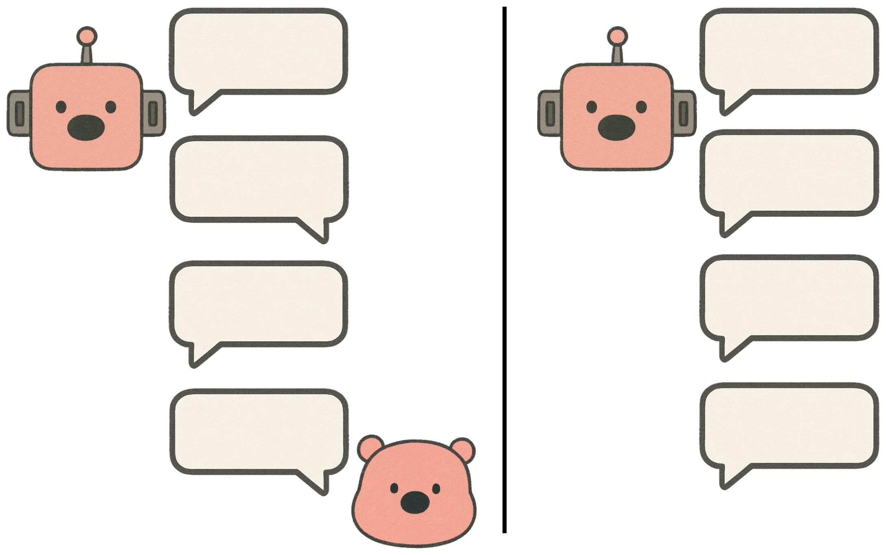

**图 25：** 多轮通信。

##### 单轮通信：聚合驱动的协调

当通信的主要目的是通过聚合而不是显式协调来提高鲁棒性、多样性或解决方案质量时，就会采用单轮通信。在这种情况下，智能体不需要根据其他人的中间状态来调整自己的行为。因此， **如何构建通信** 强调智能体之间的最小交互、低延迟和独立性。一个代表性示例是 *您只需要更多智能体* (Li et al., 2024d)，其中多个独立采样的智能体生成解决方案，无需智能体间交互，并且仅通过最终投票或聚合步骤隐式进行通信。与交互式方法相比，这种设计减少了协调开销并避免了跨轮的错误传播，同时仍然通过集成效应提高了性能。然而，由于通信是非自适应的，单轮设计在解决歧义、处理依赖性或纠正执行期间错误的能力方面受到限制。 **表 15 总结了这种聚合驱动的设计模式及其局限性。**

##### 多轮通信：迭代对齐与协调

当 **为何进行通信** 超出一次性信息共享范围，扩展到解决不确定性、管理智能体间依赖性或随着时间的推移维持协调时，就会出现多轮通信。在这些设置中，通信不是辅助信号，而是迭代控制机制：智能体必须重复交换消息以调整信念、完善共享工件或在新信息可用时调整计划。因此， **如何通信** 是由支持反馈、修订和收敛而不是单通道传输的显式交互循环塑造的。 **(1) 以工件为中心的协作系统** 代表第一类主要的多轮通信。在多智能体软件工程、AutoML 管道和面向工作流的设计助手(例如自动编码和工具链系统 (Hu et al., 2024a; Du et al., 2024; Trirat et al., 2024; Chen et al., 2023a; Wang et al., 2024b)、项目级编排框架 (AL et al., 2024; Fourney et al., 2024; Ahn and Sentis, 2021) 和可扩展任务分解环境 (Chen et al., 2024g; Liu et al., 2024b))中，通信的主要“原因”是共享工件的迭代细化。这激发了以分阶段交换、版本控制和基于角色的反馈周期为特征的“方式”。与单轮管道相比，这些系统通过重复修正提高了解决方案的质量和鲁棒性，但它们也产生了更高的协调成本，并且需要明确的机制来管理依赖性跟踪和收敛。 **(2) 交互式推理和集体意义建构系统** 构成第二类，其中 **为什么要通信** 是信念调整或假设细化，而不是工件生产。多轮对话使智能体能够对中间推理步骤做出反应，挑战假设并纳入不同的观点，如协作推理基准和社会推理设置 (Lan et al., 2023; Xu et al., 2023c; Wu et al., 2023a; Händler, 2023; Feng et al., 2024; Li et al., 2024a; Chen et al., 2024c; Ghafarollahi and Buehler, 2024) 中所示。这种动机导致了一种强调轮流、显式推理跟踪和迭代更新的“如何”，从而提高了一次性聚合方法的鲁棒性。这些工作中反复出现的一个观点是，允许智能体通过对话修改早期结论通常比单独增加模型容量或集成规模更有效。 **(3)面向辩论和对抗性的互动框架** 当 **为什么通信** 包括说服、分歧解决或战略影响时，进一步专业化多轮通信。基于结构化辩论、批评和和解的系统 (Jin et al., 2024; Li et al., 2024f; Chen et al., 2023b; Du and Zhang, 2024; Wang et al., 2024c; Yin et al., 2023; Xiong et al., 2023) 激发了以对抗性回合结构、选择性披露和明确的挑战-响应动态为中心的 **如何**。与合作对话相比，这些设计提高了目标冲突下的绩效并减少了相关错误，但它们也引入了更高的方差和不稳定性，因为通信对顺序、修辞和信息的战略隐瞒变得敏感。在这些类别中，出现了一种统一的模式：随着“为什么通信”从信息共享转变为协调、纠正或影响，“如何”必然从单轮消息演变为结构化的多轮交互协议。虽然多轮通信不断提高鲁棒性和适应性，但文献也揭示了一个共同的权衡：更大的交互深度增加了协调开销，并增加了对停止标准、内存管理和收敛保证的需求。 **表 15 强调了这些动机如何映射到迭代结构及其协调权衡。**

##### 语义扎根与具身通信：面向执行的交互

当“为什么要通信”是由实时执行约束而不是抽象推理或离线计划驱动时，具有语义具有语义扎根的具身通信就会出现。在导航、操纵和团队合作任务中，智能体必须在空间、时间和感知不确定性下同步行动。因此， **如何通信** 优先考虑上下文敏感、时间一致的交换，这些交换直接支持执行、错误恢复和操作协调。 **(1) 执行驱动的协调系统** 构成第一类，其中通信是由立即行动协调所激发的。在模拟和具身环境中(例如协作任务执行和多智能体控制设置 (Sun et al., 2025b; Piatti et al., 2024; Wu et al., 2025; Cheng et al., 2024))，智能体在操作执行之前或期间进行通信，以同步移动、分配子任务或解决本地冲突。这个“为什么”导致了“如何”，其特点是频繁、低延迟的交换与感知-行动循环密切相关，与静态或单轮设计相比，可以提高任务的成功率。 **(2) 社会语义扎根与交互环境** 将面向执行的通信扩展到物理或模拟动作与社会动态互动的环境中。在生成智能体社会和交互式模拟 (Hua et al., 2023; Xu et al., 2023b; Xu et al., 2023a; Wu et al., 2024a) 中，智能体之间的通信不仅是为了协调行动，而且是为了协商空间使用、适应他人的行为或在执行过程中保持社会一致性。在这里，“如何”反映了基于行动的信号和轻量级社会推理的结合，使智能体能够适应动态的多智能体环境，但代价是增加了通信复杂性。 **(3) 工具增强和混合执行框架** 通过集成外部工具或共享表示进一步丰富具有语义具有语义扎根的通信。将具体行动与工具使用或共享知识结构相结合的系统 (Zhuge et al., 2024a; Li et al., 2023c) 激发了将执行级消息与更高级别的协调线索交织在一起的 **如何**。这种混合结构允许智能体在执行过程中调整策略，同时保持响应能力，尽管它在管理何时在以操作为中心和以抽象为中心的通信之间切换时引入了额外的开销。在具有语义具有语义扎根的具身环境中，出现了一种一致的模式：随着 **为什么要通信** 转向实时执行和协调，通信变得更加频繁、本地化，并且与行动时机紧密结合。与推理或规划驱动的领域相比，这些系统以通信效率换取适应性和安全性，凸显了最小化开销和在不确定性下保持稳健执行之间的基本设计张力。 **这种面向执行的通信机制与表 15 中的单轮和多轮设计进行了对比。**

**表 15：** 多智能体系统中的通信结构：动机、结构选择与权衡。

| **结构** | **智能体为何通信** | **通信的组织方式及其权衡** |
| --- | --- | --- |
| **单轮** | • 通过聚合提升鲁棒性或多样性： (Li et al., 2024d) • 避免跟踪智能体之间的依赖关系或进行信念对齐； • 适用于不需要协调或协调有害的情形。 | • 各自独立生成，再投票或选择： (Li et al., 2024d) • 延迟与协调开销极小； • 执行过程中消除歧义或纠正错误的能力有限。 |
| **多轮** | • 消除不确定性并对齐信念： (Lan et al., 2023; Xu et al., 2023c; Feng et al., 2024) • 管理智能体之间的依赖关系与共享产物： (Hu et al., 2024a; Du et al., 2024; Trirat et al., 2024) • 支持说服或解决分歧： (Jin et al., 2024; Chen et al., 2023b) | • 包含反馈与修订的显式交互循环： (AL et al., 2024; Fourney et al., 2024; Chen et al., 2024g) • 轮流交互、分阶段工作流或辩论协议： (Li et al., 2024f; Du and Zhang, 2024) • 提升鲁棒性与适应能力，但增加协调开销与收敛控制要求。 |
| **语义扎根与具身** | • 实时执行与动作同步： (Sun et al., 2025b; Piatti et al., 2024) • 空间与时间约束下的错误恢复： (Wu et al., 2025; Cheng et al., 2024) • 感知—行动耦合驱动的协调： (Hua et al., 2023; Xu et al., 2023b) | • 与执行紧密相关的高频、低延迟、上下文敏感的信息交换： (Sun et al., 2025b; Wu et al., 2025) • 通信与动作边界及状态变化对齐； • 安全性与适应能力提高，但带宽需求与对时机的敏感性也更高： (Zhuge et al., 2024a; Li et al., 2023c) |

##### 分析与启示

表 15 揭示了跨多智能体系统的一致组织原则：通信结构不是任意的架构选择，而是潜在 **通信动机** 的直接结果。当目标是通过多样性实现鲁棒性时，系统倾向于以最小的协调开销进行单轮聚合。随着动机转向不确定性减少、依赖性管理或联合推理，多轮结构出现以支持反馈、修正和收敛。在具有语义具有语义扎根的具身环境中，通信直接影响物理执行，交互变得与感知-行动循环紧密耦合，优先考虑响应性和安全性而不是效率。重要的是，该表强调了所有制度之间的共同权衡。更丰富的通信结构可以提高适应性、纠错和协调性，但会在带宽、延迟和收敛控制方面带来更高的成本。相反，轻量级结构具有良好的扩展性并且更容易稳定，但会遇到模糊性和动态依赖性。这种观点表明，未来的 MA-Comm 系统应该超越选择单一通信结构，而是设计“自适应或混合机制”，根据任务阶段、不确定性水平和执行风险来调节交互结构。

#### 7.4.2 为何通信：静态与动态通信协议

本小节通过 **为什么智能体进行通信** 和 **如何操作通信** 来分析通信协议。这些维度是密不可分的：通信的动机决定了交互是否可以预先确定或必须保持自适应，而协议结构则约束了哪些动机可以得到有效支持。我们将静态和动态协议分组在一起，因为刚性与适应性不是抽象的架构偏好，而是对任务不确定性、环境波动性和协调需求的直接响应。

**哪里** 维度在此讨论中起着中介作用。通信渠道、可观测性和交互界面决定了动机如何转化为具体的协议行为。固定的工作流程和明确定义的接口有利于静态协议，而开放的、部分可观测的或社会复杂的环境则需要动态通信，以确保及时和上下文感知的交换。

##### 静态通信协议

当 **为何通信** 的答案稳定且预先已知时，会形成静态通信协议。智能体主要传递固定工作流所需的预定义信息，通信在预定阶段触发，而非由运行时的不确定性触发。 **（1）顺序协议与基于流水线的协议** 体现了这种设计。链式提示与顺序推理框架 (Wu et al., 2022; Xiao et al., 2023) 将通信 **如何** 展开固定为单向信息流：每个智能体处理输入，再将结构化输出传递至下游。这类协议的 **为何通信** 源于程序性需求，即将任务分解为有序子任务。这些设计最大化了可复现性与可解释性，但假定早期通信已经足够，执行开始后便无法纠正上游错误。 **（2）固定轮次辩论与圆桌协议** 出于另一种原因采用静态结构。在结构化辩论场景 (Li et al., 2024f) 中，通信的 **目的** 是呈现不同推理路径，而非协调动作，因此通信 **如何** 实现依赖预先规定的发言顺序与消息格式。相较流水线，这些协议允许更丰富的内容，但时序仍然固定，难以响应任务情境的变化。 **（3）工作流驱动的应用系统** 进一步展示了由程序性协调需求促成的静态协议。在 ChatDev (Qian et al., 2024a)、AutoML 流水线 (Trirat et al., 2024) 和大规模软件智能体框架 (Schmidgall et al., 2025) 等系统中，智能体按照预定义计划交换规格说明、中间产物或验证结果。这提高了可扩展性与可调试性，但当任务要求在执行过程中改变时，适应能力受到限制。 **（4）基于图结构和依赖关系的框架** 通过固定交互图 (Qian et al., 2024b; Hu et al., 2024c; Yang et al., 2025)，将静态通信形式化。通信的 **目的** 是解决局部依赖关系，通信 **如何** 进行则受图拓扑约束。这支持并行处理与可扩展性，却限制了跨边界的信息流，使后期调整代价较高。

##### 动态通信协议

当无法预先确定 **为何通信** 时，会形成动态通信协议。通信由不确定性、部分可观测性、策略交互或不断变化的目标触发，因此通信 **如何** 进行必须在运行时保持灵活，并能够及时响应。 **（1）社会与角色驱动的交互系统** 构成第一类动态协议。生成式智能体社会和角色扮演环境 (Park et al., 2023; Xu et al., 2023b; Cheng et al., 2024) 的通信需求来自社会情境、记忆更新及变化的人际状态。这种 **动机** 使通信 **方式** 依赖开放式对话、记忆检索和自适应响应生成，而非固定流水线。 **（2）具身与交互环境** 进一步增强了对动态协议的需求。在具身任务场景 (Zhang et al., 2023b; Dong et al., 2024; Guo et al., 2024c; Wu et al., 2025) 中，通信由感知错误、协调失败或环境变化驱动，因此通信 **如何** 发生与动作时机紧密耦合，以支持计划修正与同步。相较静态工作流，这些场景中的通信延迟会直接降低性能。 **（3）竞争和混合动机环境** 对协议适应性提出了额外要求。在隐藏角色游戏和对抗性基准 (Bailis et al., 2024; Wang et al., 2023b; Light et al., 2023; Ma et al., 2023) 中，通信的 **目的** 包括说服、欺骗及策略性信号传递。因此，通信 **方式** 必须依据对手行为调整消息内容、时机和接收者，静态协议因而难以奏效。 **（4）人类与智能体协作系统** 体现了互补的动机。在交互推理和反馈驱动的场景 (Feng et al., 2024; Du et al., 2024; Du and Zhang, 2024; Chen et al., 2023b) 中，智能体通过通信对齐人类意图，或在关键决策点纳入指导。这促成了以可中断推理、协商和迭代改进为核心的通信 **方式**，而非一次性交换。 **（5）大规模与自组织系统** 推动动态协议走向选择性通信和涌现通信。在可扩展协调框架及基准 (Chen et al., 2024g; Zhuge et al., 2024a; Chen et al., 2024c; Hu et al., 2024a) 中，通信必须保持稀疏以避免过载，这促使系统采用角色分工与部分可观测性。完全自组织系统 (Liu et al., 2024b; Ishibashi and Nishimura, 2024; Liu et al., 2023a; AL et al., 2024; Jinxin et al., 2023) 进一步放宽约束，允许通信结构本身随时间涌现。

**表 16：** 静态与动态通信协议的比较，展示第 7.4.2 节所识别的动机（为何）与运行机制（如何）。

| **协议类型** | **为何通信** | **通信的组织方式** |
| --- | --- | --- |
| **静态协议** | • 预定义任务分解与有序子任务：序贯推理流水线 (Wu et al., 2022; Xiao et al., 2023) • 无需运行时适应即可呈现多种推理路径：固定轮次的辩论 (Li et al., 2024f) • 在稳定工作流中按既定程序交换产物：软件、AutoML 与工程流水线 (Qian et al., 2024a; Trirat et al., 2024; Schmidgall et al., 2025) • 解决已知图或工作流中的局部依赖关系 (Qian et al., 2024b; Hu et al., 2024c; Yang et al., 2025) | • 固定的执行顺序或流水线，不允许回溯 (Wu et al., 2022; Xiao et al., 2023) • 预定的轮流交互与消息形式 (Li et al., 2024f) • 预定义角色之间按阶段交接 (Qian et al., 2024a; Trirat et al., 2024) • 限制跨环节信息流的静态交互图 (Qian et al., 2024b; Hu et al., 2024c) |
| **动态协议** | • 开放式交互中的社会情境演化与记忆更新 (Park et al., 2023; Xu et al., 2023b; Cheng et al., 2024) • 部分可观测性与具身场景感知不确定性下的协调 (Zhang et al., 2023b; Dong et al., 2024; Guo et al., 2024c; Wu et al., 2025) • 竞争或混合动机环境中的策略性说服、欺骗与对手建模 (Bailis et al., 2024; Wang et al., 2023b; Light et al., 2023; Ma et al., 2023) • 人类与智能体的对齐、反馈融入与意图澄清 (Feng et al., 2024; Du et al., 2024; Du and Zhang, 2024; Chen et al., 2023b) • 大规模或自组织系统中的选择性协调与涌现 (Chen et al., 2024g; Zhuge et al., 2024a; Chen et al., 2024c; Liu et al., 2024b; Ishibashi and Nishimura, 2024) | • 具备记忆与上下文跟踪的事件驱动开放式对话 (Park et al., 2023; Xu et al., 2023b) • 与感知—行动循环紧密耦合、按动作时机进行的通信 (Zhang et al., 2023b; Guo et al., 2024c) • 依据对手行为自适应调整消息时机、接收者与内容 (Bailis et al., 2024; Wang et al., 2023b) • 可中断的推理、协商与迭代改进 (Feng et al., 2024; Chen et al., 2023b) • 大规模、稀疏、有选择性的涌现通信结构 (Liu et al., 2024b; Ishibashi and Nishimura, 2024) |

##### 比较视角

在这些研究中，静态协议通过假设提前知道通信的 **原因** 来优先考虑效率、可预测性和控制。动态协议包含不确定性，允许在运行时确定通信的“方式”。这种区别反映了协调开销和适应性之间的基本权衡，如表 16 所示。至关重要的是，这种权衡是由通信发生的 **地点** 来调节的。固定的工作流程和完全可观测的环境有利于静态设计，而开放、具体或社会复杂的环境则需要动态协议来确保及时和上下文感知的信息交换。围绕原因、方式和地点组织协议设计，从而揭示了静态通信与动态通信是一种环境响应，而不是纯粹的架构选择。

##### 分析

表 16 阐明了静态和动态通信协议之间的区别主要是由 **为什么智能体需要通信** 驱动的，而不是由体系结构或实现的便利性决定的。当任务结构稳定并且预先知道依赖关系时，静态协议自然会与程序协调需求保持一致，从而提供效率、可解释性和易于扩展性。相比之下，随着不确定性、部分可观测性、社交互动或战略行为的增加，动态协议变得有必要支持无法先验安排的上下文敏感、事件驱动的通信。表中出现的一个关键见解是跨领域反复出现的设计紧张：虽然动态协议不断提高鲁棒性、适应性和错误恢复能力，但它们引入了更高的协调开销，并放大了对过滤、优先级和收敛控制的需求。这种权衡表明，未来的 MA-Comm 系统应该超越静态和动态设计之间的二元选择，而采用 **混合通信协议**，根据任务阶段、不确定性水平和协调需求来调整交互结构。这种混合设计提供了一种原则性途径，可以在不同的多智能体设置中平衡效率和灵活性。

### 7.5 讨论

#### 7.5.1 谁与谁通信、共享什么

基于 LLM 的多智能体通信中的第一个基本维度涉及 **谁** 参与通信、 **谁** 消息定向到以及交换 **什么** 信息。在所综述的系统中，这些设计选择并非偶然，而是与任务结构、协调要求和系统可扩展性紧密耦合。与涌现语言环境不同，在涌现语言环境中，通信渠道通常受到限制并从头开始学习，基于 LLM 的系统继承了丰富的语言先验，将重点从发明符号转移到构建交互。

早期的 LLM 多智能体框架主要采用具有明确定义角色的小型固定智能体集，从而产生明确且通常静态的 **谁** - **谁** 关系。集中式和分层系统限制了 **谁** 可以通过协调者或规划者与 **谁** 交谈，而去中心化和基于辩论的系统允许所有智能体自由地相互交谈。这些选择直接决定了所传达的内容。管道式系统强调任务指令、中间工件和执行摘要，而去中心化或基于辩论的系统鼓励论证推理、说服和信念更新。

随着智能体群体规模的扩大，一些工作从显式寻址转向隐式聚合机制，例如共享消息池或内存缓冲区。在这些设置中，消息的发送对象在设计上变得不明确，而传达的内容必须足够通用，以便多个接收方都可以解释。这一转变凸显了 LLM 通信中的核心张力：提高表现力和灵活性往往是以牺牲精度和控制为代价的。总体而言，基于 LLM 的通信系统表明， **who** 、 **whom** 和 **what** 是由架构约束共同决定的，而不是隐式学习的，这与涌现语言范式形成鲜明对比。

#### 7.5.2 何时、何地需要通信

第二个维度涉及通信的 **何时** 被触发以及通信在任务或环境中的 **何处** 发生。在基于 LLM 的系统中，通信很少是连续的。相反，它在特定的决策点被激活，例如任务分解、冲突解决、不确定性减少或协调检查点。这种选择性调用既反映了计算成本的考虑，也反映了语言在歧义或协调失败时最有价值的假设。

不同的应用环境给通信带来不同的时间和空间压力。在工作流自动化和编码系统中，通信通常发生在阶段边界，例如需求分析、代码审查或集成。在具体或交互式环境中，通信与空间上下文和时间紧迫性相关，例如在导航、对象切换或关节操作期间。虚拟社交环境和游戏需要在信念形成、联盟转变或对抗性推理过程中进行通信，从而使这一情况进一步复杂化。

这些模式表明，智能体所处的 **位置**，无论是在符号工作流程、模拟世界还是物理环境中，都会直接影响 **何时** 需要通信。与涌现语言基准不同，通信频率通常由实验设计固定，基于 LLM 的系统越来越多地将通信视为需要调度的资源。这一观测结果促使我们共同分析 **何时** 和 **何地**，因为环境结构不仅决定了通信的可用性，还决定了其战略价值。

#### 7.5.3 为何使用通信及其实现方式

最后一个维度关注 LLM 智能体 **为何** 通信，以及通信机制 **如何** 实现。在涌现语言中，通信在部分可观测条件下为最大化奖励而涌现；基于 LLM 的通信则通常用于弥补规划、协调或泛化能力的局限。通信用于将推理外显、协调计划、协商角色，或提高面对不确定性时的鲁棒性。

通信的“方式”反映了这些动机。静态协议强加固定的交互模式，以支持可靠性和可重复性，特别是在工作流程和管道中。相比之下，动态协议允许智能体根据中间结果或环境反馈来调整通信伙伴、频率和内容。混合系统结合了这两种方法，使用结构化阶段，并在出现冲突或歧义时通过机会主义对话进行增强。

重要的是，基于 LLM 的系统很少优化端到端通信。相反，通信机制是手工设计的，并分层在预训练模型之上。这种设计选择可以实现快速部署，但会引发有关效率、可扩展性和可解释性的问题。与共同学习交流和策略的涌现语言系统相比，基于 LLM 的系统以最优性换取灵活性。了解 **为什么** 这种权衡是有益的以及 **如何** 它影响协调质量仍然是一个开放的挑战。

总而言之， **谁** - **谁** - **什么** 、 **何时** - **地点** 和 **为什么** - **如何** 维度表明，基于 LLM 的多智能体通信最好理解为系统设计问题，而不是纯粹的学习驱动现象。通信是有意引入的，结构明确，并按功能进行评估。虽然这与涌现语言自下而上的性质形成鲜明对比，但它可以实现大规模的实际部署。连接这两种范式仍然是未来研究的一个有希望的方向。

### 7.6 衔接：由大语言模型提供语义具有语义扎根的 MARL 及其局限性

**本衔接小节的目的。** 本节连接 MARL-Comm（第 5 节）、EL-Comm（第 6 节）与近期基于 LLM 的多智能体系统，说明 *为何单独依靠 MARL-Comm 或 EL-Comm 都无法完全解决通信挑战*，并据此提出以 LLM 为语义基础的 MARL，作为具有理论依据的中间范式。

##### 从 MARL-Comm 到 EL-Comm：进展与尚存差距

通信是多智能体系统中协作的基本机制，特别是在智能体缺乏共享协议或事先协议的临时团队工作环境中 (Mirsky et al., 2020)。 **MARL** 表明，智能体可以通过优化任务奖励来学习端到端的通信策略，如 CommNet (Sukhbaatar et al., 2016) 和 IC3Net (Singh et al., 2018) 所示(在第 5 节中进行了回顾)。然而，纯粹通过任务驱动的优化学习的通信通常是高度特定于环境的，产生的协议对于人类或非共同训练的智能体来说很难解释或重用 (Kottur et al., 2017; Li et al., 2024)。这些限制激发了 **EL** 研究，该研究旨在鼓励智能体通过交互开发更加结构化和可解释的通信。尽管如此，许多 **EL-Comm** 方法，特别是使用符号或像素级输入训练的指代游戏，仍然表现出 **有限的可解释性** 和 **较差的泛化性**，超越共同训练的智能体(Lazaridou et al., 2018)(在第6节中进行了审查)。在更深层次上，这一挑战源于通信的表示和学习方式：许多 EL-Comm 方法依赖于原子或组合符号，缺乏明确的语义扎根，正如 (Zhu et al., 2024) 中所综述的那样，使得生成的协议难以解释或传输。尽管一些工作探索了支持零样本 EL 通信 (Tucker et al., 2021; Karten et al., 2023) 的语义表示，但大多数基于 MARL+EL 的协议仍然是特定于任务的。此外， **MARL-Comm** 和 **EL-Comm** 通常都需要大量交互数据来克服联合探索的挑战，这反映了强化学习对数据的渴求本质。归纳偏置方法(例如积极信号传递和积极倾听 (Eccles et al., 2019))可以部分缓解此问题，但不能消除它。由于数据密集型 RL 训练与人类注释交互数据 (Chaabouni et al., 2019; Lowe et al., 2020) 的有限可用性之间的不匹配，进一步整合人类语言 (Tucker et al.; Lazaridou et al., 2020; Lowe et al., 2020; Agarwal et al., 2019a) 的语言结构的尝试面临着根本障碍。总而言之，这些结果表明，仅通过奖励驱动的交互来学习通信，即使具有涌现结构，也会在任务效率、泛化性和人类可解释性之间留下持续的差距。

##### 大语言模型为何受到多智能体通信研究的关注

这些限制激发了人们对 **LLMs** 作为多智能体通信的补充机制越来越感兴趣。 LLMs 提供从大规模文本语料库中学习的丰富的、与人类一致的语言先验，使智能体能够以自然语言进行交流、表达意图并跨任务进行概括，而无需特定于任务的协同训练。最近的指令调整模型在协作和具身任务中表现出强大的性能，产生流畅和上下文感知的通信 (Park et al., 2023; Li et al., 2023c)。与 MARL-Comm 和 EL-Comm 相比，基于 LLM 的智能体可以利用仅通过交互无法获取的语言结构和世界知识。然而， **LLMs 引入了不同类别的限制**。它们生成的语言未能充分扎根于环境动力学，这可能会导致幻觉或不一致的计划，这些计划在现实或模拟世界 (Mahowald et al., 2024) 中无法执行。虽然已经尝试使用 RL 或从世界模型 (Xiang et al., 2023)、交互式 RL 环境 (Carta et al., 2023) 和 RL 具身环境 (Tan et al., 2024) 等环境中收集的交互式数据来使 LLMs 实现语义扎根，但这些工作主要集中在单智能体设置上，没有涉及多个具身智能体之间的团队合作或通信。

##### LLM–MARL 混合系统的动机

上述认识共同推动了 **以 LLM 为语义基础的 MARL**，连接面向任务优化的通信与扎根于语言的协调。混合系统并非以不受约束的语言取代 MARL 通信，而是将 LLMs 作为高层通信或推理组件，同时保留 MARL 与环境动力学及奖励优化之间的联系。这一混合视角旨在结合自然语言的适应性与可解释性，以及 MARL 的稳定性和面向控制的保证。与此同时，混合架构也揭示了 **语言抽象** （EL 和基于 LLM 的系统所强调的）与 **面向控制的语义扎根** （MARL 的核心）之间尚未解决的张力。理解这些张力如何塑造通信行为，是设计可靠多智能体系统的关键。本小节接下来分析混合系统如何具体实现通信，以及仍然存在什么局限。

#### 7.6.1 LLM–MARL 混合系统中的通信为何涌现以及如何涌现

本部分通过我们的“五 W”分类法中的“为什么需要通信”和“通信如何运作”的视角，研究了 **代表性 LLM–MARL 混合系统**。在混合系统中，通信不是辅助接口，而是由环境动态、奖励结构和长期优化约束直接塑造的机制。 **LLMs** 提供灵活的语言生成、抽象和社会推理，这解释了 **为什么在许多 MARL 环境中引入通信** :协商、解释意图、减少协调不确定性或在部分可观测性下进行推理，而无需进行详尽的再训练。相比之下， **MARL** 限制了 **如何使用通信** :消息必须与策略相一致，影响未来的行动，或提高长期回报。因此，LLM–MARL 系统中的通信占据了不受约束的自然语言交互和纯粹的潜在学习协议之间的中间立场。

在分析各个系统之前，我们将 LLM–MARL 混合系统相对于纯 MARL 和纯基于 LLM 的多智能体系统，沿着表 17 中的关键通信维度进行定位。这种比较表明，混合系统既不会用自由形式语言取代学习的通信，也不会简单地在 MARL 之上添加语言；相反，它们通过策略优化来限制自然语言交互，从而塑造表现力和稳定性。

**表 17：** 纯 MARL 系统、纯大语言模型多智能体系统与 LLM–MARL 混合架构之间的通信机制比较。

| **方面** | **纯 MARL** | **纯 LLM-MAS** | **LLM–MARL 混合架构** |
| --- | --- | --- | --- |
| 消息形式 | 潜在向量 | 自然语言 | 混合（语言以策略为扎根基础） |
| 通信的驱动因素 | 奖励优化 | 推理与提示 | 奖励优化与推理 |
| 适应机制 | 通过端到端学习获得 | 基于提示的调整 | 受策略约束的适应 |

现在，我们通过 **代表性的 LLM–MARL 混合系统** 来说明这些设计原则，强调不同的通信动机如何导致不同的结构选择。

##### 案例研究：Cicero

Cicero ((FAIR)† et al., 2022) 展示了这样一种场景：在 Diplomacy 游戏中， **为何通信** 由策略联盟的建立、说服及长期承诺管理驱动。通信不可或缺，因为成功对弈需要智能体协调意图、协商协议，并在联盟不断变化的情况下，使未来多个决策步骤保持一致。Cicero 的 **通信如何实现** 体现为将 LLM 生成的自然语言对话与 MARL 训练的策略紧密耦合。语言模型生成提议、解释和承诺，强化学习则通过策略优化约束这些话语，使之与未来动作一致。表 17 总结了这一混合通信机制：自然语言受到长期策略优化的显式约束。与纯粹基于 LLM 的协商者相比，Cicero 通过使语言扎根于强化学习来稳定对话；不过，语言模块与策略模块主要分开训练，再通过意图估计连接，因此通信学习与控制之间的端到端对齐仍然有限。

##### 案例研究：LangGround

LangGround (Li et al., 2024) 探讨了相关但不同的动机：在需要与未见队友合作并面对新任务状态的临时团队场景中， **为何通信** 源于对 *人类可解释且可复用通信* 的需求。与 Cicero 不同，其主要目标不只是智能体之间的策略协商，而是让智能体通信与人类语言对齐，以支持有效的人类与智能体协作。LangGround 的 **通信如何实现** 也与 Cicero 根本不同：它在 MARL 中 *端到端* 训练动作与通信。通信策略通过强化学习，以及源自 LLM 智能体生成的合成交互数据的有监督语义扎根损失共同优化。这一设计使学得的通信空间与人类自然语言对齐，同时保留奖励驱动的协调。表 17 总结了其混合架构：自然语言的语义扎根直接融入 MARL 优化，而非作为独立模块附加。 **相比 Cicero 的模块化设计**，LangGround 实现了通信与控制的更紧密耦合，支持临时团队协作中的零样本泛化，并促进潜在嵌入与人类可读语言之间的转换，使通信既服务于任务，又与人类对齐。

##### 案例研究：Werewolf

*Werewolf* (Xu et al., 2023c) 代表了一种对比鲜明的混合环境，其中“为什么要通信”是由欺骗、隐藏角色和信念操纵驱动的，而不是明确的协调或对齐。通信对于影响其他智能体的信念、掩盖真实意图以及在对抗性和混合动机激励下生存至关重要。 Werewolf 中的 **通信方式** 通过 LLM 推理和基于强化学习的决策控制的紧密集成反映了这一战略目标。 LLM 用于执行演绎推理并生成一组多样化的候选语言动作，有助于减轻预训练带来的内在偏差。然后，强化学习策略会在这些候选者中进行选择，以优化长期游戏结果。在这种设计中，语言充当概率和战略信号，而不是具有约束力的承诺，当智能体在重复的交互中说实话、欺骗或保持沉默时，强化学习就会形成。 **与 Cicero** 相比，Werewolf 中的语言用于形成和维持与长期规划相一致的合作承诺，而 Werewolf 中的通信是对抗性的且以信念为中心，强调战略信号而不是协调。 **与 LangGround** 不同的是，MARL 旨在将 MARL 通信与人类可解释的语言结合起来，以实现临时团队合作和对未见过的合作伙伴的概括，Werewolf 并不优先考虑可解释性或可转移性。相反，它的通信针对固定对抗角色下的游戏中战略优势进行了优化，强化学习直接调节语言的部署以最大化奖励。如表 17 所示，Werewolf 例证了一种混合通信机制，其中自然语言充当战略信号接口，而强化学习则控制对抗性激励下的行动选择和策略一致性。

##### 案例研究：FAMA

FAMA (Slumbers et al., 2023) 代表一种协作式 LLM–MARL 混合体，其中 **为什么要通信** 是由跨多个协作任务的部分可观测性下可靠协调的需求驱动的。与社交或对抗环境不同，FAMA 中的通信是由执行级协调驱动的：个体智能体缺乏足够的本地信息来在不交换状态摘要、意图或中间推理的情况下采取最佳行动。 FAMA 中的 **通信方式** 通过两个紧密耦合的机制反映了这种以协调为中心的目标。首先，基于 LLM 的智能体通过集中的策略 MARL 更新规则与特定于任务的功能知识保持一致，确保通信保持奖励一致和策略一致。其次，智能体使用自然语言消息传递交换信息，利用 LLMs 的语言优势以直观和可解释的形式传达与任务相关的抽象。这种组合使 FAMA 在不同的协调任务中优于独立的 LLM 智能体和传统的符号 MARL 方法。 **与 Cicero** 相比，通信支持长期谈判和承诺管理，FAMA 严格将语言用作协调信号，而不是说服或结盟的工具。 **与 Werewolf** 相比，Werewolf 的语言起着战略性和潜在欺骗性的信念信号的作用，FAMA 的通信是合作性的、非对抗性的、以执行为导向的。 **相对于 LangGround**，MARL 侧重于将 MARL 通信与人类语言保持一致，以实现临时团队合作和对看不见的合作伙伴的概括，FAMA 优先考虑固定合作环境中的功能对齐和任务性能，而不是零样本的人类可解释性。如表 17 所示，FAMA 例证了一种混合通信模式，其中自然语言作为状态和意图共享的直观媒介，而集中式 MARL 训练限制通信以支持跨任务的稳定、协调的策略优化。

##### 案例研究：ACC-Collab

ACC-Collab (Estornell et al., 2025) 研究复杂问答和推理任务中的多智能体协作，其 **为何通信** 由 **认识不确定性** 和推理错误驱动，而非环境动力学或部分可观测性。单个智能体可能产生看似合理却错误的推理路径，因此需要通过通信和交互呈现、评估并纠正中间结论。ACC-Collab 的 **通信如何实现** 体现为一种受 MARL 启发的显式 Actor–Critic 对话框架：一个智能体（生成者，actor）生成候选推理轨迹，另一个智能体（评价者，critic）进行评估、批评并提供反馈，再通过类似强化学习的更新引导多轮迭代对话中的改进。 **FAMA** 使用语言支持任务环境中的协调和执行，而 ACC-Collab 在纯语言场景中运行，不涉及外部状态转移。在 **Werewolf** 中，语言服务于策略性欺骗和信念操纵；相比之下，ACC-Collab 中的通信旨在纠错，并以准确性为导向。与通过长期策略承诺使对话扎根的 **Cicero** 相比，ACC-Collab 关注短期推理改进。 **LangGround** 旨在让通信与人类可解释的语义对齐，以支持临时组建团队的协作；ACC-Collab 则侧重通过结构化批评改善解答质量，而非语义扎根。表 17 总结了这一混合通信机制：自然语言交互由受 MARL 启发的反馈机制组织，实现受策略约束的推理改进，而非动作协调或社会协商。

**表 18：** 代表性 LLM–MARL 混合系统中的通信动机与机制，突出语言在策略性、对抗性、合作性、人类对齐及以推理为中心的场景中发挥的不同功能。

| **系统** | **为何需要通信** | **通信的组织方式** |
| --- | --- | --- |
| Cicero ((FAIR)† et al., 2022) | • **策略性承诺** ：联盟形成 • 长时程协调 • 在联盟变化时管理承诺 | • 自然语言协商 • 与策略一致的对话 • 受强化学习约束、与未来行动一致的承诺 |
| Werewolf (Xu et al., 2023c) | • **对抗性信念动态** ：隐藏角色 • 信念操纵与欺骗 • 不确定性下的策略推断 | • 将语言用作概率信念信号 • 利用强化学习在候选语言动作中选择 • 不具约束力、可随策略调整的通信 |
| LangGround (Li et al., 2024) | • **人类对齐的协调** ：临时团队合作 • 与未见过的队友互操作 • 衔接智能体协议与人类语言 | • 结合语言语义扎根的端到端 MARL 训练 • 潜在嵌入与自然语言的对齐 • 联合优化任务奖励与语言可解释性 |
| FAMA (Slumbers et al., 2023) | • **合作执行** ：部分可观测性 • 跨智能体的任务分解 • 执行不确定性下的协调 | • 集中式同策略 MARL 更新 • 自然语言消息传递 • 功能对齐、与任务相关的抽象 |
| ACC-Collab (Estornell et al., 2025) | • **认识层面的可靠性** ：推理不确定性 • 错误检测与纠正 | • 策略网络与评价网络式的对话角色 • 迭代的提案与评议轮次 • 奖励引导的推理改进 |

#### 7.6.2 混合系统比较中的共同模式

表 18 清楚地表明 LLM–MARL 混合系统不共享单个通信模板；相反，每个系统都会“选择”与其主要不确定性来源和激励环境相匹配的通信结构。 **Cicero** 将语言视为长期协调的 **承诺机制** :通信必须保持 **策略一致**，以便承诺映射到可执行轨迹。 **Werewolf** 在对抗性激励下翻转了这一逻辑：语言成为 **战略信念信号**，强化学习用于在候选语言动作中 **选择**，以对抗内在的 LLM 偏见并管理何时揭示、扭曲或隐瞒信息。 **FAMA** 强调部分可观测性下的合作执行：通信主要是共享任务相关状态和意图的 **协调基础**，而集中式 MARL 更新使 LLM 智能体朝着 **功能知识** 进行合作。 **ACC-Collab** 完全抽象了环境并专注于认知不确定性：通信被构造为 **生成者—评价者反馈循环**，通过迭代反馈而不是通过状态共享或协商来提高推理质量。

未来 LLM–MARL 协同设计的几个设计经验教训直接来自这些对比。 **(1) 将通信角色与目标和不确定性来源相匹配。** 如果瓶颈是长期协调，请将语言视为 **承诺** 并强制执行消息-操作一致性 (Cicero)。如果瓶颈是对抗性信念动态，则将语言视为 **信号**，并让 RL 学习何时以及如何在战略压力下部署它们 (Werewolf)。如果瓶颈是部分可观测性下的去中心化执行，则将语言视为 **结构化状态/意图摘要**，并通过以协调为中心的更新(FAMA)将其与策略学习耦合。如果瓶颈是推理可靠性，则通过明确的批评角色和奖励引导的细化(ACC-Collab)将语言视为 **自我纠正基础设施**。 **(2) 将 LLMs 擅长的内容与 RL 必须保证的内容分开。** 在所有系统中，LLMs 提供丰富的候选消息和抽象，而 RL 在以下情况下最有价值：(i) **在候选者中选择** 以减少偏差 (Werewolf)，(ii) **约束** 语言保持可执行和时间一致 (Cicero)，或 (iii) **对齐** 通信具有合作绩效目标 (FAMA) 和迭代改进 (ACC-Collab)。 **(3) 当风险较高时，更喜欢结构化接口。** 越多的通信必须驱动控制和协调，这些系统就越依赖于 **结构化的调度、角色或接口** (Cicero中的策略一致性约束、FAMA中的集中更新结构、ACC-Collab中的生成者—评价者角色)，这表明未来的混合系统应避免完全自由形式的聊天，而应采用 **协议感知的自然语言**。

总体而言，表 18 支持一个统一的结论：LLM–MARL 混合体中的通信最好被视为 **奖励型、协议约束机制**，而不是通用语言接口。因此，未来的 LLM–MARL 协同设计应该从预期的 **通信功能** (承诺、信号、协调、批评)开始，然后选择使该功能可靠、可扩展和可学习所需的最小结构(约束、角色和更新规则)。

#### 7.6.3 大语言模型在 MARL 场景中的局限性

**表 19：** 大语言模型在 MARL 场景中的局限性：表现形式、代表性证据，以及对 LLM–MARL 混合系统设计的实际影响。

| **局限性** | **在 MARL 中的表现** | **代表性工作** | **对设计的影响** |
| --- | --- | --- | --- |
| **语义扎根与状态对齐** | • 语言偏离潜在环境状态； • 文本摘要遗漏长时程动态； • 在部分可观测性下，误差随时间累积。 | • 具有部分语义扎根、与策略一致的协商（ *Cicero* ） ((FAIR)† et al., 2022) • 隐藏角色与欺骗性信号（ *Werewolf* ） (Xu et al., 2023c) • 在 Melting Pot 中的实证评估 (Mosquera et al., 2025) | • 使用结构化状态接口； • 将语言限制为高层意图表达或回合层面的协调。 |
| **时间连贯性与一致性** | • 同一状态产生不同消息； • 对后续动作的影响不稳定； • 贡献分配变得不明确。 | • 长时程承诺对齐需要辅助支撑机制（ *Cicero* ） ((FAIR)† et al., 2022) • 失效分析揭示通信不一致 (Cemri et al., 2025a) | • 约束生成策略； • 强制检查消息与动作的一致性； • 纳入反馈驱动的更新。 |
| **可扩展性与效率** | • 词元与计算成本随智能体数量增加； • 通信延迟限制实时控制。 | • 使用语言消息传递的集中式 MARL（ *FAMA* ） (Slumbers et al., 2023) • 大规模系统中的合作脆弱性 (Mosquera et al., 2025) | • 优先采用稀疏、事件触发的语言通信； • 由 MARL 模块承担低层控制。 |
| **缺乏保证** | • 缺乏收敛保证； • 非平稳性下的鲁棒性较弱。 | • 多智能体失效分析强调鲁棒性方面的不足 (Cemri et al., 2025a) | • 在对控制至关重要的通道中使用 MARL； • 添加验证层或安全层。 |
| **难以检测的失效模式** | • 幻觉与过度泛化； • 具有说服力但不正确的叙述； • 策略性操纵在智能体间传播。 | • 对抗性与混合动机信号（ *Werewolf* ） (Xu et al., 2023c) • 鲁棒性与合作失效 (Mosquera et al., 2025; Cemri et al., 2025a) | • 加入语义扎根与一致性审计； • 使用对抗测试； • 遇到不确定性时回退至学习得到的协议。 |

虽然 LLM 支持的智能体引入了表达性语言、社交推理和快速适应，但它们与 MARL 设置的集成暴露了几个基本限制，这些限制决定了 **为何** 通信有效以及 **如何** 可靠地使用通信。这些限制在不同的 LLM–MARL 系统和评估设置中反复出现，如表 19 中稍后所总结的。 **(1) 语义扎根与状态对齐仍然较弱**。在 MARL 环境中，最佳通信与潜在环境状态、长期动态和延迟奖励紧密耦合。 LLMs 主要在文本上下文上运行，缺乏对环境转换模型的直接访问，并且通常依赖于其他智能体提供的不完善的摘要或抽象。因此，基于语言的通信可能会偏离真实的系统状态，从而导致协调不一致或随着时间的推移而出现复合错误。当语言调解战略承诺或隐藏信息时，这个问题尤其突出，如 *Cicero* 和 *Werewolf* ((FAIR)† et al., 2022; Xu et al., 2023c)，并且在 LLM 增强合作 (Mosquera et al., 2025) 的更广泛评估中也观察到了这一问题。 **(2) 不能保证策略一致性和时间一致性**。 MARL 通信协议与策略一起学习，确保消息以可预测和奖励一致的方式影响未来的行动。相比之下，LLM 生成的消息通常在推理时生成，并且由于随机解码或提示敏感性，在相同状态下可能会有所不同。这种可变性使贡献归因变得复杂，并破坏了长期协调所需的稳定性。即使混合系统限制语言与下游操作保持一致(例如， *Cicero* )，这通常也需要大量的脚手架或特定于任务的培训 ((FAIR)† et al., 2022)。最近对多智能体 LLM 故障的分析进一步确定了通信不一致和鲁棒性是 (Cemri et al., 2025a) 的关键瓶颈。 **(3) 可扩展性和效率约束差异很大**。 MARL 通信机制通常经过明确设计，以遵守带宽限制、稀疏消息传递和分散执行约束。相比之下，基于 LLM 的通信会产生较高的令牌和计算成本，并且随着智能体或通信轮次的数量而扩展性较差。这限制了其在实时、资源受限的多智能体系统中的适用性，并促使设计将语言限制为高级协商或情景协调，而不是连续控制信号 (Slumbers et al., 2023; Mosquera et al., 2025)。 **(4) 基本上不存在理论保证**。经典的 MARL 通信框架可以通过 Dec-POMDPs、信息瓶颈、悔损界或回报差距保证进行分析。基于 LLM 的通信目前缺乏关于部分可观测性和非平稳性下的收敛性、最优性或鲁棒性的类似正式保证。在开放式语言设置中，这种差距会被放大，其中语义没有直接针对控制性能进行优化 (Cemri et al., 2025a)。 **(5) 故障模式难以检测和纠正**。 LLM 智能体可能会产生幻觉、过度概括或采用有说服力但不正确的叙述，尤其是在对抗性或混合动机环境中。如果没有与奖励信号或环境反馈的显式耦合，此类故障可能会持续存在而不被检测到并在智能体之间传播。以混合动机对话为中心的设置(例如 *Werewolf* )使这些风险尤其明显，因为通信可以被战略性地操纵 (Xu et al., 2023c)，而更广泛的实证研究报告了基于 LLM 的多智能体行为在合作与鲁棒性方面的脆弱性 (Mosquera et al., 2025; Cemri et al., 2025a)。

表 19 通过将每种故障模式映射到 MARL 设置、代表性系统或实证研究中的典型表现，以及由此产生的混合 LLM–MARL 架构的设计含义，总结了这些限制。总而言之，这些限制表明 LLMs 最好不要被视为 MARL 通信的替代品，而应被视为补充组件。当 LLMs 仅限于高级推理、抽象或协商(例如 *Cicero* 、 *ACC-Collab* )时，混合系统受益最大，而 MARL 机制保留低级控制、时间一致性和策略优化 ((FAIR)† et al., 2022; Estornell et al., 2025; Slumbers et al., 2023) 的责任。从更广泛的角度来看，上面指出的许多限制不仅源于当前的 LLM 架构，还源于 **开放式语言生成** 与 **经典去中心化控制和通信受限决策** 的假设之间更深层次的不匹配。

#### 7.6.4 分散式控制视角下的大语言模型局限性

**表 20：** 分散式控制视角下的大语言模型局限性：针对每项控制要求，列出代表性的 MARL-Comm 机制，以及有关大语言模型与多智能体系统局限性的实证证据。

| **分散式控制要求** | **对通信的要求** | **满足要求的代表性 MARL-Comm 工作** | **LLM／多智能体系统局限性的证据** |
| --- | --- | --- | --- |
| **定义明确的语义与语义扎根** | • 消息编码有关潜在状态的任务相关信息； • 在部分可观测性下，语义具有可解释性。 | • 基于 Dec-POMDP 的建模 (Bernstein et al., 2002) • 通过 CommNet 学习状态共享 (Sukhbaatar et al., 2016) | • 语义扎根较弱可能使合作偏离潜在状态 (Mosquera et al., 2025) |
| **可靠性与可预测性** | • 信号随时间保持一致； • 通过反复交互使协调趋于稳定。 | • TarMAC 中的结构化聚合与注意力机制 (Das et al., 2018) • IC3Net 中学习得到的稳定协调 (Singh et al., 2018) | • 大语言模型多智能体系统中的通信不一致与脆弱性 (Cemri et al., 2025a) |
| **信息效率与最小性** | • 消息经过压缩且稀疏； • 显式遵守带宽约束。 | • 受信息瓶颈启发的高效通信 (Wang et al., 2020b) • TarMAC 中的选择性交换机制 (Das et al., 2018) | • 词元消耗大的通信与规模扩展中的脆弱性 (Mosquera et al., 2025) |
| **目标耦合（控制最优性）** | • 直接针对控制性能优化消息； • 通信影响回报最大化。 | • 结合奖励反馈的端到端消息学习（CommNet、IC3Net） (Sukhbaatar et al., 2016; Singh et al., 2018) | • 语义来源于预训练，而非控制目标 (Cemri et al., 2025a) |
| **非平稳性下的鲁棒性** | • 通信在策略演化过程中仍然有效； • 协调能够抵抗行为漂移。 | • 结合学习通信的分散式策略，以减轻非平稳性 (Singh et al., 2018) | • 协调不稳定与鲁棒性失效 (Mosquera et al., 2025; Cemri et al., 2025a) |

从分散控制和分散信息论的角度来看，通信不仅仅是一个辅助接口，而是一个具有明确定义语义的 **与控制相关的信息通道**，其设计关键决定了系统性能(Bakule and Papik, 2012; Tripakis, 2004)。经典团队决策理论和通信约束控制通过将通信建模为受部分可观测性、带宽、延迟和噪声影响的结构化信号机制，并明确描述信息流如何影响最优控制策略 (Witsenhausen, 1968; Ho and others, 1972; Tatikonda and Mitter, 2004)，从而形式化了这一观点。在这些表述中，消息的价值是由其对状态估计、协调和长期控制目标的贡献来定义的，而不是由语言表达能力来定义的。

这种观点直接反映在 Dec-POMDPs 和相关的分散控制模型中，这些模型假设通信信号与控制策略联合优化，并且可以根据充分性、冗余性和性能损失进行分析(例如，Dec-POMDP 形式化 (Bernstein et al., 2002))。许多 MARL-Comm 机制自然地符合这些假设：消息是通过策略端到端学习的，并通过奖励反馈形成，通常在明确的效率或稀疏性约束下。代表性示例包括 CommNet (Sukhbaatar et al., 2016) 中的连续消息池、TarMAC (Das et al., 2018) 中基于选择性注意的交换以及 IC3Net (Singh et al., 2018) 中学习门控或基于图的协调。此外，一些 MARL-Comm 研究明确采用信息论目标，例如压缩、最小化或信息瓶颈，以控制通信成本，同时保留任务相关信息 (Wang et al., 2020b)。

相比之下，基于 LLM 的通信从根本上背离了这种控制理论范式。语言被视为 **开放式接口**，其语义从大规模预训练中隐式出现，而不是针对特定的分散控制目标进行优化。因此，在部分可观测性和非平稳性下，很难正式推理生成的消息对于协调而言是否足够、最少或可靠。多智能体 LLM 系统的实证研究报告了故障模式(包括随时间变化的不一致、协调脆弱性和鲁棒性故障)，这些故障模式直接违反了经典分散控制 (Mosquera et al., 2025; Cemri et al., 2025a) 的核心可预测性和可靠性假设。此外，随机解码和即时敏感性引入了无限的可变性，这与长期分散决策的稳定性要求不相容。

这些观察表明混合系统中存在原则性的分工。 LLMs 最好集成为在控制层之上运行的高级规划器、谈判器或抽象机制，而基于 MARL 的通信对于执行分散控制法、保持时间一致性和确保不确定性下的鲁棒性仍然至关重要。因此，桥接这些范式不仅需要架构接口，还需要新的理论工具，使开放式语言与通信受限的分散控制的基本原则相协调。表 20 总结了关键的分散控制要求如何转化为通信需求，以及报告的 LLM 多智能体故障模式如何违反相对于 MARL-Comm 机制的这些需求。

## 8 讨论、开放问题与未来方向

在本节中，我们深入讨论多智能体通信 ( **MARL-Comm** )、多智能体系统中的涌现语言 ( **MA-EL** ) 以及使用大语言模型的多智能体通信 ( **LLM-Comm** )。这些讨论对正文进行了扩展，并概述了每个领域的主要挑战、方法和未来方向。我们的分析重点是如何在多智能体系统中对通信进行建模、学习和优化，为本文提供了全面的总结，同时为未来的研究提供了见解。为了清楚起见，我们使用以下缩写： **MARL-Comm** - 多智能体强化学习通信， **MA-EL** - 涌现语言，以及 **LLM-Comm** - 使用大语言模型的多智能体通信。

### 8.1 多智能体通信的讨论

##### 通信模型在多智能体系统中的共同用途

通信模型通过使智能体能够共享信息、协调行动和增强决策，在多智能体系统中发挥着至关重要的作用。这些模型可以根据其结构和学习机制进行大致分类，通常用于 MARL-Comm、MA-EL、LLM-Comm。在 MARL 中，通信模型通过允许智能体交换观测结果、共享奖励或调整策略来促进合作。它们可以集成到集中式学习框架中，其中全局控制器聚合和分发信息，或者集成到去中心化架构中，其中智能体自主决定与谁以及何时进行通信。具体来说，通信过程可以表示为 

$$
m_{i,j}^{(t)} \sim C\!\left(a_i^{(t-1)}, a_j^{(t-1)} \mid s_t\right), \quad 
a_i^{(t)} \sim \pi_i\!\left(\cdot \mid s_t, \{m_{j,i}^{(t)}\}_{j \neq i}\right), \quad 
m_{i,j}^{(t)} \in M,
$$

，其中 $m_{i,j}^{(t)}$ 表示在时间步 $t$ 从智能体 $i$ 发送到智能体 $j$ 的消息，$C(\cdot)$ 表示根据当前环境状态 $s_t$ 和智能体的操作生成消息的通信函数。 $\pi_i(\cdot \mid s_t, \{m_{j,i}^{(t)}\})$ 表示智能体 $i$ 的策略，该策略根据其当前观察和接收到的消息集在时间 $t$ 选择操作。这种时间索引的公式明确表明，通信和行动选择是跨时间步进行的，从而避免了单个决策时期内的循环依赖。所有通信模型都表现出独特的优势和权衡：(1)。 **基于图形的通​​信** 使用预定义或动态图形对智能体交互进行编码，允许结构化消息传递，但需要可扩展性优化。 (2)。 **基于注意力的通信** 使用基于Transformer的机制来选择性地关注相关信息，提高鲁棒性，但增加计算开销。 (3)。 **涌现通信** 使智能体能够学习自己的协议，增强适应性，但往往缺乏可解释性。 (4)。 **基于 LLM 的通信** 利用预训练的语言模型来增强表达能力，但可能会在特定任务设置中遇到语义扎根问题。这些模型中的每一个都根据环境和所需的通信效率水平提供不同的功能。例如，基于图的模型非常适合结构化多智能体交互，而基于 LLM 的方法则在人机通信和自然语言协调方面表现出色。未来的研究应该集中于集成自适应通信机制，根据任务复杂性、可扩展性要求和实时约束进行动态调整。

##### 各类通信模型在多智能体系统中的独特用途

每种通信模型都有独特的优势，适合不同的多智能体场景。 (1) **基于图的通信** 将智能体交互构建为通信图，其中节点代表智能体，边确定消息传递。这种结构化表示对于需要 **拓扑感知协调** 的任务非常有效，例如流量控制和分布式传感器网络。基于图的模型可以是 **静态** (其中通信链接是预定义的)，也可以是 **动态** (其中智能体根据相关性和必要性了解与谁进行通信)。 (2) **基于注意力的通信** 利用Transformer等机制来允许智能体选择性地关注最相关的消息，从而提高可扩展性和鲁棒性。通过动态权衡来自不同来源的信息，基于注意力的通信提高了大规模多智能体系统中的协调效率，同时减少了消息交换中的冗余。 (3) **涌现通信** 使智能体能够通过交互开发自己的通信协议，而不是依赖于预定义的语言或基于规则的交换。这种类型的通信在“合作任务”中特别有用，其中智能体需要在“零样本或少样本场景”中建立新颖的协调策略。然而，确保“组合性和可解释性”仍然是一个挑战。 (4) **基于 LLM 的通信** 集成了大语言模型，以促进智能体之间基于自然语言的交互，使其对于 *人类智能体协作* 和 *通才人工智能系统* 特别有价值。 LLMs 可以充当“高级推理模块”，允许智能体推断意图、解释模糊指令并与类人结构进行通信。然而，挑战包括“在特定任务的背景下扎根”和“减少生成的消息中的幻觉”。 (5) **自适应通信策略** 利用强化学习来优化 *何时以及与谁通信*，减少不必要的消息交换并提高带宽效率。这些策略对于“可扩展的多智能体强化学习 (MARL)”至关重要，其中过多的通信可能会导致“开销和低效率”。未来的研究应该探索“混合通信架构”，将结构化消息传递机制与“学习的通信策略”相结合，确保跨不同多智能体域的可扩展性、适应性和鲁棒性。

##### 在多智能体系统中综合使用不同通信模型

每种通信模型的独特用法和优点构成了在多智能体通信中集成不同方法的基础，并且一些工作已经探索了这个方向。在这里，我们重点介绍一些关键示例。 (1)基于图和基于注意力的通信可以结合起来，利用“结构化消息传递”，同时动态“选择相关信息”，增强大规模多智能体协调的可扩展性。 (2) 涌现通信可以与强化学习相结合，使智能体能够“学习通信协议”，同时优化其策略，从而在复杂环境中实现更多“自适应和去中心化交互”。 (3) 基于 LLM 的通信可用作 *高级推理机制*，补充基于 MARL 的低级消息交换，以实现 *人类可解释和面向目标的* 通信。 (4) 结合显式和隐式通信策略的混合模型允许智能体 *在直接消息传递和基于行为的信号发送之间切换*，从而提高需要有限带宽或隐私约束的任务的效率。 (5) 自适应通信策略可以合并到任何这些模型中，允许智能体“动态决定何时以及与谁通信”，平衡消息复杂性和协调有效性。未来的研究应该进一步探索“结构化、学习性和基于语言的通信”的集成，确保多智能体系统在不同环境中保持稳健、可解释和可扩展。

##### 多智能体系统基本通信模型概述

多智能体系统中使用的不同通信模型可以根据其结构和学习机制进行分类。 (1) 在 **MARL** 中，通信策略大致可分为 *显式* 和 *隐式* 通信。显式通信方法包括“基于图”和“基于注意力”模型，其中智能体直接交换消息以增强协调。另一方面，隐式通信依赖于智能体学习“从观察到的行为推断信息”，减少了带宽，但需要更强的推理能力。 (2) 在 **涌现通信** 中，智能体通过交互开发自己的结构化协议，通常针对“特定于任务的协调”进行优化，同时平衡“泛化性和可解释性”。研究探索了不同的学习目标，例如最大化“互信息”、强化学习奖励或结构化学习约束以鼓励“组合性和效率”。 (3) 在 **基于大语言模型的通信** 中，预训练模型通过“人类可解释的消息”促进智能体交互，从而允许在多智能体协作中无缝集成“自然语言理解”。然而，确保与特定任务要求的“语义扎根与一致性”仍然是一个开放的挑战。 (4) **混合通信架构** 结合了多种模型，例如将 *学习注意力机制* 与 *基于结构化图的消息传递* 相结合，或将 *涌现通信* 与 *LLM推理模块* 相结合。这些方法旨在平衡 *可解释性、效率和可扩展性*。 (5) 最后， **自适应通信策略** 允许智能体“动态决定何时以及与谁通信 *，减少不必要的消息交换，同时保持* 有效的协调*。未来的研究应侧重于完善“结构化和学习的通信方法”之间的平衡，确保多智能体系统在不同的应用程序中实现“稳健、可解释和可扩展的通信策略”。

##### 多智能体系统通信模型的奠基性工作

多智能体系统的通信模型的发展遵循不同的轨迹，其中一些模型在某些领域比其他模型得到了更多的采用。传播模型的影响通常取决于该类别中是否有开创性的作品，因为许多后续研究工作扩展了这些基础研究。在这里，我们强调该领域的开创性贡献。 **基于图的通信** 在强化学习环境中得到了广泛的研究，其中智能体交互被建模为图结构，并且信息通过消息传递机制传播。许多作品将通信形式化为图结构上的函数：$h_i^{(t+1)} = \phi \left( h_i^{(t)}, \sum_{j \in \mathcal{N}(i)} \psi(h_j^{(t)}, m_{j,i}) \right)$，其中 $h_i^{(t)}$ 是智能体 $i$ 在时间步 $t$ 的隐藏状态，$m_{j,i}$ 是从邻近智能体 $j$ 接收到的消息，并且 $\phi$ 和 $\psi$ 是学习的变换函数。 **基于注意力的通信** 利用基于Transformer的架构，允许智能体动态权衡消息的重要性。这种机制在消息相关性根据任务需求而变化的大型系统中特别有效。通信过程可以使用注意力权重 $\alpha_{i,j} = \frac{\exp\left( f(h_i, h_j) \right)}{\sum_{k \in \mathcal{N}(i)} \exp\left( f(h_i, h_k) \right)}$ 进行建模，其中 $\alpha_{i,j}$ 表示智能体 $i$ 分配给智能体 $j$ 的注意力权重，$f(h_i, h_j)$ 是一个评分函数，用于确定智能体 $j$ 消息的相关性。 **涌现通信** 模型引入了强化学习的新范例，其中智能体通过优化开发自己的符号语言。该领域的研究通常寻求最大化发送和接收的消息之间的互信息：$\max_{\pi_C} I(m; s) = H(m) - H(m | s)$，其中$m$表示通信的消息，$s$是观察到的状态。涌现通信的挑战在于确保不同智能体群体的组合性、可解释性和泛化性。 **基于 LLM 的通信** 引入了预训练的语言模型，作为智能体之间自然通信的基础。大语言模型为智能体提供了丰富的语义表示，使它们能够处理和生成与人类语言更接近的消息。然而，任务相关信息中的消息的语义扎根等挑战仍然至关重要：$p(m | s, a) = \frac{\exp(f(s, a, m))}{\sum_{m'} \exp(f(s, a, m'))}$，其中 $p(m | s, a)$ 表示在给定状态 $s$ 和操作 $a$ 的情况下生成消息 $m$ 的概率，而 $f(s, a, m)$ 是捕获相关性的学习函数。一些开创性的著作开创了多智能体通信的新范式。基于图的通信一直是分布式强化学习的基础，而涌现语言研究则为自学符号交换开辟了途径。大语言模型的使用代表了将结构化自然语言集成到智能体通信中的转变。未来的研究应该继续探索这些方法的交叉点，利用将结构化消息传递与基于自适应学习的通信策略集成在一起的 **混合架构**。

##### 多智能体系统通信模型的问题与扩展概述

多智能体系统中的通信模型解决了各种挑战，并实现了可提高可扩展性、适应性和鲁棒性的扩展。下面，我们对这些模型旨在解决的关键问题以及进一步改进的潜在研究方向进行了分类。具体来说，已经探索了六个主要扩展： **多任务(MT)** 、 **多智能体(MA)** 、 **分层(Hier)** 学习、 **基于模型(MB)** 通信、 *策略安全* 和 *策略泛化*。尽管取得了重大进展，但许多挑战仍未解决，需要进一步探索。 (1) **通信效率和带宽限制** :许多多智能体系统在有限的通信资源下运行，要求模型在保持有效协调的同时最大限度地减少消息交换。基于图和基于注意力的通信机制通过动态选择相关信息来减少不必要的传输。这些方法的有效性通常通过消息熵和通信稀疏性来评估：$\min_{\pi_C} H(m | s, a) \quad \text{subject to} \quad I(m; s, a) \geq \lambda$，其中 $H(m | s, a)$ 表示给定状态-动作对的传输消息的熵，确保最小冗余，同时通过互信息约束 $I(m; s, a)$ 保持足够的信息流。 (2) **多模态和异构输入** :现实场景中的智能体必须处理多种输入模态，例如视觉、语言和结构化数据。为“多模态融合”设计的通信模型使用基于注意力的机制来集成这些不同的信号。一种常见的方法是在生成通信消息之前将多种模态嵌入到共享潜在空间中：$z = f_\text{modality}(s_1, s_2, \dots, s_n), \quad m = g(z)$，其中 $f_\text{modality}$ 对来自不同模态 $s_1, s_2, \dots, s_n$ 的输入进行编码，而 $g$ 生成结构化消息 $m$。 (3) **推广到新的合作伙伴和环境** :确保通信模型的推广超出其训练条件是一项持续的挑战。涌现通信系统经常难以适应合作伙伴，需要动态调整智能体语言表示的机制。一种方法涉及优化智能体之间的对齐损失：$\min_{\pi_C} D_{\text{KL}}(p(m_i | s) || p(m_j | s)), \quad \forall i, j \in \mathcal{A}$，其中 $D_{\text{KL}}$ 是 Kullback-Leibler 散度，确保智能体 $i$ 和 $j$ 之间的消息分布保持一致。 (4) **大规模多智能体通信中的可扩展性** :随着智能体数量的增加，传统通信协议由于消息开销过大而面临可扩展性问题。基于注意力的模型通过动态过滤不相关的消息来解决这个问题。可扩展通信通常被形式化为消息复杂性同时保持任务性能的最小化问题：$\min_{\pi_C} \sum_{i=1}^{N} |m_i|, \quad \text{subject to} \quad J(\pi) \geq J_{\text{threshold}}$，其中$|m_i|$表示智能体$i$的消息大小，$J(\pi)$是多智能体策略的预期回报，受到约束以确保有效协调。 (5) **基于 LLM 的通信中的语义扎根与可解释性** :大语言模型在将生成的消息与任务相关信息对齐方面带来了挑战。确保消息在环境中保持“扎根”，需要将强化学习与人类反馈机制相结合：$\max_{\pi_C} \mathbb{E} [r_{\text{grounded}}(m, s, a)]$，其中 $r_{\text{grounded}}(m, s, a)$ 衡量消息 $m$ 与有意义的环境信息的匹配程度。未来的研究应重点关注将结构化消息传递与自适应学习相结合的“混合架构”，确保多智能体通信在不同的应用程序中既“高效且可解释”。

##### 基础模型、算法与数据

在多智能体系统的所有通信模型中，基于Transformer和 LLM 驱动的通信方法已经展示了一些最有希望的结果。 (1) 许多利用基于注意力的通信的算法在“复杂的多智能体协调任务”中取得了成功，包括机器人团队合作、自动驾驶车辆群和大规模多智能体竞赛等现实世界的应用。 (2) 使用 *Transformer使智能体能够处理通信中的远程依赖关系*，从而使它们能够非常有效地处理 *顺序交互和多模式输入*。利用基于Transformer的通信的智能体可以动态调整消息相关性，从而在动态环境中实现高效协作。 (3) 特别是，大规模基础模型(例如基于 GPT 的架构)已被探索用于“多智能体对话和协作解决问题”，其中单个模型可以适应多个领域，从“机器人任务执行”到“人机交互”。最近的研究探索了“预训练语言模型”与强化学习的整合以实现通信优化，展示了“跨领域泛化效应”。微调“多智能体推理”大型模型的能力表明了向数据驱动的通信学习的范式转变，其中预训练的模型为智能体提供了“丰富的语义表示”以进行结构化协调。然而，尽管取得了这些进步，基础模型还是带来了新的挑战，例如 *计算效率、实时适应性以及特定任务环境中的语义扎根*。问题仍然是未来的开发应该是“数据驱动”(利用大规模预训练)还是“算法驱动”(设计更高效的通信特定架构)。无论如何，未来的研究必须强调“可扩展性和计算效率”，确保通信模型在现实世界的多智能体场景中保持“鲁棒性、可解释性和可部署性”。

### 8.2 超越机器学习：智能体通信的认识论视角

虽然本次综述的前面部分重点关注 MARL、涌现语言和基于 LLM 的多智能体系统中通信的算法实现，但通信长期以来一直被视为哲学 (Lewis, 2008; Hintikka, 1962)、认知科学 (Premack and Woodruff, 1978; Tomasello, 2009) 和通用人工智能 (Russell et al., 1995) 中“信念感知推理”的一种形式，其中通信行为被视为根据智能体对其他人的知识、意图和精神状态的信念而选择的故意行动。在这些传统中，通信不仅是信息交换的渠道，而且是基于智能体对其他智能体的知识、意图和心理状态的信念而选择的故意行动，如言语行为理论和意义合作模型 (Austin, 1975; Searle, 1969; Grice, 1957) 中所形式化的那样。

这方面工作的中心思想是智能体通过通信来影响或协调信念。认知逻辑和信念逻辑通过显式建模智能体的信念和知识 (Meyer, 2003) 来形式化这一观点，通常使用 Kripke 语义来推理嵌套信念(例如，一个智能体对另一个智能体的信念的看法)(Orłowska, 1990)。在这些框架内，通信决策自然围绕“何时”进行通信、“为何”需要通信以及“向谁”传达信息等问题进行制定，这些维度与本次综述中采用的“5W”组织原则密切相关。

从这个角度来看，现代多智能体学习系统中观察到的许多挑战可以重新解释为隐式信念推理 (Levesque, 1984) 的实例。在基于 MARL 的通信中，智能体学习消息策略，这些策略间接编码有关其他智能体未来行为的信念，但这些信念仍然是潜在的且特定于任务的。涌现语言系统同样依赖交互来调整内部表征，但缺乏对他人心理状态进行建模或推理的明确机制。相比之下，基于 LLM 的智能体通过语言表现出强大的表面心智理论能力，但没有正式保证这种推理基于环境动态或与控制目标保持一致。

从认知的角度看待通信有助于澄清为什么语义扎根、可解释性和泛化等问题在基于学习的方法中持续存在。如果没有信念、意图或受众的明确表示，现代系统必须仅通过经验重新发现类似言语行为的行为。这一观测结果表明，未来的进步可能会受益于 **基于学习的通信机制** 和 **信念感知推理的经典模型** 之间的更紧密集成，即使这些模型仅用作概念指南而不是明确的符号组件。

重要的是，纳入认知观点的目标不是取代数据驱动或强化学习方法，而是将它们置于更广泛的知识背景中。通过将现代基于学习的传播系统与认知推理和认知科学的基本思想联系起来，我们强调当代传播学习重新审视了关于不确定性下的意向行动、信念一致性和社会推理的长期存在的问题。这一更广泛的观点补充了综述的技术重点，并为设计在复杂的多智能体环境中有效、稳健和清晰地通信的智能体提供了额外的指导。

### 8.3 未来方向展望

基于上面的讨论和前面几节的主要内容，我们对多智能体通信的未来研究方向提出了一些看法。我们将这些方向分为四个关键领域：理论模型、算法开发、通用基准和以人为本的研究。我们相信，可以从前面几节的详细讨论中发现更多开放的挑战，并且我们在相关章节中包含了对未来工作的具体评论。每个类别都代表了推进多智能体通信的一个关键方面，从基础理论进展到现实世界部署中的实际考虑。

#### 8.3.1 理论保证方面的未来研究

大多数关于多智能体通信的著作都侧重于算法设计和实证评估而不是理论分析，这凸显了该领域需要更深入的理论研究。一个有希望的方向是关键通信框架(例如基于注意力的消息传递和涌现通信协议)的 **收敛保证和性能界限** 的正式推导。建立严格的数学基础将使研究人员能够设计出可扩展且可证明有效的通信策略。

##### 多智能体强化学习通信的理论保证

大多数 MARL 通信研究侧重于基于学习的方法来改善协调，但关于最优性、收敛性和性能界限的理论结果仍然很少。一个基本问题是： *通信在合作 MARL* 中提高了多少回报，以及 *有通信和没有通信的策略之间的理论差距是多少？* 给定一个合作 MARL 设置，其中 $J^*(\pi)$ 是最优完全中心化策略 $\pi^*$ 下的预期回报，$J(\pi_C)$ 是通信受限策略下的预期回报$\pi_C$，返回间隙可以定义为： 

$$
\Delta J = J^*(\pi) - J(\pi_C), \tag{2}
$$

 其中 $\Delta J$ 量化了由于通信受限而产生的损失。一个主要的研究方向是推导 $\Delta J$ 的上限，表明在什么条件下通信策略可以接近最优。此外，可扩展性和通信效率是大规模 MARL 的关键问题。许多现有方法使用基于图或基于注意力的消息传递，但带宽约束、协调性能和样本效率之间的理论权衡仍不清楚。一个有用的框架是最小化通信成本，同时确保有限的性能损失：

$$
\min_{\pi_C} \sum_{t=1}^{T} C_t, \quad \text{subject to} \quad J^*(\pi) - J(\pi_C) \leq \epsilon, \tag{3}
$$

，其中 $C_t$ 表示 $t$ 时的通信成本，$\epsilon$ 是最大允许的性能下降。未来的工作应该制定正式的标准，规定智能体应在何时以及与谁进行通信，以优化效率。最后，对抗环境中的鲁棒性是一个至关重要但尚未得到充分探索的理论问题。通信渠道可能会受到噪音、延迟或对抗性篡改的影响。建立由于消息损坏导致的返回降级的最坏情况界限至关重要：

$$
J(\pi_C, \eta) = \mathbb{E} \left[ \sum_{t=1}^{T} r_t \mid m_t = f(m_t^*, \eta) \right], \tag{4}
$$

，其中 $m_t^*$ 是理想消息，$\eta$ 表示扰动或对抗性噪声，$f(m_t^*, \eta)$ 是接收到的消息。对于基于通信的 MARL 的安全部署来说，纠错、冗余机制和鲁棒性的理论保证是必要的。

##### 涌现语言（EL）通信的理论分析

在涌现通信中，智能体通过交互而不是显式编程来开发自己的协议。然而，理解某些语言为何出现、它们如何泛化以及如何确保其效率仍然是一个理论上的挑战。一个主要的开放问题是量化涌现语言的表达性和组合性。当前的涌现协议通常缺乏系统结构和可解释性，导致任务和合作伙伴之间的泛化能力较差。一个研究方向是将涌现语言建模为信息瓶颈问题：

$$
\max_{\pi_C} I(m; s) \quad \text{subject to} \quad H(m | s) \leq \delta, \tag{5}
$$

，其中 $I(m; s)$ 测量消息 $m$ 和状态 $s$ 之间的互信息，而 $H(m | s)$ 确保消息保持简洁和可解释。建立“组合性自然出现”的条件对于开发可推广的涌现语言至关重要。另一个关键的理论问题是“所学语言的稳定性和收敛性”。当前许多方法依靠强化学习来进化通信，但语言进化的非平稳性可能导致不稳定。了解涌现协议的收敛特性以及语言保持稳定的条件是一个重要的研究领域。最后，“合作伙伴适应”仍然是涌现通信中的一个公开挑战。当前大多数模型都假设智能体群体是固定的，但现实世界的多智能体系统必须与新的、看不见的合作伙伴进行交互。理论上，确保不同智能体社区之间的“零样本泛化”需要定义语言适应性的正式概念：

$$
\min_{\pi_C} D_{\text{KL}}(p(m_i | s) || p(m_j | s)), \quad \forall i, j \in \mathcal{A}, \tag{6}
$$

，其中 $D_{\text{KL}}$ 表示不同智能体的语言分布之间的 Kullback-Leibler 差异。建立语言对齐损失的界限对于确保不同多智能体群体之间的通信有效性至关重要。

##### 基于大语言模型的多智能体通信的理论挑战

大语言模型 (LLMs) 为智能体之间的结构化通信引入了新的可能性，从而实现了类人交互和符号推理。然而，将 LLMs 集成到多智能体系统中提出了与“语义扎根、一致性和效率”相关的新理论挑战。一个主要问题是确保 LLM 生成的消息“基于特定于任务的知识”，而不是语法上合理但语义上不相关。这可以形式化为约束优化问题：

$$
p(m | s, a) = \frac{\exp(f(s, a, m))}{\sum_{m'} \exp(f(s, a, m'))}, \tag{7}
$$

，其中 $p(m | s, a)$ 表示在给定状态 $s$ 和操作 $a$ 的情况下生成消息 $m$ 的概率，并且 $f(s, a, m)$ 确保消息相关性。未来的研究应该调查如何在基于 LLM 的通信和决策策略之间强制执行“一致性和对齐”。另一个关键挑战是 *可扩展性和实时性能*。基于 LLM 的通信计算成本较高，实时多智能体交互需要 *低延迟消息生成*。在多智能体设置中为 LLM 推理开发“复杂性有界的保证”是理论研究的一个重要领域。最后， *多模态通信* 是一个新兴领域，LLMs 将语言与视觉、手势和符号推理相结合。为多模式通信建立“统一的理论框架”将有助于设计智能体可以有效处理和交换不同类型信息的系统。

#### 8.3.2 算法发展方面的未来研究

从前面几节的讨论和多智能体通信(MA COMM)的主要内容中，我们可以确定算法设计的几个潜在的未来方向。在这里，我们概述了其中一些有希望的方向。

##### **多智能体通信中研究尚不充分的类别。**

对于现有的多智能体通信算法类别，有几个领域仍未得到充分探索，例如基于强化学习的通信(无需显式消息交换)、自适应涌现通信协议以及基于Transformer的通信学习(集成结构化记忆以改进长期规划)。此外，虽然大规模多智能体系统经常遇到通信瓶颈，但需要更有效的消息传递算法来平衡通信成本和协调有效性。具体来说，基于注意力的消息过滤和信息论压缩技术可以显着提高多智能体通信的可扩展性。

##### 在 MARL 中综合使用多种通信范式

每一类通信策略(例如显式消息传递、涌现语言和基于 LLM 的通信)都具有独特的优势。然而，将这些范例集成到统一的多智能体通信框架中仍然是一个开放的挑战。未来的工作可以探索混合架构，将特定于任务场景的结构化通信与用于适应性的涌现协议相结合。例如，多智能体强化学习 (MARL) 系统可以从分层通信学习中受益，其中低级智能体使用涌现通信，而高级智能体则利用 LLMs 生成的结构化消息。另一个有前途的研究方向是改进基于多智能体Transformer的通信，其中智能体可以使用学习到的重要性分数动态决定何时进行通信：

$$
\alpha_{i,j} = \frac{\exp(f(h_i, h_j))}{\sum_{k \in \mathcal{N}(i)} \exp(f(h_i, h_k))}, \tag{8}
$$

，其中 $\alpha_{i,j}$ 表示智能体 $i$ 分配给来自智能体 $j$ 的消息的注意力权重，$f(h_i, h_j)$ 是学习到的相关性函数。开发自适应注意力机制来优化通信效率，同时保持任务绩效仍然是一个严峻的挑战。

##### 多智能体通信中尚未解决的问题与扩展

多智能体通信中的几个基本问题仍未解决，需要新的算法开发：(1)。 **大规模 MARL 的可扩展性** :许多现有方法由于通信开销而难以实现可扩展性。可以探索有效的路由和选择性消息传递策略，例如基于强化学习的通信拓扑。 (2)。 **处理非平稳性** :在智能体不断更新其策略的非平稳环境中，通信协议必须动态适应。一种方法可能是基于元学习的策略，允许智能体随着时间的推移学习和调整他们的通信策略。 (3)。 **嘈杂通信下的多智能体鲁棒性** :现实世界的应用程序会引入消息丢失、延迟或对抗性篡改。设计采用冗余机制和对抗性训练技术的强大的多智能体通信框架可以提高弹性。具体来说，基于博弈论原理的用于完全竞争或混合合作竞争任务的 MARL 算法需要更复杂的通信策略来平衡合作和欺骗。

##### 开发通用多智能体通信模型

多智能体通信未来最令人兴奋的方向之一是开发一种通用通信模型，该模型可以适应各种环境和任务，而不需要针对特定任务进行微调。这可以通过利用 NLP 和计算机视觉基础模型的进步来实现。为了构建通用的多智能体通信系统，必须解决几个挑战：(1)。 **通用通信的可扩展架构** :设计可以处理多模式输入(包括文本、视觉和结构化数据)的模型，同时保持高效的消息编码。 (2)。 **泛化的预训练和微调** :正如大型基础模型中所见，在不同数据集上预训练通信模型，然后对特定任务的交互进行微调可以实现更好的泛化。 (3)。 **从第三人称演示中学习** :未来的研究应该探索是否可以从视频数据集或人机交互中学习多智能体通信策略，从而允许智能体在不直接强化学习的情况下推断通信协议。

##### 相关领域的未来工作

最后，有几个相关的研究领域可能会对多智能体通信的未来产生重大影响：(1)。 **通信的反向强化学习** :了解专家演示中如何出现通信策略可以改进学习策略。 (2)。 **MARL 中的不确定性感知通信** :扩展多智能体通信以处理风险敏感的决策对于自动驾驶等高风险应用至关重要。 (3)。 **纳入新的基础模型** :Mamba 模型和泊松流模型等新架构的出现为增强实时和数据高效学习的通信策略提供了令人兴奋的机会。

#### 8.3.3 基准测试方面的未来工作

##### 开发更贴近现实、更具挑战性的基准

我们观察到，大多数多智能体通信 (MA COMM) 算法都是在标准 MARL 基准测试上进行评估的，例如《星际争霸多智能体挑战赛》(SMAC)、多智能体粒子环境 (MPE) 和 Google Research Football (GRF)。然而，这些基准可能无法完全捕捉现实世界多智能体通信的复杂性和挑战。为了推进该领域并正确评估新方法，应该制定更全面和更具挑战性的基准：(1)。 **用于通信评估的大规模数据集** :MA COMM 算法的可扩展性仍然是一个关键挑战。基准应包括大规模数据集，用于测试通信方法如何随着智能体群体的增加、不同的通信约束和广泛的训练数据而表现。了解数据集大小和通信效率之间的关系可以帮助评估学习到的通信策略是否具有良好的泛化能力。 (2)。 **多模态通信基准** :现实世界的多智能体通信通常涉及异构数据源，包括语言、视觉和符号信息。未来的基准应该包括多模式环境，智能体使用文本、视觉和结构化消息的混合进行通信。例如，智能体可能会接收部分视觉观测结果，并用自然语言消息对其进行补充以协调行动。 (3)。 **更现实的任务场景** :深度学习在计算机视觉和 NLP 领域取得广泛成功的一个主要原因是模型是在大型真实数据集上进行训练的。相比之下，多智能体通信仍然主要在缺乏现实世界复杂性的模拟环境中进行评估。未来的基准应该包括人类或智能体交互的真实数据集，例如自动驾驶车辆协调数据、多机器人任务执行日志以及用于协作解决问题的人类对话数据集。 (4)。 **超越基于回报的评估** :当前的基准主要根据累积奖励或任务完成率来评估绩效。然而，有效的通信还应该从 **可解释性、效率、概括性和安全性** 方面进行评估。未来的基准应该包括可以评估以下问题的指标： **消息效率**，实现最佳性能需要多少通信开销？ **泛化**，例如回答诸如 *学习的通信协议能否转移到未见过的环境或新智能体？* 和 **鲁棒性** :通信策略对消息丢失、延迟或对抗性干扰的弹性如何？或者对于 **涌现通信结构**，一个有效的基准应该帮助研究人员回答 *智能体是否开发结构化和组合语言，以及它们的可解释性如何？*

##### 不同多智能体通信范式的比较

虽然存在多种多智能体通信算法(从显式消息传递方法到涌现语言学习和基于 LLM 的多智能体协调)，但它们之间缺乏标准化的比较。为了更好地了解它们的相对优势和局限性，未来的研究应该建立允许跨不同范式进行公平评估的基准：(1)。 **跨通信策略的标准化比较** :未来的基准测试应将传统的 MARL 通信方法(例如，通过连续信号进行可微分通信)与涌现的基于语言的通信和 LLM 增强通信框架进行比较。通过在同一组任务上评估这些方法，研究人员可以更好地了解结构化通信何时优于学习协议。 (2)。 **不同通信方法的可扩展性** :随着智能体数量的增加，不同的通信方法如何扩展？有些方法可能在小型智能体群体中表现良好，但在较大的团队中却遇到通信瓶颈。基准应包括可扩展性评估，在不断增加的智能体数量和消息复杂性约束下测试不同的通信架构。 (3)。 **计算和学习效率** :虽然一些多智能体通信方法实现了高性能，但它们可能需要大量的计算资源进行训练。未来的基准测试应该跟踪不同方法的训练时间、推理速度和内存使用情况，从而深入了解其实际可行性。 (4)。 **对新智能体和任务的适应性** :基准应评估通信策略对新智能体或新任务的推广效果如何。例如，如果在一种环境中训练的智能体与不同的队友一起部署在另一种环境中，它能够多快地适应其通信协议？评估零样本和少样本泛化能力对于开发灵活的多智能体系统至关重要。

##### 开发统一的多智能体通信基准测试套件

为了加速多智能体通信研究的进展，应开发一个统一的基准套件，该套件提供：(1)。 **多样化的环境** :基准应涵盖合作、竞争和混合动机的多智能体任务，确保在广泛的场景中评估通信策略。 (2)。 **用于预训练和评估的广泛数据集** :类似于计算机视觉中的 ImageNet 和 NLP 中的 GLUE，多智能体通信研究将受益于有利于预训练和系统评估的大规模数据集。 (3)。 **一组明确的指标** :未来的基准应该超越简单的基于奖励的评估，并纳入反映通信效率、可解释性、稳健性和泛化性的新绩效指标。 (4)。 **公平比较的基线实现** :提供基线通信方法的开源实现将确保可重复性并鼓励不同方法之间的公平比较。

#### 8.3.4 以人为中心的多智能体通信的未来研究

##### 多智能体通信系统如何满足人类期望与可解释性要求？

多智能体通信 (MA COMM) 的有效性不仅取决于任务绩效，还取决于其可解释性、与人类通信规范的一致性以及培养人与智能体协作信任的能力。一个基本研究方向是探索如何设计多智能体通信协议，使其既具有机器效率又易于人类理解。 (1) 当前的涌现通信模型通常会开发出对人类来说不透明的符号或表示。确保学习的通信协议表现出类似于自然语言的结构化、组合性和可概括的属性是一个关键挑战。一种可能的方法是施加有利于结构化通信的信息论约束，同时保持效率。另一个方向是探索如何将学习到的协议映射到现有的人类语言结构而不影响性能。 (2) 多智能体通信不仅应该在消息内容方面是可解释的，而且还应该在通信如何影响智能体行为方面是可解释的。分析通信对决策的因果影响的正式方法仍然不发达。建立指标来评估智能体是否以符合人类直觉的方式正确利用接收到的消息，这对于可解释性和调试是有益的。 (3) 通信能够在多大程度上适应不同的用户偏好也是一个悬而未决的问题。人类在语言风格、通信细节水平以及对共享知识的隐含假设方面表现出差异。未来的研究应该调查自适应通信策略，其中智能体动态调整其通信方式以符合个人用户的期望。这种适应性可以通过元学习技术或在不同的人类交互数据集上训练的强化学习策略来实现。

##### 多智能体通信系统应如何促进与人类的协作？

在许多现实世界的应用中，智能体不仅必须相互通信，还必须作为队友、主管或评估者与人类交互。设计有效整合人类反馈和决策的通信协议对于推进人类与人工智能的协作至关重要。 (1) 一项挑战是确定自主智能体通信和人机交互干预之间的最佳平衡。虽然有些任务需要完全自主，但其他任务则受益于人类监督，并且通信模型应该能够相应地调节信息交换。这就提出了一个问题：如何设计具有通信意识的政策，在不过度依赖人工干预的情况下有效地纳入人工纠正。 (2) 另一个悬而未决的问题是学习适用于不同类型人类用户的通信策略。智能体可能需要根据人类协作者的专业知识和角色来调整他们的通信水平。例如，新手用户可能需要详细的解释，而专家用户可能更喜欢简洁的更新。一个有前途的方向是开发分层通信框架，智能体可以在其中推理何时以及如何涉及人类输入。 (3) 在多个智能体与人类通信的环境中，确保通信保持连贯且非冗余至关重要。与同质多智能体设置不同，人类交互需要解决冲突信息、综合不同观点并以结构化方式呈现相关见解的机制。未来的工作应该研究如何优化多智能体通信，以高效且用户友好的方式呈现可操作的见解。

##### 如何在多智能体通信中确保人类信任与安全？

对多智能体通信系统的信任对于医疗保健、自动驾驶和关键基础设施管理等高风险领域的采用至关重要。然而，确保通信的稳健性和可靠性仍然是一个开放的挑战。 (1) 一个主要问题是，纯粹通过强化学习学习的通信协议可能并不总是优先考虑安全性或可靠性。智能体之间交换的消息不仅应该针对任务效率进行优化，还应该受到限制以避免潜在有害或误导性的通信。未来的研究应该探索正式的安全约束，以确保多智能体消息遵守道德和监管准则。 (2)对抗环境下的通信鲁棒性是另一个重点研究方向。在智能体在竞争或对抗条件下运作的环境中，确保通信保持真实且能够抵御操纵至关重要。关于通信中对抗性鲁棒性的理论工作，例如建立消息篡改概率的上限或引入安全多智能体通信的加密技术，是一个重要的研究途径。 (3) 除了安全问题之外，动态和非静态环境中的通信可靠性也是一个挑战。智能体必须能够检测丢失或损坏的消息并从中恢复，同时确保通信故障不会导致灾难性的决策错误。未来的工作应该研究自我纠正的通信机制，使智能体能够实时推断丢失的信息或重建退化的消息。

##### 如何将人类反馈有效融入多智能体通信学习？

人机循环学习是一种很有前途的方法，可以利用人类的专业知识来完善通信策略，从而改善多智能体通信。然而，有效且可扩展地整合人类反馈仍然是一个开放的挑战。 (1)一个方向是研究智能体如何通过显性和隐性反馈的结合来学习有效的通信。虽然直接的人工纠正可以提供有用的监督，但人类参与、响应时间或基于文本的交互的情绪分析等隐含信号可以作为通信适应的有价值的学习信号。 (2)未来的工作应该探索将稀疏的人类反馈有效整合到多智能体学习框架中的技术。由于获得大规模多智能体交互的人类注释成本高昂，因此基于偏好的强化学习或弱监督等技术可能有助于以最少的人力提取有意义的指导。 (3)评估人类反馈对多智能体通信学习的有效性仍然是一个尚未充分探索的研究问题。虽然传统的强化学习依赖于奖励函数，但人类反馈的影响更加复杂，可能需要新的评估框架来捕捉人类知情通信策略的长期利益。建立明确测试人类引导的通信适应的基准将是对该领域的宝贵贡献。

##### 如何通过多智能体通信设计增强社会互动与公平性？

随着多智能体系统越来越多地部署在面向人类的应用程序中，考虑通信中的公平性和社会动态非常重要。 (1)一个关键问题是如何确保多智能体交互中公平的信息获取。在多个智能体相互通信以及与人类用户通信的场景中，可能会出现信息访问的差异，从而导致决策出现偏差。研究应侧重于设计具有公平意识的通信政策，确保所有参与者都能根据其角色和决策需求收到相关信息。 (2) 另一个挑战是避免对某些智能体或人类用户不利的涌现行为。例如，在竞争性多智能体环境中，智能体可能会制定欺骗性的通信策略，这些策略提供短期优势，但从长远来看会破坏信任与合作。研究执行合作通信规范的博弈论机制可能有助于减轻此类行为。 (3) 最后，多智能体通信应支持自然且适合社交的交互。这包括根据社会背景调整通信语气、细节水平和响应能力。未来的研究应该探索社交智能的计算模型，使智能体能够以类人的方式调整他们的通信方式，从而提高参与度和用户体验。

## 9 结论

本综述以 **通信的五个 W** 为统一视角，全面梳理多智能体通信： **谁** 与 **谁** 通信、通信 **什么** 、 **何时** 通信、通信 **为何** 有益，以及通信 **如何** 形成动机并付诸实现。依据这一框架，我们组织了三个主要范式的研究进展： **MARL、EL 和基于 LLM 的多智能体系统中的通信**。我们追溯 MARL 通信从早期消息传递机制发展为由奖励结构与控制目标塑造的、可学习的端到端协议；回顾涌现语言研究如何通过交互形成具有更好结构和可解释性的通信；并综述 LLM 驱动的多智能体系统如何利用自然语言在开放式环境中进行推理、规划和协作，包括在表达性、语义扎根与控制之间取得平衡的 **LLM–MARL 混合架构**。

除梳理各类方法外，本综述还强调 **概念整合**。通过围绕共同的通信问题组织不同方法，我们阐明通信设计如何体现对协调、不确定性、激励与能动性的底层假设。我们还将现代可学习通信与哲学、认知科学、博弈论和经典 AI 的基础视角相连接，将通信视为一种 *行动*，其目的在于影响信念、协调意图并支持集体决策。新增的 **衔接** 章节明确说明，较新的范式如何针对较早范式的局限而产生，而非完全取代后者。

展望未来，多智能体通信研究仍然面临语义扎根、可解释性、泛化、可扩展性和理论保证方面的挑战，尤其当系统走向开放式、面向人类及安全关键的部署场景时。进一步发展需要更紧密地融合学习、语言和控制，同时结合系统层面的设计原则，以及关于信念、知识与交互的形式化推理。作为首篇在统一且连贯的框架下整合基于 MARL 的通信、EL 和 LLM 驱动多智能体系统的综述，我们希望本文成为长期可用的参考，并为未来多智能体系统中可扩展、鲁棒且与人类对齐的通信奠定基础。

## 参考文献

Crewai. https://github.com/joaomdmoura/crewAI.

Langchain. https://github.com/langchain-ai/langchain, a.

Langgraph. https://www.langchain.com/langgraph, b.

Superagi. https://github.com/TransformerOptimus/SuperAGI.

Sahar Abdelnabi, Amr Gomaa, Sarath Sivaprasad, Lea Schönherr, and Mario Fritz. Llm-deliberation: Evaluating llms with interactive multi-agent negotiation games. 2023.

Sahar Abdelnabi, Amr Gomaa, Sarath Sivaprasad, Lea Schönherr, and Mario Fritz. Cooperation, competition, and maliciousness: Llm-stakeholders interactive negotiation. Advances in Neural Information Processing Systems, 37:83548–83599, 2024.

Jeffrey L Adler and Victor J Blue. A cooperative multi-agent transportation management and route guidance system. Transportation Research Part C: Emerging Technologies, 10(5-6):433–454, 2002.

John P Agapiou, Alexander Sasha Vezhnevets, Edgar A Duéñez-Guzmán, Jayd Matyas, Yiran Mao, Peter Sunehag, Raphael Köster, Udari Madhushani, Kavya Kopparapu, Ramona Comanescu, et al. Melting pot 2.0. arXiv preprint arXiv:2211.13746, 2022.

Akshat Agarwal, Swaminathan Gurumurthy, Vasu Sharma, Mike Lewis, and Katia Sycara. Community regularization of visually-grounded dialog. In Proceedings of the 18th International Conference on Autonomous Agents and MultiAgent Systems, pp. 1042–1050, 2019a.

Akshat Agarwal, Sumit Kumar, and Katia Sycara. Learning transferable cooperative behavior in multi-agent teams. Proceedings of the 19th International Conference on Autonomous Agents and MultiAgent Systems, 2019b.

Saaket Agashe, Yue Fan, and Xin Eric Wang. Evaluating multi-agent coordination abilities in large language models. arXiv preprint arXiv:2310.03903, 2023.

Saaket Agashe, Yue Fan, Anthony Reyna, and Xin Eric Wang. Llm-coordination: evaluating and analyzing multi-agent coordination abilities in large language models. Findings of the Association for Computational Linguistics: NAACL 2025, 2025.

Junhyeok Ahn and Luis Sentis. Nested mixture of experts: Cooperative and competitive learning of hybrid dynamical system. In Learning for Dynamics and Control, pp. 779–790. PMLR, 2021.

Michael Ahn, Anthony Brohan, Noah Brown, Yevgen Chebotar, Omar Cortes, Byron David, Chelsea Finn, Chuyuan Fu, Keerthana Gopalakrishnan, Karol Hausman, et al. Do as i can, not as i say: Grounding language in robotic affordances. arXiv preprint arXiv:2204.01691, 2022.

Altera AL, Andrew Ahn, Nic Becker, Stephanie Carroll, Nico Christie, Manuel Cortes, Arda Demirci, Melissa Du, Frankie Li, Shuying Luo, et al. Project sid: Many-agent simulations toward ai civilization. arXiv preprint arXiv:2411.00114, 2024.

et al. Andreas, Jacob. Measuring compositionality in representation learning. International Conference on Learning Representations. Vol. 375. Association for Computational Linguistics, 2019.

RM Aratchige and WMKS Ilmini. Llms working in harmony: A survey on the technological aspects of building effective llm-based multi agent systems. arXiv preprint arXiv:2504.01963, 2025.

Robert L Arrington. Ludwig wittgenstein: Philosophical investigations. In Central Works of Philosophy v4, pp. 257–279. Routledge, 2016.

Michal Auersperger and Pavel Pecina. Defending compositionality in emergent languages. arXiv preprint arXiv:2206.04751, 2022.

John Langshaw Austin. How to do things with words. Harvard university press, 1975.

Suma Bailis, Jane Friedhoff, and Feiyang Chen. Werewolf arena: A case study in llm evaluation via social deduction. arXiv preprint arXiv:2407.13943, 2024.

Bowen Baker, Ingmar Kanitscheider, Todor Markov, Yi Wu, Glenn Powell, Bob McGrew, and Igor Mordatch. Emergent tool use from multi-agent autocurricula. In International Conference on Learning Representations.

Lubomir Bakule and Martin Papik. Decentralized control and communication. Annual Reviews in Control, 36(1):1–10, 2012.

Razan Baltaji, Babak Hemmatian, and Lav R Varshney. Conformity, confabulation, and impersonation: Persona inconstancy in multi-agent llm collaboration. arXiv preprint arXiv:2405.03862, 2024.

Cristian-Paul Bara, Sky CH-Wang, and Joyce Chai. Mindcraft: Theory of mind modeling for situated dialogue in collaborative tasks. arXiv preprint arXiv:2109.06275, 2021.

Marco Baroni. Linguistic generalization and compositionality in modern artificial neural networks. Philosophical Transactions of the Royal Society B, 375(1791):20190307, 2020.

John Batali. Computational simulations of the emergence of grammar. Approaches to the Evolution of Language-Social and Cognitive Bases-, 1998.

Ali Beikmohammadi. Learning to communicate through multi-agent reinforcement learning (marl): A systematic literature review. Preprints, April 2024. doi: 10.20944/preprints202404.0813.v1. URL https://doi.org/10.20944/preprints202404.0813.v1.

Emily M Bender and Alexander Koller. Climbing towards nlu: On meaning, form, and understanding in the age of data. In Proceedings of the 58th annual meeting of the association for computational linguistics, pp. 5185–5198, 2020.

Christopher Berner, Greg Brockman, Brooke Chan, Vicki Cheung, Przemysław Dębiak, Christy Dennison, David Farhi, Quirin Fischer, Shariq Hashme, Chris Hesse, et al. Dota 2 with large scale deep reinforcement learning. arXiv preprint arXiv:1912.06680, 2019.

Daniel S Bernstein, Robert Givan, Neil Immerman, and Shlomo Zilberstein. The complexity of decentralized control of markov decision processes. Mathematics of operations research, 27(4):819–840, 2002.

Jan Blumenkamp and Amanda Prorok. The emergence of adversarial communication in multi-agent reinforcement learning. In Conference on Robot Learning, pp. 1394–1414. PMLR, 2021.

Ben Bogin, Mor Geva, and Jonathan Berant. Emergence of communication in an interactive world with consistent speakers. arXiv preprint arXiv:1809.00549, 2018.

Brendon Boldt and David Mortensen. A review of the applications of deep learning-based emergent communication. arXiv preprint arXiv:2407.03302, 2024.

Diane Bouchacourt and Marco Baroni. How agents see things: On visual representations in an emergent language game. In Proceedings of the 2018 Conference on Empirical Methods in Natural Language Processing, pp. 981–985, 2018.

Diane Bouchacourt and Marco Baroni. Miss tools and mr fruit: Emergent communication in agents learning about object affordances, 2019. URL https://arxiv.org/abs/1905.11871.

Nicolo’ Brandizzi. Toward more human-like ai communication: A review of emergent communication research. IEEE Access, 11:142317–142340, 2023.

Nicolo’ Brandizzi, Davide Grossi, and Luca Iocchi. Rlupus: Cooperation through emergent communication in the werewolf social deduction game. Intelligenza Artificiale, 15(2):55–70, 2022.

Cynthia Breazeal, Cory D Kidd, Andrea Lockerd Thomaz, Guy Hoffman, and Matt Berlin. Effects of nonverbal communication on efficiency and robustness in human-robot teamwork. In 2005 IEEE/RSJ international conference on intelligent robots and systems, pp. 708–713. IEEE, 2005.

Henry Brighton and Simon Kirby. Understanding linguistic evolution by visualizing the emergence of topographic mappings. Artificial life, 12(2):229–242, 2006.

Tom Brown, Benjamin Mann, Nick Ryder, Melanie Subbiah, Jared D Kaplan, Prafulla Dhariwal, Arvind Neelakantan, Pranav Shyam, Girish Sastry, Amanda Askell, et al. Language models are few-shot learners. Advances in neural information processing systems, 33:1877–1901, 2020.

Christian Buck, Jannis Bulian, Massimiliano Ciaramita, Wojciech Gajewski, Andrea Gesmundo, Neil Houlsby, and Wei Wang. Analyzing language learned by an active question answering agent. arXiv preprint arXiv:1801.07537, 2018.

Kalesha Bullard, Franziska Meier, Douwe Kiela, Joelle Pineau, and Jakob Foerster. Exploring zero-shot emergent communication in embodied multi-agent populations. arXiv preprint arXiv:2010.15896, 2020.

Kalesha Bullard, Douwe Kiela, Franziska Meier, Joelle Pineau, and Jakob Foerster. Quasi-equivalence discovery for zero-shot emergent communication. arXiv preprint arXiv:2103.08067, 2021.

Lucian Busoniu, Robert Babuska, and Bart De Schutter. A comprehensive survey of multiagent reinforcement learning. IEEE Transactions on Systems, Man, and Cybernetics, Part C (Applications and Reviews), 38 (2):156–172, 2008.

Salvatore Candido and Seth Hutchinson. Minimum uncertainty robot navigation using information-guided pomdp planning. In 2011 IEEE International Conference on Robotics and Automation, pp. 6102–6108. IEEE, 2011.

Lorenzo Canese, Gian Carlo Cardarilli, Luca Di Nunzio, Rocco Fazzolari, Daniele Giardino, Marco Re, and Sergio Spanò. Multi-agent reinforcement learning: A review of challenges and applications. Applied Sciences, 11(11):4948, 2021.

Angelo Cangelosi and Domenico Parisi. Simulating the evolution of language. Springer Science & Business Media, 2012.

Kris Cao, Angeliki Lazaridou, Marc Lanctot, Joel Z Leibo, Karl Tuyls, and Stephen Clark. Emergent communication through negotiation. arXiv preprint arXiv:1804.03980, 2018.

Yongcan Cao, Wenwu Yu, Wei Ren, and Guanrong Chen. An overview of recent progress in the study of distributed multi-agent coordination. IEEE Transactions on Industrial Informatics, 9(1):427–438, 2013. doi: 10.1109/TII.2012.2219061.

Boaz Carmeli, Ron Meir, and Yonatan Belinkov. Emergent quantized communication. In Proceedings of the AAAI Conference on Artificial Intelligence, volume 37, pp. 11533–11541, 2023.

Micah Carroll, Rohin Shah, Mark K Ho, Tom Griffiths, Sanjit Seshia, Pieter Abbeel, and Anca Dragan. On the utility of learning about humans for human-ai coordination. Advances in neural information processing systems, 32, 2019.

Thomas Carta, Clément Romac, Thomas Wolf, Sylvain Lamprier, Olivier Sigaud, and Pierre-Yves Oudeyer. Grounding large language models in interactive environments with online reinforcement learning. In International Conference on Machine Learning, pp. 3676–3713. PMLR, 2023.

Cristiano Castelfranchi. The theory of social functions: challenges for computational social science and multi-agent learning. Cognitive Systems Research, 2(1):5–38, 2001.

Mert Cemri, Melissa Z Pan, Shuyi Yang, Lakshya A Agrawal, Bhavya Chopra, Rishabh Tiwari, Kurt Keutzer, Aditya Parameswaran, Dan Klein, Kannan Ramchandran, et al. Why do multi-agent llm systems fail? arXiv preprint arXiv:2503.13657, 2025a.

Mert Cemri, Melissa Z Pan, Shuyi Yang, Lakshya A Agrawal, Bhavya Chopra, Rishabh Tiwari, Kurt Keutzer, Aditya Parameswaran, Dan Klein, Kannan Ramchandran, et al. Why do multi-agent llm systems fail? arXiv preprint arXiv:2503.13657, 2025b.

Rahma Chaabouni, Eugene Kharitonov, Emmanuel Dupoux, and Marco Baroni. Anti-efficient encoding in emergent communication. Advances in Neural Information Processing Systems, 32, 2019.

Rahma Chaabouni, Eugene Kharitonov, Diane Bouchacourt, Emmanuel Dupoux, and Marco Baroni. Compositionality and generalization in emergent languages. In ACL 2020-8th annual meeting of the Association for Computational Linguistics, 2020.

Rahma Chaabouni, Florian Strub, Florent Altché, Eugene Tarassov, Corentin Tallec, Elnaz Davoodi, Kory Wallace Mathewson, Olivier Tieleman, Angeliki Lazaridou, and Bilal Piot. Emergent communication at scale. In International conference on learning representations, 2022.

Marwa Chafii, Salmane Naoumi, Reda Alami, Ebtesam Almazrouei, Mehdi Bennis, and Merouane Debbah. Emergent communication in multi-agent reinforcement learning for future wireless networks. IEEE Internet of Things Magazine, 6(4):18–24, 2023.

Chi-Min Chan, Weize Chen, Yusheng Su, Jianxuan Yu, Wei Xue, Shanghang Zhang, Jie Fu, and Zhiyuan Liu. Chateval: Towards better llm-based evaluators through multi-agent debate. arXiv preprint arXiv:2308.07201, 2023.

Matthew Chang, Gunjan Chhablani, Alexander Clegg, Mikael Dallaire Cote, Ruta Desai, Michal Hlavac, Vladimir Karashchuk, Jacob Krantz, Roozbeh Mottaghi, Priyam Parashar, et al. Partnr: A benchmark for planning and reasoning in embodied multi-agent tasks. arXiv preprint arXiv:2411.00081, 2024.

Guangyao Chen, Siwei Dong, Yu Shu, Ge Zhang, Jaward Sesay, Börje F Karlsson, Jie Fu, and Yemin Shi. Autoagents: A framework for automatic agent generation. arXiv preprint arXiv:2309.17288, 2023a.

Jiangjie Chen, Xintao Wang, Rui Xu, Siyu Yuan, Yikai Zhang, Wei Shi, Jian Xie, Shuang Li, Ruihan Yang, Tinghui Zhu, et al. From persona to personalization: A survey on role-playing language agents. arXiv preprint arXiv:2404.18231, 2024a.

Jingdi Chen, Tian Lan, and Carlee Joe-Wong. Rgmcomm: Return gap minimization via discrete communications in multi-agent reinforcement learning. In Proceedings of the AAAI Conference on Artificial Intelligence, volume 38, pp. 17327–17336, 2024b.

Junzhe Chen, Xuming Hu, Shuodi Liu, Shiyu Huang, Wei-Wei Tu, Zhaofeng He, and Lijie Wen. Llmarena: Assessing capabilities of large language models in dynamic multi-agent environments. arXiv preprint arXiv:2402.16499, 2024c.

Justin Chih-Yao Chen, Swarnadeep Saha, and Mohit Bansal. Reconcile: Round-table conference improves reasoning via consensus among diverse llms. arXiv preprint arXiv:2309.13007, 2023b.

Pei Chen, Boran Han, and Shuai Zhang. Comm: Collaborative multi-agent, multi-reasoning-path prompting for complex problem solving. arXiv preprint arXiv:2404.17729, 2024d.

Weize Chen, Yusheng Su, Jingwei Zuo, Cheng Yang, Chenfei Yuan, Chen Qian, Chi-Min Chan, Yujia Qin, Yaxi Lu, Ruobing Xie, et al. Agentverse: Facilitating multi-agent collaboration and exploring emergent behaviors in agents. arXiv preprint arXiv:2308.10848, 2(4):5, 2023c.

Weize Chen, Ziming You, Ran Li, Yitong Guan, Chen Qian, Chenyang Zhao, Cheng Yang, Ruobing Xie, Zhiyuan Liu, and Maosong Sun. Internet of agents: Weaving a web of heterogeneous agents for collaborative intelligence. arXiv preprint arXiv:2407.07061, 2024e.

Weize Chen, Jiarui Yuan, Chen Qian, Cheng Yang, Zhiyuan Liu, and Maosong Sun. Optima: Optimizing effectiveness and efficiency for llm-based multi-agent system. arXiv preprint arXiv:2410.08115, 2024f.

Yongchao Chen, Jacob Arkin, Yang Zhang, Nicholas Roy, and Chuchu Fan. Scalable multi-robot collaboration with large language models: Centralized or decentralized systems? In 2024 IEEE International Conference on Robotics and Automation (ICRA), pp. 4311–4317. IEEE, 2024g.

Ricson Cheng, Arpit Agarwal, and Katerina Fragkiadaki. Reinforcement learning of active vision for manipulating objects under occlusions. In Conference on Robot Learning, pp. 422–431. PMLR, 2018.

Yuheng Cheng, Ceyao Zhang, Zhengwen Zhang, Xiangrui Meng, Sirui Hong, Wenhao Li, Zihao Wang, Zekai Wang, Feng Yin, Junhua Zhao, et al. Exploring large language model based intelligent agents: Definitions, methods, and prospects. arXiv preprint arXiv:2401.03428, 2024.

Edward Choi, Angeliki Lazaridou, and Nando de Freitas. Compositional obverter communication learning from raw visual input, 2018. URL https://arxiv.org/abs/1804.02341.

Jongeun Choi, Songhwai Oh, and Roberto Horowitz. Distributed learning and cooperative control for multiagent systems. Automatica, 45(12):2802–2814, 2009.

Noam Chomsky. Three models for the description of language. IRE Transactions on information theory, 2 (3):113–124, 1956.

Morten H Christiansen and Simon Kirby. Language evolution. OUP Oxford, 2003.

Tianshu Chu, Sandeep Chinchali, and Sachin Katti. Multi-agent reinforcement learning for networked system control. arXiv preprint arXiv:2004.01339, 2020.

Cédric Colas, Tristan Karch, Nicolas Lair, Jean-Michel Dussoux, Clément Moulin-Frier, Peter Dominey, and Pierre-Yves Oudeyer. Language as a cognitive tool to imagine goals in curiosity driven exploration. Advances in Neural Information Processing Systems, 33:3761–3774, 2020.

Alain Colmerauer. Metamorphosis grammars. In Natural language communication with computers, pp. 133–188. Springer, 2005.

Dylan Cope and Nandi Schoots. Learning to communicate with strangers via channel randomisation methods. In The 4th Workshop on Emergent Communication at the International Conference on Neural Information Processing (NeurIPS), 2020.

Dylan Cope and Nandi Schoots. Learning to communicate with strangers via channel randomisation methods. arXiv preprint arXiv:2104.09557, 2021.

Jorge Cortes, Sonia Martinez, Timur Karatas, and Francesco Bullo. Coverage control for mobile sensing networks. IEEE Transactions on robotics and Automation, 20(2):243–255, 2004.

Gautier Dagan, Dieuwke Hupkes, and Elia Bruni. Co-evolution of language and agents in referential games. In Proceedings of the 16th Conference of the European Chapter of the Association for Computational Linguistics: Main Volume, pp. 2993–3004, 2021.

Mike D’Arcy, Tom Hope, Larry Birnbaum, and Doug Downey. Marg: Multi-agent review generation for scientific papers. arXiv preprint arXiv:2401.04259, 2024.

Abhishek Das, Satwik Kottur, José MF Moura, Stefan Lee, and Dhruv Batra. Learning cooperative visual dialog agents with deep reinforcement learning. In Proceedings of the IEEE international conference on computer vision, pp. 2951–2960, 2017.

Abhishek Das, Théophile Gervet, Joshua Romoff, Dhruv Batra, Devi Parikh, Michael Rabbat, and Joelle Pineau. Tarmac: Targeted multi-agent communication, 2018. URL https://arxiv.org/abs/1810.11187.

Ayushman Das, Shu-Ching Chen, Mei-Ling Shyu, and Saad Sadiq. Enabling synergistic knowledge sharing and reasoning in large language models with collaborative multi-agents. In 2023 IEEE 9th International Conference on Collaboration and Internet Computing (CIC), pp. 92–98. IEEE, 2023.

Ankur Deka and Katia Sycara. Natural emergence of heterogeneous strategies in artificially intelligent competitive teams. In International Conference on Swarm Intelligence, pp. 13–25. Springer, 2021.

Kevin Denamganaï and James Alfred Walker. On (emergent) systematic generalisation and compositionality in visual referential games with straight-through gumbel-softmax estimator. arXiv preprint arXiv:2012.10776, 2020a.

Kevin Denamganaï and James Alfred Walker. Referentialgym: A nomenclature and framework for language emergence & grounding in (visual) referential games. arXiv preprint arXiv:2012.09486, 2020b.

Kevin Denamganaï, Sondess Missaoui, and James Alfred Walker. Visual referential games further the emergence of disentangled representations. arXiv preprint arXiv:2304.14511, 2023.

Roberto Dessì, Diane Bouchacourt, Davide Crepaldi, and Marco Baroni. Focus on what’s informative and ignore what’s not: Communication strategies in a referential game. arXiv preprint arXiv:1911.01892, 2019.

Ziluo Ding, Tiejun Huang, and Zongqing Lu. Learning individually inferred communication for multi-agent cooperation. Advances in Neural Information Processing Systems, 33:22069–22079, 2020.

Yubo Dong, Xukun Zhu, Zhengzhe Pan, Linchao Zhu, and Yi Yang. Villageragent: A graph-based multi-agent framework for coordinating complex task dependencies in minecraft. arXiv preprint arXiv:2406.05720, 2024.

Silin Du and Xiaowei Zhang. Helmsman of the masses? evaluate the opinion leadership of large language models in the werewolf game. arXiv preprint arXiv:2404.01602, 2024.

Yali Du, Bo Liu, Vincent Moens, Ziqi Liu, Zhicheng Ren, Jun Wang, Xu Chen, and Haifeng Zhang. Learning correlated communication topology in multi-agent reinforcement learning. In Proceedings of the 20th International Conference on Autonomous Agents and MultiAgent Systems, pp. 456–464, 2021.

Yilun Du, Shuang Li, Antonio Torralba, Joshua B Tenenbaum, and Igor Mordatch. Improving factuality and reasoning in language models through multiagent debate. arXiv preprint arXiv:2305.14325, 2023.

Zhuoyun Du, Chen Qian, Wei Liu, Zihao Xie, Yifei Wang, Yufan Dang, Weize Chen, and Cheng Yang. Multi-agent software development through cross-team collaboration. arXiv preprint arXiv:2406.08979, 2024.

Marina Dubova, Arsenii Kirillovich Moskvichev, and Rob Goldstone. Reinforcement communication learning in different social network structures. In Language in Reinforcement Learning Workshop at ICML 2020.

Zane Durante, Qiuyuan Huang, Naoki Wake, Ran Gong, Jae Sung Park, Bidipta Sarkar, Rohan Taori, Yusuke Noda, Demetri Terzopoulos, Yejin Choi, et al. Agent ai: Surveying the horizons of multimodal interaction. arXiv preprint arXiv:2401.03568, 2024.

Tom Eccles, Yoram Bachrach, Guy Lever, Angeliki Lazaridou, and Thore Graepel. Biases for emergent communication in multi-agent reinforcement learning. Advances in neural information processing systems, 32, 2019.

Andrew Estornell, Jean-François Ton, Yuanshun Yao, and Yang Liu. Acc-collab: An actor-critic approach to multi-agent llm collaboration. In The Thirteenth International Conference on Learning Representations, 2025.

Katrina Evtimova, Andrew Drozdov, Douwe Kiela, and Kyunghyun Cho. Emergent communication in a multi-modal, multi-step referential game. arXiv preprint arXiv:1705.10369, 2017.

Meta Fundamental AI Research Diplomacy Team (FAIR)†, Anton Bakhtin, Noam Brown, Emily Dinan, Gabriele Farina, Colin Flaherty, Daniel Fried, Andrew Goff, Jonathan Gray, Hengyuan Hu, et al. Humanlevel play in the game of diplomacy by combining language models with strategic reasoning. Science, 378 (6624):1067–1074, 2022.

Xueyang Feng, Zhi-Yuan Chen, Yujia Qin, Yankai Lin, Xu Chen, Zhiyuan Liu, and Ji-Rong Wen. Large language model-based human-agent collaboration for complex task solving. arXiv preprint arXiv:2402.12914, 2024.

Chrisantha Fernando, Daria Zenkova, Stanislav Nikolov, and Simon Osindero. From language games to drawing games. arXiv preprint arXiv:2010.02820, 2020.

Nicole Fitzgerald and Jacopo Tagliabue. On the plurality of graphs. Journal of Logic and Computation, 32 (6):1129–1141, 2022.

Jakob Foerster, Ioannis Alexandros Assael, Nando De Freitas, and Shimon Whiteson. Learning to communicate with deep multi-agent reinforcement learning. Advances in neural information processing systems, 29, 2016a.

Jakob Foerster, Francis Song, Edward Hughes, Neil Burch, Iain Dunning, Shimon Whiteson, Matthew Botvinick, and Michael Bowling. Bayesian action decoder for deep multi-agent reinforcement learning. In International Conference on Machine Learning, pp. 1942–1951. PMLR, 2019.

Jakob N Foerster, Yannis M Assael, Nando de Freitas, and Shimon Whiteson. Learning to communicate to solve riddles with deep distributed recurrent q-networks. arXiv preprint arXiv:1602.02672, 2016b.

Adam Fourney, Gagan Bansal, Hussein Mozannar, Cheng Tan, Eduardo Salinas, Friederike Niedtner, Grace Proebsting, Griffin Bassman, Jack Gerrits, Jacob Alber, et al. Magentic-one: A generalist multi-agent system for solving complex tasks. arXiv preprint arXiv:2411.04468, 2024.

Benjamin Freed, Rohan James, Guillaume Sartoretti, and Howie Choset. Sparse discrete communication learning for multi-agent cooperation through backpropagation. In 2020 IEEE/RSJ International Conference on Intelligent Robots and Systems (IROS), pp. 7993–7998. IEEE, 2020a.

Benjamin Freed, Guillaume Sartoretti, and Howie Choset. Simultaneous policy and discrete communication learning for multi-agent cooperation. IEEE Robotics and Automation Letters, 5(2):2498–2505, 2020b.

Lukas Galke and Limor Raviv. Emergent communication and learning pressures in language models: a language evolution perspective. arXiv preprint arXiv:2403.14427, 2024.

Lukas Galke, Yoav Ram, and Limor Raviv. Emergent communication for understanding human language evolution: What’s missing? In Emergent Communication Workshop at ICLR 2022.

Alireza Ghafarollahi and Markus J Buehler. Sciagents: Automating scientific discovery through multi-agent intelligent graph reasoning. arXiv preprint arXiv:2409.05556, 2024.

Ran Gong, Qiuyuan Huang, Xiaojian Ma, Hoi Vo, Zane Durante, Yusuke Noda, Zilong Zheng, Song-Chun Zhu, Demetri Terzopoulos, Li Fei-Fei, et al. Mindagent: Emergent gaming interaction. arXiv preprint arXiv:2309.09971, 2023.

Laura Graesser, Kyunghyun Cho, and Douwe Kiela. Emergent linguistic phenomena in multi-agent communication games. arXiv preprint arXiv:1901.08706, 2019.

H Paul Grice. Meaning. e philosophical review, 66 (3), 377–388. DOI, 10:2182440, 1957.

Sven Gronauer and Klaus Diepold. Multi-agent deep reinforcement learning: a survey. Artificial Intelligence Review, 55(2):895–943, 2022.

Niko A Grupen, Daniel D Lee, and Bart Selman. Multi-agent curricula and emergent implicit signaling. arXiv preprint arXiv:2106.11156, 2021.

Niko A. Grupen, Daniel D. Lee, and Bart Selman. Multi-agent curricula and emergent implicit signaling. In Proceedings of the 21st International Conference on Autonomous Agents and Multiagent Systems, AAMAS ’22, pp. 553–561, Richland, SC, 2022. International Foundation for Autonomous Agents and Multiagent Systems. ISBN 9781450392136.

Shixiang Gu, Ethan Holly, Timothy Lillicrap, and Sergey Levine. Deep reinforcement learning for robotic manipulation with asynchronous off-policy updates, 2016. URL https://arxiv.org/abs/1610.00633.

Shengyue Guan, Haoyi Xiong, Jindong Wang, Jiang Bian, Bin Zhu, and Jian-guang Lou. Evaluating llmbased agents for multi-turn conversations: A survey. arXiv preprint arXiv:2503.22458, 2025.

Shangmin Guo. Emergence of numeric concepts in multi-agent autonomous communication. arXiv preprint arXiv:1911.01098, 2019.

Shangmin Guo, Yi Ren, Kory Wallace Mathewson, Simon Kirby, Stefano V Albrecht, and Kenny Smith. Expressivity of emergent languages is a trade-off between contextual complexity and unpredictability. In International Conference on Learning Representations.

Shangmin Guo, Yi Ren, Kory Mathewson, Simon Kirby, Stefano V Albrecht, and Kenny Smith. Expressivity of emergent language is a trade-off between contextual complexity and unpredictability. arXiv preprint arXiv:2106.03982, 2021.

Taicheng Guo, Xiuying Chen, Yaqi Wang, Ruidi Chang, Shichao Pei, Nitesh V Chawla, Olaf Wiest, and Xiangliang Zhang. Large language model based multi-agents: A survey of progress and challenges. arXiv preprint arXiv:2402.01680, 2024a.

Taicheng Guo, Xiuying Chen, Yaqi Wang, Ruidi Chang, Shichao Pei, Nitesh V Chawla, Olaf Wiest, and Xiangliang Zhang. Large language model based multi-agents: A survey of progress and challenges. arXiv preprint arXiv:2402.01680, 2024b.

Xudong Guo, Kaixuan Huang, Jiale Liu, Wenhui Fan, Natalia Vélez, Qingyun Wu, Huazheng Wang, Thomas L Griffiths, and Mengdi Wang. Embodied llm agents learn to cooperate in organized teams. arXiv preprint arXiv:2403.12482, 2024c.

Abhinav Gupta, Marc Lanctot, and Angeliki Lazaridou. Dynamic population-based meta-learning for multiagent communication with natural language. Advances in Neural Information Processing Systems, 34: 16899–16912, 2021.

Nikunj Gupta, G Srinivasaraghavan, Swarup Mohalik, Nishant Kumar, and Matthew E Taylor. Hammer: Multi-level coordination of reinforcement learning agents via learned messaging. Neural Computing and Applications, pp. 1–16, 2023.

Shubham Gupta, Rishi Hazra, and Ambedkar Dukkipati. Networked multi-agent reinforcement learning with emergent communication. arXiv preprint arXiv:2004.02780, 2020.

Thorsten Händler. Balancing autonomy and alignment: a multi-dimensional taxonomy for autonomous llm-powered multi-agent architectures. arXiv preprint arXiv:2310.03659, 2023.

Matthew Hausknecht and Peter Stone. Deep recurrent q-learning for partially observable mdps. In 2015 aaai fall symposium series, 2015.

Serhii Havrylov and Ivan Titov. Emergence of language with multi-agent games: Learning to communicate with sequences of symbols. Advances in neural information processing systems, 30, 2017.

Pablo Hernandez-Leal, Bilal Kartal, and Matthew E Taylor. A survey and critique of multiagent deep reinforcement learning. Autonomous Agents and Multi-Agent Systems, 33(6):750–797, 2019.

Jaakko Hintikka. Knowledge and Belief: An Introduction to the Logic of the Two Notions. Cornell University Press, Ithaca, NY, 1962.

Yu-Chi Ho et al. Team decision theory and information structures in optimal control problems–part i. IEEE Transactions on Automatic control, 17(1):15–22, 1972.

Jerry R Hobbs, Mark E Stickel, Douglas E Appelt, and Paul Martin. Interpretation as abduction. Artificial intelligence, 63(1-2):69–142, 1993.

Samuel Holt, Max Ruiz Luyten, and Mihaela van der Schaar. L2mac: Large language model automatic computer for extensive code generation. In The Twelfth International Conference on Learning Representations.

Sirui Hong, Xiawu Zheng, Jonathan Chen, Yuheng Cheng, Jinlin Wang, Ceyao Zhang, Zili Wang, Steven Ka Shing Yau, Zijuan Lin, Liyang Zhou, et al. Metagpt: Meta programming for multi-agent collaborative framework. arXiv preprint arXiv:2308.00352, 2023.

Guangzheng Hu, Yuanheng Zhu, Dongbin Zhao, Mengchen Zhao, and Jianye Hao. Event-triggered multiagent reinforcement learning with communication under limited-bandwidth constraint. arXiv preprint arXiv:2010.04978, 2020a.

Hengyuan Hu, Adam Lerer, Alex Peysakhovich, and Jakob Foerster. “other-play” for zero-shot coordination. In International Conference on Machine Learning, pp. 4399–4410. PMLR, 2020b.

Shengran Hu, Cong Lu, and Jeff Clune. Automated design of agentic systems. arXiv preprint arXiv:2408.08435, 2024a.

Sihao Hu, Tiansheng Huang, Fatih Ilhan, Selim Tekin, Gaowen Liu, Ramana Kompella, and Ling Liu. A survey on large language model-based game agents. arXiv preprint arXiv:2404.02039, 2024b.

Yuwei Hu, Runlin Lei, Xinyi Huang, Zhewei Wei, and Yongchao Liu. Scalable and accurate graph reasoning with llm-based multi-agents. arXiv preprint arXiv:2410.05130, 2024c.

Wenyue Hua, Lizhou Fan, Lingyao Li, Kai Mei, Jianchao Ji, Yingqiang Ge, Libby Hemphill, and Yongfeng Zhang. War and peace (waragent): Large language model-based multi-agent simulation of world wars. arXiv preprint arXiv:2311.17227, 2023.

Kiran Ikram, Esther Mondragón, Eduardo Alonso, and M Garcia-Ortiz. Hexajungle: a marl simulator to study the emergence of language. 2021.

Luca Iocchi et al. Emergent communication in human-machine games. In Emergent Communication Workshop at ICLR 2022, 2022.

Yoichi Ishibashi and Yoshimasa Nishimura. Self-organized agents: A llm multi-agent framework toward ultra large-scale code generation and optimization. arXiv preprint arXiv:2404.02183, 2024.

Md Ashraful Islam, Mohammed Eunus Ali, and Md Rizwan Parvez. Mapcoder: Multi-agent code generation for competitive problem solving. arXiv preprint arXiv:2405.11403, 2024.

Shankar Kumar Jeyakumar, Alaa Alameer Ahmad, and Adrian Garret Gabriel. Advancing agentic systems: Dynamic task decomposition, tool integration and evaluation using novel metrics and dataset. In NeurIPS 2024 Workshop on Open-World Agents, 2024.

Dongfu Jiang, Xiang Ren, and Bill Yuchen Lin. Llm-blender: Ensembling large language models with pairwise ranking and generative fusion. arXiv preprint arXiv:2306.02561, 2023.

Jiechuan Jiang and Zongqing Lu. Learning attentional communication for multi-agent cooperation. Advances in neural information processing systems, 31, 2018.

Jiechuan Jiang, Chen Dun, Tiejun Huang, and Zongqing Lu. Graph convolutional reinforcement learning. arXiv preprint arXiv:1810.09202, 2018.

Xuanfa Jin, Ziyan Wang, Yali Du, Meng Fang, Haifeng Zhang, and Jun Wang. Learning to discuss strategically: A case study on one night ultimate werewolf. Advances in Neural Information Processing Systems, 37:77060–77097, 2024.

Shi Jinxin, Zhao Jiabao, Wang Yilei, Wu Xingjiao, Li Jiawen, and He Liang. Cgmi: Configurable general multi-agent interaction framework. arXiv preprint arXiv:2308.12503, 2023.

Emilio Jorge, Mikael Kågebäck, Fredrik D Johansson, and Emil Gustavsson. Learning to play guess who? and inventing a grounded language as a consequence. arXiv preprint arXiv:1611.03218, 2016.

Zhao Kaiya, Michelangelo Naim, Jovana Kondic, Manuel Cortes, Jiaxin Ge, Shuying Luo, Guangyu Robert Yang, and Andrew Ahn. Lyfe agents: Generative agents for low-cost real-time social interactions. arXiv preprint arXiv:2310.02172, 2023.

Aleksandra Kalinowska, Elnaz Davoodi, Florian Strub, Kory Mathewson, Todd Murphey, and Patrick Pilarski. Situated communication: A solution to over-communication between artificial agents. In Emergent Communication Workshop at ICLR 2022, 2022.

Yipeng Kang, Tonghan Wang, and Gerard de Melo. Incorporating pragmatic reasoning communication into emergent language. Advances in neural information processing systems, 33:10348–10359, 2020.

Shyam Sundar Kannan, Vishnunandan LN Venkatesh, and Byung-Cheol Min. Smart-llm: Smart multi-agent robot task planning using large language models. arXiv preprint arXiv:2309.10062, 2023.

Seth Karten, Mycal Tucker, Huao Li, Siva Kailas, Michael Lewis, and Katia Sycara. Interpretable learned emergent communication for human–agent teams. IEEE Transactions on Cognitive and Developmental Systems, 15(4):1801–1811, 2023.

Eugene Kharitonov and Marco Baroni. Emergent language generalization and acquisition speed are not tied to compositionality. arXiv preprint arXiv:2004.03420, 2020.

Eugene Kharitonov, Rahma Chaabouni, Diane Bouchacourt, and Marco Baroni. Egg: a toolkit for research on emergence of language in games. arXiv preprint arXiv:1907.00852, 2019.

Eugene Kharitonov, Rahma Chaabouni, Diane Bouchacourt, and Marco Baroni. Entropy minimization in emergent languages. In International Conference on Machine Learning, pp. 5220–5230. PMLR, 2020.

Diksha Khurana, Aditya Koli, Kiran Khatter, and Sukhdev Singh. Natural language processing: state of the art, current trends and challenges. Multimedia tools and applications, 82(3):3713–3744, 2023.

Ozsel Kilinc and Giovanni Montana. Multi-agent deep reinforcement learning with extremely noisy observations. arXiv preprint arXiv:1812.00922, 2018.

Daewoo Kim, Sangwoo Moon, David Hostallero, Wan Ju Kang, Taeyoung Lee, Kyunghwan Son, and Yung Yi. Learning to schedule communication in multi-agent reinforcement learning. arXiv preprint arXiv:1902.01554, 2019a.

Woojun Kim, Myungsik Cho, and Youngchul Sung. Message-dropout: An efficient training method for multi-agent deep reinforcement learning. In Proceedings of the AAAI conference on artificial intelligence, volume 33, pp. 6079–6086, 2019b.

Woojun Kim, Jongeui Park, and Youngchul Sung. Communication in multi-agent reinforcement learning: Intention sharing. In International conference on learning representations, 2020.

Simon Kirby. Natural language from artificial life. Artificial life, 8(2):185–215, 2002.

Simon Kirby, Mike Dowman, and Thomas L Griffiths. Innateness and culture in the evolution of language. Proceedings of the National Academy of Sciences, 104(12):5241–5245, 2007.

Simon Kirby, Hannah Cornish, and Kenny Smith. Cumulative cultural evolution in the laboratory: An experimental approach to the origins of structure in human language. Proceedings of the National Academy of Sciences, 105(31):10681–10686, 2008.

Ross A Knepper, Christoforos I Mavrogiannis, Julia Proft, and Claire Liang. Implicit communication in a joint action. In Proceedings of the 2017 acm/ieee international conference on human-robot interaction, pp. 283–292, 2017.

Benjamin Kolb, Leon Lang, Henning Bartsch, Arwin Gansekoele, Raymond Koopmanschap, Leonardo Romor, David Speck, Mathijs Mul, and Elia Bruni. Learning to request guidance in emergent language. In Proceedings of the Beyond Vision and LANguage: inTEgrating Real-world kNowledge (LANTERN), pp. 41–50, 2019.

Xiangyu Kong, Bo Xin, Fangchen Liu, and Yizhou Wang. Revisiting the master-slave architecture in multiagent deep reinforcement learning. arXiv preprint arXiv:1712.07305, 2017.

Tomasz Korbak, Julian Zubek, Łukasz Kuciński, Piotr Miłoś, and Joanna Rączaszek-Leonardi. Developmentally motivated emergence of compositional communication via template transfer. arXiv preprint arXiv:1910.06079, 2019.

Tomasz Korbak, Julian Zubek, and Joanna Rączaszek-Leonardi. Measuring non-trivial compositionality in emergent communication. arXiv preprint arXiv:2010.15058, 2020.

Satwik Kottur, José Moura, Stefan Lee, and Dhruv Batra. Natural language does not emerge ‘naturally’in multi-agent dialog. In Proceedings of the 2017 Conference on Empirical Methods in Natural Language Processing, pp. 2962–2967, 2017.

Landon Kraemer and Bikramjit Banerjee. Multi-agent reinforcement learning as a rehearsal for decentralized planning. Neurocomputing, 190:82–94, 2016.

Nikolaus Kriegeskorte, Marieke Mur, and Peter A Bandettini. Representational similarity analysis-connecting the branches of systems neuroscience. Frontiers in systems neuroscience, 2:249, 2008.

Łukasz Kuciński, Paweł Kołodziej, and Piotr Miłoś. Emergence of compositional language in communication through noisy channel. In Language in Reinforcement Learning Workshop at ICML 2020, 2020.

Travis LaCroix. Biology and compositionality: Empirical considerations for emergent-communication protocols. arXiv preprint arXiv:1911.11668, 2019.

Guillaume Lample and Devendra Singh Chaplot. Playing fps games with deep reinforcement learning, 2016. URL https://arxiv.org/abs/1609.05521.

Yihuai Lan, Zhiqiang Hu, Lei Wang, Yang Wang, Deheng Ye, Peilin Zhao, Ee-Peng Lim, Hui Xiong, and Hao Wang. Llm-based agent society investigation: Collaboration and confrontation in avalon gameplay. arXiv preprint arXiv:2310.14985, 2023.

Ivano Lauriola, Alberto Lavelli, and Fabio Aiolli. An introduction to deep learning in natural language processing: Models, techniques, and tools. Neurocomputing, 470:443–456, 2022.

Angeliki Lazaridou and Marco Baroni. Emergent multi-agent communication in the deep learning era. arXiv preprint arXiv:2006.02419, 2020.

Angeliki Lazaridou, Alexander Peysakhovich, and Marco Baroni. Multi-agent cooperation and the emergence of (natural) language. arXiv preprint arXiv:1612.07182, 2016.

Angeliki Lazaridou, Karl Moritz Hermann, Karl Tuyls, and Stephen Clark. Emergence of linguistic communication from referential games with symbolic and pixel input. In International Conference on Learning Representations, 2018.

Angeliki Lazaridou, Anna Potapenko, and Olivier Tieleman. Multi-agent communication meets natural language: Synergies between functional and structural language learning. Proceedings of the 58th Annual Meeting of the Association for Computational Linguistics, 2020.

Angeliki Lazaridou, Adhi Kuncoro, Elena Gribovskaya, Devang Agrawal, Adam Liska, Tayfun Terzi, Mai Gimenez, Cyprien de Masson d’Autume, Tomas Kocisky, Sebastian Ruder, et al. Mind the gap: Assessing temporal generalization in neural language models. Advances in Neural Information Processing Systems, 34:29348–29363, 2021.

Yann LeCun, Yoshua Bengio, and Geoffrey Hinton. Deep learning. nature, 521(7553):436–444, 2015.

Jason Lee, Kyunghyun Cho, Jason Weston, and Douwe Kiela. Emergent translation in multi-agent communication. arXiv preprint arXiv:1710.06922, 2017.

Jason Lee, Kyunghyun Cho, and Douwe Kiela. Countering language drift via visual grounding. arXiv preprint arXiv:1909.04499, 2019.

Joel Z Leibo, Vinicius Zambaldi, Marc Lanctot, Janusz Marecki, and Thore Graepel. Multi-agent reinforcement learning in sequential social dilemmas. arXiv preprint arXiv:1702.03037, 2017.

Oliver Lemon. Conversational grounding in emergent communication–data and divergence. In Emergent Communication Workshop at ICLR 2022, 2022.

Hector J Levesque. A logic of implicit and explicit belief. In AAAI, volume 84, pp. 198–202, 1984.

David Lewis. Convention: A philosophical study. John Wiley & Sons, 2008.

Cheng Li, Damien Teney, Linyi Yang, Qingsong Wen, Xing Xie, and Jindong Wang. Culturepark: Boosting cross-cultural understanding in large language models. arXiv preprint arXiv:2405.15145, 2024a.

Dapeng Li, Zhiwei Xu, Bin Zhang, and Guoliang Fan. From explicit communication to tacit cooperation: A novel paradigm for cooperative marl. arXiv preprint arXiv:2304.14656, 2023a.

Fushan Li and Michael Bowling. Ease-of-teaching and language structure from emergent communication. Advances in neural information processing systems, 32, 2019.

Guohao Li, Hasan Hammoud, Hani Itani, Dmitrii Khizbullin, and Bernard Ghanem. Camel: Communicative agents for" mind" exploration of large language model society. Advances in Neural Information Processing Systems, 36:51991–52008, 2023b.

Huao Li, Hossein Nourkhiz Mahjoub, Behdad Chalaki, Vaishnav Tadiparthi, Kwonjoon Lee, Ehsan Moradi Pari, Charles Michael Lewis, and Katia P Sycara. Language grounded multi-agent reinforcement learning with human-interpretable communication. In The Thirty-eighth Annual Conference on Neural Information Processing Systems.

Huao Li, Yu Chong, Simon Stepputtis, Joseph P Campbell, Dana Hughes, Charles Lewis, and Katia Sycara. Theory of mind for multi-agent collaboration via large language models. In Proceedings of the 2023 Conference on Empirical Methods in Natural Language Processing, pp. 180–192, 2023c.

Huao Li, Hossein Nourkhiz Mahjoub, Behdad Chalaki, Vaishnav Tadiparthi, Kwonjoon Lee, Ehsan Moradi Pari, Charles Lewis, and Katia Sycara. Language grounded multi-agent reinforcement learning with human-interpretable communication. Advances in Neural Information Processing Systems, 37: 87908–87933, 2024b.

Junkai Li, Yunghwei Lai, Weitao Li, Jingyi Ren, Meng Zhang, Xinhui Kang, Siyu Wang, Peng Li, Ya-Qin Zhang, Weizhi Ma, et al. Agent hospital: A simulacrum of hospital with evolvable medical agents. arXiv preprint arXiv:2405.02957, 2024c.

Junyou Li, Qin Zhang, Yangbin Yu, Qiang Fu, and Deheng Ye. More agents is all you need. arXiv preprint arXiv:2402.05120, 2024d.

Ling Li, Alcherio Martinoli, and Yaser S. Abu-Mostafa. Emergent specialization in swarm systems. In Proceedings of the Third International Conference on Intelligent Data Engineering and Automated Learning, IDEAL ’02, pp. 261–266, Berlin, Heidelberg, 2002. Springer-Verlag. ISBN 3540440259.

Sheng Li, Jayesh K. Gupta, Peter Morales, Ross Allen, and Mykel J. Kochenderfer. Deep implicit coordination graphs for multi-agent reinforcement learning, 2020. URL https://arxiv.org/abs/2006.11438.

Sheng Li, Yutai Zhou, Ross Allen, and Mykel J Kochenderfer. Learning emergent discrete message communication for cooperative reinforcement learning. In 2022 International Conference on Robotics and Automation (ICRA), pp. 5511–5517. IEEE, 2022.

Xinyi Li, Sai Wang, Siqi Zeng, Yu Wu, and Yi Yang. A survey on llm-based multi-agent systems: workflow, infrastructure, and challenges. Vicinagearth, 1(1):9, 2024e.

Yunxuan Li, Yibing Du, Jiageng Zhang, Le Hou, Peter Grabowski, Yeqing Li, and Eugene Ie. Improving multi-agent debate with sparse communication topology. arXiv preprint arXiv:2406.11776, 2024f.

Paul Pu Liang, Jeffrey Chen, Ruslan Salakhutdinov, Louis-Philippe Morency, and Satwik Kottur. On emergent communication in competitive multi-agent teams. In Proceedings of the 19th International Conference on Autonomous Agents and MultiAgent Systems, pp. 735–743, 2020.

Percy Liang, Rishi Bommasani, Tony Lee, Dimitris Tsipras, Dilara Soylu, Michihiro Yasunaga, Yian Zhang, Deepak Narayanan, Yuhuai Wu, Ananya Kumar, et al. Holistic evaluation of language models. arXiv preprint arXiv:2211.09110, 2022.

Tian Liang, Zhiwei He, Wenxiang Jiao, Xing Wang, Yan Wang, Rui Wang, Yujiu Yang, Shuming Shi, and Zhaopeng Tu. Encouraging divergent thinking in large language models through multi-agent debate. arXiv preprint arXiv:2305.19118, 2023.

Jonathan Light, Min Cai, Sheng Shen, and Ziniu Hu. Avalonbench: Evaluating llms playing the game of avalon. arXiv preprint arXiv:2310.05036, 2023.

Timothy P. Lillicrap, Jonathan J. Hunt, Alexander Pritzel, Nicolas Heess, Tom Erez, Yuval Tassa, David Silver, and Daan Wierstra. Continuous control with deep reinforcement learning, 2015. URL https: //arxiv.org/abs/1509.02971.

Toru Lin, Jacob Huh, Christopher Stauffer, Ser Nam Lim, and Phillip Isola. Learning to ground multi-agent communication with autoencoders. Advances in Neural Information Processing Systems, 34:15230–15242, 2021.

Dorota Lipowska and Adam Lipowski. Emergence and evolution of language in multi-agent systems. Lingua, 272:103331, 2022.

Bang Liu, Xinfeng Li, Jiayi Zhang, Jinlin Wang, Tanjin He, Sirui Hong, Hongzhang Liu, Shaokun Zhang, Kaitao Song, Kunlun Zhu, et al. Advances and challenges in foundation agents: From brain-inspired intelligence to evolutionary, collaborative, and safe systems. arXiv preprint arXiv:2504.01990, 2025a.

Bang Liu, Xinfeng Li, Jiayi Zhang, Jinlin Wang, Tanjin He, Sirui Hong, Hongzhang Liu, Shaokun Zhang, Kaitao Song, Kunlun Zhu, et al. Advances and challenges in foundation agents: From brain-inspired intelligence to evolutionary, collaborative, and safe systems. arXiv preprint arXiv:2504.01990, 2025b.

Siqi Liu, Guy Lever, Josh Merel, Saran Tunyasuvunakool, Nicolas Heess, and Thore Graepel. Emergent coordination through competition. In International Conference on Learning Representations.

Wei Liu, Chenxi Wang, Yifei Wang, Zihao Xie, Rennai Qiu, Yufan Dang, Zhuoyun Du, Weize Chen, Cheng Yang, and Chen Qian. Autonomous agents for collaborative task under information asymmetry. arXiv preprint arXiv:2406.14928, 2024a.

Yong Liu, Weixun Wang, Yujing Hu, Jianye Hao, Xingguo Chen, and Yang Gao. Multi-agent game abstraction via graph attention neural network. In Proceedings of the AAAI conference on artificial intelligence, volume 34, pp. 7211–7218, 2020.

Zhiwei Liu, Weiran Yao, Jianguo Zhang, Le Xue, Shelby Heinecke, Rithesh Murthy, Yihao Feng, Zeyuan Chen, Juan Carlos Niebles, Devansh Arpit, et al. Bolaa: Benchmarking and orchestrating llm-augmented autonomous agents. arXiv preprint arXiv:2308.05960, 2023a.

Zijun Liu, Yanzhe Zhang, Peng Li, Yang Liu, and Diyi Yang. Dynamic llm-agent network: An llm-agent collaboration framework with agent team optimization. arXiv preprint arXiv:2310.02170, 2023b.

Zijun Liu, Yanzhe Zhang, Peng Li, Yang Liu, and Diyi Yang. A dynamic llm-powered agent network for task-oriented agent collaboration. In First Conference on Language Modeling, 2024b.

Yat Long Lo and Biswa Sengupta. Learning to ground decentralized multi-agent communication with contrastive learning. In Emergent Communication Workshop at ICLR 2022.

Ryan Lowe, Yi Wu, Aviv Tamar, Jean Harb, Pieter Abbeel, and Igor Mordatch. Multi-agent actor-critic for mixed cooperative-competitive environments, 2017. URL https://arxiv.org/abs/1706.02275.

Ryan Lowe, Jakob Foerster, Y-Lan Boureau, Joelle Pineau, and Yann Dauphin. On the pitfalls of measuring emergent communication. In Proceedings of the 18th International Conference on Autonomous Agents and MultiAgent Systems, AAMAS ’19, pp. 693–701, Richland, SC, 2019. International Foundation for Autonomous Agents and Multiagent Systems. ISBN 9781450363099.

Ryan Lowe, Abhinav Gupta, Jakob Foerster, Douwe Kiela, and Joelle Pineau. On the interaction between supervision and self-play in emergent communication. International Conference on Learning Representations, 2020.

Diana Rodríguez Luna, Edoardo Maria Ponti, Dieuwke Hupkes, and Elia Bruni. Internal and external pressures on language emergence: least effort, object constancy and frequency. In Findings of the Association for Computational Linguistics: EMNLP 2020, pp. 4428–4437, 2020.

Weiyu Ma, Qirui Mi, Yongcheng Zeng, Xue Yan, Yuqiao Wu, Runji Lin, Haifeng Zhang, and Jun Wang. Large language models play starcraft ii: Benchmarks and a chain of summarization approach. arXiv preprint arXiv:2312.11865, 2023.

Kyle Mahowald, Anna A Ivanova, Idan A Blank, Nancy Kanwisher, Joshua B Tenenbaum, and Evelina Fedorenko. Dissociating language and thought in large language models. Trends in cognitive sciences, 28 (6):517–540, 2024.

Aleksandra Malysheva, Tegg Taekyong Sung, Chae-Bong Sohn, Daniel Kudenko, and Aleksei Shpilman. Deep multi-agent reinforcement learning with relevance graphs. arXiv preprint arXiv:1811.12557, 2018.

Zhao Mandi, Shreeya Jain, and Shuran Song. Roco: Dialectic multi-robot collaboration with large language models. In 2024 IEEE International Conference on Robotics and Automation (ICRA), pp. 286–299. IEEE, 2024.

Christopher Manning and Hinrich Schutze. Foundations of statistical natural language processing. MIT press, 1999.

Hangyu Mao, Zhengchao Zhang, Zhen Xiao, Zhibo Gong, and Yan Ni. Learning agent communication under limited bandwidth by message pruning. In Proceedings of the AAAI Conference on Artificial Intelligence, volume 34, pp. 5142–5149, 2020.

Laetitia Matignon, Guillaume J Laurent, and Nadine Le Fort-Piat. Independent reinforcement learners in cooperative markov games: a survey regarding coordination problems. The Knowledge Engineering Review, 27(1):1–31, 2012.

Lingheng Meng, Daiwei Lin, Adam Francey, Rob Gorbet, Philip Beesley, and Dana Kulić. Learning to engage with interactive systems: A field study on deep reinforcement learning in a public museum, 2019. URL https://arxiv.org/abs/1904.06764.

William Merrill, Yoav Goldberg, Roy Schwartz, and Noah A Smith. Provable limitations of acquiring meaning from ungrounded form: What will future language models understand? Transactions of the Association for Computational Linguistics, 9:1047–1060, 2021.

John-Jules Ch Meyer. Modal epistemic and doxastic logic. In Handbook of philosophical logic, pp. 1–38. Springer, 2003.

Grégoire Mialon, Clémentine Fourrier, Thomas Wolf, Yann LeCun, and Thomas Scialom. Gaia: a benchmark for general ai assistants. In The Twelfth International Conference on Learning Representations, 2023.

Daniela Mihai and Jonathon Hare. The emergence of visual semantics through communication games. arXiv preprint arXiv:2101.10253, 2021.

Reuth Mirsky, William Macke, Andy Wang, Harel Yedidsion, and Peter Stone. A penny for your thoughts: The value of communication in ad hoc teamwork. International Joint Conference on Artificial Intelligence, 2020.

Volodymyr Mnih, Koray Kavukcuoglu, David Silver, Alex Graves, Ioannis Antonoglou, Daan Wierstra, and Martin Riedmiller. Playing atari with deep reinforcement learning, 2013. URL https://arxiv.org/abs/ 1312.5602.

Richard Montague. English as a formal language. 1970.

Richard Montague and Richmond H Thomason. Formal philosophy: selected papers of richard montague. 1978.

Igor Mordatch and Pieter Abbeel. Emergence of grounded compositional language in multi-agent populations. In Proceedings of the AAAI conference on artificial intelligence, volume 32, 2018.

Manuel Mosquera, Juan Sebastian Pinzon, Manuel Rios, Yesid Fonseca, Luis Felipe Giraldo, Nicanor Quijano, and Ruben Manrique. Can llm-augmented autonomous agents cooperate?, an evaluation of their cooperative capabilities through melting pot. arXiv preprint arXiv:2403.11381, 2024.

Manuel Mosquera, Juan Sebastian Pinzon, Yesid Fonseca, Manuel Ríos, Nicanor Quijano, Luis Felipe Giraldo, and Ruben Manrique. Can llm-augmented autonomous agents cooperate? an evaluation of their cooperative capabilities through melting pot. IEEE Transactions on Artificial Intelligence, 2025.

Clément Moulin-Frier and Pierre-Yves Oudeyer. Multi-agent reinforcement learning as a computational tool for language evolution research: Historical context and future challenges. arXiv preprint arXiv:2002.08878, 2020.

Jesse Mu and Noah Goodman. Emergent communication of generalizations. Advances in neural information processing systems, 34:17994–18007, 2021.

Mathijs Mul, Diane Bouchacourt, and Elia Bruni. Mastering emergent language: learning to guide in simulated navigation. arXiv preprint arXiv:1908.05135, 2019.

Nathalia Nascimento, Paulo Alencar, and Donald Cowan. Gpt-in-the-loop: Adaptive decision-making for multiagent systems. arXiv preprint arXiv:2308.10435, 2023a.

Nathalia Nascimento, Paulo Alencar, and Donald Cowan. Self-adaptive large language model (llm)-based multiagent systems. In 2023 IEEE International Conference on Autonomic Computing and Self-Organizing Systems Companion (ACSOS-C), pp. 104–109. IEEE, 2023b.

Thanh Thi Nguyen, Ngoc Duy Nguyen, and Saeid Nahavandi. Deep reinforcement learning for multiagent systems: A review of challenges, solutions, and applications. IEEE transactions on cybernetics, 50(9): 3826–3839, 2020.

Zepeng Ning and Lihua Xie. A survey on multi-agent reinforcement learning and its application. Journal of Automation and Intelligence, 3(2):73–91, 2024.

Eleni Nisioti, Elías Masquil, Gautier Hamon, , and Clément Moulin-Frier. Autotelic reinforcement learning in multi-agent environments, 2023. URL https://arxiv.org/abs/2211.06082.

Yaru Niu, Rohan R Paleja, and Matthew C Gombolay. Multi-agent graph-attention communication and teaming. In AAMAS, pp. 964–973, 2021.

Michael Noukhovitch, Travis LaCroix, Angeliki Lazaridou, and Aaron Courville. Emergent communication under competition. In Proceedings of the 20th International Conference on Autonomous Agents and MultiAgent Systems, pp. 974–982, 2021.

Martin A Nowak and David C Krakauer. The evolution of language. Proceedings of the National Academy of Sciences, 96(14):8028–8033, 1999.

Frans A Oliehoek, Christopher Amato, et al. A concise introduction to decentralized POMDPs, volume 1. Springer, 2016.

Michael Oliphant and John Batali. Learning and the emergence of coordinated communication. Center for research on language newsletter, 11(1):1–46, 1997.

OpenAI. Openai swarm. https://github.com/openai/swarm.

Ewa Orłowska. Kripke semantics for knowledge representation logics. Studia Logica, 49(2):255–272, 1990.

Afshin Oroojlooy and Davood Hajinezhad. A review of cooperative multi-agent deep reinforcement learning. Applied Intelligence, 53(11):13677–13722, 2023.

Joni Pajarinen and Ville Kyrki. Robotic manipulation of multiple objects as a pomdp. Artificial Intelligence, 247:213–228, 2017.

Bo Pan, Jiaying Lu, Ke Wang, Li Zheng, Zhen Wen, Yingchaojie Feng, Minfeng Zhu, and Wei Chen. Agentcoord: Visually exploring coordination strategy for llm-based multi-agent collaboration. arXiv preprint arXiv:2404.11943, 2024.

Joon Sung Park, Joseph O’Brien, Carrie Jun Cai, Meredith Ringel Morris, Percy Liang, and Michael S Bernstein. Generative agents: Interactive simulacra of human behavior. In Proceedings of the 36th annual acm symposium on user interface software and technology, pp. 1–22, 2023.

Adam Paszke, Sam Gross, Francisco Massa, Adam Lerer, James Bradbury, Gregory Chanan, Trevor Killeen, Zeming Lin, Natalia Gimelshein, Luca Antiga, et al. Pytorch: An imperative style, high-performance deep learning library. Advances in neural information processing systems, 32, 2019.

Shivansh Patel, Saim Wani, Unnat Jain, Alexander G Schwing, Svetlana Lazebnik, Manolis Savva, and Angel X Chang. Interpretation of emergent communication in heterogeneous collaborative embodied agents. In Proceedings of the IEEE/CVF International Conference on Computer Vision, pp. 15953–15963, 2021.

James Paulos, Steven W Chen, Daigo Shishika, and Vijay Kumar. Decentralization of multiagent policies by learning what to communicate. In 2019 International Conference on Robotics and Automation (ICRA), pp. 7990–7996. IEEE, 2019.

Peng Peng, Ying Wen, Yaodong Yang, Quan Yuan, Zhenkun Tang, Haitao Long, and Jun Wang. Multiagent bidirectionally-coordinated nets: Emergence of human-level coordination in learning to play starcraft combat games, 2017. URL https://arxiv.org/abs/1703.10069.

Fernando CN Pereira and David HD Warren. Definite clause grammars for language analysis—a survey of the formalism and a comparison with augmented transition networks. Artificial intelligence, 13(3): 231–278, 1980.

Hugh Perkins. Neural networks can understand compositional functions that humans do not, in the context of emergent communication. arXiv preprint arXiv:2103.04180, 2021a.

Hugh Perkins. Texrel: a green family of datasets for emergent communications on relations. arXiv preprint arXiv:2105.12804, 2021b.

Emanuele Pesce and Giovanni Montana. Improving coordination in small-scale multi-agent deep reinforcement learning through memory-driven communication. Machine Learning, 109(9-10):1727–1747, jan 2020a. doi: 10.1007/s10994-019-05864-5. URL https://doi.org/10.1007%2Fs10994-019-05864-5.

Emanuele Pesce and Giovanni Montana. Improving coordination in small-scale multi-agent deep reinforcement learning through memory-driven communication. Machine Learning, 109(9):1727–1747, 2020b.

Jannik Peters, Constantin Waubert de Puiseau, Hasan Tercan, Arya Gopikrishnan, Gustavo Adolpho Lucas De Carvalho, Christian Bitter, and Tobias Meisen. A survey on emergent language. arXiv preprint arXiv:2409.02645, 2024.

Giorgio Piatti, Zhijing Jin, Max Kleiman-Weiner, Bernhard Schölkopf, Mrinmaya Sachan, and Rada Mihalcea. Cooperate or collapse: Emergence of sustainable cooperation in a society of llm agents. Advances in Neural Information Processing Systems, 37:111715–111759, 2024.

M. Pipattanasomporn, H. Feroze, and S. Rahman. Multi-agent systems in a distributed smart grid: Design and implementation. In 2009 IEEE/PES Power Systems Conference and Exposition, pp. 1–8, 2009. doi: 10.1109/PSCE.2009.4840087.

David Premack and Guy Woodruff. Does the chimpanzee have a theory of mind? Behavioral and Brain Sciences, 1(4):515–526, 1978.

Mikhail Prokopenko and Peter Wang. Relating the entropy of joint beliefs to multi-agent coordination. In RoboCup 2002: Robot Soccer World Cup VI 6, pp. 367–374. Springer, 2003.

Martin L Puterman. Markov decision processes: discrete stochastic dynamic programming. 2014.

Chen Qian, Xin Cong, Cheng Yang, Weize Chen, Yusheng Su, Juyuan Xu, Zhiyuan Liu, and Maosong Sun. Communicative agents for software development. arXiv preprint arXiv:2307.07924, 6, 2023.

Chen Qian, Wei Liu, Hongzhang Liu, Nuo Chen, Yufan Dang, Jiahao Li, Cheng Yang, Weize Chen, Yusheng Su, Xin Cong, et al. Chatdev: Communicative agents for software development. In Proceedings of the 62nd Annual Meeting of the Association for Computational Linguistics (Volume 1: Long Papers), pp. 15174–15186, 2024a.

Chen Qian, Zihao Xie, Yifei Wang, Wei Liu, Yufan Dang, Zhuoyun Du, Weize Chen, Cheng Yang, Zhiyuan Liu, and Maosong Sun. Scaling large-language-model-based multi-agent collaboration. arXiv preprint arXiv:2406.07155, 2024b.

Shuofei Qiao, Ningyu Zhang, Runnan Fang, Yujie Luo, Wangchunshu Zhou, Yuchen Eleanor Jiang, Chengfei Lv, and Huajun Chen. Autoact: Automatic agent learning from scratch for qa via self-planning. arXiv preprint arXiv:2401.05268, 2024.

Shuwen Qiu, Sirui Xie, Lifeng Fan, Tao Gao, Jungseock Joo, Song-Chun Zhu, and Yixin Zhu. Emergent graphical conventions in a visual communication game. Advances in Neural Information Processing Systems, 35:13119–13131, 2022.

Xipeng Qiu, Tianxiang Sun, Yige Xu, Yunfan Shao, Ning Dai, and Xuanjing Huang. Pre-trained models for natural language processing: A survey. Science China technological sciences, 63(10):1872–1897, 2020.

Chao Qu, Hui Li, Chang Liu, Junwu Xiong, Wei Chu, Weiqiang Wang, Yuan Qi, Le Song, et al. Intention propagation for multi-agent reinforcement learning. 2020.

Ahmed Hussain Qureshi, Yutaka Nakamura, Yuichiro Yoshikawa, and Hiroshi Ishiguro. Robot gains social intelligence through multimodal deep reinforcement learning, 2017. URL https://arxiv.org/abs/1702. 07492.

Murtaza Rangwala and Ryan Williams. Learning multi-agent communication through structured attentive reasoning. In Proceedings of the 34th International Conference on Neural Information Processing Systems, NIPS’20, Red Hook, NY, USA, 2020. Curran Associates Inc. ISBN 9781713829546.

Sumedh Rasal and EJ Hauer. Navigating complexity: Orchestrated problem solving with multi-agent llms. arXiv preprint arXiv:2402.16713, 2024.

Tabish Rashid, Mikayel Samvelyan, Christian Schroeder, Gregory Farquhar, Jakob Foerster, and Shimon Whiteson. Qmix: Monotonic value function factorisation for deep multi-agent reinforcement learning. In International conference on machine learning, pp. 4295–4304. PMLR, 2018.

Yi Ren, Shangmin Guo, Matthieu Labeau, Shay B Cohen, and Simon Kirby. Compositional languages emerge in a neural iterated learning model. arXiv preprint arXiv:2002.01365, 2020.

Cinjon Resnick, Abhinav Gupta, Jakob Foerster, Andrew M Dai, and Kyunghyun Cho. Capacity, bandwidth, and compositionality in emergent language learning. arXiv preprint arXiv:1910.11424, 2019.

Cinjon Resnick, Abhinav Gupta, Jakob Foerster, Andrew M Dai, and Kyunghyun Cho. Capacity, bandwidth, and compositionality in emergent language learning. In 19th International Conference on Autonomous Agents and Multiagent Systems, AAMAS 2020, pp. 1125–1133. International Foundation for Autonomous Agents and Multiagent Systems (IFAAMAS), 2020.

Mathieu Rita, Florian Strub, Jean-Bastien Grill, Olivier Pietquin, and Emmanuel Dupoux. On the role of population heterogeneity in emergent communication. In ICLP 2022-Tenth International Conference on Learning Representations, 2022.

Kai Ruan, Mowen Huang, Ji-Rong Wen, and Hao Sun. Benchmarking llms’ swarm intelligence. arXiv preprint arXiv:2505.04364, 2025.

Stuart Russell, Peter Norvig, and Artificial Intelligence. A modern approach. Artificial Intelligence. Prentice- Hall, Egnlewood Cliffs, 25(27):79–80, 1995.

Heechang Ryu, Hayong Shin, and Jinkyoo Park. Cooperative and competitive biases for multi-agent reinforcement learning. arXiv preprint arXiv:2101.06890, 2021.

Mikayel Samvelyan, Tabish Rashid, Christian Schroeder De Witt, Gregory Farquhar, Nantas Nardelli, Tim GJ Rudner, Chia-Man Hung, Philip HS Torr, Jakob Foerster, and Shimon Whiteson. The starcraft multi-agent challenge. arXiv preprint arXiv:1902.04043, 2019.

Pedro P Santos, Diogo S Carvalho, Miguel Vasco, Alberto Sardinha, Pedro A Santos, Ana Paiva, and Francisco S Melo. Centralized training with hybrid execution in multi-agent reinforcement learning. arXiv preprint arXiv:2210.06274, 2022.

Samuel Schmidgall, Yusheng Su, Ze Wang, Ximeng Sun, Jialian Wu, Xiaodong Yu, Jiang Liu, Zicheng Liu, and Emad Barsoum. Agent laboratory: Using llm agents as research assistants. arXiv preprint arXiv:2501.04227, 2025.

John Schulman, Sergey Levine, Philipp Moritz, Michael I. Jordan, and Pieter Abbeel. Trust region policy optimization, 2015. URL https://arxiv.org/abs/1502.05477.

John R Searle. Speech acts: An essay in the philosophy of language. Cambridge university press, 1969.

Samuel Shaw, Emerson Wenzel, Alexis Walker, and Guillaume Sartoretti. Formic: Foraging via multiagent rl with implicit communication. IEEE Robotics and Automation Letters, 7(2):4877–4884, 2022.

Junjie Sheng, Xiangfeng Wang, Bo Jin, Junchi Yan, Wenhao Li, Tsung-Hui Chang, Jun Wang, and Hongyuan Zha. Learning structured communication for multi-agent reinforcement learning. Autonomous Agents and Multi-Agent Systems, 36(2):1–31, 2022.

Noah Shinn, Federico Cassano, Ashwin Gopinath, Karthik Narasimhan, and Shunyu Yao. Reflexion: Language agents with verbal reinforcement learning. Advances in Neural Information Processing Systems, 36, 2024.

Alonso Silva. Large language models playing mixed strategy nash equilibrium games. In International Conference on Network Games, Artificial Intelligence, Control and Optimization, pp. 142–152. Springer, 2024.

David Silver, Thomas Hubert, Julian Schrittwieser, Ioannis Antonoglou, Matthew Lai, Arthur Guez, Marc Lanctot, Laurent Sifre, Dharshan Kumaran, Thore Graepel, et al. Mastering chess and shogi by self-play with a general reinforcement learning algorithm. arXiv preprint arXiv:1712.01815, 2017.

David Simões, Nuno Lau, and Luís Paulo Reis. Multi-agent actor centralized-critic with communication. Neurocomputing, 390:40–56, 2020.

Amanpreet Singh, Tushar Jain, and Sainbayar Sukhbaatar. Learning when to communicate at scale in multiagent cooperative and competitive tasks, 2018.

Brian Skyrms. Signals, evolution and the explanatory power of transient information. Philosophy of Science, 69(3):407–428, 2002.

Oliver Slumbers, David Henry Mguni, Kun Shao, and Jun Wang. Leveraging large language models for optimised coordination in textual multi-agent reinforcement learning. 2023.

Kenny Smith, Simon Kirby, and Henry Brighton. Iterated learning: A framework for the emergence of language. Artificial life, 9(4):371–386, 2003.

Luc Steels. A self-organizing spatial vocabulary. Artificial life, 2(3):319–332, 1995.

Luc Steels. The synthetic modeling of language origins. Evolution of communication, 1(1):1–34, 1997.

Shane Steinert-Threlkeld, Xuhui Zhou, Zeyu Liu, and CM Downey. Emergent communication fine-tuning (ec-ft) for pretrained language models. In Emergent Communication Workshop at ICLR 2022, 2022.

Simon Stepputtis, Joseph Campbell, Yaqi Xie, Zhengyang Qi, Wenxin Sharon Zhang, Ruiyi Wang, Sanketh Rangreji, Michael Lewis, and Katia Sycara. Long-horizon dialogue understanding for role identification in the game of avalon with large language models. arXiv preprint arXiv:2311.05720, 2023.

Alessandro Suglia, Ioannis Konstas, and Oliver Lemon. Visually grounded language learning: a review of language games, datasets, tasks, and models. Journal of Artificial Intelligence Research, 79:173–239, 2024.

Sainbayar Sukhbaatar, Rob Fergus, et al. Learning multiagent communication with backpropagation. Advances in neural information processing systems, 29, 2016.

Chuanneng Sun, Songjun Huang, and Dario Pompili. Llm-based multi-agent reinforcement learning: Current and future directions. arXiv preprint arXiv:2405.11106, 2024a.

Haochen Sun, Shuwen Zhang, Lujie Niu, Lei Ren, Hao Xu, Hao Fu, Fangkun Zhao, Caixia Yuan, and Xiaojie Wang. Collab-overcooked: Benchmarking and evaluating large language models as collaborative agents. arXiv preprint arXiv:2502.20073, 2025a.

Jingyun Sun, Chengxiao Dai, Zhongze Luo, Yangbo Chang, and Yang Li. Lawluo: A chinese law firm co-run by llm agents. arXiv preprint arXiv:2407.16252, 2024b.

Lijun Sun, Yijun Yang, Qiqi Duan, Yuhui Shi, Chao Lyu, Yu-Cheng Chang, Chin-Teng Lin, and Yang Shen. Multi-agent coordination across diverse applications: A survey. arXiv preprint arXiv:2502.14743, 2025b.

Lijun Sun, Yijun Yang, Qiqi Duan, Yuhui Shi, Chao Lyu, Yu-Cheng Chang, Chin-Teng Lin, and Yang Shen. Multi-agent coordination across diverse applications: A survey. arXiv preprint arXiv:2502.14743, 2025c.

Richard S Sutton and Andrew G Barto. Reinforcement learning: An introduction. MIT press, 2018.

Agnieszka Słowik, Abhinav Gupta, William L. Hamilton, Mateja Jamnik, Sean B. Holden, and Christopher Pal. Structural inductive biases in emergent communication, 2021. URL https://arxiv.org/abs/2002. 01335.

Victor Talpaert, Ibrahim Sobh, B Ravi Kiran, Patrick Mannion, Senthil Yogamani, Ahmad El-Sallab, and Patrick Perez. Exploring applications of deep reinforcement learning for real-world autonomous driving systems. arXiv preprint arXiv:1901.01536, 2019.

Weihao Tan, Wentao Zhang, Shanqi Liu, Longtao Zheng, Xinrun Wang, and Bo An. True knowledge comes from practice: Aligning large language models with embodied environments via reinforcement learning. In ICLR, 2024.

Xiangru Tang, Anni Zou, Zhuosheng Zhang, Ziming Li, Yilun Zhao, Xingyao Zhang, Arman Cohan, and Mark Gerstein. Medagents: Large language models as collaborators for zero-shot medical reasoning. arXiv preprint arXiv:2311.10537, 2023.

Alfred Tarski. The concept of truth in formalized languages. 1956.

Sekhar Tatikonda and Sanjoy Mitter. Control under communication constraints. IEEE Transactions on automatic control, 49(7):1056–1068, 2004.

Zheng Tian, Shihao Zou, Ian Davies, Tim Warr, Lisheng Wu, Haitham Bou Ammar, and Jun Wang. Learning to communicate implicitly by actions. In Proceedings of the AAAI conference on artificial intelligence, volume 34, pp. 7261–7268, 2020.

Michael Tomasello. The cultural origins of human cognition. Harvard university press, 2009.

Khanh-Tung Tran, Dung Dao, Minh-Duong Nguyen, Quoc-Viet Pham, Barry O’Sullivan, and Hoang D Nguyen. Multi-agent collaboration mechanisms: A survey of llms. arXiv preprint arXiv:2501.06322, 2025a.

Khanh-Tung Tran, Dung Dao, Minh-Duong Nguyen, Quoc-Viet Pham, Barry O’Sullivan, and Hoang D Nguyen. Multi-agent collaboration mechanisms: A survey of llms. arXiv preprint arXiv:2501.06322, 2025b.

Stavros Tripakis. Decentralized control of discrete-event systems with bounded or unbounded delay communication. IEEE transactions on automatic control, 49(9):1489–1501, 2004.

Patara Trirat, Wonyong Jeong, and Sung Ju Hwang. Automl-agent: A multi-agent llm framework for full-pipeline automl. arXiv preprint arXiv:2410.02958, 2024.

Anastasios Tsiamis, Christos K Verginis, Charalampos P Bechlioulis, and Kostas J Kyriakopoulos. Cooperative manipulation exploiting only implicit communication. In 2015 IEEE/RSJ International Conference on Intelligent Robots and Systems (IROS), pp. 864–869. IEEE, 2015.

Mycal Tucker, Roger P Levy, Julie Shah, and Noga Zaslavsky. Generalization and translatability in emergent communication via informational constraints. In NeurIPS 2022 Workshop on Information-Theoretic Principles in Cognitive Systems.

Mycal Tucker, Huao Li, Siddharth Agrawal, Dana Hughes, Katia Sycara, Michael Lewis, and Julie A Shah. Emergent discrete communication in semantic spaces. Advances in Neural Information Processing Systems, 34:10574–10586, 2021.

Ryo Ueda, Taiga Ishii, Koki Washio, and Yusuke Miyao. Categorial grammar induction as a compositionality measure for emergent languages in signaling games. 2022.

Paul Van Eecke and Katrien Beuls. Re-conceptualising the language game paradigm in the framework of multi-agent reinforcement learning. arXiv preprint arXiv:2004.04722, 2020.

Hado van Hasselt, Arthur Guez, and David Silver. Deep reinforcement learning with double q-learning, 2015. URL https://arxiv.org/abs/1509.06461.

Astrid Vanneste, Simon Vanneste, Kevin Mets, Tom De Schepper, Siegfried Mercelis, Steven Latré, and Peter Hellinckx. An analysis of discretization methods for communication learning with multi-agent reinforcement learning. arXiv preprint arXiv:2204.05669, 2022a.

Simon Vanneste, Astrid Vanneste, Kevin Mets, Tom De Schepper, Ali Anwar, Siegfried Mercelis, Steven Latré, and Peter Hellinckx. Learning to communicate using counterfactual reasoning. In Adaptive and Learning Agents Workshop (ALA), collocated with AAMAS, 11-13 May, 2022, Auckland, New Zealand, 2022b.

Kyle Wagner, James A Reggia, Juan Uriagereka, and Gerald S Wilkinson. Progress in the simulation of emergent communication and language. Adaptive Behavior, 11(1):37–69, 2003.

Chao Wang, Jian Wang, Yuan Shen, and Xudong Zhang. Autonomous navigation of uavs in large-scale complex environments: A deep reinforcement learning approach. IEEE Transactions on Vehicular Technology, 68(3):2124–2136, 2019a.

Guanzhi Wang, Yuqi Xie, Yunfan Jiang, Ajay Mandlekar, Chaowei Xiao, Yuke Zhu, Linxi Fan, and Anima Anandkumar. Voyager: An open-ended embodied agent with large language models. arXiv preprint arXiv:2305.16291, 2023a.

Jianhao Wang, Zhizhou Ren, Terry Liu, Yang Yu, and Chongjie Zhang. Qplex: Duplex dueling multi-agent q-learning. arXiv preprint arXiv:2008.01062, 2020a.

Lei Wang, Chen Ma, Xueyang Feng, Zeyu Zhang, Hao Yang, Jingsen Zhang, Zhiyuan Chen, Jiakai Tang, Xu Chen, Yankai Lin, et al. A survey on large language model based autonomous agents. Frontiers of Computer Science, 18(6):186345, 2024a.

Qian Wang, Tianyu Wang, Qinbin Li, Jingsheng Liang, and Bingsheng He. Megaagent: A practical framework for autonomous cooperation in large-scale llm agent systems. arXiv preprint arXiv:2408.09955, 2024b.

Qineng Wang, Zihao Wang, Ying Su, Hanghang Tong, and Yangqiu Song. Rethinking the bounds of llm reasoning: Are multi-agent discussions the key? arXiv preprint arXiv:2402.18272, 2024c.

Rundong Wang, Xu He, Runsheng Yu, Wei Qiu, Bo An, and Zinovi Rabinovich. Learning efficient multiagent communication: An information bottleneck approach. In International Conference on Machine Learning, pp. 9908–9918. PMLR, 2020b.

Shenzhi Wang, Chang Liu, Zilong Zheng, Siyuan Qi, Shuo Chen, Qisen Yang, Andrew Zhao, Chaofei Wang, Shiji Song, and Gao Huang. Avalon’s game of thoughts: Battle against deception through recursive contemplation. arXiv preprint arXiv:2310.01320, 2023b.

Shiyong Wang, Jiafu Wan, Daqiang Zhang, Di Li, and Chunhua Zhang. Towards smart factory for industry 4.0: a self-organized multi-agent system with big data based feedback and coordination. Computer networks, 101:158–168, 2016.

Tixian Wang, Amirhossein Taghvaei, and Prashant G Mehta. Q-learning for pomdp: An application to learning locomotion gaits. In 2019 IEEE 58th Conference on Decision and Control (CDC), pp. 2758– 2763. IEEE, 2019b.

Tonghan Wang, Jianhao Wang, Chongyi Zheng, and Chongjie Zhang. Learning nearly decomposable value functions via communication minimization. arXiv preprint arXiv:1910.05366, 2019c.

Wei Wang, Dan Zhang, Tao Feng, Boyan Wang, and Jie Tang. Battleagentbench: A benchmark for evaluating cooperation and competition capabilities of language models in multi-agent systems. arXiv preprint arXiv:2408.15971, 2024d.

Yuqi Wang, Xu-Yao Zhang, Cheng-Lin Liu, Tieniu Tan, and Zhaoxiang Zhang. Emergence of machine language: towards symbolic intelligence with neural networks. National Science Review, 11(4):nwad317, 2024e.

Z Wang, S Mao, W Wu, T Ge, F Wei, and H Ji. Unleashing cognitive synergy in large language models: A task-solving agent through multi-persona selfcollaboration. arxiv 2023. arXiv preprint arXiv:2307.05300.

Zhefan Wang, Yuanqing Yu, Wendi Zheng, Weizhi Ma, and Min Zhang. Macrec: A multi-agent collaboration framework for recommendation. In Proceedings of the 47th International ACM SIGIR Conference on Research and Development in Information Retrieval, pp. 2760–2764, 2024f.

Zhenhailong Wang, Shaoguang Mao, Wenshan Wu, Tao Ge, Furu Wei, and Heng Ji. Unleashing the emergent cognitive synergy in large language models: A task-solving agent through multi-persona self-collaboration. arXiv preprint arXiv:2307.05300, 2023c.

Paul Watzlawick, Janet Beavin Bavelas, and Don D Jackson. Pragmatics of human communication: A study of interactional patterns, pathologies and paradoxes. WW Norton & Company, 2011.

Hans S Witsenhausen. A counterexample in stochastic optimum control. SIAM Journal on Control, 6(1): 131–147, 1968.

Thomas Wolf, Lysandre Debut, Victor Sanh, Julien Chaumond, Clement Delangue, Anthony Moi, Pierric Cistac, Tim Rault, Rémi Louf, Morgan Funtowicz, et al. Transformers: State-of-the-art natural language processing. In Proceedings of the 2020 conference on empirical methods in natural language processing: system demonstrations, pp. 38–45, 2020.

Cornelius Wolff, Julius Mayer, Elia Bruni, and Xenia Ohmer. Bidirectional emergent language in situated environments. arXiv preprint arXiv:2408.14649, 2024.

Annie Wong, Thomas Bäck, Anna V Kononova, and Aske Plaat. Deep multiagent reinforcement learning: Challenges and directions. Artificial Intelligence Review, 56(6):5023–5056, 2023.

William A Woods. Semantics and quantification in natural language question answering. In Advances in computers, volume 17, pp. 1–87. Elsevier, 1978.

Dekun Wu, Haochen Shi, Zhiyuan Sun, and Bang Liu. Deciphering digital detectives: Understanding llm behaviors and capabilities in multi-agent mystery games. arXiv preprint arXiv:2312.00746, 2023a.

Di Wu, Xian Wei, Guang Chen, Hao Shen, Xiangfeng Wang, Wenhao Li, and Bo Jin. Generative multi-agent collaboration in embodied ai: A systematic review. arXiv preprint arXiv:2502.11518, 2025.

Minghao Wu, Jiahao Xu, Yulin Yuan, Gholamreza Haffari, Longyue Wang, Weihua Luo, and Kaifu Zhang. (perhaps) beyond human translation: Harnessing multi-agent collaboration for translating ultra-long literary texts. arXiv preprint arXiv:2405.11804, 2024a.

Qingyun Wu, Gagan Bansal, Jieyu Zhang, Yiran Wu, Shaokun Zhang, Erkang Zhu, Beibin Li, Li Jiang, Xiaoyun Zhang, and Chi Wang. Autogen: Enabling next-gen llm applications via multi-agent conversation framework. arXiv preprint arXiv:2308.08155, 2023b.

Tongshuang Wu, Michael Terry, and Carrie Jun Cai. Ai chains: Transparent and controllable human-ai interaction by chaining large language model prompts. In Proceedings of the 2022 CHI conference on human factors in computing systems, pp. 1–22, 2022.

Yue Wu, So Yeon Min, Shrimai Prabhumoye, Yonatan Bisk, Russ R Salakhutdinov, Amos Azaria, Tom M Mitchell, and Yuanzhi Li. Spring: Studying papers and reasoning to play games. Advances in Neural Information Processing Systems, 36, 2024b.

Jiannan Xiang, Tianhua Tao, Yi Gu, Tianmin Shu, Zirui Wang, Zichao Yang, and Zhiting Hu. Language models meet world models: Embodied experiences enhance language models. Advances in neural information processing systems, 36:75392–75412, 2023.

Ziyang Xiao, Dongxiang Zhang, Yangjun Wu, Lilin Xu, Yuan Jessica Wang, Xiongwei Han, Xiaojin Fu, Tao Zhong, Jia Zeng, Mingli Song, et al. Chain-of-experts: When llms meet complex operations research problems. In The twelfth international conference on learning representations, 2023.

Tianbao Xie, Fan Zhou, Zhoujun Cheng, Peng Shi, Luoxuan Weng, Yitao Liu, Toh Jing Hua, Junning Zhao, Qian Liu, Che Liu, et al. Openagents: An open platform for language agents in the wild. arXiv preprint arXiv:2310.10634, 2023.

Kai Xiong, Xiao Ding, Yixin Cao, Ting Liu, and Bing Qin. Examining inter-consistency of large language models collaboration: An in-depth analysis via debate. arXiv preprint arXiv:2305.11595, 2023.

Binfeng Xu, Xukun Liu, Hua Shen, Zeyu Han, Yuhan Li, Murong Yue, Zhiyuan Peng, Yuchen Liu, Ziyu Yao, and Dongkuan Xu. Gentopia: A collaborative platform for tool-augmented llms. arXiv preprint arXiv:2308.04030, 2023a.

Yuzhuang Xu, Shuo Wang, Peng Li, Fuwen Luo, Xiaolong Wang, Weidong Liu, and Yang Liu. Exploring large language models for communication games: An empirical study on werewolf. arXiv preprint arXiv:2309.04658, 2023b.

Zelai Xu, Chao Yu, Fei Fang, Yu Wang, and Yi Wu. Language agents with reinforcement learning for strategic play in the werewolf game. arXiv preprint arXiv:2310.18940, 2023c.

Hanqing Yang, Jingdi Chen, Marie Siew, Tania Lorido-Botran, and Carlee Joe-Wong. Llm-powered decentralized generative agents with adaptive hierarchical knowledge graph for cooperative planning. arXiv preprint arXiv:2502.05453, 2025.

Shunyu Yao, Mo Yu, Yang Zhang, Karthik R Narasimhan, Joshua B Tenenbaum, and Chuang Gan. Linking emergent and natural languages via corpus transfer. In International Conference on Learning Representations.

Shunyu Yao, Mo Yu, Yang Zhang, Karthik R Narasimhan, Joshua B Tenenbaum, and Chuang Gan. Linking emergent and natural languages via corpus transfer. arXiv preprint arXiv:2203.13344, 2022.

Xie Yi, Zhanke Zhou, Chentao Cao, Qiyu Niu, Tongliang Liu, and Bo Han. From debate to equilibrium: Belief-driven multi-agent llm reasoning via bayesian nash equilibrium. arXiv preprint arXiv:2506.08292, 2025.

Zihao Yi, Jiarui Ouyang, Yuwen Liu, Tianhao Liao, Zhe Xu, and Ying Shen. A survey on recent advances in llm-based multi-turn dialogue systems. arXiv preprint arXiv:2402.18013, 2024.

Zhangyue Yin, Qiushi Sun, Cheng Chang, Qipeng Guo, Junqi Dai, Xuanjing Huang, and Xipeng Qiu. Exchange-of-thought: Enhancing large language model capabilities through cross-model communication. arXiv preprint arXiv:2312.01823, 2023.

Chao Yu, Akash Velu, Eugene Vinitsky, Jiaxuan Gao, Yu Wang, Alexandre Bayen, and Yi Wu. The surprising effectiveness of ppo in cooperative multi-agent games. Advances in Neural Information Processing Systems, 35:24611–24624, 2022a.

Dhara Yu, Jesse Mu, and Noah Goodman. Emergent covert signaling in adversarial reference games. In Emergent Communication Workshop at ICLR 2022, 2022b.

Xianhao Yu, Jiaqi Fu, Renjia Deng, and Wenjuan Han. Mineland: Simulating large-scale multi-agent interactions with limited multimodal senses and physical needs. arXiv preprint arXiv:2403.19267, 2024.

Won Joon Yun, Byungju Lim, Soyi Jung, Young-Chai Ko, Jihong Park, Joongheon Kim, and Mehdi Bennis. Attention-based reinforcement learning for real-time uav semantic communication. In 2021 17th International Symposium on Wireless Communication Systems (ISWCS), pp. 1–6. IEEE, 2021.

Mohamed Salah Zaïem and Etienne Bennequin. Learning to communicate in multi-agent reinforcement learning: A review. arXiv preprint arXiv:1911.05438, 2019.

Ceyao Zhang, Kaijie Yang, Siyi Hu, Zihao Wang, Guanghe Li, Yihang Sun, Cheng Zhang, Zhaowei Zhang, Anji Liu, Song-Chun Zhu, et al. Proagent: Building proactive cooperative ai with large language models. CoRR, 2023a.

Ceyao Zhang, Kaijie Yang, Siyi Hu, Zihao Wang, Guanghe Li, Yihang Sun, Cheng Zhang, Zhaowei Zhang, Anji Liu, Song-Chun Zhu, et al. Proagent: building proactive cooperative agents with large language models. In Proceedings of the AAAI Conference on Artificial Intelligence, volume 38, pp. 17591–17599, 2024a.

Fangyi Zhang, Jürgen Leitner, Michael Milford, Ben Upcroft, and Peter Corke. Towards vision-based deep reinforcement learning for robotic motion control, 2015. URL https://arxiv.org/abs/1511.03791.

Hongxin Zhang, Weihua Du, Jiaming Shan, Qinhong Zhou, Yilun Du, Joshua B Tenenbaum, Tianmin Shu, and Chuang Gan. Building cooperative embodied agents modularly with large language models. arXiv preprint arXiv:2307.02485, 2023b.

Jintian Zhang, Xin Xu, Ningyu Zhang, Ruibo Liu, Bryan Hooi, and Shumin Deng. Exploring collaboration mechanisms for llm agents: A social psychology view. arXiv preprint arXiv:2310.02124, 2023c.

Junjie Zhang, Yupeng Hou, Ruobing Xie, Wenqi Sun, Julian McAuley, Wayne Xin Zhao, Leyu Lin, and Ji- Rong Wen. Agentcf: Collaborative learning with autonomous language agents for recommender systems. In Proceedings of the ACM Web Conference 2024, pp. 3679–3689, 2024b.

Sai Qian Zhang, Qi Zhang, and Jieyu Lin. Efficient communication in multi-agent reinforcement learning via variance based control. Advances in neural information processing systems, 32, 2019.

Sai Qian Zhang, Qi Zhang, and Jieyu Lin. Succinct and robust multi-agent communication with temporal message control. Advances in neural information processing systems, 33:17271–17282, 2020.

Yusen Zhang, Ruoxi Sun, Yanfei Chen, Tomas Pfister, Rui Zhang, and Sercan Arik. Chain of agents: Large language models collaborating on long-context tasks. Advances in Neural Information Processing Systems, 37:132208–132237, 2024c.

Yi Zheng, Chongyang Ma, Kanle Shi, and Haibin Huang. Agents meet okr: An object and key results driven agent system with hierarchical self-collaboration and self-evaluation. arXiv preprint arXiv:2311.16542, 2023.

Changxi Zhu, Mehdi Dastani, and Shihan Wang. A survey of multi-agent reinforcement learning with communication. arXiv preprint arXiv:2203.08975, 2022.

Changxi Zhu, Mehdi Dastani, and Shihan Wang. A survey of multi-agent deep reinforcement learning with communication. Autonomous Agents and Multi-Agent Systems, 38(1):4, 2024.

Kunlun Zhu, Hongyi Du, Zhaochen Hong, Xiaocheng Yang, Shuyi Guo, Zhe Wang, Zhenhailong Wang, Cheng Qian, Xiangru Tang, Heng Ji, et al. Multiagentbench: Evaluating the collaboration and competition of llm agents. arXiv preprint arXiv:2503.01935, 2025.

Quanyan Zhu. Reasoning and behavioral equilibria in llm-nash games: From mindsets to actions, 2025. URL https://arxiv.org/abs/2507.08208.

Xizhou Zhu, Yuntao Chen, Hao Tian, Chenxin Tao, Weijie Su, Chenyu Yang, Gao Huang, Bin Li, Lewei Lu, Xiaogang Wang, et al. Ghost in the minecraft: Generally capable agents for open-world environments via large language models with text-based knowledge and memory. arXiv preprint arXiv:2305.17144, 2023.

Mingchen Zhuge, Wenyi Wang, Louis Kirsch, Francesco Faccio, Dmitrii Khizbullin, and Jürgen Schmidhuber. Gptswarm: Language agents as optimizable graphs. In Forty-first International Conference on Machine Learning, 2024a.

Mingchen Zhuge, Wenyi Wang, Louis Kirsch, Francesco Faccio, Dmitrii Khizbullin, and Jürgen Schmidhuber. Language agents as optimizable graphs. arXiv preprint arXiv:2402.16823, 2024b.
