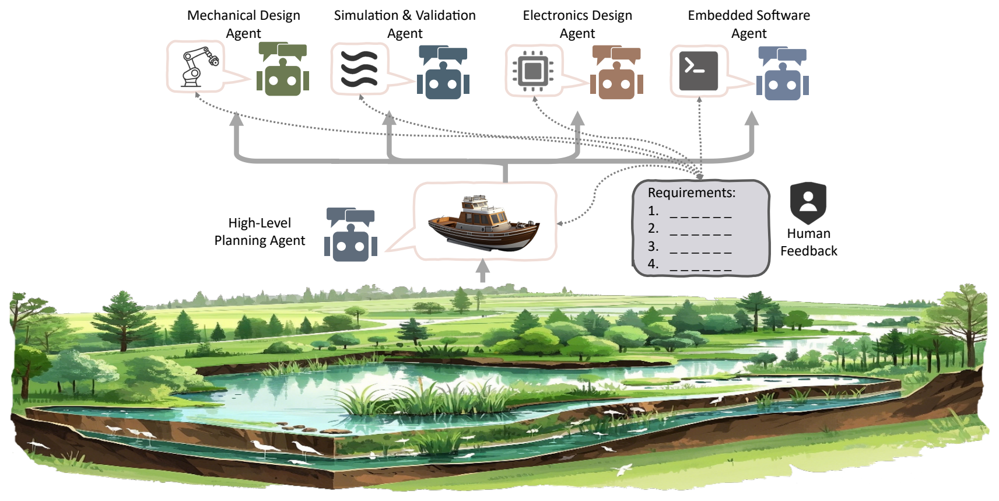
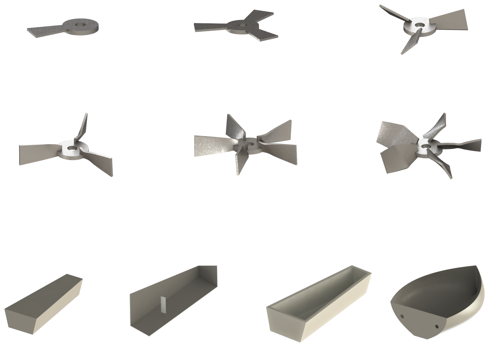
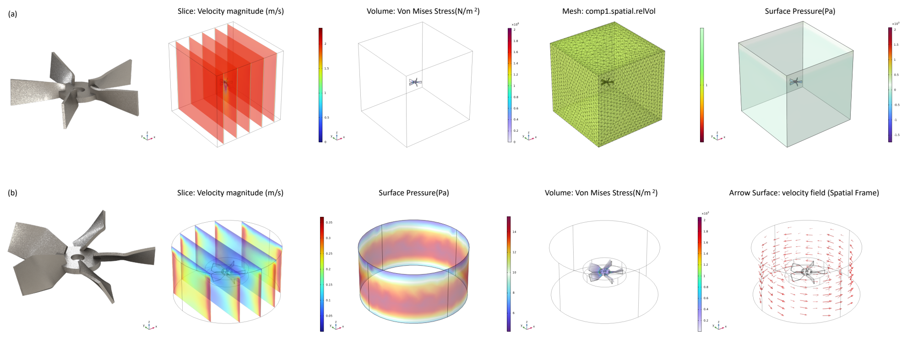
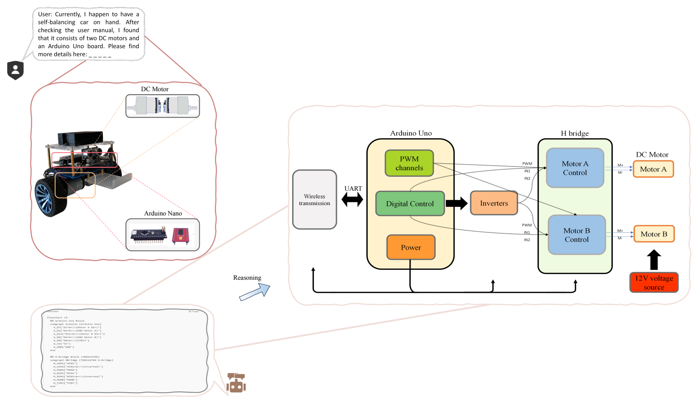
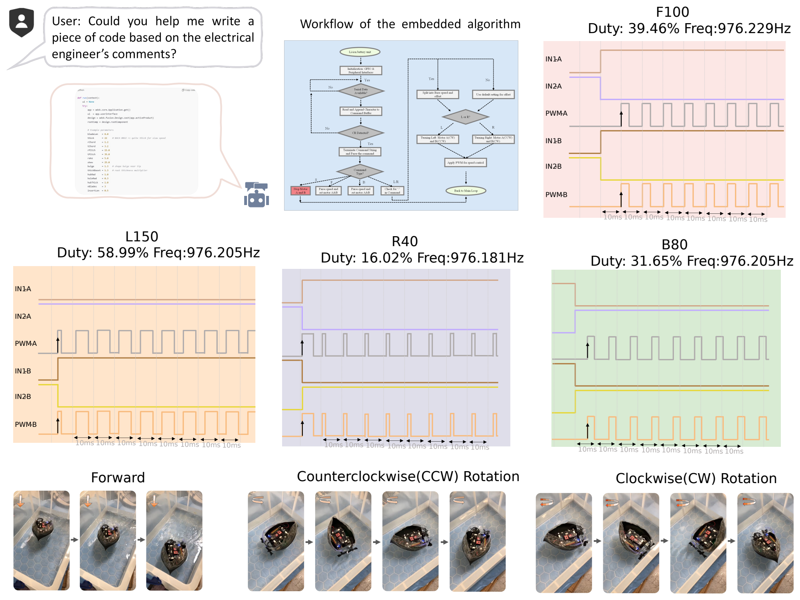

# 大语言模型驱动的多智能体自主机电系统设计框架

*An LLM-enabled Multi-Agent Autonomous Mechatronics Design Framework*

**作者：** Zeyu Wang¹、Frank P.-W. Lo¹、Qian Chen¹、Yongqi Zhang¹、Chen Lin¹、Xu Chen¹、Zhenhua Yu²、Alexander J. Thompson¹、Eric M. Yeatman¹\*、Benny P. L. Lo¹\*

¹ 英国伦敦，帝国理工学院  
² 英国阿伯丁，阿伯丁大学  
电子邮箱：e.yeatman@imperial.ac.uk；benny.lo@imperial.ac.uk

**年份：** 2025  
**版本：** arXiv:2504.14681v1 [cs.RO]，2025 年 4 月 20 日

## 摘要

现有的大语言模型（LLM）赋能多智能体框架主要局限于数字或仿真环境，涉及的知识领域也较为狭窄。这限制了它们在复杂工程任务中的应用，因为此类任务需要设计实体系统、整合跨学科知识，并进行考虑约束条件的推理。本研究提出一种多智能体自主机电系统设计框架，将机械设计、优化、电子工程和软件工程等领域的专业知识整合起来，以尽可能少的人工直接设计投入，自主生成功能性原型。该框架主要采用语言驱动的工作流程，并融入结构化的人类反馈，确保系统在现实约束下保持稳健性能。

为验证其能力，我们将该框架应用于自主水质监测与采样这一现实挑战；传统方法不仅需要大量人力，还会扰动生态环境。借助所提出的系统，我们开发出一艘功能完备的自主船艇，其推进系统经过优化，电子系统成本经济，并具备先进的控制能力。设计过程由多个专业智能体完成，包括负责问题抽象的高层规划智能体，以及分别负责结构、电子、控制和软件开发的专用智能体。这种方法展示了基于 LLM 的多智能体系统在自动化现实工程工作流程、减少对广泛领域专业知识的依赖方面的潜力。

## 1. 引言

近年来，大语言模型（LLM）[1–3] 在多种认知任务上取得了快速进展，包括自然语言理解 [4]、代码生成 [5, 6]、符号推理 [7, 8] 和科学问题求解 [9, 10]。GPT-4 [13]、Claude [14]、DeepSeek [15] 和 PaLM [16] 等模型基于 Transformer 架构 [11, 12]，并在大规模数据集上接受训练，在思维链推理 [17, 18]、少样本学习 [19, 20]，乃至扩展至视觉语言场景后的多模态理解 [21, 22] 中，都表现出强大的能力。这些能力使 LLM 不仅能够完成语言任务，还能参与程序合成 [23] 和结构化决策 [24, 25]，为将其整合到具备自主规划和工具使用能力的智能体系统中奠定了基础。

智能体系统 [26] 的兴起是人工智能发展的重要里程碑，它使各类实体能够在特定环境中自主感知、推理和行动 [27]。LLM 驱动的智能体 [28] 借助复杂的语言理解与生成能力，进一步增强了上述功能，并在多种应用中展现出成效，包括文本摘要 [29]、软件调试 [30, 31]、文档自动化 [32, 33]、客户支持 [34, 35]、数学定理合成 [36, 37]、虚拟环境导航 [38] 和结构化数据查询 [39, 40]。在工业领域，LLM 智能体已经简化了界定较为狭窄的工作流程，包括报告生成 [41–43] 和基础数据分析 [44, 45]，显著提高了运营效率。

然而，目前基于 LLM 的智能体实现仍主要局限于数字或仿真环境，因此难以应用于需要实体系统设计、跨领域整合和约束感知推理的复杂工程任务。近期已有一些尝试旨在弥合这一差距，初步展示了 LLM 智能体与实体实验的整合，例如自主化学合成 [46]、材料设计 [47–49]、药物发现 [50] 和自适应多智能体制造系统 [51]。尽管取得了这些进展，针对自主机电系统设计的 LLM 赋能多智能体框架仍很少受到关注，而这一领域本身就要求具备机械工程、电子工程、控制系统和软件开发等方面的跨学科专业知识。

机电系统设计的内在复杂性对专业能力和创新构成了显著门槛，但 LLM 的跨领域知识综合能力为支持和加速机电系统开发的某些环节提供了新的可能。利用 LLM，可以通过减少对领域专家的依赖，让更多人能够参与机电系统设计，简化开发过程，并促进创新。针对这一研究空白，我们提出一种 LLM 赋能的多智能体自主机电系统设计框架，专门面向涉及现实实体系统的复杂跨学科工程挑战。

为说明该框架的有效性，我们将其应用于湿地自主水质监测 [52, 53]。这项任务对于生态保护十分重要，但传统上需要大量人力，且成本高昂。借助结构化人类反馈引导的专业协作智能体，我们的方法显著降低了复杂性并简化了流程。最终开发的自主船艇展示了实际环境监测潜力，验证了所提出的方法，也凸显了基于 LLM 的智能体重塑机电系统设计范式的潜力。这一可扩展框架还可以广泛推动未来在精准医疗生物机器人 [54, 55]、自主手术机器人 [56, 57] 和 AI 赋能多模态健康监测 [58] 等领域的发展，显著降低门槛，并扩大跨学科工程创新的参与范围。

**图 1.** 自主机电系统设计框架的概念架构，展示了多智能体如何在引入人类在环反馈的情况下协作完成系统开发。

## 2. 智能等级定义

我们提出以下自主机电系统设计智能等级（Intelligence Levels for Autonomous Mechatronics Design，简称 AMD 等级）：

- **AMD 0 级：人工设计。** 完全由人类主导；所有任务和系统集成都由人工完成。
- **AMD 1 级：辅助自动化。** AI 提供有限支持，例如信息检索和基础代码生成；决策仍完全由人类控制。
- **AMD 2 级：半自主设计。** 系统自主执行特定领域的任务；人类负责集成和验证。
- **AMD 3 级：高度自主设计。** 跨领域协调实现自动化；人类参与限于高层监督和最终评估。
- **AMD 4 级：完全自主设计。** 实现端到端自动化。系统独立完成规划、集成、优化和验证，人类输入仅限于设定目标和评估结果。

## 3. 方法

### 3.1. 框架设计

所提出的框架采用由高层规划智能体统筹的层级架构，将复杂挑战分解为交由各领域专用智能体执行的模块化任务。每个智能体在其专业领域内自主生成、改进和验证设计，而结构化的人类输入确保设计可行，并满足实际约束条件。

以自主水质监测与采样系统为例，高层规划智能体首先分析机动性、环境适应性和能源效率等功能需求，确定最优构型：一艘紧凑的双螺旋桨船艇。随后，机械设计智能体优化螺旋桨与船体结构，仿真与验证智能体则通过计算流体力学（CFD）和有限元分析（FEA）验证其水动力性能与结构完整性。电子设计智能体综合设计推进与控制电路，利用现有硬件简化集成。嵌入式软件智能体随后生成电机控制和通信固件，以实现对硬件组件的最优控制。同时，人类反馈作为外部输入，引导智能体处理含糊不清的设计选择，并在其能力受限时改进输出。这种多智能体方法将高层目标与底层实现结合起来，显著减少设计迭代过程及对领域专家的依赖，为自主机电系统设计提供一种可扩展的方法。

### 3.2. 高层规划智能体

高层规划智能体将系统级需求转化为可执行的设计目标，为下游工程任务提供指导。它利用基于 LLM 的决策，将功能目标、约束条件和人类反馈整合为统一的设计策略。从数学上看，该智能体的功能可表示为：

$$
P=f(F,C,H) \tag{1}
$$

其中，$F$ 表示功能需求，例如机动性、能源效率和环境适应性；$C$ 表示系统约束；$H$ 表示人类反馈。通过将人类反馈 [59] 直接纳入这一闭环，智能体确保现实经验持续塑造设计路径，从而形成稳健、可适应且可制造的机电系统解决方案。

### 3.3. 机械设计智能体

机械设计整合结构力学 [60]、流体力学 [61] 和可制造性考量 [62]，以确保功能性能和生产可行性。传统上，工程师采用参数化建模 [63]、有限元分析 [64] 和迭代改进，在材料性能、水动力效率 [65]、结构完整性等约束之间取得平衡。这需要大量计算专业知识、几何推理能力，以及实际制造经验与知识。

然而，由于空间推理和几何认知能力不足 [66]，当前 LLM 在机械设计中存在固有限制。与自然语言处理或代码生成不同，机械设计本质上依赖实时空间可视化和参数化交互。这些能力是传统 CAD 工具（例如 SolidWorks [67]、Fusion 360 [68]、COMSOL [69]）的核心，但现有 LLM 大多不具备。此外，机械设计还要求对可制造性约束和材料性能形成直观理解，而 LLM 很难仅凭文本训练推断出这些内容。

为应对上述挑战，我们提出一种混合方法，将 LLM 驱动的几何生成与有针对性的人类在环反馈结合起来。这种结构化方法构成了机械设计智能体的基础，使其能够自主、迭代地优化机械结构，产出功能可用且有效的机械设计。具体而言，机械设计智能体自主理解高层功能需求，生成并改进机械组件。例如，在设计自主水质监测系统时，智能体迭代优化螺旋桨与船体结构，系统性地提升其稳定性、水动力效率和可制造性。该设计流程包含三个结构化阶段：参数化几何建模、翼型截面生成，以及将二维翼型轮廓转换为最终三维桨叶几何形状。

具体而言，用一个由 LLM 驱动的映射函数对这一过程进行形式化表示：

$$
\mathcal{L}:\mathcal{P}\rightarrow\mathcal{C} \tag{2}
$$

其中，$\mathcal{P}$ 表示设计参数集合，例如桨叶根部与梢部弦长、螺距角、翼型厚度、纵倾角与侧斜角；$\mathcal{C}$ 表示生成的 CAD 代码。迭代改进通过下式实现：

$$
\mathcal{P}_{n+1}=\mathcal{F}(\mathcal{P}_n,R_n) \tag{3}
$$

其中，$R_n$ 表示第 $n$ 次迭代的仿真反馈。

#### a）参数化几何建模

在桨叶展向位置 $z\in[0,L]$ 上，引入归一化坐标来定义桨叶：

$$
r=\frac{z}{L},\qquad r\in[0,1] \tag{4}
$$

桨叶几何形状主要由两个函数控制。

**弦长分布 $C(z)$** 定义为：

$$
C(z)=C_r+(C_t-C_r)r \tag{5}
$$

其中，$C_r$ 和 $C_t$ 分别为根部与梢部的弦长。更复杂的变化，例如引入高斯隆起，可表示为：

$$
C(z)=\big[C_r+(C_t-C_r)r\big]\big[1+\beta\exp\big(-\gamma(r-r_0)^2\big)\big] \tag{6}
$$

其中，$\beta$、$\gamma$ 和 $r_0$ 为设计参数。**螺距角分布 $\alpha(z)$** 定义为：

$$
\alpha(z)=\alpha_r+(\alpha_t-\alpha_r)r \tag{7}
$$

其中，$\alpha_r$ 和 $\alpha_t$ 分别为根部与梢部的螺距角，单位为弧度。

#### b）翼型生成

智能体使用参数化厚度分布函数 $f(x)$，在每个展向位置生成二维翼型轮廓。该函数定义在弦向坐标 $x\in[0,1]$ 上。一般而言，上表面和下表面分别为：

$$
\{(x-x_0,+f(x))\}\quad\text{和}\quad\{(x-x_0,-f(x))\} \tag{8}
$$

#### c）将二维翼型截面转换为三维桨叶

对每个生成的二维翼型截面应用以下变换，使其位于对应的三维位置。

**缩放：** 以局部弦长 $C(z)$ 对归一化翼型坐标 $(x,y)$ 进行缩放：

$$
X=C(z)x,\qquad Y=C(z)S(z)y \tag{9}
$$

其中，$S(z)$ 为可选的厚度缩放因子。

**旋转（扭转）：** 按照局部螺距角 $\alpha(z)$ 旋转缩放后的坐标：

$$
X_r=X\cos\alpha(z)-Y\sin\alpha(z) \tag{10}
$$

$$
Y_r=X\sin\alpha(z)+Y\cos\alpha(z) \tag{11}
$$

**平移（纵倾与侧斜）：** 为体现桨叶平面形状的影响，应用以下平移：

$$
S_{\mathrm{rake}}(z)=-z\tan(\theta_{\mathrm{rake}}) \tag{12}
$$

$$
S_{\mathrm{skew}}(z)=rL\tan(\theta_{\mathrm{skew}}) \tag{13}
$$

最终坐标为：

$$
X_f=X_r+S_{\mathrm{skew}}(z) \tag{14}
$$

$$
Y_f=Y_r+S_{\mathrm{rake}}(z) \tag{15}
$$

### 3.4. 仿真与验证智能体

结构验证对于机电系统至关重要，能够确保其在工作条件下的稳健性和可靠性。传统上，工程师利用 FEA 和计算方法评估结构完整性、变形与应力分布，据此指导材料选择、几何优化和承载能力设计。将 LLM 整合到仿真驱动的工作流程中，可以加快模型配置和边界条件定义等结构验证任务。然而，当前 LLM 在解释复杂多物理场现象、非线性材料行为和保证数值收敛方面仍面临困难，因此需要将 AI 驱动的方法与实证验证相结合。

在所提出的框架中，仿真与验证智能体自主验证机械设计智能体生成的机械结构。具体而言，它自动配置仿真，定义材料与边界条件，并利用有限元方法执行基于物理的分析。仿真结果指导设计的迭代改进，以提高结构性能和可制造性。为验证自主船艇的推进系统，智能体采用 CFD 和结构 FEA，评估流固相互作用、工作载荷下的机械应力，以及潜在的疲劳位置。

首先，为建立基准安全裕度，智能体在层流条件下进行全耦合流固相互作用（FSI）仿真，作为基线分析，以了解极端被动受流情况下的应力分布和潜在失效区域。具体而言，智能体建立 FSI 接口 [70]，将压力与剪切作用传递到桨叶，随后执行稳态应力分析，计算 von Mises 等效应力：

$$
\sigma_{\mathrm{vM}}=\sqrt{0.5\big[(\sigma_1-\sigma_2)^2+(\sigma_2-\sigma_3)^2+(\sigma_3-\sigma_1)^2\big]} \tag{16}
$$

其中，$\sigma_1$、$\sigma_2$ 和 $\sigma_3$ 为主应力。

随后，为模拟螺旋桨的高速旋转及其与流体的相互作用，智能体在 COMSOL 中采用旋转机械分析，通过剪切应力输运（SST）湍流模型 [72] 求解雷诺平均 Navier–Stokes（RANS）方程 [71]。对螺旋桨域施加旋转参考系，同时保持周围流体静止，以确保适当的界面条件。旋转参考系中的动量方程为：

$$
\begin{aligned}
\rho(\mathbf{u}\cdot\nabla\mathbf{u})
&=-\nabla p\\
&\quad+\nabla\cdot\big[\mu_{\mathrm{eff}}\big(\nabla\mathbf{u}+(\nabla\mathbf{u})^{\mathrm{T}}\big)\big]
+\mathbf{F}_{\mathrm{rot}}
\end{aligned}
\tag{17}
$$

其中，$\rho$ 为流体密度，$\mathbf{u}$ 为速度场，$p$ 为压力；$\mu_{\mathrm{eff}}=\mu_t+\mu$ 为有效黏度，同时考虑分子黏度 $\mu$ 和湍流黏度 $\mu_t$ 的贡献。$\mathbf{F}_{\mathrm{rot}}$ 项包含科里奥利力与离心力。通过混合 $k$–$\omega$ 和 $k$–$\epsilon$ 形式 [73, 74]，SST 模型能够确保准确的近壁处理和稳健的自由来流预测。

### 3.5. 电子设计智能体

电气工程设计涉及电路分析、电子设计、信号处理、控制系统和嵌入式计算，以开发稳健的电子系统。传统工作流程包括原理图设计、元件选择、PCB 布局 [75] 和系统级测试，需要电磁兼容性（EMC）、热管理和可制造性等方面的专业知识。LLM 的近期进展在辅助自动元件选择 [76]、原理图生成和设计优化等任务方面展现出变革潜力。这些模型在大量技术文档上接受训练，能够高效解析数据手册、推荐合适元件并简化采购流程，从而显著缩短设计周期。

然而，LLM 目前在处理实时设计约束、以及在实际约束下保持稳健性方面仍存在限制。为克服这些限制，电子设计智能体采用一种混合工作流程，将基于 LLM 的推理、结构化人类反馈和现有硬件利用结合起来。智能体先评估可用硬件资源能否复用，再开展电路设计，以优化资源利用效率并加快开发。

**图 2.** 机械设计智能体生成的螺旋桨与船体的迭代设计过程。

### 3.6. 嵌入式软件智能体

嵌入式系统是机电系统设计的计算核心，将高层目标转化为精确控制指令 [77]。有效的嵌入式软件设计需要具备实时控制算法、通信协议、固件开发和传感器驱动执行等方面的专业知识。LLM 的近期进展为嵌入式软件任务自动化提供了机会，包括固件生成、自适应控制逻辑优化和高效资源分配。LLM 在大量编程数据集上接受训练，能够自主生成结构化代码，并调整现有控制策略。然而，当前 LLM 驱动生成的代码在实时执行效率和直接外设交互方面仍存在限制，因此需要实证验证。

在我们的框架中，嵌入式软件智能体将高层规格转化为可执行固件，并专门针对电子设计智能体确定的硬件架构进行适配。这种智能体间的协调确保硬件与软件无缝集成。此外，智能体还实现自适应电机控制策略，以完成无舵推进系统中的差速控制等关键任务；它动态调整电机驱动，使系统在不同工作条件下准确到达目标。

## 4. 实验结果

### 4.1. 机械设计智能体

在高层规划智能体确定的自主船艇目标指导下，机械设计智能体迭代优化螺旋桨与船体结构，如图 2 所示。图 2 上方两行展示了螺旋桨设计过程，该过程以一个桨叶长度为 26 mm、轮毂直径为 20 mm 的三桨叶构型为起点。早期迭代的水动力性能较差。通过逐步改进桨叶曲率、扭转角和轮毂与桨叶比例，智能体提高了升阻比、减轻了流动分离，从而改善了水动力效率。最终几何形状在结构刚度与稳定推力生成之间取得了平衡。

进一步考察智能体的详细实现可知，它通过分段插值调整弦长与螺距角分布，以最大化桨叶中段的载荷，具体如下：

$$
C(z)=
\begin{cases}
C_r+(C_m-C_r)(2r), & 0\le r\le 0.5,\\
C_m+(C_t-C_m)(2r+1), & 0.5\le r\le 1.
\end{cases}
\tag{18}
$$

其中，$C_m$ 为桨叶中段的最大弦长。螺距角分布采用类似的插值方式：

$$
\alpha(z)=
\begin{cases}
\alpha_r+(\alpha_m-\alpha_r)(2r), & 0\le r\le 0.5,\\
\alpha_m+(\alpha_t-\alpha_m)(2r+1), & 0.5\le r\le 1.
\end{cases}
\tag{19}
$$

通用翼型截面经过生成与变换，最终形成针对推力优化的三维桨叶几何形状。

图 2 最下方一行展示了船体设计的演变。初始输出为实心矩形结构，无法满足浮力与重量约束。后续迭代引入了中空结构，但早期设计仍缺乏可行的舱室划分。经过逐步改进，智能体加入内部加强结构、有针对性的开孔和流线型轮廓，最终形成弧形船艏设计。这种设计能够减少阻力、改善机动性，并容纳船载组件。这些结果表明，机械设计智能体能够在不断变化的约束下自主改进结构，生成机械上可行、性能经过优化且适合后续验证的组件。

**图 3.** 仿真与验证智能体对优化后的螺旋桨设计进行的 CFD 与结构分析。（a）层流条件下的结构应力分布，作为基线分析。（b）采用剪切应力输运（SST）模型进行旋转湍流分析得到的结果。结果显示出稳定的水动力性能、合理的结构应力水平，并指出了需要进一步改进的区域。

### 4.2. 仿真与验证智能体

为评估机械设计智能体生成的螺旋桨设计，仿真与验证智能体进行了两阶段 CFD 分析，如图 3 所示。在初始基线分析中，智能体以图 2 所示第五次设计迭代为例，自主完成了层流流固相互作用仿真。得到的速度大小切片和表面压力分布表明，流动平稳、分离很少，且压力场连贯，从而验证了早期设计的稳定性。

考虑到最终螺旋桨构型处于高雷诺数工况，智能体随后转向能够表征湍流的分析，采用 SST 模型提高近壁流动表征的保真度，同样以图 2 所示最终设计迭代为例。然而，与基线情形不同，智能体无法自主配置这一湍流分析，需要大量人类反馈与专家协助，反复调整求解器设置、边界条件和空间离散，直到实现收敛。仍有必要进一步详细验证这些结果，才能充分确保其准确性和可靠性。

尽管仿真与验证智能体展示了推断所需物理模块的能力，其执行能力仍然有限。配置不一致的问题部分源于软件接口的差异，削弱了它在不同求解器设置下的可靠性。边界条件定义和空间域划分尤其困难，受到智能体缺乏几何直觉和视觉空间推断能力的限制。在瞬态多物理场仿真中，这些限制尤为突出，因为复杂的时间依赖关系和跨域依赖关系往往导致收敛失败。解决这些挑战需要整合结构化专家先验、基于经过验证的工作流程开展少样本学习，并引入物理知识指导，以系统性提高稳健性和泛化能力。

**图 4.** 基于用户反馈的电子设计智能体工作流程。智能体分析现有平衡车系统，并重构其核心控制架构，包括基于 Arduino 的 PWM 控制与 H 桥电机驱动。

### 4.3. 电子设计智能体

为评估智能体的自适应设计能力，我们将一辆基于 Arduino Nano 的自平衡车作为外部输入。智能体接收系统规格，包括电机驱动器和电源模块，并评估这些组件是否可以拆卸、重新配置为自主船艇的功能性推进系统。

如图 4 所示，电子设计智能体综合构建了一套系统架构，将自平衡车硬件改造用于双电机驱动。利用电路知识和结构化人类输入，智能体分析了复用电机控制、配电和信号处理组件的可行性，以构建高效、紧凑的驱动系统。

最终架构包括两个子系统：Arduino Nano 控制单元与 H 桥电机驱动器。控制单元生成的脉宽调制（PWM）信号通过逻辑电路和反相器处理，调节电机速度与方向。H 桥使两个独立控制的直流电机能够获得双向电流，每个电机由 12 V 电源供电。电机差速控制实现了无舵转向，使船艇能够平稳转弯和精确导航，这对于自主船艇的运行至关重要。无线传输进一步支持其在现实环境中的远程操作。

### 4.4. 嵌入式软件智能体

图 5 展示了智能体构建的嵌入式固件架构。系统首先配置 GPIO 和外设，随后持续监测接收到的串行数据。当接收到完整指令后，系统解析运动类型，例如前进、后退、左转、右转或停止，并生成相应 PWM 信号，通过 H 桥驱动器控制电机 A 和电机 B。对于转弯动作，智能体采用差速控制，通过调整电机速度改变转弯半径，无须实体船舵。

实际执行情况通过逻辑分析仪波形进行评估，如图 5 所示。这些波形记录了两个电机在不同指令下的 IN1、IN2 和 PWM 信号。观测到的占空比分别为 39.2%（前进）、31.4%（后退）、58.8%（左转）和 15.7%（右转），证实电机能够按照嵌入式控制逻辑精确动作。方向切换通过适当的相位切换准确执行。在转弯时的第一个 PWM 脉冲中观察到轻微偏差，其原因是瞬态寄存器更新引起的初始化延迟。该影响持续时间很短，不会影响系统级控制性能，表明智能体能够自主生成稳健的实时电机控制代码，满足自主导航需求。

**图 5.** 嵌入式控制逻辑及经人工验证的信号输出。智能体基于电子设计智能体确定的架构生成控制逻辑，使用逻辑分析仪采集并验证不同情景下的 PWM 信号。

## 5. 讨论

所提出的框架旨在借助结构化人类反馈，辅助设计功能可用且有效的机电系统。事实表明，人类指导至关重要，特别是在机械设计任务中确定建模顺序时。在电子设计智能体提供明确架构规格的情况下，嵌入式软件智能体表现出更高的自主性。简单仿真可以通过 COMSOL–MATLAB 接口自主执行，但更复杂的配置仍极具挑战性，尤其是瞬态流体仿真等多物理场模块中的域定义与复杂边界条件设置。这表明，少样本学习和结构化先验注入可能带来益处。

未来工作将处理硬件优化问题，例如电子组件防水，并利用多模态 LLM 的能力，特别是基于视觉的功能，增强自主控制逻辑。

## 6. 结论

本研究提出一种 LLM 赋能的多智能体框架，推动自主机电系统设计跨越学科边界。通过将语言驱动的智能与结构化人类反馈结合起来，该框架重新定义了工程工作流程，降低了专业知识门槛，并预示实体系统设计将向可扩展、广泛参与的创新模式转变。

---

**译注：** 式（18）和式（19）第二段中的 $2r+1$ 按原文保留。若意在实现从中段到梢部的连续线性插值，这一项通常应为 $2r-1$；译文未修改原公式。插图保留原图中的文字，图注译为中文。以下参考文献保留原文。

## 参考文献

[1] Yupeng Chang, Xu Wang, Jindong Wang, Yuan Wu, Linyi Yang, Kaijie Zhu, Hao Chen, Xiaoyuan Yi, Cunxiang Wang, Yidong Wang, et al. A survey on evaluation of large language models. ACM transactions on intelligent systems and technology, 15(3):1–45, 2024. 1

[2] Wayne Xin Zhao, Kun Zhou, Junyi Li, Tianyi Tang, Xiaolei Wang, Yupeng Hou, Yingqian Min, Beichen Zhang, Junjie Zhang, Zican Dong, et al. A survey of large language models. arXiv preprint arXiv:2303.18223, 1(2), 2023.

[3] Dorottya Demszky, Diyi Yang, David S Yeager, Christopher J Bryan, Margarett Clapper, Susannah Chandhok, Johannes C Eichstaedt, Cameron Hecht, Jeremy Jamieson, Meghann Johnson, et al. Using large language models in psychology. Nature Reviews Psychology, 2(11):688–701, 2023. 1

[4] Bonan Min, Hayley Ross, Elior Sulem, Amir Pouran Ben Veyseh, Thien Huu Nguyen, Oscar Sainz, Eneko Agirre, Ilana Heintz, and Dan Roth. Recent advances in natural language processing via large pre-trained language models: A survey. ACM Computing Surveys, 56(2):1–40, 2023. 1

[5] Jiawei Liu, Chunqiu Steven Xia, Yuyao Wang, and Lingming Zhang. Is Your Code Generated by ChatGPT Really Correct? Rigorous Evaluation of Large Language Models for Code Generation. Advances in Neural Information Processing Systems, 36:21558–21572, December 2023. 1

[6] Using an LLM to Help With Code Understanding | Proceedings of the IEEE/ACM 46th International Conference on Software Engineering. https://dl.acm.org/doi/10.1145/3597503.3639187. 1

[7] Iman Mirzadeh, Keivan Alizadeh, Hooman Shahrokhi, Oncel Tuzel, Samy Bengio, and Mehrdad Farajtabar. GSM-Symbolic: Understanding the Limitations of Mathematical Reasoning in Large Language Models, October 2024. 1

[8] Liangming Pan, Alon Albalak, Xinyi Wang, and William Yang Wang. Logic-LM: Empowering Large Language Models with Symbolic Solvers for Faithful Logical Reasoning, October 2023. 1

[9] Xiaoxuan Wang, Ziniu Hu, Pan Lu, Yanqiao Zhu, Jieyu Zhang, Satyen Subramaniam, Arjun R. Loomba, Shichang Zhang, Yizhou Sun, and Wei Wang. SciBench: Evaluating College-Level Scientific Problem-Solving Abilities of Large Language Models, June 2024. 1

[10] Qiang et al. Zhang. Scientific Large Language Models: A Survey on Biological & Chemical Domains. ACM Comput. Surv., 57(6):161:1–161:38, February 2025. ISSN 0360-0300. doi: 10.1145/3715318. 1

[11] Salman Khan, Muzammal Naseer, Munawar Hayat, Syed Waqas Zamir, Fahad Shahbaz Khan, and Mubarak Shah. Transformers in Vision: A Survey. ACM Comput. Surv., 54(10s):200:1–200:41, September 2022. ISSN 0360-0300. doi: 10.1145/3505244. 1

[12] Ashish Vaswani, Noam Shazeer, Niki Parmar, Jakob Uszkoreit, Llion Jones, Aidan N Gomez, Łukasz Kaiser, and Illia Polosukhin. Attention is All you Need. In Advances in Neural Information Processing Systems, volume 30. Curran Associates, Inc., 2017. 1

[13] OpenAI et al. GPT-4 Technical Report, March 2024. 1

[14] Aman Priyanshu, Yash Maurya, and Zuofei Hong. AI Governance and Accountability: An Analysis of Anthropic’s Claude, May 2024. 1

[15] DeepSeek-AI et al. DeepSeek-V3 Technical Report, February 2025. 1

[16] Rohan et al. Anil. PaLM 2 Technical Report, September 2023. 1

[17] Jason Wei, Xuezhi Wang, Dale Schuurmans, Maarten Bosma, Brian Ichter, Fei Xia, Ed Chi, Quoc V. Le, and Denny Zhou. Chain-of-Thought Prompting Elicits Reasoning in Large Language Models. Advances in Neural Information Processing Systems, 35:24824–24837, December 2022. 1

[18] Xuan Zhang, Chao Du, Tianyu Pang, Qian Liu, Wei Gao, and Min Lin. Chain of Preference Optimization: Improving Chain-of-Thought Reasoning in LLMs. Advances in Neural Information Processing Systems, 37:333–356, December 2024. 1

[19] Jean-Baptiste Alayrac, Jeff Donahue, Pauline Luc, Antoine Miech, Iain Barr, Yana Hasson, Karel Lenc, Arthur Mensch, Katherine Millican, Malcolm Reynolds, et al. Flamingo: a visual language model for few-shot learning. Advances in neural information processing systems, 35:23716–23736, 2022. 1

[20] Tom Brown, Benjamin Mann, Nick Ryder, Melanie Subbiah, Jared D Kaplan, Prafulla Dhariwal, Arvind Neelakantan, Pranav Shyam, Girish Sastry, Amanda Askell, et al. Language models are few-shot learners. volume 33, pages 1877–1901, 2020. 1

[21] Deyao Zhu, Jun Chen, Xiaoqian Shen, Xiang Li, and Mohamed Elhoseiny. MiniGPT-4: Enhancing Vision-Language Understanding with Advanced Large Language Models, October 2023. 1

[22] Jing Yu Koh, Daniel Fried, and Russ R. Salakhutdinov. Generating Images with Multimodal Language Models. Advances in Neural Information Processing Systems , 36: 21487–21506, December 2023. 1

[23] Yixuan Li, Julian Parsert, and Elizabeth Polgreen. Guiding Enumerative Program Synthesis with Large Language Models. In Arie Gurfinkel and Vijay Ganesh, editors, Computer Aided Verification, pages 280–301, Cham, 2024. Springer Nature Switzerland. ISBN 978-3-031-65630-9. doi: 10.1007/978-3-031-65630-9 15. 1

[24] Shuang Li, Xavier Puig, Chris Paxton, Yilun Du, Clinton Wang, Linxi Fan, Tao Chen, De-An Huang, Ekin Akyürek, Anima Anandkumar, Jacob Andreas, Igor Mordatch, Antonio Torralba, and Yuke Zhu. Pre-Trained Language Models for Interactive Decision-Making. Advances in Neural Information Processing Systems, 35:31199–31212, December 2022. 1

[25] Paul Hager, Friederike Jungmann, Robbie Holland, Kunal Bhagat, Inga Hubrecht, Manuel Knauer, Jakob Vielhauer, Marcus Makowski, Rickmer Braren, Georgios Kaissis, and Daniel Rueckert. Evaluation and mitigation of the limitations of large language models in clinical decision-making. Nature Medicine, 30(9):2613–2622, September 2024. ISSN 1546-170X. doi: 10.1038/s41591-024-03097-1. 1

[26] Mark d’Inverno, Michael M Luck, M D’Inverno, and M Luck. Understanding Agent Systems. Springer, 2004. 1

[27] Randall D. Beer. A dynamical systems perspective on agent-environment interaction. Artificial Intelligence, 72(1):173–215, January 1995. ISSN 0004-3702. doi: 10.1016/0004-3702(94)00005-L. 1

[28] Jianing Qiu, Kyle Lam, Guohao Li, Amish Acharya, Tien Yin Wong, Ara Darzi, Wu Yuan, and Eric J Topol. Llm-based agentic systems in medicine and healthcare. Nature Machine Intelligence, 6(12):1418–1420, 2024. 1

[29] Dave Van Veen, Cara Van Uden, Louis Blankemeier, Jean-Benoit Delbrouck, Asad Aali, Christian Bluethgen, Anuj Pareek, Malgorzata Polacin, Eduardo Pontes Reis, Anna Seehofnerová, et al. Adapted large language models can outperform medical experts in clinical text summarization. Nature medicine, 30(4):1134–1142, 2024. 1

[30] Runchu Tian, Yining Ye, Yujia Qin, Xin Cong, Yankai Lin, Yinxu Pan, Yesai Wu, Haotian Hui, Weichuan Liu, Zhiyuan Liu, and Maosong Sun. DebugBench: Evaluating Debugging Capability of Large Language Models, June 2024. 1

[31] Weiqing Yang, Hanbin Wang, Zhenghao Liu, Xinze Li, Yukun Yan, Shuo Wang, Yu Gu, Minghe Yu, Zhiyuan Liu, and Ge Yu. COAST: Enhancing the Code Debugging Ability of LLMs through Communicative Agent Based Data Synthesis, February 2025. 1

[32] Jiabo Ye, Anwen Hu, Haiyang Xu, Qinghao Ye, Ming Yan, Yuhao Dan, Chenlin Zhao, Guohai Xu, Chenliang Li, Junfeng Tian, Qian Qi, Ji Zhang, and Fei Huang. mPLUG-DocOwl: Modularized Multimodal Large Language Model for Document Understanding, July 2023. 1

[33] Yusen Zhang, Ruoxi Sun, Yanfei Chen, Tomas Pfister, Rui Zhang, and Sercan Ö Arık. Chain of Agents: Large Language Models Collaborating on Long-Context Tasks. Advances in Neural Information Processing Systems , 37: 132208–132237, December 2024. 1

[34] Shubhra Kanti Karmaker Santu, Parikshit Sondhi, and ChengXiang Zhai. Generative Feature Language Models for Mining Implicit Features from Customer Reviews. In Proceedings of the 25th ACM International on Conference on Information and Knowledge Management, CIKM ’16, pages 929–938, New York, NY, USA, October 2016. Association for Computing Machinery. ISBN 978-1-4503-4073-1. doi: 10.1145/2983323.2983729. 1

[35] Sudhakar Reddy Peddinti, Subba Rao Katragadda, Brij Kishore Pandey, and Ajay Tanikonda. Utilizing Large Language Models for Advanced Service Management: Potential Applications and Operational Challenges, March 2023. 1

[36] Chao Zhang, Xuechen Liu, Katherine Ziska, Soobin Jeon, Chi-Lin Yu, and Ying Xu. Mathemyths: Leveraging Large Language Models to Teach Mathematical Language through Child-AI Co-Creative Storytelling. In Proceedings of the 2024 CHI Conference on Human Factors in Computing Systems, CHI ’24, pages 1–23, New York, NY, USA, May 2024. Association for Computing Machinery. ISBN 979-8-4007-0330-0. doi: 10.1145/3613904.3642647. 1

[37] Janice Ahn, Rishu Verma, Renze Lou, Di Liu, Rui Zhang, and Wenpeng Yin. Large Language Models for Mathematical Reasoning: Progresses and Challenges, September 2024. 1

[38] Gengze Zhou, Yicong Hong, and Qi Wu. NavGPT: Explicit Reasoning in Vision-and-Language Navigation with Large Language Models. Proceedings of the AAAI Conference on Artificial Intelligence, 38(7):7641–7649, March 2024. ISSN 2374-3468. doi: 10.1609/aaai.v38i7.28597. 1

[39] Haojie Pan, Zepeng Zhai, Hao Yuan, Yaojia Lv, Ruiji Fu, Ming Liu, Zhongyuan Wang, and Bing Qin. KwaiAgents: Generalized Information-seeking Agent System with Large Language Models, January 2024. 1

[40] Yutao Zhu, Huaying Yuan, Shuting Wang, Jiongnan Liu, Wenhan Liu, Chenlong Deng, Haonan Chen, Zheng Liu, Zhicheng Dou, and Ji-Rong Wen. Large Language Models for Information Retrieval: A Survey, September 2024. 1

[41] Yancheng Wang, Ziyan Jiang, Zheng Chen, Fan Yang, Yingxue Zhou, Eunah Cho, Xing Fan, Xiaojiang Huang, Yanbin Lu, and Yingzhen Yang. RecMind: Large Language Model Powered Agent For Recommendation, March 2024. 1

[42] Fang Zeng, Zhiliang Lyu, Quanzheng Li, and Xiang Li. Enhancing LLMs for Impression Generation in Radiology Reports through a Multi-Agent System, December 2024.

[43] Shijie Han, Haoqiang Kang, Bo Jin, Xiao-Yang Liu, and Steve Y Yang. Xbrl agent: Leveraging large language models for financial report analysis. In Proceedings of the 5th ACM International Conference on AI in Finance, pages 856–864, 2024. 1

[44] Hongyang Yang, Boyu Zhang, Neng Wang, Cheng Guo, Xiaoli Zhang, Likun Lin, Junlin Wang, Tianyu Zhou, Mao Guan, Runjia Zhang, and Christina Dan Wang. FinRobot: An Open-Source AI Agent Platform for Financial Applications using Large Language Models, May 2024. 1

[45] Tushar Chugh, Kanishka Tyagi, Rolly Seth, and Pranesh Srinivasan. Intelligent agents driven data analytics using Large Language Models. In 2023 International Conference on Artificial Intelligence, Blockchain, Cloud Computing, and Data Analytics (ICoABCD), pages 152–157, November 2023. doi: 10.1109/ICoABCD59879.2023.10390973. 1

[46] Andres M. Bran, Sam Cox, Oliver Schilter, Carlo Baldassari, Andrew D. White, and Philippe Schwaller. Augmenting large language models with chemistry tools. Nature Machine Intelligence, 6(5):525–535, May 2024. ISSN 2522-5839. doi: 10.1038/s42256-024-00832-8. 1

[47] Alireza Ghafarollahi and Markus J. Buehler. ProtAgents: Protein discovery via large language model multi-agent collaborations combining physics and machine learning. Digital Discovery , 3(7):1389–1409, 2024. doi: 10.1039/D4DD00013G. 1

[48] Mehrad Ansari and Seyed Mohamad Moosavi. Agent-based learning of materials datasets from the scientific literature. Digital Discovery, 3(12):2607–2617, 2024. doi: 10.1039/D4DD00252K.

[49] Mayk Caldas Ramos, Christopher J. Collison, and Andrew D. White. A review of large language models and autonomous agents in chemistry. Chemical Science , 16(6): 2514–2572, 2025. doi: 10.1039/D4SC03921A. 1

[50] Yoshitaka Inoue, Tianci Song, and Tianfan Fu. DrugAgent: Explainable Drug Repurposing Agent with Large Language Model-based Reasoning, September 2024. 1

[51] Yuchen Xia, Manthan Shenoy, Nasser Jazdi, and Michael Weyrich. Towards autonomous system: flexible modular production system enhanced with large language model agents. In 2023 IEEE 28th International Conference on Emerging Technologies and Factory Automation (ETFA) , pages 1–8. IEEE, 2023. 1

[52] Umair Ahmed, Rafia Mumtaz, Hirra Anwar, Sadaf Mumtaz, and Ali Mustafa Qamar. Water quality monitoring: From conventional to emerging technologies. Water Supply, 20(1): 28–45, October 2019. ISSN 1606-9749. doi: 10.2166/ws.2019.144. 2

[53] Alisa L. Gallant. The Challenges of Remote Monitoring of Wetlands. Remote Sensing , 7(8):10938–10950, August 2015. ISSN 2072-4292. doi: 10.3390/rs70810938. 2

[54] Zeyu Wang, Frank P-W Lo, Yunran Huang, Junhong Chen, James Calo, Wei Chen, and Benny Lo. Tactile perception: a biomimetic whisker-based method for clinical gastrointestinal diseases screening. npj Robotics, 1(1):3, 2023. 2

[55] Zeyu Wang, Frank P-W Lo, Junhong Chen, James Calo, Benny PL Lo, Alex J Thompson, and Eric M Yeatman. An ai-driven bionic whisker system assisting for clinical gastrointestinal disease screening. In 2024 International Joint Conference on Neural Networks (IJCNN), pages 1–8. IEEE, 2024. 2

[56] Ruiyang Zhang, Junhong Chen, Zeyu Wang, Ziqi Yang, Yunxiao Ren, Peilun Shi, James Calo, Kyle Lam, Sanjay Purkayastha, and Benny Lo. A step towards conditional autonomy-robotic appendectomy. IEEE Robotics and Automation Letters, 8(5):2429–2436, 2023. 2

[57] Junhong Chen, Zeyu Wang, Ruiqi Zhu, Ruiyang Zhang, Weibang Bai, and Benny Lo. Path generation with reinforcement learning for surgical robot control. In 2022 IEEE-EMBS International Conference on Biomedical and Health Informatics (BHI), pages 1–4. IEEE, 2022. 2

[58] Frank P-W Lo, Jianing Qiu, Zeyu Wang, Junhong Chen, Bo Xiao, Wu Yuan, Stamatia Giannarou, Gary Frost, and Benny Lo. Dietary assessment with multimodal chatgpt: a systematic analysis. IEEE Journal of Biomedical and Health Informatics, 2024. 2

[59] Long Ouyang, Jeffrey Wu, Xu Jiang, Diogo Almeida, Carroll Wainwright, Pamela Mishkin, Chong Zhang, Sandhini Agarwal, Katarina Slama, Alex Ray, et al. Training language models to follow instructions with human feedback. Advances in neural information processing systems, 35:27730–27744, 2022. 3

[60] Keith D Hjelmstad. Fundamentals of Structural Mechanics. Springer Science & Business Media, 2007. 3

[61] George Keith Batchelor. An Introduction to Fluid Dynamics. Cambridge university press, 2000. 3

[62] Satyandra K. Gupta, William C. Regli, Diganta Das, and Dana S. Nau. Automated manufacturability analysis: A survey. Research in Engineering Design , 9(3):168–190, September 1997. ISSN 1435-6066. doi: 10.1007/BF01596601. 3

[63] Gabriella Bolzon and Vladimir Buljak. An effective computational tool for parametric studies and identification problems in materials mechanics. Computational Mechanics , 48(6):675–687, December 2011. ISSN 1432-0924. doi: 10.1007/s00466-011-0611-8. 3

[64] Nam-Ho Kim, Bhavani V Sankar, and Ashok V Kumar. Introduction to Finite Element Analysis and Design. John Wiley & Sons, 2018. 3

[65] Subrahmanyan Chandrasekhar. Hydrodynamic and Hydromagnetic Stability. Courier Corporation, 2013. 3

[66] Yutaro Yamada, Yihan Bao, Andrew K. Lampinen, Jungo Kasai, and Ilker Yildirim. Evaluating Spatial Understanding of Large Language Models, April 2024. 3

[67] SOLIDWORKS. https://www.3ds.com/products/solidworks, January 2023. 3

[68] Autodesk Fusion | 3D CAD, CAM, CAE, & PCB Cloud-Based Software | Autodesk. https://www.autodesk.com/ca-en/products/fusion-360/overview. 3

[69] COMSOL: Multiphysics Software for Optimizing Designs. https://www.comsol.com/. 3

[70] Earl H. Dowell and Kenneth C. Hall. MODELING OF FLUID-STRUCTURE INTERACTION. Annual Review of Fluid Mechanics , 33(Volume 33, 2001):445–490, January 2001. ISSN 0066-4189, 1545-4479. doi: 10.1146/annurev.fluid.33.1.445. 4

[71] Giancarlo Alfonsi. Reynolds-Averaged Navier–Stokes Equations for Turbulence Modeling. Applied Mechanics Reviews, 62(040802), June 2009. ISSN 0003-6900. doi: 10.1115/1.3124648. 4

[72] Florian R. Menter. Review of the shear-stress transport turbulence model experience from an industrial perspective. International Journal of Computational Fluid Dynamics , January 2009. doi: 10.1080/10618560902773387. 4

[73] MM Rahman, V Vuorinen, J Taghinia, and M Larmi. Wall-distance-free formulation for sst k-ω model. European Journal of Mechanics-B/Fluids, 75:71–82, 2019. 4

[74] A. Parente, C. Gorlé, J. van Beeck, and C. Benocci. Improved k–ε model and wall function formulation for the RANS simulation of ABL flows. Journal of Wind Engineering and Industrial Aerodynamics, 99(4):267–278, April 2011. ISSN 0167-6105. doi: 10.1016/j.jweia.2010.12.017. 4

[75] Tan Yan and Martin D. F. Wong. Recent research development in PCB layout. In 2010 IEEE/ACM International Conference on Computer-Aided Design (ICCAD) , pages 398–403, November 2010. doi: 10.1109/ICCAD.2010.5654190. 4

[76] Zoltán Tafferner and Attila Géczy. Comparing large language model artificial intelligence tools in aid of electrical engineering. In 2024 IEEE 30th International Symposium for Design and Technology in Electronic Packaging (SIITME) , pages 9–14, October 2024. doi: 10.1109/SIITME63973.2024.10814860. 4

[77] Steve Heath. Embedded Systems Design. Elsevier, 2002. 5
