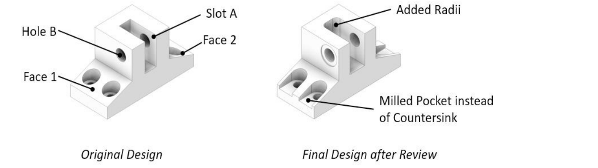
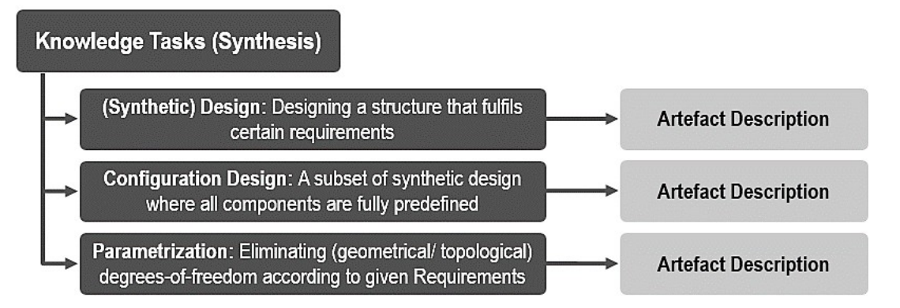
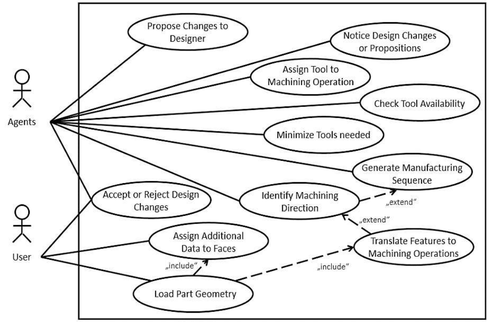
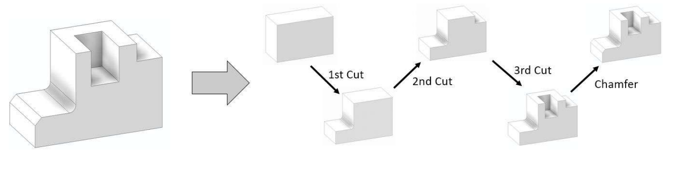
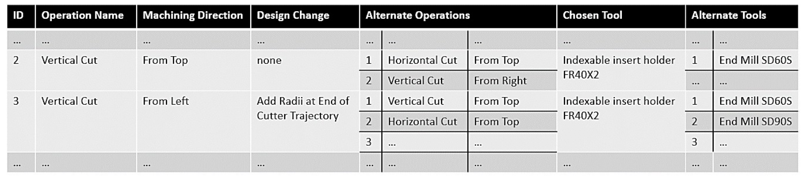
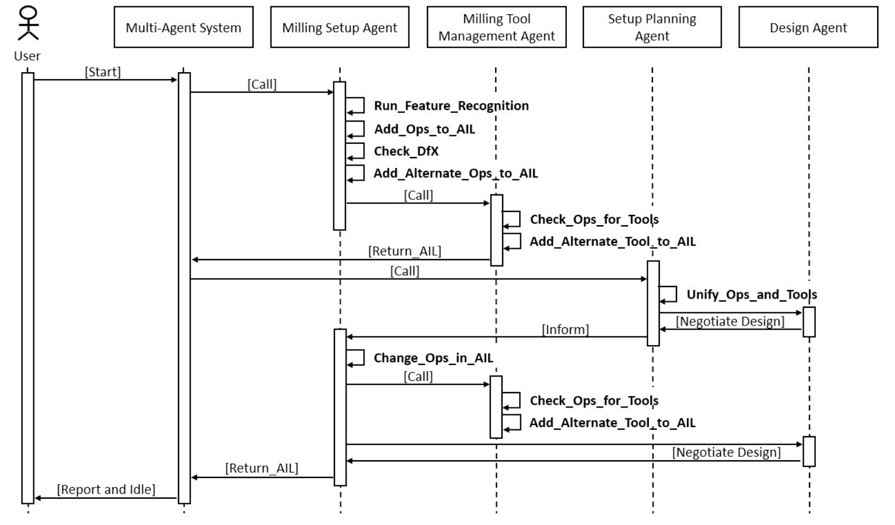
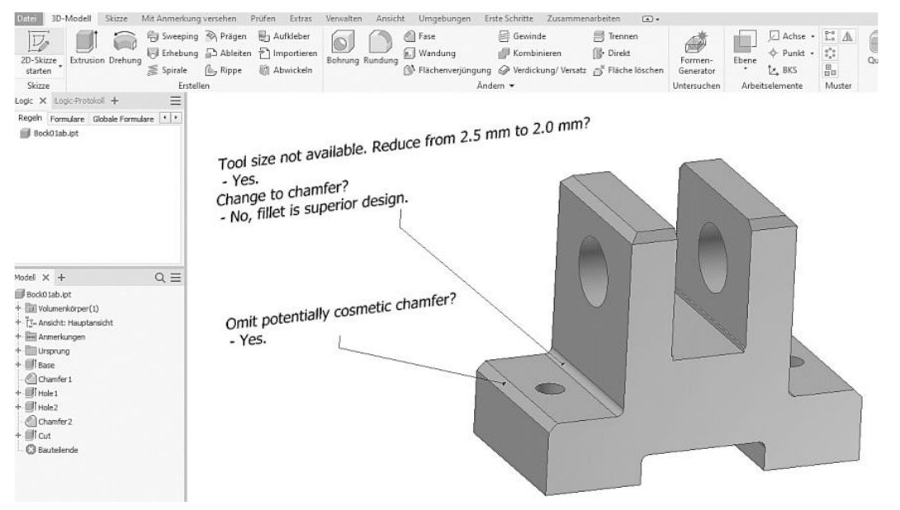

# 用于机械工程零件分析与优化的多智能体系统中的智能体协作

**原文标题：** Agent Collaboration in a Multi-Agent-System for Analysis and Optimization of Mechanical Engineering Parts

**作者：** Paul Christoph Gembarski（通讯作者）  
**作者单位：** 德国汉诺威莱布尼茨大学产品开发研究所（Institute of Product Development, Leibniz Universität Hannover），An der Universität 1，30823 Garbsen，Germany  
**通讯邮箱：** gembarski@ipeg.uni-hannover.de  
**通讯电话：** +49-511-762-5361；**传真：** +49-511-762-4506  
**出处：** Procedia Computer Science，第 176 卷，2020 年，第 592–601 页  
**会议：** 第 24 届知识驱动与智能信息及工程系统国际会议（KES 2020）  
**DOI：** [10.1016/j.procs.2020.08.061](https://doi.org/10.1016/j.procs.2020.08.061)  
**原文页面：** [ScienceDirect](https://www.sciencedirect.com/science/article/pii/S1877050920318858)

> 整理说明：本译文依据用户提供的 `11.pdf`（10 页）逐段翻译正文，保留章节结构、文献编号及全部 7 幅图。原图中的英文标注另附中文对照，参考文献保留原题名并提供中文译名。原文在第 598 页和第 599 页重复使用“图 6”，本文件按出现顺序将后一幅图标为“图 7（原文亦编号为图 6）”。

## 摘要

在机械工程领域，设计人员需要与不同领域的专家（例如制造领域的专家）反复评审设计对象，以避免后期修改，并获得稳健且经过优化的设计方案。为了支持设计人员，基于知识的工程提供了一系列方法和技术，用于对工程知识进行形式化表达，并将其融入通用产品模型或决策支持系统。

多智能体系统是一种尤其适合当今设计过程并行特征、同时支持多目标决策的实现方式。这类系统由能够自主行动、与环境进行智能交互，并开展通信与协作的实体组成。本文讨论将这样的多智能体系统作为计算机辅助设计软件的扩展。在该系统中，智能体扮演领域专家的角色，例如制造工艺专家，并针对机械工程零件的设计优化提出建议。

本文重点关注各智能体之间的协作机制。为此，提出使用一份行动事项清单，作为集中式的信息与知识共享平台。

**关键词：** 多智能体系统（Multi-Agent System）；基于知识的工程（Knowledge-Based Engineering）；计算机辅助设计（Computer-Aided Design）；设计优化（Design Optimization）。

## 1. 引言

在现代产品开发中，使用软件工具已成为许多学科的常规做法 [1]。这类计算机辅助工程环境包括计算机辅助设计（CAD）工具等，可用于定义产品形状、生产信息等内容 [2]。随着时间推移，机械工程领域的 CAD 系统已从二维线条绘制工具发展为功能强大的参数化三维设计系统。设计人员只需改变长度尺寸等参数值，或添加、删除特征，就能够修改零件及装配体；前提是这些变更可以按照底层数据模型的约束传播 [3]。如今，CAD 系统甚至能够存储和处理工程知识，例如尺寸计算公式、设计规则以及能够方便地适应新应用场景的智能模板 [4]。这使基于知识的工程能够在专用软件或专家系统之外得到应用 [5]。

应区分两类设计任务。**常规设计（routine design）**可以完全自动化，产品配置就是一例 [6]。其基础是定义一个产品模型，为模型赋予规定的自由度和选项，并定义一个过程模型，用于说明设计人员或客户如何描述所需产品 [7]。因此，CAD 模型所表达的不只是某一个变型，而是包含所有有效变型的解空间 [8, 9]。

与常规设计相比，**创造性设计（creative design）**任务具有结构不明确、不确定性较强的特点，其解空间大到难以建立完整模型；在概念设计阶段考虑不同物理解原理时，尤其如此 [10]。因此，对于创造性设计，基于知识的工程主要作为人类设计人员的决策支持、问题求解支持或协作伙伴发挥作用 [11–13]。

### 1.1. 研究动机

尽管上述系统具备多种能力和潜在优势，技术产品的开发仍是一项复杂任务，通常涉及不同设计领域的多位专家 [10]。按照产品生命周期的理念，并行工程范式要求产品开发部门在开发过程的每个阶段，都与来自不同职能部门的专家共同评审设计对象。这些部门包括制造部门（涉及装夹规划、刀具配置、夹具设计等）、处置部门或服务工程部门 [14]。其目的在于提高决策质量、避免后期变更，从而缩短开发周期 [1]。

**图 1. 标注了表面和特征的安装支架。**

| 图中原文 | 中文译文 |
| --- | --- |
| Hole B | 孔 B |
| Slot A | 槽 A |
| Face 1 / Face 2 | 表面 1 / 表面 2 |
| Original Design | 原始设计 |
| Added Radii | 新增圆角 |
| Milled Pocket instead of Countersink | 用铣削凹腔代替锥形沉孔 |
| Final Design after Review | 评审后的最终设计 |

例如，在机械工程零件初步设计的评审中，可以依据 DfX（Design for eXcellence，面向卓越的设计）等设计准则检查几何形状；其中 X 是占位符，可以代表可制造性等目标 [15]。对于减材制造零件的优化，图 1 所示支架的设计评审片段，可以说明其中会出现的讨论与决策。

针对表面 1 和表面 2 的倾斜，评审首先讨论：这些斜面是否需要铣削，还是已经包含在半成品材料中。确认属于后一种情况后，斜面本身就不再被视为问题。但是，对于四个钻孔的锥形沉孔，工艺规划工程师发现了一项困难：由于表面较硬，并且可能较粗糙，锪孔刀具可能发生偏斜。根据其经验，这会导致生产缺陷。

为了避免换刀，他建议使用加工槽 A 的同一把刀具，以铣削凹腔代替这些锥形沉孔，因为相应立铣刀的刀柄长度足够。

回到 CAD 与基于知识的工程：若要在并行工程中使用一个系统来分析和优化机械工程零件，该系统就必须能够模拟上述讨论、获取领域专家的专业知识，并将其应用于任意零件几何形状。最后一项要求尤其具有挑战性，因为这不同于产品配置：不存在一个通用产品模型，可通过限制某个已知且可直接访问的尺寸参数的取值范围，来满足生产设备行程等限制 [16]。此外，这样的系统还需要能够感知几何模型的特征及其参数，并结合刀具清单、制造工序等知识来源理解这些信息。

基于多智能体系统，可以实现满足这类多目标决策要求的方案 [17]。多智能体系统由能够自主行动、与环境进行智能交互，并开展通信和协作的实体组成 [18]。尽管它尚未得到广泛应用，但在工程学科中具有多样的应用潜力：从生产系统控制、智能电网等复杂系统的建模与仿真，到工作流管理，都在其应用范围内 [19]。此外，已经有个别原型实现了基于 CAD 模型推导制造工序 [20]，以及依据简单设计准则优化设计 [21]。

### 1.2. 本文范围与结构

本文沿着上述方向继续研究，提出将这类多智能体系统作为标准 CAD 软件扩展的概念方案。智能体扮演领域专家的角色，对机械工程零件进行分析，并提出设计优化建议。本文重点讨论各智能体的组织方式及其协作机制。因此，提出使用行动事项清单，作为各智能体集中共享信息与知识的平台。

本文结构如下：第 2 节介绍与产品开发相关的基于知识的工程和多智能体系统的理论背景及相关工作；第 3 节讨论基于智能体的分析与优化工具的概念；第 4 节介绍围绕行动事项清单协同工作的智能体组织方式；第 5 节简要介绍初步实现，并开展可行性研究；最后，第 6 节给出讨论与结论，并指出未来研究方向。

## 2. 理论背景与相关工作

### 2.1. 基于知识的工程系统

基于知识的工程（KBE）系统是知识系统的一个子类；知识系统应理解为计算机辅助问题求解工具的统称 [22]。具体而言，KBE 是一组技术，用于实现设计任务的部分或完全自动化，并建立易于适应新需求的产品模型 [6]。KBE 可以视为计算机辅助工程的一个演进阶段，由面向对象编程、人工智能与 CAD 相结合而形成 [23]。

从任务角度看，KBE 系统执行不同的知识任务，并输出设计对象的描述（图 2）。**综合设计（synthetic design）**是设计一个满足规定要求的系统。这些要求首先由用户提出，然后由 KBE 系统将其转化为可执行的形式。硬性要求使 KBE 系统能够筛选那些基于系统构建知识所生成的候选设计；软性要求则使系统能够评估多个有效设计并对其排序 [24]。

**配置（configuration）**是使用完全预定义的构件组装一个系统，各构件通过标准化接口相互匹配。从信息科学角度看，配置任务可以表述并求解为约束满足问题 [7]。**参数化（parametrization）**则通过设置参数值，消除可变产品模型中的自由度；约束满足技术也适用于此类任务 [11]。

**图 2. 输出设计对象描述的基于知识的工程任务（依据文献 [11]）。**

| 图中任务 | 中文说明 | 输出 |
| --- | --- | --- |
| Knowledge Tasks (Synthesis) | 知识任务（综合） | — |
| (Synthetic) Design | 综合设计：设计满足特定要求的结构 | 设计对象描述 |
| Configuration Design | 配置设计：综合设计的一个子集，其中所有组件均已完全预定义 | 设计对象描述 |
| Parametrization | 参数化：根据给定要求消除几何或拓扑自由度 | 设计对象描述 |

为了自动执行这些任务或任务组合，KBE 系统必须具备推理能力 [25]。因此，前提是实现两类基本知识 [24]：

1. **领域知识：**构成一个解空间，在其中能够找到满足给定要求的特定解。例如，可通过产品模型的参数约束、公式和设计规则等建立领域知识模型 [11]。
2. **控制知识：**即实际的推理知识，规定如何探索解空间，并整合基于规则、基于模型或基于案例的推理技术 [26]。

在 KBE 系统的实现中，基于知识的 CAD 将设计规则、尺寸计算公式、电子表格、宏和交互式应用等，集成到工程设计的标准建模工具——CAD 系统本身——之中 [4]。虽然这些能力已经存在，但实际应用报道仍比较零散。典型应用包括航空航天与汽车工程中的设计综合 [27]、工厂工程中的概念设计或配置设计 [28]，以及夹具设计自动化等特定设计活动 [29]。

这些方法的共同点是：知识对象和模型都必须被显式实现。对于前文研究动机中所述的设计评审，这些传统方法并不适用。以铣削零件为例，涵盖所有可能设计的解空间过于庞大，无法通过这种方式整合进单个 KBE 系统。

### 2.2. 产品开发中的多智能体系统

自 20 世纪 80 年代起，基于智能体的建模与仿真以及多智能体系统，就已被提出用于各种应用 [18–20]。术语“智能体”的定义仍有待标准化，但文献普遍认为，智能体是一种软件实体，能够在没有人类用户干预的情况下自主运行，以完成某项任务 [21]。为此，智能体需要感知与任务相关的环境、对环境变化作出反应，并了解行动可能产生的后果 [29]。由于多智能体系统的实现通常包含多个智能体，各个智能体还需要能够与其他智能体或用户进行通信与协作 [31]。

这类协作在多智能体系统中至关重要，至少表现为两类交互：信息交换与协商 [18]。对于信息交换，已有不同协议和行为方案被提出：从声明发送方、接收方、意图和行动请求的简单消息交换机制 [32]，到更复杂的交互控制，即定义通信权限，以管理层级式智能体系统中的通信 [33]。

协商方面的例子包括：基于规则或算法的拍卖与竞价模型 [34, 35]；基于经典控制理论与网络理论、整合执行器—采样器—控制器—扰动的方案 [36]；以及学习策略和“适者生存”等演化方法的实现 [37]。

从文献中可以识别出与产品开发及工程设计相关的四个核心应用领域：

1. 协同工程中的工作流管理，例如文献 [38, 39]。
2. 系统行为与控制回路的仿真，例如文献 [19]。
3. 设计对象的综合或再工程，例如文献 [30, 31, 40]。
4. 根据设计准则分析产品特性，例如文献 [20, 21]。

对于设计评审，最后一个应用领域与之较为相似，因为已有系统也能够优化设计。然而，大多数方法仅关注范围较窄的一组设计准则，例如面向回收的设计中的“减少连接数量”“减少零件数量”或“减少子装配体中不同材料的数量”。虽然这在很大程度上对应于生态设计专家等人员的专业知识，但这些准则的复杂度较低，因为几乎不需要额外的上下文信息，仅依据物料清单和装配体的 CAD 模型即可检查。

若要实现具备工艺规划及制造专家专业知识的多智能体系统，就需要利用其他知识来源。此外，还需要模拟设计人员本身，以判断变更请求或为原始设计进行辩护。

## 3. 机械工程零件的智能体分析与优化工具：概念设计

结合多次设计评审的观察、领域专家的评价以及文献中的相关工作，一个能够开展设计评审、并以机械工程零件优化为目标的多智能体系统，应满足以下基本要求：

- 工具必须完全融入设计人员的工作流，因此需要直接处理 CAD 文件，并在 CAD 环境中运行。工具可以集成到 CAD 系统中，也可以与之连接，即远程控制 CAD 系统。
- 除几何信息外，还需要公差、表面质量及载荷等信息，作为分析加工操作的依据。其中一些信息可以直接定义在 CAD 系统几何模型的表面上；例如，载荷路径必须由用户声明。
- 对于加工操作，必须纳入具体机床与刀具组合的对应关系，以推理装夹规划及可实现的公差，因为这些结果取决于机床—刀具配对。
- 系统必须以迭代方式工作；如果提出某项调整，就必须相应地分析调整后的新状态。
- 系统得出的所有结论必须能够解释，并应定性展示其对**功能满足程度、零件质量（mass）、加工操作数量及换刀次数**的影响。
- 用户是系统的主动参与者，系统可以向用户询问其他相关信息。

**图 3. 作为设计评审活动规范的用例图（节选）。**

| 图中原文 | 中文译文 |
| --- | --- |
| Agents / User | 智能体 / 用户 |
| Propose Changes to Designer | 向设计人员提出修改建议 |
| Notice Design Changes or Propositions | 感知设计变更或建议 |
| Assign Tool to Machining Operation | 为加工操作分配刀具 |
| Check Tool Availability | 检查刀具可用性 |
| Minimize Tools needed | 尽量减少所需刀具 |
| Generate Manufacturing Sequence | 生成制造工序 |
| Identify Machining Direction | 识别加工方向 |
| Translate Features to Machining Operations | 将特征转换为加工操作 |
| Accept or Reject Design Changes | 接受或拒绝设计变更 |
| Assign Additional Data to Faces | 为表面补充数据 |
| Load Part Geometry | 加载零件几何模型 |
| include / extend | 包含 / 扩展（用例关系） |

图 3 的用例图展示了系统在模拟设计评审时必须执行的部分活动。CAD 模型是所有这些活动共同使用的边界对象。模型的组成部分，例如特征树、参数表，以及模型形状本身的数学表示，都可以用作特征识别和智能体感知的基础。形状的数学表示由各个表面组成，并附带 ID、类型、父特征、包围盒尺寸，以及表面质量或公差等技术信息。由于本文的重点在其他方面，此处不再进一步讨论这类零件信息库，以及刀具数据库等其他知识来源。

## 4. 智能体协作的组织方式

系统重点关注的是制造零件所需的加工操作顺序，因为加工操作是分析设计准则的基础。参照文献 [33]，这样的操作清单可以抽象为一份**行动事项清单（Action Item List，AIL）**。此外，智能体的知识库可以抽象为产生式规则：系统需要检查条件，并根据条件触发后续行动。产生式规则易于阅读；若单个智能体的规则库过于庞大，还可以通过元模型对其进行拆分和组织。与此同时，规则也是基于知识的工程 [41] 以及机器人流程自动化（RPA）[42, 43] 中已得到充分理解的方法。

为了便于理解，下面将结合一个贯穿本节的示例（图 4）说明控制流程和智能体交互。本节末尾的图 6 给出了汇总时序图。

**图 4. 贯穿示例。** 图中依次标注：第一次切削（1st Cut）、第二次切削（2nd Cut）、第三次切削（3rd Cut）以及倒角（Chamfer）。

1. **初始化与建立清单。** 在 CAD 零件模型上初始化多智能体系统时，具有相应特征识别与感知能力的智能体首先分析模型，根据识别出的加工操作，以表格形式建立初始行动事项清单（AIL）。在本例中，**铣削工艺准备智能体（milling setup agent）**识别出三次切削，其中一次带有内圆角，此外还识别出一个需要加工的倒角。每项加工操作由 ID、名称及加工方向描述，例如从顶部、从左侧或采用第四轴加工。初始加工方向依据最小加工深度确定。对于第一次切削，从左侧加工所需的深度小于从顶部加工。

2. **依据设计准则检查几何形状。** 第二步，铣削工艺准备智能体依据相关设计准则检查几何形状。在本例中，第三次切削存在问题，因为没有刀具退刀空间。针对这类情况，智能体规则库包含如下规则：**“如果铣削切口没有退刀空间，并且切口是连续的，则在刀具轨迹末端增加圆角。”** 该指令作为设计变更存储到 AIL 的相应行中，但此时不在 CAD 模型中执行。对于可能仅具有外观作用的倒角，也采用类似处理方式。

3. **加入替代加工操作。** 第三步，铣削工艺准备智能体从通用应对方案库中选取替代加工操作，并以子数组形式加入 AIL。这些替代方案可能包括从不同方向进行加工，或采用其他铣削方式，例如将立铣刀改为盘铣刀，从而需要另一种零件装夹方式。每个替代方案都附带根据规则库计算出的优先级。某些操作没有替代方案，例如键槽铣削；对应条目保持为空。

4. **分配刀具与处理可用性。** 第四步，**铣削刀具管理智能体（milling tool management agent）**为 AIL 中的每个条目建立刀具数据库。如果某项操作没有可用的对应刀具，并且替代操作子数组也为空，则该操作被标记为存在问题，并生成警报。如果替代操作子数组中存在配有相应刀具的条目，则第一个这样的替代方案覆盖原始操作，其余替代方案的优先级依次前移。所有可用刀具都以另一个子数组的形式，存储在加工操作及其替代操作之下，以便后续访问，并根据智能体规则库确定优先级。图 5 展示了 AIL 的一个节选。

**图 5. 行动事项清单（AIL，节选）。**

下表将原图的多层表头和单元格整理为中文。省略号沿用原图，表示未展示的条目。

| ID | 操作名称 | 加工方向 | 设计变更 | 替代操作（按优先级） | 选用刀具 | 替代刀具（按优先级） |
| --- | --- | --- | --- | --- | --- | --- |
| 2 | 垂直切削 | 从顶部 | 无 | 1. 水平切削，从顶部；2. 垂直切削，从右侧 | 可转位刀片刀杆 FR40X2 | 1. 立铣刀 SD60S；…… |
| 3 | 垂直切削 | 从左侧 | 在刀具轨迹末端增加圆角 | 1. 垂直切削，从顶部；2. 水平切削，从顶部；3. …… | 可转位刀片刀杆 FR40X2 | 1. 立铣刀 SD60S；2. 立铣刀 SD90S；3. …… |

5. **减少装夹准备工作量。** **装夹规划智能体（setup planning agent）**的目标是尽量减少装夹准备工作量。为此，它首先在可行的情况下，通过替换原始加工操作与替代加工操作来统一加工方向。在本例中，所有加工操作都改为从顶部加工。其次，它尽量减少使用的刀具数量。

6. **协商设计修改。** 装夹规划智能体开始与**设计智能体（design agent）**协商可能进一步减少装夹准备工作量的模型修改。对于本例，可以提出这样一个问题：能否省略第一次切削的内圆角，从而使用与第三次切削相同的刀具？如果设计智能体拒绝，装夹规划智能体就会询问，能否在第三次切削中增加同样的内圆角。如果设计智能体同意，就存储相应的设计变更。

7. **放宽约束并检查敏感性。** 第七步，铣削工艺准备智能体进一步放宽几何约束，并检查敏感性。例如，如果增大第二次切削的宽度，或者将该切削延伸至零件全长，会发生什么情况？如果能够改善装夹方案，就与设计智能体协商相应变更；变更被接受时存储设计变更，被拒绝时则不采用。

8. **执行、评估与记录。** 最后，执行所有设计变更，评估其对功能满足程度和重量的影响，形成装夹方案文档，并保存本次会话记录。

**图 6. 围绕行动事项清单开展智能体交互的时序图。**

图中的参与方依次为：用户、多智能体系统、铣削工艺准备智能体、铣削刀具管理智能体、装夹规划智能体和设计智能体。

| 图中消息或操作 | 中文译文 |
| --- | --- |
| Start / Call / Inform | 启动 / 调用 / 通知 |
| Run_Feature_Recognition | 执行特征识别 |
| Add_Ops_to_AIL | 向 AIL 添加加工操作 |
| Check_DfX | 检查 DfX 设计准则 |
| Add_Alternate_Ops_to_AIL | 向 AIL 添加替代加工操作 |
| Check_Ops_for_Tools | 检查加工操作所需的刀具 |
| Add_Alternate_Tool_to_AIL | 向 AIL 添加替代刀具 |
| Return_AIL | 返回 AIL |
| Unify_Ops_and_Tools | 统一加工操作与刀具 |
| Negotiate Design | 协商设计方案 |
| Change_Ops_in_AIL | 修改 AIL 中的加工操作 |
| Report and Idle | 报告结果并进入空闲状态 |

各智能体之间的调用命令可以由事件触发机制替代。例如，铣削刀具管理智能体可以响应 AIL 的 `OnChange` 事件，使得每当清单新增或修改一行时，都执行刀具检查。

另一个问题是如何处理第四步刀具分配时生成的警报。对此，铣削工艺准备智能体也拥有规则库，并会开始与设计智能体协商。应对方案库包括改变特征尺寸、替换特征，或根据给定要求创建新特征。

在本例中，第一次切削包含内圆角。警报会指出，没有这一尺寸的可用刀具。由于如第六步所述，省略圆角并不可行，铣削工艺准备智能体会建议将圆角尺寸从 5 mm 减小到 4 mm，因为存在对应的立铣刀。设计智能体可能指出，由于该处的应力分布要求，5 mm 已经是最小值。此时，剩余选择包括增大圆角半径、将圆角改为倒角，或将加工方向改为从前方加工。

## 5. 原型实现与可行性研究

原型系统在 CAD 系统 Autodesk Inventor Professional 2020 中实现，同时使用 MS Excel 作为电子表格应用，使用 VB.NET 作为编程接口。作为概念验证，应实现铣削与钻削智能体，因为这两类加工都依赖设计准则；这些准则能够以可接受的工作量实现，只需对特征树或物料清单进行简单评估即可。

为了减少编程工作量，原型实现没有包含设计变更的实际执行。相应地，系统在希望修改的几何元素上添加注释。这些注释以纯文本形式展示智能体的协商过程。

测试案例选择了一个叉形连接件（clevis），其若干特征与本文引言中提到的支架相似（图 1）。将零件文件加载到 CAD 系统后，启动分析与优化工具。

**图 7. 带有智能体对话注释的 Inventor 零件文档（原文亦编号为图 6）。**

图中对话译文：

- **所需尺寸的刀具不可用。是否从 2.5 mm 减小到 2.0 mm？**——是。
- **是否改为倒角？**——否，圆角是更优的设计。
- **是否省略可能仅具有外观作用的倒角？**——是。

系统成功识别出模型中的四次切削和三个钻孔操作，其中叉形件的通孔被视为一个钻孔操作。对于外部切削，为了尽量减少装夹次数，并考虑到存在具有较长刀柄的可转位刀片刀杆，系统将加工方向设定为从顶部加工。

智能体判断某个倒角仅具有外观作用，并建议省略。由于刀具数据库中没有能够加工 2.5 mm 内圆角的刀具，智能体将圆角半径减小。随后，按照第六步和第七步，智能体协商是否将圆角替换为倒角，因为这样可以使用与叉形件顶部倒角相同的刀具加工。但从应力角度看，圆角属于更优的设计，因此没有提出这一设计变更。

## 6. 讨论与结论

所实现的原型展示了所设计的智能体分析与优化工具的工作方式和功能原理。研究验证了：行动事项清单为智能体的组织与信息交换提供了一种基础机制。在后续实现中，这一机制将扩展到自动修改 CAD 模型。接下来的挑战是可靠地识别变更所针对的模型元素，例如几何形状中的表面或边。

每种制造技术都需要特定的专业知识，并具有自身的设计准则，其中部分准则可能与其他准则冲突。原则上，可以通过规则提供冲突管理机制，装夹规划智能体与设计智能体之间的协商就是一个例子。然而，要判断哪一种设计更优，就必须整合有关所建模零件功能的知识、功能对特征及精度的需求，以及装配体中相邻零件提出的要求。在这种情况下，让人类设计人员参与判断多智能体系统所提出的替代设计，也是一种值得考虑的交互方式。

已实现的原型系统存在一项局限，同时也可能成为后续研究的起点：它主要关注棱柱类几何形状，这使可制造性检查相对容易。铸造或增材制造中的自由曲面几何形状，则需要不同层次的感知能力。在某些特定情况下，例如铸造设计准则“避免材料堆积”，采用人工智能开展图像或体素处理，可能是一种有价值的方法。

另一项局限是知识建模必须显式完成。所有智能体规则库都由预先规定的规则组成，在当前阶段，智能体不会自行修改规则库。为了符合智能体的原则，整合学习能力将是有益的。在这方面，一个可能的起点是整合基于案例的推理系统：将行动事项清单与装夹清单、零件几何形状共同用作案例的表示。

## 参考文献

保留原文编号、作者、原题名及出版信息，并提供题名的中文译文。文献 [17] 与 [33] 在原文中重复，以下按原编号保留。

[1] Vajna, Sandor (2014). “Integrated Design Engineering.” Berlin Heidelberg, Springer.  
**题名译文：**《集成设计工程》。

[2] Stroud, Ian, and Hildegarde Nagy (2011). “Solid modelling and CAD systems.” Berlin Heidelberg, Springer.  
**题名译文：**《实体建模与 CAD 系统》。

[3] Shah, Jami J. (2001). “Designing with parametric cad: Classification and comparison of construction techniques.” *Geometric Modelling*: 53–68.  
**题名译文：**《使用参数化 CAD 进行设计：构建技术的分类与比较》。

[4] Hirz, Mario, Dietrich, Wilhelm, Gfrerrer, Anton, and Johann Lang (2013). “Integrated computer-aided design in automotive development.” Berlin Heidelberg, Springer.  
**题名译文：**《汽车开发中的集成计算机辅助设计》。

[5] Hopgood, Adrian A. (2016). “Intelligent systems for engineers and scientists.” Boca Raton, CRC Press.  
**题名译文：**《面向工程师与科学家的智能系统》。

[6] Verhagen, Wim J.C., Bermell-Garcia, Pablo, van Dijk, Reinier E.C., and Richard Curran (2012). “A critical review of Knowledge-Based Engineering: An identification of research challenges.” *Advanced Engineering Informatics* **26**(1): 5–15.  
**题名译文：**《基于知识的工程的批判性综述：研究挑战的识别》。

[7] Felfernig, Alexander, Hotz, Lothar, Bagley, Claire, and Juha Tiihonen (2014). “Knowledge-based configuration: From research to business cases.” Burlington, Morgan Kaufmann.  
**题名译文：**《基于知识的配置：从研究到商业案例》。

[8] Gembarski, Paul Christoph, and Roland Lachmayer (2018). “Solution space development: conceptual reflections and development of the parameter space matrix as planning tool for geometry-based solution spaces.” *International Journal of Industrial Engineering and Management* **9**(4): 177–186.  
**题名译文：**《解空间开发：概念反思及作为几何解空间规划工具的参数空间矩阵开发》。

[9] Skarka, Wojciech (2007). “Application of MOKA methodology in generative model creation using CATIA.” *Engineering Applications of Artificial Intelligence* **20**(5): 677–690.  
**题名译文：**《MOKA 方法在使用 CATIA 创建生成式模型中的应用》。

[10] Pahl, Gerhard, Beitz, Wolfgang, Feldhusen, Jörg, and Karl-Heinz Grote (2007). “Engineering Design - A Systematic Approach.” Berlin Heidelberg, Springer.  
**题名译文：**《工程设计：系统化方法》。

[11] Gembarski, Paul Christoph, Bibani, Mehdi, and Roland Lachmayer (2016). “Design Catalogues: Knowledge Repositories for Knowledge-Based-Engineering Applications.” In Marjanović, Dorian, Štorga, Mario, Pavković, Neven, Bojčetić, Nenad, and Stanko Škec (eds), *Proceedings of the DESIGN 2016 14th International Design Conference*. Glasgow, The Design Society.  
**题名译文：**《设计目录：面向基于知识的工程应用的知识库》。

[12] Li, Haibing, Gembarski, Paul Christoph, and Roland Lachmayer (2018). “Template-Based Design for Design Co-Creation.” In Wodehouse, Andrew, Georgiev, Georgi, Cascini, Gaetano, Dekoninck, Elies, and Chris Snider (eds), *Proceedings of the 5th International Conference on Design Creativity (ICDC2018)*. Glasgow, The Design Society.  
**题名译文：**《面向设计共创的模板式设计》。

[13] Brockmöller, Tim, Gembarski, Paul Christoph, Mozgova, Iryna, and Roland Lachmayer (2017). “Design catalogue in a CAE environment for the illustration of tailored forming.” In *Proceedings of the 59th Ilmenau Scientific Colloquium*. Ilmenau, TU Ilmenau.  
**题名译文：**《用于展示定制成形的 CAE 环境设计目录》。

[14] Ullman, David G. (2009). “The mechanical design process.” New York, McGraw Hill Higher Education.  
**题名译文：**《机械设计过程》。

[15] Huang, George Q. (1996). “Design for X - Concurrent engineering imperatives.” Berlin Heidelberg, Springer.  
**题名译文：**《面向 X 的设计：并行工程的必备要求》。

[16] Gembarski, Paul Christoph, Sauthoff, Bastian, Brockmöller, Tim, and Roland Lachmayer (2016). “Operationalization of Manufacturing Restrictions for CAD and KBE-Systems.” In Marjanović, Dorian, Štorga, Mario, Pavković, Neven, Bojčetić, Nenad, and Stanko Škec (eds), *Proceedings of the DESIGN 2016 14th International Design Conference*. Glasgow, The Design Society.  
**题名译文：**《制造约束在 CAD 与 KBE 系统中的操作化》。

[17] Mönch, Lars, and Marcel Stehli (2006). “ManuFAg: a multi-agent-system framework for production control of complex manufacturing systems.” *Information Systems and e-Business Management* **4**(2): 159–185.  
**题名译文：**《ManuFAg：用于复杂制造系统生产控制的多智能体系统框架》。

[18] Jennings, Nicholas R., and Michael J. Wooldridge (1998). “Agent Technology - Foundations, Applications, and Markets.” Berlin Heidelberg, Springer.  
**题名译文：**《智能体技术：基础、应用与市场》。

[19] Taylor, Simon (2014). “Agent-based Modeling and Simulation.” Basingstoke, Palgrave Macmillan.  
**题名译文：**《基于智能体的建模与仿真》。

[20] Sun, J., Zhang, Y.F., and A.Y.C. Nee (2001). “A distributed multi-agent environment for product design and manufacturing planning.” *International Journal of Production Research* **39**(4): 625–645.  
**题名译文：**《用于产品设计与制造规划的分布式多智能体环境》。

[21] Dostatni, Ewa, Diakun, Jacek, Grajewski, Damian, Wichniarek, Radoslaw, and Anna Karwasz (2016). “Multi-agent system to support decision-making process in design for recycling.” *Soft Computing* **20**(11): 4347–4361.  
**题名译文：**《支持面向回收设计决策过程的多智能体系统》。

[22] Milton, Nick R. (2008). “Knowledge technologies.” Monza, Polimetrica sas.  
**题名译文：**《知识技术》。

[23] Chapman, Craig B., and Martyn Pinfold (2001). “The application of a knowledge based engineering approach to the rapid design and analysis of an automotive structure.” *Advances in Engineering Software* **32**(12): 903–912.  
**题名译文：**《基于知识的工程方法在汽车结构快速设计与分析中的应用》。

[24] Schreiber, Guus, Wielinga, Bob, de Hoog, Robert, Akkermans, Hans, and Walter van de Velde (1994). “CommonKADS: A comprehensive methodology for KBS development.” *IEEE Expert* **9**(6): 28–37.  
**题名译文：**《CommonKADS：知识系统开发的综合方法论》。

[25] Sabin, Daniel, and Rainer Weigel (1998). “Product configuration frameworks - a survey.” *IEEE Intelligent Systems* **13**(4): 42–49.  
**题名译文：**《产品配置框架综述》。

[26] Gembarski, Paul Christoph (2019). “Komplexitätsmanagement mittels wissensbasiertem CAD – Ein Ansatz zum unternehmenstypologischen Management konstruktiver Lösungsräume.” Garbsen, TEWISS.  
**题名译文：**《利用基于知识的 CAD 管理复杂性：一种按企业类型管理设计解空间的方法》。

[27] La Rocca, Gianfranco (2012). “Knowledge based engineering - Between AI and CAD. Review of a language based technology to support engineering design.” *Advanced Engineering Informatics* **26**(2): 159–179.  
**题名译文：**《基于知识的工程：介于 AI 与 CAD 之间——支持工程设计的基于语言的技术综述》。

[28] Hvam, Lars, Mortensen, Niels H., and Jesper Riis (2008). “Product customization.” Berlin Heidelberg, Springer.  
**题名译文：**《产品定制》。

[29] Boyle, Iian, Rong, Yiming, and David C. Brown (2011). “A review and analysis of current computer-aided fixture design approaches.” *Robotics and Computer-Integrated Manufacturing* **27**(1): 1–12.  
**题名译文：**《现有计算机辅助夹具设计方法的综述与分析》。

[30] Fougères, Alain-Jerome, and Egon Ostrosi (2018). “Intelligent agents for feature modelling in computer aided design.” *Journal of Computational Design and Engineering* **5**(1): 19–40.  
**题名译文：**《用于计算机辅助设计中特征建模的智能体》。

[31] Chen, Yong, Liu, Ze-Lin, and You-Bai Xie (2014). “A multi-agent-based approach for conceptual design synthesis of multi-disciplinary systems.” *International Journal of Production Research* **52**(6): 1681–1694.  
**题名译文：**《用于多学科系统概念设计综合的多智能体方法》。

[32] Hmida, Faten Ben, Anne Seguy, and Rémy Dupas (2012). “MultiAgent Systems for Production Planning and Control in Supply Chains.” In Omatu, S. et al. (eds), *Distributed Computing and Artificial Intelligence*, pp. 205–212.  
**题名译文：**《供应链中用于生产计划与控制的多智能体系统》。

[33] Mönch, Lars, and Marcel Stehli (2006). “ManuFAg: a multi-agent-system framework for production control of complex manufacturing systems.” *Information Systems and e-Business Management* **4**(2): 159–185.  
**题名译文：**《ManuFAg：用于复杂制造系统生产控制的多智能体系统框架》。

[34] Ganzha, Maria, and Marcin Paprzycki (2007). “Implementing rule-based automated price negotiation in an agent system.” *Journal of Universal Computer Science* **13**(2): 244–266.  
**题名译文：**《在智能体系统中实现基于规则的自动价格协商》。

[35] Adhau, Sunil, Murali Lal Mittal, and Abhinav Mittal (2012). “A multi-agent system for distributed multi-project scheduling: An auction-based negotiation approach.” *Engineering Applications of Artificial Intelligence* **25**(8): 1738–1751.  
**题名译文：**《用于分布式多项目调度的多智能体系统：基于拍卖的协商方法》。

[36] Ding, Lei, Qing-Long Han, and Ge Guo (2013). “Network-based leader-following consensus for distributed multi-agent systems.” *Automatica* **49**(7): 2281–2286.  
**题名译文：**《分布式多智能体系统中基于网络的领导者跟随一致性》。

[37] Banjo, Olatunde, Stewart, David, and Maria Fasli (2016). “Optimising Mixed Model Assembly Lines for Mass Customisation: A Multi Agent Systems Approach.” In *Advances in Manufacturing Technology XXX: Proceedings of the 14th International Conference on Manufacturing Research*, pp. 337–343.  
**题名译文：**《面向大规模定制的混流装配线优化：多智能体系统方法》。

[38] Huang, Ching-Jen, Trappey, Amy JC., and Yin-Ho Yao (2006). “Developing an agent-based workflow management system for collaborative product design.” *Industrial Management & Data Systems* **106**(5): 680–699.  
**题名译文：**《开发用于协同产品设计的智能体工作流管理系统》。

[39] Juan, Yeh-Chun, Ou-Yang, Chao, and Jiun-Shiung Lin (2009). “A process-oriented multi-agent system development approach to support the cooperation-activities of concurrent new product development.” *Computers & Industrial Engineering* **57**(4): 1363–1376.  
**题名译文：**《支持并行新产品开发协作活动的面向过程的多智能体系统开发方法》。

[40] Huang, Chun-Che (2004). “A multi-agent approach to collaborative design of modular products.” *Concurrent Engineering* **12**(1): 39–47.  
**题名译文：**《模块化产品协同设计的多智能体方法》。

[41] Gembarski, Paul Christoph, and Roland Lachmayer (2017). “How Rule-based Systems impact Product Complexity.” *Annals of the Faculty of Engineering Hunedoara-International Journal of Engineering* **15**(1): 17–24.  
**题名译文：**《基于规则的系统如何影响产品复杂性》。

[42] Davenport, Thomas H. (2018). “The AI Advantage: How to Put the Artificial Intelligence Revolution to Work.” Cambridge, MIT Press.  
**题名译文：**《人工智能优势：如何让人工智能革命发挥实际作用》。

[43] Aguirre, Santiago, and Alejandro Rodriguez (2017). “Automation of a Business Process Using Robotic Process Automation (RPA): A Case Study.” In Figueroa-Garcí, Juan Carlos, López-Santana, Eduyn Ramiro, Villa-Ramíre, José Luis, and Roberto Ferro-Escobar (eds), *Applied Computer Sciences in Engineering. WEA 2017. Communications in Computer and Information Science*, vol. 742. Berlin Heidelberg, Springer.  
**题名译文：**《利用机器人流程自动化（RPA）实现业务流程自动化：案例研究》。

## 附录：主要术语对照

本附录为译文整理时补充的阅读辅助，不属于原论文章节。

| 英文 | 中文译法 | 说明 |
| --- | --- | --- |
| agent / autonomous | 智能体 / 自主的 | autonomous 在本文中指无需人类持续干预即可行动。 |
| multi-agent system（MAS） | 多智能体系统 | 多个智能体通过信息交换与协商共同工作。 |
| knowledge-based engineering（KBE） | 基于知识的工程 | 将工程知识形式化，并用于设计自动化或决策支持。 |
| computer-aided design（CAD） | 计算机辅助设计 | 本文工具所依托的设计与建模环境。 |
| action item list（AIL） | 行动事项清单 | 记录加工操作、替代操作、刀具及设计变更的共享清单。 |
| domain knowledge / control knowledge | 领域知识 / 控制知识 | 分别描述解空间及探索解空间的推理方式。 |
| production rule | 产生式规则 | 根据条件触发行动的规则，此处不译为制造意义上的“生产规则”。 |
| concurrent engineering | 并行工程 | 多个专业领域在开发过程中协同评审与决策。 |
| routine design / creative design | 常规设计 / 创造性设计 | 本文区分的两类设计任务。 |
| synthetic design / configuration / parametrization | 综合设计 / 配置 / 参数化 | KBE 系统执行的不同知识任务。 |
| setup / setup planning | 装夹准备 / 装夹规划 | 结合加工方向、刀具和零件装夹方式组织加工。 |
| milling setup agent | 铣削工艺准备智能体 | 识别铣削操作、检查设计准则并提出替代操作。 |
| milling tool management agent | 铣削刀具管理智能体 | 检查刀具可用性并维护候选刀具。 |
| setup planning agent / design agent | 装夹规划智能体 / 设计智能体 | 分别优化装夹与刀具配置、判断设计修改。 |
| countersink | 锥形沉孔 | 钻孔口部的锥形沉头部分；countersinking 指加工该部位的锪孔操作。 |
| milled pocket / end mill | 铣削凹腔 / 立铣刀 | 图 1 中用铣削凹腔替代锥形沉孔。 |
| fillet / chamfer | 圆角 / 倒角 | 本文协商示例涉及的两类几何特征。 |
| tool run-out | 刀具退刀空间 | 本文指铣削路径末端的刀具退出空间。 |
| clevis | 叉形连接件 | 原型可行性研究所采用的零件。 |
| part mass / surface quality | 零件质量（物理质量） / 表面质量 | 前者指 mass，后者指表面品质，二者含义不同。 |
| case-based reasoning | 基于案例的推理 | 文中提出的一种后续学习能力实现方向。 |

## 原文版权与审稿说明

© 2020 作者。由 Elsevier B.V. 出版。原文是采用 [CC BY-NC-ND 4.0 许可](https://creativecommons.org/licenses/by-nc-nd/4.0/) 的开放获取文章。同行评审由 KES International 科学委员会负责。
