# 知识图谱

**Knowledge Graphs**

**作者与机构：**

- AIDAN HOGAN：智利，智利大学 IMFD、计算机科学系（DCC）。
- EVA BLOMQVIST：瑞典，林雪平大学。
- MICHAEL COCHEZ：荷兰，阿姆斯特丹自由大学与 Elsevier Discovery Lab。
- CLAUDIA D’AMATO：意大利，巴里大学。
- GERARD DE MELO：德国，哈索·普拉特纳研究所（HPI）；美国，罗格斯大学。
- CLAUDIO GUTIERREZ：智利，智利大学 IMFD、计算机科学系（DCC）。
- JOSÉ EMILIO LABRA GAYO：西班牙，奥维耶多大学。
- SABRINA KIRRANE、SEBASTIAN NEUMAIER 和 AXEL POLLERES：奥地利，维也纳经济大学（WU Vienna）。
- ROBERTO NAVIGLI：意大利，罗马第一大学。
- AXEL-CYRILLE NGONGA NGOMO：德国，帕德博恩大学 DICE。
- SABBIR M. RASHID：美国，伦斯勒理工学院 Tetherless World Constellation。
- ANISA RULA：意大利，米兰比可卡大学；德国，波恩大学。
- LUKAS SCHMELZEISEN：德国，斯图加特大学。
- JUAN SEQUEDA：美国，data.world。
- STEFFEN STAAB：德国，斯图加特大学；英国，南安普顿大学。
- ANTOINE ZIMMERMANN：法国，圣艾蒂安国立高等矿业学院。

**原文版本：** arXiv:2003.02320v6 [cs.AI]，2021 年 9 月 11 日。

**译文说明：** 本译文包含全文正文和附录，保留原文的章节顺序、图表及编号；参考文献保留英文原文。图表中的文字在相邻图注、译释或中文表格中说明。公式采用 Unicode 数学符号和纯文本排版，原文的符号与数值按原样保留。

**免费原文：** [arXiv PDF](https://arxiv.org/pdf/2003.02320v6)。

## 摘要

本文全面介绍知识图谱。近年来，在需要利用多样、动态、大规模数据集合的场景中，知识图谱受到工业界与学术界的广泛关注。在开篇讨论之后，我们说明并比较用于知识图谱的各种基于图的数据模型和查询语言。我们讨论模式、身份和上下文在知识图谱中的作用，解释如何结合演绎技术与归纳技术来表示和提取知识，总结知识图谱的创建、丰富、质量评估、精化和发布方法。我们概述有代表性的开放知识图谱和企业知识图谱、它们的应用，以及它们如何使用上述技术。最后，我们提出知识图谱未来研究的宏观方向。

**CCS 分类：** 信息系统 → 基于图的数据库模型；信息集成。

**其他关键词与短语：** 知识图谱。

## 1. 引言

虽然“知识图谱”一词至少从 1972 年起就已在文献中使用 [465]，但其现代含义源自 Google 于 2012 年宣布推出 Google Knowledge Graph [484]。此后，Airbnb [87]、Amazon [298]、eBay [417]、Facebook [387]、IBM [128]、LinkedIn [224]、Microsoft [482]、Uber [214] 等公司也相继宣布开发知识图谱。工业界对这一概念日益广泛的采用，使学术界难以忽视：有关知识图谱的科学文献越来越多，其中包括书籍（例如 [425]），以及阐述定义（例如 [141]）、新技术（例如 [318, 424, 553]）和知识图谱特定方面综述（例如 [400, 549]）的论文。

所有这些发展背后都有一个核心思想：用图表示数据，并且往往通过某种方式显式表示知识，以增强这种表示 [387]。其结果最常用于需要大规模集成、管理多种数据来源并从中提取价值的应用场景 [387]。在这类场景中，与关系模型或 NoSQL 替代方案相比，采用基于图的知识抽象具有诸多优势。图为各种领域提供简洁、直观的抽象，边可以表示社会数据、生物相互作用、文献引用与合著、交通网络等领域中实体之间固有的关系，而这些关系可能形成环 [17]。图允许维护者推迟模式定义，使数据及其范围以比关系环境通常允许的方式更加灵活地演化，尤其适用于记录不完整知识 [3]。与其他 NoSQL 模型不同，专门的图查询语言不仅支持标准关系运算符（连接、并、投影等），还支持导航运算符，用于递归查找通过任意长度路径相连的实体 [16]。可以采用本体 [70, 239, 366] 和规则 [254, 288] 等标准知识表示形式体系，定义图中用于标记、描述节点和边的术语的语义，并对其进行推理。可扩展的图分析框架 [335, 503, 563] 可用于计算中心性、聚类、摘要等，以深入理解所描述的领域。此外，还发展了多种表示方法，支持直接在图上应用机器学习技术 [549, 559]。

概括而言，选择构建和使用知识图谱，会带来一系列可以用于集成多种数据来源并提取价值的技术。然而，我们尚未见到一种统一的总体总结，能够说明知识图谱如何被使用、采用哪些技术，以及它们与现有数据管理主题之间的关系。

本文作为教程论文，旨在说明采用知识图谱的动机并对其进行全面介绍：描述知识图谱的基础数据模型及其查询方法；讨论与模式、身份和上下文有关的表示；讨论显式表达知识的演绎方法与归纳方法；介绍用于创建和丰富图结构数据的多种技术；描述如何判断知识图谱的质量，以及如何精化知识图谱；讨论发布知识图谱的标准与最佳实践；概述实践中已有的知识图谱。我们的目标读者包括初次接触知识图谱的研究者和实践者。因此，我们不假设读者具有知识图谱方面的专门知识。

**知识图谱。** “知识图谱”的定义仍有争议 [40, 57, 141]。目前出现了许多有时彼此冲突的定义，范围从具体技术方案到包容性更强的一般性定义不等；附录 A 讨论这些已有定义。本文采用一种包容性定义：**知识图谱是旨在积累和传递现实世界知识的数据图，其节点表示关注的实体，其边表示这些实体之间的关系。** 这种数据的图（亦称数据图）遵循某种基于图的数据模型，可以是有向边标记图、属性图等（第 2 节讨论具体选择）。这里所说的知识，是指已知的某种事物。¹ 这类知识可以从外部来源积累，也可以从知识图谱自身提取。知识可以由简单陈述构成，例如“Santiago 是 Chile 的首都”，也可以由量化陈述构成，例如“所有首都都是城市”。简单陈述可以作为数据图中的边积累下来。如果知识图谱要积累量化陈述，就需要本体或规则等表达能力更强的知识表示方式。随后，可以使用演绎方法蕴涵并积累更多知识，例如“Santiago 是一座城市”。知识图谱还可以使用归纳方法，从简单陈述或量化陈述中提取并积累额外知识。

知识图谱往往由许多来源汇集而成，因此其结构与粒度可能高度多样。为处理这种多样性，模式、身份和上下文的表示通常发挥关键作用：模式定义知识图谱的高层结构；身份说明图中（或外部来源中）哪些节点指向同一个现实世界实体；上下文则可以指出某个知识单元成立的特定情境。如前所述，知识图谱要随时间不断增长和改进，就需要有效的提取、丰富、质量评估与精化方法。

> **脚注 1：** 认识论文献提出过许多具体的知识定义。

**实践中的知识图谱。** 知识图谱旨在成为组织或社区内部不断演化的共享知识基础 [387]。我们区分实践中的两类知识图谱：开放知识图谱和企业知识图谱。开放知识图谱发布在网上，使公众能够访问其内容，以服务公共利益。最著名的例子——DBpedia [311]、Freebase [55]、Wikidata [543]、YAGO [243] 等——涵盖许多领域，它们要么从 Wikipedia 中提取 [243, 311]，要么由志愿者社区构建 [55, 543]。媒体 [431]、政府 [233, 475]、地理 [497]、旅游 [13, 279, 328, 577]、生命科学 [82] 等特定领域也发布了开放知识图谱。企业知识图谱通常位于公司内部，用于商业场景 [387]。采用企业知识图谱的主要行业包括网络搜索（例如 Bing [482]、Google [484]）、商务（例如 Airbnb [87]、Amazon [132, 298]、eBay [417]、Uber [214]）、社交网络（例如 Facebook [387]、LinkedIn [224]）、金融（例如 Accenture [390]、意大利银行 [35]、Bloomberg [347]、Capital One [69]、Wells Fargo [377]）等。其应用包括搜索 [482, 484]、推荐 [87, 214, 224, 387]、个人智能体 [417]、广告 [224]、商业分析 [224]、风险评估 [112, 522]、自动化 [234] 等。第 10 节将进一步介绍实践中的知识图谱使用情况。

**贯穿全文的示例。** 为使讨论易于理解，本文始终围绕一个假想的智利旅游知识图谱提供具体示例，其构思大致受 [279, 328] 等工作启发。该知识图谱由一个旅游局管理，该委员会旨在增加本国旅游活动，并在战略区域推广新的旅游景点。知识图谱最终将描述旅游景点、文化活动、服务和企业，以及城市与城际交通路线。该组织设想的一些应用包括：

- 创建旅游门户，使游客能够搜索景点、即将举行的活动和其他相关服务，并支持多种语言；
- 从季节、国籍等方面了解旅游人口统计特征；
- 分析人们对各种景点和活动的情感，包括正面评价、对活动和服务的投诉摘要、犯罪报告等；
- 理解旅游轨迹，即游客访问景点、参加活动等的先后序列；
- 将轨迹与现有航班／公交路线交叉对照，建议新的战略路线；
- 提供个性化的游览地点推荐；
- 以及其他应用。

**相关文献。** 已有一些与知识图谱相关的综述、书籍等出版。表 1 概述与知识图谱相关的三次文献——综述、书籍、教程等——并将它们涵盖的主题与本文进行比较。可以看到，现有文献往往聚焦知识图谱的特定方面。与已经发表的各种综述不同，本文作为教程论文，目标是提供广泛而易于理解的知识图谱介绍。特别是某些综述，对其选定主题的技术细节介绍得比本文更加深入；在讨论过程中，我们会在适当之处引用这些综述，以供进一步阅读。

**文章结构。** 本文其余部分安排如下：

- 第 2 节概述图数据模型以及可用于查询这些模型的语言。
- 第 3 节描述知识图谱中模式、身份和上下文的表示。
- 第 4 节介绍能够表示知识并推导蕴涵知识的演绎形式体系。

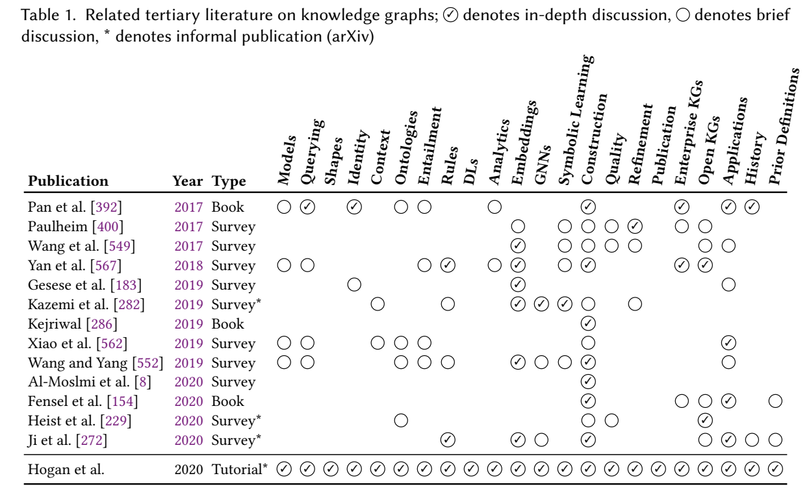

**表 1：** 与知识图谱相关的三次文献；圈内勾号表示深入讨论，空心圆 ○ 表示简要讨论，* 表示非正式出版物（arXiv）。

表头译释：Publication＝出版物；Year＝年份；Type＝类型；Models＝模型；Querying＝查询；Shapes＝形状；Identity＝身份；Context＝上下文；Ontologies＝本体；Entailment＝蕴涵；Rules＝规则；DLs＝描述逻辑；Analytics＝分析；Embeddings＝嵌入；GNNs＝图神经网络；Symbolic Learning＝符号学习；Construction＝构建；Quality＝质量；Refinement＝精化；Publication＝发布；Enterprise KGs＝企业知识图谱；Open KGs＝开放知识图谱；Applications＝应用；History＝历史；Prior Definitions＝既有定义。表中类型 Book、Survey、Tutorial 分别表示书籍、综述、教程；作者姓名及引文编号保留原文。

- 第 5 节描述可用于提取额外知识的归纳技术。
- 第 6 节讨论从外部来源创建和丰富知识图谱。
- 第 7 节列举可用于评估知识图谱的质量维度。
- 第 8 节讨论知识图谱精化的各种技术。
- 第 9 节讨论知识图谱发布的原则与协议。
- 第 10 节综述一些有代表性的知识图谱及其应用。
- 第 11 节通过总结和知识图谱未来研究方向结束全文。
- 附录 A 提供知识图谱的历史背景与既有定义。
- 附录 B 列举正文中将引用的形式化定义。

## 2. 数据图

所有知识图谱的基础，都是首先对数据应用图抽象的原则，从而得到一个初始数据图。下面，我们讨论实践中常用于表示数据图的一些图结构数据模型，然后讨论构成图查询语言基础、用于查询这些数据图的基本元素。

### 2.1. 模型

暂且不考虑图。假设贯穿全文示例中的旅游局尚未决定如何对景点、活动、服务等相关数据建模。委员会首先考虑使用表格结构，尤其是关系数据库，表示所需数据。尽管他们并不确切知道需要记录哪些数据，但还是开始设计初始关系模式。他们首先创建一个具有五列的 Event 表：

```text
Event(name, venue, type, start, end)
```

其中，name 与 start 共同构成表的主键，以唯一标识定期举办的活动。但在填充数据时，他们遇到了各种问题：活动可能有多个名称（例如使用不同语言）；可能有多个举办场所；未来活动的开始、结束日期和时间可能尚不明确；活动可能属于多个类型，等等。随着数据更加多样，他们逐步处理这些建模问题，为活动生成内部标识符，并调整关系模式，最终得到：

```text
EventName(id, name), EventStart(id, start), EventEnd(id, end),       （1）
EventVenue(id, venue), EventType(id, type)
```

使用上述模式，该组织现在可以对具有 0–n 个名称、场所和类型，以及 0–1 个开始日期和结束日期的活动建模，而且不需要关系型空值或表中的空白单元格。

在这一过程中，委员会为支持新的数据来源，不得不多次逐步修改模式。每一次修改，都要求代价高昂的数据重新建模、重新加载和重新建立索引；这里还仅仅考虑了一张表。旅游局之所以难以使用关系模型，是因为他们事先并不知道需要对哪些数据建模，也不知道将采用哪些来源。然而，在形成后一种关系模式后，他们发现无需再修改模式，就能继续集成更多来源：由于对多重性（1–1、1–n 等）的假设极少，该模式在集成不完整、多样化数据方面具有很大灵活性。

实际上，委员会最终得到的这种经改进的灵活模式——见式（1）——所建模的是一组实体间的二元关系，因此确实可以视为对图建模。如果从一开始就采用图数据模型，委员会就可以不必事先定义模式，而能够随时定义任意实体对之间的任意（二元）关系。

下面介绍实践中常用的图数据模型 [16]。

#### 2.1.1. 有向边标记图

有向边标记图（也称多关系图 [29, 63, 386]）被定义为一组节点——例如 Santiago、Arica、EID16、2018-03-22 12:00——以及这些节点之间的一组带标签的有向边，例如 `Santa Lucía —city→ Santiago`。对于知识图谱，节点用于表示实体，边用于表示这些实体之间的（二元）关系。图 1 给出旅游局如何将一些相关活动数据表示为有向边标记图的示例（有向边标记图的形式化定义见附录 B 的定义 B.1）。该图包含活动名称、类型、开始和结束日期时间，以及场所等数据。² 向这类图添加信息，通常涉及添加新的节点与边，不过后文会讨论一些例外。表示不完整信息时，只需省略某条边；例如，图中尚未定义 Food Truck 节的开始／结束日期时间。

以这种方式将数据建模为图，与标准关系模型相比，为集成新的数据来源提供了更多灵活性；在标准关系模型中，模式必须预先定义，并在每一步得到遵守。虽然树（XML、JSON 等）之类其他结构化数据模型也能提供类似的灵活性，但图不要求以层次结构组织数据，例如 venue 应当是 type 的父节点、子节点还是兄弟节点？图还允许表示和查询环，例如注意 Santiago、Arica 和 Viña del Mar 之间路线中的有向环。

基于有向边标记图的一个标准化数据模型是资源描述框架（Resource Description Framework，RDF）[111]，它是 W3C 推荐标准。RDF 模型定义了不同类型的节点，包括能够在 Web 上全局标识实体的国际化资源标识符（Internationalized Resource Identifiers，IRI）[134]；能够表示带有或不带语言标签的字符串以及其他数据类型值（整数、日期等）的字面量；以及空白节点，即没有分配标识符的匿名节点。例如，在 RDF 中，可以选择使用空白节点，而不创建 EID15、EID16 这样的内部标识符。第 3.2 节讨论身份相关问题时，将进一步介绍这些不同类型的节点。

> **脚注 2：** 我们将双向边表示为 `Viña del Mar ←bus→ Arica`，它更加简洁地表示两条有向边：`Viña del Mar —bus→ Arica` 和 `Arica —bus→ Viña del Mar`。此外，虽然某些命名约定建议使用包含动词的更加完整的边标签，例如 has venue 或 is valid from，但本文为便于展示，将省略这类标签中的 has 和 is，直接使用 venue 或 valid from。

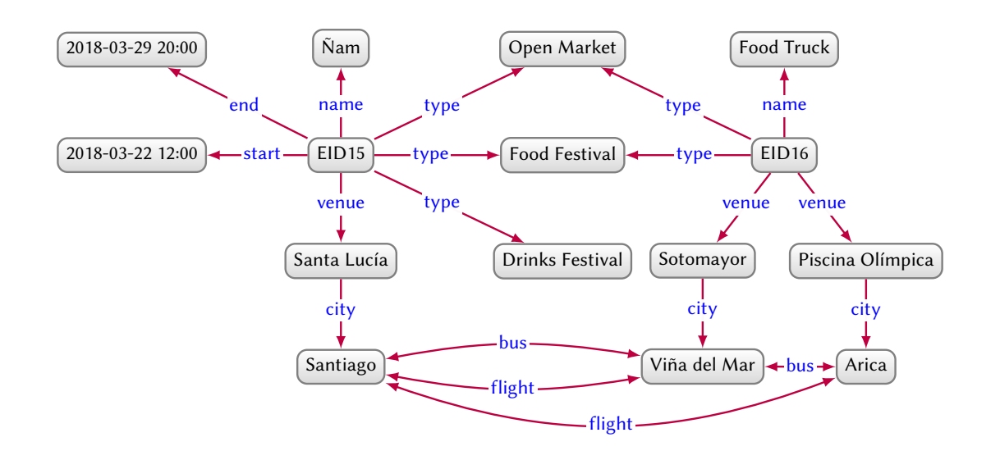

**图 1：** 描述活动及其举办场所的有向边标记图。

图中文字译释：name＝名称；type＝类型；venue＝场所；city＝城市；start＝开始；end＝结束；flight＝航班；bus＝公交。Food Festival、Drinks Festival、Open Market 分别表示美食节、饮品节和露天集市；Ñam、Food Truck、Santa Lucía、Piscina Olímpica、Sotomayor 以及城市名等实例名称保留原文。


**图 2：** 有向边标记图与异构图中关于首都和国家的数据。（a）有向边标记图；（b）异构图。

图中文字译释：City＝城市；Country＝国家；type＝类型；capital＝首都；borders＝接壤。异构图将节点类型直接写在节点旁，而不是通过 type 关系表示。

#### 2.1.2. 异构图

异构图 [257, 551, 570]（或异构信息网络 [509, 510]）是一种每个节点和每条边都被分配一个类型的图。因此，异构图与有向边标记图相似，其边标签对应边类型，但节点类型是图模型本身的一部分，而不是通过特殊关系表示，如图 2 所示。如果一条边连接两个相同类型的节点，就称其为同构边（例如 borders）；否则，就称其为异构边（例如 capital）。异构图的一个优点是可以按类型划分节点，例如用于机器学习任务 [257, 551, 570]。另一方面，它们通常只支持节点与类型之间的一对一关系，而有向边标记图并非如此，例如图 1 中 Santiago 节点没有类型，而 EID15 节点有多个类型。

#### 2.1.3. 属性图

引入属性图，是为了在对更加复杂的关系建模时提供额外灵活性。考虑集成新收到的数据，它说明哪些公司在哪些航班上提供票价，从而使委员会更好地理解城市之间的现有路线，例如国内航空公司提供的路线。对于有向边标记图，我们无法直接为 `Santiago —flight→ Arica` 这样的边标注提供该路线的公司。但可以添加一个表示航班的新节点，将它与起点、终点、公司和交通方式相连，如图 3 所示。然而，将这种建模方式应用于图 1 中的所有路线，会涉及对图进行重大修改。另一种选择可能是将不同公司的航班放入不同命名图；但是，如果命名图已被用于追踪图的来源等目的，这种做法就会变得繁琐。

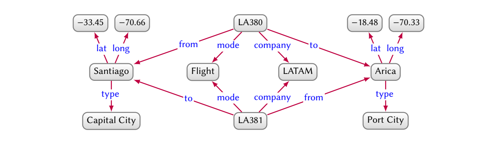

**图 3：** 包含提供 Santiago 与 Arica 之间航班的公司的有向边标记图。

图中文字译释：Capital City＝首都城市；Port City＝港口城市；Flight＝航班；type＝类型；lat＝纬度；long＝经度；from＝起点；to＝终点；company＝公司；mode＝交通方式。LA380、LA381 是航班标识，LATAM 是公司名称。

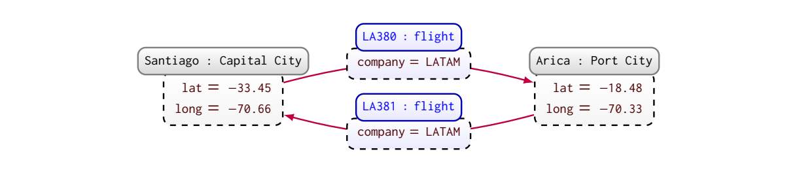

**图 4：** 包含提供 Santiago 与 Arica 之间航班的公司的属性图。

图中文字译释：节点标签 Capital City、Port City 分别为首都城市、港口城市；lat、long 分别为纬度、经度；边标签 flight 为航班；边属性 company 为公司。

因此，人们提出属性图模型，以在将数据建模为图时提供额外灵活性 [16, 354]。属性图允许为节点和边都关联一组属性—值对及一个标签。图 4 给出一个简洁的属性图示例，其数据与图 3 相对应（属性图的形式化定义见附录 B 的定义 B.5）。这次，我们使用边上的属性—值对表示公司。³ 关系类型通过 flight 标签表示。我们还用节点标签表示两个节点的类型，用属性—值对表示其纬度和经度。

属性图最著名的用途，是 Neo4j 等流行图数据库 [16, 354]。选择图模型时，必须注意：属性图与有向边标记图之间可以无损地相互转换 [18, 235]，例如图 4 所示。概括而言，有向边标记图提供一种更加精简的模型，属性图则提供一种更加灵活的模型。模型选择往往次于其他实践因素，例如不同模型有哪些可用实现。

> **脚注 3：** 在属性图的实际实现中，具有多个值的属性，可以表示为单个数组值等形式。不过，这类问题不会影响表达能力，也不会影响本文讨论。

#### 2.1.4. 图数据集

虽然可以通过取并集将多个有向边标记图合并，但管理多个图，而不是一个单一的庞大图，往往更加理想。例如，管理来自不同来源的多个图，能够更新或精化某个来源的数据，区分不可信来源与较可信来源，等等。图数据集由一组命名图和一个默认图构成。每个命名图都是图 ID 与图的一个配对。默认图是没有 ID 的图；如果未指定图 ID，就“默认”引用它。图 5 给出一个示例，其中活动和路线存储在两个命名图中，默认图则管理这些命名图的元数据（图数据集的形式化定义见附录 B 的定义 B.7）。图名称也可以作为图中的节点。此外，节点和边可以在多个图中重复出现；不同图中的同一节点通常指向同一实体，因此合并图时可以集成有关该实体的数据。虽然示例展示的是有向边标记图数据集，但这一概念可以直接推广到其他类型的图。

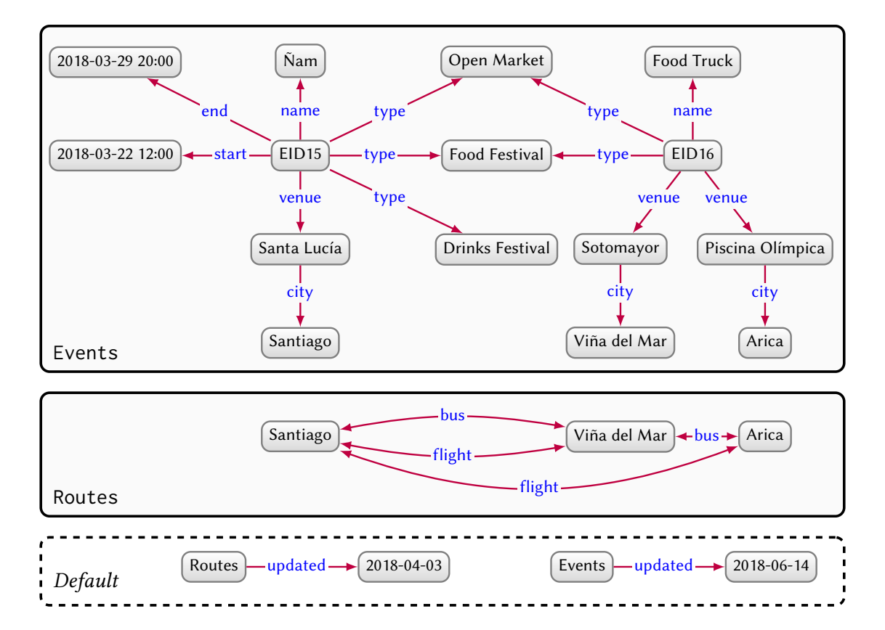

**图 5：** 由两个命名图和一个默认图构成、描述活动和路线的图数据集。

图中文字译释：Events＝活动；Routes＝路线；Default＝默认图；updated＝更新日期。各图中的 name、type、venue、city、start、end、flight、bus 分别为名称、类型、场所、城市、开始、结束、航班、公交。

图数据集的一个重要应用，是管理和查询关联数据（Linked Data）。关联数据由遍布 Web、相互链接的 RDF 图文档构成。处理 Web 数据时，追踪数据来源至关重要 [58, 130, 583]。第 3.2 节将讨论关联数据，第 3.3 节将进一步讨论溯源。

#### 2.1.5. 其他图数据模型

前述模型是图表示的常见例子。此外，还有一些图数据模型具有复杂节点，可以包含单条边 [17, 222] 或嵌套图 [17, 42]，这些节点有时称为超节点 [315]。类似地，数学中的超图概念定义了复杂边，其连接的是节点集合，而不是节点对。我们认为，知识图谱可以采用任何这类基于节点和边的图数据模型；数据通常可以从一种模型转换为另一种模型，参见图 3 与图 4。本文其余部分倾向于讨论有向边标记图，因为它相对简洁，但多数讨论可以自然推广至其他模型。

#### 2.1.6. 图存储

已有多种图存储与索引技术被提出，以支持高效执行查询，下一节将讨论查询。有向边标记图可以存储在关系数据库中，形式包括：单个三元关系（三元组表）；为每个属性建立一个二元关系（垂直分区）；或为某一类型的实体建立 n 元关系（属性表）[560]。针对各种图模型，也开发了定制存储技术，能够高效查找节点、边及其相邻元素 [17, 354, 560]。此外，一些系统允许基于常见 NoSQL 存储或定制分区方案，将图分布到多台机器上 [267, 560]。更多细节可参阅 Janke 与 Staab 的书中章节 [267]，以及 Wylot 等人专门针对这一主题的综述 [560]。

### 2.2. 查询

实践中已有多种图查询语言 [16]，包括针对 RDF 图的 SPARQL 查询语言 [217]，以及针对属性图的 Cypher [165]、Gremlin [445] 和 G-CORE [15]。⁴ 这些查询语言有一些共同的基础构件，包括基本图模式、关系运算符、路径表达式等 [16]。下面从图模式开始，依次介绍这些图查询的核心特征。

#### 2.2.1. 图模式

每一种结构化图查询语言的核心，都是（基本）图模式 [16, 100]。它们遵循被查询数据图的同一模型，参见第 2.1 节，同时允许将变量作为项。⁵ 因此，图模式中的项分为常量，例如 Arica 或 venue，以及变量；我们用问号作为变量前缀，例如 ?event 或 ?rel。图模式在数据图上的求值，是生成从图模式变量到数据图常量的映射，使得图模式在该映射下的像（即用分配的常量替换变量之后的结果）包含于数据图中。图 6 给出一个查找美食节举办场所的图模式示例，以及该图模式在图 1 的数据图上生成的可能映射。

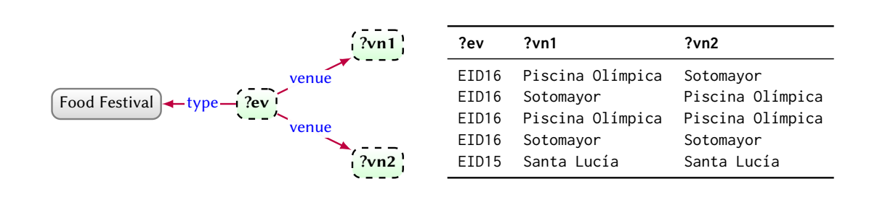

**图 6：** 图模式（左），以及在图 1 的图上生成的映射（右）。

图中文字译释：Food Festival＝美食节；type＝类型；venue＝场所。查询中的 ?ev、?vn1、?vn2 分别表示活动、第一场所和第二场所；右表保留原始实例名称及其对应映射。

在展示的某些映射中，即最后列出的两项，多个变量映射到同一个项；根据应用不同，这种情况可能是理想的，也可能不是。因此，人们提出了多种图模式求值语义 [16]，其中最重要的是：基于同态的语义允许多个变量映射到同一项，因此图 6 中展示的所有映射都会被视为结果；基于同构的语义则要求节点和／或边上的变量映射到唯一的项，因此会从结果中排除图 6 的后三个映射。不同实际语言采用不同图模式求值语义。例如，SPARQL 采用基于同态的语义，Cypher 则对边采用基于同构的语义。

如后续示例所示，特别是图 8，图模式也可以形成有向或无向环，并可以用变量替换边标签。其他模型——例如属性图——中的图模式，可以类似地通过允许变量替换模型任意位置的项来定义。附录 B.2.1 对有向边标记图和属性图的图模式及其求值进行形式化定义。

> **脚注 4：** Seifer 等人 [470] 研究了这些语言的流行程度。

> **脚注 5：** 有向边标记图中的项是其节点和边标签。属性图中的项是其 ID、标签、属性和值，这些项可用于边或节点。

#### 2.2.2. 复杂图模式

图模式将输入图转换为结果表，如图 6 所示。随后，我们可以考虑使用关系代数组合和／或转换这些表，从而由一个或多个图模式形成更复杂的查询。回顾关系代数，其中包括接受一张输入表的一元运算符，以及接受两张输入表的二元运算符。一元运算符包括投影（π），输出列的子集；选择（σ），输出满足给定条件的行子集；以及列重命名（ρ）。二元运算符包括并（∪），将两张表的行合并为一张表；差（−），从第一张表中删除也出现在第二张表中的行；以及连接（⋈），用另一张表中满足连接条件的行扩展某张表的行。选择与连接条件通常包含相等（=）、不等（≤）、否定（¬）、析取（∨）等。根据这些运算符，还可以进一步定义其他语法运算符，例如交（∩），输出两张表共有的行；反连接（▷，也称 not exists），输出第一张表中在第二张表里没有连接兼容行的那些行；左连接（⟕，也称 optional），执行连接，同时保留第一张表中在第二张表里没有兼容行的那些行，等等。

图模式可以用关系代数的一个子集表达，即 π、σ、ρ、⋈。例如，假设用单个三元关系 G(s, p, o) 表示图，即一张具有 s、p、o 三列的表 G，则图 6 中的查询可以用关系代数表示为：

```text
π_{ev,vn1,vn2}(
  σ_{p=type ∧ o=Food Festival ∧ p1=p2=venue}(
    ρ_{s/ev}(G ⋈ ρ_{p/p1,o/vn1}(G) ⋈ ρ_{p/p2,o/vn2}(G))
  )
)
```

其中，⋈ 表示自然连接，即检查两张表中名称相同的列对是否相等，这里因此是在主语列 s 上执行连接。查询结果是一张为每个变量提供一列的表：ev、vn1、vn2。不过，并非所有在 G 上使用 π、σ、ρ 和 ⋈ 的查询，都能表示为图模式。例如，在图模式中无法选择投影哪些变量，而必须投影所有未固定为常量的变量。

SPARQL [217] 和 Cypher [165] 等图查询语言，允许在图模式结果上完整使用关系运算符，从而形成复杂图模式 [16]。图 7 给出一个复杂图模式示例，用粗体表示被投影的变量，即选择特定变量出现在最终结果中。就表达能力而言，这种具有不受限制投影的图模式，等价于图上的合取查询。图 8 给出另一个复杂图模式示例，查找不在 Santiago 举办的美食节或饮品节，并在可用时可选地返回其开始日期和名称。允许在图模式之上完整使用关系运算符的这类查询，等价于图上的一阶查询。附录 B.2.2 对复杂图模式及其在数据图上的求值进行形式化定义。

复杂图模式可能产生重复结果。例如，图 7 的第一项结果出现两次，因为一项结果中 ?city1 匹配 Arica，?city2 匹配 Viña del Mar，而另一项结果正好相反。因此，查询语言提供两种语义：包语义按照底层映射的重数保留重复项；集合语义通常通过 DISTINCT 关键字调用，从结果中移除重复项。

#### 2.2.3. 导航图模式

区分图查询语言的一个关键特征，是能够在查询中包含路径表达式。路径表达式 r 是一个正则表达式，允许匹配两个节点之间任意长度的路径；它表示为一个正则路径查询 (x, r, y)，其中 x 与 y 可以是变量或常量，甚至是同一个项。

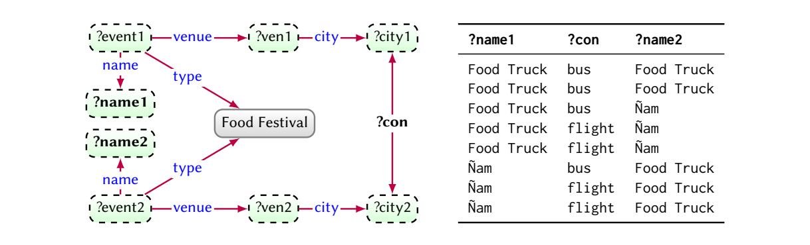

**图 7：** 合取查询（左），以及在图 1 的图上生成的映射（右）。

图中文字译释：Food Festival＝美食节；type＝类型；venue＝场所；name＝名称；city＝城市。粗体变量 ?name1、?con、?name2 为最终投影列；?con 匹配的 bus 与 flight 分别表示公交与航班。

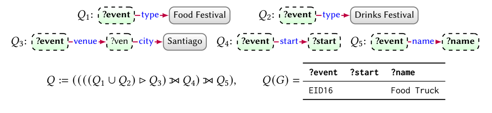

**图 8：** 复杂图模式 Q，以及在图 1 的图 G 上生成的映射 Q(G)。

图中文字译释：Q1 查找美食节（Food Festival）；Q2 查找饮品节（Drinks Festival）；Q3 查找在 Santiago 举办的活动；Q4 查找活动开始时间；Q5 查找活动名称。查询组合表达式为：

```text
Q := ((((Q1 ∪ Q2) ▷ Q3) ⟕ Q4) ⟕ Q5)
```

其中，▷ 为反连接，⟕ 为左连接。结果表的列为 ?event、?start、?name，返回 EID16 和名称 Food Truck，开始时间为空。

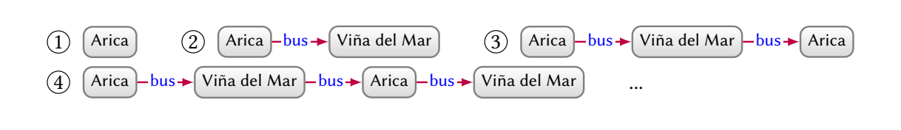

**图 9：** 在图 1 的图上，匹配 `(Arica, bus*, ?city)` 的一些可能路径。

图中文字译释：bus＝公交。图中依次展示长度为零的 Arica 路径，以及在 Arica 与 Viña del Mar 之间来回延伸的公交路径。

基本路径表达式是 r 为常量（边标签）的情况。此外，如果 r 是路径表达式，那么 r⁻（逆向）⁶ 和 r*（Kleene 星号，即零次或多次）也是路径表达式。最后，如果 r1 与 r2 是路径表达式，那么 r1 | r2（析取）和 r1 · r2（连接）也都是路径表达式。

正则路径查询可以在多种不同语义下求值。例如，在图 1 的图上对 `(Arica, bus*, ?city)` 求值，可能匹配图 9 中的路径。实际上，由于存在环，潜在匹配的路径数量是无限的。因此，人们常采用受限语义，只返回最短路径，或者没有重复节点或边的路径，Cypher 就属于后一种情况。⁷ 除了返回路径，另一种选择是返回由匹配路径相连的节点对所构成的有限集合，SPARQL 1.1 就采用这种方式。

可以在图模式中使用正则路径查询，表达导航图模式 [16]，如图 10 所示。该示例查询能够通过公交或航班从 Arica 递归到达的城市中举办的美食节。此外，当正则路径查询和图模式与投影、选择、并、差、可选等运算符组合时，所得结果称为复杂导航图模式 [16]。附录 B.2.3 定义了（复杂）导航图模式及其求值。

> **脚注 6：** 某些作者区分双向正则路径查询与正则路径查询，只有前者支持逆向。

> **脚注 7：** 将变量映射到路径需要特殊处理 [16]。Cypher [165] 返回编码路径的字符串，可以对其应用 length(·) 等函数。另一方面，G-CORE [15] 允许返回路径，并支持在路径上应用其他运算符，包括将其投影为图、应用代价函数等。

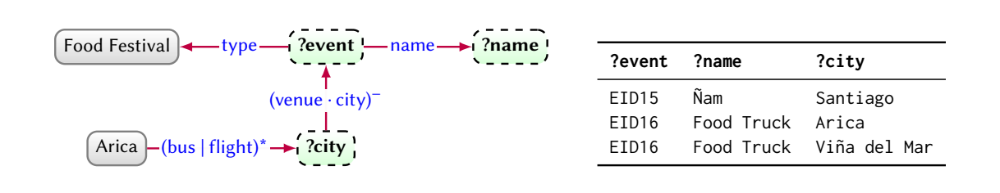

**图 10：** 导航图模式（左），以及在图 1 的图上生成的映射（右）。

图中文字译释：Food Festival＝美食节；type＝类型；name＝名称；venue＝场所；city＝城市；bus＝公交；flight＝航班。`(bus | flight)*` 表示零次或多次公交或航班连接；`(venue · city)⁻` 表示由城市逆向沿场所—城市关系找到活动。结果列为 ?event、?name、?city，保留原始实例名称。

#### 2.2.4. 其他特征

至此，我们讨论了构成任何图查询语言实践基础与理论基础的特征 [16]。不过，具体图查询语言还可能支持其他实用特征，例如聚合（GROUP BY、COUNT 等）、更加复杂的筛选器与数据类型运算符（例如从日期提取年份后进行范围查询）、通过 Web 查询远程托管图的联邦查询、用于更新图的语言、对语义蕴涵机制的支持等。更多信息可参阅相应查询语言的文档，例如 [15, 217]，以及 Angles 等人的综述 [16]。

## 3. 模式、身份与上下文

本节介绍对数据图的各种增强与扩展，涉及模式、身份和上下文，它们为积累知识提供额外结构。下文将数据图称为使用第 2 节所讨论某种模型、以节点和边表示的数据集合。知识图谱则是可能通过模式、身份、上下文、本体和／或规则的表示得到增强的数据图。这些额外表示可以嵌入数据图，也可以作为其上方的层次。本文在本节讨论模式、身份与上下文的表示，而本体与规则将在第 4 节讨论。

### 3.1. 模式

相对于关系模型等方案，将数据建模为图的一个好处，是可以选择不定义或推迟定义模式。不过，在将数据建模为图时，也可以使用模式规定图实际遵循或应该遵循的高层结构和／或语义。我们讨论三类图模式：语义模式、验证模式和涌现模式。

#### 3.1.1. 语义模式

语义模式能够定义图中使用的高层术语，也称词汇表或术语表，的含义，从而便于利用这些术语对图进行推理。例如，观察图 1 可以发现，根据节点所指实体的类型，节点可以自然地划分为一些组。因此，我们可能决定定义类来表示这些组，例如 Event、City 等。事实上，图 1 已经展示了三个低层类——Open Market、Food Market、Drinks Festival——它们通过带有 type 标签的边对相似实体分组。随后，我们可能观察到其中某些类之间存在一些希望记录的自然关系。图 11 展示活动的类层次结构，其中子节点被定义为父节点的子类，因此，如果图中存在 `EID15 —type→ Food Festival` 这条边，我们还可以推断 `EID15 —type→ Festival` 和 `EID15 —type→ Event`。

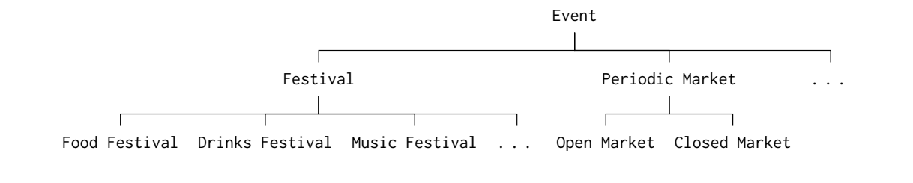

**图 11：** Event 的示例类层次结构。

图中文字译释：Event＝活动；Festival＝节庆；Periodic Market＝定期集市；Food Festival＝美食节；Drinks Festival＝饮品节；Music Festival＝音乐节；Open Market＝露天集市；Closed Market＝封闭市场。

除了类，我们还可能希望定义边标签的语义，边标签也称属性。回到图 1，可以认为 city 与 venue 是更一般属性 location 的子属性。例如，给定 `Santa Lucía —city→ Santiago` 这条边，还可以推断 `Santa Lucía —location→ Santiago`。类似地，可以认为 bus 和 flight 都是更一般属性 connects to 的子属性。因此，属性也可以形成层次结构。我们还可以定义属性的定义域，用于说明具有该属性的边所起始节点对应的实体属于哪些类。例如，可以定义 connects to 的定义域为 Place 类，那么给定前面的子属性关系，就可以得出 `Arica —type→ Place`。相反，还可以定义属性的值域，用于说明具有该属性的边所指向节点对应的实体属于哪些类。例如，可以定义 city 的值域为 City 类，从而推断 `Arica —type→ City`。

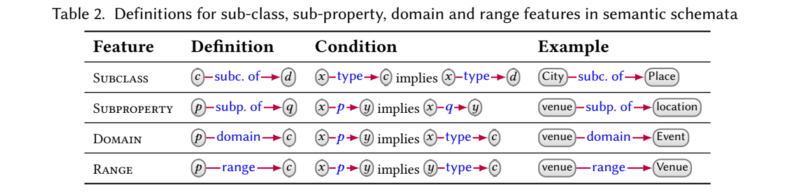

**表 2：** 语义模式中子类、子属性、定义域和值域特征的定义。

| 特征 | 定义 | 条件 | 示例 |
| --- | --- | --- | --- |
| 子类 | `c —subc. of→ d` | `x —type→ c` 蕴涵 `x —type→ d` | `City —subc. of→ Place` |
| 子属性 | `p —subp. of→ q` | `x —p→ y` 蕴涵 `x —q→ y` | `venue —subp. of→ location` |
| 定义域 | `p —domain→ c` | `x —p→ y` 蕴涵 `x —type→ c` | `venue —domain→ Event` |
| 值域 | `p —range→ c` | `x —p→ y` 蕴涵 `y —type→ c` | `venue —range→ Venue` |

表中文字译释：subc. of＝是……的子类；subp. of＝是……的子属性；domain＝定义域；range＝值域；type＝类型；City＝城市；Place＝地点；Event＝活动；Venue＝场所；venue＝举办场所；location＝位置。

为 RDF 图定义语义模式的一个重要标准，是 RDF Schema（RDFS）标准 [70]。它允许在 RDF 图所使用的类与属性之间定义子类、子属性、定义域和值域，并且可以将这些定义序列化为图。表 2 展示这些特征的语义，图 12 则为贯穿全文示例中的部分术语提供具体定义。这些定义随后可以嵌入数据图。更加一般地，图中术语的语义可以比这里展示的内容定义得更加深入，RDF 图的 Web 本体语言（Web Ontology Language，OWL）标准 [239] 就提供这类支持。第 4 节将再次讨论这类语义。

语义模式通常针对不完整的图数据定义：两个节点之间没有某条边，例如 `Viña del Mar —flight→ Arica`，并不意味着该关系在现实世界中不成立。因此，不能根据图 1 推断 Viña del Mar 与 Arica 之间没有航班。相比之下，如果采用封闭世界假设（Closed World Assumption，CWA），如许多经典数据库系统那样，就会假定数据图完整描述世界，从而能够确定地断言这两个城市之间没有航班。不采用 CWA 的系统，被称为采用开放世界假设（Open World Assumption，OWA）。CWA 的一个后果是：向数据图添加一条边，可能与此前因信息缺失而假定为假的内容相矛盾；而在 OWA 下，某个已证明为假的陈述，在添加更多边后仍然为假。

在贯穿全文的示例中，假设旅游组织完全掌握知识图谱中所有可描述事物的知识，并不合理。不过，如果系统无法对“Arica 与 Viña del Mar 之间有航班吗？”这类问题明确回答“是”或“否”，也很不方便，尤其是在组织确定自己完全掌握航班知识的情况下。局部封闭世界假设（Local Closed World Assumption，LCWA）是 OWA 与 CWA 之间的一种折中：假设数据图的某些部分是完整的。

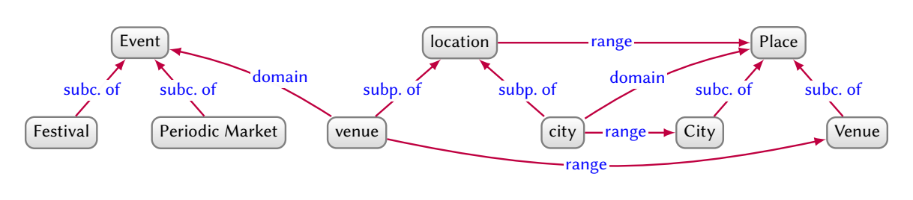

**图 12：** 描述子类、子属性、定义域和值域的示例模式图。

图中文字译释：subc. of＝是……的子类；subp. of＝是……的子属性；domain＝定义域；range＝值域；location＝位置；city＝城市；venue＝场所。类 Event、Festival、Periodic Market、Place、City、Venue 分别表示活动、节庆、定期集市、地点、城市和场所。

#### 3.1.2. 验证模式

当图用于表示大规模、多样且不完整的数据时，OWA 是最合适的默认语义选择。但在某些场景中，我们可能希望保证数据图或其特定部分在某种意义上是“完整的”。例如，回到图 1，我们可能希望确保所有活动至少具有名称、场所、开始日期和结束日期，使使用这些数据的应用——例如向用户发送活动通知的应用——能够确保获得所需的最少信息。此外，我们可能希望确保活动所在城市被明确陈述为城市，而不是推断它是城市。可以在验证模式中定义这类约束，并依据所得模式验证数据图，列出违反约束的情况，如果存在的话。因此，语义模式允许推断新的图数据，而验证模式允许验证已有图数据。

为图定义验证模式的一种标准方式，是使用形状 [296, 306, 423]。一个形状以数据图中的一组节点为目标，并规定这些节点上的约束。形状的目标可以通过多种方式定义，例如某个类的所有实例、某个属性的定义域或值域、查询结果、通过给定属性连接到另一形状目标的节点等。随后，可以对目标节点定义约束，例如限制给定属性的取值数量或类型。一组相互关联的形状构成形状图。形状图可以表示为类似 UML 的类图；图 13 展示一个基于图 1 的形状图示例，对四个相互关联的形状定义约束。每个形状——用 Place、Event 等方框表示——都关联一组约束。当且仅当节点满足形状定义的全部约束时，节点才符合该形状。每个形状方框内部列出约束，限定符合该形状的节点能够通过某个属性（例如 name、start 等）关联的节点数量与类型：数量例如 [1..*] 表示一到多，[1..1] 表示恰好一个；类型例如 string、dateTime 等。另一种方式是限制：符合某形状的节点，可以通过某属性关联多少个符合另一特定形状的节点，从而在形状之间产生边。例如，`Event —venue[1..*]→ Venue` 表示符合 Event 的节点，必须通过 venue 属性关联至少一个符合 Venue 形状的节点。形状可以继承父形状的约束，这用 △ 连接符表示；City 和 Venue 就属于这种情况，符合它们的节点也必须符合 Place 形状。

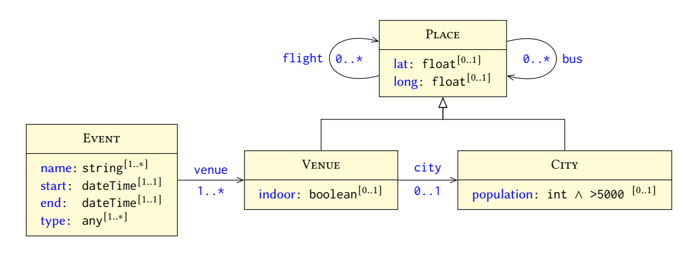

**图 13：** 以类似 UML 图的方式展示的示例形状图。

图中文字与约束译释：

- Event（活动）：name 为字符串，数量 [1..*]；start 和 end 为日期时间，数量均为 [1..1]；type 可为任意类型，数量 [1..*]。
- Venue（场所）：indoor（是否在室内）为布尔值，数量 [0..1]。
- City（城市）：population（人口）为整数且 > 5000，数量 [0..1]。
- Place（地点）：lat（纬度）和 long（经度）均为浮点数，数量 [0..1]。
- Event 通过 venue 关联 1 至多个 Venue；Venue 通过 city 关联 0 至 1 个 City；Place 通过 flight（航班）和 bus（公交）各关联 0 至多个 Place；Venue 和 City 继承 Place 的约束。

给定形状与目标节点，可以检查该节点是否符合形状，这可能要求检查其他节点的符合情况。例如，EID15 是否符合 Event，不仅取决于其局部属性，也取决于 Santa Lucía 是否符合 Venue，以及 Santiago 是否符合 City。符合性依赖还可能是递归的：Santiago 符合 City，要求它符合 Place；而这又要求 Viña del Mar 和 Arica 符合 Place，依此类推。另一方面，EID16 不符合 Event，因为它缺少示例形状图所要求的 start 和 end 属性。

声明形状时，数据建模者可能无法预先知道某些节点可以具有的全部属性。开放形状允许节点具有形状未规定的额外属性，而封闭形状不允许。例如，如果向图 1 所表示的图添加边 `Santiago —founder→ Pedro de Valdivia`，则 Santiago 只有在 City 形状被定义为开放形状时才符合它，因为该形状没有提到 founder。

实际形状语言通常支持其他布尔特征，例如形状的合取（and）、析取（or）和否定（not）。例如，可以规定 venue 的所有值都应符合 `Venue and (not City)` 形状，从而明确：数据图中的场所不应直接表示为城市。不过，允许自由组合递归和否定的形状语言，可能因语义定义方式不同而产生语义问题。为说明这一点，考虑一个受理发师悖论启发的例子 [306]：形状 Barber 要求符合该形状的节点，至少为一个符合 `Person and (not Barber)` 的节点刮胡子。现在，只有 `Bob —shave→ Bob` 这条边，且 Bob 符合 Person，那么 Bob 是否符合 Barber？如果答案是肯定的，即 Bob 符合 Barber，那么 Bob 没有为至少一个符合 `Person and (not Barber)` 的节点刮胡子，因此违反约束。如果答案是否定的，即 Bob 不符合 Barber，那么 Bob 通过为这样一个节点刮胡子，又满足 Barber 约束。已有基于分层 [61]、部分赋值 [104] 和稳定模型 [177] 的语义，用于避免这种悖论情形。

虽然验证模式与语义模式用途不同，但可以相互补充。具体而言，验证模式可以考虑语义模式，例如对包含推断结果的数据图执行验证。以图 11 的类层次结构和图 13 的形状图为例，可以将 Event 形状的目标定义为类型为 Event 这个类的节点。如果首先依据语义模式的类层次结构执行推理，那么 Event 形状现在就会以 EID15 和 EID16 为目标。不过，语义模式的存在可能要求调整验证模式。例如，考虑前述类层次结构时，需要为 type 属性定义更加宽松的基数约束。在这类情况下，也可能更适合采用开放形状，而不是枚举节点上所有可能推断得到的属性约束。

附录 B.3.2 给出形状及相关概念的高层定义。最近出现了两种 RDF 图形状语言：形状表达式（Shape Expressions，ShEx），作为 W3C 社区组报告发布 [423]；以及形状约束语言（Shapes Constraint Language，SHACL），作为 W3C 推荐标准发布 [296]。这些语言支持上述特征及其他特征，并已被用于验证医疗保健 [521]、科学文献 [216]、空间数据 [83] 等多个领域的图。关于 ShEx 和 SHACL 的更多细节，可参阅 Labra Gayo 等人的书籍 [306]。最近提出的一种语言，可以作为 ShEx 与 SHACL 的共同基础，揭示两者的异同 [305]。Angles [14] 还针对属性图提出了类似的模式概念。

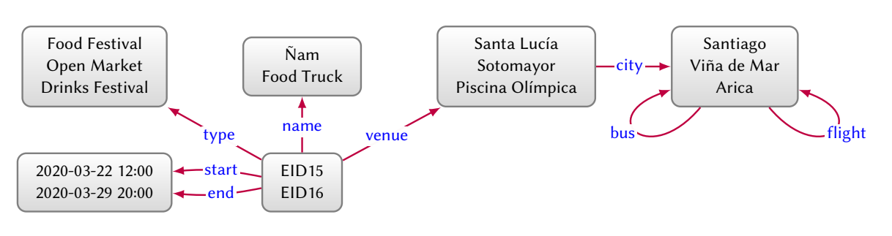

**图 14：** 一个模拟图 1 数据图的商图示例。

图中文字译释：name＝名称；type＝类型；venue＝场所；city＝城市；start＝开始；end＝结束；flight＝航班；bus＝公交。商图节点内列出被归入同一分区的原节点。

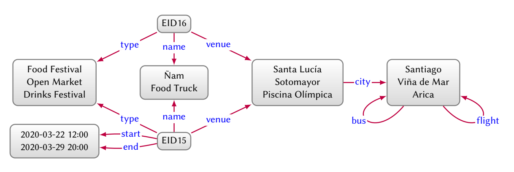

**图 15：** 一个与图 1 数据图双模拟等价的商图示例。

图中文字译释：name＝名称；type＝类型；venue＝场所；city＝城市；start＝开始；end＝结束；flight＝航班；bus＝公交。与图 14 相比，活动分区分成两个节点，以反映其出边的差异。

#### 3.1.3. 涌现模式

语义模式与验证模式，都要求领域专家显式规定定义和约束。然而，数据图往往表现出潜在结构，可以自动提取为涌现模式 [413]，也称图摘要 [84, 322, 492]。定义涌现模式时常用的一种框架是商图：根据某种等价关系，将数据图的节点划分为组，同时保留图的某些结构性质。以图 1 为例，可以根据上下文直观地区分不同类型的节点，例如活动节点连接场所节点，场所节点又连接城市节点，等等。为描述图结构，可以考虑将节点划分为六个分区：活动、名称、场所、类、日期时间、城市。实践中，可以根据节点的类或形状计算这些分区。将各分区中的节点合并为一个节点，同时保留边，就会得到图 14 所示商图：商图的节点是数据图节点的分区；当且仅当存在 x ∈ X 和 z ∈ Z，使数据图中具有边 `x —y→ z` 时，商图中才具有边 `X —y→ Z`。

商图可以用多种方式定义，不仅取决于如何划分节点，还取决于如何定义边。不同商图对所保留结构可能提供不同保证。形式上，我们可以说每个商图都模拟其输入图，模拟关系基于数据节点与商节点之间的集合隶属关系。这意味着，对于所有 x ∈ X，其中 x 是输入节点、X 是商节点，如果 `x —y→ z` 是数据图中的边，那么商图中必须存在边 `X —y→ Z`，且 z ∈ Z。例如，图 14 的商图模拟图 1 的数据图。不过，该商图似乎会暗示，EID16 在数据图中有开始日期和结束日期，而事实并非如此。双模拟等价提供一种更强的结构保持概念：在这里，它进一步要求，如果 `X —y→ Z` 是商图中的边，那么对于所有 x ∈ X，都必须存在 z ∈ Z，使数据图中具有 `x —y→ z`。图 14 的商图中，EID16 不满足这一要求，因为它在原数据图中没有标签为 start 或 end 的出边。图 15 展示商图的一个双模拟等价版本，将活动分区拆成两个节点，以反映它们不同的出边。双模拟等价有一个有趣性质：它保留正向有向路径。给定一个不含逆向的路径表达式 r 和两个双模拟等价图，当且仅当 r 在另一双模拟等价图中匹配相应路径时，它才在某个图中匹配路径。例如，可以验证，当且仅当图 15 中存在匹配 `X —city·(flight|bus)*→ Z` 的路径，且 x ∈ X、z ∈ Z 时，图 1 中才存在匹配 `x —city·(flight|bus)*→ z` 的路径。

商图可以有多种定义方式，取决于划分节点所采用的等价关系。此外，其他相似图或双模拟等价图也有多种定义方式，取决于保持数据图结构的模拟／双模拟关系 [84]。附录 B.3.3 给出商图、模拟和双模拟概念的形式化定义。这些技术旨在将数据图概括为更高层的拓扑结构。为降低商图的内存开销，实践中可以用分区的基数和／或高层标签，例如活动、城市，标记节点，而不是存储该分区中所有节点的标签。

还有多种不基于商图框架的涌现模式形式，例如基于关系表 [413]、形式概念分析 [196] 等的涌现模式。涌现模式可以为人类提供易于理解的数据图概览，帮助定义语义模式或验证模式，优化图的索引与查询，指导数据图集成等。更多细节可参阅 Čebirić 等人的综述 [84]。

### 3.2. 身份

图 1 使用 Santiago 这样的节点，但该节点指向哪个 Santiago？是 Santiago de Chile、Santiago de Cuba、Santiago de Compostela，还是独立摇滚乐队 Santiago？根据 `Santa Lucía —city→ Santiago` 等边，可以推断它指向前述三个城市中的一个，而不是摇滚乐队；根据该图描述智利旅游景点这一事实，还可以进一步推断它指向 Santiago de Chile。不过，如果没有更多细节，对这种节点进行消歧，可能需要依赖启发式方法，而在更加困难的情形中，这些方法容易出错。为帮助避免此类歧义，首先可以使用全局唯一标识符，以在知识图谱加入外部数据时避免名称冲突；其次，可以添加外部身份链接，相对于外部来源为节点消歧。

#### 3.2.1. 持久标识符

假设我们希望比较智利与古巴的旅游情况，并已获得合适的古巴知识图谱。使用图对数据建模的部分好处，是可以通过取并集合并两个图。不过，如图 16 所示，使用 Santiago 这样的歧义节点，可能造成名称冲突：两个图中的节点分别指向现实世界中不同的城市，合并图却表示 Santiago 同时是 Chile 和 Cuba 的城市，而不是两个不同城市。⁸ 为避免这类冲突，可以创建长期有效的持久标识符（Persistent Identifiers，PID）[213]，以唯一标识实体。重要的 PID 方案包括用于论文的数字对象标识符（Digital Object Identifiers，DOI）、用于作者的 ORCID iD、用于图书的国际标准书号（International Standard Book Numbers，ISBN）、用于县的 Alpha-2 代码等。

在语义网环境中，RDF 数据模型更进一步，建议为节点和边标签使用全局 Web 标识符。不过，RDF 1.1 不采用用于标识网页等信息资源位置的统一资源定位符（Uniform Resource Locators，URL），而是建议使用国际化资源标识符（Internationalised Resource Identifiers，IRI），来标识城市、活动等非信息资源。⁹ 例如，在 Wikidata [543] 的 RDF 表示中，URL `https://www.wikidata.org/wiki/Q2887` 指向一个可在浏览器中加载的网页，提供有关 Santiago 的人类可读元数据；而 IRI `http://www.wikidata.org/entity/Q2887` 指向城市本身。Wikidata 是旨在补充 Wikipedia 的知识图谱，第 10 节将进一步讨论。区分这两种资源——网页与城市本身——的标识符，可以避免名称冲突。例如，如果使用同一个 URL 同时标识网页与城市，图中可能出现如下边，其中边的下方给出可读标签：

```text
http://www.wikidata.org/wiki/Q2887
  —http://www.wikidata.org/wiki/Property:P112→
https://www.wikidata.org/wiki/Q203534

[Santiago（URL）] —[由……建立（URL）]→ [Pedro de Valdivia（URL）]
```

这样的边存在歧义：Pedro de Valdivia 创建的是网页，还是城市？为实体使用不同于其描述网页 URL 的 IRI，可以避免此类歧义。因此，Wikidata 实际上将前述边定义为：

```text
http://www.wikidata.org/entity/Q2887
  —http://www.wikidata.org/prop/direct/P112→
http://www.wikidata.org/entity/Q203534

[Santiago（IRI）] —[由……建立（IRI）]→ [Pedro de Valdivia（IRI）]
```

这里为城市、人物和 founder of 使用的 IRI，与描述它们的网页不同。这些 Wikidata 标识符为实体采用前缀 `http://www.wikidata.org/entity/`，为关系采用前缀 `http://www.wikidata.org/prop/direct/`。这类前缀称为命名空间，常用 wd: 或 wdt: 这样的前缀字符串缩写，因此可以更加简洁地将后一三元组写为：

```text
wd:Q2887 —wdt:P112→ wd:Q203534
```

如果使用 HTTP IRI 标识图的实体，那么通过 HTTP 查询该 IRI 时，Web 服务器可以返回或重定向到该实体的描述，格式可以是 RDF。这也使 RDF 图能够链接到 Web 上外部 RDF 图所描述的相关实体，从而形成关联数据 [41, 226]，第 9 节将讨论关联数据。虽然 HTTP IRI 提供了一种灵活、强大的 Web 全局标识符发布机制，但它未必是持久的：网站可能下线，给定位置所描述的资源可能变化，等等。为增强这些标识符的持久性，持久 URL（Persistent URL，PURL）服务提供从中央服务器到特定位置的重定向；必要时，可以将 PURL 重定向到新位置，从而改变文档地址而不改变其标识符。因此，可以通过使用 PURL 服务定义的命名空间，提高 HTTP IRI 的持久性。

> **脚注 8：** 这类名称冲突并非图独有，在合并表、树等结构时也可能发生。

> **脚注 9：** 统一资源标识符（Uniform Resource Identifiers，URI）可以是用于定位信息资源的统一资源定位符（URL），也可以是用于命名非信息资源的统一资源名称（Uniform Resource Names，URN）。国际化资源标识符（IRI）是允许使用 Unicode 的 URI。例如，`http://example.com/Ñam` 是 IRI，但由于使用“Ñ”，它不是 URI。百分号编码 `http://example.com/%C3%91am` 可以将 IRI 编码为 URI，不过会降低可读性。

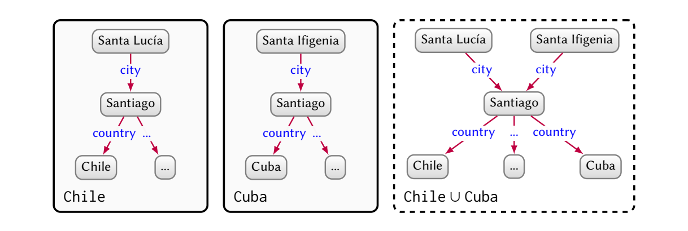

**图 16：** 合并具有歧义局部标识符的两个图的结果。

图中文字译释：city＝城市；country＝国家。左侧两个图分别描述 Chile 与 Cuba，合并后的 Chile ∪ Cuba 图中，同名 Santiago 节点被错误地视为同一个节点。

#### 3.2.2. 外部身份链接

假设旅游局决定在自己控制的 Web 服务器上，使用 `http://turismo.cl/entity/` 这样的 IRI 定义 chile: 命名空间，使 chile:Santiago 这样的节点——即 IRI `http://turismo.cl/entity/Santiago` 的缩写——能够通过 Web 查询。虽然这种命名方案有助于避免名称冲突，但使用 IRI 未必能够确定资源的身份。例如，一个外部地理知识图谱，可能在自己的命名空间中为同一城市分配 IRI geo:SantiagoDeChile，而我们没有直接方法知道这两个标识符指向同一城市。如果合并两个知识图谱，就会为同一个城市得到两个不同节点。

有多种方法可以确定实体的身份。第一种方法是将实体与图中能够唯一标识它的信息关联，例如地理坐标、邮政编码、建立年份等。每增加一项信息，都会减少所指城市的歧义，例如提供更多选择，将该城市与外部来源中的对应实体匹配。第二种选择是使用身份链接，陈述局部实体与外部来源中另一个共指实体具有相同身份。OWL 标准提供了这一概念的具体实现：它定义 owl:sameAs 属性，用于关联共指实体。使用这一属性，可以在 RDF 图中陈述边 `chile:Santiago —owl:sameAs→ geo:SantiagoDeChile`，从而在两个图中的相应节点之间建立身份链接。随后，OWL 标准为 owl:sameAs 定义的语义，允许我们合并两个节点的数据。第 4 节将讨论这类语义，第 8 节将讨论如何计算身份链接。

#### 3.2.3. 数据类型

考虑图 1 左侧的两个日期时间：应如何为这些节点分配持久／全局标识符？直观上，例如为这些节点分配 IRI 并不合理，因为它们的语法形式已经告诉我们它们指向什么：2020 年 3 月的特定日期与时间。这种语法形式也能够由机器识别，因此利用适当软件，可以按升序或降序排列这些值、提取年份等。

大多数实际图数据模型，允许定义作为数据类型值的节点。RDF 使用 XML Schema 数据类型（XSD）[411] 等，其中数据类型节点表示为配对 (l, d)：l 是词法字符串，例如 `"2020-03-29T20:00:00"`；d 是表示数据类型的 IRI，例如 xsd:dateTime。于是该节点写为：

```text
"2020-03-29T20:00:00"^^xsd:dateTime
```

RDF 中的数据类型节点称为字面量，不允许具有出边。RDF 数据中其他常见数据类型包括 xsd:string、xsd:integer、xsd:decimal、xsd:boolean 等。如果省略数据类型，就假定其类型为 xsd:string。在 RDF 之上构建的应用，随后可以识别这些数据类型，将它们解析为数据类型对象，并依据标准定义执行相等性检查、规范化、排序、变换、类型转换等。在属性图环境中，Neo4j [354] 也为属性值定义了一组内部数据类型，包括数字、字符串、布尔值、空间点和时间值。

#### 3.2.4. 词汇化

实体的全局标识符，有时具有人类可理解的形式，例如 chile:Santiago，但标识符字符串本身不具有任何形式语义意义。在其他情况下，所采用的标识符会有意设计为不能由人直接理解。例如，在 Wikidata 中，Santiago de Chile 被标识为 wd:Q2887；这种方案的优点是提供更好的持久性，且不偏向某一种人类语言。例如，Eswatini 的 Wikidata 标识符 wd:Q1050，在该国从 Swaziland 改名后未受影响，也不要求在创建更可读的 IRI 时在不同语言之间选择，例如 wd:Eswatini（英语）、wd:eSwatini（斯瓦蒂语）、wd:Esuatini（西班牙语）等。

由于标识符可以是任意的，通常会添加为节点提供人类可理解标签的边，例如 `wd:Q2887 —rdfs:label→ “Santiago”`，说明人们在语言中如何指称主语节点。这类语言信息在确定知识所指方面具有重要作用，使用户能够更清楚地识别知识图谱中某节点实际指向的现实世界实体 [120]。此外，它还允许将实体标签与文本语料交叉对照，例如查找可能提及给定实体的文档 [338]。还可以用别名，例如 `wd:Q2887 —skos:altLabel→ “Santiago de Chile”`，或注释，例如 `wd:Q2887 —rdfs:comment→ “Santiago is the capital of Chile”`，补充标签，进一步帮助确定节点身份。上述注释的意思是“Santiago 是 Chile 的首都”。

“Santiago” 这样的节点表示字符串字面量，而不是标识符。根据具体图模型，这类字面量节点也可以定义为配对 (s, l)，其中 s 表示字符串、l 表示语言代码。例如，在 RDF 中可以陈述 `chile:City —rdfs:label→ "City"@en`、`chile:City —rdfs:label→ "Ciudad"@es` 等，表示节点在不同语言中的标签。在其他模型中，也可以通过边的元数据等方式规定相关语言。具有不同语言的人类可理解标签、别名、注释等的知识图谱，有时称为（多语言）词汇化知识图谱 [57]。

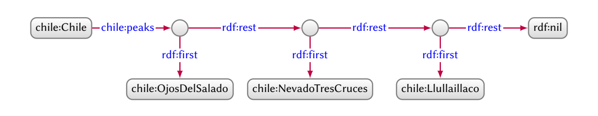

**图 17：** 按顺序表示智利三座最高山峰的 RDF 列表。

图中文字译释：chile:peaks＝山峰；rdf:first＝列表首项；rdf:rest＝列表其余部分；rdf:nil＝空列表。列表依次为 OjosDelSalado、NevadoTresCruces 和 Llullaillaco，空白圆节点用于连接列表结构。

#### 3.2.5. 存在性节点

对不完整信息建模时，有时我们知道图中必定存在某个节点，且它与其他节点具有特定关系，但无法识别该节点。例如，我们可能有两个将在同一场所举办的活动 chile:EID42 和 chile:EID43，而场所尚未公布。一种选择是直接省略 venue 边，但这会丢失两个活动有场所以及二者场所相同的信息。另一种选择可能是创建一个新的 IRI 表示场所，但从语义上看，这与场所已知的情况没有区别。因此，某些图模型允许使用存在性节点，在这里用空白圆圈表示：

```text
chile:EID42 —chile:venue→ ○ ←chile:venue— chile:EID43
```

这些边表示 chile:EID42 和 chile:EID42 存在共同场所，但不标识该场所。RDF 通过空白节点 [111] 支持存在性节点；空白节点也常用于支持对图中复杂元素建模，例如 RDF 列表 [111, 247]。图 17 展示一个 RDF 列表示例，它通过链表结构中的空白节点编码顺序。虽然存在性节点很方便，但其存在可能使图操作更加复杂，例如判断两个数据图在忽略存在性节点差异后是否具有相同结构 [111, 245]。因此，已有对图中存在性节点进行斯科伦化的方法，即用规范标签替换它们 [245, 325]。另一些作者则呼吁尽量减少图数据中这类节点的使用 [226]。

### 3.3. 上下文

图 1 的数据图中呈现的许多事实，可以说是所有事实，都可以认为是在某种上下文中成立的。就时间上下文而言，Santiago 从 1541 年起才作为城市存在，Arica 到 Santiago 的航班始于 1956 年，等等。就地理上下文而言，该图描述智利境内的活动。就溯源而言，与 EID15 相关的数据，取自 2020 年 1 月 4 日的 Ñam 网页，因此被认为相对于该网页为真。还可以使用其他形式的上下文。也可以进一步组合上下文，例如指出：根据《安孔条约》（溯源），Arica 自 1883 年起（时间）是一座智利城市（地理）。

此处所说的“上下文”是指真值成立的范围，因此，我们讨论的是某些数据被认为成立时所处的上下文 [205, 345]。图 1 中的许多上下文是隐含的。不过，将上下文显式化，可以让我们从不同的视角解释数据，例如理解哪些内容在 2016 年成立，或在排除后来被发现含有虚假数据的网页后，哪些内容仍然成立，等等。如前面的例子所示，图数据的上下文可以在不同层次上考虑：单个节点、单条边，或一组边（子图）。下面，我们讨论可以在这些不同层次上显式表达上下文的各种表示方式。

#### 3.3.1. 直接表示

表示上下文的第一种方式，是将它视为与其他数据没有区别的数据。例如，图 1 中事件 `EID15` 的日期可以被视为一种时间上下文，指出 `EID15 —venue→ Santa Lucía` 等边在哪个时间范围内成立。另一种办法，是把原本表示为边的关系，例如 `Santiago —flight→ Arica`，转换为一个节点，如图 3 所示，从而为该关系附加更多上下文。虽然这些例子中的上下文都是以特定方式表示的，但已经有人提出了一些规范，以更标准化的方式将上下文表示为数据。时间本体（Time Ontology）[107] 就是一个例子，它规定了如何以可互操作的方式，在 RDF 图中描述时间实体、时间区间、时间瞬间等，以及它们之间的关系，例如 before（早于）、overlaps（重叠）等。另一个例子是 PROV 数据模型 [188]，它规定了如何在 RDF 图中描述溯源信息：实体，例如图、节点或物理文档，可以派生自其他实体，可以由活动，例如提取或写作，生成和/或使用，并可以归属于代理，例如个人、软件或组织。

#### 3.3.2. 具体化

我们常常希望直接定义边本身的上下文；例如，我们可能希望指出，边 `Santiago —flight→ Arica` 从 1956 年起有效。我们可以采用把边变为节点的模式，如图 3 所示，直接表示这类上下文；也可以使用具体化（reification），以一种通用方式对陈述作出陈述，或者在图的情形下，定义关于边的边。图 18 展示了三种具体化方式，它们可以在有向边标记图中，为上述边建模时间上下文 [235]。我们用 `e` 表示一个任意标识符，该标识符代表边本身，上下文信息可以关联到它。与直接表示不同，`e` 表示的是一条边，而不是一次航班。RDF 具体化 [111]（图 18a）定义一个新节点 `e` 来表示这条边，并将它分别连接到该边的源节点、目标节点和边标签，所用关系分别是 subject（主语）、object（宾语）和 predicate（谓语）。相较之下，n 元关系 [111]（图 18b）直接用原边的标签，将原边的源节点连接到边节点 `e`；随后，通过 value（值）将原边的目标节点连接到 `e`。最后，单例属性（singleton properties）[383]（图 18c）则把 `e` 用作边标签，再通过 singleton（单例）将它连接到表示原边标签的节点。文献中还提出了其他具体化形式，例如 NdFluents [190]。一般来说，具体化后的边并不断言它所具体化的边成立；例如，我们可以具体化一条边，以指出它已经不再有效。关于各种具体化方案及其相对优缺点的进一步比较，参见 Hernández 等人的研究 [235]。

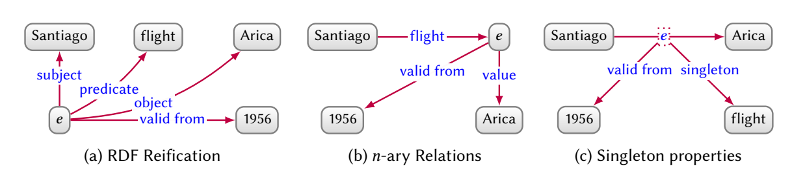

**图 18.** 在有向边标记图中表示一条边的时间上下文的三种方式。（a）RDF 具体化；（b）n 元关系；（c）单例属性。图中 flight 为“航班”，valid from 为“起始有效时间”；subject、predicate、object 分别为“主语”“谓语”“宾语”，value 为“值”，singleton 为“单例”。

#### 3.3.3. 更高元数的表示

作为具体化的替代方案，我们也可以用更高元数的表示来建模上下文。仍以 `Santiago —flight→ Arica` 这条边为例，图 19 展示了时间上下文的三种更高元数表示。首先，可以用一个命名图（图 19a）包含这条边，再在图名上定义时间上下文。其次，可以使用属性图（图 19b），将时间上下文定义为边上的一个属性。第三，可以使用 RDF* [218]（图 19c）：这是 RDF 的一种扩展，允许将边定义为节点。在这些方案中，命名图表示最灵活，因为我们可以把多条边放入同一个命名图，一次性为它们赋予上下文；例如，我们可以向图 19a 的命名图中加入更多从 1956 年起有效的边。RDF* 是最不灵活的方案，因为它没有边标识符，无法把不同组的上下文值赋给同一条边；例如，考虑边 `Chile —president→ M. Bachelet`，如果我们为它附加四个上下文值，以表达它在 2006 至 2010 年以及 2014 至 2018 年有效，就无法将这些值成对关联，而可能需要创建节点来表示不同的总统任期；在其他模型中，则可以使用两个命名图或两个边标识符。

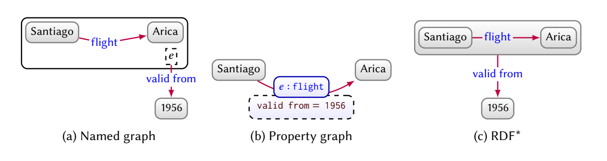

**图 19.** 在一条边上表示时间上下文的三种更高元数的方式。（a）命名图；（b）属性图；（c）RDF*。flight 为“航班”；valid from 为“起始有效时间”，其值为 1956；`e` 为图或边的标识符。

#### 3.3.4. 注释

到目前为止，我们讨论了如何在图中表示上下文，但尚未讨论自动推理上下文的机制。例如，如果从 `Santiago` 到 `Arica` 只有夏季季节性航班，我们可能希望为在 `Arica` 举行的冬季活动寻找从圣地亚哥出发的其他路线。公交、航班等的日期，可以在图中直接表示，也可以通过具体化表示；但编写查询来手动求相应时间上下文的交集会很繁琐，甚至根本无法实现。另一种办法是考虑使用注释，为某个上下文域，以及该域中可以执行的关键运算，给出数学定义，随后自动应用这些运算。

一些注释对特定的上下文域建模；例如，时间 RDF（Temporal RDF）[210] 允许用时间区间注释边，如 `Chile —president→ M. Bachelet [2006, 2010]`；模糊 RDF（Fuzzy RDF）[502] 则允许用一个真值程度注释边，如 `Santiago —climate→ Semi-Arid [0.8]`，表示圣地亚哥具有半干旱气候这一陈述，在 0.8 的程度上成立。另一些注释形式与具体领域无关；例如，带注释的 RDF（Annotated RDF）[130, 530, 583] 允许表示以半环建模的各种上下文。半环是一种代数结构，由域中的值，例如时间区间、模糊值等，以及用于组合这些值的两个主要运算组成：交（meet）和并（join）。¹⁰ 图 20 给出了一个例子，其中 `G` 用一个简化时间域中的值进行注释；这个域由整数 1–365 的集合构成，表示一年中的各天。为简洁起见，我们采用区间记法，例如 `{[150, 152]}` 表示集合 `{150, 151, 152}`。查询 `Q` 要求找出从圣地亚哥出发、通往举办活动的城市的航班；查询会检查并返回反映各个答案时间有效性的注释。

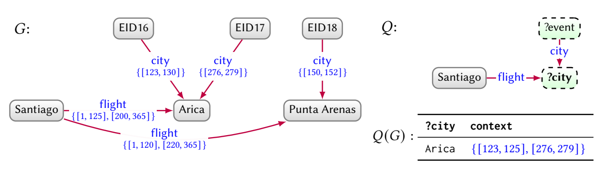

**图 20.** 对带时间注释的图执行查询的例子。flight 为“航班”，city 为“所在城市”；`?city` 和 `?event` 分别是城市变量和活动变量，context 为“上下文”。结果中的 Arica 对应时间注释 `{[123, 125], [276, 279]}`。

为了推导这些答案，首先要将可兼容的 flight 边与 city 边上的注释作合取，利用交运算，计算两条边同时成立时的注释。在我们的场景中，交运算的自然定义是求日期集合的交集。例如，对 `Punta Arenas` 的活动注释 `{[150, 152]}` 和航班注释 `{[1, 120], [220, 365]}` 应用交运算，会得到空的时间区间 `{}`，从而可能使该城市被从结果中滤除，具体取决于查询求值语义。但是，对于 `Arica`，我们找到两个不同的非空交集：`EID16` 对应 `{[123, 125]}`，`EID17` 对应 `{[276, 279]}`。由于我们关注的是城市，即投影变量，而非活动，因此可以用并运算，将 `Arica` 的这两个注释组合起来，返回任一结果成立时的注释。在这个场景中，并运算的自然定义是日期集合的并集，所得结果为 `{[123, 125], [276, 279]}`。附录 B.4.1 根据 Zimmermann 等人 [583] 提出的图注释通用框架，给出了形式化定义。

> **脚注 10：** 注释的并运算不同于关系代数中的连接运算。

#### 3.3.5. 其他上下文框架

还有其他框架被提出，用于在图中建模上下文并对其进行推理。一个值得注意的例子是上下文知识仓库（contextual knowledge repositories）[252]，它允许为每个图或子图指定自身的上下文。与命名图不同，这里的上下文沿一个或多个维度显式建模，每个图或子图都必须在每个维度上取一个值。每个维度还关联着其值上的一个偏序，例如 `2020-03-22 ⪯ 2020-03 ⪯ 2020`，因此可以选择并组合在不同粒度的上下文中有效的子图。Schuetz 等人 [467] 类似地提出了一种上下文联机分析处理（OnLine Analytic Processing，OLAP）形式，它基于各个维度构成的数据立方体，单个单元格中包含知识图谱。由此可以支持“切片与切块”（按给定维度选择知识）以及“上卷”（在更高层次聚合知识）等操作。更多细节请参见相应论文 [252, 467]。

## 4. 演绎知识

作为人类，我们可以从图 1 的数据图中推导出比边所显式表示的内容更多的信息。例如，即使图中没有 `EID15 —location→ Santiago` 这条边，我们也可能推导出 Ñam 节（`EID15`）位于圣地亚哥。即使图中没有指代机场的节点，我们仍然可以进一步推导出，存在航班连接的城市附近必然有某个机场。在这些情形下，以数据作为前提，再结合我们可能先验知道的一些关于世界的一般规则，就可以通过演绎过程推导出新数据，从而知道比数据显式给出的内容更多的信息。这类一般性前提和规则，如果为许多人共享，就构成“常识知识”的一部分 [344]；反之，如果只为某一领域的少数专家共享，就构成“领域知识”的一部分。例如，生物学专家可能知道，血蓝蛋白是一种含铜蛋白质，在某些软体动物和节肢动物的血液中承担输送氧气的作用。

相比之下，机器并不先验拥有这样的演绎能力；为了进行类似人类的演绎，必须向机器提供用前提和蕴涵机制表达的形式化指令。这些蕴涵机制形式化地刻画了作为某组给定前提的结果，在逻辑上应当成立的结论。一旦以这种方式获得指令，机器通常就能以超过人类的精确度、效率和规模进行演绎。这些演绎可以服务于多种应用，例如改进查询回答、进行演绎分类、发现不一致等。作为查询回答的一个具体例子，假设我们想知道位于圣地亚哥的节庆；我们可以直接用图 21 所示的图模式表达这一查询。对于图 1 中的图，这个查询不会返回任何结果：图中没有名为 `Festival` 的节点，而且没有任何事物直接以 `Santiago` 作为 location。然而，如果我们声明，`x` 是 Food Festival（美食节）就蕴涵 `x` 是 Festival（节庆），或者 `x` 的 venue（举办地点）是位于城市 `z` 的 `y` 就蕴涵 `x` 的 location（所在地）是 `z`，就可以自动蕴涵出一个答案（`Ñam`）。那么，这些蕴涵应当如何表达呢？第 3.1.1 节已经讨论了如何利用语义模式中的子类关系来表达前一种蕴涵；但后一种蕴涵需要比目前见过的机制更具表达能力的蕴涵机制。


**图 21.** 查询圣地亚哥节庆名称的图模式。type 为“类型”，location 为“所在地”，name 为“名称”；Festival 为“节庆”，`?festival` 和 `?name` 分别是节庆变量和名称变量。

本节讨论如何表达并自动实现更复杂的蕴涵。虽然可以为此采用多种逻辑框架，例如一阶逻辑、Datalog、Prolog、回答集编程等，但我们将重点放在本体上。本体是知识的一种形式化表示，而且对于我们的讨论来说，重要的是它可以表示为图。随后，我们讨论如何形式化地定义这些本体，它们与已有逻辑框架如何关联，以及如何针对这样的本体进行推理。

### 4.1. 本体

为了实现蕴涵，我们必须精确规定所用术语的含义。以图 1 为例，更仔细地考察节点 `EID16` 时，尤其是在将其与 `EID15` 比较时，我们可能会开始质疑它的建模方式。根据图 11 的类层级，这两个节点都被视为活动。但如果我们希望为 `EID16` 定义两对开始日期和结束日期，分别对应不同的举办地点，会怎样？是否应该把每个举办地点发生的事情视为不同活动？如果一个活动在同一个举办地点有多个开始和结束日期，又会怎样：这应当视为一个反复举办的活动，还是多个活动？这些问题都是一个更一般问题的不同侧面：“活动”究竟指什么？它发生在一个连续时间区间中，还是可以多次发生？它发生在一个地点，还是可以发生在多个地点？这些问题没有“正确”答案；我们可以用多种方式理解“活动”这一术语，因此答案取决于约定。

在计算机领域中，本体（ontology）¹¹ 是对术语在其使用范围，例如某一给定领域内的含义所作的具体、形式化表示。例如，一种活动本体可以形式化地规定：如果一个实体是“活动”，那么它恰好有一个举办地点，并且恰好有一个开始的时间瞬间。相反，另一种活动本体可以规定，“活动”可以有多个举办地点和多个开始时间，等等。每一种这样的本体都形式化地表达了一种特定视角，即一种特定约定。例如，采用第一种本体时，我们不能将奥运会称为一个“活动”；采用第二种本体时则可以。同样，本体可以指导图数据的建模方式。在第一种本体下，可以把 `EID16` 拆成两个活动；在第二种本体下，可以选择将 `EID16` 保留为一个具有两个举办地点的活动。归根结底，由于本体是形式化表示，它们可以用于自动实现蕴涵。

与所有约定一样，本体是否有用，取决于人们对其定义的共识程度、它的细致程度，以及它被采用的广泛程度和一致程度。参与同一知识图谱的各方共同采用一种本体，可以使该知识图谱中的术语使用和建模保持一致。而跨多个知识图谱达成共识，则会提高这些知识图谱的互操作性。

实际应用中最流行的本体语言，包括 W3C 推荐、与 RDF 图兼容的 Web 本体语言（Web Ontology Language，OWL）[239]¹²，以及主要用于生物医学领域的开放生物医学本体格式（Open Biomedical Ontologies Format，OBOF）[366]。由于 OWL 应用更广泛，我们将重点讨论它的特征；不过，两者都具有许多类似特征 [366]。但在介绍这些特征之前，我们必须先讨论应当如何解释图。

> **脚注 11：** 这一术语源于哲学中的本体论研究。本体论关注存在的各种实体、它们存在的性质、它们具有哪些属性，以及如何识别和分类这些实体。

> **脚注 12：** RDF Schema（RDFS）也可以列入其中，但它在很大程度上被 OWL 所涵盖，因为 OWL 建立在它的核心之上。

#### 4.1.1. 解释

人类可能会将图 1 数据图中的节点 `Santiago` 解释为现实世界中作为智利首都的城市。还可能将边 `Arica —flight→ Santiago` 解释为从阿里卡市到该城市存在航班。这样，我们就把数据图解释成了另一个图，此处称之为域图（domain graph），它由通过现实世界关系连接起来的现实世界实体构成。这里的解释过程，就是把数据图中的节点和边映射到域图中的节点和边。

依照这一思路，可以抽象地将一个数据图的解释定义为两个要素：一个域图，以及从数据图中的术语，即节点和边标签，到域图中相应术语的映射。域图采用与数据图相同的模型；例如，如果数据图是有向边标记图，域图也会是有向边标记图。为简化讨论，我们将使用有向边标记图，并把域图中的节点称为实体，把域图中的边称为关系。给定一个数据图和一个解释，我们用 `Santiago` 表示数据图中的节点，用 `⟦Santiago⟧` 表示它在域图中所指的实体，具体取决于给定解释的映射。同样，用 `Arica —flight→ Santiago` 表示边，用 `⟦Arica⟧ —⟦flight⟧→ ⟦Santiago⟧` 表示关系，这同样取决于给定解释的映射。在这种抽象解释概念中，并不要求 `⟦Santiago⟧` 或 `⟦Arica⟧` 是现实世界中的城市，甚至不要求域图包含现实世界的实体和关系；一个解释可以采用任意域图和映射。

这种抽象的解释概念为何有用？当我们定义本体特征和蕴涵的含义时，节点与实体、边与关系之间的区别就变得重要。为了说明这一区别，如果我们问，图 1 的数据图中是否存在一条从 `Arica` 到 `Viña del Mar`、标签为 flight 的边，答案是否定的。但如果我们问，实体 `⟦Arica⟧` 和 `⟦Viña del Mar⟧` 是否通过关系 `⟦flight⟧` 连接，答案就取决于解释图时采用哪些假设。在封闭世界假设（Closed World Assumption，CWA）下，如果没有额外知识，答案明确是否定的，因为未知内容被假定为假。相反，在开放世界假设（Open World Assumption，OWA）下，我们无法确定这个关系不存在，因为它可能属于某些尚未在图中描述的知识。同样，在唯一名称假设（Unique Name Assumption，UNA）下，数据图描述了至少两条飞往 `Santiago` 的航班，因为 `Viña del Mar` 和 `Arica` 被假定为不同实体，所以 `Arica —flight→ Santiago` 和 `Viña del Mar —flight→ Santiago` 必须是不同的边。相反，在不采用唯一名称假设（No Unique Name Assumption，NUNA）时，只能说至少有一条这样的航班，因为 `Viña del Mar` 和 `Arica` 可能是拥有两个“名称”的同一个实体。

这些假设，或者不作这些假设，决定了哪些解释是有效的，以及哪些解释满足哪些数据图。UNA 禁止把两个数据术语映射到同一个域术语的解释；NUNA 则允许这样的解释。在 CWA 下，一个在域图中包含关系 `⟦x⟧ —⟦p⟧→ ⟦y⟧` 的解释，只能满足可以蕴涵边 `x —p→ y` 的数据图。在 OWA 下，包含关系 `⟦x⟧ —⟦p⟧→ ⟦y⟧` 的解释，可以满足并不蕴涵 `x —p→ y` 的数据图，只要该数据图不与这条边矛盾。¹³ OWL 采用 NUNA 和 OWA，因此代表最一般的情形：图中的多个节点或边标签，可以指向同一个实体或关系类型（NUNA），而数据图没有蕴涵的任何内容，也不会因此被假定为假（OWA）。

除这些基本假设外，还可以把数据图中的某些模式与语义条件关联起来，以定义哪些解释满足该图。例如，可以添加一个语义条件，要求当数据图包含边 `p —subp. of→ q` 时，为了满足该数据图，解释的域图中的任意关系 `⟦x⟧ —⟦p⟧→ ⟦y⟧` 都必须具有对应的关系 `⟦x⟧ —⟦q⟧→ ⟦y⟧`。这些语义条件构成了本体语言的特征。下面，为方便阅读，我们用带有缩略术语的抽象图形记法介绍 OWL 的特征。关于具体语法的细节，请参见 OWL 和 OBOF 标准 [239, 366]。我们同样以这种图形格式，展示与每个特征相关的解释语义条件；¹⁴ 第 4.2 节将进一步说明这些条件的细节，而形式化定义将在附录 B.5 中给出。

> **脚注 13：** CWA 的一些变体，可以在完全开放的世界与作出其他假设之间提供折中；完全开放的世界不对完备性、未知陈述的假性或名称的唯一性作任何假设。一个这样的变体例子，是第 3.1.1 节已提及的局部封闭世界假设。

> **脚注 14：** 我们用 “iff” 作为 “if and only if”（当且仅当）的缩写；“φ iff ψ” 可以理解为“如果 φ，则 ψ”，并且“如果 ψ，则 φ”。

#### 4.1.2. 个体

表 3 列出了 OWL 用于描述个体，例如 Santiago、EID16，所支持的主要特征；个体有时会与类和属性区别开来。首先，可以通过 `Santa Lucía —city→ Santiago` 这样的边，断言个体之间的二元关系。在条件栏中，例如写出 `x —y→ z`，表示相应关系在解释中成立的条件；如果成立，该解释就满足这条公理。OWL 还允许定义关系，以显式指出两个术语指向同一个实体。例如，`Región V —same as→ Región de Valparaíso` 表示二者指向同一个大区，参见第 3.2 节。也可以指出两个术语指向不同实体，例如 `Valparaíso —diff. from→ Región de Valparaíso` 区分了同名的城市和大区。还可以用否定指出某个关系不成立；否定可以借助一种具体化形式，参见图 18a，序列化为图。

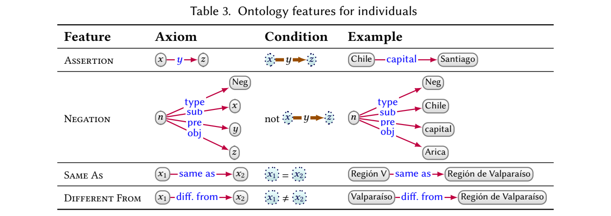

**表 3.** 针对个体的本体特征。原表各栏依次为“特征”“公理”“条件”“示例”。下表中 `p(x,y)` 表示解释中从实体 x 到实体 y 存在关系 p；“iff”表示“当且仅当”。

| 特征 | 公理 | 条件 | 示例 |
| --- | --- | --- | --- |
| 断言（Assertion） | `x —y→ z` | `y(x,z)` 成立。 | `Chile —capital→ Santiago`：智利的首都是圣地亚哥。 |
| 否定（Negation） | 节点 n 的 type 为 Neg，sub、pre、obj 分别为 x、y、z。 | `¬y(x,z)`，即该关系不成立。 | 否定 `Chile —capital→ Arica`，即阿里卡不是智利的首都。 |
| 相同（Same As） | `x₁ —same as→ x₂` | `x₁ = x₂`。 | Región V 与 Región de Valparaíso 指向同一大区。 |
| 不同（Different From） | `x₁ —diff. from→ x₂` | `x₁ ≠ x₂`。 | Valparaíso 市与 Región de Valparaíso 大区是不同实体。 |

图中 type 为“类型”；Neg 为“否定”，sub、pre、obj 分别为“主语”“谓语”“宾语”；same as 为“与……相同”，diff. from 为“与……不同”。

#### 4.1.3. 属性

第 3.1.1 节已经讨论了如何为属性定义子属性、定义域和值域。OWL 支持这些定义，还包含表 4 所列的其他特征。可以定义两个属性等价、互为逆属性，或互不相交。还可以定义某个属性表示传递、对称、非对称、自反或非自反关系。也可以通过函数性（多对一）或逆函数性（一对多），定义属性所表示关系的多重性。进一步，可以为一个类定义键，指出哪些属性的值能够唯一标识该类的实体。在不采用唯一名称假设（UNA）的情况下，可以根据后三种特征，得出两个或更多术语指向同一实体的结论。最后，可以将一个属性与一条链关联；链是一种仅允许串接属性的路径表达式，使通过这条链关联的实体对，也通过给定属性关联。注意，表 4 中最后两个特征需要表示列表，此处用垂直排列的省略号记法表示。这样的列表可以采用多种具体方式序列化为图，OWL 则使用 RDF 列表，参见图 17。

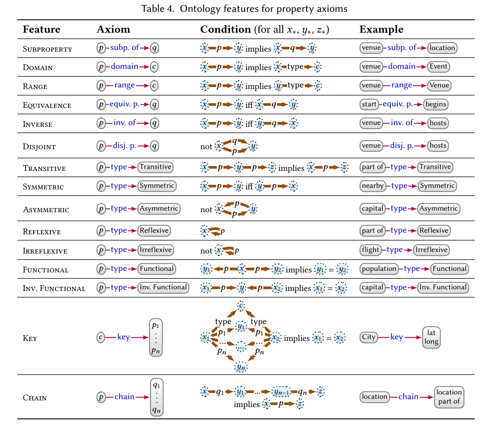

**表 4.** 属性公理的本体特征。原表各栏为“特征”“公理”“条件（对所有 x、y、z）”“示例”；下表中的关系均指解释中的关系。

| 特征 | 公理 | 条件 | 示例 |
| --- | --- | --- | --- |
| 子属性（Subproperty） | `p —subp. of→ q` | `p(x,y) ⇒ q(x,y)`。 | venue（举办地点）是 location（所在地）的子属性。 |
| 定义域（Domain） | `p —domain→ c` | `p(x,y) ⇒ type(x,c)`。 | venue 的定义域为 Event（活动）。 |
| 值域（Range） | `p —range→ c` | `p(x,y) ⇒ type(y,c)`。 | venue 的值域为 Venue（举办地点）。 |
| 等价（Equivalence） | `p —equiv. p.→ q` | `p(x,y) iff q(x,y)`。 | start 与 begins 等价，二者均表示开始。 |
| 逆属性（Inverse） | `p —inv. of→ q` | `p(x,y) iff q(y,x)`。 | venue 与 hosts（承办）互为逆属性。 |
| 不相交（Disjoint） | `p —disj. p.→ q` | 不允许 `p(x,y)` 与 `q(x,y)` 同时成立。 | venue 与 hosts 不相交。 |
| 传递（Transitive） | `p —type→ Transitive` | `p(x,y) ∧ p(y,z) ⇒ p(x,z)`。 | part of（属于……的一部分）具有传递性。 |
| 对称（Symmetric） | `p —type→ Symmetric` | `p(x,y) iff p(y,x)`。 | nearby（邻近）具有对称性。 |
| 非对称（Asymmetric） | `p —type→ Asymmetric` | 不允许 `p(x,y)` 与 `p(y,x)` 同时成立。 | capital（首都）具有非对称性。 |
| 自反（Reflexive） | `p —type→ Reflexive` | 对每个 x，`p(x,x)` 成立。 | part of 具有自反性。 |
| 非自反（Irreflexive） | `p —type→ Irreflexive` | 对每个 x，`p(x,x)` 不成立。 | flight（航班）具有非自反性。 |
| 函数性（Functional） | `p —type→ Functional` | `p(x,y₁) ∧ p(x,y₂) ⇒ y₁ = y₂`。 | population（人口）具有函数性。 |
| 逆函数性（Inverse Functional） | `p —type→ Inv. Functional` | `p(x₁,y) ∧ p(x₂,y) ⇒ x₁ = x₂`。 | capital 具有逆函数性。 |
| 键（Key） | `c —key→ [p₁,…,pₙ]` | 若 x₁、x₂ 都属于类 c，且对每个 i 都有某个 yᵢ 使 `pᵢ(x₁,yᵢ)` 与 `pᵢ(x₂,yᵢ)` 成立，则 `x₁ = x₂`。 | City（城市）以 lat（纬度）和 long（经度）为键。 |
| 属性链（Chain） | `p —chain→ [q₁,…,qₙ]` | `q₁(x,y₁) ∧ … ∧ qₙ(yₙ₋₁,z) ⇒ p(x,z)`。 | location 的一条链为 `[location, part of]`。 |

图中 subp. of 为“是……的子属性”，domain 为“定义域”，range 为“值域”，equiv. p. 为“等价属性”，inv. of 为“是……的逆属性”，disj. p. 为“不相交属性”，key 为“键”，chain 为“属性链”。

#### 4.1.4. 类

第 3.1.1 节讨论了如何利用子类关系建模类层级。OWL 支持子类，以及其他许多用于定义类并对类作出声明的特征；这些附加特征总结在表 5 中。给定两个类，OWL 允许定义它们等价或不相交。此外，OWL 提供了多种特征，以便通过在其他类上应用集合运算，或者根据类实例的属性满足的条件，定义新的类。首先，利用集合运算，可以把一个新类定义为另一个类的补集、一个任意长度的其他类列表的并集或交集，或者全部实例的枚举。其次，通过限制某个属性 p，可以定义一些类，其实例恰好是满足以下条件的所有实体：在 p 上具有某个给定类中的一些值；在 p 上的所有值都来自给定类；¹⁵ 在 p 上有某个特定个体作为值（has value）；在 p 上有自身作为自反值（has self）；在 p 上至少、至多或恰好具有某个数量的值（基数）；以及在 p 上至少、至多或恰好具有某个数量、且来自给定类的值（限定基数）。对于后两种情形，表 5 用记法 `#{a | φ}` 统计解释中满足 φ 的不同实体。还可以组合这些特征，创建更复杂的类；例如，将表 5 中 Intersection（交集）和 Has Self（以自身为值）的例子组合起来，可以得到如下定义：自动驾驶出租车，是以自身作为驾驶者的出租车。

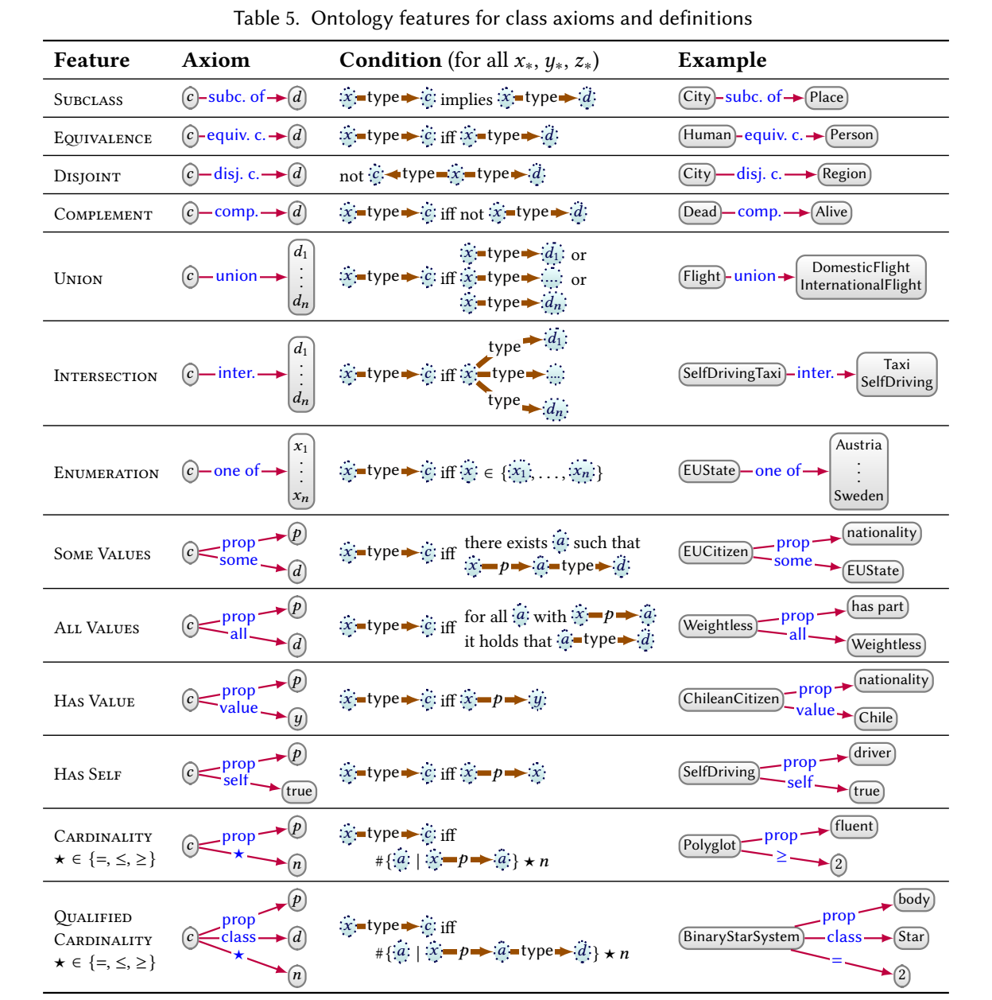

**表 5.** 类公理和类定义的本体特征。原表各栏为“特征”“公理”“条件（对所有 x、y、z）”“示例”。`type(x,c)` 表示解释中的实体 x 属于类 c。

| 特征 | 公理或定义 | 条件 | 示例 |
| --- | --- | --- | --- |
| 子类（Subclass） | `c —subc. of→ d` | `type(x,c) ⇒ type(x,d)`。 | City（城市）是 Place（地点）的子类。 |
| 等价（Equivalence） | `c —equiv. c.→ d` | `type(x,c) iff type(x,d)`。 | Human（人类）与 Person（人）等价。 |
| 不相交（Disjoint） | `c —disj. c.→ d` | 不允许 `type(x,c)` 与 `type(x,d)` 同时成立。 | City（城市）与 Region（区域）不相交。 |
| 补集（Complement） | `c —comp.→ d` | `type(x,c) iff ¬type(x,d)`。 | Dead（死亡）是 Alive（存活）的补集。 |
| 并集（Union） | `c —union→ [d₁,…,dₙ]` | `type(x,c) iff type(x,d₁) ∨ … ∨ type(x,dₙ)`。 | Flight（航班）为 DomesticFlight（国内航班）与 InternationalFlight（国际航班）的并集。 |
| 交集（Intersection） | `c —inter.→ [d₁,…,dₙ]` | `type(x,c) iff type(x,d₁) ∧ … ∧ type(x,dₙ)`。 | SelfDrivingTaxi（自动驾驶出租车）是 Taxi（出租车）与 SelfDriving（自动驾驶者）的交集。 |
| 枚举（Enumeration） | `c —one of→ [x₁,…,xₙ]` | `type(x,c) iff x ∈ {x₁,…,xₙ}`。 | EUState（欧盟成员国）枚举 Austria（奥地利）至 Sweden（瑞典）等成员。 |
| 存在值限制（Some Values） | c 的 prop 为 p，some 为 d。 | `type(x,c)` 当且仅当存在 a，使 `p(x,a) ∧ type(a,d)` 成立。 | EUCitizen（欧盟公民）在 nationality（国籍）上有某个 EUState 值。 |
| 全称值限制（All Values） | c 的 prop 为 p，all 为 d。 | `type(x,c)` 当且仅当对每个满足 `p(x,a)` 的 a，`type(a,d)` 都成立。 | Weightless（无重量）在 has part（具有部分）上的所有值都属于 Weightless。 |
| 具有特定值（Has Value） | c 的 prop 为 p，value 为 y。 | `type(x,c) iff p(x,y)`。 | ChileanCitizen（智利公民）的 nationality 值为 Chile（智利）。 |
| 以自身为值（Has Self） | c 的 prop 为 p，self 为 true。 | `type(x,c) iff p(x,x)`。 | SelfDriving（自动驾驶者）的 driver（驾驶者）为自身。 |
| 基数（Cardinality） | c 的 prop 为 p；给定 n 以及 `★ ∈ {=, ≤, ≥}`。 | `type(x,c)` 当且仅当满足 `p(x,a)` 的不同 a 的数量与 n 满足比较关系 ★。 | Polyglot（通晓多种语言者）至少有 2 个 fluent（流利掌握的语言）值。 |
| 限定基数（Qualified Cardinality） | c 的 prop 为 p，class 为 d；给定 n 以及 `★ ∈ {=, ≤, ≥}`。 | `type(x,c)` 当且仅当满足 `p(x,a) ∧ type(a,d)` 的不同 a 的数量与 n 满足比较关系 ★。 | BinaryStarSystem（双星系统）恰好有 2 个 body（天体）值属于 Star（恒星）。 |

原表后两行的计数条件可写为：

```text
基数：     type(x,c) iff #{a | p(x,a)} ★ n
限定基数： type(x,c) iff #{a | p(x,a) ∧ type(a,d)} ★ n
其中 ★ ∈ {=, ≤, ≥}。
```

图中 subc. of 为“是……的子类”，equiv. c. 为“等价类”，disj. c. 为“不相交类”，comp. 为“补集”，union 为“并集”，inter. 为“交集”，one of 为“枚举成员”；prop 为“属性”，some 为“存在值限制”，all 为“全称值限制”，value 为“特定值”，self 为“自身”，class 为“限定的类”，true 为“真”。

> **脚注 15：** 虽然类似于“DomesticAirport 的 prop 为 flight、all 为 NationalFlight”的定义，可能看起来是 All Values（全称值限制）更自然的例子，但这会是一个建模错误，因为当相应节点不存在时，对应的“对所有”条件仍然成立。换言之，按照这个示例定义，可以把任何已知没有航班的事物推断为国内机场。不过，可以把这个类与 airport（机场）的交集定义为国内机场。

#### 4.1.5. 其他特征

OWL 还支持一些前面没有讨论的语言特征，包括：注释属性，用于提供本体的元数据，例如版本信息；数据类型属性与对象属性，用于区分取数据类型值的属性和不取此类值的属性；以及数据类型分面，用于通过对已有数据类型施加限制来定义新的数据类型。例如，可以定义，智利的地点在数据类型属性 latitude（纬度）上的值，必须是一个处于 -66.0 与 -110.0 之间的浮点数。更多细节请参见 OWL 2 标准 [239]。第 6.5 节还将讨论创建本体的方法论。

### 4.2. 语义与蕴涵

前面各表列出的条件说明了每个特征应当如何解释。这些条件产生蕴涵；例如，对于表 4 中的 Symmetric（对称）特征，根据其给定条件，定义 `nearby —type→ Symmetric` 和边 `Santiago —nearby→ Santiago Airport`，蕴涵边 `Santiago Airport —nearby→ Santiago`。下面，我们说明这些条件如何产生蕴涵。

#### 4.2.1. 模型论语义

前面各表描述的每一条公理，在加入图后，都会对满足该图的解释施加某些条件。满足一个图的解释称为该图的模型。例如，如果只考虑表 3 中 Assertion（断言）特征的基本条件，那么一个图的模型就是这样的任意解释：对于图中每一条边 `x —y→ z`，模型中都存在关系 `⟦x⟧ —⟦y⟧→ ⟦z⟧`。由于模型中可能还存在其他关系，这是 OWA 的结果，因此任何这样的图都具有无限多个模型。此外，由于可以把图中的多个节点映射到模型中的同一个实体，这是 NUNA 的结果，所以只要图中每条边 `x —y→ z` 在解释中都满足 `⟦x⟧ = ⟦y⟧ = ⟦z⟧ = ⟦a⟧`，那么例如包含关系 `⟦a⟧ —⟦a⟧→ ⟦a⟧` 的任意解释，都是任意图的模型。换言之，该解释把所有内容都映射到 `⟦a⟧`。随着我们向图中添加公理及其相关条件，图的模型会受到限制。例如，考虑一个包含两条边 `x —y→ z` 和 `y —type→ Irreflexive` 的图，包含 `⟦a⟧ —⟦a⟧→ ⟦a⟧`，且 `⟦x⟧ = ⟦y⟧ = … = ⟦a⟧` 的解释，就不再是模型，因为它违反了非自反公理的条件。

#### 4.2.2. 蕴涵

我们说一个图蕴涵另一个图，当且仅当前一个图的任意模型，也都是后一个图的模型。直观来说，这意味着后一个图没有表达超出前一个图的新内容，因此它作为前一个图的逻辑结果而成立。例如，考虑包含 `Santiago —type→ City —subc. of→ Place` 的图，以及包含 `Santiago —type→ Place` 的图。后者的所有模型都必须具有关系 `⟦Santiago⟧ —⟦type⟧→ ⟦Place⟧`；前者的所有模型也必须如此，因为它们必须具有 `⟦Santiago⟧ —⟦type⟧→ ⟦City⟧ —⟦subc. of⟧→ ⟦Place⟧`，并进一步满足 Subclass（子类）的条件，而该条件要求 `⟦Santiago⟧ —⟦type⟧→ ⟦Place⟧` 也成立。因此，前一个图的任意模型都必须是后一个图的模型；换言之，前一个图蕴涵后一个图。

#### 4.2.3. “如果—那么”语义与“当且仅当”语义

考虑包含 `nearby —type→ Symmetric` 的图，以及包含 `nearby —inv. of→ nearby` 的图。它们在域图中产生相同的语义条件，但其中一个是否蕴涵另一个呢？答案取决于采用的语义。考虑表 3 中的公理和条件，可以采用两种语义。在“如果—那么”语义下，即“如果公理匹配数据图，那么条件在域图中成立”，这两个图并不相互蕴涵：虽然二者产生相同的条件，但该条件不会反向转换为描述它的公理。¹⁶ 相反，在“当且仅当”语义下，即“公理匹配数据图，当且仅当条件在域图中成立”，这两个图相互蕴涵：二者产生相同的条件，而该条件又会反向转换为所有可能描述它的公理。因此，与“如果—那么”语义相比，“当且仅当”语义允许蕴涵本体语言中的更多公理。OWL 通常采用“当且仅当”语义 [239]。

> **脚注 16：** 注意，具有关系 `⟦nearby⟧ —⟦type⟧→ ⟦Symmetric⟧` 的解释，是第一个图的模型，却不是第二个图的模型；而具有关系 `⟦nearby⟧ —⟦inv. of⟧→ ⟦nearby⟧` 的解释，是第二个图的模型，却不是第一个图的模型。因此，两个图都不蕴涵对方。

### 4.3. 推理

遗憾的是，给定两个图，按照我们所定义的蕴涵概念，并考虑表 3–5 中列出的全部本体特征，判断第一个图是否蕴涵第二个图，是不可判定的：不存在一种用于这种蕴涵的有限算法，能够对所有输入都终止，并返回正确的真/假答案 [240]。不过，可以为本体提供实用推理算法：（1）对任意输入本体都终止，但可能漏掉某些蕴涵，把本应为真的结果返回为假；（2）总能终止并返回正确答案，但只接受特征受到限制的本体作为输入；或（3）对任意输入本体只返回正确答案，但在某些输入上可能永远不会终止。虽然已经有人利用一阶逻辑的定理证明器等方法研究第（3）种方案 [466]，更常见的研究方向还是利用规则和/或描述逻辑实现第（1）和第（2）种方案。第（1）种方案通常允许更高效、更可扩展的推理算法，适用于数据不完整，而且获得部分蕴涵就有价值的情形。第（2）种方案在医学本体等领域可能更合适，因为漏掉蕴涵可能导致不良后果。

#### 4.3.1. 规则

使演绎知识能够自动获取的最直接方法之一，是使用编码“如果—那么”式结果的推理规则，或简称规则。一条规则由规则体（如果）和规则头（那么）组成。规则体和规则头都由图模式给出。规则表示：如果可以用数据图中的术语替换规则体的变量，从而构成给定数据图的一个子图，那么在规则头中采用相同的变量替换，就会得到一个有效的蕴涵。规则头通常必须使用规则体中出现的变量的一个子集，确保结论中没有尚未被替换的变量。这种形式的规则，对应数据库中的正 Datalog [85]、逻辑编程中的 Horn 子句 [323] 等。

规则可以用来表达本体条件下的蕴涵。表 6 列出了一些关于子类、子属性、定义域和值域特征的示例规则 [368]；这些规则可以视为不完整，因为它们没有表达例如每个类都是自身的子类、每个属性都是自身的子属性等情况。对于表 3–5 的 OWL 特征，已有一套更全面的规则，被定义为 OWL 2 RL/RDF [363]；这些规则同样不完整，因为这种规则无法完整表达否定，例如 Complement（补集），存在量化，例如 Some Values（存在值限制），全称量化，例如 All Values（全称值限制），以及计数，例如 Cardinality（基数）和 Qualified Cardinality（限定基数）。不过，也有人提出其他规则语言，用于支持这类附加特征，包括存在量化，例如 Datalog± [36]，析取，例如析取 Datalog [449]，等等。

规则可以通过多种方式用于推理。物化（materialisation）是指对图递归应用规则，把生成的结论重新加入图中，直到达到一个不动点，再也无法添加更多内容。之后，物化图可以像任何其他图一样使用。虽然可以借助 Rete 网络 [164] 等优化，或 MapReduce [531] 等分布式框架，提高物化的效率与可扩展性，但根据规则和数据的不同，物化后的图可能会庞大到无法实际管理。

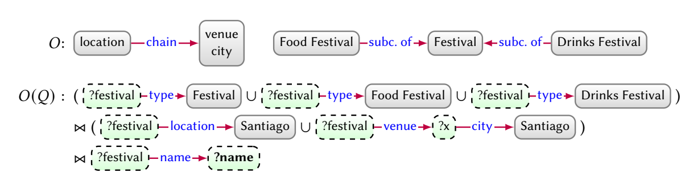

**图 22.** 对图 21 的查询 Q 进行查询重写的例子。O 表示本体，O(Q) 表示依据本体重写后的查询；∪ 表示并，⋈ 表示连接。subc. of 为“是……的子类”，chain 为“属性链”，venue 为“举办地点”，city 为“所在城市”，location 为“所在地”，type 为“类型”，name 为“名称”。Festival、Food Festival 和 Drinks Festival 分别为“节庆”“美食节”和“饮品节”。

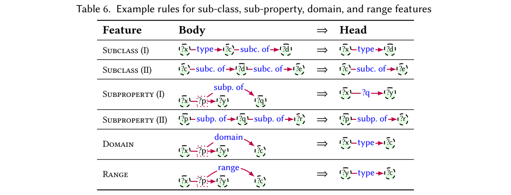

**表 6.** 子类、子属性、定义域和值域特征的示例规则。原表各栏为“特征”“规则体 ⇒ 规则头”。下表用 `(主语, 谓语, 宾语)` 表示一条边，用 ∧ 表示规则体中同时要求成立的模式。

| 特征 | 规则体 ⇒ 规则头 |
| --- | --- |
| 子类（I） | `(?x,type,?c) ∧ (?c,subc. of,?d) ⇒ (?x,type,?d)` |
| 子类（II） | `(?c,subc. of,?d) ∧ (?d,subc. of,?e) ⇒ (?c,subc. of,?e)` |
| 子属性（I） | `(?x,?p,?y) ∧ (?p,subp. of,?q) ⇒ (?x,?q,?y)` |
| 子属性（II） | `(?p,subp. of,?q) ∧ (?q,subp. of,?r) ⇒ (?p,subp. of,?r)` |
| 定义域 | `(?x,?p,?y) ∧ (?p,domain,?c) ⇒ (?x,type,?c)` |
| 值域 | `(?x,?p,?y) ∧ (?p,range,?c) ⇒ (?y,type,?c)` |

另一种策略，是把规则用于查询重写。给定一个查询，查询重写会自动扩展它，以找到由一组规则所蕴涵的解。例如，采用图 12 的模式图与表 6 的规则，一个输入查询中的子模式 `?x —type→ Event` 将被重写为以下在原始图上求值的析取模式：

```text
(?x —type→ Event)
∪ (?x —type→ Festival)
∪ (?x —type→ Periodic Market)
∪ (?x —venue→ ?y)
```

图 22 给出了一个利用本体重写图 21 查询的更完整例子；如果在图 1 的图上求值，就会返回 `Ñam` 作为一个解。但并非前述全部 OWL 特征，都可以通过这种方式支持。OWL 2 QL 配置 [363] 是专门为这种形式的查询重写设计的 OWL 子集 [21]。

虽然规则可以部分表达本体蕴涵，但也可以独立于本体语言定义规则，以表达某个给定领域中的蕴涵。实际上，有些规则，例如以下规则，无法用前面介绍的本体特征表达，因为出于可计算性的考虑，这些特征不支持根据带环的图模式来推断关系：

```text
(?x —flight→ ?y)
∧ (?x —country→ ?z)
∧ (?y —country→ ?z)
⇒ (?x —domestic flight→ ?y)
```

各种语言允许在图上表达规则，既可以独立使用，也可以与本体语言共同使用，包括 Notation3（N3）[42]、规则交换格式（Rule Interchange Format，RIF）[288]、语义 Web 规则语言（Semantic Web Rule Language，SWRL）[254]，以及 SPARQL 推理记法（SPARQL Inferencing Notation，SPIN）[295]。

#### 4.3.2. 描述逻辑

描述逻辑（Description Logics，DL）最初被引入，是为了形式化框架（frames）[355] 和语义网络 [426] 的含义。考虑到语义网络是知识图谱的早期形式，而且 DL 对 Web 本体语言产生了重大影响，DL 在知识图谱的逻辑形式化中占有重要地位。DL 构成一个逻辑家族，而不是某一种特定逻辑。起初，DL 是一阶逻辑（First Order Logic，FOL）的受限片段，允许蕴涵检查等可判定的推理任务 [23]。不同 DL 在表达能力与推理计算复杂度之间采取不同的平衡。后来，DL 得到扩展，加入了超出 FOL、但在图数据建模中有用的特征，例如传递闭包、数据类型等。

描述逻辑基于三类元素：个体，例如 Santiago；类，也称概念，例如 City；以及属性，也称角色，例如 flight。随后，DL 允许对这些元素作出称为公理的声明。断言公理既可以是个体上的一元类关系，例如 `City(Santiago)`，也可以是个体上的二元属性关系，例如 `flight(Santiago,Arica)`。这些公理构成断言盒（Assertional Box，A-Box）。DL 进一步引入逻辑符号，用于定义类公理，构成术语盒（Terminology Box，简称 T-Box），以及属性公理，构成角色盒（Role Box，R-Box）。例如，类公理 `City ⊑ Place` 表示前一个类是后一个类的子类，属性公理 `flight ⊑ connectsTo` 表示前一个属性是后一个属性的子属性。DL 可以引入丰富的逻辑符号，不仅用于定义类和属性公理，还可以基于已有术语定义新类。作为后一种用途的例子，可以定义类 `∃nearby.Airport`，表示附近存在某个机场的个体组成的类。注意，DL 用符号 ⊤ 表示所有个体的类，因此可以添加类公理 `∃flight.⊤ ⊑ ∃nearby.Airport`，表示具有出发航班的个体附近，必然存在某个机场。再注意，DL 可以用符号 ⊔ 定义一个类是其他类的并集，因此还可以定义 `Airport ⊑ DomesticAirport ⊔ InternationalAirport`，即机场要么是国内机场，要么是国际机场，或两者兼是。

这些 DL 特征与表 3–5 前面列出的 OWL 特征之间的相似性，并非巧合：OWL 标准深受 DL 影响。例如，OWL 2 DL 语言是 OWL 的一个片段，经过限制，使蕴涵变为可判定。作为限制的一个例子，用 `DomesticAirport ⊑ =1 destination ◦ country.⊤`，可以用 DL 语法定义：国内机场的航班目的地恰好属于一个国家，其中 `p ◦ q` 表示属性链。但为了确保可判定性，DL 往往不允许对属性链进行计数。附录 B.5.3 给出了 DL 语法和语义的形式化定义，以及蕴涵的概念。进一步阅读可参见 Baader 等人的教材 [23]。

表达能力较强的 DL 支持涉及存在量化、全称量化、计数等的复杂蕴涵。判定这类蕴涵的一种常见策略，是将蕴涵归约为可满足性，后者判断一个本体是否一致 [253]。¹⁷ 随后，可以用表演算（tableau）等方法检查可满足性：以类似前述物化策略的方式补全模型，谨慎地构建模型，但还会在析取情况下分支模型，引入新元素来表示存在量化，等等。如果任意一个模型成功“补全”，这一过程就得出原始定义可满足的结论，例如参见 [364]。由于这些推理策略的计算复杂度高昂 [363]，例如析取可能导致指数数量的分支可能性，因此它们通常不应用于大规模数据，不过，在复杂领域建模时可能有用。

> **脚注 17：** `G` 蕴涵 `G′`，当且仅当 `G ∪ not(G′)` 不可满足。

## 5. 归纳知识

演绎知识具有精确逻辑结果的特征，而以归纳方式获取知识，则涉及从一组给定输入观察中概括模式，随后利用这些模式产生新的、但可能不精确的预测。例如，根据一个包含地理和航班信息的大型数据图，可能观察到这样的模式：几乎所有国家首都，都有为其服务的国际机场，因此预测，如果圣地亚哥是首都，那么它很可能拥有为其服务的国际机场。但是，从这个模式得到的预测并不一定成立。例如，列支敦士登的首都瓦杜兹，就没有为其服务的国际机场。因此，预测常常会附带一个置信度。例如，我们可以说，在 187/195 的情况下，首都有国际机场，由此给利用该模式作出的预测赋予 0.959 的置信度。我们将通过归纳获取的知识称为归纳知识，它既包括用来编码模式的模型，也包括这些模型作出的预测。虽然可能出错，归纳知识仍然非常有价值。

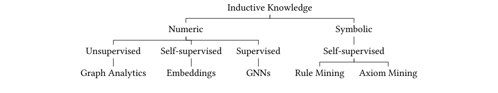

**图 23.** 按所生成的表示类型（数值/符号）和所采用的范式类型（无监督/自监督/监督）组织的常见知识图谱归纳技术概念概览。Inductive Knowledge 为“归纳知识”；Numeric 为“数值”，Symbolic 为“符号”；Unsupervised、Self-supervised、Supervised 分别为“无监督”“自监督”“监督”；Graph Analytics 为“图分析”，Embeddings 为“嵌入”，GNNs 为“图神经网络”，Rule Mining 为“规则挖掘”，Axiom Mining 为“公理挖掘”。

图 23 概览了通常用于知识图谱的归纳技术。无监督方法方面，图分析拥有丰富的研究成果，它使用知名函数和算法，在图中检测社区或簇、寻找中心节点和边，等等。另一种办法是，知识图谱嵌入通过自监督，学习知识图谱的低维数值模型；这种模型通常把输入边映射为输出合理性分数，表示该边为真的可能性。图的结构也可以直接用于监督学习，这方面的研究见于图神经网络。此外，前述技术学习的是数值模型，而符号学习则可以以自监督方式，从图中学习符号模型，也就是规则或公理形式的逻辑公式。下面，我们依次讨论这些技术。

### 5.1. 图分析

分析是发现、解释和传达数据集合，通常是大型数据集合，中有意义模式的过程。图分析则是将分析过程应用于图数据，通常是大型图数据。图的性质天然适合某些分析类型，这些分析根据图的拓扑，也就是图中节点如何连接，得出关于节点和边的结论。因此，图分析从图论和网络分析等相关领域借用了许多技术。这些领域曾用于研究表示社交网络、Web、互联网路由、交通网络、生态系统、蛋白质相互作用、语言共现等的图 [147]。

回到贯穿全文的示例领域，旅游局可以使用图分析提取知识，例如：服务许多旅游景点的关键交通枢纽（中心性）；被同一批游客游览的景点群组（社区检测）；在发生罢工或其他路线故障时可能变得无法到达的景点（连通性）；以及彼此相似的景点对（节点相似性）。由于这样的分析需要一个复杂的大规模图，为了便于说明，图 24 给出了一个更简洁的例子，展示智利通往热门旅游目的地的一些交通连接。我们首先介绍一些可用于图分析的关键技术，然后讨论实际计算这类分析所使用的框架和语言。鉴于许多传统图算法是针对无标签图定义的，我们随后说明如何将分析应用于有向边标记图。最后，讨论图分析与查询和推理之间可能存在的联系。

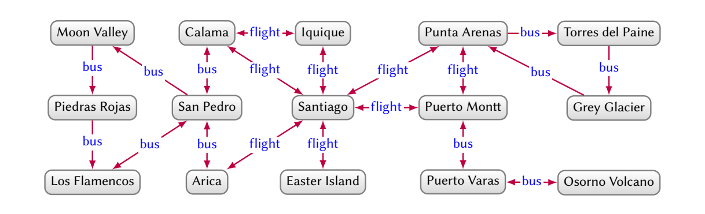

**图 24.** 表示智利交通路线的数据图。flight 为“航班”，bus 为“公交/巴士路线”；箭头表示路线方向。图中包含 Santiago（圣地亚哥）、Arica（阿里卡）、Iquique（伊基克）、Calama（卡拉马）、San Pedro（圣佩德罗）、Piedras Rojas（红石景区）、Moon Valley（月亮谷）、Los Flamencos（火烈鸟保护区）、Easter Island（复活节岛）、Puerto Montt（蒙特港）、Punta Arenas（蓬塔阿雷纳斯）、Puerto Varas（巴拉斯港）、Torres del Paine（百内塔）、Grey Glacier（格雷冰川）和 Osorno Volcano（奥索尔诺火山）等地点。

#### 5.1.1. 技术

图分析可以采用多种技术。下面，我们列举一些主要技术，例如 Iosup 等人的综述 [264] 所认可的技术，它们都可用于这一场景。

- **中心性：** 旨在识别图中最重要，也称最“中心”的节点或边。具体的节点中心性度量包括度、介数、接近度、特征向量、PageRank、HITS、Katz 等。介数中心性也可以应用于边。节点中心性度量可以用于预测图 24 中的交通枢纽；边中心性则可以找到许多最短路线所依赖的边，以预测交通流量。
- **社区检测：** 旨在识别图中的社区，也就是内部连接比与图中其他部分的连接更密集的子图。最小割算法、标签传播、Louvain 模块度等社区检测算法，可以发现这些社区。例如，对图 24 应用社区检测，可能检测到左侧的一个社区，对应智利北部，右侧的一个社区，对应智利南部，也可能检测到中部的一个社区，对应拥有机场的城市。
- **连通性：** 旨在估计图的连接程度，揭示图中元素的韧性和可达或不可达性等。具体技术包括测量图密度或 k-连通性、检测强连通分量和弱连通分量、计算生成树或最小割，等等。在图 24 的情境中，这种分析可能告诉我们，通往 `Grey Glacier`、`Osorno Volcano` 和 `Piedras Rojas` 的路线最“脆弱”，因为两条 bus 路线中只要一条发生故障，就会失去连接。
- **节点相似性：** 旨在根据节点在邻域中的连接方式，找出与其他节点相似的节点。节点相似性度量可以利用结构等价、随机游走、扩散核等方法计算。这些方法让我们理解节点之间有哪些联系，继而理解它们在哪些方面相似。在图 24 的情境中，这种分析可能告诉我们，`Calama` 和 `Arica` 是相似节点，因为二者都有往返 `Santiago` 的航班，也都有往返 `San Pedro` 的巴士。

前面的技术仅接受图作为输入，¹⁸ 而其他形式的图分析还可能连同图一起接受一个节点、一对节点等作为输入。

- **路径寻找：** 旨在图中寻找路径，通常是寻找作为输入给定的节点对之间的路径。有多种技术定义，用于限制这些节点之间的有效路径集合，包括不重复访问同一节点的简单路径、经过最少边数的最短路径，以及第 2.2 节已讨论的正则路径查询，后者限制路径可以经过的边标签 [16]。例如，可以使用这些算法，在图 24 中寻找从 `Torres del Paine` 到 `Moon Valley` 的最短路径。

这类技术大多针对简单图或没有边标签的有向图提出并研究。第 5.1.3 节将讨论它们如何应用于更复杂的图模型，以及如何与推理、查询等其他技术结合。

> **脚注 18：** 可以在整个图上运行节点相似性，为每个节点寻找最相似的 k 个节点；也可以针对某个特定节点运行，以寻找与其最相似的节点。此外，还有接受多个图作为输入的图相似性度量，例如基于频繁项集 [334] 的度量。

#### 5.1.2. 框架

已经有各种框架被提出，用于大规模图分析，往往运行于分布式集群环境。其中包括 Apache Spark（GraphX）[119, 563]、GraphLab [326]、Pregel [335]、Signal–Collect [503]、Shark [564] 等。这些图并行框架应用基于有向图的脉动抽象（systolic abstraction）[304]：节点是处理器，可以沿边向其他节点发送消息。计算过程是迭代式的；在每次迭代中，每个节点读取沿入边收到的消息，也可能读取自身之前的状态，执行计算，再根据结果沿出边发送消息。随后，这些框架将脉动计算抽象定义在所处理的数据图之上：数据图的节点和边成为脉动图中的节点和边。关于图并行框架的进一步形式化细节，参见附录 B.6.1。

举例来说，假设我们希望计算，哪些地点最容易或最不容易通过图 24 中所示路线到达。一种合适的度量方法是中心性，这里选择 PageRank [391]。它计算游客随机沿图中路线移动，在给定“跳数”之后，位于某个特定地点的概率。可以使用图并行框架在大型图上实现 PageRank。图 25 展示了对图 24 中一个用于说明的子图进行一次 PageRank 迭代的例子。节点以分数 `1/|V| = 1/6` 初始化，表示我们假设游客从任何地点出发的机会都相等。在消息阶段（Msg），每个节点 v 都沿它的每条出边传递分数 `dRᵢ(v)/|E(v)|`。其中，d 是用于确保收敛的常量阻尼因子，通常 `d = 0.85`，表示游客随机“跳转”到任意地点的概率；Rᵢ(v) 是节点 v 在第 i 次迭代中的分数，即游客经过 i 跳之后位于节点 v 的概率；`|E(v)|` 是 v 的出边数。随后，节点 v 的聚合阶段（Agg）把收到的全部入消息，与它所获得的阻尼因子常量份额 `(1−d)/|V|` 相加，计算 Rᵢ₊₁(v)。然后进入下一次迭代的消息阶段，继续计算，直到达到某个终止条件，例如迭代次数或残差阈值等，最后输出最终分数。

虽然这个例子针对 PageRank，但脉动抽象足够通用，可以支持包括前面提到的技术在内的多种图分析。在这个框架中，算法由消息阶段（Msg）中计算消息值的函数，以及聚合阶段（Agg）中累积消息的函数组成。框架会负责分布式处理、消息传递、容错等。但是，这些基于邻居之间消息传递的框架也存在局限：并非所有类型的分析，都能在这样的框架中表达 [565]。¹⁹ 因此，框架可能允许一些附加特征，例如全局步骤，对所有节点执行全局计算，并将结果提供给每个节点 [335]；或变更步骤，在处理过程中允许增加或删除节点和边 [335]。

> **脚注 19：** 形式化地说，Xu 等人 [565] 证明，在区分图结构方面，这类框架与不完备的 Weisfeiler–Lehman（WL）图同构检验具有同等能力；该检验基于对邻居的哈希值递归地计算哈希。

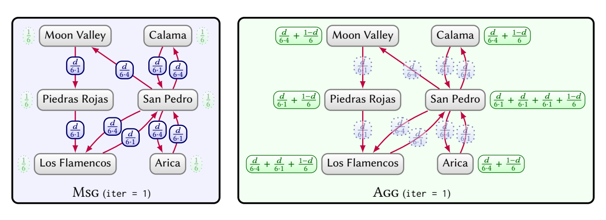

**图 25.** 对图 24 的一个示例子图进行一次 PageRank 脉动迭代的例子。Msg（iter = 1）为“消息阶段（第 1 次迭代）”，Agg（iter = 1）为“聚合阶段（第 1 次迭代）”。各节点初始分数均为 1/6；消息按出边数分配为 `d/(6·1)` 或 `d/(6·4)`；聚合时把入消息与 `(1−d)/6` 相加。

#### 5.1.3. 数据图上的分析

如前所述，到目前为止介绍的多数分析，在其“原生”形式中，适用于没有边元数据的无向图或有向图；这里的边元数据，是图数据模型通常包含的边标签或属性–值对。²⁰ 为使数据图适用于这种分析，可以采用多种策略：

- **投影：** 简单地“投影”出一个无向图或有向图；可选择先从数据图中选出子图，再丢弃全部边元数据。例如，图 25 可以是从一个较大的数据图中，提取由边标签 bus 和 flight 诱导的子图的结果，然后去掉这些标签，生成一个有向图。
- **加权：** 按某种函数，将边元数据转换为数值。前述许多技术都很容易扩展到加权有向图的情形。例如，可以为图 25 的图赋予表示行程时长，也可以是价格、交通流量等的权重，随后通过把每一段的时长相加，计算最短路径。²¹ 如果没有外部权重，也可以依据某些标准，把边标签映射为权重，例如给所有 flight 边赋予相同权重，给所有 bus 边赋予相同权重，等等。
- **变换：** 将图转换为元数较低的模型。变换可以是有损的，即无法恢复原始图；也可以是无损的，即可以恢复原始图。图 26 给出了把有向边标记图转换为有向图的有损和无损变换示例。在有损变换中，例如无法知道原始图包含的是 `Iquique —flight→ Santiago`，还是 `Iquique —flight→ Arica` 等边。无损变换则必须引入新节点，类似于具体化，以保留有向带标签边的信息。这两种变换得到的图，还都尝试保留原始图的方向性。
- **定制：** 修改分析过程，使其纳入边元数据，例如基于路径表达式进行路径寻找的情形。其他例子包括：节点相似性的结构度量，不仅考虑共同邻居，还考虑通过相同标签的边连接的共同邻居；或者聚合中心性度量，表达按标签分组的边的重要性，等等。

分析过程的结果可能会显著变化，具体取决于选择前述哪一种策略为分析准备数据。这种选择可能很难先验作出，并可能需要经验验证。还需要更多研究，才能更一般地理解，这类策略会如何影响不同分析技术的结果。

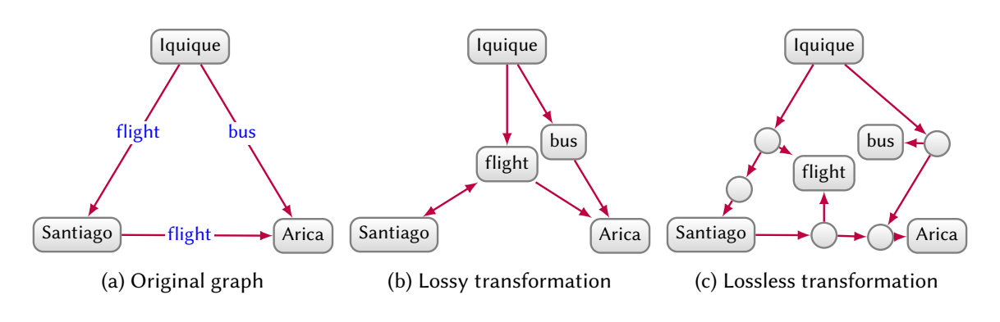

**图 26.** 从有向边标记图到有向图的变换。（a）原始图；（b）有损变换；（c）无损变换。flight 为“航班”，bus 为“公交/巴士路线”；变换后的图以节点表示这些关系标签，无损变换进一步引入节点，以区分原来的各条边。

> **脚注 20：** 对于属性图，节点上的属性–值对，可以通过将值映射为节点、将属性映射为带有相应标签的边来转换。

> **脚注 21：** 如果假设图带有权重，还可以进行其他形式的分析。例如，如果对图 25 的图进行注释，注明游客从一个地点移动到下一个地点的概率，就可以利用马尔可夫过程，理解路线的可约性、周期性、暂态性、常返性、遍历性、稳态等特征 [138]。

#### 5.1.4. 结合查询的分析

如第 2.2 节所讨论，已有多种图查询语言被提出 [16]。查询语言与分析可以通过多种方式相互补充。首先，可以考虑使用查询语言，投影或变换出适合某一特定分析任务的图，例如从较大的数据图中提取图 24 的图。SPARQL [217]、Cypher [165] 和 G-CORE [15] 等查询语言允许输出图，因此可以用这些查询选择用于分析的子图。这些语言也能够表达某些有限的非递归分析，例如利用聚合计算度中心性；它们还可能内置一些分析支持，例如 Cypher [165] 允许寻找最短路径。反过来，分析可以通过优化帮助查询过程。例如，连通性分析可能提示如何更好地把一个大型数据图分布到多台机器上，以利用最小割等方式进行查询 [7, 268]。分析也曾用于对大型图上的查询结果排序 [151, 544]，挑选最重要的结果呈现给用户。

在某些应用场景中，我们还可能希望交替进行查询和分析过程。例如，针对旅游局收集的完整数据图，假设即将发生一次航空公司罢工，旅游局希望找出：罢工期间，举办地点位于因罢工而无法从圣地亚哥通过公共交通到达的城市中的活动。假设如图 3 所示，航空公司信息可用，我们可以先通过查询提取一个排除了该航空公司路线的交通网络，再通过分析提取包含圣地亚哥的强连通分量，最后，通过查询找出给定日期中，位于圣地亚哥所属分量以外城市中的活动。²² 虽然可以使用 Gremlin [445]、GraphX [563] 或 R [518] 这样的命令式语言完成这一任务，但人们也在探索更具声明性的语言，以便更容易表达这种任务。已有提议包括：为图查询语言扩展递归能力 [47, 439]，²³ 将线性代数与关系查询代数组合 [258]，等等。

> **脚注 22：** 无法利用正则路径查询，在一次查询中解决这样的任务，因为这类表达式不能筛除表示某一家航空公司航班的边。

> **脚注 23：** 假设还可以表达二进制数组上的操作，递归查询语言就会成为图灵完备的。

#### 5.1.5. 结合蕴涵的分析

知识图谱常常关联一个语义模式或本体，用于定义领域术语的语义，从而产生蕴涵，参见第 4 节。采用这些蕴涵或不采用这些蕴涵进行分析，例如在物化之前或之后进行分析，可能得到截然不同的结果。例如，一旦采用逆属性公理 `hosts —inv. of→ venue`，边 `Santa Lucía —hosts→ EID15` 就与边 `EID15 —venue→ Santa Lucía` 在语义上等价；但是，从考虑边方向的分析技术的角度看，这两条边远非等价，包含其中一种边、另一种边，或同时包含二者，都可能对最终结果产生重大影响。据我们所知，分析与蕴涵的结合尚未得到充分研究，这留下了一些值得关注的开放研究问题。沿这一方向，探索语义不变的分析可能很有意义：这种分析在语义等价的图，也就是相互蕴涵的图上，产生相同结果，从而分析知识图谱的语义内容，而不只是数据图的拓扑特征。例如，语义不变的分析应当对以下三者给出相同结果：一个包含逆属性公理 `hosts —inv. of→ venue` 和一些 hosts 边的图；同一个图，但将每条 hosts 边替换为方向相反的 venue 边；以及这两个图的并。

### 5.2. 知识图谱嵌入

近年来，机器学习方法受到广泛关注。在知识图谱的情境下，机器学习既可以用于直接精炼知识图谱 [400]，第 8 节将进一步讨论，也可以用于使用知识图谱的下游任务，例如推荐 [575]、信息提取 [533]、问答 [255]、查询放宽 [548]、查询近似 [215] 等，第 10 节将进一步讨论。然而，许多传统机器学习技术假定输入是向量形式的稠密数值表示，这与图通常的表达方式很不相同。那么，如何将图，或者图中的节点、边等，编码为数值向量呢？

一种初步尝试，是用独热编码将图表示为向量：为每个节点生成一个长度为 `|L|·|V|` 的向量，其中 `|V|` 是输入图的节点数，`|L|` 是边标签数；在对应索引处放入 1，表示图中存在相应的边，否则放入 0。但这种表示通常产生很大且稀疏的向量，不利于大多数机器学习模型。

知识图谱嵌入技术的主要目标，是在连续的低维向量空间中，创建图的稠密表示，也就是将图嵌入这个空间，随后用于机器学习任务。嵌入的维数 d 是固定的，而且通常较低，例如通常有 `50 ≥ d ≥ 1000`。图嵌入通常由两部分组成：每个节点都有一个实体嵌入，即一个 d 维向量，用 e 表示；每个边标签都有一个关系嵌入，通常也是一个 d 维向量，用 r 表示。这些向量的总体目标，是抽象并保留图中的潜在结构。可以用多种方式具体实现这种嵌入概念。最常见的做法是，给定一条边 `s —p→ o`，某种具体嵌入方法定义一个评分函数，该函数接受 eₛ（节点 s 的实体嵌入）、rₚ（边标签 p 的实体嵌入）以及 eₒ（节点 o 的实体嵌入），计算这条边的合理性，即它为真的可能性。给定一个数据图，目标就是按照这个评分函数，计算 d 维嵌入，使正例边的合理性最大化，正例通常是图中已有的边，同时使负例的合理性最小化，负例通常由修改图中边的某个节点或边标签，使其不再属于该图而产生。所得嵌入可以视为通过自监督学习得到的模型，它们编码了图的潜在特征，将输入边映射为输出合理性分数。

随后，可以利用嵌入，对计算这些嵌入时所用的图中的节点和边标签执行多种基础任务。首先，可以通过合理性评分函数，为某些边赋予置信度，例如从外部来源提取的边，第 6 节将进一步讨论。其次，为实现链接预测，第 8 节将进一步讨论，可以用合理性评分函数，补全缺失节点或边标签的边。例如，在图 24 中，可以问，图中哪些节点可能补全边 `Grey Glacier —bus→ ?`；除了已经给出的 `Punta Arenas`，直观上我们可能期望 `Torres del Paine` 是一个合理的候选。第三，嵌入模型通常会为相似节点和相似边标签赋予相似向量，因此可以作为相似性度量的基础，有助于寻找指向同一实体的重复节点，或者用于推荐，第 10 节将进一步讨论。

已有大量知识图谱嵌入技术被提出 [549]。此处的目标，是从较高层面介绍迄今提出的一些最常见技术。首先，讨论采用几何视角的平移模型，其中关系嵌入在低维空间中，将主语实体平移到宾语实体。其次，介绍张量分解模型，这类模型提取潜在因子，以近似图的结构。随后，讨论神经模型，这类模型使用神经网络训练嵌入，以提供准确的合理性分数。最后，讨论语言模型，这类模型利用已有词嵌入技术，提出一些方法，为其期望的文本输入生成类似图的对应形式。附录 B.6.2 对这些模型给出了更形式化的讨论。

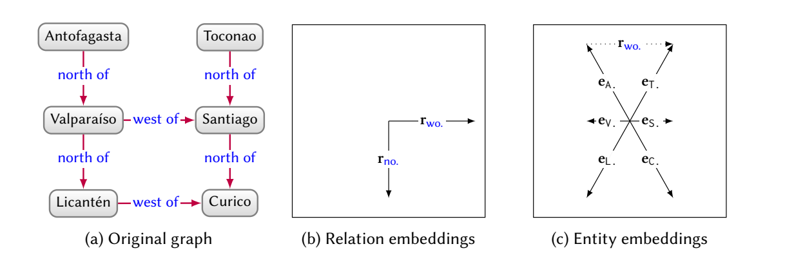

**图 27.** TransE 学得的二维关系嵌入和实体嵌入的简化例子；实体嵌入使用缩写，并包含一个通过向量加法预测什么位于安托法加斯塔以西的示例。（a）原始图；（b）关系嵌入；（c）实体嵌入。west of 为“位于……以西”，north of 为“位于……以北”；A.、T.、V.、S.、L.、C. 分别代表 Antofagasta（安托法加斯塔）、Toconao（托科瑙）、Valparaíso（瓦尔帕莱索）、Santiago（圣地亚哥）、Licantén（利坎滕）和 Curico（库里科）。rwo. 和 rno. 分别表示 west of 与 north of 的关系嵌入。

#### 5.2.1. 平移模型

平移模型把边标签解释为从主语节点，也称源节点或头实体，到宾语节点，也称目标节点或尾实体，的变换。例如，在边 `San Pedro —bus→ Moon Valley` 中，边标签 bus 被视为把 `San Pedro` 变换到 `Moon Valley`，其他 bus 边同理。这个家族中最基本的方法是 TransE [63]。对于所有正例边 `s —p→ o`，TransE 学习向量 eₛ、rₚ 和 eₒ，目标是使 `eₛ + rₚ` 尽可能接近 eₒ。相反，如果该边是负例，TransE 就尝试学习使 `eₛ + rₚ` 远离 eₒ 的表示。图 27 给出了由 TransE 计算的二维，即 `d = 2`，实体和关系嵌入的简化示例。为了清晰，我们让向量的方向与原始图类似。对于原始图中的任意边 `s —p→ o`，向量相加 `eₛ + rₚ` 应当近似 eₒ。在这个简化例子中，向量精确对应；例如，将 `Licantén` 的向量 eL. 与 west of 的向量 rwo. 相加，得到与 `Curico` 的向量 eC. 对应的向量。可以用这些嵌入预测边，以及进行其他任务。例如，为了预测图中哪个节点最可能位于 `Antofagasta`（A.）以西，可以计算 `eA. + rwo.`；所得向量是图 27c 中的虚线向量，它与 eT. 最近，因此预测 `Toconao`（T.）是最合理的节点。

离开这个简化例子，TransE 可能过于简单。例如，在图 24 中，bus 不仅将 `San Pedro` 变换到 `Moon Valley`，还将它变换到 `Arica`、`Calama` 等地点。在这种情况下，TransE 会试图给这些目标地点赋予相似向量；但考虑到其他边，这可能无法做到。TransE 还倾向于为循环关系赋予零向量，因为方向分量往往相互抵消。为解决这类问题，人们研究了许多 TransE 变体。例如，TransH [553] 使用不同超平面表示不同关系；对于边 `s —p→ o`，首先将 s 投影到 p 的超平面，然后再学习到 o 的平移，而不受 s 和 o 上具有其他标签的边影响。TransR [318] 将这一思路推广，将 s 和 o 投影到 p 专属的向量空间；这涉及将 s 和 o 的实体嵌入，与 p 专属的投影矩阵相乘。TransD [271] 简化了 TransR，为实体和关系关联第二个向量；这些辅助向量用来把实体投影到关系专属的向量空间。最近，RotatE [511] 提出复数空间中的平移嵌入，从而可以表达更多关系特征，例如方向、对称、逆关系、反对称和组合。也有人提出非欧几里得空间中的嵌入。例如，MuRP [29] 使用关系嵌入，在庞加莱球模型的双曲空间中变换实体嵌入；其曲率能够相对于维数提供更多“空间”，以分开实体。关于其他平移模型的讨论，请参见 Wang 等人的综述 [549]。

#### 5.2.2. 张量分解模型

推导图嵌入的第二类方法，是应用基于张量分解的方法。张量是一种多维数值场，将标量（0 阶张量）、向量（1 阶张量）和矩阵（2 阶张量）推广到任意维数或阶数。张量已成为机器学习中广泛使用的抽象 [427]。张量分解，是将一个张量分解为更“基本”的张量，例如阶数较低的张量，并可以通过固定序列的基本运算，由这些基本张量重新组成或近似原始张量。这些基本张量可以视为捕捉了原始张量所含信息背后的潜在因子。张量分解有许多方法，下面，我们简要介绍秩分解的主要思想 [427]。

暂时不考虑图，考虑一个 a×b 矩阵，即 2 阶张量 C。其中，a 是智利的城市数量，b 是一年中的月份数，每个元素 Cᵢⱼ 表示第 i 个城市在第 j 个月的平均温度。注意，智利是一个狭长国家，从南部的亚极地气候延伸到北部的沙漠气候，因此可以将 C 分解为两个表示潜在因子的向量：具体来说，x 有 a 个元素，为纬度较低的城市赋予较低值；y 有 b 个元素，为温度较低的月份赋予较低值。这样，计算这两个向量的外积，²⁴ 就可能较好地近似 C：`x ⊗ y ≈ C`。在一种不太可能的情形下，如果存在向量 x 和 y，使 C 恰好是二者的外积，即 `x ⊗ y = C`，就称 C 为秩为 1 的矩阵；此时可以用 `a + b` 个值，而不是 `a × b` 个值，精确编码 C。但多数情况下，为精确得到 C，需要把多个秩为 1 的矩阵相加。C 的秩 r，是为了精确得到 C 所需相加的秩为 1 的矩阵的最少数量，即：

```text
x₁ ⊗ y₁ + … + xᵣ ⊗ yᵣ = C。
```

在温度的例子中，`x₂ ⊗ y₂` 可能对应海拔修正，`x₃ ⊗ y₃` 可能对应越往南温度变化越大的修正，等等。矩阵的低秩分解，是设定秩的上限 d，计算向量 `(x₁,y₁,…,x_d,y_d)`，使 `x₁ ⊗ y₁ + … + x_d ⊗ y_d` 给出 C 的最佳 d 秩近似。注意，要生成 n 阶张量，需要计算 n 个向量的外积，因此可以将这一思路推广为张量的低秩分解；这种方法称为规范多元（Canonical Polyadic，CP）分解 [236]。例如，可以有一个三阶张量 C，包含智利各城市在一天中四个不同时刻的每月温度；它可以用 `x₁ ⊗ y₁ ⊗ z₁ + … + x_d ⊗ y_d ⊗ z_d` 近似，例如 x₁ 可能是纬度因子，y₁ 是月份变化因子，z₁ 是一天中时间变化的因子，等等。

> **脚注 24：** 长度为 a 的列向量 x 与长度为 b 的列向量 y 的外积，记为 `x ⊗ y`，定义为 `xyᵀ`，得到一个 a×b 矩阵 M，使 `Mᵢⱼ = xᵢ·yⱼ`。类似地，k 个向量的外积是一个 k 阶张量。

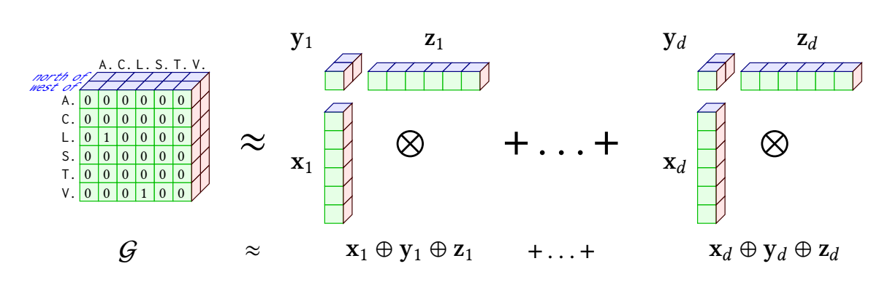

**图28.** 对表示图27a中图的张量进行秩为 d 的 CP 分解的抽象示意图。图中 `north of` 表示“位于……以北”，`west of` 表示“位于……以西”。

随后，可以使用多种算法计算（近似的）CP 分解，包括交替最小二乘法、Jennrich 算法和张量幂方法[427]。

回到图上，类似的原理可以用来将图分解为向量，从而得到嵌入。具体而言，一个图可以编码为具有 |V| × |L| × |V| 个元素的独热三阶张量 G；如果第 i 个节点通过一条带有第 j 个标签的边连接到第 k 个节点，则元素 Gᵢⱼₖ 设为 1，否则设为 0。如前所述，这样的张量通常非常大且稀疏，因此可以应用秩分解。CP 分解[236]会计算一个向量序列 (x₁, y₁, z₁, …, x_d, y_d, z_d)，使得 x₁ ⊗ y₁ ⊗ z₁ + … + x_d ⊗ y_d ⊗ z_d ≈ G。图28展示了这一方案。令 X、Y、Z 分别表示由 [x₁ ··· x_d]、[y₁ ··· y_d]、[z₁ ··· z_d] 构成的矩阵，每个向量构成相应矩阵的一列，那么可以取出 Y 的第 i 行，作为第 i 个关系的嵌入，并取出 X 和 Z 的第 j 行，作为第 j 个实体的两个嵌入。然而，知识图谱嵌入通常希望为每个实体分配一个向量。

DistMult[568]是一种基于秩分解计算知识图谱嵌入的开创性方法，其中，每个实体和关系都关联一个 d 维向量。对于边 (s, p, o)，定义合理性评分函数 Σᵢ₌₁ᵈ (e_s)ᵢ (r_p)ᵢ (e_o)ᵢ，其中 (e_s)ᵢ、(r_p)ᵢ 和 (e_o)ᵢ 分别表示向量 e_s、r_p、e_o 的第 i 个元素。因此，其目标是为每个节点和边标签学习向量，以最大化正例边的合理性，同时最小化负例边的合理性。这种方法等价于对图张量 G 进行 CP 分解，但每个实体只有一个向量，并使用两次：x₁ ⊗ y₁ ⊗ x₁ + … + x_d ⊗ y_d ⊗ x_d ≈ G。这种方法的一个弱点是，根据评分函数，(s, p, o) 的合理性总是等于 (o, p, s) 的合理性；换言之，DistMult 不考虑边的方向。

RESCAL[386]使用矩阵而不是向量作为关系嵌入，这使它能够组合 e_s 和 e_o 在所有维度上的值，因而可以捕获例如边的方向。然而，相比 DistMult，RESCAL 的空间和时间开销更高。HolE[385]使用向量作为关系和实体的嵌入，但提出使用循环相关算子——对两个向量外积的各条对角线求和——来组合它们。这一算子不满足交换律，因此可以考虑边的方向。另一方面，ComplEx[526]使用复数向量（即包含复数的向量）作为关系嵌入；这同样能够打破前述 DistMult 评分函数的对称性，同时保持较低的参数数量。SimplE[283]则提出计算标准的 CP 分解，从 X 和 Z 为实体计算两个初始向量，然后对涉及 X、Y、Z 的项求平均，计算最终的合理性评分。TuckER[30]采用另一种分解，称为 Tucker 分解[528]；这种分解计算一个较小的“核心”张量 T 和三个矩阵 A、B、C，使得 G ≈ T ⊗ A ⊗ B ⊗ C。其中，实体嵌入取自 A 和 C，关系嵌入取自 B。在这些方法中，TuckER[30]目前在标准基准上取得了最先进的结果。

#### 5.2.3. 神经模型

前述方法的一个局限是，它们假定通过对嵌入执行线性运算（保持加法和标量乘法）或双线性运算（例如矩阵乘法）来计算合理性评分。一些方法则使用神经网络来学习具有非线性合理性评分函数的嵌入。

最早提出的神经模型之一是语义匹配能量（Semantic Matching Energy，SME）[192]。它为两个函数——f_w(e_s, r_p) 和 g_w′(e_o, r_p)——学习参数（也称权重 w、w′），使这两个函数输出的点积 f_w(e_s, r_p) · g_w′(e_o, r_p) 给出合理性评分。研究提出了 f_w 和 g_w′ 的线性及双线性变体。另一项早期工作是神经张量网络（Neural Tensor Networks，NTN）[488]。它提出维护一个内部权重张量 W，通过一个复杂函数计算合理性评分：将外积 e_s ⊗ W ⊗ e_o 与作用于 e_s 和 e_o 的标准神经层结合，再与 r_p 结合，得到合理性评分。使用张量 W 会产生大量参数，限制其可扩展性[549]。多层感知机（Multi Layer Perceptron，MLP）[131]是更简单的模型：将 e_s、r_p 和 e_o 拼接，输入一个隐藏层来计算合理性评分。

一些较新的方法提出在模型中使用卷积核。ConvE[127]通过将 e_s 和 r_p 的每个向量“折叠”为多行，并将两个矩阵拼接，生成一个矩阵。拼接后的矩阵作为一组二维卷积层的输入，返回一个特征图张量。将特征图张量向量化，并使用带参数的线性变换将其投影到 d 维。随后，根据该向量与 e_o 的点积计算合理性评分。ConvE 的一个缺点是，将向量折叠为矩阵会给嵌入强加一种人为的二维结构。HypER[28]是一个类似的卷积模型，但避免了将向量折叠为矩阵的需要。它对 r_p 应用一个全连接层（称为“超网络”），用它生成一个特定于关系的卷积滤波器矩阵。将这些滤波器直接应用于 e_s，得到一个特征图，再将其向量化。随后应用与 ConvE 相同的过程：将所得向量投影到 d 维，并与 e_o 计算点积，产生合理性评分。研究表明，这一模型在标准基准上的表现优于 ConvE[28]。

这些方法在表达能力与需要训练的参数数量之间取得了不同的平衡。表达能力较强的模型，例如 NTN，可以借助更多隐藏参数，在较低维的嵌入上更好地拟合复杂的合理性函数；较简单的模型，例如 Dong 等人[131]提出的模型，以及通过在矩阵不同区域应用相同的（通常很小的）卷积核来共享参数的卷积网络[28, 127]，总体上需要处理的参数更少，因而更具可扩展性。

#### 5.2.4. 语言模型

嵌入技术最初被探索用作在机器学习框架中表示自然语言的方法，其中 word2vec[352]和 GloVe[408]是两种开创性方法。这两种方法都基于大型文本语料库为词计算嵌入，使出现在相似上下文中的词（例如“frog〔青蛙〕”“toad〔蟾蜍〕”）具有相似的向量。Word2vec 使用神经网络进行训练，或者根据周围的词预测当前词（连续词袋模型），或者根据当前词预测周围的词（连续跳字模型）。GloVe 则对词对共现概率构成的矩阵应用回归模型。这两种方法产生的嵌入广泛用于自然语言处理任务。

因此，图嵌入的另一条途径是利用已经得到验证的语言嵌入方法。然而，图由三个词项构成的序列所组成的无序集合构成（即边的集合），自然语言文本则由任意长度的词项序列构成（即由词组成的句子）。沿着这一思路，RDF2Vec[441]在图上执行（有偏的[95]）随机游走，将路径（所遍历的节点和边标签组成的序列）记录为“句子”，再输入 word2vec[352]模型。例如，从图24中提取的一条这样的路径可以是：San Pedro —bus→ Calama —flight→ Iquique —flight→ Santiago（圣佩德罗—巴士→卡拉马—航班→伊基克—航班→圣地亚哥）。该论文在实验中为每个实体提取 500 条长度为 8 的路径。RDF2Vec 还提出第二种模式：从以各节点为根的、经过规范标记的子树中，为节点生成序列；该论文对深度为 1 和 2 的子树进行了实验。相对地，KGloVe[96]基于 GloVe 模型。正如原始 GloVe 模型[408]将经常在文本窗口内共同出现的词视为更相关，KGloVe 使用个性化 PageRank²⁵ 来确定与给定节点最相关的节点，再将结果输入 GloVe 模型。

#### 5.2.5. 感知蕴涵的模型

到目前为止，这些嵌入只考虑数据图本身。但如果提供了本体或一组规则，会怎样呢？此类演绎知识可以用于改进嵌入。一种方法是使用约束规则细化嵌入作出的预测。例如，Wang 等人[550]使用函数性和逆函数性的定义作为约束（采用唯一名称假设 UNA）。例如，如果规定一个活动最多只能有一个 `venue`（举办场所）值，就可以借此降低会给一个活动分配多个场所的边的合理性。

较新的方法则提出联合嵌入，在计算嵌入时同时考虑数据图和规则。KALE[207]采用平移模型（具体为 TransE）计算实体和关系嵌入，并对该模型进行调整，利用 t-范数模糊逻辑进一步考虑规则。参照图24，考虑一条简单规则：(？x, bus, ？y) ⇒ (？x, connects to, ？y)，即“巴士连接蕴涵连接关系”。可以使用嵌入为新边赋予合理性评分，例如 e₁：(Piedras Rojas, bus, Moon Valley)，即红石地区到月亮谷有巴士连接。还可以应用上述规则，从预测的边 e₁ 生成一条新边 e₂：(Piedras Rojas, connects to, Moon Valley)，即红石地区与月亮谷相连。但应当为第二条边赋予怎样的合理性呢？令 p₁ 和 p₂ 分别为 e₁ 和 e₂ 当前的合理性评分（通过标准嵌入初始化），那么 t-范数模糊逻辑建议将合理性更新为 p₁p₂ − p₁ + 1。随后训练嵌入，使它们对于边和基规则的正例，都比负例给出更高的合理性评分。根据图24，正例基规则的一个例子是：(Arica, bus, San Pedro) ⇒ (Arica, connects to, San Pedro)。负例基规则随机替换规则结论中的关系，例如：(Arica, bus, San Pedro) ⇏ (Arica, flight, San Pedro)。Guo 等人[208]后来提出 RUGE，它在基规则（可能是带置信度评分的软规则）和合理性评分上使用联合模型，来使未见过的边上的两种评分形式相互一致。

生成基规则可能代价高昂。另一种名为 FSL[125]的方法注意到，对于简单规则，例如 (？x, bus, ？y) ⇒ (？x, connects to, ？y)，关系嵌入 `bus` 的合理性评分应当始终低于 `connects to`。因此，对所有此类规则，FSL 提出在训练关系嵌入时避免违反这些不等式。FSL 相对直观，但只支持简单规则，而 KALE 还支持更复杂的规则。

这些研究展示了演绎知识与归纳知识——在这里是规则与嵌入——如何相互作用、相互补充，是很有启发性的例子。

> **脚注 25：** 直观地说，个性化 PageRank 从一个给定节点出发，然后确定随机游走在给定步数后位于某个特定节点的概率。步数较多时，它会收敛到标准 PageRank，强调节点的全局中心性；步数较少时，它强调与起始节点的接近程度或相关性。

### 5.3. 图神经网络

嵌入旨在为图提供适合用于现有机器学习模型的稠密数值表示；另一种方法则是构建针对图结构数据定制的机器学习模型。大多数面向图的定制学习模型都基于（人工）神经网络[559]，利用两者之间的自然对应关系：神经网络本身就对应一个带权有向图，其中节点充当人工神经元，边充当加权连接（轴突）。然而，传统神经网络——更具体地说，全连接前馈神经网络——的典型拓扑结构相当同质：它由一系列节点层组成，每一层的每个节点都连接到下一层的所有节点。相反，数据图的拓扑结构非常异质，由图中边所表示的实体关系决定。

图神经网络（Graph Neural Network，GNN）[462]根据数据图的拓扑结构构建神经网络，也就是说，按照数据图将节点连接到其邻居。通常，随后以监督方式学习一个模型，将节点的输入特征映射为输出特征；示例节点的输出特征可以手动标注，也可以从知识图谱中取得。与知识图谱嵌入不同，GNN 支持针对特定任务的端到端监督学习：给定一组带标签的示例，GNN 可用于对图中的元素或整个图进行分类。GNN 已被用于对编码化合物、图像中对象、文档等的图进行分类，也用于交通预测、构建推荐系统、验证软件等[559]。给定带标签的示例，GNN 甚至可以代替图算法；例如，已有研究使用 GNN，以监督方式寻找知识图谱中的中心节点[396, 397, 462]。下面讨论两类 GNN——递归 GNN 和卷积 GNN——背后的思想；有关 GNN 的更形式化定义，参见附录 B.6.3。

#### 5.3.1. 递归图神经网络

递归图神经网络（Recursive Graph Neural Networks，RecGNN）是图神经网络的开创性方法[462, 493]。这一方法在概念上类似于图25所示的脉动式抽象：邻居之间传递消息，以递归方式计算某种结果。不过，我们不再自行定义用于确定所传消息的函数，而是为一组训练节点的输出打上标签，让框架学习能够生成预期输出的函数，然后再将其应用于其他示例的标注。

在一篇奠基性论文中，Scarselli 等人[462]提出了他们统称为图神经网络（GNN）的模型。该模型以一个有向图为输入，其中节点和边都关联特征向量，可以捕获节点及边的标签、权重等。这些特征向量在整个过程中保持不变。图中的每个节点还关联一个状态向量，通过一个称为转移函数的参数化函数，依据节点邻居的信息——即邻居节点的特征向量和状态向量，以及与它们相连的入边或出边的特征向量——递归更新。第二个参数化函数称为输出函数，用于根据节点自身的特征向量和状态向量计算其最终输出。这些函数被递归应用，直到达到不动点。这两个参数化函数都可以通过神经网络实现：给定图中的部分受监督节点，即标注了期望输出的节点，可以学习转移函数和输出函数的参数，使其尽可能逼近受监督的输出。因此，所得模型可以视为一种递归神经网络架构。²⁶ 为确保收敛到不动点，会施加某些限制，即要求转移函数是压缩映射，这意味着每次应用该函数时，数值空间中的点都会彼此靠近（直观上，在这种情况下，数值空间在每次应用时都会“收缩”，从而确保唯一的不动点）。

举例来说，假设我们希望找出优先设立新旅游咨询处的地点。一种良好策略是在枢纽地点设立咨询处，许多游客会从那里前往热门目的地。沿着这一思路，图29展示了 Scarselli 等人[462]为图24的一个子图提出的 GNN 架构，并突出显示 Punta Arenas（蓬塔阿雷纳斯）的邻域。在此图中，节点标注了特征向量 n_x 和第 t 步的隐藏状态 h_x⁽ᵗ⁾，边则标注了特征向量 a_xy。例如，节点的特征向量可以独热编码节点的类型（City〔城市〕、Attraction〔景点〕等），也可以直接编码每年游客数量等统计信息。边的特征向量可以独热编码边标签（交通方式），也可以直接编码距离、每年售出票数等统计信息。隐藏状态可以随机初始化。图29右侧给出了 GNN 的转移函数和输出函数，其中 N(x) 表示 x 的邻居节点，f_w(·) 表示参数为 w 的转移函数，g_w′(·) 表示参数为 w′ 的输出函数。图中还给出了 Punta Arenas（x = 1）的例子。这些函数会递归应用，直至达到不动点。为训练该网络，可以给已有（或应当设有）旅游咨询处的地点，以及没有（或不应设有）旅游咨询处的地点标注示例标签。这些标签可以来自知识图谱，也可以手动添加。随后，GNN 可以学习参数 w 和 w′，使带标签示例获得预期输出，并将这些参数用于其他节点的标注。

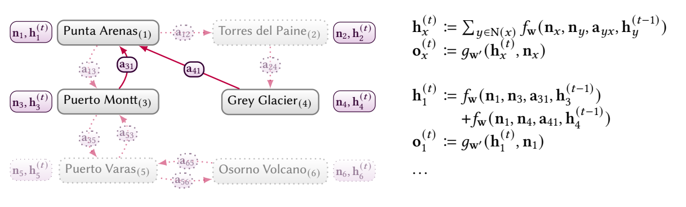

**图29.** 左侧为图24的一个子图，突出显示 Punta Arenas 的邻域，其中节点标注了特征向量 n_x 和第 t 步的隐藏状态 h_x⁽ᵗ⁾，边标注了特征向量 a_xy；右侧为 Scarselli 等人[462]提出的 GNN 转移函数和输出函数，以及 Punta Arenas（x = 1）的示例。其中，N(x) 表示 x 的邻居节点，f_w(·) 表示参数为 w 的转移函数，g_w′(·) 表示参数为 w′ 的输出函数。图中的其他地点为 Puerto Montt（蒙特港）、Puerto Varas（巴拉斯港）、Torres del Paine（百内国家公园）、Grey Glacier（格雷冰川）、Osorno Volcano（奥索尔诺火山）。

```text
h_x⁽ᵗ⁾ := Σ_{y ∈ N(x)} f_w(n_x, n_y, a_yx, h_y⁽ᵗ⁻¹⁾)
o_x⁽ᵗ⁾ := g_w′(h_x⁽ᵗ⁾, n_x)

h_1⁽ᵗ⁾ := f_w(n_1, n_3, a_31, h_3⁽ᵗ⁻¹⁾)
            + f_w(n_1, n_4, a_41, h_4⁽ᵗ⁻¹⁾)
o_1⁽ᵗ⁾ := g_w′(h_1⁽ᵗ⁾, n_1)
```

这个 GNN 模型非常灵活，可以通过多种方式加以调整[462]：可以用不同方式定义邻居节点，例如包含出边对应的节点，或距离一跳、两跳的节点；可以允许一对节点通过带有不同向量的多条边相连；可以考虑为每个节点采用参数不同的转移函数和输出函数；可以为边添加状态和输出；可以将求和替换为其他聚合函数；等等。

> **脚注 26：** 一些作者将这类架构称为循环图神经网络，理由是节点所维护的内部状态可以视为转移序列上的一种循环。

#### 5.3.2. 卷积图神经网络

卷积神经网络（Convolutional Neural Networks，CNN）受到了广泛关注，尤其是在涉及图像的机器学习任务中[301]。在图像场景下，其核心思想是使用卷积算子，将较小的卷积核（也称滤波器）应用到图像的局部区域，提取该局部区域的特征。应用到所有局部区域后，卷积就输出图像的特征图。通常会应用多个卷积核，构成多个卷积层。在拥有足够多带标签示例的情况下，可以学习这些卷积核。

可以注意到，前述 GNN 与用于图像的 CNN 存在类比：在两种情况下，算子都应用于输入数据的局部区域。对于 GNN，转移函数作用于图中的一个节点及其邻居；对于 CNN，卷积作用于图像中的一个像素及其邻居。沿着这一思路，研究者提出了多种卷积图神经网络（Convolutional Graph Neural Networks，ConvGNN）[71, 289, 559]，通过卷积实现转移函数。ConvGNN 的一个关键考虑是如何定义图的区域。与图像中的像素不同，图中各节点的邻居数量可能不同。这带来一个挑战：CNN 的一个优点是同一个卷积核可以应用于图像的所有区域，但对 ConvGNN 来说，需要更加仔细地考虑这一点，因为不同节点的邻域可能差别很大。应对这些挑战的方法包括使用图的谱表示（例如[71, 289]）或空间表示（例如[358]），从图中诱导出更规则的结构。另一种选择是使用注意力机制[535]，学习哪些节点的特征对当前节点最重要。

除了架构方面的考虑，RecGNN 和 ConvGNN 还有两个主要区别。首先，RecGNN 递归聚合邻居信息，直到达到不动点；ConvGNN 通常应用固定数量的卷积层。其次，RecGNN 通常在各个一致的步骤中使用相同的函数和参数，而 ConvGNN 的不同卷积层可以在每个不同步骤中应用不同的卷积核或权重。

### 5.4. 符号学习

目前讨论的监督技术——即知识图谱嵌入和图神经网络——学习图上的数值模型。然而，这类模型常常难以解释或理解。例如，对于图30中的图，知识图谱嵌入可能预测边 (SCL, flight, ARI)（从 SCL 到 ARI 的航班）具有很高的合理性，但不会提供一个可解释的模型，来帮助理解为何如此：结果的原因可能隐藏在一个参数矩阵中，这些参数是通过拟合训练数据上的合理性评分学习得到的。这类方法还面临词表外问题，无法对涉及此前未见节点或边的边给出结果。例如，如果加入一条边 (SCL, flight, CDG)，其中 CDG 是图中的新节点，那么知识图谱嵌入就没有 CDG 的实体嵌入，需要重新训练，才能估计边 (CDG, flight, SCL) 的合理性。

另一种（有时也具有互补性）的方法是采用符号学习，用符号（逻辑）语言学习能够“解释”给定正例边和负例边集合的假设。这些边通常从知识图谱中自动生成（类似于知识图谱嵌入的情况）。这些假设随后充当可解释的模型，可以用于进一步的演绎推理。例如，给定图30中的图，可以观察到航班线路通常都有返程线路，从而学习规则：(？x, flight, ？y) ⇒ (？y, flight, ？x)。也可以学习一条描述逻辑（DL）公理，说明机场可以是国内机场、国际机场，或兼具二者：Airport ⊑ DomesticAirport ⊔ InternationalAirport。随后可以将这些规则和公理用于演绎推理，并为所蕴涵或预测的新知识提供可解释的模型。例如，根据前述返程航班规则，可以理解为何预测出一条新边 (SCL, flight, ARI)。这也使领域专家有机会检验这些过程得到的模型，例如规则和公理。最后，规则和公理带有量化（所有航班都有返程航班，所有机场都是国内机场或国际机场，等等），因此可以应用到未见过的示例上。例如，利用上述规则，可以从包含未见节点 CDG 的新边 (SCL, flight, CDG) 推导出 (CDG, flight, SCL)。

本节讨论两种符号学习形式：从知识图谱中学习规则的规则挖掘，以及学习其他逻辑公理形式的公理挖掘。关于这两个任务的更形式化论述，参见附录 B.6.4。

#### 5.4.1. 规则挖掘

一般意义上的规则挖掘，是指从大量背景知识中发现规则形式的有意义模式。在知识图谱的语境下，我们假定已给定一组正例边和负例边。正例边通常是观察到的边（即知识图谱中给出的边或由它蕴涵的边），负例边则依据某种给定的完整性假设来定义（稍后讨论）。规则挖掘的目标是识别新规则，使其能够从其他正例边中蕴涵出较高比例的正例边，同时从正例边中蕴涵出较低比例的负例边。所考虑的规则类型可以有所不同，从较简单的情形，例如前述 (？x, flight, ？y) ⇒ (？y, flight, ？x)，到更复杂的规则，例如：

```text
(？x, capital, ？y) ∧ (？y, nearby, ？z) ∧ (？z, type, Airport)
  ⇒ (？z, type, International Airport)

(？x, flight, ？y) ∧ (？x, country, ？z) ∧ (？y, country, ？z)
  ⇒ (？x, domestic flight, ？y)
```

第一条规则表示，首都附近的机场通常是国际机场；第二条规则表示，同一个国家内部的航班为国内航班（见第4.3.1节）。

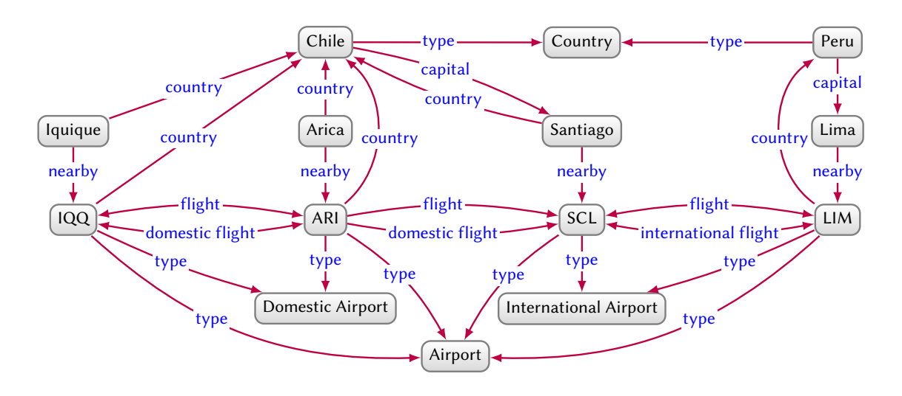

**图30.** 一个描述机场之间航班的不完整有向边标记图。图中 Santiago、Lima、Arica、Iquique 分别为圣地亚哥、利马、阿里卡、伊基克；Chile、Peru 分别为智利、秘鲁；SCL、LIM、ARI、IQQ 为机场代码。关系标签：`nearby`＝附近，`flight`＝航班，`international flight`＝国际航班，`domestic flight`＝国内航班，`capital`＝首都，`country`＝所在国家，`type`＝类型。类型节点：`Country`＝国家，`Domestic Airport`＝国内机场，`International Airport`＝国际机场，`Airport`＝机场。

按照国际机场的例子，并不假定规则在所有情况下都成立，而是为其关联一些度量，表示它们与正例边和负例边的一致程度。具体来说，将一条规则与正例边集合所蕴涵的边（不包括该蕴涵边自身）称为该规则的正蕴涵。蕴涵中属于正例的数量称为规则的支持度，规则的蕴涵中属于正例的比例称为规则的置信度[508]。因此，支持度和置信度分别表示该规则被“确认”为真的蕴涵数量及比例；目标是找出支持度和置信度都高的规则。事实上，在关系数据场景中挖掘规则的技术，早已在归纳逻辑程序设计（Inductive Logic Programming，ILP）[430]中得到探索。然而，知识图谱由于数据规模较大，并且经常假定数据不完整（开放世界假设 OWA），带来了新的挑战，因此研究者提出了专门技术来处理这些问题[170]。

处理不完整知识图谱时，如何定义负例边并不显而易见。一种常见启发式方法——也用于知识图谱嵌入——是采用部分完整性假设（Partial Completeness Assumption，PCA）[170]。该假设将数据图包含的边作为正例边集合，并将图中不存在、但存在某个节点 y 使 (x, p, y) 在图中的所有边 (x, p, y′)，作为负例集合。以图30为例，在 PCA 下，(SCL, flight, ARI) 是一条负例边（因为存在 (SCL, flight, LIM)）；相反，(SCL, domestic flight, ARI) 既非正例也非负例。PCA 置信度度量是支持度与所有属于正例或负例集合的蕴涵数量之比[170]。例如，规则 (？x, domestic flight, ？y) ⇒ (？y, domestic flight, ？x) 的支持度为 2（因为它蕴涵图中的 (IQQ, domestic flight, ARI) 和 (ARI, domestic flight, IQQ)），置信度为 2/2 = 1（注意，虽然 (SCL, domestic flight, ARI) 被蕴涵，但它既非正例也非负例，因而在该度量中被忽略）。类似地，规则 (？x, flight, ？y) ⇒ (？y, flight, ？x) 的支持度为 4，置信度为 4/5 = 0.8（注意 (SCL, flight, ARI) 是负例）。

因此，目标是寻找满足给定支持度和置信度阈值的规则。一个有影响力的图规则挖掘系统是 AMIE[169, 170]。它采用 PCA 置信度度量，并以自顶向下的方式[508]构建规则，从形如 ⇒ (？x, country, ？y) 的规则结论开始。对于每个这种形式的规则结论（每种边标签对应一个），考虑三类细化；每类细化都在规则前提中加入一条新边。这条新边使用图中的一个边标签，此外还可以使用此前未在规则中出现的新变量、已经在规则中出现的现有变量，或者图中的节点。这三类细化分别可以：

1. 加入一条包含一个现有变量和一个新变量的边。例如，细化上述规则结论可以得到：(？z, flight, ？x) ⇒ (？x, country, ？y)。
2. 加入一条包含一个现有变量和一个图中节点的边。例如，细化上面的规则可以得到：(？z, type, Domestic Airport) ∧ (？z, flight, ？x) ⇒ (？x, country, ？y)。
3. 加入一条包含两个现有变量的边。例如，细化上面的规则可以得到：(？z, type, Domestic Airport) ∧ (？z, flight, ？x) ∧ (？z, country, ？y) ⇒ (？x, country, ？y)。

这些细化可以任意组合，因此可能产生指数规模的搜索空间；系统保留满足给定支持度和置信度阈值的规则。为提高效率，可以对搜索空间进行剪枝。例如，这三类细化总会降低支持度，因此，如果一条规则未达到支持度阈值，就无需探索它的进一步细化。系统还会限制所生成规则的类型。首先，只考虑大小不超过某个固定值的规则。其次，规则必须是闭合的，即每个变量至少出现在规则中的两条边里；这一点确保规则是安全的，即结论中的每个变量都出现在前提中。例如，前面由第一、第二类细化产生的规则既不闭合（变量 y 只出现一次），也不安全（变量 y 仅出现在结论中）。²⁷ 为确保规则闭合，系统持续应用第三类细化，直到规则闭合。关于基于剪枝和索引的更多优化，参见 AMIE+ 的论文[169]。

后续研究在这些技术基础上，从知识图谱中挖掘规则。Gad-Elrab 等人[168]提出学习非单调规则的方法——即前提中带有否定边的规则——以捕获基本规则的例外。例如，这种方法可能学习到如下规则：

```text
¬(？z, type, International Airport) ∧ (？z, flight, ？x) ∧ (？z, country, ？y)
  ⇒ (？x, country, ？y)
```

这表示航班位于同一国家之内，除非（出发）机场是国际机场；原图用虚线表示例外，这里使用 ¬ 否定一条边。RuLES 系统[241]同样能够学习非单调规则，它提出扩展置信度度量，对图中没有出现的蕴涵边考虑知识图谱嵌入给出的合理性评分，以缓解 PCA 启发式方法的局限。在能够取得有关知识图谱完整性的显式陈述时（例如由形状表达的陈述，见第3.1.2节），可以使用这些陈述替代 PCA 来识别负例边。沿着这一思路，CARL[406]利用有关关系基数的额外知识，细化负例集合及候选规则的置信度度量。另一种选择是，在本体可用时，通过不相交公理等，在 OWA 下推导逻辑上确定的负例边。d’Amato 等人[114, 115]提出的系统利用由本体蕴涵的负例边，来确定通过演化算法生成的规则的置信度。

前述研究以离散方式扩展候选规则，并对这些规则应用固定的置信度评分函数；另一条研究路线是一种称为可微规则挖掘的技术[444, 455, 569]，它支持规则的端到端学习。核心思想是，规则前提中的连接可以表示为矩阵乘法。具体来说，可以用邻接矩阵 A_p（大小为 |V| × |V|）表示边标签 p 的关系；如果存在一条从第 i 个实体指向第 j 个实体、标签为 p 的边，则第 i 行第 j 列的值为 1，否则为 0。于是，可以将规则前提中的连接表示为矩阵乘法。例如，对于 (？x, domestic flight, ？y) ∧ (？y, country, ？z) ⇒ (？x, country, ？z)，可以用矩阵乘积 A_df · A_c 表示其前提，得到表示蕴涵的 `country` 边的邻接矩阵；我们希望 A_df · A_c 中的 1 都能被结论的邻接矩阵 A_c 覆盖。由于所有边标签的邻接矩阵都已给定，剩下的任务就是学习各条规则的置信度评分，并学习具有阈值置信度的（长度可变的）规则。沿着这一思路，NeuralLP[569]使用注意力机制，为如下路径式规则选择一个长度可变的边标签序列，同时学习其置信度：

```text
(？x, p₁, ？y₁) ∧ (？y₁, p₂, ？y₂) ∧ … ∧ (？yₙ, pₙ₊₁, ？z)
  ⇒ (？x, p, ？z)
```

DRUM[455]同样学习路径式规则。该系统注意到，在规则中某些边标签更可能或更不可能跟在其他标签之后——例如，在图24中，`flight` 后不会跟着 `capital`，因为连接结果为空——因此使用双向循环神经网络（一种流行的序列数据学习技术），学习规则的关系序列及其置信度。不过，这些可微规则挖掘技术目前仅限于学习路径式规则。

> **脚注 27：** 安全规则，例如 (？x, capital, ？y) ∧ (？y, nearby, ？z) ∧ (？z, type, Airport) ⇒ (？z, type, International Airport)，并不闭合，因为 ？x 只出现在一条边中。因此，规则闭合的条件严格强于规则安全的条件。

#### 5.4.2. 公理挖掘

除了规则，还可以从知识图谱中挖掘更一般形式的公理，用描述逻辑等逻辑语言表达（见第4.3.2节）。可以将这些方法分为两类：挖掘特定公理的方法，以及挖掘更一般公理的方法。

在挖掘特定类型公理的系统中，不相交公理是常见目标。例如，不相交公理 DomesticAirport ⊓ InternationalAirport ≡ ⊥ 表示两个类的交集等价于空类；用更简单的话说，没有节点可以同时具有 Domestic Airport（国内机场）和 International Airport（国际机场）这两种类型。Völker 等人[540]提出的系统基于（负）关联规则挖掘[5]提取不相交公理：寻找这样的类对，每个类在知识图谱中都有大量实例，但同时属于两个类的实例相对较少（或者没有）。Töpper 等人[524]则对余弦相似度低于固定阈值的类对提取不相交性。为计算这一余弦相似度，使用类似 TF–IDF 的方式计算类向量：每个类的“文档”由它的所有实例构成，文档的“词项”是该类实例所使用的属性（保留重复次数）。前两种方法寻找命名类之间的不相交约束（例如，城市与机场不相交）；Rizzo 等人[443]提出的方法则能够捕获类描述之间的不相交约束（例如，附近没有机场的城市与作为一国首都的城市不相交）。该方法首先将知识库中相似的节点聚类。接着提取一个术语聚类树，其中每个叶节点表示此前提取的一个簇，每个内部（非叶）节点是一个类定义（例如城市）；其左子节点要么是所有节点均属于该类的簇，要么是一个子类描述（例如没有机场的城市）；其右子节点要么是没有节点属于该类的簇，要么是不相交类的描述（例如有活动的非城市）。最后，对树中未被蕴涵为具有子类关系的类描述对，提出候选不相交公理。

其他系统提出了学习更一般公理的方法。其中一个突出系统是 DL-Learner[73]，它基于类学习（也称概念学习）算法：给定一组正例节点和负例节点，目标是寻找能够划分正例集合与负例集合的逻辑类描述。例如，给定 {Iquique, Arica}（伊基克、阿里卡）作为正例集合，{Santiago}（圣地亚哥）作为负例集合，可以学习（DL）类描述 ∃nearby.Airport ⊓ ¬(∃capital⁻.⊤)，表示附近有机场且不是首都的实体；所有正例节点都是该类的实例，没有负例节点是其实例。学习这类描述的方式类似于前述 AMIE 等系统学习规则的方式：采用细化算子在更一般的类与更特定的类之间移动（反之亦然），并使用置信度评分函数和搜索策略。该系统还通过一个评分函数支持学习更一般的公理。这个评分函数使用计数查询，确定期望边——假如公理为真将会被蕴涵的边——中有多少比例确实存在于图中。例如，为了在图30上给公理 ∃flight⁻.DomesticAirport ⊑ InternationalAirport 评分，可以使用图查询计算有多少节点有来自国内机场的入向航班（有 3 个），以及有多少节点既有来自国内机场的入向航班，又是国际机场（有 1 个）；两个计数之间的差异越大，支持该公理的证据就越弱。

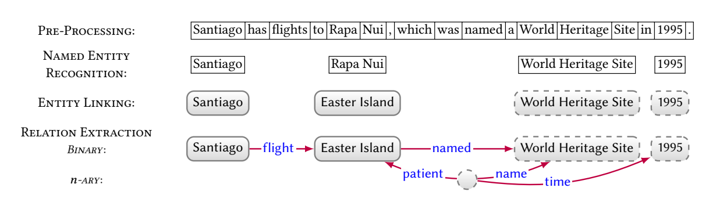

**图31.** 文本抽取示例；知识图谱中的新节点用虚线表示。原句译文为：“圣地亚哥有前往拉帕努伊的航班，后者于1995年被命名为世界遗产地。”`Pre-Processing`＝预处理，`Named Entity Recognition`＝命名实体识别，`Entity Linking`＝实体链接，`Relation Extraction`＝关系抽取，`Binary`＝二元，`n-ary`＝n 元；Rapa Nui（拉帕努伊）链接到 Easter Island（复活节岛），World Heritage Site 为世界遗产地。关系标签：`flight`＝航班，`named`＝被命名为，`patient`＝受事，`name`＝名称，`time`＝时间。

## 6. 创建与丰富

本节讨论从各种已有数据源创建知识图谱并随后丰富它的主要技术；这些数据源从纯文本到结构化格式，乃至二者之间的各种形式，都可能涉及。创建知识图谱时适宜采用的方法，取决于参与者、领域、设想的应用、可用数据源等。不过，一般来说，知识图谱的灵活性适合从一个初始核心开始，随后按需从其他来源逐步丰富（通常采用敏捷[256]或“按需渐进”[473]方法）。在贯穿全文的例子中，假定旅游局决定从零开始构建知识图谱，最初希望描述智利主要的旅游景点——地点、活动等——以帮助游客识别最感兴趣的对象。旅游局决定将交通线路、犯罪报告等其他数据留待以后添加。

### 6.1. 人工协作

创建和丰富知识图谱的一种方法，是征集人工编辑者的直接贡献。这些编辑者可以来自组织内部（例如旅游局员工），也可以通过众包平台、反馈机制（例如游客添加景点评论）、协作编辑平台（例如向公众开放编辑的景点维基）等渠道找到。虽然人的参与会带来较高成本[401]，一些著名知识图谱仍主要基于人工编辑者的直接贡献[224, 543]。不过，视征集贡献的方式而定，这种方法存在若干关键缺点，主要源于人为错误[407]、意见分歧[571]、偏见[270]、蓄意破坏[228]等。成功的协作创建还会带来许可授权、工具和文化方面的挑战[407]。有时，人们的作用是验证和整理通过其他方式抽取得到并添加到知识图谱中的内容[407]（例如，通过有目的的视频游戏[275]），定义来自其他来源的高质量映射[118]，定义适当的高层模式[284, 306]，等等。

### 6.2. 文本来源

文本语料库——例如来自报纸、书籍、科学论文、社交媒体、电子邮件、网络爬取等的语料——是丰富信息的充足来源[231, 447]。然而，为创建或丰富知识图谱，以较高精确率和召回率抽取这些信息，并非一个简单的挑战。可以应用自然语言处理（Natural Language Processing，NLP）[274, 343]和信息抽取（Information Extraction，IE）[199, 338, 554]技术来应对它。虽然不同文本抽取框架的过程差异很大，图31仍通过一个例句展示了文本抽取的四项核心任务。下面依次讨论这些任务。

#### 6.2.1. 预处理

预处理任务可能对输入文本应用多种技术；图31展示了分词，即将文本解析为原子的词项和符号。应用于文本语料库的其他预处理任务可能包括：词性（Part-of-Speech，POS）标注[274, 343]，识别表示动词、名词、形容词等的词项；依存句法分析，从句子中抽取语法树结构，其中叶节点表示各个单词，这些词共同构成短语（例如名词短语、动词短语），最终构成分句和句子[274, 343]；词义消歧（Word Sense Disambiguation，WSD）[372]，识别一个词的使用含义（也称词义），将词链接到词义词典（例如 WordNet[353]或 BabelNet[373]）。例如，词项 `flights` 可以链接到 WordNet 中“乘飞机旅行的一次实例”这一词义，而不是“相邻楼层之间的一段楼梯”。适合采用的预处理类型，往往取决于流水线中后续任务的要求。

#### 6.2.2. 命名实体识别（NER）

NER 任务识别文本中对命名实体的提及[369, 434]，通常针对人物、组织、地点，也可能针对其他类型[320, 370, 573]。已有多种 NER 技术；许多现代方法基于学习框架，利用词汇特征（例如词性标签、依存句法分析树等）和专名词表（例如常见名字、姓氏、国家、知名企业的列表等）。监督方法[46, 160, 307]需要人工标注训练语料库中的所有实体提及，而基于自举的方法[98, 148, 209, 370]只需要一小组实体提及的种子示例，用它们学习模式并应用到未标注文本上。远程监督[320, 437, 573]将知识图谱中的已知实体用作种子示例，以检测类似实体。除基于学习的框架以外，由于行为更可控、更可预测[89]，有时仍使用人工编写的规则[88, 293]。NER 识别出的命名实体可以用于生成知识图谱的新候选节点（称为新兴实体，在图31中用虚线表示），也可以通过下面介绍的实体链接任务，链接到已有节点。

#### 6.2.3. 实体链接（EL）

EL 任务将文本中的实体提及关联到目标知识图谱的已有节点；目标知识图谱可以是正在创建的知识图谱的核心，也可以是一个外部知识图谱[558]。在图31中，假设节点 Santiago（圣地亚哥）和 Easter Island（复活节岛）已经存在于知识图谱中（可能从其他来源抽取而来）。随后，EL 可以将给定提及链接到这些节点。EL 任务面临两个主要挑战。首先，同一个实体可能有多种提及方式，例如 Rapa Nui 和 Easter Island。如果创建一个节点 Rapa Nui 来表示这一提及，那么两个提及对应的可用信息就会被拆分到不同节点。因此，目标知识图谱需要捕获引用某个实体时所用的各种别名和多语言标签[362]。其次，相同提及在不同上下文中可以指不同实体；例如，Santiago 可以指智利、古巴、西班牙等国的城市。因此，EL 任务包含一个消歧阶段：将提及关联到知识图谱中的候选节点，对候选进行排序，并选出最可能被提及的节点[558]。在这个阶段可以利用上下文。例如，如果与 Santiago 同时出现的相应提及很可能对应 Easter Island，就可以提高该提及指向智利首都的概率，因为两个候选都位于智利。其他消歧启发式方法考虑先验概率，例如，Santiago 最经常指智利首都（例如，它是同名城市中最大的）；为此可以使用知识图谱上的中心性度量[558]。

#### 6.2.4. 关系抽取（RE）

RE 任务抽取文本中实体之间的关系[24, 582]。最简单的情况是在封闭场景下抽取二元关系，只考虑一组固定的关系类型。传统方法经常使用人工编写的模式[225]，现代方法则更倾向于使用基于学习的框架[446]，包括在人工标注示例上进行的监督方法[77, 582]。其他基于学习的方法也使用自举[78, 148]和远程监督[244, 356, 440, 487, 512, 566]，以免除人工标注的需要：前者需要一个人工标注的种子示例子集；后者在大型文本语料库中寻找提及具有已知关系或边的实体对的句子，用于学习该关系的模式。还可以在开放场景下使用无监督方法执行二元 RE，通常称为开放信息抽取（Open Information Extraction，OIE）[31, 149, 150, 341, 342, 357]；在这种情况下，目标关系集合并未预先定义，而是从文本中抽取，例如，从依存句法分析树中提取关系。

研究者提出了多种 RE 方法来抽取 n 元关系，以捕获实体如何关联的更多上下文。图31展示了 n 元关系如何捕获额外的时间上下文，表示 Rapa Nui 何时被命名为世界遗产地；在此情况下，创建一个匿名节点，在有向边标记图中表示这个高元数关系。许多 n 元 RE 方法基于框架语义学[159]：针对给定动词（例如“named〔命名〕”），捕获所涉及的实体，以及它们可能如何相互关联。FrameNet[26]等资源为词定义框架，例如识别“named”的语义框架包含说话者（为某物命名的人）、实体（被命名的事物）和名称。可选的框架元素包括解释、目的、地点、时间等，它们可以为关系添加上下文。其他 RE 方法则基于话语表征理论（Discourse Representation Theory，DRT）[278]，该理论考虑基于存在量化事件的文本逻辑表示。例如，在这一理论下，将复活节岛命名为世界遗产地被视为一个（存在量化的）事件，复活节岛是其受事（受到影响的实体），从而得到以下逻辑（新戴维森式）公式：

```text
∃e : (naming(e), patient(e, Easter Island), name(e, World Heritage Site))
```

这一公式类似于前面第3.3节讨论的具体化思想。

最后，封闭场景下抽取的关系通常直接映射到知识图谱，而开放场景下抽取的关系可能需要与知识图谱对齐。例如，如果 OIE 过程抽取出二元关系 (Santiago, has flights to, Easter Island)，知识图谱中可能没有其他标签为 `has flights to`（有前往……的航班）的边；假设知识图谱中使用 `flight`，那么对齐可能将该关系映射为边 (Santiago, flight, Easter Island)。为此已应用多种方法，包括用来对齐 n 元关系的映射[102, 175]和规则[448]；用来对齐 OIE 关系的分布式相似性与基于依存的相似性[361]、关联规则挖掘[135]、马尔可夫聚类[136]和语言学技术[339]；等等。

#### 6.2.5. 联合任务

以上介绍了从文本构建知识图谱的四项主要任务，但需要注意，各框架并不总是遵循这一特定任务顺序。例如，一种常见趋势是组合相互依赖的任务，联合执行 WSD 与 EL[362]、NER 与 EL[330, 382]、NER 与 RE[438, 579]等，以相互改善多个任务的表现。关于从文本中抽取知识的更多细节，参见 Maynard 等人[343]的著作，以及 Martínez-Rodríguez 等人[338]的近期综述。

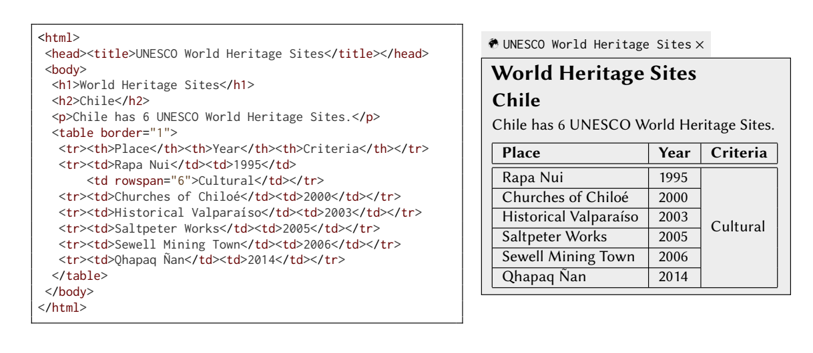

**图32.** 标记文档（HTML）示例，左侧为源代码，右侧为格式化文档。页面题名是“联合国教科文组织世界遗产地”；主标题为“世界遗产地”，副标题为“智利”，正文为“智利有 6 处联合国教科文组织世界遗产地”。表头 `Place`、`Year`、`Criteria` 分别为“地点”“年份”“标准”，共同标准 `Cultural` 为“文化”。六行内容依次为：Rapa Nui（拉帕努伊）—1995；Churches of Chiloé（奇洛埃教堂）—2000；Historical Valparaíso（瓦尔帕莱索历史城区）—2003；Saltpeter Works（硝石工场）—2005；Sewell Mining Town（塞维尔矿业城镇）—2006；Qhapaq Ñan（卡帕克南）—2014。

### 6.3. 标记来源

Web 建立在彼此链接的标记文档之上；这些文档使用标记（也称标签）分隔文档元素，通常用于格式化。Web 上的大多数文档使用超文本标记语言（HyperText Markup Language，HTML）。图32给出了一个关于智利世界遗产地的 HTML 网页示例。其他标记格式包括维基百科使用的 Wikitext、用于排版的 TeX、内容管理系统使用的 Markdown 等。从标记文档中抽取信息以创建和／或丰富知识图谱的一种方法，是去掉标记（例如 HTML 标签），只保留纯文本，再应用上一节介绍的技术。不过，标记本身也可能有助于抽取；前述文本抽取任务的若干变体经过调整，以利用这类标记[324, 327, 338]。可以将标记文档的抽取技术分为三大类：不依赖某种格式中所用标记的一般方法，它们通常基于将文档元素映射到输出的包装器；针对文档中特定标记形式的专门方法，最常见的目标是网页表格（有时也包括列表、链接等）；基于表单的方法，按深层 Web 的概念抽取网页底层的数据。这些方法往往可以利用同一网站各网页共有的规律，无论这些规律源于不同网页发布信息的非正式惯例，还是源于重复使用模板来自动生成不同网页的内容。例如，直观地说，虽然图32的网页讨论智利，但很可能在同一个网站上找到结构相同的其他国家页面。

#### 6.3.1. 基于包装器的抽取

许多一般方法基于包装器，直接从标记文档中定位并抽取有用信息。传统做法是手动定义这些包装器，已有多种声明式语言和工具用于完成这一任务；但这类方法容易受到网站布局变化的影响[158]。因此，其他方法允许（半）自动地归纳包装器[161]。一种现代方法——在 LODIE[180]等系统中用于丰富知识图谱——是应用远程监督：使用 EL 识别网页中的实体并将其链接到知识图谱节点，使标记文档中连接已知边对应的节点对的路径可以被提取、排序，并应用于其他示例。例如，在图32中，远程监督可以使用 EL，将 Rapa Nui 和 World Heritage Sites 链接到知识图谱中的节点 Easter Island 和 World Heritage Site；再依据知识图谱中的边 (Easter Island, named, World Heritage Site)（按图31所示的方法抽取），识别候选路径 (x, td[1]⁻ · tr⁻ · table⁻ · h1, y)，认为它反映形如 (x, named, y) 的边。其中，t[n] 表示标签 t 的第 n 个子节点，t⁻ 表示其逆向，t₁ · t₂ 表示串接。最后，可以使用置信度较高的路径（例如，由知识图谱中许多已知边“见证”的路径），从这个页面，以及网站中结构相似的相关页面（例如其他国家页面）抽取新边，例如 (Qhapaq Ñan, named, World Heritage Site)。

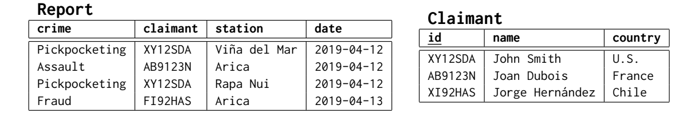

**图33.** 关系数据库实例示例，包含两个描述犯罪数据的表。`Report` 为“报案记录”，列 `crime`、`claimant`、`station`、`date` 分别表示“犯罪类型”“报案人”“警局”“日期”；`Claimant` 为“报案人”，列 `id`、`name`、`country` 分别表示“标识符”“姓名”“国家”。`Pickpocketing`＝扒窃，`Assault`＝袭击，`Fraud`＝诈骗，Viña del Mar＝比尼亚德尔马，Arica＝阿里卡，Rapa Nui＝拉帕努伊；U.S.＝美国，France＝法国，Chile＝智利。数据值及标识符按原图保留。

#### 6.3.2. 网页表格抽取

其他方法针对特定类型的标记，最常见的是网页表格，即嵌入 HTML 网页的表格。然而，网页表格旨在提高人类可读性，这往往与机器可读性冲突。许多网页表格用于布局和页面结构（例如导航栏），而真正包含数据的表格可能采用关系表、列表、属性—值表、矩阵等不同格式[81, 108]。因此，第一步是对表格进行分类，找出适合给定抽取机制的表格[108, 139]。其次，网页表格可能包含跨列、跨行、内部表格，或者为了改善视觉效果而在纵向拆分。因此，需要一个表格规范化阶段，识别表头、合并拆分的表格、展开嵌套表格、转置表格等[81, 108, 126, 145, 312, 418]。随后，方法可能需要识别主角[108, 367]，即表格描述的主要实体；它可能出现在网页的其他位置。例如，虽然 World Heritage Sites 是图31中表格的主角，但该表格并未提及它。最后，可以执行抽取过程，可能将单元格关联到实体[317, 365]，将列关联到类型[126, 317, 365]，将列对关联到关系[317, 367]。为丰富知识图谱，较新的方法同样应用远程监督：先将表格单元格链接到知识图谱节点，再用这些节点生成类型抽取和关系抽取的候选[317, 365, 367]。统计分布也可以帮助链接数值列[376]。针对特定网站中的表格，也已经设计了专门的抽取框架；例如，DBpedia[311]和 YAGO[507]等著名知识图谱重点抽取维基百科中的信息框表格。

#### 6.3.3. 深层 Web 爬取

深层 Web 提供了丰富的信息来源，但只能通过网页表单搜索来访问，因此需要深层 Web 爬取技术才能获取[332]。研究者已提出从深层 Web 来源抽取知识图谱的系统[97, 178, 310]。这些方法通常尝试生成合理的表单输入——可能基于用户查询，也可能根据参考知识生成——然后利用上述技术，从生成的响应（标记文档）中抽取数据[97, 178, 310]。

### 6.4. 结构化来源

组织内部和 Web 上可用的许多已有数据，采用结构化格式表示，主要是关系数据库、CSV 文件等形式的表格，但也包括 JSON、XML 等树形结构格式。与文本和标记文档不同，结构化来源通常可以映射到知识图谱：依据映射对其结构进行（精确的）转换，而不是进行（不精确的）抽取。映射过程包括两个步骤：1）创建从来源到图的映射；2）利用映射，将源数据物化为图，或将来源虚拟化（在已有数据上创建一个图视图）。

#### 6.4.1. 从表格映射

表格数据源十分普遍，例如，许多组织、网站等的底层结构化内容都存放在关系数据库中。图33展示了一个关系数据库实例，希望将其整合到正在构建的知识图谱中。有两种方法可以将表格内容映射到知识图谱：直接映射和自定义映射。

直接映射从表格中自动生成一个图。图34展示了标准直接映射[20]的结果：为表格中每个非表头、非空、非 NULL 的单元格创建一条边 (x, y, z)，其中 x 表示该单元格所在的行，y 表示该单元格的列名，z 表示单元格的值。具体而言，x 通常编码一行的主键值（例如 Claimant.id）；如果未定义主键（例如 Report 表），x 可以是一个匿名节点，或者一个基于行号的节点。节点 x 和边标签 y 还会编码表名，以避免不同表中含义不同的同名列发生冲突。对于每一行 x，可以根据其表名添加一条类型边。值 z 可以根据来源中的定义域，映射为相应图模型中的数据类型值（例如，SQL 中类型为 Date 的列值可以映射为 RDF 数据模型中的 xsd:date）。如果值为 NULL（或为空），通常省略相应边。²⁸ 在图34中，需要注意节点 Claimant-XY12SDA 与 XY12SDA 的区别：前者表示由后者这一主键值标识的行（或实体）。当两个表之间存在外键时，例如 Report.claimant 引用 Claimant.id，就可以链接到 Claimant-XY12SDA，而不是 XY12SDA，因为前一个节点还关联报案人的姓名和国家。按照这种思路，将关系数据库映射到 RDF 的直接映射已经得到标准化[20]；Stoica 等人[500]近期为属性图提出了类似的直接映射。另一个直接映射针对 CSV 和其他表格数据[516]，还允许在映射自身中指定列名、主键／外键和数据类型，因为这类数据格式往往缺少这些信息。

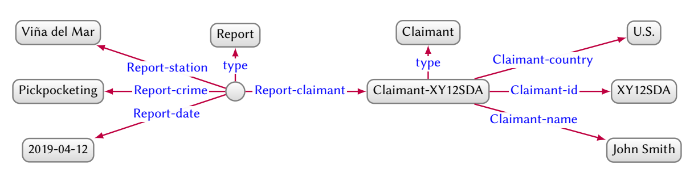

**图34.** 对图33两个表的第一行应用直接映射后可能得到的结果。`Report`＝报案记录，`Claimant`＝报案人，`type`＝类型；`Report-station`＝报案记录—警局，`Report-crime`＝报案记录—犯罪类型，`Report-date`＝报案记录—日期，`Report-claimant`＝报案记录—报案人；`Claimant-country`＝报案人—国家，`Claimant-id`＝报案人—标识符，`Claimant-name`＝报案人—姓名。`Pickpocketing` 表示扒窃，Viña del Mar 表示比尼亚德尔马，U.S. 表示美国。

虽然直接映射可以自动应用于表格数据源，并保留原始来源的信息，即允许通过确定性的逆映射，从输出图重建原始表格来源[471]，但在许多情况下，希望对映射进行自定义，例如，将边标签或节点与正在丰富的知识图谱对齐等。为此，声明式映射语言允许手动定义从表格来源到图的自定义映射。此类标准语言之一是 RDB2RDF 映射语言（R2RML）[118]，允许将表的单独一行映射为一条或多条自定义边；节点和边可以定义为常量、单个单元格的值，或者使用模板，将一行中的多个单元格值与静态子串拼接成一个词项。例如，模板 `{id}-{country}` 可以从 Claimant 表生成 XY12SDA-U.S. 这样的节点。如果希望输出的边无法从单行定义，R2RML 允许使用（SQL）查询生成表，再从中提取边。例如，可以依据一个查询来定义映射，生成 (U.S., crimes, 2) 这样的边；该查询按 claimant=id 连接 Report 和 Claimant 表，按 country 分组，并执行计数。随后可以在结果表上定义映射，使源节点表示 country 的值，边标签为常量 `crimes`（犯罪数量），目标节点为计数值。另有类似标准，将 CSV 和其他表格数据映射到 RDF 图，同样允许在映射中选择键、列名和数据类型[517]。

一旦定义好映射，一种选择是按照抽取—转换—加载（Extract-Transform-Load，ETL）方法，使用映射将图数据物化：对表格数据进行转换，并根据映射显式序列化为图数据。第二种选择是通过查询重写（Query Rewriting，QR）方法进行虚拟化：将针对图的查询（例如使用 SPARQL、Cypher 等）转换为针对表格数据的查询（通常使用 SQL）。比较这两种选择，ETL 允许像使用知识图谱中的其他数据一样使用图数据。然而，ETL 要求将底层表格数据的更新显式传播到知识图谱，而 QR 方法只维护一份需要更新的数据。基于本体的数据访问（Ontology-Based Data Access，OBDA）[561]研究的是支持第4节讨论的本体蕴涵的 QR 方法。虽然大多数 QR 方法仅支持可以表达为一个（非递归）查询的非递归蕴涵，一些 QR 方法通过重写为递归查询，支持递归蕴涵[472]。

> **脚注 28：** 可以考虑用匿名节点表示 NULL。然而，SQL 中的 NULL 可以用来表示不存在这样的值，这与 RDF 等模型中匿名节点（即空白节点）的存在语义冲突。

#### 6.4.2. 从树映射

许多流行的数据格式基于树，包括 XML 和 JSON。暂且不考虑树中子节点的顺序等问题，可以设想一种简单的从树到图的直接映射：为源树中作为 x 的子节点的每个 y，创建一条形如 (x, child, y) 的边。不过，通常不采用这种方法，因为它表示的是源数据的字面结构。相反，利用自定义映射，可以更自然地将树形结构数据的内容表示为图。沿着这一思路，GRDLL 标准[99]允许从 XML 映射到（RDF）图，JSON-LD 标准[494]允许从 JSON 映射到（RDF）图。相对地，XSPARQL[47]等混合查询语言允许统一查询 XML 和 RDF，从而支持在树形结构的已有数据源上进行图的物化和虚拟化。

#### 6.4.3. 从其他知识图谱映射

构建或丰富知识图谱的另一条途径，是将已有知识图谱用作来源。例如，在我们的场景中，智利旅游局感兴趣的许多地点，可能已存在于 DBpedia[311]、LinkedGeoData[497]、Wikidata[543]、YAGO[243]、BabelNet[373]等已有知识图谱中。不过，视正在构建的知识图谱而定，并不是所有实体和／或关系都有用。一种提取相关数据子图的标准选择，是使用以图作为输出的 SPARQL 构造查询[375]。为更好地整合外部知识图谱（的部分内容），还可能需要知识图谱之间的实体和模式对齐；可以使用图链接工具[378, 541]，基于外部标识符[407]来完成，也可以手动完成[407]。例如，Wikidata[543]以 Freebase[54, 407]作为来源；Gottschalk 和 Demidova[197]从 Wikidata、DBpedia 和 YAGO 提取了一个以事件为中心的知识图谱；Neumaier 和 Polleres[375]从 Geonames、Wikidata、PeriodO[193]（以及表格数据）构建了一个时空知识图谱。

### 6.5. 模式／本体创建

以上讨论集中于从外部来源抽取数据，以创建和丰富知识图谱。本节讨论依据外部数据来源（包括人类知识）生成模式的一些主要方法。关于从知识图谱自身抽取模式的讨论，参见第3.1.3节。总体而言，这一领域的许多研究关注使用本体工程方法和／或本体学习来创建本体。下面依次讨论这两种方法。

#### 6.5.1. 本体工程

本体工程是指开发和应用构建本体的方法，提出系统化的过程，以较少投入构建和维护质量更好的本体。早期方法[157, 202, 388]通常基于类似瀑布模型的过程：在开始使用逻辑语言实现本体之前，先确定需求和概念化，随后例如使用本体工程工具[194, 284, 287]进行实现。不过，对于涉及大型本体或不断演化本体的情况，研究者提出了更迭代、更敏捷的本体构建与维护方法。

DILIGENT[414]是敏捷方法的一个早期例子，提出了本体生命周期管理和知识演化的完整过程；同时，将局部变化（对知识的局部视图）与本体核心部分的全局更新分开，使用评审过程批准将变化从局部传播到全局。这种方法类似于大型临床参考术语系统 SNOMED CT[263]（也以本体形式提供）的维护和演化方式：其（国际）核心术语根据全局需求维护，而 SNOMED CT 的国家或地方扩展根据局部需求维护；随后由一组作者决定，将哪些国家或地方扩展传播到核心术语中。较新的敏捷方法包括极限设计（eXtreme Design，XD）[50, 420]、模块化本体建模（Modular Ontology Modelling，MOM）[238, 300]、本体开发的简化敏捷方法（Simplified Agile Methodology for Ontology Development，SAMOD）[409]等。这些方法通常包含两个关键要素：本体需求，以及（较近期加入的）本体设计模式。

本体需求指定所生成本体的预期任务，或者确切地说，指定以该本体作为模式的知识图谱本身的预期任务。表达本体需求的一种常见方式是能力问题（Competency Questions，CQ）[203]：用自然语言问题说明希望本体（或知识图谱）提供的典型知识。如果本体还应包含用于推断新知识或检查数据一致性的限制和一般公理，就可以为这些 CQ 补充额外限制和推理要求。测试本体（或基于本体的知识图谱）的一种常见方式，是将 CQ 形式化为针对某个测试数据集的查询，并确保预期结果能够被蕴涵[53, 285]。例如，可以考虑 CQ：“圣地亚哥正在举办哪些活动？”它可以表示为图查询 (？event, type, Event) ∧ (？event, location, Santiago)。对于图1的数据图和图12的公理，可以检查预期结果 EID15 是否由本体与数据蕴涵；由于并不蕴涵，可以考虑扩展公理，断言 (location, type, Transitive)，即位置关系具有传递性。

本体设计模式（Ontology Design Patterns，ODP）是现代方法的另一个常见特征[52, 173]，指定可推广的本体建模模式；它们可以用于启发类似模式的建模，充当建模模板[140, 485]，或用作可以直接复用的组件[163, 479]。网上已经提供了多个模式库，从经过仔细整理的模式库[19, 479]，到开放的、由社区管理的模式库[163]都有。例如，为我们的场景建模本体时，可以决定采用 Krisnadhi 和 Hitzler[299]提出的核心事件本体模式；它指定事件的时空范围、子事件和参与者，并进一步提出能力问题、形式定义等，以支持这一模式。

#### 6.5.2. 本体学习

前述方法概述了手动构建和维护本体的方式。相比之下，本体学习可以用来从文本中（半）自动抽取对本体工程过程有用的信息[76, 93]。早期方法重点从文本抽取可能表示相关领域中类的术语。例如，从一组有关旅游的文本文档中，术语抽取工具可以使用成词度（unithood）度量——确定一个 n-gram 作为单一短语的凝聚程度——和术语度（termhood）度量——确定短语与某一领域的相关程度[339]——将“visitor visa〔旅游签证〕”“World Heritage Site〔世界遗产地〕”“off-peak rate〔非高峰期费率〕”等 n-gram，识别为旅游领域中特别重要、因而可能值得纳入此类本体的术语。还可以从文本中抽取公理，常见目标是子类公理；可以依据逐步细化概念的修饰性名词和形容词（例如，从名词短语“visitor visa”及其他位置单独出现的“visa”，抽取 (Visitor Visa, subc. of, Visa)，即旅游签证是签证的子类），也可以使用 Hearst 模式[225]（例如，依据“X, such as Y〔X，例如 Y〕”模式，从“many discounts, such as off-peak rates, are available〔有多种折扣可供选择，例如非高峰期费率〕”中抽取 (Off-Peak Rate, subc. of, Discount)，即非高峰期费率是折扣的子类）。还可以从大型文本中收集文本定义，抽取上位词关系，并从零开始归纳分类体系[534]。较新的研究希望从文本中抽取表达能力更强的公理，包括不相交公理[540]；涉及类的并集和交集，以及存在限制、全称限制、限定基数限制的公理[412]。本体学习过程的结果随后可以作为更一般的本体工程方法的输入，用来验证本体的术语覆盖范围，识别新类和新公理等。

## 7. 质量评估

无论知识图谱是从何种来源创建的，为初始知识图谱抽取的数据通常都不完整，并含有重复、矛盾，甚至不正确的陈述，尤其是在取自多个来源时。因此，在从外部来源初步创建和丰富知识图谱之后，评估所得到知识图谱的质量是一个关键步骤。这里所说的质量，是指用途适合性。质量评估有助于确定，知识图谱能够被可靠地用于哪些目的。

下面讨论质量维度，用它们捕获从传统数据库领域发展到知识图谱领域[33]的多方面数据质量。其中一些维度是通用的，另一些则更具有知识图谱的特点[574]。质量维度旨在捕获数据的定性方面，我们还会讨论质量指标，以提供度量这些维度中定量方面的方法。下面讨论的维度与指标分组，借鉴了 Batini 和 Scannapieco[34]。

### 7.1. 准确性

准确性是指由图中节点和边编码的实体与关系，正确表示现实世界现象的程度。准确性可以进一步细分为三个维度：语法准确性、语义准确性和及时性。

#### 7.1.1. 语法准确性

语法准确性是指数据符合为该领域和／或数据模型定义的语法规则的程度。常见的语法不准确出现在数据类型节点中：它们可能与定义的值域不兼容，或者格式不正确。例如，假设属性 `start` 的值域被定义为 xsd:dateTime，那么 `"March 29, 2019, 20:00"^^xsd:string` 这样的值就与定义的值域不兼容，而 `"March 29, 2019, 20:00"^^xsd:dateTime` 这样的值格式不正确（期望的应是 `"2019-03-29T20:00:00"^^xsd:dateTime` 这样的值）。对应的语法准确性指标是某个属性的不正确值数量与同一属性的全部值数量之比[574]。这类语法准确性通常可以使用验证工具来评估[167, 248]。

#### 7.1.2. 语义准确性

语义准确性是指数据值正确表示现实世界现象的程度，可能受到不精确的抽取结果、不精确的蕴涵、蓄意破坏等影响。例如，智利国会位于瓦尔帕莱索，这可能（通过蕴涵、抽取、补全等）导致产生边 (Chile, capital, Valparaiso)，但它实际上在语义上不准确：智利首都是圣地亚哥。评估语义不准确的程度具有挑战性。一种选择是人工验证，另一种自动化选择是对照多个来源检查所陈述的关系[146, 313]。还可以根据精确率等度量，验证用于生成知识图谱的各个过程的质量，必要时借助人类专家或金标准[338]。

#### 7.1.3. 及时性

及时性是指知识图谱当前与现实世界状态保持一致的程度[276]；换言之，一个知识图谱现在可能在语义上准确，但如果没有及时更新的程序，就可能很快变得不准确（过时）。例如，考虑一名用户在旅游知识图谱中查找从一个城市飞往另一个城市的航班。假设航班时刻表每分钟更新一次，提供当前航班状态，但知识图谱每小时才更新一次。那么，该知识图谱就存在及时性方面的质量问题。可以根据相对于底层来源而言知识图谱的更新频率，评估及时性[276, 452]；为此，可以使用知识图谱变化的时间标注[450, 451]，以及捕获数据时间有效性的上下文表示（见第3.3节）。

### 7.2. 覆盖度

覆盖度是指避免遗漏与领域相关的元素，否则可能导致不完整的查询结果或蕴涵、有偏模型等。

#### 7.2.1. 完整性

完整性是指特定数据集中包含全部所需信息的程度。完整性包括以下方面：（i）模式完整性，指模式的类和属性在数据图中得到表示的程度；（ii）属性完整性，指某个特定属性的缺失值比例；（iii）总体完整性，给出现实世界中某一特定类型的全部实体在数据集中得到表示的百分比；（iv）可链接完整性，指数据集中的实例彼此链接的程度。直接度量完整性并不简单，因为需要知道一个假设的理想知识图谱[116]，它包含所讨论知识图谱“理想上”应当表示的全部元素。具体策略包括与提供理想知识图谱样本的金标准比较（可能基于完整性陈述[116]），或度量从完整来源进行抽取的方法的召回率[338]，等等。

#### 7.2.2. 代表性

代表性是一个相关维度，它并不聚焦于缺失的领域相关元素所占比例，而是评估知识图谱所包含或排除内容的高层偏差[25]。因此，这个维度假定知识图谱不完整，即它是理想知识图谱的一个样本，并考察这个样本有多大偏差。偏差可以出现在数据、模式或推理过程中[270]。数据偏差的例子包括：使世界某些地区的实体／关系得到不足表示的地理偏差[270]；使某些语言的多语言资源（例如标签和描述）得到不足表示的语言偏差[277]；使特定性别或种族的人得到不足表示的社会偏差[545]；等等。相对地，模式偏差可能来自从有偏数据中抽取的高层定义[270]，未涵盖不常见情况的语义定义等。未被识别的偏差可能产生不利影响。例如，如果我们的旅游知识图谱在地理上偏重圣地亚哥市附近的活动和景点——可能源于创建图谱时使用的来源、雇用了来自该市的整理人员等——就可能使圣地亚哥及其周边的旅游得到不成比例的宣传（可能加剧未来的偏差）。代表性的度量包括比较已知的统计分布与知识图谱的分布，例如，将有地理位置的实体与已知人口密度比较[270]，将语言分布与已知使用者分布比较[277]等。另一种选择是将知识图谱与一般统计规律比较；Soulet 等人[489]利用是否符合本福特定律²⁹，度量知识图谱中的代表性。

### 7.3. 协调性

协调性是指知识图谱符合模式层面定义的形式语义和约束、或与它们相协调的程度。

#### 7.3.1. 一致性

一致性意味着知识图谱对于所考虑的特定逻辑蕴涵不存在（逻辑或形式上的）矛盾。例如，在知识图谱的本体中，可以定义 (flight, range, Airport) 和 (Airport, disj. c., City)，即航班关系的值域为机场，机场与城市不相交。将其与边 (Arica, flight, Santiago) 和 (Santiago, type, City) 结合，就会产生不一致，蕴涵 Santiago 是不相交的 City 和 Airport 两个类的成员。更一般地说，表3–5中任何带有“非”条件的语义特征，在被否定的条件遭到蕴涵时，都可能导致不一致。一致性的一个度量，可以是知识图谱中发现的不一致数量，并可以进一步细分为由每个语义特征识别的不一致数量[58]。

#### 7.3.2. 有效性

有效性意味着知识图谱不存在约束违反，例如由形状表达式[521]捕获的约束违反（见第3.1.2节）。例如，可以指定一个形状 City，要求其目标节点最多只有一个 country 值。那么，给定边 (Santiago, country, Chile) 和 (Santiago, country, Cuba)，并假定 Santiago 成为 City 的目标，就出现了约束违反。相反，即使在本体中定义类似的基数限制，也不一定导致不一致，因为在没有唯一名称假设（UNA）的情况下，我们首先会推断 Chile 与 Cuba 指向同一个实体。有效性的一个直接度量，是统计每个约束的违反数量。

### 7.4. 简约性

简约性是指只包含相关内容（避免“信息过载”），并以简洁、易理解的方式表示这些内容。

#### 7.4.1. 简洁性

简洁性是指避免包含与领域无关的模式和数据元素。Mendes 等人[349]区分了内涵简洁性（模式层面）和外延简洁性（数据层面）：前者指数据不含冗余模式元素（属性、类、形状等）的情况，后者指数据不含冗余实体和关系的情况。例如，在专门描述智利旅游的知识图谱中，包含 Santiago de Cuba（圣地亚哥—德古巴）的活动，可能影响知识图谱的外延简洁性，并可能返回与给定领域无关的结果。一般而言，简洁性可以通过属性、类、形状、实体、关系等与领域相关的比例来度量；而这可能进一步需要金标准，或用于评估领域相关性的技术。

> **脚注 29：** 本福特定律指出，在许多数值集合中，首位有效数字更可能是较小的数字。

#### 7.4.2. 表示简洁性

**表示简洁性（representational-conciseness）**指知识图谱以紧凑方式表示内容的程度，也可分为内涵层面和外延层面 [574]。例如，若 `flight` 与 `flies to` 两个属性承担相同作用，会降低内涵层面的表示简洁性；若 `Santiago` 与 `Santiago de Chile` 两个节点都表示智利首都，却未相互链接，则会降低外延层面的表示简洁性。另一个例子是不必要地使用复杂建模构造，例如无必要地进行具体化，或在元素顺序并不重要时使用链表 [250]。尽管表示简洁性难以评估，仍可使用冗余节点数量等度量 [167]。

#### 7.4.3. 可理解性

**可理解性（understandability）**指人类用户能否容易且无歧义地解释数据。这至少涉及提供人类可读的标签和描述，最好使用多种语言 [277]，使用户理解数据所指的内容 [250]。回到图 1，虽然节点 `EID15` 和 `EID16` 用于保证活动标识符唯一，它们仍应关联 `Ñam` 和 `Food Truck` 等标签。理想情况下，人类可读信息足以消除特定节点的歧义，例如将描述 `"Santiago, the capital of Chile"@en`（“圣地亚哥，智利首都”）与 `Santiago` 关联，以区别于同名城市。可理解性的度量可包括具有可读标签和描述的节点比例、标签和描述的唯一性、支持的语言等。

### 7.5. 其他质量维度

我们讨论了知识图谱中已有研究涉及且普遍适用的一些关键质量维度。在特定领域、特定应用或特定图数据模型的背景下，其他维度也可能相关。更多细节可参阅 Zaveri 等的综述 [574] 及 Batini 和 Scannapieco 的著作 [34]。

## 8. 精化

除了评估知识图谱质量，还存在用于精化知识图谱的技术，特别是以半自动或自动方式补全和纠正知识图谱 [400]，分别称为**知识图谱补全**和**知识图谱纠错**。与第 6 节介绍的创建和丰富任务不同，精化通常不涉及对外部来源应用提取或映射技术，将其内容引入本地知识图谱。相反，精化通常针对现有的本地知识图谱进行改进，但可能利用外部来源核实本地内容 [400]。

### 8.1. 补全

知识图谱具有不完备性 [555]。因此，知识图谱补全旨在填入缺失的边，也称缺失链接，即认为正确、却既未在知识图谱中给出，也不被其蕴涵的边。这一任务经常采用**统计关系学习**领域提出的链接预测技术 [184]，预测缺失边是否存在，或更一般地预测其正确概率。例如，对于图 24，可以预测 `(Moon Valley, bus, San Pedro)` 很可能是缺失边，因为已观察到的多数公交线路都提供往返服务，即 `bus` 通常是对称关系。

链接预测可针对三种情境：**一般链接**，即标签任意的边，例如 `bus`、`flight`、`type` 等；**类型链接**，即标签为 `type`、指明实体类型的边；以及**身份链接**，即标签为 `same as`、指明两个节点指向同一实体的边，参见第 3.2.2 节。类型链接和身份链接可以用一般链接预测技术处理，但也可利用其特定语义设计专门技术。相关的跨知识图谱生成链接任务称为**链接发现** [374]，将在第 9.1 节讨论。

#### 8.1.1. 一般链接预测

一般情形下，链接预测常采用第 5 节介绍的归纳技术，尤其是知识图谱嵌入和规则／公理挖掘。例如，对图 24 使用知识图谱嵌入，可以发现给定形如 `(x, bus, y)` 的边时，缺失边 `(y, bus, x)` 具有较高合理性；使用基于符号的方法，则可以学习高层规则：

```text
(?x, bus, ?y) ⇒ (?y, bus, ?x)
```

上述任一方法都能帮助预测缺失链接 `(Moon Valley, bus, San Pedro)`。

#### 8.1.2. 类型链接预测

类型链接对知识图谱尤为重要，可以利用考虑这类链接特定语义的专用技术。在类型预测中，只有一个边标签 `type`，而且通常比其他情形具有更少的不同取值，即类。因此，可将任务化约为传统分类任务 [400]，依据知识图谱中类实例的出边和／或入边标签等特征，训练模型识别各语义类 [402, 486]。

例如，假设在图 24 中，我们还知道 `Arica`、`Calama`、`Puerto Montt`、`Punta Arenas` 和 `Santiago` 的类型都是 `City`。于是，可根据 `Iquique` 和 `Easter Island` 的出入边具有 `flight` 标签，预测它们也属于 `City`。这里假设模型已学习到，这类边是预测该类的良好特征；前一预测正确，后一预测错误。图神经网络（见第 5.3 节）也可用于节点分类和类型预测。

#### 8.1.3. 身份链接预测

身份链接预测涉及寻找指向同一实体的节点，类似于更一般的数据集成情境中的**实体匹配**任务，也称记录链接、去重等 [297]。这类技术通常依赖两种匹配器：**值匹配器**判断两个实体在某个属性上的值有多相似，可能涉及字符串、数字、日期等相似度度量；**上下文匹配器**则依据多个节点和边，考察实体之间的相似性 [297]。

图 35 给出一个例子。值匹配器计算 `7400` 与 `7500` 等值的相似度；上下文匹配器根据 `Easter Island` 与 `Rapa Nui` 的周边信息计算相似度，例如它们具有相近的纬度、经度、人口及相同的行政中心。作为对比，对这两个节点使用值匹配器，则会度量字符串“Easter Island”和“Rapa Nui”的相似度。

这一情境中的重要挑战是效率：对于 n 个节点，两两匹配需要 O(n²) 次比较。为此，可采用**分块（blocking）**，利用保持相似性的键，将相似实体分入可能重叠或互不相交的“块”，并仅在各块内部匹配 [133, 265, 297]。例如，根据经纬度匹配地点时，块可以表示地理区域。离散分块的替代方法，是按保持相似性的顺序排列实体，再使用滑动窗口 [133]；或者在多维空间中搜索相似实体，例如时空 [460]、使用闵可夫斯基距离的空间 [379]、大圆距离空间 [380] 等 [477]。

结果可以是附带“指向同一实体”置信度的节点对，也可以是根据固定阈值、二元分类等得到的明确身份链接 [297]。对于置信度较高的身份链接，可进一步合并相关节点的边 [251]。例如，将 `Easter Island` 选为规范节点，把 `Rapa Nui` 的边合并到它上面，就能够依据图 35 中合并后的子图，查找太平洋中的世界遗产地：

```text
(Easter Island, named, World Heritage Site)
(Easter Island, ocean, Pacific)
```

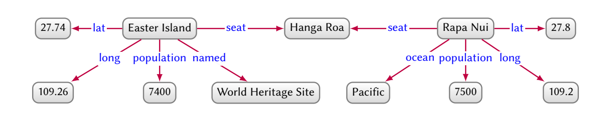

**图 35：** 身份链接示例，其中 `Rapa Nui` 与 `Easter Island` 指同一座岛。

*图中标签：population = 人口；lat = 纬度；long = 经度；seat = 行政中心；named = 被列为／获命名为；ocean = 所在大洋。Easter Island = 复活节岛；Rapa Nui = 拉帕努伊；Hanga Roa = 汉加罗阿；World Heritage Site = 世界遗产地；Pacific = 太平洋。数值保持原图。*

### 8.2. 纠错

与补全寻找知识图谱中的新边不同，纠错识别并删除现有的错误边。这里将主要方法分为两条路线：**事实验证**，为给定边分配合理性分数，通常参考外部来源；以及**不一致性修复**，通过本体公理处理知识图谱中发现的不一致。

#### 8.2.1. 事实验证

事实验证任务，也称事实核查 [63, 146, 181, 478, 481, 488, 513, 514, 572]，涉及为事实或边分配合理性、真实性分数，通常介于 0 和 1 之间。理想的事实核查函数假设存在一个参考总体，即理想知识图谱；它对真实事实 `(Santa Lucía, city, Santiago)` 返回 1，对错误事实 `(Sotomayor, city, Santiago)` 返回 0。

事实验证与链接预测显然相关：二者都依赖对边、事实或链接的合理性进行评估，确实也能采用同样的数值型和符号型技术。不过，事实验证通常在线评估输入边，而链接预测往往是离线任务，从知识图谱生成新的候选边，再予以评估。此外，事实验证研究的特点，是考虑外部参考来源，可以是非结构化来源 [181, 458, 513, 572]，也可以是结构化来源 [63, 478, 481, 488, 514]。

基于非结构化来源的方法，假设给定一个能将边转换为自然语言的**语言化函数**，例如采用基于规则的方法 [143, 381]、编码器-解码器架构 [176] 等。随后可以直接使用计算自然语言事实合理性的方法，称为**事实发现器（fact finders）** [398, 399]。

许多事实发现算法构建一个 n 部图，通常为二部图，节点表示事实和来源。如果某来源包含与输入边的语言化表达匹配、且置信度足够高的文本片段，即为事实提供“证据”，便在该来源与事实之间连边。然后根据图计算两个相互依赖的分数：来源的可信度和事实的合理性。各事实发现器的差异在于如何计算这些分数 [399]。这里介绍 Pasternack 和 Roth [398] 提出的三种评分方法：

- **Sums（求和）** [398] 改编 HITS 算法 [292]，将来源定义为枢纽，其权威分数为 0；将事实定义为权威，其枢纽分数为 0。
- **Average Log（平均对数）** [398] 为 HITS 加入归一化因子，避免单个来源仅因支持大量可能错误的事实，而获得较高可信度。
- **Investment（投资）** [398] 根据相连来源提供的“投资”，通过非线性函数提高事实分数。某来源从事实获得的分数，取决于该来源中的具体事实与其他相连来源之间的比较。

Pasternack 和 Roth [399] 随后表明，这三个算法可推广为统一的多层图框架。在其中：（1）来源可以用表达不确定性的权重支持事实；（2）相似事实可以相互支持；（3）来源可以分组，同组来源之间因而存在隐式支持。后续知识图谱事实核查方法进一步扩展了该框架 [171, 458]。基于分类器的替代方法也已出现，常用特征包括信息来源信任分数、事实在来源中的共同出现情况等 [181, 513]。

基于结构化数据的事实验证方法，通常将外部知识图谱作为参考来源，并寻找可为待验证输入边提供证据的路径。无监督方法搜索长度不超过给定阈值的无向 [91, 481] 或有向路径 [514]，为输入边提供证据。输入边与路径之间的相关性，使用互信息函数计算，例如归一化逐点互信息 [64]。

监督方法则从外部知识图谱提取输入边的特征 [309, 510, 578]，用这些特征训练分类模型，将边标注为真或假。重要的一组特征是**元路径**，编码与输入边标签正相关的谓词序列。其中，PredPath [478] 根据类型信息自动提取元路径。还有一些方法使用图嵌入（见第 5.2 节）编码参考节点和边，进而估计待验证输入边的合理性。

#### 8.2.2. 不一致性修复

本体可以包含导致不一致的公理，例如不相交性公理。它们既可由专家提供，也可通过第 5.4 节讨论的符号学习导出，并用于检测不一致。然而，要纠正知识图谱，仅检测不一致还不够，还需要修复技术，而这本身并不简单。

最简单的情形，是某实体同时属于两个不相交的类。例如，`Santiago` 同时为 `City` 和 `Airport` 的实例，而这两个类被声明或被发现不相交。最好只删除“错误”的类归属，但应删除哪一个？这并非简单问题，尤其是同一条边可能参与多个不一致，而一个不一致也可能涉及多条边。

考虑蕴涵时，计算修复会更加复杂：不仅需要删除明确给出的类型，还要消除可能推导出该类型的所有途径。例如，仅删除 `(Santiago, type, Airport)` 不够；如果还存在 `(Arica, flight, Santiago)`，并结合公理 `(flight, range, Airport)`，仍可推出该类型。

Töpper 等 [524] 为此类违规提供可能的修复：删除定义域／值域约束、删除不相交约束、删除类型边，或删除具有定义域／值域约束的边，然后由人工选择。相比之下，Bonatti 等 [58] 提出基于极小击中集的自动修复方法 [436]，其中每个集合是不一致的极小解释。要删除哪些边，根据其来源可信度，以及它们属于或帮助蕴涵元素的极小击中集数量进行评分，并修订知识图谱，避免被删除的边再次被蕴涵。另一种选择是不修复数据，而是在考虑不一致的语义下求值查询，例如返回在每一种可能修复中均成立的一致答案 [329]。

### 8.3. 其他精化任务

对照第 7 节讨论的质量类别，这里介绍的精化方法处理准确性、覆盖度和一致性维度中的特定问题。此外，还可以设想其他方法，用于处理简洁性等其他质量问题。不过，总体而言，迄今大部分关注集中在知识图谱补全和知识图谱纠错。知识图谱精化的更多细节，可参阅 Paulheim 的综述 [400]。

## 9. 发布

对于能够给公司带来竞争优势的企业知识图谱，公开发布可能并不理想 [387]；但其他知识图谱可能适合、甚至必须发布，例如志愿者创建的图谱 [311, 333, 543]、公共资金研究产生的图谱 [82, 200, 519]，或政府组织创建的图谱 [233, 475] 等。**发布**指使公众能够访问知识图谱或其中一部分，通常通过 Web 实现。作为开放数据发布的知识图谱，称为**开放知识图谱**，见第 10.1 节。

下面先讨论为指导 Web 数据发布而提出的两组原则，然后讨论公众与知识图谱内容交互所依赖的接口，即访问协议；最后考虑按需限制对知识图谱或其部分内容的访问或使用的技术。

### 9.1. 最佳实践

这里讨论数据发布的两组关键原则：Wilkinson 等提出的 **FAIR 原则** [556]，以及 Berners-Lee 提出的**关联数据原则** [41]。

#### 9.1.1. FAIR 原则

FAIR 原则最初在发布科学数据的背景下提出 [556]，主要动机是最大化公共资金研究的影响。不过，它们也普遍适用于其他数据发布情形：让外部主体容易复用数据，尤其强调机器可读性。FAIR 是四项基本原则的首字母缩写，每项均有具体目标 [556]，可用于数据、元数据，或二者；后一情形以“（元）数据”表示。³⁰ 下面介绍 FAIR 原则，为简洁起见，有些地方对原表述作了略微改写 [556]。

- **可发现性（Findability）**：可能从数据集获益的外部主体，能否容易地首先定位到数据集。应满足四个子目标：
  - **F1：** 为（元）数据分配全局唯一且持久的标识符。
  - **F2：** 使用丰富的元数据描述数据，见 R1。
  - **F3：** 元数据清楚、明确地包含它所描述的数据的标识符。
  - **F4：** 将（元）数据登记或索引到可搜索的资源中。
- **可访问性（Accessibility）**：外部主体找到数据集后，能否容易地访问它。定义两个目标，第一个还有两个子目标：
  - **A1：** 可通过标识符，使用标准协议检索（元）数据。
    - **A1.1：** 协议开放、免费，并可普遍实现。
    - **A1.2：** 必要时，协议允许认证和授权。
  - **A2：** 即使数据已不可用，元数据仍可访问。
- **可互操作性（Interoperability）**：能否容易地使用标准工具，结合其他数据集利用该数据集。定义三个目标：
  - **I1：**（元）数据采用可访问、共享且通用的知识表示形式体系。
  - **I2：**（元）数据采用遵循 FAIR 原则的词汇表。
  - **I3：**（元）数据包含指向其他（元）数据的带明确关系说明的引用。
- **可复用性（Reusability）**：能否容易地将该数据集与其他数据集结合复用。定义一个目标及三个子目标：
  - **R1：** 使用多个准确、相关的属性，丰富地描述（元）数据。
    - **R1.1：** 以清楚、可访问的数据使用许可发布（元）数据。
    - **R1.2：**（元）数据关联详细的来源信息。
    - **R1.3：**（元）数据符合相关领域的社区标准。

> **脚注 30：** 元数据是关于数据的数据。这一区分在观测科学中往往重要。例如，在天文学中，数据可以包括原始图像，而元数据可以包括图像的天球坐标及拍摄时间。

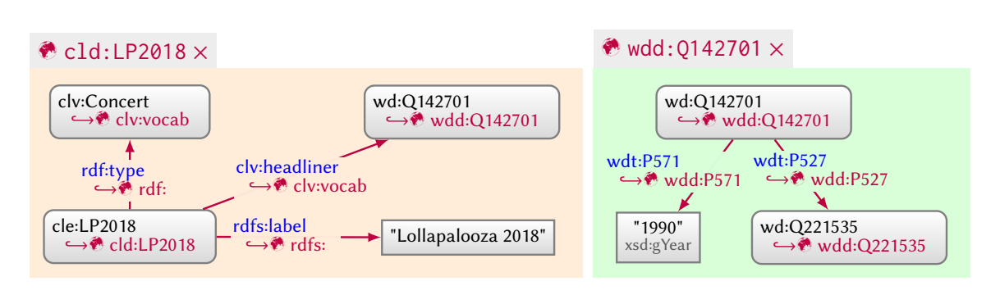

**图 36：** 来自两个网站的关联数据文档示例，每个都包含一个 RDF 图。`wd:Q142701` 指 Wikidata 中的 Pearl Jam（珍珠果酱乐队），而 `wdd:Q142701` 指关于 Pearl Jam 的 RDF 图；`wd:Q221535` 指 Eddie Vedder，而 `wdd:Q221535` 指关于 Eddie Vedder 的 RDF 图。边标签 `wdt:571` 在 Wikidata 中指“成立／起始”，`wdt:527` 指“组成部分”。

*图内其他标签：Concert = 音乐会；headliner = 领衔演出者；rdfs:label = 标签；rdf:type = 类型。前缀与原图中的 P571、P527 保留原样。*

针对知识图谱，已经提出多种词汇表、工具和服务，直接或间接帮助满足 FAIR 原则。在**可发现性**方面，如第 2 节所述，IRI 内置于 RDF 模型，为全局标识符提供通用机制。另外，互联数据集词汇表（VoID）[11] 等资源可以表示图的元数据，而 DataHub [45] 等服务为这类数据集描述提供集中存储库。支持**可访问性**的访问协议将在第 9.2 节讨论，授权机制在第 9.3 节讨论。在**可互操作性**方面，如第 4 节所述，本体作为通用知识表示形式体系，也可以描述遵循 FAIR 原则的词汇表。最后，在**可复用性**方面，第 9.3 节将讨论许可，第 3 节讨论的 PROV 数据模型 [188] 则支持记录详细来源。

一些知识图谱已经遵循 FAIR 原则发布。Wilkinson 等 [556] 明确提到，面向药物发现的数据集成平台 Open PHACTS [200]，以及包含大量蛋白质序列和注释数据的 UniProt [519]，均遵循这些原则。两个数据集都通过 RDF 数据模型提供内容的图视图。

#### 9.1.2. 关联数据原则

Wilkinson 等 [556] 指出，FAIR 原则“先于实现选择”，即原则不规定应如何或可以如何实现。比 FAIR 原则早近十年的关联数据原则由 Berners-Lee [41] 提出，为实现 FAIR 原则的一种可能方式提供技术基础。具体如下：

1. 使用 IRI 作为事物的名称。
2. 使用 HTTP IRI，使这些名称可被查找。
3. 查找 HTTP IRI 时，使用标准数据格式，返回关于该 IRI 所命名实体的有用内容。
4. 在返回内容中包含指向相关实体 IRI 的链接。

这些原则在语义网背景下提出。对于原则（3），当前建议使用基于 RDF 的标准，包括 RDFS、OWL 等，尤其是因为它们允许用 HTTP IRI 命名实体，从而进一步为满足全部四项原则奠定基础。因此，这些原则描述了如何在 Web 上发布 RDF 图结构数据，使图相互链接，形成 Berners-Lee [41] 所称的“数据之网”。其目标是提高 Web 自动化程度：内容不仅出现在面向人类阅读的 HTML 文档中，也以 RDF 结构化数据提供，使机器能够定位、检索、组合、验证、推理、查询等，从而自动完成任务。

从概念上说，数据之网由各网页上发布的数据图组成。点击节点或边标签，更准确地说，对图中的 IRI 进行 HTTP 查找，就能转到 Web 上其他位置的图，获取关于该节点或边标签的相关内容，并如此递归进行。

图 36 展示了两个在 Web 上发布的关联数据文档，每个包含一个 RDF 图。如第 3.2 节所述，`clv:Concert`、`wd:Q142701`、`rdfs:label` 等术语是 IRI 的缩写，例如 `wd:Q142701` 展开为 `http://www.wikidata.org/entity/Q142701`。以 `cl` 开头的前缀是虚构前缀，假设由智利旅游局创建。带有 `↩→m` 标记的 IRI，表示查找该节点时返回的文档。

左侧文档由旅游局发布，描述 Lollapalooza 2018，以节点 `cle:LP2018` 标识，并链接到领衔演出的 Pearl Jam（`wd:Q142701`），后者由外部知识图谱 Wikidata 描述。查找左侧图的节点 `wd:Q142701` 时，IRI 被解引用，即通过 HTTP 返回右侧包含 RDF 图的文档，更详细地描述该实体。再从右侧文档查找 `wd:Q221535`，可以找到关于 Eddie Vedder 的图，示例未展示。

实体 IRI 与文档 IRI 加以区分，以免混淆关于实体和关于文档的数据。例如，`wd:Q221535` 指 Eddie Vedder，而 `wdd:Q221535` 指关于他的文档；要为文档赋予最后修改日期，应使用 `wdd:Q221535`，而不是 `wd:Q221535`。图 36 还表明，边标签同样是 IRI，代表类的节点如 `clv:Concert` 也可解引用，通常返回相应术语的语义定义。

第四项原则，即包含指向相关实体的链接，带来一项关键挑战。图 36 中，左侧图的 `wd:Q221535` 构成指向外部知识图谱中 Pearl Jam 相关内容的链接。具体而言，**链接发现**任务考虑从一个知识图谱向另一个添加此类链接，可以加入解引用到外部图的 IRI，如图 36 所示，或加入身份链接等具有特殊语义的链接。

与第 8.1 节补全单个图谱内链接的链接预测不同，链接发现旨在发现知识图谱之间的链接，具有独特方面：第一，通常考虑互不相交的源节点（本地）和目标节点（远程）集合；第二，图谱往往采用不同词汇表；第三，链接预测已有待预测链接的本地实例，而链接发现往往没有既存的跨图谱链接可供学习。常见技术是手工定义链接规则，也称链接规范，采用启发式策略，可能纳入相似度度量 [378, 541]。

若知识图谱提供标准标识符机制，例如图书 ISBN、国家的 alpha-2 和 alpha-3 代码（如 `cl`、`clp`），或链接到 DBpedia [311]、Wikidata [543] 等共同知识图谱，而这些图谱本身也包含标准标识符，则可显著加快链接发现。更多细节可参阅 Nentwig 等的综述 [374]。

其他指南还为关联数据发布提供更细致的建议，涉及如何最好地实现解引用、应包含哪些链接、如何发布和互联词汇表等 [226, 269]。关于在 Web 上发布关联数据的更多讨论，可参阅 Heath 和 Bizer 的著作 [226]。

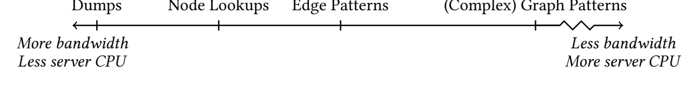

**图 37：** 知识图谱访问协议，从左侧的简单协议到右侧更复杂的协议。

*图内标签：Dumps = 数据转储；Node Lookups = 节点查找；Edge Patterns = 边模式；(Complex) Graph Patterns =（复杂）图模式。由左向右，带宽需求减少，服务器 CPU 需求增加；由右向左，带宽需求增加，服务器 CPU 需求减少。*

### 9.2. 访问协议

发布意味着允许公众与知识图谱交互，因此需要提供**访问协议**，规定主体可以提出哪些请求，以及预期得到什么响应。根据 FAIR 的可访问性原则，具体为 A1.1，协议应开放、免费且可普遍实现。

如图 37 所示，知识图谱有多种访问协议可选，从仅允许下载全部内容的简单协议，到接受并求值越来越复杂请求的协议。较简单协议要求发布数据的服务器执行较少计算；较复杂协议则允许请求更具体的数据，从而降低带宽消耗。知识图谱也可以提供多种协议，服务具有不同需求的主体 [536]。下面分别介绍。

#### 9.2.1. 数据转储

**数据转储（dump）**是包含知识图谱内容、可供下载的文件或文件集合。请求针对这些文件，响应是文件内容。发布转储首先需要用于序列化图的具体语法，最好采用标准语法。RDF 图已有基于 XML [172]、JSON [494]、定制语法 [422] 等多种标准语法，而属性图目前只有非标准语法 [523]。

其次，可应用压缩方法降低带宽需求。GZIP、BZip2 等标准压缩可以直接用于任何文件；专门针对图提出的压缩方法，不仅具有更高压缩比，还提供其他功能，例如紧凑索引，使文件下载后能高效查找 [156]。最后，图谱更新时，可计算和发布“差分”，避免客户端从头下载全部数据，见 [6, 395, 529]。

然而，数据转储只适用于某些场景，尤其适合需要保留完整本地副本的主体。若只想查询圣地亚哥的全部美食节，下载整个转储就需要传输和处理大量无关数据。

#### 9.2.2. 节点查找

节点查找协议接受节点标识符请求，例如图 36 中的 `cle:LP2018`，返回描述该节点的子图，例如文档 `cld:LP2018`。这种协议是前述关联数据原则的基础，节点查找通过 HTTP 解引用实现，使远程图中的节点可以从 Web 各处被引用。

对于应返回节点的哪些内容，有不同定义 [499]；常见惯例是返回包含节点所有出边，或所有关联边，包括入边与出边的子图 [250]。虽然简单，但可以在节点查找接口上实现图模式查询：根据特定图模式，从一个节点遍历到另一个 [219]。

例如，要查找圣地亚哥的所有美食节，图模式为：

```text
(?ff, type, Food Festival)
(?ff, location, Santiago)
```

可以先查找 `Santiago`，再查找每个通过 `location` 边连接到 `Santiago` 的节点，返回被声明为 `Food Festival` 类型的节点。不过，如果未指定起始节点，例如全部节点都是变量，或服务不返回入边，这种方法可能不可行。

此外，客户端可能请求多于所需的数据：查找 `Santiago` 返回的文档可能含大量无关内容，而且位于 `Santiago`、却不属于 `Food Festival` 的节点，仍需查找以检查类型。优点是，服务器支持节点查找的成本相对较低。

#### 9.2.3. 边模式

**边模式**在有向边标记图中也称**三元组模式**，是仅包含一条边的图模式。例如 `(?ff, type, Food Festival)`、`(?ff, location, Santiago)`，其中每个项都可以是变量或常量。边模式协议接受这样的模式，返回其全部解。

边模式比节点查找更灵活，因为图模式更容易分解成边模式，而非节点查找。对想查询圣地亚哥美食节的主体而言，可以先请求 `(?ff, location, Santiago)` 的解，再在本地将其与 `(?ff, type, Food Festival)` 的解连接或求交。某些模式，例如 `(?x, ?y, ?z)`，可能返回大量解，因此协议可以提供结果迭代或分页等实用功能 [537]。

与节点查找类似，服务器响应一次请求的成本较低且容易预测。然而，服务器可能向客户端传输无关的中间结果，例如上例中位于圣地亚哥、却不是美食节的节点。如果客户端不能获取统计信息，以规划最佳连接方式，这一问题会更加严重。例如，美食节很少、圣地亚哥的事物却很多时，与其求两种模式结果的交集，不如针对每个美食节请求它是否位于圣地亚哥；但作出这一选择需要图谱统计信息。

因此，已提出边模式协议扩展，以支持更高效的连接 [221]。例如，允许将一批解随边模式一起发送，服务器只返回与请求中这些解兼容的结果 [220]。具体可以发送一批 `(?ff, type, Food Festival)` 的解，与请求 `(?ff, location, Santiago)` 的解进行连接。

#### 9.2.4.（复杂）图模式

另一种方案是允许客户端提出基于（复杂）图模式的请求，见第 2.2 节，服务器只返回最终解。对贯穿本文的例子，客户端提出包含 `(?ff, type, Food Festival)` 和 `(?ff, location, Santiago)` 的请求，直接获得相关结果。

与此前协议相比，它在带宽方面高效得多：客户端可提出更具体请求，服务器可返回更具体响应。不过，带宽节省的代价，是服务器必须求值更加复杂的请求，而单次请求的成本更难预料。尽管已有多种优化引擎用于求值（复杂）图模式，例如 [144, 354, 520] 等，已知这类查询求值问题在计算上难解 [16]。

或许因此，提供此类协议的公共服务，多数支持 SPARQL 查询 [217]，往往出现停机、超时、部分结果和性能缓慢等问题 [75]。即便如此，流行服务每天仍接收并成功求值数百万请求或查询 [336, 457]，而最坏情形的困难实例在实践中罕见 [62]。

#### 9.2.5. 其他协议

图 37 明确列举了实践中常见的知识图谱访问协议，但当然还可以设想位于简单到复杂接口谱系中几乎任意位置的其他协议。在“（复杂）图模式”右侧，可以支持更加复杂的请求，例如带蕴涵的查询 [191]、允许递归的查询 [439]、可连接远程服务结果的联邦查询 [74]，甚至假设性地支持图灵完备请求，允许在知识图谱上运行任意过程式代码。如前所述，服务器也可选择支持多个互补协议 [536]。

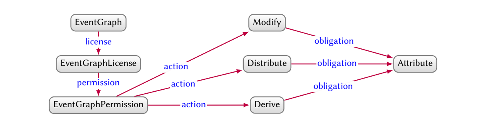

**图 38：** 将许可与活动数据关联，同时表示权限、行为和义务。

*图内标签：EventGraph = 活动图；EventGraphLicense = 活动图许可；EventGraphPermission = 活动图权限；license = 许可；permission = 权限；action = 行为；Distribute = 分发；Modify = 修改；Derive = 派生；obligation = 义务；Attribute = 署名。*

### 9.3. 使用控制

对于假设的旅游知识图谱，乍看之下，实现预期服务所需的知识似乎都是公开的，因此旅游局和游客均可使用。但仔细考察，会发现多种使用控制需求：（i）旅游局及合作伙伴应为贡献到图谱的知识关联适当许可，使各方明确使用条款；（ii）游客可能在手机上安装根据位置推荐景点的应用，带来隐私问题；（iii）旅游局可能需要向警察报告犯罪活动，因此需要加密个人信息；（iv）旅游局也可能以匿名形式分享旅游人口统计信息，支持改善重要线路的交通基础设施。因此，本节介绍知识图谱许可、使用策略、加密和匿名化方面的现有技术。

#### 9.3.1. 许可

将机器可读许可与知识图谱关联时，W3C 开放数字权利语言（ODRL）[261] 提供信息模型及相关词汇表，用于规定资产相关行为的权限、职责和禁止事项。ODRL 支持细粒度数字权利描述，它们本身表示为图，因此可嵌入图中。

图 38 展示一种许可：被授权者可以修改、分发 `EventGraph`（例如图 1），并基于它生成派生作品；但必须为版权持有人署名。从建模角度看，ODRL 可表示 Apache、Creative Commons（CC）和 Berkeley Software Distribution（BSD）等著名许可族 [80, 393]。此外，Cabrio 等 [80] 提出从非结构化文本自动提取机器可读许可的方法。

从推理角度看，许可兼容性验证与组合技术 [198, 360, 539] 可用于合并受不同许可约束的知识图谱。数据许可清理中心（DALICC）使用这类技术，包含标准机器可读许可库，以及让用户组合任意定制许可、验证不同许可兼容性的工具 [405]。

#### 9.3.2. 使用策略

基于边模式的访问控制策略，可以限制对知识图谱部分内容的访问 [162, 290, 435]。WebAccessControl（WAC）³¹ 是面向图的访问控制框架，使用 WebID 进行认证，并提供描述访问控制策略的词汇表。其词汇表扩展可表示隐私偏好 [453]，以及上下文约束 [105, 538]。虽然 ODRL 主要用于描述许可，近年也提出用于访问策略 [498] 和监管义务 [4, 122] 的配置文件，见 Kirrane 等的综述 [291]。

> **脚注 31：** WAC：[http://www.w3.org/wiki/WebAccessControl](http://www.w3.org/wiki/WebAccessControl)。

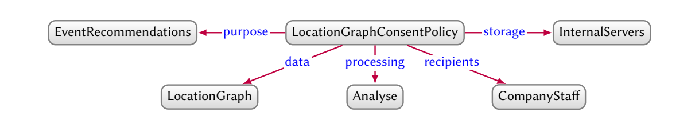

**图 39：** 关于知识图谱中位置数据子图的使用策略。

*图内标签：LocationGraphConsentPolicy = 位置图同意策略；Analyse = 分析；processing = 处理；EventRecommendations = 活动推荐；purpose = 目的；LocationGraph = 位置图；data = 数据；CompanyStaff = 公司员工；recipients = 接收者；InternalServers = 内部服务器；storage = 存储。*

作为访问策略的推广，**使用策略**规定数据可以如何使用：可执行哪些处理，由谁执行，为何种目的等。图 39 的策略规定，公司员工可以在内部服务器上分析位置图，以提供活动推荐。SPECIAL H2020 项目 [56] 和 W3C 数据隐私词汇表与控制社区组（DPVCG）[59, 394] 已提出描述使用策略的词汇表。策略制定后，可用于验证数据处理是否符合有关法律规范及数据主体提供的同意 [59, 124]。

#### 9.3.3. 加密

除了在内部控制使用，旅游局也可对发布图谱的部分内容使用加密机制，例如犯罪报告相关内容，并向应获明文访问权的合作伙伴提供密钥。直接方案是用一个密钥加密整个图或子图；更细粒度的加密则针对单个节点或边标签，可能通过不同密钥，让不同客户端访问不同信息 [187]。

CryptOntology [182] 还可将加密机制细节嵌入知识图谱。图 40 展示如何加密图 34 中报案人的姓名，存储密文 `zhk...kjg`，以及密钥长度和加密算法。

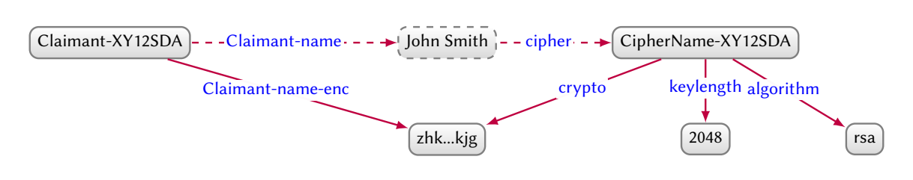

**图 40：** 将报案人姓名加密的有向边标记图。虚线表示明文元素，发布数据时可省略这些元素，也可一并省略加密细节。

*图内标签：Claimant-name = 报案人姓名；Claimant-name-enc = 加密的报案人姓名；cipher = 密文节点；crypto = 加密细节；keylength = 密钥长度；algorithm = 算法。John Smith、zhk...kjg、2048 和 rsa 均保持原值。*

为授予明文访问权，一种方法是用对称密钥加密单条边，使某些类型的边模式只有持有适当密钥的客户端才能执行 [281]。例如，知道报案人 ID `Claimant-XY12SDA` 且持有密钥的客户端，可通过模式 `(Claimant-XY12SDA, Claimant-name, ?name)`，仅查找该报案人的姓名。

不过，这种方法的重要局限是：为找到全部解，需要尝试解密所有边。更高效的替代方案，是将函数加密与专门索引结合，从加密图中检索解，而不必尝试解密全部边 [155]。

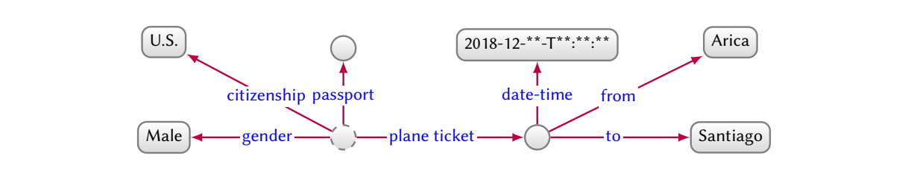

**图 41：** 描述航班乘客（虚线节点）的有向边标记图匿名化样本。

*图内标签：date-time = 日期时间；to = 目的地；from = 出发地；plane ticket = 机票；passport = 护照；gender = 性别；Male = 男性；citizenship = 国籍；U.S. = 美国。`2018-12-**-T**:**:**` 中的星号表示被抑制的日期时间细节。*

#### 9.3.4. 匿名化

假设旅游局获得个人在国内乘坐交通工具的信息，可以用来理解游客轨迹。然而，从数据保护角度看，宜从知识图谱中删除个人数据，避免泄露个人出行信息。

第一种匿名化方法，是基于 **k-匿名性** [459]³²、**l-多样性** [316]³³ 等，抑制和泛化图中知识，使个人无法被识别。在图上应用 k-匿名性的方法，会识别并抑制“准标识符”：这些准标识符可能让某个人与少于 k − 1 个其他人区分开来 [230, 429]。

图 41 展示航班乘客子图进行 k-匿名化后的一个可能结果。护照和机票等准标识符变为空白节点，确保乘客，即虚线空白节点，无法与 k − 1 个其他人区分。然而，在图中，利用邻居信息的**邻域攻击** [581] 也可破坏 k-匿名性。因此，我们还抑制航班的日和时间；虽然这些信息本身不敏感，却可能破坏乘客的匿名性，例如某航班上的美国男性少于 k 人。

更复杂的邻域攻击可能利用更抽象的图模式。即使所有节点和边标签都为空，仅根据图结构也可能去匿名化。例如，如果知道一支含 k − 1 名队员的团队共同乘飞机参加特定次数的客场比赛，可据此实施邻域攻击，揭示图中的这组队员。

因此，人们提出了一些专门针对图的保证，包括 **k-度匿名性** [321]，确保知道特定个体度数的攻击者无法将其去匿名化。方法对图作尽可能小的修改，使每个节点至少有 k − 1 个其他节点具有相同度数。

更强的 **k-同构邻域匿名性** [580]，可避免攻击者知道个体如何连接邻域节点时的攻击。通过修改图，使每个节点在图的其他位置，至少有 k − 1 个节点拥有同构、即结构相同的邻域。以上两种方法仅能防御了解有限邻域的攻击者。

更强的概念是 **k-自同构性** [584]，保证每个节点与 k − 1 个其他节点在结构上不可区分，从而避免任何基于结构信息的攻击。例如，k 团或 k 环满足 k-自同构性。许多图数据匿名化技术最初由社交网络场景驱动 [371]，但也能应用于知识图谱。Lin 和 Tripunitara [319] 将 k-自同构方法适配于有向边标记图，具体为 RDF 图。

> **脚注 32：** k-匿名性保证，某个人的数据无法与至少 k − 1 个其他人的数据区分。

> **脚注 33：** l-多样性保证，在每个个体组中，敏感数据字段至少具有 l 个不同值。这可以避免某些泄露，例如数据中来自奥地利的全部游客这一组人，都具有“遭扒窃”这一敏感属性。

上述方法对数据本身匿名化。第二种方法则在回答查询时匿名化，例如在解中添加噪声，同时保护隐私。

一种方法是对图查询应用 **ε-差分隐私** [137]³⁴ [483]。这类机制通常用于计数等聚合查询，通过添加噪声避免泄露个人信息。例如，可以统计某国籍乘客乘坐某航班的人数，并在计数中加入恰好足够的随机噪声，保证在由 ε 控制的一定概率范围内，无法判断某个特定个人是否乘坐该航班。对于常见国籍，所需噪声比例较低；对于罕见国籍，则需更多噪声来“隐藏”个人。

为了获得更强隐私保证，这些方法会损失信息，因此选择高度依赖应用。如果以数据转储方式完整发布匿名化数据，可以用 k-匿名性保护个人，用 l-多样性保护群体。另一方面，如果通过查询接口提供部分数据，ε-差分隐私更合适。

> **脚注 34：** ε-差分隐私保证：对加入随机噪声的数据执行某过程，例如查询，当数据包含或不包含任意某个人时，得到给定结果的概率相差不超过 e^ε 倍。

## 10. 实践中的知识图谱

本节介绍过去几年出现的一些最重要知识图谱。先讨论依据第 9 节指南与协议在 Web 上发布的开放知识图谱，再讨论企业为多种应用创建的企业知识图谱。

### 10.1. 开放知识图谱

**开放知识图谱**特指按照开放数据理念发布的知识图谱，即“开放意味着任何人都可以自由访问、使用、修改和分享，用于任何目的；最多只受保护来源信息及开放性的要求约束”。³⁵ 许多开放知识图谱以**关联开放数据集**形式发布 [226]，即遵循开放数据理念、按关联数据原则发布的 RDF 图，见第 9.1.2 节。

DBpedia [311]、YAGO [506]、Freebase [54] 和 Wikidata [543] 等著名开放知识图谱涵盖多个领域，表示多种实体与关系。下面依次介绍，再讨论已有开放知识图谱的其他具体领域。本节大多数开放图谱使用 RDF 建模，遵循关联数据原则发布，并通过数据转储（RDF）、节点查找（关联数据）、图模式（SPARQL），有时也通过边模式（三元组模式片段）提供数据访问。

> **脚注 35：** 参见 [Open Definition](http://opendefinition.org/)。

#### 10.1.1. DBpedia

DBpedia 项目旨在将 Wikipedia 条目中的半结构化数据，提取为图结构表示 [22]，使这些数据能够统一集成、处理和查询。所得知识图谱进一步通过链接外部开放资源丰富内容，包括图像、网页，以及 DailyMed、DrugBank、GeoNames、MusicBrainz、New York Times 和 WordNet 等外部数据集 [311]。

DBpedia 提取框架由多个组件构成，分别对应 Wikipedia 条目来源的抽象、图存储与序列化目的地、wiki 标记提取器、解析器和提取管理器 [48]。专用提取器处理标签、摘要、跨语言链接、图像、重定向、消歧页面、外部链接、内部页面链接、主页、类别和地理坐标。

DBpedia 内容不仅跨领域，也支持多语言：截至 2012 年，含有最多 97 种语言的标签和摘要 [348]。为满足不同应用需求，其实体采用四种模式分类 [48]：Wikipedia 类别的简单知识组织系统（SKOS）表示；下文将讨论的 YAGO 分类模式；上层映射与绑定交换层（UMBEL）本体分类模式；以及称为 DBpedia 本体的定制模式，包含 `Person`、`Place`、`Organisation`、`Work` 等类 [311]。DBpedia 还支持实时同步，以与不断变化的 Wikipedia 条目保持一致 [311]。

#### 10.1.2. Yet Another Great Ontology

YAGO 同样从 Wikipedia 提取图结构数据，再与 WordNet 层次结构统一，形成“高质量、高覆盖度、轻量且可扩展的本体” [506]。这一知识图谱旨在用于机器翻译、词义消歧、查询扩展、文档分类、数据清洗和信息集成等信息技术任务。

早期方法使用模式匹配、自然语言处理（NLP）和统计学习，自动从文本提取结构化知识，但结果质量往往不如人工构建 [506]。然而，人工构建成本高，难以实现广泛覆盖并保持数据更新。为兼顾覆盖度和质量，YAGO 与 DBpedia 类似，主要从 Wikipedia 信息框和类别页提取数据：前者包含实体基本信息，后者列出特定类别的条目。这些数据再与 WordNet 层次概念统一 [507]。

称为 **YAGO 模型**的模式提供由 RDFS 定义的词汇表，支持将词作为实体，表示同义性和歧义 [506]。模型还支持具体化、n 元关系和数据类型 [507]。YAGO 的精化机制包括：**规范化**，将每条边和节点映射到唯一标识符并删除重复元素；**类型检查**，删除无法通过演绎或归纳方法分配到某个类的节点 [507]。后续 YAGO 扩展支持时空上下文 [243] 和多语言 Wikipedia [333]。

#### 10.1.3. Freebase

Freebase 是人类知识的通用集合，旨在解决语义网去中心化带来的大规模信息集成问题，例如采用不均衡、实现困难和分布式查询性能限制 [55]。与主要从 Wikipedia 和 WordNet 提取数据的 DBpedia、YAGO 不同，Freebase 直接征集人工编辑者贡献。

Freebase 平台包含具有版本管理机制的可扩展数据存储；用于存储文本、图像和媒体文件的大对象存储（LOB）；支持 Metaweb 查询语言（MQL）的 API；Web 用户界面；以及轻量类型系统 [55]。类型系统为协作过程而设计。它不强制本体正确性或逻辑一致性，而采用松散的结构化机制集合，包括数据类型、语义类、属性、模式定义等，允许不兼容的类型与属性同时共存 [55]。

可通过 Web 界面交互式添加内容，也可利用 API 的写入功能自动添加。Google 于 2010 年收购 Freebase，其内容成为 2012 年公布的 Google 知识图谱的重要组成部分 [484]。2015 年 3 月 Freebase 转为只读时，包含超过 30 亿条边。此后大量内容迁移到 Wikidata [407]。

#### 10.1.4. Wikidata

如 DBpedia 和 YAGO 所利用的那样，Wikipedia 信息框、列表和表格等包含大量半结构化数据。但这些数据传统上需要在不同条目和语言间人工维护更新。例如，某智利足球运动员进球，可能需要在数百种语言版本的球员条目、赛事条目、球队条目、射手榜等处手工更新。

人工维护导致多种质量问题，包括不同条目和语言中的数据相互矛盾。因此，维基媒体基金会使用 Wikidata 作为集中、协作编辑的知识图谱，为 Wikipedia 及任意其他客户端提供数据。按照这一愿景，只需向 Wikidata 添加一次事实，就可能自动更新 Wikipedia 不同语言中的大量条目 [543]。

与 Wikipedia 一样，Wikidata 被视为二手来源，其**声明（claims）**应引用一手来源，但也允许先添加未附引用的声明 [415]。Wikidata 还允许通过可能相互矛盾、但各自附有来源的声明表达不同观点 [543]。

Wikidata 支持多语言。节点和边使用与语言无关的 `Qxx` 和 `Pxx` 代码，见图 36，再关联多语言标签、别名和描述 [277]，使声明能够以这些语言呈现。不仅数据层面允许协作编辑，模式层面也允许用户添加或修改子类、子属性、逆属性等轻量语义公理 [416]，以及形状 [60]。

Wikidata 提供多种访问协议 [336]，并获广泛采用：Wikipedia 用其生成部分领域的信息框 [456]，Google 支持它 [407]，Apple 的 Siri 等重要应用也将它作为数据来源 [336]。

#### 10.1.5. 其他开放跨领域知识图谱

多年来还开发了其他跨领域知识图谱。BabelNet [373] 类似 YAGO，以统一 WordNet 与 Wikipedia 为基础，但还集成 Wikidata 等图谱，重点是通过将 Wiktionary 和 OmegaWiki 等词典资源转为知识图谱，创建由多语言同义词集组织的多语言词汇形式图谱。

相较其他知识图谱，BabelNet 等词汇化图谱将 Wikipedia 中的百科知识，与通常见于单语、双语词典的词典信息结合。Cyc 项目 [314] 旨在以机器可读方式编码常识知识；自 1986 年以来，超过 900 人年的投入 [340] 用于创建 220 万个事实和规则。Cyc 虽为专有资源，但已发布称为 OpenCyc 的开放子集；更多细节可参阅 Färber 等对 DBpedia、Freebase、OpenCyc 和 YAGO 的比较 [153]。

永不停止的语言学习（NELL）项目 [357] 自 2010 年开始，使用开放信息抽取（OIE）方法从网页文本中提取了含 1.2 亿条边的图，见第 6 节。各开放知识图谱对不同来源采用本文所讨论语言与技术的不同组合，得到不同结果。

#### 10.1.6. 领域专用开放知识图谱

多个特定领域已经发布开放知识图谱。Schmachtenberg 等 [463] 在关联数据背景下，识别出以下主要领域：

- **媒体：** 新闻、电视、广播等，例如 BBC World Service Archive [431]。
- **政府：** 为透明度和发展发布数据，例如美国 [233]、英国 [475] 政府。
- **出版物：** 各学科学术文献，例如 OpenCitations [410]、SciGraph [260]、Microsoft Academic Knowledge Graph [152]。
- **地理：** 地点和区域，例如 LinkedGeoData [497]。
- **生命科学：** 蛋白质、基因、药物、疾病等，例如 Bio2RDF [82]。
- **用户生成内容：** 评论、开源项目等，例如 Revyu [227]。

其他领域包括文化遗产 [259]、音乐 [432]、法律 [359]、神学 [476]，乃至旅游 [13, 279, 328, 577]。预期应用与这些领域同样多样，但经常涉及集成 [82, 432]、推荐 [328, 432]、透明度 [233, 475]、归档 [259, 431]、去中心化 [227]、多语言支持 [476] 和监管合规 [359] 等。

### 10.2. 企业知识图谱

多家公司宣布创建专有的“企业知识图谱”，目标包括提升搜索能力 [87, 214, 298, 482, 484]、提供用户推荐 [87, 214]、实现对话式或个人智能体 [417]、增强定向广告 [224]、支持商业分析 [224]、连接用户 [224, 387]、扩展多语言支持 [224]、促进研究与发现 [37]、评估和降低风险 [112, 522]、追踪新闻事件 [347]、提高交通自动化程度 [234] 等。

尽管十分多样，Noy 等 [387] 的讨论指出，这些图谱遵循一些高层趋势：

1. 通常从多种内部与外部来源集成数据，常涉及文本。
2. 往往非常大，含数百万甚至数十亿节点和边，带来可扩展性挑战。
3. 初始图谱精化对提高质量很重要，例如添加新链接、合并重复实体。
4. 保持图谱随领域变化更新的技术，通常至关重要。
5. 经常组合本体表示与机器学习表示，或在不同情境分别使用它们，从图谱得出结论。
6. 本体趋于轻量，往往是表示类或概念层次的简单分类体系。

下面讨论部署企业知识图谱的主要行业。

#### 10.2.1. Web 搜索

Web 搜索引擎传统上将查询字符串与网页文档子字符串匹配。Google 知识图谱 [387, 484] 则倡导“事物而非字符串”的范式，类似语义搜索 [206]：搜索引擎尝试识别某次搜索所关注的实体，图谱描述这些实体及其相互关系。

主要面向用户的应用之一是“知识面板”，在部分搜索结果右侧显示窗口，描述用户似乎正在查找的主要实体，包括图像、属性-值对，以及用户还会搜索的相关实体列表。Google 知识图谱对推广“知识图谱”这一术语的现代用法具有关键作用，见附录 A。Microsoft Bing 等其他主要搜索引擎，也随后宣布类似的知识图谱 [482]。³⁶

> **脚注 36：** Microsoft 的知识图谱原先称为“Satori”，日语中意为“理解”。

#### 10.2.2. 商业

主要从事商品和服务销售或出租的公司，也宣布采用企业知识图谱。著名例子是 Amazon 的图谱 [132, 298]，描述线上市场销售的产品。其主要目标之一，是支持更高级的语义产品搜索，并改善推荐。

eBay [417] 的商业知识图谱编码产品描述和购物行为模式，驱动对话智能体，通过自然语言接口帮助用户找到相关产品。Airbnb [87] 的图谱描述出租住宿、地点、活动、体验、街区、用户和标签等，并在其上定义分类模式，为潜在客户推荐特定出租房屋附近的景点、事件和活动。

Uber [214] 也为 Uber Eats 配送服务宣布以食物和餐馆为中心的图谱。目标同样是为尚不清楚想找何种食物的用户，提供语义搜索和推荐。

#### 10.2.3. 社交网络

企业知识图谱也出现在社交网络服务中。Facebook [387] 创建图谱，不仅描述用户社交数据，也描述他们关注的名人、地点、电影和音乐等实体，以连接人们、理解兴趣并提供推荐。

LinkedIn [224] 的图谱包含用户、职位、技能、公司、地点和学校等，并定义分类模式。用途包括重要概念的多语言翻译、改善定向广告、增强职位与人员搜索，以及将职位推荐给合适的人，反之亦然。

Pinterest [195] 也创建图谱，描述用户及其兴趣，并以分类体系组织兴趣。主要用途是帮助用户更容易找到感兴趣的内容，并通过定向广告提高收入。

#### 10.2.4. 金融

金融领域也部署了企业知识图谱。Bloomberg [347] 的图谱支持金融数据分析，包括依据当前新闻报道与推文进行公司情感分析、问答服务，以及检测可能影响股票价值的新事件。

Thompson Reuters（Refinitiv）[522] 也宣布图谱，编码由个人、组织、股权工具、行业分类、合资与联盟、供应链等构成的“金融生态系统”，并用分类模式组织这些实体。其应用包括供应链监控、风险评估和投资研究。

知识图谱也用于演绎推理。意大利银行 Banca d’Italia [35] 通过规则推理确定不同利益相关者对公司的持股比例等。其他探索金融知识图谱的公司包括 Accenture [390]、Capital One [69] 和 Wells Fargo [377] 等。

#### 10.2.5. 其他行业

企业也在其他行业积极开发知识图谱以支持新应用：在**医疗保健**中，IBM 探索药物发现 [387] 及药品说明书信息提取 [179]，AstraZeneca [37] 用图谱推进基因组学研究和疾病理解；在**交通**中，Bosch 探索面向驾驶自动化的场景与地点图谱 [234]；在**石油天然气**中，Maana [112] 使用图谱进行数据集成，以降低油井和钻探风险。除此之外还有更多行业。

## 11. 总结与结论

我们对近年来日益受到关注的知识图谱，作了全面介绍。本文将其定义为：**旨在积累和传达现实世界知识的数据图，节点表示关注的实体，边表示实体之间的关系。** 在此定义下，我们讨论了将数据构建为图的模型；模式、身份和上下文的表示；演绎与归纳知识的利用；知识图谱创建、丰富、质量评估和精化方法；发布原则与标准；以及现实中的采用情况。

**未来方向。** 知识图谱研究可以成为不同领域技术的汇合点，共同目标是利用基于图的数据抽象，从大规模、多样化来源中提炼尽可能多的知识，进而创造价值 [246]。实现这一目标需要图数据库、知识表示、逻辑、机器学习、图算法与图论、本体工程、数据质量、自然语言处理、信息抽取、隐私安全等专业知识。

这些学科自身将继续发展并产生影响，其交叉领域也出现尤其有趣的主题。在**数据图与演绎知识**交叉处，我们强调属性图的形式语义：使用能考虑节点和边标签及属性-值对含义的语言 [302]；以及上下文数据上的推理与查询，从而得出在特定情境中成立的结论和结果 [252, 467, 583]。

在**数据图与归纳知识**交叉处，重要主题包括：**基于相似性的查询放宽**，依据嵌入等数值表示，为精确查询寻找近似答案 [548]；**形状归纳**，将图谱固有模式提取并形式化为约束 [350]；以及**上下文知识图谱嵌入**，提供随时间、地点等变化的节点和边数值表示 [282]。

在**演绎与归纳知识**交叉处，我们提到：**考虑蕴涵的知识图谱嵌入** [125, 207]，在计算合理性时纳入规则和／或本体；已被证明能执行类似高表达力本体语言复杂分类任务的**高表达力图神经网络** [32]；以及规则和公理挖掘的进一步发展，从图谱提取符号化、演绎式表示 [73, 169]。

除具体主题外，更一般的挑战包括：**可扩展性**，尤其针对演绎和归纳推理；**质量**，既涉及数据，也涉及从图谱归纳出的模型；**多样性**，例如管理上下文或多模态数据；**动态性**，涉及时间数据或流数据；以及提高采用率的关键因素——**易用性**。尽管不断有技术专门解决这些挑战，它们不太可能被完全“解决”；相反，它们是知识图谱及其技术、工具持续成熟的多个维度。

开放知识图谱质量持续改善，企业知识图谱也在各行业越来越广泛采用，因此未来研究有潜力推动社会多个方面的重要进步。本文仅突出其中一些值得研究的未来方向。

### 致谢

感谢 Dagstuhl“知识图谱”研讨会与会者的讨论，它们启发并影响了本文；也感谢使这类研讨会得以举办的所有人。感谢 Matteo Palmonari 对图 3、图 4 的反馈，以及 Stefan Decker 和 Carlos Bobed 对论文的建议。

Hogan 获 Fondecyt 资助，编号 1181896。Hogan 和 Gutierrez 获 ANID 千禧年科学计划资助，代码 ICN17_002。Cochez 在德国 Fraunhofer FIT 任职期间完成部分工作，之后获 Elsevier Discovery Lab 的部分资助。Kirrane、Ngonga Ngomo、Polleres 和 Staab 通过欧盟 Horizon 计划的 Marie Skłodowska-Curie 资助协议 860801，获得 KnowGraphs 项目经费。Kirrane 和 Polleres 获欧盟 Horizon 2020 研究与创新计划资助，编号 731601。

Labra 获西班牙经济与竞争力部资助，社会挑战项目 TIN2017-88877-R。Navigli 获欧盟 Horizon 2020 研究与创新计划下 MOUSSE ERC 资助，编号 726487。Rashid 通过 AI Horizons Network，获 IBM Research AI 支持。Schmelzeisen 获德国研究基金会（DFG）资助，编号 STA 572/18-1。

## 参考文献（保留英文原文）

[1] 2019. 7th International Conference on Learning Representations, ICLR 2019, New Orleans, LA, USA, May 6-9, 2019 . OpenReview.net. https://openreview.net/group?id=ICLR.cc/2019/conference

[2] Karl Aberer, Key-Sun Choi, Natasha Fridman Noy, Dean Allemang, Kyung-Il Lee, Lyndon J. B. Nixon, Jennifer Golbeck, Peter Mika, Diana Maynard, Riichiro Mizoguchi, Guus Schreiber, and Philippe Cudré-Mauroux (Eds.). 2007. The Semantic Web, 6th International Semantic Web Conference, 2nd Asian Semantic Web Conference, ISWC 2007 + ASWC 2007, Busan, Korea, November 11-15, 2007 . Lecture Notes in Computer Science, Vol. 4825. Springer.

[3] Serge Abiteboul. 1997. Querying Semi-Structured Data. In Database Theory - ICDT ’97, 6th International Conference, Delphi, Greece, January 8-10, 1997, Proceedings (Lecture Notes in Computer Science) , Foto N. Afrati and Phokion G. Kolaitis (Eds.), Vol. 1186. Springer, 1–18. https://doi.org/10.1007/3-540-62222-5_33

[4] Sushant Agarwal, Simon Steyskal, Franjo Antunovic, and Sabrina Kirrane. 2018. Legislative Compliance Assessment: Framework, Model and GDPR Instantiation. In Privacy Technologies and Policy - 6th Annual Privacy Forum, APF 2018, Barcelona, Spain, June 13-14, 2018, Revised Selected Papers (Lecture Notes in Computer Science) , Manel Medina, Andreas Mitrakas, Kai Rannenberg, Erich Schweighofer, and Nikolaos Tsouroulas (Eds.), Vol. 11079. Springer, 131–149.

[5] Rakesh Agrawal, Tomasz Imieliński, and Arun Swami. 1993. Mining association rules between sets of items in large databases. In Proceedings of the 1993 ACM SIGMOD International Conference on Management of Data, Washington, DC, USA, May 26-28, 1993 , Peter Buneman and Sushil Jajodia (Eds.). ACM Press, 207–216.

[6] Jinhyun Ahn, Dong-Hyuk Im, Jae-Hong Eom, Nansu Zong, and Hong-Gee Kim. 2015. G-Diff: A Grouping Algorithm for RDF Change Detection on MapReduce. In Semantic Technology - 4th Joint International Conference, JIST 2014, Chiang Mai, Thailand, November 9-11, 2014. Revised Selected Papers (Lecture Notes in Computer Science) , Thepchai Supnithi, Takahira Yamaguchi, Jeff Z. Pan, Vilas Wuwongse, and Marut Buranarach (Eds.), Vol. 8943. Springer, 230–235.

[7] Adnan Akhter, Axel-Cyrille Ngonga Ngomo, and Muhammad Saleem. 2018. An Empirical Evaluation of RDF Graph Partitioning Techniques. In Knowledge Engineering and Knowledge Management - 21st International Conference, EKA W 2018, Nancy, France, November 12-16, 2018, Proceedings (Lecture Notes in Computer Science) , Catherine Faron-Zucker, Chiara Ghidini, Amedeo Napoli, and Yannick Toussaint (Eds.), Vol. 11313. Springer, 3–18.

[8] Tareq Al-Moslmi, Marc Gallofré Ocaña, Andreas L. Opdahl, and Csaba Veres. 2020. Named Entity Extraction for Knowledge Graphs: A Literature Overview. IEEE Access 8 (2020), 32862–32881. https://doi.org/10.1109/ACCESS.2020. 2973928

[9] Harith Alani, Lalana Kagal, Achille Fokoue, Paul T. Groth, , Josian Xavier Parreira, Lora Aroyo, Natasha Fridman Noy, Christopher A. Welty, and Krzysztof Janowicz (Eds.). 2013.The Semantic Web - ISWC 2013 - 12th International Semantic Web Conference, Sydney, NSW, Australia, October 21-25, 2013, Proceedings, Part II . Lecture Notes in Computer Science, Vol. 8219. Springer.

[10] Harith Alani, Lalana Kagal, Achille Fokoue, Paul T. Groth, , Josian Xavier Parreira, Lora Aroyo, Natasha Fridman Noy, Christopher A. Welty, and Krzysztof Janowicz (Eds.). 2013.The Semantic Web - ISWC 2013 - 12th International Semantic Web Conference, Sydney, NSW, Australia, October 21-25, 2013, Proceedings, Part I . Lecture Notes in Computer Science, Vol. 8218. Springer.

[11] Keith Alexander, Richard Cyganiak, Michael Hausenblas, and Jun Zhao. 2009. Describing Linked Datasets. In Proceedings of the WWW2009 Workshop on Linked Data on the Web, LDOW 2009, Madrid, Spain, April 20, 2009 (CEUR Workshop Proceedings), Christian Bizer, Tom Heath, Tim Berners-Lee, and Michael Hausenblas (Eds.), Vol. 538. Sun SITE Central Europe (CEUR), 10. http://ceur-ws.org/Vol-538/ldow2009_paper20.pdf

[12] Gustavo Alonso, José A. Blakeley, and Arbee L. P. Chen (Eds.). 2008. Proceedings of the 24th International Conference on Data Engineering, ICDE 2008, April 7-12, 2008, Cancún, Mexico . IEEE Computer Society.

[13] Ricardo Alonso Maturana, Elena Alvarado-Cortes, Susana López-Sola, María Ortega Martínez-Losa, and Pablo Hermoso-González. 2018. La Rioja Turismo: The Construction and Exploitation of a Queryable Tourism Knowledge Graph. In Current Trends in Web Engineering - ICWE 2018 International Workshops, MATWEP, EnWot, KD-WEB, WEOD, TourismKG, Cáceres, Spain, June 5, 2018, Revised Selected Papers (Lecture Notes in Computer Science) , Cesare Pautasso, Fernando Sánchez-Figueroa, Kari Systä, and Juan Manuel Murillo Rodriguez (Eds.), Vol. 11153. Springer, 213–220.

[14] Renzo Angles. 2018. The Property Graph Database Model. In Proceedings of the 12th Alberto Mendelzon International Workshop on Foundations of Data Management, Cali, Colombia, May 21–25, 2018 (CEUR Workshop Proceedings) , Dan Olteanu and Barbara Poblete (Eds.), Vol. 2100. Sun SITE Central Europe (CEUR), 10. http://ceur-ws.org/Vol- 2100/paper26.pdf

[15] Renzo Angles, Marcelo Arenas, Pablo Barceló, Peter A. Boncz, George H. L. Fletcher, Claudio Gutierrez, Tobias Lindaaker, Marcus Paradies, Stefan Plantikow, Juan F. Sequeda, Oskar van Rest, and Hannes Voigt. 2018. G-CORE: A Core for Future Graph Query Languages, See [117], 1421–1432.

[16] Renzo Angles, Marcelo Arenas, Pablo Barceló, Aidan Hogan, Juan L. Reutter, and Domagoj Vrgoc. 2017. Foundations of Modern Query Languages for Graph Databases. ACM Computing Surveys 50, 5 (2017), 68:1–68:40. https: //doi.org/10.1145/3104031

[17] Renzo Angles and Claudio Gutiérrez. 2008. Survey of graph database models. ACM Computing Surveys 40, 1 (2008), 1:1–1:39. https://doi.org/10.1145/1322432.1322433

[18] Renzo Angles, Harsh Thakkar, and Dominik Tomaszuk. 2019. RDF and Property Graphs Interoperability: Status and Issues, See [249], 11. http://ceur-ws.org/Vol-2369/paper01.pdf

[19] Mikel Egaña Aranguren, Erick Antezana, Martin Kuiper, and Robert Stevens. 2008. Ontology Design Patterns for bio- ontologies: a case study on the Cell Cycle Ontology. BMC Bioinformatics 9, 5 (2008), S1. https://doi.org/10.1186/1471- 2105-9-S5-S1

[20] Marcelo Arenas, Alexandre Bertails, Eric Prud’hommeaux, and Juan Sequeda. 2012.A Direct Mapping of Relational Data to RDF, W3C Recommendation 27 September 2012 . W3C Recommendation. World Wide Web Consortium. https://www.w3.org/TR/2012/REC-rdb-direct-mapping-20120927/

[21] Alessandro Artale, Diego Calvanese, Roman Kontchakov, and Michael Zakharyaschev. 2009. The DL-Lite Family and Relations. Journal of Artificial Intelligence Research 36 (2009), 1–69.

[22] Sören Auer, Christian Bizer, Georgi Kobilarov, Jens Lehmann, Richard Cyganiak, and Zachary Ives. 2007. DBpedia: A Nucleus for a Web of Open Data, See [2], 722–735.

[23] Franz Baader, Ian Horrocks, Carsten Lutz, and Ulrike Sattler. 2017. An Introduction to Description Logic . Cambridge University Press, Cambridge, United Kingdom.

[24] Nguyen Bach and Sameer Badaskar. 2007. A Review of Relation Extraction . Technical Report. Carnegie Mellon University.

[25] Ricardo Baeza-Yates. 2018. Bias on the Web. Communications of the ACM 61, 6 (2018), 54–61. https://doi.org/10.1145/ 3209581

[26] Collin F. Baker, Charles J. Fillmore, and John B. Lowe. 1998. The Berkeley FrameNet Project. In36th Annual Meeting of the Association for Computational Linguistics and 17th International Conference on Computational Linguistics, COLING- ACL’98, August 10-14, 1998, Université de Montréal, Montréal, Quebec, Canada. Proceedings of the Conference , Christian Boitet and Pete Whitelock (Eds.). Morgan Kaufmann, 86–90.

[27] René Ronald Bakker. 1987.Knowledge Graphs: Representation and Structuring of Scientific Knowledge. Ph.D. Dissertation. University of Twente.

[28] Ivana Balazevic, Carl Allen, and Timothy M. Hospedales. 2019. Hypernetwork Knowledge Graph Embeddings. In Artificial Neural Networks and Machine Learning - ICANN 2019 - 28th International Conference on Artificial Neural Networks, Munich, Germany, September 17-19, 2019, Proceedings - Workshop and Special Sessions (Lecture Notes in Computer Science), Igor V. Tetko, Vera Kurková, Pavel Karpov, and Fabian J. Theis (Eds.), Vol. 11731. Springer, 553–565.

[29] Ivana Balazevic, Carl Allen, and Timothy M. Hospedales. 2019. Multi-relational Poincaré Graph Embeddings, See [546], 4465–4475. http://papers.nips.cc/book/advances-in-neural-information-processing-systems-32-2019

[30] Ivana Balazevic, Carl Allen, and Timothy M. Hospedales. 2019. TuckER: Tensor Factorization for Knowledge Graph Completion. In Proceedings of the 2019 Conference on Empirical Methods in Natural Language Processing and the 9th International Joint Conference on Natural Language Processing, EMNLP-IJCNLP 2019, Hong Kong, China, November 3-7, 2019, Kentaro Inui, Jing Jiang, Vincent Ng, and Xiaojun Wan (Eds.). The Association for Computational Linguistics, 5184–5193. https://aclweb.org/anthology/volumes/D19-1/

[31] Michele Banko, Michael J. Cafarella, Stephen Soderland, Matthew Broadhead, and Oren Etzioni. 2007. Open Infor- mation Extraction from the Web. In IJCAI 2007, Proceedings of the 20th International Joint Conference on Artificial Intelligence, Hyderabad, India, January 6-12, 2007 , Manuela M. Veloso (Ed.). AAAI Press, 2670–2676.

[32] Pablo Barceló, Egor V. Kostylev, Mikael Monet, Jorge Peréz, Juan Reutter, and Juan Pablo Silva. 2020. The Logical Expressiveness of Graph Neural Networks. In 8th International Conference on Learning Representations, ICLR 2020, Addis Ababa, Ethiopia, April 26–30, 2020 . OpenReview.net, 20. https://openreview.net/forum?id=r1lZ7AEKvB

[33] Carlo Batini, Anisa Rula, Monica Scannapieco, and Gianluigi Viscusi. 2015. From Data Quality to Big Data Quality. Journal of Database Management 26, 1 (2015), 60–82. https://doi.org/10.4018/JDM.2015010103

[34] Carlo Batini and Monica Scannapieco. 2016. Data and Information Quality - Dimensions, Principles and Techniques . Springer.

[35] Luigi Bellomarini, Daniele Fakhoury, Georg Gottlob, and Emanuel Sallinger. 2019. Knowledge Graphs and Enterprise AI: The Promise of an Enabling Technology, See [262], 26–37.

[36] Luigi Bellomarini, Emanuel Sallinger, and Georg Gottlob. 2018. The Vadalog System: Datalog-based Reasoning for Knowledge Graphs. Proceedings of the VLDB Endowment 11, 9 (2018), 975–987.

[37] Claus Bendtsen and Slavé Petrovski. 2019. How data and AI are helping unlock the secrets of disease. AstraZeneca Blog. https://www.astrazeneca.com/what-science-can-do/labtalk-blog/uncategorized/how-data-and-ai-are-helping- unlock-the-secrets-of-disease.html.

[38] Samy Bengio, Hanna M. Wallach, Hugo Larochelle, Kristen Grauman, Nicolò Cesa-Bianchi, and Roman Garnett (Eds.). 2018. Advances in Neural Information Processing Systems 31: Annual Conference on Neural Information Processing Systems 2018, NeurIPS 2018, 3-8 December 2018, Montréal, Canada . http://papers.nips.cc/book/advances-in-neural- information-processing-systems-31-2018

[39] Yoshua Bengio and Yann LeCun (Eds.). 2013. 1st International Conference on Learning Representations, ICLR 2013, Scottsdale, Arizona, USA, May 2-4, 2013, Workshop Track Proceedings . OpenReview.net. https://openreview.net/group? id=ICLR.cc/2013

[40] Michael K. Bergman. 2019. A Common Sense View of Knowledge Graphs. Adaptive Information, Adaptive Innovation, Adaptive Infrastructure Blog. http://www.mkbergman.com/2244/a-common-sense-view-of-knowledge-graphs/.

[41] Tim Berners-Lee. 2006. Linked Data. W3C Design Issues. https://www.w3.org/DesignIssues/LinkedData.html.

[42] Tim Berners-Lee and Dan Connolly. 2011. Notation3 (N3): A readable RDF syntax, W3C Team Submission 28 March 2011. W3C Team Submission. World Wide Web Consortium. https://www.w3.org/TeamSubmission/2011/SUBM-n3- 20110328/

[43] Tim Berners-Lee, James Hendler, and Ora Lassila. 2001. The Semantic Web. Scientific American 284, 5 (May 2001), 34–43.

[44] Abraham Bernstein, David R. Karger, Tom Heath, Lee Feigenbaum, Diana Maynard, Enrico Motta, and Krishnaprasad Thirunarayan (Eds.). 2009. The Semantic Web - ISWC 2009, 8th International Semantic Web Conference, ISWC 2009, Chantilly, V A, USA, October 25-29, 2009. Proceedings. Lecture Notes in Computer Science, Vol. 5823. Springer.

[45] Anant P. Bhardwaj, Souvik Bhattacherjee, Amit Chavan, Amol Deshpande, Aaron J. Elmore, Samuel Madden, and Aditya G. Parameswaran. 2015. DataHub: Collaborative Data Science & Dataset Version Management at Scale, See [92], 7. http://cidrdb.org/cidr2015/Papers/CIDR15_Paper18.pdf

[46] Daniel M. Bikel, Richard M. Schwartz, and Ralph M. Weischedel. 1999. An Algorithm that Learns What’s in a Name. Machine Learning 34, 1–3 (1999), 211–231.

[47] Stefan Bischof, Stefan Decker, Thomas Krennwallner, Nuno Lopes, and Axel Polleres. 2012. Mapping between RDF and XML with XSPARQL. Journal of Web Semantics 1, 3 (2012), 147–185.

[48] Christian Bizer, Jens Lehmann, Georgi Kobilarov, Sören Auer, Christian Becker, Richard Cyganiak, and Sebastian Hellmann. 2009. DBpedia-A crystallization point for the Web of Data. Journal of Web Semantics 7, 3 (2009), 154–165.

[49] Eva Blomqvist, Paolo Ciancarini, Francesco Poggi, and Fabio Vitali (Eds.). 2016.Knowledge Engineering and Knowledge Management - 20th International Conference, EKA W 2016, Bologna, Italy, November 19-23, 2016, Proceedings . Lecture Notes in Computer Science, Vol. 10024. Springer.

[50] Eva Blomqvist, Karl Hammar, and Valentina Presutti. 2016. Engineering Ontologies with Patterns – The eXtreme Design Methodology. In Ontology Engineering with Ontology Design Patterns , Pascal Hitzler, Aldo Gangemi, Krzysztof Janowicz, Adila Krisnadhi, and Valentina Presutti (Eds.). Studies on the Semantic Web, Vol. 25. IOS Press.

[51] Eva Blomqvist, Diana Maynard, Aldo Gangemi, Rinke Hoekstra, Pascal Hitzler, and Olaf Hartig (Eds.). 2017. The Semantic Web - 14th International Conference, ESWC 2017, Portorož, Slovenia, May 28 - June 1, 2017, Proceedings, Part I . Lecture Notes in Computer Science, Vol. 10249. Springer.

[52] Eva Blomqvist and Kurt Sandkuhl. 2005. Patterns in Ontology Engineering: Classification of Ontology Patterns. In ICEIS 2005, Proceedings of the Seventh International Conference on Enterprise Information Systems, Miami, USA, May 25-28, 2005, Chin-Sheng Chen, Joaquim Filipe, Isabel Seruca, and José Cordeiro (Eds.), Vol. 3. 413–416.

[53] Eva Blomqvist, Azam Seil Sepour, and Valentina Presutti. 2012. Ontology Testing - Methodology and Tool. In Knowledge Engineering and Knowledge Management - 18th International Conference, EKA W 2012, Galway City, Ireland, October 8-12, 2012. Proceedings (Lecture Notes in Computer Science) , Annette ten Teije, Johanna Völker, Siegfried Handschuh, Heiner Stuckenschmidt, Mathieu d’Aquin, Andriy Nikolov, Nathalie Aussenac-Gilles, and Nathalie Hernandez (Eds.), Vol. 7603. Springer, 216–226.

[54] Kurt Bollacker, Robert Cook, and Patrick Tufts. 2007. Freebase: A Shared Database of Structured General Human Knowledge. In Proceedings of the Twenty-Second AAAI Conference on Artificial Intelligence, July 22-26, 2007, Vancouver, British Columbia, Canada. AAAI Press, 1962–1963.

[55] Kurt Bollacker, Patrick Tufts, Tomi Pierce, and Robert Cook. 2007. A platform for scalable, collaborative, structured information integration. In Intl. Workshop on Information Integration on the Web (IIWeb’07), Ullas Nambiar and Zaiqing Nie (Eds.). 6.

[56] Piero Bonatti, Sabrina Kirrane, Iliana Mineva Petrova, Luigi Sauro, and Eva Schlehahn. 2019.The SPECIAL Usage Policy Language, V1.0. Draft. Vienna University of Economics and Business. https://ai.wu.ac.at/policies/policylanguage/

[57] Piero Andrea Bonatti, Stefan Decker, Axel Polleres, and Valentina Presutti. 2018. Knowledge Graphs: New Directions for Knowledge Representation on the Semantic Web (Dagstuhl Seminar 18371). Dagstuhl Reports 8, 9 (2018), 29–111.

[58] Piero A. Bonatti, Aidan Hogan, Axel Polleres, and Luigi Sauro. 2011. Robust and scalable Linked Data reasoning incorporating provenance and trust annotations. Journal of Web Semantics 9, 2 (2011), 165–201.

[59] Piero A. Bonatti and Sabrina Kirrane. 2019. Big Data and Analytics in the Age of the GDPR. In 2019 IEEE International Congress on Big Data, BigData Congress 2019, Milan, Italy, July 8-13, 2019 , Elisa Bertino, Carl K. Chang, Peter Chen, Ernesto Damiani, Michael Goul, and Katsunori Oyama (Eds.). IEEE Computer Society, 7–16.

[60] Iovka Boneva, Jérémie Dusart, Daniel Fernández-Álvarez, and José Emilio Labra Gayo. 2019. Shape Designer for ShEx and SHACL constraints, See [505], 269–272. http://ceur-ws.org/Vol-2456

[61] Iovka Boneva, Jose Emilio Labra Gayo, and Eric G. Prud’hommeaux. 2017. Semantics and Validation of Shapes Schemas for RDF, See [113], 104–120.

[62] Angela Bonifati, Wim Martens, and Thomas Timm. 2017. An Analytical Study of Large SPARQL Query Logs. Proceedings of the VLDB Endowment 11, 2 (2017), 149–161.

[63] Antoine Bordes, Nicolas Usunier, Alberto García-Durán, Jason Weston, and Oksana Yakhnenko. 2013. Translating Embeddings for Modeling Multi-relational Data, See [79], 2787–2795. http://papers.nips.cc/book/advances-in-neural- information-processing-systems-26-2013

[64] Gerlof Bouma. 2009. Normalized (Pointwise) Mutual Information in Collocation Extraction. In Von der Form zur Bedeutung: Texte automatisch verarbeiten - From Form to Meaning: Processing Texts Automatically, Proceedings of the Biennial GSCL Conference 2009 , Christian Chiarcos, Richard Eckart de Castilho, and Manfred Stede (Eds.). Gunter Narr Verlag, 31–40.

[65] Jacqueline Bourdeau, Jim Hendler, Roger Nkambou, Ian Horrocks, and Ben Y. Zhao (Eds.). 2016. Proceedings of the 25th International Conference on World Wide Web, WWW 2016, Montreal, Canada, April 11-15, 2016, Companion Volume . ACM Press.

[66] Ronald J. Brachman. 1977. A structural paradigm for representing knowledge . Ph.D. Dissertation. Harvard University.

[67] Ronald J. Brachman and Hector J. Levesque. 1986. The Knowledge Level of a KBMS. InOn Knowledge Base Management Systems: Integrating Artificial Intelligence and Database Technologies, Book resulting from the Islamorada Workshop 1985 (Islamorada, FL, USA) (Topics in Information Systems) , Michael L. Brodie and John Mylopoulos (Eds.). Springer, 9–12.

[68] Ronald J. Brachman and James G. Schmolze. 1985. An Overview of the KL-ONE Knowledge Representation System. Cognitive Science 9, 2 (1985), 171–216.

[69] Patricia Branum and Bethany Sehon. 2019. Knowledge Graph Pilot Improves Data Quality While Providing a Customer 360 View. In Knowledge Graph Conference. (Invited talk).

[70] Dan Brickley and R. V. Guha. 2014. RDF Schema 1.1, W3C Recommendation 25 February 2014 . W3C Recommendation. World Wide Web Consortium. https://www.w3.org/TR/2014/REC-rdf-schema-20140225/

[71] Joan Bruna, Wojciech Zaremba, Arthur Szlam, and Yann LeCun. 2014. Spectral Networks and Locally Connected Networks on Graphs. In 2nd International Conference on Learning Representations, ICLR 2014, Banff, AB, Canada, April 14-16, 2014, Conference Track Proceedings , Yoshua Bengio and Yann LeCun (Eds.). OpenReview.net. https: //openreview.net/group?id=ICLR.cc/2014

[72] Bruce G. Buchanan and Edward A. Feigenbaum. 1978. Dendral and Meta-Dendral: Their Applications Dimension. Artificial Intelligence 11, 1–2 (1978), 5–24.

[73] Lorenz Bühmann, Jens Lehmann, and Patrick Westphal. 2016. DL-Learner – A framework for inductive learning on the Semantic Web. Journal of Web Semantics 39 (2016), 15–24. https://doi.org/10.1016/j.websem.2016.06.001

[74] Carlos Buil Aranda, Marcelo Arenas, Óscar Corcho, and Axel Polleres. 2013. Federating queries in SPARQL 1.1: Syntax, semantics and evaluation. Journal of Web Semantics 18, 1 (2013), 1–17.

[75] Carlos Buil-Aranda, Aidan Hogan, Jürgen Umbrich, and Pierre-Yves Vandenbussche. 2013. SPARQL Web-Querying Infrastructure: Ready for Action?, See [9], 277–293.

[76] Paul Buitelaar, Philipp Cimiano, and Bernardo Magnini (Eds.). 2005. Ontology learning from text: methods, evaluation and applications. Frontiers in Artificial Intelligence and Applications, Vol. 123. IOS Press.

[77] Razvan C. Bunescu and Raymond J. Mooney. 2005. Subsequence Kernels for Relation Extraction. InAdvances in Neural Information Processing Systems 18 [Neural Information Processing Systems, NIPS 2005, December 5-8, 2005, Vancouver, British Columbia, Canada], Christopher J. C. Burges, Léon Bottou, Zoubin Ghahramani, and Kilian Q. Weinberger (Eds.). 171–178. http://papers.nips.cc/book/advances-in-neural-information-processing-systems-18-2005

[78] Razvan C. Bunescu and Raymond J. Mooney. 2007. Learning to Extract Relations from the Web using Minimal Supervision. In ACL 2007, Proceedings of the 45th Annual Meeting of the Association for Computational Linguistics, June 23-30, 2007, Prague, Czech Republic , John A. Carroll, Antal van den Bosch, and Annie Zaenen (Eds.). The Association for Computational Linguistics, 576–583.

[79] Christopher J. C. Burges, Léon Bottou, Zoubin Ghahramani, and Kilian Q. Weinberger (Eds.). 2013.Advances in Neural Information Processing Systems 26: 27th Annual Conference on Neural Information Processing Systems 2013. Proceedings of a meeting held December 5-8, 2013, Lake Tahoe, Nevada, United States . http://papers.nips.cc/book/advances-in- neural-information-processing-systems-26-2013

[80] Elena Cabrio, Alessio Palmero Aprosio, and Serena Villata. 2014. These Are Your Rights - A Natural Language Processing Approach to Automated RDF Licenses Generation, See [421], 255–269.

[81] Michael J. Cafarella, Alon Y. Halevy, Daisy Zhe Wang, Eugene Wu, and Yang Zhang. 2008. WebTables: exploring the power of tables on the web. Proceedings of the VLDB Endowment 1, 1 (2008), 538–549.

[82] Alison Callahan, Jose Cruz-Toledo, Peter Ansell, and Michel Dumontier. 2013. Bio2RDF Release 2: Improved Coverage, Interoperability and Provenance of Life Science Linked Data, See [94], 200–212.

[83] Nicholas J. Car, Paul J. Box, and Ashley Sommer. 2019. The Location Index: A Semantic Web Spatial Data Infrastructure, See [237], 543–557.

[84] Šejla Čebirić, François Goasdoué, Haridimos Kondylakis, Dimitris Kotzinos, Ioana Manolescu, Georgia Troullinou, and Mussab Zneika. 2019. Summarizing semantic graphs: a survey. The Very Large Data Base Journal 28, 3 (2019), 295–327.

[85] Stefano Ceri, Georg Gottlob, and Letizia Tanca. 1989. What you Always Wanted to Know About Datalog (And Never Dared to Ask). IEEE Transactions on Knowledge and Data Engineering 1, 1 (1989), 146–166.

[86] Pierre-Antoine Champin, Fabien L. Gandon, Mounia Lalmas, and Panagiotis G. Ipeirotis (Eds.). 2018. Proceedings of the 2018 World Wide Web Conference on World Wide Web, WWW 2018, Lyon, France, April 23-27, 2018 . ACM Press.

[87] Spencer Chang. 2018. Scaling Knowledge Access and Retrieval at Airbnb. AirBnB Medium Blog. https://medium. com/airbnb-engineering/scaling-knowledge-access-and-retrieval-at-airbnb-665b6ba21e95.

[88] Laura Chiticariu, Marina Danilevsky, Yunyao Li, Frederick Reiss, and Huaiyu Zhu. 2018. SystemT: Declarative Text Understanding for Enterprise. In Proceedings of the 2018 Conference of the North American Chapter of the Association for Computational Linguistics: Human Language Technologies, NAACL-HLT 2018, New Orleans, Louisiana, USA, June 1-6, 2018, Volume 3 (Industry Papers) , Srinivas Bangalore, Jennifer Chu-Carroll, and Yunyao Li (Eds.). The Association for Computational Linguistics, 76–83.

[89] Laura Chiticariu, Yunyao Li, and Frederick R. Reiss. 2013. Rule-Based Information Extraction is Dead! Long Live Rule-Based Information Extraction Systems!. In Proceedings of the 2013 Conference on Empirical Methods in Natural Language Processing, EMNLP 2013, 18-21 October 2013, Grand Hyatt Seattle, Seattle, Washington, USA, A meeting of SIGDAT, a Special Interest Group of the ACL . The Association for Computational Linguistics, 827–832. https: //www.aclweb.org/anthology/volumes/D13-1/

[90] Chin-Wan Chung, Andrei Z. Broder, Kyuseok Shim, and Torsten Suel (Eds.). 2014. 23rd International World Wide Web Conference, WWW ’14, Seoul, Republic of Korea, April 7-11, 2014 . ACM Press.

[91] Giovanni Luca Ciampaglia, Prashant Shiralkar, Luis M Rocha, Johan Bollen, Filippo Menczer, and Alessandro Flammini. 2015. Computational fact checking from knowledge networks. PLOS One 10, 6 (2015), e0128193.

[92] CIDR 2015. CIDR 2015, Seventh Biennial Conference on Innovative Data Systems Research, Asilomar, CA, USA, January 4-7, 2015, Online Proceedings . www.cidrdb.org.

[93] Philipp Cimiano. 2006. Ontology Learning from Text. In Ontology Learning and Population from Text: Algorithms, Evaluation and Applications. Springer, Chapter 3, 19–34.

[94] Philipp Cimiano, Óscar Corcho, Valentina Presutti, Laura Hollink, and Sebastian Rudolph (Eds.). 2013. The Semantic Web: Semantics and Big Data, 10th International Conference, ESWC 2013, Montpellier, France, May 26-30, 2013. Proceedings. Lecture Notes in Computer Science, Vol. 7882. Springer.

[95] Michael Cochez, Petar Ristoski, Simone Paolo Ponzetto, and Heiko Paulheim. 2017. Biased Graph Walks for RDF Graph Embeddings. In Proceedings of the 7th International Conference on Web Intelligence, Mining and Semantics, WIMS 2017, Amantea, Italy, June 19-22, 2017 , Rajendra Akerkar, Alfredo Cuzzocrea, Jannong Cao, and Mohand-Said Hacid (Eds.). ACM Press, Article 21, 12 pages.

[96] Michael Cochez, Petar Ristoski, Simone Paolo Ponzetto, and Heiko Paulheim. 2017. Global RDF Vector Space Embeddings, See [113], 190–207.

[97] Diego Collarana, Mikhail Galkin, Christoph Lange, Irlán Grangel-González, Maria-Esther Vidal, and Sören Auer. 2016. FuhSen: A Federated Hybrid Search Engine for Building a Knowledge Graph On-Demand (Short Paper), See [123], 752–761.

[98] Michael Collins and Yoram Singer. 1999. Unsupervised Models for Named Entity Classification. In Joint SIGDAT Conference on Empirical Methods in Natural Language Processing and Very Large Corpora, EMNLP 1999, College Park, MD, USA, June 21-22, 1999 . The Association for Computational Linguistics, 11. https://www.aclweb.org/anthology/W99- 0613/

[99] Dan Connolly. 2007. Gleaning Resource Descriptions from Dialects of Languages (GRDDL), W3C Recommendation 11 September 2007. W3C Recommendation. World Wide Web Consortium. https://www.w3.org/TR/2007/REC-grddl- 20070911/

[100] Mariano P. Consens and Alberto O. Mendelzon. 1990. GraphLog: a Visual Formalism for Real Life Recursion. In Proceedings of the Ninth ACM SIGACT-SIGMOD-SIGART Symposium on Principles of Database Systems, April 2-4, 1990, Nashville, Tennessee, USA, Daniel J. Rosenkrantz and Yehoshua Sagiv (Eds.). ACM Press, 404–416.

[101] Olivier Corby and Catherine Faron-Zucker. 2010. The KGRAM Abstract Machine for Knowledge Graph Querying. In 2010 IEEE/WIC/ACM International Conference on Web Intelligence, WI 2010, Toronto, Canada, August 31 - September 3, 2010, Main Conference Proceedings , Jimmy Xiangji Huang, Irwin King, Vijay V. Raghavan, and Stefan Rueger (Eds.). IEEE Computer Society, 338–341.

[102] Francesco Corcoglioniti, Marco Rospocher, and Alessio Palmero Aprosio. 2016. Frame-Based Ontology Population with PIKES. IEEE Transactions on Knowledge and Data Engineering 28, 12 (2016), 3261–3275.

[103] Julien Corman, Fernando Florenzano, Juan L. Reutter, and Ognjen Savkovic. 2019. Validating SHACL Constraints over a SPARQL Endpoint, See [185], 145–163. https://doi.org/10.1007/978-3-030-30793-6_9

[104] Julien Corman, Juan L. Reutter, and Ognjen Savković. 2018. Semantics and Validation of Recursive SHACL, See [542], 318–336.

[105] Luca Costabello, Serena Villata, Nicolas Delaforge, and Fabien Gandon. 2012. Linked Data Access Goes Mobile: Context-Aware Authorization for Graph Stores. In WWW2012 Workshop on Linked Data on the Web, Lyon, France, 16 April, 2012 (CEUR Workshop Proceedings) , Christian Bizer, Tom Heath, Tim Berners-Lee, and Michael Hausenblas (Eds.), Vol. 937. Sun SITE Central Europe (CEUR), 8. http://ceur-ws.org/Vol-937/ldow2012-paper-05.pdf

[106] Kino Coursey and Rada Mihalcea. 2009. Topic Identification Using Wikipedia Graph Centrality. In Human Language Technologies: Conference of the North American Chapter of the Association of Computational Linguistics, Proceedings, May 31 - June 5, 2009, Boulder, Colorado, USA, Short Papers . The Association for Computational Linguistics, 117–120.

[107] Simon Cox, Chris Little, Jerry R. Hobbs, and Feng Pan. 2017. Time Ontology in OWL, W3C Recommendation 19 October 2017. W3C Recommendation / OGC 16-071r2. World Wide Web Consortium and Open Geospatial Consortium. https://www.w3.org/TR/2017/REC-owl-time-20171019/

[108] Eric Crestan and Patrick Pantel. 2011. Web-scale table census and classification. InProceedings of the Forth International Conference on Web Search and Web Data Mining, WSDM 2011, Hong Kong, China, February 9-12, 2011 , Irwin King, Wolfgang Nejdl, and Hang Li (Eds.). ACM Press, 545–554.

[109] Philippe Cudré-Mauroux, Jeff Heflin, Evren Sirin, Tania Tudorache, Jérôme Euzenat, Manfred Hauswirth, Josiane Xavier Parreira, Jim Hendler, Guus Schreiber, Abraham Bernstein, and Eva Blomqvist (Eds.). 2012. The Semantic Web - ISWC 2012 - 11th International Semantic Web Conference, Boston, MA, USA, November 11-15, 2012, Proceedings, Part I. Lecture Notes in Computer Science, Vol. 7649. Springer.

[110] Alfredo Cuzzocrea, James Allan, Norman W. Paton, Divesh Srivastava, Rakesh Agrawal, Andrei Z. Broder, Mohammed J. Zaki, K. Selçuk Candan, Alexandros Labrinidis, Assaf Schuster, and Haixun Wang (Eds.). 2018. Proceedings of the 27th ACM International Conference on Information and Knowledge Management, CIKM 2018, Torino, Italy, October 22-26, 2018. ACM Press.

[111] Richard Cyganiak, David Wood, and Markus Lanthaler. 2014. RDF 1.1 Concepts and Abstract Syntax, W3C Recommen- dation 25 February 2014 . W3C Recommendation. World Wide Web Consortium. https://www.w3.org/TR/2014/REC- rdf11-concepts-20140225/

[112] Jeff Dalgliesh. 2016. How the Enterprise Knowledge Graph Connects Oil and Gas Data Silos. Maana Blog. https: //www.maana.io/blog/enterprise-knowledge-graph-connects-oil-gas-data-silos/.

[113] Claudia d’Amato, Miriam Fernández, Valentina A. M. Tamma, Freddy Lécué, Philippe Cudré-Mauroux, Juan F. Sequeda, Christoph Lange, and Jeff Heflin (Eds.). 2017. The Semantic Web - ISWC 2017 - 16th International Semantic Web Conference, Vienna, Austria, October 21-25, 2017, Proceedings, Part I. Lecture Notes in Computer Science, Vol. 10587. Springer.

[114] Claudia d’Amato, Steffen Staab, Andrea G. B. Tettamanzi, Duc Minh Tran, and Fabien L. Gandon. 2016. Ontology enrichment by discovering multi-relational association rules from ontological knowledge bases. In Proceedings of the 31st Annual ACM Symposium on Applied Computing, Pisa, Italy, April 4-8, 2016 , Sascha Ossowski (Ed.). ACM Press, 333–338.

[115] Claudia d’Amato, Andrea G. B. Tettamanzi, and Minh Duc Tran. 2016. Evolutionary Discovery of Multi-relational Association Rules from Ontological Knowledge Bases, See [49], 113–128.

[116] Fariz Darari, Werner Nutt, Giuseppe Pirrò, and Simon Razniewski. 2018. Completeness Management for RDF Data Sources. ACM Transactions on the Web 12, 3 (2018), 18:1–18:53.

[117] Gautam Das, Christopher M. Jermaine, and Philip A. Bernstein (Eds.). 2018. Proceedings of the 2018 International Conference on Management of Data, SIGMOD Conference 2018, Houston, TX, USA, June 10-15, 2018 . ACM Press.

[118] Souripriya Das, Seema Sundara, and Richard Cyganiak. 2012.R2RML: RDB to RDF Mapping Language, W3C Recommen- dation 27 September 2012 . W3C Recommendation. World Wide Web Consortium. https://www.w3.org/TR/2012/REC- r2rml-20120927/

[119] Ankur Dave, Alekh Jindal, Li Erran Li, Reynold Xin, Joseph Gonzalez, and Matei Zaharia. 2016. GraphFrames: an integrated API for mixing graph and relational queries. In Proceedings of the Fourth International Workshop on Graph Data Management Experiences and Systems, Redwood Shores, CA, USA, June 24 - 24, 2016 , Peter A. Boncz and Josep-Lluís Larriba-Pey (Eds.). ACM Press, 2.

[120] Gerard de Melo. 2015. Lexvo.org: Language-Related Information for the Linguistic Linked Data Cloud. Semantic Web Journal 6, 4 (7 Aug. 2015), 393–400.

[121] Luc De Raedt, Bart Vandersmissen, Marc Denecker, and Maurice Bruynooghe. 1990. A hybrid approach to learning and its knowledge representation. In Proceedings of the third COGNITIV A symposium on At the crossroads of artificial intelligence, cognitive science, and neuroscience . Elsevier, 409–416.

[122] Marina De Vos, Sabrina Kirrane, Julian Padget, and Ken Satoh. 2019. ODRL policy modelling and compliance checking. In Rules and Reasoning - Third International Joint Conference, RuleML+RR 2019, Bolzano, Italy, September 16-19, 2019, Proceedings (Lecture Notes in Computer Science) , Paul Fodor, Marco Montali, Diego Calvanese, and Dumitru Roman (Eds.), Vol. 11784. Springer, 36–51.

[123] Christophe Debruyne, Hervé Panetto, Robert Meersman, Tharam S. Dillon, eva Kühn, Declan O’Sullivan, and Clau- dio Agostino Ardagna (Eds.). 2016. On the Move to Meaningful Internet Systems: OTM 2016 Conferences - Confederated International Conferences: CoopIS, C&TC, and ODBASE 2016, Rhodes, Greece, October 24-28, 2016, Proceedings . Lecture Notes in Computer Science, Vol. 10033. Springer.

[124] Remy Delanaux, Angela Bonifati, Marie-Christine Rousset, and Romuald Thion. 2018. Query-Based Linked Data Anonymization, See [542], 530–546.

[125] Thomas Demeester, Tim Rocktäschel, and Sebastian Riedel. 2016. Lifted Rule Injection for Relation Embeddings, See [504], 1389–1399.

[126] Dong Deng, Yu Jiang, Guoliang Li, Jian Li, and Cong Yu. 2013. Scalable Column Concept Determination for Web Tables Using Large Knowledge Bases. Proceedings of the VLDB Endowment 6, 13 (2013), 1606–1617.

[127] Tim Dettmers, Pasquale Minervini, Pontus Stenetorp, and Sebastian Riedel. 2018. Convolutional 2D Knowledge Graph Embeddings, See [346], 1811–1818.

[128] Deepika Devarajan. 2017. Happy Birthday Watson Discovery. IBM Cloud Blog. https://www.ibm.com/blogs/bluemix/ 2017/12/happy-birthday-watson-discovery/.

[129] Rose Dieng, Alain Giboin, Paul-André Tourtier, and Olivier Corby. 1992. Knowledge Acquisition for Explainable, Multi-Expert, Knowledge-Based Design Systems. In Current Developments in Knowledge Acquisition - EKA W’92, 6th European Knowledge Acquisition Workshop, Heidelberg and Kaiserslautern, Germany, May 18-22, 1992 (Lecture Notes in Computer Science), Thomas Wetter, Klaus-Dieter Althoff, John H. Boose, Brian R. Gaines, and Marc Linster (Eds.), Vol. 599. Springer, 298–317.

[130] Renata Queiroz Dividino, Sergej Sizov, Steffen Staab, and Bernhard Schueler. 2009. Querying for provenance, trust, uncertainty and other meta knowledge in RDF. Journal of Web Semantics 7, 3 (2009), 204–219. https: //doi.org/10.1016/j.websem.2009.07.004

[131] Xin Dong, Evgeniy Gabrilovich, Geremy Heitz, Wilko Horn, Ni Lao, Kevin Murphy, Thomas Strohmann, Shaohua Sun, and Wei Zhang. 2014. Knowledge vault: a web-scale approach to probabilistic knowledge fusion. In The 20th ACM SIGKDD International Conference on Knowledge Discovery and Data Mining, KDD ’14, New York, NY, USA - August 24 - 27, 2014 , Sofus A. Macskassy, Claudia Perlich, Jure Leskovec, Wei Wang, and Rayid Ghani (Eds.). ACM Press, 601–610.

[132] Xin Luna Dong. 2019. Building a Broad Knowledge Graph for Products, See [262], 25–25.

[133] Uwe Draisbach and Felix Naumann. 2011. A generalization of blocking and windowing algorithms for duplicate detection. In 2011 International Conference on Data and Knowledge Engineering, ICDKE 2011, Milano, Italy, September 6, 2011, Ji Zhang and Giovanni Livraga (Eds.). IEEE Computer Society, 18–24.

[134] Martin Dürst and Michel Suignard. 2005. Internationalized Resource Identifiers (IRIs) . RFC 3987. Internet Engineering Task Force. http://www.ietf.org/rfc/rfc3987.txt

[135] Arnab Dutta, Christian Meilicke, and Heiner Stuckenschmidt. 2014. Semantifying Triples from Open Information Extraction Systems. In STAIRS 2014 - Proceedings of the 7th European Starting AI Researcher Symposium, Prague, Czech Republic, August 18-22, 2014 (Frontiers in Artificial Intelligence and Applications) , Ulle Endriss and João Leite (Eds.), Vol. 264. IOS Press, 111–120.

[136] Arnab Dutta, Christian Meilicke, and Heiner Stuckenschmidt. 2015. Enriching Structured Knowledge with Open Information, See [174], 267–277.

[137] Cynthia Dwork. 2006. Differential Privacy. In Automata, Languages and Programming, 33rd International Colloquium, ICALP 2006, Venice, Italy, July 10-14, 2006, Proceedings, Part II (Lecture Notes in Computer Science) , Michele Bugliesi, Bart Preneel, Vladimiro Sassone, and Ingo Wegener (Eds.), Vol. 4052. Springer, 1–12.

[138] Eugene Dynkin. 1965. Markov processes. Springer.

[139] Julian Eberius, Katrin Braunschweig, Markus Hentsch, Maik Thiele, Ahmad Ahmadov, and Wolfgang Lehner. 2015. Building the Dresden Web Table Corpus: A Classification Approach. In2nd IEEE/ACM International Symposium on Big Data Computing, BDC 2015, Limassol, Cyprus, December 7-10, 2015 , Ioan Raicu, Omer F. Rana, and Rajkumar Buyya (Eds.). IEEE Computer Society, 41–50.

[140] Mikel Egaña, Alan Rector, Robert Stevens, and Erick Antezana. 2008. Applying Ontology Design Patterns in Bio- ontologies. In Knowledge Engineering: Practice and Patterns, 16th International Conference, EKA W 2008, Acitrezza, Italy, September 29 - October 2, 2008. Proceedings (Lecture Notes in Computer Science) , Aldo Gangemi and Jérôme Euzenat (Eds.), Vol. 5268. Springer, 7–16.

[141] Lisa Ehrlinger and Wolfram Wöß. 2016. Towards a Definition of Knowledge Graphs. In Joint Proceedings of the Posters and Demos Track of the 12th International Conference on Semantic Systems - SEMANTiCS2016 and the 1st International Workshop on Semantic Change & Evolving Semantics (SuCCESS’16) co-located with the 12th International Conference on Semantic Systems (SEMANTiCS 2016), Leipzig, Germany, September 12-15, 2016 (CEUR Workshop Proceedings) , Michael Martin, Martí Cuquet, and Erwin Folmer (Eds.), Vol. 1695. Sun SITE Central Europe (CEUR), 4. http://ceur-ws.org/Vol- 1695/paper4.pdf

[142] Shady Elbassuoni, Maya Ramanath, Ralf Schenkel, Marcin Sydow, and Gerhard Weikum. 2009. Language-model- based ranking for queries on RDF-graphs. In Proceedings of the 18th ACM Conference on Information and Knowledge Management, CIKM 2009, Hong Kong, China, November 2-6, 2009 , David Wai-Lok Cheung, Il-Yeol Song, Wesley W. Chu, Xiaohua Hu, and Jimmy J. Lin (Eds.). ACM Press, 977–986.

[143] Basil Ell, Andreas Harth, and Elena Simperl. 2014. SPARQL Query Verbalization for Explaining Semantic Search Engine Queries, See [421], 426–441.

[144] Orri Erling. 2012. Virtuoso, a Hybrid RDBMS/Graph Column Store. IEEE Data Engineering Bulletin 35, 1 (2012), 3–8.

[145] Ivan Ermilov and Axel-Cyrille Ngonga Ngomo. 2016. TAIPAN: Automatic Property Mapping for Tabular Data, See [49], 163–179.

[146] Diego Esteves, Anisa Rula, Aniketh Janardhan Reddy, and Jens Lehmann. 2018. Toward Veracity Assessment in RDF Knowledge Bases: An Exploratory Analysis. Journal of Data and Information Quality 9, 3 (2018), 16:1–16:26. https://doi.org/10.1145/3177873

[147] Ernesto Estrada. 2011. The Structure of Complex Networks: Theory and Applications . Oxford University Press, Inc.

[148] Oren Etzioni, Michael J. Cafarella, Doug Downey, Stanley Kok, Ana-Maria Popescu, Tal Shaked, Stephen Soderland, Daniel S. Weld, and Alexander Yates. 2004. Web-scale information extraction in knowitall: (preliminary results). In Proceedings of the 13th international conference on World Wide Web, WWW 2004, New York, NY, USA, May 17-20, 2004 , Stuart I. Feldman, Mike Uretsky, Marc Najork, and Craig E. Wills (Eds.). ACM Press, 100–110.

[149] Oren Etzioni, Anthony Fader, Janara Christensen, Stephen Soderland, and Mausam. 2011. Open Information Extraction: The Second Generation, See [547], 3–10.

[150] Anthony Fader, Stephen Soderland, and Oren Etzioni. 2011. Identifying Relations for Open Information Extraction. In Proceedings of the 2011 Conference on Empirical Methods in Natural Language Processing, EMNLP 2011, 27-31 July 2011, John McIntyre Conference Centre, Edinburgh, UK, A meeting of SIGDAT, a Special Interest Group of the ACL . The Association for Computational Linguistics, 1535–1545. https://www.aclweb.org/anthology/volumes/D11-1/

[151] Wenfei Fan, Xin Wang, and Yinghui Wu. 2013. Diversified Top-𝑘 Graph Pattern Matching. Proceedings of the VLDB Endowment 6, 13 (2013), 1510–1521.

[152] Michael Färber. 2019. The Microsoft Academic Knowledge Graph: A Linked Data Source with 8 Billion Triples of Scholarly Data, See [186], 113–129.

[153] Michael Färber, Frederic Bartscherer, Carsten Menne, and Achim Rettinger. 2018. Linked data quality of DBpedia, Freebase, OpenCyc, Wikidata, and YAGO. Semantic Web Journal 9, 1 (2018), 77–129.

[154] Dieter Fensel, Umutcan Simsek, Kevin Angele, Elwin Huaman, Elias Kärle, Oleksandra Panasiuk, Ioan Toma, Jürgen Umbrich, and Alexander Wahler. 2020. Knowledge Graphs - Methodology, Tools and Selected Use Cases . Springer. https://doi.org/10.1007/978-3-030-37439-6

[155] Javier D. Fernández, Sabrina Kirrane, Axel Polleres, and Simon Steyskal. 2017. Self-Enforcing Access Control for Encrypted RDF, See [51], 607–622.

[156] Javier D. Fernández, Miguel A. Martínez-Prieto, Claudio Gutiérrez, Axel Polleres, and Mario Arias. 2013. Binary RDF representation for publication and exchange (HDT). Journal of Web Semantics 19 (2013), 22–41.

[157] Mariano Fernández, Asuncón Gómez-Pérez, and Natalia Juristo. 1997. METHONTOLOGY: from Ontological Art towards Ontological Engineering. In Proceedings of the AAAI97 Spring Symposium Series on Ontological Engineering .

[158] Emilio Ferrara, Pasquale De Meo, Giacomo Fiumara, and Robert Baumgartner. 2014. Web data extraction, applications and techniques: A survey. Knowledge-based Systems 70 (2014), 301–323.

[159] Charles J. Fillmore. 1976. Frame semantics and the nature of language. Annals of the New York Academy of Sciences 280, 1 (1976), 20–32.

[160] Jenny Rose Finkel, Trond Grenager, and Christopher D. Manning. 2005. Incorporating Non-local Information into Information Extraction Systems by Gibbs Sampling, See [294], 363–370.

[161] Sergio Flesca, Giuseppe Manco, Elio Masciari, Eugenio Rende, and Andrea Tagarelli. 2004. Web wrapper induction: a brief survey. AI Communications 17, 2 (2004), 57–61.

[162] Giorgos Flouris, Irini Fundulaki, Maria Michou, and Grigoris Antoniou. 2010. Controlling Access to RDF Graphs. In Future Internet - FIS 2010 - Third Future Internet Symposium, Berlin, Germany, September 20-22, 2010. Proceedings (Lecture Notes in Computer Science) , Arne-Jørgen Berre, Asunción Gómez-Pérez, Kurt Tutschku, and Dieter Fensel (Eds.), Vol. 6369. Springer, 107–117.

[163] Association for Ontology Design & Patterns. [n. d.]. Ontology Design Patterns . org (ODP). http:// ontologydesignpatterns.org/wiki/Main_Page

[164] Charles Forgy. 1982. Rete: A Fast Algorithm for the Many Patterns/Many Objects Match Problem.Artificial Intelligence 19, 1 (1982), 17–37.

[165] Nadime Francis, Alastair Green, Paolo Guagliardo, Leonid Libkin, Tobias Lindaaker, Victor Marsault, Stefan Plantikow, Mats Rydberg, Petra Selmer, and Andrés Taylor. 2018. Cypher: An Evolving Query Language for Property Graphs, See [117], 1433–1445.

[166] Gottlob Frege. 1879. Begriffsschrift. Halle.

[167] Christian Fürber and Martin Hepp. 2011. SWIQA - a semantic web information quality assessment framework. In19th European Conference on Information Systems, ECIS 2011, Helsinki, Finland, June 9-11, 2011 , Virpi Kristiina Tuunainen, Matti Rossi, and Joe Nandhakumar (Eds.). 76. http://aisel.aisnet.org/ecis2011/

[168] Mohamed H. Gad-Elrab, Daria Stepanova, Jacopo Urbani, and Gerhard Weikum. 2016. Exception-Enriched Rule Learning from Knowledge Graphs, See [201], 234–251. https://doi.org/10.1007/978-3-319-46523-4_15

[169] Luis Galárraga, Chistina Teflioudi, Katja Hose, and Fabian M. Suchanek. 2015. Fast rule mining in ontological knowledge bases with AMIE+. The Very Large Data Base Journal 24, 6 (2015), 707–730.

[170] Luis Antonio Galárraga, Christina Teflioudi, Katja Hose, and Fabian Suchanek. 2013. AMIE: association rule mining under incomplete evidence in ontological knowledge bases, See [469], 413–422.

[171] Alban Galland, Serge Abiteboul, Amélie Marian, and Pierre Senellart. 2010. Corroborating Information from Dis- agreeing Views. In Proceedings of the Third International Conference on Web Search and Web Data Mining, WSDM 2010, New York, NY, USA, February 4-6, 2010 , Brian D. Davison, Torsten Suel, Nick Craswell, and Bing Liu (Eds.). ACM Press, 131–140.

[172] Fabien Gandon and Guus Schreiber. 2014. RDF 1.1 XML Syntax, W3C Recommendation 25 February 2014 . W3C Recommendation. World Wide Web Consortium. https://www.w3.org/TR/2014/REC-rdf-syntax-grammar-20140225/

[173] Aldo Gangemi. 2005. Ontology design patterns for semantic web content, See [189], 262–276.

[174] Aldo Gangemi, Stefano Leonardi, and Alessandro Panconesi (Eds.). 2015. Proceedings of the 24th International Conference on World Wide Web, WWW 2015, Florence, Italy, May 18-22, 2015 . ACM Press.

[175] Aldo Gangemi, Valentina Presutti, Diego Reforgiato Recupero, Andrea Giovanni Nuzzolese, Francesco Draicchio, and Misael Mongiovì. 2017. Semantic Web Machine Reading with FRED. Semantic Web Journal 8, 6 (2017), 873–893.

[176] Claire Gardent, Anastasia Shimorina, Shashi Narayan, and Laura Perez-Beltrachini. 2017. The WebNLG challenge: Generating text from RDF data. In Proceedings of the 10th International Conference on Natural Language Generation, INLG 2017, Santiago de Compostela, Spain, September 4-7, 2017 , José M. Alonso, Alberto Bugarín, and Ehud Reiter (Eds.). The Association for Computational Linguistics, 124–133.

[177] Michael Gelfond and Vladimir Lifschitz. 1988. The Stable Model Semantics for Logic Programming. In Logic Program- ming, Proceedings of the Fifth International Conference and Symposium, Seattle, Washington, USA, August 15-19, 1988 (2 Volumes), Robert A. Kowalski and Kenneth A. Bowen (Eds.). The MIT Press, 1070–1080.

[178] James Geller, Soon Ae Chun, and Yoo Jung An. 2008. Toward the Semantic Deep Web. IEEE Computer 41, 9 (2008), 95–97.

[179] Anna Lisa Gentile, Daniel Gruhl, Petar Ristoski, and Steve Welch. 2019. Personalized Knowledge Graphs for the Pharmaceutical Domain, See [186], 400–417.

[180] Anna Lisa Gentile, Ziqi Zhang, and Fabio Ciravegna. 2014. Self Training Wrapper Induction with Linked Data. InText, Speech and Dialogue - 17th International Conference, TSD 2014, Brno, Czech Republic, September 8-12, 2014. Proceedings (Lecture Notes in Computer Science) , Petr Sojka, Ales Horák, Ivan Kopecek, and Karel Pala (Eds.), Vol. 8655. Springer, 285–292.

[181] Daniel Gerber, Diego Esteves, Jens Lehmann, Lorenz Bühmann, Ricardo Usbeck, Axel-Cyrille Ngonga Ngomo, and René Speck. 2015. DeFacto–temporal and multilingual deep fact validation. Journal of Web Semantics 35 (2015), 85–101.

[182] Sabrina Gerbracht. 2008. Possibilities to Encrypt an RDF-Graph. In 2008 3rd International Conference on Information and Communication Technologies: From Theory to Applications . IEEE Computer Society.

[183] Genet Asefa Gesese, Russa Biswas, and Harald Sack. 2019. A Comprehensive Survey of Knowledge Graph Embeddings with Literals: Techniques and Applications (CEUR Workshop Proceedings), Mehwish Alam, Davide Buscaldi, Michael Cochez, Francesco Osborne, Diego Reforgiato Recupero, and Harald Sack (Eds.), Vol. 2377. Sun SITE Central Europe (CEUR), 31–40. http://ceur-ws.org/Vol-2377

[184] Lise Getoor and Ben Taskar (Eds.). 2007. Introduction to Statistical Relational Learning . The MIT Press.

[185] Chiara Ghidini, Olaf Hartig, Maria Maleshkova, Vojtech Svátek, Isabel F. Cruz, Aidan Hogan, Jie Song, Maxime Lefrançois, and Fabien Gandon (Eds.). 2019. The Semantic Web - ISWC 2019 - 18th International Semantic Web Conference, Auckland, New Zealand, October 26-30, 2019, Proceedings, Part I . Lecture Notes in Computer Science, Vol. 11778. Springer.

[186] Chiara Ghidini, Olaf Hartig, Maria Maleshkova, Vojtech Svátek, Isabel F. Cruz, Aidan Hogan, Jie Song, Maxime Lefrançois, and Fabien Gandon (Eds.). 2019. The Semantic Web - ISWC 2019 - 18th International Semantic Web Conference, Auckland, New Zealand, October 26-30, 2019, Proceedings, Part II . Lecture Notes in Computer Science, Vol. 11779. Springer.

[187] Mark Giereth. 2005. On Partial Encryption of RDF-Graphs, See [189], 308–322.

[188] Yolanda Gil, Simon Miles, Khalid Belhajjame, Daniel Garijo, Graham Klyne, Paolo Missier, Stian Soiland-Reyes, and Stephan Zednik. 2013. PROV Model Primer, W3C Working Group Note 30 April 2013 . W3C Working Group Note. World Wide Web Consortium. https://www.w3.org/TR/2013/NOTE-prov-primer-20130430/

[189] Yolanda Gil, Enrico Motta, V. Richard Benjamins, and Mark A. Musen (Eds.). 2005. The Semantic Web - ISWC 2005, 4th International Semantic Web Conference, ISWC 2005, Galway, Ireland, November 6-10, 2005, Proceedings . Lecture Notes in Computer Science, Vol. 3729. Springer.

[190] José M. Giménez-García, Antoine Zimmermann, and Pierre Maret. 2017. NdFluents: An Ontology for Annotated Statements with Inference Preservation, See [51], 638–654.

[191] Birte Glimm. 2011. Using SPARQL with RDFS and OWL Entailment. In Reasoning Web. Semantic Technologies for the Web of Data - 7th International Summer School 2011, Galway, Ireland, August 23-27, 2011, Tutorial Lectures (Lecture Notes in Computer Science) , Axel Polleres, Claudia d’Amato, Marcelo Arenas, Siegfried Handschuh, Paula Kroner, Sascha Ossowski, and Peter F. Patel-Schneider (Eds.), Vol. 6848. Springer, 137–201.

[192] Xavier Glorot, Antoine Bordes, Jason Weston, and Yoshua Bengio. 2013. A Semantic Matching Energy Function for Learning with Multi-relational Data, See [39], 4. http://arxiv.org/abs/1301.3485

[193] Patrick Golden and Ryan B. Shaw. 2016. Nanopublication beyond the sciences: the PeriodO period gazetteer. PeerJ Computer Science 2 (2016), e44. https://doi.org/10.7717/peerj-cs.44

[194] Asunción Gómez-Pérez, Mariano Fernández-López, and Oscar Corcho. 2006. Ontological Engineering: with examples from the areas of Knowledge Management, e-Commerce and the Semantic Web . Springer.

[195] Rafael S. Gonçalves, Matthew Horridge, Rui Li, Yu Liu, Mark A. Musen, Csongor I. Nyulas, Evelyn Obamos, Dhananjay Shrouty, and David Temple. 2019. Use of OWL and Semantic Web Technologies at Pinterest, See [186], 418–435.

[196] Larry González and Aidan Hogan. 2018. Modelling Dynamics in Semantic Web Knowledge Graphs with Formal Concept Analysis, See [86], 1175–1184.

[197] Simon Gottschalk and Elena Demidova. 2018. EventKG: A Multilingual Event-Centric Temporal Knowledge Graph. In The Semantic Web - 15th International Conference, ESWC 2018, Heraklion, Crete, Greece, June 3-7, 2018, Proceedings (Lecture Notes in Computer Science) , Aldo Gangemi, Roberto Navigli, Maria-Esther Vidal, Pascal Hitzler, Troncy Raphaël, Laura Hollink, Anna Tordai, and Mehwish Alam (Eds.), Vol. 10843. Springer, 272–287.

[198] Guido Governatori, Ho-Pun Lam, Antonino Rotolo, Serena Villata, and Fabien Gandon. 2013. Heuristics for Licenses Composition. In Legal Knowledge and Information Systems - JURIX 2013: The Twenty-Sixth Annual Conference, December 11-13, 2013, University of Bologna, Italy (Frontiers in Artificial Intelligence and Applications) , Kevin D. Ashley (Ed.), Vol. 259. IOS Press, 77–86.

[199] Ralph Grishman. 2012. Information Extraction: Capabilities and Challenges . Technical Report. NYU Dept. CS. Notes prepared for the 2012 International Winter School in Language and Speech Technologies.

[200] Paul T. Groth, Antonis Loizou, Alasdair J. G. Gray, Carole A. Goble, Lee Harland, and Steve Pettifer. 2014. API-centric Linked Data integration: The Open PHACTS Discovery Platform case study. Journal of Web Semantics 29 (2014), 12–18.

[201] Paul T. Groth, Elena Simperl, Alasdair J. G. Gray, Marta Sabou, Markus Krötzsch, Freddy Lécué, Fabian Flöck, and Yolanda Gil (Eds.). 2016. The Semantic Web - ISWC 2016 - 15th International Semantic Web Conference, Kobe, Japan, October 17-21, 2016, Proceedings, Part I . Lecture Notes in Computer Science, Vol. 9981. Springer.

[202] Michael Grüninger and Mark S. Fox. 1995. Methodology for the Design and Evaluation of Ontologies. In Workshop on Basic Ontological Issues in Knowledge Sharing, IJCAI-95, Montreal .

[203] Michael Grüninger and Mark S. Fox. 1995. The role of competency questions in enterprise engineering. In Bench- marking—Theory and practice , Asbjorn Rolstadas (Ed.). Springer, 22–31.

[204] Nicola Guarino, Daniel Oberle, and Steffen Staab. 2009. What Is an Ontology? See [ 496], 1–17. https://doi.org/10. 1007/978-3-540-92673-3

[205] Ramanathan V. Guha, Rob McCool, and Richard Fikes. 2004. Contexts for the Semantic Web. In The Semantic Web - ISWC 2004: Third International Semantic Web Conference, Hiroshima, Japan, November 7-11, 2004. Proceedings (Lecture Notes in Computer Science) , Frank van Harmelen, Sheila McIlraith, and Dimitri Plexousakis (Eds.), Vol. 3298. Springer, 32–46.

[206] Ramanathan V. Guha, Rob McCool, and Eric Miller. 2003. Semantic search. In Proceedings of the Twelfth International World Wide Web Conference, WWW2003, Budapest, Hungary, 20-24 May 2003 , Gusztáv Hencsey, Bebo White, Yih- Farn Robin Chen, László Kovács, and Steve Lawrence (Eds.). ACM Press, 700–709.

[207] Shu Guo, Quan Wang, Lihong Wang, Bin Wang, and Li Guo. 2016. Jointly Embedding Knowledge Graphs and Logical Rules, See [504], 192–202.

[208] Shu Guo, Quan Wang, Lihong Wang, Bin Wang, and Li Guo. 2018. Knowledge Graph Embedding With Iterative Guidance From Soft Rules, See [346], 4816–4823. https://www.aaai.org/ocs/index.php/AAAI/AAAI18/paper/view/ 16369

[209] Sonal Gupta and Christopher D. Manning. 2014. Improved Pattern Learning for Bootstrapped Entity Extraction. In Proceedings of the Eighteenth Conference on Computational Natural Language Learning, CoNLL 2014, Baltimore, Maryland, USA, June 26-27, 2014, Roser Morante and Wen-tau Yih (Eds.). The Association for Computational Linguistics, 98–108.

[210] Claudio Gutiérrez, Carlos A. Hurtado, and Alejandro A. Vaisman. 2007. Introducing Time into RDF. IEEE Transactions on Knowledge and Data Engineering 19, 2 (2007), 207–218.

[211] Isabelle Guyon, Ulrike von Luxburg, Samy Bengio, Hanna M. Wallach, Rob Fergus, S. V. N. Vishwanathan, and Roman Garnett (Eds.). 2017. Advances in Neural Information Processing Systems 30: Annual Conference on Neural Information Processing Systems 2017, 4–9 December 2017, Long Beach, CA, USA . http://papers.nips.cc/book/advances-in-neural- information-processing-systems-30-2017

[212] Hisham M. Haddad, Roger L. Wainwright, and Richard Chbeir (Eds.). 2018. Proceedings of the 33rd Annual ACM Symposium on Applied Computing, SAC 2018, Pau, France, April 09-13, 2018. ACM Press. https://doi.org/10.1145/3167132

[213] Juha Hakala. 2010. Persistent identifiers – an overview. PersID Technical Report. http://www.persid.org/downloads/PI- intro-2010-09-22.pdf

[214] Ferras Hamad, Isaac Liu, and Xian Xing Zhang. 2018. Food Discovery with Uber Eats: Building a Query Understanding Engine. Uber Engineering Blog. https://eng.uber.com/uber-eats-query-understanding/.

[215] William L. Hamilton, Payal Bajaj, Marinka Zitnik, Dan Jurafsky, and Jure Leskovec. 2018. Embedding Logical Queries on Knowledge Graphs, See [38], 2030–2041. http://papers.nips.cc/book/advances-in-neural-information-processing- systems-31-2018

[216] Tony Hammond, Michele Pasin, and Evangelos Theodoridis. 2017. Data integration and disintegration: Managing Springer Nature SciGraph with SHACL and OWL. In Proceedings of the ISWC 2017 Posters & Demonstrations and Industry Tracks co-located with 16th International Semantic Web Conference (ISWC 2017), Vienna, Austria, October 23rd - to - 25th, 2017 (CEUR Workshop Proceedings) , Nadeschda Nikitina, Dezhao Song, Achille Fokoue, and Peter Haase (Eds.), Vol. 1963. Sun SITE Central Europe (CEUR), 2. http://ceur-ws.org/Vol-1963/paper493.pdf

[217] Steve Harris, Andy Seaborne, and Eric Prud’hommeaux. 2013. SPARQL 1.1 Query Language, W3C Recommendation 21 March 2013. W3C Recommendation. World Wide Web Consortium. https://www.w3.org/TR/2013/REC-sparql11- query-20130321/

[218] Olaf Hartig. 2017. Foundations of RDF* and SPARQL* – An Alternative Approach to Statement-Level Metadata in RDF. In Proceedings of the 11th Alberto Mendelzon International Workshop on Foundations of Data Management and the Web, Montevideo, Uruguay, June 7-9, 2017 (CEUR Workshop Proceedings) , Juan L. Reutter and Divesh Srivastava (Eds.), Vol. 1912. Sun SITE Central Europe (CEUR), 11. http://ceur-ws.org/Vol-1912/paper12.pdf

[219] Olaf Hartig, Christian Bizer, and Johann Christoph Freytag. 2009. Executing SPARQL Queries over the Web of Linked Data, See [44], 293–309.

[220] Olaf Hartig and Carlos Buil Aranda. 2016. Bindings-Restricted Triple Pattern Fragments, See [123], 762–779.

[221] Olaf Hartig, Ian Letter, and Jorge Pérez. 2017. A Formal Framework for Comparing Linked Data Fragments, See [113], 364–382.

[222] Olaf Hartig and Bryan Thompson. 2014. Foundations of an Alternative Approach to Reification in RDF. CoRR abs/1406.3399 (2014), 14. arXiv:1406.3399 http://arxiv.org/abs/1406.3399

[223] Patrick J. Hayes and Peter F. Patel-Schneider. 2014. RDF 1.1 Semantics, W3C Recommendation 25 February 2014 . W3C Recommendation. World Wide Web Consortium. https://www.w3.org/TR/2014/REC-rdf11-mt-20140225/

[224] Qi He, Bee-Chung Chen, and Deepak Agarwal. 2016. Building The LinkedIn Knowledge Graph. LinkedIn Blog. https://engineering.linkedin.com/blog/2016/10/building-the-linkedin-knowledge-graph.

[225] Marti A. Hearst. 1992. Automatic Acquisition of Hyponyms from Large Text Corpora. In14th International Conference on Computational Linguistics, COLING 1992, Nantes, France, August 23-28, 1992 . 539–545. https://www.aclweb.org/ anthology/volumes/C92-1/

[226] Tom Heath and Christian Bizer. 2011. Linked Data: Evolving the Web into a Global Data Space (1st Edition) . Synthesis Lectures on the Semantic Web: Theory and Technology, Vol. 1. Morgan & Claypool. 136 pages.

[227] Tom Heath and Enrico Motta. 2008. Revyu: Linking reviews and ratings into the Web of Data. Journal of Web Semantics 6, 4 (2008), 266–273.

[228] Stefan Heindorf, Martin Potthast, Benno Stein, and Gregor Engels. 2016. Vandalism Detection in Wikidata. InProceed- ings of the 25th ACM International Conference on Information and Knowledge Management, CIKM 2016, Indianapolis, IN, USA, October 24-28, 2016 , Snehasis Mukhopadhyay, ChengXiang Zhai, Elisa Bertino, Fabio Crestani, Javed Mostafa, Jie Tang, Luo Si, Xiaofang Zhou, Yi Chang, Yunyao Li, and Parikshit Sondhi (Eds.). ACM Press, 327–336.

[229] Nicolas Heist, Sven Hertling, Daniel Ringler, and Heiko Paulheim. 2020. Knowledge Graphs on the Web - an Overview. CoRR abs/2003.00719 (2020). https://arxiv.org/abs/2003.00719

[230] Benjamin Heitmann, Felix Hermsen, and Stefan Decker. 2017. k-RDF-Neighbourhood Anonymity: Combining Structural and Attribute-based Anonymisation for Linked Data. In Proceedings of the 5th Workshop on Society, Privacy and the Semantic Web - Policy and Technology (PrivOn2017) co-located with 16th International Semantic Web Conference (ISWC 2017), Vienna, Austria, October 22, 2017 (CEUR Workshop Proceedings), Christopher Brewster, Michelle Cheatham, Mathieu d’Aquin, Stefan Decker, and Sabrina Kirrane (Eds.), Vol. 1951. Sun SITE Central Europe (CEUR), 16. http://ceur-ws.org/Vol-1951/PrivOn2017_paper_3.pdf

[231] Sebastian Hellmann, Jens Lehmann, Sören Auer, and Martin Brümmer. 2013. Integrating NLP Using Linked Data, See [9], 98–113.

[232] Remko Helms and Kees Buijsrogge. 2005. Knowledge Network Analysis: A Technique to Analyze Knowledge Management Bottlenecks in Organizations. In16th International Workshop on Database and Expert Systems Applications (DEXA 2005), 22-26 August 2005, Copenhagen, Denmark . IEEE Computer Society, 410–414. https://ieeexplore.ieee.org/ xpl/conhome/10080/proceeding

[233] James A. Hendler, Jeanne Holm, Chris Musialek, and George Thomas. 2012. US Government Linked Open Data: Semantic.data.gov. IEEE Intelligent Systems 27, 3 (2012), 25–31.

[234] Cory Henson, Stefan Schmid, Anh Tuan Tran, and Antonios Karatzoglou. 2019. Using a Knowledge Graph of Scenes to Enable Search of Autonomous Driving Data, See [505], 313–314. http://ceur-ws.org/Vol-2456

[235] Daniel Hernández, Aidan Hogan, and Markus Krötzsch. 2015. Reifying RDF: What Works Well With Wikidata?. In Proceedings of the 11th International Workshop on Scalable Semantic Web Knowledge Base Systems co-located with 14th International Semantic Web Conference (ISWC 2015), Bethlehem, PA, USA, October 11, 2015 (CEUR Workshop Proceedings), Thorsten Liebig and Achille Fokoue (Eds.), Vol. 1457. Sun SITE Central Europe (CEUR), 32–47. http: //ceur-ws.org/Vol-1457/SSWS2015_paper3.pdf

[236] Frank L. Hitchcock. 1927. The Expression of a Tensor or a Polyadic as a Sum of Products. Journal of Mathematics and Physics 6, 1–4 (1927), 164–189.

[237] Pascal Hitzler, Miriam Fernández, Krzysztof Janowicz, Amrapali Zaveri, Alasdair J. G. Gray, Vanessa López, Armin Haller, and Karl Hammar (Eds.). 2019. The Semantic Web - 16th International Conference, ESWC 2019, Portorož, Slovenia, June 2-6, 2019, Proceedings . Lecture Notes in Computer Science, Vol. 11503. Springer.

[238] Pascal Hitzler and Adila Krisnadhi. 2018. A Tutorial on Modular Ontology Modeling with Ontology Design Patterns: The Cooking Recipes Ontology. CoRR abs/1808.08433 (2018), 22. arXiv:1808.08433 http://arxiv.org/abs/1808.08433

[239] Pascal Hitzler, Markus Krötzsch, Bijan Parsia, Peter F. Patel-Schneider, and Sebastian Rudolph. 2012. OWL 2 Web Ontology Language Primer (Second Edition), W3C Recommendation 11 December 2012 . W3C Recommendation. World Wide Web Consortium. https://www.w3.org/TR/2012/REC-owl2-primer-20121211/

[240] Pascal Hitzler, Markus Krötzsch, and Sebastian Rudolph. 2010. Foundations of Semantic Web Technologies. Chapman and Hall/CRC Press.

[241] Vinh Thinh Ho, Daria Stepanova, Mohamed H. Gad-Elrab, Evgeny Kharlamov, and Gerhard Weikum. 2018. Rule Learning from Knowledge Graphs Guided by Embedding Models, See [542], 72–90. https://doi.org/10.1007/978-3- 030-00671-6_5

[242] Cornelis Hoede. 1995. On the ontology of knowledge graphs. In Conceptual Structures: Applications, Implementation and Theory, Third International Conference on Conceptual Structures, ICCS ’95, Santa Cruz, California, USA, August 14-18, 1995, Proceedings (Lecture Notes in Computer Science) , Gerard Ellis, Robert Levinson, William Rich, and John F. Sowa (Eds.), Vol. 954. Springer, 308–322.

[243] Johannes Hoffart, Fabian M. Suchanek, Klaus Berberich, Edwin Lewis-Kelham, Gerard de Melo, and Gerhard Weikum. 2011. YAGO2: Exploring and Querying World Knowledge in Time, Space, Context, and Many Languages. InProceedings of the 20th International Conference on World Wide Web, WWW 2011, Hyderabad, India, March 28 - April 1, 2011 (Companion Volume), Sadagopan Srinivasan, Krithi Ramamritham, Arun Kumar, M. P. Ravindra, Elisa Bertino, and Ravi Kumar (Eds.). ACM Press, 229–232.

[244] Raphael Hoffmann, Congle Zhang, Xiao Ling, Luke S. Zettlemoyer, and Daniel S. Weld. 2011. Knowledge-Based Weak Supervision for Information Extraction of Overlapping Relations. In The 49th Annual Meeting of the Association for Computational Linguistics: Human Language Technologies, Proceedings of the Conference, 19-24 June, 2011, Portland, Oregon, USA, Dekang Lin, Yuji Matsumoto, and Rada Mihalcea (Eds.). The Association for Computational Linguistics, 541–550.

[245] Aidan Hogan. 2017. Canonical Forms for Isomorphic and Equivalent RDF Graphs: Algorithms for Leaning and Labelling Blank Nodes. ACM Transactions on the Web 11, 4 (2017), 22:1–22:62. https://doi.org/10.1145/3068333

[246] Aidan Hogan. 2020. Knowledge Graphs: Research Directions. In Reasoning Web. Declarative Artificial Intelligence – 16th International Summer School 2020, Oslo, Norway, June 24–26, 2020, Tutorial Lectures (Lecture Notes in Computer Science), Marco Manna and Andreas Pieris (Eds.), Vol. 12258. Springer, 223–253.

[247] Aidan Hogan, Marcelo Arenas, Alejandro Mallea, and Axel Polleres. 2014. Everything you always wanted to know about blank nodes. Journal of Web Semantics 27–28 (2014), 42–69. https://doi.org/10.1016/j.websem.2014.06.004

[248] Aidan Hogan, Andreas Harth, Alexandre Passant, Stefan Decker, and Axel Polleres. 2010. Weaving the Pedantic Web. In Proceedings of the WWW2010 Workshop on Linked Data on the Web, LDOW 2010, Raleigh, USA, April 27, 2010 (CEUR Workshop Proceedings), Christian Bizer, Tom Heath, Tim Berners-Lee, and Michael Hausenblas (Eds.), Vol. 628. Sun SITE Central Europe (CEUR), 10. http://ceur-ws.org/Vol-628/ldow2010_paper04.pdf

[249] Aidan Hogan and Tova Milo (Eds.). 2019. Proceedings of the 13th Alberto Mendelzon International Workshop on Foundations of Data Management, Asunción, Paraguay, June 3-7, 2019 . CEUR Workshop Proceedings, Vol. 2369. Sun SITE Central Europe (CEUR).

[250] Aidan Hogan, Jürgen Umbrich, Andreas Harth, Richard Cyganiak, Axel Polleres, and Stefan Decker. 2012. An empirical survey of Linked Data conformance. Journal of Web Semantics 14 (2012), 14–44. https://doi.org/10.1016/j. websem.2012.02.001

[251] Aidan Hogan, Antoine Zimmermann, Jürgen Umbrich, Axel Polleres, and Stefan Decker. 2012. Scalable and distributed methods for entity matching, consolidation and disambiguation over Linked Data corpora. Journal of Web Semantics 10 (2012), 76–110.

[252] Martin Homola and Luciano Serafini. 2012. Contextualized Knowledge Repositories for the Semantic Web. Journal of Web Semantics 12 (2012), 64–87.

[253] Ian Horrocks and Peter F. Patel-Schneider. 2004. Reducing OWL entailment to description logic satisfiability. Journal of Web Semantics 1, 4 (2004), 345–357.

[254] Ian Horrocks, Peter F. Patel-Schneider, Harold Boley, Said Tabet, Benjamin Grosof, and Mike Dean. 2004. SWRL: A Semantic Web Rule Language Combining OWL and RuleML, W3C Member Submission 21 May 2004 . W3C Member Submission. https://www.w3.org/Submission/2004/SUBM-SWRL-20040521/

[255] Xiao Huang, Jingyuan Zhang, Dingcheng Li, and Ping Li. 2019. Knowledge Graph Embedding Based Question Answering. In Proceedings of the Twelfth ACM International Conference on Web Search and Data Mining, WSDM 2019, Melbourne, VIC, Australia, February 11-15, 2019 , J. Shane Culpepper, Alistair Moffat, Paul N. Bennett, and Kristina Lerman (Eds.). ACM, 105–113. https://doi.org/10.1145/3289600.3290956

[256] Andy Hunt and Dave Thomas. 2003. The Trip-Packing Dilemma. IEEE Software 20, 3 (2003), 106–107.

[257] Rana Hussein, Dingqi Yang, and Philippe Cudré-Mauroux. 2018. Are Meta-Paths Necessary?: Revisiting Heterogeneous Graph Embeddings, See [110], 437–446.

[258] Dylan Hutchison, Bill Howe, and Dan Suciu. 2017. LaraDB: A Minimalist Kernel for Linear and Relational Algebra Computation. In Proceedings of the 4th ACM SIGMOD Workshop on Algorithms and Systems for MapReduce and Beyond, BeyondMR@SIGMOD 2017, Chicago, IL, USA, May 19, 2017 , Foto N. Afrati and Jacek Sroka (Eds.). ACM Press, 2:1–2:10.

[259] Eero Hyvönen, Eetu Mäkelä, Tomi Kauppinen, Olli Alm, Jussi Kurki, Tuukka Ruotsalo, Katri Seppälä, Joeli Takala, Kimmo Puputti, Heini Kuittinen, Kim Viljanen, Jouni Tuominen, Tuomas Palonen, Matias Frosterus, Reetta Sinkkilä, Panu Paakkarinen, Joonas Laitio, and Katariina Nyberg. 2009. CultureSampo: A National Publication System of Cultural Heritage on the Semantic Web 2.0. In The Semantic Web: Research and Applications, 6th European Semantic Web Conference, ESWC 2009, Heraklion, Crete, Greece, May 31-June 4, 2009, Proceedings , Lora Aroyo, Paolo Traverso, Fabio Ciravegna, Philipp Cimiano, Tom Heath, Eero Hyvönen, Riichiro Mizoguchi, Eyal Oren, Marta Sabou, and Elena Paslaru Bontas Simperl (Eds.), Vol. 5554. Springer, 851–856.

[260] Andreea Iana, Steffen Jung, Philipp Naeser, Aliaksandr Birukou, Sven Hertling, and Heiko Paulheim. 2019. Building a Conference Recommender System Based on SciGraph and WikiCFP. In Semantic Systems. The Power of AI and Knowledge Graphs - 15th International Conference, SEMANTiCS 2019, Karlsruhe, Germany, September 9-12, 2019, Proceedings (Lecture Notes in Computer Science) , Maribel Acosta, Philippe Cudré-Mauroux, Maria Maleshkova, Tassilo Pellegrini, Harald Sack, and York Sure-Vetter (Eds.), Vol. 11702. Springer, 117–123.

[261] Renato Iannella and Serena Villata. 2018. ODRL Information Model 2.2 . W3C Recommendation. World Wide Web Consortium. https://www.w3.org/TR/odrl-model/

[262] ICDE 2019 2019. 35th IEEE International Conference on Data Engineering, ICDE 2019, Macao, China, April 8-11, 2019 . IEEE Computer Society.

[263] International Health Terminology Standards Development Organisation 2019. SNOMED CT Editorial Guide . In- ternational Health Terminology Standards Development Organisation. https://confluence.ihtsdotools.org/display/ DOCEG?preview=/71172150/94404969/SNOMED%20CT%20Editorial%20Guide-20190731.pdf

[264] Alexandru Iosup, Tim Hegeman, Wing Lung Ngai, Stijn Heldens, Arnau Prat-Pérez, Thomas Manhardt, Hassan Chafi, Mihai Capota, Narayanan Sundaram, Michael J. Anderson, Ilie Gabriel Tanase, Yinglong Xia, Lifeng Nai, and Peter A. Boncz. 2016. LDBC Graphalytics: A Benchmark for Large-Scale Graph on Parallel and Distributed Platforms. Proceedings of the VLDB Endowment 9, 13 (2016), 1317–1328.

[265] Robert Isele, Anja Jentzsch, and Christian Bizer. 2011. Efficient multidimensional blocking for link discovery without losing recall. In Proceedings of the 14th International Workshop on the Web and Databases 2011, WebDB 2011, Athens, Greece, June 12, 2011 , Amélie Marian and Vasilis Vassalos (Eds.). 6.

[266] P. James. 1992. Knowledge Graphs. Linguistic Instruments in Knowledge Engineering (1992).

[267] Daniel Janke and Steffen Staab. 2018. Storing and Querying Semantic Data in the Cloud (Lecture Notes in Computer Science), Claudia d’Amato and Martin Theobald (Eds.), Vol. 11078. Springer, 173–222. https://doi.org/10.1007/978-3- 030-00338-8

[268] Daniel Janke, Steffen Staab, and Matthias Thimm. 2018. Impact analysis of data placement strategies on query efforts in distributed RDF stores. Journal of Web Semantics 50 (2018), 21–48. https://doi.org/10.1016/j.websem.2018.02.002

[269] Krzysztof Janowicz, Pascal Hitzler, Benjamin Adams, Dave Kolas, and Charles Vardeman. 2014. Five stars of Linked Data vocabulary use. Semantic Web Journal 5, 3 (2014), 173–176.

[270] Krzysztof Janowicz, Bo Yan, Blake Regalia, Rui Zhu, and Gengchen Mai. 2018. Debiasing Knowledge Graphs: Why Female Presidents are not like Female Popes, See [532], 5. http://ceur-ws.org/Vol-2180/ISWC_2018_Outrageous_ Ideas_paper_17.pdf

[271] Guoliang Ji, Shizhu He, Liheng Xu, Kang Liu, and Jun Zhao. 2015. Knowledge graph embedding via dynamic mapping matrix. In Proceedings of the 53rd Annual Meeting of the Association for Computational Linguistics and the 7th International Joint Conference on NaturalLanguage Processing of the Asian Federation of Natural Language Processing, ACL 2015, July 26-31, 2015, Beijing, China, Volume 1: Long Papers . The Association for Computational Linguistics, 687–696. https://www.aclweb.org/anthology/volumes/P15-1/

[272] Shaoxiong Ji, Shirui Pan, Erik Cambria, Pekka Marttinen, and Philip S. Yu. 2020. A Survey on Knowledge Graphs: Representation, Acquisition and Applications. CoRR abs/2002.00388 (2020). https://arxiv.org/abs/2002.00388

[273] Yun-fei Jiang and Ning Ma. 2002. A Plan Recognition Algorithm Based on Plan Knowledge Graph. Journal of Software 13 (2002).

[274] Dan Jurafsky and James H. Martin. 2019. Speech and Language Processing . https://web.stanford.edu/~jurafsky/slp3/ Draft chapters in progress.

[275] David Jurgens and Roberto Navigli. 2014. It’s All Fun and Games until Someone Annotates: Video Games with a Purpose for Linguistic Annotation. Transactions of the Association for Computational Linguistics 2 (2014), 449–464.

[276] Tobias Käfer, Ahmed Abdelrahman, Jürgen Umbrich, Patrick O’Byrne, and Aidan Hogan. 2013. Observing Linked Data Dynamics, See [94], 213–227.

[277] Lucie-Aimée Kaffee, Alessandro Piscopo, Pavlos Vougiouklis, Elena Simperl, Leslie Carr, and Lydia Pintscher. 2017. A Glimpse into Babel: An Analysis of Multilinguality in Wikidata. In Proceedings of the 13th International Symposium on Open Collaboration, OpenSym 2017, Galway, Ireland, August 23-25, 2017 , Lorraine Morgan (Ed.). ACM Press, 14:1–14:5.

[278] Hans Kamp. 1981. A Theory of Truth and Semantic Representation. In Formal Semantics – the Essential Readings , Paul H. Portner and Barbara H. Partee (Eds.). Blackwell, 189–222.

[279] Elias Kärle, Umutcan Simsek, Oleksandra Panasiuk, and Dieter Fensel. 2018. Building an Ecosystem for the Tyrolean Tourism Knowledge Graph. CoRR abs/1805.05744 (2018), 8. http://arxiv.org/abs/1805.05744

[280] Gjergji Kasneci, Fabian M. Suchanek, Georgiana Ifrim, Maya Ramanath, and Gerhard Weikum. 2008. NAGA: Searching and Ranking Knowledge, See [12], 953–962.

[281] Andreas Kasten, Ansgar Scherp, Frederik Armknecht, and Matthias Krause. 2013. Towards Search on Encrypted Graph Data. In Proceedings of the Workshop on Society, Privacy and the Semantic Web - Policy and Technology (PrivOn2013) co-located with the 12th International Semantic Web Conference (ISWC 2013), Sydney, Australia, October 22, 2013 (CEUR Workshop Proceedings), Stefan Decker, Jim Hendler, and Sabrina Kirrane (Eds.), Vol. 1121. Sun SITE Central Europe (CEUR), 46–57. http://ceur-ws.org/Vol-1121/privon2013_paper5.pdf

[282] Seyed Mehran Kazemi, Rishab Goel, Kshitij Jain, Ivan Kobyzev, Akshay Sethi, Peter Forsyth, and Pascal Poupart. 2019. Relational Representation Learning for Dynamic (Knowledge) Graphs: A Survey. CoRR abs/1905.11485 (2019). http://arxiv.org/abs/1905.11485

[283] Seyed Mehran Kazemi and David Poole. 2018. SimplE Embedding for Link Prediction in Knowledge Graphs, See [ 38], 4289–4300. http://papers.nips.cc/book/advances-in-neural-information-processing-systems-31-2018

[284] C. Maria Keet. 2018. An Introduction to Ontology Engineering . College Publications.

[285] C. Maria Keet and Agnieszka Ławrynowicz. 2016. Test-driven development of ontologies. In The Semantic Web. Latest Advances and New Domains - 13th International Conference, ESWC 2016, Heraklion, Crete, Greece, May 29 - June 2, 2016, Proceedings (Lecture Notes in Computer Science) , Harald Sack, Eva Blomqvist, Mathieu d’Aquin, Chiara Ghidini, Simone Paolo Ponzetto, and Christoph Lange (Eds.), Vol. 9678. Springer, 642–657.

[286] Mayank Kejriwal. 2019. Domain-Specific Knowledge Graph Construction. Springer. https://doi.org/10.1007/978-3-030- 12375-8

[287] Elisa F. Kendall and Deborah L. McGuinness. 2019. Ontology Engineering. Synthesis Lectures on the Semantic Web: Theory and Technology, Vol. 9. Morgan & Claypool.

[288] Michael Kifer and Harold Boley. 2013. RIF Overview (Second Edition), W3C Working Group Note 5 February 2013 . W3C Working Group Note. World Wide Web Consortium. https://www.w3.org/TR/2013/NOTE-rif-overview-20130205/.

[289] Thomas N. Kipf and Max Welling. 2017. Semi-Supervised Classification with Graph Convolutional Networks. In 5th International Conference on Learning Representations, ICLR 2017, Toulon, France, April 24-26, 2017, Conference Track Proceedings. OpenReview.net, 14. https://openreview.net/forum?id=SJU4ayYgl

[290] Sabrina Kirrane, Ahmed Abdelrahman, Alessandra Mileo, and Stefan Decker. 2013. Secure Manipulation of Linked Data, See [10], 248–263.

[291] Sabrina Kirrane, Alessandra Mileo, and Stefan Decker. 2017. Access control and the Resource Description Framework: A survey. Semantic Web Journal 8, 2 (2017), 311–352. https://doi.org/10.3233/SW-160236

[292] Jon M. Kleinberg. 1999. Hubs, authorities, and communities. ACM Computing Surveys 31, 4es (1999), 5.

[293] Peter Kluegl, Martin Atzmueller, and Frank Puppe. 2009. TextMarker: A Tool for Rule-Based Information Extraction. In UIMAGSCL Workshop. 233–240.

[294] Kevin Knight, Hwee Tou Ng, and Kemal Oflazer (Eds.). 2005. ACL 2005, 43rd Annual Meeting of the Association for Computational Linguistics, Proceedings of the Conference, 25-30 June 2005, University of Michigan, USA . The Association for Computational Linguistics.

[295] Holger Knublauch, James A. Hendler, and Kingsley Idehen. 2011. SPIN – Overview and Motivation, W3C Member Submission 22 February 2011 . W3C Member Submission. https://www.w3.org/Submission/2011/SUBM-spin-overview- 20110222/.

[296] Holger Knublauch and Dimitris Kontokostas. 2017. Shapes Constraint Language (SHACL), W3C Recommendation 20 July 2017. W3C Recommendation. World Wide Web Consortium. https://www.w3.org/TR/2017/REC-shacl-20170720/

[297] Hanna Köpcke and Erhard Rahm. 2010. Frameworks for entity matching: A comparison. Data and Knowledge Engineering 69, 2 (2010), 197–210. https://doi.org/10.1016/j.datak.2009.10.003

[298] Arun Krishnan. 2018. Making search easier: How Amazon’s Product Graph is helping customers find products more easily. Amazon Blog. https://blog.aboutamazon.com/innovation/making-search-easier.

[299] Adila Krisnadhi and Pascal Hitzler. 2016. A Core Pattern for Events. In Advances in Ontology Design and Patterns [revised and extended versions of the papers presented at the 7th edition of the Workshop on Ontology and Semantic Web Patterns, WOP@ISWC 2016, Kobe, Japan, 18th October 2016] (Studies on the Semantic Web) , Karl Hammar, Pascal Hitzler, Adila Krisnadhi, Agnieszka Lawrynowicz, Andrea Giovanni Nuzzolese, and Monika Solanki (Eds.), Vol. 32. IOS Press, 29–37.

[300] Adila Krisnadhi and Pascal Hitzler. 2016. Modeling With Ontology Design Patterns: Chess Games As a Worked Example. In Ontology Engineering with Ontology Design Patterns: Foundations and Applications , Pascal Hitzler, Aldo Gangemi, Krysztof Janowicz, Adila Krisnadhi, and Valentina Presutti (Eds.). Studies on the Semantic Web, Vol. 25. IOS Press, 3–21.

[301] Alex Krizhevsky, Ilya Sutskever, and Geoffrey E. Hinton. 2017. ImageNet classification with deep convolutional neural networks. Communications of the ACM 60, 6 (2017), 84–90. https://doi.org/10.1145/3065386

[302] Markus Krötzsch, Maximilian Marx, Ana Ozaki, and Veronika Thost. 2018. Attributed Description Logics: Reasoning on Knowledge Graphs, See [308], 5309–5313.

[303] Peter Kümmel. 1973. An Algorithm of Limited Syntax Based on Language Universals. In Computational And Mathematical Linguistics: Proceedings of the 5th International Conference on Computational Linguistics, COLING 1973, Pisa, Italy, August 27 - September 1, 1973 , Antonio Zampolli and Nicoletta Calzolari (Eds.). The Association for Computational Linguistics, 225–248. https://www.aclweb.org/anthology/volumes/C73-1/

[304] H. T. Kung. 1982. Why Systolic Architectures? IEEE Computer 15, 1 (1982), 37–46.

[305] Jose Emilio Labra Gayo, Herminio García-González, Daniel Fernández-Alvarez, and Eric Prud’hommeaux. 2019. Challenges in RDF Validation. In Current Trends in Semantic Web Technologies: Theory and Practice , Giner Alor- Hernández, José Luis Sánchez-Cervantes, Alejandro Rodríguez-González, and Rafael Valencia-García (Eds.). Springer, 121–151. https://doi.org/10.1007/978-3-030-06149-4_6

[306] Jose Emilio Labra Gayo, Eric Prud’hommeaux, Iovka Boneva, and Dimitris Kontokostas. 2017. Validating RDF Data. Synthesis Lectures on the Semantic Web: Theory and Technology, Vol. 7. Morgan & Claypool. 1–328 pages. https://doi.org/10.2200/s00786ed1v01y201707wbe016

[307] Guillaume Lample, Miguel Ballesteros, Sandeep Subramanian, Kazuya Kawakami, and Chris Dyer. 2016. Neural Architectures for Named Entity Recognition. In NAACL HLT 2016, The 2016 Conference of the North American Chapter of the Association for Computational Linguistics: Human Language Technologies, San Diego California, USA, June 12-17, 2016, Kevin Knight, Ani Nenkova, and Owen Rambow (Eds.). The Association for Computational Linguistics, 260–270.

[308] Jérôme Lang (Ed.). 2018. Proceedings of the Twenty-Seventh International Joint Conference on Artificial Intelligence, IJCAI 2018, July 13-19, 2018, Stockholm, Sweden . IJCAI/AAAI.

[309] Ni Lao and William W. Cohen. 2010. Relational retrieval using a combination of path-constrained random walks. Machine Learning 81, 1 (2010), 53–67.

[310] Jens Lehmann, Tim Furche, Giovanni Grasso, Axel-Cyrille Ngonga Ngomo, Christian Schallhart, Andrew Jon Sellers, Christina Unger, Lorenz Bühmann, Daniel Gerber, Konrad Höffner, David Liu, and Sören Auer. 2012. deqa: Deep Web Extraction for Question Answering. In The Semantic Web - ISWC 2012 - 11th International Semantic Web Conference, Boston, MA, USA, November 11-15, 2012, Proceedings, Part II (Lecture Notes in Computer Science) , Philippe Cudré- Mauroux, Jeff Heflin, Evren Sirin, Tania Tudorache, Jérôme Euzenat, Manfred Hauswirth, Josiane Xavier Parreira, Jim Hendler, Guus Schreiber, Abraham Bernstein, and Eva Blomqvist (Eds.), Vol. 7650. Springer, 131–147.

[311] Jens Lehmann, Robert Isele, Max Jakob, Anja Jentzsch, Dimitris Kontokostas, Pablo N. Mendes, Sebastian Hellmann, Mohamed Morsey, Patrick van Kleef, Sören Auer, and Christian Bizer. 2015. DBpedia - A large-scale, multilingual knowledge base extracted from Wikipedia. Semantic Web Journal 6, 2 (2015), 167–195.

[312] Oliver Lehmberg, Dominique Ritze, Robert Meusel, and Christian Bizer. 2016. A Large Public Corpus of Web Tables containing Time and Context Metadata, See [65], 75–76.

[313] Yuangui Lei, Victoria Uren, and Enrico Motta. 2007. A framework for evaluating semantic metadata. In Proceedings of the Fourth International Conference on Knowledge Capture, Derek Sleeman and Ken Barker (Eds.). ACM Press, 135–142.

[314] Douglas B. Lenat. 1995. CYC: A large-scale investment in knowledge infrastructure. Communications of the ACM 38, 11 (1995), 33–38.

[315] Mark Levene and Alexandra Poulovassilis. 1989. The Hypernode Model: A Graph-Theoretic Approach to Integrating Data and Computation. In Workshop on Foundations of Models and Languages for Data and Objects, Aigen, Austria, 25.-29. September 1989 (Informatik-Berichte des IfI) , Andreas Heuer (Ed.), Vol. 89-2. Technische Universität Clausthal, 55–77.

[316] Ninghui Li, Tiancheng Li, and Suresh Venkatasubramanian. 2007. t-closeness: Privacy beyond k-anonymity and l-diversity. In Proceedings of the 23rd International Conference on Data Engineering, ICDE 2007, The Marmara Hotel, Istanbul, Turkey, April 15-20, 2007, Rada Chirkova, Asuman Dogac, M. Tamer Özsu, and Timos K. Sellis (Eds.). IEEE Computer Society, 106–115.

[317] Girija Limaye, Sunita Sarawagi, and Soumen Chakrabarti. 2010. Annotating and Searching Web Tables Using Entities, Types and Relationships. Proceedings of the VLDB Endowment 3, 1 (2010), 1338–1347.

[318] Yankai Lin, Zhiyuan Liu, Maosong Sun, Yang Liu, and Xuan Zhu. 2015. Learning entity and relation embeddings for knowledge graph completion. In Proceedings of the Twenty-Ninth AAAI Conference on Artificial Intelligence, January 25-30, 2015, Austin, Texas, USA, Blai Bonet and Sven Koenig (Eds.). AAAI Press, 2181–2187.

[319] Zhiyuan Lin and Mahesh Tripunitara. 2017. Graph Automorphism-Based, Semantics-Preserving Security for the Resource Description Framework (RDF). In Proceedings of the Seventh ACM on Conference on Data and Application Security and Privacy, CODASPY 2017, Scottsdale, AZ, USA, March 22-24, 2017 , Gail-Joon Ahn, Alexander Pretschner, and Gabriel Ghinita (Eds.). ACM Press, 337–348.

[320] Xiao Ling and Daniel S. Weld. 2012. Fine-Grained Entity Recognition. In Proceedings of the Twenty-Sixth AAAI Conference on Artificial Intelligence, July 22-26, 2012, Toronto, Ontario, Canada , Jörg Hoffmann and Bart Selman (Eds.). AAAI Press, 94–100. http://www.aaai.org/ocs/index.php/AAAI/AAAI12/paper/view/5152

[321] Kun Liu and Evimaria Terzi. 2008. Towards identity anonymization on graphs. In Proceedings of the ACM SIGMOD International Conference on Management of Data, SIGMOD 2008, Vancouver, BC, Canada, June 10-12, 2008, Jason Tsong-Li Wang (Ed.). ACM Press, 93–106.

[322] Yike Liu, Tara Safavi, Abhilash Dighe, and Danai Koutra. 2018. Graph Summarization Methods and Applications: A Survey. ACM Computing Surveys 51, 3 (2018), 62:1–62:34.

[323] John W. Lloyd. 2012. Foundations of logic programming . Springer.

[324] Colin Lockard, Xin Luna Dong, Prashant Shiralkar, and Arash Einolghozati. 2018. CERES: Distantly Supervised Relation Extraction from the Semi-Structured Web. Proceedings of the VLDB Endowment 11, 10 (2018), 1084–1096.

[325] Dave Longley and Manu Sporny. 2019. RDF Dataset Normalization, A Standard RDF Dataset Normalization Algorithm, Draft Community Group Report 27 February 2019 . W3C Community Group Draft Report. http://json-ld.github.io/ normalization/spec/

[326] Yucheng Low, Joseph Gonzalez, Aapo Kyrola, Danny Bickson, Carlos Guestrin, and Joseph M. Hellerstein. 2012. Distributed GraphLab: A Framework for Machine Learning in the Cloud. Proceedings of the VLDB Endowment 5, 8 (2012), 716–727.

[327] Chunliang Lu, Lidong Bing, Wai Lam, Ki Chan, and Yuan Gu. 2013. Web Entity Detection for Semi-structured Text Data Records with Unlabeled Data. International Journal of Computational Linguistics and Applications 4, 2 (2013), 135–150.

[328] Chun Lu, Philippe Laublet, and Milan Stankovic. 2016. Travel Attractions Recommendation with Knowledge Graphs, See [49], 416–431. https://doi.org/10.1007/978-3-319-49004-5_27

[329] Thomas Lukasiewicz, Maria Vanina Martinez, and Gerardo I. Simari. 2013. Complexity of Inconsistency-Tolerant Query Answering in Datalog+/-. In Informal Proceedings of the 26th International Workshop on Description Logics, Ulm, Germany, July 23 - 26, 2013 (CEUR Workshop Proceedings) , Thomas Eiter, Birte Glimm, Yevgeny Kazakov, and Markus Krötzsch (Eds.), Vol. 1014. Sun SITE Central Europe (CEUR), 791–803. http://ceur-ws.org/Vol-1014/paper_6.pdf

[330] Gang Luo, Xiaojiang Huang, Chin-Yew Lin, and Zaiqing Nie. 2015. Joint Entity Recognition and Disambiguation. In Proceedings of the 2015 Conference on Empirical Methods in Natural Language Processing, EMNLP 2015, Lisbon, Portugal, September 17-21, 2015, Lluís Màrquez, Chris Callison-Burch, Jian Su, Daniele Pighin, and Yuval Marton (Eds.). The Association for Computational Linguistics, 879–888. https://www.aclweb.org/anthology/volumes/D15-1/

[331] Ricardo José Machado and Armando Freitas da Rocha. 1990. The Combinatorial Neural Network: A Connectionist Model for Knowledge Based Systems. In Uncertainty in Knowledge Bases, 3rd International Conference on Information Processing and Management of Uncertainty in Knowledge-Based Systems, IPMU ’90, Paris, France, July 2-6, 1990, Proceedings (Lecture Notes in Computer Science) , Bernadette Bouchon-Meunier, Ronald R. Yager, and Lotfi A. Zadeh (Eds.), Vol. 521. Springer, 578–587.

[332] Jayant Madhavan, David Ko, Lucja Kot, Vignesh Ganapathy, Alex Rasmussen, and Alon Y. Halevy. 2008. Google’s Deep Web crawl. Proceedings of the VLDB Endowment 1, 2 (2008), 1241–1252.

[333] Farzaneh Mahdisoltani, Joanna Biega, and Fabian M. Suchanek. 2015. YAGO3: A Knowledge Base from Multilingual Wikipedias, See [92], 11. http://cidrdb.org/cidr2015/Papers/CIDR15_Paper1.pdf

[334] Pierre Maillot and Carlos Bobed. 2018. Measuring structural similarity between RDF graphs, See [212], 1960–1967. https://doi.org/10.1145/3167132

[335] Grzegorz Malewicz, Matthew H. Austern, Aart J. C. Bik, James C. Dehnert, Ilan Horn, Naty Leiser, and Grzegorz Czajkowski. 2010. Pregel: a system for large-scale graph processing. In Proceedings of the ACM SIGMOD International Conference on Management of Data, SIGMOD 2010, Indianapolis, Indiana, USA, June 6-10, 2010 , Ahmed K. Elmagarmid and Divyakant Agrawal (Eds.). ACM Press, 135–146.

[336] Stanislav Malyshev, Markus Krötzsch, Larry González, Julius Gonsior, and Adrian Bielefeldt. 2018. Getting the most out of Wikidata: Semantic technology usage in Wikipedia’s knowledge graph. InThe Semantic Web - ISWC 2018 - 17th International Semantic Web Conference, Monterey, CA, USA, October 8-12, 2018, Proceedings, Part II (Lecture Notes in Computer Science), Denny Vrandecic, Kalina Bontcheva, Mari Carmen Suárez-Figueroa, Valentina Presutti, Irene Celino, Marta Sabou, Lucie-Aimée Kaffee, and Elena Simperl (Eds.), Vol. 11137. Springer, 376–394.

[337] Ezio Marchi and Osvaldo Miguel. 1974. On the structure of the teaching-learning interactive process. International Journal of Game Theory 3 (1974), 83–99. Issue 2.

[338] Jose L. Martínez-Rodríguez, Aidan Hogan, and Ivan Lopez-Arevalo. 2020. Information Extraction meets the Semantic Web: A Survey. Semantic Web Journal 11, 2 (2020), 255–335.

[339] Jose L. Martínez-Rodríguez, Ivan López-Arévalo, and Ana B. Rios-Alvarado. 2018. OpenIE-based approach for Knowledge Graph construction from text. Expert Systems With Applications 113 (2018), 339–355.

[340] Cynthia Matuszek, John Cabral, Michael J. Witbrock, and John De Oliveira. 2006. An Introduction to the Syntax and Content of Cyc. In Formalizing and Compiling Background Knowledge and Its Applications to Knowledge Representation and Question Answering, Papers from the 2006 AAAI Spring Symposium, Technical Report SS-06-05, Stanford, California, USA, March 27-29, 2006 . AAAI Press, 44–49. http://www.aaai.org/Library/Symposia/Spring/ss06-05.php

[341] Mausam. 2016. Open Information Extraction Systems and Downstream Applications. In Proceedings of the Twenty- Fifth International Joint Conference on Artificial Intelligence, IJCAI 2016, New York, NY, USA, 9-15 July 2016 , Subbarao Kambhampati (Ed.). IJCAI/AAAI, 4074–4077.

[342] Mausam, Michael Schmitz, Stephen Soderland, Robert Bart, and Oren Etzioni. 2012. Open Language Learning for Information Extraction, See [527], 523–534.

[343] Diana Maynard, Kalina Bontcheva, and Isabelle Augenstein. 2016. Natural Language Processing for the Semantic Web . Morgan & Claypool.

[344] John McCarthy. 1990. Formalizing Commonsense. Greenwood Publishing Group.

[345] John McCarthy. 1993. Notes on Formalizing Context. In Proceedings of the 13th International Joint Conference on Artificial Intelligence. Chambéry, France, August 28 - September 3, 1993 , Ruzena Bajcsy (Ed.). Morgan Kaufmann, 555–562.

[346] Sheila A. McIlraith and Kilian Q. Weinberger (Eds.). 2018. Proceedings of the Thirty-Second AAAI Conference on Artificial Intelligence, (AAAI-18), the 30th innovative Applications of Artificial Intelligence (IAAI-18), and the 8th AAAI Symposium on Educational Advances in Artificial Intelligence (EAAI-18), New Orleans, Louisiana, USA, February 2-7, 2018. AAAI Press.

[347] Edgar Meij. 2019. Understanding News using the Bloomberg Knowledge Graph. Invited talk at the Big Data Innovators Gathering (TheWebConf). Slides at https://speakerdeck.com/emeij/understanding-news-using-the- bloomberg-knowledge-graph.

[348] Pablo N. Mendes, Max Jakob, and Christian Bizer. 2012. DBpedia: A Multilingual Cross-domain Knowledge Base. In Proceedings of the Eighth International Conference on Language Resources and Evaluation, LREC 2012, Istanbul, Turkey, May 23-25, 2012, Nicoletta Calzolari, Khalid Choukri, Thierry Declerck, Mehmet Ugur Dogan, Bente Maegaard, Joseph Mariani, Jan Odijk, and Stelios Piperidis (Eds.). European Language Resources Association (ELRA), 1813–1817.

[349] Pablo N. Mendes, Hannes Mühleisen, and Christian Bizer. 2012. Sieve: linked data quality assessment and fusion. In Proceedings of the 2012 Joint EDBT/ICDT Workshops, Berlin, Germany, March 30, 2012 , Divesh Srivastava and Ismail Ari (Eds.). Journal of the ACM, 116–123.

[350] Nandana Mihindukulasooriya, Mohammad Rifat Ahmmad Rashid, Giuseppe Rizzo, Raúl García-Castro, Óscar Corcho, and Marco Torchiano. 2018. RDF shape induction using knowledge base profiling, See [ 212], 1952–1959. https: //doi.org/10.1145/3167132

[351] Peter Mika, Tania Tudorache, Abraham Bernstein, Christopher A. Welty, Craig A. Knoblock, Denny Vrandecic, Paul T. Groth, Natasha Fridman Noy, Krzysztof Janowicz, and Carole A. Goble (Eds.). 2014. The Semantic Web - ISWC 2014 - 13th International Semantic Web Conference, Riva del Garda, Italy, October 19-23, 2014. Proceedings, Part I . Lecture Notes in Computer Science, Vol. 8796. Springer.

[352] Tomas Mikolov, Kai Chen, Greg Corrado, and Jeffrey Dean. 2013. Efficient estimation of word representations in vector space, See [39], 12. http://arxiv.org/abs/1301.3781 arXiv preprint arXiv:1301.3781.

[353] George A. Miller and Christiane Fellbaum. 2007. WordNet then and now. Language Resources and Evaluation (LRE) 41, 2 (2007), 209–214.

[354] Justin J. Miller. 2013. Graph Database Applications and Concepts with Neo4j. InProceedings of the Southern Association for Information Systems Conference, Atlanta, GA, USA March 23rd-24th, 2013 . AIS eLibrary, Article 24, 7 pages. https://aisel.aisnet.org/sais2013/24

[355] Marvin Minsky. 1974. A Framework for representing knowledge. MIT-AI Memo 306, Santa Monica (1974), 76.

[356] Mike Mintz, Steven Bills, Rion Snow, and Daniel Jurafsky. 2009. Distant supervision for relation extraction without labeled data. In ACL 2009, Proceedings of the 47th Annual Meeting of the Association for Computational Linguistics and the 4th International Joint Conference on Natural Language Processing of the AFNLP, 2-7 August 2009, Singapore , Keh-Yih Su, Jian Su, and Janyce Wiebe (Eds.). The Association for Computational Linguistics, 1003–1011.

[357] Tom M. Mitchell, William W. Cohen, Estevam R. Hruschka Jr., Partha P. Talukdar, Bo Yang, Justin Betteridge, Andrew Carlson, Bhavana Dalvi Mishra, Matt Gardner, Bryan Kisiel, Jayant Krishnamurthy, Ni Lao, Kathryn Mazaitis, Thahir Mohamed, Ndapandula Nakashole, Emmanouil A. Platanios, Alan Ritter, Mehdi Samadi, Burr Settles, Richard C. Wang, Derry Wijaya, Abhinav Gupta, Xinlei Chen, Abulhair Saparov, Malcolm Greaves, and Joel Welling. 2018. Never-ending learning. Communications of the ACM 61, 5 (2018), 103–115.

[358] Federico Monti, Davide Boscaini, Jonathan Masci, Emanuele Rodolà, Jan Svoboda, and Michael M. Bronstein. 2017. Geometric Deep Learning on Graphs and Manifolds Using Mixture Model CNNs. In2017 IEEE Conference on Computer Vision and Pattern Recognition, CVPR 2017, Honolulu, HI, USA, July 21-26, 2017 . IEEE Computer Society, 5425–5434. https://doi.org/10.1109/CVPR.2017.576

[359] Elena Montiel-Ponsoda, Víctor Rodríguez-Doncel, and Jorge Gracia. 2017. Building the Legal Knowledge Graph for Smart Compliance Services in Multilingual Europe. In Proceedings of the 1st Workshop on Technologies for Regulatory Compliance co-located with the 30th International Conference on Legal Knowledge and Information Systems (JURIX 2017), Luxembourg, December 13, 2017 (CEUR Workshop Proceedings), Víctor Rodríguez-Doncel, Pompeu Casanovas, and Jorge González-Conejero (Eds.), Vol. 2049. Sun SITE Central Europe (CEUR), 15–17. http://ceur-ws.org/Vol-2049/02paper.pdf

[360] Benjamin Moreau, Patricia Serrano-Alvarado, Matthieu Perrin, and Emmanuel Desmontils. 2019. Modelling the Compatibility of Licenses, See [237], 255–269.

[361] Andrea Moro and Roberto Navigli. 2013. Integrating Syntactic and Semantic Analysis into the Open Information Extraction Paradigm. In IJCAI 2013, Proceedings of the 23rd International Joint Conference on Artificial Intelligence, Beijing, China, August 3-9, 2013 , Francesca Rossi (Ed.). IJCAI/AAAI, 2148–2154.

[362] Andrea Moro, Alessandro Raganato, and Roberto Navigli. 2014. Entity Linking meets Word Sense Disambiguation: a Unified Approach. Transactions of the Association for Computational Linguistics 2 (2014), 231–244.

[363] Boris Motik, Bernardo Cuenca Grau, Ian Horrocks, Zhe Wu, Achille Fokoue, and Carsten Lutz. 2012. OWL 2 Web Ontology Language Profiles (Second Edition), W3C Recommendation 11 December 2012 . W3C Recommendation. World Wide Web Consortium. http://www.w3.org/TR/2012/REC-owl2-profiles-20121211/

[364] Boris Motik, Rob Shearer, and Ian Horrocks. 2009. Hypertableau Reasoning for Description Logics.Journal of Artificial Intelligence Research 36 (2009), 165–228.

[365] Varish Mulwad, Tim Finin, and Anupam Joshi. 2013. Semantic Message Passing for Generating Linked Data from Tables, See [10], 363–378.

[366] Chris Mungall, Alan Ruttenberg, Ian Horrocks, and David Osumi-Sutherland. 2012. OBO Flat File Format 1.4 Syntax and Semantics. Editor’s Draft. http://owlcollab.github.io/oboformat/doc/obo-syntax.html

[367] Emir Muñoz, Aidan Hogan, and Alessandra Mileo. 2014. Using Linked Data to mine RDF from Wikipedia’s tables. In Seventh ACM International Conference on Web Search and Data Mining, WSDM 2014, New York, NY, USA, February 24-28, 2014, Ben Carterette, Fernando Diaz, Carlos Castillo, and Donald Metzler (Eds.). ACM Press, 533–542.

[368] Sergio Muñoz, Jorge Pérez, and Claudio Gutiérrez. 2009. Simple and Efficient Minimal RDFS.Journal of Web Semantics 7, 3 (2009), 220–234.

[369] David Nadeau and Satoshi Sekine. 2007. A survey of named entity recognition and classification. Lingvisticae Investigationes 30, 1 (2007), 3–26.

[370] Ndapandula Nakashole, Tomasz Tylenda, and Gerhard Weikum. 2013. Fine-grained Semantic Typing of Emerging Entities. In Proceedings of the 51st Annual Meeting of the Association for Computational Linguistics, ACL 2013, 4-9 August 2013, Sofia, Bulgaria, Volume 1: Long Papers . The Association for Computational Linguistics, 1488–1497. https://www.aclweb.org/anthology/volumes/P13-1/

[371] Arvind Narayanan and Vitaly Shmatikov. 2009. De-anonymizing Social Networks. In30th IEEE Symposium on Security and Privacy (S&P 2009), 17-20 May 2009, Oakland, California, USA . IEEE Computer Society, 173–187.

[372] Roberto Navigli. 2009. Word Sense Disambiguation: A Survey. ACM Computing Surveys 41, 2 (2009), 1–69.

[373] Roberto Navigli and Simone Paolo Ponzetto. 2012. BabelNet: The automatic construction, evaluation and application of a wide-coverage multilingual semantic network. Artificial Intelligence 193 (2012), 217–250.

[374] Markus Nentwig, Michael Hartung, Axel-Cyrille Ngonga Ngomo, and Erhard Rahm. 2017. A survey of current link discovery frameworks. Semantic Web Journal 8, 3 (2017), 419–436.

[375] Sebastian Neumaier and Axel Polleres. 2019. Enabling Spatio-Temporal Search in Open Data.Journal of Web Semantics 55 (2019), 21 – 36. https://doi.org/10.1016/j.websem.2018.12.007

[376] Sebastian Neumaier, Jürgen Umbrich, Josiane Xavier Parreira, and Axel Polleres. 2016. Multi-level Semantic Labelling of Numerical Values, See [201], 428–445.

[377] David Newman. 2019. Knowledge Graphs and AI: The Future of Financial Data. In Knowledge Graph Conference . (Invited talk).

[378] Axel-Cyrille Ngonga Ngomo and Sören Auer. 2011. LIMES - A Time-Efficient Approach for Large-Scale Link Discovery on the Web of Data, See [547], 2312–2317.

[379] Axel-Cyrille Ngonga Ngomo. 2012. Link discovery with guaranteed reduction ratio in affine spaces with Minkowski measures, See [109], 378–393.

[380] Axel-Cyrille Ngonga Ngomo. 2013. ORCHID–reduction-ratio-optimal computation of geo-spatial distances for link discovery, See [10], 395–410.

[381] Axel-Cyrille Ngonga Ngomo, Lorenz Bühmann, Christina Unger, Jens Lehmann, and Daniel Gerber. 2013. Sorry, I don’t speak SPARQL: translating SPARQL queries into natural language, See [469], 977–988.

[382] Dat Ba Nguyen, Martin Theobald, and Gerhard Weikum. 2016. J-NERD: Joint Named Entity Recognition and Disambiguation with Rich Linguistic Features. Transactions of the Association for Computational Linguistics 4 (2016), 215–229.

[383] Vinh Nguyen, Olivier Bodenreider, and Amit Sheth. 2014. Don’t Like RDF Reification?: Making Statements About Statements Using Singleton Property, See [90], 759–770.

[384] Maximilian Nickel, Kevin Murphy, Volker Tresp, and Evgeniy Gabrilovich. 2016. A Review of Relational Machine Learning for Knowledge Graphs. Proceedings of the IEEE 104, 1 (2016), 11–33.

[385] Maximilian Nickel, Lorenzo Rosasco, and Tomaso A. Poggio. 2016. Holographic Embeddings of Knowledge Graphs, See [468], 1955–1961.

[386] Maximilian Nickel and Volker Tresp. 2013. Tensor factorization for multi-relational learning. In Machine Learning and Knowledge Discovery in Databases - European Conference, ECML PKDD 2013, Prague, Czech Republic, September 23-27, 2013, Proceedings, Part III (Lecture Notes in Computer Science) , Hendrik Blockeel, Kristian Kersting, Siegfried Nijssen, and Filip Zelezný (Eds.), Vol. 8190. Springer, 617–621.

[387] Natasha F. Noy, Yuqing Gao, Anshu Jain, Anant Narayanan, Alan Patterson, and Jamie Taylor. 2019. Industry-scale Knowledge Graphs: Lessons and Challenges. ACM Queue 17, 2 (2019), 20.

[388] Natalya F. Noy and Deborah L. McGuinness. 2001. Ontology Development 101: A Guide to Creating Your First Ontology . Technical Report. Stanford Knowledge Systems Laboratory. https://protege.stanford.edu/publications/ontology_ development/ontology101.pdf

[389] Sri Nurdiati and Cornelis Hoede. 2012. 25 Years of Development of Knowledge Graph Theory: the Results and the Challenge. Memorandum 1876, University of Twente. https://core.ac.uk/download/pdf/11468596.pdf

[390] Ekpe Okorafor and Atish Ray. 2019. The path from data to knowledge. Accenture Applied Intelligence Blog. https://www.accenture.com/us-en/insights/digital/data-to-knowledge.

[391] Lawrence Page, Sergey Brin, Rajeev Motwani, and Terry Winograd. 1999. The PageRank Citation Ranking: Bringing order to the Web. Technical Report 1999-66. Stanford InfoLab. http://ilpubs.stanford.edu:8090/422/

[392] Jeff Z. Pan, Guido Vetere, José Manuél Gómez-Pérez, and Honghan Wu (Eds.). 2017. Exploiting Linked Data and Knowledge Graphs in Large Organisations . Springer. https://doi.org/10.1007/978-3-319-45654-6

[393] Oleksandra Panasiuk, Simon Steyskal, Giray Havur, Anna Fensel, and Sabrina Kirrane. 2018. Modeling and Reasoning over Data Licenses. In The Semantic Web: ESWC 2018 Satellite Events - ESWC 2018 Satellite Events, Heraklion, Crete, Greece, June 3-7, 2018, Revised Selected Papers (Lecture Notes in Computer Science) , Aldo Gangemi, Anna Lisa Gentile, Andrea Giovanni Nuzzolese, Sebastian Rudolph, Maria Maleshkova, Heiko Paulheim, Jeff Z. Pan, and Mehwish Alam (Eds.), Vol. 11155. Springer, 218–222.

[394] Harshvardhan J. Pandit, Axel Polleres, Bert Bos, Rob Brennan, Bud Bruegger, Fajar J. Ekaputra, Javier D. Fernández, Ramisa Gachpaz Hamed, Elmar Kiesling, Mark Lizar, Eva Schlehahn, Simon Steyskal, and Rigo Wenning. 2019. Data Privacy Vocabulary v0.1. Draft Community Group Report. World Wide Web Consortium. https://www.w3.org/ns/dpv

[395] Vicky Papavasileiou, Giorgos Flouris, Irini Fundulaki, Dimitris Kotzinos, and Vassilis Christophides. 2013. High-level change detection in RDF(S) KBs. ACM Transactions on Database Systems 38, 1 (2013), 1:1–1:42.

[396] Namyong Park, Andrey Kan, Xin Luna Dong, Tong Zhao, and Christos Faloutsos. 2019. Estimating Node Importance in Knowledge Graphs Using Graph Neural Networks. InProceedings of the 25th ACM SIGKDD International Conference on Knowledge Discovery & Data Mining, KDD 2019, Anchorage, AK, USA, August 4-8, 2019 , Ankur Teredesai, Vipin Kumar, Ying Li, Rómer Rosales, Evimaria Terzi, and George Karypis (Eds.). ACM, 596–606. https://doi.org/10.1145/ 3292500.3330855

[397] Namyong Park, Andrey Kan, Xin Luna Dong, Tong Zhao, and Christos Faloutsos. 2020. MultiImport: Inferring Node Importance in a Knowledge Graph from Multiple Input Signals. In KDD ’20: The 26th ACM SIGKDD Conference on Knowledge Discovery and Data Mining, Virtual Event, CA, USA, August 23-27, 2020 , Rajesh Gupta, Yan Liu, Jiliang Tang, and B. Aditya Prakash (Eds.). ACM, 503–512. https://dl.acm.org/doi/10.1145/3394486.3403093

[398] Jeff Pasternack and Dan Roth. 2010. Knowing What to Believe (when You Already Know Something). In COLING 2010, 23rd International Conference on Computational Linguistics, Proceedings of the Conference, 23-27 August 2010, Beijing, China, Chu-Ren Huang and Dan Jurafsky (Eds.). Tsinghua University Press, 877–885. https://www.aclweb. org/anthology/volumes/C10-1/

[399] Jeff Pasternack and Dan Roth. 2011. Making Better Informed Trust Decisions with Generalized Fact-Finding, See [547], 2324–2329.

[400] Heiko Paulheim. 2017. Knowledge graph refinement: A survey of approaches and evaluation methods. Semantic Web Journal 8, 3 (2017), 489–508. https://doi.org/10.3233/SW-160218

[401] Heiko Paulheim. 2018. How much is a Triple? Estimating the Cost of Knowledge Graph Creation, See [ 532], 4. http://ceur-ws.org/Vol-2180/ISWC_2018_Outrageous_Ideas_paper_10.pdf

[402] Heiko Paulheim and Christian Bizer. 2013. Type inference on noisy RDF data, See [9], 510–525.

[403] Chaveevan Pechsiri and Rapepun Piriyakul. 2010. Explanation Knowledge Graph Construction Through Causality Extraction from Texts. Journal of Computer Science and Technology 25, 5 (2010), 1055–1070.

[404] Charles S. Peirce. 1878. How to Make Our Ideas Clear. Popular Science Monthly 12 (1878), 286–302.

[405] Tassilo Pellegrini, Giray Havur, Simon Steyskal, Oleksandra Panasiuk, Anna Fensel, Victor Mireles, Thomas Thurner, Axel Polleres, Sabrina Kirrane, and Andrea Schönhofer. 2019. DALICC: A License Management Framework for Digital Assets. In Proceedings of the Internationales Rechtsinformatik Symposion (IRIS) . 10.

[406] Thomas Pellissier Tanon, Daria Stepanova, Simon Razniewski, Paramita Mirza, and Gerhard Weikum. 2017. Completeness-Aware Rule Learning from Knowledge Graphs, See [ 113], 507–525. https://doi.org/10.1007/978- 3-319-68288-4_30

[407] Thomas Pellissier Tanon, Denny Vrandečić, Sebastian Schaffert, Thomas Steiner, and Lydia Pintscher. 2016. From Freebase to Wikidata: The Great Migration. In Proceedings of the 25th International Conference on World Wide Web, WWW 2016, Montreal, Canada, April 11-15, 2016 , Jacqueline Bourdeau, Jim Hendler, Roger Nkambou, Ian Horrocks, and Ben Y. Zhao (Eds.). ACM Press, 1419–1428.

[408] Jeffrey Pennington, Richard Socher, and Christopher Manning. 2014. Glove: Global vectors for word representation. In Proceedings of the 2014 Conference on Empirical Methods in Natural Language Processing, EMNLP 2014, October 25-29, 2014, Doha, Qatar, A meeting of SIGDAT, a Special Interest Group of the ACL , Alessandro Moschitti, Bo Pang, and Walter Daelemans (Eds.). The Association for Computational Linguistics, 1532–1543. https://www.aclweb.org/ anthology/volumes/D14-1/

[409] Silvio Peroni. 2016. A simplified agile methodology for ontology development. In OWL: - Experiences and Directions - Reasoner Evaluation - 13th International Workshop, OWLED 2016, and 5th International Workshop, ORE 2016, Bologna, Italy, November 20, 2016, Revised Selected Papers (Lecture Notes in Computer Science) , Mauro Dragoni, María Poveda- Villalón, and Ernesto Jiménez-Ruiz (Eds.), Vol. 10161. Springer, 55–69.

[410] Silvio Peroni, David M. Shotton, and Fabio Vitali. 2017. One Year of the OpenCitations Corpus – Releasing RDF-Based Scholarly Citation Data into the Public Domain. In The Semantic Web - ISWC 2017 - 16th International Semantic Web Conference, Vienna, Austria, October 21-25, 2017, Proceedings, Part II (Lecture Notes in Computer Science) , Claudia d’Amato, Miriam Fernández, Valentina A. M. Tamma, Freddy Lécué, Philippe Cudré-Mauroux, Juan F. Sequeda, Christoph Lange, and Jeff Heflin (Eds.), Vol. 10588. Springer, 184–192.

[411] David Peterson, Shudi Gao, Ashok Malhotra, C. M. Sperberg-McQueen, Henry S. Thompson, and Paul V. Biron. 2012. W3C XML Schema Definition Language (XSD) 1.1 Part 2: Datatypes, W3C Recommendation 5 April 2012 . W3C Recommendation. World Wide Web Consortium. https://www.w3.org/TR/2012/REC-xmlschema11-2-20120405/

[412] Giulio Petrucci, Chiara Ghidini, and Marco Rospocher. 2016. Ontology learning in the deep, See [49], 480–495.

[413] Minh-Duc Pham, Linnea Passing, Orri Erling, and Peter A. Boncz. 2015. Deriving an Emergent Relational Schema from RDF Data, See [174], 864–874.

[414] H. Sofia Pinto, C. Tempich, and Steffen Staab. 2009. Ontology Engineering and Evolution in a Distributed World Using DILIGENT. See [496], 153–176. https://doi.org/10.1007/978-3-540-92673-3

[415] Alessandro Piscopo, Lucie-Aimée Kaffee, Chris Phethean, and Elena Simperl. 2017. Provenance Information in a Collaborative Knowledge Graph: An Evaluation of Wikidata External References, See [113], 542–558.

[416] Alessandro Piscopo and Elena Simperl. 2018. Who Models the World?: Collaborative Ontology Creation and User Roles in Wikidata. Proceedings of the ACM on Human-Computer Interaction 2, CSCW (2018), 141:1–141:18. https://doi.org/10.1145/3274410

[417] R. J. Pittman, Amit Srivastava, Sanjika Hewavitharana, Ajinkya Kale, and Saab Mansour. 2017. Cracking the Code on Conversational Commerce. eBay Blog. https://www.ebayinc.com/stories/news/cracking-the-code-on-conversational- commerce/.

[418] Aleksander Pivk, Philipp Cimiano, York Sure, Matjaz Gams, Vladislav Rajkovic, and Rudi Studer. 2007. Transforming arbitrary tables into logical form with TARTAR. Data and Knowledge Engineering 60, 3 (2007), 567–595.

[419] Roel Popping. 2003. Knowledge Graphs and Network Text Analysis. Social Science Information 42, 91 (2003), 91–106.

[420] Valentina Presutti, Enrico Daga, Aldo Gangemi, and Eva Blomqvist. 2009. eXtreme Design with Content Ontology Design Patterns. In Proceedings of the Workshop on Ontology Patterns (WOP 2009) , collocated with the 8th International Semantic Web Conference ( ISWC-2009 ), Washington D.C., USA, 25 October, 2009 (CEUR Workshop Proceedings) , Eva Blomqvist, Kurt Sandkuhl, François Scharffe, and Vojtech Svátek (Eds.), Vol. 516. Sun SITE Central Europe (CEUR), 15. http://ceur-ws.org/Vol-516/pap21.pdf

[421] Valentina Presutti, Claudia d’Amato, Fabien Gandon, Mathieu d’Aquin, Stephen Staab, and Anna Tordia (Eds.). 2014. The Semantic Web: Trends and Challenges - 11th International Conference, ESWC 2014, Anissaras, Crete, Greece, May 25-29, 2014. Proceedings. Lecture Notes in Computer Science, Vol. 8465. Springer.

[422] Eric Prud’hommeaux and Gavin Carothers. 2014. RDF 1.1 Turtle – Terse RDF Triple Language, W3C Recommendation 25 February 2014. W3C Recommendation. World Wide Web Consortium. https://www.w3.org/TR/2014/REC-turtle- 20140225/

[423] Eric Prud’hommeaux, Jose Emilio Labra Gayo, and Harold Solbrig. 2014. Shape Expressions: An RDF Validation and Transformation Language, See [454], 32–40. https://doi.org/10.1145/2660517.2660523

[424] Jay Pujara, Hui Miao, Lise Getoor, and William W. Cohen. 2013. Knowledge Graph Identification, See [10], 542–557. https://doi.org/10.1007/978-3-642-41335-3_34

[425] Guilin Qi, Huajun Chen, Kang Liu, Haofen Wang, Qiu Ji, and Tianxing Wu. 2020. Knowledge Graph. Springer. (to appear).

[426] Ross Quillian. 1963. A notation for representing conceptual information: An application to semantics and mechanical English paraphrasing. SP-1395, System Development Corporation . Technical Report SP-1395. Systems Development Corp., Santa Monica, California.

[427] Stephan Rabanser, Oleksandr Shchur, and Stephan Günnemann. 2017. Introduction to Tensor Decompositions and their Applications in Machine Learning. CoRR abs/1711.10781 (2017), 13. arXiv:1711.10781 http://arxiv.org/abs/1711.10781

[428] Roy Rada. 1986. Gradualness eases refinement of medical knowledge. Medical Informatics 11, 1 (1986), 59–73.

[429] Filip Radulovic, Raúl García-Castro, and Asunción Gómez-Pérez. 2015. Towards the Anonymisation of RDF Data. In The 27th International Conference on Software Engineering and Knowledge Engineering, SEKE 2015, Wyndham Pittsburgh University Center, Pittsburgh, PA, USA, July 6-8, 2015 , Haiping Xu (Ed.). KSI Research Inc. and Knowledge Systems Institute Graduate School, 646–651.

[430] Luc De Raedt (Ed.). 2008. Logical and Relational Learning: From ILP to MRDM (Cognitive Technologies). Springer-Verlag.

[431] Yves Raimond, Tristan Ferne, Michael Smethurst, and Gareth Adams. 2014. The BBC World Service Archive prototype. Journal of Web Semantics 27–28 (2014), 2–9.

[432] Yves Raimond, Christopher Sutton, and Mark B. Sandler. 2009. Interlinking Music-Related Data on the Web. IEEE MultiMedia 16, 2 (2009), 52–63.

[433] Alain T. Rappaport and Albert M. Gouyet. 1988. Dynamic, interactive display system for a knowledge base. US Patent US4752889A.

[434] Lev-Arie Ratinov and Dan Roth. 2009. Design Challenges and Misconceptions in Named Entity Recognition. In Proceedings of the Thirteenth Conference on Computational Natural Language Learning, CoNLL 2009, Boulder, Colorado, USA, June 4-5, 2009 , Suzanne Stevenson and Xavier Carreras (Eds.). The Association for Computational Linguistics, 147–155.

[435] Pavan Reddivari, Tim Finin, and Anupam Joshi. 2005. Policy-based access control for an RDF store. In Policy Management for the Web, A workshop held at the 14th International World Wide Web Conference Tuesday 10 May 2005, Chiba Japan, Lalana Kagal, Tim Finin, and James Hendler (Eds.). 78–81. https://ebiquity.umbc.edu/_file_directory_ /papers/159.pdf

[436] Raymond Reiter. 1987. A Theory of Diagnosis from First Principles. Artificial Intelligence 32, 1 (1987), 57–95.

[437] Xiang Ren, Ahmed El-Kishky, Chi Wang, Fangbo Tao, Clare R. Voss, and Jiawei Han. 2015. ClusType: Effective Entity Recognition and Typing by Relation Phrase-Based Clustering. In Proceedings of the 21th ACM SIGKDD International Conference on Knowledge Discovery and Data Mining, Sydney, NSW, Australia, August 10-13, 2015 , Longbing Cao, Chengqi Zhang, Thorsten Joachims, Geoffrey I. Webb, Dragos D. Margineantu, and Graham Williams (Eds.). ACM Press, 995–1004.

[438] Xiang Ren, Zeqiu Wu, Wenqi He, Meng Qu, Clare R. Voss, Heng Ji, Tarek F. Abdelzaher, and Jiawei Han. 2017. CoType: Joint Extraction of Typed Entities and Relations with Knowledge Bases. In Proceedings of the 26th International Conference on World Wide Web, WWW 2017, Perth, Australia, April 3-7, 2017 , Rick Barrett, Rick Cummings, Eugene Agichtein, and Evgeniy Gabrilovich (Eds.). ACM Press, 1015–1024.

[439] Juan L. Reutter, Adrián Soto, and Domagoj Vrgoc. 2015. Recursion in SPARQL. In The Semantic Web - ISWC 2015 - 14th International Semantic Web Conference, Bethlehem, PA, USA, October 11-15, 2015, Proceedings, Part I (Lecture Notes in Computer Science), Marcelo Arenas, Óscor Corcho, Elena Paslaru Bontas Simperl, Markus Strohmaier, Mathieu d’Aquin, Kavitha Srinivas, Paul T. Groth, Michel Dumontier, Jeff Heflin, Krishnaprasad Thirunarayan, and Stephen Staab (Eds.), Vol. 9366. Springer, 19–35.

[440] Sebastian Riedel, Limin Yao, and Andrew McCallum. 2010. Modeling Relations and Their Mentions without Labeled Text. In Machine Learning and Knowledge Discovery in Databases, European Conference, ECML PKDD 2010, Barcelona, Spain, September 20-24, 2010, Proceedings, Part III (Lecture Notes in Computer Science) , José L. Balcázar, Francesco Bonchi, Aristides Gionis, and Michèle Sebag (Eds.), Vol. 6323. Springer, 148–163.

[441] Petar Ristoski and Heiko Paulheim. 2016. RDF2Vec: RDF Graph Embeddings for Data Mining, See [201], 498–514.

[442] Richard H. Ritchens. 1956. General program for mechanical translation between any two languages via an algebraic interlingua. Mechanical Translation 3, 2 (Nov. 1956), 37.

[443] Giuseppe Rizzo, Claudia d’Amato, Nicola Fanizzi, and Floriana Esposito. 2017. Terminological Cluster Trees for Disjointness Axiom Discovery, See [51], 184–201.

[444] Tim Rocktäschel and Sebastian Riedel. 2017. End-to-end Differentiable Proving, See [ 211], 3788–3800. http: //papers.nips.cc/paper/6969-end-to-end-differentiable-proving

[445] Marko A. Rodriguez. 2015. The Gremlin graph traversal machine and language. In Proceedings of the 15th Symposium on Database Programming Languages, Pittsburgh, PA, USA, October 25-30, 2015 , James Cheney and Thomas Neumann (Eds.). ACM Press, 1–10.

[446] Stephen Roller, Douwe Kiela, and Maximilian Nickel. 2018. Hearst Patterns Revisited: Automatic Hypernym Detection from Large Text Corpora. In Proceedings of the 56th Annual Meeting of the Association for Computational Linguistics, ACL 2018, Melbourne, Australia, July 15-20, 2018, Volume 2: Short Papers , Iryna Gurevych and Yusuke Miyao (Eds.). The Association for Computational Linguistics, 358–363. https://www.aclweb.org/anthology/volumes/P18-2/

[447] Marco Rospocher, Marieke van Erp, Piek Vossen, Antske Fokkens, Itziar Aldabe, German Rigau, Aitor Soroa, Thomas Ploeger, and Tessel Bogaard. 2016. Building event-centric knowledge graphs from news. Journal of Web Semantics 37–38 (2016), 132–151. https://doi.org/10.1016/j.websem.2015.12.004

[448] Jacobo Rouces, Gerard de Melo, and Katja Hose. 2015. Framebase: Representing 𝑛-ary relations using semantic frames. In The Semantic Web. Latest Advances and New Domains - 12th European Semantic Web Conference, ESWC 2015, Portoroz, Slovenia, May 31 - June 4, 2015. Proceedings (Lecture Notes in Computer Science) , Fabien Gandon, Marta Sabou, Harald Sack, Claudia d’Amato, Philippe Cudré-Mauroux, and Antoine Zimmermann (Eds.), Vol. 9088. Springer, 505–521.

[449] Sebastian Rudolph, Markus Krötzsch, and Pascal Hitzler. 2008. Description Logic Reasoning with Decision Diagrams: Compiling SHIQ to Disjunctive Datalog. In The Semantic Web - ISWC 2008, 7th International Semantic Web Conference, ISWC 2008, Karlsruhe, Germany, October 26-30, 2008. Proceedings (Lecture Notes in Computer Science) , Amit P. Sheth, Steffen Staab, Mike Dean, Massimo Paolucci, Diana Maynard, Timothy W. Finin, and Krishnaprasad Thirunarayan (Eds.), Vol. 5318. Springer, 435–450.

[450] Anisa Rula, Matteo Palmonari, Andreas Harth, Steffen Stadtmüller, and Andrea Maurino. 2012. On the Diversity and Availability of Temporal Information in Linked Open Data, See [109], 492–507.

[451] Anisa Rula, Matteo Palmonari, Simone Rubinacci, Axel-Cyrille Ngonga Ngomo, Jens Lehmann, Andrea Maurino, and Diego Esteves. 2019. TISCO: Temporal scoping of facts. Journal of Web Semantics 54 (2019), 72–86. https: //doi.org/10.1016/j.websem.2018.09.002

[452] Anisa Rula, Luca Panziera, Matteo Palmonari, and Andrea Maurino. 2014. Capturing the Currency of DBpedia Descriptions and Get Insight into their Validity. In Proceedings of the 5th International Workshop on Consuming Linked Data, COLD 2014 co-located with the 13th International Semantic Web Conference (ISWC 2014), Riva del Garda, Italy, October 20, 2014 (CEUR Workshop Proceedings) , Olaf Hartig, Aidan Hogan, and Juan F. Sequeda (Eds.), Vol. 1264. Sun SITE Central Europe (CEUR). http://ceur-ws.org/Vol-1264/cold2014_RulaPPM.pdf

[453] Owen Sacco and Alexandre Passant. 2011. A Privacy Preference Ontology (PPO) for Linked Data. In WWW2011 Workshop on Linked Data on the Web, Hyderabad, India, March 29, 2011 (CEUR Workshop Proceedings) , Christian Bizer, Tom Heath, Tim Berners-Lee, and Michael Hausenblas (Eds.), Vol. 813. Sun SITE Central Europe (CEUR), 5. http://ceur-ws.org/Vol-813/ldow2011-paper01.pdf

[454] Harald Sack, Agata Filipowska, Jens Lehmann, and Sebastian Hellmann (Eds.). 2014.Proceedings of the 10th International Conference on Semantic Systems, SEMANTICS 2014, Leipzig, Germany, September 4-5, 2014 . ACM Press.

[455] Ali Sadeghian, Mohammadreza Armandpour, Patrick Ding, and Patrick Wang. 2019. DRUM: End-To-End Differentiable Rule Mining On Knowledge Graphs, See [546], 15321–15331. http://papers.nips.cc/paper/9669-drum-end-to-end- differentiable-rule-mining-on-knowledge-graphs

[456] Tomás Sáez and Aidan Hogan. 2018. Automatically Generating Wikipedia Info-boxes from Wikidata. InCompanion of the The Web Conference 2018 on The Web Conference 2018, WWW 2018, Lyon , France, April 23-27, 2018 , Pierre-Antoine Champin, Fabien L. Gandon, Mounia Lalmas, and Panagiotis G. Ipeirotis (Eds.). ACM Press, 1823–1830.

[457] Muhammad Saleem, Muhammad Intizar Ali, Aidan Hogan, Qaiser Mehmood, and Axel-Cyrille Ngonga Ngomo. 2015. LSQ: The Linked SPARQL Queries Dataset. In The Semantic Web - ISWC 2015 - 14th International Semantic Web Conference, Bethlehem, PA, USA, October 11-15, 2015, Proceedings, Part II (Lecture Notes in Computer Science) , Marcelo Arenas, Óscor Corcho, Elena Paslaru Bontas Simperl, Markus Strohmaier, Mathieu d’Aquin, Kavitha Srinivas, Paul T. Groth, Michel Dumontier, Jeff Heflin, Krishnaprasad Thirunarayan, and Stephen Staab (Eds.), Vol. 9367. Springer, 261–269.

[458] Mehdi Samadi, Partha Talukdar, Manuela Veloso, and Manuel Blum. 2016. ClaimEval: Integrated and Flexible Framework for Claim Evaluation Using Credibility of Sources, See [468], 222–228. http://dl.acm.org/citation.cfm?id= 3015812.3015845

[459] Pierangela Samarati and Latanya Sweeney. 1998. Protecting privacy when disclosing information: k-anonymity and its enforcement through generalization and suppression . Technical Report SRI-CSL-98-04. Computer Science Laboratory, SRI International. http://www.csl.sri.com/papers/sritr-98-04/

[460] Georgios M. Santipantakis, Apostolos Glenis, Christos Doulkeridis, Akrivi Vlachou, and George A. Vouros. 2019. stLD: towards a spatio-temporal link discovery framework. In Proceedings of the International Workshop on Semantic Big Data, SBD@SIGMOD 2019, Amsterdam, The Netherlands, July 5, 2019 , Sven Groppe and Le Gruenwald (Eds.). ACM Press, 4:1–4:6.

[461] Eugene Santos Jr. and Eugene S. Santos. 1999. A framework for building knowledge-bases under uncertainty. Journal of Experimental & Theoretical Artificial Intelligence 11, 2 (1999), 265–286.

[462] Franco Scarselli, Marco Gori, Ah Chung Tsoi, Markus Hagenbuchner, and Gabriele Monfardini. 2009. The Graph Neural Network Model. IEEE Transactions on Neural Networks 20, 1 (2009), 61–80.

[463] Max Schmachtenberg, Christian Bizer, and Heiko Paulheim. 2014. Adoption of the Linked Data Best Practices in Different Topical Domains, See [351], 245–260.

[464] Manfred Schmidt-Schauß and Gert Smolka. 1991. Attributive Concept Descriptions with Complements. Artificial Intelligence 48, 1 (1991), 1–26. https://doi.org/10.1016/0004-3702(91)90078-X

[465] Edward W. Schneider. 1973. Course Modularization Applied: The Interface System and Its Implications For Sequence Control and Data Analysis. In Association for the Development of Instructional Systems (ADIS), Chicago, Illinois, April 1972.

[466] Michael Schneider and Geoff Sutcliffe. 2011. Reasoning in the OWL 2 Full Ontology Language Using First-Order Automated Theorem Proving. In Automated Deduction - CADE-23 - 23rd International Conference on Automated Deduction, Wroclaw, Poland, July 31 - August 5, 2011. Proceedings (Lecture Notes in Computer Science) , Nikolaj Bjørner and Viorica Sofronie-Stokkermans (Eds.), Vol. 6803. Springer, 461–475.

[467] Christoph Schuetz, Loris Bozzato, Bernd Neumayr, Michael Schrefl, and Luciano Serafini. 2021. Knowledge Graph OLAP: A Multidimensional Model and Query Operations for Contextualized Knowledge Graphs. Semantic Web Journal (2021). (Accepted; In Press).

[468] Dale Schuurmans and Michael P. Wellman (Eds.). 2016. Proceedings of the Thirtieth AAAI Conference on Artificial Intelligence, February 12-17, 2016, Phoenix, Arizona, USA . AAAI Press.

[469] Daniel Schwabe, Virgílio A. F. Almeida, Hartmut Glaser, Ricardo Baeza-Yates, and Sue B. Moon (Eds.). 2013. 22nd International World Wide Web Conference, WWW ’13, Rio de Janeiro, Brazil, May 13-17, 2013 . ACM Press.

[470] Philipp Seifer, Johannes Härtel, Martin Leinberger, Ralf Lämmel, and Steffen Staab. 2019. Empirical study on the usage of graph query languages in open source Java projects. In Proceedings of the 12th ACM SIGPLAN International Conference on Software Language Engineering, SLE 2019, Athens, Greece, October 20-22, 2019 , Oscar Nierstrasz, Jeff Gray, and Bruno C. d. S. Oliveira (Eds.). ACM Press, 152–166.

[471] Juan F. Sequeda, Marcelo Arenas, and Daniel P. Miranker. 2012. On directly mapping relational databases to RDF and OWL. In Proceedings of the 21st World Wide Web Conference 2012, WWW 2012, Lyon, France, April 16-20, 2012 , Alain Mille, Fabien L. Gandon, Jacques Misselis, Michael Rabinovich, and Steffen Staab (Eds.). ACM Press, 649–658.

[472] Juan F. Sequeda, Marcelo Arenas, and Daniel P. Miranker. 2014. OBDA: Query Rewriting or Materialization? In Practice, Both!, See [351], 535–551. https://doi.org/10.1007/978-3-319-11964-9_34

[473] Juan F. Sequeda, Willard J. Briggs, Daniel P. Miranker, and Wayne P. Heideman. 2019. A Pay-as-you-go Methodology to Design and Build Enterprise Knowledge Graphs from Relational Databases, See [186], 526–545.

[474] Stephan Seufert, Patrick Ernst, Srikanta J. Bedathur, Sarath Kumar Kondreddi, Klaus Berberich, and Gerhard Weikum. 2016. Instant Espresso: Interactive Analysis of Relationships in Knowledge Graphs, See [65], 251–254.

[475] Nigel Shadbolt and Kieron O’Hara. 2013. Linked Data in Government. IEEE Inteternet Computing 17, 4 (2013), 72–77.

[476] Mohamed Ahmed Sherif and Axel-Cyrille Ngonga Ngomo. 2015. Semantic Quran. Semantic Web Journal 6, 4 (2015), 339–345.

[477] Mohamed Ahmed Sherif and Axel-Cyrille Ngonga Ngomo. 2018. A systematic survey of point set distance measures for link discovery. Semantic Web Journal 9, 5 (2018), 589–604. https://doi.org/10.3233/SW-170285

[478] Baoxu Shi and Tim Weninger. 2016. Discriminative predicate path mining for fact checking in knowledge graphs. Knowledge-based Systems 104 (2016), 123–133.

[479] Cogan Shimizu, Quinn Hirt, and Pascal Hitzler. 2019. MODL: A Modular Ontology Design Library.CoRR abs/1904.05405 (2019), 12. arXiv:1904.05405 http://arxiv.org/abs/1904.05405

[480] Solomon Eyal Shimony, Carmel Domshlak, and Eugene Santos Jr. 1997. Cost-Sharing in Bayesian Knowledge Bases. In UAI ’97: Proceedings of the Thirteenth Conference on Uncertainty in Artificial Intelligence, Brown University, Providence, Rhode Island, USA, August 1-3, 1997 , Dan Geiger and Prakash P. Shenoy (Eds.). Morgan Kaufmann, 421–428.

[481] Prashant Shiralkar, Alessandro Flammini, Filippo Menczer, and Giovanni Luca Ciampaglia. 2017. Finding streams in knowledge graphs to support fact checking. In 2017 IEEE International Conference on Data Mining, ICDM 2017, New Orleans, LA, USA, November 18-21, 2017 , Vijay Raghavan, Srinivas Aluru, George Karypis, Lucio Miele, and Xindong Wu (Eds.). IEEE Computer Society, 859–864.

[482] Saurabh Shrivastava. 2017. Bring rich knowledge of people, places, things and local businesses to your apps. Bing Blogs. https://blogs.bing.com/search-quality-insights/2017-07/bring-rich-knowledge-of-people-places-things-and- local-businesses-to-your-apps.

[483] Rôney Reis C. Silva, Bruno C. Leal, Felipe T. Brito, Vânia M. P. Vidal, and Javam C. Machado. 2017. A Differentially Private Approach for Querying RDF Data of Social Networks. In Proceedings of the 21st International Database Engineering & Applications Symposium, IDEAS 2017, Bristol, United Kingdom, July 12-14, 2017 , Bipin C. Desai, Jun Hong, and Richard McClatchey (Eds.). ACM Press, 74–81. https://doi.org/10.1145/3105831.3105838

[484] Amit Singhal. 2012. Introducing the Knowledge Graph: things, not strings. Google Blog. https://www.blog.google/ products/search/introducing-knowledge-graph-things-not/.

[485] Martin G. Skjæveland, Daniel P. Lupp, Leif Harald Karlsen, and Henrik Forssell. 2018. Practical Ontology Pattern Instantiation, Discovery, and Maintenance with Reasonable Ontology Templates, See [542], 477–494.

[486] Jennifer Sleeman and Tim Finin. 2013. Type Prediction for Efficient Coreference Resolution in Heterogeneous Semantic Graphs. In 2013 IEEE Seventh International Conference on Semantic Computing, Irvine, CA, USA, September 16-18, 2013. IEEE Computer Society, 78–85.

[487] Alisa Smirnova and Philippe Cudré-Mauroux. 2019. Relation Extraction Using Distant Supervision: A Survey. ACM Computing Surveys 51, 5 (2019), 106:1–106:35.

[488] Richard Socher, Danqi Chen, Christopher D Manning, and Andrew Ng. 2013. Reasoning with neural tensor networks for knowledge base completion, See [ 79], 926–934. http://papers.nips.cc/book/advances-in-neural-information- processing-systems-26-2013

[489] Arnaud Soulet, Arnaud Giacometti, Béatrice Markhoff, and Fabian M. Suchanek. 2018. Representativeness of Knowledge Bases with the Generalized Benford’s Law, See [542], 374–390.

[490] John Sowa. 1979. Semantics of Conceptual Graphs. In 17th Annual Meeting of the Association for Computational Linguistics, 29 June - 1 July 1979, University of California at San Diego, La Jolla, CA, USA , Norman K. Sondheimer (Ed.). The Association for Computational Linguistics, 39–44. https://www.aclweb.org/anthology/P79-1010/

[491] John Sowa. 1987. Semantic Networks. In Encyclopedia of Cognitive Science , Stuart C. Shapiro (Ed.). John Wiley & Sons. Revised version available at http://www.jfsowa.com/pubs/semnet.htm.

[492] Blerina Spahiu, Riccardo Porrini, Matteo Palmonari, Anisa Rula, and Andrea Maurino. 2016. ABSTAT: Ontology- Driven Linked Data Summaries with Pattern Minimalization. In The Semantic Web - ESWC 2016 Satellite Events, Heraklion, Crete, Greece, May 29 - June 2, 2016, Revised Selected Papers (Lecture Notes in Computer Science) , Harald Sack, Giuseppe Rizzo, Nadine Steinmetz, Dunja Mladenic, Sören Auer, and Christoph Lange (Eds.), Vol. 9989. Springer, 381–395.

[493] Alessandro Sperduti and Antonina Starita. 1997. Supervised neural networks for the classification of structures. IEEE Transactions on Neural Networks 8, 3 (1997), 714–735. https://doi.org/10.1109/72.572108

[494] Manu Sporny, Gregg Kellogg, Markus Lanthaler, Dave Longley, and Niklas Lindström. 2014. JSON-LD 1.0, A JSON- based Serialization for Linked Data, W3C Recommendation 16 January 2014 . W3C Recommendation. World Wide Web Consortium.

[495] Rajan Srikanth and Matthias Jarke. 1989. The Design of Knowledge-Based Systems for Managing Ill-Structured Software Projects. Decision Support Systems 5, 4 (1989), 425–447.

[496] Steffen Staab and Rudi Studer (Eds.). 2009. Handbook on Ontologies. Springer. https://doi.org/10.1007/978-3-540- 92673-3

[497] Claus Stadler, Jens Lehmann, Konrad Höffner, and Sören Auer. 2012. LinkedGeoData: A core for a web of spatial open data. Semantic Web Journal 3, 4 (2012), 333–354.

[498] Simon Steyskal and Axel Polleres. 2014. Defining expressive access policies for linked data using the ODRL ontology 2.0, See [454], 20–23.

[499] Patrick Stickler. 2005. CBD – Concise Bounded Description, W3C Member Submission 3 June 2005 . W3C Member Submission. https://www.w3.org/Submission/2005/SUBM-CBD-20050603/

[500] Radu Stoica, George H. L. Fletcher, and Juan F. Sequeda. 2019. On Directly Mapping Relational Databases to Property Graphs, See [249], 4. http://ceur-ws.org/Vol-2369/short06.pdf

[501] Frans N. Stokman and Pieter H. de Vries. 1988. Structuring knowledge in a graph. In Human-Computer Interaction, Gerrit C. van der Veer and Gijsbertus Mulder (Eds.). Springer, Chapter 11, 186–206.

[502] Umberto Straccia. 2009. A Minimal Deductive System for General Fuzzy RDF. In Web Reasoning and Rule Systems, Third International Conference, RR 2009, Chantilly, V A, USA, October 25-26, 2009, Proceedings (Lecture Notes in Computer Science), Axel Polleres and Terrance Swift (Eds.), Vol. 5837. Springer, 166–181.

[503] Philip Stutz, Daniel Strebel, and Abraham Bernstein. 2016. Signal/Collect12. Semantic Web Journal 7, 2 (2016), 139–166.

[504] Jian Su, Xavier Carreras, and Kevin Duh (Eds.). 2016. Proceedings of the 2016 Conference on Empirical Methods in Natural Language Processing, EMNLP 2016, Austin, Texas, USA, November 1-4, 2016 . The Association for Computational Linguistics.

[505] Mari Carmen Suárez-Figueroa, Gong Cheng, Anna Lisa Gentile, Christophe Guéret, C. Maria Keet, and Abraham Bernstein (Eds.). 2019. Proceedings of the ISWC 2019 Satellite Tracks (Posters & Demonstrations, Industry, and Outrageous Ideas) co-located with 18th International Semantic Web Conference (ISWC 2019), Auckland, New Zealand, October 26-30, 2019. CEUR Workshop Proceedings, Vol. 2456. Sun SITE Central Europe (CEUR). http://ceur-ws.org/Vol-2456

[506] Fabian M. Suchanek, Gjergji Kasneci, and Gerhard Weikum. 2007. YAGO: A core of semantic knowledge unifying WordNet and Wikipedia. In Proceedings of the 16th International Conference on World Wide Web, WWW 2007, Banff, Alberta, Canada, May 8-12, 2007 , Carey L. Williamson, Mary Ellen Zurko, Peter F. Patel-Schneider, and Prashant J. Shenoy (Eds.). ACM Press, 697–706.

[507] Fabian M. Suchanek, Gjergji Kasneci, and Gerhard Weikum. 2008. YAGO: A Large Ontology from Wikipedia and WordNet. Journal of Web Semantics 6, 3 (2008), 203–217.

[508] Fabian M. Suchanek, Jonathan Lajus, Armand Boschin, and Gerhard Weikum. 2019. Knowledge Representation and Rule Mining in Entity-Centric Knowledge Bases. InReasoning Web. Explainable Artificial Intelligence - 15th International Summer School 2019, Bolzano, Italy, September 20-24, 2019, Tutorial Lectures (Lecture Notes in Computer Science) , Markus Krötzsch and Daria Stepanova (Eds.), Vol. 11810. Springer, 110–152. https://doi.org/10.1007/978-3-030-31423-1_4

[509] Yizhou Sun and Jiawei Han. 2012. Mining Heterogeneous Information Networks: Principles and Methodologies . Morgan & Claypool Publishers. https://doi.org/10.2200/S00433ED1V01Y201207DMK005

[510] Yizhou Sun, Jiawei Han, Xifeng Yan, Philip S Yu, and Tianyi Wu. 2011. Pathsim: Meta path-based top-k similarity search in heterogeneous information networks. Proceedings of the VLDB Endowment 4, 11 (2011), 992–1003.

[511] Zhiqing Sun, Zhi-Hong Deng, Jian-Yun Nie, and Jian Tang. 2019. RotatE: Knowledge Graph Embedding by Relational Rotation in Complex Space, See [1]. https://openreview.net/group?id=ICLR.cc/2019/conference

[512] Mihai Surdeanu, Julie Tibshirani, Ramesh Nallapati, and Christopher D. Manning. 2012. Multi-instance Multi-label Learning for Relation Extraction, See [527], 455–465.

[513] Zafar Habeeb Syed, Michael Röder, and Axel-Cyrille Ngonga Ngomo. 2018. FactCheck: Validating RDF Triples Using Textual Evidence, See [110], 1599–1602.

[514] Zafar Habeeb Syed, Michael Röder, and Axel-Cyrille Ngonga Ngomo. 2019. Unsupervised Discovery of Corroborative Paths for Fact Validation, See [185], 630–646.

[515] James Joseph Sylvester. 1878. Chemistry and Algebra. Nature 17 (1878), 284.

[516] Jeremy Tandy, Ivan Herman, and Gregg Kellogg. 2015.Generating RDF from Tabular Data on the Web, W3C Recommen- dation 17 December 2015 . W3C Recommendation. World Wide Web Consortium. https://www.w3.org/TR/2015/REC- csv2rdf-20151217/.

[517] Jeni Tennison and Gregg Kellogg. 2015. Metadata Vocabulary for Tabular Data, W3C Recommendation 17 December 2015. W3C Recommendation. World Wide Web Consortium. https://www.w3.org/TR/2015/REC-tabular-metadata- 20151217/

[518] The R Foundation. 1992. The R Project for Statistical Computing. https://www.r-project.org.

[519] The UniProt Consortium. 2014. UniProt: a hub for protein information. Nucleic Acids Research 43, D1 (2014), D204–D212.

[520] Bryan B. Thompson, Mike Personick, and Martyn Cutcher. 2014. The Bigdata® RDF Graph Database. In Linked Data Management, Andreas Harth, Katja Hose, and Ralf Schenkel (Eds.). CRC Press, 193–237.

[521] Katherine Thornton, Harold Solbrig, Gregory S. Stupp, José Emilio Labra Gayo, Daniel Mietchen, Eric Prud’hommeaux, and Andra Waagmeester. 2019. Using Shape Expressions (ShEx) to Share RDF Data Models and to Guide Curation with Rigorous Validation, See [237], 606–620. https://doi.org/10.1007/978-3-030-21348-0_39

[522] Felice Tobin. 2017. Thomson Reuters Launches first of its kind Knowledge Graph Feed allowing Financial Services customers to accelerate their AI and Digital Strategies. Thomspon Reuters Press Release. https://www.thomsonreuters. com/en/press-releases/2017/october/thomson-reuters-launches-first-of-its-kind-knowledge-graph-feed.html.

[523] Dominik Tomaszuk, Renzo Angles, Lukasz Szeremeta, Karol Litman, and Diego Cisterna. 2019. Serialization for Property Graphs. In Beyond Databases, Architectures and Structures. Paving the Road to Smart Data Processing and Analysis - 15th International Conference, BDAS 2019, Ustroń, Poland, May 28-31, 2019, Proceedings (Communications in Computer and Information Science), Stanislaw Kozielski, Dariusz Mrozek, Pawel Kasprowski, Bozena Malysiak-Mrozek, and Daniel Kostrzewa (Eds.), Vol. 1018. Springer, 57–69.

[524] Gerald Töpper, Magnus Knuth, and Harald Sack. 2012. DBpedia ontology enrichment for inconsistency detection. In I-SEMANTICS 2012 - 8th International Conference on Semantic Systems, I-SEMANTICS ’12, Graz, Austria, September 5-7, 2012, Valentina Presutti and Helena Sofia Pinto (Eds.). ACM Press, 33–40.

[525] Jeffrey Travers and Stanley Milgram. 1969. An Experimental Study of the Small World Problem. Sociometry 32, 4 (1969), 425–443.

[526] Théo Trouillon, Johannes Welbl, Sebastian Riedel, Éric Gaussier, and Guillaume Bouchard. 2016. Complex Embeddings for Simple Link Prediction. In Proceedings of the 33nd International Conference on Machine Learning, ICML 2016, New York City, NY, USA, June 19-24, 2016 (JMLR Workshop and Conference Proceedings) , Maria-Florina Balcan and Kilian Q. Weinberger (Eds.), Vol. 48. JMLR.org, 2071–2080. http://proceedings.mlr.press/v48/

[527] Jun’ichi Tsujii, James Henderson, and Marius Pasca (Eds.). 2012. Proceedings of the 2012 Joint Conference on Empirical Methods in Natural Language Processing and Computational Natural Language Learning, EMNLP-CoNLL 2012, July 12-14, 2012, Jeju Island, Korea . The Association for Computational Linguistics.

[528] Ledyard R. Tucker. 1964. The extension of factor analysis to three-dimensional matrices. In Contributions to Mathematical Psychology. Holt, Rinehart and Winston, 110–127.

[529] Giovanni Tummarello, Christian Morbidoni, Reto Bachmann-Gmür, and Orri Erling. 2007. RDFSync: Efficient Remote Synchronization of RDF Models, See [2], 537–551.

[530] Octavian Udrea, Diego Reforgiato Recupero, and V. S. Subrahmanian. 2010. Annotated RDF. ACM Transactions on Computational Logics 11, 2 (2010), 10:1–10:41. https://doi.org/10.1145/1656242.1656245

[531] Jacopo Urbani, Spyros Kotoulas, Jason Maassen, Frank van Harmelen, and Henri E. Bal. 2012. WebPIE: A Web-scale Parallel Inference Engine using MapReduce. Journal of Web Semantics 10 (2012), 59–75.

[532] Marieke van Erp, Medha Atre, Vanessa López, Kavitha Srinivas, and Carolina Fortuna (Eds.). 2018. Proceedings of the ISWC 2018 Posters & Demonstrations, Industry and Blue Sky Ideas Tracks co-located with 17th International Semantic Web Conference (ISWC 2018), Monterey, USA, October 8th - to - 12th, 2018 . CEUR Workshop Proceedings, Vol. 2180. Sun SITE Central Europe (CEUR). http://ceur-ws.org/Vol-2180

[533] Shikhar Vashishth, Prince Jain, and Partha Talukdar. 2018. CESI: Canonicalizing Open Knowledge Bases using Embeddings and Side Information, See [86], 1317–1327.

[534] Paola Velardi, Stefano Faralli, and Roberto Navigli. 2013. OntoLearn Reloaded: A Graph-Based Algorithm for Taxonomy Induction. Computational Linguistics 39, 3 (2013), 665–707.

[535] Petar Velickovic, Guillem Cucurull, Arantxa Casanova, Adriana Romero, Pietro Liò, and Yoshua Bengio. 2018. Graph Attention Networks. In 6th International Conference on Learning Representations, ICLR 2018, Vancouver, BC, Canada, April 30 - May 3, 2018, Conference Track Proceedings. OpenReview.net, 12. https://openreview.net/forum?id=rJXMpikCZ

[536] Ruben Verborgh, Miel Vander Sande, Pieter Colpaert, Sam Coppens, Erik Mannens, and Rik Van de Walle. 2014. Web-Scale Querying through Linked Data Fragments. In Proceedings of the Workshop on Linked Data on the Web, co-located with the 23rd International World Wide Web Conference (WWW 2014), Seoul, Korea, April 8, 2014 (CEUR Workshop Proceedings), Christian Bizer, Tom Heath, Sören Auer, and Tim Berners-Lee (Eds.), Vol. 1184. Sun SITE Central Europe (CEUR), 10. http://ceur-ws.org/Vol-1184/ldow2014_paper_04.pdf

[537] Ruben Verborgh, Miel Vander Sande, Olaf Hartig, Joachim Van Herwegen, Laurens De Vocht, Ben De Meester, Gerald Haesendonck, and Pieter Colpaert. 2016. Triple Pattern Fragments: A low-cost knowledge graph interface for the Web. Journal of Web Semantics 37–38 (2016), 184–206.

[538] Serena Villata, Nicolas Delaforge, Fabien Gandon, and Amelie Gyrard. 2011. An Access Control Model for Linked Data. In On the Move to Meaningful Internet Systems: OTM 2011 Workshops - Confederated International Workshops and Posters: EI2N+NSF ICE, ICSP+INBAST, ISDE, ORM, OTMA, SWWS+MONET+SeDeS, and V ADER 2011, Hersonissos, Crete, Greece, October 17-21, 2011. Proceedings (Lecture Notes in Computer Science) , Robert Meersman, Tharam S. Dillon, and Pilar Herrero (Eds.), Vol. 7046. Springer, 454–463.

[539] Serena Villata and Fabien Gandon. 2012. Licenses Compatibility and Composition in the Web of Data. In Proceedings of the Third International Workshop on Consuming Linked Data, COLD 2012, Boston, MA, USA, November 12, 2012 (CEUR Workshop Proceedings), Juan F. Sequeda, Andreas Harth, and Olaf Hartig (Eds.), Vol. 905. Sun SITE Central Europe (CEUR), 12. http://ceur-ws.org/Vol-905/VillataAndGandon_COLD2012.pdf

[540] Johanna Völker, Daniel Fleischhacker, and Heiner Stuckenschmidt. 2015. Automatic Acquisition of Class Disjointness. Journal of Web Semantics 35, P2 (2015), 124–139.

[541] Julius Volz, Christian Bizer, Martin Gaedke, and Georgi Kobilarov. 2009. Discovering and Maintaining Links on the Web of Data, See [44], 650–665.

[542] Denny Vrandečić, Kalina Bontcheva, Mari Carmen Suárez-Figueroa, Valentina Presutti, Irene Celino, Marta Sabou, Lucie-Aimée Kaffee, and Elena Simperl (Eds.). 2018. The Semantic Web - ISWC 2018 - 17th International Semantic Web Conference, Monterey, CA, USA, October 8-12, 2018, Proceedings, Part I . Lecture Notes in Computer Science, Vol. 11136. Springer.

[543] Denny Vrandečić and Markus Krötzsch. 2014. Wikidata: A Free Collaborative Knowledgebase. Communications of the ACM 57, 10 (2014), 78–85.

[544] Andreas Wagner, Duc Thanh Tran, Günter Ladwig, Andreas Harth, and Rudi Studer. 2012. Top-𝑘 Linked Data Query Processing. In The Semantic Web: Research and Applications - 9th Extended Semantic Web Conference, ESWC 2012, Heraklion, Crete, Greece, May 27-31, 2012. Proceedings (Lecture Notes in Computer Science) , Elena Simperl, Philipp Cimiano, Axel Polleres, Óscar Corcho, and Valentina Presutti (Eds.), Vol. 7295. Springer, 56–71.

[545] Claudia Wagner, Eduardo Graells-Garrido, David García, and Filippo Menczer. 2016. Women through the glass ceiling: gender asymmetries in Wikipedia. EPJ Data Science 5, 1 (2016), 5.

[546] Hanna M. Wallach, Hugo Larochelle, Alina Beygelzimer, Florence d’Alché-Buc, Emily B. Fox, and Roman Garnett (Eds.). 2019. Advances in Neural Information Processing Systems 32: Annual Conference on Neural Information Processing Systems 2019, NeurIPS 2019, 8–14 December 2019, Vancouver, BC, Canada . http://papers.nips.cc/book/advances-in- neural-information-processing-systems-32-2019

[547] Toby Walsh (Ed.). 2011. IJCAI 2011, Proceedings of the 22nd International Joint Conference on Artificial Intelligence, Barcelona, Catalonia, Spain, July 16-22, 2011 . IJCAI/AAAI.

[548] Meng Wang, Ruijie Wang, Jun Liu, Yihe Chen, Lei Zhang, and Guilin Qi. 2018. Towards Empty Answers in SPARQL: Approximating Querying with RDF Embedding, See [542], 513–529.

[549] Quan Wang, Zhendong Mao, Bin Wang, and Li Guo. 2017. Knowledge Graph Embedding: A Survey of Approaches and Applications. IEEE Transactions on Knowledge and Data Engineering 29, 12 (Dec. 2017), 2724–2743. https: //doi.org/10.1109/TKDE.2017.2754499

[550] Quan Wang, Bin Wang, and Li Guo. 2015. Knowledge Base Completion Using Embeddings and Rules. In Proceedings of the Twenty-Fourth International Joint Conference on Artificial Intelligence, IJCAI 2015, Buenos Aires, Argentina, July 25-31, 2015, Qiang Yang and Michael J. Wooldridge (Eds.). IJCAI/AAAI, 1859–1866.

[551] Xiao Wang, Houye Ji, Chuan Shi, Bai Wang, Yanfang Ye, Peng Cui, and Philip S. Yu. 2019. Heterogeneous Graph Attention Network, Ling Liu, Ryen W. White, Amin Mantrach, Fabrizio Silvestri, Julian J. McAuley, Ricardo Baeza-Yates, and Leila Zia (Eds.). ACM Press, 2022–2032.

[552] Xiu-Qing Wang and Shun-Kun Yang. 2019. A Tutorial and Survey on Fault Knowledge Graph. In International 2019 Cyberspace Congress, CyberDI and CyberLife, Beijing, China, December 16–18, 2019, Proceedings, Part II , Huansheng Ning (Ed.). Springer, 256–271.

[553] Zhen Wang, Jianwen Zhang, Jianlin Feng, and Zheng Chen. 2014. Knowledge Graph Embedding by Translating on Hyperplanes. In Proceedings of the Twenty-Eighth AAAI Conference on Artificial Intelligence, July 27 -31, 2014, Québec City, Québec, Canada, Carla E. Brodley and Peter Stone (Eds.). AAAI Press, 1112–1119.

[554] Gerhard Weikum and Martin Theobald. 2010. From information to knowledge: harvesting entities and relationships from web sources. In Proceedings of the Twenty-Ninth ACM SIGMOD-SIGACT-SIGART Symposium on Principles of Database Systems, PODS 2010, June 6-11, 2010, Indianapolis, Indiana, USA , Jan Paredaens and Dirk Van Gucht (Eds.). ACM Press, 65–76.

[555] Robert West, Evgeniy Gabrilovich, Kevin Murphy, Shaohua Sun, Rahul Gupta, and Dekang Lin. 2014. Knowledge Base Completion via Search-Based Question Answering, See [90], 515–526.

[556] Mark D. Wilkinson, Michel Dumontier, IJsbrand Jan Aalbersberg, Gabrielle Appleton, Myles Axton, Arie Baak, Niklas Blomberg, Jan-Willem Boiten, Luiz Bonino da Silva Santos, Philip E. Bourne, Jildau Bouwman, Anthony J. Brookes, Tim Clark, Mercè Crosas, Ingrid Dillo, Olivier Dumon, Scott Edmunds, Chris T. Evelo, Richard Finkers, Alejandra Gonzalez-Beltran, Alasdair J.G. Gray, Paul Groth, Carole Goble, Jeffrey S. Grethe, Jaap Heringa, Peter A.C ’t Hoen, Rob Hooft, Tobias Kuhn, Ruben Kok, Joost Kok, Scott J. Lusher, Maryann E. Martone, Albert Mons, Abel L. Packer, Bengt Persson, Philippe Rocca-Serra, Marco Roos, Rene van Schaik, Susanna-Assunta Sansone, Erik Schultes, Thierry Sengstag, Ted Slater, George Strawn, Morris A. Swertz, Mark Thompson, Johan van der Lei, Erik van Mulligen, Jan Velterop, Andra Waagmeester, Peter Wittenburg, Katherine Wolstencroft, Jun Zhao, and Barend Mons. 2016. The FAIR Guiding Principles for scientific data management and stewardship. Scientific Data 3 (2016), 9.

[557] William A. Woods. 1975. What’s in a Link: Foundations for Semantic Networks. In Representation and Understanding, Daniel G. Bobrow and Allan Collins (Eds.). Elsevier, 35–82.

[558] Gong-Qing Wu, Ying He, and Xuegang Hu. 2018. Entity Linking: An Issue to Extract Corresponding Entity With Knowledge Base. IEEE Access 6 (2018), 6220–6231.

[559] Zonghan Wu, Shirui Pan, Fengwen Chen, Guodong Long, Chengqi Zhang, and Philip S. Yu. 2019. A Comprehensive Survey on Graph Neural Networks. CoRR abs/1901.00596 (2019), 22. http://arxiv.org/abs/1901.00596

[560] Marcin Wylot, Manfred Hauswirth, Philippe Cudré-Mauroux, and Sherif Sakr. 2018. RDF Data Storage and Query Processing Schemes: A Survey. ACM Computing Surveys 51, 4 (2018), 84:1–84:36. https://doi.org/10.1145/3177850

[561] Guohui Xiao, Diego Calvanese, Roman Kontchakov, Domenico Lembo, Antonella Poggi, Riccardo Rosati, and Michael Zakharyaschev. 2018. Ontology-Based Data Access: A Survey, See [308], 5511–5519.

[562] Guohui Xiao, Linfang Ding, Benjamin Cogrel, and Diego Calvanese. 2019. Virtual Knowledge Graphs: An Overview of Systems and Use Cases. Data Intelligence 1, 3 (2019), 201–223. https://doi.org/10.1162/dint_a_00011

[563] Reynold S. Xin, Joseph E. Gonzalez, Michael J. Franklin, and Ion Stoica. 2013. GraphX: a resilient distributed graph system on Spark. In First International Workshop on Graph Data Management Experiences and Systems, GRADES 2013, co-loated with SIGMOD/PODS 2013, New York, NY, USA, June 24, 2013 , Peter A. Boncz and Thomas Neumann (Eds.). CWI/ACM, 2.

[564] Reynold S. Xin, Josh Rosen, Matei Zaharia, Michael J. Franklin, Scott Shenker, and Ion Stoica. 2013. Shark: SQL and rich analytics at scale. In Proceedings of the ACM SIGMOD International Conference on Management of Data, SIGMOD 2013, New York, NY, USA, June 22-27, 2013 , Kenneth A. Ross, Divesh Srivastava, and Dimitris Papadias (Eds.). ACM Press, 13–24.

[565] Keyulu Xu, Weihua Hu, Jure Leskovec, and Stefanie Jegelka. 2019. How Powerful are Graph Neural Networks?, See [1], 17. https://openreview.net/forum?id=ryGs6iA5Km

[566] Wei Xu, Raphael Hoffmann, Le Zhao, and Ralph Grishman. 2013. Filling Knowledge Base Gaps for Distant Supervision of Relation Extraction. In Proceedings of the 51st Annual Meeting of the Association for Computational Linguistics, ACL 2013, 4-9 August 2013, Sofia, Bulgaria, Volume 2: Short Papers . The Association for Computational Linguistics, 665–670. https://www.aclweb.org/anthology/volumes/P13-2/

[567] Jihong Yan, Chengyu Wang, Wenliang Cheng, Ming Gao, and Aoying Zhou. 2018. A retrospective of knowledge graphs. Frontiers of Computer Science 12, 1 (2018), 55–74. https://doi.org/10.1007/s11704-016-5228-9

[568] Bishan Yang, Wen-tau Yih, Xiaodong He, Jianfeng Gao, and Li Deng. 2015. Embedding Entities and Relations for Learning and Inference in Knowledge Bases. In 3rd International Conference on Learning Representations, ICLR 2015, San Diego, CA, USA, May 7-9, 2015, Conference Track Proceedings , Yoshua Bengio and Yann LeCun (Eds.). 12. http://arxiv.org/abs/1412.6575

[569] Fan Yang, Zhilin Yang, and William W. Cohen. 2017. Differentiable Learning of Logical Rules for Knowledge Base Reasoning, See [ 211], 2319–2328. http://papers.nips.cc/paper/6826-differentiable-learning-of-logical-rules-for- knowledge-base-reasoning

[570] Luwei Yang, Zhibo Xiao, Wen Jiang, Yi Wei, Yi Hu, and Hao Wang. 2020. Dynamic Heterogeneous Graph Embedding Using Hierarchical Attentions. In Advances in Information Retrieval - 42nd European Conference on IR Research, ECIR 2020, Lisbon, Portugal, April 14-17, 2020, Proceedings, Part II (Lecture Notes in Computer Science) , Joemon M. Jose, Emine Yilmaz, João Magalhães, Pablo Castells, Nicola Ferro, Mário J. Silva, and Flávio Martins (Eds.), Vol. 12036. Springer, 425–432. https://doi.org/10.1007/978-3-030-45442-5_53

[571] Taha Yasseri, Robert Sumi, András Rung, András Kornai, and János Kertész. 2012. Dynamics of Conflicts in Wikipedia. PLOS One 7, 6 (June 2012), 12.

[572] Xiaoxin Yin, Jiawei Han, and Philip S. Yu. 2008. Truth discovery with multiple conflicting information providers on the web. IEEE Transactions on Knowledge and Data Engineering 20, 6 (2008), 796–808.

[573] Dani Yogatama, Daniel Gillick, and Nevena Lazic. 2015. Embedding Methods for Fine Grained Entity Type Clas- sification. In Proceedings of the 53rd Annual Meeting of the Association for Computational Linguistics and the 7th International Joint Conference on NaturalLanguage Processing of the Asian Federation of Natural Language Processing, ACL 2015, July 26-31, 2015, Beijing, China, Volume 1: Short Papers . The Association for Computational Linguistics, 291–296. https://www.aclweb.org/anthology/volumes/P15-2/

[574] Amrapali Zaveri, Anisa Rula, Andrea Maurino, Ricardo Pietrobon, Jens Lehmann, and Sören Auer. 2016. Quality assessment for Linked Data: A Survey. Semantic Web Journal 7, 1 (2016), 63–93.

[575] Fuzheng Zhang, Nicholas Jing Yuan, Defu Lian, Xing Xie, and Wei-Ying Ma. 2016. Collaborative knowledge base embedding for recommender systems. In Proceedings of the 22nd ACM SIGKDD International Conference on Knowledge Discovery and Data Mining, San Francisco, CA, USA, August 13-17, 2016, Balaji Krishnapuram, Mohak Shah, Alexander J. Smola, Charu C. Aggarwal, Dou Shen, and Rajeev Rastogi (Eds.). ACM Press, 353–362.

[576] Lei Zhang. 2002. Knowledge Graph Theory and Structural Parsing . Ph.D. Dissertation. University of Twente.

[577] Weizhen Zhang, Han Cao, Fei Hao, Lu Yang, Muhib Ahmad, and Yifei Li. 2019. The Chinese Knowledge Graph on Domain-Tourism. In Advanced Multimedia and Ubiquitous Engineering, MUE/FutureTech 2019 (Lecture Notes in Electrical Engineering), Vol. 590. Springer, 20–27.

[578] Mingbo Zhao, Tommy WS Chow, Zhao Zhang, and Bing Li. 2015. Automatic image annotation via compact graph based semi-supervised learning. Knowledge-based Systems 76 (2015), 148–165.

[579] Suncong Zheng, Feng Wang, Hongyun Bao, Yuexing Hao, Peng Zhou, and Bo Xu. 2017. Joint Extraction of Entities and Relations Based on a Novel Tagging Scheme. In Proceedings of the 55th Annual Meeting of the Association for Computational Linguistics, ACL 2017, Vancouver, Canada, July 30 - August 4, Volume 1: Long Papers, Regina Barzilay and Min-Yen Ka (Eds.). The Association for Computational Linguistics, 1227–1236. https://www.aclweb.org/anthology/ volumes/P1&-1/

[580] Bin Zhou and Jian Pei. 2008. Preserving Privacy in Social Networks Against Neighborhood Attacks, See [12], 506–515.

[581] Bin Zhou and Jian Pei. 2011. The k-anonymity and l-diversity approaches for privacy preservation in social networks against neighborhood attacks. Knowledge and Information Systems 28, 1 (2011), 47–77.

[582] Guodong Zhou, Jian Su, Jie Zhang, and Min Zhang. 2005. Exploring Various Knowledge in Relation Extraction, See [294], 427–434.

[583] Antoine Zimmermann, Nuno Lopes, Axel Polleres, and Umberto Straccia. 2012. A General Framework for Representing, Reasoning and Querying with Annotated Semantic Web Data. Journal of Web Semantics 12 (mar 2012), 72–95.

[584] Lei Zou, Lei Chen, and M. Tamer Özsu. 2009. K-Automorphism: A General Framework For Privacy Preserving Network Publication. Proceedings of the VLDB Endowment 2, 1 (2009), 946–957.

## 附录A：背景

下面讨论更广泛的历史背景，这些背景为知识图谱在现代的兴起铺平了道路；我们还讨论 Google Knowledge Graph 宣布推出 [484] 前后，人们提出的“知识图谱”概念定义。这里的讨论建立在 Ehrlinger 与 Wöß [141] 以及 Bergman [40] 的既有讨论基础之上，但并不涵盖其全部内容，更多细节可参阅这些文献。虽然我们力求全面，但历史文献列表不应被视为穷尽无遗。

### A.1. 历史视角

知识图谱的渊源可以追溯到图示形式知识表示的起源：这一传统至少可以追溯至亚里士多德，约公元前 350 年，随后出现欧拉圆、维恩图等概念，帮助人们通过视觉认识进行推理。后来的研究者——尤其是 Sylvester（1878）[515]、Peirce（1878）[404] 和 Frege（1879）[166]——独立构造了形式化图示系统，不仅帮助推理，还将推理编码；换言之，他们的目标是将图示用作形式系统。

随着数字计算机出现，人们开始用程序执行形式推理，编码知识表示。这些发展可以追溯至 Ritchens（1956）[442]、Quillian（1963）[426]、Travers 与 Milgram（1969）[525] 等人的工作，它们关注自然语言、信息与知识的形式化表示。至少按现代标准来看，这些早期工作因可用计算资源不足而受到限制。从形式逻辑角度，20 世纪 70 年代出现了一些影响深远的发展，包括 Minsky（1974）[355] 引入框架，Brachman（1977）[66] 和 Woods（1975）[557] 对语义网络进行形式化，以及 Sowa（1979）[490] 提出概念图。这些工作试图通过为图表示赋予或多或少形式化的语义，将形式逻辑与图示知识表示整合。不过，正如 Sowa 后来在《认知科学百科全书》（1987）的“语义网络”词条中所写 [491]：

> “Woods（1975）和 McDermott（1976）指出，语义网络本身没有明确定义的语义。标准谓词演算确实具有精确定义的模型论语义；它足以描述具有封闭公理集合的数学理论。但现实世界是混乱的、尚未充分探索的，并且充满意想不到的惊奇。”

在这一探索时期，人们尝试定义能够模拟人类视觉推理与形式推理的程序，确立了以下关键概念，它们至今仍然相关：

- 通过图示，特别是图结构，以及视觉手段表示知识；
- 用于执行形式推理的计算过程和算法；
- 形式逻辑推理与统计推理的结合；
- 不同类型数据，例如图像、声音，作为知识来源的重要性。

这些关于概念图、语义网络与框架的工作，是描述逻辑的直接前身。描述逻辑旨在为这些早期概念提供明确定义的语义，以便针对可判定逻辑构建实用推理系统。描述逻辑源自 Brachman 与 Schmolze（1985）[68] 提出的 KL-ONE 系统，以及 Schmidt-Schauß 与 Smolka（1991）[464] 提出的“带补的属性概念描述”语言，也称 ALC。此后，描述逻辑得到进一步探索，参见第 B.5.3 节，并形成 Web 本体语言（OWL）标准的基础 [239]。OWL 与资源描述框架（RDF）[111] 一起，成为语义网 [43] 的构成要素之一。在语义网中，后来发展出了支撑知识图谱的许多基础思想与标准，不仅包括 RDF 和 OWL，还包括 RDFS [70]、SPARQL [217]、关联数据原则 [41]、形状表达式 [70, 521]，以及本文讨论的许多其他概念、标准与技术。第 10.1 节讨论的大多数开放知识图谱——包括 BabelNet [373]、DBpedia [311]、Freebase [55]、Wikidata [543]、YAGO [506] 等——要么源自语义网社区，要么后来采用了它的标准。

### A.2. “知识图谱”：2012 年以前

早在 Google 于 2012 年宣布推出知识图谱之前，不同作者就已在可追溯到 20 世纪 40 年代的出版物中使用“知识图谱”这一短语，但其含义彼此无关。据我们所知，首次出现与现代含义相关的“知识图谱”，是在 Schneider（1973）[465] 关于教育用计算机化教学系统的论文中：他使用知识图谱在计算机上表示和存储教学课程。在他的情形中，知识图谱是一个有向图，节点是学生应当掌握的知识单元，即概念，边则表示这些知识单元之间的依赖关系。Marchi 与 Miguel（1974）[337] 使用类似的“知识图谱”概念，研究在博弈论意义上，为教师和学生带来最高收益的教学课程知识单元路径。大致在同一时期，Kümmel（1973）[303] 在一篇语言学论文中描述知识的数值表示，用指代某个具有含义的符号的“基元”（radicals）构成知识图谱节点。

20 世纪 80 年代，更多作者定义了知识图谱的具体形式。Rada（1986）[428] 在医疗专家系统环境中定义知识图谱：领域知识被定义为加权图，在图上应用一种“渐进”学习过程，通过对权重进行小幅调整精化知识。Bakker（1987）[27] 定义知识图谱，旨在累积表示从医学与社会学文本中收集的内容，重点关注因果关系。来自同一团队的知识图谱工作在此后多年持续进行，Stokman 与 de Vries（1988）[501] 进一步将部分论关系（part of，即“是……的一部分”）和实例化关系（is a，即“是一个”）引入知识图谱；随后数十年，James [266]、Hoede [242]、Popping [419]、Zhang [576] 等人继续作出贡献 [389]。这些工作所采用的知识图谱概念，考虑固定数量的关系。20 世纪 80 年代末，其他作者也在并行探索自己的知识图谱概念。Rappaport 与 Gouyet（1988）[433] 描述一种用户界面，使用连接知识库相关元素的知识图谱，可视化由事实与规则构成的知识库。Srikanth 与 Jarke（1989）[495] 用知识图谱表示项目，尤其是软件项目中涉及的实体与关系，通过对知识图谱应用分区技术，将项目所需知识模块化。

进入 20 世纪 90 年代，“知识图谱”概念再次出现在不同且看似独立的环境中。De Raedt 等人（1990）[121] 将知识图谱定义为有向图，由实例分类体系构成，并通过加权边关联到类的分类体系；他们使用符号学习，从示例中提取这种知识图谱。Machado 与 Freitas da Rocha（1990）[331] 将知识图谱定义为无环、加权的与或图，³⁷ 定义通过中间节点将观测与假设相连的模糊依赖关系。这些知识图谱从领域专家处获取，可用于生成神经网络，根据输入观测选择假设。此后，Dieng 等人（1992）[129] 再次使用知识图谱，表示从专家获取知识的结果。Shimony 等人（1997）[480] 则基于贝叶斯知识库定义知识图谱，即允许有向环的贝叶斯网络，可在其上应用贝叶斯推断。Santos Jr. 与 Santos（1999）[461] 在后续工作中进一步发展了这一定义。

> **脚注 37：** 与或图表示依赖关系，其中“与”表示某个目标所依赖子目标的合取，“或”表示子目标的析取。

进入 21 世纪的第一个十年，Jiang 与 Ma（2002）[273] 引入“计划知识图谱”概念，节点表示目标，边表示目标之间的依赖关系，并进一步编码可随新增证据而改变的支持度。随后，在图上定义搜索算法，为特定目标确定计划。Helms 与 Buijsrogge（2005）[232] 提出知识图谱，用于表示组织中的知识流动：节点表示知识参与者，即创建者、分享者、使用者；边表示从某参与者到另一参与者的知识流动；边权重表示“速度”（流动延迟）和“黏度”（传递知识的深度）。随后提出图算法，查找知识流动中的瓶颈。Kasneci 等人（2008）[280] 为知识图谱提出搜索引擎，将知识图谱定义为加权有向边标记图；权重表示置信度分数，该分数基于提取边／关系所用来源文档的中心性。同一团队的 Elbassuoni 等人（2009）[142] 采用类似的知识图谱概念，添加边属性，以纳入来源关键词、支持来源计数等，并展示如何查询图。Coursey 与 Mihalcea（2009）[106] 从 Wikipedia 构建知识图谱，节点表示 Wikipedia 文章和类别，边表示节点的邻近关系。随后，给定输入文本，在知识图谱上应用实体链接与中心性度量，确定该文本相关的 Wikipedia 类别。

最后看 2010 年代中 2012 年以前的工作。Pechsiri 与 Piriyakul（2010）[403] 使用知识图谱记录“解释性知识”，即某事物为何如此的知识，将事件表示为节点、因果关系表示为边，并认为这种图形记法能向用户提供直观解释；他们的工作重点是从文本中提取这种知识图谱。Corby 与 Faron-Zucker（2010）[101] 以一般意义使用“知识图谱”这一短语，表示任何编码知识的图，并提出用于查询此类图的抽象机器。

其他作者用其他短语表示相似概念，包括“信息图”[303]、“信息网络”[510]、“知识网络”[91]，以及前面提到的“语义网络”[66, 373, 557] 和“概念图”[490]。这里，我们只考虑 Google 于 2012 年宣布推出其知识图谱之前，恰好使用“知识图谱”这一短语的工作；可以看到，许多工作针对不同目的独立创造了这一短语。与当前实践类似，这一时期的所有工作都认为，知识图谱由表示关注实体的一组节点，以及表示这些实体间关系的一组边构成；不同工作考虑的实体与关系有所不同。一些工作为知识图谱添加了边权重、边标签或其他元数据等额外元素 [142]。其他趋势包括从专家处获取知识 [129, 331, 428]、从文本提取知识 [27, 242, 266, 501]、结合符号方法与归纳方法 [121, 331, 461, 480]，以及使用规则 [433]、本体 [242]、图分析 [232, 280, 495]、学习 [121, 428, 461, 480] 等。Kasneci 等人 [280]、Elbassuoni 等人 [142]、Coursey 与 Mihalcea [106]、Corby 与 Faron-Zucker [101] 后期的论文，即 2008–2010 年的论文，引入了与当前实践相似的知识图谱概念。

不过，有些趋势未体现在当前实践中。特别值得关注的是，这一时期定义的相当多知识图谱，将边视为某种依赖或因果关系，其中 `x → y` 可以表示 x 是 y 的先决条件 [273, 337, 465]，或者 x 导致 y [27, 273, 331, 428, 433, 480]。有些情况下，使用与或图表示这些关系的合取或析取 [331]；其他情况下，为边加权，以给关系分配信念值 [273, 331, 428]。此外，1970–2000 年的论文往往使用小型图，这与现代知识图谱可达到数百万甚至数十亿节点的规模形成对比 [387]。在那个时期，计算资源更加有限 [465]，现成的结构化数据来源也更少，因此知识图谱往往完全来自人类专家 [129, 331, 428] 或文本 [27, 242, 266, 501]。

### A.3. “知识图谱”：2012 年以后

Google Knowledge Graph 于 2012 年宣布推出 [484]。最初公告面向广泛受众，主要说明采用知识图谱的动机，以及它能够支持的应用；知识图谱本身被描述为“理解现实世界实体及其相互关系的图”[484]。从那时起，研究文献中对“知识图谱”的提及迅速增多。正如 Bergman [40] 指出，Google 的这次公告，是采用“知识图谱”这一短语的分水岭。不过，由于公告是非正式的，它缺少技术定义 [57, 141]。

随着知识图谱在学术文献中受到越来越多关注，形式化定义变得必不可少，以精确刻画它们是什么、如何构成、如何使用等，并在更一般层面促进对其开展精确研究。我们可以区分四类一般性定义。

**第 I 类：** 第一类直接将知识图谱定义为一种图，节点表示实体，边表示这些实体之间的关系。通常假设它是有向边标记图，或者类似地是一组二元关系、一组三元组。一些知识图谱嵌入的奠基性论文 [318, 553]，发表于 2014–2015 年，推广了这种简单、直接的定义，因为它足以表示这些嵌入所作用的数据结构。如 Wang 等人的综述 [549] 所体现，后续大量知识图谱嵌入工作继续采用这一定义。第 I 类定义虽然简单，却引出一些疑问：知识图谱与图数据库有什么不同？知识体现在哪里？

**第 II 类：** 第二种常见定义是：“知识图谱是图结构的知识库。”据我们所知，学术文献中最早采用这一定义的是 Nickel 等人 [384]（2016）和 Seufert 等人（2016）[474]。有趣的是，在这些初期论文的形式化记法中，知识图谱的定义与有向边标记图类似。这种定义又引出一个问题：那么，什么是“知识库”？“知识库”这一短语在 20 世纪 70 年代，可能更早，就因基于规则的专家系统 [72] 而普及，后来又用于本体及其他逻辑形式体系 [68]。随之而来的问题是：在没有逻辑形式体系时，能否仍按原始定义拥有一个知识库，无论它是否是图结构？进一步考察可以发现，“知识库”（KB）的定义也存在类似歧义。值得注意的是，Brachman 与 Levesque（1986）[67] 在关于这一问题的研讨会后作出报告，指出：“如果我们询问知识库告诉了我们哪些关于世界的信息，我们询问的就是它的知识层。”

**第 III 类：** 第三类定义概述“知识图谱”应遵循的额外技术特征。以下列举一些重要定义。

- 在一篇影响较大的知识图谱精化综述中，Paulheim [400] 列举了用于刻画该文所考虑知识图谱的四个标准。具体而言，知识图谱“主要描述现实世界实体及其相互关系，并组织成图；在模式中定义实体可能具有的类与关系；允许潜在地将任意实体彼此关联；涵盖多个主题领域”。因此，他排除没有实例的本体，例如 DOLCE，以及词义图，例如 WordNet，认为它们不满足前两项标准；关系数据库因模式限制不满足第三项标准；领域专用图，例如 Geonames，被认为不满足第四项标准。因此，留下 DBpedia、YAGO、Freebase 等图。
- Ehrlinger 与 Wöß [141] 也综述了“知识图谱”的定义。他们批评第 II 类定义，认为知识库常与本体同义，³⁸ 而知识图谱并非如此；他们还批评 Google 将自己的知识图谱称为“知识库”。在综述“知识库”“本体”和“知识图谱”等术语的既有定义后，他们提出：“知识图谱将获取和集成的信息纳入本体，并应用推理机推导新知识。”在后续讨论中，他们指出，知识图谱与被视为知识库同义词的本体之间的区别，在于知识图谱提供推理能力。
- Bellomarini 等人 [35] 提供了“知识图谱”最详尽的技术定义之一：“知识图谱是一种半结构化数据模型，具有三个组成部分：（i）基础外延成分，即一组用于模式和数据的关系构造，它们可以有效建模为图或图的推广形式；（ii）内涵成分，即作用于基础外延成分的构造上的一组推理规则；（iii）派生外延成分，它可以作为推理规则应用于基础外延成分的结果，通过所谓‘推理’过程生成。”他们指出，本体与规则表示类似结构，因此知识图谱是通过推理扩展的知识库，与 Ehrlinger 和 Wöß [141] 的定义思路相近。

更多符合这一类别的定义，可参阅 Bergman [40]。虽然为知识图谱提供具体技术定义，能够为其研究建立更加稳固的基础，但正如 Bergman [40] 指出，许多定义似乎不符合当前知识图谱实践。例如，推动这一思想普及的 Google Knowledge Graph 本身满足其中哪些定义，甚至是否满足任何一个定义，并不明确。此外，这些定义提出的许多标准，与知识图谱嵌入领域的大量工作 [549] 相互独立。

**第 IV 类：** 前三类涉及有时相互冲突的内涵定义，第四类则采用知识图谱的外延定义，以示例定义它们。因此，知识图谱通过 DBpedia、Google Knowledge Graph、Freebase、YAGO 等例子刻画 [57]。可以认为，这一类别绕开了知识图谱定义问题，而没有真正提供定义。

这些类别指的是学术文献中出现的定义。就企业知识图谱而言，一个重要参考是 Noy 等人的论文 [387]。该文由 eBay、Facebook、Google、IBM 和 Microsoft 知识图谱项目的负责人共同撰写，因此可以视为这些公司对于“什么是知识图谱”的一种共识；这些公司在推广这一概念方面发挥了关键作用。具体而言，该文指出：“知识图谱描述关注的对象，以及它们之间的联系”，随后又指出：“许多实际实现通过定义模式或本体，对知识图谱中的链接施加约束。”他们后来补充：“知识图谱及类似结构通常提供组织内部的共享知识基础，使不同产品和应用能够使用相近词汇，并复用其他人创建的定义与描述。此外，它们通常提供一种紧凑的形式化表示，开发者可以据此推断新事实并积累知识。”我们认为，这一定义对应第 I 类，但进一步承认，虽然本体与形式化表示不是知识图谱的必要条件，却通常发挥关键作用。本文开头给出的定义，与 Noy 等人 [387] 的定义基本兼容。

> **脚注 38：** Guarino 等人 [204] 等关于本体的既有定义，似乎与这一结论相矛盾。

## 附录B：形式化定义

为使讨论尽可能易于理解，正文采用以示例为主的说明，介绍与知识图谱相关的主要概念和技术。本节通过形式化定义补充正文讨论。

### B.1. 数据图模型

我们按照既有惯例，例如 [16]，定义图数据模型。虽然不同模型可以使用不同类型的常量，例如 RDF 允许 IRI 和字面量，但这些定义采用单个可数无限常量集合，记为 Con。因此，我们也将当前入门讨论中并不迫切的问题抽象掉，例如 RDF 空白节点的存在性语义 [247]、字面量上的 D-蕴涵 [223]、位置限制 [111] 等。

#### B.1.1. 有向边标记图

首先给出有向边标记图的定义。

**定义 B.1（有向边标记图）。** 有向边标记图是元组 `G := (V, E, L)`，其中 V ⊆ Con 是节点集合，L ⊆ Con 是边标签集合，E ⊆ V × L × V 是边集合。

**示例 B.2。** 对于图 1，节点集合 V 有 15 个元素，包括 Arica、EID16 等。边集合 E 有 23 个三元组，包括 (Arica, flight, Santiago)。双向边用两条边表示。边标签集合 L 有 8 个元素，包括 start、flight 等。

定义 B.1 没有规定 V 与 L 不相交：虽然示例中没有这种情况，但节点也可以充当边标签。该定义还允许存在没有关联边的节点和边标签。在特定应用中，如果需要，可以显式规定任一限制，同时仍然符合有向边标记图模型。

为便于展示，在某些后续定义中，可以将一组有向标记边 E ⊆ V × L × V 视为有向边标记图 (V, E, L)。此时，我们所指的是由 E 诱导的图，假设 V 与 L 分别包含 E 中使用的全部且仅有的节点与边标签。类似地，我们可以对有向边标记图应用集合运算符，应将其理解为对边集合应用运算。例如，给定 `G1 = (V1, E1, L1)` 与 `G2 = (V2, E2, L2)`，G1 ∪ G2 表示由 E1 ∪ E2 诱导的有向边标记图。

#### B.1.2. 异构图

下面定义异构图概念。

**定义 B.3（异构图）。** 异构图是元组 `G := (V, E, L, l)`，其中 V ⊆ Con 是节点集合，L ⊆ Con 是边标签与节点标签集合，E ⊆ V × L × V 是边集合，l: V → L 将每个节点映射到一个标签。

**示例 B.4。** 对于图 2b，节点集合 V 有三个元素：Santiago、Chile 和 Perú。边集合 E 有 3 个三元组，包括 (Santiago, capital, Chile)。边标签集合 L 有 4 个元素：capital、borders、City、Country。最后，对于节点标签，`l(Santiago) = City`、`l(Chile) = Country`、`l(Perú) = Country`。

异构图中的边标签与节点标签，最常被称为类型。我们指出，通过像有向边标记图那样用标签定义边，而不是用 l 标记边，可以允许两个节点通过具有 n 个不同标签的 n 条边关联。例如，能够同时表示 (Santiago, capital, Chile) 和 (Santiago, country, Chile)。

#### B.1.3. 属性图

最后，定义属性图。

**定义 B.5（属性图）。** 属性图是元组 `G := (V, E, L, P, U, e, l, p)`，其中 V ⊆ Con 是节点 ID 集合，E ⊆ Con 是边 ID 集合，L ⊆ Con 是标签集合，P ⊆ Con 是属性集合，U ⊆ Con 是值集合；`e: E → V × V` 将边 ID 映射到一对节点 ID；`l: V ∪ E → 2^L` 将节点 ID 或边 ID 映射到标签集合；`p: V ∪ E → 2^(P × U)` 将节点 ID 或边 ID 映射到属性—值对集合。

**示例 B.6。** 回到图 4：

- 集合 V 包含 Santiago 和 Arica；
- 集合 E 包含 LA380 和 LA381；
- 集合 L 包含 Capital City、Port City 和 flight；
- 集合 P 包含 lat、long 和 company；
- 集合 U 包含 −33.45、−70.66、LATAM、−18.48 和 −70.33；
- 映射 e 例如给出 `e(LA380) = (Santiago, Arica)`；
- 映射 l 例如给出 `l(LA380) = {flight}` 和 `l(Santiago) = {Capital City}`；
- 映射 p 例如给出 `p(Santiago) = {(lat, −33.45), (long, −70.66)}` 和 `p(LA380) = {(company, LATAM)}`。

定义 B.5 不要求集合 V、E、L、P 或 U 两两不相交。例如，我们允许值同时也是节点。与某些既有定义 [16] 不同，这里允许一个节点或一条边，对于给定属性具有多个值。实践中，Neo4j [354] 等系统可能通过允许值数组来支持这一点。我们将这类变化视为语法层面的差异。

#### B.1.4. 图数据集

下面定义图数据集，可以考虑有向边标记图数据集、异构图数据集、属性图数据集等。

**定义 B.7（图数据集）。** 命名图是一个配对 (n, G)，其中 G 是图，n ∈ Con 是图名称。图数据集是一个配对 `D := (G_D, N)`，其中 G_D 是称为默认图的有向边标记图；N 要么为空集，要么是命名图集合 `{(n1, G1), …, (nk, Gk)}`，k > 0，并满足 `ni = nj 当且仅当 i = j`，其中 1 ≤ i ≤ k、1 ≤ j ≤ k。

**示例 B.8。** 图 5 给出有向边标记图数据集 D 的示例，它由两个命名图和一个默认图构成。默认图没有关联名称。两个图名称是 Events 和 Routes；它们也被用作默认图中的节点。

RDF 数据集是 W3C 标准化的一种图数据集模型 [111]，其中每个图都是 RDF 图，图名称可以是空白节点或 IRI。

### B.2. 查询

这里对图查询相关的基础概念进行形式化。首先介绍图模式，随后添加关系风格的运算符与路径表达式。

#### B.2.1. 图模式

首先对有向边标记图中的图模式概念进行形式化，随后讨论属性图 [16]。为给出这些定义，引入一个可数无限变量集合 Var，其取值范围是常量集合，但与常量集合不相交，即 Con ∩ Var = ∅。我们将常量与变量统称为项，记为并定义为 Term = Con ∪ Var。

**定义 B.9（有向边标记图模式）。** 将有向边标记图模式定义为元组 `Q = (V, E, L)`，其中 V ⊆ Term 是节点项集合，L ⊆ Term 是边项集合，E ⊆ V × L × V 是边集合，即三元组模式集合。

**示例 B.10。** 回到图 6 的图模式：

- 集合 V 包含常量 Food Festival 和变量 ?event、?ven1、?ven2；
- 集合 L 包含常量 type 和 venue；
- 集合 E 包含四条边，包括 (?event, type, Food Festival) 等。

属性图模式可以类似定义，允许在任何位置使用变量。

**定义 B.11（属性图模式）。** 将属性图模式定义为元组 `Q = (V, E, L, P, U, e, l, p)`，其中 V ⊆ Term 是节点 ID 项集合，E ⊆ Term 是边 ID 项集合，L ⊆ Term 是标签项集合，P ⊆ Term 是属性项集合，U ⊆ Term 是值项集合；`e: E → V × V` 将边 ID 项映射到一对节点 ID 项；`l: V ∪ E → 2^L` 将节点 ID 项或边 ID 项映射到标签项集合；`p: V ∪ E → 2^(P × U)` 将节点 ID 项或边 ID 项映射到属性项—值项对的集合。

为了定义图模式的求值，首先定义从变量到常量的部分映射 μ: Var → Con，其定义域，即映射有定义的变量集合，记为 dom(μ)。给定图模式 Q，令 Var(Q) 表示 Q 中出现的全部变量集合，包括某个递归嵌套元素中的变量。借用记号，用 μ(Q) 表示 Q 在 μ 下的像，即将 Q 中任意变量 v ∈ Var(Q) ∩ dom(μ) 替换为 μ(v)。注意，当 Var(Q) ⊆ dom(μ) 时，μ(Q) 就是采用 Q 对应模型的数据图。

下面定义数据图之间的包含关系。对于两个有向边标记图模式 `G1 = (V1, E1, L1)` 与 `G2 = (V2, E2, L2)`，当且仅当 V1 ⊆ V2、E1 ⊆ E2、L1 ⊆ L2 时，称 G1 是 G2 的子图，记为 G1 ⊆ G2。³⁹ 相比之下，属性图中的节点常常可以在没有边的情况下定义。对于两个属性图 `G1 = (V1, E1, L1, P1, U1, e1, l1, p1)` 与 `G2 = (V2, E2, L2, P2, U2, e2, l2, p2)`，当且仅当以下条件成立时，称 G1 是 G2 的子图，记为 G1 ⊆ G2：V1 ⊆ V2、E1 ⊆ E2、L1 ⊆ L2、P1 ⊆ P2、U1 ⊆ U2；对所有 x ∈ E1，有 e1(x) = e2(x)；对所有 y ∈ E1 ∪ V1，有 l1(y) ⊆ l2(y) 和 p1(y) ⊆ p2(y)。

现在可以定义图模式的求值。

**定义 B.12（图模式求值）。** 令 Q 为图模式，G 为数据图。将图模式 Q 在数据图 G 上的求值，记为 Q(G)，定义为映射集合：

```text
Q(G) := {μ | μ(Q) ⊆ G 且 dom(μ) = Var(Q)}
```

**示例 B.13。** 图 6 列举了所示图模式在图 1 的数据图上求值所得到的全部映射。每一行非表头行都表示一个映射 μ。

图模式求值的最终结果，随后可以因语义选择不同而变化：基于同态语义的结果定义为 Q(G)。相反，在基于同构的语义下，将两个边变量映射到同一常量的映射，和／或将两个节点变量映射到同一常量的映射，可以从结果中排除。下文假设采用更加一般的基于同态的语义。

> **脚注 39：** 例如，给定 `G1 = ({a}, {(a, b, a)}, {b, c})` 与 `G2 = ({a, c}, {(a, b, a)}, {b})`，我们指出 G1 ⊈ G2 且 G2 ⊈ G1：前者具有一个未用于任何边的标签，后者具有一个没有关联边的节点。对于 RDF 等不会出现没有边的节点或标签的具体数据模型，当且仅当 E1 ⊆ E2 时，子图关系 G1 ⊆ G2 才成立。

#### B.2.2. 复杂图模式

下面定义复杂图模式。

**定义 B.14（复杂图模式）。** 复杂图模式递归定义如下：

- 如果 Q 是图模式，那么 Q 是复杂图模式。
- 如果 Q 是复杂图模式，且 𝒱 ⊆ Var(Q)，那么 π_𝒱(Q) 是复杂图模式。
- 如果 Q 是复杂图模式，R 是包含布尔联结词与相等连接符（∧、∨、¬、=）的选择条件，那么 σ_R(Q) 是复杂图模式。
- 如果 Q1 与 Q2 是复杂图模式，那么 Q1 ⋈ Q2、Q1 ∪ Q2、Q1 − Q2 和 Q1 ▷ Q2 也都是复杂图模式。

下面定义复杂图模式的求值。首先，给定映射 μ，对于变量集合 𝒱 ⊆ Var，用 μ[𝒱] 表示映射 μ′，满足 dom(μ′) = dom(μ) ∩ 𝒱，并且对于所有 v ∈ dom(μ′)，有 μ(v) = μ′(v)。换言之，μ[𝒱] 从 μ 中投影出变量 𝒱。此外，令 R 为布尔选择条件，μ 为映射，用 μ ⊨ R 表示 μ 满足这一布尔条件。最后，当且仅当对所有 v ∈ dom(μ1) ∩ dom(μ2)，有 μ1(v) = μ2(v) 时，定义两个映射 μ1 和 μ2 是兼容的，记为 μ1 ∼ μ2。换言之，它们将所有共有变量映射到同一常量。现在可以给出定义。

**定义 B.15（复杂图模式求值）。** 给定复杂图模式 Q，如果 Q 是图模式，则按照定义 B.12 定义 Q(G)。否则：

```text
π_𝒱(Q)(G) := {μ[𝒱] | μ ∈ Q(G)}

σ_R(Q)(G) := {μ | μ ∈ Q(G) 且 μ ⊨ R}

(Q1 ⋈ Q2)(G) :=
  {μ1 ∪ μ2 | μ1 ∈ Q2(G) 且 μ2 ∈ Q1(G) 且 μ1 ∼ μ2}

(Q1 ∪ Q2)(G) := {μ | μ ∈ Q1(G) 或 μ ∈ Q2(G)}

(Q1 − Q2)(G) := {μ | μ ∈ Q1(G) 且 μ ∉ Q2(G)}

(Q1 ▷ Q2)(G) =
  {μ | μ ∈ Q1(G) 且不存在 μ2 ∈ Q2(G) 使得 μ ∼ μ2}
```

根据这些查询运算符，还可以定义一些额外的语法运算符，例如左连接（⟕，也称 optional）：

```text
(Q1 ⟕ Q2)(G) := (Q1(G) ⋈ Q2(G)) ∪ (Q1(G) ▷ Q2(G))
```

我们将这类运算符称为语法运算符，因为它们不增加查询语言的表达能力。

**示例 B.16。** 图 8 展示一个复杂图模式及其求值。

#### B.2.3. 导航图模式

首先定义路径表达式与正则路径查询。

**定义 B.17（路径表达式）。** 常量，即边标签 c，是路径表达式。此外：

- 如果 r 是路径表达式，那么 r⁻（逆向）和 r*（Kleene 星号）是路径表达式。
- 如果 r1 与 r2 是路径表达式，那么 r1 · r2（连接）和 r1 | r2（析取）是路径表达式。

现在按照 SPARQL 1.1 风格的语义，定义路径表达式求值；这种语义返回路径的端点，即起点与终点节点对 [217]。

**定义 B.18（路径表达式求值：有向边标记图）。** 给定有向边标记图 G = (V, E, L) 和路径表达式 r，将 r 在 G 上的求值，记为 r[G]，定义如下：

```text
r[G] := {(u, v) | (u, r, v) ∈ E}                    （r ∈ Con 时）

r⁻[G] := {(u, v) | (v, u) ∈ r[G]}

(r1 | r2)[G] := r1[G] ∪ r2[G]

(r1 · r2)[G] :=
  {(u, v) | 存在 w ∈ V，使 (u, w) ∈ r1[G] 且 (w, v) ∈ r2[G]}

r*[G] := V ∪ ⋃_{n ∈ ℕ⁺} r^n[G]
```

其中，r^n 表示 r 的 n 次连接，例如 r³ = r · r · r。

属性图 G = (V, E, L, P, U, e, l, p) 上路径表达式的求值，可以类似定义，只需将第一项定义，即 r ∈ Con 的情形，调整如下：

```text
r[G] := {(u, v) | 存在 x ∈ E，使 e(x) = (u, v) 且 l(e) = r}
```

其余定义保持不变。

查询语言可能支持其他运算符，其中一些属于语法层面，例如有时用 r⁺ 表示一次或多次，但它可以改写为 r · r*；另一些则可能增加表达能力。例如，SPARQL [217] 允许在表达式中采用受限形式的否定，例如 !r，其中 r 是常量或常量的逆向，匹配任何标签不是 r 的路径。

下面定义正则路径查询及其求值。

**定义 B.19（正则路径查询）。** 正则路径查询是三元组 (x, r, y)，其中 x, y ∈ Con ∪ Var，r 是路径表达式。

**定义 B.20（正则路径查询求值）。** 令 G 表示有向边标记图，c、c1、c2 ∈ Con 表示常量，z、z1、z2 ∈ Var 表示变量。正则路径查询的求值定义如下：

```text
(c1, r, c2)(G) := {μ_∅ | (c1, c2) ∈ r[G]}

(c, r, z)(G) :=
  {μ | dom(μ) = {z} 且 (c, μ(z)) ∈ r[G]}

(z, r, c)(G) :=
  {μ | dom(μ) = {z} 且 (μ(z), c) ∈ r[G]}

(z1, r, z2)(G) :=
  {μ | dom(μ) = {z1, z2} 且 (μ(z1), μ(z2)) ∈ r[G]}
```

其中 μ_∅ 表示空映射，满足 dom(μ) = ∅，它是连接的单位元。

**定义 B.21（导航图模式）。** 如果 Q 是图模式，则 Q 是导航图模式。此外，如果 Q 是导航图模式，(x, r, y) 是正则路径查询，那么 Q ⋈ (x, r, y) 是导航图模式。

导航图模式求值的定义，随后可由前面的连接定义，以及正则路径查询求值的相应定义得到，分别用于有向边标记图或属性图。类似地，复杂导航图模式及其求值，可以通过自然扩展这一定义得到：加入定义 B.14 中相同的运算符，并采用定义 B.15 中相同的语义。

### B.3. 模式

这里对图的模式相关概念进行形式化。虽然我们给出的是有向边标记图的定义，以便更加简洁地展示，但相同概念也可以应用于属性图及其他图模型。

#### B.3.1. 语义模式

附录 B.5 给出对语义模式进行推广的定义。

#### B.3.2. 验证模式

我们按照 Labra Gayo 等人 [305] 所采用的惯例定义形状。

**定义 B.22（形状）。** 形状 φ 定义如下：

```text
φ ::= ⊤                          真
    | Δ_N                        节点属于节点集合 N
    | Ψ_cond                     节点满足布尔条件 cond
    | φ₁ ∧ φ₂                    形状 φ₁ 与形状 φ₂ 的合取
    | ¬φ                         形状 φ 的否定
    | @s                         引用标签为 s 的形状
    | p→φ{min,max}               标签为 p、指向满足形状 φ 的节点的出边，
                                 数量介于 min 和 max 之间（包含两端）
```

其中 `min ∈ ℕ_(0)`，`max ∈ ℕ_(0) ∪ {∗}`，“∗”表示无上界。

**定义 B.23（形状模式）。** 形状模式定义为元组 `Σ ≔ (Φ,S,λ)`，其中 Φ 是形状的集合，S 是形状标签的集合，`λ:S→Φ` 是从标签到形状的全函数。

**示例 B.24。** 图 13 中的形状模式可以表达为：

```text
Event ↦ name→Δ_string{1,∗} ∧ start→Δ_dateTime{1,1} ∧ end→Δ_dateTime{1,1}
        ∧ type→⊤{1,∗} ∧ venue→@Venue{1,∗}

Venue ↦ @Place ∧ indoor→Δ_boolean{0,1} ∧ city→@City{0,1}

City  ↦ @Place ∧ population→(Δ_int ∧ Ψ_>5000){0,1}

Place ↦ lat→Δ_float{0,1} ∧ long→Δ_float{0,1}
        ∧ flight→@Place{0,∗} ∧ bus→@Place{0,∗}
```

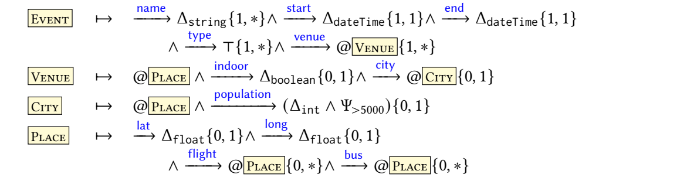

示例 B.24 的形状模式图示（原文未编号）。Event、Venue、City、Place 分别为“活动”“举办地点”“城市”“地点”；name、start、end、type、venue、indoor、city、population、lat、long、flight、bus 分别表示“名称”“开始”“结束”“类型”“举办地点”“室内”“所在城市”“人口”“纬度”“经度”“航班”“巴士”；string、dateTime、boolean、int、float 分别为字符串、日期时间、布尔、整数和浮点数类型。

在形状模式中，形状可以引用其他形状，从而产生一个有时称为形状图（shapes graph）的图 [296]。图 13 就展示了这种形状图。

形状 φ 的语义，根据 φ 在图 `G=(V,E,L)` 的节点上的求值来定义，求值相对于一个形状映射 σ，该映射关联节点与适用于它们的形状标签。

**定义 B.25（形状映射）。** 给定图 `G=(V,E,L)` 和模式 `Σ=(Φ,S,λ)`，形状映射是一个部分映射 `σ:V×S→{0,1}`。

形状的精确语义取决于 σ 是全映射还是部分映射，也就是是否对 `V×S` 中的每个值都有定义。本文介绍更直接的情形：假定 σ 是全形状映射。

**定义 B.26（形状求值）。** 给定形状模式 `Σ≔(Φ,S,λ)`，对于图 `G=(V,E,L)`、节点 `v∈V` 和全形状映射 σ，形状 `φ∈Φ` 的语义根据形状求值函数 `[φ]_(G,v,σ)∈{0,1}` 定义，满足：

```text
[⊤]_(G,v,σ) = 1

[Δ_N]_(G,v,σ) = 1 iff v ∈ N

[Ψ_cond]_(G,v,σ) = 1 iff cond(v) 为真

[φ₁ ∧ φ₂]_(G,v,σ) = min{[φ₁]_(G,v,σ), [φ₂]_(G,v,σ)}

[¬φ]_(G,v,σ) = 1 − [φ]_(G,v,σ)

[@s]_(G,v,σ) = 1 iff σ(v,s) = 1

[p→φ{min,max}]_(G,v,σ) = 1 iff
    min ≤ |{(v,p,u) ∈ E | [φ]_(G,u,σ) = 1}| ≤ max
```

如果 `[φ]_(G,v,σ)=1`，则称 v 在 σ 下，在 G 中满足 φ。

通常，为了验证某个图是否符合形状模式，会定义一个目标，要求某些节点满足某些形状。

**定义 B.27（形状目标）。** 给定有向边标记图 `G=(V,E,L)` 和形状模式 `Σ=(Φ,S,λ)`，形状目标 T 是节点与形状标签组成的对的集合：`T⊆V×S`。

一个形状的目标节点，可以手动选择，也可以根据节点的类型、图查询结果等选择 [104, 305]。

最后，可以定义在给定形状模式与目标下，一个图有效的概念。

**定义 B.28（有效图）。** 给定形状模式 `Σ=(Φ,S,λ)`、图 `G=(V,E,L)` 和形状目标 T，称 G 在 Σ 和 T 下有效，当且仅当存在形状映射 σ，使得对所有 `s∈S` 和 `v∈V`，都有 `σ(v,s)=[λ(s)]_(G,v,σ)`，并且 `(v,s)∈T` 蕴涵 `σ(v,s)=1`。

**示例 B.29。** 采用图 1 的图 G 和图 13 的形状模式 Σ，首先假设形状目标为空，即 `T={}`。考虑一个形状映射，例如 `σ(EID15,Event)=1`、`σ(Santa Lucía,Venue)=1`、`σ(Santa Lucía,Place)=1` 等，但 `σ(EID16,Event)=0`，因为它没有所要求的 start 和 end 值，等等。此时可以看出，G 在 Σ 和 T 下有效。然而，如果定义形状目标 T，确保 Event 形状以 EID15 和 EID16 为目标，也就是定义 T 使 `{(EID15,Event),(EID16,Event)}⊆T`，那么该图在 Σ 和 T 下就不再有效，因为 EID16 不满足 Event。

这里介绍的语义假定，图中的每个节点，对于模式所标记的每个形状，要么满足，要么不满足。已有更复杂的语义被提出，例如基于 Kleene 三值逻辑 [104, 305] 的语义，支持部分形状映射，允许某些节点对某些形状的满足情况保持未定义。实际的形状语言可能支持其他形式的约束，例如对路径计数 [296]。在实现形状验证方面，已有研究将约束转换为一组图查询，并在递归情形下，将查询结果输入 SAT 求解器 [103]。

#### B.3.3. 涌现模式

涌现模式往往基于商图的概念。

**定义 B.30（商图）。** 给定有向边标记图 `G=(V,E,L)`，图 `𝒢=(𝒱,ℰ,L)` 是 G 的商图，当且仅当：

- 𝒱 是 V 的一个不含空集的划分，即 `𝒱⊆(2^V−∅)`，`V=⋃_(U∈𝒱)U`，并且对所有 `U∈𝒱`、`W∈𝒱`，都有 `U=W` 或 `U∩W=∅`；以及
- `ℰ={(U,l,W) | U∈𝒱，W∈𝒱，且存在 u∈U、w∈W，使 (u,l,w)∈E}`。

直观来说，商图可以将多个节点合并为一个节点，而合并后的节点保留其组成节点的边。对于输入图 `G=(V,E,L)`，潜在商图的数量呈指数级增长，与输入图节点的划分数量相同。一个极端情况是，输入图是自身的商图，将 u 这样的节点变成 `{u}` 这样的单元素节点。另一个极端情况是，一个包含全部输入节点的单节点 V，并且对于输入边集 E 中使用的每个边标签 l，都具有自环 `(V,l,V)`，它也构成一个商图。实际的商图通常处于两者之间，V 的划分 𝒱 往往通过 V 上的一个等价关系 ∼ 定义，使 `𝒱≔∼/V`；也就是说，𝒱 定义为 V 关于 ∼ 的商集。例如，可以定义节点上的等价关系，使 `u∼v` 当且仅当二者具有相同的已定义类型集合；这样，`∼/V` 就是一个划分，其中每个部分包含具有相同类型的所有节点。诱导商图的另一种方式，是定义一个划分，保留输入图的部分拓扑结构。形式化定义这一思路的一种方法，是使用模拟与双模拟。

**定义 B.31（模拟）。** 给定两个有向边标记图 `G≔(V,E,L)` 和 `G′≔(V′,E′,L′)`，令 `R⊆V×V′` 为分别关联 G 与 G′ 节点的关系。称 R 为 G 和 G′ 上的模拟，如果对所有 `(v,v′)∈R`，下列条件成立：

- 若 `(v,p,w)∈E`，则存在 w′，使 `(v′,p,w′)∈E′`，且 `(w,w′)∈R`。

如果 G 和 G′ 上存在模拟，则称 G′ 模拟 G，记为 `G⇝G′`。

**定义 B.32（双模拟）。** 如果 R 是 G 和 G′ 上的模拟，并且对所有 `(v,v′)∈R`，下列条件成立，则称它为双模拟：

- 若 `(v′p,w′)∈E′`，则存在 w，使 `(v,p,w)∈E`，且 `(w,w′)∈R`。

如果 G 和 G′ 上存在双模拟，则称它们双模拟等价，记为 `G≈G′`。

双模拟等价（≈）是图上的一种等价关系。通过以集合成员关系 ∈ 定义模拟或双模拟关系 R，每个商图都会模拟它的输入图，但不一定与输入图双模拟等价。由此产生了双模拟等价商图的概念。

**示例 B.33。** 图 14 和图 15 给出了图 1 的图的商图示例。图 14 模拟该数据图，但与其不双模拟等价。图 15 与该数据图双模拟等价。目标通常是计算满足给定条件的最简洁商图；例如，图 15 中没有出边的节点，可以在保持双模拟等价的情况下合并。

### B.4. 上下文

#### B.4.1. 注释域

按照 Zimmermann 等人 [583]，我们定义注释域。

**定义 B.34（注释域）。** 令 A 为注释值的集合。注释域定义为幂等交换半环 `D=⟨A,⊕,⊗,⊥,⊤⟩`。

这个定义可以用于具体化特定上下文域。D 为半环，就要求对于 A 中任意值 a、a₁、a₂、a₃，下列条件成立：

```text
(a₁ ⊕ a₂) ⊕ a₃ = a₁ ⊕ (a₂ ⊕ a₃)
(⊥ ⊕ a) = (a ⊕ ⊥) = a
(a₁ ⊕ a₂) = (a₂ ⊕ a₁)
(a₁ ⊕ a₂) = (a₂ ⊕ a₁)
(a₁ ⊗ a₂) ⊗ a₃ = a₁ ⊗ (a₂ ⊗ a₃)
(⊤ ⊗ a) = (a ⊗ ⊤) = a
a₁ ⊗ (a₂ ⊕ a₃) = (a₁ ⊗ a₂) ⊕ (a₁ ⊗ a₃)
(a₁ ⊕ a₂) ⊗ a₃ = (a₁ ⊗ a₃) ⊕ (a₂ ⊗ a₃)
(⊥ ⊗ a) = (a ⊗ ⊥) = ⊥
```

交换半环的要求进一步施加以下约束：

```text
(a₁ ⊗ a₂) = (a₂ ⊗ a₁)
```

最后，幂等半环的要求进一步施加以下约束：

```text
(a ⊕ a) = a
```

幂等性诱导一个偏序：`a₁≤a₂` 当且仅当 `a₁⊕a₂=a₂`。对注释域施加这些条件，可以使推理与查询以明确定义的方式在注释域上进行。随后，可以自然地定义带注释的图：

**定义 B.35（带注释的有向边标记图）。** 令 `D=⟨A,⊕,⊗,⊥,⊤⟩` 表示幂等交换半环，定义带注释的有向边标记图 `G≔(V,E_A,L)`，其中 `V⊆Con` 是节点集合，`L⊆Con` 是边标签集合，`E_A⊆V×L×V×A` 是用 A 中的值进行注释的边集合。

图 20 展示了在用一年中各天进行注释的图上回答查询的例子。形式化地，该域可定义为：`A≔2^(ℕ_[1,365])`、`⊕≔∪`、`⊗≔∩`、`⊤≔ℕ_[1,365]`、`⊥≔∅`。可以验证，`D=⟨2^(ℕ_[1,365]),∪,∩,ℕ_[1,365],∅⟩` 确实是幂等交换半环。

### B.5. 演绎知识

我们为与演绎知识有关的概念提供一些形式化定义，首先介绍图的解释。随后，描述一些能够在图上进行推理的逻辑形式体系，包括规则和描述逻辑。

#### B.5.1. 图的解释

图的解释，或简称解释，表达了定义图语义时所采用的假设。我们为有向边标记图定义解释，不过，该概念可以自然推广到其他图模型。

**定义 B.36（图的解释）。** 图的解释 I 定义为二元组 `I≔(Γ,·^I)`，其中 `Γ=(V_Γ,E_Γ,L_Γ)` 是一个有向边标记图，称为域图；`·^I:Con→V_Γ∪L_Γ` 是从常量到域图术语的部分映射。

映射 `·^I` 的定义域记为 `dom(·^I)`。对于 UNA 下的解释，映射 `·^I` 必须是单射；不采用 UNA，即采用 NUNA 时，则不需要这样的要求。满足一个图的解释称为该图的模型。首先，对忽略本体特征的基本情形定义这一概念。

**定义 B.37（图的模型）。** 令 `G≔(V,E,L)` 为有向边标记图。解释 `I≔(Γ,·^I)` 满足 G，当且仅当下列条件成立：

- `V∪L⊆dom(·^I)`；
- 对所有 `v∈V`，都有 `v^I∈V_Γ`；
- 对所有 `l∈L`，都有 `l^I∈L_Γ`；以及
- 对所有 `(u,l,v)∈E`，都有 `(u^I,l^I,v^I)∈E_Γ`。

如果 I 满足 G，则称 I 为 G 的图模型。

接下来，定义语义条件，例如本体特征的语义条件，下的模型。

**定义 B.38（语义条件）。** 令 `2^G` 表示所有有向边标记图的集合。语义条件是映射 `φ:2^G→{true,false}`。解释 `I≔(Γ,·^I)` 是 G 在 φ 下的模型，当且仅当 I 是 G 的模型，且 `φ(Γ)` 成立。给定语义条件的集合 Φ，称 I 是 G 的模型，当且仅当 I 是 G 的模型，并且对所有 `φ∈Φ`，`φ(Γ)` 都为真。

我们不限制用于定义语义条件的语言。例如，可以用 FOL 如下定义表 5 的 Has Value（具有特定值）语义条件：

```text
∀c,p,y [ (Γ(c,prop,p) ∧ Γ(c,value,y)) ↔
          ∀x (Γ(x,type,c) ↔ Γ(x,p,y)) ]
```

这里，把 Γ 同时用作三元谓词，以表达 Γ 的边。上面的一阶逻辑公式定义了 Has Value 语义条件的“当且仅当”版本。表 3–5 列出的其他语义条件，也可以用类似方式定义 [466]。⁴⁰

最后，可以在考虑这些语义条件的情况下定义蕴涵。

**定义 B.39（图蕴涵）。** 令 G₁ 和 G₂ 表示两个有向边标记图，Φ 表示一组语义条件。如果 G₁ 在 Φ 下的任何模型，也是 G₂ 在 Φ 下的模型，则称 G₁ 在 Φ 下蕴涵 G₂，记为 `G₁ ⊨_Φ G₂`；反之亦然。

第 4.2 节讨论了一个蕴涵例子。注意，稍微放宽记法的使用，也可以直接写 `G ⊨_Φ (s,p,o)`，表示 G 在 Φ 下蕴涵边 `(s,p,o)`。

> **脚注 40：** 虽然这些表考虑的是源自数据图的公理，但只需检查它们在域图中的像即可，因为只有当 G 中定义公理的边反映在 I 中时，I 才满足 G。

在 OWA 下，蕴涵按定义 B.39 所述方式定义。在 CWA 下，我们额外假定，如果 `G ⊭_Φ e`，其中 e 是一条边，严格来说是一条正边，那么 `G ⊨_Φ ¬e`；换言之，在 CWA 下，任何 G 在 Φ 下没有蕴涵的正边，都可以根据 G 和 Φ 假定为假。⁴¹

#### B.5.2. 规则

给定图模式 Q，它既可以是定义 B.9 的有向边标记图模式，也可以是定义 B.11 的属性图模式，回顾 `Var(Q)` 表示 Q 中出现的变量。现在可以定义图上的规则。

**定义 B.40（规则）。** 规则是二元组 `R≔(B,H)`，其中 B 和 H 是图模式，且 `Var(H)⊆B`。B 称为规则体，H 称为规则头。

通过考虑相应类型的图模式，这个规则定义同时适用于有向边标记图和属性图。规则头被视为若干边的合取。给定图 G，通过计算规则体到图的映射，并用这些映射替换 H 中的变量，来应用规则。限制 `Var(H)⊆B` 确保这种替换的结果是一个图，H 中没有未被替换的变量。

**定义 B.41（规则应用）。** 给定规则 `R=(B,H)` 和图 G，R 在 G 上的应用定义为图：

```text
R(G) ≔ ⋃_(μ∈B(G)) μ(H)。
```

给定规则集合 `ℛ≔{R₁,…,Rₙ}` 和知识图谱 G，为定义这些规则在图上给出的推断集合，用 `ℛ(G)≔⋃_(R∈ℛ)R(G)` 表示 ℛ 的所有规则在 G 上应用的并集，用 `ℛ⁺(G)≔ℛ(G)∪G` 表示 G 关于 ℛ 应用的扩展。最后，以 `ℛ^k(G)`，其中 `k∈ℕ⁺`，表示 `ℛ⁺(G)` 的递归应用，其中 `ℛ¹(G)≔ℛ⁺(G)`，`ℛ^(i+1)(G)≔ℛ⁺(ℛ^i(G))`。现在可以定义最小模型，以表达 ℛ 在 G 上能够产生的推断。

**定义 B.42（最小模型）。** ℛ 在 G 上的最小模型定义为：

```text
ℛ∗(G) ≔ ⋃_(k∈ℕ) ℛ^k(G)。
```

在某个时刻，`ℛ^k′(G)=ℛ^(k′+1)(G)`：规则应用到达不动点，我们便得到了最小模型。一旦计算出最小模型 `ℛ∗(G)`，蕴涵数据就可以像其他数据一样处理。

规则可以用于支持 `G₁ ⊨_Φ G₂` 形式的图蕴涵。如果对任意图 G，都有 `G ⊨_Φ ℛ∗(G)`，则称规则集合 ℛ 对 Φ 正确。如果对于任意图 G，都不存在边 e，使 `G ⊨_Φ e` 而 `e∉ℛ∗(G)`，则称 ℛ 对 Φ 完备。表 6 给出了对于 RDFS 标准 [70] 所规定语义条件而言正确、但不完备的规则集合。

另一种方式，是在 Notation3（N3）[42]、规则交换格式（RIF）[288]、语义 Web 规则语言（SWRL）[254] 或 SPARQL 推理记法（SPIN）[295] 等规则语言中直接规定规则。SPIN 等语言将规则表示为图，因此可以把知识图谱的规则嵌入数据图。利用这一点，可以考虑图蕴涵形式 `G₁∪γ(ℛ) ⊨_Φ G₂`，其中 γ(ℛ) 表示规则 ℛ 的图表示。如果规则集合 ℛ 对 Φ 正确且完备，则可以直接写 `G₁∪γ(ℛ) ⊨ G₂`，表示 Φ 对 γ(ℛ) 所表达的语义，与应用 ℛ 中规则的语义相同；形式化地，有 `G₁∪γ(ℛ) ⊨ ℛ(G₁∪γ(ℛ))`，且不存在边 e，使 `G₁∪γ(ℛ) ⊨ e`，但 `e∉ℛ∗(G₁∪γ(ℛ))`。这样，我们就可以把规则视为另一种图蕴涵。

> **脚注 41：** 在 FOL 中，CWA 仅适用于正事实，而图中的边可以用于表示其他一阶逻辑公式。如果希望在 CWA 下保持与 FOL 兼容，可能需要对边 e 的类型施加额外限制。

#### B.5.3. 描述逻辑

表 7 为描述逻辑中通常出现的全部构造给出了定义。“语法”栏表示该构造如何用 DL 表达。一个 DL 知识库由 A-Box、T-Box 和 R-Box 组成。

**定义 B.43（DL 知识库）。** DL 知识库 K 定义为元组 `(A,T,R)`，其中 A 是 A-Box，即断言公理的集合；T 是 T-Box，即类公理，也称概念公理或术语公理，的集合；R 是 R-Box，即关系公理，也称属性公理或角色公理，的集合。

“语义”栏用解释定义公理的含义。这些解释的定义方式，通常与前面图解释的定义方式略有不同，但思路大体相同。

**定义 B.44（DL 解释）。** DL 解释 I 定义为二元组 `(Δ^I,·^I)`，其中 Δ^I 是解释域，·^I 是解释函数。解释域是个体的集合。解释函数接受个体 a、类 C 或关系 R 的定义，分别将它们映射为域中的一个元素 `a^I∈Δ^I`、域的一个子集 `C^I⊆Δ^I`，或由域中元素对组成的集合 `R^I⊆Δ^I×Δ^I`。

解释 I 满足知识库 K，当且仅当对于 K 中的全部语法公理，表 7 中相应的语义条件都对 I 成立。此时，称 I 为 K 的模型。

例如，对于 `K≔(A,T,R)`，令：

```text
A ≔ {City(Arica), City(Santiago), flight(Arica,Santiago)}；
T ≔ {City ⊑ Place, ∃flight.⊤ ⊑ ∃nearby.Airport}；
R ≔ {flight ⊑ connectsTo}。
```

对于 `I=(Δ^I,·^I)`，令下列定义成立。原文中的锚、山峰、飞机和咖啡图形，此处分别用 ⚓、▲、✈、☕ 表示：

```text
Δ^I ≔ {⚓, ▲, ✈}；
Arica^I ≔ ⚓，Santiago^I ≔ ▲，AricaAirport^I ≔ ✈；
City^I ≔ {⚓,▲}，Airport^I ≔ {✈}；
flight^I ≔ {(⚓,▲)}，connectsTo^I ≔ {(⚓,▲)}，sells^I ≔ {(✈,☕)}。
```

解释 I 不是 K 的模型，因为它没有体现 ⚓ 邻近某个 Airport，也没有体现 ⚓ 和 ▲ 属于类 Place。但如果以以下内容扩展 I：

```text
Place^I ≔ {⚓,▲}；
nearby^I ≔ {(⚓,✈)}。
```

此时，I 就是 K 的模型。注意，虽然 K 没有蕴涵 `sells(Arica,coffee)`，而 I 表明 ✈ sells ☕，I 仍然是 K 的模型，因为根据开放世界假设，不假定 K 是对世界的完整描述。

最后，模型的概念引出了蕴涵这一关键概念。

**定义 B.45。** 给定两个 DL 知识库 K₁ 和 K₂，如果 K₁ 的任意模型也是 K₂ 的模型，则定义 K₁ 蕴涵 K₂，记为 `K₁⊨K₂`；反之亦然。

蕴涵关系告诉我们，哪些知识库作为哪些其他知识库的逻辑结果而成立：如果 K₁ 的所有模型都是 K₂ 的模型，那么直观上，K₂ 没有表达超出 K₁ 的新内容。例如，令 K₁ 表示前一个例子的知识库 K，并定义第二个只有一条断言的知识库：`K₂≔({connectsTo(Arica,Santiago)},{},{})`。虽然 K₁ 没有断言这条公理，但它确实蕴涵 K₂：要成为 K₂ 的模型，一个解释必须满足 `(Arica^I,Santiago^I)∈connectsTo^I`；对于任何满足 K₁ 的解释，这也必须成立，因为它必须满足 `(Arica^I,Santiago^I)∈flight^I`，且 `flight^I⊆connectsTo^I`。

遗憾的是，如果一个 DL 允许将表 7 中的全部公理不受限制地组合使用，那么判定这种 DL 知识库蕴涵的问题，是不可判定的。例如，可以将停机问题的实例归约为这样的蕴涵。因此，实际的 DL 会限制表 7 所列特征的使用。不同 DL 施加不同限制，从而在表达能力与蕴涵问题复杂度之间形成不同权衡。多数 DL 基于以下基本 DL 之一；用缩进表示派生关系：

- **ALC**（Attributive Language with Complement，带补集的属性语言 [464]）：支持原子类、顶类、底类、类交集、类并集、类否定、全称限制和存在限制。还支持关系断言和类断言。
  - **S**：在 ALC 的基础上增加传递闭包。

这些基本语言可以按以下方式扩展：

- **H**：增加关系包含。
- **R**：增加受限的复杂关系包含，以及关系自反性、关系非自反性、关系不相交和全称关系。
- **O**：增加受限的标称类。
- **I**：增加逆关系。
- **F**：增加受限的函数属性。
- **N**：增加受限的数目限制；在给定 ⊤ 时，它涵盖 F。
- **Q**：增加受限的限定数目限制；在给定 ⊤ 时，它涵盖 N。

“受限”表示，为确保可判定性，这些特征往往只能在某些限制下使用。例如，复杂关系，即属性链，通常不能与基数限制组合。DL 通常按照以下模式命名，其中 `[a|b]` 表示在 a 与 b 之间选择，`[c][d]` 表示串接 cd：

```text
[ALC|S] [H|R] [O] [I] [F|N|Q]
```

例子包括 ALCO、ALCHI、SHIF、SROIQ 等。这些语言往往还对类公理和属性公理施加额外限制，以确保可判定性，此处不再讨论。关于描述逻辑的更多细节，请参见 Baader 等人近期出版的书籍 [23]。

如综述正文所述，DL 对 OWL 的定义产生了重大影响，其中 OWL 2 DL 片段大致对应 DL SROIQ。例如，OWL 公理 `venue —domain→ Event` 可以转换为 `∃venue.⊤ ⊑ Event`，表示在 venue 上有某个值，无论该值属于哪个类，的个体组成的类，是类 Event 的子类。将表 3–5 的其他 OWL 公理转换为 DL，留作练习。⁴² 但请注意，`sub-taxon of —subp. of→ subc. of` 这样的公理无法用 DL 表达。给定 `Fred —type→ Homo sapiens —sub-taxon of→ Hominini` 这样的图，这条公理会蕴涵边 `Fred —type→ Hominini`，但 `subTaxonOf ⊑ ⊑` 在语法上无效。因此，只有图的一个子集可以转换为语法正确的 DL 本体；细节请参见 OWL 标准 [239]。

> **脚注 42：** 虽然前面没有提到，OWL 定义了类 Thing 与 Nothing，分别对应 ⊤ 和 ⊥。

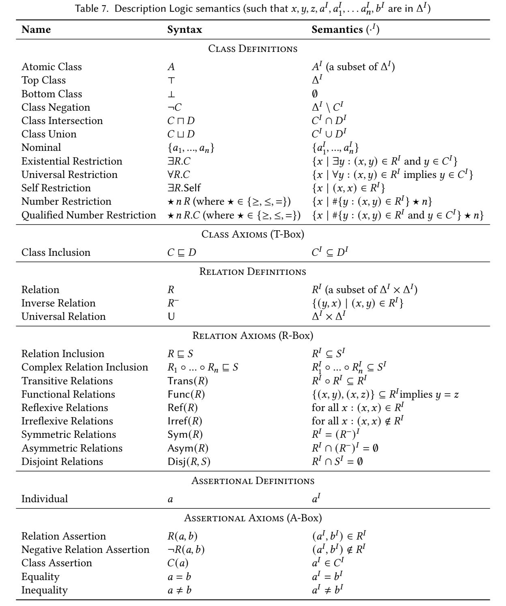

**表 7.** 描述逻辑语义，其中 x、y、z、a^I、a₁^I、…、aₙ^I、b^I 都属于 Δ^I。原表三栏分别为“名称”“语法”“语义（·^I）”。下面按原表分组，完整列出构造、公式和含义；∣ 为集合构造式中的“使得”，iff 为“当且仅当”。

**类定义**

| 名称 | 语法 | 语义（·^I）及含义 |
| --- | --- | --- |
| 原子类（Atomic Class） | `A` | `A^I`，是 Δ^I 的一个子集。 |
| 顶类（Top Class） | `⊤` | `Δ^I`，解释域中的全部个体。 |
| 底类（Bottom Class） | `⊥` | `∅`，空类。 |
| 类否定（Class Negation） | `¬C` | `Δ^I ∖ C^I`，解释域中不属于 C 的个体。 |
| 类交集（Class Intersection） | `C ⊓ D` | `C^I ∩ D^I`，同时属于 C 和 D 的个体。 |
| 类并集（Class Union） | `C ⊔ D` | `C^I ∪ D^I`，属于 C 或 D 的个体。 |
| 标称类（Nominal） | `{a₁,…,aₙ}` | `{a₁^I,…,aₙ^I}`，列出的个体构成的类。 |
| 存在限制（Existential Restriction） | `∃R.C` | `{x ∣ ∃y:(x,y)∈R^I 且 y∈C^I}`，至少通过 R 关联一个 C 类个体的个体。 |
| 全称限制（Universal Restriction） | `∀R.C` | `{x ∣ ∀y:(x,y)∈R^I 蕴涵 y∈C^I}`，通过 R 关联的所有个体均属于 C 的个体。 |
| 自身限制（Self Restriction） | `∃R.Self` | `{x ∣ (x,x)∈R^I}`，通过 R 与自身关联的个体。 |
| 数目限制（Number Restriction） | `★n R`，`★∈{≥,≤,=}` | `{x ∣ #{y:(x,y)∈R^I} ★ n}`，R 所关联的不同个体数量与 n 满足比较关系 ★。 |
| 限定数目限制（Qualified Number Restriction） | `★n R.C`，`★∈{≥,≤,=}` | `{x ∣ #{y:(x,y)∈R^I 且 y∈C^I} ★ n}`，R 所关联且属于 C 的不同个体数量与 n 满足比较关系 ★。 |

**类公理（T-Box）**

| 名称 | 语法 | 语义（·^I）及含义 |
| --- | --- | --- |
| 类包含（Class Inclusion） | `C ⊑ D` | `C^I ⊆ D^I`，C 是 D 的子类。 |

**关系定义**

| 名称 | 语法 | 语义（·^I）及含义 |
| --- | --- | --- |
| 关系（Relation） | `R` | `R^I`，是 `Δ^I×Δ^I` 的一个子集。 |
| 逆关系（Inverse Relation） | `R⁻` | `{(y,x) ∣ (x,y)∈R^I}`，将 R 中的方向反转。 |
| 全称关系（Universal Relation） | `U` | `Δ^I×Δ^I`，所有个体对。 |

**关系公理（R-Box）**

| 名称 | 语法 | 语义（·^I）及含义 |
| --- | --- | --- |
| 关系包含（Relation Inclusion） | `R ⊑ S` | `R^I ⊆ S^I`，R 是 S 的子关系。 |
| 复杂关系包含（Complex Relation Inclusion） | `R₁ ◦ … ◦ Rₙ ⊑ S` | `R₁^I ◦ … ◦ Rₙ^I ⊆ S^I`，关系链包含于 S。 |
| 传递关系（Transitive Relations） | `Trans(R)` | `R^I ◦ R^I ⊆ R^I`。 |
| 函数关系（Functional Relations） | `Func(R)` | `{(x,y),(x,z)}⊆R^I` 蕴涵 `y=z`。 |
| 自反关系（Reflexive Relations） | `Ref(R)` | 对所有 x，`(x,x)∈R^I`。 |
| 非自反关系（Irreflexive Relations） | `Irref(R)` | 对所有 x，`(x,x)∉R^I`。 |
| 对称关系（Symmetric Relations） | `Sym(R)` | `R^I=(R⁻)^I`。 |
| 非对称关系（Asymmetric Relations） | `Asym(R)` | `R^I∩(R⁻)^I=∅`。 |
| 不相交关系（Disjoint Relations） | `Disj(R,S)` | `R^I∩S^I=∅`。 |

**断言定义**

| 名称 | 语法 | 语义（·^I） |
| --- | --- | --- |
| 个体（Individual） | `a` | `a^I`。 |

**断言公理（A-Box）**

| 名称 | 语法 | 语义（·^I）及含义 |
| --- | --- | --- |
| 关系断言（Relation Assertion） | `R(a,b)` | `(a^I,b^I)∈R^I`，a 与 b 存在 R 关系。 |
| 否定关系断言（Negative Relation Assertion） | `¬R(a,b)` | `(a^I,b^I)∉R^I`，a 与 b 不存在 R 关系。 |
| 类断言（Class Assertion） | `C(a)` | `a^I∈C^I`，a 属于 C。 |
| 相等（Equality） | `a=b` | `a^I=b^I`。 |
| 不等（Inequality） | `a≠b` | `a^I≠b^I`。 |

### B.6. 归纳知识

我们为第 5 节讨论的图并行框架、知识图谱嵌入与图神经网络，提供进一步讨论和形式化定义。

#### B.6.1. 图并行框架

为了保持一般性，在定义图并行框架之前，我们先定义一种带有特征向量标签的有向图，用来表达这类框架可以接受的输入类型，其中节点和边都被赋予向量。

**定义 B.46（有向向量标记图）。** 有向向量标记图定义为 `G=(V,E,F,λ)`，其中 V 是节点集合，`E⊆V×V` 是边集合，F 是特征向量集合，`λ:V∪E→F` 为每个节点和每条边赋予特征向量标签。

有向边标记图或属性图，可以根据应用，以多种方式编码为有向向量标记图。节点的类型和/或选定的部分属性，可以编码在节点特征向量中；边的标签和/或选定的部分属性，可以编码在边特征向量中，例如包括赋给边的权重。通常，节点特征向量的维数全部相同，边特征向量的维数也全部相同。因此，有向向量标记图可以视为定义了初始状态与特征，它们将作为图并行框架的输入。

**示例 B.47。** 为了后面利用图并行框架计算 PageRank，我们定义一个有向向量标记图。令 `G=(V,E,L)` 为有向边标记图，令 `|E(u)|` 表示节点 `u∈V` 的出度。随后，初始化一个有向向量标记图 `G′=(V,E′,F,λ)`，使 `E′={(x,z) | ∃y:(x,y,z)∈E}`。对于所有 `u∈V`，定义：

```text
         ┌ 1/|V|  ┐
λ(u) ≔  │ |E′(u)|│，   λ(u,v) ≔ []，
         └  |V|   ┘

F ≔ {λ(u) | u∈V} ∪ {λ(u,v) | (u,v)∈E′}。
```

这为每个节点赋予一个向量，包含其初始 PageRank 分数、节点出度以及图的节点数量。相反，在这个例子中不使用边向量。

现在可以定义作用于有向向量标记图的图并行框架。下面，用 `{{·}}` 表示多重集，即保留重复元素的无序集合，用 `2^(S→ℕ)` 表示仅包含集合 S 中元素的全部多重集的集合，用 `ℝ^a` 表示全部 a 维向量的集合，即全部包含 a 个实数元素的向量的集合。

**定义 B.48（图并行框架）。** 图并行框架（Graph Parallel Framework，GPF）是由三个函数构成的三元组 `𝔊≔(Msg,Agg,End)`，其中 `a,b,c∈ℕ`，满足：

```text
Msg : ℝ^a × ℝ^b → ℝ^c
Agg : ℝ^a × 2^(ℝ^c→ℕ) → ℝ^a
End : 2^(ℝ^a→ℕ) → {true,false}
```

函数 Msg 定义：给定节点和边当前的特征向量，一个节点必须沿某条特定边，向相邻节点传递什么消息，即向量。函数 Agg 根据节点此前的特征向量和收到的消息，为该节点计算新特征向量。函数 End 定义终止向量计算的条件。整数 a、b 和 c 分别表示节点特征向量、边特征向量和消息向量的维数；假定 a 和 b 与输入节点和边特征向量的维数对应。给定 GPF `𝔊=(Msg,Agg,End)`、有向向量标记图 `G=(V,E,F,λ)` 和节点 `u∈V`，如下定义 𝔊 赋给 G 中节点 u 的输出向量，记为 `𝔊(G,u)`。首先令 `n_u^(0)≔λ(u)`。对于所有 `i≥1`，令：

```text
M_u^(i) ≔ {{ Msg(n_v^(i−1), λ(v,u)) | (v,u)∈E }}

n_u^(i) ≔ Agg(n_u^(i−1), M_u^(i))。
```

如果 j 是使 `End({{n_u^(j) | u∈V}})` 为真的最小整数，那么 `𝔊(G,u)≔n_u^(j)`。

这个具体定义假定，向量为节点动态计算，并且消息仅传给出邻居；但可以很容易调整这些定义，考虑边的动态向量，或者将消息传给入邻居等情况。下面给出一个具体化 GPF 的例子，用于在有向图上计算 PageRank。

**示例 B.49。** 对于 PageRank GPF，我们采用示例 B.47 中的有向向量标记图 `G′=(V,E,F,λ)` 作为输入。首先，定义从 u 传给 v 的消息：

```text
Msg(n_v, λ(v,u)) ≔ [ d(n_v)₁ / (n_v)₂ ]。
```

其中 d 表示 PageRank 的常量阻尼因子，通常 `d≔0.85`，`(n_v)_k` 表示向量 n_v 的第 k 个元素。换言之，v 向 u 传递自己的 PageRank 分数乘以阻尼因子再除以其度所得的值；在这个特定例子中，不需要 `λ(v,u)`。

接着，定义 u 用来聚合从其他节点收到的消息的函数：

```text
Agg(n_u, M_u) := [ (1 − d)/(n_u)₃ + Σ_{m ∈ M_u} (m)₁ ]
                 [ (n_u)₂                              ]
                 [ (n_u)₃                              ]
```

这里，将从其他节点收到的评分相加，并加上该节点由阻尼因子分得的排名份额，同时复制节点的度数与节点总数以供以后使用。最后，可以通过多种方式定义终止条件；这里简单地定义为：

```text
End({{n_u⁽ⁱ⁾ | u ∈ V}}) := (i ≥ z)
```

其中 z 是固定的迭代次数，达到这个次数时过程停止。

可以注意到，在这个例子中，节点总数被重复放在图中每个节点的向量中。GPF 的一个优点在于，每个计算步骤只需要节点邻域中的局部信息。实际中，这类框架可能允许其他功能，例如结果可供所有节点使用的全局计算步骤[335]、动态修改图的操作[335]等。

### B.6.2. 知识图谱嵌入

如第5.2节所述，知识图谱嵌入在低维数值空间中表示图。⁴³ 在定义关键概念之前，先介绍与张量运算相关的数学对象，嵌入在很大程度上依赖这些对象。

**定义 B.50（向量、矩阵、张量、阶、模）。** 对于任意正整数 a，a 维向量是由 {1, …, a} 中的整数索引的实数族。对于正整数 a 和 b，(a, b) 矩阵是由 {1, …, a} × {1, …, b} 中的整数对索引的实数族。张量是由有限整数序列索引的实数族，使得存在正数 a₁, …, aₙ，其索引是 {1, …, a₁} × … × {1, …, aₙ} 中的全部数值元组。数 n 称为张量的阶，下标 i ∈ {1, …, n} 表示张量的模，每个 aᵢ 定义第 i 个模的维数。一阶张量是向量，二阶张量是矩阵。用 T 表示所有张量的集合。

对于各个模的特定维数 a₁, …, aₙ，张量是 (···(ℝ^a₁)···)^aₙ 中的元素，但为简化记法，将其写为 ℝ^{a₁,…,aₙ}。使用小写粗体表示向量（**x** ∈ ℝ^a），大写粗体表示矩阵（**X** ∈ ℝ^{a,b}），花体表示张量（𝒳 ∈ ℝ^{a₁,…,aₙ}）。

现在可以抽象地定义知识图谱嵌入。

**定义 B.51（知识图谱嵌入）。** 给定有向边标记图 G = (V, E, L)，G 的一个知识图谱嵌入是一对映射 (ε, ρ)，使得 ε: V → T，ρ: L → T。

最典型的情况下，ε 和 ρ 分别将节点和边标签映射到固定维数的向量。不过，在某些情况下，它们也可以映射到矩阵。有了这一抽象的知识图谱嵌入概念，就可以定义合理性评分。

**定义 B.52（合理性）。** 合理性评分函数是一个部分函数 φ: T × T × T → ℝ。给定有向边标记图 G = (V, E, L)、一条边 (s, p, o) ∈ V × L × V，以及 G 的知识图谱嵌入 (ε, ρ)，(s, p, o) 的合理性由 φ(ε(s), ρ(p), ε(o)) 给出。

> **脚注 43：** 据我们所知，Wang 等人[553]创造了“knowledge graph embedding（知识图谱嵌入）”这一术语，以区别于只考虑单一关系（即无向图或有向图）的“graph embedding（图嵌入）”。较早的论文则使用“multi-relational data（多关系数据）”这一表述[63, 192, 386]。

评分较高的边被认为更合理。给定图 G = (V, E, L)，假定有一个正例边集合 E⁺ 和一个负例边集合 E⁻。正例边往往就是图中的边：E⁺ := E。负例边使用 G 的词汇表（即 E⁻ ⊆ V × L × V），通常通过从 E 中取出边 (s, p, o)，然后改变每条边的某一个词项——最常见的是某个节点，但并非总是如此——使其不再属于 E 来定义。给定正例边与负例边的集合，以及合理性评分函数，目标就是找到一个嵌入，使 E⁺ 中边的合理性最大化，同时使 E⁻ 中边的合理性最小化。随后，具体的知识图谱嵌入以多种不同方式实例化所考虑的嵌入类型和合理性评分函数。

表8定义了不同知识图谱嵌入模型使用的合理性评分函数，并进一步详细说明所考虑的嵌入类型。为简化表8中的嵌入定义，当 ε(x) 为向量时，以 e_x 表示它；当 ρ(y) 为向量时，以 r_y 表示它，当其为矩阵时，以 R_y 表示它。一些模型使用额外的参数（也称权重）；这些参数虽然不属于实体／关系嵌入，但也通过学习，用来从嵌入计算合理性评分。用 v、V、𝒱、w、W、𝒲 表示这些参数（分别为向量、矩阵或张量）。用 d_e 和 d_r 分别表示为实体嵌入和关系嵌入选择的维数。通常假定 d_e = d_r，此时写作 d。有时权重也有自己的维数，记作 w。表8中的嵌入使用作用于向量、矩阵和张量的各种算子。为使论述自洽，本节后半部分给出了这些算子及其他记法约定的定义。

表8所列嵌入的复杂程度各不相同，从 TransE[63]、DistMult[568]等简单模型，到 SME Bilinear[192]、ConvE[127]等更复杂的模型。这些方案都存在参数数量上的权衡：更多参数会增加计算成本，但也提高模型捕获图的潜在特征的能力，从而增加表达能力。为增加表达能力，表8中的许多模型使用嵌入本身之外的额外参数。这些模型可能具有的一项形式保证是完全表达性：给定任意互不相交的正例边集合 E⁺ 与负例边集合 E⁻，模型总能正确划分这些边。一方面，例如 DistMult[568]无法区分边 (s, p, o) 与其逆边 (o, p, s)，因此，只要将 E⁺ 中某条边的逆边加入 E⁻，就能说明它不具备完全表达性。另一方面，ComplEx[526]、SimplE[283]、TuckER[30]等模型已经被证明在维数足够时具有完全表达性。例如，对于 d_r = |L|、d_e = |V| 的 TuckER[30]，它显然满足完全表达性，因为此时核心张量 𝒲 具有足够容量，能够存储任意图的完整独热编码。这个形式性质有助于说明，模型在用数值表示图方面没有内在局限；当然，在实际中，达到完全表达性所需的维数往往不切实际，或者并不理想。

这里没有讨论基于不同原理的嵌入语言模型[96, 441]，也没有讨论在表8模型类型基础上添加额外评分约束的感知蕴涵模型[125, 207, 550]。有关这些工作的更多信息，参见 Wang 等人[549]的综述和／或相应论文。

下面详细定义表8中使用的算子与记法约定。先介绍约定，然后定义相关算子。

- 使用带下标的括号，例如 (x)ᵢ、(X)ᵢⱼ、(𝒳)_{i₁…iₙ}，分别表示向量、矩阵和张量的元素。如果向量 x ∈ ℝ^a 用于需要矩阵的上下文，则将其解释为 (a, 1) 矩阵（即列向量），并可以通过转置运算 xᵀ 将其转换为行向量（即 (1, a) 矩阵）。使用 xᴰ ∈ ℝ^{a,a} 表示以向量 x ∈ ℝ^a 的值为对角元素的对角矩阵。以 I 表示单位矩阵：若 j = k，则 (I)ⱼₖ = 1；否则 (I)ⱼₖ = 0。

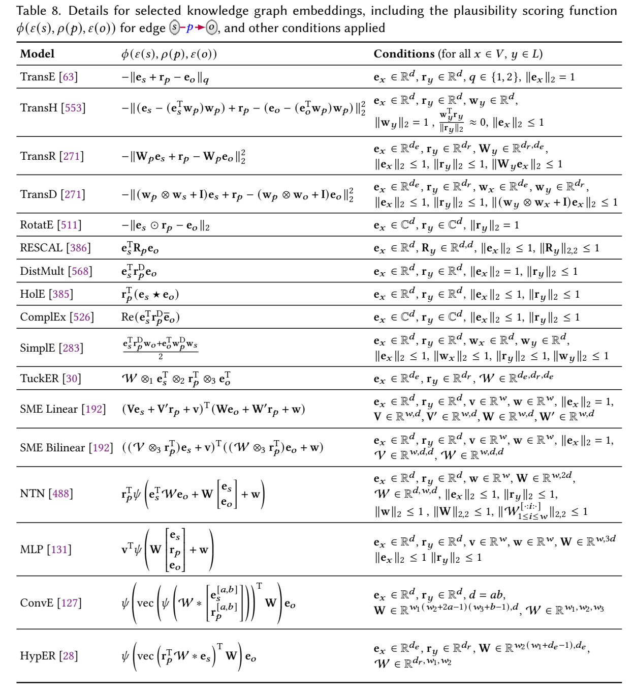

**表8.** 选取的知识图谱嵌入的详细信息，包括边 (s, p, o) 的合理性评分函数 φ(ε(s), ρ(p), ε(o))，以及其他适用条件。表中三列依次为“模型”“合理性评分函数”“条件（对所有 x ∈ V、y ∈ L）”。其中，`SME Linear`＝SME 线性模型，`SME Bilinear`＝SME 双线性模型；NTN＝神经张量网络，MLP＝多层感知机；其余模型名称按原名保留。以下逐项转录评分函数与条件，以便阅读。原表的粗体矩阵 W、花体张量 𝒲，以及 V、𝒱，在这里用不同字形区分；`‖·‖` 表示范数，`⊗` 表示张量积，`⊗ₙ` 表示 n 模积，`⊙` 表示 Hadamard 积，`★` 表示循环相关，`∗` 表示卷积；具体定义见下文。

**TransE[63]：**

```text
φ = −‖e_s + r_p − e_o‖_q
条件：e_x ∈ ℝ^d，r_y ∈ ℝ^d，q ∈ {1, 2}，‖e_x‖₂ = 1。
```

**TransH[553]：**

```text
φ = −‖(e_s − (e_sᵀ w_p)w_p) + r_p − (e_o − (e_oᵀ w_p)w_p)‖₂²
条件：e_x ∈ ℝ^d，r_y ∈ ℝ^d，w_y ∈ ℝ^d，
      ‖w_y‖₂ = 1，(w_yᵀ r_y)/‖r_y‖₂ ≈ 0，‖e_x‖₂ ≤ 1。
```

**TransR[271]：**

```text
φ = −‖W_p e_s + r_p − W_p e_o‖₂²
条件：e_x ∈ ℝ^{d_e}，r_y ∈ ℝ^{d_r}，W_y ∈ ℝ^{d_r,d_e}，
      ‖e_x‖₂ ≤ 1，‖r_y‖₂ ≤ 1，‖W_y e_x‖₂ ≤ 1。
```

**TransD[271]：**

```text
φ = −‖(w_p ⊗ w_s + I)e_s + r_p − (w_p ⊗ w_o + I)e_o‖₂²
条件：e_x ∈ ℝ^{d_e}，r_y ∈ ℝ^{d_r}，w_x ∈ ℝ^{d_e}，w_y ∈ ℝ^{d_r}，
      ‖e_x‖₂ ≤ 1，‖r_y‖₂ ≤ 1，‖(w_y ⊗ w_x + I)e_x‖₂ ≤ 1。
```

**RotatE[511]：**

```text
φ = −‖e_s ⊙ r_p − e_o‖₂
条件：e_x ∈ ℂ^d，r_y ∈ ℂ^d，‖r_y‖₂ = 1。
```

**RESCAL[386]：**

```text
φ = e_sᵀ R_p e_o
条件：e_x ∈ ℝ^d，R_y ∈ ℝ^{d,d}，‖e_x‖₂ ≤ 1，‖R_y‖₂,₂ ≤ 1。
```

**DistMult[568]：**

```text
φ = e_sᵀ r_pᴰ e_o
条件：e_x ∈ ℝ^d，r_y ∈ ℝ^d，‖e_x‖₂ = 1，‖r_y‖₂ ≤ 1。
```

**HolE[385]：**

```text
φ = r_pᵀ(e_s ★ e_o)
条件：e_x ∈ ℝ^d，r_y ∈ ℝ^d，‖e_x‖₂ ≤ 1，‖r_y‖₂ ≤ 1。
```

**ComplEx[526]：**

```text
φ = Re(e_sᵀ r_pᴰ conjugate(e_o))
条件：e_x ∈ ℂ^d，r_y ∈ ℂ^d，‖e_x‖₂ ≤ 1，‖r_y‖₂ ≤ 1。
```

其中 `conjugate(e_o)` 表示 e_o 的复共轭，Re(·) 表示复数的实部。

**SimplE[283]：**

```text
φ = (e_sᵀ r_pᴰ w_o + e_oᵀ w_pᴰ w_s)/2
条件：e_x ∈ ℝ^d，r_y ∈ ℝ^d，w_x ∈ ℝ^d，w_y ∈ ℝ^d，
      ‖e_x‖₂ ≤ 1，‖w_x‖₂ ≤ 1，‖r_y‖₂ ≤ 1，‖w_y‖₂ ≤ 1。
```

**TuckER[30]：**

```text
φ = 𝒲 ⊗₁ e_sᵀ ⊗₂ r_pᵀ ⊗₃ e_oᵀ
条件：e_x ∈ ℝ^{d_e}，r_y ∈ ℝ^{d_r}，𝒲 ∈ ℝ^{d_e,d_r,d_e}。
```

**SME 线性模型[192]：**

```text
φ = (V e_s + V′r_p + v)ᵀ(W e_o + W′r_p + w)
条件：e_x ∈ ℝ^d，r_y ∈ ℝ^d，v ∈ ℝ^w，w ∈ ℝ^w，‖e_x‖₂ = 1，
      V ∈ ℝ^{w,d}，V′ ∈ ℝ^{w,d}，W ∈ ℝ^{w,d}，W′ ∈ ℝ^{w,d}。
```

**SME 双线性模型[192]：**

```text
φ = ((𝒱 ⊗₃ r_pᵀ)e_s + v)ᵀ((𝒲 ⊗₃ r_pᵀ)e_o + w)
条件：e_x ∈ ℝ^d，r_y ∈ ℝ^d，v ∈ ℝ^w，w ∈ ℝ^w，‖e_x‖₂ = 1，
      𝒱 ∈ ℝ^{w,d,d}，𝒲 ∈ ℝ^{w,d,d}。
```

**NTN[488]：**

```text
φ = r_pᵀ ψ(e_sᵀ 𝒲 e_o + W [e_s; e_o] + w)
条件：e_x ∈ ℝ^d，r_y ∈ ℝ^d，w ∈ ℝ^w，W ∈ ℝ^{w,2d}，
      𝒲 ∈ ℝ^{d,w,d}，‖e_x‖₂ ≤ 1，‖r_y‖₂ ≤ 1，
      ‖w‖₂ ≤ 1，‖W‖₂,₂ ≤ 1，‖𝒲[·:i:·]‖₂,₂ ≤ 1（1 ≤ i ≤ w）。
```

**MLP[131]：**

```text
φ = vᵀ ψ(W [e_s; r_p; e_o] + w)
条件：e_x ∈ ℝ^d，r_y ∈ ℝ^d，v ∈ ℝ^w，w ∈ ℝ^w，W ∈ ℝ^{w,3d}，
      ‖e_x‖₂ ≤ 1，‖r_y‖₂ ≤ 1。
```

**ConvE[127]：**

```text
φ = ψ(vec(ψ(𝒲 ∗ [e_s^[a,b]; r_p^[a,b]]))ᵀ W)e_o
条件：e_x ∈ ℝ^d，r_y ∈ ℝ^d，d = ab，
      W ∈ ℝ^{w₁(w₂+2a−1)(w₃+b−1),d}，𝒲 ∈ ℝ^{w₁,w₂,w₃}。
```

**HypER[28]：**

```text
φ = ψ(vec(r_pᵀ 𝒲 ∗ e_s)ᵀ W)e_o
条件：e_x ∈ ℝ^{d_e}，r_y ∈ ℝ^{d_r}，
      W ∈ ℝ^{w₂(w₁+d_e−1),d_e}，𝒲 ∈ ℝ^{d_r,w₁,w₂}。
```

上式中的 `[·; ·]` 表示纵向堆叠，`x^[a,b]` 表示将向量 x 重塑为 (a, b) 矩阵，vec 表示向量化，ψ 表示逐元素应用的函数。

- 用下面的表达式表示具有相同列数的矩阵 X₁, …, Xₙ 的纵向堆叠：

  ```text
  [ X₁ ]
  [ ⋮  ]
  [ Xₙ ]
  ```

  给定向量 x ∈ ℝ^{ab}，以 x^[a,b] ∈ ℝ^{a,b} 表示将 x“重塑”为 (a, b) 矩阵，使得 (x^[a,b])ᵢⱼ = (x)_{i+a(j−1)}。反过来，给定矩阵 X ∈ ℝ^{a,b}，以 vec(X) ∈ ℝ^{ab} 表示 X 的向量化，使得 vec(X)ₖ = (X)ᵢⱼ，其中 i = ((k − 1) mod m) + 1，j = (k − i)/m + 1（注意 vec(x^[a,b]) = x）。
- 给定张量 𝒳 ∈ ℝ^{a,b,c}，以 𝒳[i:·:·] ∈ ℝ^{b,c} 表示张量 𝒳 沿第一个模的第 i 个切片。例如，给定 𝒳 ∈ ℝ^{5,2,3}，𝒳[4:·:·] 返回由下列元素构成的 (2, 3) 矩阵：

  ```text
  [ (𝒳)₄₁₁  (𝒳)₄₁₂  (𝒳)₄₁₃ ]
  [ (𝒳)₄₂₁  (𝒳)₄₂₂  (𝒳)₄₂₃ ]
  ```

  类似地，用 𝒳[·:i:·] ∈ ℝ^{a,c} 和 𝒳[·:·:i] ∈ ℝ^{b,c}，分别表示 𝒳 沿第二个模和第三个模的第 i 个切片。
- 用 ψ(𝒳) 表示将函数 ψ 逐元素应用于张量 𝒳，使得 (ψ(𝒳))_{i₁…iₙ} = ψ((𝒳)_{i₁…iₙ})。ψ 的常见选择包括 sigmoid 函数（例如 logistic 函数 ψ(x) = 1/(1 + e^(−x))，或双曲正切函数 ψ(x) = tanh x = (e^x − e^(−x))/(e^x + e^(−x))）、整流函数 ψ(x) = max(0, x)、softplus 函数 ψ(x) = ln(1 + e^x) 等。

考虑的第一个、也是最基本的运算，是矩阵乘法。

**定义 B.53（矩阵乘法）。** 矩阵 X ∈ ℝ^{a,b} 与 Y ∈ ℝ^{b,c} 的乘积是矩阵 XY ∈ ℝ^{a,c}，使得：

```text
(XY)ᵢⱼ = Σ_{k=1}^b (X)ᵢₖ(Y)ₖⱼ。
```

两个张量 𝒳 ∈ ℝ^{a₁,…,aₘ,c} 和 𝒴 ∈ ℝ^{c,b₁,…,bₙ} 的矩阵乘积，是张量 𝒳𝒴 ∈ ℝ^{a₁,…,aₘ,b₁,…,bₙ}，使得：

```text
(𝒳𝒴)_{i₁…iₘ iₘ₊₁…iₘ₊ₙ}
  = Σ_{k=1}^c (𝒳)_{i₁…iₘ k}(𝒴)_{k iₘ₊₁…iₘ₊ₙ}。
```

为方便起见，进行矩阵乘法及其他运算时，可以隐式添加或去掉维数为 1 的模。例如，给定两个向量 x ∈ ℝ^a 和 y ∈ ℝ^a，用 xᵀy（也称点积或内积）表示矩阵 xᵀ ∈ ℝ^{1,a} 与 y ∈ ℝ^{a,1} 的乘积，使得 xᵀy ∈ ℝ^{1,1}（即 ℝ 中的标量）；相对地，xyᵀ ∈ ℝ^{a,a} 为外积。

有时，以范数来给出嵌入约束，定义如下。

**定义 B.54（L_p 范数、L_{p,q} 范数）。** 对于 p ∈ ℝ，向量 x ∈ ℝ^a 的 L_p 范数是标量：

```text
‖x‖_p := (|(x)₁|^p + … + |(x)_a|^p)^(1/p)，
```

其中 |(x)ᵢ| 表示 x 的第 i 个元素的绝对值。对于 p, q ∈ ℝ，矩阵 X ∈ ℝ^{a,b} 的 L_{p,q} 范数是标量：

```text
‖X‖_{p,q} := (Σ_{j=1}^b (Σ_{i=1}^a |(X)ᵢⱼ|^p)^(q/p))^(1/q)。
```

因此，L₁ 范数（即 ‖x‖₁）就是 x 所有元素绝对值的和，L₂ 范数（即 ‖x‖₂）是向量的（欧几里得）长度。矩阵 X 的 Frobenius 范数等于 ‖X‖₂,₂ = (Σ_{j=1}^b (Σ_{i=1}^a |(X)ᵢⱼ|²))^(1/2)，即所有元素的平方和的平方根。

嵌入技术使用的另一种积是 Hadamard 积，它对相同维数的张量相乘，逐元素计算乘积。

**定义 B.55（Hadamard 积）。** 给定两个张量 𝒳 ∈ ℝ^{a₁,…,aₙ} 和 𝒴 ∈ ℝ^{a₁,…,aₙ}，Hadamard 积 𝒳 ⊙ 𝒴 被定义为 ℝ^{a₁,…,aₙ} 中的张量，各元素按下式计算：

```text
(𝒳 ⊙ 𝒴)_{i₁…iₙ} := (𝒳)_{i₁…iₙ}(𝒴)_{i₁…iₙ}。
```

另外一些嵌入技术，即 RotatE[511]和 ComplEx[526]，使用基于复数的复空间。稍微放宽记法，将实数集合 ℝ 替换为复数集合 ℂ，就可以修改向量、矩阵和张量的定义，得到复向量、复矩阵和复张量。在这种情况下，以 Re(·) 表示一个复数的实部。给定复向量 x ∈ ℂ^I，以 x̄ 表示其复共轭（将每个元素虚部的符号反转）。随后，通过将实数的乘法和加法替换为对应的复数运算，就可以定义上述算子的复数版本。RotatE[511]使用复数 Hadamard 积，ComplEx[526]使用复数矩阵乘法。

一种嵌入技术 MuRP[29]使用双曲空间，具体基于庞加莱球。由于它是本文涵盖的唯一使用该空间的嵌入，并且形式化内容很长（涉及庞加莱球、莫比乌斯加法、莫比乌斯矩阵—向量乘法、对数映射、指数映射等），更多细节请参见相应论文[29]。

如第5.2节所述，张量分解是许多嵌入的重要概念，而此类分解的核心就是张量积。

**定义 B.56（张量积）。** 给定两个张量 𝒳 ∈ ℝ^{a₁,…,aₘ} 和 𝒴 ∈ ℝ^{b₁,…,bₙ}，张量积 𝒳 ⊗ 𝒴 被定义为 ℝ^{a₁,…,aₘ,b₁,…,bₙ} 中的张量，各元素按下式计算：⁴⁴

```text
(𝒳 ⊗ 𝒴)_{i₁…iₘ j₁…jₙ} := (𝒳)_{i₁…iₘ}(𝒴)_{j₁…jₙ}。
```

为说明张量积，假设 𝒳 ∈ ℝ^{2,3}、𝒴 ∈ ℝ^{3,4,5}。𝒳 ⊗ 𝒴 的结果是 ℝ^{2,3,3,4,5} 中的张量。元素 (𝒳 ⊗ 𝒴)₁₂₃₄₅ 通过将 (𝒳)₁₂ 与 (𝒴)₃₄₅ 相乘来计算。

其他嵌入使用 n 模积，沿张量的某个模变换元素。

**定义 B.57（n 模积）。** 对于正整数 n、张量 𝒳 ∈ ℝ^{a₁,…,aₙ₋₁,aₙ,aₙ₊₁,…,aₘ} 和矩阵 Y ∈ ℝ^{b,aₙ}，𝒳 与 Y 的 n 模积为张量 𝒳 ⊗ₙ Y ∈ ℝ^{a₁,…,aₙ₋₁,b,aₙ₊₁,…,aₘ}，使得：

```text
(𝒳 ⊗ₙ Y)_{i₁…iₙ₋₁ j iₙ₊₁…iₘ}
  := Σ_{k=1}^{aₙ} (𝒳)_{i₁…iₙ₋₁ k iₙ₊₁…iₘ}(Y)ⱼₖ。
```

例如，假设 𝒳 ∈ ℝ^{2,3,4}、Y ∈ ℝ^{5,3}。𝒳 ⊗₂ Y 的结果是 ℝ^{2,5,4} 中的张量；例如，(𝒳 ⊗₂ Y)₁₄₂ = (𝒳)₁₁₂(Y)₄₁ + (𝒳)₁₂₂(Y)₄₂ + (𝒳)₁₃₂(Y)₄₃。注意，如果 y ∈ ℝ^{aₙ}，即 y 是（列）向量，那么 n 模张量积 𝒳 ⊗ₙ yᵀ 会将 𝒳 的第 n 个模“压平”为一维，实际上将 𝒳 的阶降低一阶。

一种嵌入技术 HolE[385]使用循环相关算子。

**定义 B.58（循环相关）。** 向量 x ∈ ℝ^a 与 y ∈ ℝ^a 的循环相关，是向量 x ★ y ∈ ℝ^a，使得：

```text
(x ★ y)ₖ := Σ_{i=1}^a (x)ᵢ(y)_{((k+i−2) mod a)+1}。
```

x ★ y 的每个元素，都是外积 x ⊗ y 中某条对角线上的 a 个元素之和；如果不是主对角线，就会“环绕”。假设 a = 5，那么 (x ★ y)₁ = (x)₁(y)₁ + (x)₂(y)₂ + (x)₃(y)₃ + (x)₄(y)₄ + (x)₅(y)₅；环绕的一个例子是：(x ★ y)₄ = (x)₁(y)₄ + (x)₂(y)₅ + (x)₃(y)₁ + (x)₄(y)₂ + (x)₅(y)₃。

最后，本文包含的两个神经模型 ConvE[127]和 HypER[28]，基于使用卷积算子的卷积架构。

**定义 B.59（卷积）。** 给定两个矩阵 X ∈ ℝ^{a,b} 和 Y ∈ ℝ^{e,f}，X 与 Y 的卷积为矩阵 X ∗ Y ∈ ℝ^{(a+e−1),(b+f−1)}，使得：⁴⁵

```text
(X ∗ Y)ᵢⱼ = Σ_{k=1}^a Σ_{l=1}^b (X)ₖₗ(Y)_{(i+k−a)(j+l−b)}。
```

在 (i + k − a) < 1、(j + l − b) < 1、(i + k − a) > e 或 (j + l − b) > f 的情况下（即 (Y)_{(i+k−a)(j+l−b)} 超出 Y 的边界），规定 (Y)_{(i+k−a)(j+l−b)} = 0。

直观地说，卷积算子以所有可能的方式将 X 叠放在 Y 上，使得至少一对元素 (X)ᵢⱼ、(Y)ₗₖ 重叠；将各对重叠元素的乘积相加，得到结果的一个元素。X 超出 Y 范围的元素被忽略（等价地，可以认为 Y 的边界外进行“零填充”）。例如，给定 X ∈ ℝ^{3,3}、Y ∈ ℝ^{4,5}，则 X ∗ Y ∈ ℝ^{6,7}；其中，例如 (X ∗ Y)₁₁ = (X)₃₃(Y)₁₁（X 的右下角与 Y 的左上角重叠），而：

```text
(X ∗ Y)₃₄ = (X)₁₁(Y)₁₂ + (X)₁₂(Y)₁₃ + (X)₁₃(Y)₁₄
             + (X)₂₁(Y)₂₂ + (X)₂₂(Y)₂₃ + (X)₂₃(Y)₂₄
             + (X)₃₁(Y)₃₂ + (X)₃₂(Y)₃₃ + (X)₃₃(Y)₃₄，
```

这里 (X)₂₂，即 X 的中心，与 (Y)₂₃ 重叠。⁴⁶ 在卷积 X ∗ Y 中，矩阵 X 通常称为“卷积核”（或“滤波器”）。往往会使用多个卷积核，执行多次卷积。给定张量 𝒳 ∈ ℝ^{c,a,b}（表示 c 个 (a, b) 卷积核）和矩阵 Y ∈ ℝ^{e,f}，以 𝒳 ∗ Y ∈ ℝ^{c,(a+e−1),(b+f−1)} 表示将 𝒳 沿第一个模的 c 个切片在 Y 上卷积的结果，使得对 1 ≤ i ≤ c，有 (𝒳 ∗ Y)[i:·:·] = 𝒳[i:·:·] ∗ Y，从而得到包含 c 次卷积结果的张量。

> **脚注 44：** 请注意，这里的“⊗”与定义 B.34 中使用的“⊗”含义无关。

> **脚注 45：** 这里按照卷积神经网络的惯例定义卷积算子。严格来说，这个算子应称为互相关，因为传统卷积要求先将矩阵 X“旋转”180°。在本文的设定中，矩阵 X 是学习得到的，而不是给定的，因此旋转是多余的。

> **脚注 46：** 使用卷积的模型在边界情况处理方式或卷积的“步长”方面可能有所不同。例如，对于 (X ∗ Y)，步长为 3 意味着卷积核 X 只以满足 i mod 3 = 0、j mod 3 = 0 的元素 (Y)ᵢⱼ 为中心，使输出元素数量减少为原来的 1/9。这里不考虑这类细节。

### B.6.3. 图神经网络

下面给出图神经网络（GNN）的高层定义，借鉴了例如 Xu 等人[565]提供的定义。假设 GNN 接受一个有向向量标记图作为输入（见定义 B.46）。

首先抽象地定义递归图神经网络。

**定义 B.60（递归图神经网络）。** 一个递归图神经网络（RecGNN）是一对函数 ℜ := (Agg, Out)，使得（a, b, c ∈ ℕ）：

```text
Agg: ℝ^a × 2^{(ℝ^a × ℝ^b)→ℕ} → ℝ^a
Out: ℝ^a → ℝ^c
```

函数 Agg 根据一个节点原有的特征向量，以及构成其邻域的节点和边的特征向量，计算该节点的新特征向量；函数 Out 将 Agg 为一个节点计算的最终特征向量，转换为该节点的输出向量。假定 a 和 b 分别对应输入节点向量和边向量的维数，c 表示每个节点输出向量的维数。给定 RecGNN ℜ = (Agg, Out)、有向向量标记图 G = (V, E, F, λ)，以及节点 u ∈ V，以下定义 ℜ 为 G 中节点 u 分配的输出向量（记为 ℜ(G, u)）。首先令 n_u⁽⁰⁾ := λ(u)。对于所有 i ≥ 1，令：

```text
n_u⁽ⁱ⁾ := Agg(n_u⁽ⁱ⁻¹⁾, {{(n_v⁽ⁱ⁻¹⁾, λ(v, u)) | (v, u) ∈ E}})。
```

若存在整数 j ≥ 1，使得对所有 u ∈ V，都有 n_u⁽ʲ⁾ = n_u⁽ʲ⁻¹⁾，则 ℜ(G, u) := Out(n_u⁽ʲ⁾)。

在 RecGNN 中，递归应用同一个聚合函数 Agg，直至达到不动点；此时，输出函数 Out 为每个节点生成最终输出向量。在实际中，RecGNN 常常会考虑一个静态特征向量和一个动态状态向量[462]；但可以更简洁地将它们编码为一个向量：其中一部分在整个聚合过程中保持静态，表示输入特征；另一部分动态计算，表示状态。实际中，Agg 和 Out 往往基于向量的参数化组合，并根据一组带标签节点的输出向量样本来学习参数。

**示例 B.61。** Scarselli 等人[462]的 GNN 的聚合函数为：

```text
Agg(n_u, N) := Σ_{(n_v,a_vu) ∈ N} f_w(n_u, n_v, a_vu)，
```

其中 f_w(·) 是参数为 w 的压缩函数。输出函数定义为：

```text
Out(n_u) := g_w′(n_u)，
```

其中 g_w′(·) 同样是参数为 w′ 的函数。给定一组已标注预期输出向量的节点，就可以学习参数 w 和 w′。

图并行框架（GPF，见定义 B.48）与 RecGNN 之间具有显著相似性。虽然定义 GPF 时采用了分开的 Msg 与 Agg 函数，但这并非必需：从概念上说，可以采用类似 RecGNN 的方式定义，使用单个 Agg 函数从邻居“拉取”信息（保留 Msg，是为了更接近 GPF 在实际中的定义和实现方式）。GPF 与 GNN 的关键差别在于，前者的函数由用户定义，后者的函数一般从带标签的示例中学习。另一个差别来自 GPF 中的终止条件，不过，GPF 的终止条件也经常像 RecGNN 一样，反映收敛到不动点。

接着，抽象地定义非递归图神经网络。

**定义 B.62（非递归图神经网络）。** 具有 l 层的非递归图神经网络（NRecGNN）是一个函数 l 元组 𝔑 := (Agg⁽¹⁾, …, Agg⁽ˡ⁾)，使得对 1 ≤ k ≤ l（a₀, …, a_l, b ∈ ℕ），有：

```text
Agg⁽ᵏ⁾: ℝ^{aₖ₋₁} × 2^{(ℝ^{aₖ₋₁} × ℝ^b)→ℕ} → ℝ^{aₖ}。
```

每个函数 Agg⁽ᵏ⁾（如前所述）根据一个节点原有的特征向量，以及构成其邻域的节点和边的特征向量，计算该节点的新特征向量。假定 a₀ 和 b 分别对应输入节点向量和边向量的维数，其中，对于 2 ≤ k ≤ l，每个函数 Agg⁽ᵏ⁾ 接受的输入节点向量，与函数 Agg⁽ᵏ⁻¹⁾ 的输出具有相同维数。给定 NRecGNN 𝔑 = (Agg⁽¹⁾, …, Agg⁽ˡ⁾)、有向向量标记图 G = (V, E, F, λ)，以及节点 u ∈ V，以下定义 𝔑 为 G 中节点 u 分配的输出向量（记为 𝔑(G, u)）。首先令 n_u⁽⁰⁾ := λ(u)。对于所有 i ≥ 1，令：

```text
n_u⁽ⁱ⁾ := Agg⁽ⁱ⁾(n_u⁽ⁱ⁻¹⁾, {{(n_v⁽ⁱ⁻¹⁾, λ(v, u)) | (v, u) ∈ E}})。
```

随后，𝔑(G, u) := n_u⁽ˡ⁾。

在 l 层 NRecGNN 中，每个步骤（即每一层）都可以应用不同的聚合函数，最多执行固定的 l 个步骤。这里不考虑单独的 Out 函数，因为它可以与最终聚合函数 Agg⁽ˡ⁾ 合并。当聚合函数基于卷积算子时，将所得网络称为卷积图神经网络（ConvGNN）。关于文献中提出的 ConvGNN，参见 Wu 等人[559]的综述。

这里考虑的 GNN 根据入边定义节点邻域。不过，这些定义也可以调整为同时考虑出向邻居：可以在预处理中给有向向量标记图加入逆边，也可以将出向邻居作为 Agg(·) 函数的参数。更一般地说，仅依赖每个节点邻域的 GNN（以及 GPF），在区分节点和图的能力方面具有有限的表达能力[565]。例如，Barceló 等人[32]证明，这类 NRecGNN 在节点分类方面的表达能力，与第 B.5.3 节讨论的 ALCQ 描述逻辑相似。已有研究提出表达能力更强的 GNN 变体，允许聚合函数访问并更新一个全局共享向量[32]。关于 GNN 表达能力的更多讨论，参见 Xu 等人[565]和 Barceló 等人[32]的论文。

### B.6.4. 符号学习

下面为图上的规则挖掘与公理挖掘任务提供一些抽象的形式定义，将二者统称为假设挖掘。首先介绍假设归纳，这一任务捕获了假设挖掘更抽象（理想）的情况。

**定义 B.63（假设归纳）。** 假设归纳任务假定一个特定的图蕴涵关系 ⊨_Φ（见定义 B.39；下文简称 ⊨）。给定知识图谱 G 形式的背景知识（有向边标记图，可能扩展了规则或本体）、正例边集合 E⁺，其中 G 不蕴涵 E⁺ 中的任何边（即对所有 e⁺ ∈ E⁺，G ⊭ e⁺），且 E⁺ 不与 G 矛盾（即 G ∪ E⁺ 存在模型），以及负例边集合 E⁻，其中 G 不蕴涵 E⁻ 中的任何边（即对所有 e⁻ ∈ E⁻，G ⊭ e⁻），任务是寻找假设集合 Ψ（即一组有向边标记图），使得：

- 对所有 ψ ∈ Ψ，G ⊭ ψ（背景知识不蕴涵任何假设）；
- G ∪ Ψ* ⊨ E⁺（背景知识与假设蕴涵所有正例边）；
- 对所有 e⁻ ∈ E⁻，G ∪ Ψ* ⊭ e⁻（背景知识与假设不蕴涵任何负例边）；
- G ∪ Ψ* ∪ E⁺ 存在模型（背景知识、假设与正例边合在一起不含矛盾）；
- 对所有 e⁺ ∈ E⁺，Ψ* ⊭ e⁺（仅凭假设本身不蕴涵任何正例边）。

其中，以 Ψ* := ⋃_{ψ ∈ Ψ} ψ 表示 Ψ 中所有图的并集。

**示例 B.64。** 假定本体蕴涵关系 ⊨ 的语义条件 Φ 按表3–5定义。给定图30中的图作为背景知识 G，并给定：

- 正例边集合 E⁺ = {(SCL, flight, ARI), (SCL, domestic flight, ARI)}；
- 负例边集合 E⁻ = {(ARI, flight, LIM), (SCL, domestic flight, LIM)}；

那么，假设集合 Ψ = {(flight, type, Symmetric), (domestic flight, type, Symmetric)}（航班关系与国内航班关系均具有对称性）在与 G 结合时，能够蕴涵 E⁺ 中全部正例边，而不蕴涵 E⁻ 中任何负例边。

这个任务表示一种略为理想化的情况。通常，并不存在一个独立于背景知识自身的正例边集合。此外，即使假设没有蕴涵少量正例边，或蕴涵了少量负例边，它仍然可能有用。假设挖掘任务则接受背景知识 G 和负例边集合 E⁻ 作为输入（对所有 e⁻ ∈ E⁻，G ⊭ e⁻），尝试按照各个假设 ψ（G ⊭ ψ）“解释”G 的能力评分，同时最小化由 G 与 ψ 蕴涵的 E⁻ 元素数量。

现在可以抽象地定义假设挖掘任务。

**定义 B.65（假设挖掘）。** 给定知识图谱 G、负例边集合 E⁻、评分函数 σ，以及阈值 min_σ，假设挖掘的目标是识别如下假设集合：

```text
{ψ | G ⊭ ψ 且 σ(ψ, G, E⁻) ≥ min_σ}。
```

文献中主要有两种用于 σ 的评分函数：支持度与置信度。

**定义 B.66（假设支持度与置信度）。** 给定知识图谱 G = (V, E, L) 和假设 ψ，ψ 的正支持度定义为：

```text
σ⁺(ψ, G) := |{e ∈ E | G′ ⊭ e 且 G′ ∪ ψ ⊨ e}|，
```

其中 G′ 表示从 G 中去掉边 e 后的图。进一步给定负例边集合 E⁻，ψ 的负支持度定义为：

```text
σ⁻(ψ, G, E⁻) := |{e⁻ ∈ E⁻ | G ∪ ψ ⊨ e⁻}|。
```

最后，ψ 的置信度定义为：

```text
σ±(ψ, G, E⁻) := σ⁺(ψ, G)/(σ⁺(ψ, G) + σ⁻(ψ, G, E⁻))。
```

还没有定义如何确定负例边集合。在知识图谱 G 的语境下，这取决于采用哪种假设：

- **封闭世界假设（CWA）：** 对于任意（正）边 e，G ⊭ e 当且仅当 G ⊨ ¬e。在 CWA 下，任何未被 G 蕴涵的边 e 都可以视为负例边。
- **开放世界假设：** 对于（正）边 e，G ⊭ e 不一定意味着 G ⊨ ¬e。在 OWA 下，只有边的否定由 G 蕴涵，才能将该边视为负例。
- **部分完整性假设（PCA）：** 如果存在 (s, p, o)，使得 G ⊨ (s, p, o)，那么对于所有满足 G ⊭ (s, p, o′) 的 o′，都有 G ⊨ ¬(s, p, o′)。在 PCA 下，如果 G 蕴涵从节点 s 出发、标签为 p 的某些出边，就假定此类边是完整的，任何未被 G 蕴涵的边 (s, p, o) 都可以视为负例边。

知识图谱一般是不完整的；事实上，假设挖掘的主要应用之一，就是尝试改善知识图谱的完整性。因此，将任何当前未被蕴涵的边假定为假或负例，似乎并不明智，所以可以排除 CWA。相对地，在 OWA 下，给定本体或规则可能只蕴涵很少（或者没有）负例边，因此，假设即使蕴涵许多实际中不合理的边，也可能仍具有较低的负支持度。因而，可以将 PCA 用作启发式方法，以增加负例边的数量，并对假设施加更合理的评分。

假设挖掘的不同实现可能考虑不同逻辑语言。例如，规则挖掘挖掘的是以单调规则（含正例边），或非单调边（可能带有否定边）表达的假设。另一方面，公理挖掘考虑以描述逻辑等逻辑语言表达的假设。出于实际原因，具体实现可能对生成的假设施加进一步的语法限制，例如为其长度、所使用的符号或其他结构性质规定阈值（例如，AMIE 规则挖掘系统[170]中的“闭合规则”；见第5.4节）。系统还可以采用不同的假设搜索策略。AMIE[170]、RuLES[241]、CARL[406]、DL-Learner[73]等系统提出离散挖掘，通过细化／遗传算子递归生成候选公式，随后评分并检查阈值条件，从而遍历一个分支搜索空间。另一方面，NeuralLP[569]、DRUM[455]等系统应用可微挖掘，允许以更连续的方式（例如使用梯度下降）学习（路径式）规则及其评分。关于此类假设挖掘技术的更多讨论和例子，参见第5.4节。
