# 迈向自主工程设计：知识引导的多智能体框架

**Toward Autonomous Engineering Design: A Knowledge-Guided Multi-Agent Framework**

**作者：** Varun Kumarᵃ，George Em Karniadakisᵇ,*  
ᵃ 布朗大学工程学院  
ᵇ 布朗大学应用数学系

*通讯作者。电子邮件：varun_kumar2@brown.edu（Varun Kumar）；george_karniadakis@brown.edu（George Em Karniadakis）。

**年份：** 2025  
**原文版本：** arXiv:2511.03179v3 [cs.AI]，2025 年 12 月 30 日  
**原文标识：** [arXiv:2511.03179v3](https://arxiv.org/abs/2511.03179v3)；[DOI](https://doi.org/10.48550/arXiv.2511.03179)

> 译文说明：本文按原文顺序翻译正文、图注、提示词、示例对话及附录，并保留原图。原图内的英文标签保留，在相邻文字中提供中文说明。公式使用可直接阅读的纯文本和 Unicode 符号；`C_l`、`C_d`、`C_m` 分别表示升力系数、阻力系数和俯仰力矩系数。参考文献保留英文原文，不作翻译。原文中重复的表述、参数约束之间的差异及智能体示例中的判断均忠实保留。

---

## 摘要

工程设计过程往往需要多个领域的专业知识，因而涉及复杂的协作和迭代改进。传统方法可能耗费大量资源，也容易出现效率低下的问题。为此，我们提出一种多智能体推理框架，通过结构化、迭代式的设计与评审循环，使工程设计过程形式化。该框架引入具有专业分工、以知识为基础的 AI 智能体，通过协作高效生成、评估和改进候选设计。

作为示例，我们将该框架应用于四位数 NACA 翼型设计，以最大化升阻比。框架由三个关键智能体组成：**图谱本体专家（Graph Ontologist）**、**设计工程师（Design Engineer）**和**系统工程师（Systems Engineer）**。图谱本体专家由大语言模型驱动，利用翼型研发文献构建两个领域专用知识图谱。系统工程师根据**管理者（人类）**的输入确定技术需求，为设计过程提供指导。设计工程师结合这些需求、设计知识图谱以及专用设计工具，生成候选翼型设计。随后，系统工程师利用自己的知识图谱评审这些设计，提供定性和定量反馈，推动设计迭代改进。

设计工程师与系统工程师之间持续进行反馈循环，直到管理者认可某个设计，此时迭代阶段结束。随后，对满足要求的设计进行优化，以实现性能目标。总体而言，该框架展示了一条提升工程设计效率和质量的路径：让配备领域专用知识表示的 AI 智能体协同工作。

**关键词：** 智能体驱动的设计；知识图谱；自主设计；翼型设计

## 1. 引言

工程设计过程是各学科创新的基石。其核心是迭代循环，即一种结构化的问题求解方法，通过反复进行设计空间探索、分析、评估、评审和选择，强调持续改进与完善。现实工程挑战具有复杂性，因此最终方案往往要经过多轮设计评审和需求澄清才能形成。这也意味着，工程设计过程不是线性的事件序列，而是一组相互交织的活动；随着对问题理解的深入，这些活动常常需要重新执行或调整顺序。传统上，设计过程分为三个关键阶段：概念设计、方案设计和详细设计 [1]。概念设计阶段首先探索潜在解决方案，重点包括界定问题范围、获取需求、提出多个设计概念，以及根据需求评估这些概念。由于这一阶段的目标是识别值得进一步详细研究的方向，通常具有高度不确定性，并伴随大量重复工作。

除具有迭代性外，设计过程还是一种协作活动，尤其是在复杂产品研发中。由不同专业的专家和人员组成的跨学科团队，是在这一过程中形成整体视角的重要条件。各学科贡献独特的专业能力和知识基础，从而产生更加稳健、富有创新性的方案。这种协作环境要求频繁沟通与协调，通常需要借助专门的设计工具和流程。决策是设计中的关键步骤，通常由领域专家完成，而这些专家的专业能力来自多年的实践。这类领域知识往往是隐性的，难以清晰表达或编成规则 [2]。它不仅涵盖技术技能，还包括对最佳实践、潜在陷阱以及设计权衡中细微差别的理解。这些积累的经验对于保障流程效率、质量和风险管理具有极大价值。然而，对个人专业能力的依赖也带来重大挑战：人员更替可能导致关键知识流失 [3]。经验丰富的工程师离职，会在组织记忆中留下空缺，阻碍后续设计工作，并可能造成产品质量下降 [4]。

大语言模型（LLM）的出现，标志着传统工程设计格局正在发生变革。这些模型在大规模文本和代码数据集上训练，在获得精心设计的指令后，展现出前所未有的理解、生成以及执行复杂任务的能力 [5]。LLM 在工程实践中的普及，有可能重塑整个设计过程。作为辅助工具，LLM 能够引导用户完成工程设计中复杂的迭代流程，具有显著优势。未来可以设想，LLM 框架能够生成设计概念、解释设计选择的理由，并识别潜在风险及其补救措施。这种交互式引导对初级工程师尤其有价值，可以加快其学习进程，帮助他们更深入地理解设计原则和工程工具。

尽管 LLM 能力突出，其在工程任务中的应用仍存在局限。其中一个尤为重要的挑战是获得领域专用知识与指导。虽然 LLM 擅长一般语言理解，但面对复杂工程任务时，往往难以提供所需的深层专业知识；这类任务通常涉及精细的权衡和细致的考量 [6]。此外，工程实践的核心依赖于专业工程工具，例如计算流体力学（CFD）求解器、有限元分析（FEA）软件和 CAD 建模软件。这些工具经过多年严谨开发和验证，工程师依靠它们完成关键计算、仿真与分析。LLM 通常缺乏对这些工具的明确知识，因此在无人干预的情况下，仅靠 LLM 驱动的交互难以完成复杂工程任务 [7, 8]。如何将 LLM 无缝集成到现有工程流程和工具中，仍是一个重大障碍 [9]。

为应对迭代设计过程与 LLM 兴起相结合所带来的挑战和机遇，本文提出一种新的多智能体框架，用于迭代式设计与评审，尤其针对**概念设计**阶段。我们选取四位数 NACA 翼型的性能最大化设计这一教学性问题，展示框架的能力。该问题是航空航天工程中常见且易于理解的示例。

框架由三个专门的 AI 智能体组成，每个智能体承担不同职责，共同参与整体设计过程：图谱本体专家、设计工程师和系统工程师。图谱本体专家充当知识整理者，利用 LLM 从翼型设计和研发文献中提取并组织信息，构建两个不同的知识图谱，分别供两个工程师智能体使用。这两个图谱作为背景信息来源，由框架内指定的智能体访问。设计工程师使用设计者知识图谱和专用设计工具，在图谱知识指导下生成并改进翼型设计。系统工程师则将人类管理者的请求转化为正式技术需求，同时评审设计工程师提出的方案，并提供改进反馈。

这些智能体通过迭代反馈循环完成设计。设计工程师提出方案，系统工程师根据已确定的需求进行评估并反馈，设计工程师再依据反馈修改方案。循环持续进行，直到管理者（人类）认为设计可以接受，同时系统工程师根据需求集将其判定为“有效”。这一方法旨在将 LLM 的知识整理能力与成熟工程实践的严谨性结合起来，形成支持迭代式设计和评审的强大工具。完整流程见图 1。

## 2. 背景与相关工作

长期以来，多智能体系统（MAS）一直被用于支持工程设计，通过分布式决策、并行工作流程和跨学科协调开展工作。20 世纪 90 年代的早期研究，重点是面向并行工程的知识型智能体及基于协议的智能体。PACT 等奠基性系统展示了基于本体的智能体协调，用于协同改进设计 [10]。类似 MAS 方法也被用于线缆线束设计和分布式设计环境，体现出问题分解与消息协调的优势，但也暴露出手工制定规则和通信开销带来的局限 [11-13]。后续研究探索了其他协调机制，例如面向并行、基于集合的设计，采用市场机制构建智能体交易环境 [14]。在概念设计中，A-Design 等基于智能体的配置综合系统使用专门智能体生成、评估和改进机电概念，并以帕累托方法进行选择 [15, 16]。不过，这些方法假设目标已明确定义，而早期设计阶段往往不具备这一条件。

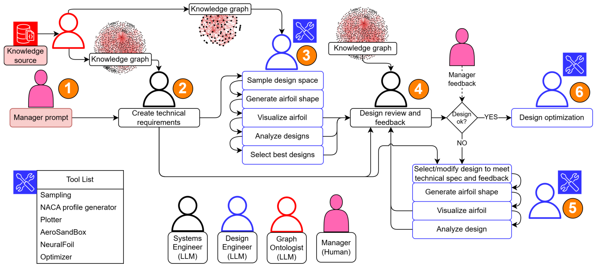

**图 1：** 基于 LLM 的多智能体工作流程示意图，由图谱本体专家、设计工程师和系统工程师三个 LLM 智能体组成，各自承担指定任务。设计工程师与系统工程师获得针对各自角色定制的知识图谱。设计工程师配备一组工程工具，用于完成任务。系统工程师利用多模态语言模型评审设计工程师生成的翼型，并提出设计改进建议。随后，设计工程师根据反馈更新方案，提交下一轮评审。流程也允许管理者（本文中为人类用户）提出改进反馈。当管理者认为某个设计适合作为进一步优化的候选方案时，设计与评审循环结束。各组成部分及流程步骤将在第 4 节详细讨论。

*图内标签译释：Knowledge source = 知识来源；Knowledge graph = 知识图谱；Manager prompt = 管理者提示；Create technical requirements = 生成技术需求；Sample design space = 设计空间采样；Generate airfoil shape = 生成翼型形状；Visualize airfoil = 翼型可视化；Analyze designs = 分析设计；Select best designs = 选择最佳设计；Design review and feedback = 设计评审与反馈；Design okay? = 设计是否可接受？；Manager feedback = 管理者反馈；Select/modify design to meet technical spec and feedback = 选择或修改设计以满足技术规范与反馈要求；Design optimization = 设计优化。工具列表包括采样、NACA 翼型生成器、绘图器、AeroSandbox、NeuralFoil 和优化器。*

随着 CAD/CAE 和产品生命周期管理（PLM）基础设施逐渐成熟，MAS 研究转向分布式协作与互操作性。智能体框架通过协调代理和共享本体，协调异构工具，支持可制造性、成本及生命周期分析 [17-20]。领域专用系统用于结构、工艺及装配设计，也用于知识管理和流程协调，但需要付出较高的知识工程成本 [21-25]。较新的研究将 MAS 集成到与 CAD 相衔接的流程中，实现多层级三维协作、考虑可持续性的设计，以及自动化分析与优化循环 [26-28]。知识型智能体和信念-愿望-意图（BDI）式智能体进一步支持可解释的设计评估及数字化设计评审，强化了 MAS 的潜力，同时也突显出可扩展知识维护和几何推理方面仍存在的挑战 [29-31]。

近年来，LLM 的快速发展催生了新的研究方向，即在工程环境中开发和使用由 LLM 驱动的 MAS。在 MAS 框架兴起之前，一些研究已经证明单个 LLM 助手在工程流程中的价值 [32-36]。不过，近期研究观点认为，MAS 框架更适合处理端到端设计流程，因为不同设计阶段需要不同的智能体技能组合。DesignGPT [37] 等早期 LLM 多智能体探索，展示了面向通用产品设计、利用生成式 AI 图像生成的设计流程。然而，该框架并未解决需要领域知识的具体工程问题，因此容易产生幻觉。文献 [38] 和 [39] 提出 MAS 框架，由负责需求工程、几何建模和视觉验证的 LLM 智能体协同工作，将以文本或草图表达的用户需求转换为 CAD 模型。

文献 [40] 引入一种由 LLM 辅助的智能体，从生物材料设计领域的 1000 篇科学论文中构建并查询大型本体图谱。文献 [41] 将其进一步扩展到 MAS，以自主生成并改进新材料发现的研究假设。文献 [42] 回顾了从 LLM 推理到自主智能体的发展路径，介绍了智能体工具使用、记忆和多智能体协调的一般设计。文献 [43] 提出工程设计中的 AI 协作框架（AICED），由四个 LLM 智能体利用专业人员提供的必要设计知识，执行市场研究、文档编制、设计和可制造性任务。文献 [44] 将一组智能体集成到汽车设计流程，提出一个 MAS 框架，自动执行概念草图绘制、形状检索和 CFD 网格生成等任务。文献 [45] 推进了针对工程设计的 LLM 智能体工作流程，利用 TRIZ [46] 和质量功能展开（QFD）[47] 等设计工具，自动完成需求收集及评估标准制定。该框架通过设计循环，评估并改进自主应急响应飞行器问题的概念方案 [48]。

机械工程设计智能体（MEDA）[49] 将 MAS 用于参数化 CAD 模型创建，由相互协作的智能体将设计意图映射为 CAD 特征。文献 [50] 针对昂贵黑箱目标下的设计空间搜索，提出考虑成本的 MAS，用来模拟设计团队的序列决策过程。该方法结合贝叶斯优化与强化学习，将设计空间探索任务分配给多个智能体。文献 [51] 在“生成者-评审者”框架中利用视觉语言模型生成并评估概念：生成者产生初始概念，再根据评审者的反馈迭代改进；评审者对设计适用性提供定性与定量反馈。文献 [52] 使用多智能体框架进行太阳能净水系统概念设计，由专门智能体在迭代循环中完成功能分解、设计生成、评估和评分。不过，我们注意到，该框架依赖 LLM 智能体现有的知识库，也未采用人在回路中的理念。文献 [53] 提出自主水质监测系统设计的多智能体框架，包括代表机械设计师、仿真人员和电子设计师的智能体。机械设计师使用一组基于代码的工具开展构思，电子设计师则利用技术数据表中的知识提出合适的电子元件。更宏观地，文献 [54] 阐述了向智能体 AI 框架转变、实现工程流程自动化的范式变化。

综述现有文献后，我们发现，工程实践本质上具有协作性、迭代性和对领域知识的高度依赖，因此将 MAS 集成到工程设计流程中面临重大挑战。传统设计依赖结构、材料和制造工程师等多个专家之间的协调。其推理过程要么需要编码进大型知识库，要么需要从海量数据中学习，两者都耗费大量资源 [55, 56]。有效部署 MAS 还需要深厚领域知识，包括设计因素、制造约束和法规要求，而这些知识很难表示成适合自主智能体有效推理的形式。此外，理想的 MAS 应能根据特定知识集自动调整设计参数、重新运行分析，并标记潜在设计问题。然而，现有系统往往缺乏完成这种精细问题求解所需的复杂自适应决策能力 [57]。尽管多智能体框架为编码和管理这类领域专业知识提供了有前景的途径，如何让其与现有工程工具交互并适应迭代设计过程，仍有待研究。因此，本工作的主要目标包括：

- 采用配备现有领域专用知识的 LLM 智能体，在“生成者-评审者”设置下履行具体工程角色。
- 将 MAS 集成到迭代设计框架中，使一个 LLM 智能体的输出帮助另一个智能体完成决策和任务。
- 为智能体配置专门的工程工具，支持其成功完成任务。
- 允许人在回路中的交互，为流程提供必要的检查与制衡。

## 3. 问题设置

NACA 翼型的设计，历来在航空空气动力学的发展中发挥着关键作用 [58]。美国国家航空咨询委员会（NACA）开发了多个翼型族，并根据几何和气动特性进行分类，其中四位数和五位数系列得到广泛使用。NACA 翼型的重要性主要体现在可预测的气动性能，使其在学术研究和实际应用中都具有重要作用 [59]。这种可预测性简化了对翼型形状如何影响升力、阻力及整体气动效率的分析，也使其成为展示我们多智能体设计流程的教学示例。

翼型形状由最大弯度、最大厚度和最大弯度位置等参数定义。这些参数显著影响翼型气动性能。参数的微小变化可能导致翼型周围压力分布显著变化，从而改变整体气动性能 [60]。例如，增大最大弯度通常会增加升力，也会增加阻力；改变最大弯度的位置会影响压力梯度，并可能影响失速特性。理解并精确控制这些关系，对有效的翼型设计至关重要。四位数 NACA 方程是生成这些翼型的基础 [59]，见式（1）：

```text
y_t = 5t(0.2969√x − 0.1260x − 0.3516x² + 0.2843x³ − 0.1015x⁴)    （1）
```

其中，`y_t` 为沿弦长位置 `x` 处的半厚度，`t` 为最大厚度与弦长之比。本研究考虑由最大弯度 `c_max`、最大弯度位置 `c_loc` 和最大厚度 `t_max` 定义的设计空间：

```text
D := [0.01, 0.095] × [0.05, 0.9] × [0.01, 0.40]
(c_max, c_loc, t_max) ∈ D                                         （2）
```

本研究的核心目标，是设计高效 NACA 翼型，在马赫数 0.6、雷诺数 5 × 10⁶ 时最大化升阻比。这是翼型设计验证的典型试验工况 [61]。此外，为简化初始设计阶段，我们假设攻角为 0°。这样可以集中研究基本形状选择和优化，而不必考虑攻角引入的复杂性。选择该设计问题，既因为其简单，也因为现成技术文献丰富，而这些文献将用于后续构建知识图谱。

问题定义可根据管理者需求调整，但本文仅关注上述工况。此外，翼型设计所选几何参数也会带来非功能性约束。例如，过于尖锐的前缘虽然可能降低阻力，但在制造与使用中可能缺乏结构可行性。这些考虑被嵌入工程师智能体的知识来源，从而在设计选择和评估中采用整体性方法。

为应对这一优化挑战，我们采用 AeroSandbox [62] 和 NeuralFoil [63] 等先进工具。AeroSandbox 支持流体仿真和气动分析，NeuralFoil 利用机器学习预测新翼型的气动特性，从而改进设计。二者集成后，为高效迭代设计与分析提供稳健框架。第 4 节将详细介绍这些工具。需要说明的是，虽然本研究聚焦于一个具体气动设计问题，采用的方法也可适用于其他设计情境。

## 4. 方法

### 4.1. 工程师智能体的知识图谱

为赋予 LLM 智能体领域专业能力，使其在工程设计中作出有依据的决策，我们利用知识图谱（KG）表示结构化知识 [64]。KG 提供一种强大且高效的方式来编码大量已有知识，超越简单的文本信息检索 [65-67]。图结构表示能够发现概念之间的新联系和新想法，即便某些概念在人类直觉中相距甚远，也可能在本体层面相互关联。在隐性知识和相互依赖普遍存在的复杂工程领域，这种发现隐藏关系的能力尤其有价值。

我们使用两个不同 KG，表示不同层次的知识抽象，从而模拟 LLM 智能体不同程度的专业能力，呼应现实工程实践中专业能力的多样性。这两个 KG 由专门的图谱本体专家智能体 [40] 生成。它依据一组预先定义的指令工作，针对不同智能体构建知识图谱。这种受控生成过程保证各图谱所编码知识的一致性与相关性。

图谱内容来自涵盖 NACA 翼型设计和研发的已发表报告与论文语料库。资料跨越较长时期，从 20 世纪 40 年代早期 NACA 研究，到 2010 年代较新的出版物，能够有效捕捉几十年间知识与最佳实践的演进。这样的长期视角对于模拟专家工程师多年训练和实践形成的经验与理解至关重要。它避免了仅依赖最新信息的弊端，确保基本原则和历史背景也被纳入智能体的知识库。

LLM 智能体中的 KG 为设计选择遵循一致实践和已有研究结论提供关键基础。没有这种结构化知识，智能体容易生成不一致或次优的设计与回答。KG 也提供透明性和可解释性，使我们能够追溯设计建议的来源，理解智能体决策背后的推理 [68]。这一能力对于建立信任、促进设计过程中的人类监督十分重要。下一节将详细介绍知识图谱创建过程，以及图谱本体专家如何构建这些资源。

### 4.2. 图谱本体专家智能体

为给设计工程师与系统工程师构建专门的知识图谱，我们采用了图谱本体专家智能体。这个 LLM 智能体专门从非结构化文本中提取并组织知识，构成知识图谱的基础。它利用 LLM 理解上下文并推断语义关系。用于知识图谱生成的语料包括 50 篇科学论文和报告，覆盖数十年的 NACA 翼型设计与研发。

首先，通过一系列预处理步骤整理论文中的原始数据，包括将 PDF 转换为标记语言格式，再将文本分割成易于处理的块。我们依据经验选择 3000 的块大小，使其代表语义连贯的信息单元，从而让图谱本体专家专注于局部知识提取。随后，它处理每个文本块，提取局部知识图谱三元组，表示关键概念之间的关系。每个三元组包含两个节点，各代表从本体中提取的重要概念，以及一个描述两个概念关系的边特征。三元组集合定义如下¹：

```text
node1：“从提取的本体中得到的一个概念”
node2：“从提取的本体中得到的一个相关概念”
edge：“用一到两句话描述 node1 与 node2 之间的关系”
```

这种明确的定义指导智能体的提取过程，保证知识表示一致且可解释。KG 生成过程采用文献 [69] 的方法。

¹ 知识图谱生成代码来自 [rahulnyk/knowledge_graph](https://github.com/rahulnyk/knowledge_graph)。

本研究使用的两个 KG 在范围和细节方面有显著差异。第一个 KG 面向系统工程师，覆盖翼型和飞机研发的广泛方面，包括设计考虑、制造过程、验证程序和实验证据。它代表经验丰富的系统工程师的视角，这类工程师在不同产品设计情境中监督气动系统研发，具有丰富经验。图谱中的关系强调设计生命周期不同阶段的相互依赖，以及设计决策对整体系统性能的影响。

第二个 KG 由设计工程师使用，更聚焦于影响翼型形状及其后续气动性能的具体设计因素。该图谱主要关注设计变量之间的关系、变量对关键性能指标的影响，以及实际应用中的典型数值，旨在为设计工程师构建更细粒度的知识库。为获得这两个不同 KG，我们向图谱本体专家提供了两组提示词，见图 2。采用 Mistral-NeMo 模型迭代处理文本块、提取三元组，利用其理解复杂句子结构和识别细微语义关系的能力。

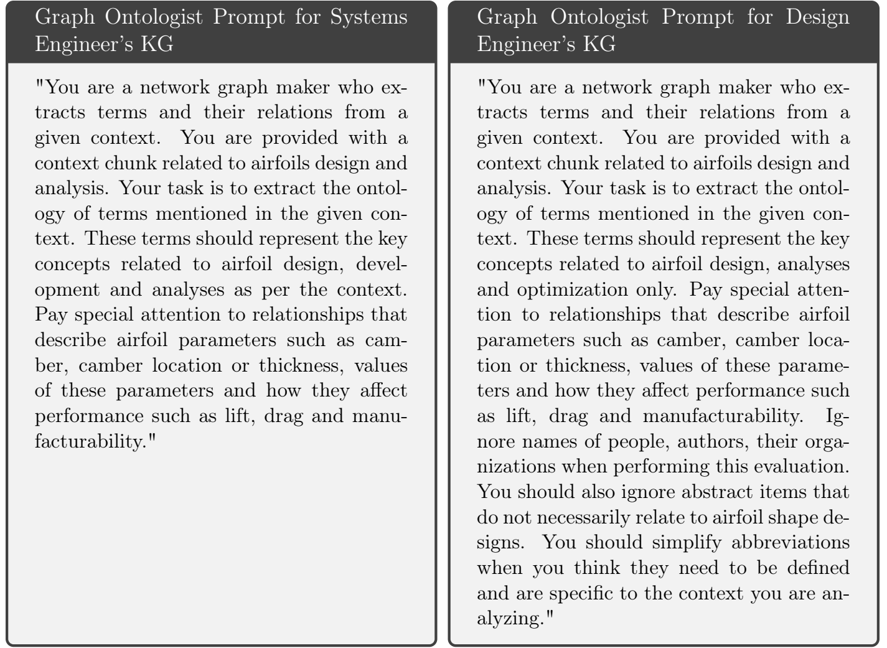

**图谱本体专家提示词：系统工程师的 KG**

> “你是一名网络图谱构建者，需要从给定上下文中提取术语及其关系。你将获得一个与翼型设计和分析有关的上下文片段。你的任务是提取给定上下文中提到的术语本体。这些术语应代表上下文中涉及的翼型设计、研发和分析的关键概念。特别注意描述翼型参数的关系，例如弯度、弯度位置或厚度，这些参数的数值，以及它们如何影响升力、阻力和可制造性等性能。”

**图谱本体专家提示词：设计工程师的 KG**

> “你是一名网络图谱构建者，需要从给定上下文中提取术语及其关系。你将获得一个与翼型设计和分析有关的上下文片段。你的任务是提取给定上下文中提到的术语本体。这些术语应仅代表与翼型设计、分析和优化相关的关键概念。特别注意描述翼型参数的关系，例如弯度、弯度位置或厚度，这些参数的数值，以及它们如何影响升力、阻力和可制造性等性能。在执行评估时，忽略人员、作者及其组织的名称。也应忽略与翼型形状设计未必相关的抽象项。当你认为某些缩写需要定义且专属于正在分析的上下文时，应将其展开说明。”

**图 2：** 为工程师智能体生成两个不同 KG 时，提供给图谱本体专家的提示词。系统工程师 KG 的目标更加通用，因此形成的知识领域比设计工程师 KG 更广；后者更聚焦于翼型设计相关内容。

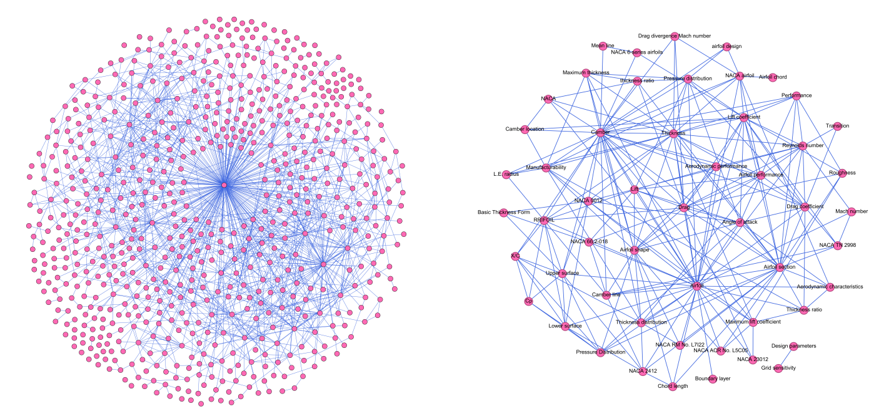

（a）作为系统工程师智能体知识库的知识图谱。  
（b）作为设计工程师智能体知识库的知识图谱。

**图 3：** 图谱本体专家为两个工程师智能体生成的知识图谱。系统工程师的 KG 约有 700 个节点，设计工程师的 KG 约有 50 个节点。注意，这些图谱仅保留度数不小于 10 的节点；其余节点被滤除，以使知识库更紧凑。

随后，将各文本块生成的局部图谱整合为全局知识图谱。该过程包括合并代表相似概念的节点，删除未与图谱其余部分连接的“悬挂”节点；这些节点可能意味着提取错误。相似节点的合并使用基于节点嵌入的相似度度量，确保语义相关概念整合为统一表示。在拼接过程中提高边权重，以反映支持概念关系的累计证据。图 3 可视化了两个智能体的最终知识图谱，展示每个图谱中节点和边的分布。图谱结构及其视觉表现的差异，突出不同提示词对图谱本体专家的影响，也展示该方法构建专门知识资源的适应性与实用性。

### 4.3. 系统工程师智能体

系统工程师智能体承担资深系统工程师的职责，利用全面的知识库和先进推理能力生成技术需求、评审设计，并根据知识提出设计改进建议。该智能体的设计借鉴成熟的系统工程实践。在此类实践中，系统工程师发挥集成者的作用，确保技术规范、设计选择和项目整体目标保持一致。系统工程师智能体采用分层架构，整合几个关键组件：知识来源、提示词工程模块和 LLM 执行引擎。

智能体的有效性直接取决于知识库的质量及其可访问性。知识来源代表多年实践积累的集体经验和专业能力。我们将其表示为知识图谱，并以包含节点和关系的 CSV 文件实现。这种表示支持结构化信息存储与检索，帮助智能体作出有依据的决策。为处理知识图谱的规模，CSV 内容被切分为易于处理的块，每块附有块 ID、来源引用和行范围等元数据 [70]。这种分块策略优化了嵌入与检索过程。

随后，使用嵌入模型 OpenAI 的 `text-embedding-3-small` 处理文本块，生成向量表示 [71]。这些向量存储在向量数据库中，以高效执行相似性搜索。向量数据库能够根据与用户查询的语义相似性，快速识别相关知识 [72]。向量嵌入使智能体能够理解查询的潜在含义，检索与上下文更加相关的信息。

运行时，系统工程师智能体通过提示词工程模块，将用户提示转换为“搜索查询”。这一转换通常借助 LLM 自身对原提示重新表述或扩展，确保有效捕捉用户意图。接着，用改写后的查询搜索向量数据库，检索排名最高、最相关的文本块。再将检索到的块附加到用户原始提示中，为智能体生成全面且有依据的回答提供必要上下文 [71]。这一过程模拟人类系统工程师查阅内部文档和既往经验、应对新设计挑战的方式。附录 A1 通过实际示例展示了从图谱检索知识的过程，以验证“需求生成”步骤中的检索增强生成（RAG）机制。

系统工程师智能体在框架中执行几项关键任务：

- **技术需求生成：** 根据用户提示，结合知识来源生成技术需求。我们向 LLM 智能体提供相应的情境角色，以完成任务，确保结果一致并遵循成熟工程原则。这一能力简化了需求获取过程，减少歧义或遗漏的可能性。使用知识来源的一个重要优势，是能够同时制定功能性和非功能性需求。
- **翼型设计评审：** 评估新的翼型方案，依据已有技术需求进行比较，并利用积累的设计知识。智能体接收设计工程师生成的翼型轮廓及相应气动性能结果。关键在于，它结合多模态视觉模型，对翼型轮廓图和性能数据进行视觉评估。与只依赖数值数据相比，这种能力支持更细致的评估，可考虑视觉对称性、平滑性和整体美观程度等因素。随后向设计工程师提供反馈，指出潜在改进方向并建议替代设计方法。

智能体对翼型设计的反馈由两方面共同驱动：设计是否符合技术需求，以及借助知识库中与具体设计有关的既往经验。知识库体现了对设计权衡、潜在失效模式和最佳实践的累积认识。智能体利用这些知识预判潜在问题，主动提出设计改进建议，确保最终设计满足所需性能特征。该智能体采用 Google 的 `gemini-2.5-flash` LLM 完成任务。

### 4.4. 设计工程师智能体

设计工程师智能体在多智能体系统中承担关键的中级工程师角色，旨在自动化并提升翼型设计过程。它负责创建、分析、可视化和改进翼型方案的迭代循环，并与系统工程师密切合作，确保设计可行、符合整体系统需求，从而实现性能目标。

其核心功能围绕管理设计空间、生成候选翼型、分析气动性能，以及根据反馈迭代改进设计展开。该过程并非线性序列，而是连续循环；分析所得的新认识会触发设计调整和后续评估。下面介绍该智能体的核心任务及工具。

#### 4.4.1. 设计空间采样

智能体首先对设计空间进行采样，采用多种策略生成多样化的候选翼型。**采样工具（Sampling tool）**是定制的 Python 函数，提供拉丁超立方、Sobol、Halton 和随机采样选项。每种策略具有独特特点，适用于不同设计探索目标。该工具生成最大弯度、最大弯度位置和最大厚度的参数值组合，以定义四位数 NACA 翼型几何。

#### 4.4.2. NACA 翼型生成

采样设计参数后，**NACA 翼型生成器（NACA profile generator tool）**使用标准四位数 NACA 翼型方程，生成相应的翼型坐标。这一方程以数学方式表示翼型几何，通过调整最大弯度位置、最大弯度值和最大厚度值三个关键参数，可以创建多种翼型形状。需要注意，这些初始方案并非最终产品，而是后续改进的起点。

#### 4.4.3. 翼型可视化

随后使用**绘图工具（Plotting tool）**对生成的翼型形状进行可视化。该工具是利用翼型坐标绘制其形状的 Python 函数。这些可视化图像对系统工程师评审至关重要，使其能够依据技术需求，尤其是非功能性需求，对各方案进行定性评估。

#### 4.4.4. 使用 AeroSandbox 和 NeuralFoil 进行气动分析

可视化完成后，使用 **AeroSandbox 工具**评估生成方案的气动性能。AeroSandbox 是一个基于 Python 的开源框架 [62]，在统一计算环境中整合基于物理的气动模型、结构建模和多学科优化。与传统 CFD 工具不同，它使用涡格法、薄翼理论等低保真气动模型，并通过 CasADi 等工具结合自动微分能力。这种方法支持快速探索设计空间，对翼型、机翼和完整飞机布局进行基于梯度的优化。

与 AeroSandbox 配合使用的是 **NeuralFoil**，一种基于机器学习的翼型分析工具，采用在大量 XFOIL 仿真数据上训练的神经网络 [63]。NeuralFoil 能在广泛的雷诺数和攻角范围内预测气动系数（`C_l`、`C_d`、`C_m`），以可接受的精度近乎即时地给出预测结果。通过用学习得到的代理模型替代数值流动求解，NeuralFoil 显著节省计算量，特别适用于实时应用、优化循环，以及不宜开展 CFD 仿真的情境。该工具主要用于设计分析与优化。

#### 4.4.5. 设计优化

设计优化是设计过程的最后一步，将迭代设计阶段选出的候选方案针对设计目标进行优化。**优化工具（Optimization tool）**使用 Kulfan 坐标，在优化阶段表示和调整翼型几何 [73]。相较传统笛卡尔坐标，Kulfan 坐标能更平滑、更稳定地表示翼型形状，尤其适合较大的几何变化。这一特点避免了突变，使设计演进更加可控，从而促进优化。优化器采用多目标优化程序，平衡升力、阻力系数等气动性能指标，同时满足收敛所需的其他一般约束。

#### 4.4.6. 设计选择与修订

设计工程师生成的方案，由系统工程师在迭代过程中评审。设计工程师收到关键反馈后，结合自身背景知识和反馈启动设计选择与修订过程。随后，对方案进行适当修改，再次提交新设计样本供评审。

设计工程师在结合系统工程师反馈、技术需求以及自身知识库迭代改进方案方面发挥关键作用。例如，若系统工程师建议降低厚度以利于制造，设计工程师可以在知识指导下选择较小的最大厚度值，生成新翼型。这种由领域知识驱动的智能体交互，会产生考虑上下文的建议，同时顾及即时性能目标、更广泛的系统需求和制造限制。这种整合使设计工程师能够以更高的智能性和适应性运行，持续朝最佳性能和可行性改进方案。设计工程师采用 OpenAI 的 `gpt-4o` LLM 完成任务。

### 4.5. 管理者（人类用户）

框架包含管理者角色，代表负责引导设计探索过程的人类用户。管理者并不直接操纵基于 LLM 的设计智能体，而是充当把关者和评估者，确保生成的方案符合项目整体目标、约束及不断变化的需求。管理者对于注入领域专业知识、处理自动化系统可能忽略的细节至关重要。

管理者从问题定义阶段开始参与，形成初始设计问题并传达给 LLM 设计智能体，确定后续探索范围。在最终设计选择阶段，管理者严格评估数量有限的候选方案，通常是设计工程师选出的排名靠前的方案。这种评估会考虑自动化系统不易量化的因素，例如审美偏好、可制造性和未来规模扩展的潜力。

管理者还有权决定设计循环何时结束。当管理者明确接受某个设计，表明已经得到满意结果时，即触发终止条件。此外，管理者终止流程的能力也使流程能灵活适应项目需求变化，或在识别出存在根本缺陷的设计方法时及时调整。这提供了纠偏机制，确保设计过程能够响应不断演变的需求。因此，这种人在回路中的框架既利用 LLM 智能体的能力，也保留人类专业判断这一关键因素，支持更加稳健、适应性更强的工程设计。

### 4.6. 工作流程

本节介绍图 1 所示多智能体工作流程的操作顺序。该系统包含由管理者、系统工程师和设计工程师组织的主设计流程，以及由图谱本体专家管理的辅助流程。辅助知识图谱生成流程在主设计流程之前执行，为后续设计迭代奠定知识基础。这种顺序安排旨在发挥各角色的优势：管理者（人类用户）提供高层方向，系统工程师转化需求，设计工程师生成并改进方案，图谱本体专家提供结构化知识。主设计流程由六个步骤组成。

**1. 启动。** 流程首先进入启动阶段，由管理者向系统工程师提供初始提示。提示概述问题目标，作为设计过程的起点。管理者提供的初始提示为：

> **管理者的启动提示**  
> “开发一款在 Mach = 0.6 时具有最大升阻比的 NACA 四位数系列翼型。在这一研发阶段，可近似假设 Re = 5 × 10⁶，AoA = 0°。”

选择 Mach = 0.6、Re = 5 × 10⁶ 和 AoA = 0，代表一系列应用中的典型试验工况，有利于开展具有实际相关性且重点明确的设计探索。

**2. 需求获取阶段。** 启动后，系统工程师执行需求获取任务。这个关键步骤将初始提示转化为更加详细、具有技术依据的工程需求。KG 在此发挥重要作用，利用已有知识细化模糊目标，并将其转化为可量化的设计指标。例如，“设计需要尽量减小阻力”这样的笼统要求，可以通过 KG 中的结构化知识转换为“设计必须满足 `C_d < 0.01`”。上述阻力系数上限等功能性需求，可以直接评估验证。“翼型外观必须对目标客户具有美感”等非功能性需求，对全面设计考量同样不可或缺，但更难量化，可能需要 LLM 智能体进行定性评估。

以最大升阻比的初始提示为例，包含气动原理和设计最佳实践的 KG 可以导出目标 `C_l` 范围或最大允许 `C_m` 等具体功能性需求。非功能性需求则可能包括制造可行性约束或审美偏好。

**3. 设计阶段。** 后续设计阶段主要由设计工程师负责，包括以下子阶段：

（a）**设计空间采样：** 智能体依据预设策略生成最大弯度、最大弯度位置和最大厚度等设计参数。我们选择 100 个设计样本，以探索合理比例的设计空间，又不使后续分析和评审负担过重。

（b）**翼型形状生成：** 将选定设计参数输入 NACA 翼型生成器，生成翼型轮廓。该工具默认在上、下表面各生成 200 个点。

（c）**翼型可视化：** 使用绘图工具生成这些轮廓的可视化表示，便于在整个设计过程中直观理解和沟通。

（d）**翼型分析：** 使用前述 NeuralFoil 和 AeroSandbox，对生成翼型进行气动分析。主要关注量（QoI）包括升力系数 `C_l`、阻力系数 `C_d` 和俯仰力矩系数 `C_m`。

（e）**筛选：** 分析后，剔除 `C_l < 0.5` 的翼型。这一标准体现稳定飞行所需最低升力的实际工程约束，避免保留不适合预期应用的方案。随后，将排名前 10 的设计送交评审，有效降低系统工程师的负担，也契合现实工程团队通常面临的时间限制。

**4. 设计评审与反馈。** 本阶段利用 `gemini-2.5-flash` 多模态模型的能力。多模态输入很重要，因为系统工程师可以同时分析翼型轮廓图像及相应性能数据。例如，多模态 LLM 可评估翼型前缘的平滑程度，或将 `C_d` 的突然增加与轮廓中的某种视觉异常联系起来。管理者也可以在此阶段提供反馈，使设计符合更广泛的项目目标。反馈被整合进设计过程，引导设计工程师开展后续修改。

**5. 设计选择与修订。** 评审后，设计工程师选出最有潜力的候选方案，并吸收系统工程师提出的设计变更反馈。该方案在迭代循环中持续接受评审和修改，直到管理者认为它有效。随后，将最终候选方案传入 NeuralFoil 框架内嵌的优化工具。

**6. 优化。** 优化器利用从技术需求和预配置选项中得到的目标及约束，收敛到最优解。优化算法与具体目标是影响最终设计质量和优化效率的重要因素。

## 5. 实验

本节详细介绍工作流程中的主要发现，展示在翼型设计过程中，LLM 智能体与人在回路中的交互如何协同发挥作用。我们按事件顺序介绍从初始技术需求生成，到翼型形状最终优化的过程。

### 技术需求的生成

设计过程从阶段 2，即生成技术需求开始。系统工程师在管理者提示的引导下，综合形成如下完整技术需求文档。该文档为整个团队提供关键指导，明确翼型设计必须满足的功能性与非功能性标准。系统工程师能够利用其知识库，而该知识库可认为受到成熟工程原理和设计标准的支持，从而保证技术需求相关且全面。这个初始步骤奠定重要基础，减少歧义，并为后续设计阶段明确目标。

**功能性需求**

> **目标函数：** 首要目标是最大化翼型截面的升阻比（`C_l/C_d`）。
>
> **翼型族：** 翼型设计必须严格遵循 NACA 四位数系列几何。
>
> **几何参数：**
>
> - **最大弯度（m）：** NACA 四位数系列的第一位数字，表示最大弯度占弦长的百分比。`m` 的设计空间限定为 0% ≤ m ≤ 9%。预期通过非零弯度在 AoA = 0 时产生升力。
> - **最大弯度位置（p）：** NACA 四位数系列的第二位数字，表示最大弯度距前缘的位置，以十分之一弦长为单位。`p` 的设计空间限定为 0 ≤ p ≤ 9，即弦长的 0%-90%。
> - **最大厚度（t）：** NACA 四位数系列的最后两位数字，表示最大厚度占弦长的百分比。`t` 的设计空间限定为 6% ≤ t ≤ 20%，以控制 M = 0.6 时的阻力，避免阻力系数过大。
>
> **工作条件：**
>
> - **马赫数（M）：** 设计必须针对自由来流马赫数 0.6 优化。
> - **雷诺数（Re）：** 设计必须针对约 5 × 10⁶ 的雷诺数优化，以弦长为基准。
> - **攻角（AoA）：** 设计必须针对 0° 攻角优化。
>
> **性能指标：** 设计必须给出指定工作条件下升力系数（`C_l`）、阻力系数（`C_d`）及对应升阻比（`C_l/C_d`）的量化数值。

**非功能性需求**

> **可制造性：** 最终翼型几何应适合采用常规方法制造，具有实际可行性，避免出现显著增加生产复杂性或成本的特征。
>
> **气动性能：**
>
> - **临界马赫数：** 设计翼型应力求具有大于 0.6 的临界马赫数，以尽量减轻在工作马赫数下显著可压缩性效应（例如波阻）的出现。设计翼型应力求具有大于 0.6 的临界马赫数，以尽量减轻在工作马赫数下显著可压缩性效应（例如波阻）的出现。
> - **边界层特性：** 设计必须考虑 Re = 5 × 10⁶ 时的边界层转捩和分离特性，以尽量减小型面阻力，并保证流动稳定。
> - **压力分布：** 翼型几何应在 AoA = 0、M = 0.6 时沿弦向形成有利的压力分布，支持高升力和低阻力。
>
> **分析兼容性：** 翼型几何必须与标准计算流体力学（CFD）或面元法工具（例如 XFOIL）兼容，以准确评估气动性能。
>
> **鲁棒性：** 理想情况下，设计应具有合理的性能适用范围，即相对于指定工作条件（M = 0.6、Re = 5 × 10⁶、AoA = 0）的小幅偏离，不会导致性能大幅下降。

### 初始设计生成与可视化

随后，阶段 3 启动设计生成。设计智能体使用拉丁超立方采样，生成初始 100 个多样化翼型设计，再生成翼型形状并进行可视化。图 4 所示可视化有助于直观理解方案之间的变化，也便于系统工程师和管理者在设计评审阶段开展视觉评估。

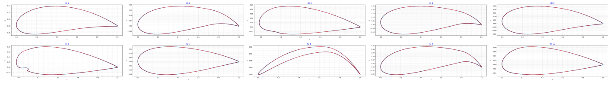

**图 4：** 设计工程师使用 NACA 生成器和绘图工具得到的初始翼型样本。图中展示了在阶段 2 完成参数选择后、本步骤生成的 100 个样本中的 10 个。

### 设计分析与筛选

初始设计生成后，开展设计分析和筛选，以减少首次评审的方案数量。使用 NeuralFoil 评估每个设计的气动性能。接着，设计智能体剔除升力系数（`C_l`）小于 0.5 的方案；这一准则用于保证基本气动性能。筛选通过支持方案排序和过滤的 Python 函数完成。图 5 展示了选入设计评审的翼型样本。

我们注意到，厚度较小的翼型具有较高升力，因而出现在筛选后列表的前列。不过，由于难以满足可制造性等非功能性需求，其中一些设计在后续评审中被系统工程师判定为无效。

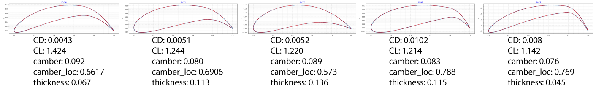

**图 5：** 供系统工程师智能体开展设计评审的初始筛选样本。

*图内标签译释：CD = 阻力系数；CL = 升力系数；camber = 最大弯度；camber_loc = 最大弯度位置；thickness = 最大厚度。几何参数以弦长比例表示。*

### 初始设计评审

在阶段 4，系统工程师利用较大知识库提供的专业能力以及视觉 LLM，依据先前确定的技术需求评估所提方案。评估细致考虑气动性能和技术规范符合性，尤其关注定性的非功能性需求。系统工程师为每个方案提供明确反馈，判定其为“无效”（无法满足技术需求）或“有效”。这一结构化反馈机制对于引导设计工程师后续修订、确保设计过程收敛到良好候选方案十分关键。

下面展示系统工程师对阶段 4 初始样本给出的反馈。此外，附录 A2 提供一个示例，说明系统工程师在评审某个翼型轮廓及其气动数据时，使用的背景推理与任务分解过程。

**设计 ID-22 的反馈**

> “翼型轮廓（ID-22）在视觉上呈现平滑的有弯度形状，具有常规前缘和后缘，表明它是形状良好的 NACA 四位数系列翼型。气动数据表现优异：在指定工作条件（M = 0.6、Re = 5 × 10⁶、AoA = 0）下，升力系数（`C_l`）为 1.244，阻力系数（`C_d`）仅为 0.00508，对应出色的升阻比（`C_l/C_d`）244.88。几何参数弯度 0.08015、弯度位置 0.69065、厚度 0.11287 均处于定义的设计空间内，并有效支持这种高性能。
>
> 如需进一步改进，可考虑探索稍靠前的弯度位置，例如弦长的 40%-50%。将弯度向前缘移动能够增加升力，可能进一步提高 `C_l/C_d`。此外，详细的压力分布分析和临界马赫数评估，可以为优化提供更深入认识。”
>
> **Valid：true（有效）**

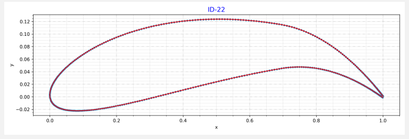

**设计 ID-36 的反馈**

> “图中翼型轮廓形状清晰，具有明显弯度，符合产生升力的翼型特点。当前设计气动性能优异：在指定工作条件（M = 0.6、Re = 5 × 10⁶、AoA = 0）下，升力系数很高（`C_l = 1.42`），阻力系数极低（`C_d = 0.0043`），升阻比达到 330.79。几何参数为：弯度 9.2%，弯度位置为弦长的 66.2%，厚度为弦长的 6.7%。
>
> 厚度和弯度位置均在指定设计空间内，但最大弯度 9.2% 略高于功能性需求中 9% 的上限。为严格满足 NACA 四位数系列几何约束，应将最大弯度调整为不超过 9%。进一步优化可以探索将弯度位置稍向前移，例如弦长的 40%-50%，以改善升力特性或压力分布；同时建议开展临界马赫数分析，确认符合非功能性需求。”
>
> **Valid：false（无效）**

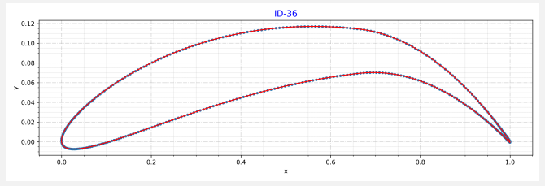

**设计 ID-78 的反馈**

> “翼型 ID-78 在视觉上很薄且有弯度，气动性能出色：升力系数较高（`C_l = 1.14`），阻力系数很低（`C_d = 0.0085`），升阻比达到 134.45。这主要归因于位于较后位置（弦长的 76.97%）的较大弯度（7.62%）。
>
> 然而，该设计存在严重问题：最大厚度 4.59% 低于功能性需求中 6% 的最低要求，即 `t` 的设计空间为 6% ≤ t ≤ 20%。这种极小厚度虽然可能有助于提高临界马赫数，却会对可制造性和结构完整性带来严重隐患。为改进设计，应将最大厚度增加至至少 6%，理想目标为 6%-8%，以在保持良好气动效率的同时满足需求。”
>
> **Valid：false（无效）**

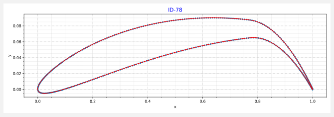

### 迭代设计修订与评审

根据系统工程师反馈和设计相关知识库，设计工程师选择一个方案进一步改进。它依据系统工程师建议修改设计参数，绘制修改后的翼型，并使用 AeroSandbox 评估性能。随后，将该方案提交给系统工程师与管理者，开展迭代式评审与修订。以下智能体回答展示了从设计 KG 中提取的知识、选择最佳候选方案的理由，以及具体设计修改。

**设计修订 1：设计者的推理**

> **设计参数：** 最大弯度 9%（0.09）；弯度位置 50%（0.5）；厚度 12%（0.12）。
>
> **理由：** 最大弯度设为 9%，在遵守功能性需求上限的同时尽可能提高升力。根据反馈建议和知识库支持，将弯度位置移动到弦长的 50%，以改善升力特性。厚度设为 12%，保证可制造性和结构完整性，也处于指定设计空间内。
>
> **知识来源引用：** 将弯度位置向前缘移动能够提高升力。更大的弯度可能提高升力系数，但也可能因流动分离而增加阻力。厚度影响阻力和可制造性。
>
> 已使用 `generate airfoil` 工具，按指定参数生成修订后的翼型设计。

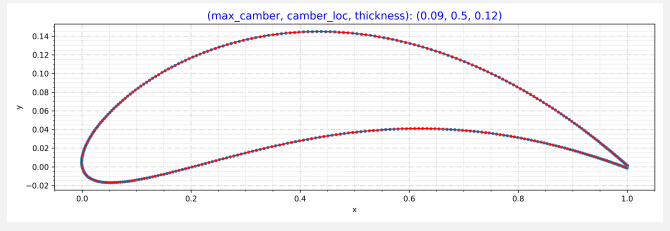

随后，由系统工程师和管理者共同评审。系统工程师的反馈如下，将设计者提供的设计规范与满足 NACA 翼型标准这一功能性需求进行对比。同时，系统工程师识别出改进方向，例如调整弯度位置以改善俯仰力矩。

**设计修订 1：系统工程师反馈**

> “根据几何参数（弯度 0.09、弯度位置 0.5、厚度 0.12），该翼型为 NACA 9512，呈现 NACA 四位数系列典型的平滑、有弯度形状。气动性能优异：AoA = 0 时升力系数较高（`C_l = 1.135`），阻力系数很低（`C_d = 0.0055`），升阻比达到 206.24。所有几何参数均符合指定设计空间约束。
>
> 为进一步改进，必须核实临界马赫数确实大于 0.6，以避免在工作马赫数下出现可压缩性效应。此外，优化弯度位置可以帮助控制俯仰力矩（`CM = −0.272`），详细的边界层分析则可进一步改善减阻效果。”
>
> **Valid：true（有效）**

此时，管理者介入评审，对所提设计给出反馈。这种人在回路中的安排，允许人类监督设计过程，同时由自主智能体承担大部分工作。

**设计修订 1：管理者反馈**

> “我希望设计采用 1%-6% 的常规弯度，同时最大化 L/D，并优化 CM。请据此更新你的回答，并将此设计标为无效。”

根据这一人类反馈，系统工程师结合更新后的需求修改给设计工程师的反馈，同时将方案标为无效，以继续设计迭代。

**设计修订 1：系统工程师更新后的反馈**

> **思考：** 用户为设计提供了新反馈。我需要将其纳入分析，将当前方案 `revision1` 的 `Valid` 状态改为 `False`。关键变化如下：
>
> **弯度约束：** 设计应采用 1%-6% 的常规弯度。当前弯度为 9%，违反新约束。
>
> 根据几何参数（弯度 0.09、弯度位置 0.5、厚度 0.12），该翼型为 NACA 9512，具有 NACA 四位数系列典型的平滑、有弯度形状。然而，该设计**无效**，因为最大弯度 9% 不符合用户更新后的 1%-6% 要求。虽然其气动性能（`C_l = 1.135`、`C_d = 0.0055`、`C_l/C_d = 206.24`）很好，设计仍必须遵守新弯度约束。后续迭代应以 1%-6% 的弯度为目标。
>
> 此外，在最大化升阻比的同时，还应优化俯仰力矩（`CM = −0.272`），可以通过调整弯度位置或厚度分布，得到更有利的 CM。
>
> **Valid：false（无效）**

收到反馈后，设计工程师进一步修订方案，纳入建议的改进。以下输出展示其推理过程。

**设计修订 2：设计者的推理**

> **设计参数：** 最大弯度 0.05（5%）；弯度位置 0.4（弦长的 40%）；厚度 0.12（12%）。
>
> **设计修改理由：** 将最大弯度降低到 5%，以满足更新后 1%-6% 的弯度要求。弯度位置设为弦长的 40%，以改善升力及整体翼型性能，因为将弯度位置向前缘移动能够提高升力。厚度保持 12%，以有效控制 Mach 0.6 时的阻力，避免阻力系数过大。
>
> **知识来源引用：** 将弯度位置向前缘移动能够提高升力。最大弯度位置更靠后能够改善翼型性能。厚度应处于 6%-20%，以控制 Mach 0.6 时的阻力。
>
> 已生成并保存修订后的翼型，标识为 Revision 2。该设计符合更新后的约束，旨在最大化升阻比，同时优化俯仰力矩。

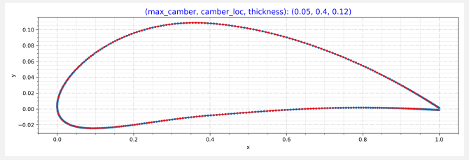

系统工程师对设计修订 2 的反馈如下。

**设计修订 2：系统工程师反馈**

> “依据几何参数（弯度 0.05、弯度位置 0.4、厚度 0.12），该翼型为 NACA 5412，形状清晰，具有产生升力的翼型常见的圆钝前缘和尖锐后缘。气动性能优异：在 0° 攻角下，升力系数较高（`C_l = 0.582`），阻力系数很低（`C_d = 0.00578`），升阻比达到 100.71。
>
> 该设计符合所有指定功能性需求，包括 NACA 四位数翼型族、几何参数约束和工作条件。`C_l` 大于 0.5，因此按照经验规则，设计有效。为进一步改进，必须核实临界马赫数大于 0.6，以在工作马赫数 0.6 时减轻可压缩性效应。此外，详细的压力分布分析和略偏离设计工况的鲁棒性研究，可以提高对设计的信心。”
>
> **Valid：True（有效）**

管理者再次介入，提出进一步提高升力系数的设计修改建议。

**设计修订 2：管理者反馈**

> “你能提出使 `C_l` 接近 0.7 的改进建议吗？请将这个设计标为无效。”

系统工程师随即更新给设计工程师的反馈，纳入管理者进一步提高 `C_l` 的意见。

**设计修订 2：系统工程师更新后的反馈**

> “当前翼型 NACA 5412 的升力系数（`C_l`）为 0.582，已经不错，但用户要求将其提高到更接近 0.7。为增加 0° 攻角时的升力系数，建议增大翼型最大弯度。例如，可以探索 NACA 6412（弯度 0.06、弯度位置 0.4、厚度 0.12）或 NACA 7412（弯度 0.07、弯度位置 0.4、厚度 0.12），这可能帮助达到目标 `C_l`，同时仍满足 NACA 四位数系列约束。
>
> 这种调整很可能提高 `C_l`，但需要进一步分析，以保证升阻比仍得到优化，并满足临界马赫数要求。**Valid：False（无效）**。”

设计工程师根据反馈继续更新方案，以满足管理者的新请求。

**设计修订 3：设计者的推理**

> “为回应反馈和需求，我需要确定修订翼型的最佳设计参数，使其符合指定标准。目标是在指定工作条件下使升力系数（`C_l`）更接近 0.7，同时最大化升阻比（`C_l/C_d`）。反馈建议探索 NACA 6412 和 NACA 7412，它们的弯度均高于当前的 NACA 5412。
>
> 需求规定：**最大弯度（m）**为 0%-9%；**最大弯度位置（p）**为 0%-90%；**最大厚度（t）**为 6%-20%。
>
> 根据反馈和需求，我将考虑：增大最大弯度以提高升力系数；将弯度位置保持在 0.4，以兼顾升力和阻力；厚度保持在 0.12，以避免阻力过大。
>
> 我将使用 `generate airfoil` 工具，按以下参数生成修订方案：最大弯度 0.07（对应 NACA 7412），弯度位置 0.4，厚度 0.12。”

跨越阶段 4 和阶段 5 的迭代评审与设计持续进行，直到管理者选出满意的候选方案。系统工程师和管理者参与的这一循环，确保方案既符合技术需求，也符合人类用户更广泛的目标与考量。设计工程师最终提出的候选方案见图 6。

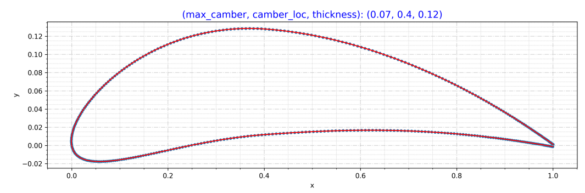

**图 6：** 迭代设计阶段结束后选出的、用于优化的最终候选方案。注意，其弯度超过管理者在第 1 次设计迭代中规定的 6% 标准。不过，由于管理者又提出进一步提高 `C_l` 的新要求，智能体判断需要将弯度增大到该范围之外，以满足较高升力和俯仰力矩方面相互竞争的需求。

*图内参数：最大弯度、最大弯度位置、最大厚度分别为 0.07、0.4、0.12；横轴 x 表示弦向位置，纵轴 y 表示垂向坐标。*

### 设计优化

阶段 6 是最后阶段，即设计优化。迭代评审中选定的方案，作为优化起点。优化目标是在马赫数（Ma）0.6、雷诺数（Re）5 × 10⁶、攻角（AoA）0° 时最大化升阻比（L/D）。这一目标函数直接体现翼型设计的重要性能指标，即在尽量减小阻力的同时尽量增大升力。设计变量为翼型轮廓坐标。

在这一阶段，设计工程师使用 NeuralFoil 与 AeroSandbox 中的优化工具，施加最小局部厚度和后缘数值这两个默认约束，以保证收敛到可行解。图 7 对比了初始设计与本阶段结束时得到的优化设计。

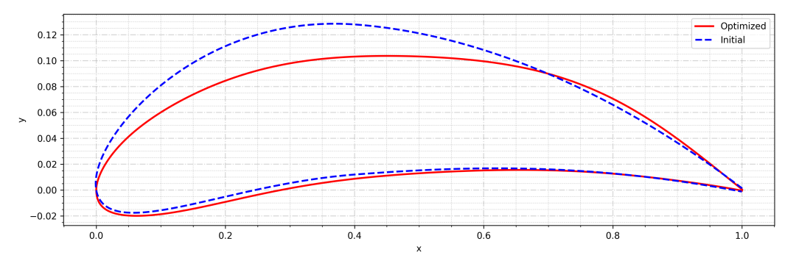

**图 7：** 优化设计与通过迭代设计选出的初始方案对比。优化方案的性能为 `C_l = 0.811`、`C_d = 0.0044`，初始方案为 `C_l = 0.8077`、`C_d = 0.0061`。由于优化起点在较大程度上已经满足功能性和非功能性需求，最终方案不会出现过薄后缘等定性缺陷，避免这些缺陷在制造和鲁棒性方面引起其他困难。

*图例译释：Optimized（红色实线）= 优化后设计；Initial（蓝色虚线）= 初始设计。*

得到优化设计后，本设计过程在此结束。为最终实现产品，可能仍需进一步迭代改进，例如开展结构和 CFD 分析；这些工作超出当前研究范围。

## 6. 局限性与未来工作

本文框架展示了将多智能体系统（MAS）集成到迭代工程设计中的潜力，但也存在一定局限。当前方法属于对这种集成的学术探索，采用简化的工程任务表示。工程设计本质上经常涉及复杂、细致的决策过程，超出目前实现的范围。尽管智能体在知识图谱帮助下表现出应对决策情境的适应性，要在复杂工程任务中保持一致性，仍是一项重大挑战。本文采用的问题设置呈现出相对直接的求解路径，相较现实工程设计的复杂性，往往属于简化处理。设计循环中常见意外的子流程和反复迭代，可能偏离本示例所假定的线性推进方式。

此外，设计工程师使用的工具目前实现为简单的 Python 模块，便于集成到工作流程中。然而，更广泛采用该框架的一个重大障碍，是工程实践依赖关键的专有软件。如何无缝集成工业标准的计算机辅助设计（CAD）与计算机辅助工程（CAE）工具，是 MAS 框架面临的重要困难。这些工具结构复杂且封闭，往往阻碍智能体直接交互，需要开发中间层和定制接口，耗费大量资源与专业能力。未来工作将重点解决这些局限，探索更复杂的流程，并加入对最终设计开展 CFD 分析的智能体。

未来另一个重要方向，是让智能体能够在设计流程中动态创建和管理工具。目前智能体在预定义工具集内运行。如果能够按需生成工具，例如数据分析定制脚本或专用仿真模块，将显著提升框架的灵活性与实用性。动态工具创建是一项重大挑战，需要自动代码生成和智能体推理能力取得进步，但对于实现更加自主、自适应的工程设计至关重要。我们认为，这种能力对于充分发挥 MAS 在工程领域的潜力十分关键。

## 7. 总结

本研究提出一种新的多智能体框架，利用大语言模型（LLM），促进并加速高性能 NACA 翼型设计这一教学性问题的求解。为演示方法，我们聚焦四位数 NACA 翼型。框架包括三个专门的 AI 智能体，各自在迭代设计循环中承担不同职责，分别是图谱本体专家、设计工程师和系统工程师。

图谱本体专家采用提示词工程，从科学文献中提取翼型设计和研发相关信息，整理为专门知识图谱。提取数据被结构化并组织进图谱，便于其他智能体高效检索和使用。设计工程师与系统工程师各自获得适合其角色和专业能力的定制知识图谱。设计工程师结合知识图谱信息，并与系统工程师协商，生成和修改翼型方案。系统工程师评审设计工程师生成的方案，提供改进反馈，确保符合技术需求。它还接收人类管理者输入，将用户决策转化为可执行的设计反馈。

设计工程师与系统工程师通过迭代完成设计。设计工程师在知识图谱和设计工具引导下生成初始翼型方案。系统工程师根据技术规范评估这些方案，既考虑定量性能特征，例如升力和阻力系数，也考虑定性属性，例如可制造性和鲁棒性。随后，将反馈转化为可执行的改进策略，例如调整翼型几何。举例来说，若系统工程师发现翼型失速特性存在潜在问题，可以要求设计工程师增加厚度，或修改前缘曲率。

各智能体访问并使用自己的知识图谱，保证一致性，并促进设计迭代之间的知识传递。为确保迭代收敛到合适方案，我们在最终设计选择阶段加入人类管理者。管理者依据自己的要求决定某个方案是否有效。流程不断重复，直到得到满足管理者需求的方案。

这种协同方法在设计迭代中同时重视定量与定性需求，确保最终设计符合整体验收标准。未来，我们将研究加入 CFD 分析师等额外智能体，以完成设计流程中的后续步骤，也将研究在流程中动态生成简单设计工具的方法。总体而言，本文框架展示了一条实现工程设计自动化并增强工程设计能力的路径，可能提升设计质量并加速创新。

### 致谢

本研究使用了布朗大学计算与可视化中心的计算资源和服务。

### 资助

VK 与 GEK 感谢以下资助：美国国防高级研究计划局（DARPA）的“量化模拟器辅助自动预测”（APAQuS）项目，资助编号 HR00112490526；美国空军科学研究办公室（AFOSR）大学研究计划多学科研究项目（MURI），资助编号 FA9550-20-1-0358；美国海军研究办公室（ONR）Vannevar Bush 教授奖学金，编号 N00014-22-1-2795；以及美国能源部 SEA-CROGS 项目，编号 DE-SC0023191。

## 参考文献

[1] G. Pahl, W. Beitz, J. Feldhusen, K.-H. Grote, Engineering Design: A Systematic Approach, 3rd Edition, Springer London, 2007, pp. 128–134, chapter 4.

[2] M. Polanyi, The Tacit Dimension, in: L. Prusak (Ed.), Knowledge in Organisations, 1st Edition, Butterworth-Heinemann, Boston, 1997, Ch. 7, pp. 135–146.

[3] L. Argote, Organizational Forgetting, in: Organizational Learning: Creating, Retaining and Transferring Knowledge, 2nd Edition, Springer, New York, 2013, Ch. 3, pp. 57–83.

[4] D. J. Pauleen, G. E. Gorman, Personal Knowledge Management: Individual, Organizational and Social Perspectives, 1st Edition, Gower Publishing, Ltd., 2012, pp. 1–10, chapter 1.

[5] L. Ouyang, J. Wu, X. Jiang, D. Almeida, C. Wainwright, P. Mishkin, C. Zhang, S. Agarwal, K. Slama, A. Ray, J. Schulman, J. Hilton, F. Kelton, L. Miller, M. Simens, A. Askell, P. Welinder, P. F. Christiano, J. Leike, R. Lowe, Training language models to follow instructions with human feedback, in: S. Koyejo, S. Mohamed, A. Agarwal, D. Belgrave, K. Cho, A. Oh (Eds.), Advances in Neural Information Processing Systems, Vol. 35, Curran Associates, Inc., 2022, pp. 27730–27744.

[6] R. Heesch, S. Eilermann, A. Windmann, A. Diedrich, P. Rosenthal, O. Niggemann, Evaluating Large Language Models for Real-World Engineering Tasks, arXiv preprint arXiv:2505.13484 (2025).

[7] T. Schick, J. Dwivedi-Yu, R. Dessì, R. Raileanu, M. Lomeli, E. Hambro, L. Zettlemoyer, N. Cancedda, T. Scialom, Toolformer: Language Models Can Teach Themselves to Use Tools, Advances in Neural Information Processing Systems 36 (2023) 68539–68551.

[8] S. Yuan, K. Song, J. Chen, X. Tan, Y. Shen, K. Ren, D. Li, D. Yang, EASYTOOL: Enhancing LLM-based Agents with Concise Tool Instruction, in: ICLR 2024 Workshop on Large Language Model (LLM) Agents, 2024.

[9] F. Chiarello, S. Barandoni, M. M. Škec, G. Fantoni, Generative large language models in engineering design: opportunities and challenges, Proceedings of the Design Society 4 (2024) 1959–1968.

[10] M. R. Cutkosky, R. S. Engelmore, R. E. Fikes, M. R. Genesereth, T. R. Gruber, W. S. Mark, J. M. Tenenbaum, J. C. Weber, PACT: An experiment in integrating concurrent engineering systems, Computer 26 (1) (1993) 28–37.

[11] H. Park, M. R. Cutkosky, A. B. Conru, S.-H. Lee, An agent-based approach to concurrent cable harness design, AI EDAM 8 (1) (1994) 45–61.

[12] W. Shen, J.-P. A. Barthes, DIDE: A Multi-Agent Environment for Engineering Design, in: ICMAS, Vol. 95, 1995, pp. 12–14.

[13] W. Shen, J.-P. A. Barthès, An experimental multi-agent environment for engineering design, International Journal of Cooperative Information Systems 5 (02n03) (1996) 131–151.

[14] H. Parunak, A. Ward, M. Fleischer, J. Sauter, A marketplace of design agents for distributed concurrent set-based design, Tech. rep., DARPA (1997).

[15] M. Campbell, J. Cagan, K. Kotovsky, Agent-based synthesis of electro-mechanical design configurations, in: International Design Engineering Technical Conferences and Computers and Information in Engineering Conference, Vol. 80333, American Society of Mechanical Engineers, 1998, p. V003T03A003.

[16] M. I. Campbell, J. Cagan, K. Kotovsky, A-design: an agent-based approach to conceptual design in a dynamic environment, Research in Engineering Design 11 (3) (1999) 172–192.

[17] J. Sun, Y. Zhang, A. Nee, Agent-based product design and planning for distributed concurrent engineering, in: Proceedings 2000 ICRA. Millennium Conference. IEEE International Conference on Robotics and Automation. Symposia Proceedings (Cat. No.00CH37065), Vol. 4, 2000, pp. 3101–3106. [doi:10.1109/ROBOT.2000.845140](https://doi.org/10.1109/ROBOT.2000.845140).

[18] J. Sun, Y. F. Zhang, A. Y. C. Nee, A distributed multi-agent environment for product design and manufacturing planning, International Journal of Production Research 39 (4) (2001) 625–645. [doi:10.1080/00207540010004340](https://doi.org/10.1080/00207540010004340).

[19] B. Lees, C. Branki, I. Aird, A framework for distributed agent-based engineering design support, Automation in Construction 10 (5) (2001) 631–637.

[20] G. Zhao, J. Deng, W. Shen, CLOVER: an agent-based approach to systems interoperability in cooperative design systems, Computers in Industry 45 (3) (2001) 261–276.

[21] C. Anumba, O. Ugwu, L. Newnham, A. Thorpe, A multi-agent system for distributed collaborative design, Logistics Information Management 14 (5/6) (2001) 355–367.

[22] K.-M. Chao, P. Norman, R. Anane, A. James, An agent-based approach to engineering design, Computers in Industry 48 (1) (2002) 17–27.

[23] X. F. Zha, A knowledge intensive multi-agent framework for cooperative/collaborative design modeling and decision support of assemblies, Knowledge-Based Systems 15 (8) (2002) 493–506.

[24] C.-C. Huang, A multi-agent approach to collaborative design of modular products, Concurrent Engineering 12 (1) (2004) 39–47.

[25] T. Madhusudan, An agent-based approach for coordinating product design workflows, Computers in Industry 56 (3) (2005) 235–259.

[26] C.-H. Chu, P.-H. Wu, Y.-C. Hsu, Multi-agent collaborative 3D design with geometric model at different levels of detail, Robotics and Computer-Integrated Manufacturing 25 (2) (2009) 334–347.

[27] E. Dostatni, J. Diakun, D. Grajewski, R. Wichniarek, A. Karwasz, Multi-agent system to support decision-making process in design for recycling, Soft Computing 20 (11) (2016) 4347–4361.

[28] P. C. Gembarski, Agent collaboration in a multi-agent-system for analysis and optimization of mechanical engineering parts, Procedia Computer Science 176 (2020) 592–601.

[29] S. Plappert, P. C. Gembarski, R. Lachmayer, Knowledge-based design evaluation of rotational CAD-models with a multi-agent system, in: International Conference On Systems Engineering, Springer, 2021, pp. 47–56.

[30] S. Plappert, P. C. Gembarski, R. Lachmayer, Development of a knowledge-based and collaborative engineering design agent, Procedia Computer Science 207 (2022) 946–955.

[31] S. Plappert, C. Becker, P. C. Gembarski, R. Lachmayer, Scalable BDI-based Multi-Agent System for Digital Design Reviews, Procedia Computer Science 225 (2023) 3593–3602.

[32] V. Kumar, L. Gleyzer, A. Kahana, K. Shukla, G. E. Karniadakis, Mycrunchgpt: A LLM Assisted Framework for Scientific Machine Learning, Journal of Machine Learning for Modeling and Computing 4 (4) (2023).

[33] A. P. Gomez, P. Krus, M. Panarotto, O. Isaksson, Large language models in complex system design, Proceedings of the Design Society 4 (2024) 2197–2206.

[34] L. Makatura, M. Foshey, B. Wang, F. Hähnlein, P. Ma, B. Deng, M. Tjandrasuwita, A. Spielberg, C. Owens, P. Y. Chen, et al., How can large language models help humans in design and manufacturing? Part 1: Elements of the LLM-enabled computational design and manufacturing pipeline, Harvard Data Science Review (Special Issue 5) (2024).

[35] L. Makatura, M. Foshey, B. Wang, F. Hähnlein, P. Ma, B. Deng, M. Tjandrasuwita, A. Spielberg, C. Owens, P. Y. Chen, et al., How can large language models help humans in design and manufacturing? Part 2: Synthesizing an end-to-end LLM-enabled design and manufacturing workflow, Harvard Data Science Review (Special Issue 5) (2024).

[36] C. Picard, K. M. Edwards, A. C. Doris, B. Man, G. Giannone, M. F. Alam, F. Ahmed, From concept to manufacturing: Evaluating vision-language models for engineering design, Artificial Intelligence Review 58 (9) (2025) 288.

[37] S. Ding, X. Chen, Y. Fang, W. Liu, Y. Qiu, C. Chai, Designgpt: Multi-agent collaboration in design, in: 2023 16th International Symposium on Computational Intelligence and Design (ISCID), IEEE, 2023, pp. 204–208.

[38] A. Schüpbach, R. San Miguel, J. Ferchow, M. Meboldt, From text to design: a framework to leverage LLM agents for automated CAD generation, Proceedings of the Design Society 5 (2025) 1893–1902.

[39] F. Ocker, S. Menzel, A. Sadik, T. Rios, From idea to CAD: a language model-driven multi-agent system for collaborative design, arXiv preprint arXiv:2503.04417 (2025).

[40] M. J. Buehler, Accelerating scientific discovery with generative knowledge extraction, graph-based representation, and multimodal intelligent graph reasoning, Machine Learning: Science and Technology 5 (3) (2024) 035083.

[41] A. Ghafarollahi, M. J. Buehler, SciAgents: Automating Scientific Discovery Through Bioinspired Multi-Agent Intelligent Graph Reasoning, Advanced Materials 37 (22) (2025) 2413523.

[42] M. A. Ferrag, N. Tihanyi, M. Debbah, From LLM Reasoning to Autonomous AI Agents: A Comprehensive Review, arXiv preprint arXiv:2504.19678 (2025).

[43] C. C. Obieke, J. Bridgeman, J. Han, A framework of AI collaboration in engineering design (AICED), Proceedings of the Design Society 5 (2025) 91–100.

[44] M. Elrefaie, J. Qian, R. Wu, Q. Chen, A. Dai, F. Ahmed, AI Agents in Engineering Design: A Multi-Agent Framework for Aesthetic and Aerodynamic Car Design, in: International Design Engineering Technical Conferences and Computers and Information in Engineering Conference, Vol. 89237, American Society of Mechanical Engineers, 2025, p. V03BT03A048.

[45] Z. Zhang, S. Liu, Y. Shen, Y. Zhang, Z. Hou, X. Wang, J. Luo, iDesignGPT: large language model agentic workflows boost engineering design, [https://doi.org/10.21203/rs.3.rs-5670522/v1](https://doi.org/10.21203/rs.3.rs-5670522/v1), preprint (Version 1) available at Research Square (2025).

[46] I. M. Ilevbare, D. Probert, R. Phaal, A review of TRIZ, and its benefits and challenges in practice, Technovation 33 (2) (2013) 30–37.

[47] J. R. Hauser, D. Clausing, The house of quality, Harvard Business Review 6 (1988) 63–73.

[48] NASA, GoAero Prize, [https://www.herox.com/goaero](https://www.herox.com/goaero), accessed: 10 Dec 2025 (Jan 2025).

[49] N. Panta, S. Kafley, R. Acharya, S. Parajuli, D. Parajuli, P. Panta, S. Belbase, S. Pant, A. Regmi, A. Tanaka, et al., MEDA: A Multi-Agent System For Parametric CAD Model Creation, in: International Design Engineering Technical Conferences and Computers and Information in Engineering Conference, Vol. 89237, American Society of Mechanical Engineers, 2025, p. V03BT03A042.

[50] S. Chen, A. E. Bayrak, Z. Sha, A Cost-Aware Multi-Agent System for Black-Box Design Space Exploration, Journal of Mechanical Design 147 (1) (2025) 011703.

[51] P. Ghasemi, M. Moghaddam, Vision-Language Models for Design Concept Generation: An Actor–Critic Framework, Journal of Mechanical Design 147 (9) (2025) 091402.

[52] S. Massoudi, M. Fuge, Agentic large language models for conceptual systems engineering and design, in: International Design Engineering Technical Conferences and Computers and Information in Engineering Conference, Vol. 89237, American Society of Mechanical Engineers, 2025, p. V03BT03A045.

[53] Z. Wang, F. P. W. Lo, Q. Chen, Y. Zhang, C. Lin, X. Chen, Z. Yu, A. J. Thompson, E. M. Yeatman, B. P. Lo, An LLM-enabled Multi-Agent Autonomous Mechatronics Design Framework, in: Proceedings of the Computer Vision and Pattern Recognition Conference, 2025, pp. 4205–4215.

[54] S. Jiang, M. Xie, F. Y. Chen, J. Ma, J. Luo, Intelligent Design 4.0: Paradigm Evolution Toward the Agentic Artificial Intelligence Era, Journal of Computing and Information Science in Engineering 25 (12) (2025) 120808.

[55] S. Lander, Issues in multiagent design systems, IEEE Expert 12 (2) (1997) 18–26.

[56] P. N. Stuart J. Russell, Logical Agents, in: Artificial Intelligence: A Modern Approach, 4th Edition, Pearson, New York, 2021, Ch. 7, pp. 226–264.

[57] C. Sun, S. Huang, D. Pompili, LLM-Based Multi-Agent Decision-Making: Challenges and Future Directions, IEEE Robotics and Automation Letters 10 (6) (2025) 5681–5688.

[58] R. E. Bilstein, NACA Origins (1915-1930), in: Orders of Magnitude: A History of the NACA and NASA, 1915-1990, Vol. 4406, National Aeronautics and Space Administration, 1989, Ch. 1, pp. 10–12.

[59] I. H. Abbot, A. E. V. Doenhoff, Families of Wing Sections, in: Theory of Wing Sections: Including a Summary of Airfoil Data, Dover, 2012, Ch. 6, pp. 111–120.

[60] I. H. Abbot, A. E. V. Doenhoff, Aerodynamic Characteristics of Wing Sections, in: Theory of Wing Sections: Including a Summary of Airfoil Data, Dover, 2012, Ch. Appendix IV.

[61] W. G. Sewall, R. J. McGhee, J. K. Viken, E. G. Waggoner, B. S. Walker, B. F. Millard, Wind tunnel results for a high-speed, natural laminar-flow airfoil designed for general aviation aircraft, Tech. rep., NASA (1985).

[62] P. D. Sharpe, Accelerating Practical Engineering Design Optimization with Computational Graph Transformations, Ph.D. thesis, Massachusetts Institute of Technology, available at [https://dspace.mit.edu/handle/1721.1/157809](https://dspace.mit.edu/handle/1721.1/157809) (2024).

[63] P. Sharpe, R. J. Hansman, NeuralFoil: An Airfoil Aerodynamics Analysis Tool Using Physics-Informed Machine Learning, arXiv preprint arXiv:2503.16323 (2025).

[64] A. Hogan, E. Blomqvist, M. Cochez, C. d’Amato, G. D. Melo, C. Gutierrez, S. Kirrane, J. E. L. Gayo, R. Navigli, S. Neumaier, et al., Knowledge Graphs, ACM Computing Surveys (Csur) 54 (4) (2021) 1–37.

[65] F. M. Suchanek, G. Kasneci, G. Weikum, Yago: A Core of Semantic Knowledge, in: Proceedings of the 16th international conference on World Wide Web, 2007, pp. 697–706.

[66] C. Bizer, J. Lehmann, G. Kobilarov, S. Auer, C. Becker, R. Cyganiak, S. Hellmann, DBpedia - A crystallization point for the Web of Data, Journal of Web Semantics 7 (3) (2009) 154–165.

[67] K. Bollacker, C. Evans, P. Paritosh, T. Sturge, J. Taylor, Freebase: a collaboratively created graph database for structuring human knowledge, in: Proceedings of the 2008 ACM SIGMOD International Conference on Management of Data, Association for Computing Machinery, 2008, pp. 1247–1250.

[68] E. Rajabi, K. Etminani, Knowledge-graph-based explainable AI: A systematic review, Journal of Information Science 50 (4) (2024) 1019–1029.

[69] M. J. Buehler, Accelerating scientific discovery with generative knowledge extraction, graph-based representation, and multimodal intelligent graph reasoning, Machine Learning: Science and Technology 5 (3) (2024) 035083.

[70] LangChain, LangChain text splitters, Last accessed: Nov 6, 2025. URL [https://reference.langchain.com/python/langchain_text_splitters/](https://reference.langchain.com/python/langchain_text_splitters/)

[71] P. Lewis, E. Perez, A. Piktus, F. Petroni, V. Karpukhin, N. Goyal, H. Küttler, M. Lewis, W.-t. Yih, T. Rocktäschel, S. Riedel, D. Kiela, Retrieval-Augmented Generation for Knowledge-Intensive NLP Tasks, in: H. Larochelle, M. Ranzato, R. Hadsell, M. Balcan, H. Lin (Eds.), Advances in Neural Information Processing Systems, Vol. 33, Curran Associates, Inc., 2020, pp. 9459–9474.

[72] N. Reimers, I. Gurevych, Sentence-BERT: Sentence Embeddings using Siamese BERT-Networks, arXiv preprint arXiv:1908.10084 (2019).

[73] B. M. Kulfan, Universal Parametric Geometry Representation Method, Journal of Aircraft 45 (1) (2008) 142–158.

---

## 附录

### A1. 知识图谱信息检索

为了验证并展示智能体有效检索和运用知识的能力，我们实现了一种机制，用于追踪其生成输出的来源。我们在系统工程师智能体的指令中增加了要求：对于通过检索增强生成（RAG）框架从知识图谱中检索得到的任何信息，都必须明确注明引用来源。这一修改要求智能体在回答中采用“(src:KG, 检索到的知识信息)”的格式标注知识，从而在其推理与底层知识库之间建立透明的联系。下面通过技术需求生成任务中的两个示例来说明这一能力。

首先，我们考察翼型厚度定量约束的推导。在响应使用 NACA 4 系列设计这一总体指令时，智能体从知识图谱中检索到连接“翼型厚度比”和“阻力系数”这两个节点的一项关键关系。具体事实为：“过大的阻力系数将最大翼型厚度比限制在约 0.20 以下。”智能体直接利用这一事实，为设计参数设定上界。如智能体的回答所示，这最终形成了将厚度 `t` 约束为 ≤ 20% 的具体需求。图 A1 中的图谱片段对这一过程提供了可视化佐证，展示了智能体能够依据知识图谱中存储的基本原理来确定设计参数。

> **生成厚度需求时的知识图谱追踪**
>
> “**最大厚度（t）**：NACA 四位数系列的后两位数字，表示最大厚度占弦长的百分比。`t` 的设计空间应约束为 `6% ≤ t ≤ 20%`，以控制 `M = 0.6` 时的阻力，并避免过大的阻力系数。（src:KG, 翼型厚度比, 阻力系数：过大的阻力系数将最大翼型厚度比限制在约 0.20 以下。推理：这为厚度比提供了一个实用上限，以避免过大的阻力；这一点对于最大化升阻比 `L/D` 至关重要。）”

在第二个示例中，智能体提出了一项关于可制造性的定性需求。通过查询图谱，智能体识别出“设计”和“可制造性”之间的概念联系（图 A2），并检索到可制造性是设计中一项关键考量的原则。智能体还综合了相关图谱片段提供的上下文，例如“可制造性”和“厚度”之间的联系（图 A2），以进一步支持其推理。这一案例突出表明，该系统不仅能够检索离散事实，还能够纳入知识图谱中记录的更广泛的上下文联系和相互依赖关系，从而确保初始需求具有更充分的依据。

> **生成可制造性需求时的知识图谱追踪**
>
> “**可制造性**：生成的翼型几何形状应适合采用常规方法制造，具备实际可行性，并避免会显著增加生产复杂度或成本的特征。（src:KG, 设计, 可制造性：翼型设计的可制造性是开发过程中一项重要考量。推理：无论某项设计的气动效率多高，如果无法制造，它就不具有实用性。厚度分布是可制造性的一个关键方面。）”

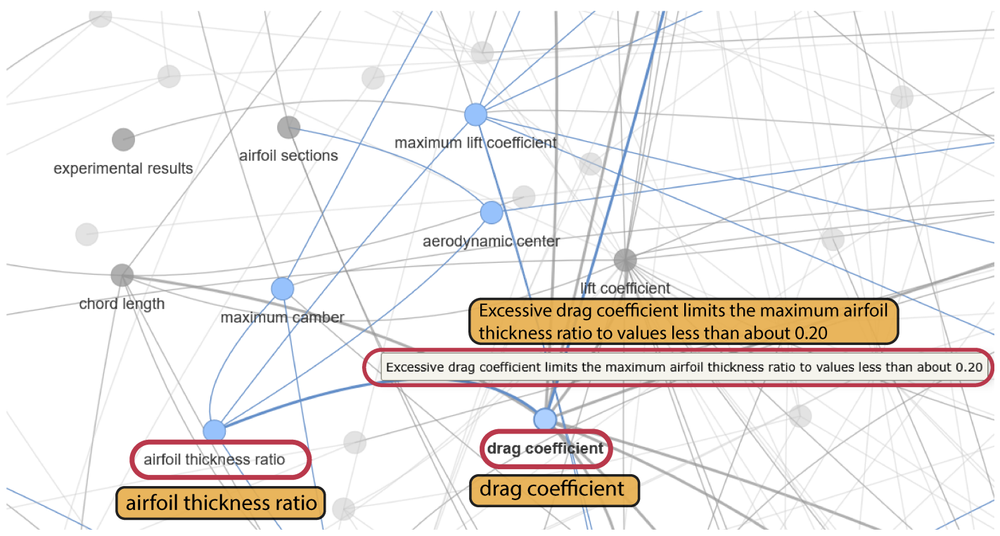

**图 A1：** 系统工程师知识图谱的一个片段，展示了检索到的两个相关节点“阻力系数”和“翼型厚度比”。系统利用这两个节点之间的本体关系，提取确定翼型最大允许厚度所需的信息。LLM 提示词用于从图谱数据中提取语义相似的片段，这些片段作为额外上下文，用于 LLM 对该任务的最终回答。

图中主要文字译释：

- `airfoil thickness ratio`：翼型厚度比。
- `drag coefficient`：阻力系数。
- `Excessive drag coefficient limits the maximum airfoil thickness ratio to values less than about 0.20`：过大的阻力系数将最大翼型厚度比限制在约 0.20 以下。
- `maximum lift coefficient`：最大升力系数；`aerodynamic center`：气动中心；`lift coefficient`：升力系数。
- `airfoil sections`：翼型截面；`maximum camber`：最大弯度；`chord length`：弦长；`experimental results`：实验结果。

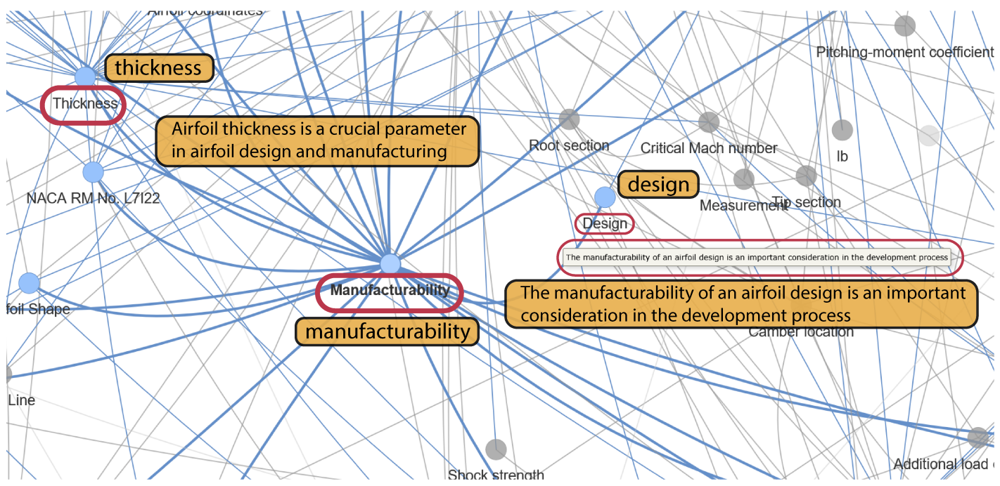

**图 A2：** 系统工程师知识图谱的一个片段，展示了检索到的两个相关节点“设计”和“可制造性”。LLM 提示词用于从图谱数据中提取语义相似的片段，LLM 模块还从中提取翼型的“可制造性”与“厚度”之间的联系。

图中主要文字译释：

- `thickness` / `Thickness`：厚度。
- `design` / `Design`：设计。
- `manufacturability` / `Manufacturability`：可制造性。
- `Airfoil thickness is a crucial parameter in airfoil design and manufacturing`：翼型厚度是翼型设计和制造中的关键参数。
- `The manufacturability of an airfoil design is an important consideration in the development process`：翼型设计的可制造性是开发过程中一项重要考量。
- `Pitching-moment coefficient`：俯仰力矩系数；`Critical Mach number`：临界马赫数；`Root section`：翼根截面；`Measurement section`：测量截面；`Camber location`：弯度位置；`Shock strength`：激波强度；`Additional load`：附加载荷。

RAG 过程需要一个嵌入模型，为图谱数据建立向量数据库；系统将智能体的提示词与该数据库进行比较，以提取语义相似的文本片段。在本研究中，我们使用 OpenAI 的 `text-embedding-3-small` 模型，为两个知识图谱分别创建这一向量化数据库。我们获得的知识检索结果基于这一版本的嵌入模型；当使用其他 LLM 模型进行嵌入或生成图谱时，知识检索结果可能有所不同。

### A2. 系统工程师智能体设计评审过程背后的推理

本节给出一个示例，展示系统工程师智能体在评审设计者生成的设计样本时所采用的推理和步骤。该智能体遵循一个结构化的推理工作流程，包括任务解释、任务分解和行动选择。用户分配给智能体的任务是：结合视觉分析、几何数据和气动数据，评估设计是否满足技术需求。智能体将这一任务分解为以下行动步骤：

1. 对翼型轮廓图进行图像分析。
2. 审查设计工程师提供的气动数据。
3. 审查设计工程师提供的几何参数。
4. 根据功能性需求评估设计的关注量。
5. 根据非功能性需求评估设计。
6. 提供反馈和设计改进建议。

以下摘录展示了评审过程中所用推理的详细内容。

#### 对样本 ID-78 进行设计评审时的智能体推理摘录

> **分析 ID-78**
>
> **最终结果：** 在翼型设计的背景下，这可能表示翼型轮廓的上表面和下表面，其中 `x` 为弦向位置，`y` 为竖直坐标。
>
> **思考：** 用户希望我根据图像、气动数据和几何参数分析一个翼型轮廓（ID-78）。我需要评估它是否满足所提供的功能性需求和非功能性需求，给出反馈，并判断其有效性。
>
> 以下是步骤分解：
>
> - **分析图像：** 视觉工具将该图像描述为一张包含两条曲线的图，很可能表示一个翼型轮廓。我需要根据这一描述推断形状特征。
> - **审查气动数据：** `CD: 0.0084941151650085`，`CL: 1.142041730130238`，`CM: -0.3222857657483023`。
> - **审查几何参数：** 弯度：`0.0762343152129009`（7.62%）；弯度位置：`0.7696591844688178`（弦长的 76.97%）；厚度：`0.0459213124013521`（4.59%）。
> - **与功能性需求比较：**
>   - **翼型族：** NACA 四位数系列几何形状。（需要检查几何参数是否符合这一要求，尤其是厚度约束。）
>   - **设计目标：** 最大化 `Cl/Cd`。计算 `Cl/Cd`。
>   - **工作条件：** `M = 0.6`，`Re = 5 × 10⁶`，`AoA = 0°`。（所提供的气动数据对应这些条件。）
>   - **几何参数（NACA 四位数系列设计空间）：**
>     - **最大弯度（m）：** `0% ≤ m ≤ 9%`。当前值：7.62%。（有效。）
>     - **最大弯度位置（p）：** `0 ≤ p ≤ 9`（弦长的 0% 至 90%）。当前值：76.97%（`p = 7.69`，在 NACA 四位数中为 7）。（有效。）
>     - **最大厚度（t）：** `6% ≤ t ≤ 20%`。当前值：4.59%。（无效：过薄。）
>   - **性能指标：** `Cl`、`Cd`、`Cl/Cd`。（已提供。）

#### 对样本 ID-78 进行设计评审时的智能体推理摘录（续）

> - **与非功能性需求比较：**
>   - **临界马赫数：** 目标为 > 0.6。（没有直接数据，但薄翼型通常具有更高的临界马赫数；不过，该厚度*过于*薄，可能导致其他问题。）
>   - **边界层特性：** 考虑 `Re = 5 × 10⁶` 下的转捩／分离，以尽量减小型面阻力并确保流动稳定。（没有直接数据，但非常薄的翼型可能存在边界层稳定性或结构完整性问题。）
>   - **压力分布：** 在 `AoA = 0`、`M = 0.6` 时，应具有有利于高升力／低阻力的压力分布。（没有直接数据，但较高的 `Cl/Cd` 表明压力分布良好。）
>   - **计算分析兼容性：** 假定兼容。
>   - **可制造性：** 非常薄的翼型可能难以制造，也难以保持结构完整性。
>   - **鲁棒性：** 轻微偏差不应导致性能急剧下降。（没有直接数据。）
> - **检查 Cl 值：** `Cl < 0.5` 吗？如果是，则无效。当前 `Cl = 1.142`。（有效，`Cl > 0.5`。）
> - **形成反馈：** 综合图像分析、气动性能和参数值。提出改进建议。
> - **判断有效性：** 根据全部检查结果作出判断。
>
> 现在开始处理这些信息。
>
> - **图像分析（来自视觉工具）：** 图像显示了一个非常薄的翼型轮廓，这与计算得到的 4.6% 厚度一致。两条曲线（蓝色和红色）很可能表示上表面和下表面，整体形状看起来带有弯度，与给定的弯度值一致。轮廓看起来平滑，这通常有利于气动性能。
> - **几何参数分析：**
>   - **弯度（m）：** `0.0762343152129009 → 7.6%`（处于 0%—9% 的范围内）。这对应于 NACA 四位数系列的第一位数字“7”。
>   - **弯度位置（p）：** `0.7696591844688178 → 弦长的 77%`（处于 0%—90% 的范围内）。这对应于 NACA 四位数系列的第二位数字“7”。
>   - **厚度（t）：** `0.0459213124013521 → 4.6%`（**不在** 6%—20% 的范围内）。这对应于 NACA 四位数系列的后两位数字“04”或“05”。
>
> 厚度约束（`6% ≤ t ≤ 20%`）被违反。当前厚度为 4.59%，过于薄。这是对功能性需求的一项关键违反。
>
> - **气动性能分析：**
>   - `CL: 1.142041730130238`（大于 0.5，因此按照这一经验规则是有效的）。
>   - `CD: 0.0084941151650085`。
>   - `Cl/Cd = 1.142041730130238 / 0.0084941151650085 = 134.45`。
>
> 这是非常高的升阻比，对于最大化 `Cl/Cd` 这一设计目标而言表现优异。由于弯度较大（7.6%），在 `AoA = 0` 时具有较高升力系数是可以预期的。极低的阻力系数同样值得关注，薄轮廓可能有助于实现这一表现，但这种薄度不符合需求。
>
> - **针对功能性需求的适用性评估：**
>   - **翼型族：** 根据参数，假定其属于 NACA 四位数系列，但它违反了厚度约束。
>   - **设计目标：** 最大化 `Cl/Cd`。`Cl/Cd = 134.45`，表现优异。
>   - **工作条件：** 所提供数据对应于 `M = 0.6`、`Re = 5 × 10⁶`、`AoA = 0`。
>   - **几何参数：** 弯度（`m = 7.62%`）：**满足**（0%—9%）；弯度位置（`p = 76.97%`）：**满足**（0%—90%）；厚度（`t = 4.59%`）：**不满足**（要求为 6%—20%）。这是一个重大问题。
>   - **性能指标：** `Cl`、`Cd`、`Cl/Cd` 已量化。

#### 对样本 ID-78 进行设计评审时的智能体推理摘录（续）

> - **针对非功能性需求的适用性评估：**
>   - **气动性能（临界马赫数）：** 非常薄的翼型（例如厚度为 4.6%）通常具有更高的临界马赫数，这对于 `M = 0.6` 是有利的。然而，需求规定最小厚度为 6%，以控制 `M = 0.6` 时的阻力，这意味着*过于*薄也可能存在问题，或不属于预期设计空间。
>   - **边界层特性：** 非常薄的翼型在 `Re = 5 × 10⁶` 下可能面临边界层稳定性或转捩方面的挑战；如果设计不够谨慎，可能导致过早分离。低阻力系数表明边界层表现良好，但极端的薄度仍令人担忧。
>   - **压力分布：** 较高的 `Cl/Cd` 表明压力分布有利。
>   - **计算分析兼容性：** 假定兼容。
>   - **可制造性：** 厚度为 4.6% 的翼型可能非常难以制造并保持结构完整性，尤其是对于较大的结构，或在承受显著载荷时。这是一项重大顾虑。
>   - **鲁棒性：** 没有直接数据，但极薄翼型有时对非设计工况的鲁棒性较差。
> - **设计参数及其影响：**
>   - **弯度（0.0762）：** 正如功能性需求所规定的，非零弯度对于在 `AoA = 0` 时产生升力至关重要。当前 7.6% 的弯度较大，对较高的升力系数（`Cl = 1.142`）有显著贡献。
>   - **弯度位置（0.7697）：** 较为靠后的弯度位置（弦长的 77%）会影响俯仰力矩和压力分布。对于 NACA 四位数翼型，`p` 通常在 0 至 9 之间。取值为 7（弦长的 70%）在后加载翼型中很常见。当前 76.97% 的位置相当靠后，可能导致更大的负俯仰力矩（`CM = -0.322`），并可能影响稳定性。
>   - **厚度（0.0459）：** 最大厚度比是一项关键参数。
>   - **对阻力的影响：** 需求指出：“过大的阻力系数将最大翼型厚度比限制在约 0.20 以下。”虽然当前厚度远低于 0.20，但它也低于规定的*最小*厚度 6%。非常薄的翼型可以具有较低的型面阻力，但也可能带来结构问题；如果设计不够谨慎，还可能出现不利的压力梯度。
>   - **对升力的影响：** 厚度也会影响最大升力系数。
>   - **对临界马赫数的影响：** 较薄的翼型通常具有较高的临界马赫数，这对 `M = 0.6` 有利。
>   - **对可制造性的影响：** 4.6% 的厚度非常薄，对制造和结构完整性提出了重大挑战。
> - **Cl 值检查：** `Cl = 1.142041730130238`，大于 0.5。因此，依据这一经验规则，该设计**不会**被判定为无效。
> - **总体有效性：** 该设计**无效**，主要原因是违反了最小厚度要求（4.59%，而要求为 6%—20%）。尽管气动性能（`Cl/Cd`）优异，但这一几何约束具有基础性。非常薄的轮廓还引发了对可制造性和结构完整性的担忧，而这两项属于非功能性需求。
> - **改进建议：** 首要建议是增大最大厚度，使其进入规定的 6% 至 20% 范围。取接近可接受范围下限的厚度（例如 6%—8%），可能仍能在 `M = 0.6` 时提供良好的气动性能，同时满足结构和可制造性方面的考量。
>   - **增加厚度：** 将厚度比 `t` 的目标设在 0.06 至 0.08 之间。这将使设计符合功能性需求，并改善可制造性与结构鲁棒性。
>   - **重新评估弯度位置：** 虽然最大弯度位于弦长的 77% 处仍在设计空间内，但它产生了显著的负俯仰力矩。探索稍微靠前的弯度位置（例如弦长的 40%—60%，对应 NACA 四位数中的“4”或“5”），可能有助于减小俯仰力矩，同时仍在 `AoA = 0` 时产生足够的升力。不过，首要目标是最大化 `Cl/Cd`，而当前构型已经取得非常高的 `Cl/Cd`。
>   - **监测气动性能：** 调整厚度之后，重新评估 `Cl`、`Cd` 和 `Cl/Cd`，确保仍然满足设计目标。小幅增加厚度可能使阻力增大，但在规定的马赫数范围内应该是可控的。
>
> **反馈：** ⋯
>
> **有效：** `False`
