# 通用参数化几何表示方法

*Universal Parametric Geometry Representation Method*

《飞机》（Journal of Aircraft）  
第45卷，第1期，2008年1—2月，第142—158页

Brenda M. Kulfan\*  
波音民用飞机集团，美国华盛顿州西雅图，98124

DOI：10.2514/1.29958

## 摘要

在空气动力学设计优化中，非常希望限制几何设计变量的数量。本文提出一种“基本”的参数化翼型几何表示方法。该方法引入几何“类函数／形状函数”变换技术，使圆头／尖尾几何以及其他类别的几何，都能由解析、性态良好且简单的数学函数精确表示，并具有容易观察的物理特征。本文表明，这种基本参数化几何表示方法，能够描述一个实际上无限广阔、且完全由解析光滑几何组成的设计空间。随后，类函数／形状函数方法被扩展到更一般的三维应用，如机翼、机身、管道和短舱。本文表明，一般三维几何可以表示为基本形状的分布，而类函数／形状函数方法既能用于描述基本形状，也能用于描述基本形状的分布。通过这种非常稳健、用途广泛且简单的方法，三维几何在设计空间中由类函数和形状函数的分布来定义。然后，将这一设计空间几何变换到物理空间，在那里得到实际的几何定义。本文给出了类函数／形状函数变换方法在短舱、管道、机翼和机身中的若干应用，以说明这种新方法的通用性。结果表明，表示飞机机翼、短舱或机身等任意三维几何，只需相对少量的变量。

## I. 引言

在任何特定的空气动力学设计优化过程中，对飞机或飞机部件几何数学表示方式的选择，以及对优化算法类型的选择，都会对许多方面产生深刻影响，例如计算时间和资源、设计空间的范围及总体性质，以及设计空间中包含的几何是光滑还是不规则，甚至是否在物理上真实或可以接受。

几何表示方法也会影响所选优化过程的适用性。例如，将离散坐标用作设计变量，可能并不适合遗传优化过程，因为所产生的设计空间中，可能充斥着具有凹凸不规则表面的几何，使找到最优光滑表面在实际上几乎不可能。几何表示方法还影响设计空间中是否包含有意义的“最优解”，以及在最优设计确实存在时，能否将其找到。

任何几何表示技术都应具有以下理想特点：

1. 性态良好，能够产生光滑且真实的形状。
2. 过程在数学上高效、在数值上稳定，并且快速、准确、一致。
3. 用相对较少的变量，就能表示足够大的设计空间，使其包含在多种设计条件与约束下的最优气动形状。
4. 允许指定前缘半径、尾缘收缩角、翼型闭合等设计参数。
5. 能够方便地控制曲线形状的设计和编辑。
6. 直观——几何算法具有直观的几何解释。

任何飞机的几何定义，都由两种基本形状 [1] 及其沿各部件的分布，来表示构型的基本组成部件。这两种基本定义形状包括：

**第1类：机翼—翼型类形状，** 用于定义以下部件：1）翼型／机翼；2）直升机旋翼、涡轮机械叶片；3）水平尾翼和垂直尾翼、鸭翼、翼梢小翼、支柱；4）回转体或旋转短舱。

**第2类：机体横截面类形状，** 用于定义以下部件：1）飞机机身（横截面）；2）旋翼桨毂和导流罩；3）槽道、管道和管路；4）升力体。

圆头、尖尾的第1类几何，其数学描述是一个连续但非解析的函数，因为头部斜率为无穷大，而且表面曲率存在相应的大幅变化。同样，在常规笛卡儿坐标系中，第2类几何横截面的数学定义，通常也是连续但非解析的函数。

因此，描述第1类或第2类几何，通常都需要大量坐标。人们已经提出许多方法 [2–8]，在数值上表示第1类翼型几何，以用于空气动力学设计、优化和参数研究。通常使用的几何表示方法，往往无法满足上述全部理想特点 [9]。

此前的一篇论文 [9] 重点讨论具有圆头和尖尾的第1类二维翼型形状，并提出一种描述这类翼型几何的强大新方法。该方法被证明同样适用于轴对称短舱和回转体。在本文 [10] 中，该方法被扩展到第2类几何，以及一般三维几何的表示。

本文将简要描述并回顾该方法的最初发展，因为了解这些内容，是理解本文所述方法扩展的必要基础。随后，讨论将任意三维几何表示为基本形状分布的概念。本文表明，此前为二维翼型及轴对称机体或短舱开发的方法，既能在数学上描述基本形状，也能描述形状分布，从而定义相当任意的三维几何。文中展示了扩展方法在包括机翼和短舱在内的多种三维几何中的应用。

**发表与版权说明：** 本文以论文0062的形式发表于第45届AIAA航空航天科学会议暨展览，会议于2007年1月8—11日在美国内华达州里诺的Grand Sierra Resort举行；2007年1月23日收到稿件；2007年8月2日接受发表。版权 © 2007，波音公司所有。经许可，由美国航空航天学会（American Institute of Aeronautics and Astronautics, Inc.）出版。本文可以为个人或内部使用而复制，条件是复制者向Copyright Clearance Center, Inc.支付每份10.00美元的费用，该机构地址为222 Rosewood Drive, Danvers, MA 01923；与CCC通信时，请注明代码0021-8669/08 \$10.00。

\* 工程师／科学家——技术院士，支撑技术与研究部门；邮政信箱3707，邮件站点67-LF。AIAA会员。

## II. 翼型几何的数学描述

虽然以下讨论专门针对二维翼型，但所有结果与结论，都同样适用于轴对称短舱和回转体。

当圆头翼型由固定笛卡儿坐标系描述时，表面几何在头部的斜率和二阶导数均为无穷大，而整个翼型表面又存在较大的曲率变化。因此，翼型表面的数学特征是非解析函数，所有导数在头部都具有奇异性。

文献 [9] 用于开发改进翼型几何表示方法的途径，基于一种作者过去经常成功使用的技术：开发有效的计算方法，处理在数值上难以处理的函数。为以几何方式描述这类几何，开发高效、性态良好的方法时，所用技术包括以下步骤：

1. 建立一个对描述任何圆头／尖尾翼型几何而言既必要又充分的一般数学方程。
2. 考察这一数学表达式的一般性质，确定其中哪些部分是数值奇异性的来源。
3. 重新排列或变换数学表达式的各部分，以消除数值奇异性。
4. 由此识别并定义一种“形状函数”变换技术，使利用这一形状函数得到的翼型定义，成为简单、性态良好的解析函数，并具有容易控制的关键物理设计特征。
5. 随后引入“类函数”，将该方法推广到多种基本二维翼型，以及轴对称短舱和机体几何。

下面概述这一方法。

表示典型翼型几何 [9,10] 的数学表达式，其一般且必要的形式为

$$
\zeta(\psi) = \sqrt{\psi}\,(1-\psi)\sum_{i=0}^{N} A_i\psi^i + \psi\zeta_T
\tag{1}
$$

其中，$\psi=x/c$，$\zeta=z/c$，$\zeta_T=\Delta Z_{\mathrm{TE}}/c$。$\sqrt{\psi}$ 是唯一能够产生圆头的数学函数。$(1-\psi)$ 项是保证尖锐后缘所必需的。$\psi\zeta_T$ 项用于控制后缘厚度。下式

$$
\sum_{i=0}^{\infty} A_i\psi^i
$$

表示一个一般函数，描述圆头与尖尾之间几何的独特形状。

为方便起见，这一项写成幂级数，但也可以用任何适当、性态良好的解析数学函数表示。

## III. 翼型形状函数

基本翼型方程中非解析特性的来源，与式（1）中的平方根项有关。

定义形状函数 $S(\psi)$：先从基本几何方程中减去翼型后缘厚度项，再除以圆头项和尖尾项，得到

$$
S(\psi) \equiv \frac{\zeta(\psi)-\psi\zeta_T}{\sqrt{\psi}\,(1-\psi)}
\tag{2}
$$

由式（1）和式（2）得到的$S$函数方程，成为相当简单的表达式

$$
S(\psi) = \sum_{i=0}^{N} A_i\psi^i
\tag{3}
$$

形状函数方程是一个简单、性态良好的解析方程。“眼睛”很适合通过它观察所表示的翼型细节，并对各种几何进行关键比较。

文献 [9] 已表明，头部半径、后缘厚度和尾缘收缩角，与 $S(\psi)$ 函数的独特边界值直接相关。在 $x/c=0$ 处，形状函数的值，与翼型前缘头部半径 $R_{\mathrm{LE}}$ 及翼型弦长 $C$ 直接相关，关系为

$$
S(0) = \sqrt{\frac{2R_{\mathrm{LE}}}{C}}
\tag{4}
$$

在 $x/c=1$ 处，形状函数的值，与翼型尾缘收缩角 $\beta$ 及后缘厚度直接相关，关系为

$$
S(1) = \tan\beta + \frac{\Delta z_{\mathrm{TE}}}{c}
\tag{5}
$$

因此，在变换后的坐标系中，指定形状函数的端点，是定义和控制前缘半径、闭合处尾缘收缩角及后缘厚度的一种简便方式。

图1给出了将实际翼型几何变换为相应形状函数的例子。恒定 $Z_{\max}$ 高度线和恒定尾缘收缩角线的变换，也以曲线形式显示在变换后的平面上。

可以看到，示例翼型的形状函数近似为一条直线，其零点处的值与前缘曲率半径有关，尾部的值等于尾缘收缩角的正切，加上后缘厚度与弦长的比值。很容易看出，形状函数确实是一个非常简单的解析函数。

如图所示，影响翼型阻力及性能特征的各区域，在形状函数曲线上很容易辨认。此外，形状函数还使翼型关键设计参数易于控制。

将 $\sqrt{\psi}\,(1-\psi)$ 项定义为类函数 $C(\psi)$，其一般数学形式为

$$
C_{N_2}^{N_1}(\psi) \triangleq \psi^{N_1}(1-\psi)^{N_2}
\tag{6}
$$

这里，$C_{N_2}^{N_1}$ 表示以$N_1$为上标、$N_2$为下标的类函数记号。对于圆头翼型，$N_1=0.5$，$N_2=1.0$。

文献 [9] 表明，类函数指数的不同组合，与单位形状函数结合，可以在数学上定义多种基本的一般几何类别：

- $N_1=0.5,\;N_2=1.0$：定义NACA类型的圆头、尖尾翼型。
- $N_1=0.5,\;N_2=0.5$：定义椭圆翼型或椭球回转体。
- $N_1=1.0,\;N_2=1.0$：定义双凸翼型或卵形尖头体。对于给定面积，双凸翼型是阻力最小的超声速翼型。
- $N_1=0.75,\;N_2=0.75$：定义西尔斯–哈克体（Sears–Haack body）的半径分布。对于给定体积，西尔斯–哈克体（Sears–Haack body）是阻力最小的超声速机体。
- $N_1=0.75,\;N_2=0.25$：定义低阻力弹体。
- $N_1=1.0,\;N_2=0.001$：定义圆锥或楔形翼型。
- $N_1=0.001,\;N_2=0.001$：定义矩形、圆形管道或圆杆。

类函数用于定义一般几何类别，而形状函数用于定义该几何类别中的具体形状。

定义一个翼型形状函数并指定其几何类别，等价于定义实际翼型坐标。实际翼型坐标可由形状函数与类函数求得：

$$
\zeta(\psi) = C_{N_2}^{N_1}(\psi)\,S(\psi) + \psi\zeta_T
\tag{7}
$$

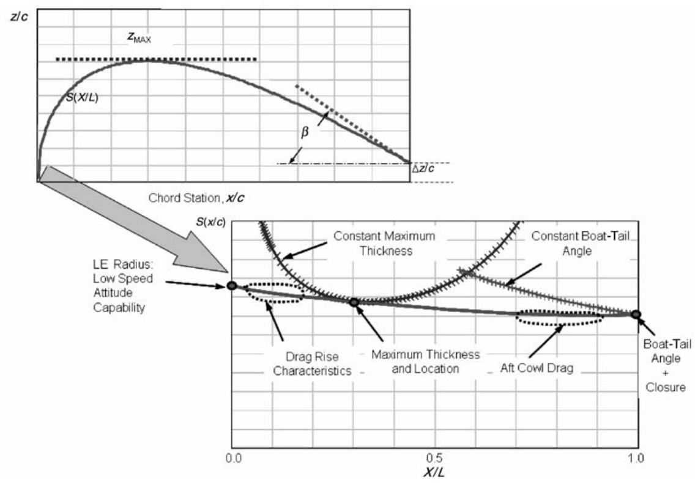

**图1　翼型几何变换示例。** 图中文字译释：Chord Station为“弦向位置”；LE Radius为“前缘半径”；Low Speed Attitude Capability为“低速姿态适应能力”；Constant Maximum Thickness为“恒定最大厚度”；Constant Boat-Tail Angle为“恒定尾缘收缩角”；Drag Rise Characteristics为“阻力增长特性”；Maximum Thickness and Location为“最大厚度及其位置”；Aft Cowl Drag为“后部整流罩阻力”；Boat-Tail Angle + Closure为“尾缘收缩角＋闭合”。图中还标有 $z/c$、$Z_{\mathrm{MAX}}$、$\beta$、$\Delta Z/c$、$S(x/c)$ 和 $X/L$ 等几何量与坐标。

## IV. 形状函数的表示

本文将简要介绍几种用于表示形状函数、描述各种几何的技术。图2说明了最简单的方法。图中给出了由最简单的形状函数——单位形状函数 $S(\psi)=1$——得到的基本基准翼型几何。图中还给出了基准翼型的简单变化，分别对前缘半径和尾缘收缩角进行单独的参数变化。

左图显示了前缘半径及翼型前部的变化。这些变化通过使用一个二次方程改变 $S(0)$ 的值来获得，该二次方程在最大厚度 $Z_{\max}$ 所对应的 $x/c$ 位置，与 $Z_{\max}$ 曲线相切。最大厚度、最大厚度位置和尾缘收缩角保持不变。

右图通过改变尾部 $x/c=1$ 处形状因子的值，获得尾缘收缩角的变化，而翼型前部保持不变。在这些例子中，翼型形状变化都由单个变量控制，而且所得翼型在所有情况下都光滑且连续。

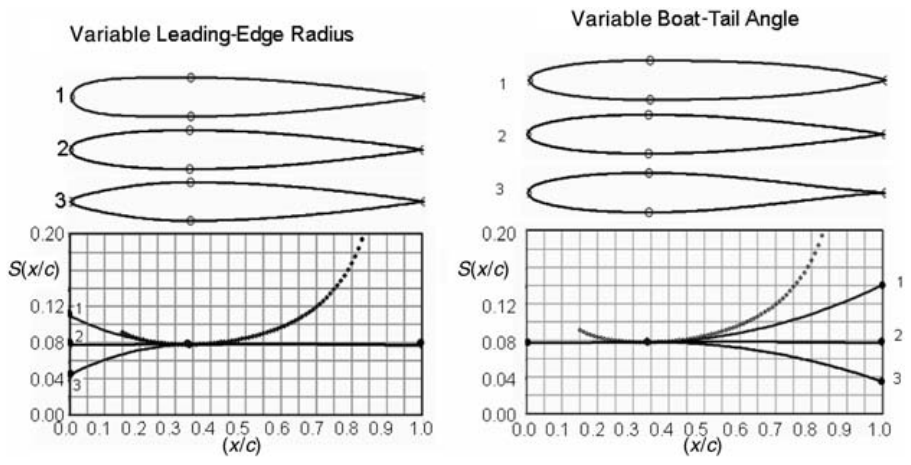

**图2　单变量翼型变化示例。** 左图标题“Variable Leading-Edge Radius”为“可变前缘半径”，右图标题“Variable Boat-Tail Angle”为“可变尾缘收缩角”；每幅图中的1、2、3对应三种翼型及其形状函数曲线。形状函数图的纵轴为 $S(x/c)$，横轴为 $x/c$。

图3给出了对称 $C_{1.0}^{0.5}(\psi)$ 翼型形状函数的五变量定义，并同时给出了相应翼型几何。这些变量包括：1）最大厚度；2）前缘半径；3）最大厚度位置；4）尾缘收缩角；5）闭合厚度。

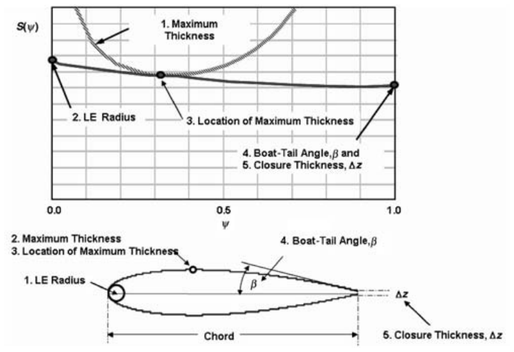

**图3　对称翼型的五变量定义。** 上方形状函数图标注：1. 最大厚度；2. 前缘半径；3. 最大厚度位置；4. 尾缘收缩角 $\beta$；5. 闭合厚度 $\Delta z$。下方翼型图标注：1. 前缘半径；2. 最大厚度；3. 最大厚度位置；4. 尾缘收缩角 $\beta$；5. 闭合厚度 $\Delta z$；Chord为“弦长”。

将同样的技术分别用于上、下表面，可以定义有弯度翼型。在这种情况下，上表面形状函数在头部 $S(0)$ 处的值的大小，等于下表面相应值的大小。这保证翼型前缘半径从上表面到下表面连续。两个表面在尾缘处的半厚度值也相等。因此，如图4所示，定义有弯度翼型的上述参数集合，需要七个变量。对于后缘厚度非零的翼型，则需要八个变量。

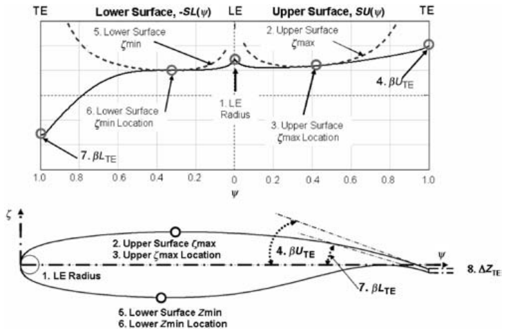

**图4　有弯度翼型的七变量定义。** 图中文字译释：TE为“尾缘”，LE为“前缘”；Lower Surface, $-S_L(\psi)$为“下表面，$-S_l(\psi)$”；Upper Surface, $S_U(\psi)$为“上表面，$S_u(\psi)$”。编号参数为：1. 前缘半径；2. 上表面最大纵坐标；3. 上表面最大纵坐标位置；4. 上表面尾缘角 $\beta_{U,\mathrm{TE}}$；5. 下表面最小纵坐标；6. 下表面最小纵坐标位置；7. 下表面尾缘角 $\beta_{L,\mathrm{TE}}$；8. 后缘厚度 $\Delta z_{\mathrm{TE}}$。形状函数图中标有 $S(\psi)$ 与 $\psi$，翼型图中的纵、横坐标分别为 $\zeta$ 和 $\psi$。

在图3和图4的例子中，所有定义翼型的关键参数，都能在所定义的形状函数上方便地控制。

## V. 将翼型分解为分量形状

图5表明，由 $S(\psi)=1$ 定义的单位形状函数，可以分解为两个分量形状函数：

- $S_1(\psi)=1-\psi$，对应圆头、尾缘收缩角为零的翼型。
- $S_2(\psi)=\psi$，对应头部半径为零、尾缘收缩角为有限值的翼型。

图中任意缩放因子 $K_R$，作为两个分量翼型方程中的加权因子。通过改变缩放因子$K_R$，可以改变前缘半径与尾缘收缩角的大小，从而得到一族前缘半径、尾缘收缩角和最大厚度位置均不同的翼型。

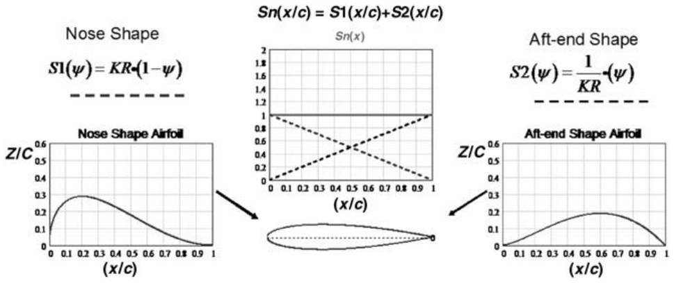

**图5　将翼型分解为分量形状或基函数。** 图中文字译释：Nose Shape为“头部形状”；Aft-end Shape为“尾部形状”；Nose Shape Airfoil为“头部形状翼型”；Aft-end Shape Airfoil为“尾部形状翼型”。图中的加权形状函数为 $S_1(\psi)=K_R(1-\psi)$、$S_2(\psi)=\frac{1}{K_R}\psi$，并标有 $S_n(x/c)=S_1(x/c)+S_2(x/c)$；几何图纵轴为 $Z/C$，横轴为 $x/c$。

使用伯恩斯坦多项式表示形状函数，可以将单位形状函数进一步分解为分量翼型。任意$n$阶伯恩斯坦多项式，由$n+1$个下列形式的项组成：

$$
S_{r,n}(x) = K_{r,n}\,x^r(1-x)^{n-r}
\tag{8}
$$

其中，$r=0,\ldots,n$，$n$为伯恩斯坦多项式的阶数。

在上式中，系数因子 $K_{r,n}$ 是二项式系数，定义为

$$
K_{r,n} \equiv \binom{n}{r} = \frac{n!}{r!\,(n-r)!}
\tag{9}
$$

这里，$\binom{n}{r}$ 表示“$n$取$r$”的二项式系数。图6以帕斯卡三角形的形式，给出了一系列伯恩斯坦多项式。

用阶数逐渐增大的伯恩斯坦多项式表示单位形状函数，可以将单位形状函数系统地分解为可缩放的组成部分。这直接来自“单位分解”性质：在0—1区间上，构成任意阶伯恩斯坦多项式的各项之和都等于1。这意味着，每一个伯恩斯坦多项式都表示单位形状函数。因此，可以对多项式中的各项进行缩放，以定义大量不同的翼型几何。

无论选择哪一阶伯恩斯坦多项式来表示单位形状函数，只有第一项定义前缘半径，只有最后一项定义尾缘收缩角。其他中间项是“塑形项”，既不影响前缘半径，也不影响尾缘收缩角。

图7给出了使用不同阶伯恩斯坦多项式分解单位形状函数的例子，以及相应的分量翼型。

各分量$S$函数的峰值位置，沿弦向等距分布，其位置由下式定义：

$$
\psi_{S\,\max\,i} = \frac{i}{n}, \qquad i=0,\ldots,n
\tag{10}
$$

相应分量翼型的峰值位置，也沿翼型弦向等距分布，并由类函数指数和伯恩斯坦多项式阶数定义：

$$
\psi_{Z\,\max} = \frac{N_1+i}{N_1+N_2+n}, \qquad i=0,\ldots,n
\tag{11}
$$

采用伯恩斯坦多项式表示翼型形状函数，实际上定义了一组分量翼型几何。这些几何可以分别缩放后相加，以表示各种翼型形状。

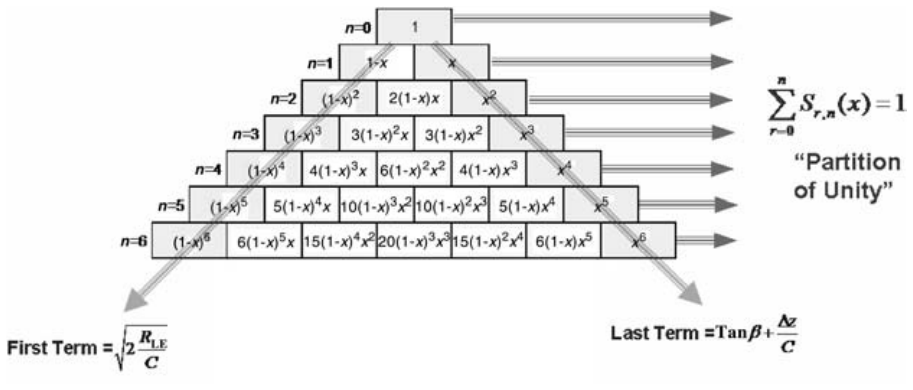

**图6　单位形状函数的伯恩斯坦多项式分解。** 图中文字“Partition of Unity”为“单位分解”，即 $\sum_{r=0}^{n} S_{r,n}(x)=1$；“First Term”为“第一项”，对应 $\sqrt{2R_{\mathrm{LE}}/C}$；“Last Term”为“最后一项”，对应 $\tan\beta+\Delta z/C$。图中的各阶组成项如下，每一行各项相加均为1：
$$
n=0:\qquad 1
$$

$$
n=1:\qquad 1-x;\quad x
$$

$$
n=2:\qquad (1-x)^2;\quad 2(1-x)x;\quad x^2
$$

$$
n=3:\qquad (1-x)^3;\quad 3(1-x)^2x;\quad 3(1-x)x^2;\quad x^3
$$

$$
\begin{aligned}
n=4:\quad &(1-x)^4;\quad 4(1-x)^3x;\quad 6(1-x)^2x^2;\\
&4(1-x)x^3;\quad x^4
\end{aligned}
$$

$$
\begin{aligned}
n=5:\quad &(1-x)^5;\quad 5(1-x)^4x;\quad 10(1-x)^3x^2;\\
&10(1-x)^2x^3;\quad 5(1-x)x^4;\quad x^5
\end{aligned}
$$

$$
\begin{aligned}
n=6:\quad &(1-x)^6;\quad 6(1-x)^5x;\quad 15(1-x)^4x^2;\\
&20(1-x)^3x^3;\quad 15(1-x)^2x^4;\\
&6(1-x)x^5;\quad x^6
\end{aligned}
$$

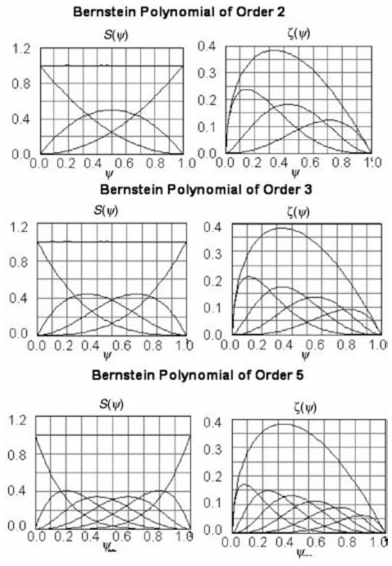

**图7　伯恩斯坦多项式提供“自然形状”。** 从上到下分别为2阶、3阶和5阶伯恩斯坦多项式。每行左图表示形状函数及其组成部分 $S(\psi)$，右图表示对应翼型及其组成部分 $\zeta(\psi)$；横轴为 $\psi$。

## VI. 利用单位形状函数的伯恩斯坦多项式表示所定义的翼型

有弯度翼型的上、下表面，都可以分别使用任意选定$n$阶的伯恩斯坦多项式来定义。这些多项式描述一组分量形状函数，并由“待确定”的系数进行缩放，如下列方程所示。

分量形状函数定义为

$$
S_i(\psi) = K_i\psi^i(1-\psi)^{n-i}
\tag{12}
$$

其中，$K_i$ 为二项式系数，定义为

$$
K_i = \binom{n}{i} = \frac{n!}{i!\,(n-i)!}
\tag{13}
$$

将翼型上、下表面的后缘厚度比分别定义为

$$
\Delta\xi_U = \frac{z_{u,\mathrm{TE}}}{C}, \qquad
\Delta\xi_L = \frac{z_{l,\mathrm{TE}}}{C}
\tag{14}
$$

翼型的类函数为

$$
C_{N_2}^{N_1}(\psi) = \psi^{N_1}(1-\psi)^{N_2}
\tag{15}
$$

上表面的总体形状函数方程为

$$
S_u(\psi) = \sum_{i=1}^{n} A_{u,i}\,S_i(\psi)
\tag{16}
$$

> 译注：式（16）与式（18）原文的求和下限均为$i=1$，按原式保留。

上表面的定义方程为

$$
\zeta_{\mathrm{upper}} = C_{N_2}^{N_1}(\psi)\,S_l(\psi)
    + \psi\Delta\xi_{\mathrm{upper}}
\tag{17}
$$

> 译注：上表面方程（17）原文使用$S_l(\psi)$，按原式保留。

下表面同样由以下方程定义：

$$
S_l(\psi) = \sum_{i=1}^{n} A_{l,i}\,S_i(\psi)
\tag{18}
$$

以及

$$
\zeta_{\mathrm{lower}} = C_{N_2}^{N_1}(\psi)\,S_l(\psi)
    + \psi\Delta\xi_{\mathrm{lower}}
\tag{19}
$$

根据具体研究目标，可以采用多种技术确定系数 $A_{u,i}$ 和 $A_{l,i}$。例如：1）在数值设计优化应用中将其作为变量；2）通过最小二乘拟合匹配指定几何；3）参数化形状变化。

使用伯恩斯坦多项式表示翼型的方法，具有以下独特且非常强大的性质 [9]：

1. 这种翼型表示技术涵盖了光滑翼型的整个设计空间。
2. 整个设计空间中的每一个翼型，都可以由单位形状函数翼型推导出来。
3. 因此，设计空间中的每一个翼型，都可以由其他任意翼型推导出来。

对于用类函数／形状函数几何方法定义翼型、短舱或回转体，一个关键的收敛问题是：需要使用几阶伯恩斯坦多项式（BPO），才能涵盖足够有意义的设计空间，使其中包含真正的最优设计？

为回答这一问题，制定了一个两步方法：

1. 对多种翼型，比较实际翼型几何与近似翼型几何。

   a）采用不同阶的伯恩斯坦多项式，近似由已定义翼型坐标计算得到的形状函数。组成伯恩斯坦多项式形状函数的系数，通过最小二乘拟合确定，以匹配选定翼型的上、下表面形状函数。

   b） 计算残差、标准差及相关函数等统计量，以量化各研究翼型表示结果的“数学优良程度”。

   c） 对实际翼型形状与近似翼型形状的表面斜率、二阶导数和曲率进行详细比较。

   d） 用这种方式分析了各种最优与非最优、对称与有弯度的翼型几何形状。

2. 对实际翼型及其相应的近似翼型进行计算流体力学（CFD）分析，使用的是耦合边界层的 TRANAIR 全势流程序 [11,12]。

使用这一过程分析的翼型已超过 30 个，包括对称 NACA 翼型、有弯度的 NACA 翼型、高升力翼型、自然层流翼型、无激波翼型、超临界翼型以及跨声速多点优化翼型。其中部分翼型的分析结果已在文献 [9] 中展示并讨论。下面给出这一评价过程的一个示例，以说明随着伯恩斯坦多项式阶数的提高，采用伯恩斯坦多项式形状函数的翼型表示向相应给定翼型几何形状收敛的速度。

## VII. 翼型表示示例：RAE2822

为了确定类函数／形状函数方法表示各种翼型的能力，进行了深入的收敛性研究。图 8—11 以典型超临界翼型 RAE2822 为例，展示了这类研究。

图 8 给出了由 130 组 $x$、$z$ 坐标“正式”定义的翼型几何形状，同时给出了由这些坐标计算得到的上、下表面形状函数。与实际翼型的上、下表面相比，形状函数曲线显得非常简单。

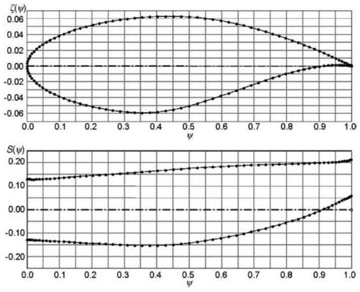

**图8　RAE2822 翼型几何形状（由 130 组 $X$、$Z$ 坐标定义）。** 上图为翼型坐标 $\zeta(\psi)$，下图为形状函数 $S(\psi)$。

图 9 将通过最小二乘法计算的形状函数与由实际 RAE2822 几何坐标确定的形状函数进行了比较；前者采用阶数逐渐提高的伯恩斯坦多项式，拟合已定义的翼型形状函数。相应的近似翼型几何形状见图 10。各图中都标出了分量形状函数的峰值位置及相应分量翼型的位置。

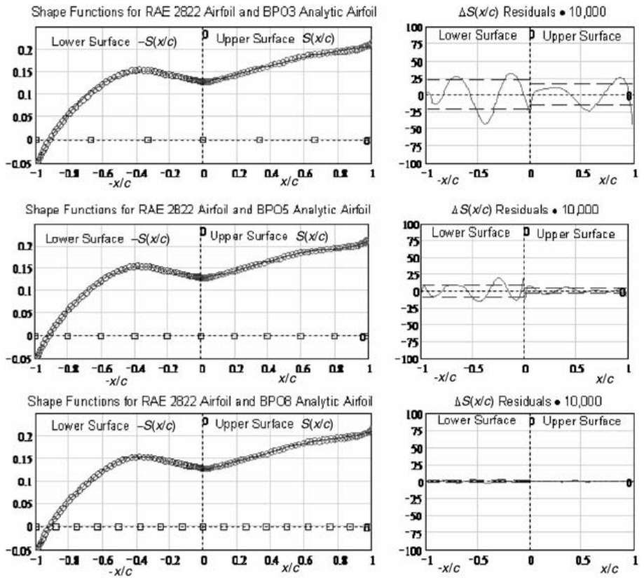

**图9　RAE2822 形状函数收敛性研究。** 图中三行依次为 RAE2822 翼型与 BPO3、BPO5、BPO8 解析翼型的形状函数。左侧显示下表面 $-S(x/c)$ 和上表面 $S(x/c)$；右侧为形状函数残差 $\Delta S(x/c)\times 10{,}000$，并分别标出下表面与上表面。

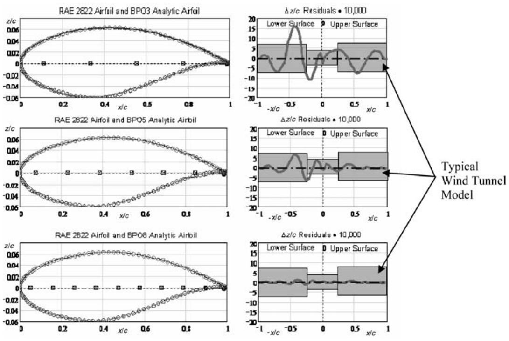

**图10　RAE2822 翼型形状收敛性研究。** 三行依次比较 RAE2822 翼型与 BPO3、BPO5、BPO8 解析翼型。右侧为坐标残差 $\frac{\Delta z}{c}\times 10{,}000$，下表面与上表面分别位于左、右半图；阴影处标注为“典型风洞模型”。

图中还给出了已定义翼型与近似翼型之间的形状函数残差及表面坐标残差。即使采用三阶伯恩斯坦多项式（BPO3）表示，实际形状函数和表面坐标与其近似结果之间的差异也几乎无法辨别。残差曲线的振荡性质是任何最小二乘拟合所具有的典型特征。

BPO5 和 BPO8 的结果表明，随着表示所用伯恩斯坦多项式阶数的提高，残差迅速而均匀地趋于消失。BPO5、BPO8 近似翼型与实际几何形状之间的差异，完全处于图中所示典型风洞模型的公差范围内。

图 11 给出了衡量 RAE2822 翼型几何形状的形状函数表示质量的两类统计量，并将其表示为伯恩斯坦多项式阶数的函数。其中包括形状函数与翼型坐标残差的 $1\sigma$ 标准差，以及相关系数 $r^2$；后者在这里用相关因子表示，其定义为

$$
\text{相关因子}=-\log\left(1-r^2\right)
\tag{20}
$$

相关因子等于翼型数据与相应近似数据之间的相关系数中，开头连续出现的 9 的个数。例如，相关因子为 5.0 表示 $r^2=0.99999$。

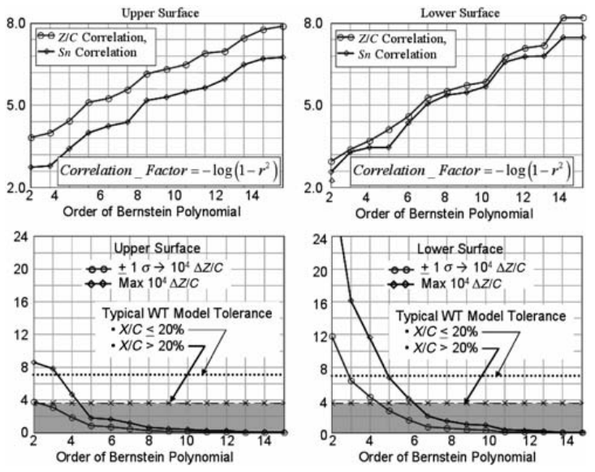

**图11　RAE2822 翼型的统计收敛性。** 左、右列分别为上表面和下表面。上排比较 $Z/C$ 的相关性与形状函数的相关性，图内“相关因子”的定义与式（20）相同；下排给出 $+1\sigma$ 对应的 $10^4\,\frac{\Delta Z}{C}$ 及最大 $10^4\,\frac{\Delta Z}{C}$。横轴均为伯恩斯坦多项式阶数。图中标出典型风洞模型公差，并分别注明 $X/C\le 20\%$ 与 $X/C>20\%$ 的区域。

对近似翼型与数值定义之间一致程度的统计分析表明，当 BPO 约为 6 或更高时，解析定义的翼型与实际翼型定义在统计意义上基本一致。

图 12 将不同阶数的伯恩斯坦多项式形状函数所得到的斜率和二阶导数，与由 RAE2822 翼型坐标得到的斜率和二阶导数进行了比较。翼型斜率和二阶导数在翼型头部附近的数值都趋于无穷，因此很难看出头部区域中拟合几何形状与实际翼型几何形状之间的差异。将斜率乘以 $\left(\frac{x}{c}\right)^{0.5}$，得到变换后的斜率，即可消除一阶导数中的奇点。同样，将二阶导数乘以 $\left(\frac{x}{c}\right)^{1.5}$，就可以消除二阶导数中的奇点。

为更清楚地说明上、下表面几何特征之间的差异，下表面的斜率和二阶导数以负值显示。

变换后的斜率及二阶导数，使解析定义翼型的计算值与 RAE2822 正式数值定义的计算值之间的差异易于辨别。近似翼型的解析斜率和二阶导数迅速收敛，与实际翼型定义得到的相应值相吻合。

虽然图中没有展示，但随着 BPO 继续增大，解析表示得到的翼型特征与实际翼型几何形状之间，即使是最细微的差异也持续趋于消失。

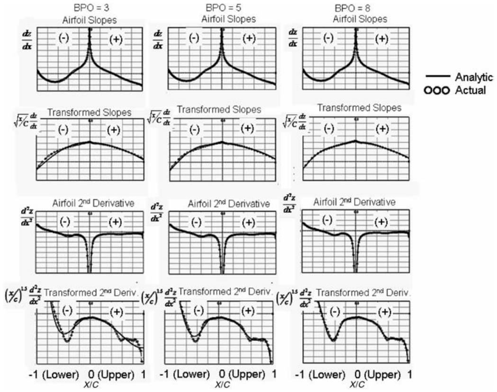

**图12　RAE2822 翼型斜率及二阶导数的收敛性。** 三列分别为 $\mathrm{BPO}=3,\,5,\,8$。由上到下依次为翼型斜率 $\frac{dz}{dx}$、变换后的斜率 $\left(\frac{x}{c}\right)^{0.5}\frac{dz}{dx}$、翼型二阶导数 $\frac{d^2z}{dx^2}$，以及变换后的二阶导数 $\left(\frac{x}{c}\right)^{1.5}\frac{d^2z}{dx^2}$。图例中实线为“解析值”，空心圆为“实际值”；横轴标出下表面（Lower）与上表面（Upper）。

对于一系列由形状函数导出的解析翼型，其形状函数采用 BPO2—BPO15 定义，使用耦合边界层的 TRANAIR [11,12] 全势流 CFD 程序，计算并比较了实际几何形状与表示几何形状的表面压力分布 $C_P$。

在所有情况下，TRANAIR 分析所输入的定义站位都与 RAE2822 的正式定义站位相同。图 13 给出了部分 RAE2822 分析结果，所比较的系列解析表示分别对应于由 PBO2、BPO4、BPO6 和 BPO8 形状函数定义的翼型。

即使是 BPO2 表示，其上、下表面合计仅由 6 个变量定义，所得压力分布与实际翼型上表面的压力分布也令人惊讶地接近。BPO6 和 BPO8 解析翼型的预测结果，与数值定义翼型的上表面压力分布十分吻合。

两个最低阶伯恩斯坦多项式翼型的下表面 $C_P$，与数值定义翼型的结果存在非常微小的差异。所有 BPO6 及更高阶翼型的上、下表面 $C_P$ 分布，都表现出与 RAE2822 数值定义结果完全吻合的特征。

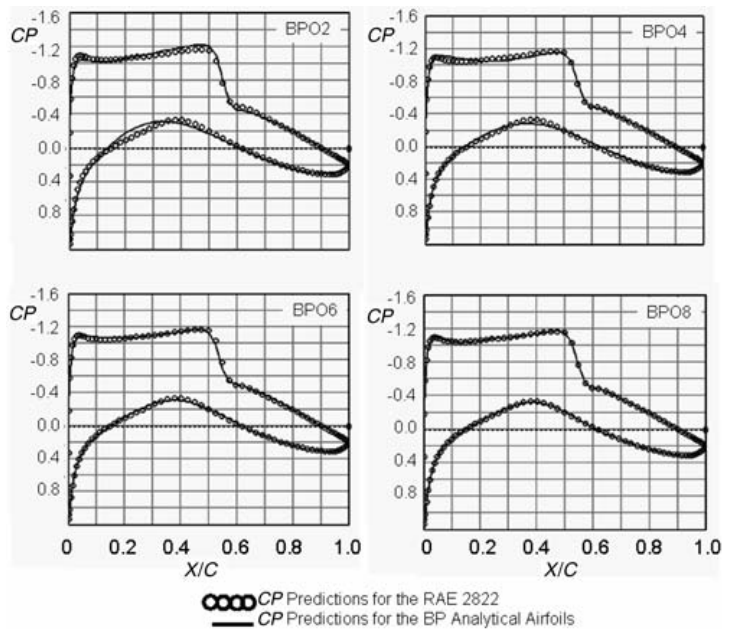

**图13　RAE2822 压力分布的收敛性。** 四个子图分别为 BPO2、BPO4、BPO6、BPO8；横轴为 $X/C$，纵轴为 $C_P$。空心圆表示 RAE2822 的 $C_P$ 预测值，实线表示伯恩斯坦多项式解析翼型的 $C_P$ 预测值。

图 14 比较了近似翼型与数值定义翼型的升力及阻力预测结果。

所有 BPO5 及更高阶翼型的升力预测结果，都与 RAE2822 的预测结果吻合。BPO8 及更高阶的阻力预测结果，与实际 RAE2822 的预测结果完全一致。BPO5 翼型的型阻和波阻都小于基准 RAE2822 翼型，尽管两者的升力预测结果相同。因此，这项最小二乘形状函数拟合研究虽然显然并非旨在进行设计优化，但确实得到了一种翼型几何形状，其升阻比相对于 RAE2822 翼型提高了 2.5%。这最有可能是类函数／形状函数方法固有的平滑能力所带来的结果。

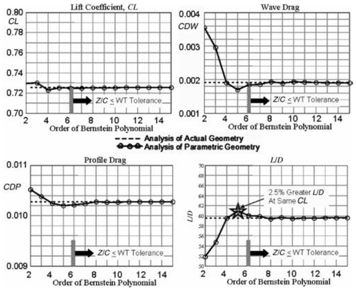

**图14　RAE2822 气动力的收敛性。** 四个子图分别为升力系数 $C_L$、波阻 $C_{\mathrm{DW}}$、型阻 $C_{\mathrm{DP}}$ 和升阻比 $L/D$；横轴为伯恩斯坦多项式阶数。虚线表示实际几何形状的分析结果，带空心圆的实线表示参数化几何形状的分析结果。箭头标注“$Z/C\le\text{风洞公差}$”；星形标记处注明“相同 $C_L$ 时，$L/D$ 提高 2.5%”。

所有 BPO5 及更高阶翼型的升力预测结果，都与 RAE2822 的预测结果吻合。BPO8 及更高阶的阻力预测结果和压力分布，与 RAE2822 的预测结果完全一致。

图 15 给出了 BPO8 翼型与实际 RAE2822 翼型定义在零迎角及 $2.31^\circ$ 迎角下的升力、阻力和俯仰力矩预测结果。BPO8 翼型的力预测结果与 RAE2822 的结果完全吻合。

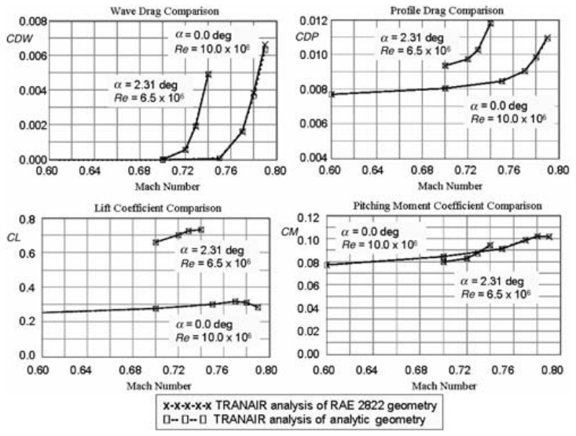

**图15　RAE2822 气动力比较：BPO8。** 四个子图分别比较波阻、型阻、升力系数和俯仰力矩系数，横轴均为马赫数。工况为 $\alpha=0.0^\circ$、$\mathrm{Re}=10.0\times10^6$，以及 $\alpha=2.31^\circ$、$\mathrm{Re}=6.5\times10^6$。叉号曲线表示 RAE2822 几何形状的 TRANAIR 分析结果，方框曲线表示解析几何形状的 TRANAIR 分析结果。

文献 [9] 还展示了其他若干翼型几何形状的类似结果。几何形状、$C_P$ 及气动力比较的结果表明，仅使用相对较少变量的低阶伯恩斯坦多项式形状函数翼型，就能够紧密地表示任何翼型。

以图 16 中的 RAE2822 翼型为例，可以清楚地看出翼型形状函数表示在数学上的简洁性。图中将翼型表面的表面斜率、二阶导数和表面曲率，与上、下表面形状函数的相应值进行了比较。

RAE2822 翼型的斜率和二阶导数在头部为无穷大，而曲率沿翼型表面变化很大。RAE2822 形状函数的斜率与二阶导数则为有限值，而且处处很小；形状函数的曲率基本为零。这清楚地表明，与使用翼型实际坐标相比，形状函数翼型表示方法具有数学简洁性这一显著优势。

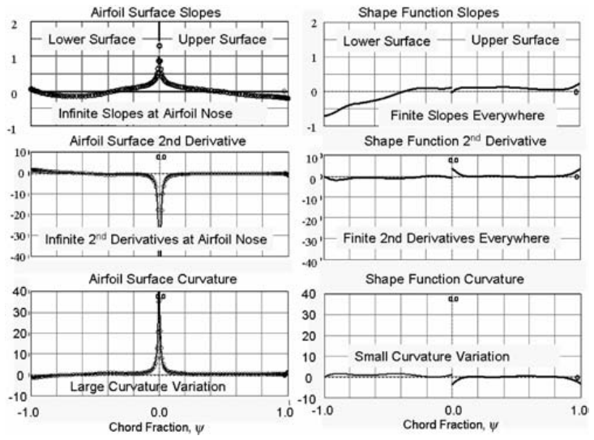

**图16　形状函数的数学简洁性：RAE2822。** 左列依次为翼型表面斜率、翼型表面二阶导数和翼型表面曲率；右列依次为形状函数斜率、形状函数二阶导数和形状函数曲率。图内说明依次为“翼型头部的斜率为无穷大”与“斜率处处有限”、“翼型头部的二阶导数为无穷大”与“二阶导数处处有限”、“曲率变化大”与“曲率变化小”。图中标出下表面与上表面，横轴为弦长比例 $\psi$。

此前报道的广泛研究 [9] 考察了采用伯恩斯坦多项式的形状函数方法表示各种翼型的适用性。结果表明，相对低阶的伯恩斯坦多项式（通常为 BPO6—BPO9），就能够匹配翼型几何形状、斜率和二阶导数，以及压力分布和气动力 [9]。结果还表明，设计变量较少的更低阶伯恩斯坦多项式（可能为 BPO4—BPO6），应足以用于得到最优设计。

这一方法为系统开展设计优化提供了选择。优化过程可以首先使用一个与低阶伯恩斯坦多项式形状函数表示相对应的分量翼型形状族，以获得最优设计。随后，可以提高伯恩斯坦多项式的阶数，再进行一次优化，以确定能否获得更好的最优设计。提高伯恩斯坦多项式阶数，是系统增加设计变量个数的一种方式；这相当于扩展设计空间，从而探索最优解的收敛性。

在此前讨论的研究中，伯恩斯坦多项式形状函数翼型定义对上、下表面使用了相同阶数的伯恩斯坦多项式。虽然这并非必要条件，但它确实提供了一种十分方便的方法：如图 17 所示，只需将单位形状函数的缩放系数相加或相减，就能够确定翼型的分量弯度分布和厚度分布。

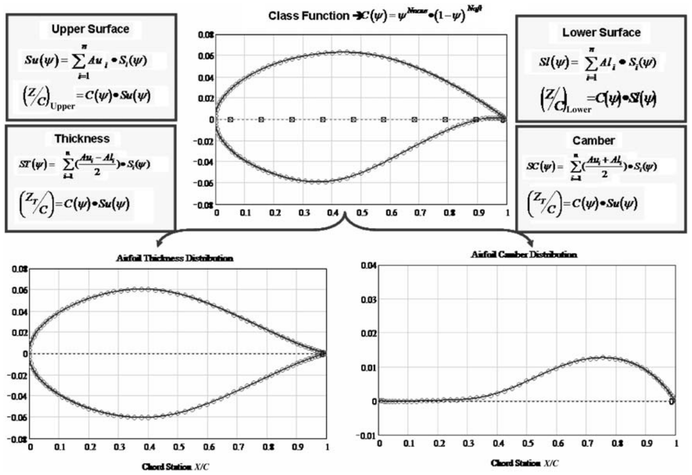

**图17　将翼型简单分解为厚度与弯度。** 图中四个框的标题分别为“上表面”“下表面”“厚度”和“弯度”，上方为“类函数”。下方两图分别为“翼型厚度分布”和“翼型弯度分布”，横轴为“弦向位置 $X/C$”。图内数学表达式按原图保留。

到目前为止，讨论都集中在圆头、尖尾的二维翼型上。不过，类函数／形状函数方法也同样适合用于定义轴对称几何形状的半径分布。

## VIII. 向物体横截面几何形状的扩展

下面将说明，表示二维或轴对称几何形状的形状函数／类函数方法，可以直接用于表示第 2 类几何构件，即“物体类”几何形状的横截面形状。

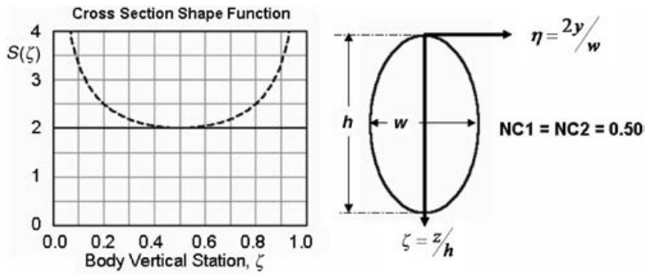

**图18　物体横截面的形状函数／类函数表示。** 图内标注为“横截面形状函数”和“物体垂向位置 $\zeta$”；示意图保留了 $h$、$w$、$\eta=\frac{2y}{w}$、$\zeta=\frac{z}{h}$ 以及 $N_{C1}=N_{C2}=0.50$ 的标记。

首先假设一个物体横截面横向对称，且具有图 18 所示的椭圆形状。随后，我们将利用类函数，把这些结果推广到其他横截面几何形状。

在图示坐标系中，椭圆方程为

$$
\left(\frac{2Y}{w}\right)^2+\left(\frac{2Z-h}{h}\right)^2=1
\tag{21}
$$

令 $\eta=\frac{2y}{w}$，$\zeta=\frac{z}{h}$。

椭圆方程变为 $\eta^2+(2\zeta-1)^2=1$，或 $\eta=2\sqrt{\zeta}\,\sqrt{1-\zeta}$。

于是，横截面可用类函数和形状函数表示为

$$
\eta=S(\zeta)\,C_{0.5}^{0.5}(\zeta)
\tag{22}
$$

横截面形状函数只是一个常数：$S(\eta)=2$。另一侧由横向对称条件确定。如图 19 所示，改变类函数的指数，可以得到各种物体横截面形状。

> 译注：原文此处写作 $S(\eta)$，而式（22）中形状函数的自变量为 $\zeta$；此处保留原文写法。

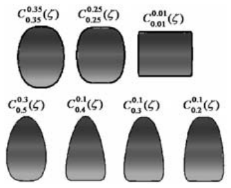

**图19　各种物体横截面形状。** 图中各截面上方的记号表示采用不同指数的类函数。

这种横截面的横向表示，对于定义升力体等几何形状非常方便。另一种横截面表示方法可能更适合定义短舱和机身横截面：使用一个类函数描述物体横截面的上瓣，另一个类函数描述其下瓣，如图 20 所示。这与定义有弯度翼型的过程十分相似。首先假设一个物体横截面横向对称，且具有椭圆形状。随后，我们将采用类函数的其他取值，推广这些结果。

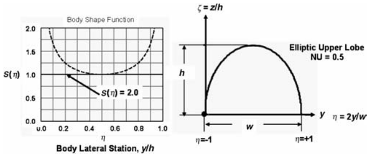

**图20　物体上瓣或下瓣形状的表示。** 左图标注为“物体形状函数”，横轴为“物体横向位置，$y/h$”；右图标注为“椭圆上瓣，$N_U=0.5$”。图中原有坐标定义及端点标记予以保留。

将椭圆的坐标轴置于左边缘后，其方程可表示为

$$
\zeta(\eta)=2\sqrt{\eta}\,\sqrt{1-\eta}
\tag{23}
$$

其中 $\eta=\frac{y}{w}$，$\zeta=\frac{z}{h}$。

> 译注：图 20 标注 $\eta=\frac{2y}{w}$，端点为 $\eta=-1$ 与 $\eta=+1$；式（23）后的正文则定义 $\eta=\frac{y}{w}$。图与正文的坐标定义存在不一致，均按原文保留。

因此，这一椭圆上瓣几何形状的形状函数为

$$
S_u(\eta)=\frac{\zeta_u(\eta)}{\eta^{N_{C1}}(1-\eta)^{N_{C2}}}=2
\tag{24}
$$

在前面的方程中，我们使用可变指数 $N_{C1}$ 和 $N_{C2}$，将类函数的定义推广为

$$
C(\eta)=\eta^{N_{C1}}(1-\eta)^{N_{C2}}
\tag{25}
$$

用形状函数和类函数表示的横截面几何方程变为

$$
\zeta_u(\eta)=S_u(\eta)\,C(\eta)
\tag{26}
$$

对于椭圆上瓣形状，形状函数为常数，等于 2.0；类函数指数为 $N_{C1}=N_{C2}=0.5$。

在这种情况下，上瓣的定义方程为

$$
\zeta_u(\eta)=\left[S_u(\eta)=2\right]\,C_{u,\,0.5}^{0.5}(\eta)
\tag{27}
$$

图 21 展示了各种横截面形状的示例；通过独立改变物体横截面上、下瓣的类函数系数，即可得到这些形状。

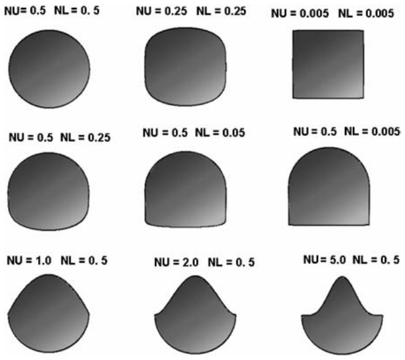

**图21　物体上瓣／下瓣横截面示例。** 图中 $N_U$、$N_L$ 分别对应上瓣、下瓣的类函数参数。

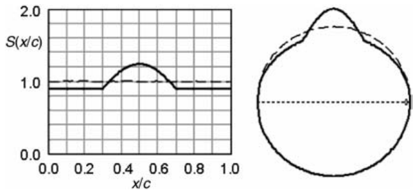

**图22　机身“凸起”的表示。** 左图给出 $S(x/c)$ 随 $x/c$ 的变化，右图为相应机身横截面。

图 19 和图 21 中的示例横截面，都是采用简单的单位形状函数和不同类函数得到的。除改变类函数之外，再改变形状函数的表达形式，即可生成非常一般的横截面形状。如图 22 所示，改变物体上瓣的形状函数，可以形成上表面凸起或整流罩。在所示的例子中，这一几何外形代表穿过驾驶舱区域的机身截面。

## IX. 扩展到任意三维几何外形

三维物体通常可以表示为截面形状的分布。

形状函数／类函数方法既可用于描述基本的截面形状，也可用于描述这些形状沿物体轴线的分布，图23以立方体这一简单情形为例加以说明。

截面形状函数 $S_c$ 和类函数 $C_c$ 由下列方程定义：

$$
S_c=0.5^{2N_C}
\tag{28}
$$

$$
C_c(\eta)=\eta^{N_C}(1-\eta)^{N_C},\qquad \eta\to 0\text{–}1
\tag{29}
$$

分布形状函数 $S_d$ 和类函数 $C_d$ 由类似的方程定义：

$$
S_d=0.5^{2N_D}
\tag{30}
$$

$$
C_d(\psi)=\psi^{N_D}(1-\psi)^{N_D},\qquad \psi\to 0\text{–}1
\tag{31}
$$

$N_C$ 和 $N_D$ 是类函数的指数。

如图23所示，$L$ 为物体长度，$W$ 为物体宽度，$H$ 为物体高度。

用于定义几何外形的 $x$、$y$、$z$ 坐标由下列方程给出：

$$
x(\psi)=\psi L
\tag{32}
$$

$$
y(\psi,\eta)=-\left[S_d\,C_d(\psi)\right](1-2\eta)\,\frac{W}{2}
\tag{33}
$$

$$
z(\psi,\eta)=\pm\left[S_d\,C_d(\psi)\right]\left[S_c\,C_c(\eta)\right]\frac{H}{2}
\tag{34}
$$

对于一个简单的单位立方体，$L=W=H=1$，且 $N_C=N_D\simeq0.001$。

图24给出了利用式(28)–(34)、采用不同类函数指数组合所确定的各种几何外形的例子。

图中的第三幅图是实心圆柱，其分布类函数的指数略大于零（$N_D=0.005$）。如第四幅图所示，当分布类函数的指数恰好为零时（$N_D=0.0$），几何外形就是圆形贯通管道。$N_D=0$ 会得到开放的贯通物体，而 $N_D\simeq0.005$ 则会得到外形相似的实心几何体。

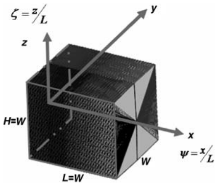

**图23　截面形状及其分布的定义。**

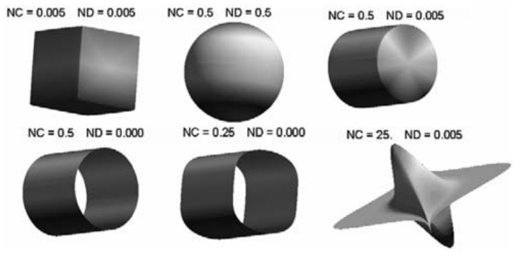

**图24　通过类函数所定义的截面形状及其类函数分布生成的几何外形。**

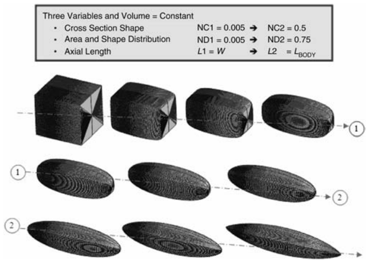

**图25　利用三个变量将立方体变换为西尔斯–哈克体。**

图25给出了一个例子：使用形状函数／类函数方法，只需很少的设计变量，就能使几何外形发生看起来十分显著的变化，即将立方体变换为体积相等的西尔斯–哈克体（Sears–Haack body）。

西尔斯–哈克体的圆形截面具有单位形状函数，其类函数为 $C_{s,\,0.5}^{0.5}(\eta)$。西尔斯–哈克体的纵向半径分布也具有单位形状函数，其类函数为 $C_{d,\,0.75}^{0.75}(\psi)$。

因此，只需同时将截面类函数的指数从 0.005 增大至 0.5，再将纵向半径分布类函数的指数从 0.005 增大至 0.75，并增大长度以保持体积不变，就能轻易实现从立方体到西尔斯–哈克体的变换。

图25展示了立方体平滑地变换为西尔斯–哈克体过程中的若干中间几何外形。

图26给出了一个例子：利用可变的类函数指数，很容易将等截面积的圆形管道变换为一种截面从圆形入口过渡至方形喷口的管道，同时保持截面积不变。

入口处的初始几何形状是圆形管道，由指数为 0.5 的截面类函数定义。在这个例子中，管道在长度的 0–20% 范围内保持截面不变。管道最后 5% 长度的截面为方形，其类函数指数为 0.001。方形的宽度和深度经过调整，以使其面积与圆形入口的面积相等。在长度的 20–95% 范围内，类函数指数按两端斜率均为零的三次变化规律，从 20% 位置的 0.5 减小至 95% 位置的 0.001。在整个过渡区域，宽度和深度按比例缩放，以保持截面积不变。整个几何外形实际上只由一个变量驱动，即后端恒定的类函数指数。

这是“标量”或“解析”放样的一个例子；几何外形通过截面类函数指数沿管道长度的解析变化生成。

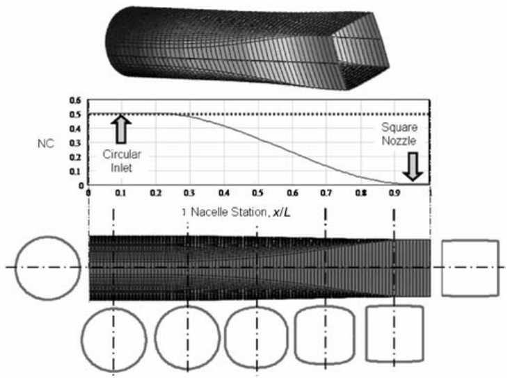

**图26　用一个变量定义带有方形喷口的圆形管道。**

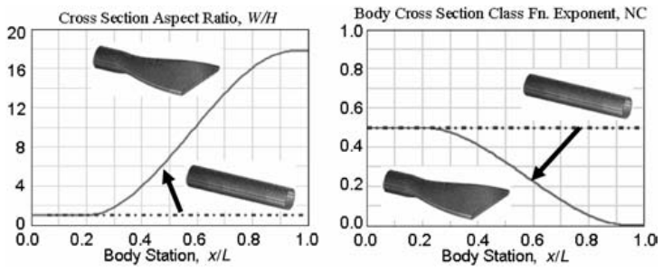

**图27　将圆形管道变换为薄矩形喷口（2个变量）。**

图27展示了圆形管道向薄而宽的矩形管道的变换。这一变换是在上一个例子的基础上，只增加一个额外变量——喷口的宽高比——得到的。这个比值是出口喷口的宽度与高度之比。在本例中，当截面类函数的指数从 0.5 变为 0.005 时，这个额外变量从 1 变为 17.8。

在图28中，采用类似于定义图26和图27中几何外形的技术，将圆形管道变换为一种看起来十分接近超声速飞机构型的几何形状。这一几何变换总共只使用了四个设计变量。这四个设计变量包括：1）纵向类函数的指数 $N_{D1}$、$N_{D2}$；2）后端截面类函数的指数 $N_C$（图A）；3）后端的宽高比 $W/H$（图B）。

图28还展示了最终构型的一系列截面切片，以说明几何外形过渡的平滑性。

## X. 短舱详细设计：两种方案

现在，我们使用类函数／形状函数变换，仅通过少数几个设计参数，建立短舱的详细定义。使用类函数和形状函数定义短舱，有两种方案：

1. 定义顶线、最大半宽和底线的纵向剖面形状，然后将这些剖面绕纵轴沿周向分布，以定义短舱几何外形。
2. 定义截面形状，并将这些形状沿纵轴分布。

在下面的讨论中，我们将着重介绍第一种方案，因为它可以演示本文及先前研究[9]中已经介绍的许多概念如何结合使用。目标是使用很少的设计变量，建立短舱的详细定义。

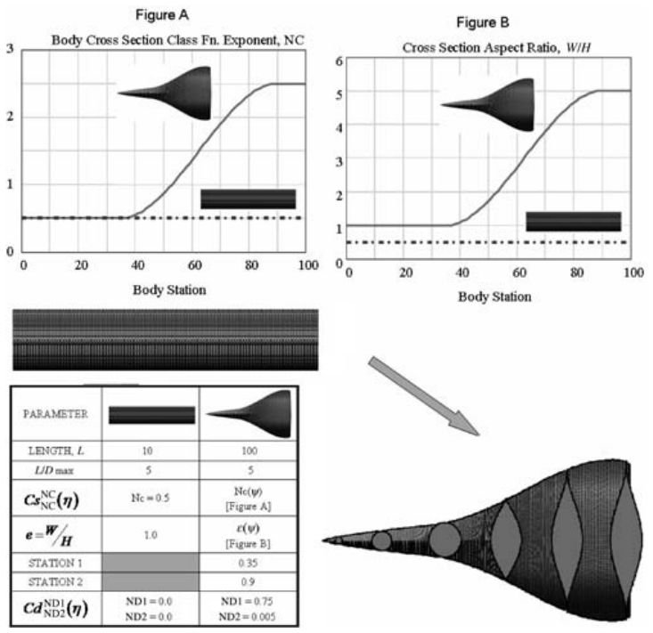

**图28　将圆柱变换为超声速运输机。**

图29展示了一种经常用于定义短舱的常见方法：采用翼型式截面来描述顶线、底线和最大半宽的形状。在本例中，基本翼型几何采用超临界翼型的 BP5 形状函数定义来表示，因此具有六个定义变量。

本例中，底线翼型和最大半宽翼型都在最大厚度位置之前进行了参数化修改，前者增大前缘半径，后者减小前缘半径。因此，又增加了两个定义变量，分别对应所需的前缘半径。

短舱在顶线、最大半宽和底线之间的外部截面形状，由指数为 $N_U$ 的上部类函数定义。最大半宽与底线之间的短舱下部，同样由指数为 $N_L$ 的下部类函数定义。随后，如图30所示，通过类函数指数沿短舱长度的变化，定义截面形状沿短舱中心线的分布。

整个短舱的上部采用恒定的类函数指数 0.5 来定义。这会在顶线与最大半宽所定义的几何形状之间，形成椭圆形／圆形的截面形状分布。

下部截面的类函数指数保持为 0.25，直到位于短舱长度 40% 处的定义位置1。这会使短舱前部从最大半宽翼型到底线翼型之间呈现一种“压扁”的形状分布。定义位置2位于短舱长度的 80% 处，其后的下部为圆形，类函数指数为 0.5。因此，喷口具有轴对称的几何外形。在位置1与位置2之间，连接最大半宽几何与底线几何的下部形状，从位置1处的压扁截面平滑地过渡为位置2处的圆形截面。因此，截面形状的分布完全由以下四个设计变量定义：1）上部类函数指数 $N_U$；2）下部类函数 $N_L$；3）压扁的下部截面终止位置，即位置1；4）圆形下部截面的起始位置，即位置2。

进气口的定义见图31。进气口内部的截面形状及前缘半径分布，被定义为与短舱头部外部整流罩的截面形状及流向前缘半径分布相匹配。随后，进气口内部形状从入口唇口处的压扁形状，平滑地变化为喉部位置的圆形截面。从喉部位置后方直到进气口长度的终点，内部形状都定义为圆形。

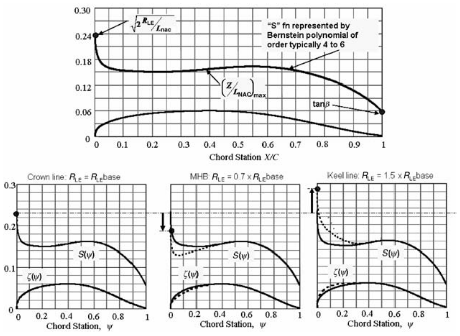

**图29　短舱顶线、底线及最大半宽的定义（8个变量）。**

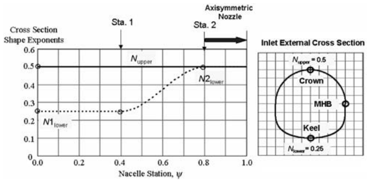

**图30　绕短舱中心线的径向短舱形状分布（4个变量）。**

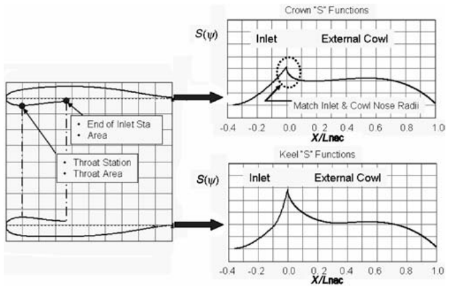

**图31　短舱进气口几何的定义（4个变量）。**

整个进气口内部几何只需另外四个定义变量。这些变量包括：1）喉部位置；2）喉部面积；3）进气口终点位置；4）进气口终点面积。

图32展示了由上述总计15个短舱设计变量所定义的完整短舱几何外形。可以看到，这一几何外形在所有位置都是平滑且连续的。

根据这一例子看来，对于短舱外部形状的气动设计优化，只需相对较少的变量，就能覆盖一个很大的设计空间，其中包含实际可用的平滑、连续几何外形。

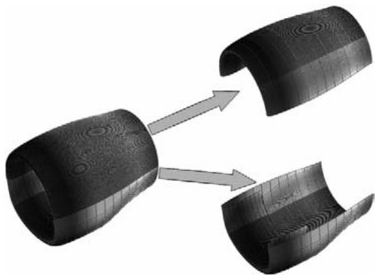

**图32　完整短舱外部形状及进气口几何的定义（15个变量）。**

## XI. 使用类函数／形状函数变换方法定义三维机翼

三维机翼可以看作沿翼展分布的一系列翼型。因此，我们可以使用前面讨论过的类函数和形状函数，获得机翼翼型截面的解析定义，然后只需将这些解析表达式沿翼展分布，就能完整定义一副机翼。在本节中，我们首先建立任意机翼的解析定义。先通过若干简单应用，说明这一方法的使用；随后考察该方法在亚声速和超声速机翼详细定义中的应用。

图33展示了一个典型的机翼翼型截面。当地机翼翼型截面的解析定义类似于翼型定义[式(1)]，但增加了两个参数，即当地机翼剪切和当地机翼扭转角。

$$
\begin{aligned}
\zeta_U(\psi,\eta)
&= \zeta_N(\eta)+C_{1.0}^{0.5}(\psi)\,S_U(\psi,\eta) \\
&\quad+\psi\bigl[\zeta_T(\eta)-\tan\alpha_T(\eta)\bigr]
\end{aligned}
\tag{35}
$$

其中：

- 当地弦长的比例位置：$\psi=\frac{x-x_{\mathrm{LE}}(\eta)}{c(\eta)}$。
- 无量纲半翼展位置：$\eta=\frac{2y}{b}$。
- 当地前缘坐标：$x_{\mathrm{LE}}(\eta)$。
- 当地弦长：$c(\eta)$。

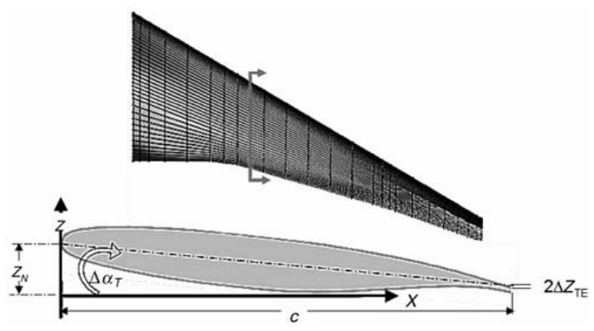

**图33　机翼翼型截面。**

- 无量纲上表面坐标：$\zeta_U(\eta)=\frac{z_U(\eta)}{c(\eta)}$。
- 无量纲当地机翼剪切：$\zeta_N(\eta)=\frac{z_N(\eta)}{c(\eta)}$。
- 当地机翼扭转角：$\alpha_T(\eta)$。

式(20)是机翼上表面的方程；下表面的相应方程为：

> 译注：原文此处引用式(20)，按上下文应指式(35)。

$$
\begin{aligned}
\zeta_L(\psi,\eta)
&= \zeta_N(\eta)+C_{1.0}^{0.5}(\psi)\,S_L(\psi,\eta) \\
&\quad+\psi\bigl[\zeta_T(\eta)-\tan\alpha_T(\eta)\bigr]
\end{aligned}
\tag{36}
$$

将推导式(2)时所采用的翼型形状函数过程加以扩展，就能把物理 $z$ 坐标变换为形状函数。对于具有垂直剪切（上下位移）和当地截面扭转的机翼，其翼型截面对应的形状函数由下式给出：

$$
S_U(\psi,\eta)=
\frac{
  \begin{aligned}
  &\zeta_U(\psi,\eta)-\zeta_N(\eta) \\
  &\quad-\psi\bigl[\zeta_T(\eta)-\tan\alpha_T(\eta)\bigr]
  \end{aligned}
}{C_{1.0}^{0.5}(\psi)}
\tag{37}
$$

机翼下表面对应的形状函数方程为：

$$
S_L(\psi,\eta)=
\frac{
  \begin{aligned}
  &\zeta_L(\psi,\eta)-\zeta_N(\eta) \\
  &\quad-\psi\bigl[\zeta_T(\eta)-\tan\alpha_T(\eta)\bigr]
  \end{aligned}
}{C_{1.0}^{0.5}(\psi)}
\tag{38}
$$

对于给定的机翼定义，可以使用式(37)和式(38)计算机翼上、下表面的形状函数。

如果机翼在设计空间中被定义为一个形状函数曲面，则可以根据该形状函数曲面，以及当地的扭转、剪切和弦长，确定物理空间中的机翼上、下表面：

$$
\begin{aligned}
z_U(x,y)
&=\Bigl\{\zeta_N(\eta)+C_{1.0}^{0.5}(\psi,\eta)\,S_U(\psi,\eta) \\
&\qquad+\psi\bigl[\zeta_T(\eta)-\tan\alpha_T(\eta)\bigr]\Bigr\}
  C_{\mathrm{LOCAL}}(\eta), \\[6pt]
z_L(x,y)
&=\Bigl\{\zeta_N(\eta)+C_{1.0}^{0.5}(\psi,\eta)\,S_L(\psi,\eta) \\
&\qquad+\psi\bigl[\zeta_T(\eta)-\tan\alpha_T(\eta)\bigr]\Bigr\}
  C_{\mathrm{LOCAL}}(\eta)
\end{aligned}
\tag{39}
$$

图34说明了将设计空间中的机翼形状函数曲面变换为机翼物理定义的一般过程。单位设计空间由 $\psi\in[0.0,1.0]$ 和 $\eta\in[0.0,1.0]$ 定义，因此可以表示任意机翼平面形状。

图34表明，类函数指数可以随展向位置 $\eta$ 变化。对于亚声速机翼，整个机翼上的类函数指数是恒定的。不过，超声速机翼的平面形状往往具有大后掠角的内翼段，其前缘为亚声速圆头前缘；外翼段的后掠角较小，具有超声速前缘及尖头翼型。在这种情况下，外翼段的类函数将不同于内翼段的类函数。图35–38给出了从设计空间中的单位基准机翼定义，变换为具体机翼详细物理定义的过程示例。图35展示了单位基准形状函数曲面对应的机翼截面形状，以及将单位形状函数改为对应于整个翼展上恒定 RAE2822 型翼型的形状函数所产生的效果。如图10所示，这需要大约11个变量来定义翼型的上、下表面。图36展示了加入最大厚度比展向变化的效果。这就构成了 $\psi$、$\eta$ 设计空间中的完整机翼定义。

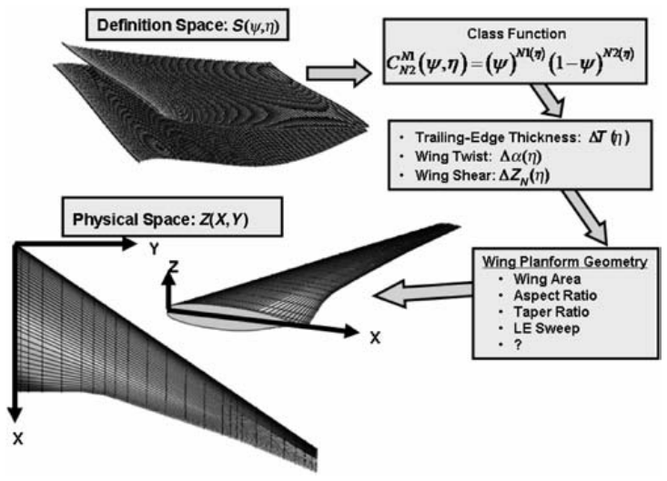

**图34　从设计空间到物理空间的变换。**

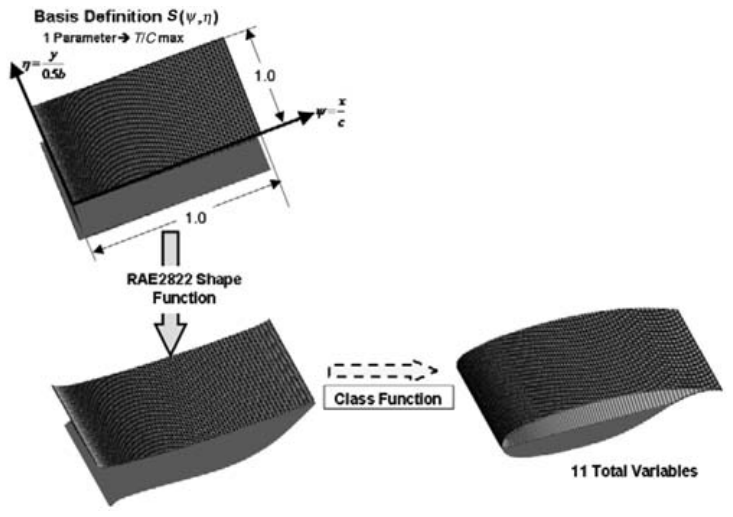

**图35　参数化机翼设计空间：$\psi$、$\eta$、$S$。**

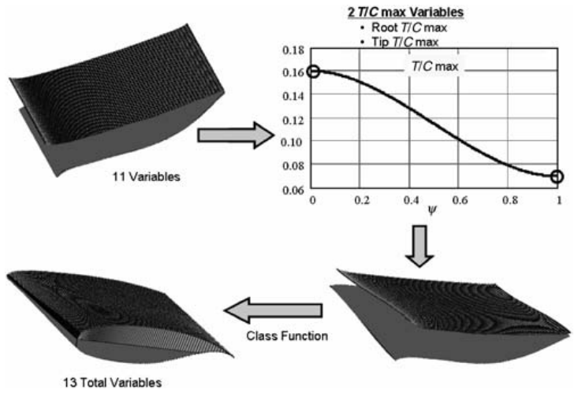

**图36　加入机翼厚度的展向变化。**

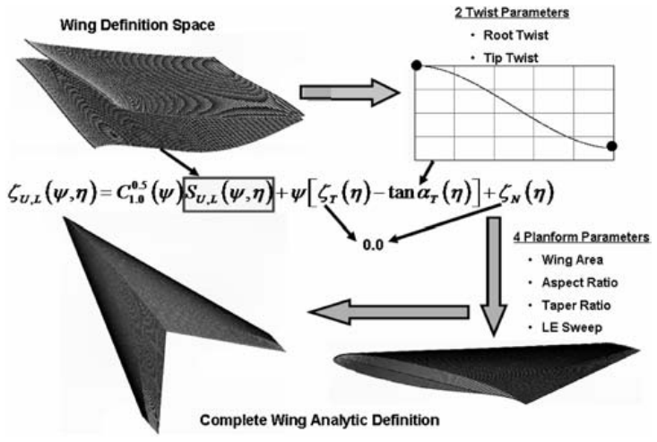

**图37　完整的参数化机翼定义。**

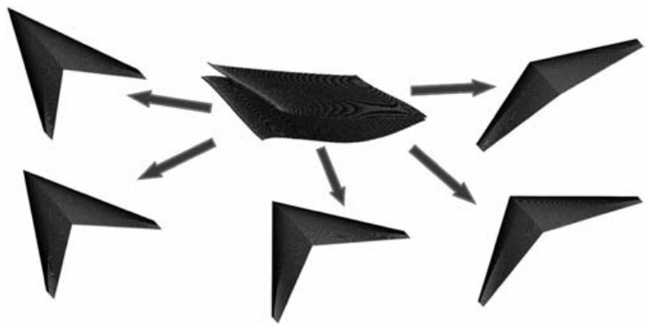

**图38　参数化机翼定义：改变机翼后掠角。**

图37展示了将设计空间中的机翼变换为完整机翼物理定义的过程。图中还展示了定义机翼平面形状及展向扭转分布的关键参数。

在本例中，带有弯度的机翼完整参数化定义，包括最大厚度和机翼扭转的展向变化，以及规定的机翼面积、后掠角、展弦比和梢根比，总共只需要19个设计变量：

1. 超临界翼型截面需要11个设计变量。
2. 展向厚度变化需要2个变量。
3. 展向扭转变化需要2个变量。
4. 机翼面积需要1个变量。
5. 展弦比需要1个变量。
6. 梢根比需要1个变量。
7. 前缘后掠角需要1个变量。

图38表明，同一个机翼设计空间定义，根据不同的平面形状定义参数，可以定义各种机翼平面形状的详细表面几何。在图示的各个例子中，保持结构展弦比不变，通过改变机翼后掠角获得不同的平面形状。

## XII. 设计空间中机翼的数学描述

与翼型的形状函数类似，图38所示这类简单机翼的形状函数设计曲面，是一个平滑、连续的解析曲面。因此，形状函数曲面可以用关于 $x$ 和 $y$ 的泰勒级数展开来描述。文献[10]证明，关于 $x$ 和 $y$ 的泰勒级数展开，等价于先作关于 $x$ 的泰勒级数展开，再将各个 $x$ 项的系数表示为关于 $y$ 的泰勒展开。

类似地，关于 $x$ 和 $y$ 的幂级数，恰好等于先作关于 $x$ 的幂级数展开，再将各个 $x$ 项的系数表示为关于 $y$ 的幂级数展开。

因此，要获得整个机翼表面的形状函数曲面，可以首先选择用于表示机翼翼型的伯恩斯坦多项式阶数。然后，使用任意适当的数值方法，将伯恩斯坦多项式的系数沿展向展开，就能定义完整的机翼形状函数曲面。再将形状函数曲面乘以机翼类函数，就能得到机翼表面的定义。

从物理意义上说，这意味着翼根翼型由所选伯恩斯坦多项式定义的一系列组合翼型来表示。随后，整个机翼由同一组组合翼型表示。每个组合翼型的幅值依据展向展开方法和机翼定义目标，沿翼展变化。例如，这一定义目标可以是有约束的机翼设计优化。

下面给出这一过程的数学表达示例，使用伯恩斯坦多项式表示流向翼型形状，以及流向系数的展向变化。

$N_x$ 阶伯恩斯坦多项式的单位流向形状函数定义为：

$$
S_{x,i}(\psi)=K_{x,i}\,\psi^i(1-\psi)^{N_x-i},
\qquad i=0,\ldots,N_x
\tag{40}
$$

其中，流向二项式系数定义为：

$$
K_{x,i}\equiv\binom{N_x}{i}
\equiv\frac{N_x!}{i!\,(N_x-i)!}
\tag{41}
$$

参考展向位置 $\eta_{\mathrm{REF}}$ 处的流向上表面形状函数为：

$$
S_u(\psi,\eta_{\mathrm{REF}})
=\sum_{i=1}^{N_x}A_{u,i}(\eta_{\mathrm{REF}})\,S_{x,i}(\psi)
\tag{42}
$$

现在，用伯恩斯坦多项式表示每个系数 $A_{u,i}(\eta)$ 的展向变化：

$$
A_{u,i}(\eta)
=\sum_{j=1}^{N_y}B_{u,(i,j)}\,S_{y,j}(\eta)
\tag{43}
$$

> 译注：式(42)、式(43)的求和下限按原文保留为1；这与式(40)、式(44)从0开始的基函数索引及后文的前缘系数 $B_{u,(0,j)}$、$B_{l,(0,j)}$ 不一致，疑为排印错误。

其中：

$$
S_{y,j}(\psi)=K_{y,j}\,\eta^j(1-\eta)^{N_y-j},
\qquad j=0,\ldots,N_y
\tag{44}
$$

> 译注：式(44)左端的函数自变量按原文保留为 $\psi$，而右端及上下文使用 $\eta$。

并且：

$$
K_{y,j}\equiv\binom{N_y}{j}
\equiv\frac{N_y!}{j!\,(N_y-j)!}
\tag{45}
$$

于是，机翼上表面定义为：

$$
\begin{aligned}
\zeta_U(\psi,\eta)
&=C_{N_2}^{N_1}(\psi)
  \sum_{i}^{N_x}\sum_{j}^{N_y}
  \bigl[B_{u,(i,j)}\,S_{y,j}(\eta)\,S_{x,i}\bigr] \\
&\quad+\psi\bigl[\zeta_T(\eta)-\tan\alpha_{\mathrm{TWIST}}(\eta)\bigr]
  +\zeta_N(\eta)
\end{aligned}
\tag{46}
$$

下表面的相应方程为：

$$
\begin{aligned}
\zeta_L(\psi,\eta)
&=C_{N_2}^{N_1}(\psi)
  \sum_{i}^{N_x}\sum_{j}^{N_y}
  \bigl[B_{l,(i,j)}\,S_{y,j}(\eta)\,S_{x,i}\bigr] \\
&\quad+\psi\bigl[\zeta_T(\eta)-\tan\alpha_{\mathrm{TWIST}}(\eta)\bigr]
  +\zeta_N(\eta)
\end{aligned}
\tag{47}
$$

在式(46)和式(47)中，系数 $B_{u,(i,j)}$ 和 $B_{l,(i,j)}$ 定义了机翼上、下表面的独特几何外形。在设计优化研究中，系数 $B_{u,(i,j)}$ 和 $B_{l,(i,j)}$ 就是优化变量。

只需满足 $B_{u,(0,j)}=B_{l,(0,j)}$，就很容易保证从上表面绕过前缘到下表面的曲率连续性。

分量形状函数项 $S_{x,i}$ 表示第 $i$ 个基本组合翼型的形状。$S_{y,i}$ 项表示任意组合翼型的第 $j$ 个展向分布。因此，每个乘积 $S_{x,i}\,S_{y,i}$ 都定义了 $(N_x+1)(N_y+1)$ 个组合机翼形状中的一个，这些组合形状用于构成完整的上表面或下表面定义。

> 译注：原文最后一段将展向基函数及乘积中的下标写作 $S_{y,i}$；按式(43)–(47)的记号，应为 $S_{y,j}$。

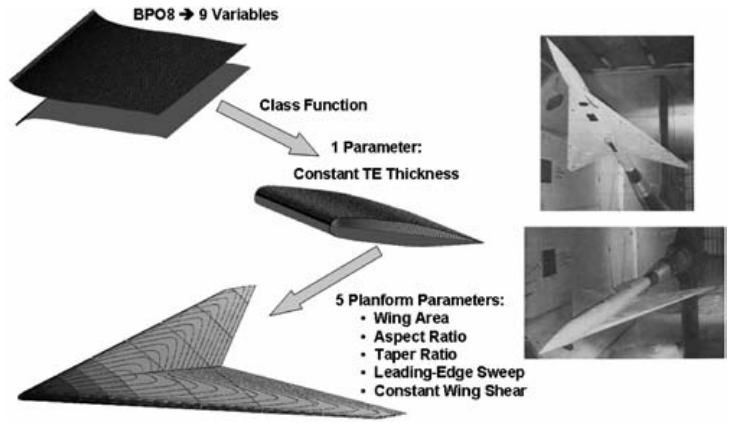

**图39　大后掠气动弹性载荷风洞模型的标量放样。**

实际机翼表面坐标可以由以下方程获得：

$$
\begin{aligned}
y&=\frac{b}{2}\,\eta, \\
x&=\psi\,C_{\mathrm{LOC}}(\eta)+x_{\mathrm{LE}}(\eta), \\
z_U(x,y)&=\zeta_U(\psi,\eta)\,C_{\mathrm{LOC}}(\eta), \\
z_L(x,y)&=\zeta_L(\psi,\eta)\,C_{\mathrm{LOC}}(\eta)
\end{aligned}
\tag{48}
$$

利用式（46）—（48）定义机翼几何形状的过程，可以看作机翼的标量放样：机翼表面上的每一点都能按所需的精度加以定义，而且所有点都由解析方程“连接”起来。通常的机翼定义则采用向量放样，即用有序的 $x$、$y$、$z$ 坐标集合，以及描述如何连接相邻点的“规则”来定义机翼。连接相邻点的常用方法，是沿固定展向站位和固定弦长百分比线进行连接。图39给出了大后掠风洞机翼标量放样的一个例子，该机翼曾用于获取表面压力和机翼载荷数据，以验证计算流体力学（CFD）计算[13,14]。这个模型实际采用常规的向量放样方法制造。

该机翼的解析标量放样总共由15个参数定义，包括：1）用8阶伯恩斯坦多项式（BPO8）表示基本翼型剖面，含9个参数；2）机翼面积；3）展弦比；4）梢根比；5）前缘后掠角；6）后缘厚度，在整个翼展上保持不变；7）恒定的机翼剪切，用于使机翼以低翼位置安装到机身上。

在整个机翼表面上，解析机翼表面定义与模型“实际制造”表面坐标之间的差异，都充分处于风洞模型的制造公差允许范围之内。

## XIII. 具有前缘和／或后缘折角的机翼的数学描述

亚声速和超声速运输机的机翼平面形状，通常在前缘（例如边条）和／或后缘（例如翼根后缘折角，yehudi）存在折角，导致后掠角发生不连续的变化。因此，机翼表面在这些边缘折角附近的局部区域内是非解析的。不过，前文所述的完整机翼几何定义方法仍应适用。机翼各展向位置的翼型剖面，可以用与所选伯恩斯坦多项式阶数相对应的一组分量翼型组合来定义。组合翼型缩放系数的展向变化，很可能在各平面形状折角之间呈分段连续。

为探索这一概念，本文对一种典型亚声速飞机机翼的几何形状进行了深入分析。在大量展向站位上，采用相同阶数的伯恩斯坦多项式，近似表示相应翼型剖面的形状函数。通过计算实际翼型剖面与近似伯恩斯坦多项式所定义剖面之间的残差，评价这种组合表示的充分性。与机翼上、下表面相对应的计算形状函数曲面见图40。由平面形状折角引起的曲面分段连续特征十分明显。图中还给出了计算得到的组合翼型缩放系数 $B_{u,j}$ 和 $B_{l,j}$ 的相应展向变化。

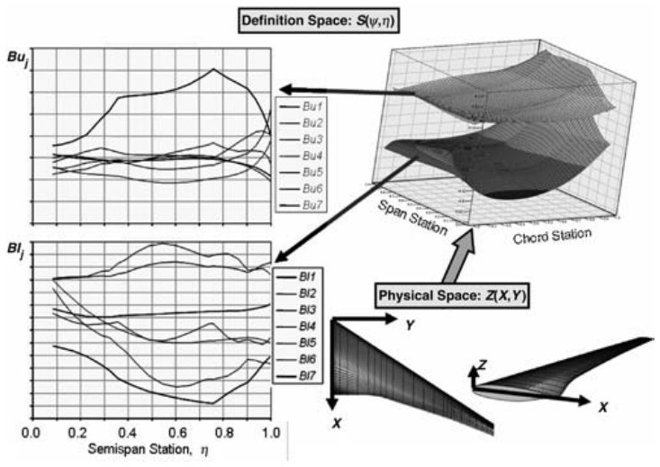

**图40　伯恩斯坦多项式（BP）组合翼型缩放系数的展向变化。**

这些结果表明，伯恩斯坦系数沿机翼翼展的变化非常规则，呈分段连续，并具有良好的数学性质。

图41给出了典型高速民用运输机（HSCT）机翼的形状函数曲面。其平面形状具有多个前缘和后缘折角。内翼段具有亚声速前缘，并采用圆头翼型；外翼段则具有超声速前缘，并采用尖头翼型。可以看到，该机翼的形状函数同样是分段光滑、连续的。

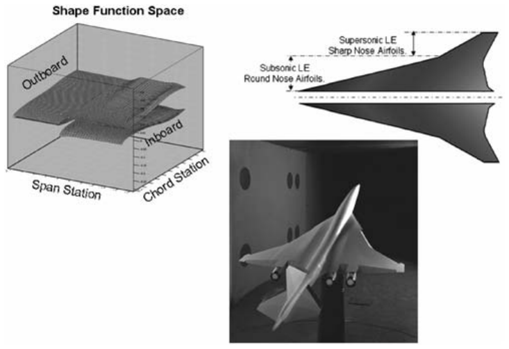

**图41　高速民用运输机（HSCT）超声速机翼的形状函数。**

图37—41的结果表明，机翼标量定义这一概念确实是一种可行且有前景的机翼定义方法。

## XIV. 总结与结论

类函数／形状函数变换（CST）几何表示方法，是一种独特而强大的新几何表示方法。类函数定义了翼型、轴对称机体和轴对称短舱几何形状的基本类别；形状函数则定义每个基本类别中的具体几何形状。

在圆头翼型或机翼几何形状的应用中，使用形状函数进行几何表示的数学简洁性显而易见。形状函数消除了前缘斜率、二阶导数中的数值奇异性，以及整个几何表面上曲率的大幅变化。此外，形状函数还允许直接控制关键设计参数，如前缘半径、前缘周围的连续曲率、尾缘收缩角，以及以指定厚度闭合的条件。

使用伯恩斯坦多项式，是将基本单位形状分解为可缩放元素的一种有吸引力且系统化的技术，这些元素对应于离散的分量翼型。该技术：1）涵盖光滑翼型、轴对称机体和短舱的整个设计空间；2）在这个设计空间内，所有光滑翼型、轴对称机体和短舱都能从单位形状函数推导出来，因此也能由彼此推导得到。

类函数／形状函数变换几何表示方法，既可描述任意机体或短舱的横截面形状，也可描述这些横截面形状沿机体主轴的分布。本文中的例子说明了该方法的通用性：只需少量设计变量，就能详细定义非对称短舱的外形及进气道几何形状。

本文提出并探索了“组合机翼表面的解析标量定义”概念。在这种方法中，机翼翼型的形状函数用伯恩斯坦多项式表示。所选的伯恩斯坦多项式阶数，实际上定义了一组用于构造机翼表面的组合翼型。随后可将伯恩斯坦多项式系数沿展向作数学展开，定义完整的机翼上、下表面形状函数曲面。再将这些曲面方便地变换为实际机翼几何形状，形成可用于设计优化和参数化设计研究的组合机翼形状。

本文提出的解析CST几何表示方法，提供了一种统一、系统的方法，能够用相对较少的标量参数表示多种二维和三维几何形状，覆盖非常广阔的设计空间。

## References

[1] Sobieczky, H., “Aerodynamic Design and Optimization Tools Accelerated by Parametric Geometry Preprocessing,” *European Congress on Computational Methods in Applied Sciences and Engineering*, ECCOMAS, 2000.

[2] Sobieczky, H., *Parametric Airfoils and Wings*, Notes on Numerical Fluid Mechanics, Vol. 68, Vieweg, Brunswick, Germany, 1998, pp. 71–88.

[3] Samareh, J. A., “Survey of Shape Parameterization Techniques for High-Fidelity Multidisciplinary Shape Optimization,” *AIAA Journal*, Vol. 39, No. 5, May 2002, pp. 877–884.

[4] Robinson, G. M., and Keane, A. J., “Concise Orthogonal Representation of Supercritical Airfoils,” *Journal of Aircraft*, Vol. 38, No. 3, March 2001, pp. 580–583.

[5] Song, W., and Keane, A. J., “A Study of Shape Parameterization Airfoil Optimization,” *10th AIAA/ISSMO Multidisciplinary Analysis and Optimization Conference*, AIAA Paper 2004-4482, 2004.

[6] Padula, S., and Li, W., “Options for Robust Airfoil Optimization Under Uncertainty,” *9th AIAA Multidisciplinary Analysis and Optimization Symposium*, AIAA Paper 2002-5602, 2002.

[7] Hicks, R. M., and Henne, P. A., “Wing Design by Numerical Optimization,” *Journal of Aircraft*, Vol. 15, No. 7, 1978, pp. 407–412.

[8] Samareh, J. A., “Aerodynamic Shape Optimization Based on Free-Form Deformation,” AIAA 2004-4630, Sept. 2004.

[9] Kulfan, B. M., and Bussoletti, J. E., “Fundamental Parametric Geometry Representations for Aircraft Component Shapes,” *11th AIAA/ISSMO Multidisciplinary Analysis and Optimization Conference: The Modeling and Simulation Frontier for Multidisciplinary Design Optimization*, AIAA Paper 2006-6948, 2006.

[10] Kulfan, B. M., “Universal Parametric Geometry Representation Method: “CST”,” *45th AIAA Aerospace Sciences Meeting and Exhibit*, AIAA Paper 2007-0062, Jan. 2007.

[11] Timothy, W., Purcell, T. W., and Om, D., “TRANAIR Packaging for Ease-of-Use in Wing Design,” *AIAA and SAE 1998 World Aviation Conference*, AIAA Paper 1998-5575, Sept. 1998.

[12] Samant, S. S., Bussoletti, J. E., Johnson, F. T., Burkhart, R. H., Everson, B. L., Melvin, R. G., Young, D. P., Erickson, L. L., and Madson, M. D., “TRANAIR: A Computer Code for Transonic Analyses of Arbitrary Configurations,” *Aerospace Sciences Meeting, 25th*, AIAA Paper 1987-34, Jan. 1987.

[13] Manro, M. E., Percy, J., Bobbitt, P. J., and Kulfan, R. M., “The Prediction of Pressure Distributions on an Arrow Wing Configuration Including the Effects of Camber Twist and a Wing Fin,” NASA -2108 Paper No. 3, Nov. 1979, pp. 59–115.

[14] Wery, A. C., and Kulfan, R. M., “Aeroelastic Loads Prediction for an Arrow Wing: Task 2 Evaluation of Semi-Empirical Methods,” NASA CR-3641, March 1983.
