# 面向基于计算机的工程设计的元模型：综述与建议

**METAMODELS FOR COMPUTER-BASED ENGINEERING DESIGN: SURVEY AND RECOMMENDATIONS**

Timothy W. Simpson、Jesse Peplinski、Patrick N. Koch 和 Janet K. Allen†

系统实现实验室  
伍德拉夫机械工程学院  
佐治亚理工学院  
美国佐治亚州亚特兰大，30332-0405

**草稿版本：1997年12月19日。已投稿至《Research in Engineering Design》。**

**译文说明：** 依据所附 43 页草稿全文翻译，保留章节顺序、原图表和式编号。公式使用 Unicode 符号及纯文本排版；原文重复的小节编号和存在疑点的公式记法均保留。参考文献以英文原页保留，未翻译。文件年份采用附件标注的草稿年份。

## 摘要

在当今工程设计的许多工作中，人们采用统计技术，为运行代价高昂的计算机分析程序建立近似模型。这些统计近似模型，即元模型，用于替代实际运行代价高昂的计算机分析，从而便于开展多学科、多目标优化和概念探索。本文回顾了其中的若干技术，包括试验设计、响应面方法、田口方法、神经网络、归纳学习和克里金。我们综述了这些技术在工程设计中的现有应用，随后讨论采用传统统计技术来近似确定性计算机分析程序的风险。最后，我们就如何在特定情形下恰当使用统计近似技术，以及如何避免常见陷阱提出建议。

## 1 引言

当今工程分析的很大一部分工作，是运行复杂的计算机程序：输入设计变量（输入量）向量 x，并计算响应（输出量）向量 y。尽管计算能力持续提高，许多分析程序的运行代价仍然不可忽视；一次空气动力学分析或有限元分析的计算，可能需要数分钟到数小时，甚至更长。此外，这种查询与响应的模式往往使设计过程成为反复试错的过程。在这一过程中，设计人员可能始终无法发现 x 与 y 之间的函数关系，因此也始终无法确定输入值的“最佳”设置。

† 通讯作者。电子邮件：janet.allen@me.gatech.edu。电话／传真：404-894-8168／9342。

为解决这些问题，统计技术被广泛用于工程设计。其基本思路是为分析程序构建运行效率更高的近似模型，并借此认识 x 与 y 之间的函数关系。如果一个计算机分析程序的真实形式为

```text
y = f(x)，
```

那么，该分析程序的“模型的模型”，即元模型 [62]，为

```text
ŷ = g(x)，因而 y = ŷ + ε
```

其中，ε 同时表示近似误差和测量（随机）误差。最常见的元模型构建方法，是运用试验设计（DOE），确定一组高效的计算机运行点（x₁、x₂、…、xₙ），然后通过回归分析，为计算机分析程序建立多项式近似模型。随后，这些近似模型便可替代现有分析程序，同时带来以下益处：

- 更好地理解 x 与 y 之间的关系；
- 更容易集成依赖于具体领域的计算机程序；
- 用近似模型代替计算代价高昂的分析程序本身，为优化和设计空间探索提供快速分析工具。

我们发现，将这些方法用于基于计算机的设计时，许多应用（包括我们自己的应用）在统计上存在问题，因为许多分析程序是确定性的，其近似误差并非由随机效应引起。这使后续对模型显著性所做的统计分析受到质疑。因此，我们希望指出元模型构建中潜在的统计陷阱，并针对基于计算机的工程设计，提出恰当使用元模型技术的一般建议。第2节回顾元模型技术，包括回归、神经网络、归纳学习和克里金。第2节最后介绍响应面方法和田口稳健设计这两种一般统计方法。第3节描述统计方法在工程设计中的应用背景，回顾现有应用和方法，并在最后更仔细地考察元模型在确定性情形下的应用。第4节提出一些建议，帮助避免使用元模型时的陷阱。第5节则以对若干更深入问题的讨论结束全文，正是这些问题使元模型构建成为一个活跃而有趣的研究领域。

## 2 元模型技术综述

元模型构建包括：（a）选择用于生成数据的试验设计；（b）选择用于表示数据的模型；然后（c）将模型拟合到观测数据。每一步都有若干可选方案，如图1所示；我们试图突出其中几种较常见的方案。例如，构建神经网络时，通常先人工选择数据，再通过反向传播，使神经元网络拟合这些数据；而响应面方法通常采用中心复合设计、二阶多项式和最小二乘回归分析。

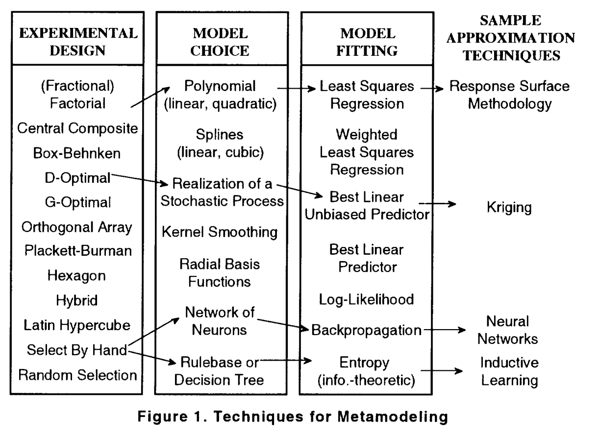

**图1. 元模型构建技术。**

图中文字译释：

| 试验设计（Experimental Design） | 模型选择（Model Choice） | 模型拟合（Model Fitting） | 近似技术示例（Sample Approximation Techniques） |
| --- | --- | --- | --- |
| （部分）析因设计；中心复合设计；Box–Behnken设计；D最优设计；G最优设计；正交表；Plackett–Burman设计；六边形设计；混合设计；拉丁超立方设计；人工选择；随机选择 | 多项式（线性、二次）；样条（线性、三次）；随机过程的一次实现；核平滑；径向基函数；神经元网络；规则库或决策树 | 最小二乘回归；加权最小二乘回归；最佳线性无偏预测器；最佳线性预测器；对数似然；反向传播；熵（信息论意义上的） | 响应面方法；克里金；神经网络；归纳学习 |

本节其余部分简要介绍图1所列的若干方案。第2.1节重点讨论试验设计，尤其是（部分）析因设计、中心复合设计和正交表。第2.2节讨论模型选择和模型拟合，重点是响应面、神经网络、归纳学习和克里金。本节最后概述两种较常见的元模型技术，即响应面方法和田口稳健设计。

### 2.1 试验设计

合理设计试验，对于有效利用计算机至关重要。在工程中，传统做法是改变（扰动）单个参数并观察其影响。另一种做法是按系统化方式（例如网格搜索）或随机方式安排因子设置的组合，从而提供可供比较的备选方案。原本为物理试验开发的试验设计技术，正被应用于计算机试验设计，以提高这些分析的效率。本节概述不同类型的试验设计，并介绍用于选择和比较不同试验设计的评价指标。

#### 2.1.1 试验设计概览

一个试验设计表示待执行的一系列试验，并以设置在指定水平（预先定义的值）上的因子（设计变量）来表达。试验设计用矩阵 X 表示，其中行表示各次试验运行，列表示具体因子的设置。

**因子设计：** 最基本的试验设计是全析因设计。全析因设计所要求的设计点数，等于各因子水平数的乘积。最常见的是 2^k 设计（用于评价主效应和交互作用）以及 3^k 设计（用于评价主效应、二次效应和交互作用），分别对应 k 个因子各取2个水平和3个水平的情形。图2（a）给出了一个 2³ 全析因设计。

全因子试验的规模随因子数呈指数增长；这会导致试验数量多到难以处理。当试验代价高昂、且需要考虑许多因子时，可以采用部分析因设计。部分析因设计是全析因设计的一部分；最常见的是 2^(k−p) 设计，其所取比例为 1/2^p。图2（b）给出了 2³ 全析因设计的一半。部分析因设计中设计点数的减少，并非没有代价。图2（a）中的 2³ 全析因设计，允许估计所有主效应（x₁、x₂、x₃）、所有两因子交互作用（x₁x₂、x₁x₃、x₂x₃），以及三因子交互作用（x₁x₂x₃）。在图2（b）中由实心点表示的 2^(3−1) 部分析因设计里，主效应与两因子交互作用发生混杂（或受到其偏倚影响）。除非已知（或假定）相关效应不存在，否则无法独立估计这些混杂效应。

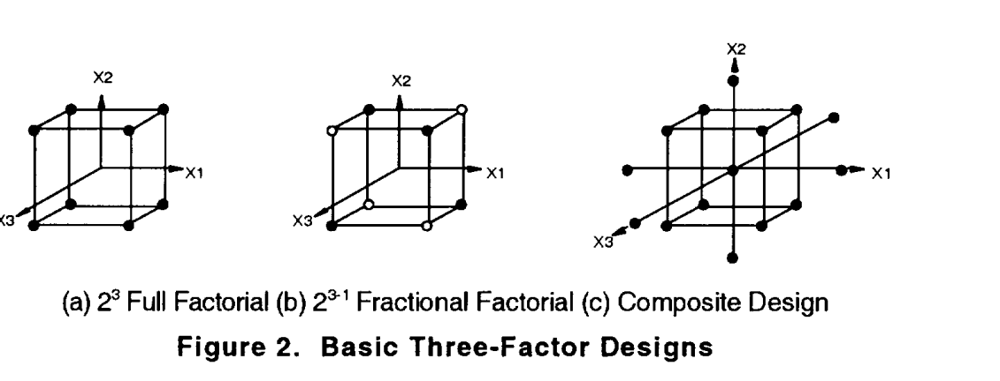

**图2. 基本的三因子设计。** （a）2³ 全析因设计；（b）2^(3−1) 部分析因设计；（c）复合设计。图中三个坐标轴分别表示因子 x₁、x₂ 和 x₃。

2^k 和 2^(k−p) 设计经常用于识别或筛选重要因子。当因子很多时，可以运用效应稀疏原则 [87]，即假定系统主要受主效应和低阶交互作用支配。因此，可以用两水平部分析因设计“筛选”因子，识别影响最大的因子。不过，效应稀疏原则并非总是成立；Hunter [59] 指出，每一种设计给出的估计都存在混杂：采用两水平部分析因设计时，如果存在二次效应和三次效应，它们会使均值和主效应的估计产生偏倚。

经常用于筛选的一类特定部分析因设计，是两水平 Plackett–Burman（PB）设计 [103]。这类设计在 n = 4m 个设计点上研究 k = n−1 个因子。当 n 是2的幂时，PB设计称为几何设计，并与 2^(k−p) 部分析因设计相同。如果 n 严格为4的倍数，PB设计则称为非几何设计，并具有非常复杂的混杂结构。它们在实际问题中的使用存在问题，尤其是当设计为饱和设计时（即因子数恰好为 n−1）。不过，如果交互作用可以忽略，这些设计就允许无偏估计所有主效应，所需设计点数只比因子数多1个；它们还给出可能达到的最小方差 [14]。Myers 和 Montgomery [91] 对因子设计及效应混杂提供了更完整的讨论。最小方差设计和最小规模设计将在第2.1.2节讨论。

**中心复合设计和 Box–Behnken 设计：** 要估计二次效应，可以采用 3^k 或 3^(k−p) 设计，但它们通常需要多到难以处理的设计点。为减少设计点数而构造的最常见二阶设计，是中心复合设计和 Box–Behnken 设计。

中心复合设计（CCD）是在两水平因子设计（2^(k−p) 或 2^k）的基础上，增加 n₀ 个中心点，并为每个因子增加两个位于 ±α 处的“星点”。图2（c）给出了三因子的这种设计，它共有 `2^(k−p) + 2^k + n₀` 个设计点，用于估计 `2k + k(k−1)/2 + 1` 个系数。对于三个因子，取 α = 1 时，星点位于立方体各面的中心，得到面心中心复合（CCF）设计；注意，当 α 取1以外的值时，每个因子都在五个水平上进行评价。

> 译注：上段设计点总数中的 `2^k` 按原文保留。

在试验设计中，人们通常希望因子的水平数尽可能少。Box–Behnken设计 [15] 是此类设计中常见的一类。它们由 2^k 因子设计与不完全区组设计相结合而成。它们不包含由各因子的上限和下限所定义的超立方体顶点处的点。如果这些极端点的试验代价高昂，或者根本无法进行试验，这一特点就很有价值。有关CCD和Box–Behnken设计的更多信息，见文献 [87]。

**正交表：** 田口所用的试验设计，即正交表，通常就是两水平或三水平的部分析因设计（2^(k−p) 和 3^(k−p) 设计）。构造这些表，是为了减少必要的设计点数；例如，两水平的 L₄、L₁₂ 和 L₁₆ 表，分别允许用4、12和16个设计点，评价3、11和15个因子／效应。这些设计往往与Plackett–Burman设计相同 [78]。第2.1.2节将给出这些表及其他试验设计的正交性定义。第2.3节将概述田口的参数设计方法。

**“空间填充”设计：** 许多研究者主张，在对确定性计算机试验进行采样时，采用“空间填充”设计。正如 Booker [13] 所讨论的，在物理试验的“经典”设计与分析中（即采用中心复合设计和因子设计时），通过将采样点分散在设计空间中，并取得多个数据点（重复试验），来考虑随机变异，见图3。Sacks 等人 [117] 指出，对确定性计算机试验而言，试验区组化、重复试验和随机化等“经典”概念并不适用；因此，DACE中的采样点应选择为填满设计空间。他们建议，采用IMSE最优设计，使整个设计区域上的积分均方误差（IMSE）最小；图3（b）所示的“空间填充”设计，就是一种IMSE最优设计。

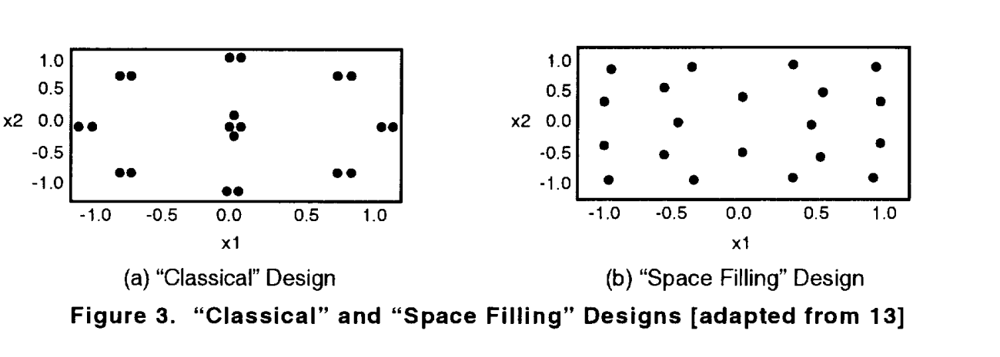

**图3. “经典”设计和“空间填充”设计［改编自文献13］。** （a）“经典”设计；（b）“空间填充”设计。横轴 x₁ 和纵轴 x₂ 表示两个因子；图中标示的刻度为−1.0、−0.5、0.0、0.5和1.0。

Koch [63] 研究了一种改进的中心复合设计，它将CCI和CCF各自的一半设计组合起来，使设计点在整个设计空间中分布得更均匀。Koehler 和 Owen [66] 描述了若干贝叶斯和频率学派的“空间填充”设计，包括最大熵设计、均方误差设计、最小最大（minimax）与最大最小（maximin）设计、拉丁超立方设计、随机化正交表以及扰乱网。最小最大和最大最小设计最初由 Johnson 等人 [60] 专门针对计算机试验提出。Sherwy 和 Wynn [121] 以及 Currin 等人 [35] 利用最大熵原理开发计算机试验设计。Tang [128] 描述了基于正交表的拉丁超立方设计，并认为它们比一般的拉丁超立方设计更适合计算机试验。Park [100] 讨论了用于计算机试验的最优拉丁超立方设计，这些设计通过最小化IMSE或最大化熵，将设计点分散到整个设计区域。Morris 和 Mitchell [89] 提出在拉丁超立方排列这一类设计中寻找最大最小距离设计，因为这些设计“在熵／最大最小准则与每个维度上良好的投影性质之间提供了折中”。Owen [99] 主张，正交表适合用于计算机试验、数值积分和可视化；互联网上可获取一套正交表生成器 [98]。有关线性和非线性回归模型的贝叶斯试验设计综述，见文献 [24]。

#### 2.1.2 试验设计的评价指标

选择恰当的设计，对于有效开展试验至关重要：希望尽可能多地获得关于响应与因子之间关系的信息，同时又要兼顾试验成本。有若干评价指标，可用于评价和比较试验设计。

**正交性、旋转性、最小方差和最小偏倚：** 为便于高效地估计参数，试验设计的四个理想特性是正交性、旋转性、最小方差和最小偏倚。如果对于每一对因子 xᵢ 和 xⱼ，N 个设计点上的交叉乘积之和

```text
Σ(u=1,…,N) xᵢᵤxⱼᵤ
```

为零，则该设计是正交的。对于一阶模型，如果设计可以配置为满足

```text
Σ(u=1,…,N) xᵢᵤ² = N，
```

则所有系数的估计都将具有最小方差；预测值 ŷ 的方差，在距离设计中心的固定距离上也将保持不变，并且该设计也将具有旋转性。

在二阶建模中，Hunter [58] 认为正交性没那么重要：“如果试验者的目标，是预测在 x 的当前设置或未来设置下的响应，那么就需要对预测值 ŷ 做出无偏、最小方差的估计。在20世纪50年代末，Box 及其同事证明，旋转性……以及使高阶项带来的偏倚最小化……才是实现良好预测的基本准则。”如果在任意两个距离设计中心相同的位置，`N·Var[ŷ(x)]/σ²` 都有相同的值，则该设计具有旋转性。二阶模型的最小方差设计和最小偏倚设计所需满足的条件，超出了本文范围；更多信息可参阅文献 [91]。

**非饱和／饱和设计与超饱和设计：** 在许多情况下，试验设计首先关注的是规模。大多数设计是非饱和的，也就是说，设计点数比因子数至少多2个。饱和设计的设计点数，比待估计的因子效应数恰好多1个。饱和部分析因设计，允许以可能达到的最小方差和最小规模，无偏估计所有主效应 [14]。最常见的饱和设计示例，是Plackett–Burman两水平设计和田口正交表。为了估计二阶效应，人们开发了小型复合设计，以减少所需设计点数。如果设计点数为 `2k + k(k−1)/2 + 1`（即完整二次模型中待估计的系数数目），则小型复合设计是饱和的。Myers 和 Montgomery [91] 指出，近期工作表明，这些设计可能并非总是好的；关于小型复合设计的其他讨论，见文献 [16, 77]。最后，在超饱和设计中，设计点数小于或等于因子数 [37, 38]。

对于预测模型，最理想的是采用非饱和设计，除非执行必要试验的代价高到难以承受。当根据设计点数和所获得的信息来比较试验时，通常使用D最优和D效率统计量。

**D最优和D效率：** 如果 `|X′X|/n^p` 达到最大，则称该设计为D最优设计。其中，X 是扩展的设计矩阵，有 n 行（每个设计设置对应一行）和 p 列（每个待估计系数对应一列，再加上总体均值对应的一列）。用于比较设计的D效率统计量，如式（1）所示，将某个设计与D最优设计比较，并按矩阵规模进行归一化，以便比较不同规模的设计。

```text
D效率 = (|X′X|_设计 / |X′X|_D最优)^(1/p)                 （1）
```

其他用于比较设计的统计量，如G效率、Q效率和A最优性，也已被提出，例如见文献 [91]。下面转向模型选择和模型拟合问题。

### 2.2 模型选择和模型拟合

选定恰当的试验设计并完成必要的计算机运行之后，下一步是选择近似模型和拟合方法。可供选择的模型和方法很多，但这里回顾文献中最常见的四种：响应面、神经网络、归纳学习和克里金。

#### 2.2.1 响应面

给定一个响应 y，以及影响 y 的独立因子向量 x，y 与 x 的关系为：

```text
y = f(x) + ε，                                             （2）
```

其中，ε 表示随机误差，并假定其服从均值为零、标准差为 σ 的正态分布。由于真实响应面函数 f(x) 通常未知，便构建响应面 g(x) 来近似 f(x)。随后，通过 ŷ = g(x) 获得预测值。

最广泛使用的响应面近似函数，是低阶多项式。当曲率较小时，可以采用式（3）所示的一阶多项式；当曲率显著时，可以采用包含所有两因子交互作用的二阶多项式，见式（4）。

```text
ŷ = β₀ + Σ(i=1,…,k) βᵢxᵢ                                 （3）

ŷ = β₀ + Σ(i=1,…,k) βᵢxᵢ + Σ(i=1,…,k) βᵢᵢxᵢ²
       + ΣᵢΣⱼ（i < j） βᵢⱼxᵢxⱼ                           （4）
```

式（3）和式（4）中的多项式参数，通常通过最小二乘回归分析确定，即将响应面近似拟合到已有数据。这些近似通常用于响应面方法（RSM）中的预测。关于响应面和最小二乘拟合的更完整讨论见 [91]。第 2.3 节概述了 RSM。

#### 2.2.2 神经网络

神经网络由神经元，即单元感知器，构成。神经元是对 y 作非线性变换，通常是 S 形变换，的多元线性回归模型。如果每个神经元的输入记为 `{x₁,x₂,…,xₙ}`，回归系数用权重 wᵢ 表示，那么输出 y 可以由下式给出：

```text
y = 1 / [1 + e^(−η/T)]。                                      （5）
```

其中 `η=∑ᵢ wᵢxᵢ+β`，β 是神经元的“偏置值”，T 是由用户定义的 S 形函数的斜率参数。随后，通过将神经元组织成某种架构来构建神经网络；最常见的是多层前馈架构，见图 4。

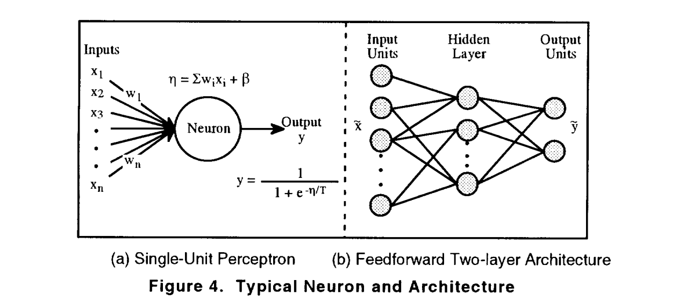

**图 4. 典型神经元及网络架构。** （a）单元感知器；（b）前馈双层架构。图中 Inputs 为“输入”，Neuron 为“神经元”，Output 为“输出”，Input Units 为“输入单元”，Hidden Layer 为“隐藏层”，Output Units 为“输出单元”；w₁ 至 wₙ 为权重，x₁ 至 xₙ 为输入。

构建神经网络有两个主要问题：（1）规定架构；（2）训练神经网络，使其相对于训练集表现良好。“对统计学家来说，这等价于：（i）规定一个回归模型；（ii）给定一组数据，估计模型的参数”[30]。如果架构足够大，神经网络几乎可以成为通用近似器 [115]。Hajela 和 Berke [54] 综述了神经网络在结构分析与设计中的应用。

神经网络的“训练”，是确定架构中全部权重 wᵢ 的适当值，通常通过反向传播完成 [115]；这需要一组包含 n 个训练数据点的数据 `{(x₁,y₁),(x₂,y₂),…,(xₚ,yₚ)}`。对于输出为 y 的网络，其性能为：

```text
E = ∑ₚ (yₚ − ŷₚ)²。                                         （6）
```

其中 ŷₚ 是向网络输入 xₚ 后得到的输出，E 是系统的总误差。随后，按与下式成比例的幅度调整权重：

```text
(∂E/∂y) (∂y/∂wᵢⱼ)。                                        （7）
```

神经网络最适合在回归类应用中近似确定性函数。“在大多数产生类似回归输出的神经网络应用中，并没有明确提到随机性。相反，目标是函数近似”[30]。神经网络的典型应用包括语音识别和手写字符识别，这些应用的数据复杂且维数很高。已经有人使用具有数万个参数的网络，但所需训练数据的收集与模型参数的计算，可能具有极高的计算成本。Cheng 和 Titterington [30] 评论道：“……这个过程就是把数据直接扔进神经网络软件，在拟合中使用数万个参数，让工作站连续运行 2–3 周，埋头进行梯度下降，然后，瞧，结果就出来了。”Rogers 和 LaMarsh [111] 描述了旨在缩短神经网络“训练”时间的并行计算研究。

#### 2.2.3 归纳学习

归纳学习是机器学习的五种主要范式之一，其他范式包括神经网络、基于案例的学习、遗传算法和分析学习 [68]。在这五种范式中，归纳学习与回归和元建模最为相近，因此是这里讨论的重点。归纳学习系统从例子中归纳规则；其基本建模构造是“条件—动作”规则，这些规则将数据划分为离散类别，并可以组合成决策树，以便解释，见图 5。

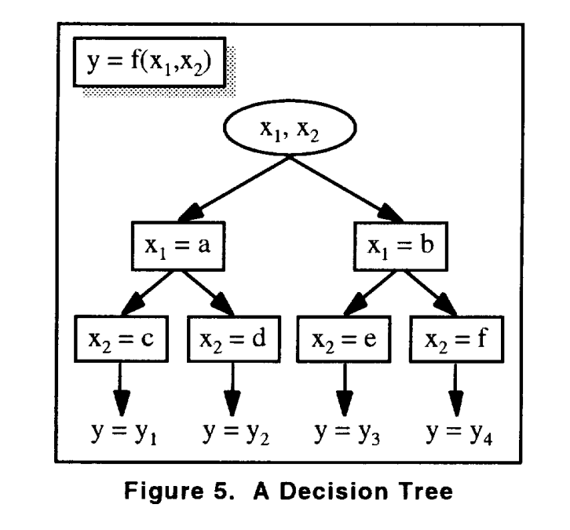

**图 5. 决策树。** 图中 `y=f(x₁,x₂)` 为待建模的函数。先按 `x₁=a` 或 `x₁=b` 分支，再分别按 `x₂=c`、`x₂=d` 或 `x₂=e`、`x₂=f` 分支，最终叶节点的输出分别为 `y=y₁`、`y=y₂`、`y=y₃`、`y=y₄`。

所需训练数据的形式为 `{(x₁,y₁),(x₂,y₂),…,(xₙ,yₙ)}`，其中 xᵢ 是一个属性值向量，例如加工参数和环境条件，而每个 yᵢ 是相应的观测输出值。虽然属性和输出可以是实数值，但这种方法更适合离散值数据；实数值往往必须转换为离散表示 [41]。收集数据后，训练算法选择“最佳”的划分属性，再递归调用所得到的数据子集，以构建决策树。虽然也可以通过随机选择属性来构建树，但选择能使类别归属所需信息量最小的属性，会更加高效。关于这种信息论方法的数学原理，见 [41]。

归纳学习的许多应用出现在过程控制和诊断系统中，而且归纳学习方法可以用于自动完成构建专家系统所需的知识获取过程。此外，虽然决策树似乎最适用于输入和输出取离散值的应用，但在一些含有连续变量的应用中，它取得了比标准统计分析更好的结果。Leech [71] 报告了一个过程控制应用：“采用标准统计分析方法所获得的成功有限。有些数据是非数值的，变量之间的依赖关系没有得到充分理解，而且需要在系统约束内，同时控制最终产品的若干特性。统计分析的结果，是针对每个关注输出的一组相关关系，负责日常运营的人员很难解释和使用。”更多例子见 [41,68]。

#### 2.2.4 克里金

由于许多计算机分析程序是确定性的，因此不受测量误差影响，由最小二乘残差导出的常用不确定性度量，并没有显而易见的含义，参见 [117]。因此，一些统计学家，例如 [13,66,117,138]，建议将响应建模为多项式模型与偏离项的组合，形式如下：

```text
y(x) = f(x) + Z(x)。                                         （8）
```

其中 y(x) 是所关注的未知函数，f(x) 是 x 的已知多项式函数，Z(x) 是一个服从正态分布的高斯随机过程的实现，该过程具有零均值、方差 σ² 以及非零协方差。式（8）中的 f(x) 项类似于响应面中的多项式模型，提供设计空间的“全局”模型；在许多情况下，f(x) 简单地取为一个常数项，例如见 [117,139]。

f(x) 在“全局”上近似设计空间，而 Z(x) 产生“局部”偏离，使克里金模型插值通过 nₛ 个采样数据点。Z(x) 的协方差矩阵为：

```text
Cov[Z(xⁱ),Z(xʲ)] = σ² R([R(xⁱ,xʲ)].                         （9）
```

其中 R 是相关矩阵，R(xⁱ,xʲ) 是 nₛ 个采样数据点中任意两点 xⁱ 与 xʲ 之间的相关函数。R 是一个 nₛ×nₛ 对称矩阵，对角线上各元素均为 1。相关函数 R(xⁱ,xʲ) 由用户规定；Sacks 等人 [117] 以及 Koehler 和 Owen [66] 讨论了几种可以使用的相关函数。在我们的工作中，采用了如下形式的高斯相关函数：

```text
R(xⁱ,xʲ) = exp[−∑_(k=1)^(nₛ) θₖ |xₖⁱ − xₖʲ|²]。            （10）
```

其中 θₖ 是用于拟合模型的未知相关参数，xₖⁱ 和 xₖʲ 是样本点 xⁱ 和 xʲ 的第 k 个分量。在某些情况下，使用单个相关参数就能得到足够好的结果，例如见 [94,117]。

对于尚未试验的 x 值，响应 y(x) 的预测估计 ŷ(x) 为：

```text
ŷ = β̂ + rᵀ(x) R⁻¹(y − fβ̂)。                               （11）
```

其中 y 是长度为 nₛ 的列向量，包含各样本点的响应值；f 也是长度为 nₛ 的列向量，当 f(x) 取为常数时，f 的各元素均为 1。在式（11）中，rᵀ(x) 是长度为 nₛ 的相关向量，表示尚未试验的 x 与采样数据点 `{x¹,x²,…,x^(nₛ)}` 之间的相关性，具体为：

```text
rᵀ(x) = [R(x,x¹), R(x,x²), …, R(x,x^(nₛ))]ᵀ。              （12）
```

式（11）中的 β̂ 用式（13）估计：

```text
β̂ = (fᵀR⁻¹f)⁻¹ fᵀR⁻¹y。                                  （13）
```

来自底层全局模型的方差估计 σ̂²，而不是观测数据的方差，为：

```text
σ̂² = (y − fβ̂)ᵀ R⁻¹(y − fβ̂) / nₛ。                        （14）
```

其中，假定 f(x) 为常数 β̂。用于拟合模型的式（10）中 θₖ 的最大似然估计，也就是“最佳猜测”，通过最大化下式得到 [13]：

```text
−[nₛ ln(σ̂²) + ln|R|] / 2。                                 （15）
```

> **译注：** 式（9）的括号不完整，式（10）的求和上限为 nₛ，式（12）两侧均有转置符号；以上均按原稿保留。

其中 `θₖ>0`，而 σ̂² 和 |R| 都是 θₖ 的函数。虽然 θₖ 的任意取值都会产生一个插值近似模型，但要得到“最佳”的克里金模型，需要求解式（15）给出的 k 维无约束非线性优化问题。

根据式（10）中相关函数的选择，克里金既可以“尊重数据”，对数据进行精确插值，也可以“平滑数据”，提供非精确插值 [34]。最后应当指出，克里金不同于拟合样条，即非参数回归模型。在若干比较研究中，克里金的表现即使并不优于样条，至少也与样条相当 [69]。

#### 2.2.4 其他元建模方法

为方便读者，我们为前面各小节尚未讨论的一些其他元建模技术提供参考文献。Rasmussen [106] 提出了一种用于结构优化的累积近似技术，通过累积此前访问过的点的函数值，改进目标函数和约束函数的近似。类似地，Balling 和 Clark [4] 描述了用于优化的加权近似和基于梯度的近似，这些方法利用样本点处精确函数值的加权和。Friedman [45] 描述了多元自适应回归样条（MARS）：这是一种灵活的回归建模方法，基于针对高维数据的递归划分和样条拟合。Dyn 等人 [39] 使用径向基函数构建全局近似曲面，以插值平滑数据。Wang 等人 [137] 提出用于多学科设计优化的多元 Hermite 近似，利用迭代优化过程中生成的数据；该方法与线性近似、倒数近似及其他标准近似进行了比较，但由于需要更多数据点，表现出效率不足。最后，Friedman 和 Steutzle [46] 引入投影寻踪回归，这种方法对于高维，即维数小于 50，的数据和大型数据集表现良好，可以处理超过 200,000 个数据点。投影寻踪回归获取数据，沿变量的线性组合生成不同的投影；优化器寻找最佳投影，并通过将它们相加，构建具有任意精度水平的预测器。

至此，我们对试验设计、模型选择和模型拟合的讨论告一段落。下面转向试验设计与模型构建的更一般方法。

### 2.3 试验与元建模策略

将试验设计、模型构建和预测结合起来的两种广泛应用的方法，是响应面方法，以及田口的稳健设计或参数设计。下面对这两种方法作简要概述。

#### 2.3.1 响应面方法（RSM）

不同作者对 RSM 的描述各不相同。Myers 等人 [90] 将 RSM 定义为“一组用于设计或数据分析的工具，能够加强对设计变量某一区域中一个或多个响应的探索”。Box 和 Draper [16] 指出：“响应面方法包含一组用于经验模型构建与模型利用的统计技术。通过精心设计和分析试验，它力求将一个响应，也就是输出变量，与影响它的若干预测变量，也就是输入变量，的水平联系起来。”最后，Myers 和 Montgomery [91] 指出，RSM“是一组有助于开发、改进和优化过程的统计与数学技术。它还在新产品的设计、开发和配方制定，以及已有产品设计的改进中具有重要应用”。

这些作者所说的“一组统计与数学技术”，指的是试验设计（第 2.1 节）、最小二乘回归分析与响应面模型构建（第 2.2.1 节），以及“模型利用”，也就是探索因子空间，寻找最优因子设置。一般的 RSM 方法包括下列全部或部分步骤：

- **i）筛选：** 当因子数量较多，或试验成本较高时，使用筛选试验，将因子集合缩减为对所研究响应影响最大的那些因子。
- **ii）一阶试验：** 当起始点距离最优点较远，或需要获得有关所研究空间的知识时，使用一阶模型以及最速上升等方法，“快速且经济地移至最优点附近”[88]。
- **iii）二阶试验：** 使用一阶方法获得最佳解后，在该一阶解所在区域拟合二阶模型，以评估曲率效应，并尝试改进该解。

RSM 技术和工具的更详细说明见 [91]；[90] 对 1966–1988 年的 RSM 发展与应用进行了全面综述。第 3 节将综述航空航天与机械工程设计中的近期应用，但首先讨论田口的稳健设计方法。

#### 2.3.2 田口的稳健设计

田口玄一（Genichi Taguchi）开发了一种工业产品设计方法，以统计设计的试验为基础。田口用于质量工程的稳健设计包括三个步骤：系统设计、参数设计和容差设计 [18]。其中关键步骤是参数设计，统计试验被纳入这个步骤。

参数设计关注的并非只是改进或优化一个响应值，而是识别能使性能变异最小的因子设置，并将平均性能调整到所期望的目标，从而使相关损失最小。试验中包含控制因子和噪声因子；控制因子设定并保持在特定值，而噪声因子无法控制，例如车间温度。平均性能与性能变异的评估，通过将两个正交表（第 2.1.1 节）“交叉”完成。控制因子按内表，也称“控制”表，变化；对于控制表的每一次试验，噪声因子按外表，也称“噪声”表，变化。对于每个控制因子试验，在每个噪声因子设计点都获得一个响应值，并计算在各噪声设计点上测得的响应均值和方差。田口采用的性能特征是信噪比（S/N），根据响应的均值与方差定义。根据期望的响应值是越低越好、越高越好，还是达到标称值，有几种可供选择的 S/N 比，例如见 [112]。

田口方法并不显式包含模型构建和优化。通过分析试验结果，识别因子效应、规划附加试验，并设定因子值以改进性能。关于田口方法的全面讨论见 [102,112]。田口方法已在工程设计中广泛应用，也常常被纳入传统 RSM，以实现高效、有效且稳健的设计 [91]。下面讨论这些应用及其对工程设计的意义。

## 3 工程设计中的元建模

如何在工程设计中使用前一节介绍的元建模技术？所有这些技术，都可以用于建立现有计算机分析的近似，并生成快速分析模块，使计算更加高效。这些元建模技术还能够帮助理解输入参数与输出参数之间的函数关系。

这类模型在哪里有用？设计者的目标，通常是获得改进的解或稳健的解，也就是最能满足设计目标的设计变量值，如图 6 所示。寻找这些解，通常依赖某种优化技术，它在逐步改进设计的过程中，生成并评估许多候选解；因此，快速分析模块必不可少。

元模型何时有用或适用？在设计后期，已经获得特定解的详细信息时，高精度分析至关重要。然而，在设计早期，重点是生成、评估和比较候选概念构型。设计早期的特征是存在大量信息，而且往往是不确定的信息，必须加以管理。为了确保识别出一个“良好”的系统构型，需要进行全面搜索。在这种情况下，在精度与效率之间作出权衡，可能是合适的。创建元模型能够实现快速分析，以精度损失，期望只是轻微损失，为代价，使设计空间搜索兼具全面性与效率。

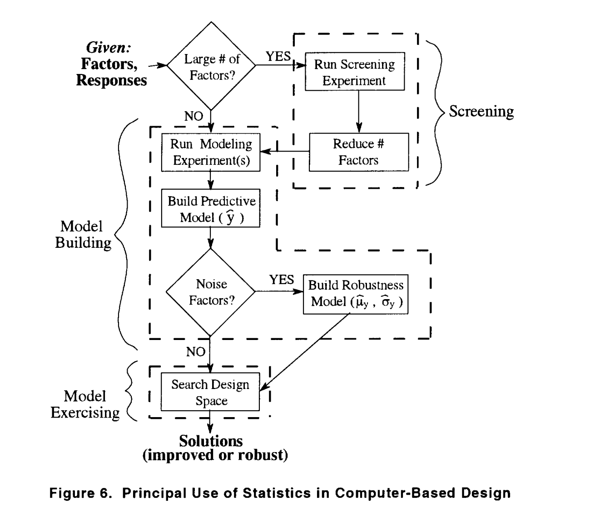

**图 6. 统计学在基于计算机的设计中的主要用途。** 图内文字译义如下：Given: Factors, Responses 为“给定：因子、响应”；Large # of Factors? 为“因子数量很多吗？”；YES/NO 为“是/否”；Run Screening Experiment 为“运行筛选试验”；Reduce # Factors 为“减少因子数量”；Run Modeling Experiment(s) 为“运行建模试验”；Build Predictive Model (ŷ) 为“构建预测模型（ŷ）”；Noise Factors? 为“存在噪声因子吗？”；Build Robustness Model (μ̂ᵧ,σ̂ᵧ) 为“构建稳健性模型（μ̂ᵧ、σ̂ᵧ）”；Search Design Space 为“搜索设计空间”；Solutions (improved or robust) 为“解（改进的解或稳健的解）”。右侧 Screening 为“筛选”，左侧 Model Building 为“模型构建”，Model Exercising 为“模型运用”。

在确立了使用元模型的工程设计“背景”后，我们在第 3.1 节综述统计学在工程设计中的若干应用。在第 3.2 节，讨论为工程应用开发的一般统计方法；最后，在第 3.3 节讨论将统计技术应用于确定性计算机试验时的一些陷阱。这样便为第 4 节奠定基础，该节给出在基于计算机的设计中适当使用统计学的指导原则。

### 3.1 工程设计中的应用

#### 3.1.1 DOE、RSM 与田口的稳健设计

在表 1 中，我们综述了试验设计、响应面方法以及田口稳健设计方法的若干工程应用。这些例子大多来自近年来会议上介绍的航空航天与机械工程设计应用。关于结构设计中采用的近似概念的综述，可参见[7]。

对于我们的调查结果，可以作出以下几点观察。

- 航空航天工程师似乎更偏爱中心复合设计和 D-最优设计，而机械工程师更偏爱正交表（OA）；由于效率较低，网格搜索与随机点搜索很少使用。
- 优化似乎是航空航天领域应用试验设计（DOE）和响应面方法（RSM）的主要驱动力；这类应用通常涉及计算密集型分析与优化程序，因此，选择 DOE 和 RSM 来提高效率是合理的。
- 机械工程师通常使用正交表和田口方法进行稳健设计，并使用信噪比进行参数设计和公差设计。
- 真正直接对田口损失函数建模的设计人员很少（例如见[9]）；许多人更倾向于对响应建模。
- 大多数应用使用二阶响应面模型；工程设计中只有少数情况采用高阶模型（例如见[136]）和混合多项式模型（例如见[113]）。
- 使用正交表时，必须特别注意避免主效应与交互作用发生混杂，除非已经知道（或假定）交互作用不显著。
- 大多数应用在拟合模型时使用最小二乘回归分析；只有少数采用逐步回归，而且通常是因为模型不是二阶模型。

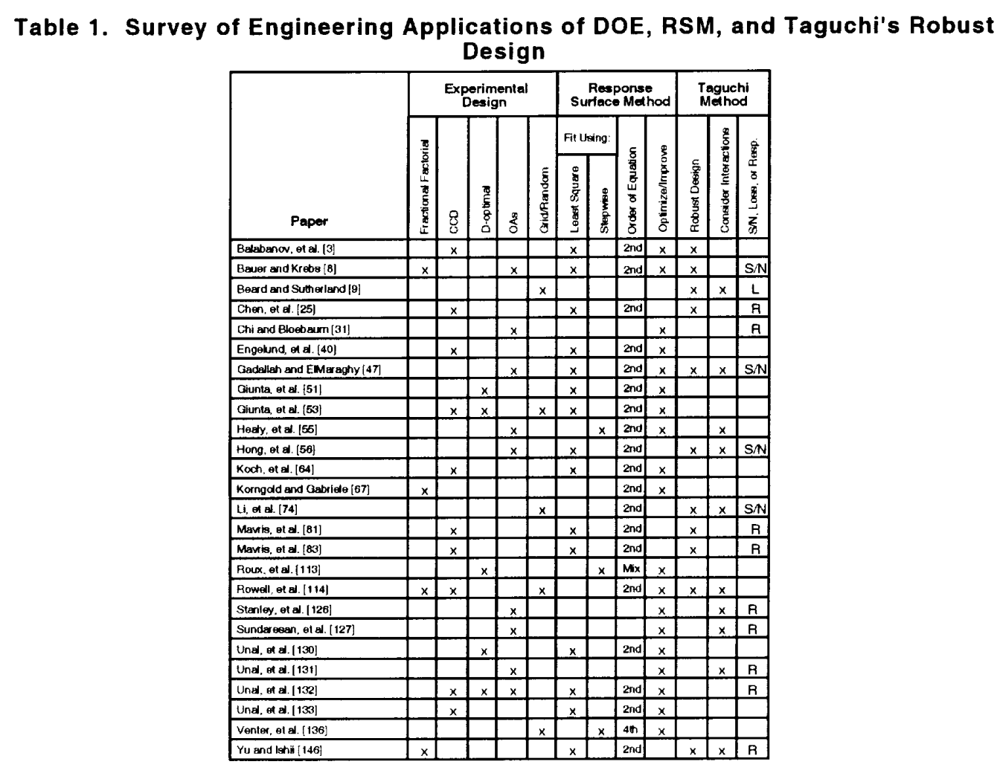

**表1.** DOE、RSM 和田口稳健设计的工程应用调查。

表头与分类译释：`Paper`＝论文；`Experimental Design`＝试验设计，包括 `Fractional Factorial`＝部分析因设计、`CCD`＝中心复合设计、`D-Optimal`＝D-最优设计、`OAs`＝正交表、`Grid/Random`＝网格／随机采样；`Response Surface Method`＝响应面方法，其中 `Fit Using`＝拟合所用方法，分为 `Least Squares`＝最小二乘法和 `Stepwise`＝逐步回归，另有 `Order of Equation`＝方程阶数、`Optimize/Improve`＝优化／改进；`Taguchi Method`＝田口方法，其中 `Robust Design`＝稳健设计、`Consider Interactions`＝考虑交互作用、`S/N, Loss, or Resp.`＝信噪比、损失或响应。表中 `2nd`＝二阶、`4th`＝四阶、`Mix`＝混合多项式；`S/N`＝信噪比、`L`＝损失、`R`＝响应；`x` 表示该项被采用。作者姓名及文献编号按原图保留。

#### 3.1.1 克里金应用

克里金也称为 DACE 建模（Design and Analysis of Computer Experiments，计算机试验的设计与分析，这一名称取自奠基论文[117]）。它在工程设计应用中的使用有限，原因可能是缺少可以方便获得的克里金模型拟合软件，拟合克里金模型的复杂性增加，或者使用克里金模型需要额外工作。Simpson 等人[124]详细介绍了二阶响应面模型与克里金模型的初步比较，用于具有三个几何（设计）变量的气动塞式喷管的多学科设计；在这个工程例子中，克里金模型和响应面模型都未能始终优于另一种模型。Giunta[50]研究了克里金在高速民用运输机多学科设计优化中的应用。他考察了一个五变量设计问题和一个十变量设计问题，并观察到，由于响应呈现二次变化趋势，克里金和响应面建模方法得到的结果相似。Osio 和 Amon[94]将 DACE 建模扩展到数值优化，采用多阶段策略改善模型的精度；他们将该方法用于具有 5 个设计变量的嵌入式电子封装的热设计。Booker 等人[12]使用一种基于克里金的类似近似方法，求解了一个具有 31 个变量的直升机旋翼结构设计问题。Booker[11]将这一旋翼设计问题扩展到 56 个结构变量，考察旋翼的气动弹性与动力响应。Welch 等人[138]介绍了一种基于克里金的近似方法，仅运行计算程序 30—50 次，就为两个具有 20 个变量的问题识别重要变量、检测曲率和交互作用，并构建有用的近似模型；他们声称，只要能够利用因子稀疏性，该方法就可以处理多达 30—40 个变量。Trosset 和 Torczon[129]开发了一种数值优化策略，将 DACE 建模与模式搜索方法结合，用于全局优化。Cox 和 John[32]开发了优化的序贯设计方法，利用响应预测值的置信下限，在优化过程中序贯选择求值点。这两种方法在应用于多种标准数学测试问题时，都表现出相对于传统优化方法的改进。

### 3.2 工程设计中的现有方法与工具

本节介绍一些专为工程设计开发的方法与工具，它们纳入了第2节的统计技术。由于田口方法和 RSM 在工程设计中已得到广泛应用，首先给出比较这两种方法的文献综述。随后概述为一般设计应用开发的一些方法和“工具”，其中包括稳健概念探索方法、变复杂度响应面建模方法、并行子空间优化等。

#### 3.2.1 田口方法与 RSM 的比较

田口方法和 RSM 已广泛应用于工程设计。人们普遍认为，与田口方法相关的原则既有用，又非常适合工业产品设计。Ramberg 等人[105]认为，“损失函数及其相关的稳健设计理念，为优化或改善仿真性能的过程带来了新的认识。”田口方法的两个方面经常受到批评：试验设计的选择（正交表、内表与外表），以及损失函数（信噪比）。有人提出并证明，将控制因子与噪声因子合并在单一试验中更高效[122, 131, 139]。将响应均值和方差合并为单一损失函数（信噪比）的缺点，已有充分的文献记录。许多作者主张直接测量响应，并分别跟踪均值和方差（参见[27, 105, 139]）。然而，Shoemaker 等人[122]提醒说，“响应模型方法的一个潜在缺点是，相比损失模型方法，它对模型拟合质量的依赖更为关键。”

考虑到田口稳健设计原则已被广泛接受，以及上述批评，许多人主张结合田口方法与 RSM，或者直接在田口框架内使用传统 RSM 技术[78, 90, 91, 105]。我们认为，正交内表与外表，以及单一复合试验，各有优点、缺点和适用场合；分别观察均值与方差能够提供有益认识。无论如何，田口方法和 RSM 的核心原则，为第3.2.2节讨论的许多具体设计方法提供了基础。

#### 3.2.2 现有方法概述

稳健概念探索方法（Robust Concept Exploration Method，RCEM）有助于在设计早期快速评估不同设计方案，并生成顶层设计规范[25, 26]。RCEM 的基础是整合稳健设计原则、DOE、RSM，以及妥协决策支持问题（一种多目标决策模型）。RCEM 已用于高速民用运输机[25, 65]、通用航空飞机系列[123]、涡轮升力发动机[64]、太阳能灌溉系统[28]和飞轮[70]的多目标设计；也用于制造仿真[101]，以及航空发动机的维修性设计[93]。关于使用 DOE 与神经网络增强 RCEM 中响应面建模能力的初步研究，见[29]。

变复杂度响应面建模（Variable-Complexity Response Surface Modeling，VCRSM）方法使用不同保真度的分析，将设计空间缩小到感兴趣的区域，并建立精度逐步提高的响应面模型（例如见[51, 52]）。VCRSM 采用 DOE 和响应面建模技术，已成功应用于高速民用运输机机翼的多学科设计（例如见[2, 3, 51, 53, 61]）、复合材料曲线槽形框架的分析与设计[80]、杆件桁架的结构设计[113]、结构疲劳寿命预测[135]、减少结构分析[53, 136]以及采用流体流动分析的形状设计问题[92]中固有的数值噪声，以及促进结构优化中局部分析与全局分析的整合[48, 104, 134]。研究者还考察了分析程序的粗粒度并行化，以高效生成响应面[17, 61]。

并行子空间优化（Concurrent SubSpace Optimization，CSSO）利用并行子空间优化过程中生成的数据，建立设计空间的响应面近似。对这些响应面进行优化，构成子空间协调过程的基础。子空间优化器生成的数据，并不像中心复合设计（CCD）或其他采样策略那样，均匀地以当前设计为中心分布，而是沿着子空间优化器的下降路径分布。在[109, 108, 110]中，构造了具有一阶或二阶基的插值多项式响应面，用于 CSSO 的协调过程。在[140, 141]中，使用改进的分解策略构建二次响应面，用于 CSSO 的协调过程。最后，在[118—120]中，开发了人工神经网络响应面，用于 CSSO 的协调过程。

稳健设计仿真（Robust Design Simulation，RDS）是一种随机方法，采用集成产品与过程开发（Integrated Product and Process Development，IPPD）的原则，目的是在存在不确定性的情况下，确定设计因子与拟议技术的最优值，从而得到成本可承受、变异性较低的设计。为此，RDS 将试验设计、响应面元模型，与蒙特卡洛仿真和快速概率技术（例如见[6]）结合，通过稳健的系统设计实现客户满意[83]。RDS 已用于高速民用运输机[81, 83]和超大型运输机[82]的设计。RDS 还用于研究高速民用运输机（HSCT）的经济不确定性[36, 84]，以及飞机的可行性与实用可行性[85]。

NORMAN/DEBORA 是一个技术计算机辅助设计（Technology Computer Aided Design，TCAD）系统，纳入先进的序贯 DOE 与 RSM 技术，以辅助工程优化和稳健设计[22]。NORMAN/DEBORA 包含一个新的试验设计概念——目标导向设计（Target Oriented Design），一种独特的参数变换技术——RATIOFIND，以及一个非线性约束优化器——DEBORA[23]。它已经成功用于半导体集成电路的设计与优化[20, 21, 23, 57]。NORMAN/DEBORA 更新且功能更强的版本，以 LMS Optimus 的名称提供[75]。

Pratt and Whitney 正在开发的概率设计系统（Probabilistic Design System，PDS），采用 Box–Behnken 设计与响应面方法，对燃气轮机转子进行概率设计分析[43, 42]。Fox[44]介绍了用于验证响应面的十二项准则；这些响应面与计算成本较低的分析结合，在蒙特卡洛仿真器中估计响应的相应分布，以及系统部件的最小寿命。Adamson[1]介绍了开发、校准、使用和测试 PDS 所涉及的问题，并讨论了 Pratt and Whitney 通过设计、制造和测试实际零件来验证 PDS 的计划。

DOE/Opt 是一个用于 DOE、RSM 与优化的计算机系统原型[10]。它已用于半导体工艺／器件设计，包括工艺／器件优化、仿真器调校、工艺控制配方生成，以及面向可制造性的设计。

分层交互式决策精化（Hierarchical and Interactive Decision Refinement，HIDER）是一种用于设计早期概念探索的方法。它将仿真、优化、统计技术和机器学习整合起来，以支持设计决策[107, 142]。该方法用于通过“一系列多目标优化，逐层精化／缩小一个庞大的初始设计空间，直到得到一个完全确定的设计”[142]。HIDER 使用自适应交互式建模系统（Adaptive Interactive Modeling System，AIMS）[76]，通过基于距离、基于群体和基于超平面的算法分解设计空间。HIDER 和 AIMS 已用于切削工艺[76]、柴油发动机[142, 143]和轮式装载机[107]的设计。

还存在其他将统计技术纳入工程设计的方法，这里只介绍了其中少数。我们关注的并非这些方法本身，而是统计技术的适用性；应用这些方法的许多例子，都采用确定性计算机试验，而统计技术在这些试验中的应用值得质疑。下一节讨论相关问题。

### 3.3 进一步考察确定性计算机试验的试验设计

由于工程设计通常涉及运行确定性计算机分析程序，因此值得进一步考察使用统计技术创建元模型的问题。给定一个感兴趣的响应 y，以及被认为会影响 y 的独立因子向量 x，y 与 x 之间的关系（见式（2））包含随机误差项 ε。为了应用最小二乘回归，假定每个数据点上的误差值具有相同且相互独立的正态分布，均值为零，标准差为 σ，即 εᵢ 独立同分布于 N(0, σ²)，见图7(a)。随后，最小二乘估计量使实际数据点与预测值之间差值的平方和最小。当没有任何数据点真正落在预测模型上时，这种做法可以接受，因为假定模型将随机误差“平滑掉”。当然，回归模型本身很可能只是 x 和 y 真实行为的近似，因此最终关系为：

```text
y = g(x) + ε_bias + ε_random                         （16）
```

其中 ε_bias 表示近似误差。然而，对于图7(b)所示的确定性计算机分析，ε_random 的均值为零，*方差也为零*，因而得到关系：

```text
y = g(x) + ε_bias                                    （17）
```

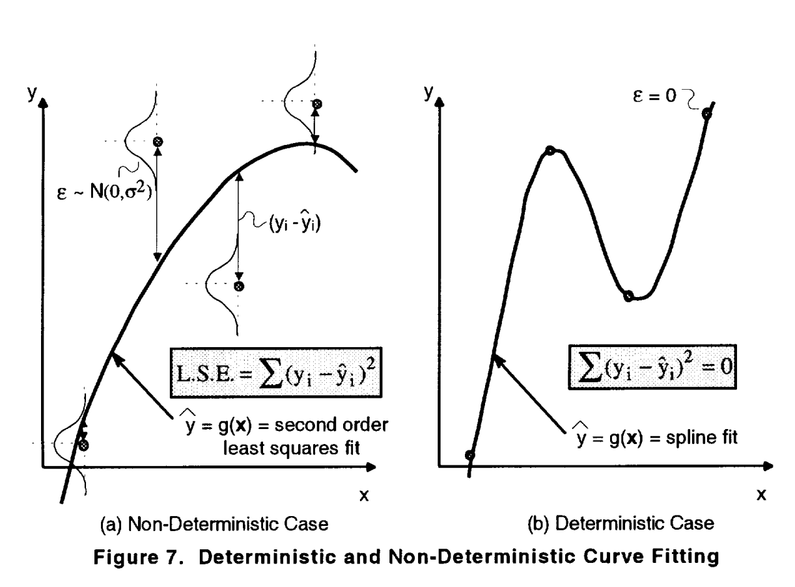

**图7.** 确定性与非确定性曲线拟合。

图内文字译释：左图 (a) `Non-Deterministic Case`＝非确定性情况，右图 (b) `Deterministic Case`＝确定性情况。左图中的 ε ~ N(0, σ²) 表示误差服从均值为零、方差为 σ² 的正态分布；yᵢ − ŷᵢ 表示观测值与预测值之差；`L.S.E. = Σ(yᵢ − ŷᵢ)²` 表示最小二乘误差。左图的 ŷ = g(x) 为 `second order least squares fit`，即二阶最小二乘拟合；右图的 ε = 0，Σ(yᵢ − ŷᵢ)² = 0，ŷ = g(x) 为 `spline fit`，即样条拟合。

式（17）中的确定性情况，与最小二乘回归方法存在明显冲突。除非 ε_bias 独立同分布于 N(0, σ²)，否则最小二乘回归统计推断的假设就遭到了违反。此外，由于不存在随机误差，在数据点之间进行平滑并无合理依据；相反，*模型应当精确通过每个数据点，并在它们之间插值*，如图5(b)所示。最后，大多数标准的模型显著性检验与参数显著性检验，都基于 ε_random 的计算，因而无法计算。这些观察得到了统计学界文献的支持；Sacks 等人[117]明确指出，由于确定性计算机试验缺少随机误差：

- 响应面模型的适切性完全由系统性偏差决定；
- 由最小二乘残差推导的常规不确定性度量，并没有显而易见的统计意义（存在确定性的不确定性度量，例如，在 x 上取 max |ŷ(x) − y(x)|，但可能很难计算）；
- 经典的试验区组化、重复和随机化概念不再相关。

此外，一些用于物理试验设计与分析的方法（例如见[14, 16, 91]），并不理想地适用于复杂的确定性计算机模型。“当存在的是系统误差而非随机误差时，统计检验是不合适的”[139]。关于模型应当如何对观测值进行插值的讨论，见[116]。

那么，这些方法可能在哪里出错？遗憾的是，很容易将确定性模型中的 ε_bias 项误认为 ε_random，然后继续进行标准统计检验。一些作者报告了统计度量（例如 F 统计量和均方根误差），用来验证模型的适切性，例如见[55, 64, 132, 136, 139]。然而，这些度量并没有统计意义，因为它们假定观测值包含一个均值为零、标准差非零的随机误差项。因此，使用逐步回归拟合多项式模型也不合适，因为它在添加或删除模型参数时使用 F 统计量。

一些研究人员（例如见[51, 53, 92, 135, 136]）将元建模技术用于含有数值噪声的确定性计算机试验。元模型用来平滑妨碍基于梯度的优化器性能的数值噪声（参见[53, 4]）。构建元模型时，将数值噪声当作随机误差的替代物，然后使用标准最小二乘方法确定模型显著性。将数值噪声等同于随机误差这一思想，需要进一步研究这种“确定性”噪声的来源和性质。

如何检验模型精度？R²（模型平方和除以总平方和）和调整 R²（考虑模型中的参数数量），是确定性计算机试验中验证模型适切性的唯一度量。这一度量往往不够充分；较高的 R² 值可能具有欺骗性。残差图可以帮助验证模型适切性、识别数据趋势、检查离群值等；然而，必须使用额外的（不同的）数据点来验证模型。可以计算额外验证点上的最大绝对误差、平均绝对误差和均方根误差，以评估模型精度，例如见[124, 136]。Otto 等人[95, 96]以及 Yesilyurt 和 Patera[145]开发了一种经贝叶斯验证的替代模型方法，利用额外验证点对近似模型的质量作出定性评估，并为模型与实际计算机分析之间的最大差异提供理论界限。他们已将这一方法用于多段翼型的优化[96]、梯形管道和轴对称体的设计[97]，以及涡流促进型换热器的优化[144, 145]。最后，一种不需要额外数据点的替代方法是留一交叉验证[86]：逐个移除用于拟合模型的每个样本点，在不包含该样本点的情况下重建模型，并对所有样本点计算不包含该点的模型预测与该点实际值之间的差异。

考虑到将最小二乘回归应用于确定性问题时可能出现的上述问题，权衡就存在于适用性与实用性之间。如果使用试验设计与最小二乘拟合建立响应面，对来自确定性计算机分析程序的数据建模，而且预测值与实际值具有良好的一致性，那么就没有理由舍弃它。应当使用它，但要谨慎。不过，必须理解所用统计技术的基本假设，以避免对模型显著性作出误导性陈述。下一节提出一些指导原则，说明如何适当地将统计元建模用于确定性计算机分析。

## 4 指导原则与建议

设计人员如何应用元建模工具，同时避免第3.3节所述的陷阱？可以自下而上回答这个问题（工具 → 应用，第4.1节），也可以自上而下回答（动机 → 工具，第4.2节）。

### 4.1 元建模技术评估

本节有两个组成部分。第一部分评估第2.2节介绍的四种元建模技术。第二部分是选择试验设计，这对响应面方法具有更直接的适用性。对于第 2.2 节讨论的其他元建模技术，哪些试验设计最合适，仍是开放的研究问题。

#### 4.1.1 模型选择与模型拟合备选方案的评价

表 2 汇总了评价第 2.2 节所介绍元建模技术的一些指导原则。

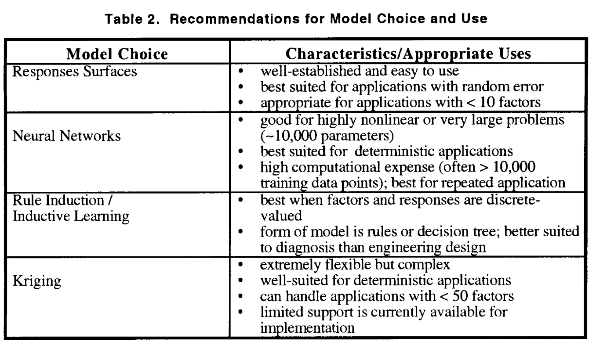

**表 2. 模型选择与使用建议。**

| 模型选择 | 特点／适用场景 |
| --- | --- |
| 响应面 | 已十分成熟，易于使用；最适合存在随机误差的应用；适用于因子数少于 10 的应用。 |
| 神经网络 | 适合高度非线性或规模很大的问题（约 10,000 个参数）；最适合确定性应用；计算开销很高（通常需要超过 10,000 个训练数据点），最适合需要反复使用的场合。 |
| 规则归纳／归纳学习 | 当因子和响应取离散值时最适用；模型采用规则或决策树的形式，相比工程设计，更适合用于诊断。 |
| 克里金 | 极其灵活，但比较复杂；适合确定性应用；能够处理因子数少于 50 的应用；目前可用于实现它的支持工具有限。 |

**响应面：** 主要面向存在随机误差的应用；不过，它已经成功用于许多工程设计问题。它是最成熟的元建模技术，而且，只要用户了解第 3.3 节所述的潜在陷阱，它也可能是最容易使用的技术。

**神经网络：** 一种非线性回归方法，最适合需要反复使用的确定性应用。由于所需的计算开销很大，为仅使用一次的场合构建神经网络，可能极不高效。

**归纳学习：** 当输入和输出因子主要取离散值，或者可以分组时，这种建模技术最为合适。预测模型采用条件—动作规则或决策树的形式，可能无法提供工程设计所期望的数学洞见。

**克里金：** 一种能够处理确定性数据的插值方法。由于可以选择多种相关函数，它极其灵活。不过，这种方法比响应面建模更加复杂，而且缺少容易获得的计算机支持软件。

#### 4.1.2 试验设计的评价

对于不同试验设计的相对优劣，人们有许多不同意见，因此我们很可能没有涵盖所有观点。对于计算机分析应采用何种试验设计，意见也不一致；迄今唯一达成的共识是：非随机、确定性计算机试验的设计应当具有“空间填充”性质。第 2.1.1 节已经讨论了若干空间填充设计。若要比较一些具体的设计类型，请参阅以下文献。

- Myers 和 Montgomery [91] 全面综述了用于拟合二阶响应面的试验设计。他们认为，只要能够接受设计变量所采用的不寻常水平，混合设计就是有用的；对于计算机试验而言，这通常不太可能成为问题。
- Carpenter [19] 考察了设计选择对响应面性能的影响。他比较了 `2ᵏ` 和 `3ᵏ` 析因设计、中心复合设计、最少点设计，以及通过额外随机选择的点加以增补的最少点设计；对于涉及超过 6 个变量的问题，他倾向于采用增补点设计。
- Giovannitti-Jensen 和 Myers [49] 讨论了若干一阶和二阶设计，发现具有旋转性的中心复合设计（CCD）与 Box–Behnken 设计的性能几乎相同。他们指出，“混合设计看来很有前景”。
- Lucas [79] 利用 D 效率和 G 效率统计量，比较了中心复合设计、Box–Behnken 设计、均匀壳层设计、Hoke 设计、Pesotchinsky 设计和 Box–Draper 设计。
- Montgomery 和 Evans [88] 比较了六种二阶设计：（a）`3²` 析因设计；（b）具有旋转性的正交中心复合设计；（c）具有旋转性的均匀精度中心复合设计；（d）具有旋转性的最小偏差中心复合设计；（e）具有旋转性的正交六边形设计；（f）具有旋转性的均匀精度六边形设计。比较标准包括平均响应表现，以及与真实最优解的距离。
- Lucas [77] 利用 D 效率和 G 效率统计量，比较了不同因子数下的对称与非对称复合设计，以及最小复合设计。

### 4.2 元建模使用建议

多数元建模应用都围绕利用中心复合设计和最小二乘回归来构造低阶多项式。这一方法之所以流行，至少部分源于响应面方法的成熟、简单，以及软件工具容易获得。然而，当因子很多（超过 10 个），或者响应具有高度非线性时，响应面方法就难以奏效。此外，正如第 3.3 节所述，在确定性应用中盲目采用响应面方法，也存在风险。其他元建模方法（见第 4.1.1 节）能够解决其中一些局限。我们的建议如下。

- 如果必须在确定性应用中对很多因子建模，那么，尽管神经网络的构建通常需要较高的计算开销，它仍可能是最佳选择。
- 如果要建模的底层函数是确定性的，而且对数量适中的因子（例如少于 50 个）具有高度非线性，那么，尽管克里金更加复杂，它仍可能是最佳选择。
- 在只有少量、表现较为良好的因子的确定性应用中，另一种值得探索的选择，是采用标准响应面方法，并用田口外部（噪声）数组加以扩展。

**RSM／OA 方法：** 将最小二乘回归用于确定性应用时，根本问题是式（17）缺少随机误差 `ε_random`。不过，如果把计算机分析中的某些输入参数归为噪声因子，并且对控制因子的每一种设置，按照外部数组改变这些噪声因子，那么，实际上就生成了一系列重复试验，用于近似 `ε_random`。如果可以合理地假定：假如这些试验是在实际物理系统上进行的，所观察到的随机误差会来自这些噪声因子的波动，那么，这种做法就是合理的。随后便可以对模型与参数的显著性进行统计检验，并根据同一组试验，同时构建平均响应和变异性的模型。文献 [72] 进一步讨论了这一方法，并给出了初步研究。

## 5 总结与结束语

本文综述了统计方法在工程设计中的一些应用，并讨论了元建模的概念，见第 1 节和图 6。然而，将这些技术用于工程设计中的确定性应用，可能产生问题，见第 3.1 节和第 3.3 节。我们在第 4 节提出了元建模技术的应用建议，但这些建议远非完整。必须对这些技术进行全面比较；文献 [124] 介绍了用克里金替代响应面作为元建模技术的初步研究和正在进行的研究。

问题规模庞大和非线性带来的困难始终存在。我们尤其关注的问题之一，是规模问题 [65]。随着问题中的因子数增加，构建元模型的成本开始超过效率方面的收益。此外，筛选往往不足以把问题缩减到可管理的规模。多响应问题又加重了这一困难：复杂工程设计问题总是包含多个需要建模的性能指标（响应）。当试图为多个响应选择最重要的因子时，筛选过程就会失效，因为每个响应所需要的重要因子可能不同。因此，这些问题引出的总体问题是：**如何把这些试验与元建模技术高效地用于更大的问题——即筛选后仍有超过 10 个因子的问题？** 一种方法是对问题进行划分或分解。利用这些技术，可以将复杂问题分解为较小的问题，从而高效开展试验与元建模，并进一步实现对设计空间全面而高效的探索 [63]。将问题分解为较小问题的技术已有大量文献，文献 [73] 提供了很好的综述。文献 [125] 和 [33] 详细综述了用于建立并并行求解分解问题的多学科设计优化方法，文献 [5] 则比较了其中一些方法。

## 致谢

本文的一个缩略版本曾在 1997 年 9 月 14—17 日于美国加利福尼亚州萨克拉门托举行的 ASME 设计理论与方法学会议上报告，论文编号为 DETC97/DTM-3881。Timothy Simpson 是美国国家科学基金会（NSF）研究生研究奖学金获得者，Jesse Peplinski 获 NSF 研究生研究奖学金支持，Patrick Koch 则是 Gwaltney 制造奖学金获得者。感谢 NSF 项目 DMI-96-12365、DMI-96-12327，以及 NASA 项目 NGT-51102 的支持。计算机使用时间的费用由系统实现实验室承担。

## 参考文献（保留英文原文）

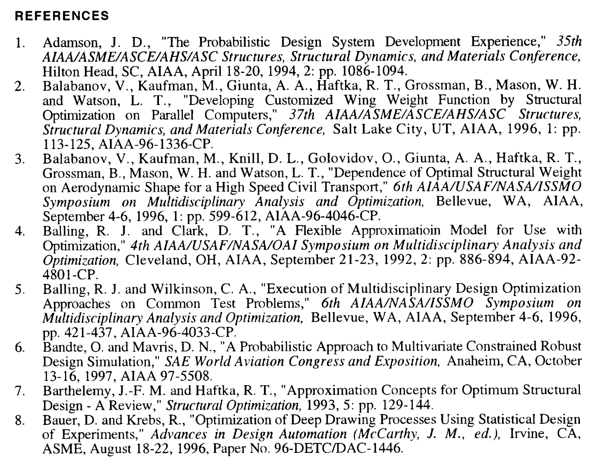

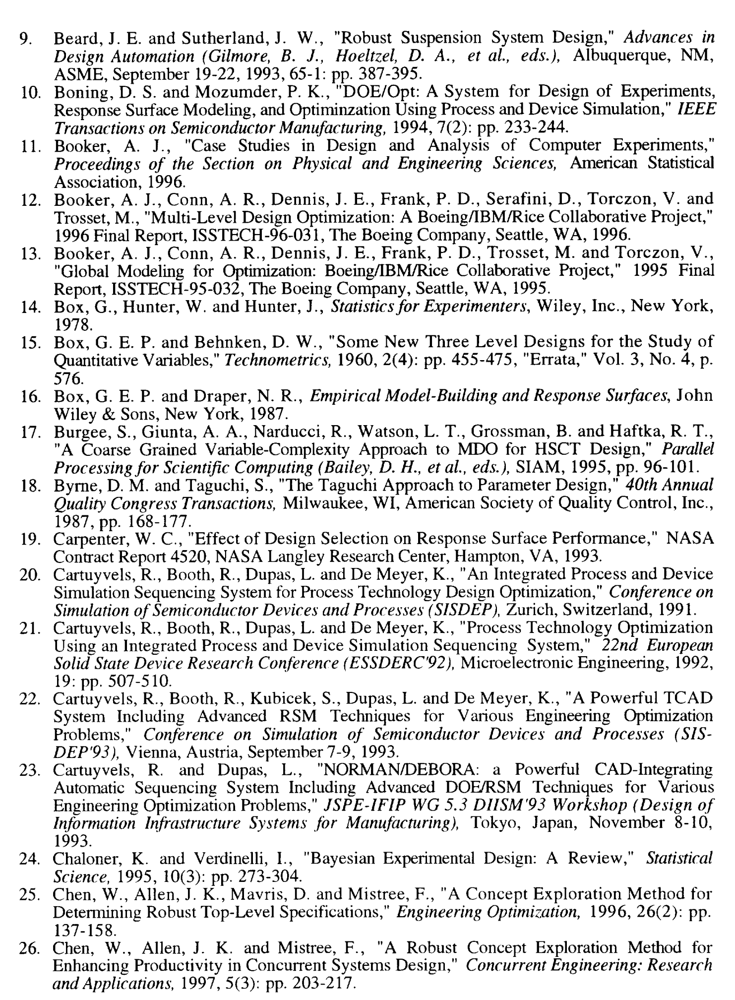

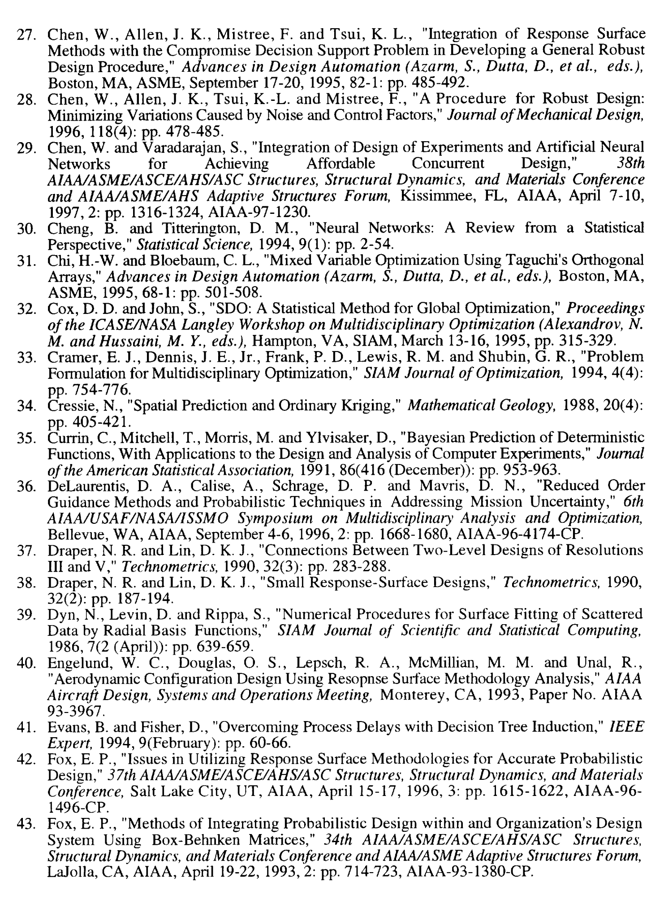

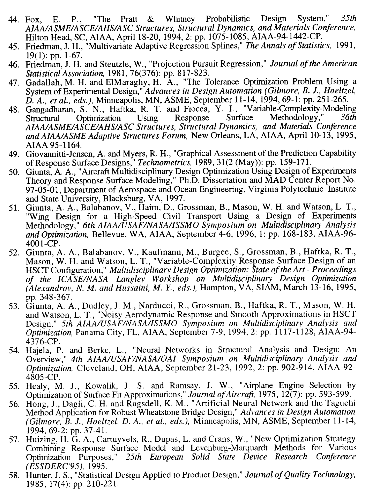

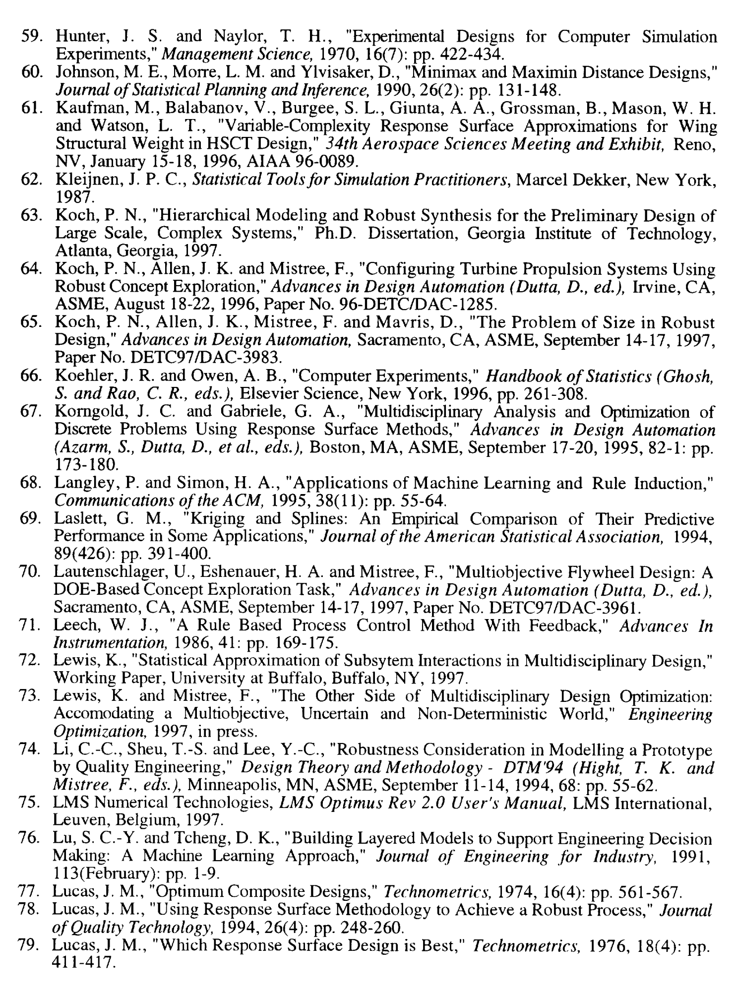

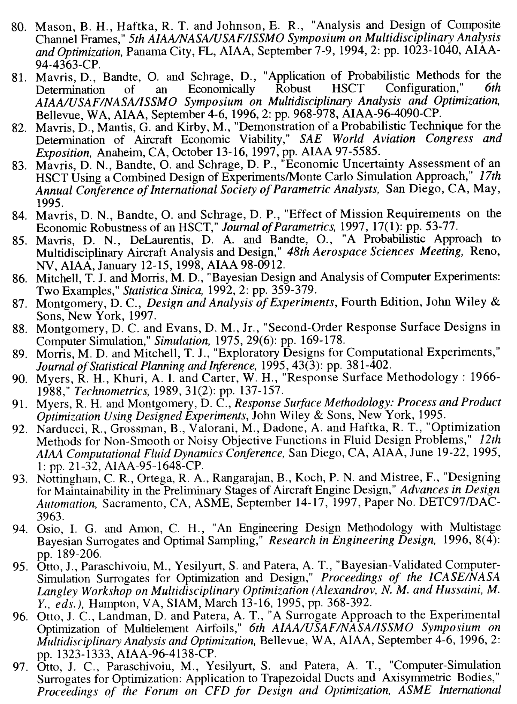

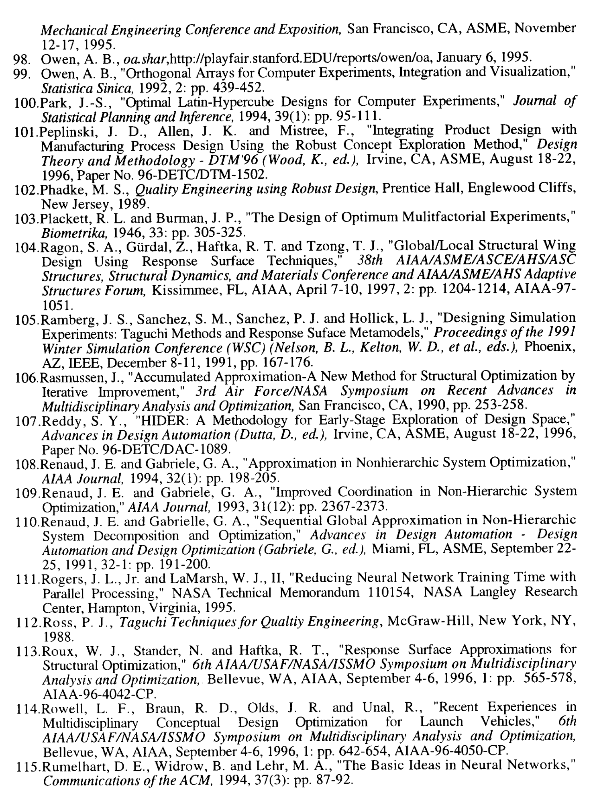

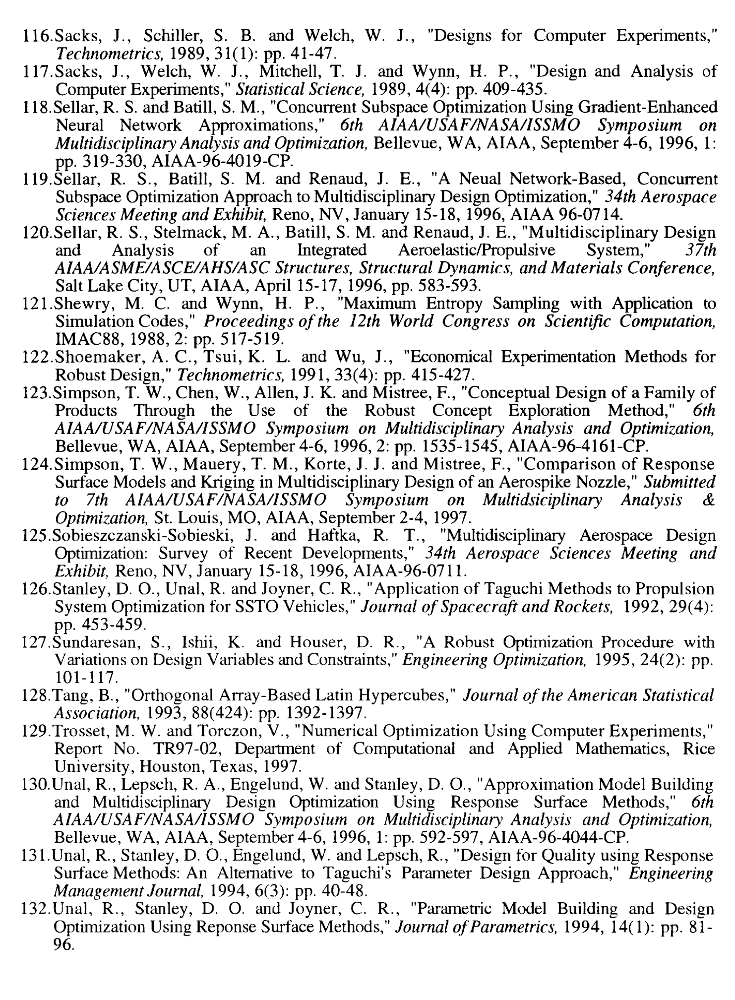

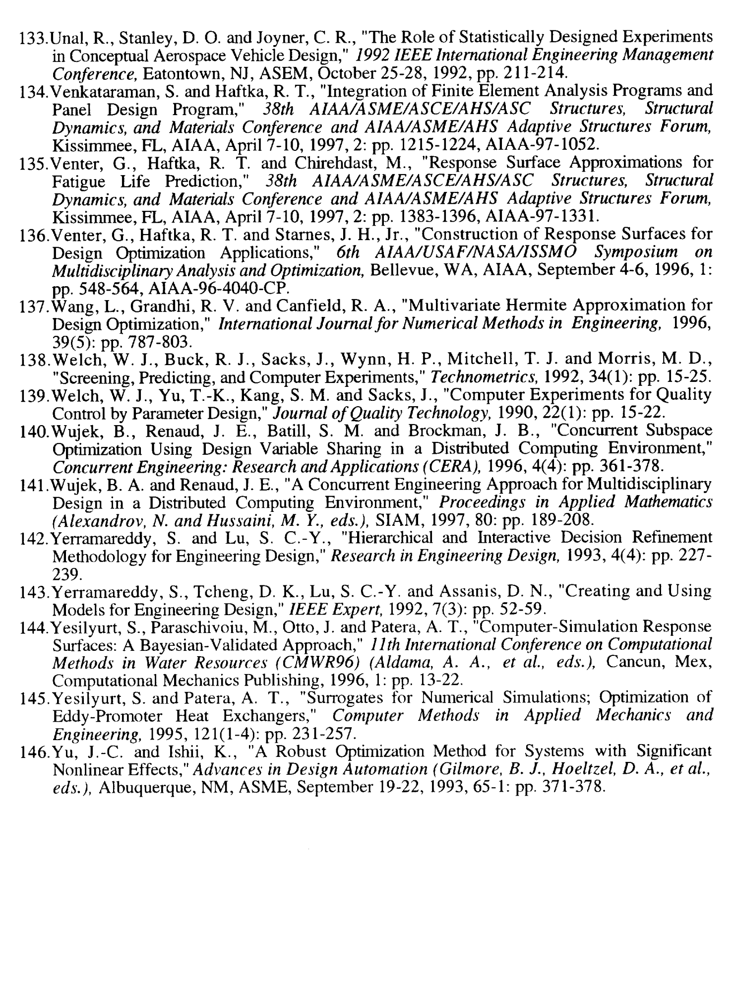
